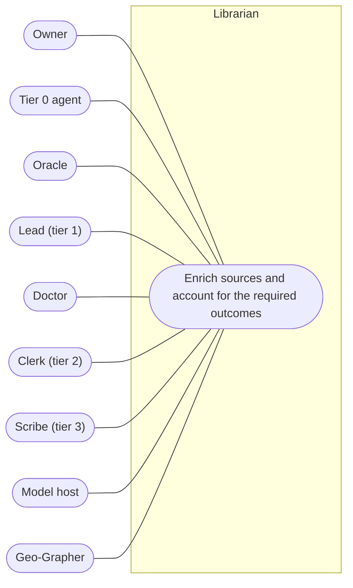

<!-- generated by build_artifacts.py using the accepted render_spec.py; edit the spec -->
# Enrichment cycle views

**Status:** behavioural analysis for review. Existing operations and planned coordination are distinguished in [model notes](model-notes.md) and the [requirements baseline](requirements-evidence.md).

These are extension scenarios from the accepted prototype's tree logic: the main success scenario plus departures and rejoins. They are not a Cartesian enumeration of repeated items, all combined failures, or an executable proof of the process. Rejoins remain conditional on the recorded item state and authority. The coverage table and source tests retain those conditions.

## Validation

No structural problems or cross-view flags.

## Use case diagram



## Activity diagram

```mermaid
flowchart TD
  subgraph Owner["Owner"]
    a1["1. sets or has already delegated the goal, sources, exclusions, allowed spending and required outcomes"]
    direct["hands the goal directly to the Lead and sets the run specification"]
    folderperson["reviews sensitive or otherwise reserved folder decisions"]
    dfolderperson{"folder decision approved?"}
    folderapprove["authorizes FolderReview.approve_batch for waiting folder metadata cards; this does not accept purposes or read documents"]
    approveperson["decides ingestion approval for person-mode or sensitive sources; approval still does not start processing or accept the Source"]
    dapproveperson{"ingestion approval granted?"}
    startperson["explicitly starts the approved batch; this is the current curate-only start boundary, retained until delegated-start support exists"]
    dstartperson{"processing start approved?"}
    revisionperson["reviews the staged Source revision and decides its acceptance"]
    drevisionperson{"revision approved?"}
    lensperson["decides accept/reject/defer for a person-mode, sensitive or otherwise reserved lens; agent permission alone cannot decide it"]
    folderaccept["reviews the enriched folder card's purpose, authorship, sensitivity, description, graph and fresh fingerprint in Folders review"]
    dfolderaccept{"folder-card decision approved?"}
    acceptperson["reviews sensitive items, person-mode promotion and interrupted promotion; decides whether to accept"]
    dpersonaccept{"acceptance approved?"}
    directreport["receives the Lead's result and Oracle verdict directly"]
    critical["receives critical security, data-loss, attestation or authority-boundary evidence immediately, with tier 0 when present"]
    decisionowner["decides reserved spending, sensitivity, promotion or proposed compensation; the ticket waits for that decision"]
    downer{"reserved decision permits continuation?"}
    compensation["carries out the specifically chosen compensation; preserves its receipt and unresolved original symptom for Lead diagnosis"]
  end
  subgraph Tier_0_agent["Tier 0 agent"]
    a2["2. hands bounded enrichment work to a Lead for its current task, including another project, and sets the run specification"]
    a38["38. reviews the handback against its delegated goal for the current external task; does not repeat the workers' tasks"]
    doverseer{"handback ready for the active task or Owner?"}
    overseerreport["returns the result to its active external task and reports to the Owner as directed"]
    tidy["requests bounded correction and independent recheck; workers repair and the Oracle judges"]
  end
  subgraph Oracle["Oracle"]
    dnowork{"does the accounted no-new-work result satisfy the specification?"}
    a36["36. judges outputs against the Core-stored specification and actual coverage: consumes scripted checks, then applies isolated model judgement"]
    doracle{"run verdict?"}
    scopejudge["judges the outside-envelope request against the run specification; cannot expand its mandate or include reserved or always-ask decisions"]
    recheck["independently rechecks the repaired symptom and affected requirements against evidence; the Doctor never declares closure"]
    drecheck{"repair verified?"}
    realigncheck["independently checks the Lead's correction; a failed or uncertain recheck is escalated with retained evidence"]
    drealigncheck{"Lead correction verified?"}
  end
  subgraph Lead_tier_1_["Lead (tier 1)"]
    targetcontract>"Target integration, not an execution trace. Existing stage scripts are preserved; semantic Data/metadata, tiered delegation and general Oracle/Doctor/tickets remain proposed."]
    a3["3. takes responsibility for the run; requests its Core-stored specification, recorded authority and qualified role assignments"]
    maintenanceplan["proposes bounded affected-source reading recovery or reprojection; preserves originals, true claim strength and the actual graph rebuild radius"]
    a5["5. applies exclusions and proposes permitted purpose decisions without widening source access"]
    native["queues or captures permitted native file, URL, repository, paper, model or dataset references"]
    dagentingestion{"approve the staged sources for processing under the granted agent authority?"}
    conversionroute{"retry affected conversion within the grant, retain fallback, or pause the affected work?"}
    readroute{"retry only pending affected tasks within the grant, keep queued gaps, or pause?"}
    dpartial{"does the specification permit retaining these declared gaps?"}
    a37["37. returns verdict, coverage, publication, tickets, known/unknown spending and authority exceptions; names separate owners for any remaining Source/lens decisions"]
    partialreport["returns permitted partial coverage and verdict with gaps, tickets, known/unknown spend and separate Source/lens decision states and owners"]
    realign["owns the unmapped diagnosis and re-alignment; proposes a new remedy or escalates without widening the specification"]
    drealign{"a permitted correction is available?"}
    escalation["explains the unresolved diagnosis and required intervention to tier 0 or the Owner; submits the evidence-bearing ticket through Core storage/dispatch"]
    paused["explains held work, the required decision and the permitted resume point to the specification owner using persisted receipts"]
  end
  subgraph Doctor["Doctor"]
    doctor["diagnoses the mapped failure and judges catalogued remedy fit and actual affected scope; proposes the remedy under its isolated revisable role assignment"]
    repair["executes the permitted remedy through registered actions; records attempts and proposed compensation without automatic rollback"]
  end
  subgraph Clerk_tier_2_["Clerk (tier 2)"]
    maintenanceassess["assesses reading and projection gaps from evidence; zero concepts alone proves neither unread content nor a need to invent claims"]
    a6["6. assesses permitted folder metadata for sensitivity using the qualified description route"]
    capturedescribe["owns the capture proposal: drafts neutral evidence-based description, keeps optional fit separate and returns explicit queued, refused or failed draft outcomes"]
    folderobserved>"Observed 22 November audit: 12 folder-item attempts in two batches failed at folder_describe; no folder_data success in that sample. The implemented chain remains metadata-only."]
    fd["folder_describe: drafts from bounded inventory metadata; unavailable or disabled production drafting stays queued"]
    noteread["requests deep_read_note for an accepted Source; the existing reading mechanism stages a revision and leaves the accepted note unchanged"]
    revisionapprove["reviews the revision against evidence and actual coverage; submits an acceptance decision within granted agent authority or a proposal for Owner review"]
    conversionplan["plans bounded model transcription or cleanup from extraction gaps; retains originals, page scope and permitted conversion limits"]
    conversionreview["proofreads model conversion against source evidence; judges fidelity and retains unreadable or uncertain pages as gaps"]
    a18["18. read: directs bounded part-reading tasks and proofreads their evidence without introducing the project's fit judgement"]
    a23["23. data: owns kind-specific component or chapter organization from evidence and scripted inventories; proposes records with actual coverage and explicit inapplicability"]
    a24["24. relate: synthesizes document chapter relations from fully read material; retains queued or partial outcomes and existing static relations"]
    a25["25. metadata: proposes evidence-based content-model fields, retains Unknown where appropriate and leaves confirmation to acceptance"]
    a26["26. review: owns the source package and Bottom Line; reconciles reading, Data, relations and metadata against evidence; distinguishes low confidence, no answer and refusal"]
    lensreview["makes a separately authorized accept/reject/defer decision for the staged reasoning instruction and its passage; Source acceptance confers none"]
    acceptprose["supplies or revises grounded prose and metadata proposals; low-confidence drafts are not silently accepted as reviewed-ok"]
    dprosebound{"did the draft make meaningful progress within the Core-reported correction allowance?"}
    a33["33. submits the acceptance packet: makes the granted agent decision or carries the Owner's recorded decision; retains true actor, per-item origin and actual coverage"]
    scout["investigates an unmapped failure or misalignment read-only, directing bounded Scribe tasks where useful"]
  end
  subgraph Scribe_tier_3_["Scribe (tier 3)"]
    conversionwork["performs assigned model transcription or text cleanup through the configured adapter; returns page-linked text and explicit gaps"]
    a19["19. completes assigned small reading tasks: located points, limits, terms and grounded lens candidates"]
  end
  subgraph Core["Core"]
    dentry{"who initiates this run?"}
    callgate["at every dispatch/commit checks tier, profile, grants, counters and critical flags; defers failed-route calls; scope judgement remains Oracle-owned"]
    dspecready{"specification schema, pinned IDs, grants and recorded independent role qualifications valid?"}
    dinput{"what input or continuation has been requested?"}
    maintenanceinventory["inventories specified existing publications, reading receipts, source/artifact hashes, projection versions and active registrations; changes nothing"]
    maintenancegrant["checks the proposed resource set, existing authority, accepted components, counters and current fingerprints before any maintenance write"]
    dmaintenancegrant{"maintenance within actual grants and registered capability?"}
    dmaintenancework{"Lead-requested maintenance continuation and current source state?"}
    maintenanceproject["reprojects compatible completed reading under current rules with guarded writes; preserves generated/source-stated/inferred labels and verification limits"]
    dmaintenanceproject{"projection and fresh folder/artifact admission result?"}
    dmaintenanceresult{"maintenance publication result?"}
    drevisionreturn{"recorded post-revision continuation?"}
    a4["4. scripts the folder inventory: stored purpose fields, fingerprints, credential filters, child ownership and optional Geo assignment records"]
    dstale{"accepted roots and reviewed group members current?"}
    dfolderdraft{"qualified, approved folder draft available?"}
    dsensitive{"agent-reported sensitivity or recorded policy reserves this folder decision for a person?"}
    a7["7. applies authorized folder decisions with current fingerprints, provenance and optional Geo group application"]
    dfolderapplied{"folder application succeeded?"}
    dpurpose{"accepted folder purpose?"}
    ownindex["indexes own code, data or logs as whole content under their purpose and access rules; creates no document Sources"]
    ownverify["checks requested own-content index receipts, graph IDs and original hashes; reports recorded exclusions and unchanged originals"]
    a8["8. dry-counts and queues each accepted root's in-scope documents; default PDF scope and queue ledger remain explicit"]
    a9["9. reconciles survey, per-root queue and withheld documents using deterministic counts"]
    dcounts{"counts and ownership reconcile?"}
    droots{"accepted-root worklist and required outputs?"}
    a10["10. fetches and hashes immutable evidence; stores deterministic facts, quality flags and each reference's capture result for staged proposals"]
    dcaptureguard{"capture raised a critical integrity or boundary flag?"}
    dcapture{"captured input accounting?"}
    capturefailed["retains failed queue entries or quarantine evidence with the failed stage and reason"]
    accounted["accounts for already-held, filtered or empty input; reports no new source rather than inventing enrichment"]
    dsourceapprove{"source ingestion approval permitted for this actor?"}
    a11["11. persists the Lead's or Owner's submitted ingestion approvals with true actor attribution; approved means queued, not read or accepted"]
    dprocessscope{"coverage required by this specification?"}
    a12["12. validates explicit authority to begin processing the approved set without repeating permission already granted for that run"]
    dstart{"processing start authorized and approved work available?"}
    a13["13. freezes the approved item set and run settings, logs the run and grants only its declared stage tools"]
    a14["14. before each item checks the library spend ceiling; between stages honors cancellation and the active Core writer"]
    dcontinue{"run may continue?"}
    stopped["records cancellation, ceiling stop or interruption; retains completed receipts and pending items for explicit resumption"]
    a15["15. reuses only compatible source/representation/recipe/route receipts; publication still needs current artifact/projection and folder admission checks"]
    dkind{"approved item is source or folder metadata card?"}
    fv["folder_validate: checks current inventory and review fingerprints"]
    dfv{"folder_validate failed?"}
    dfd{"folder_describe failed?"}
    fdata["folder_data: stores the inventory Data record; each stage uses the same failure and resume rules"]
    dfdata{"folder_data recorded outcome or critical finding?"}
    fcoverage["records folder coverage as metadata only, content not examined; never credits its documents as read"]
    drevision{"accepted-note reading result?"}
    revisionpartial["persists partial reading receipts and checks the recorded partial-revision grant; does not create authority or credit full reading"]
    drevisionintent{"Clerk submitted affirmative acceptance or a reserved-review proposal?"}
    drevisionactor{"revision acceptance needs the Owner?"}
    revisionmerge["merges only permitted revision sections into the existing Source with original snapshots and human-edit protection; creates no duplicate note"]
    drevisionmerge{"revision merge committed?"}
    a16["16. validate: checks source identity, captured evidence and unique library note name"]
    dv{"validate failed?"}
    a17["17. parse: runs scripted fetch, AST/text/PDF extraction and page mapping; preserves original text fallback; model conversion follows its agent path"]
    dp{"scripted parse result or recorded model-conversion request?"}
    conversioncheck["checks returned schemas, hashes and literal page locators; stores the Clerk's review verdict and actual conversion receipts"]
    dconversion{"recorded conversion result and mechanical checks?"}
    conversiongap["retains returned cleanup-error partial or missing-material partial/queued status and usable raw extraction; missing content receives no reading credit"]
    conversionfallback["keeps unmapped cleanup unused; restores original page-mapped text; parse may complete only with usable text and no other remaining gap"]
    conversionoutage["records transport code, attempts, retry-after and known/unknown cost; defers equivalent calls on the failed route pending bounded direction"]
    dconversionretry{"same-route retry within counters, backoff, current qualification and existing authority?"}
    a21["21. checks schemas, hashes, literal quote locators and task counters; persists agent-submitted reading and lens results; queued tasks never count as read"]
    dr{"read failed?"}
    readoutage["records 429/timeout/unavailable route and bounded attempts; defers equivalent failed-route calls; retains task gaps, receipts and unpriced cost"]
    dreadretry{"same-route pending-task retry within counters, backoff, qualification and existing authority?"}
    a22["22. lenses: persists agent-selected candidates, challenges, citations and discard records from reading; each proposal stays separately staged"]
    dl{"lenses stage failed?"}
    dd{"data stage failed?"}
    drel{"relate stage failed?"}
    dmeta{"metadata stage failed?"}
    dreview{"review stage failed?"}
    a27["27. publish: checks reading/conversion, artifact binding and projection compatibility; freshly checks enabled, accepted, current, trusted folder assignment"]
    dpubkind{"paper publication applicability?"}
    pubna["records publish as not applicable for a non-PDF or non-full-conversion artifact, with the conversion limitation retained"]
    pubpartial["preserves reading and exact publish gap: incomplete reading, FOLDER_STALE, awaiting_accepted_folder, disabled Geo, stale artifact or returned/caught failure"]
    dpubresult{"eligible publication succeeded?"}
    a29["29. records stage outcomes and keys; source changes make results stale; failed stops this item, other incomplete statuses remain partial"]
    dstatus{"item result?"}
    itemfailed["records the failed item's stage, evidence and reported fault flags; other frozen items continue only after critical-flag routing"]
    ditemcritical{"existing scripted violation code or agent finding carries a critical flag?"}
    partial["retains exact partial coverage and stage reasons, including publication gaps; never relabels the item enriched"]
    partialticket["records a repair-required partial item's ticket without blocking other frozen items; required repair remains a final-verdict obligation"]
    a30["30. accounts for the item and continues the frozen set; failures never undo another item's finished work"]
    dmore{"more frozen items?"}
    a31["31. exposes separate Source, folder and lens decision worklists with current states and owners; retains failed-item tickets and historical enqueue attribution"]
    dreadyitems{"any unaccounted in-scope Source/folder/lens decisions in actually decidable states?"}
    dacceptkind{"recorded decision item is Source, folder card or independent lens?"}
    dlensauthor{"existing mode, sensitivity and declared actor permit an independent agent lens decision?"}
    lensrecord["applies the recorded lens decision through existing gated staging; keeps passage immutable and decision actor explicit; no Source promotion"]
    dlensrecord{"lens decision recorded, blocked or critical?"}
    folderapply["applies the folder decision through FolderReview, with its barriers and provenance; does not promote a Source note"]
    dfoldernext{"folder decision succeeded and requires document ingestion?"}
    a32["32. previews acceptance mechanically: recorded sensitivity/mode, agent review status, required-field schemas, coverage/attempt counters, leases and fingerprints"]
    dacceptready{"acceptance schemas, recorded agent review and state guards ready?"}
    dauthor{"who may accept this item under policy?"}
    dacceptintent{"recorded agent or Owner acceptance affirmative?"}
    a34["34. writes through the Core writer with leases and compare-and-swap checks; retains originals and records interrupted promotion visibly"]
    dwrite{"promotion committed?"}
    a35["35. checks write receipts, concepts, backlinks, topic and Master indexes, applicable vectors, provenance and title/Bottom Line/concept findability"]
    dfind{"required note checks pass?"}
    dacceptmore{"more unaccounted in-scope decisions? Deferred obligations stay visible for the final verdict"}
    drecipient{"specification owner?"}
    dtidybound{"within the accepted single tidy-up and final-pass allowance?"}
    mreport["records delivery of the result to its specification owner"]
    ticket["persists submitted fault tickets: run, use case, extension, existing refusal/flags, evidence, declared responsible actor and rejoin"]
    dticket{"which recorded flag and existing responsibility route applies?"}
    decisionrecord["records the completed reserved decision and any explicit revised authority before re-admitting the affected operation"]
    dscope{"recorded Oracle verdict and existing grant/always-ask checks?"}
    scoperecord["records the evidence-bearing permitted allowance for final reporting; re-admits only the original affected operation"]
    dremedy{"accepted remedy ID and declared resource set within recorded grants and attempt counters?"}
    close["records the verified ticket resolution, remedy history and exact authorized rejoin; new remedies still require Owner acceptance"]
    drejoin{"ticket's recorded authorized rejoin?"}
  end
  subgraph Model_host["Model host"]
    a20["20. answers qualified bounded tasks through the configured adapters; unavailable or refused routes retain visible task outcomes"]
  end
  subgraph Geo_Grapher["Geo-Grapher"]
    maintenancegeo["revalidates admission and imports only the authorized paper artifact; reports the new active publication receipt without deleting generations"]
    a28["28. revalidates folder/artifact admission and publishes eligible reading claims; returns actual result or late refusal; Source acceptance remains separate"]
  end
  s(("start"))
  e1((("required Source artifacts are accepted with true coverage; specified lens decisions, findability, folder access and applicable graph obligations are met")))
  epartial((("a partial result is reported with its actual coverage and unresolved obligations")))
  enowork((("no new enrichment: existing, filtered, excluded or empty inputs are accounted for")))
  epaused((("paused or interrupted with retained evidence and an explicit decision or resume requirement")))
  eescalated((("an unresolved or critical ticket is handed to its accountable tier 0 agent or Owner")))
  s --> targetcontract
  targetcontract --> a1
  a1 --> dentry
  dentry -->|"[tier 0 delegates]"| a2
  dentry -->|"[Owner uses Librarian directly] 1a"| direct
  direct --> a3
  a2 --> a3
  a3 --> callgate
  callgate --> dspecready
  dspecready -->|"[ready and no critical finding]"| dinput
  dspecready -->|"[noncritical missing, refused or worker-review assignment collision] 3a"| ticket
  dspecready -->|"[critical integrity, false attestation or authority-boundary finding] 3b"| critical
  dinput -->|"[folder]"| a4
  dinput -->|"[native references] 4a"| native
  dinput -->|"[waiting folder metadata cards] 4c"| folderapprove
  dinput -->|"[explicitly requested accepted-Source rereading] 4d"| noteread
  dinput -->|"[scoped existing-publication reconciliation requested] 4e"| maintenanceinventory
  maintenanceinventory --> maintenanceassess
  maintenanceassess --> maintenanceplan
  maintenanceplan --> maintenancegrant
  maintenancegrant --> dmaintenancegrant
  dmaintenancegrant -->|"[noncritical; actual scope and registered components already authorized]"| dmaintenancework
  dmaintenancegrant -->|"[noncritical reserved decision or additional exact scope authority required]"| decisionowner
  dmaintenancegrant -->|"[outside mandate, no accepted capability or code change required]"| escalation
  dmaintenancegrant -->|"[critical integrity or authority-boundary finding]"| critical
  dmaintenancework -->|"[accepted Source needs reading recovery; stage a revision, never new-source duplicate validation]"| noteread
  dmaintenancework -->|"[unaccepted finished partial needs actual re-approval and a new authorized batch]"| dsourceapprove
  dmaintenancework -->|"[authorized unfinished pinned batch needs reading recovery]"| a14
  dmaintenancework -->|"[compatible full current reading exists; only declared projection/publication work needed]"| maintenanceproject
  dmaintenancework -->|"[no affected work remains; retain evidence and separate pending decisions for final verdict]"| a36
  dmaintenancework -->|"[incompatible or insufficient evidence; no justified continuation]"| scout
  maintenanceproject --> dmaintenanceproject
  dmaintenanceproject -->|"[noncritical compatible full reading/conversion and fresh enabled, accepted, current, trusted folder/artifact admission]"| maintenancegeo
  dmaintenanceproject -->|"[noncritical projection/admission gap, stale artifact/folder or stage error; retain old state and actual reason]"| ticket
  dmaintenanceproject -->|"[critical integrity or authority-boundary finding]"| critical
  maintenancegeo --> dmaintenanceresult
  dmaintenanceresult -->|"[noncritical actual publication receipt; Oracle rechecks the scoped obligation]"| a36
  dmaintenanceresult -->|"[noncritical late refusal, returned/caught Geo failure or unknown result; original state retained]"| ticket
  dmaintenanceresult -->|"[critical integrity, false attestation or boundary finding]"| critical
  folderapprove --> a12
  native --> a10
  a4 --> dstale
  dstale -->|"[current]"| a5
  dstale -->|"[stale root or group] 4b"| ticket
  a5 --> a6
  a6 --> dfolderdraft
  dfolderdraft -->|"[available with no critical finding]"| dsensitive
  dfolderdraft -->|"[noncritical unqualified, disabled, unavailable or failed draft] 6b"| ticket
  dfolderdraft -->|"[critical integrity, false attestation or boundary finding] 6c"| critical
  dsensitive -->|"[permitted ordinary decision]"| a7
  dsensitive -->|"[sensitive or reserved decision] 6a"| folderperson
  folderperson --> dfolderperson
  dfolderperson -->|"[approved]"| a7
  dfolderperson -->|"[declined or waiting]"| paused
  a7 --> dfolderapplied
  dfolderapplied -->|"[applied with no critical finding]"| dpurpose
  dfolderapplied -->|"[noncritical refused or failed] 7a"| ticket
  dfolderapplied -->|"[critical integrity or authority-boundary finding] 7d"| critical
  dpurpose -->|"[third-party, research-docs or own-docs; retain own-docs graph role too]"| a8
  dpurpose -->|"[own code, data or logs; no Source enumeration] 7b"| ownindex
  dpurpose -->|"[this root excluded or withheld; retain its accounted outcome] 7c"| droots
  ownindex --> ownverify
  ownverify --> droots
  a8 --> a9
  a9 --> dcounts
  dcounts -->|"[reconciled]"| droots
  dcounts -->|"[mismatch] 9a"| ticket
  droots -->|"[all roots accounted for and source references queued]"| a10
  droots -->|"[another accepted root remains] 9b"| a5
  droots -->|"[all roots accounted for; only own-content indexing or folder classification required] 9c"| a36
  droots -->|"[all roots accounted for; only excluded, held or empty outcomes] 9d"| accounted
  a10 --> dcaptureguard
  dcaptureguard -->|"[no critical finding; draft only successfully captured eligible evidence]"| capturedescribe
  dcaptureguard -->|"[critical integrity or authority-boundary finding] 10e"| critical
  capturedescribe --> dcapture
  dcapture -->|"[noncritical staged work with actual draft outcomes retained; account for failed, duplicate, filtered and queued siblings separately]"| dsourceapprove
  dcapture -->|"[noncritical no staged work and at least one failed capture] 10a"| capturefailed
  capturefailed --> ticket
  dcapture -->|"[noncritical no staged work or failure; only held, filtered, excluded or empty inputs] 10b"| accounted
  dcapture -->|"[critical integrity, false attestation or boundary finding] 10f"| critical
  accounted --> dnowork
  dnowork -->|"[required outcome already met or exclusions satisfy the specification]"| enowork
  dnowork -->|"[required work missing or uncertain]"| ticket
  dsourceapprove -->|"[permitted declared agent in agent mode; ordinary sources]"| dagentingestion
  dagentingestion -->|"[Lead approves the staged sources]"| a11
  dagentingestion -->|"[declined or held with an explicit reason] 10d"| paused
  dsourceapprove -->|"[person mode, sensitive or reserved ingestion decision] 10c"| approveperson
  approveperson --> dapproveperson
  dapproveperson -->|"[approved]"| a11
  dapproveperson -->|"[declined or waiting]"| paused
  a11 --> dprocessscope
  dprocessscope -->|"[source enrichment required]"| a12
  dprocessscope -->|"[authorized captured-only coverage is sufficient; no reading is claimed] 11a"| a32
  a12 --> dstart
  dstart -->|"[authorized approved set]"| a13
  dstart -->|"[approved work but no delegated start authority] 12a"| startperson
  startperson --> dstartperson
  dstartperson -->|"[approved]"| a13
  dstartperson -->|"[declined or waiting]"| paused
  dstart -->|"[no approved work] 12b"| accounted
  a13 --> a14
  a14 --> dcontinue
  dcontinue -->|"[active, not cancelled and below ceiling]"| a15
  dcontinue -->|"[cancelled, interrupted or ceiling reached] 14a"| stopped
  stopped --> paused
  a15 --> dkind
  dkind -->|"[source]"| a16
  dkind -->|"[folder metadata card] 15a"| folderobserved
  folderobserved --> fv
  fv --> dfv
  dfv -->|"[noncritical and not failed]"| fd
  dfv -->|"[noncritical failed: skip remaining folder stages]"| fcoverage
  dfv -->|"[critical integrity or boundary finding]"| critical
  fd --> dfd
  dfd -->|"[noncritical and not failed; keep queued or partial outcomes]"| fdata
  dfd -->|"[noncritical failed: retain FOLDER_PROVENANCE/FOLDER_DRAFT_FAILED and skip remaining folder stages]"| fcoverage
  dfd -->|"[critical integrity, false attestation or boundary finding]"| critical
  fdata --> dfdata
  dfdata -->|"[noncritical result; retain actual complete/partial/failed stage receipt]"| fcoverage
  dfdata -->|"[critical integrity or boundary finding]"| critical
  fcoverage --> a29
  noteread --> drevision
  drevision -->|"[noncritical reading complete and revision ready with actual coverage]"| revisionapprove
  drevision -->|"[noncritical partial reading retained and the specification explicitly permits accepting that partial revision]"| revisionpartial
  revisionpartial --> revisionapprove
  drevision -->|"[noncritical partial or queued rereading without authorized partial acceptance; preserve revision and obtain a real verdict]"| a36
  drevision -->|"[noncritical failed or stale reading; evidence retained]"| escalation
  drevision -->|"[critical integrity, false attestation or boundary finding]"| critical
  revisionapprove --> drevisionintent
  drevisionintent -->|"[Clerk affirmatively accepts within granted scope or submits the proposal for the reserved Owner decision]"| drevisionactor
  drevisionintent -->|"[Clerk holds or declines with an explicit reason]"| paused
  drevisionactor -->|"[permitted ordinary declared-agent acceptance]"| revisionmerge
  drevisionactor -->|"[person mode, sensitive or reserved decision]"| revisionperson
  revisionperson --> drevisionperson
  drevisionperson -->|"[approved]"| revisionmerge
  drevisionperson -->|"[declined or waiting]"| paused
  revisionmerge --> drevisionmerge
  drevisionmerge -->|"[committed with no critical finding]"| drevisionreturn
  drevisionreturn -->|"[ordinary accepted-note revision; no publication maintenance requested]"| a35
  drevisionreturn -->|"[authorized publication maintenance requested; retain request and re-inventory current reading/projection eligibility through entry admission]"| dinput
  drevisionmerge -->|"[noncritical human edit, stale input or merge conflict; original retained]"| escalation
  drevisionmerge -->|"[critical integrity or authority-boundary finding]"| critical
  a16 --> dv
  dv -->|"[noncritical and not failed]"| a17
  dv -->|"[noncritical failed: stop this item's remaining stages] 16a"| a29
  dv -->|"[critical integrity or authority-boundary finding] 16b"| critical
  a17 --> dp
  dp -->|"[noncritical, not failed and no model conversion requested; retain actual partial or queued extraction status]"| a18
  dp -->|"[noncritical uncaught stage failure: stop this item's remaining stages] 17a"| a29
  dp -->|"[noncritical recorded request for permitted model transcription or cleanup] 17b"| conversionplan
  dp -->|"[critical integrity or authority-boundary finding] 17c"| critical
  conversionplan --> conversionwork
  conversionwork --> conversionreview
  conversionreview --> conversioncheck
  conversioncheck --> dconversion
  dconversion -->|"[noncritical usable mapped representation and Clerk review; retain actual complete or partial coverage]"| a18
  dconversion -->|"[noncritical, no transport outage: returned task error/refusal, or unusable representation without usable-original anchor fallback; retain partial/queued gaps]"| conversiongap
  dconversion -->|"[noncritical successful cleanup loses anchors; usable original page-mapped text and no transport outage]"| conversionfallback
  conversionfallback --> a18
  conversiongap --> a18
  dconversion -->|"[noncritical uncaught stage/writer failure: stop this item's remaining stages]"| a29
  dconversion -->|"[critical integrity or authority-boundary finding]"| critical
  dconversion -->|"[noncritical transport 429, timeout or unavailable route]"| conversionoutage
  conversionoutage --> conversionroute
  conversionroute -->|"[Lead requests bounded same-route retry]"| dconversionretry
  dconversionretry -->|"[permitted bounded parse re-entry; reuse compatible extraction and retry only affected conversion work]"| a17
  dconversionretry -->|"[retry not currently permitted; retain returned-error partial or missing-material gaps]"| conversiongap
  conversionroute -->|"[retain usable fallback and exact returned-error partial or missing-material gaps]"| conversiongap
  conversionroute -->|"[pause affected work; no silent model substitution]"| paused
  a18 --> a19
  a19 --> a20
  a20 --> a21
  a21 --> dr
  dr -->|"[noncritical, not failed and no new transport incident; retain partial/queued/skipped tasks, including invalid JSON or grounding refusal]"| a22
  dr -->|"[noncritical failed: stop this item's remaining stages] 21a"| a29
  dr -->|"[critical integrity, false attestation or boundary finding] 21b"| critical
  dr -->|"[noncritical 429, timeout or unavailable route] 21c"| readoutage
  readoutage --> readroute
  readroute -->|"[Lead requests bounded retry of pending tasks only]"| dreadretry
  dreadretry -->|"[permitted same-route attempt; reuse matching completed tasks]"| a18
  dreadretry -->|"[retry not currently permitted; retain queued task gaps and defer failed-route dispatch]"| a22
  readroute -->|"[continue with actual queued gaps and completed evidence; failed route stays deferred]"| a22
  readroute -->|"[pause affected work; reassignment requires fresh authorized qualification]"| paused
  a22 --> dl
  dl -->|"[noncritical and not failed; record not applicable explicitly]"| a23
  dl -->|"[noncritical failed: stop this item's remaining stages] 22a"| a29
  dl -->|"[critical integrity, false attestation or boundary finding] 22b"| critical
  a23 --> dd
  dd -->|"[noncritical and not failed; retain partial or not applicable status]"| a24
  dd -->|"[noncritical failed: stop this item's remaining stages] 23a"| a29
  dd -->|"[critical integrity, false attestation or boundary finding] 23b"| critical
  a24 --> drel
  drel -->|"[noncritical and not failed; retain queued, partial or not applicable status]"| a25
  drel -->|"[noncritical failed: stop this item's remaining stages] 24a"| a29
  drel -->|"[critical integrity, false attestation or boundary finding] 24b"| critical
  a25 --> dmeta
  dmeta -->|"[noncritical and not failed]"| a26
  dmeta -->|"[noncritical failed: stop this item's remaining stages] 25a"| a29
  dmeta -->|"[critical integrity, false attestation or boundary finding] 25b"| critical
  a26 --> dreview
  dreview -->|"[noncritical and not failed; retain partial or queued review and any deferred-route reason]"| a27
  dreview -->|"[noncritical failed or refused: stop this item's remaining stages] 26a"| a29
  dreview -->|"[critical integrity, false attestation or boundary finding] 26b"| critical
  a27 --> dpubkind
  dpubkind -->|"[noncritical fully read PDF, compatible full conversion/artifact and freshly enabled, accepted, current, trusted folder assignment]"| a28
  dpubkind -->|"[noncritical non-PDF, or fully read PDF without a full-conversion artifact] 27a"| pubna
  dpubkind -->|"[noncritical reading incomplete, or full-reading/full-conversion artifact/folder admission blocked; preserve exact reason] 27b"| pubpartial
  dpubkind -->|"[noncritical preparation exception: failed stage; stop this item's remaining work] 27c"| a29
  dpubkind -->|"[critical integrity or authority-boundary finding] 27d"| critical
  pubna --> a29
  pubpartial --> a29
  a28 --> dpubresult
  dpubresult -->|"[published with no critical finding]"| a29
  dpubresult -->|"[noncritical returned disabled/refused, late FOLDER_STALE/awaiting_accepted_folder/artifact mismatch or caught publication error] 28a"| pubpartial
  dpubresult -->|"[critical integrity, false attestation or boundary finding] 28b"| critical
  dpubresult -->|"[noncritical uncaught stage failure; preserve failed status] 28c"| a29
  a29 --> dstatus
  dstatus -->|"[enriched; all required stages accounted for]"| a30
  dstatus -->|"[partial, queued, skipped or stale work remains] 29a"| partial
  dstatus -->|"[failed] 29b"| itemfailed
  itemfailed --> ditemcritical
  ditemcritical -->|"[noncritical; retain ticket for repair and final accounting]"| a30
  ditemcritical -->|"[critical; notify Owner and tier 0 immediately]"| critical
  partial --> dpartial
  dpartial -->|"[declared gaps permitted]"| a30
  dpartial -->|"[repair required or uncertain]"| partialticket
  partialticket --> ditemcritical
  a30 --> dmore
  dmore -->|"[frozen set accounted for]"| a31
  dmore -->|"[another frozen item] 30a"| a14
  a31 --> dreadyitems
  dreadyitems -->|"[yes; choose an actually decidable item]"| dacceptkind
  dreadyitems -->|"[none; retain failed or pending item tickets for final verdict] 31b"| a36
  dacceptkind -->|"[source]"| a32
  dacceptkind -->|"[folder metadata card] 31a"| folderaccept
  dacceptkind -->|"[independent lens decision requested by the parent specification] 31c"| dlensauthor
  dlensauthor -->|"[ordinary normal-sensitivity lens; declared agent and existing agent-mode authority permit the separate decision]"| lensreview
  dlensauthor -->|"[person mode, sensitive lens or another reserved decision]"| lensperson
  lensreview --> lensrecord
  lensperson --> lensrecord
  lensrecord --> dlensrecord
  dlensrecord -->|"[noncritical recorded accept/reject/defer; preserve actual state and any remaining obligation]"| dacceptmore
  dlensrecord -->|"[noncritical refusal/conflict; do not claim a lens decision was applied]"| ticket
  dlensrecord -->|"[critical integrity, false attestation or authority-boundary finding]"| critical
  folderaccept --> dfolderaccept
  dfolderaccept -->|"[approved]"| folderapply
  dfolderaccept -->|"[declined or waiting]"| paused
  folderapply --> dfoldernext
  dfoldernext -->|"[decision succeeded; metadata-only request]"| dacceptmore
  dfoldernext -->|"[decision succeeded; source-eligible documents requested]"| a8
  dfoldernext -->|"[decision succeeded; own content indexed whole]"| ownindex
  dfoldernext -->|"[folder application refused or failed]"| ticket
  a32 --> dacceptready
  dacceptready -->|"[ready]"| dauthor
  dacceptready -->|"[grounded prose or required metadata needs review] 32a"| acceptprose
  dacceptready -->|"[state, name, input, lease or interrupted-promotion conflict] 32b"| ticket
  acceptprose --> dprosebound
  dprosebound -->|"[within the run's declared allowance with progress]"| a32
  dprosebound -->|"[exhausted, no progress or uncertain]"| escalation
  dauthor -->|"[declared agent under agent mode; ordinary uninterrupted item]"| a33
  dauthor -->|"[person mode, sensitive or interrupted promotion] 33a"| acceptperson
  acceptperson --> dpersonaccept
  dpersonaccept -->|"[approved]"| a33
  dpersonaccept -->|"[declined or waiting]"| paused
  a33 --> dacceptintent
  dacceptintent -->|"[affirmative recorded agent or Owner acceptance submitted]"| a34
  dacceptintent -->|"[agent holds or declines acceptance with an explicit reason] 33b"| paused
  a34 --> dwrite
  dwrite -->|"[committed with no critical finding]"| a35
  dwrite -->|"[noncritical conflict, interrupted or outcome unknown] 34a"| ticket
  dwrite -->|"[critical integrity, false attestation or boundary finding] 34b"| critical
  a35 --> dfind
  dfind -->|"[findable with required fields and labels]"| dacceptmore
  dfind -->|"[missing or written but not findable; retain actual failed search] 35a"| ticket
  dacceptmore -->|"[all requested decisions accounted for]"| a36
  dacceptmore -->|"[another decision item] 35b"| dacceptkind
  a36 --> doracle
  doracle -->|"[success guarantee met with no declared partial-result gaps]"| a37
  doracle -->|"[success guarantee otherwise met with only explicitly permitted declared gaps] 36a"| partialreport
  doracle -->|"[mapped failure, unmapped misalignment, uncertainty or critical finding] 36b"| ticket
  partialreport --> epartial
  a37 --> drecipient
  drecipient -->|"[tier 0 set the specification]"| a38
  drecipient -->|"[Owner set the specification] 37a"| directreport
  directreport --> mreport
  a38 --> doverseer
  doverseer -->|"[ready]"| overseerreport
  doverseer -->|"[correction or recheck required] 38a"| tidy
  tidy --> dtidybound
  dtidybound -->|"[one tidy-up remains; record the requested correction]"| ticket
  dtidybound -->|"[final pass still fails or allowance exhausted]"| escalation
  overseerreport --> mreport
  mreport --> e1
  ticket --> dticket
  dticket -->|"[noncritical, not reserved or pending scope judgement; mapped catalogued failure]"| doctor
  dticket -->|"[noncritical, not reserved or pending scope judgement; unmapped failure or misalignment]"| scout
  dticket -->|"[noncritical reserved person decision or proposed compensation]"| decisionowner
  dticket -->|"[critical security, data loss, false attestation or boundary violation]"| critical
  dticket -->|"[noncritical, not reserved; outside-envelope scope question]"| scopejudge
  critical --> eescalated
  decisionowner --> downer
  downer -->|"[specific remedy execution approved within original or explicitly revised authority]"| repair
  downer -->|"[specific compensation chosen; do not assert the original failure resolved]"| compensation
  compensation --> realign
  downer -->|"[reserved checkpoint decision completed; operation still requires normal admission]"| decisionrecord
  decisionrecord --> drejoin
  downer -->|"[declined, waiting or authority still insufficient]"| paused
  scopejudge --> dscope
  dscope -->|"[in specification, within mandate and permitted by existing nonreserved authority]"| scoperecord
  scoperecord --> drejoin
  dscope -->|"[reserved or always-ask decision is needed]"| decisionowner
  dscope -->|"[out of scope, uncertain or above mandate]"| escalation
  doctor --> dremedy
  dremedy -->|"[accepted, bounded and permitted]"| repair
  dremedy -->|"[person decision or compensation required]"| decisionowner
  dremedy -->|"[no remedy, outside scope or attempt bound exhausted]"| realign
  repair --> recheck
  recheck --> drecheck
  drecheck -->|"[verified]"| close
  drecheck -->|"[not verified or uncertain; no automatic rollback]"| realign
  close --> drejoin
  drejoin -->|"[specification, start authority or role-assignment readiness]"| a3
  drejoin -->|"[folder survey or stale group]"| a4
  drejoin -->|"[per-root queue reconciliation]"| a8
  drejoin -->|"[capture retry]"| a10
  drejoin -->|"[authorized unfinished-batch resume; reuse only matching receipts]"| a14
  drejoin -->|"[finished partial source needs explicit re-approval and a new authorized batch]"| dsourceapprove
  drejoin -->|"[acceptance or promotion review]"| a32
  drejoin -->|"[written note index check]"| a35
  drejoin -->|"[final specification recheck]"| a36
  drejoin -->|"[authorized existing-publication maintenance request retained; re-enter inventory and fresh admission]"| dinput
  scout --> realign
  realign --> drealign
  drealign -->|"[permitted correction made; independent recheck required]"| realigncheck
  drealign -->|"[no permitted correction, no progress or a code change required]"| escalation
  realigncheck --> drealigncheck
  drealigncheck -->|"[verified]"| close
  drealigncheck -->|"[failed or uncertain]"| escalation
  escalation --> eescalated
  paused --> epaused
  classDef ext stroke:#d9534f,stroke-width:2px
```

## Written use case

The [nine-field use-case description](model-notes.md#use-case-description) defines the actors, entry conditions, guarantee and open implementation questions.

**Main success scenario** (generated: the guard-true path, in step order)

1. The Owner sets or has already delegated the goal, sources, exclusions, allowed spending and required outcomes.
2. The Tier 0 agent hands bounded enrichment work to a Lead for its current task, including another project, and sets the run specification.
3. The Lead (tier 1) takes responsibility for the run; requests its Core-stored specification, recorded authority and qualified role assignments.
4. The Core scripts the folder inventory: stored purpose fields, fingerprints, credential filters, child ownership and optional Geo assignment records.
5. The Lead (tier 1) applies exclusions and proposes permitted purpose decisions without widening source access.
6. The Clerk (tier 2) assesses permitted folder metadata for sensitivity using the qualified description route.
7. The Core applies authorized folder decisions with current fingerprints, provenance and optional Geo group application.
8. The Core dry-counts and queues each accepted root's in-scope documents; default PDF scope and queue ledger remain explicit.
9. The Core reconciles survey, per-root queue and withheld documents using deterministic counts.
10. The Core fetches and hashes immutable evidence; stores deterministic facts, quality flags and each reference's capture result for staged proposals.
11. The Core persists the Lead's or Owner's submitted ingestion approvals with true actor attribution; approved means queued, not read or accepted.
12. The Core validates explicit authority to begin processing the approved set without repeating permission already granted for that run.
13. The Core freezes the approved item set and run settings, logs the run and grants only its declared stage tools.
14. The Core before each item checks the library spend ceiling; between stages honors cancellation and the active Core writer.
15. The Core reuses only compatible source/representation/recipe/route receipts; publication still needs current artifact/projection and folder admission checks.
16. The Core validate: checks source identity, captured evidence and unique library note name.
17. The Core parse: runs scripted fetch, AST/text/PDF extraction and page mapping; preserves original text fallback; model conversion follows its agent path.
18. The Clerk (tier 2) read: directs bounded part-reading tasks and proofreads their evidence without introducing the project's fit judgement.
19. The Scribe (tier 3) completes assigned small reading tasks: located points, limits, terms and grounded lens candidates.
20. The Model host answers qualified bounded tasks through the configured adapters; unavailable or refused routes retain visible task outcomes.
21. The Core checks schemas, hashes, literal quote locators and task counters; persists agent-submitted reading and lens results; queued tasks never count as read.
22. The Core lenses: persists agent-selected candidates, challenges, citations and discard records from reading; each proposal stays separately staged.
23. The Clerk (tier 2) data: owns kind-specific component or chapter organization from evidence and scripted inventories; proposes records with actual coverage and explicit inapplicability.
24. The Clerk (tier 2) relate: synthesizes document chapter relations from fully read material; retains queued or partial outcomes and existing static relations.
25. The Clerk (tier 2) metadata: proposes evidence-based content-model fields, retains Unknown where appropriate and leaves confirmation to acceptance.
26. The Clerk (tier 2) review: owns the source package and Bottom Line; reconciles reading, Data, relations and metadata against evidence; distinguishes low confidence, no answer and refusal.
27. The Core publish: checks reading/conversion, artifact binding and projection compatibility; freshly checks enabled, accepted, current, trusted folder assignment.
28. The Geo-Grapher revalidates folder/artifact admission and publishes eligible reading claims; returns actual result or late refusal; Source acceptance remains separate.
29. The Core records stage outcomes and keys; source changes make results stale; failed stops this item, other incomplete statuses remain partial.
30. The Core accounts for the item and continues the frozen set; failures never undo another item's finished work.
31. The Core exposes separate Source, folder and lens decision worklists with current states and owners; retains failed-item tickets and historical enqueue attribution.
32. The Core previews acceptance mechanically: recorded sensitivity/mode, agent review status, required-field schemas, coverage/attempt counters, leases and fingerprints.
33. The Clerk (tier 2) submits the acceptance packet: makes the granted agent decision or carries the Owner's recorded decision; retains true actor, per-item origin and actual coverage.
34. The Core writes through the Core writer with leases and compare-and-swap checks; retains originals and records interrupted promotion visibly.
35. The Core checks write receipts, concepts, backlinks, topic and Master indexes, applicable vectors, provenance and title/Bottom Line/concept findability.
36. The Oracle judges outputs against the Core-stored specification and actual coverage: consumes scripted checks, then applies isolated model judgement.
37. The Lead (tier 1) returns verdict, coverage, publication, tickets, known/unknown spending and authority exceptions; names separate owners for any remaining Source/lens decisions.
38. The Tier 0 agent reviews the handback against its delegated goal for the current external task; does not repeat the workers' tasks.

**Extensions** (generated: one per non-happy guard; numbered by the step it leaves)

- **1a** (from: who initiates this run?) *anticipated*
  - `1a1` Owner uses Librarian directly.
  - `1a2` The Owner hands the goal directly to the Lead and sets the run specification.
  - `1a3` Rejoin at 3.
- **3a** (from: specification schema, pinned IDs, grants and recorded independent role qualifications valid?) *anticipated*
  - `3a1` Noncritical missing, refused or worker-review assignment collision.
  - `3a2` The Core persists submitted fault tickets: run, use case, extension, existing refusal/flags, evidence, declared responsible actor and rejoin.
  - `3a3` The Core decides: which recorded flag and existing responsibility route applies?
  - `3a3a` If noncritical, not reserved or pending scope judgement; unmapped failure or misalignment: investigates an unmapped failure or misalignment read-only, directing bounded Scribe tasks where useful.
  - `3a3a` If noncritical reserved person decision or proposed compensation: decides reserved spending, sensitivity, promotion or proposed compensation; the ticket waits for that decision.
  - `3a3a` If critical security, data loss, false attestation or boundary violation: receives critical security, data-loss, attestation or authority-boundary evidence immediately, with tier 0 when present.
  - `3a3a` If noncritical, not reserved; outside-envelope scope question: judges the outside-envelope request against the run specification; cannot expand its mandate or include reserved or always-ask decisions.
  - `3a4` If noncritical, not reserved or pending scope judgement; mapped catalogued failure:
  - `3a5` The Doctor diagnoses the mapped failure and judges catalogued remedy fit and actual affected scope; proposes the remedy under its isolated revisable role assignment.
  - `3a6` The Core decides: accepted remedy ID and declared resource set within recorded grants and attempt counters?
  - `3a6a` If person decision or compensation required: decides reserved spending, sensitivity, promotion or proposed compensation; the ticket waits for that decision.
  - `3a6a` If no remedy, outside scope or attempt bound exhausted: owns the unmapped diagnosis and re-alignment; proposes a new remedy or escalates without widening the specification.
  - `3a7` If accepted, bounded and permitted:
  - `3a8` The Doctor executes the permitted remedy through registered actions; records attempts and proposed compensation without automatic rollback.
  - `3a9` The Oracle independently rechecks the repaired symptom and affected requirements against evidence; the Doctor never declares closure.
  - `3a10` The Oracle decides: repair verified?
  - `3a10a` If not verified or uncertain; no automatic rollback: owns the unmapped diagnosis and re-alignment; proposes a new remedy or escalates without widening the specification.
  - `3a11` If verified:
  - `3a12` The Core records the verified ticket resolution, remedy history and exact authorized rejoin; new remedies still require Owner acceptance.
  - `3a13` The Core decides: ticket's recorded authorized rejoin?
  - `3a13a` If folder survey or stale group: rejoin at 4.
  - `3a13a` If per-root queue reconciliation: rejoin at 8.
  - `3a13a` If capture retry: rejoin at 10.
  - `3a13a` If authorized unfinished-batch resume; reuse only matching receipts: rejoin at 14.
  - `3a13a` If finished partial source needs explicit re-approval and a new authorized batch: source ingestion approval permitted for this actor?.
  - `3a13a` If acceptance or promotion review: rejoin at 32.
  - `3a13a` If written note index check: rejoin at 35.
  - `3a13a` If final specification recheck: rejoin at 36.
  - `3a13a` If authorized existing-publication maintenance request retained; re-enter inventory and fresh admission: what input or continuation has been requested?.
  - `3a14` If specification, start authority or role-assignment readiness:
  - `3a15` Rejoin at 3.
- **3b** (from: specification schema, pinned IDs, grants and recorded independent role qualifications valid?) *anticipated*
  - `3b1` Critical integrity, false attestation or authority-boundary finding.
  - `3b2` The Owner receives critical security, data-loss, attestation or authority-boundary evidence immediately, with tier 0 when present.
  - `3b3` The use case ends: an unresolved or critical ticket is handed to its accountable tier 0 agent or Owner.
- **4a** (from: what input or continuation has been requested?) *anticipated*
  - `4a1` Native references.
  - `4a2` The Lead (tier 1) queues or captures permitted native file, URL, repository, paper, model or dataset references.
  - `4a3` Rejoin at 10.
- **4c** (from: what input or continuation has been requested?) *anticipated*
  - `4c1` Waiting folder metadata cards.
  - `4c2` The Owner authorizes FolderReview.approve_batch for waiting folder metadata cards; this does not accept purposes or read documents.
  - `4c3` Rejoin at 12.
- **4d** (from: what input or continuation has been requested?) *anticipated*
  - `4d1` Explicitly requested accepted-Source rereading.
  - `4d2` The Clerk (tier 2) requests deep_read_note for an accepted Source; the existing reading mechanism stages a revision and leaves the accepted note unchanged.
  - `4d3` The Core decides: accepted-note reading result?
  - `4d3a` If noncritical partial reading retained and the specification explicitly permits accepting that partial revision: persists partial reading receipts and checks the recorded partial-revision grant; does not create authority or credit full reading.
  - `4d3a` If noncritical partial or queued rereading without authorized partial acceptance; preserve revision and obtain a real verdict: rejoin at 36.
  - `4d3a` If noncritical failed or stale reading; evidence retained: explains the unresolved diagnosis and required intervention to tier 0 or the Owner; submits the evidence-bearing ticket through Core storage/dispatch.
  - `4d3a` If critical integrity, false attestation or boundary finding: receives critical security, data-loss, attestation or authority-boundary evidence immediately, with tier 0 when present.
  - `4d4` If noncritical reading complete and revision ready with actual coverage:
  - `4d5` The Clerk (tier 2) reviews the revision against evidence and actual coverage; submits an acceptance decision within granted agent authority or a proposal for Owner review.
  - `4d6` The Core decides: Clerk submitted affirmative acceptance or a reserved-review proposal?
  - `4d6a` If Clerk holds or declines with an explicit reason: explains held work, the required decision and the permitted resume point to the specification owner using persisted receipts.
  - `4d7` If Clerk affirmatively accepts within granted scope or submits the proposal for the reserved Owner decision:
  - `4d8` The Core decides: revision acceptance needs the Owner?
  - `4d8a` If person mode, sensitive or reserved decision: reviews the staged Source revision and decides its acceptance.
  - `4d9` If permitted ordinary declared-agent acceptance:
  - `4d10` The Core merges only permitted revision sections into the existing Source with original snapshots and human-edit protection; creates no duplicate note.
  - `4d11` The Core decides: revision merge committed?
  - `4d11a` If noncritical human edit, stale input or merge conflict; original retained: explains the unresolved diagnosis and required intervention to tier 0 or the Owner; submits the evidence-bearing ticket through Core storage/dispatch.
  - `4d11a` If critical integrity or authority-boundary finding: receives critical security, data-loss, attestation or authority-boundary evidence immediately, with tier 0 when present.
  - `4d12` If committed with no critical finding:
  - `4d13` The Core decides: recorded post-revision continuation?
  - `4d13a` If authorized publication maintenance requested; retain request and re-inventory current reading/projection eligibility through entry admission: what input or continuation has been requested?.
  - `4d14` If ordinary accepted-note revision; no publication maintenance requested:
  - `4d15` Rejoin at 35.
- **4e** (from: what input or continuation has been requested?) *anticipated*
  - `4e1` Scoped existing-publication reconciliation requested.
  - `4e2` The Core inventories specified existing publications, reading receipts, source/artifact hashes, projection versions and active registrations; changes nothing.
  - `4e3` The Clerk (tier 2) assesses reading and projection gaps from evidence; zero concepts alone proves neither unread content nor a need to invent claims.
  - `4e4` The Lead (tier 1) proposes bounded affected-source reading recovery or reprojection; preserves originals, true claim strength and the actual graph rebuild radius.
  - `4e5` The Core checks the proposed resource set, existing authority, accepted components, counters and current fingerprints before any maintenance write.
  - `4e6` The Core decides: maintenance within actual grants and registered capability?
  - `4e6a` If noncritical reserved decision or additional exact scope authority required: decides reserved spending, sensitivity, promotion or proposed compensation; the ticket waits for that decision.
  - `4e6a` If outside mandate, no accepted capability or code change required: explains the unresolved diagnosis and required intervention to tier 0 or the Owner; submits the evidence-bearing ticket through Core storage/dispatch.
  - `4e6a` If critical integrity or authority-boundary finding: receives critical security, data-loss, attestation or authority-boundary evidence immediately, with tier 0 when present.
  - `4e7` If noncritical; actual scope and registered components already authorized:
  - `4e8` The Core decides: Lead-requested maintenance continuation and current source state?
  - `4e8a` If unaccepted finished partial needs actual re-approval and a new authorized batch: source ingestion approval permitted for this actor?.
  - `4e8a` If authorized unfinished pinned batch needs reading recovery: rejoin at 14.
  - `4e8a` If compatible full current reading exists; only declared projection/publication work needed: reprojects compatible completed reading under current rules with guarded writes; preserves generated/source-stated/inferred labels and verification limits.
  - `4e8a` If no affected work remains; retain evidence and separate pending decisions for final verdict: rejoin at 36.
  - `4e8a` If incompatible or insufficient evidence; no justified continuation: investigates an unmapped failure or misalignment read-only, directing bounded Scribe tasks where useful.
  - `4e9` If accepted Source needs reading recovery; stage a revision, never new-source duplicate validation:
  - `4e10` The Clerk (tier 2) requests deep_read_note for an accepted Source; the existing reading mechanism stages a revision and leaves the accepted note unchanged.
  - `4e11` The Core decides: accepted-note reading result?
  - `4e11a` If noncritical partial reading retained and the specification explicitly permits accepting that partial revision: persists partial reading receipts and checks the recorded partial-revision grant; does not create authority or credit full reading.
  - `4e11a` If noncritical partial or queued rereading without authorized partial acceptance; preserve revision and obtain a real verdict: rejoin at 36.
  - `4e11a` If noncritical failed or stale reading; evidence retained: explains the unresolved diagnosis and required intervention to tier 0 or the Owner; submits the evidence-bearing ticket through Core storage/dispatch.
  - `4e11a` If critical integrity, false attestation or boundary finding: receives critical security, data-loss, attestation or authority-boundary evidence immediately, with tier 0 when present.
  - `4e12` If noncritical reading complete and revision ready with actual coverage:
  - `4e13` The Clerk (tier 2) reviews the revision against evidence and actual coverage; submits an acceptance decision within granted agent authority or a proposal for Owner review.
  - `4e14` The Core decides: Clerk submitted affirmative acceptance or a reserved-review proposal?
  - `4e14a` If Clerk holds or declines with an explicit reason: explains held work, the required decision and the permitted resume point to the specification owner using persisted receipts.
  - `4e15` If Clerk affirmatively accepts within granted scope or submits the proposal for the reserved Owner decision:
  - `4e16` The Core decides: revision acceptance needs the Owner?
  - `4e16a` If person mode, sensitive or reserved decision: reviews the staged Source revision and decides its acceptance.
  - `4e17` If permitted ordinary declared-agent acceptance:
  - `4e18` The Core merges only permitted revision sections into the existing Source with original snapshots and human-edit protection; creates no duplicate note.
  - `4e19` The Core decides: revision merge committed?
  - `4e19a` If noncritical human edit, stale input or merge conflict; original retained: explains the unresolved diagnosis and required intervention to tier 0 or the Owner; submits the evidence-bearing ticket through Core storage/dispatch.
  - `4e19a` If critical integrity or authority-boundary finding: receives critical security, data-loss, attestation or authority-boundary evidence immediately, with tier 0 when present.
  - `4e20` If committed with no critical finding:
  - `4e21` The Core decides: recorded post-revision continuation?
  - `4e21a` If authorized publication maintenance requested; retain request and re-inventory current reading/projection eligibility through entry admission: what input or continuation has been requested?.
  - `4e22` If ordinary accepted-note revision; no publication maintenance requested:
  - `4e23` Rejoin at 35.
- **4b** (from: accepted roots and reviewed group members current?) *observed: former to-be 4a / remedy R1*
  - `4b1` Stale root or group.
  - `4b2` The Core persists submitted fault tickets: run, use case, extension, existing refusal/flags, evidence, declared responsible actor and rejoin.
  - `4b3` The Core decides: which recorded flag and existing responsibility route applies?
  - `4b3a` If noncritical, not reserved or pending scope judgement; unmapped failure or misalignment: investigates an unmapped failure or misalignment read-only, directing bounded Scribe tasks where useful.
  - `4b3a` If noncritical reserved person decision or proposed compensation: decides reserved spending, sensitivity, promotion or proposed compensation; the ticket waits for that decision.
  - `4b3a` If critical security, data loss, false attestation or boundary violation: receives critical security, data-loss, attestation or authority-boundary evidence immediately, with tier 0 when present.
  - `4b3a` If noncritical, not reserved; outside-envelope scope question: judges the outside-envelope request against the run specification; cannot expand its mandate or include reserved or always-ask decisions.
  - `4b4` If noncritical, not reserved or pending scope judgement; mapped catalogued failure:
  - `4b5` The Doctor diagnoses the mapped failure and judges catalogued remedy fit and actual affected scope; proposes the remedy under its isolated revisable role assignment.
  - `4b6` The Core decides: accepted remedy ID and declared resource set within recorded grants and attempt counters?
  - `4b6a` If person decision or compensation required: decides reserved spending, sensitivity, promotion or proposed compensation; the ticket waits for that decision.
  - `4b6a` If no remedy, outside scope or attempt bound exhausted: owns the unmapped diagnosis and re-alignment; proposes a new remedy or escalates without widening the specification.
  - `4b7` If accepted, bounded and permitted:
  - `4b8` The Doctor executes the permitted remedy through registered actions; records attempts and proposed compensation without automatic rollback.
  - `4b9` The Oracle independently rechecks the repaired symptom and affected requirements against evidence; the Doctor never declares closure.
  - `4b10` The Oracle decides: repair verified?
  - `4b10a` If not verified or uncertain; no automatic rollback: owns the unmapped diagnosis and re-alignment; proposes a new remedy or escalates without widening the specification.
  - `4b11` If verified:
  - `4b12` The Core records the verified ticket resolution, remedy history and exact authorized rejoin; new remedies still require Owner acceptance.
  - `4b13` The Core decides: ticket's recorded authorized rejoin?
  - `4b13a` If folder survey or stale group: rejoin at 4.
  - `4b13a` If per-root queue reconciliation: rejoin at 8.
  - `4b13a` If capture retry: rejoin at 10.
  - `4b13a` If authorized unfinished-batch resume; reuse only matching receipts: rejoin at 14.
  - `4b13a` If finished partial source needs explicit re-approval and a new authorized batch: source ingestion approval permitted for this actor?.
  - `4b13a` If acceptance or promotion review: rejoin at 32.
  - `4b13a` If written note index check: rejoin at 35.
  - `4b13a` If final specification recheck: rejoin at 36.
  - `4b13a` If authorized existing-publication maintenance request retained; re-enter inventory and fresh admission: what input or continuation has been requested?.
  - `4b14` If specification, start authority or role-assignment readiness:
  - `4b15` Rejoin at 3.
- **6b** (from: qualified, approved folder draft available?) *observed: former to-be 6a / remedy R2*
  - `6b1` Noncritical unqualified, disabled, unavailable or failed draft.
  - `6b2` The Core persists submitted fault tickets: run, use case, extension, existing refusal/flags, evidence, declared responsible actor and rejoin.
  - `6b3` The Core decides: which recorded flag and existing responsibility route applies?
  - `6b3a` If noncritical, not reserved or pending scope judgement; unmapped failure or misalignment: investigates an unmapped failure or misalignment read-only, directing bounded Scribe tasks where useful.
  - `6b3a` If noncritical reserved person decision or proposed compensation: decides reserved spending, sensitivity, promotion or proposed compensation; the ticket waits for that decision.
  - `6b3a` If critical security, data loss, false attestation or boundary violation: receives critical security, data-loss, attestation or authority-boundary evidence immediately, with tier 0 when present.
  - `6b3a` If noncritical, not reserved; outside-envelope scope question: judges the outside-envelope request against the run specification; cannot expand its mandate or include reserved or always-ask decisions.
  - `6b4` If noncritical, not reserved or pending scope judgement; mapped catalogued failure:
  - `6b5` The Doctor diagnoses the mapped failure and judges catalogued remedy fit and actual affected scope; proposes the remedy under its isolated revisable role assignment.
  - `6b6` The Core decides: accepted remedy ID and declared resource set within recorded grants and attempt counters?
  - `6b6a` If person decision or compensation required: decides reserved spending, sensitivity, promotion or proposed compensation; the ticket waits for that decision.
  - `6b6a` If no remedy, outside scope or attempt bound exhausted: owns the unmapped diagnosis and re-alignment; proposes a new remedy or escalates without widening the specification.
  - `6b7` If accepted, bounded and permitted:
  - `6b8` The Doctor executes the permitted remedy through registered actions; records attempts and proposed compensation without automatic rollback.
  - `6b9` The Oracle independently rechecks the repaired symptom and affected requirements against evidence; the Doctor never declares closure.
  - `6b10` The Oracle decides: repair verified?
  - `6b10a` If not verified or uncertain; no automatic rollback: owns the unmapped diagnosis and re-alignment; proposes a new remedy or escalates without widening the specification.
  - `6b11` If verified:
  - `6b12` The Core records the verified ticket resolution, remedy history and exact authorized rejoin; new remedies still require Owner acceptance.
  - `6b13` The Core decides: ticket's recorded authorized rejoin?
  - `6b13a` If folder survey or stale group: rejoin at 4.
  - `6b13a` If per-root queue reconciliation: rejoin at 8.
  - `6b13a` If capture retry: rejoin at 10.
  - `6b13a` If authorized unfinished-batch resume; reuse only matching receipts: rejoin at 14.
  - `6b13a` If finished partial source needs explicit re-approval and a new authorized batch: source ingestion approval permitted for this actor?.
  - `6b13a` If acceptance or promotion review: rejoin at 32.
  - `6b13a` If written note index check: rejoin at 35.
  - `6b13a` If final specification recheck: rejoin at 36.
  - `6b13a` If authorized existing-publication maintenance request retained; re-enter inventory and fresh admission: what input or continuation has been requested?.
  - `6b14` If specification, start authority or role-assignment readiness:
  - `6b15` Rejoin at 3.
- **6c** (from: qualified, approved folder draft available?) *anticipated*
  - `6c1` Critical integrity, false attestation or boundary finding.
  - `6c2` The Owner receives critical security, data-loss, attestation or authority-boundary evidence immediately, with tier 0 when present.
  - `6c3` The use case ends: an unresolved or critical ticket is handed to its accountable tier 0 agent or Owner.
- **6a** (from: agent-reported sensitivity or recorded policy reserves this folder decision for a person?) *observed: former to-be 6b*
  - `6a1` Sensitive or reserved decision.
  - `6a2` The Owner reviews sensitive or otherwise reserved folder decisions.
  - `6a3` The Owner decides: folder decision approved?
  - `6a3a` If declined or waiting: explains held work, the required decision and the permitted resume point to the specification owner using persisted receipts.
  - `6a4` If approved:
  - `6a5` Rejoin at 7.
- **7a** (from: folder application succeeded?) *anticipated*
  - `7a1` Noncritical refused or failed.
  - `7a2` The Core persists submitted fault tickets: run, use case, extension, existing refusal/flags, evidence, declared responsible actor and rejoin.
  - `7a3` The Core decides: which recorded flag and existing responsibility route applies?
  - `7a3a` If noncritical, not reserved or pending scope judgement; unmapped failure or misalignment: investigates an unmapped failure or misalignment read-only, directing bounded Scribe tasks where useful.
  - `7a3a` If noncritical reserved person decision or proposed compensation: decides reserved spending, sensitivity, promotion or proposed compensation; the ticket waits for that decision.
  - `7a3a` If critical security, data loss, false attestation or boundary violation: receives critical security, data-loss, attestation or authority-boundary evidence immediately, with tier 0 when present.
  - `7a3a` If noncritical, not reserved; outside-envelope scope question: judges the outside-envelope request against the run specification; cannot expand its mandate or include reserved or always-ask decisions.
  - `7a4` If noncritical, not reserved or pending scope judgement; mapped catalogued failure:
  - `7a5` The Doctor diagnoses the mapped failure and judges catalogued remedy fit and actual affected scope; proposes the remedy under its isolated revisable role assignment.
  - `7a6` The Core decides: accepted remedy ID and declared resource set within recorded grants and attempt counters?
  - `7a6a` If person decision or compensation required: decides reserved spending, sensitivity, promotion or proposed compensation; the ticket waits for that decision.
  - `7a6a` If no remedy, outside scope or attempt bound exhausted: owns the unmapped diagnosis and re-alignment; proposes a new remedy or escalates without widening the specification.
  - `7a7` If accepted, bounded and permitted:
  - `7a8` The Doctor executes the permitted remedy through registered actions; records attempts and proposed compensation without automatic rollback.
  - `7a9` The Oracle independently rechecks the repaired symptom and affected requirements against evidence; the Doctor never declares closure.
  - `7a10` The Oracle decides: repair verified?
  - `7a10a` If not verified or uncertain; no automatic rollback: owns the unmapped diagnosis and re-alignment; proposes a new remedy or escalates without widening the specification.
  - `7a11` If verified:
  - `7a12` The Core records the verified ticket resolution, remedy history and exact authorized rejoin; new remedies still require Owner acceptance.
  - `7a13` The Core decides: ticket's recorded authorized rejoin?
  - `7a13a` If folder survey or stale group: rejoin at 4.
  - `7a13a` If per-root queue reconciliation: rejoin at 8.
  - `7a13a` If capture retry: rejoin at 10.
  - `7a13a` If authorized unfinished-batch resume; reuse only matching receipts: rejoin at 14.
  - `7a13a` If finished partial source needs explicit re-approval and a new authorized batch: source ingestion approval permitted for this actor?.
  - `7a13a` If acceptance or promotion review: rejoin at 32.
  - `7a13a` If written note index check: rejoin at 35.
  - `7a13a` If final specification recheck: rejoin at 36.
  - `7a13a` If authorized existing-publication maintenance request retained; re-enter inventory and fresh admission: what input or continuation has been requested?.
  - `7a14` If specification, start authority or role-assignment readiness:
  - `7a15` Rejoin at 3.
- **7d** (from: folder application succeeded?) *anticipated*
  - `7d1` Critical integrity or authority-boundary finding.
  - `7d2` The Owner receives critical security, data-loss, attestation or authority-boundary evidence immediately, with tier 0 when present.
  - `7d3` The use case ends: an unresolved or critical ticket is handed to its accountable tier 0 agent or Owner.
- **7b** (from: accepted folder purpose?) *anticipated*
  - `7b1` Own code, data or logs; no Source enumeration.
  - `7b2` The Core indexes own code, data or logs as whole content under their purpose and access rules; creates no document Sources.
  - `7b3` The Core checks requested own-content index receipts, graph IDs and original hashes; reports recorded exclusions and unchanged originals.
  - `7b4` The Core decides: accepted-root worklist and required outputs?
  - `7b4a` If another accepted root remains: rejoin at 5.
  - `7b4a` If all roots accounted for; only own-content indexing or folder classification required: rejoin at 36.
  - `7b4a` If all roots accounted for; only excluded, held or empty outcomes: accounts for already-held, filtered or empty input; reports no new source rather than inventing enrichment.
  - `7b5` If all roots accounted for and source references queued:
  - `7b6` Rejoin at 10.
- **7c** (from: accepted folder purpose?) *anticipated*
  - `7c1` This root excluded or withheld; retain its accounted outcome.
  - `7c2` The Core decides: accepted-root worklist and required outputs?
  - `7c2a` If another accepted root remains: rejoin at 5.
  - `7c2a` If all roots accounted for; only own-content indexing or folder classification required: rejoin at 36.
  - `7c2a` If all roots accounted for; only excluded, held or empty outcomes: accounts for already-held, filtered or empty input; reports no new source rather than inventing enrichment.
  - `7c3` If all roots accounted for and source references queued:
  - `7c4` Rejoin at 10.
- **9a** (from: counts and ownership reconcile?) *observed: former to-be 9a / remedy R3*
  - `9a1` Mismatch.
  - `9a2` The Core persists submitted fault tickets: run, use case, extension, existing refusal/flags, evidence, declared responsible actor and rejoin.
  - `9a3` The Core decides: which recorded flag and existing responsibility route applies?
  - `9a3a` If noncritical, not reserved or pending scope judgement; unmapped failure or misalignment: investigates an unmapped failure or misalignment read-only, directing bounded Scribe tasks where useful.
  - `9a3a` If noncritical reserved person decision or proposed compensation: decides reserved spending, sensitivity, promotion or proposed compensation; the ticket waits for that decision.
  - `9a3a` If critical security, data loss, false attestation or boundary violation: receives critical security, data-loss, attestation or authority-boundary evidence immediately, with tier 0 when present.
  - `9a3a` If noncritical, not reserved; outside-envelope scope question: judges the outside-envelope request against the run specification; cannot expand its mandate or include reserved or always-ask decisions.
  - `9a4` If noncritical, not reserved or pending scope judgement; mapped catalogued failure:
  - `9a5` The Doctor diagnoses the mapped failure and judges catalogued remedy fit and actual affected scope; proposes the remedy under its isolated revisable role assignment.
  - `9a6` The Core decides: accepted remedy ID and declared resource set within recorded grants and attempt counters?
  - `9a6a` If person decision or compensation required: decides reserved spending, sensitivity, promotion or proposed compensation; the ticket waits for that decision.
  - `9a6a` If no remedy, outside scope or attempt bound exhausted: owns the unmapped diagnosis and re-alignment; proposes a new remedy or escalates without widening the specification.
  - `9a7` If accepted, bounded and permitted:
  - `9a8` The Doctor executes the permitted remedy through registered actions; records attempts and proposed compensation without automatic rollback.
  - `9a9` The Oracle independently rechecks the repaired symptom and affected requirements against evidence; the Doctor never declares closure.
  - `9a10` The Oracle decides: repair verified?
  - `9a10a` If not verified or uncertain; no automatic rollback: owns the unmapped diagnosis and re-alignment; proposes a new remedy or escalates without widening the specification.
  - `9a11` If verified:
  - `9a12` The Core records the verified ticket resolution, remedy history and exact authorized rejoin; new remedies still require Owner acceptance.
  - `9a13` The Core decides: ticket's recorded authorized rejoin?
  - `9a13a` If folder survey or stale group: rejoin at 4.
  - `9a13a` If per-root queue reconciliation: rejoin at 8.
  - `9a13a` If capture retry: rejoin at 10.
  - `9a13a` If authorized unfinished-batch resume; reuse only matching receipts: rejoin at 14.
  - `9a13a` If finished partial source needs explicit re-approval and a new authorized batch: source ingestion approval permitted for this actor?.
  - `9a13a` If acceptance or promotion review: rejoin at 32.
  - `9a13a` If written note index check: rejoin at 35.
  - `9a13a` If final specification recheck: rejoin at 36.
  - `9a13a` If authorized existing-publication maintenance request retained; re-enter inventory and fresh admission: what input or continuation has been requested?.
  - `9a14` If specification, start authority or role-assignment readiness:
  - `9a15` Rejoin at 3.
- **9b** (from: accepted-root worklist and required outputs?) *anticipated*
  - `9b1` Another accepted root remains.
  - `9b2` Rejoin at 5.
- **9c** (from: accepted-root worklist and required outputs?) *anticipated*
  - `9c1` All roots accounted for; only own-content indexing or folder classification required.
  - `9c2` Rejoin at 36.
- **9d** (from: accepted-root worklist and required outputs?) *anticipated*
  - `9d1` All roots accounted for; only excluded, held or empty outcomes.
  - `9d2` The Core accounts for already-held, filtered or empty input; reports no new source rather than inventing enrichment.
  - `9d3` The Oracle decides: does the accounted no-new-work result satisfy the specification?
  - `9d3a` If required work missing or uncertain: persists submitted fault tickets: run, use case, extension, existing refusal/flags, evidence, declared responsible actor and rejoin.
  - `9d4` If required outcome already met or exclusions satisfy the specification:
  - `9d5` The use case ends: no new enrichment: existing, filtered, excluded or empty inputs are accounted for.
- **10e** (from: capture raised a critical integrity or boundary flag?) *anticipated*
  - `10e1` Critical integrity or authority-boundary finding.
  - `10e2` The Owner receives critical security, data-loss, attestation or authority-boundary evidence immediately, with tier 0 when present.
  - `10e3` The use case ends: an unresolved or critical ticket is handed to its accountable tier 0 agent or Owner.
- **10a** (from: captured input accounting?) *anticipated*
  - `10a1` Noncritical no staged work and at least one failed capture.
  - `10a2` The Core retains failed queue entries or quarantine evidence with the failed stage and reason.
  - `10a3` The Core persists submitted fault tickets: run, use case, extension, existing refusal/flags, evidence, declared responsible actor and rejoin.
  - `10a4` The Core decides: which recorded flag and existing responsibility route applies?
  - `10a4a` If noncritical, not reserved or pending scope judgement; unmapped failure or misalignment: investigates an unmapped failure or misalignment read-only, directing bounded Scribe tasks where useful.
  - `10a4a` If noncritical reserved person decision or proposed compensation: decides reserved spending, sensitivity, promotion or proposed compensation; the ticket waits for that decision.
  - `10a4a` If critical security, data loss, false attestation or boundary violation: receives critical security, data-loss, attestation or authority-boundary evidence immediately, with tier 0 when present.
  - `10a4a` If noncritical, not reserved; outside-envelope scope question: judges the outside-envelope request against the run specification; cannot expand its mandate or include reserved or always-ask decisions.
  - `10a5` If noncritical, not reserved or pending scope judgement; mapped catalogued failure:
  - `10a6` The Doctor diagnoses the mapped failure and judges catalogued remedy fit and actual affected scope; proposes the remedy under its isolated revisable role assignment.
  - `10a7` The Core decides: accepted remedy ID and declared resource set within recorded grants and attempt counters?
  - `10a7a` If person decision or compensation required: decides reserved spending, sensitivity, promotion or proposed compensation; the ticket waits for that decision.
  - `10a7a` If no remedy, outside scope or attempt bound exhausted: owns the unmapped diagnosis and re-alignment; proposes a new remedy or escalates without widening the specification.
  - `10a8` If accepted, bounded and permitted:
  - `10a9` The Doctor executes the permitted remedy through registered actions; records attempts and proposed compensation without automatic rollback.
  - `10a10` The Oracle independently rechecks the repaired symptom and affected requirements against evidence; the Doctor never declares closure.
  - `10a11` The Oracle decides: repair verified?
  - `10a11a` If not verified or uncertain; no automatic rollback: owns the unmapped diagnosis and re-alignment; proposes a new remedy or escalates without widening the specification.
  - `10a12` If verified:
  - `10a13` The Core records the verified ticket resolution, remedy history and exact authorized rejoin; new remedies still require Owner acceptance.
  - `10a14` The Core decides: ticket's recorded authorized rejoin?
  - `10a14a` If folder survey or stale group: rejoin at 4.
  - `10a14a` If per-root queue reconciliation: rejoin at 8.
  - `10a14a` If capture retry: rejoin at 10.
  - `10a14a` If authorized unfinished-batch resume; reuse only matching receipts: rejoin at 14.
  - `10a14a` If finished partial source needs explicit re-approval and a new authorized batch: source ingestion approval permitted for this actor?.
  - `10a14a` If acceptance or promotion review: rejoin at 32.
  - `10a14a` If written note index check: rejoin at 35.
  - `10a14a` If final specification recheck: rejoin at 36.
  - `10a14a` If authorized existing-publication maintenance request retained; re-enter inventory and fresh admission: what input or continuation has been requested?.
  - `10a15` If specification, start authority or role-assignment readiness:
  - `10a16` Rejoin at 3.
- **10b** (from: captured input accounting?) *anticipated*
  - `10b1` Noncritical no staged work or failure; only held, filtered, excluded or empty inputs.
  - `10b2` The Core accounts for already-held, filtered or empty input; reports no new source rather than inventing enrichment.
  - `10b3` The Oracle decides: does the accounted no-new-work result satisfy the specification?
  - `10b3a` If required work missing or uncertain: persists submitted fault tickets: run, use case, extension, existing refusal/flags, evidence, declared responsible actor and rejoin.
  - `10b4` If required outcome already met or exclusions satisfy the specification:
  - `10b5` The use case ends: no new enrichment: existing, filtered, excluded or empty inputs are accounted for.
- **10f** (from: captured input accounting?) *anticipated*
  - `10f1` Critical integrity, false attestation or boundary finding.
  - `10f2` The Owner receives critical security, data-loss, attestation or authority-boundary evidence immediately, with tier 0 when present.
  - `10f3` The use case ends: an unresolved or critical ticket is handed to its accountable tier 0 agent or Owner.
- **10d** (from: approve the staged sources for processing under the granted agent authority?) *anticipated*
  - `10d1` Declined or held with an explicit reason.
  - `10d2` The Lead (tier 1) explains held work, the required decision and the permitted resume point to the specification owner using persisted receipts.
  - `10d3` The use case ends: paused or interrupted with retained evidence and an explicit decision or resume requirement.
- **10c** (from: source ingestion approval permitted for this actor?) *anticipated*
  - `10c1` Person mode, sensitive or reserved ingestion decision.
  - `10c2` The Owner decides ingestion approval for person-mode or sensitive sources; approval still does not start processing or accept the Source.
  - `10c3` The Owner decides: ingestion approval granted?
  - `10c3a` If declined or waiting: explains held work, the required decision and the permitted resume point to the specification owner using persisted receipts.
  - `10c4` If approved:
  - `10c5` Rejoin at 11.
- **11a** (from: coverage required by this specification?) *anticipated*
  - `11a1` Authorized captured-only coverage is sufficient; no reading is claimed.
  - `11a2` Rejoin at 32.
- **12a** (from: processing start authorized and approved work available?) *anticipated*
  - `12a1` Approved work but no delegated start authority.
  - `12a2` The Owner explicitly starts the approved batch; this is the current curate-only start boundary, retained until delegated-start support exists.
  - `12a3` The Owner decides: processing start approved?
  - `12a3a` If declined or waiting: explains held work, the required decision and the permitted resume point to the specification owner using persisted receipts.
  - `12a4` If approved:
  - `12a5` Rejoin at 13.
- **12b** (from: processing start authorized and approved work available?) *anticipated*
  - `12b1` No approved work.
  - `12b2` The Core accounts for already-held, filtered or empty input; reports no new source rather than inventing enrichment.
  - `12b3` The Oracle decides: does the accounted no-new-work result satisfy the specification?
  - `12b3a` If required work missing or uncertain: persists submitted fault tickets: run, use case, extension, existing refusal/flags, evidence, declared responsible actor and rejoin.
  - `12b4` If required outcome already met or exclusions satisfy the specification:
  - `12b5` The use case ends: no new enrichment: existing, filtered, excluded or empty inputs are accounted for.
- **14a** (from: run may continue?) *observed: former to-be 14a; current checks are not a hard per-call cost cap*
  - `14a1` Cancelled, interrupted or ceiling reached.
  - `14a2` The Core records cancellation, ceiling stop or interruption; retains completed receipts and pending items for explicit resumption.
  - `14a3` The Lead (tier 1) explains held work, the required decision and the permitted resume point to the specification owner using persisted receipts.
  - `14a4` The use case ends: paused or interrupted with retained evidence and an explicit decision or resume requirement.
- **15a** (from: approved item is source or folder metadata card?) *anticipated*
  - `15a1` Folder metadata card.
  - `15a2` The Core folder_validate: checks current inventory and review fingerprints.
  - `15a3` The Core decides: folder_validate failed?
  - `15a3a` If noncritical failed: skip remaining folder stages: records folder coverage as metadata only, content not examined; never credits its documents as read.
  - `15a3a` If critical integrity or boundary finding: receives critical security, data-loss, attestation or authority-boundary evidence immediately, with tier 0 when present.
  - `15a4` If noncritical and not failed:
  - `15a5` The Clerk (tier 2) folder_describe: drafts from bounded inventory metadata; unavailable or disabled production drafting stays queued.
  - `15a6` The Core decides: folder_describe failed?
  - `15a6a` If noncritical failed: retain FOLDER_PROVENANCE/FOLDER_DRAFT_FAILED and skip remaining folder stages: records folder coverage as metadata only, content not examined; never credits its documents as read.
  - `15a6a` If critical integrity, false attestation or boundary finding: receives critical security, data-loss, attestation or authority-boundary evidence immediately, with tier 0 when present.
  - `15a7` If noncritical and not failed; keep queued or partial outcomes:
  - `15a8` The Core folder_data: stores the inventory Data record; each stage uses the same failure and resume rules.
  - `15a9` The Core decides: folder_data recorded outcome or critical finding?
  - `15a9a` If critical integrity or boundary finding: receives critical security, data-loss, attestation or authority-boundary evidence immediately, with tier 0 when present.
  - `15a10` If noncritical result; retain actual complete/partial/failed stage receipt:
  - `15a11` The Core records folder coverage as metadata only, content not examined; never credits its documents as read.
  - `15a12` Rejoin at 29.
- **16a** (from: validate failed?) *anticipated*
  - `16a1` Noncritical failed: stop this item's remaining stages.
  - `16a2` Rejoin at 29.
- **16b** (from: validate failed?) *anticipated*
  - `16b1` Critical integrity or authority-boundary finding.
  - `16b2` The Owner receives critical security, data-loss, attestation or authority-boundary evidence immediately, with tier 0 when present.
  - `16b3` The use case ends: an unresolved or critical ticket is handed to its accountable tier 0 agent or Owner.
- **17a** (from: scripted parse result or recorded model-conversion request?) *anticipated*
  - `17a1` Noncritical uncaught stage failure: stop this item's remaining stages.
  - `17a2` Rejoin at 29.
- **17b** (from: scripted parse result or recorded model-conversion request?) *anticipated*
  - `17b1` Noncritical recorded request for permitted model transcription or cleanup.
  - `17b2` The Clerk (tier 2) plans bounded model transcription or cleanup from extraction gaps; retains originals, page scope and permitted conversion limits.
  - `17b3` The Scribe (tier 3) performs assigned model transcription or text cleanup through the configured adapter; returns page-linked text and explicit gaps.
  - `17b4` The Clerk (tier 2) proofreads model conversion against source evidence; judges fidelity and retains unreadable or uncertain pages as gaps.
  - `17b5` The Core checks returned schemas, hashes and literal page locators; stores the Clerk's review verdict and actual conversion receipts.
  - `17b6` The Core decides: recorded conversion result and mechanical checks?
  - `17b6a` If noncritical, no transport outage: returned task error/refusal, or unusable representation without usable-original anchor fallback; retain partial/queued gaps: retains returned cleanup-error partial or missing-material partial/queued status and usable raw extraction; missing content receives no reading credit.
  - `17b6a` If noncritical successful cleanup loses anchors; usable original page-mapped text and no transport outage: keeps unmapped cleanup unused; restores original page-mapped text; parse may complete only with usable text and no other remaining gap.
  - `17b6a` If noncritical uncaught stage/writer failure: stop this item's remaining stages: rejoin at 29.
  - `17b6a` If critical integrity or authority-boundary finding: receives critical security, data-loss, attestation or authority-boundary evidence immediately, with tier 0 when present.
  - `17b6a` If noncritical transport 429, timeout or unavailable route: records transport code, attempts, retry-after and known/unknown cost; defers equivalent calls on the failed route pending bounded direction.
  - `17b7` If noncritical usable mapped representation and Clerk review; retain actual complete or partial coverage:
  - `17b8` Rejoin at 18.
- **17c** (from: scripted parse result or recorded model-conversion request?) *anticipated*
  - `17c1` Critical integrity or authority-boundary finding.
  - `17c2` The Owner receives critical security, data-loss, attestation or authority-boundary evidence immediately, with tier 0 when present.
  - `17c3` The use case ends: an unresolved or critical ticket is handed to its accountable tier 0 agent or Owner.
- **21a** (from: read failed?) *anticipated*
  - `21a1` Noncritical failed: stop this item's remaining stages.
  - `21a2` Rejoin at 29.
- **21b** (from: read failed?) *anticipated*
  - `21b1` Critical integrity, false attestation or boundary finding.
  - `21b2` The Owner receives critical security, data-loss, attestation or authority-boundary evidence immediately, with tier 0 when present.
  - `21b3` The use case ends: an unresolved or critical ticket is handed to its accountable tier 0 agent or Owner.
- **21c** (from: read failed?) *anticipated*
  - `21c1` Noncritical 429, timeout or unavailable route.
  - `21c2` The Core records 429/timeout/unavailable route and bounded attempts; defers equivalent failed-route calls; retains task gaps, receipts and unpriced cost.
  - `21c3` The Lead (tier 1) decides: retry only pending affected tasks within the grant, keep queued gaps, or pause?
  - `21c3a` If continue with actual queued gaps and completed evidence; failed route stays deferred: rejoin at 22.
  - `21c3a` If pause affected work; reassignment requires fresh authorized qualification: explains held work, the required decision and the permitted resume point to the specification owner using persisted receipts.
  - `21c4` If Lead requests bounded retry of pending tasks only:
  - `21c5` The Core decides: same-route pending-task retry within counters, backoff, qualification and existing authority?
  - `21c5a` If retry not currently permitted; retain queued task gaps and defer failed-route dispatch: rejoin at 22.
  - `21c6` If permitted same-route attempt; reuse matching completed tasks:
  - `21c7` Rejoin at 18.
- **22a** (from: lenses stage failed?) *anticipated*
  - `22a1` Noncritical failed: stop this item's remaining stages.
  - `22a2` Rejoin at 29.
- **22b** (from: lenses stage failed?) *anticipated*
  - `22b1` Critical integrity, false attestation or boundary finding.
  - `22b2` The Owner receives critical security, data-loss, attestation or authority-boundary evidence immediately, with tier 0 when present.
  - `22b3` The use case ends: an unresolved or critical ticket is handed to its accountable tier 0 agent or Owner.
- **23a** (from: data stage failed?) *anticipated*
  - `23a1` Noncritical failed: stop this item's remaining stages.
  - `23a2` Rejoin at 29.
- **23b** (from: data stage failed?) *anticipated*
  - `23b1` Critical integrity, false attestation or boundary finding.
  - `23b2` The Owner receives critical security, data-loss, attestation or authority-boundary evidence immediately, with tier 0 when present.
  - `23b3` The use case ends: an unresolved or critical ticket is handed to its accountable tier 0 agent or Owner.
- **24a** (from: relate stage failed?) *anticipated*
  - `24a1` Noncritical failed: stop this item's remaining stages.
  - `24a2` Rejoin at 29.
- **24b** (from: relate stage failed?) *anticipated*
  - `24b1` Critical integrity, false attestation or boundary finding.
  - `24b2` The Owner receives critical security, data-loss, attestation or authority-boundary evidence immediately, with tier 0 when present.
  - `24b3` The use case ends: an unresolved or critical ticket is handed to its accountable tier 0 agent or Owner.
- **25a** (from: metadata stage failed?) *anticipated*
  - `25a1` Noncritical failed: stop this item's remaining stages.
  - `25a2` Rejoin at 29.
- **25b** (from: metadata stage failed?) *anticipated*
  - `25b1` Critical integrity, false attestation or boundary finding.
  - `25b2` The Owner receives critical security, data-loss, attestation or authority-boundary evidence immediately, with tier 0 when present.
  - `25b3` The use case ends: an unresolved or critical ticket is handed to its accountable tier 0 agent or Owner.
- **26a** (from: review stage failed?) *anticipated*
  - `26a1` Noncritical failed or refused: stop this item's remaining stages.
  - `26a2` Rejoin at 29.
- **26b** (from: review stage failed?) *anticipated*
  - `26b1` Critical integrity, false attestation or boundary finding.
  - `26b2` The Owner receives critical security, data-loss, attestation or authority-boundary evidence immediately, with tier 0 when present.
  - `26b3` The use case ends: an unresolved or critical ticket is handed to its accountable tier 0 agent or Owner.
- **27a** (from: paper publication applicability?) *anticipated*
  - `27a1` Noncritical non-PDF, or fully read PDF without a full-conversion artifact.
  - `27a2` The Core records publish as not applicable for a non-PDF or non-full-conversion artifact, with the conversion limitation retained.
  - `27a3` Rejoin at 29.
- **27b** (from: paper publication applicability?) *anticipated*
  - `27b1` Noncritical reading incomplete, or full-reading/full-conversion artifact/folder admission blocked; preserve exact reason.
  - `27b2` The Core preserves reading and exact publish gap: incomplete reading, FOLDER_STALE, awaiting_accepted_folder, disabled Geo, stale artifact or returned/caught failure.
  - `27b3` Rejoin at 29.
- **27c** (from: paper publication applicability?) *anticipated*
  - `27c1` Noncritical preparation exception: failed stage; stop this item's remaining work.
  - `27c2` Rejoin at 29.
- **27d** (from: paper publication applicability?) *anticipated*
  - `27d1` Critical integrity or authority-boundary finding.
  - `27d2` The Owner receives critical security, data-loss, attestation or authority-boundary evidence immediately, with tier 0 when present.
  - `27d3` The use case ends: an unresolved or critical ticket is handed to its accountable tier 0 agent or Owner.
- **28a** (from: eligible publication succeeded?) *anticipated*
  - `28a1` Noncritical returned disabled/refused, late FOLDER_STALE/awaiting_accepted_folder/artifact mismatch or caught publication error.
  - `28a2` The Core preserves reading and exact publish gap: incomplete reading, FOLDER_STALE, awaiting_accepted_folder, disabled Geo, stale artifact or returned/caught failure.
  - `28a3` Rejoin at 29.
- **28b** (from: eligible publication succeeded?) *anticipated*
  - `28b1` Critical integrity, false attestation or boundary finding.
  - `28b2` The Owner receives critical security, data-loss, attestation or authority-boundary evidence immediately, with tier 0 when present.
  - `28b3` The use case ends: an unresolved or critical ticket is handed to its accountable tier 0 agent or Owner.
- **28c** (from: eligible publication succeeded?) *anticipated*
  - `28c1` Noncritical uncaught stage failure; preserve failed status.
  - `28c2` Rejoin at 29.
- **29a** (from: item result?) *observed: former to-be 13a/13b / remedy R4*
  - `29a1` Partial, queued, skipped or stale work remains.
  - `29a2` The Core retains exact partial coverage and stage reasons, including publication gaps; never relabels the item enriched.
  - `29a3` The Lead (tier 1) decides: does the specification permit retaining these declared gaps?
  - `29a3a` If repair required or uncertain: records a repair-required partial item's ticket without blocking other frozen items; required repair remains a final-verdict obligation.
  - `29a4` If declared gaps permitted:
  - `29a5` Rejoin at 30.
- **29b** (from: item result?) *anticipated*
  - `29b1` Failed.
  - `29b2` The Core records the failed item's stage, evidence and reported fault flags; other frozen items continue only after critical-flag routing.
  - `29b3` The Core decides: existing scripted violation code or agent finding carries a critical flag?
  - `29b3a` If critical; notify Owner and tier 0 immediately: receives critical security, data-loss, attestation or authority-boundary evidence immediately, with tier 0 when present.
  - `29b4` If noncritical; retain ticket for repair and final accounting:
  - `29b5` Rejoin at 30.
- **30a** (from: more frozen items?) *anticipated*
  - `30a1` Another frozen item.
  - `30a2` Rejoin at 14.
- **31b** (from: any unaccounted in-scope Source/folder/lens decisions in actually decidable states?) *anticipated*
  - `31b1` None; retain failed or pending item tickets for final verdict.
  - `31b2` Rejoin at 36.
- **31a** (from: recorded decision item is Source, folder card or independent lens?) *anticipated*
  - `31a1` Folder metadata card.
  - `31a2` The Owner reviews the enriched folder card's purpose, authorship, sensitivity, description, graph and fresh fingerprint in Folders review.
  - `31a3` The Owner decides: folder-card decision approved?
  - `31a3a` If declined or waiting: explains held work, the required decision and the permitted resume point to the specification owner using persisted receipts.
  - `31a4` If approved:
  - `31a5` The Core applies the folder decision through FolderReview, with its barriers and provenance; does not promote a Source note.
  - `31a6` The Core decides: folder decision succeeded and requires document ingestion?
  - `31a6a` If decision succeeded; source-eligible documents requested: rejoin at 8.
  - `31a6a` If decision succeeded; own content indexed whole: indexes own code, data or logs as whole content under their purpose and access rules; creates no document Sources.
  - `31a6a` If folder application refused or failed: persists submitted fault tickets: run, use case, extension, existing refusal/flags, evidence, declared responsible actor and rejoin.
  - `31a7` If decision succeeded; metadata-only request:
  - `31a8` The Core decides: more unaccounted in-scope decisions? Deferred obligations stay visible for the final verdict
  - `31a8a` If another decision item: recorded decision item is Source, folder card or independent lens?.
  - `31a9` If all requested decisions accounted for:
  - `31a10` Rejoin at 36.
- **31c** (from: recorded decision item is Source, folder card or independent lens?) *anticipated*
  - `31c1` Independent lens decision requested by the parent specification.
  - `31c2` The Core decides: existing mode, sensitivity and declared actor permit an independent agent lens decision?
  - `31c2a` If person mode, sensitive lens or another reserved decision: decides accept/reject/defer for a person-mode, sensitive or otherwise reserved lens; agent permission alone cannot decide it.
  - `31c3` If ordinary normal-sensitivity lens; declared agent and existing agent-mode authority permit the separate decision:
  - `31c4` The Clerk (tier 2) makes a separately authorized accept/reject/defer decision for the staged reasoning instruction and its passage; Source acceptance confers none.
  - `31c5` The Core applies the recorded lens decision through existing gated staging; keeps passage immutable and decision actor explicit; no Source promotion.
  - `31c6` The Core decides: lens decision recorded, blocked or critical?
  - `31c6a` If noncritical refusal/conflict; do not claim a lens decision was applied: persists submitted fault tickets: run, use case, extension, existing refusal/flags, evidence, declared responsible actor and rejoin.
  - `31c6a` If critical integrity, false attestation or authority-boundary finding: receives critical security, data-loss, attestation or authority-boundary evidence immediately, with tier 0 when present.
  - `31c7` If noncritical recorded accept/reject/defer; preserve actual state and any remaining obligation:
  - `31c8` The Core decides: more unaccounted in-scope decisions? Deferred obligations stay visible for the final verdict
  - `31c8a` If another decision item: recorded decision item is Source, folder card or independent lens?.
  - `31c9` If all requested decisions accounted for:
  - `31c10` Rejoin at 36.
- **32a** (from: acceptance schemas, recorded agent review and state guards ready?) *anticipated*
  - `32a1` Grounded prose or required metadata needs review.
  - `32a2` The Clerk (tier 2) supplies or revises grounded prose and metadata proposals; low-confidence drafts are not silently accepted as reviewed-ok.
  - `32a3` The Clerk (tier 2) decides: did the draft make meaningful progress within the Core-reported correction allowance?
  - `32a3a` If exhausted, no progress or uncertain: explains the unresolved diagnosis and required intervention to tier 0 or the Owner; submits the evidence-bearing ticket through Core storage/dispatch.
  - `32a4` If within the run's declared allowance with progress:
  - `32a5` Rejoin at 32.
- **32b** (from: acceptance schemas, recorded agent review and state guards ready?) *anticipated*
  - `32b1` State, name, input, lease or interrupted-promotion conflict.
  - `32b2` The Core persists submitted fault tickets: run, use case, extension, existing refusal/flags, evidence, declared responsible actor and rejoin.
  - `32b3` The Core decides: which recorded flag and existing responsibility route applies?
  - `32b3a` If noncritical, not reserved or pending scope judgement; unmapped failure or misalignment: investigates an unmapped failure or misalignment read-only, directing bounded Scribe tasks where useful.
  - `32b3a` If noncritical reserved person decision or proposed compensation: decides reserved spending, sensitivity, promotion or proposed compensation; the ticket waits for that decision.
  - `32b3a` If critical security, data loss, false attestation or boundary violation: receives critical security, data-loss, attestation or authority-boundary evidence immediately, with tier 0 when present.
  - `32b3a` If noncritical, not reserved; outside-envelope scope question: judges the outside-envelope request against the run specification; cannot expand its mandate or include reserved or always-ask decisions.
  - `32b4` If noncritical, not reserved or pending scope judgement; mapped catalogued failure:
  - `32b5` The Doctor diagnoses the mapped failure and judges catalogued remedy fit and actual affected scope; proposes the remedy under its isolated revisable role assignment.
  - `32b6` The Core decides: accepted remedy ID and declared resource set within recorded grants and attempt counters?
  - `32b6a` If person decision or compensation required: decides reserved spending, sensitivity, promotion or proposed compensation; the ticket waits for that decision.
  - `32b6a` If no remedy, outside scope or attempt bound exhausted: owns the unmapped diagnosis and re-alignment; proposes a new remedy or escalates without widening the specification.
  - `32b7` If accepted, bounded and permitted:
  - `32b8` The Doctor executes the permitted remedy through registered actions; records attempts and proposed compensation without automatic rollback.
  - `32b9` The Oracle independently rechecks the repaired symptom and affected requirements against evidence; the Doctor never declares closure.
  - `32b10` The Oracle decides: repair verified?
  - `32b10a` If not verified or uncertain; no automatic rollback: owns the unmapped diagnosis and re-alignment; proposes a new remedy or escalates without widening the specification.
  - `32b11` If verified:
  - `32b12` The Core records the verified ticket resolution, remedy history and exact authorized rejoin; new remedies still require Owner acceptance.
  - `32b13` The Core decides: ticket's recorded authorized rejoin?
  - `32b13a` If folder survey or stale group: rejoin at 4.
  - `32b13a` If per-root queue reconciliation: rejoin at 8.
  - `32b13a` If capture retry: rejoin at 10.
  - `32b13a` If authorized unfinished-batch resume; reuse only matching receipts: rejoin at 14.
  - `32b13a` If finished partial source needs explicit re-approval and a new authorized batch: source ingestion approval permitted for this actor?.
  - `32b13a` If acceptance or promotion review: rejoin at 32.
  - `32b13a` If written note index check: rejoin at 35.
  - `32b13a` If final specification recheck: rejoin at 36.
  - `32b13a` If authorized existing-publication maintenance request retained; re-enter inventory and fresh admission: what input or continuation has been requested?.
  - `32b14` If specification, start authority or role-assignment readiness:
  - `32b15` Rejoin at 3.
- **33a** (from: who may accept this item under policy?) *observed: former to-be 16a; OP1 is now exposed in current Core*
  - `33a1` Person mode, sensitive or interrupted promotion.
  - `33a2` The Owner reviews sensitive items, person-mode promotion and interrupted promotion; decides whether to accept.
  - `33a3` The Owner decides: acceptance approved?
  - `33a3a` If declined or waiting: explains held work, the required decision and the permitted resume point to the specification owner using persisted receipts.
  - `33a4` If approved:
  - `33a5` Rejoin at 33.
- **33b** (from: recorded agent or Owner acceptance affirmative?) *anticipated*
  - `33b1` Agent holds or declines acceptance with an explicit reason.
  - `33b2` The Lead (tier 1) explains held work, the required decision and the permitted resume point to the specification owner using persisted receipts.
  - `33b3` The use case ends: paused or interrupted with retained evidence and an explicit decision or resume requirement.
- **34a** (from: promotion committed?) *anticipated*
  - `34a1` Noncritical conflict, interrupted or outcome unknown.
  - `34a2` The Core persists submitted fault tickets: run, use case, extension, existing refusal/flags, evidence, declared responsible actor and rejoin.
  - `34a3` The Core decides: which recorded flag and existing responsibility route applies?
  - `34a3a` If noncritical, not reserved or pending scope judgement; unmapped failure or misalignment: investigates an unmapped failure or misalignment read-only, directing bounded Scribe tasks where useful.
  - `34a3a` If noncritical reserved person decision or proposed compensation: decides reserved spending, sensitivity, promotion or proposed compensation; the ticket waits for that decision.
  - `34a3a` If critical security, data loss, false attestation or boundary violation: receives critical security, data-loss, attestation or authority-boundary evidence immediately, with tier 0 when present.
  - `34a3a` If noncritical, not reserved; outside-envelope scope question: judges the outside-envelope request against the run specification; cannot expand its mandate or include reserved or always-ask decisions.
  - `34a4` If noncritical, not reserved or pending scope judgement; mapped catalogued failure:
  - `34a5` The Doctor diagnoses the mapped failure and judges catalogued remedy fit and actual affected scope; proposes the remedy under its isolated revisable role assignment.
  - `34a6` The Core decides: accepted remedy ID and declared resource set within recorded grants and attempt counters?
  - `34a6a` If person decision or compensation required: decides reserved spending, sensitivity, promotion or proposed compensation; the ticket waits for that decision.
  - `34a6a` If no remedy, outside scope or attempt bound exhausted: owns the unmapped diagnosis and re-alignment; proposes a new remedy or escalates without widening the specification.
  - `34a7` If accepted, bounded and permitted:
  - `34a8` The Doctor executes the permitted remedy through registered actions; records attempts and proposed compensation without automatic rollback.
  - `34a9` The Oracle independently rechecks the repaired symptom and affected requirements against evidence; the Doctor never declares closure.
  - `34a10` The Oracle decides: repair verified?
  - `34a10a` If not verified or uncertain; no automatic rollback: owns the unmapped diagnosis and re-alignment; proposes a new remedy or escalates without widening the specification.
  - `34a11` If verified:
  - `34a12` The Core records the verified ticket resolution, remedy history and exact authorized rejoin; new remedies still require Owner acceptance.
  - `34a13` The Core decides: ticket's recorded authorized rejoin?
  - `34a13a` If folder survey or stale group: rejoin at 4.
  - `34a13a` If per-root queue reconciliation: rejoin at 8.
  - `34a13a` If capture retry: rejoin at 10.
  - `34a13a` If authorized unfinished-batch resume; reuse only matching receipts: rejoin at 14.
  - `34a13a` If finished partial source needs explicit re-approval and a new authorized batch: source ingestion approval permitted for this actor?.
  - `34a13a` If acceptance or promotion review: rejoin at 32.
  - `34a13a` If written note index check: rejoin at 35.
  - `34a13a` If final specification recheck: rejoin at 36.
  - `34a13a` If authorized existing-publication maintenance request retained; re-enter inventory and fresh admission: what input or continuation has been requested?.
  - `34a14` If specification, start authority or role-assignment readiness:
  - `34a15` Rejoin at 3.
- **34b** (from: promotion committed?) *anticipated*
  - `34b1` Critical integrity, false attestation or boundary finding.
  - `34b2` The Owner receives critical security, data-loss, attestation or authority-boundary evidence immediately, with tier 0 when present.
  - `34b3` The use case ends: an unresolved or critical ticket is handed to its accountable tier 0 agent or Owner.
- **35a** (from: required note checks pass?) *observed: former to-be 17a / candidate remedy R5; four cross-library failures reported 22 November, not proof that reindexing cures them*
  - `35a1` Missing or written but not findable; retain actual failed search.
  - `35a2` The Core persists submitted fault tickets: run, use case, extension, existing refusal/flags, evidence, declared responsible actor and rejoin.
  - `35a3` The Core decides: which recorded flag and existing responsibility route applies?
  - `35a3a` If noncritical, not reserved or pending scope judgement; unmapped failure or misalignment: investigates an unmapped failure or misalignment read-only, directing bounded Scribe tasks where useful.
  - `35a3a` If noncritical reserved person decision or proposed compensation: decides reserved spending, sensitivity, promotion or proposed compensation; the ticket waits for that decision.
  - `35a3a` If critical security, data loss, false attestation or boundary violation: receives critical security, data-loss, attestation or authority-boundary evidence immediately, with tier 0 when present.
  - `35a3a` If noncritical, not reserved; outside-envelope scope question: judges the outside-envelope request against the run specification; cannot expand its mandate or include reserved or always-ask decisions.
  - `35a4` If noncritical, not reserved or pending scope judgement; mapped catalogued failure:
  - `35a5` The Doctor diagnoses the mapped failure and judges catalogued remedy fit and actual affected scope; proposes the remedy under its isolated revisable role assignment.
  - `35a6` The Core decides: accepted remedy ID and declared resource set within recorded grants and attempt counters?
  - `35a6a` If person decision or compensation required: decides reserved spending, sensitivity, promotion or proposed compensation; the ticket waits for that decision.
  - `35a6a` If no remedy, outside scope or attempt bound exhausted: owns the unmapped diagnosis and re-alignment; proposes a new remedy or escalates without widening the specification.
  - `35a7` If accepted, bounded and permitted:
  - `35a8` The Doctor executes the permitted remedy through registered actions; records attempts and proposed compensation without automatic rollback.
  - `35a9` The Oracle independently rechecks the repaired symptom and affected requirements against evidence; the Doctor never declares closure.
  - `35a10` The Oracle decides: repair verified?
  - `35a10a` If not verified or uncertain; no automatic rollback: owns the unmapped diagnosis and re-alignment; proposes a new remedy or escalates without widening the specification.
  - `35a11` If verified:
  - `35a12` The Core records the verified ticket resolution, remedy history and exact authorized rejoin; new remedies still require Owner acceptance.
  - `35a13` The Core decides: ticket's recorded authorized rejoin?
  - `35a13a` If folder survey or stale group: rejoin at 4.
  - `35a13a` If per-root queue reconciliation: rejoin at 8.
  - `35a13a` If capture retry: rejoin at 10.
  - `35a13a` If authorized unfinished-batch resume; reuse only matching receipts: rejoin at 14.
  - `35a13a` If finished partial source needs explicit re-approval and a new authorized batch: source ingestion approval permitted for this actor?.
  - `35a13a` If acceptance or promotion review: rejoin at 32.
  - `35a13a` If written note index check: rejoin at 35.
  - `35a13a` If final specification recheck: rejoin at 36.
  - `35a13a` If authorized existing-publication maintenance request retained; re-enter inventory and fresh admission: what input or continuation has been requested?.
  - `35a14` If specification, start authority or role-assignment readiness:
  - `35a15` Rejoin at 3.
- **35b** (from: more unaccounted in-scope decisions? Deferred obligations stay visible for the final verdict) *anticipated*
  - `35b1` Another decision item.
  - `35b2` The Core decides: recorded decision item is Source, folder card or independent lens?
  - `35b2a` If folder metadata card: reviews the enriched folder card's purpose, authorship, sensitivity, description, graph and fresh fingerprint in Folders review.
  - `35b2a` If independent lens decision requested by the parent specification: existing mode, sensitivity and declared actor permit an independent agent lens decision?.
  - `35b3` If source:
  - `35b4` Rejoin at 32.
- **36a** (from: run verdict?) *anticipated*
  - `36a1` Success guarantee otherwise met with only explicitly permitted declared gaps.
  - `36a2` The Lead (tier 1) returns permitted partial coverage and verdict with gaps, tickets, known/unknown spend and separate Source/lens decision states and owners.
  - `36a3` The use case ends: a partial result is reported with its actual coverage and unresolved obligations.
- **36b** (from: run verdict?) *observed: former to-be 18a/18b / remedy R6*
  - `36b1` Mapped failure, unmapped misalignment, uncertainty or critical finding.
  - `36b2` The Core persists submitted fault tickets: run, use case, extension, existing refusal/flags, evidence, declared responsible actor and rejoin.
  - `36b3` The Core decides: which recorded flag and existing responsibility route applies?
  - `36b3a` If noncritical, not reserved or pending scope judgement; unmapped failure or misalignment: investigates an unmapped failure or misalignment read-only, directing bounded Scribe tasks where useful.
  - `36b3a` If noncritical reserved person decision or proposed compensation: decides reserved spending, sensitivity, promotion or proposed compensation; the ticket waits for that decision.
  - `36b3a` If critical security, data loss, false attestation or boundary violation: receives critical security, data-loss, attestation or authority-boundary evidence immediately, with tier 0 when present.
  - `36b3a` If noncritical, not reserved; outside-envelope scope question: judges the outside-envelope request against the run specification; cannot expand its mandate or include reserved or always-ask decisions.
  - `36b4` If noncritical, not reserved or pending scope judgement; mapped catalogued failure:
  - `36b5` The Doctor diagnoses the mapped failure and judges catalogued remedy fit and actual affected scope; proposes the remedy under its isolated revisable role assignment.
  - `36b6` The Core decides: accepted remedy ID and declared resource set within recorded grants and attempt counters?
  - `36b6a` If person decision or compensation required: decides reserved spending, sensitivity, promotion or proposed compensation; the ticket waits for that decision.
  - `36b6a` If no remedy, outside scope or attempt bound exhausted: owns the unmapped diagnosis and re-alignment; proposes a new remedy or escalates without widening the specification.
  - `36b7` If accepted, bounded and permitted:
  - `36b8` The Doctor executes the permitted remedy through registered actions; records attempts and proposed compensation without automatic rollback.
  - `36b9` The Oracle independently rechecks the repaired symptom and affected requirements against evidence; the Doctor never declares closure.
  - `36b10` The Oracle decides: repair verified?
  - `36b10a` If not verified or uncertain; no automatic rollback: owns the unmapped diagnosis and re-alignment; proposes a new remedy or escalates without widening the specification.
  - `36b11` If verified:
  - `36b12` The Core records the verified ticket resolution, remedy history and exact authorized rejoin; new remedies still require Owner acceptance.
  - `36b13` The Core decides: ticket's recorded authorized rejoin?
  - `36b13a` If folder survey or stale group: rejoin at 4.
  - `36b13a` If per-root queue reconciliation: rejoin at 8.
  - `36b13a` If capture retry: rejoin at 10.
  - `36b13a` If authorized unfinished-batch resume; reuse only matching receipts: rejoin at 14.
  - `36b13a` If finished partial source needs explicit re-approval and a new authorized batch: source ingestion approval permitted for this actor?.
  - `36b13a` If acceptance or promotion review: rejoin at 32.
  - `36b13a` If written note index check: rejoin at 35.
  - `36b13a` If final specification recheck: rejoin at 36.
  - `36b13a` If authorized existing-publication maintenance request retained; re-enter inventory and fresh admission: what input or continuation has been requested?.
  - `36b14` If specification, start authority or role-assignment readiness:
  - `36b15` Rejoin at 3.
- **37a** (from: specification owner?) *anticipated*
  - `37a1` Owner set the specification.
  - `37a2` The Owner receives the Lead's result and Oracle verdict directly.
  - `37a3` The Core records delivery of the result to its specification owner.
  - `37a4` The use case ends: required Source artifacts are accepted with true coverage; specified lens decisions, findability, folder access and applicable graph obligations are met.
- **38a** (from: handback ready for the active task or Owner?) *observed: former to-be 20a*
  - `38a1` Correction or recheck required.
  - `38a2` The Tier 0 agent requests bounded correction and independent recheck; workers repair and the Oracle judges.
  - `38a3` The Core decides: within the accepted single tidy-up and final-pass allowance?
  - `38a3a` If final pass still fails or allowance exhausted: explains the unresolved diagnosis and required intervention to tier 0 or the Owner; submits the evidence-bearing ticket through Core storage/dispatch.
  - `38a4` If one tidy-up remains; record the requested correction:
  - `38a5` The Core persists submitted fault tickets: run, use case, extension, existing refusal/flags, evidence, declared responsible actor and rejoin.
  - `38a6` The Core decides: which recorded flag and existing responsibility route applies?
  - `38a6a` If noncritical, not reserved or pending scope judgement; unmapped failure or misalignment: investigates an unmapped failure or misalignment read-only, directing bounded Scribe tasks where useful.
  - `38a6a` If noncritical reserved person decision or proposed compensation: decides reserved spending, sensitivity, promotion or proposed compensation; the ticket waits for that decision.
  - `38a6a` If critical security, data loss, false attestation or boundary violation: receives critical security, data-loss, attestation or authority-boundary evidence immediately, with tier 0 when present.
  - `38a6a` If noncritical, not reserved; outside-envelope scope question: judges the outside-envelope request against the run specification; cannot expand its mandate or include reserved or always-ask decisions.
  - `38a7` If noncritical, not reserved or pending scope judgement; mapped catalogued failure:
  - `38a8` The Doctor diagnoses the mapped failure and judges catalogued remedy fit and actual affected scope; proposes the remedy under its isolated revisable role assignment.
  - `38a9` The Core decides: accepted remedy ID and declared resource set within recorded grants and attempt counters?
  - `38a9a` If person decision or compensation required: decides reserved spending, sensitivity, promotion or proposed compensation; the ticket waits for that decision.
  - `38a9a` If no remedy, outside scope or attempt bound exhausted: owns the unmapped diagnosis and re-alignment; proposes a new remedy or escalates without widening the specification.
  - `38a10` If accepted, bounded and permitted:
  - `38a11` The Doctor executes the permitted remedy through registered actions; records attempts and proposed compensation without automatic rollback.
  - `38a12` The Oracle independently rechecks the repaired symptom and affected requirements against evidence; the Doctor never declares closure.
  - `38a13` The Oracle decides: repair verified?
  - `38a13a` If not verified or uncertain; no automatic rollback: owns the unmapped diagnosis and re-alignment; proposes a new remedy or escalates without widening the specification.
  - `38a14` If verified:
  - `38a15` The Core records the verified ticket resolution, remedy history and exact authorized rejoin; new remedies still require Owner acceptance.
  - `38a16` The Core decides: ticket's recorded authorized rejoin?
  - `38a16a` If folder survey or stale group: rejoin at 4.
  - `38a16a` If per-root queue reconciliation: rejoin at 8.
  - `38a16a` If capture retry: rejoin at 10.
  - `38a16a` If authorized unfinished-batch resume; reuse only matching receipts: rejoin at 14.
  - `38a16a` If finished partial source needs explicit re-approval and a new authorized batch: source ingestion approval permitted for this actor?.
  - `38a16a` If acceptance or promotion review: rejoin at 32.
  - `38a16a` If written note index check: rejoin at 35.
  - `38a16a` If final specification recheck: rejoin at 36.
  - `38a16a` If authorized existing-publication maintenance request retained; re-enter inventory and fresh admission: what input or continuation has been requested?.
  - `38a17` If specification, start authority or role-assignment readiness:
  - `38a18` Rejoin at 3.

## Lane load

| Lane | On the main success scenario | Anywhere in the diagram |
|---|---|---|
| Owner | 1 | 21 |
| Tier 0 agent | 4 | 5 |
| Oracle | 2 | 8 |
| Lead (tier 1) | 4 | 14 |
| Doctor | 0 | 2 |
| Clerk (tier 2) | 8 | 18 |
| Scribe (tier 3) | 1 | 2 |
| Core | 61 | 114 |
| Model host | 1 | 1 |
| Geo-Grapher | 1 | 2 |

**Tier-0 turns** (each return of control to tier 0; owner's scale: 2 ideal, 3 expected, 4 rusty, 5–10 bad, more: might as well have done it themselves). Main success scenario: **2 (ideal)**. Worst path: T3870, **3 (expected)**. Paths by grade: ideal 3264, expected 170; escalated 436 (failures, not graded).

Paths by how they end: **escalated** 436, **partial** 1, **paused** 76, **reused** 3, **success** 1. Every *escalated* path is a failure of this use case: the work went back to tier 0.

## Decision tree with 3870 extension scenarios

```text
start: Proposed comprehensive ingestion and enrichment integration
                                                                                  └─ T1: tier 0 delegates / ready and no critical finding / folder / current / available with no critical finding / permitted ordinary decision / applied with no critical finding / third-party, research-docs or own-docs; retain own-docs graph role too / reconciled / all roots accounted for and source references queued / no critical finding; draft only successfully captured eligible evidence / noncritical staged work with actual draft outcomes retained; account for failed, duplicate, filtered and queued siblings separately / permitted declared agent in agent mode; ordinary sources / Lead approves the staged sources / source enrichment required / authorized approved set / active, not cancelled and below ceiling / source / noncritical and not failed / noncritical, not failed and no model conversion requested; retain actual partial or queued extraction status / noncritical, not failed and no new transport incident; retain partial/queued/skipped tasks, including invalid JSON or grounding refusal / noncritical and not failed; record not applicable explicitly / noncritical and not failed; retain partial or not applicable status / noncritical and not failed; retain queued, partial or not applicable status / noncritical and not failed / noncritical and not failed; retain partial or queued review and any deferred-route reason / noncritical fully read PDF, compatible full conversion/artifact and freshly enabled, accepted, current, trusted folder assignment / published with no critical finding / enriched; all required stages accounted for / frozen set accounted for / yes; choose an actually decidable item / source / ready / declared agent under agent mode; ordinary uninterrupted item / affirmative recorded agent or Owner acceptance submitted / committed with no critical finding / findable with required fields and labels / all requested decisions accounted for / success guarantee met with no declared partial-result gaps / tier 0 set the specification / ready  ⇒ required Source artifacts are accepted with true coverage; specified lens decisions, findability, folder access and applicable graph obligations are met
  └─ T2: Owner uses Librarian directly  ⇒ rejoins at step 3
        └─ T3: tier 0 delegates / noncritical missing, refused or worker-review assignment collision / noncritical, not reserved or pending scope judgement; unmapped failure or misalignment / no permitted correction, no progress or a code change required  ⇒ an unresolved or critical ticket is handed to its accountable tier 0 agent or Owner
          └─ T4: tier 0 delegates / noncritical missing, refused or worker-review assignment collision / noncritical, not reserved or pending scope judgement; unmapped failure or misalignment / permitted correction made; independent recheck required / failed or uncertain  ⇒ an unresolved or critical ticket is handed to its accountable tier 0 agent or Owner
            └─ T5: tier 0 delegates / noncritical missing, refused or worker-review assignment collision / noncritical, not reserved or pending scope judgement; unmapped failure or misalignment / permitted correction made; independent recheck required / verified / folder survey or stale group  ⇒ rejoins at step 4
            └─ T6: tier 0 delegates / noncritical missing, refused or worker-review assignment collision / noncritical, not reserved or pending scope judgement; unmapped failure or misalignment / permitted correction made; independent recheck required / verified / per-root queue reconciliation  ⇒ rejoins at step 8
            └─ T7: tier 0 delegates / noncritical missing, refused or worker-review assignment collision / noncritical, not reserved or pending scope judgement; unmapped failure or misalignment / permitted correction made; independent recheck required / verified / capture retry  ⇒ rejoins at step 10
            └─ T8: tier 0 delegates / noncritical missing, refused or worker-review assignment collision / noncritical, not reserved or pending scope judgement; unmapped failure or misalignment / permitted correction made; independent recheck required / verified / authorized unfinished-batch resume; reuse only matching receipts  ⇒ rejoins at step 14
            └─ T9: tier 0 delegates / noncritical missing, refused or worker-review assignment collision / noncritical, not reserved or pending scope judgement; unmapped failure or misalignment / permitted correction made; independent recheck required / verified / finished partial source needs explicit re-approval and a new authorized batch  ⇒ rejoins at 'source ingestion approval permitted for this actor?' (before step 11)
            └─ T10: tier 0 delegates / noncritical missing, refused or worker-review assignment collision / noncritical, not reserved or pending scope judgement; unmapped failure or misalignment / permitted correction made; independent recheck required / verified / acceptance or promotion review  ⇒ rejoins at step 32
            └─ T11: tier 0 delegates / noncritical missing, refused or worker-review assignment collision / noncritical, not reserved or pending scope judgement; unmapped failure or misalignment / permitted correction made; independent recheck required / verified / written note index check  ⇒ rejoins at step 35
            └─ T12: tier 0 delegates / noncritical missing, refused or worker-review assignment collision / noncritical, not reserved or pending scope judgement; unmapped failure or misalignment / permitted correction made; independent recheck required / verified / final specification recheck  ⇒ rejoins at step 36
            └─ T13: tier 0 delegates / noncritical missing, refused or worker-review assignment collision / noncritical, not reserved or pending scope judgement; unmapped failure or misalignment / permitted correction made; independent recheck required / verified / authorized existing-publication maintenance request retained; re-enter inventory and fresh admission  ⇒ rejoins at 'what input or continuation has been requested?' (before step 4)
            └─ T14: tier 0 delegates / noncritical missing, refused or worker-review assignment collision / noncritical, not reserved or pending scope judgement; unmapped failure or misalignment / permitted correction made; independent recheck required / verified / specification, start authority or role-assignment readiness  ⇒ rejoins at step 3
          └─ T15: tier 0 delegates / noncritical missing, refused or worker-review assignment collision / noncritical reserved person decision or proposed compensation / specific compensation chosen; do not assert the original failure resolved / no permitted correction, no progress or a code change required  ⇒ an unresolved or critical ticket is handed to its accountable tier 0 agent or Owner
            └─ T16: tier 0 delegates / noncritical missing, refused or worker-review assignment collision / noncritical reserved person decision or proposed compensation / specific compensation chosen; do not assert the original failure resolved / permitted correction made; independent recheck required / failed or uncertain  ⇒ an unresolved or critical ticket is handed to its accountable tier 0 agent or Owner
              └─ T17: tier 0 delegates / noncritical missing, refused or worker-review assignment collision / noncritical reserved person decision or proposed compensation / specific compensation chosen; do not assert the original failure resolved / permitted correction made; independent recheck required / verified / folder survey or stale group  ⇒ rejoins at step 4
              └─ T18: tier 0 delegates / noncritical missing, refused or worker-review assignment collision / noncritical reserved person decision or proposed compensation / specific compensation chosen; do not assert the original failure resolved / permitted correction made; independent recheck required / verified / per-root queue reconciliation  ⇒ rejoins at step 8
              └─ T19: tier 0 delegates / noncritical missing, refused or worker-review assignment collision / noncritical reserved person decision or proposed compensation / specific compensation chosen; do not assert the original failure resolved / permitted correction made; independent recheck required / verified / capture retry  ⇒ rejoins at step 10
              └─ T20: tier 0 delegates / noncritical missing, refused or worker-review assignment collision / noncritical reserved person decision or proposed compensation / specific compensation chosen; do not assert the original failure resolved / permitted correction made; independent recheck required / verified / authorized unfinished-batch resume; reuse only matching receipts  ⇒ rejoins at step 14
              └─ T21: tier 0 delegates / noncritical missing, refused or worker-review assignment collision / noncritical reserved person decision or proposed compensation / specific compensation chosen; do not assert the original failure resolved / permitted correction made; independent recheck required / verified / finished partial source needs explicit re-approval and a new authorized batch  ⇒ rejoins at 'source ingestion approval permitted for this actor?' (before step 11)
              └─ T22: tier 0 delegates / noncritical missing, refused or worker-review assignment collision / noncritical reserved person decision or proposed compensation / specific compensation chosen; do not assert the original failure resolved / permitted correction made; independent recheck required / verified / acceptance or promotion review  ⇒ rejoins at step 32
              └─ T23: tier 0 delegates / noncritical missing, refused or worker-review assignment collision / noncritical reserved person decision or proposed compensation / specific compensation chosen; do not assert the original failure resolved / permitted correction made; independent recheck required / verified / written note index check  ⇒ rejoins at step 35
              └─ T24: tier 0 delegates / noncritical missing, refused or worker-review assignment collision / noncritical reserved person decision or proposed compensation / specific compensation chosen; do not assert the original failure resolved / permitted correction made; independent recheck required / verified / final specification recheck  ⇒ rejoins at step 36
              └─ T25: tier 0 delegates / noncritical missing, refused or worker-review assignment collision / noncritical reserved person decision or proposed compensation / specific compensation chosen; do not assert the original failure resolved / permitted correction made; independent recheck required / verified / authorized existing-publication maintenance request retained; re-enter inventory and fresh admission  ⇒ rejoins at 'what input or continuation has been requested?' (before step 4)
              └─ T26: tier 0 delegates / noncritical missing, refused or worker-review assignment collision / noncritical reserved person decision or proposed compensation / specific compensation chosen; do not assert the original failure resolved / permitted correction made; independent recheck required / verified / specification, start authority or role-assignment readiness  ⇒ rejoins at step 3
          └─ T27: tier 0 delegates / noncritical missing, refused or worker-review assignment collision / noncritical reserved person decision or proposed compensation / reserved checkpoint decision completed; operation still requires normal admission / folder survey or stale group  ⇒ rejoins at step 4
          └─ T28: tier 0 delegates / noncritical missing, refused or worker-review assignment collision / noncritical reserved person decision or proposed compensation / reserved checkpoint decision completed; operation still requires normal admission / per-root queue reconciliation  ⇒ rejoins at step 8
          └─ T29: tier 0 delegates / noncritical missing, refused or worker-review assignment collision / noncritical reserved person decision or proposed compensation / reserved checkpoint decision completed; operation still requires normal admission / capture retry  ⇒ rejoins at step 10
          └─ T30: tier 0 delegates / noncritical missing, refused or worker-review assignment collision / noncritical reserved person decision or proposed compensation / reserved checkpoint decision completed; operation still requires normal admission / authorized unfinished-batch resume; reuse only matching receipts  ⇒ rejoins at step 14
          └─ T31: tier 0 delegates / noncritical missing, refused or worker-review assignment collision / noncritical reserved person decision or proposed compensation / reserved checkpoint decision completed; operation still requires normal admission / finished partial source needs explicit re-approval and a new authorized batch  ⇒ rejoins at 'source ingestion approval permitted for this actor?' (before step 11)
          └─ T32: tier 0 delegates / noncritical missing, refused or worker-review assignment collision / noncritical reserved person decision or proposed compensation / reserved checkpoint decision completed; operation still requires normal admission / acceptance or promotion review  ⇒ rejoins at step 32
          └─ T33: tier 0 delegates / noncritical missing, refused or worker-review assignment collision / noncritical reserved person decision or proposed compensation / reserved checkpoint decision completed; operation still requires normal admission / written note index check  ⇒ rejoins at step 35
          └─ T34: tier 0 delegates / noncritical missing, refused or worker-review assignment collision / noncritical reserved person decision or proposed compensation / reserved checkpoint decision completed; operation still requires normal admission / final specification recheck  ⇒ rejoins at step 36
          └─ T35: tier 0 delegates / noncritical missing, refused or worker-review assignment collision / noncritical reserved person decision or proposed compensation / reserved checkpoint decision completed; operation still requires normal admission / authorized existing-publication maintenance request retained; re-enter inventory and fresh admission  ⇒ rejoins at 'what input or continuation has been requested?' (before step 4)
          └─ T36: tier 0 delegates / noncritical missing, refused or worker-review assignment collision / noncritical reserved person decision or proposed compensation / reserved checkpoint decision completed; operation still requires normal admission / specification, start authority or role-assignment readiness  ⇒ rejoins at step 3
        └─ T37: tier 0 delegates / noncritical missing, refused or worker-review assignment collision / noncritical reserved person decision or proposed compensation / declined, waiting or authority still insufficient  ⇒ paused or interrupted with retained evidence and an explicit decision or resume requirement
            └─ T38: tier 0 delegates / noncritical missing, refused or worker-review assignment collision / noncritical reserved person decision or proposed compensation / specific remedy execution approved within original or explicitly revised authority / not verified or uncertain; no automatic rollback / no permitted correction, no progress or a code change required  ⇒ an unresolved or critical ticket is handed to its accountable tier 0 agent or Owner
              └─ T39: tier 0 delegates / noncritical missing, refused or worker-review assignment collision / noncritical reserved person decision or proposed compensation / specific remedy execution approved within original or explicitly revised authority / not verified or uncertain; no automatic rollback / permitted correction made; independent recheck required / failed or uncertain  ⇒ an unresolved or critical ticket is handed to its accountable tier 0 agent or Owner
                └─ T40: tier 0 delegates / noncritical missing, refused or worker-review assignment collision / noncritical reserved person decision or proposed compensation / specific remedy execution approved within original or explicitly revised authority / not verified or uncertain; no automatic rollback / permitted correction made; independent recheck required / verified / folder survey or stale group  ⇒ rejoins at step 4
                └─ T41: tier 0 delegates / noncritical missing, refused or worker-review assignment collision / noncritical reserved person decision or proposed compensation / specific remedy execution approved within original or explicitly revised authority / not verified or uncertain; no automatic rollback / permitted correction made; independent recheck required / verified / per-root queue reconciliation  ⇒ rejoins at step 8
                └─ T42: tier 0 delegates / noncritical missing, refused or worker-review assignment collision / noncritical reserved person decision or proposed compensation / specific remedy execution approved within original or explicitly revised authority / not verified or uncertain; no automatic rollback / permitted correction made; independent recheck required / verified / capture retry  ⇒ rejoins at step 10
                └─ T43: tier 0 delegates / noncritical missing, refused or worker-review assignment collision / noncritical reserved person decision or proposed compensation / specific remedy execution approved within original or explicitly revised authority / not verified or uncertain; no automatic rollback / permitted correction made; independent recheck required / verified / authorized unfinished-batch resume; reuse only matching receipts  ⇒ rejoins at step 14
                └─ T44: tier 0 delegates / noncritical missing, refused or worker-review assignment collision / noncritical reserved person decision or proposed compensation / specific remedy execution approved within original or explicitly revised authority / not verified or uncertain; no automatic rollback / permitted correction made; independent recheck required / verified / finished partial source needs explicit re-approval and a new authorized batch  ⇒ rejoins at 'source ingestion approval permitted for this actor?' (before step 11)
                └─ T45: tier 0 delegates / noncritical missing, refused or worker-review assignment collision / noncritical reserved person decision or proposed compensation / specific remedy execution approved within original or explicitly revised authority / not verified or uncertain; no automatic rollback / permitted correction made; independent recheck required / verified / acceptance or promotion review  ⇒ rejoins at step 32
                └─ T46: tier 0 delegates / noncritical missing, refused or worker-review assignment collision / noncritical reserved person decision or proposed compensation / specific remedy execution approved within original or explicitly revised authority / not verified or uncertain; no automatic rollback / permitted correction made; independent recheck required / verified / written note index check  ⇒ rejoins at step 35
                └─ T47: tier 0 delegates / noncritical missing, refused or worker-review assignment collision / noncritical reserved person decision or proposed compensation / specific remedy execution approved within original or explicitly revised authority / not verified or uncertain; no automatic rollback / permitted correction made; independent recheck required / verified / final specification recheck  ⇒ rejoins at step 36
                └─ T48: tier 0 delegates / noncritical missing, refused or worker-review assignment collision / noncritical reserved person decision or proposed compensation / specific remedy execution approved within original or explicitly revised authority / not verified or uncertain; no automatic rollback / permitted correction made; independent recheck required / verified / authorized existing-publication maintenance request retained; re-enter inventory and fresh admission  ⇒ rejoins at 'what input or continuation has been requested?' (before step 4)
                └─ T49: tier 0 delegates / noncritical missing, refused or worker-review assignment collision / noncritical reserved person decision or proposed compensation / specific remedy execution approved within original or explicitly revised authority / not verified or uncertain; no automatic rollback / permitted correction made; independent recheck required / verified / specification, start authority or role-assignment readiness  ⇒ rejoins at step 3
            └─ T50: tier 0 delegates / noncritical missing, refused or worker-review assignment collision / noncritical reserved person decision or proposed compensation / specific remedy execution approved within original or explicitly revised authority / verified / folder survey or stale group  ⇒ rejoins at step 4
            └─ T51: tier 0 delegates / noncritical missing, refused or worker-review assignment collision / noncritical reserved person decision or proposed compensation / specific remedy execution approved within original or explicitly revised authority / verified / per-root queue reconciliation  ⇒ rejoins at step 8
            └─ T52: tier 0 delegates / noncritical missing, refused or worker-review assignment collision / noncritical reserved person decision or proposed compensation / specific remedy execution approved within original or explicitly revised authority / verified / capture retry  ⇒ rejoins at step 10
            └─ T53: tier 0 delegates / noncritical missing, refused or worker-review assignment collision / noncritical reserved person decision or proposed compensation / specific remedy execution approved within original or explicitly revised authority / verified / authorized unfinished-batch resume; reuse only matching receipts  ⇒ rejoins at step 14
            └─ T54: tier 0 delegates / noncritical missing, refused or worker-review assignment collision / noncritical reserved person decision or proposed compensation / specific remedy execution approved within original or explicitly revised authority / verified / finished partial source needs explicit re-approval and a new authorized batch  ⇒ rejoins at 'source ingestion approval permitted for this actor?' (before step 11)
            └─ T55: tier 0 delegates / noncritical missing, refused or worker-review assignment collision / noncritical reserved person decision or proposed compensation / specific remedy execution approved within original or explicitly revised authority / verified / acceptance or promotion review  ⇒ rejoins at step 32
            └─ T56: tier 0 delegates / noncritical missing, refused or worker-review assignment collision / noncritical reserved person decision or proposed compensation / specific remedy execution approved within original or explicitly revised authority / verified / written note index check  ⇒ rejoins at step 35
            └─ T57: tier 0 delegates / noncritical missing, refused or worker-review assignment collision / noncritical reserved person decision or proposed compensation / specific remedy execution approved within original or explicitly revised authority / verified / final specification recheck  ⇒ rejoins at step 36
            └─ T58: tier 0 delegates / noncritical missing, refused or worker-review assignment collision / noncritical reserved person decision or proposed compensation / specific remedy execution approved within original or explicitly revised authority / verified / authorized existing-publication maintenance request retained; re-enter inventory and fresh admission  ⇒ rejoins at 'what input or continuation has been requested?' (before step 4)
            └─ T59: tier 0 delegates / noncritical missing, refused or worker-review assignment collision / noncritical reserved person decision or proposed compensation / specific remedy execution approved within original or explicitly revised authority / verified / specification, start authority or role-assignment readiness  ⇒ rejoins at step 3
      └─ T60: tier 0 delegates / noncritical missing, refused or worker-review assignment collision / critical security, data loss, false attestation or boundary violation  ⇒ an unresolved or critical ticket is handed to its accountable tier 0 agent or Owner
            └─ T61: tier 0 delegates / noncritical missing, refused or worker-review assignment collision / noncritical, not reserved; outside-envelope scope question / reserved or always-ask decision is needed / specific compensation chosen; do not assert the original failure resolved / no permitted correction, no progress or a code change required  ⇒ an unresolved or critical ticket is handed to its accountable tier 0 agent or Owner
              └─ T62: tier 0 delegates / noncritical missing, refused or worker-review assignment collision / noncritical, not reserved; outside-envelope scope question / reserved or always-ask decision is needed / specific compensation chosen; do not assert the original failure resolved / permitted correction made; independent recheck required / failed or uncertain  ⇒ an unresolved or critical ticket is handed to its accountable tier 0 agent or Owner
                └─ T63: tier 0 delegates / noncritical missing, refused or worker-review assignment collision / noncritical, not reserved; outside-envelope scope question / reserved or always-ask decision is needed / specific compensation chosen; do not assert the original failure resolved / permitted correction made; independent recheck required / verified / folder survey or stale group  ⇒ rejoins at step 4
                └─ T64: tier 0 delegates / noncritical missing, refused or worker-review assignment collision / noncritical, not reserved; outside-envelope scope question / reserved or always-ask decision is needed / specific compensation chosen; do not assert the original failure resolved / permitted correction made; independent recheck required / verified / per-root queue reconciliation  ⇒ rejoins at step 8
                └─ T65: tier 0 delegates / noncritical missing, refused or worker-review assignment collision / noncritical, not reserved; outside-envelope scope question / reserved or always-ask decision is needed / specific compensation chosen; do not assert the original failure resolved / permitted correction made; independent recheck required / verified / capture retry  ⇒ rejoins at step 10
                └─ T66: tier 0 delegates / noncritical missing, refused or worker-review assignment collision / noncritical, not reserved; outside-envelope scope question / reserved or always-ask decision is needed / specific compensation chosen; do not assert the original failure resolved / permitted correction made; independent recheck required / verified / authorized unfinished-batch resume; reuse only matching receipts  ⇒ rejoins at step 14
                └─ T67: tier 0 delegates / noncritical missing, refused or worker-review assignment collision / noncritical, not reserved; outside-envelope scope question / reserved or always-ask decision is needed / specific compensation chosen; do not assert the original failure resolved / permitted correction made; independent recheck required / verified / finished partial source needs explicit re-approval and a new authorized batch  ⇒ rejoins at 'source ingestion approval permitted for this actor?' (before step 11)
                └─ T68: tier 0 delegates / noncritical missing, refused or worker-review assignment collision / noncritical, not reserved; outside-envelope scope question / reserved or always-ask decision is needed / specific compensation chosen; do not assert the original failure resolved / permitted correction made; independent recheck required / verified / acceptance or promotion review  ⇒ rejoins at step 32
                └─ T69: tier 0 delegates / noncritical missing, refused or worker-review assignment collision / noncritical, not reserved; outside-envelope scope question / reserved or always-ask decision is needed / specific compensation chosen; do not assert the original failure resolved / permitted correction made; independent recheck required / verified / written note index check  ⇒ rejoins at step 35
                └─ T70: tier 0 delegates / noncritical missing, refused or worker-review assignment collision / noncritical, not reserved; outside-envelope scope question / reserved or always-ask decision is needed / specific compensation chosen; do not assert the original failure resolved / permitted correction made; independent recheck required / verified / final specification recheck  ⇒ rejoins at step 36
                └─ T71: tier 0 delegates / noncritical missing, refused or worker-review assignment collision / noncritical, not reserved; outside-envelope scope question / reserved or always-ask decision is needed / specific compensation chosen; do not assert the original failure resolved / permitted correction made; independent recheck required / verified / authorized existing-publication maintenance request retained; re-enter inventory and fresh admission  ⇒ rejoins at 'what input or continuation has been requested?' (before step 4)
                └─ T72: tier 0 delegates / noncritical missing, refused or worker-review assignment collision / noncritical, not reserved; outside-envelope scope question / reserved or always-ask decision is needed / specific compensation chosen; do not assert the original failure resolved / permitted correction made; independent recheck required / verified / specification, start authority or role-assignment readiness  ⇒ rejoins at step 3
            └─ T73: tier 0 delegates / noncritical missing, refused or worker-review assignment collision / noncritical, not reserved; outside-envelope scope question / reserved or always-ask decision is needed / reserved checkpoint decision completed; operation still requires normal admission / folder survey or stale group  ⇒ rejoins at step 4
            └─ T74: tier 0 delegates / noncritical missing, refused or worker-review assignment collision / noncritical, not reserved; outside-envelope scope question / reserved or always-ask decision is needed / reserved checkpoint decision completed; operation still requires normal admission / per-root queue reconciliation  ⇒ rejoins at step 8
            └─ T75: tier 0 delegates / noncritical missing, refused or worker-review assignment collision / noncritical, not reserved; outside-envelope scope question / reserved or always-ask decision is needed / reserved checkpoint decision completed; operation still requires normal admission / capture retry  ⇒ rejoins at step 10
            └─ T76: tier 0 delegates / noncritical missing, refused or worker-review assignment collision / noncritical, not reserved; outside-envelope scope question / reserved or always-ask decision is needed / reserved checkpoint decision completed; operation still requires normal admission / authorized unfinished-batch resume; reuse only matching receipts  ⇒ rejoins at step 14
            └─ T77: tier 0 delegates / noncritical missing, refused or worker-review assignment collision / noncritical, not reserved; outside-envelope scope question / reserved or always-ask decision is needed / reserved checkpoint decision completed; operation still requires normal admission / finished partial source needs explicit re-approval and a new authorized batch  ⇒ rejoins at 'source ingestion approval permitted for this actor?' (before step 11)
            └─ T78: tier 0 delegates / noncritical missing, refused or worker-review assignment collision / noncritical, not reserved; outside-envelope scope question / reserved or always-ask decision is needed / reserved checkpoint decision completed; operation still requires normal admission / acceptance or promotion review  ⇒ rejoins at step 32
            └─ T79: tier 0 delegates / noncritical missing, refused or worker-review assignment collision / noncritical, not reserved; outside-envelope scope question / reserved or always-ask decision is needed / reserved checkpoint decision completed; operation still requires normal admission / written note index check  ⇒ rejoins at step 35
            └─ T80: tier 0 delegates / noncritical missing, refused or worker-review assignment collision / noncritical, not reserved; outside-envelope scope question / reserved or always-ask decision is needed / reserved checkpoint decision completed; operation still requires normal admission / final specification recheck  ⇒ rejoins at step 36
            └─ T81: tier 0 delegates / noncritical missing, refused or worker-review assignment collision / noncritical, not reserved; outside-envelope scope question / reserved or always-ask decision is needed / reserved checkpoint decision completed; operation still requires normal admission / authorized existing-publication maintenance request retained; re-enter inventory and fresh admission  ⇒ rejoins at 'what input or continuation has been requested?' (before step 4)
            └─ T82: tier 0 delegates / noncritical missing, refused or worker-review assignment collision / noncritical, not reserved; outside-envelope scope question / reserved or always-ask decision is needed / reserved checkpoint decision completed; operation still requires normal admission / specification, start authority or role-assignment readiness  ⇒ rejoins at step 3
          └─ T83: tier 0 delegates / noncritical missing, refused or worker-review assignment collision / noncritical, not reserved; outside-envelope scope question / reserved or always-ask decision is needed / declined, waiting or authority still insufficient  ⇒ paused or interrupted with retained evidence and an explicit decision or resume requirement
              └─ T84: tier 0 delegates / noncritical missing, refused or worker-review assignment collision / noncritical, not reserved; outside-envelope scope question / reserved or always-ask decision is needed / specific remedy execution approved within original or explicitly revised authority / not verified or uncertain; no automatic rollback / no permitted correction, no progress or a code change required  ⇒ an unresolved or critical ticket is handed to its accountable tier 0 agent or Owner
                └─ T85: tier 0 delegates / noncritical missing, refused or worker-review assignment collision / noncritical, not reserved; outside-envelope scope question / reserved or always-ask decision is needed / specific remedy execution approved within original or explicitly revised authority / not verified or uncertain; no automatic rollback / permitted correction made; independent recheck required / failed or uncertain  ⇒ an unresolved or critical ticket is handed to its accountable tier 0 agent or Owner
                  └─ T86: tier 0 delegates / noncritical missing, refused or worker-review assignment collision / noncritical, not reserved; outside-envelope scope question / reserved or always-ask decision is needed / specific remedy execution approved within original or explicitly revised authority / not verified or uncertain; no automatic rollback / permitted correction made; independent recheck required / verified / folder survey or stale group  ⇒ rejoins at step 4
                  └─ T87: tier 0 delegates / noncritical missing, refused or worker-review assignment collision / noncritical, not reserved; outside-envelope scope question / reserved or always-ask decision is needed / specific remedy execution approved within original or explicitly revised authority / not verified or uncertain; no automatic rollback / permitted correction made; independent recheck required / verified / per-root queue reconciliation  ⇒ rejoins at step 8
                  └─ T88: tier 0 delegates / noncritical missing, refused or worker-review assignment collision / noncritical, not reserved; outside-envelope scope question / reserved or always-ask decision is needed / specific remedy execution approved within original or explicitly revised authority / not verified or uncertain; no automatic rollback / permitted correction made; independent recheck required / verified / capture retry  ⇒ rejoins at step 10
                  └─ T89: tier 0 delegates / noncritical missing, refused or worker-review assignment collision / noncritical, not reserved; outside-envelope scope question / reserved or always-ask decision is needed / specific remedy execution approved within original or explicitly revised authority / not verified or uncertain; no automatic rollback / permitted correction made; independent recheck required / verified / authorized unfinished-batch resume; reuse only matching receipts  ⇒ rejoins at step 14
                  └─ T90: tier 0 delegates / noncritical missing, refused or worker-review assignment collision / noncritical, not reserved; outside-envelope scope question / reserved or always-ask decision is needed / specific remedy execution approved within original or explicitly revised authority / not verified or uncertain; no automatic rollback / permitted correction made; independent recheck required / verified / finished partial source needs explicit re-approval and a new authorized batch  ⇒ rejoins at 'source ingestion approval permitted for this actor?' (before step 11)
                  └─ T91: tier 0 delegates / noncritical missing, refused or worker-review assignment collision / noncritical, not reserved; outside-envelope scope question / reserved or always-ask decision is needed / specific remedy execution approved within original or explicitly revised authority / not verified or uncertain; no automatic rollback / permitted correction made; independent recheck required / verified / acceptance or promotion review  ⇒ rejoins at step 32
                  └─ T92: tier 0 delegates / noncritical missing, refused or worker-review assignment collision / noncritical, not reserved; outside-envelope scope question / reserved or always-ask decision is needed / specific remedy execution approved within original or explicitly revised authority / not verified or uncertain; no automatic rollback / permitted correction made; independent recheck required / verified / written note index check  ⇒ rejoins at step 35
                  └─ T93: tier 0 delegates / noncritical missing, refused or worker-review assignment collision / noncritical, not reserved; outside-envelope scope question / reserved or always-ask decision is needed / specific remedy execution approved within original or explicitly revised authority / not verified or uncertain; no automatic rollback / permitted correction made; independent recheck required / verified / final specification recheck  ⇒ rejoins at step 36
                  └─ T94: tier 0 delegates / noncritical missing, refused or worker-review assignment collision / noncritical, not reserved; outside-envelope scope question / reserved or always-ask decision is needed / specific remedy execution approved within original or explicitly revised authority / not verified or uncertain; no automatic rollback / permitted correction made; independent recheck required / verified / authorized existing-publication maintenance request retained; re-enter inventory and fresh admission  ⇒ rejoins at 'what input or continuation has been requested?' (before step 4)
                  └─ T95: tier 0 delegates / noncritical missing, refused or worker-review assignment collision / noncritical, not reserved; outside-envelope scope question / reserved or always-ask decision is needed / specific remedy execution approved within original or explicitly revised authority / not verified or uncertain; no automatic rollback / permitted correction made; independent recheck required / verified / specification, start authority or role-assignment readiness  ⇒ rejoins at step 3
              └─ T96: tier 0 delegates / noncritical missing, refused or worker-review assignment collision / noncritical, not reserved; outside-envelope scope question / reserved or always-ask decision is needed / specific remedy execution approved within original or explicitly revised authority / verified / folder survey or stale group  ⇒ rejoins at step 4
              └─ T97: tier 0 delegates / noncritical missing, refused or worker-review assignment collision / noncritical, not reserved; outside-envelope scope question / reserved or always-ask decision is needed / specific remedy execution approved within original or explicitly revised authority / verified / per-root queue reconciliation  ⇒ rejoins at step 8
              └─ T98: tier 0 delegates / noncritical missing, refused or worker-review assignment collision / noncritical, not reserved; outside-envelope scope question / reserved or always-ask decision is needed / specific remedy execution approved within original or explicitly revised authority / verified / capture retry  ⇒ rejoins at step 10
              └─ T99: tier 0 delegates / noncritical missing, refused or worker-review assignment collision / noncritical, not reserved; outside-envelope scope question / reserved or always-ask decision is needed / specific remedy execution approved within original or explicitly revised authority / verified / authorized unfinished-batch resume; reuse only matching receipts  ⇒ rejoins at step 14
              └─ T100: tier 0 delegates / noncritical missing, refused or worker-review assignment collision / noncritical, not reserved; outside-envelope scope question / reserved or always-ask decision is needed / specific remedy execution approved within original or explicitly revised authority / verified / finished partial source needs explicit re-approval and a new authorized batch  ⇒ rejoins at 'source ingestion approval permitted for this actor?' (before step 11)
              └─ T101: tier 0 delegates / noncritical missing, refused or worker-review assignment collision / noncritical, not reserved; outside-envelope scope question / reserved or always-ask decision is needed / specific remedy execution approved within original or explicitly revised authority / verified / acceptance or promotion review  ⇒ rejoins at step 32
              └─ T102: tier 0 delegates / noncritical missing, refused or worker-review assignment collision / noncritical, not reserved; outside-envelope scope question / reserved or always-ask decision is needed / specific remedy execution approved within original or explicitly revised authority / verified / written note index check  ⇒ rejoins at step 35
              └─ T103: tier 0 delegates / noncritical missing, refused or worker-review assignment collision / noncritical, not reserved; outside-envelope scope question / reserved or always-ask decision is needed / specific remedy execution approved within original or explicitly revised authority / verified / final specification recheck  ⇒ rejoins at step 36
              └─ T104: tier 0 delegates / noncritical missing, refused or worker-review assignment collision / noncritical, not reserved; outside-envelope scope question / reserved or always-ask decision is needed / specific remedy execution approved within original or explicitly revised authority / verified / authorized existing-publication maintenance request retained; re-enter inventory and fresh admission  ⇒ rejoins at 'what input or continuation has been requested?' (before step 4)
              └─ T105: tier 0 delegates / noncritical missing, refused or worker-review assignment collision / noncritical, not reserved; outside-envelope scope question / reserved or always-ask decision is needed / specific remedy execution approved within original or explicitly revised authority / verified / specification, start authority or role-assignment readiness  ⇒ rejoins at step 3
        └─ T106: tier 0 delegates / noncritical missing, refused or worker-review assignment collision / noncritical, not reserved; outside-envelope scope question / out of scope, uncertain or above mandate  ⇒ an unresolved or critical ticket is handed to its accountable tier 0 agent or Owner
          └─ T107: tier 0 delegates / noncritical missing, refused or worker-review assignment collision / noncritical, not reserved; outside-envelope scope question / in specification, within mandate and permitted by existing nonreserved authority / folder survey or stale group  ⇒ rejoins at step 4
          └─ T108: tier 0 delegates / noncritical missing, refused or worker-review assignment collision / noncritical, not reserved; outside-envelope scope question / in specification, within mandate and permitted by existing nonreserved authority / per-root queue reconciliation  ⇒ rejoins at step 8
          └─ T109: tier 0 delegates / noncritical missing, refused or worker-review assignment collision / noncritical, not reserved; outside-envelope scope question / in specification, within mandate and permitted by existing nonreserved authority / capture retry  ⇒ rejoins at step 10
          └─ T110: tier 0 delegates / noncritical missing, refused or worker-review assignment collision / noncritical, not reserved; outside-envelope scope question / in specification, within mandate and permitted by existing nonreserved authority / authorized unfinished-batch resume; reuse only matching receipts  ⇒ rejoins at step 14
          └─ T111: tier 0 delegates / noncritical missing, refused or worker-review assignment collision / noncritical, not reserved; outside-envelope scope question / in specification, within mandate and permitted by existing nonreserved authority / finished partial source needs explicit re-approval and a new authorized batch  ⇒ rejoins at 'source ingestion approval permitted for this actor?' (before step 11)
          └─ T112: tier 0 delegates / noncritical missing, refused or worker-review assignment collision / noncritical, not reserved; outside-envelope scope question / in specification, within mandate and permitted by existing nonreserved authority / acceptance or promotion review  ⇒ rejoins at step 32
          └─ T113: tier 0 delegates / noncritical missing, refused or worker-review assignment collision / noncritical, not reserved; outside-envelope scope question / in specification, within mandate and permitted by existing nonreserved authority / written note index check  ⇒ rejoins at step 35
          └─ T114: tier 0 delegates / noncritical missing, refused or worker-review assignment collision / noncritical, not reserved; outside-envelope scope question / in specification, within mandate and permitted by existing nonreserved authority / final specification recheck  ⇒ rejoins at step 36
          └─ T115: tier 0 delegates / noncritical missing, refused or worker-review assignment collision / noncritical, not reserved; outside-envelope scope question / in specification, within mandate and permitted by existing nonreserved authority / authorized existing-publication maintenance request retained; re-enter inventory and fresh admission  ⇒ rejoins at 'what input or continuation has been requested?' (before step 4)
          └─ T116: tier 0 delegates / noncritical missing, refused or worker-review assignment collision / noncritical, not reserved; outside-envelope scope question / in specification, within mandate and permitted by existing nonreserved authority / specification, start authority or role-assignment readiness  ⇒ rejoins at step 3
            └─ T117: tier 0 delegates / noncritical missing, refused or worker-review assignment collision / noncritical, not reserved or pending scope judgement; mapped catalogued failure / person decision or compensation required / specific compensation chosen; do not assert the original failure resolved / no permitted correction, no progress or a code change required  ⇒ an unresolved or critical ticket is handed to its accountable tier 0 agent or Owner
              └─ T118: tier 0 delegates / noncritical missing, refused or worker-review assignment collision / noncritical, not reserved or pending scope judgement; mapped catalogued failure / person decision or compensation required / specific compensation chosen; do not assert the original failure resolved / permitted correction made; independent recheck required / failed or uncertain  ⇒ an unresolved or critical ticket is handed to its accountable tier 0 agent or Owner
                └─ T119: tier 0 delegates / noncritical missing, refused or worker-review assignment collision / noncritical, not reserved or pending scope judgement; mapped catalogued failure / person decision or compensation required / specific compensation chosen; do not assert the original failure resolved / permitted correction made; independent recheck required / verified / folder survey or stale group  ⇒ rejoins at step 4
                └─ T120: tier 0 delegates / noncritical missing, refused or worker-review assignment collision / noncritical, not reserved or pending scope judgement; mapped catalogued failure / person decision or compensation required / specific compensation chosen; do not assert the original failure resolved / permitted correction made; independent recheck required / verified / per-root queue reconciliation  ⇒ rejoins at step 8
                └─ T121: tier 0 delegates / noncritical missing, refused or worker-review assignment collision / noncritical, not reserved or pending scope judgement; mapped catalogued failure / person decision or compensation required / specific compensation chosen; do not assert the original failure resolved / permitted correction made; independent recheck required / verified / capture retry  ⇒ rejoins at step 10
                └─ T122: tier 0 delegates / noncritical missing, refused or worker-review assignment collision / noncritical, not reserved or pending scope judgement; mapped catalogued failure / person decision or compensation required / specific compensation chosen; do not assert the original failure resolved / permitted correction made; independent recheck required / verified / authorized unfinished-batch resume; reuse only matching receipts  ⇒ rejoins at step 14
                └─ T123: tier 0 delegates / noncritical missing, refused or worker-review assignment collision / noncritical, not reserved or pending scope judgement; mapped catalogued failure / person decision or compensation required / specific compensation chosen; do not assert the original failure resolved / permitted correction made; independent recheck required / verified / finished partial source needs explicit re-approval and a new authorized batch  ⇒ rejoins at 'source ingestion approval permitted for this actor?' (before step 11)
                └─ T124: tier 0 delegates / noncritical missing, refused or worker-review assignment collision / noncritical, not reserved or pending scope judgement; mapped catalogued failure / person decision or compensation required / specific compensation chosen; do not assert the original failure resolved / permitted correction made; independent recheck required / verified / acceptance or promotion review  ⇒ rejoins at step 32
                └─ T125: tier 0 delegates / noncritical missing, refused or worker-review assignment collision / noncritical, not reserved or pending scope judgement; mapped catalogued failure / person decision or compensation required / specific compensation chosen; do not assert the original failure resolved / permitted correction made; independent recheck required / verified / written note index check  ⇒ rejoins at step 35
                └─ T126: tier 0 delegates / noncritical missing, refused or worker-review assignment collision / noncritical, not reserved or pending scope judgement; mapped catalogued failure / person decision or compensation required / specific compensation chosen; do not assert the original failure resolved / permitted correction made; independent recheck required / verified / final specification recheck  ⇒ rejoins at step 36
                └─ T127: tier 0 delegates / noncritical missing, refused or worker-review assignment collision / noncritical, not reserved or pending scope judgement; mapped catalogued failure / person decision or compensation required / specific compensation chosen; do not assert the original failure resolved / permitted correction made; independent recheck required / verified / authorized existing-publication maintenance request retained; re-enter inventory and fresh admission  ⇒ rejoins at 'what input or continuation has been requested?' (before step 4)
                └─ T128: tier 0 delegates / noncritical missing, refused or worker-review assignment collision / noncritical, not reserved or pending scope judgement; mapped catalogued failure / person decision or compensation required / specific compensation chosen; do not assert the original failure resolved / permitted correction made; independent recheck required / verified / specification, start authority or role-assignment readiness  ⇒ rejoins at step 3
            └─ T129: tier 0 delegates / noncritical missing, refused or worker-review assignment collision / noncritical, not reserved or pending scope judgement; mapped catalogued failure / person decision or compensation required / reserved checkpoint decision completed; operation still requires normal admission / folder survey or stale group  ⇒ rejoins at step 4
            └─ T130: tier 0 delegates / noncritical missing, refused or worker-review assignment collision / noncritical, not reserved or pending scope judgement; mapped catalogued failure / person decision or compensation required / reserved checkpoint decision completed; operation still requires normal admission / per-root queue reconciliation  ⇒ rejoins at step 8
            └─ T131: tier 0 delegates / noncritical missing, refused or worker-review assignment collision / noncritical, not reserved or pending scope judgement; mapped catalogued failure / person decision or compensation required / reserved checkpoint decision completed; operation still requires normal admission / capture retry  ⇒ rejoins at step 10
            └─ T132: tier 0 delegates / noncritical missing, refused or worker-review assignment collision / noncritical, not reserved or pending scope judgement; mapped catalogued failure / person decision or compensation required / reserved checkpoint decision completed; operation still requires normal admission / authorized unfinished-batch resume; reuse only matching receipts  ⇒ rejoins at step 14
            └─ T133: tier 0 delegates / noncritical missing, refused or worker-review assignment collision / noncritical, not reserved or pending scope judgement; mapped catalogued failure / person decision or compensation required / reserved checkpoint decision completed; operation still requires normal admission / finished partial source needs explicit re-approval and a new authorized batch  ⇒ rejoins at 'source ingestion approval permitted for this actor?' (before step 11)
            └─ T134: tier 0 delegates / noncritical missing, refused or worker-review assignment collision / noncritical, not reserved or pending scope judgement; mapped catalogued failure / person decision or compensation required / reserved checkpoint decision completed; operation still requires normal admission / acceptance or promotion review  ⇒ rejoins at step 32
            └─ T135: tier 0 delegates / noncritical missing, refused or worker-review assignment collision / noncritical, not reserved or pending scope judgement; mapped catalogued failure / person decision or compensation required / reserved checkpoint decision completed; operation still requires normal admission / written note index check  ⇒ rejoins at step 35
            └─ T136: tier 0 delegates / noncritical missing, refused or worker-review assignment collision / noncritical, not reserved or pending scope judgement; mapped catalogued failure / person decision or compensation required / reserved checkpoint decision completed; operation still requires normal admission / final specification recheck  ⇒ rejoins at step 36
            └─ T137: tier 0 delegates / noncritical missing, refused or worker-review assignment collision / noncritical, not reserved or pending scope judgement; mapped catalogued failure / person decision or compensation required / reserved checkpoint decision completed; operation still requires normal admission / authorized existing-publication maintenance request retained; re-enter inventory and fresh admission  ⇒ rejoins at 'what input or continuation has been requested?' (before step 4)
            └─ T138: tier 0 delegates / noncritical missing, refused or worker-review assignment collision / noncritical, not reserved or pending scope judgement; mapped catalogued failure / person decision or compensation required / reserved checkpoint decision completed; operation still requires normal admission / specification, start authority or role-assignment readiness  ⇒ rejoins at step 3
          └─ T139: tier 0 delegates / noncritical missing, refused or worker-review assignment collision / noncritical, not reserved or pending scope judgement; mapped catalogued failure / person decision or compensation required / declined, waiting or authority still insufficient  ⇒ paused or interrupted with retained evidence and an explicit decision or resume requirement
              └─ T140: tier 0 delegates / noncritical missing, refused or worker-review assignment collision / noncritical, not reserved or pending scope judgement; mapped catalogued failure / person decision or compensation required / specific remedy execution approved within original or explicitly revised authority / not verified or uncertain; no automatic rollback / no permitted correction, no progress or a code change required  ⇒ an unresolved or critical ticket is handed to its accountable tier 0 agent or Owner
                └─ T141: tier 0 delegates / noncritical missing, refused or worker-review assignment collision / noncritical, not reserved or pending scope judgement; mapped catalogued failure / person decision or compensation required / specific remedy execution approved within original or explicitly revised authority / not verified or uncertain; no automatic rollback / permitted correction made; independent recheck required / failed or uncertain  ⇒ an unresolved or critical ticket is handed to its accountable tier 0 agent or Owner
                  └─ T142: tier 0 delegates / noncritical missing, refused or worker-review assignment collision / noncritical, not reserved or pending scope judgement; mapped catalogued failure / person decision or compensation required / specific remedy execution approved within original or explicitly revised authority / not verified or uncertain; no automatic rollback / permitted correction made; independent recheck required / verified / folder survey or stale group  ⇒ rejoins at step 4
                  └─ T143: tier 0 delegates / noncritical missing, refused or worker-review assignment collision / noncritical, not reserved or pending scope judgement; mapped catalogued failure / person decision or compensation required / specific remedy execution approved within original or explicitly revised authority / not verified or uncertain; no automatic rollback / permitted correction made; independent recheck required / verified / per-root queue reconciliation  ⇒ rejoins at step 8
                  └─ T144: tier 0 delegates / noncritical missing, refused or worker-review assignment collision / noncritical, not reserved or pending scope judgement; mapped catalogued failure / person decision or compensation required / specific remedy execution approved within original or explicitly revised authority / not verified or uncertain; no automatic rollback / permitted correction made; independent recheck required / verified / capture retry  ⇒ rejoins at step 10
                  └─ T145: tier 0 delegates / noncritical missing, refused or worker-review assignment collision / noncritical, not reserved or pending scope judgement; mapped catalogued failure / person decision or compensation required / specific remedy execution approved within original or explicitly revised authority / not verified or uncertain; no automatic rollback / permitted correction made; independent recheck required / verified / authorized unfinished-batch resume; reuse only matching receipts  ⇒ rejoins at step 14
                  └─ T146: tier 0 delegates / noncritical missing, refused or worker-review assignment collision / noncritical, not reserved or pending scope judgement; mapped catalogued failure / person decision or compensation required / specific remedy execution approved within original or explicitly revised authority / not verified or uncertain; no automatic rollback / permitted correction made; independent recheck required / verified / finished partial source needs explicit re-approval and a new authorized batch  ⇒ rejoins at 'source ingestion approval permitted for this actor?' (before step 11)
                  └─ T147: tier 0 delegates / noncritical missing, refused or worker-review assignment collision / noncritical, not reserved or pending scope judgement; mapped catalogued failure / person decision or compensation required / specific remedy execution approved within original or explicitly revised authority / not verified or uncertain; no automatic rollback / permitted correction made; independent recheck required / verified / acceptance or promotion review  ⇒ rejoins at step 32
                  └─ T148: tier 0 delegates / noncritical missing, refused or worker-review assignment collision / noncritical, not reserved or pending scope judgement; mapped catalogued failure / person decision or compensation required / specific remedy execution approved within original or explicitly revised authority / not verified or uncertain; no automatic rollback / permitted correction made; independent recheck required / verified / written note index check  ⇒ rejoins at step 35
                  └─ T149: tier 0 delegates / noncritical missing, refused or worker-review assignment collision / noncritical, not reserved or pending scope judgement; mapped catalogued failure / person decision or compensation required / specific remedy execution approved within original or explicitly revised authority / not verified or uncertain; no automatic rollback / permitted correction made; independent recheck required / verified / final specification recheck  ⇒ rejoins at step 36
                  └─ T150: tier 0 delegates / noncritical missing, refused or worker-review assignment collision / noncritical, not reserved or pending scope judgement; mapped catalogued failure / person decision or compensation required / specific remedy execution approved within original or explicitly revised authority / not verified or uncertain; no automatic rollback / permitted correction made; independent recheck required / verified / authorized existing-publication maintenance request retained; re-enter inventory and fresh admission  ⇒ rejoins at 'what input or continuation has been requested?' (before step 4)
                  └─ T151: tier 0 delegates / noncritical missing, refused or worker-review assignment collision / noncritical, not reserved or pending scope judgement; mapped catalogued failure / person decision or compensation required / specific remedy execution approved within original or explicitly revised authority / not verified or uncertain; no automatic rollback / permitted correction made; independent recheck required / verified / specification, start authority or role-assignment readiness  ⇒ rejoins at step 3
              └─ T152: tier 0 delegates / noncritical missing, refused or worker-review assignment collision / noncritical, not reserved or pending scope judgement; mapped catalogued failure / person decision or compensation required / specific remedy execution approved within original or explicitly revised authority / verified / folder survey or stale group  ⇒ rejoins at step 4
              └─ T153: tier 0 delegates / noncritical missing, refused or worker-review assignment collision / noncritical, not reserved or pending scope judgement; mapped catalogued failure / person decision or compensation required / specific remedy execution approved within original or explicitly revised authority / verified / per-root queue reconciliation  ⇒ rejoins at step 8
              └─ T154: tier 0 delegates / noncritical missing, refused or worker-review assignment collision / noncritical, not reserved or pending scope judgement; mapped catalogued failure / person decision or compensation required / specific remedy execution approved within original or explicitly revised authority / verified / capture retry  ⇒ rejoins at step 10
              └─ T155: tier 0 delegates / noncritical missing, refused or worker-review assignment collision / noncritical, not reserved or pending scope judgement; mapped catalogued failure / person decision or compensation required / specific remedy execution approved within original or explicitly revised authority / verified / authorized unfinished-batch resume; reuse only matching receipts  ⇒ rejoins at step 14
              └─ T156: tier 0 delegates / noncritical missing, refused or worker-review assignment collision / noncritical, not reserved or pending scope judgement; mapped catalogued failure / person decision or compensation required / specific remedy execution approved within original or explicitly revised authority / verified / finished partial source needs explicit re-approval and a new authorized batch  ⇒ rejoins at 'source ingestion approval permitted for this actor?' (before step 11)
              └─ T157: tier 0 delegates / noncritical missing, refused or worker-review assignment collision / noncritical, not reserved or pending scope judgement; mapped catalogued failure / person decision or compensation required / specific remedy execution approved within original or explicitly revised authority / verified / acceptance or promotion review  ⇒ rejoins at step 32
              └─ T158: tier 0 delegates / noncritical missing, refused or worker-review assignment collision / noncritical, not reserved or pending scope judgement; mapped catalogued failure / person decision or compensation required / specific remedy execution approved within original or explicitly revised authority / verified / written note index check  ⇒ rejoins at step 35
              └─ T159: tier 0 delegates / noncritical missing, refused or worker-review assignment collision / noncritical, not reserved or pending scope judgement; mapped catalogued failure / person decision or compensation required / specific remedy execution approved within original or explicitly revised authority / verified / final specification recheck  ⇒ rejoins at step 36
              └─ T160: tier 0 delegates / noncritical missing, refused or worker-review assignment collision / noncritical, not reserved or pending scope judgement; mapped catalogued failure / person decision or compensation required / specific remedy execution approved within original or explicitly revised authority / verified / authorized existing-publication maintenance request retained; re-enter inventory and fresh admission  ⇒ rejoins at 'what input or continuation has been requested?' (before step 4)
              └─ T161: tier 0 delegates / noncritical missing, refused or worker-review assignment collision / noncritical, not reserved or pending scope judgement; mapped catalogued failure / person decision or compensation required / specific remedy execution approved within original or explicitly revised authority / verified / specification, start authority or role-assignment readiness  ⇒ rejoins at step 3
          └─ T162: tier 0 delegates / noncritical missing, refused or worker-review assignment collision / noncritical, not reserved or pending scope judgement; mapped catalogued failure / no remedy, outside scope or attempt bound exhausted / no permitted correction, no progress or a code change required  ⇒ an unresolved or critical ticket is handed to its accountable tier 0 agent or Owner
            └─ T163: tier 0 delegates / noncritical missing, refused or worker-review assignment collision / noncritical, not reserved or pending scope judgement; mapped catalogued failure / no remedy, outside scope or attempt bound exhausted / permitted correction made; independent recheck required / failed or uncertain  ⇒ an unresolved or critical ticket is handed to its accountable tier 0 agent or Owner
              └─ T164: tier 0 delegates / noncritical missing, refused or worker-review assignment collision / noncritical, not reserved or pending scope judgement; mapped catalogued failure / no remedy, outside scope or attempt bound exhausted / permitted correction made; independent recheck required / verified / folder survey or stale group  ⇒ rejoins at step 4
              └─ T165: tier 0 delegates / noncritical missing, refused or worker-review assignment collision / noncritical, not reserved or pending scope judgement; mapped catalogued failure / no remedy, outside scope or attempt bound exhausted / permitted correction made; independent recheck required / verified / per-root queue reconciliation  ⇒ rejoins at step 8
              └─ T166: tier 0 delegates / noncritical missing, refused or worker-review assignment collision / noncritical, not reserved or pending scope judgement; mapped catalogued failure / no remedy, outside scope or attempt bound exhausted / permitted correction made; independent recheck required / verified / capture retry  ⇒ rejoins at step 10
              └─ T167: tier 0 delegates / noncritical missing, refused or worker-review assignment collision / noncritical, not reserved or pending scope judgement; mapped catalogued failure / no remedy, outside scope or attempt bound exhausted / permitted correction made; independent recheck required / verified / authorized unfinished-batch resume; reuse only matching receipts  ⇒ rejoins at step 14
              └─ T168: tier 0 delegates / noncritical missing, refused or worker-review assignment collision / noncritical, not reserved or pending scope judgement; mapped catalogued failure / no remedy, outside scope or attempt bound exhausted / permitted correction made; independent recheck required / verified / finished partial source needs explicit re-approval and a new authorized batch  ⇒ rejoins at 'source ingestion approval permitted for this actor?' (before step 11)
              └─ T169: tier 0 delegates / noncritical missing, refused or worker-review assignment collision / noncritical, not reserved or pending scope judgement; mapped catalogued failure / no remedy, outside scope or attempt bound exhausted / permitted correction made; independent recheck required / verified / acceptance or promotion review  ⇒ rejoins at step 32
              └─ T170: tier 0 delegates / noncritical missing, refused or worker-review assignment collision / noncritical, not reserved or pending scope judgement; mapped catalogued failure / no remedy, outside scope or attempt bound exhausted / permitted correction made; independent recheck required / verified / written note index check  ⇒ rejoins at step 35
              └─ T171: tier 0 delegates / noncritical missing, refused or worker-review assignment collision / noncritical, not reserved or pending scope judgement; mapped catalogued failure / no remedy, outside scope or attempt bound exhausted / permitted correction made; independent recheck required / verified / final specification recheck  ⇒ rejoins at step 36
              └─ T172: tier 0 delegates / noncritical missing, refused or worker-review assignment collision / noncritical, not reserved or pending scope judgement; mapped catalogued failure / no remedy, outside scope or attempt bound exhausted / permitted correction made; independent recheck required / verified / authorized existing-publication maintenance request retained; re-enter inventory and fresh admission  ⇒ rejoins at 'what input or continuation has been requested?' (before step 4)
              └─ T173: tier 0 delegates / noncritical missing, refused or worker-review assignment collision / noncritical, not reserved or pending scope judgement; mapped catalogued failure / no remedy, outside scope or attempt bound exhausted / permitted correction made; independent recheck required / verified / specification, start authority or role-assignment readiness  ⇒ rejoins at step 3
            └─ T174: tier 0 delegates / noncritical missing, refused or worker-review assignment collision / noncritical, not reserved or pending scope judgement; mapped catalogued failure / accepted, bounded and permitted / not verified or uncertain; no automatic rollback / no permitted correction, no progress or a code change required  ⇒ an unresolved or critical ticket is handed to its accountable tier 0 agent or Owner
              └─ T175: tier 0 delegates / noncritical missing, refused or worker-review assignment collision / noncritical, not reserved or pending scope judgement; mapped catalogued failure / accepted, bounded and permitted / not verified or uncertain; no automatic rollback / permitted correction made; independent recheck required / failed or uncertain  ⇒ an unresolved or critical ticket is handed to its accountable tier 0 agent or Owner
                └─ T176: tier 0 delegates / noncritical missing, refused or worker-review assignment collision / noncritical, not reserved or pending scope judgement; mapped catalogued failure / accepted, bounded and permitted / not verified or uncertain; no automatic rollback / permitted correction made; independent recheck required / verified / folder survey or stale group  ⇒ rejoins at step 4
                └─ T177: tier 0 delegates / noncritical missing, refused or worker-review assignment collision / noncritical, not reserved or pending scope judgement; mapped catalogued failure / accepted, bounded and permitted / not verified or uncertain; no automatic rollback / permitted correction made; independent recheck required / verified / per-root queue reconciliation  ⇒ rejoins at step 8
                └─ T178: tier 0 delegates / noncritical missing, refused or worker-review assignment collision / noncritical, not reserved or pending scope judgement; mapped catalogued failure / accepted, bounded and permitted / not verified or uncertain; no automatic rollback / permitted correction made; independent recheck required / verified / capture retry  ⇒ rejoins at step 10
                └─ T179: tier 0 delegates / noncritical missing, refused or worker-review assignment collision / noncritical, not reserved or pending scope judgement; mapped catalogued failure / accepted, bounded and permitted / not verified or uncertain; no automatic rollback / permitted correction made; independent recheck required / verified / authorized unfinished-batch resume; reuse only matching receipts  ⇒ rejoins at step 14
                └─ T180: tier 0 delegates / noncritical missing, refused or worker-review assignment collision / noncritical, not reserved or pending scope judgement; mapped catalogued failure / accepted, bounded and permitted / not verified or uncertain; no automatic rollback / permitted correction made; independent recheck required / verified / finished partial source needs explicit re-approval and a new authorized batch  ⇒ rejoins at 'source ingestion approval permitted for this actor?' (before step 11)
                └─ T181: tier 0 delegates / noncritical missing, refused or worker-review assignment collision / noncritical, not reserved or pending scope judgement; mapped catalogued failure / accepted, bounded and permitted / not verified or uncertain; no automatic rollback / permitted correction made; independent recheck required / verified / acceptance or promotion review  ⇒ rejoins at step 32
                └─ T182: tier 0 delegates / noncritical missing, refused or worker-review assignment collision / noncritical, not reserved or pending scope judgement; mapped catalogued failure / accepted, bounded and permitted / not verified or uncertain; no automatic rollback / permitted correction made; independent recheck required / verified / written note index check  ⇒ rejoins at step 35
                └─ T183: tier 0 delegates / noncritical missing, refused or worker-review assignment collision / noncritical, not reserved or pending scope judgement; mapped catalogued failure / accepted, bounded and permitted / not verified or uncertain; no automatic rollback / permitted correction made; independent recheck required / verified / final specification recheck  ⇒ rejoins at step 36
                └─ T184: tier 0 delegates / noncritical missing, refused or worker-review assignment collision / noncritical, not reserved or pending scope judgement; mapped catalogued failure / accepted, bounded and permitted / not verified or uncertain; no automatic rollback / permitted correction made; independent recheck required / verified / authorized existing-publication maintenance request retained; re-enter inventory and fresh admission  ⇒ rejoins at 'what input or continuation has been requested?' (before step 4)
                └─ T185: tier 0 delegates / noncritical missing, refused or worker-review assignment collision / noncritical, not reserved or pending scope judgement; mapped catalogued failure / accepted, bounded and permitted / not verified or uncertain; no automatic rollback / permitted correction made; independent recheck required / verified / specification, start authority or role-assignment readiness  ⇒ rejoins at step 3
            └─ T186: tier 0 delegates / noncritical missing, refused or worker-review assignment collision / noncritical, not reserved or pending scope judgement; mapped catalogued failure / accepted, bounded and permitted / verified / folder survey or stale group  ⇒ rejoins at step 4
            └─ T187: tier 0 delegates / noncritical missing, refused or worker-review assignment collision / noncritical, not reserved or pending scope judgement; mapped catalogued failure / accepted, bounded and permitted / verified / per-root queue reconciliation  ⇒ rejoins at step 8
            └─ T188: tier 0 delegates / noncritical missing, refused or worker-review assignment collision / noncritical, not reserved or pending scope judgement; mapped catalogued failure / accepted, bounded and permitted / verified / capture retry  ⇒ rejoins at step 10
            └─ T189: tier 0 delegates / noncritical missing, refused or worker-review assignment collision / noncritical, not reserved or pending scope judgement; mapped catalogued failure / accepted, bounded and permitted / verified / authorized unfinished-batch resume; reuse only matching receipts  ⇒ rejoins at step 14
            └─ T190: tier 0 delegates / noncritical missing, refused or worker-review assignment collision / noncritical, not reserved or pending scope judgement; mapped catalogued failure / accepted, bounded and permitted / verified / finished partial source needs explicit re-approval and a new authorized batch  ⇒ rejoins at 'source ingestion approval permitted for this actor?' (before step 11)
            └─ T191: tier 0 delegates / noncritical missing, refused or worker-review assignment collision / noncritical, not reserved or pending scope judgement; mapped catalogued failure / accepted, bounded and permitted / verified / acceptance or promotion review  ⇒ rejoins at step 32
            └─ T192: tier 0 delegates / noncritical missing, refused or worker-review assignment collision / noncritical, not reserved or pending scope judgement; mapped catalogued failure / accepted, bounded and permitted / verified / written note index check  ⇒ rejoins at step 35
            └─ T193: tier 0 delegates / noncritical missing, refused or worker-review assignment collision / noncritical, not reserved or pending scope judgement; mapped catalogued failure / accepted, bounded and permitted / verified / final specification recheck  ⇒ rejoins at step 36
            └─ T194: tier 0 delegates / noncritical missing, refused or worker-review assignment collision / noncritical, not reserved or pending scope judgement; mapped catalogued failure / accepted, bounded and permitted / verified / authorized existing-publication maintenance request retained; re-enter inventory and fresh admission  ⇒ rejoins at 'what input or continuation has been requested?' (before step 4)
            └─ T195: tier 0 delegates / noncritical missing, refused or worker-review assignment collision / noncritical, not reserved or pending scope judgement; mapped catalogued failure / accepted, bounded and permitted / verified / specification, start authority or role-assignment readiness  ⇒ rejoins at step 3
    └─ T196: tier 0 delegates / critical integrity, false attestation or authority-boundary finding  ⇒ an unresolved or critical ticket is handed to its accountable tier 0 agent or Owner
      └─ T197: tier 0 delegates / ready and no critical finding / native references  ⇒ rejoins at step 10
      └─ T198: tier 0 delegates / ready and no critical finding / waiting folder metadata cards  ⇒ rejoins at step 12
          └─ T199: tier 0 delegates / ready and no critical finding / explicitly requested accepted-Source rereading / noncritical partial reading retained and the specification explicitly permits accepting that partial revision / Clerk holds or declines with an explicit reason  ⇒ paused or interrupted with retained evidence and an explicit decision or resume requirement
              └─ T200: tier 0 delegates / ready and no critical finding / explicitly requested accepted-Source rereading / noncritical partial reading retained and the specification explicitly permits accepting that partial revision / Clerk affirmatively accepts within granted scope or submits the proposal for the reserved Owner decision / person mode, sensitive or reserved decision / declined or waiting  ⇒ paused or interrupted with retained evidence and an explicit decision or resume requirement
                └─ T201: tier 0 delegates / ready and no critical finding / explicitly requested accepted-Source rereading / noncritical partial reading retained and the specification explicitly permits accepting that partial revision / Clerk affirmatively accepts within granted scope or submits the proposal for the reserved Owner decision / person mode, sensitive or reserved decision / approved / noncritical human edit, stale input or merge conflict; original retained  ⇒ an unresolved or critical ticket is handed to its accountable tier 0 agent or Owner
                └─ T202: tier 0 delegates / ready and no critical finding / explicitly requested accepted-Source rereading / noncritical partial reading retained and the specification explicitly permits accepting that partial revision / Clerk affirmatively accepts within granted scope or submits the proposal for the reserved Owner decision / person mode, sensitive or reserved decision / approved / critical integrity or authority-boundary finding  ⇒ an unresolved or critical ticket is handed to its accountable tier 0 agent or Owner
                  └─ T203: tier 0 delegates / ready and no critical finding / explicitly requested accepted-Source rereading / noncritical partial reading retained and the specification explicitly permits accepting that partial revision / Clerk affirmatively accepts within granted scope or submits the proposal for the reserved Owner decision / person mode, sensitive or reserved decision / approved / committed with no critical finding / authorized publication maintenance requested; retain request and re-inventory current reading/projection eligibility through entry admission  ⇒ rejoins at 'what input or continuation has been requested?' (before step 4)
                  └─ T204: tier 0 delegates / ready and no critical finding / explicitly requested accepted-Source rereading / noncritical partial reading retained and the specification explicitly permits accepting that partial revision / Clerk affirmatively accepts within granted scope or submits the proposal for the reserved Owner decision / person mode, sensitive or reserved decision / approved / committed with no critical finding / ordinary accepted-note revision; no publication maintenance requested  ⇒ rejoins at step 35
              └─ T205: tier 0 delegates / ready and no critical finding / explicitly requested accepted-Source rereading / noncritical partial reading retained and the specification explicitly permits accepting that partial revision / Clerk affirmatively accepts within granted scope or submits the proposal for the reserved Owner decision / permitted ordinary declared-agent acceptance / noncritical human edit, stale input or merge conflict; original retained  ⇒ an unresolved or critical ticket is handed to its accountable tier 0 agent or Owner
              └─ T206: tier 0 delegates / ready and no critical finding / explicitly requested accepted-Source rereading / noncritical partial reading retained and the specification explicitly permits accepting that partial revision / Clerk affirmatively accepts within granted scope or submits the proposal for the reserved Owner decision / permitted ordinary declared-agent acceptance / critical integrity or authority-boundary finding  ⇒ an unresolved or critical ticket is handed to its accountable tier 0 agent or Owner
                └─ T207: tier 0 delegates / ready and no critical finding / explicitly requested accepted-Source rereading / noncritical partial reading retained and the specification explicitly permits accepting that partial revision / Clerk affirmatively accepts within granted scope or submits the proposal for the reserved Owner decision / permitted ordinary declared-agent acceptance / committed with no critical finding / authorized publication maintenance requested; retain request and re-inventory current reading/projection eligibility through entry admission  ⇒ rejoins at 'what input or continuation has been requested?' (before step 4)
                └─ T208: tier 0 delegates / ready and no critical finding / explicitly requested accepted-Source rereading / noncritical partial reading retained and the specification explicitly permits accepting that partial revision / Clerk affirmatively accepts within granted scope or submits the proposal for the reserved Owner decision / permitted ordinary declared-agent acceptance / committed with no critical finding / ordinary accepted-note revision; no publication maintenance requested  ⇒ rejoins at step 35
        └─ T209: tier 0 delegates / ready and no critical finding / explicitly requested accepted-Source rereading / noncritical partial or queued rereading without authorized partial acceptance; preserve revision and obtain a real verdict  ⇒ rejoins at step 36
        └─ T210: tier 0 delegates / ready and no critical finding / explicitly requested accepted-Source rereading / noncritical failed or stale reading; evidence retained  ⇒ an unresolved or critical ticket is handed to its accountable tier 0 agent or Owner
        └─ T211: tier 0 delegates / ready and no critical finding / explicitly requested accepted-Source rereading / critical integrity, false attestation or boundary finding  ⇒ an unresolved or critical ticket is handed to its accountable tier 0 agent or Owner
          └─ T212: tier 0 delegates / ready and no critical finding / explicitly requested accepted-Source rereading / noncritical reading complete and revision ready with actual coverage / Clerk holds or declines with an explicit reason  ⇒ paused or interrupted with retained evidence and an explicit decision or resume requirement
              └─ T213: tier 0 delegates / ready and no critical finding / explicitly requested accepted-Source rereading / noncritical reading complete and revision ready with actual coverage / Clerk affirmatively accepts within granted scope or submits the proposal for the reserved Owner decision / person mode, sensitive or reserved decision / declined or waiting  ⇒ paused or interrupted with retained evidence and an explicit decision or resume requirement
                └─ T214: tier 0 delegates / ready and no critical finding / explicitly requested accepted-Source rereading / noncritical reading complete and revision ready with actual coverage / Clerk affirmatively accepts within granted scope or submits the proposal for the reserved Owner decision / person mode, sensitive or reserved decision / approved / noncritical human edit, stale input or merge conflict; original retained  ⇒ an unresolved or critical ticket is handed to its accountable tier 0 agent or Owner
                └─ T215: tier 0 delegates / ready and no critical finding / explicitly requested accepted-Source rereading / noncritical reading complete and revision ready with actual coverage / Clerk affirmatively accepts within granted scope or submits the proposal for the reserved Owner decision / person mode, sensitive or reserved decision / approved / critical integrity or authority-boundary finding  ⇒ an unresolved or critical ticket is handed to its accountable tier 0 agent or Owner
                  └─ T216: tier 0 delegates / ready and no critical finding / explicitly requested accepted-Source rereading / noncritical reading complete and revision ready with actual coverage / Clerk affirmatively accepts within granted scope or submits the proposal for the reserved Owner decision / person mode, sensitive or reserved decision / approved / committed with no critical finding / authorized publication maintenance requested; retain request and re-inventory current reading/projection eligibility through entry admission  ⇒ rejoins at 'what input or continuation has been requested?' (before step 4)
                  └─ T217: tier 0 delegates / ready and no critical finding / explicitly requested accepted-Source rereading / noncritical reading complete and revision ready with actual coverage / Clerk affirmatively accepts within granted scope or submits the proposal for the reserved Owner decision / person mode, sensitive or reserved decision / approved / committed with no critical finding / ordinary accepted-note revision; no publication maintenance requested  ⇒ rejoins at step 35
              └─ T218: tier 0 delegates / ready and no critical finding / explicitly requested accepted-Source rereading / noncritical reading complete and revision ready with actual coverage / Clerk affirmatively accepts within granted scope or submits the proposal for the reserved Owner decision / permitted ordinary declared-agent acceptance / noncritical human edit, stale input or merge conflict; original retained  ⇒ an unresolved or critical ticket is handed to its accountable tier 0 agent or Owner
              └─ T219: tier 0 delegates / ready and no critical finding / explicitly requested accepted-Source rereading / noncritical reading complete and revision ready with actual coverage / Clerk affirmatively accepts within granted scope or submits the proposal for the reserved Owner decision / permitted ordinary declared-agent acceptance / critical integrity or authority-boundary finding  ⇒ an unresolved or critical ticket is handed to its accountable tier 0 agent or Owner
                └─ T220: tier 0 delegates / ready and no critical finding / explicitly requested accepted-Source rereading / noncritical reading complete and revision ready with actual coverage / Clerk affirmatively accepts within granted scope or submits the proposal for the reserved Owner decision / permitted ordinary declared-agent acceptance / committed with no critical finding / authorized publication maintenance requested; retain request and re-inventory current reading/projection eligibility through entry admission  ⇒ rejoins at 'what input or continuation has been requested?' (before step 4)
                └─ T221: tier 0 delegates / ready and no critical finding / explicitly requested accepted-Source rereading / noncritical reading complete and revision ready with actual coverage / Clerk affirmatively accepts within granted scope or submits the proposal for the reserved Owner decision / permitted ordinary declared-agent acceptance / committed with no critical finding / ordinary accepted-note revision; no publication maintenance requested  ⇒ rejoins at step 35
            └─ T222: tier 0 delegates / ready and no critical finding / scoped existing-publication reconciliation requested / noncritical reserved decision or additional exact scope authority required / specific compensation chosen; do not assert the original failure resolved / no permitted correction, no progress or a code change required  ⇒ an unresolved or critical ticket is handed to its accountable tier 0 agent or Owner
              └─ T223: tier 0 delegates / ready and no critical finding / scoped existing-publication reconciliation requested / noncritical reserved decision or additional exact scope authority required / specific compensation chosen; do not assert the original failure resolved / permitted correction made; independent recheck required / failed or uncertain  ⇒ an unresolved or critical ticket is handed to its accountable tier 0 agent or Owner
                └─ T224: tier 0 delegates / ready and no critical finding / scoped existing-publication reconciliation requested / noncritical reserved decision or additional exact scope authority required / specific compensation chosen; do not assert the original failure resolved / permitted correction made; independent recheck required / verified / folder survey or stale group  ⇒ rejoins at step 4
                └─ T225: tier 0 delegates / ready and no critical finding / scoped existing-publication reconciliation requested / noncritical reserved decision or additional exact scope authority required / specific compensation chosen; do not assert the original failure resolved / permitted correction made; independent recheck required / verified / per-root queue reconciliation  ⇒ rejoins at step 8
                └─ T226: tier 0 delegates / ready and no critical finding / scoped existing-publication reconciliation requested / noncritical reserved decision or additional exact scope authority required / specific compensation chosen; do not assert the original failure resolved / permitted correction made; independent recheck required / verified / capture retry  ⇒ rejoins at step 10
                └─ T227: tier 0 delegates / ready and no critical finding / scoped existing-publication reconciliation requested / noncritical reserved decision or additional exact scope authority required / specific compensation chosen; do not assert the original failure resolved / permitted correction made; independent recheck required / verified / authorized unfinished-batch resume; reuse only matching receipts  ⇒ rejoins at step 14
                └─ T228: tier 0 delegates / ready and no critical finding / scoped existing-publication reconciliation requested / noncritical reserved decision or additional exact scope authority required / specific compensation chosen; do not assert the original failure resolved / permitted correction made; independent recheck required / verified / finished partial source needs explicit re-approval and a new authorized batch  ⇒ rejoins at 'source ingestion approval permitted for this actor?' (before step 11)
                └─ T229: tier 0 delegates / ready and no critical finding / scoped existing-publication reconciliation requested / noncritical reserved decision or additional exact scope authority required / specific compensation chosen; do not assert the original failure resolved / permitted correction made; independent recheck required / verified / acceptance or promotion review  ⇒ rejoins at step 32
                └─ T230: tier 0 delegates / ready and no critical finding / scoped existing-publication reconciliation requested / noncritical reserved decision or additional exact scope authority required / specific compensation chosen; do not assert the original failure resolved / permitted correction made; independent recheck required / verified / written note index check  ⇒ rejoins at step 35
                └─ T231: tier 0 delegates / ready and no critical finding / scoped existing-publication reconciliation requested / noncritical reserved decision or additional exact scope authority required / specific compensation chosen; do not assert the original failure resolved / permitted correction made; independent recheck required / verified / final specification recheck  ⇒ rejoins at step 36
                └─ T232: tier 0 delegates / ready and no critical finding / scoped existing-publication reconciliation requested / noncritical reserved decision or additional exact scope authority required / specific compensation chosen; do not assert the original failure resolved / permitted correction made; independent recheck required / verified / authorized existing-publication maintenance request retained; re-enter inventory and fresh admission  ⇒ rejoins at 'what input or continuation has been requested?' (before step 4)
                └─ T233: tier 0 delegates / ready and no critical finding / scoped existing-publication reconciliation requested / noncritical reserved decision or additional exact scope authority required / specific compensation chosen; do not assert the original failure resolved / permitted correction made; independent recheck required / verified / specification, start authority or role-assignment readiness  ⇒ rejoins at step 3
            └─ T234: tier 0 delegates / ready and no critical finding / scoped existing-publication reconciliation requested / noncritical reserved decision or additional exact scope authority required / reserved checkpoint decision completed; operation still requires normal admission / folder survey or stale group  ⇒ rejoins at step 4
            └─ T235: tier 0 delegates / ready and no critical finding / scoped existing-publication reconciliation requested / noncritical reserved decision or additional exact scope authority required / reserved checkpoint decision completed; operation still requires normal admission / per-root queue reconciliation  ⇒ rejoins at step 8
            └─ T236: tier 0 delegates / ready and no critical finding / scoped existing-publication reconciliation requested / noncritical reserved decision or additional exact scope authority required / reserved checkpoint decision completed; operation still requires normal admission / capture retry  ⇒ rejoins at step 10
            └─ T237: tier 0 delegates / ready and no critical finding / scoped existing-publication reconciliation requested / noncritical reserved decision or additional exact scope authority required / reserved checkpoint decision completed; operation still requires normal admission / authorized unfinished-batch resume; reuse only matching receipts  ⇒ rejoins at step 14
            └─ T238: tier 0 delegates / ready and no critical finding / scoped existing-publication reconciliation requested / noncritical reserved decision or additional exact scope authority required / reserved checkpoint decision completed; operation still requires normal admission / finished partial source needs explicit re-approval and a new authorized batch  ⇒ rejoins at 'source ingestion approval permitted for this actor?' (before step 11)
            └─ T239: tier 0 delegates / ready and no critical finding / scoped existing-publication reconciliation requested / noncritical reserved decision or additional exact scope authority required / reserved checkpoint decision completed; operation still requires normal admission / acceptance or promotion review  ⇒ rejoins at step 32
            └─ T240: tier 0 delegates / ready and no critical finding / scoped existing-publication reconciliation requested / noncritical reserved decision or additional exact scope authority required / reserved checkpoint decision completed; operation still requires normal admission / written note index check  ⇒ rejoins at step 35
            └─ T241: tier 0 delegates / ready and no critical finding / scoped existing-publication reconciliation requested / noncritical reserved decision or additional exact scope authority required / reserved checkpoint decision completed; operation still requires normal admission / final specification recheck  ⇒ rejoins at step 36
            └─ T242: tier 0 delegates / ready and no critical finding / scoped existing-publication reconciliation requested / noncritical reserved decision or additional exact scope authority required / reserved checkpoint decision completed; operation still requires normal admission / authorized existing-publication maintenance request retained; re-enter inventory and fresh admission  ⇒ rejoins at 'what input or continuation has been requested?' (before step 4)
            └─ T243: tier 0 delegates / ready and no critical finding / scoped existing-publication reconciliation requested / noncritical reserved decision or additional exact scope authority required / reserved checkpoint decision completed; operation still requires normal admission / specification, start authority or role-assignment readiness  ⇒ rejoins at step 3
          └─ T244: tier 0 delegates / ready and no critical finding / scoped existing-publication reconciliation requested / noncritical reserved decision or additional exact scope authority required / declined, waiting or authority still insufficient  ⇒ paused or interrupted with retained evidence and an explicit decision or resume requirement
              └─ T245: tier 0 delegates / ready and no critical finding / scoped existing-publication reconciliation requested / noncritical reserved decision or additional exact scope authority required / specific remedy execution approved within original or explicitly revised authority / not verified or uncertain; no automatic rollback / no permitted correction, no progress or a code change required  ⇒ an unresolved or critical ticket is handed to its accountable tier 0 agent or Owner
                └─ T246: tier 0 delegates / ready and no critical finding / scoped existing-publication reconciliation requested / noncritical reserved decision or additional exact scope authority required / specific remedy execution approved within original or explicitly revised authority / not verified or uncertain; no automatic rollback / permitted correction made; independent recheck required / failed or uncertain  ⇒ an unresolved or critical ticket is handed to its accountable tier 0 agent or Owner
                  └─ T247: tier 0 delegates / ready and no critical finding / scoped existing-publication reconciliation requested / noncritical reserved decision or additional exact scope authority required / specific remedy execution approved within original or explicitly revised authority / not verified or uncertain; no automatic rollback / permitted correction made; independent recheck required / verified / folder survey or stale group  ⇒ rejoins at step 4
                  └─ T248: tier 0 delegates / ready and no critical finding / scoped existing-publication reconciliation requested / noncritical reserved decision or additional exact scope authority required / specific remedy execution approved within original or explicitly revised authority / not verified or uncertain; no automatic rollback / permitted correction made; independent recheck required / verified / per-root queue reconciliation  ⇒ rejoins at step 8
                  └─ T249: tier 0 delegates / ready and no critical finding / scoped existing-publication reconciliation requested / noncritical reserved decision or additional exact scope authority required / specific remedy execution approved within original or explicitly revised authority / not verified or uncertain; no automatic rollback / permitted correction made; independent recheck required / verified / capture retry  ⇒ rejoins at step 10
                  └─ T250: tier 0 delegates / ready and no critical finding / scoped existing-publication reconciliation requested / noncritical reserved decision or additional exact scope authority required / specific remedy execution approved within original or explicitly revised authority / not verified or uncertain; no automatic rollback / permitted correction made; independent recheck required / verified / authorized unfinished-batch resume; reuse only matching receipts  ⇒ rejoins at step 14
                  └─ T251: tier 0 delegates / ready and no critical finding / scoped existing-publication reconciliation requested / noncritical reserved decision or additional exact scope authority required / specific remedy execution approved within original or explicitly revised authority / not verified or uncertain; no automatic rollback / permitted correction made; independent recheck required / verified / finished partial source needs explicit re-approval and a new authorized batch  ⇒ rejoins at 'source ingestion approval permitted for this actor?' (before step 11)
                  └─ T252: tier 0 delegates / ready and no critical finding / scoped existing-publication reconciliation requested / noncritical reserved decision or additional exact scope authority required / specific remedy execution approved within original or explicitly revised authority / not verified or uncertain; no automatic rollback / permitted correction made; independent recheck required / verified / acceptance or promotion review  ⇒ rejoins at step 32
                  └─ T253: tier 0 delegates / ready and no critical finding / scoped existing-publication reconciliation requested / noncritical reserved decision or additional exact scope authority required / specific remedy execution approved within original or explicitly revised authority / not verified or uncertain; no automatic rollback / permitted correction made; independent recheck required / verified / written note index check  ⇒ rejoins at step 35
                  └─ T254: tier 0 delegates / ready and no critical finding / scoped existing-publication reconciliation requested / noncritical reserved decision or additional exact scope authority required / specific remedy execution approved within original or explicitly revised authority / not verified or uncertain; no automatic rollback / permitted correction made; independent recheck required / verified / final specification recheck  ⇒ rejoins at step 36
                  └─ T255: tier 0 delegates / ready and no critical finding / scoped existing-publication reconciliation requested / noncritical reserved decision or additional exact scope authority required / specific remedy execution approved within original or explicitly revised authority / not verified or uncertain; no automatic rollback / permitted correction made; independent recheck required / verified / authorized existing-publication maintenance request retained; re-enter inventory and fresh admission  ⇒ rejoins at 'what input or continuation has been requested?' (before step 4)
                  └─ T256: tier 0 delegates / ready and no critical finding / scoped existing-publication reconciliation requested / noncritical reserved decision or additional exact scope authority required / specific remedy execution approved within original or explicitly revised authority / not verified or uncertain; no automatic rollback / permitted correction made; independent recheck required / verified / specification, start authority or role-assignment readiness  ⇒ rejoins at step 3
              └─ T257: tier 0 delegates / ready and no critical finding / scoped existing-publication reconciliation requested / noncritical reserved decision or additional exact scope authority required / specific remedy execution approved within original or explicitly revised authority / verified / folder survey or stale group  ⇒ rejoins at step 4
              └─ T258: tier 0 delegates / ready and no critical finding / scoped existing-publication reconciliation requested / noncritical reserved decision or additional exact scope authority required / specific remedy execution approved within original or explicitly revised authority / verified / per-root queue reconciliation  ⇒ rejoins at step 8
              └─ T259: tier 0 delegates / ready and no critical finding / scoped existing-publication reconciliation requested / noncritical reserved decision or additional exact scope authority required / specific remedy execution approved within original or explicitly revised authority / verified / capture retry  ⇒ rejoins at step 10
              └─ T260: tier 0 delegates / ready and no critical finding / scoped existing-publication reconciliation requested / noncritical reserved decision or additional exact scope authority required / specific remedy execution approved within original or explicitly revised authority / verified / authorized unfinished-batch resume; reuse only matching receipts  ⇒ rejoins at step 14
              └─ T261: tier 0 delegates / ready and no critical finding / scoped existing-publication reconciliation requested / noncritical reserved decision or additional exact scope authority required / specific remedy execution approved within original or explicitly revised authority / verified / finished partial source needs explicit re-approval and a new authorized batch  ⇒ rejoins at 'source ingestion approval permitted for this actor?' (before step 11)
              └─ T262: tier 0 delegates / ready and no critical finding / scoped existing-publication reconciliation requested / noncritical reserved decision or additional exact scope authority required / specific remedy execution approved within original or explicitly revised authority / verified / acceptance or promotion review  ⇒ rejoins at step 32
              └─ T263: tier 0 delegates / ready and no critical finding / scoped existing-publication reconciliation requested / noncritical reserved decision or additional exact scope authority required / specific remedy execution approved within original or explicitly revised authority / verified / written note index check  ⇒ rejoins at step 35
              └─ T264: tier 0 delegates / ready and no critical finding / scoped existing-publication reconciliation requested / noncritical reserved decision or additional exact scope authority required / specific remedy execution approved within original or explicitly revised authority / verified / final specification recheck  ⇒ rejoins at step 36
              └─ T265: tier 0 delegates / ready and no critical finding / scoped existing-publication reconciliation requested / noncritical reserved decision or additional exact scope authority required / specific remedy execution approved within original or explicitly revised authority / verified / authorized existing-publication maintenance request retained; re-enter inventory and fresh admission  ⇒ rejoins at 'what input or continuation has been requested?' (before step 4)
              └─ T266: tier 0 delegates / ready and no critical finding / scoped existing-publication reconciliation requested / noncritical reserved decision or additional exact scope authority required / specific remedy execution approved within original or explicitly revised authority / verified / specification, start authority or role-assignment readiness  ⇒ rejoins at step 3
        └─ T267: tier 0 delegates / ready and no critical finding / scoped existing-publication reconciliation requested / outside mandate, no accepted capability or code change required  ⇒ an unresolved or critical ticket is handed to its accountable tier 0 agent or Owner
        └─ T268: tier 0 delegates / ready and no critical finding / scoped existing-publication reconciliation requested / critical integrity or authority-boundary finding  ⇒ an unresolved or critical ticket is handed to its accountable tier 0 agent or Owner
          └─ T269: tier 0 delegates / ready and no critical finding / scoped existing-publication reconciliation requested / noncritical; actual scope and registered components already authorized / unaccepted finished partial needs actual re-approval and a new authorized batch  ⇒ rejoins at 'source ingestion approval permitted for this actor?' (before step 11)
          └─ T270: tier 0 delegates / ready and no critical finding / scoped existing-publication reconciliation requested / noncritical; actual scope and registered components already authorized / authorized unfinished pinned batch needs reading recovery  ⇒ rejoins at step 14
                └─ T271: tier 0 delegates / ready and no critical finding / scoped existing-publication reconciliation requested / noncritical; actual scope and registered components already authorized / compatible full current reading exists; only declared projection/publication work needed / noncritical projection/admission gap, stale artifact/folder or stage error; retain old state and actual reason / noncritical, not reserved or pending scope judgement; unmapped failure or misalignment / no permitted correction, no progress or a code change required  ⇒ an unresolved or critical ticket is handed to its accountable tier 0 agent or Owner
                  └─ T272: tier 0 delegates / ready and no critical finding / scoped existing-publication reconciliation requested / noncritical; actual scope and registered components already authorized / compatible full current reading exists; only declared projection/publication work needed / noncritical projection/admission gap, stale artifact/folder or stage error; retain old state and actual reason / noncritical, not reserved or pending scope judgement; unmapped failure or misalignment / permitted correction made; independent recheck required / failed or uncertain  ⇒ an unresolved or critical ticket is handed to its accountable tier 0 agent or Owner
                    └─ T273: tier 0 delegates / ready and no critical finding / scoped existing-publication reconciliation requested / noncritical; actual scope and registered components already authorized / compatible full current reading exists; only declared projection/publication work needed / noncritical projection/admission gap, stale artifact/folder or stage error; retain old state and actual reason / noncritical, not reserved or pending scope judgement; unmapped failure or misalignment / permitted correction made; independent recheck required / verified / folder survey or stale group  ⇒ rejoins at step 4
                    └─ T274: tier 0 delegates / ready and no critical finding / scoped existing-publication reconciliation requested / noncritical; actual scope and registered components already authorized / compatible full current reading exists; only declared projection/publication work needed / noncritical projection/admission gap, stale artifact/folder or stage error; retain old state and actual reason / noncritical, not reserved or pending scope judgement; unmapped failure or misalignment / permitted correction made; independent recheck required / verified / per-root queue reconciliation  ⇒ rejoins at step 8
                    └─ T275: tier 0 delegates / ready and no critical finding / scoped existing-publication reconciliation requested / noncritical; actual scope and registered components already authorized / compatible full current reading exists; only declared projection/publication work needed / noncritical projection/admission gap, stale artifact/folder or stage error; retain old state and actual reason / noncritical, not reserved or pending scope judgement; unmapped failure or misalignment / permitted correction made; independent recheck required / verified / capture retry  ⇒ rejoins at step 10
                    └─ T276: tier 0 delegates / ready and no critical finding / scoped existing-publication reconciliation requested / noncritical; actual scope and registered components already authorized / compatible full current reading exists; only declared projection/publication work needed / noncritical projection/admission gap, stale artifact/folder or stage error; retain old state and actual reason / noncritical, not reserved or pending scope judgement; unmapped failure or misalignment / permitted correction made; independent recheck required / verified / authorized unfinished-batch resume; reuse only matching receipts  ⇒ rejoins at step 14
                    └─ T277: tier 0 delegates / ready and no critical finding / scoped existing-publication reconciliation requested / noncritical; actual scope and registered components already authorized / compatible full current reading exists; only declared projection/publication work needed / noncritical projection/admission gap, stale artifact/folder or stage error; retain old state and actual reason / noncritical, not reserved or pending scope judgement; unmapped failure or misalignment / permitted correction made; independent recheck required / verified / finished partial source needs explicit re-approval and a new authorized batch  ⇒ rejoins at 'source ingestion approval permitted for this actor?' (before step 11)
                    └─ T278: tier 0 delegates / ready and no critical finding / scoped existing-publication reconciliation requested / noncritical; actual scope and registered components already authorized / compatible full current reading exists; only declared projection/publication work needed / noncritical projection/admission gap, stale artifact/folder or stage error; retain old state and actual reason / noncritical, not reserved or pending scope judgement; unmapped failure or misalignment / permitted correction made; independent recheck required / verified / acceptance or promotion review  ⇒ rejoins at step 32
                    └─ T279: tier 0 delegates / ready and no critical finding / scoped existing-publication reconciliation requested / noncritical; actual scope and registered components already authorized / compatible full current reading exists; only declared projection/publication work needed / noncritical projection/admission gap, stale artifact/folder or stage error; retain old state and actual reason / noncritical, not reserved or pending scope judgement; unmapped failure or misalignment / permitted correction made; independent recheck required / verified / written note index check  ⇒ rejoins at step 35
                    └─ T280: tier 0 delegates / ready and no critical finding / scoped existing-publication reconciliation requested / noncritical; actual scope and registered components already authorized / compatible full current reading exists; only declared projection/publication work needed / noncritical projection/admission gap, stale artifact/folder or stage error; retain old state and actual reason / noncritical, not reserved or pending scope judgement; unmapped failure or misalignment / permitted correction made; independent recheck required / verified / final specification recheck  ⇒ rejoins at step 36
                    └─ T281: tier 0 delegates / ready and no critical finding / scoped existing-publication reconciliation requested / noncritical; actual scope and registered components already authorized / compatible full current reading exists; only declared projection/publication work needed / noncritical projection/admission gap, stale artifact/folder or stage error; retain old state and actual reason / noncritical, not reserved or pending scope judgement; unmapped failure or misalignment / permitted correction made; independent recheck required / verified / authorized existing-publication maintenance request retained; re-enter inventory and fresh admission  ⇒ rejoins at 'what input or continuation has been requested?' (before step 4)
                    └─ T282: tier 0 delegates / ready and no critical finding / scoped existing-publication reconciliation requested / noncritical; actual scope and registered components already authorized / compatible full current reading exists; only declared projection/publication work needed / noncritical projection/admission gap, stale artifact/folder or stage error; retain old state and actual reason / noncritical, not reserved or pending scope judgement; unmapped failure or misalignment / permitted correction made; independent recheck required / verified / specification, start authority or role-assignment readiness  ⇒ rejoins at step 3
                  └─ T283: tier 0 delegates / ready and no critical finding / scoped existing-publication reconciliation requested / noncritical; actual scope and registered components already authorized / compatible full current reading exists; only declared projection/publication work needed / noncritical projection/admission gap, stale artifact/folder or stage error; retain old state and actual reason / noncritical reserved person decision or proposed compensation / specific compensation chosen; do not assert the original failure resolved / no permitted correction, no progress or a code change required  ⇒ an unresolved or critical ticket is handed to its accountable tier 0 agent or Owner
                    └─ T284: tier 0 delegates / ready and no critical finding / scoped existing-publication reconciliation requested / noncritical; actual scope and registered components already authorized / compatible full current reading exists; only declared projection/publication work needed / noncritical projection/admission gap, stale artifact/folder or stage error; retain old state and actual reason / noncritical reserved person decision or proposed compensation / specific compensation chosen; do not assert the original failure resolved / permitted correction made; independent recheck required / failed or uncertain  ⇒ an unresolved or critical ticket is handed to its accountable tier 0 agent or Owner
                      └─ T285: tier 0 delegates / ready and no critical finding / scoped existing-publication reconciliation requested / noncritical; actual scope and registered components already authorized / compatible full current reading exists; only declared projection/publication work needed / noncritical projection/admission gap, stale artifact/folder or stage error; retain old state and actual reason / noncritical reserved person decision or proposed compensation / specific compensation chosen; do not assert the original failure resolved / permitted correction made; independent recheck required / verified / folder survey or stale group  ⇒ rejoins at step 4
                      └─ T286: tier 0 delegates / ready and no critical finding / scoped existing-publication reconciliation requested / noncritical; actual scope and registered components already authorized / compatible full current reading exists; only declared projection/publication work needed / noncritical projection/admission gap, stale artifact/folder or stage error; retain old state and actual reason / noncritical reserved person decision or proposed compensation / specific compensation chosen; do not assert the original failure resolved / permitted correction made; independent recheck required / verified / per-root queue reconciliation  ⇒ rejoins at step 8
                      └─ T287: tier 0 delegates / ready and no critical finding / scoped existing-publication reconciliation requested / noncritical; actual scope and registered components already authorized / compatible full current reading exists; only declared projection/publication work needed / noncritical projection/admission gap, stale artifact/folder or stage error; retain old state and actual reason / noncritical reserved person decision or proposed compensation / specific compensation chosen; do not assert the original failure resolved / permitted correction made; independent recheck required / verified / capture retry  ⇒ rejoins at step 10
                      └─ T288: tier 0 delegates / ready and no critical finding / scoped existing-publication reconciliation requested / noncritical; actual scope and registered components already authorized / compatible full current reading exists; only declared projection/publication work needed / noncritical projection/admission gap, stale artifact/folder or stage error; retain old state and actual reason / noncritical reserved person decision or proposed compensation / specific compensation chosen; do not assert the original failure resolved / permitted correction made; independent recheck required / verified / authorized unfinished-batch resume; reuse only matching receipts  ⇒ rejoins at step 14
                      └─ T289: tier 0 delegates / ready and no critical finding / scoped existing-publication reconciliation requested / noncritical; actual scope and registered components already authorized / compatible full current reading exists; only declared projection/publication work needed / noncritical projection/admission gap, stale artifact/folder or stage error; retain old state and actual reason / noncritical reserved person decision or proposed compensation / specific compensation chosen; do not assert the original failure resolved / permitted correction made; independent recheck required / verified / finished partial source needs explicit re-approval and a new authorized batch  ⇒ rejoins at 'source ingestion approval permitted for this actor?' (before step 11)
                      └─ T290: tier 0 delegates / ready and no critical finding / scoped existing-publication reconciliation requested / noncritical; actual scope and registered components already authorized / compatible full current reading exists; only declared projection/publication work needed / noncritical projection/admission gap, stale artifact/folder or stage error; retain old state and actual reason / noncritical reserved person decision or proposed compensation / specific compensation chosen; do not assert the original failure resolved / permitted correction made; independent recheck required / verified / acceptance or promotion review  ⇒ rejoins at step 32
                      └─ T291: tier 0 delegates / ready and no critical finding / scoped existing-publication reconciliation requested / noncritical; actual scope and registered components already authorized / compatible full current reading exists; only declared projection/publication work needed / noncritical projection/admission gap, stale artifact/folder or stage error; retain old state and actual reason / noncritical reserved person decision or proposed compensation / specific compensation chosen; do not assert the original failure resolved / permitted correction made; independent recheck required / verified / written note index check  ⇒ rejoins at step 35
                      └─ T292: tier 0 delegates / ready and no critical finding / scoped existing-publication reconciliation requested / noncritical; actual scope and registered components already authorized / compatible full current reading exists; only declared projection/publication work needed / noncritical projection/admission gap, stale artifact/folder or stage error; retain old state and actual reason / noncritical reserved person decision or proposed compensation / specific compensation chosen; do not assert the original failure resolved / permitted correction made; independent recheck required / verified / final specification recheck  ⇒ rejoins at step 36
                      └─ T293: tier 0 delegates / ready and no critical finding / scoped existing-publication reconciliation requested / noncritical; actual scope and registered components already authorized / compatible full current reading exists; only declared projection/publication work needed / noncritical projection/admission gap, stale artifact/folder or stage error; retain old state and actual reason / noncritical reserved person decision or proposed compensation / specific compensation chosen; do not assert the original failure resolved / permitted correction made; independent recheck required / verified / authorized existing-publication maintenance request retained; re-enter inventory and fresh admission  ⇒ rejoins at 'what input or continuation has been requested?' (before step 4)
                      └─ T294: tier 0 delegates / ready and no critical finding / scoped existing-publication reconciliation requested / noncritical; actual scope and registered components already authorized / compatible full current reading exists; only declared projection/publication work needed / noncritical projection/admission gap, stale artifact/folder or stage error; retain old state and actual reason / noncritical reserved person decision or proposed compensation / specific compensation chosen; do not assert the original failure resolved / permitted correction made; independent recheck required / verified / specification, start authority or role-assignment readiness  ⇒ rejoins at step 3
                  └─ T295: tier 0 delegates / ready and no critical finding / scoped existing-publication reconciliation requested / noncritical; actual scope and registered components already authorized / compatible full current reading exists; only declared projection/publication work needed / noncritical projection/admission gap, stale artifact/folder or stage error; retain old state and actual reason / noncritical reserved person decision or proposed compensation / reserved checkpoint decision completed; operation still requires normal admission / folder survey or stale group  ⇒ rejoins at step 4
                  └─ T296: tier 0 delegates / ready and no critical finding / scoped existing-publication reconciliation requested / noncritical; actual scope and registered components already authorized / compatible full current reading exists; only declared projection/publication work needed / noncritical projection/admission gap, stale artifact/folder or stage error; retain old state and actual reason / noncritical reserved person decision or proposed compensation / reserved checkpoint decision completed; operation still requires normal admission / per-root queue reconciliation  ⇒ rejoins at step 8
                  └─ T297: tier 0 delegates / ready and no critical finding / scoped existing-publication reconciliation requested / noncritical; actual scope and registered components already authorized / compatible full current reading exists; only declared projection/publication work needed / noncritical projection/admission gap, stale artifact/folder or stage error; retain old state and actual reason / noncritical reserved person decision or proposed compensation / reserved checkpoint decision completed; operation still requires normal admission / capture retry  ⇒ rejoins at step 10
                  └─ T298: tier 0 delegates / ready and no critical finding / scoped existing-publication reconciliation requested / noncritical; actual scope and registered components already authorized / compatible full current reading exists; only declared projection/publication work needed / noncritical projection/admission gap, stale artifact/folder or stage error; retain old state and actual reason / noncritical reserved person decision or proposed compensation / reserved checkpoint decision completed; operation still requires normal admission / authorized unfinished-batch resume; reuse only matching receipts  ⇒ rejoins at step 14
                  └─ T299: tier 0 delegates / ready and no critical finding / scoped existing-publication reconciliation requested / noncritical; actual scope and registered components already authorized / compatible full current reading exists; only declared projection/publication work needed / noncritical projection/admission gap, stale artifact/folder or stage error; retain old state and actual reason / noncritical reserved person decision or proposed compensation / reserved checkpoint decision completed; operation still requires normal admission / finished partial source needs explicit re-approval and a new authorized batch  ⇒ rejoins at 'source ingestion approval permitted for this actor?' (before step 11)
                  └─ T300: tier 0 delegates / ready and no critical finding / scoped existing-publication reconciliation requested / noncritical; actual scope and registered components already authorized / compatible full current reading exists; only declared projection/publication work needed / noncritical projection/admission gap, stale artifact/folder or stage error; retain old state and actual reason / noncritical reserved person decision or proposed compensation / reserved checkpoint decision completed; operation still requires normal admission / acceptance or promotion review  ⇒ rejoins at step 32
                  └─ T301: tier 0 delegates / ready and no critical finding / scoped existing-publication reconciliation requested / noncritical; actual scope and registered components already authorized / compatible full current reading exists; only declared projection/publication work needed / noncritical projection/admission gap, stale artifact/folder or stage error; retain old state and actual reason / noncritical reserved person decision or proposed compensation / reserved checkpoint decision completed; operation still requires normal admission / written note index check  ⇒ rejoins at step 35
                  └─ T302: tier 0 delegates / ready and no critical finding / scoped existing-publication reconciliation requested / noncritical; actual scope and registered components already authorized / compatible full current reading exists; only declared projection/publication work needed / noncritical projection/admission gap, stale artifact/folder or stage error; retain old state and actual reason / noncritical reserved person decision or proposed compensation / reserved checkpoint decision completed; operation still requires normal admission / final specification recheck  ⇒ rejoins at step 36
                  └─ T303: tier 0 delegates / ready and no critical finding / scoped existing-publication reconciliation requested / noncritical; actual scope and registered components already authorized / compatible full current reading exists; only declared projection/publication work needed / noncritical projection/admission gap, stale artifact/folder or stage error; retain old state and actual reason / noncritical reserved person decision or proposed compensation / reserved checkpoint decision completed; operation still requires normal admission / authorized existing-publication maintenance request retained; re-enter inventory and fresh admission  ⇒ rejoins at 'what input or continuation has been requested?' (before step 4)
                  └─ T304: tier 0 delegates / ready and no critical finding / scoped existing-publication reconciliation requested / noncritical; actual scope and registered components already authorized / compatible full current reading exists; only declared projection/publication work needed / noncritical projection/admission gap, stale artifact/folder or stage error; retain old state and actual reason / noncritical reserved person decision or proposed compensation / reserved checkpoint decision completed; operation still requires normal admission / specification, start authority or role-assignment readiness  ⇒ rejoins at step 3
                └─ T305: tier 0 delegates / ready and no critical finding / scoped existing-publication reconciliation requested / noncritical; actual scope and registered components already authorized / compatible full current reading exists; only declared projection/publication work needed / noncritical projection/admission gap, stale artifact/folder or stage error; retain old state and actual reason / noncritical reserved person decision or proposed compensation / declined, waiting or authority still insufficient  ⇒ paused or interrupted with retained evidence and an explicit decision or resume requirement
                    └─ T306: tier 0 delegates / ready and no critical finding / scoped existing-publication reconciliation requested / noncritical; actual scope and registered components already authorized / compatible full current reading exists; only declared projection/publication work needed / noncritical projection/admission gap, stale artifact/folder or stage error; retain old state and actual reason / noncritical reserved person decision or proposed compensation / specific remedy execution approved within original or explicitly revised authority / not verified or uncertain; no automatic rollback / no permitted correction, no progress or a code change required  ⇒ an unresolved or critical ticket is handed to its accountable tier 0 agent or Owner
                      └─ T307: tier 0 delegates / ready and no critical finding / scoped existing-publication reconciliation requested / noncritical; actual scope and registered components already authorized / compatible full current reading exists; only declared projection/publication work needed / noncritical projection/admission gap, stale artifact/folder or stage error; retain old state and actual reason / noncritical reserved person decision or proposed compensation / specific remedy execution approved within original or explicitly revised authority / not verified or uncertain; no automatic rollback / permitted correction made; independent recheck required / failed or uncertain  ⇒ an unresolved or critical ticket is handed to its accountable tier 0 agent or Owner
                        └─ T308: tier 0 delegates / ready and no critical finding / scoped existing-publication reconciliation requested / noncritical; actual scope and registered components already authorized / compatible full current reading exists; only declared projection/publication work needed / noncritical projection/admission gap, stale artifact/folder or stage error; retain old state and actual reason / noncritical reserved person decision or proposed compensation / specific remedy execution approved within original or explicitly revised authority / not verified or uncertain; no automatic rollback / permitted correction made; independent recheck required / verified / folder survey or stale group  ⇒ rejoins at step 4
                        └─ T309: tier 0 delegates / ready and no critical finding / scoped existing-publication reconciliation requested / noncritical; actual scope and registered components already authorized / compatible full current reading exists; only declared projection/publication work needed / noncritical projection/admission gap, stale artifact/folder or stage error; retain old state and actual reason / noncritical reserved person decision or proposed compensation / specific remedy execution approved within original or explicitly revised authority / not verified or uncertain; no automatic rollback / permitted correction made; independent recheck required / verified / per-root queue reconciliation  ⇒ rejoins at step 8
                        └─ T310: tier 0 delegates / ready and no critical finding / scoped existing-publication reconciliation requested / noncritical; actual scope and registered components already authorized / compatible full current reading exists; only declared projection/publication work needed / noncritical projection/admission gap, stale artifact/folder or stage error; retain old state and actual reason / noncritical reserved person decision or proposed compensation / specific remedy execution approved within original or explicitly revised authority / not verified or uncertain; no automatic rollback / permitted correction made; independent recheck required / verified / capture retry  ⇒ rejoins at step 10
                        └─ T311: tier 0 delegates / ready and no critical finding / scoped existing-publication reconciliation requested / noncritical; actual scope and registered components already authorized / compatible full current reading exists; only declared projection/publication work needed / noncritical projection/admission gap, stale artifact/folder or stage error; retain old state and actual reason / noncritical reserved person decision or proposed compensation / specific remedy execution approved within original or explicitly revised authority / not verified or uncertain; no automatic rollback / permitted correction made; independent recheck required / verified / authorized unfinished-batch resume; reuse only matching receipts  ⇒ rejoins at step 14
                        └─ T312: tier 0 delegates / ready and no critical finding / scoped existing-publication reconciliation requested / noncritical; actual scope and registered components already authorized / compatible full current reading exists; only declared projection/publication work needed / noncritical projection/admission gap, stale artifact/folder or stage error; retain old state and actual reason / noncritical reserved person decision or proposed compensation / specific remedy execution approved within original or explicitly revised authority / not verified or uncertain; no automatic rollback / permitted correction made; independent recheck required / verified / finished partial source needs explicit re-approval and a new authorized batch  ⇒ rejoins at 'source ingestion approval permitted for this actor?' (before step 11)
                        └─ T313: tier 0 delegates / ready and no critical finding / scoped existing-publication reconciliation requested / noncritical; actual scope and registered components already authorized / compatible full current reading exists; only declared projection/publication work needed / noncritical projection/admission gap, stale artifact/folder or stage error; retain old state and actual reason / noncritical reserved person decision or proposed compensation / specific remedy execution approved within original or explicitly revised authority / not verified or uncertain; no automatic rollback / permitted correction made; independent recheck required / verified / acceptance or promotion review  ⇒ rejoins at step 32
                        └─ T314: tier 0 delegates / ready and no critical finding / scoped existing-publication reconciliation requested / noncritical; actual scope and registered components already authorized / compatible full current reading exists; only declared projection/publication work needed / noncritical projection/admission gap, stale artifact/folder or stage error; retain old state and actual reason / noncritical reserved person decision or proposed compensation / specific remedy execution approved within original or explicitly revised authority / not verified or uncertain; no automatic rollback / permitted correction made; independent recheck required / verified / written note index check  ⇒ rejoins at step 35
                        └─ T315: tier 0 delegates / ready and no critical finding / scoped existing-publication reconciliation requested / noncritical; actual scope and registered components already authorized / compatible full current reading exists; only declared projection/publication work needed / noncritical projection/admission gap, stale artifact/folder or stage error; retain old state and actual reason / noncritical reserved person decision or proposed compensation / specific remedy execution approved within original or explicitly revised authority / not verified or uncertain; no automatic rollback / permitted correction made; independent recheck required / verified / final specification recheck  ⇒ rejoins at step 36
                        └─ T316: tier 0 delegates / ready and no critical finding / scoped existing-publication reconciliation requested / noncritical; actual scope and registered components already authorized / compatible full current reading exists; only declared projection/publication work needed / noncritical projection/admission gap, stale artifact/folder or stage error; retain old state and actual reason / noncritical reserved person decision or proposed compensation / specific remedy execution approved within original or explicitly revised authority / not verified or uncertain; no automatic rollback / permitted correction made; independent recheck required / verified / authorized existing-publication maintenance request retained; re-enter inventory and fresh admission  ⇒ rejoins at 'what input or continuation has been requested?' (before step 4)
                        └─ T317: tier 0 delegates / ready and no critical finding / scoped existing-publication reconciliation requested / noncritical; actual scope and registered components already authorized / compatible full current reading exists; only declared projection/publication work needed / noncritical projection/admission gap, stale artifact/folder or stage error; retain old state and actual reason / noncritical reserved person decision or proposed compensation / specific remedy execution approved within original or explicitly revised authority / not verified or uncertain; no automatic rollback / permitted correction made; independent recheck required / verified / specification, start authority or role-assignment readiness  ⇒ rejoins at step 3
                    └─ T318: tier 0 delegates / ready and no critical finding / scoped existing-publication reconciliation requested / noncritical; actual scope and registered components already authorized / compatible full current reading exists; only declared projection/publication work needed / noncritical projection/admission gap, stale artifact/folder or stage error; retain old state and actual reason / noncritical reserved person decision or proposed compensation / specific remedy execution approved within original or explicitly revised authority / verified / folder survey or stale group  ⇒ rejoins at step 4
                    └─ T319: tier 0 delegates / ready and no critical finding / scoped existing-publication reconciliation requested / noncritical; actual scope and registered components already authorized / compatible full current reading exists; only declared projection/publication work needed / noncritical projection/admission gap, stale artifact/folder or stage error; retain old state and actual reason / noncritical reserved person decision or proposed compensation / specific remedy execution approved within original or explicitly revised authority / verified / per-root queue reconciliation  ⇒ rejoins at step 8
                    └─ T320: tier 0 delegates / ready and no critical finding / scoped existing-publication reconciliation requested / noncritical; actual scope and registered components already authorized / compatible full current reading exists; only declared projection/publication work needed / noncritical projection/admission gap, stale artifact/folder or stage error; retain old state and actual reason / noncritical reserved person decision or proposed compensation / specific remedy execution approved within original or explicitly revised authority / verified / capture retry  ⇒ rejoins at step 10
                    └─ T321: tier 0 delegates / ready and no critical finding / scoped existing-publication reconciliation requested / noncritical; actual scope and registered components already authorized / compatible full current reading exists; only declared projection/publication work needed / noncritical projection/admission gap, stale artifact/folder or stage error; retain old state and actual reason / noncritical reserved person decision or proposed compensation / specific remedy execution approved within original or explicitly revised authority / verified / authorized unfinished-batch resume; reuse only matching receipts  ⇒ rejoins at step 14
                    └─ T322: tier 0 delegates / ready and no critical finding / scoped existing-publication reconciliation requested / noncritical; actual scope and registered components already authorized / compatible full current reading exists; only declared projection/publication work needed / noncritical projection/admission gap, stale artifact/folder or stage error; retain old state and actual reason / noncritical reserved person decision or proposed compensation / specific remedy execution approved within original or explicitly revised authority / verified / finished partial source needs explicit re-approval and a new authorized batch  ⇒ rejoins at 'source ingestion approval permitted for this actor?' (before step 11)
                    └─ T323: tier 0 delegates / ready and no critical finding / scoped existing-publication reconciliation requested / noncritical; actual scope and registered components already authorized / compatible full current reading exists; only declared projection/publication work needed / noncritical projection/admission gap, stale artifact/folder or stage error; retain old state and actual reason / noncritical reserved person decision or proposed compensation / specific remedy execution approved within original or explicitly revised authority / verified / acceptance or promotion review  ⇒ rejoins at step 32
                    └─ T324: tier 0 delegates / ready and no critical finding / scoped existing-publication reconciliation requested / noncritical; actual scope and registered components already authorized / compatible full current reading exists; only declared projection/publication work needed / noncritical projection/admission gap, stale artifact/folder or stage error; retain old state and actual reason / noncritical reserved person decision or proposed compensation / specific remedy execution approved within original or explicitly revised authority / verified / written note index check  ⇒ rejoins at step 35
                    └─ T325: tier 0 delegates / ready and no critical finding / scoped existing-publication reconciliation requested / noncritical; actual scope and registered components already authorized / compatible full current reading exists; only declared projection/publication work needed / noncritical projection/admission gap, stale artifact/folder or stage error; retain old state and actual reason / noncritical reserved person decision or proposed compensation / specific remedy execution approved within original or explicitly revised authority / verified / final specification recheck  ⇒ rejoins at step 36
                    └─ T326: tier 0 delegates / ready and no critical finding / scoped existing-publication reconciliation requested / noncritical; actual scope and registered components already authorized / compatible full current reading exists; only declared projection/publication work needed / noncritical projection/admission gap, stale artifact/folder or stage error; retain old state and actual reason / noncritical reserved person decision or proposed compensation / specific remedy execution approved within original or explicitly revised authority / verified / authorized existing-publication maintenance request retained; re-enter inventory and fresh admission  ⇒ rejoins at 'what input or continuation has been requested?' (before step 4)
                    └─ T327: tier 0 delegates / ready and no critical finding / scoped existing-publication reconciliation requested / noncritical; actual scope and registered components already authorized / compatible full current reading exists; only declared projection/publication work needed / noncritical projection/admission gap, stale artifact/folder or stage error; retain old state and actual reason / noncritical reserved person decision or proposed compensation / specific remedy execution approved within original or explicitly revised authority / verified / specification, start authority or role-assignment readiness  ⇒ rejoins at step 3
              └─ T328: tier 0 delegates / ready and no critical finding / scoped existing-publication reconciliation requested / noncritical; actual scope and registered components already authorized / compatible full current reading exists; only declared projection/publication work needed / noncritical projection/admission gap, stale artifact/folder or stage error; retain old state and actual reason / critical security, data loss, false attestation or boundary violation  ⇒ an unresolved or critical ticket is handed to its accountable tier 0 agent or Owner
                    └─ T329: tier 0 delegates / ready and no critical finding / scoped existing-publication reconciliation requested / noncritical; actual scope and registered components already authorized / compatible full current reading exists; only declared projection/publication work needed / noncritical projection/admission gap, stale artifact/folder or stage error; retain old state and actual reason / noncritical, not reserved; outside-envelope scope question / reserved or always-ask decision is needed / specific compensation chosen; do not assert the original failure resolved / no permitted correction, no progress or a code change required  ⇒ an unresolved or critical ticket is handed to its accountable tier 0 agent or Owner
                      └─ T330: tier 0 delegates / ready and no critical finding / scoped existing-publication reconciliation requested / noncritical; actual scope and registered components already authorized / compatible full current reading exists; only declared projection/publication work needed / noncritical projection/admission gap, stale artifact/folder or stage error; retain old state and actual reason / noncritical, not reserved; outside-envelope scope question / reserved or always-ask decision is needed / specific compensation chosen; do not assert the original failure resolved / permitted correction made; independent recheck required / failed or uncertain  ⇒ an unresolved or critical ticket is handed to its accountable tier 0 agent or Owner
                        └─ T331: tier 0 delegates / ready and no critical finding / scoped existing-publication reconciliation requested / noncritical; actual scope and registered components already authorized / compatible full current reading exists; only declared projection/publication work needed / noncritical projection/admission gap, stale artifact/folder or stage error; retain old state and actual reason / noncritical, not reserved; outside-envelope scope question / reserved or always-ask decision is needed / specific compensation chosen; do not assert the original failure resolved / permitted correction made; independent recheck required / verified / folder survey or stale group  ⇒ rejoins at step 4
                        └─ T332: tier 0 delegates / ready and no critical finding / scoped existing-publication reconciliation requested / noncritical; actual scope and registered components already authorized / compatible full current reading exists; only declared projection/publication work needed / noncritical projection/admission gap, stale artifact/folder or stage error; retain old state and actual reason / noncritical, not reserved; outside-envelope scope question / reserved or always-ask decision is needed / specific compensation chosen; do not assert the original failure resolved / permitted correction made; independent recheck required / verified / per-root queue reconciliation  ⇒ rejoins at step 8
                        └─ T333: tier 0 delegates / ready and no critical finding / scoped existing-publication reconciliation requested / noncritical; actual scope and registered components already authorized / compatible full current reading exists; only declared projection/publication work needed / noncritical projection/admission gap, stale artifact/folder or stage error; retain old state and actual reason / noncritical, not reserved; outside-envelope scope question / reserved or always-ask decision is needed / specific compensation chosen; do not assert the original failure resolved / permitted correction made; independent recheck required / verified / capture retry  ⇒ rejoins at step 10
                        └─ T334: tier 0 delegates / ready and no critical finding / scoped existing-publication reconciliation requested / noncritical; actual scope and registered components already authorized / compatible full current reading exists; only declared projection/publication work needed / noncritical projection/admission gap, stale artifact/folder or stage error; retain old state and actual reason / noncritical, not reserved; outside-envelope scope question / reserved or always-ask decision is needed / specific compensation chosen; do not assert the original failure resolved / permitted correction made; independent recheck required / verified / authorized unfinished-batch resume; reuse only matching receipts  ⇒ rejoins at step 14
                        └─ T335: tier 0 delegates / ready and no critical finding / scoped existing-publication reconciliation requested / noncritical; actual scope and registered components already authorized / compatible full current reading exists; only declared projection/publication work needed / noncritical projection/admission gap, stale artifact/folder or stage error; retain old state and actual reason / noncritical, not reserved; outside-envelope scope question / reserved or always-ask decision is needed / specific compensation chosen; do not assert the original failure resolved / permitted correction made; independent recheck required / verified / finished partial source needs explicit re-approval and a new authorized batch  ⇒ rejoins at 'source ingestion approval permitted for this actor?' (before step 11)
                        └─ T336: tier 0 delegates / ready and no critical finding / scoped existing-publication reconciliation requested / noncritical; actual scope and registered components already authorized / compatible full current reading exists; only declared projection/publication work needed / noncritical projection/admission gap, stale artifact/folder or stage error; retain old state and actual reason / noncritical, not reserved; outside-envelope scope question / reserved or always-ask decision is needed / specific compensation chosen; do not assert the original failure resolved / permitted correction made; independent recheck required / verified / acceptance or promotion review  ⇒ rejoins at step 32
                        └─ T337: tier 0 delegates / ready and no critical finding / scoped existing-publication reconciliation requested / noncritical; actual scope and registered components already authorized / compatible full current reading exists; only declared projection/publication work needed / noncritical projection/admission gap, stale artifact/folder or stage error; retain old state and actual reason / noncritical, not reserved; outside-envelope scope question / reserved or always-ask decision is needed / specific compensation chosen; do not assert the original failure resolved / permitted correction made; independent recheck required / verified / written note index check  ⇒ rejoins at step 35
                        └─ T338: tier 0 delegates / ready and no critical finding / scoped existing-publication reconciliation requested / noncritical; actual scope and registered components already authorized / compatible full current reading exists; only declared projection/publication work needed / noncritical projection/admission gap, stale artifact/folder or stage error; retain old state and actual reason / noncritical, not reserved; outside-envelope scope question / reserved or always-ask decision is needed / specific compensation chosen; do not assert the original failure resolved / permitted correction made; independent recheck required / verified / final specification recheck  ⇒ rejoins at step 36
                        └─ T339: tier 0 delegates / ready and no critical finding / scoped existing-publication reconciliation requested / noncritical; actual scope and registered components already authorized / compatible full current reading exists; only declared projection/publication work needed / noncritical projection/admission gap, stale artifact/folder or stage error; retain old state and actual reason / noncritical, not reserved; outside-envelope scope question / reserved or always-ask decision is needed / specific compensation chosen; do not assert the original failure resolved / permitted correction made; independent recheck required / verified / authorized existing-publication maintenance request retained; re-enter inventory and fresh admission  ⇒ rejoins at 'what input or continuation has been requested?' (before step 4)
                        └─ T340: tier 0 delegates / ready and no critical finding / scoped existing-publication reconciliation requested / noncritical; actual scope and registered components already authorized / compatible full current reading exists; only declared projection/publication work needed / noncritical projection/admission gap, stale artifact/folder or stage error; retain old state and actual reason / noncritical, not reserved; outside-envelope scope question / reserved or always-ask decision is needed / specific compensation chosen; do not assert the original failure resolved / permitted correction made; independent recheck required / verified / specification, start authority or role-assignment readiness  ⇒ rejoins at step 3
                    └─ T341: tier 0 delegates / ready and no critical finding / scoped existing-publication reconciliation requested / noncritical; actual scope and registered components already authorized / compatible full current reading exists; only declared projection/publication work needed / noncritical projection/admission gap, stale artifact/folder or stage error; retain old state and actual reason / noncritical, not reserved; outside-envelope scope question / reserved or always-ask decision is needed / reserved checkpoint decision completed; operation still requires normal admission / folder survey or stale group  ⇒ rejoins at step 4
                    └─ T342: tier 0 delegates / ready and no critical finding / scoped existing-publication reconciliation requested / noncritical; actual scope and registered components already authorized / compatible full current reading exists; only declared projection/publication work needed / noncritical projection/admission gap, stale artifact/folder or stage error; retain old state and actual reason / noncritical, not reserved; outside-envelope scope question / reserved or always-ask decision is needed / reserved checkpoint decision completed; operation still requires normal admission / per-root queue reconciliation  ⇒ rejoins at step 8
                    └─ T343: tier 0 delegates / ready and no critical finding / scoped existing-publication reconciliation requested / noncritical; actual scope and registered components already authorized / compatible full current reading exists; only declared projection/publication work needed / noncritical projection/admission gap, stale artifact/folder or stage error; retain old state and actual reason / noncritical, not reserved; outside-envelope scope question / reserved or always-ask decision is needed / reserved checkpoint decision completed; operation still requires normal admission / capture retry  ⇒ rejoins at step 10
                    └─ T344: tier 0 delegates / ready and no critical finding / scoped existing-publication reconciliation requested / noncritical; actual scope and registered components already authorized / compatible full current reading exists; only declared projection/publication work needed / noncritical projection/admission gap, stale artifact/folder or stage error; retain old state and actual reason / noncritical, not reserved; outside-envelope scope question / reserved or always-ask decision is needed / reserved checkpoint decision completed; operation still requires normal admission / authorized unfinished-batch resume; reuse only matching receipts  ⇒ rejoins at step 14
                    └─ T345: tier 0 delegates / ready and no critical finding / scoped existing-publication reconciliation requested / noncritical; actual scope and registered components already authorized / compatible full current reading exists; only declared projection/publication work needed / noncritical projection/admission gap, stale artifact/folder or stage error; retain old state and actual reason / noncritical, not reserved; outside-envelope scope question / reserved or always-ask decision is needed / reserved checkpoint decision completed; operation still requires normal admission / finished partial source needs explicit re-approval and a new authorized batch  ⇒ rejoins at 'source ingestion approval permitted for this actor?' (before step 11)
                    └─ T346: tier 0 delegates / ready and no critical finding / scoped existing-publication reconciliation requested / noncritical; actual scope and registered components already authorized / compatible full current reading exists; only declared projection/publication work needed / noncritical projection/admission gap, stale artifact/folder or stage error; retain old state and actual reason / noncritical, not reserved; outside-envelope scope question / reserved or always-ask decision is needed / reserved checkpoint decision completed; operation still requires normal admission / acceptance or promotion review  ⇒ rejoins at step 32
                    └─ T347: tier 0 delegates / ready and no critical finding / scoped existing-publication reconciliation requested / noncritical; actual scope and registered components already authorized / compatible full current reading exists; only declared projection/publication work needed / noncritical projection/admission gap, stale artifact/folder or stage error; retain old state and actual reason / noncritical, not reserved; outside-envelope scope question / reserved or always-ask decision is needed / reserved checkpoint decision completed; operation still requires normal admission / written note index check  ⇒ rejoins at step 35
                    └─ T348: tier 0 delegates / ready and no critical finding / scoped existing-publication reconciliation requested / noncritical; actual scope and registered components already authorized / compatible full current reading exists; only declared projection/publication work needed / noncritical projection/admission gap, stale artifact/folder or stage error; retain old state and actual reason / noncritical, not reserved; outside-envelope scope question / reserved or always-ask decision is needed / reserved checkpoint decision completed; operation still requires normal admission / final specification recheck  ⇒ rejoins at step 36
                    └─ T349: tier 0 delegates / ready and no critical finding / scoped existing-publication reconciliation requested / noncritical; actual scope and registered components already authorized / compatible full current reading exists; only declared projection/publication work needed / noncritical projection/admission gap, stale artifact/folder or stage error; retain old state and actual reason / noncritical, not reserved; outside-envelope scope question / reserved or always-ask decision is needed / reserved checkpoint decision completed; operation still requires normal admission / authorized existing-publication maintenance request retained; re-enter inventory and fresh admission  ⇒ rejoins at 'what input or continuation has been requested?' (before step 4)
                    └─ T350: tier 0 delegates / ready and no critical finding / scoped existing-publication reconciliation requested / noncritical; actual scope and registered components already authorized / compatible full current reading exists; only declared projection/publication work needed / noncritical projection/admission gap, stale artifact/folder or stage error; retain old state and actual reason / noncritical, not reserved; outside-envelope scope question / reserved or always-ask decision is needed / reserved checkpoint decision completed; operation still requires normal admission / specification, start authority or role-assignment readiness  ⇒ rejoins at step 3
                  └─ T351: tier 0 delegates / ready and no critical finding / scoped existing-publication reconciliation requested / noncritical; actual scope and registered components already authorized / compatible full current reading exists; only declared projection/publication work needed / noncritical projection/admission gap, stale artifact/folder or stage error; retain old state and actual reason / noncritical, not reserved; outside-envelope scope question / reserved or always-ask decision is needed / declined, waiting or authority still insufficient  ⇒ paused or interrupted with retained evidence and an explicit decision or resume requirement
                      └─ T352: tier 0 delegates / ready and no critical finding / scoped existing-publication reconciliation requested / noncritical; actual scope and registered components already authorized / compatible full current reading exists; only declared projection/publication work needed / noncritical projection/admission gap, stale artifact/folder or stage error; retain old state and actual reason / noncritical, not reserved; outside-envelope scope question / reserved or always-ask decision is needed / specific remedy execution approved within original or explicitly revised authority / not verified or uncertain; no automatic rollback / no permitted correction, no progress or a code change required  ⇒ an unresolved or critical ticket is handed to its accountable tier 0 agent or Owner
                        └─ T353: tier 0 delegates / ready and no critical finding / scoped existing-publication reconciliation requested / noncritical; actual scope and registered components already authorized / compatible full current reading exists; only declared projection/publication work needed / noncritical projection/admission gap, stale artifact/folder or stage error; retain old state and actual reason / noncritical, not reserved; outside-envelope scope question / reserved or always-ask decision is needed / specific remedy execution approved within original or explicitly revised authority / not verified or uncertain; no automatic rollback / permitted correction made; independent recheck required / failed or uncertain  ⇒ an unresolved or critical ticket is handed to its accountable tier 0 agent or Owner
                          └─ T354: tier 0 delegates / ready and no critical finding / scoped existing-publication reconciliation requested / noncritical; actual scope and registered components already authorized / compatible full current reading exists; only declared projection/publication work needed / noncritical projection/admission gap, stale artifact/folder or stage error; retain old state and actual reason / noncritical, not reserved; outside-envelope scope question / reserved or always-ask decision is needed / specific remedy execution approved within original or explicitly revised authority / not verified or uncertain; no automatic rollback / permitted correction made; independent recheck required / verified / folder survey or stale group  ⇒ rejoins at step 4
                          └─ T355: tier 0 delegates / ready and no critical finding / scoped existing-publication reconciliation requested / noncritical; actual scope and registered components already authorized / compatible full current reading exists; only declared projection/publication work needed / noncritical projection/admission gap, stale artifact/folder or stage error; retain old state and actual reason / noncritical, not reserved; outside-envelope scope question / reserved or always-ask decision is needed / specific remedy execution approved within original or explicitly revised authority / not verified or uncertain; no automatic rollback / permitted correction made; independent recheck required / verified / per-root queue reconciliation  ⇒ rejoins at step 8
                          └─ T356: tier 0 delegates / ready and no critical finding / scoped existing-publication reconciliation requested / noncritical; actual scope and registered components already authorized / compatible full current reading exists; only declared projection/publication work needed / noncritical projection/admission gap, stale artifact/folder or stage error; retain old state and actual reason / noncritical, not reserved; outside-envelope scope question / reserved or always-ask decision is needed / specific remedy execution approved within original or explicitly revised authority / not verified or uncertain; no automatic rollback / permitted correction made; independent recheck required / verified / capture retry  ⇒ rejoins at step 10
                          └─ T357: tier 0 delegates / ready and no critical finding / scoped existing-publication reconciliation requested / noncritical; actual scope and registered components already authorized / compatible full current reading exists; only declared projection/publication work needed / noncritical projection/admission gap, stale artifact/folder or stage error; retain old state and actual reason / noncritical, not reserved; outside-envelope scope question / reserved or always-ask decision is needed / specific remedy execution approved within original or explicitly revised authority / not verified or uncertain; no automatic rollback / permitted correction made; independent recheck required / verified / authorized unfinished-batch resume; reuse only matching receipts  ⇒ rejoins at step 14
                          └─ T358: tier 0 delegates / ready and no critical finding / scoped existing-publication reconciliation requested / noncritical; actual scope and registered components already authorized / compatible full current reading exists; only declared projection/publication work needed / noncritical projection/admission gap, stale artifact/folder or stage error; retain old state and actual reason / noncritical, not reserved; outside-envelope scope question / reserved or always-ask decision is needed / specific remedy execution approved within original or explicitly revised authority / not verified or uncertain; no automatic rollback / permitted correction made; independent recheck required / verified / finished partial source needs explicit re-approval and a new authorized batch  ⇒ rejoins at 'source ingestion approval permitted for this actor?' (before step 11)
                          └─ T359: tier 0 delegates / ready and no critical finding / scoped existing-publication reconciliation requested / noncritical; actual scope and registered components already authorized / compatible full current reading exists; only declared projection/publication work needed / noncritical projection/admission gap, stale artifact/folder or stage error; retain old state and actual reason / noncritical, not reserved; outside-envelope scope question / reserved or always-ask decision is needed / specific remedy execution approved within original or explicitly revised authority / not verified or uncertain; no automatic rollback / permitted correction made; independent recheck required / verified / acceptance or promotion review  ⇒ rejoins at step 32
                          └─ T360: tier 0 delegates / ready and no critical finding / scoped existing-publication reconciliation requested / noncritical; actual scope and registered components already authorized / compatible full current reading exists; only declared projection/publication work needed / noncritical projection/admission gap, stale artifact/folder or stage error; retain old state and actual reason / noncritical, not reserved; outside-envelope scope question / reserved or always-ask decision is needed / specific remedy execution approved within original or explicitly revised authority / not verified or uncertain; no automatic rollback / permitted correction made; independent recheck required / verified / written note index check  ⇒ rejoins at step 35
                          └─ T361: tier 0 delegates / ready and no critical finding / scoped existing-publication reconciliation requested / noncritical; actual scope and registered components already authorized / compatible full current reading exists; only declared projection/publication work needed / noncritical projection/admission gap, stale artifact/folder or stage error; retain old state and actual reason / noncritical, not reserved; outside-envelope scope question / reserved or always-ask decision is needed / specific remedy execution approved within original or explicitly revised authority / not verified or uncertain; no automatic rollback / permitted correction made; independent recheck required / verified / final specification recheck  ⇒ rejoins at step 36
                          └─ T362: tier 0 delegates / ready and no critical finding / scoped existing-publication reconciliation requested / noncritical; actual scope and registered components already authorized / compatible full current reading exists; only declared projection/publication work needed / noncritical projection/admission gap, stale artifact/folder or stage error; retain old state and actual reason / noncritical, not reserved; outside-envelope scope question / reserved or always-ask decision is needed / specific remedy execution approved within original or explicitly revised authority / not verified or uncertain; no automatic rollback / permitted correction made; independent recheck required / verified / authorized existing-publication maintenance request retained; re-enter inventory and fresh admission  ⇒ rejoins at 'what input or continuation has been requested?' (before step 4)
                          └─ T363: tier 0 delegates / ready and no critical finding / scoped existing-publication reconciliation requested / noncritical; actual scope and registered components already authorized / compatible full current reading exists; only declared projection/publication work needed / noncritical projection/admission gap, stale artifact/folder or stage error; retain old state and actual reason / noncritical, not reserved; outside-envelope scope question / reserved or always-ask decision is needed / specific remedy execution approved within original or explicitly revised authority / not verified or uncertain; no automatic rollback / permitted correction made; independent recheck required / verified / specification, start authority or role-assignment readiness  ⇒ rejoins at step 3
                      └─ T364: tier 0 delegates / ready and no critical finding / scoped existing-publication reconciliation requested / noncritical; actual scope and registered components already authorized / compatible full current reading exists; only declared projection/publication work needed / noncritical projection/admission gap, stale artifact/folder or stage error; retain old state and actual reason / noncritical, not reserved; outside-envelope scope question / reserved or always-ask decision is needed / specific remedy execution approved within original or explicitly revised authority / verified / folder survey or stale group  ⇒ rejoins at step 4
                      └─ T365: tier 0 delegates / ready and no critical finding / scoped existing-publication reconciliation requested / noncritical; actual scope and registered components already authorized / compatible full current reading exists; only declared projection/publication work needed / noncritical projection/admission gap, stale artifact/folder or stage error; retain old state and actual reason / noncritical, not reserved; outside-envelope scope question / reserved or always-ask decision is needed / specific remedy execution approved within original or explicitly revised authority / verified / per-root queue reconciliation  ⇒ rejoins at step 8
                      └─ T366: tier 0 delegates / ready and no critical finding / scoped existing-publication reconciliation requested / noncritical; actual scope and registered components already authorized / compatible full current reading exists; only declared projection/publication work needed / noncritical projection/admission gap, stale artifact/folder or stage error; retain old state and actual reason / noncritical, not reserved; outside-envelope scope question / reserved or always-ask decision is needed / specific remedy execution approved within original or explicitly revised authority / verified / capture retry  ⇒ rejoins at step 10
                      └─ T367: tier 0 delegates / ready and no critical finding / scoped existing-publication reconciliation requested / noncritical; actual scope and registered components already authorized / compatible full current reading exists; only declared projection/publication work needed / noncritical projection/admission gap, stale artifact/folder or stage error; retain old state and actual reason / noncritical, not reserved; outside-envelope scope question / reserved or always-ask decision is needed / specific remedy execution approved within original or explicitly revised authority / verified / authorized unfinished-batch resume; reuse only matching receipts  ⇒ rejoins at step 14
                      └─ T368: tier 0 delegates / ready and no critical finding / scoped existing-publication reconciliation requested / noncritical; actual scope and registered components already authorized / compatible full current reading exists; only declared projection/publication work needed / noncritical projection/admission gap, stale artifact/folder or stage error; retain old state and actual reason / noncritical, not reserved; outside-envelope scope question / reserved or always-ask decision is needed / specific remedy execution approved within original or explicitly revised authority / verified / finished partial source needs explicit re-approval and a new authorized batch  ⇒ rejoins at 'source ingestion approval permitted for this actor?' (before step 11)
                      └─ T369: tier 0 delegates / ready and no critical finding / scoped existing-publication reconciliation requested / noncritical; actual scope and registered components already authorized / compatible full current reading exists; only declared projection/publication work needed / noncritical projection/admission gap, stale artifact/folder or stage error; retain old state and actual reason / noncritical, not reserved; outside-envelope scope question / reserved or always-ask decision is needed / specific remedy execution approved within original or explicitly revised authority / verified / acceptance or promotion review  ⇒ rejoins at step 32
                      └─ T370: tier 0 delegates / ready and no critical finding / scoped existing-publication reconciliation requested / noncritical; actual scope and registered components already authorized / compatible full current reading exists; only declared projection/publication work needed / noncritical projection/admission gap, stale artifact/folder or stage error; retain old state and actual reason / noncritical, not reserved; outside-envelope scope question / reserved or always-ask decision is needed / specific remedy execution approved within original or explicitly revised authority / verified / written note index check  ⇒ rejoins at step 35
                      └─ T371: tier 0 delegates / ready and no critical finding / scoped existing-publication reconciliation requested / noncritical; actual scope and registered components already authorized / compatible full current reading exists; only declared projection/publication work needed / noncritical projection/admission gap, stale artifact/folder or stage error; retain old state and actual reason / noncritical, not reserved; outside-envelope scope question / reserved or always-ask decision is needed / specific remedy execution approved within original or explicitly revised authority / verified / final specification recheck  ⇒ rejoins at step 36
                      └─ T372: tier 0 delegates / ready and no critical finding / scoped existing-publication reconciliation requested / noncritical; actual scope and registered components already authorized / compatible full current reading exists; only declared projection/publication work needed / noncritical projection/admission gap, stale artifact/folder or stage error; retain old state and actual reason / noncritical, not reserved; outside-envelope scope question / reserved or always-ask decision is needed / specific remedy execution approved within original or explicitly revised authority / verified / authorized existing-publication maintenance request retained; re-enter inventory and fresh admission  ⇒ rejoins at 'what input or continuation has been requested?' (before step 4)
                      └─ T373: tier 0 delegates / ready and no critical finding / scoped existing-publication reconciliation requested / noncritical; actual scope and registered components already authorized / compatible full current reading exists; only declared projection/publication work needed / noncritical projection/admission gap, stale artifact/folder or stage error; retain old state and actual reason / noncritical, not reserved; outside-envelope scope question / reserved or always-ask decision is needed / specific remedy execution approved within original or explicitly revised authority / verified / specification, start authority or role-assignment readiness  ⇒ rejoins at step 3
                └─ T374: tier 0 delegates / ready and no critical finding / scoped existing-publication reconciliation requested / noncritical; actual scope and registered components already authorized / compatible full current reading exists; only declared projection/publication work needed / noncritical projection/admission gap, stale artifact/folder or stage error; retain old state and actual reason / noncritical, not reserved; outside-envelope scope question / out of scope, uncertain or above mandate  ⇒ an unresolved or critical ticket is handed to its accountable tier 0 agent or Owner
                  └─ T375: tier 0 delegates / ready and no critical finding / scoped existing-publication reconciliation requested / noncritical; actual scope and registered components already authorized / compatible full current reading exists; only declared projection/publication work needed / noncritical projection/admission gap, stale artifact/folder or stage error; retain old state and actual reason / noncritical, not reserved; outside-envelope scope question / in specification, within mandate and permitted by existing nonreserved authority / folder survey or stale group  ⇒ rejoins at step 4
                  └─ T376: tier 0 delegates / ready and no critical finding / scoped existing-publication reconciliation requested / noncritical; actual scope and registered components already authorized / compatible full current reading exists; only declared projection/publication work needed / noncritical projection/admission gap, stale artifact/folder or stage error; retain old state and actual reason / noncritical, not reserved; outside-envelope scope question / in specification, within mandate and permitted by existing nonreserved authority / per-root queue reconciliation  ⇒ rejoins at step 8
                  └─ T377: tier 0 delegates / ready and no critical finding / scoped existing-publication reconciliation requested / noncritical; actual scope and registered components already authorized / compatible full current reading exists; only declared projection/publication work needed / noncritical projection/admission gap, stale artifact/folder or stage error; retain old state and actual reason / noncritical, not reserved; outside-envelope scope question / in specification, within mandate and permitted by existing nonreserved authority / capture retry  ⇒ rejoins at step 10
                  └─ T378: tier 0 delegates / ready and no critical finding / scoped existing-publication reconciliation requested / noncritical; actual scope and registered components already authorized / compatible full current reading exists; only declared projection/publication work needed / noncritical projection/admission gap, stale artifact/folder or stage error; retain old state and actual reason / noncritical, not reserved; outside-envelope scope question / in specification, within mandate and permitted by existing nonreserved authority / authorized unfinished-batch resume; reuse only matching receipts  ⇒ rejoins at step 14
                  └─ T379: tier 0 delegates / ready and no critical finding / scoped existing-publication reconciliation requested / noncritical; actual scope and registered components already authorized / compatible full current reading exists; only declared projection/publication work needed / noncritical projection/admission gap, stale artifact/folder or stage error; retain old state and actual reason / noncritical, not reserved; outside-envelope scope question / in specification, within mandate and permitted by existing nonreserved authority / finished partial source needs explicit re-approval and a new authorized batch  ⇒ rejoins at 'source ingestion approval permitted for this actor?' (before step 11)
                  └─ T380: tier 0 delegates / ready and no critical finding / scoped existing-publication reconciliation requested / noncritical; actual scope and registered components already authorized / compatible full current reading exists; only declared projection/publication work needed / noncritical projection/admission gap, stale artifact/folder or stage error; retain old state and actual reason / noncritical, not reserved; outside-envelope scope question / in specification, within mandate and permitted by existing nonreserved authority / acceptance or promotion review  ⇒ rejoins at step 32
                  └─ T381: tier 0 delegates / ready and no critical finding / scoped existing-publication reconciliation requested / noncritical; actual scope and registered components already authorized / compatible full current reading exists; only declared projection/publication work needed / noncritical projection/admission gap, stale artifact/folder or stage error; retain old state and actual reason / noncritical, not reserved; outside-envelope scope question / in specification, within mandate and permitted by existing nonreserved authority / written note index check  ⇒ rejoins at step 35
                  └─ T382: tier 0 delegates / ready and no critical finding / scoped existing-publication reconciliation requested / noncritical; actual scope and registered components already authorized / compatible full current reading exists; only declared projection/publication work needed / noncritical projection/admission gap, stale artifact/folder or stage error; retain old state and actual reason / noncritical, not reserved; outside-envelope scope question / in specification, within mandate and permitted by existing nonreserved authority / final specification recheck  ⇒ rejoins at step 36
                  └─ T383: tier 0 delegates / ready and no critical finding / scoped existing-publication reconciliation requested / noncritical; actual scope and registered components already authorized / compatible full current reading exists; only declared projection/publication work needed / noncritical projection/admission gap, stale artifact/folder or stage error; retain old state and actual reason / noncritical, not reserved; outside-envelope scope question / in specification, within mandate and permitted by existing nonreserved authority / authorized existing-publication maintenance request retained; re-enter inventory and fresh admission  ⇒ rejoins at 'what input or continuation has been requested?' (before step 4)
                  └─ T384: tier 0 delegates / ready and no critical finding / scoped existing-publication reconciliation requested / noncritical; actual scope and registered components already authorized / compatible full current reading exists; only declared projection/publication work needed / noncritical projection/admission gap, stale artifact/folder or stage error; retain old state and actual reason / noncritical, not reserved; outside-envelope scope question / in specification, within mandate and permitted by existing nonreserved authority / specification, start authority or role-assignment readiness  ⇒ rejoins at step 3
                    └─ T385: tier 0 delegates / ready and no critical finding / scoped existing-publication reconciliation requested / noncritical; actual scope and registered components already authorized / compatible full current reading exists; only declared projection/publication work needed / noncritical projection/admission gap, stale artifact/folder or stage error; retain old state and actual reason / noncritical, not reserved or pending scope judgement; mapped catalogued failure / person decision or compensation required / specific compensation chosen; do not assert the original failure resolved / no permitted correction, no progress or a code change required  ⇒ an unresolved or critical ticket is handed to its accountable tier 0 agent or Owner
                      └─ T386: tier 0 delegates / ready and no critical finding / scoped existing-publication reconciliation requested / noncritical; actual scope and registered components already authorized / compatible full current reading exists; only declared projection/publication work needed / noncritical projection/admission gap, stale artifact/folder or stage error; retain old state and actual reason / noncritical, not reserved or pending scope judgement; mapped catalogued failure / person decision or compensation required / specific compensation chosen; do not assert the original failure resolved / permitted correction made; independent recheck required / failed or uncertain  ⇒ an unresolved or critical ticket is handed to its accountable tier 0 agent or Owner
                        └─ T387: tier 0 delegates / ready and no critical finding / scoped existing-publication reconciliation requested / noncritical; actual scope and registered components already authorized / compatible full current reading exists; only declared projection/publication work needed / noncritical projection/admission gap, stale artifact/folder or stage error; retain old state and actual reason / noncritical, not reserved or pending scope judgement; mapped catalogued failure / person decision or compensation required / specific compensation chosen; do not assert the original failure resolved / permitted correction made; independent recheck required / verified / folder survey or stale group  ⇒ rejoins at step 4
                        └─ T388: tier 0 delegates / ready and no critical finding / scoped existing-publication reconciliation requested / noncritical; actual scope and registered components already authorized / compatible full current reading exists; only declared projection/publication work needed / noncritical projection/admission gap, stale artifact/folder or stage error; retain old state and actual reason / noncritical, not reserved or pending scope judgement; mapped catalogued failure / person decision or compensation required / specific compensation chosen; do not assert the original failure resolved / permitted correction made; independent recheck required / verified / per-root queue reconciliation  ⇒ rejoins at step 8
                        └─ T389: tier 0 delegates / ready and no critical finding / scoped existing-publication reconciliation requested / noncritical; actual scope and registered components already authorized / compatible full current reading exists; only declared projection/publication work needed / noncritical projection/admission gap, stale artifact/folder or stage error; retain old state and actual reason / noncritical, not reserved or pending scope judgement; mapped catalogued failure / person decision or compensation required / specific compensation chosen; do not assert the original failure resolved / permitted correction made; independent recheck required / verified / capture retry  ⇒ rejoins at step 10
                        └─ T390: tier 0 delegates / ready and no critical finding / scoped existing-publication reconciliation requested / noncritical; actual scope and registered components already authorized / compatible full current reading exists; only declared projection/publication work needed / noncritical projection/admission gap, stale artifact/folder or stage error; retain old state and actual reason / noncritical, not reserved or pending scope judgement; mapped catalogued failure / person decision or compensation required / specific compensation chosen; do not assert the original failure resolved / permitted correction made; independent recheck required / verified / authorized unfinished-batch resume; reuse only matching receipts  ⇒ rejoins at step 14
                        └─ T391: tier 0 delegates / ready and no critical finding / scoped existing-publication reconciliation requested / noncritical; actual scope and registered components already authorized / compatible full current reading exists; only declared projection/publication work needed / noncritical projection/admission gap, stale artifact/folder or stage error; retain old state and actual reason / noncritical, not reserved or pending scope judgement; mapped catalogued failure / person decision or compensation required / specific compensation chosen; do not assert the original failure resolved / permitted correction made; independent recheck required / verified / finished partial source needs explicit re-approval and a new authorized batch  ⇒ rejoins at 'source ingestion approval permitted for this actor?' (before step 11)
                        └─ T392: tier 0 delegates / ready and no critical finding / scoped existing-publication reconciliation requested / noncritical; actual scope and registered components already authorized / compatible full current reading exists; only declared projection/publication work needed / noncritical projection/admission gap, stale artifact/folder or stage error; retain old state and actual reason / noncritical, not reserved or pending scope judgement; mapped catalogued failure / person decision or compensation required / specific compensation chosen; do not assert the original failure resolved / permitted correction made; independent recheck required / verified / acceptance or promotion review  ⇒ rejoins at step 32
                        └─ T393: tier 0 delegates / ready and no critical finding / scoped existing-publication reconciliation requested / noncritical; actual scope and registered components already authorized / compatible full current reading exists; only declared projection/publication work needed / noncritical projection/admission gap, stale artifact/folder or stage error; retain old state and actual reason / noncritical, not reserved or pending scope judgement; mapped catalogued failure / person decision or compensation required / specific compensation chosen; do not assert the original failure resolved / permitted correction made; independent recheck required / verified / written note index check  ⇒ rejoins at step 35
                        └─ T394: tier 0 delegates / ready and no critical finding / scoped existing-publication reconciliation requested / noncritical; actual scope and registered components already authorized / compatible full current reading exists; only declared projection/publication work needed / noncritical projection/admission gap, stale artifact/folder or stage error; retain old state and actual reason / noncritical, not reserved or pending scope judgement; mapped catalogued failure / person decision or compensation required / specific compensation chosen; do not assert the original failure resolved / permitted correction made; independent recheck required / verified / final specification recheck  ⇒ rejoins at step 36
                        └─ T395: tier 0 delegates / ready and no critical finding / scoped existing-publication reconciliation requested / noncritical; actual scope and registered components already authorized / compatible full current reading exists; only declared projection/publication work needed / noncritical projection/admission gap, stale artifact/folder or stage error; retain old state and actual reason / noncritical, not reserved or pending scope judgement; mapped catalogued failure / person decision or compensation required / specific compensation chosen; do not assert the original failure resolved / permitted correction made; independent recheck required / verified / authorized existing-publication maintenance request retained; re-enter inventory and fresh admission  ⇒ rejoins at 'what input or continuation has been requested?' (before step 4)
                        └─ T396: tier 0 delegates / ready and no critical finding / scoped existing-publication reconciliation requested / noncritical; actual scope and registered components already authorized / compatible full current reading exists; only declared projection/publication work needed / noncritical projection/admission gap, stale artifact/folder or stage error; retain old state and actual reason / noncritical, not reserved or pending scope judgement; mapped catalogued failure / person decision or compensation required / specific compensation chosen; do not assert the original failure resolved / permitted correction made; independent recheck required / verified / specification, start authority or role-assignment readiness  ⇒ rejoins at step 3
                    └─ T397: tier 0 delegates / ready and no critical finding / scoped existing-publication reconciliation requested / noncritical; actual scope and registered components already authorized / compatible full current reading exists; only declared projection/publication work needed / noncritical projection/admission gap, stale artifact/folder or stage error; retain old state and actual reason / noncritical, not reserved or pending scope judgement; mapped catalogued failure / person decision or compensation required / reserved checkpoint decision completed; operation still requires normal admission / folder survey or stale group  ⇒ rejoins at step 4
                    └─ T398: tier 0 delegates / ready and no critical finding / scoped existing-publication reconciliation requested / noncritical; actual scope and registered components already authorized / compatible full current reading exists; only declared projection/publication work needed / noncritical projection/admission gap, stale artifact/folder or stage error; retain old state and actual reason / noncritical, not reserved or pending scope judgement; mapped catalogued failure / person decision or compensation required / reserved checkpoint decision completed; operation still requires normal admission / per-root queue reconciliation  ⇒ rejoins at step 8
                    └─ T399: tier 0 delegates / ready and no critical finding / scoped existing-publication reconciliation requested / noncritical; actual scope and registered components already authorized / compatible full current reading exists; only declared projection/publication work needed / noncritical projection/admission gap, stale artifact/folder or stage error; retain old state and actual reason / noncritical, not reserved or pending scope judgement; mapped catalogued failure / person decision or compensation required / reserved checkpoint decision completed; operation still requires normal admission / capture retry  ⇒ rejoins at step 10
                    └─ T400: tier 0 delegates / ready and no critical finding / scoped existing-publication reconciliation requested / noncritical; actual scope and registered components already authorized / compatible full current reading exists; only declared projection/publication work needed / noncritical projection/admission gap, stale artifact/folder or stage error; retain old state and actual reason / noncritical, not reserved or pending scope judgement; mapped catalogued failure / person decision or compensation required / reserved checkpoint decision completed; operation still requires normal admission / authorized unfinished-batch resume; reuse only matching receipts  ⇒ rejoins at step 14
                    └─ T401: tier 0 delegates / ready and no critical finding / scoped existing-publication reconciliation requested / noncritical; actual scope and registered components already authorized / compatible full current reading exists; only declared projection/publication work needed / noncritical projection/admission gap, stale artifact/folder or stage error; retain old state and actual reason / noncritical, not reserved or pending scope judgement; mapped catalogued failure / person decision or compensation required / reserved checkpoint decision completed; operation still requires normal admission / finished partial source needs explicit re-approval and a new authorized batch  ⇒ rejoins at 'source ingestion approval permitted for this actor?' (before step 11)
                    └─ T402: tier 0 delegates / ready and no critical finding / scoped existing-publication reconciliation requested / noncritical; actual scope and registered components already authorized / compatible full current reading exists; only declared projection/publication work needed / noncritical projection/admission gap, stale artifact/folder or stage error; retain old state and actual reason / noncritical, not reserved or pending scope judgement; mapped catalogued failure / person decision or compensation required / reserved checkpoint decision completed; operation still requires normal admission / acceptance or promotion review  ⇒ rejoins at step 32
                    └─ T403: tier 0 delegates / ready and no critical finding / scoped existing-publication reconciliation requested / noncritical; actual scope and registered components already authorized / compatible full current reading exists; only declared projection/publication work needed / noncritical projection/admission gap, stale artifact/folder or stage error; retain old state and actual reason / noncritical, not reserved or pending scope judgement; mapped catalogued failure / person decision or compensation required / reserved checkpoint decision completed; operation still requires normal admission / written note index check  ⇒ rejoins at step 35
                    └─ T404: tier 0 delegates / ready and no critical finding / scoped existing-publication reconciliation requested / noncritical; actual scope and registered components already authorized / compatible full current reading exists; only declared projection/publication work needed / noncritical projection/admission gap, stale artifact/folder or stage error; retain old state and actual reason / noncritical, not reserved or pending scope judgement; mapped catalogued failure / person decision or compensation required / reserved checkpoint decision completed; operation still requires normal admission / final specification recheck  ⇒ rejoins at step 36
                    └─ T405: tier 0 delegates / ready and no critical finding / scoped existing-publication reconciliation requested / noncritical; actual scope and registered components already authorized / compatible full current reading exists; only declared projection/publication work needed / noncritical projection/admission gap, stale artifact/folder or stage error; retain old state and actual reason / noncritical, not reserved or pending scope judgement; mapped catalogued failure / person decision or compensation required / reserved checkpoint decision completed; operation still requires normal admission / authorized existing-publication maintenance request retained; re-enter inventory and fresh admission  ⇒ rejoins at 'what input or continuation has been requested?' (before step 4)
                    └─ T406: tier 0 delegates / ready and no critical finding / scoped existing-publication reconciliation requested / noncritical; actual scope and registered components already authorized / compatible full current reading exists; only declared projection/publication work needed / noncritical projection/admission gap, stale artifact/folder or stage error; retain old state and actual reason / noncritical, not reserved or pending scope judgement; mapped catalogued failure / person decision or compensation required / reserved checkpoint decision completed; operation still requires normal admission / specification, start authority or role-assignment readiness  ⇒ rejoins at step 3
                  └─ T407: tier 0 delegates / ready and no critical finding / scoped existing-publication reconciliation requested / noncritical; actual scope and registered components already authorized / compatible full current reading exists; only declared projection/publication work needed / noncritical projection/admission gap, stale artifact/folder or stage error; retain old state and actual reason / noncritical, not reserved or pending scope judgement; mapped catalogued failure / person decision or compensation required / declined, waiting or authority still insufficient  ⇒ paused or interrupted with retained evidence and an explicit decision or resume requirement
                      └─ T408: tier 0 delegates / ready and no critical finding / scoped existing-publication reconciliation requested / noncritical; actual scope and registered components already authorized / compatible full current reading exists; only declared projection/publication work needed / noncritical projection/admission gap, stale artifact/folder or stage error; retain old state and actual reason / noncritical, not reserved or pending scope judgement; mapped catalogued failure / person decision or compensation required / specific remedy execution approved within original or explicitly revised authority / not verified or uncertain; no automatic rollback / no permitted correction, no progress or a code change required  ⇒ an unresolved or critical ticket is handed to its accountable tier 0 agent or Owner
                        └─ T409: tier 0 delegates / ready and no critical finding / scoped existing-publication reconciliation requested / noncritical; actual scope and registered components already authorized / compatible full current reading exists; only declared projection/publication work needed / noncritical projection/admission gap, stale artifact/folder or stage error; retain old state and actual reason / noncritical, not reserved or pending scope judgement; mapped catalogued failure / person decision or compensation required / specific remedy execution approved within original or explicitly revised authority / not verified or uncertain; no automatic rollback / permitted correction made; independent recheck required / failed or uncertain  ⇒ an unresolved or critical ticket is handed to its accountable tier 0 agent or Owner
                          └─ T410: tier 0 delegates / ready and no critical finding / scoped existing-publication reconciliation requested / noncritical; actual scope and registered components already authorized / compatible full current reading exists; only declared projection/publication work needed / noncritical projection/admission gap, stale artifact/folder or stage error; retain old state and actual reason / noncritical, not reserved or pending scope judgement; mapped catalogued failure / person decision or compensation required / specific remedy execution approved within original or explicitly revised authority / not verified or uncertain; no automatic rollback / permitted correction made; independent recheck required / verified / folder survey or stale group  ⇒ rejoins at step 4
                          └─ T411: tier 0 delegates / ready and no critical finding / scoped existing-publication reconciliation requested / noncritical; actual scope and registered components already authorized / compatible full current reading exists; only declared projection/publication work needed / noncritical projection/admission gap, stale artifact/folder or stage error; retain old state and actual reason / noncritical, not reserved or pending scope judgement; mapped catalogued failure / person decision or compensation required / specific remedy execution approved within original or explicitly revised authority / not verified or uncertain; no automatic rollback / permitted correction made; independent recheck required / verified / per-root queue reconciliation  ⇒ rejoins at step 8
                          └─ T412: tier 0 delegates / ready and no critical finding / scoped existing-publication reconciliation requested / noncritical; actual scope and registered components already authorized / compatible full current reading exists; only declared projection/publication work needed / noncritical projection/admission gap, stale artifact/folder or stage error; retain old state and actual reason / noncritical, not reserved or pending scope judgement; mapped catalogued failure / person decision or compensation required / specific remedy execution approved within original or explicitly revised authority / not verified or uncertain; no automatic rollback / permitted correction made; independent recheck required / verified / capture retry  ⇒ rejoins at step 10
                          └─ T413: tier 0 delegates / ready and no critical finding / scoped existing-publication reconciliation requested / noncritical; actual scope and registered components already authorized / compatible full current reading exists; only declared projection/publication work needed / noncritical projection/admission gap, stale artifact/folder or stage error; retain old state and actual reason / noncritical, not reserved or pending scope judgement; mapped catalogued failure / person decision or compensation required / specific remedy execution approved within original or explicitly revised authority / not verified or uncertain; no automatic rollback / permitted correction made; independent recheck required / verified / authorized unfinished-batch resume; reuse only matching receipts  ⇒ rejoins at step 14
                          └─ T414: tier 0 delegates / ready and no critical finding / scoped existing-publication reconciliation requested / noncritical; actual scope and registered components already authorized / compatible full current reading exists; only declared projection/publication work needed / noncritical projection/admission gap, stale artifact/folder or stage error; retain old state and actual reason / noncritical, not reserved or pending scope judgement; mapped catalogued failure / person decision or compensation required / specific remedy execution approved within original or explicitly revised authority / not verified or uncertain; no automatic rollback / permitted correction made; independent recheck required / verified / finished partial source needs explicit re-approval and a new authorized batch  ⇒ rejoins at 'source ingestion approval permitted for this actor?' (before step 11)
                          └─ T415: tier 0 delegates / ready and no critical finding / scoped existing-publication reconciliation requested / noncritical; actual scope and registered components already authorized / compatible full current reading exists; only declared projection/publication work needed / noncritical projection/admission gap, stale artifact/folder or stage error; retain old state and actual reason / noncritical, not reserved or pending scope judgement; mapped catalogued failure / person decision or compensation required / specific remedy execution approved within original or explicitly revised authority / not verified or uncertain; no automatic rollback / permitted correction made; independent recheck required / verified / acceptance or promotion review  ⇒ rejoins at step 32
                          └─ T416: tier 0 delegates / ready and no critical finding / scoped existing-publication reconciliation requested / noncritical; actual scope and registered components already authorized / compatible full current reading exists; only declared projection/publication work needed / noncritical projection/admission gap, stale artifact/folder or stage error; retain old state and actual reason / noncritical, not reserved or pending scope judgement; mapped catalogued failure / person decision or compensation required / specific remedy execution approved within original or explicitly revised authority / not verified or uncertain; no automatic rollback / permitted correction made; independent recheck required / verified / written note index check  ⇒ rejoins at step 35
                          └─ T417: tier 0 delegates / ready and no critical finding / scoped existing-publication reconciliation requested / noncritical; actual scope and registered components already authorized / compatible full current reading exists; only declared projection/publication work needed / noncritical projection/admission gap, stale artifact/folder or stage error; retain old state and actual reason / noncritical, not reserved or pending scope judgement; mapped catalogued failure / person decision or compensation required / specific remedy execution approved within original or explicitly revised authority / not verified or uncertain; no automatic rollback / permitted correction made; independent recheck required / verified / final specification recheck  ⇒ rejoins at step 36
                          └─ T418: tier 0 delegates / ready and no critical finding / scoped existing-publication reconciliation requested / noncritical; actual scope and registered components already authorized / compatible full current reading exists; only declared projection/publication work needed / noncritical projection/admission gap, stale artifact/folder or stage error; retain old state and actual reason / noncritical, not reserved or pending scope judgement; mapped catalogued failure / person decision or compensation required / specific remedy execution approved within original or explicitly revised authority / not verified or uncertain; no automatic rollback / permitted correction made; independent recheck required / verified / authorized existing-publication maintenance request retained; re-enter inventory and fresh admission  ⇒ rejoins at 'what input or continuation has been requested?' (before step 4)
                          └─ T419: tier 0 delegates / ready and no critical finding / scoped existing-publication reconciliation requested / noncritical; actual scope and registered components already authorized / compatible full current reading exists; only declared projection/publication work needed / noncritical projection/admission gap, stale artifact/folder or stage error; retain old state and actual reason / noncritical, not reserved or pending scope judgement; mapped catalogued failure / person decision or compensation required / specific remedy execution approved within original or explicitly revised authority / not verified or uncertain; no automatic rollback / permitted correction made; independent recheck required / verified / specification, start authority or role-assignment readiness  ⇒ rejoins at step 3
                      └─ T420: tier 0 delegates / ready and no critical finding / scoped existing-publication reconciliation requested / noncritical; actual scope and registered components already authorized / compatible full current reading exists; only declared projection/publication work needed / noncritical projection/admission gap, stale artifact/folder or stage error; retain old state and actual reason / noncritical, not reserved or pending scope judgement; mapped catalogued failure / person decision or compensation required / specific remedy execution approved within original or explicitly revised authority / verified / folder survey or stale group  ⇒ rejoins at step 4
                      └─ T421: tier 0 delegates / ready and no critical finding / scoped existing-publication reconciliation requested / noncritical; actual scope and registered components already authorized / compatible full current reading exists; only declared projection/publication work needed / noncritical projection/admission gap, stale artifact/folder or stage error; retain old state and actual reason / noncritical, not reserved or pending scope judgement; mapped catalogued failure / person decision or compensation required / specific remedy execution approved within original or explicitly revised authority / verified / per-root queue reconciliation  ⇒ rejoins at step 8
                      └─ T422: tier 0 delegates / ready and no critical finding / scoped existing-publication reconciliation requested / noncritical; actual scope and registered components already authorized / compatible full current reading exists; only declared projection/publication work needed / noncritical projection/admission gap, stale artifact/folder or stage error; retain old state and actual reason / noncritical, not reserved or pending scope judgement; mapped catalogued failure / person decision or compensation required / specific remedy execution approved within original or explicitly revised authority / verified / capture retry  ⇒ rejoins at step 10
                      └─ T423: tier 0 delegates / ready and no critical finding / scoped existing-publication reconciliation requested / noncritical; actual scope and registered components already authorized / compatible full current reading exists; only declared projection/publication work needed / noncritical projection/admission gap, stale artifact/folder or stage error; retain old state and actual reason / noncritical, not reserved or pending scope judgement; mapped catalogued failure / person decision or compensation required / specific remedy execution approved within original or explicitly revised authority / verified / authorized unfinished-batch resume; reuse only matching receipts  ⇒ rejoins at step 14
                      └─ T424: tier 0 delegates / ready and no critical finding / scoped existing-publication reconciliation requested / noncritical; actual scope and registered components already authorized / compatible full current reading exists; only declared projection/publication work needed / noncritical projection/admission gap, stale artifact/folder or stage error; retain old state and actual reason / noncritical, not reserved or pending scope judgement; mapped catalogued failure / person decision or compensation required / specific remedy execution approved within original or explicitly revised authority / verified / finished partial source needs explicit re-approval and a new authorized batch  ⇒ rejoins at 'source ingestion approval permitted for this actor?' (before step 11)
                      └─ T425: tier 0 delegates / ready and no critical finding / scoped existing-publication reconciliation requested / noncritical; actual scope and registered components already authorized / compatible full current reading exists; only declared projection/publication work needed / noncritical projection/admission gap, stale artifact/folder or stage error; retain old state and actual reason / noncritical, not reserved or pending scope judgement; mapped catalogued failure / person decision or compensation required / specific remedy execution approved within original or explicitly revised authority / verified / acceptance or promotion review  ⇒ rejoins at step 32
                      └─ T426: tier 0 delegates / ready and no critical finding / scoped existing-publication reconciliation requested / noncritical; actual scope and registered components already authorized / compatible full current reading exists; only declared projection/publication work needed / noncritical projection/admission gap, stale artifact/folder or stage error; retain old state and actual reason / noncritical, not reserved or pending scope judgement; mapped catalogued failure / person decision or compensation required / specific remedy execution approved within original or explicitly revised authority / verified / written note index check  ⇒ rejoins at step 35
                      └─ T427: tier 0 delegates / ready and no critical finding / scoped existing-publication reconciliation requested / noncritical; actual scope and registered components already authorized / compatible full current reading exists; only declared projection/publication work needed / noncritical projection/admission gap, stale artifact/folder or stage error; retain old state and actual reason / noncritical, not reserved or pending scope judgement; mapped catalogued failure / person decision or compensation required / specific remedy execution approved within original or explicitly revised authority / verified / final specification recheck  ⇒ rejoins at step 36
                      └─ T428: tier 0 delegates / ready and no critical finding / scoped existing-publication reconciliation requested / noncritical; actual scope and registered components already authorized / compatible full current reading exists; only declared projection/publication work needed / noncritical projection/admission gap, stale artifact/folder or stage error; retain old state and actual reason / noncritical, not reserved or pending scope judgement; mapped catalogued failure / person decision or compensation required / specific remedy execution approved within original or explicitly revised authority / verified / authorized existing-publication maintenance request retained; re-enter inventory and fresh admission  ⇒ rejoins at 'what input or continuation has been requested?' (before step 4)
                      └─ T429: tier 0 delegates / ready and no critical finding / scoped existing-publication reconciliation requested / noncritical; actual scope and registered components already authorized / compatible full current reading exists; only declared projection/publication work needed / noncritical projection/admission gap, stale artifact/folder or stage error; retain old state and actual reason / noncritical, not reserved or pending scope judgement; mapped catalogued failure / person decision or compensation required / specific remedy execution approved within original or explicitly revised authority / verified / specification, start authority or role-assignment readiness  ⇒ rejoins at step 3
                  └─ T430: tier 0 delegates / ready and no critical finding / scoped existing-publication reconciliation requested / noncritical; actual scope and registered components already authorized / compatible full current reading exists; only declared projection/publication work needed / noncritical projection/admission gap, stale artifact/folder or stage error; retain old state and actual reason / noncritical, not reserved or pending scope judgement; mapped catalogued failure / no remedy, outside scope or attempt bound exhausted / no permitted correction, no progress or a code change required  ⇒ an unresolved or critical ticket is handed to its accountable tier 0 agent or Owner
                    └─ T431: tier 0 delegates / ready and no critical finding / scoped existing-publication reconciliation requested / noncritical; actual scope and registered components already authorized / compatible full current reading exists; only declared projection/publication work needed / noncritical projection/admission gap, stale artifact/folder or stage error; retain old state and actual reason / noncritical, not reserved or pending scope judgement; mapped catalogued failure / no remedy, outside scope or attempt bound exhausted / permitted correction made; independent recheck required / failed or uncertain  ⇒ an unresolved or critical ticket is handed to its accountable tier 0 agent or Owner
                      └─ T432: tier 0 delegates / ready and no critical finding / scoped existing-publication reconciliation requested / noncritical; actual scope and registered components already authorized / compatible full current reading exists; only declared projection/publication work needed / noncritical projection/admission gap, stale artifact/folder or stage error; retain old state and actual reason / noncritical, not reserved or pending scope judgement; mapped catalogued failure / no remedy, outside scope or attempt bound exhausted / permitted correction made; independent recheck required / verified / folder survey or stale group  ⇒ rejoins at step 4
                      └─ T433: tier 0 delegates / ready and no critical finding / scoped existing-publication reconciliation requested / noncritical; actual scope and registered components already authorized / compatible full current reading exists; only declared projection/publication work needed / noncritical projection/admission gap, stale artifact/folder or stage error; retain old state and actual reason / noncritical, not reserved or pending scope judgement; mapped catalogued failure / no remedy, outside scope or attempt bound exhausted / permitted correction made; independent recheck required / verified / per-root queue reconciliation  ⇒ rejoins at step 8
                      └─ T434: tier 0 delegates / ready and no critical finding / scoped existing-publication reconciliation requested / noncritical; actual scope and registered components already authorized / compatible full current reading exists; only declared projection/publication work needed / noncritical projection/admission gap, stale artifact/folder or stage error; retain old state and actual reason / noncritical, not reserved or pending scope judgement; mapped catalogued failure / no remedy, outside scope or attempt bound exhausted / permitted correction made; independent recheck required / verified / capture retry  ⇒ rejoins at step 10
                      └─ T435: tier 0 delegates / ready and no critical finding / scoped existing-publication reconciliation requested / noncritical; actual scope and registered components already authorized / compatible full current reading exists; only declared projection/publication work needed / noncritical projection/admission gap, stale artifact/folder or stage error; retain old state and actual reason / noncritical, not reserved or pending scope judgement; mapped catalogued failure / no remedy, outside scope or attempt bound exhausted / permitted correction made; independent recheck required / verified / authorized unfinished-batch resume; reuse only matching receipts  ⇒ rejoins at step 14
                      └─ T436: tier 0 delegates / ready and no critical finding / scoped existing-publication reconciliation requested / noncritical; actual scope and registered components already authorized / compatible full current reading exists; only declared projection/publication work needed / noncritical projection/admission gap, stale artifact/folder or stage error; retain old state and actual reason / noncritical, not reserved or pending scope judgement; mapped catalogued failure / no remedy, outside scope or attempt bound exhausted / permitted correction made; independent recheck required / verified / finished partial source needs explicit re-approval and a new authorized batch  ⇒ rejoins at 'source ingestion approval permitted for this actor?' (before step 11)
                      └─ T437: tier 0 delegates / ready and no critical finding / scoped existing-publication reconciliation requested / noncritical; actual scope and registered components already authorized / compatible full current reading exists; only declared projection/publication work needed / noncritical projection/admission gap, stale artifact/folder or stage error; retain old state and actual reason / noncritical, not reserved or pending scope judgement; mapped catalogued failure / no remedy, outside scope or attempt bound exhausted / permitted correction made; independent recheck required / verified / acceptance or promotion review  ⇒ rejoins at step 32
                      └─ T438: tier 0 delegates / ready and no critical finding / scoped existing-publication reconciliation requested / noncritical; actual scope and registered components already authorized / compatible full current reading exists; only declared projection/publication work needed / noncritical projection/admission gap, stale artifact/folder or stage error; retain old state and actual reason / noncritical, not reserved or pending scope judgement; mapped catalogued failure / no remedy, outside scope or attempt bound exhausted / permitted correction made; independent recheck required / verified / written note index check  ⇒ rejoins at step 35
                      └─ T439: tier 0 delegates / ready and no critical finding / scoped existing-publication reconciliation requested / noncritical; actual scope and registered components already authorized / compatible full current reading exists; only declared projection/publication work needed / noncritical projection/admission gap, stale artifact/folder or stage error; retain old state and actual reason / noncritical, not reserved or pending scope judgement; mapped catalogued failure / no remedy, outside scope or attempt bound exhausted / permitted correction made; independent recheck required / verified / final specification recheck  ⇒ rejoins at step 36
                      └─ T440: tier 0 delegates / ready and no critical finding / scoped existing-publication reconciliation requested / noncritical; actual scope and registered components already authorized / compatible full current reading exists; only declared projection/publication work needed / noncritical projection/admission gap, stale artifact/folder or stage error; retain old state and actual reason / noncritical, not reserved or pending scope judgement; mapped catalogued failure / no remedy, outside scope or attempt bound exhausted / permitted correction made; independent recheck required / verified / authorized existing-publication maintenance request retained; re-enter inventory and fresh admission  ⇒ rejoins at 'what input or continuation has been requested?' (before step 4)
                      └─ T441: tier 0 delegates / ready and no critical finding / scoped existing-publication reconciliation requested / noncritical; actual scope and registered components already authorized / compatible full current reading exists; only declared projection/publication work needed / noncritical projection/admission gap, stale artifact/folder or stage error; retain old state and actual reason / noncritical, not reserved or pending scope judgement; mapped catalogued failure / no remedy, outside scope or attempt bound exhausted / permitted correction made; independent recheck required / verified / specification, start authority or role-assignment readiness  ⇒ rejoins at step 3
                    └─ T442: tier 0 delegates / ready and no critical finding / scoped existing-publication reconciliation requested / noncritical; actual scope and registered components already authorized / compatible full current reading exists; only declared projection/publication work needed / noncritical projection/admission gap, stale artifact/folder or stage error; retain old state and actual reason / noncritical, not reserved or pending scope judgement; mapped catalogued failure / accepted, bounded and permitted / not verified or uncertain; no automatic rollback / no permitted correction, no progress or a code change required  ⇒ an unresolved or critical ticket is handed to its accountable tier 0 agent or Owner
                      └─ T443: tier 0 delegates / ready and no critical finding / scoped existing-publication reconciliation requested / noncritical; actual scope and registered components already authorized / compatible full current reading exists; only declared projection/publication work needed / noncritical projection/admission gap, stale artifact/folder or stage error; retain old state and actual reason / noncritical, not reserved or pending scope judgement; mapped catalogued failure / accepted, bounded and permitted / not verified or uncertain; no automatic rollback / permitted correction made; independent recheck required / failed or uncertain  ⇒ an unresolved or critical ticket is handed to its accountable tier 0 agent or Owner
                        └─ T444: tier 0 delegates / ready and no critical finding / scoped existing-publication reconciliation requested / noncritical; actual scope and registered components already authorized / compatible full current reading exists; only declared projection/publication work needed / noncritical projection/admission gap, stale artifact/folder or stage error; retain old state and actual reason / noncritical, not reserved or pending scope judgement; mapped catalogued failure / accepted, bounded and permitted / not verified or uncertain; no automatic rollback / permitted correction made; independent recheck required / verified / folder survey or stale group  ⇒ rejoins at step 4
                        └─ T445: tier 0 delegates / ready and no critical finding / scoped existing-publication reconciliation requested / noncritical; actual scope and registered components already authorized / compatible full current reading exists; only declared projection/publication work needed / noncritical projection/admission gap, stale artifact/folder or stage error; retain old state and actual reason / noncritical, not reserved or pending scope judgement; mapped catalogued failure / accepted, bounded and permitted / not verified or uncertain; no automatic rollback / permitted correction made; independent recheck required / verified / per-root queue reconciliation  ⇒ rejoins at step 8
                        └─ T446: tier 0 delegates / ready and no critical finding / scoped existing-publication reconciliation requested / noncritical; actual scope and registered components already authorized / compatible full current reading exists; only declared projection/publication work needed / noncritical projection/admission gap, stale artifact/folder or stage error; retain old state and actual reason / noncritical, not reserved or pending scope judgement; mapped catalogued failure / accepted, bounded and permitted / not verified or uncertain; no automatic rollback / permitted correction made; independent recheck required / verified / capture retry  ⇒ rejoins at step 10
                        └─ T447: tier 0 delegates / ready and no critical finding / scoped existing-publication reconciliation requested / noncritical; actual scope and registered components already authorized / compatible full current reading exists; only declared projection/publication work needed / noncritical projection/admission gap, stale artifact/folder or stage error; retain old state and actual reason / noncritical, not reserved or pending scope judgement; mapped catalogued failure / accepted, bounded and permitted / not verified or uncertain; no automatic rollback / permitted correction made; independent recheck required / verified / authorized unfinished-batch resume; reuse only matching receipts  ⇒ rejoins at step 14
                        └─ T448: tier 0 delegates / ready and no critical finding / scoped existing-publication reconciliation requested / noncritical; actual scope and registered components already authorized / compatible full current reading exists; only declared projection/publication work needed / noncritical projection/admission gap, stale artifact/folder or stage error; retain old state and actual reason / noncritical, not reserved or pending scope judgement; mapped catalogued failure / accepted, bounded and permitted / not verified or uncertain; no automatic rollback / permitted correction made; independent recheck required / verified / finished partial source needs explicit re-approval and a new authorized batch  ⇒ rejoins at 'source ingestion approval permitted for this actor?' (before step 11)
                        └─ T449: tier 0 delegates / ready and no critical finding / scoped existing-publication reconciliation requested / noncritical; actual scope and registered components already authorized / compatible full current reading exists; only declared projection/publication work needed / noncritical projection/admission gap, stale artifact/folder or stage error; retain old state and actual reason / noncritical, not reserved or pending scope judgement; mapped catalogued failure / accepted, bounded and permitted / not verified or uncertain; no automatic rollback / permitted correction made; independent recheck required / verified / acceptance or promotion review  ⇒ rejoins at step 32
                        └─ T450: tier 0 delegates / ready and no critical finding / scoped existing-publication reconciliation requested / noncritical; actual scope and registered components already authorized / compatible full current reading exists; only declared projection/publication work needed / noncritical projection/admission gap, stale artifact/folder or stage error; retain old state and actual reason / noncritical, not reserved or pending scope judgement; mapped catalogued failure / accepted, bounded and permitted / not verified or uncertain; no automatic rollback / permitted correction made; independent recheck required / verified / written note index check  ⇒ rejoins at step 35
                        └─ T451: tier 0 delegates / ready and no critical finding / scoped existing-publication reconciliation requested / noncritical; actual scope and registered components already authorized / compatible full current reading exists; only declared projection/publication work needed / noncritical projection/admission gap, stale artifact/folder or stage error; retain old state and actual reason / noncritical, not reserved or pending scope judgement; mapped catalogued failure / accepted, bounded and permitted / not verified or uncertain; no automatic rollback / permitted correction made; independent recheck required / verified / final specification recheck  ⇒ rejoins at step 36
                        └─ T452: tier 0 delegates / ready and no critical finding / scoped existing-publication reconciliation requested / noncritical; actual scope and registered components already authorized / compatible full current reading exists; only declared projection/publication work needed / noncritical projection/admission gap, stale artifact/folder or stage error; retain old state and actual reason / noncritical, not reserved or pending scope judgement; mapped catalogued failure / accepted, bounded and permitted / not verified or uncertain; no automatic rollback / permitted correction made; independent recheck required / verified / authorized existing-publication maintenance request retained; re-enter inventory and fresh admission  ⇒ rejoins at 'what input or continuation has been requested?' (before step 4)
                        └─ T453: tier 0 delegates / ready and no critical finding / scoped existing-publication reconciliation requested / noncritical; actual scope and registered components already authorized / compatible full current reading exists; only declared projection/publication work needed / noncritical projection/admission gap, stale artifact/folder or stage error; retain old state and actual reason / noncritical, not reserved or pending scope judgement; mapped catalogued failure / accepted, bounded and permitted / not verified or uncertain; no automatic rollback / permitted correction made; independent recheck required / verified / specification, start authority or role-assignment readiness  ⇒ rejoins at step 3
                    └─ T454: tier 0 delegates / ready and no critical finding / scoped existing-publication reconciliation requested / noncritical; actual scope and registered components already authorized / compatible full current reading exists; only declared projection/publication work needed / noncritical projection/admission gap, stale artifact/folder or stage error; retain old state and actual reason / noncritical, not reserved or pending scope judgement; mapped catalogued failure / accepted, bounded and permitted / verified / folder survey or stale group  ⇒ rejoins at step 4
                    └─ T455: tier 0 delegates / ready and no critical finding / scoped existing-publication reconciliation requested / noncritical; actual scope and registered components already authorized / compatible full current reading exists; only declared projection/publication work needed / noncritical projection/admission gap, stale artifact/folder or stage error; retain old state and actual reason / noncritical, not reserved or pending scope judgement; mapped catalogued failure / accepted, bounded and permitted / verified / per-root queue reconciliation  ⇒ rejoins at step 8
                    └─ T456: tier 0 delegates / ready and no critical finding / scoped existing-publication reconciliation requested / noncritical; actual scope and registered components already authorized / compatible full current reading exists; only declared projection/publication work needed / noncritical projection/admission gap, stale artifact/folder or stage error; retain old state and actual reason / noncritical, not reserved or pending scope judgement; mapped catalogued failure / accepted, bounded and permitted / verified / capture retry  ⇒ rejoins at step 10
                    └─ T457: tier 0 delegates / ready and no critical finding / scoped existing-publication reconciliation requested / noncritical; actual scope and registered components already authorized / compatible full current reading exists; only declared projection/publication work needed / noncritical projection/admission gap, stale artifact/folder or stage error; retain old state and actual reason / noncritical, not reserved or pending scope judgement; mapped catalogued failure / accepted, bounded and permitted / verified / authorized unfinished-batch resume; reuse only matching receipts  ⇒ rejoins at step 14
                    └─ T458: tier 0 delegates / ready and no critical finding / scoped existing-publication reconciliation requested / noncritical; actual scope and registered components already authorized / compatible full current reading exists; only declared projection/publication work needed / noncritical projection/admission gap, stale artifact/folder or stage error; retain old state and actual reason / noncritical, not reserved or pending scope judgement; mapped catalogued failure / accepted, bounded and permitted / verified / finished partial source needs explicit re-approval and a new authorized batch  ⇒ rejoins at 'source ingestion approval permitted for this actor?' (before step 11)
                    └─ T459: tier 0 delegates / ready and no critical finding / scoped existing-publication reconciliation requested / noncritical; actual scope and registered components already authorized / compatible full current reading exists; only declared projection/publication work needed / noncritical projection/admission gap, stale artifact/folder or stage error; retain old state and actual reason / noncritical, not reserved or pending scope judgement; mapped catalogued failure / accepted, bounded and permitted / verified / acceptance or promotion review  ⇒ rejoins at step 32
                    └─ T460: tier 0 delegates / ready and no critical finding / scoped existing-publication reconciliation requested / noncritical; actual scope and registered components already authorized / compatible full current reading exists; only declared projection/publication work needed / noncritical projection/admission gap, stale artifact/folder or stage error; retain old state and actual reason / noncritical, not reserved or pending scope judgement; mapped catalogued failure / accepted, bounded and permitted / verified / written note index check  ⇒ rejoins at step 35
                    └─ T461: tier 0 delegates / ready and no critical finding / scoped existing-publication reconciliation requested / noncritical; actual scope and registered components already authorized / compatible full current reading exists; only declared projection/publication work needed / noncritical projection/admission gap, stale artifact/folder or stage error; retain old state and actual reason / noncritical, not reserved or pending scope judgement; mapped catalogued failure / accepted, bounded and permitted / verified / final specification recheck  ⇒ rejoins at step 36
                    └─ T462: tier 0 delegates / ready and no critical finding / scoped existing-publication reconciliation requested / noncritical; actual scope and registered components already authorized / compatible full current reading exists; only declared projection/publication work needed / noncritical projection/admission gap, stale artifact/folder or stage error; retain old state and actual reason / noncritical, not reserved or pending scope judgement; mapped catalogued failure / accepted, bounded and permitted / verified / authorized existing-publication maintenance request retained; re-enter inventory and fresh admission  ⇒ rejoins at 'what input or continuation has been requested?' (before step 4)
                    └─ T463: tier 0 delegates / ready and no critical finding / scoped existing-publication reconciliation requested / noncritical; actual scope and registered components already authorized / compatible full current reading exists; only declared projection/publication work needed / noncritical projection/admission gap, stale artifact/folder or stage error; retain old state and actual reason / noncritical, not reserved or pending scope judgement; mapped catalogued failure / accepted, bounded and permitted / verified / specification, start authority or role-assignment readiness  ⇒ rejoins at step 3
            └─ T464: tier 0 delegates / ready and no critical finding / scoped existing-publication reconciliation requested / noncritical; actual scope and registered components already authorized / compatible full current reading exists; only declared projection/publication work needed / critical integrity or authority-boundary finding  ⇒ an unresolved or critical ticket is handed to its accountable tier 0 agent or Owner
                  └─ T465: tier 0 delegates / ready and no critical finding / scoped existing-publication reconciliation requested / noncritical; actual scope and registered components already authorized / compatible full current reading exists; only declared projection/publication work needed / noncritical compatible full reading/conversion and fresh enabled, accepted, current, trusted folder/artifact admission / noncritical late refusal, returned/caught Geo failure or unknown result; original state retained / noncritical, not reserved or pending scope judgement; unmapped failure or misalignment / no permitted correction, no progress or a code change required  ⇒ an unresolved or critical ticket is handed to its accountable tier 0 agent or Owner
                    └─ T466: tier 0 delegates / ready and no critical finding / scoped existing-publication reconciliation requested / noncritical; actual scope and registered components already authorized / compatible full current reading exists; only declared projection/publication work needed / noncritical compatible full reading/conversion and fresh enabled, accepted, current, trusted folder/artifact admission / noncritical late refusal, returned/caught Geo failure or unknown result; original state retained / noncritical, not reserved or pending scope judgement; unmapped failure or misalignment / permitted correction made; independent recheck required / failed or uncertain  ⇒ an unresolved or critical ticket is handed to its accountable tier 0 agent or Owner
                      └─ T467: tier 0 delegates / ready and no critical finding / scoped existing-publication reconciliation requested / noncritical; actual scope and registered components already authorized / compatible full current reading exists; only declared projection/publication work needed / noncritical compatible full reading/conversion and fresh enabled, accepted, current, trusted folder/artifact admission / noncritical late refusal, returned/caught Geo failure or unknown result; original state retained / noncritical, not reserved or pending scope judgement; unmapped failure or misalignment / permitted correction made; independent recheck required / verified / folder survey or stale group  ⇒ rejoins at step 4
                      └─ T468: tier 0 delegates / ready and no critical finding / scoped existing-publication reconciliation requested / noncritical; actual scope and registered components already authorized / compatible full current reading exists; only declared projection/publication work needed / noncritical compatible full reading/conversion and fresh enabled, accepted, current, trusted folder/artifact admission / noncritical late refusal, returned/caught Geo failure or unknown result; original state retained / noncritical, not reserved or pending scope judgement; unmapped failure or misalignment / permitted correction made; independent recheck required / verified / per-root queue reconciliation  ⇒ rejoins at step 8
                      └─ T469: tier 0 delegates / ready and no critical finding / scoped existing-publication reconciliation requested / noncritical; actual scope and registered components already authorized / compatible full current reading exists; only declared projection/publication work needed / noncritical compatible full reading/conversion and fresh enabled, accepted, current, trusted folder/artifact admission / noncritical late refusal, returned/caught Geo failure or unknown result; original state retained / noncritical, not reserved or pending scope judgement; unmapped failure or misalignment / permitted correction made; independent recheck required / verified / capture retry  ⇒ rejoins at step 10
                      └─ T470: tier 0 delegates / ready and no critical finding / scoped existing-publication reconciliation requested / noncritical; actual scope and registered components already authorized / compatible full current reading exists; only declared projection/publication work needed / noncritical compatible full reading/conversion and fresh enabled, accepted, current, trusted folder/artifact admission / noncritical late refusal, returned/caught Geo failure or unknown result; original state retained / noncritical, not reserved or pending scope judgement; unmapped failure or misalignment / permitted correction made; independent recheck required / verified / authorized unfinished-batch resume; reuse only matching receipts  ⇒ rejoins at step 14
                      └─ T471: tier 0 delegates / ready and no critical finding / scoped existing-publication reconciliation requested / noncritical; actual scope and registered components already authorized / compatible full current reading exists; only declared projection/publication work needed / noncritical compatible full reading/conversion and fresh enabled, accepted, current, trusted folder/artifact admission / noncritical late refusal, returned/caught Geo failure or unknown result; original state retained / noncritical, not reserved or pending scope judgement; unmapped failure or misalignment / permitted correction made; independent recheck required / verified / finished partial source needs explicit re-approval and a new authorized batch  ⇒ rejoins at 'source ingestion approval permitted for this actor?' (before step 11)
                      └─ T472: tier 0 delegates / ready and no critical finding / scoped existing-publication reconciliation requested / noncritical; actual scope and registered components already authorized / compatible full current reading exists; only declared projection/publication work needed / noncritical compatible full reading/conversion and fresh enabled, accepted, current, trusted folder/artifact admission / noncritical late refusal, returned/caught Geo failure or unknown result; original state retained / noncritical, not reserved or pending scope judgement; unmapped failure or misalignment / permitted correction made; independent recheck required / verified / acceptance or promotion review  ⇒ rejoins at step 32
                      └─ T473: tier 0 delegates / ready and no critical finding / scoped existing-publication reconciliation requested / noncritical; actual scope and registered components already authorized / compatible full current reading exists; only declared projection/publication work needed / noncritical compatible full reading/conversion and fresh enabled, accepted, current, trusted folder/artifact admission / noncritical late refusal, returned/caught Geo failure or unknown result; original state retained / noncritical, not reserved or pending scope judgement; unmapped failure or misalignment / permitted correction made; independent recheck required / verified / written note index check  ⇒ rejoins at step 35
                      └─ T474: tier 0 delegates / ready and no critical finding / scoped existing-publication reconciliation requested / noncritical; actual scope and registered components already authorized / compatible full current reading exists; only declared projection/publication work needed / noncritical compatible full reading/conversion and fresh enabled, accepted, current, trusted folder/artifact admission / noncritical late refusal, returned/caught Geo failure or unknown result; original state retained / noncritical, not reserved or pending scope judgement; unmapped failure or misalignment / permitted correction made; independent recheck required / verified / final specification recheck  ⇒ rejoins at step 36
                      └─ T475: tier 0 delegates / ready and no critical finding / scoped existing-publication reconciliation requested / noncritical; actual scope and registered components already authorized / compatible full current reading exists; only declared projection/publication work needed / noncritical compatible full reading/conversion and fresh enabled, accepted, current, trusted folder/artifact admission / noncritical late refusal, returned/caught Geo failure or unknown result; original state retained / noncritical, not reserved or pending scope judgement; unmapped failure or misalignment / permitted correction made; independent recheck required / verified / authorized existing-publication maintenance request retained; re-enter inventory and fresh admission  ⇒ rejoins at 'what input or continuation has been requested?' (before step 4)
                      └─ T476: tier 0 delegates / ready and no critical finding / scoped existing-publication reconciliation requested / noncritical; actual scope and registered components already authorized / compatible full current reading exists; only declared projection/publication work needed / noncritical compatible full reading/conversion and fresh enabled, accepted, current, trusted folder/artifact admission / noncritical late refusal, returned/caught Geo failure or unknown result; original state retained / noncritical, not reserved or pending scope judgement; unmapped failure or misalignment / permitted correction made; independent recheck required / verified / specification, start authority or role-assignment readiness  ⇒ rejoins at step 3
                    └─ T477: tier 0 delegates / ready and no critical finding / scoped existing-publication reconciliation requested / noncritical; actual scope and registered components already authorized / compatible full current reading exists; only declared projection/publication work needed / noncritical compatible full reading/conversion and fresh enabled, accepted, current, trusted folder/artifact admission / noncritical late refusal, returned/caught Geo failure or unknown result; original state retained / noncritical reserved person decision or proposed compensation / specific compensation chosen; do not assert the original failure resolved / no permitted correction, no progress or a code change required  ⇒ an unresolved or critical ticket is handed to its accountable tier 0 agent or Owner
                      └─ T478: tier 0 delegates / ready and no critical finding / scoped existing-publication reconciliation requested / noncritical; actual scope and registered components already authorized / compatible full current reading exists; only declared projection/publication work needed / noncritical compatible full reading/conversion and fresh enabled, accepted, current, trusted folder/artifact admission / noncritical late refusal, returned/caught Geo failure or unknown result; original state retained / noncritical reserved person decision or proposed compensation / specific compensation chosen; do not assert the original failure resolved / permitted correction made; independent recheck required / failed or uncertain  ⇒ an unresolved or critical ticket is handed to its accountable tier 0 agent or Owner
                        └─ T479: tier 0 delegates / ready and no critical finding / scoped existing-publication reconciliation requested / noncritical; actual scope and registered components already authorized / compatible full current reading exists; only declared projection/publication work needed / noncritical compatible full reading/conversion and fresh enabled, accepted, current, trusted folder/artifact admission / noncritical late refusal, returned/caught Geo failure or unknown result; original state retained / noncritical reserved person decision or proposed compensation / specific compensation chosen; do not assert the original failure resolved / permitted correction made; independent recheck required / verified / folder survey or stale group  ⇒ rejoins at step 4
                        └─ T480: tier 0 delegates / ready and no critical finding / scoped existing-publication reconciliation requested / noncritical; actual scope and registered components already authorized / compatible full current reading exists; only declared projection/publication work needed / noncritical compatible full reading/conversion and fresh enabled, accepted, current, trusted folder/artifact admission / noncritical late refusal, returned/caught Geo failure or unknown result; original state retained / noncritical reserved person decision or proposed compensation / specific compensation chosen; do not assert the original failure resolved / permitted correction made; independent recheck required / verified / per-root queue reconciliation  ⇒ rejoins at step 8
                        └─ T481: tier 0 delegates / ready and no critical finding / scoped existing-publication reconciliation requested / noncritical; actual scope and registered components already authorized / compatible full current reading exists; only declared projection/publication work needed / noncritical compatible full reading/conversion and fresh enabled, accepted, current, trusted folder/artifact admission / noncritical late refusal, returned/caught Geo failure or unknown result; original state retained / noncritical reserved person decision or proposed compensation / specific compensation chosen; do not assert the original failure resolved / permitted correction made; independent recheck required / verified / capture retry  ⇒ rejoins at step 10
                        └─ T482: tier 0 delegates / ready and no critical finding / scoped existing-publication reconciliation requested / noncritical; actual scope and registered components already authorized / compatible full current reading exists; only declared projection/publication work needed / noncritical compatible full reading/conversion and fresh enabled, accepted, current, trusted folder/artifact admission / noncritical late refusal, returned/caught Geo failure or unknown result; original state retained / noncritical reserved person decision or proposed compensation / specific compensation chosen; do not assert the original failure resolved / permitted correction made; independent recheck required / verified / authorized unfinished-batch resume; reuse only matching receipts  ⇒ rejoins at step 14
                        └─ T483: tier 0 delegates / ready and no critical finding / scoped existing-publication reconciliation requested / noncritical; actual scope and registered components already authorized / compatible full current reading exists; only declared projection/publication work needed / noncritical compatible full reading/conversion and fresh enabled, accepted, current, trusted folder/artifact admission / noncritical late refusal, returned/caught Geo failure or unknown result; original state retained / noncritical reserved person decision or proposed compensation / specific compensation chosen; do not assert the original failure resolved / permitted correction made; independent recheck required / verified / finished partial source needs explicit re-approval and a new authorized batch  ⇒ rejoins at 'source ingestion approval permitted for this actor?' (before step 11)
                        └─ T484: tier 0 delegates / ready and no critical finding / scoped existing-publication reconciliation requested / noncritical; actual scope and registered components already authorized / compatible full current reading exists; only declared projection/publication work needed / noncritical compatible full reading/conversion and fresh enabled, accepted, current, trusted folder/artifact admission / noncritical late refusal, returned/caught Geo failure or unknown result; original state retained / noncritical reserved person decision or proposed compensation / specific compensation chosen; do not assert the original failure resolved / permitted correction made; independent recheck required / verified / acceptance or promotion review  ⇒ rejoins at step 32
                        └─ T485: tier 0 delegates / ready and no critical finding / scoped existing-publication reconciliation requested / noncritical; actual scope and registered components already authorized / compatible full current reading exists; only declared projection/publication work needed / noncritical compatible full reading/conversion and fresh enabled, accepted, current, trusted folder/artifact admission / noncritical late refusal, returned/caught Geo failure or unknown result; original state retained / noncritical reserved person decision or proposed compensation / specific compensation chosen; do not assert the original failure resolved / permitted correction made; independent recheck required / verified / written note index check  ⇒ rejoins at step 35
                        └─ T486: tier 0 delegates / ready and no critical finding / scoped existing-publication reconciliation requested / noncritical; actual scope and registered components already authorized / compatible full current reading exists; only declared projection/publication work needed / noncritical compatible full reading/conversion and fresh enabled, accepted, current, trusted folder/artifact admission / noncritical late refusal, returned/caught Geo failure or unknown result; original state retained / noncritical reserved person decision or proposed compensation / specific compensation chosen; do not assert the original failure resolved / permitted correction made; independent recheck required / verified / final specification recheck  ⇒ rejoins at step 36
                        └─ T487: tier 0 delegates / ready and no critical finding / scoped existing-publication reconciliation requested / noncritical; actual scope and registered components already authorized / compatible full current reading exists; only declared projection/publication work needed / noncritical compatible full reading/conversion and fresh enabled, accepted, current, trusted folder/artifact admission / noncritical late refusal, returned/caught Geo failure or unknown result; original state retained / noncritical reserved person decision or proposed compensation / specific compensation chosen; do not assert the original failure resolved / permitted correction made; independent recheck required / verified / authorized existing-publication maintenance request retained; re-enter inventory and fresh admission  ⇒ rejoins at 'what input or continuation has been requested?' (before step 4)
                        └─ T488: tier 0 delegates / ready and no critical finding / scoped existing-publication reconciliation requested / noncritical; actual scope and registered components already authorized / compatible full current reading exists; only declared projection/publication work needed / noncritical compatible full reading/conversion and fresh enabled, accepted, current, trusted folder/artifact admission / noncritical late refusal, returned/caught Geo failure or unknown result; original state retained / noncritical reserved person decision or proposed compensation / specific compensation chosen; do not assert the original failure resolved / permitted correction made; independent recheck required / verified / specification, start authority or role-assignment readiness  ⇒ rejoins at step 3
                    └─ T489: tier 0 delegates / ready and no critical finding / scoped existing-publication reconciliation requested / noncritical; actual scope and registered components already authorized / compatible full current reading exists; only declared projection/publication work needed / noncritical compatible full reading/conversion and fresh enabled, accepted, current, trusted folder/artifact admission / noncritical late refusal, returned/caught Geo failure or unknown result; original state retained / noncritical reserved person decision or proposed compensation / reserved checkpoint decision completed; operation still requires normal admission / folder survey or stale group  ⇒ rejoins at step 4
                    └─ T490: tier 0 delegates / ready and no critical finding / scoped existing-publication reconciliation requested / noncritical; actual scope and registered components already authorized / compatible full current reading exists; only declared projection/publication work needed / noncritical compatible full reading/conversion and fresh enabled, accepted, current, trusted folder/artifact admission / noncritical late refusal, returned/caught Geo failure or unknown result; original state retained / noncritical reserved person decision or proposed compensation / reserved checkpoint decision completed; operation still requires normal admission / per-root queue reconciliation  ⇒ rejoins at step 8
                    └─ T491: tier 0 delegates / ready and no critical finding / scoped existing-publication reconciliation requested / noncritical; actual scope and registered components already authorized / compatible full current reading exists; only declared projection/publication work needed / noncritical compatible full reading/conversion and fresh enabled, accepted, current, trusted folder/artifact admission / noncritical late refusal, returned/caught Geo failure or unknown result; original state retained / noncritical reserved person decision or proposed compensation / reserved checkpoint decision completed; operation still requires normal admission / capture retry  ⇒ rejoins at step 10
                    └─ T492: tier 0 delegates / ready and no critical finding / scoped existing-publication reconciliation requested / noncritical; actual scope and registered components already authorized / compatible full current reading exists; only declared projection/publication work needed / noncritical compatible full reading/conversion and fresh enabled, accepted, current, trusted folder/artifact admission / noncritical late refusal, returned/caught Geo failure or unknown result; original state retained / noncritical reserved person decision or proposed compensation / reserved checkpoint decision completed; operation still requires normal admission / authorized unfinished-batch resume; reuse only matching receipts  ⇒ rejoins at step 14
                    └─ T493: tier 0 delegates / ready and no critical finding / scoped existing-publication reconciliation requested / noncritical; actual scope and registered components already authorized / compatible full current reading exists; only declared projection/publication work needed / noncritical compatible full reading/conversion and fresh enabled, accepted, current, trusted folder/artifact admission / noncritical late refusal, returned/caught Geo failure or unknown result; original state retained / noncritical reserved person decision or proposed compensation / reserved checkpoint decision completed; operation still requires normal admission / finished partial source needs explicit re-approval and a new authorized batch  ⇒ rejoins at 'source ingestion approval permitted for this actor?' (before step 11)
                    └─ T494: tier 0 delegates / ready and no critical finding / scoped existing-publication reconciliation requested / noncritical; actual scope and registered components already authorized / compatible full current reading exists; only declared projection/publication work needed / noncritical compatible full reading/conversion and fresh enabled, accepted, current, trusted folder/artifact admission / noncritical late refusal, returned/caught Geo failure or unknown result; original state retained / noncritical reserved person decision or proposed compensation / reserved checkpoint decision completed; operation still requires normal admission / acceptance or promotion review  ⇒ rejoins at step 32
                    └─ T495: tier 0 delegates / ready and no critical finding / scoped existing-publication reconciliation requested / noncritical; actual scope and registered components already authorized / compatible full current reading exists; only declared projection/publication work needed / noncritical compatible full reading/conversion and fresh enabled, accepted, current, trusted folder/artifact admission / noncritical late refusal, returned/caught Geo failure or unknown result; original state retained / noncritical reserved person decision or proposed compensation / reserved checkpoint decision completed; operation still requires normal admission / written note index check  ⇒ rejoins at step 35
                    └─ T496: tier 0 delegates / ready and no critical finding / scoped existing-publication reconciliation requested / noncritical; actual scope and registered components already authorized / compatible full current reading exists; only declared projection/publication work needed / noncritical compatible full reading/conversion and fresh enabled, accepted, current, trusted folder/artifact admission / noncritical late refusal, returned/caught Geo failure or unknown result; original state retained / noncritical reserved person decision or proposed compensation / reserved checkpoint decision completed; operation still requires normal admission / final specification recheck  ⇒ rejoins at step 36
                    └─ T497: tier 0 delegates / ready and no critical finding / scoped existing-publication reconciliation requested / noncritical; actual scope and registered components already authorized / compatible full current reading exists; only declared projection/publication work needed / noncritical compatible full reading/conversion and fresh enabled, accepted, current, trusted folder/artifact admission / noncritical late refusal, returned/caught Geo failure or unknown result; original state retained / noncritical reserved person decision or proposed compensation / reserved checkpoint decision completed; operation still requires normal admission / authorized existing-publication maintenance request retained; re-enter inventory and fresh admission  ⇒ rejoins at 'what input or continuation has been requested?' (before step 4)
                    └─ T498: tier 0 delegates / ready and no critical finding / scoped existing-publication reconciliation requested / noncritical; actual scope and registered components already authorized / compatible full current reading exists; only declared projection/publication work needed / noncritical compatible full reading/conversion and fresh enabled, accepted, current, trusted folder/artifact admission / noncritical late refusal, returned/caught Geo failure or unknown result; original state retained / noncritical reserved person decision or proposed compensation / reserved checkpoint decision completed; operation still requires normal admission / specification, start authority or role-assignment readiness  ⇒ rejoins at step 3
                  └─ T499: tier 0 delegates / ready and no critical finding / scoped existing-publication reconciliation requested / noncritical; actual scope and registered components already authorized / compatible full current reading exists; only declared projection/publication work needed / noncritical compatible full reading/conversion and fresh enabled, accepted, current, trusted folder/artifact admission / noncritical late refusal, returned/caught Geo failure or unknown result; original state retained / noncritical reserved person decision or proposed compensation / declined, waiting or authority still insufficient  ⇒ paused or interrupted with retained evidence and an explicit decision or resume requirement
                      └─ T500: tier 0 delegates / ready and no critical finding / scoped existing-publication reconciliation requested / noncritical; actual scope and registered components already authorized / compatible full current reading exists; only declared projection/publication work needed / noncritical compatible full reading/conversion and fresh enabled, accepted, current, trusted folder/artifact admission / noncritical late refusal, returned/caught Geo failure or unknown result; original state retained / noncritical reserved person decision or proposed compensation / specific remedy execution approved within original or explicitly revised authority / not verified or uncertain; no automatic rollback / no permitted correction, no progress or a code change required  ⇒ an unresolved or critical ticket is handed to its accountable tier 0 agent or Owner
                        └─ T501: tier 0 delegates / ready and no critical finding / scoped existing-publication reconciliation requested / noncritical; actual scope and registered components already authorized / compatible full current reading exists; only declared projection/publication work needed / noncritical compatible full reading/conversion and fresh enabled, accepted, current, trusted folder/artifact admission / noncritical late refusal, returned/caught Geo failure or unknown result; original state retained / noncritical reserved person decision or proposed compensation / specific remedy execution approved within original or explicitly revised authority / not verified or uncertain; no automatic rollback / permitted correction made; independent recheck required / failed or uncertain  ⇒ an unresolved or critical ticket is handed to its accountable tier 0 agent or Owner
                          └─ T502: tier 0 delegates / ready and no critical finding / scoped existing-publication reconciliation requested / noncritical; actual scope and registered components already authorized / compatible full current reading exists; only declared projection/publication work needed / noncritical compatible full reading/conversion and fresh enabled, accepted, current, trusted folder/artifact admission / noncritical late refusal, returned/caught Geo failure or unknown result; original state retained / noncritical reserved person decision or proposed compensation / specific remedy execution approved within original or explicitly revised authority / not verified or uncertain; no automatic rollback / permitted correction made; independent recheck required / verified / folder survey or stale group  ⇒ rejoins at step 4
                          └─ T503: tier 0 delegates / ready and no critical finding / scoped existing-publication reconciliation requested / noncritical; actual scope and registered components already authorized / compatible full current reading exists; only declared projection/publication work needed / noncritical compatible full reading/conversion and fresh enabled, accepted, current, trusted folder/artifact admission / noncritical late refusal, returned/caught Geo failure or unknown result; original state retained / noncritical reserved person decision or proposed compensation / specific remedy execution approved within original or explicitly revised authority / not verified or uncertain; no automatic rollback / permitted correction made; independent recheck required / verified / per-root queue reconciliation  ⇒ rejoins at step 8
                          └─ T504: tier 0 delegates / ready and no critical finding / scoped existing-publication reconciliation requested / noncritical; actual scope and registered components already authorized / compatible full current reading exists; only declared projection/publication work needed / noncritical compatible full reading/conversion and fresh enabled, accepted, current, trusted folder/artifact admission / noncritical late refusal, returned/caught Geo failure or unknown result; original state retained / noncritical reserved person decision or proposed compensation / specific remedy execution approved within original or explicitly revised authority / not verified or uncertain; no automatic rollback / permitted correction made; independent recheck required / verified / capture retry  ⇒ rejoins at step 10
                          └─ T505: tier 0 delegates / ready and no critical finding / scoped existing-publication reconciliation requested / noncritical; actual scope and registered components already authorized / compatible full current reading exists; only declared projection/publication work needed / noncritical compatible full reading/conversion and fresh enabled, accepted, current, trusted folder/artifact admission / noncritical late refusal, returned/caught Geo failure or unknown result; original state retained / noncritical reserved person decision or proposed compensation / specific remedy execution approved within original or explicitly revised authority / not verified or uncertain; no automatic rollback / permitted correction made; independent recheck required / verified / authorized unfinished-batch resume; reuse only matching receipts  ⇒ rejoins at step 14
                          └─ T506: tier 0 delegates / ready and no critical finding / scoped existing-publication reconciliation requested / noncritical; actual scope and registered components already authorized / compatible full current reading exists; only declared projection/publication work needed / noncritical compatible full reading/conversion and fresh enabled, accepted, current, trusted folder/artifact admission / noncritical late refusal, returned/caught Geo failure or unknown result; original state retained / noncritical reserved person decision or proposed compensation / specific remedy execution approved within original or explicitly revised authority / not verified or uncertain; no automatic rollback / permitted correction made; independent recheck required / verified / finished partial source needs explicit re-approval and a new authorized batch  ⇒ rejoins at 'source ingestion approval permitted for this actor?' (before step 11)
                          └─ T507: tier 0 delegates / ready and no critical finding / scoped existing-publication reconciliation requested / noncritical; actual scope and registered components already authorized / compatible full current reading exists; only declared projection/publication work needed / noncritical compatible full reading/conversion and fresh enabled, accepted, current, trusted folder/artifact admission / noncritical late refusal, returned/caught Geo failure or unknown result; original state retained / noncritical reserved person decision or proposed compensation / specific remedy execution approved within original or explicitly revised authority / not verified or uncertain; no automatic rollback / permitted correction made; independent recheck required / verified / acceptance or promotion review  ⇒ rejoins at step 32
                          └─ T508: tier 0 delegates / ready and no critical finding / scoped existing-publication reconciliation requested / noncritical; actual scope and registered components already authorized / compatible full current reading exists; only declared projection/publication work needed / noncritical compatible full reading/conversion and fresh enabled, accepted, current, trusted folder/artifact admission / noncritical late refusal, returned/caught Geo failure or unknown result; original state retained / noncritical reserved person decision or proposed compensation / specific remedy execution approved within original or explicitly revised authority / not verified or uncertain; no automatic rollback / permitted correction made; independent recheck required / verified / written note index check  ⇒ rejoins at step 35
                          └─ T509: tier 0 delegates / ready and no critical finding / scoped existing-publication reconciliation requested / noncritical; actual scope and registered components already authorized / compatible full current reading exists; only declared projection/publication work needed / noncritical compatible full reading/conversion and fresh enabled, accepted, current, trusted folder/artifact admission / noncritical late refusal, returned/caught Geo failure or unknown result; original state retained / noncritical reserved person decision or proposed compensation / specific remedy execution approved within original or explicitly revised authority / not verified or uncertain; no automatic rollback / permitted correction made; independent recheck required / verified / final specification recheck  ⇒ rejoins at step 36
                          └─ T510: tier 0 delegates / ready and no critical finding / scoped existing-publication reconciliation requested / noncritical; actual scope and registered components already authorized / compatible full current reading exists; only declared projection/publication work needed / noncritical compatible full reading/conversion and fresh enabled, accepted, current, trusted folder/artifact admission / noncritical late refusal, returned/caught Geo failure or unknown result; original state retained / noncritical reserved person decision or proposed compensation / specific remedy execution approved within original or explicitly revised authority / not verified or uncertain; no automatic rollback / permitted correction made; independent recheck required / verified / authorized existing-publication maintenance request retained; re-enter inventory and fresh admission  ⇒ rejoins at 'what input or continuation has been requested?' (before step 4)
                          └─ T511: tier 0 delegates / ready and no critical finding / scoped existing-publication reconciliation requested / noncritical; actual scope and registered components already authorized / compatible full current reading exists; only declared projection/publication work needed / noncritical compatible full reading/conversion and fresh enabled, accepted, current, trusted folder/artifact admission / noncritical late refusal, returned/caught Geo failure or unknown result; original state retained / noncritical reserved person decision or proposed compensation / specific remedy execution approved within original or explicitly revised authority / not verified or uncertain; no automatic rollback / permitted correction made; independent recheck required / verified / specification, start authority or role-assignment readiness  ⇒ rejoins at step 3
                      └─ T512: tier 0 delegates / ready and no critical finding / scoped existing-publication reconciliation requested / noncritical; actual scope and registered components already authorized / compatible full current reading exists; only declared projection/publication work needed / noncritical compatible full reading/conversion and fresh enabled, accepted, current, trusted folder/artifact admission / noncritical late refusal, returned/caught Geo failure or unknown result; original state retained / noncritical reserved person decision or proposed compensation / specific remedy execution approved within original or explicitly revised authority / verified / folder survey or stale group  ⇒ rejoins at step 4
                      └─ T513: tier 0 delegates / ready and no critical finding / scoped existing-publication reconciliation requested / noncritical; actual scope and registered components already authorized / compatible full current reading exists; only declared projection/publication work needed / noncritical compatible full reading/conversion and fresh enabled, accepted, current, trusted folder/artifact admission / noncritical late refusal, returned/caught Geo failure or unknown result; original state retained / noncritical reserved person decision or proposed compensation / specific remedy execution approved within original or explicitly revised authority / verified / per-root queue reconciliation  ⇒ rejoins at step 8
                      └─ T514: tier 0 delegates / ready and no critical finding / scoped existing-publication reconciliation requested / noncritical; actual scope and registered components already authorized / compatible full current reading exists; only declared projection/publication work needed / noncritical compatible full reading/conversion and fresh enabled, accepted, current, trusted folder/artifact admission / noncritical late refusal, returned/caught Geo failure or unknown result; original state retained / noncritical reserved person decision or proposed compensation / specific remedy execution approved within original or explicitly revised authority / verified / capture retry  ⇒ rejoins at step 10
                      └─ T515: tier 0 delegates / ready and no critical finding / scoped existing-publication reconciliation requested / noncritical; actual scope and registered components already authorized / compatible full current reading exists; only declared projection/publication work needed / noncritical compatible full reading/conversion and fresh enabled, accepted, current, trusted folder/artifact admission / noncritical late refusal, returned/caught Geo failure or unknown result; original state retained / noncritical reserved person decision or proposed compensation / specific remedy execution approved within original or explicitly revised authority / verified / authorized unfinished-batch resume; reuse only matching receipts  ⇒ rejoins at step 14
                      └─ T516: tier 0 delegates / ready and no critical finding / scoped existing-publication reconciliation requested / noncritical; actual scope and registered components already authorized / compatible full current reading exists; only declared projection/publication work needed / noncritical compatible full reading/conversion and fresh enabled, accepted, current, trusted folder/artifact admission / noncritical late refusal, returned/caught Geo failure or unknown result; original state retained / noncritical reserved person decision or proposed compensation / specific remedy execution approved within original or explicitly revised authority / verified / finished partial source needs explicit re-approval and a new authorized batch  ⇒ rejoins at 'source ingestion approval permitted for this actor?' (before step 11)
                      └─ T517: tier 0 delegates / ready and no critical finding / scoped existing-publication reconciliation requested / noncritical; actual scope and registered components already authorized / compatible full current reading exists; only declared projection/publication work needed / noncritical compatible full reading/conversion and fresh enabled, accepted, current, trusted folder/artifact admission / noncritical late refusal, returned/caught Geo failure or unknown result; original state retained / noncritical reserved person decision or proposed compensation / specific remedy execution approved within original or explicitly revised authority / verified / acceptance or promotion review  ⇒ rejoins at step 32
                      └─ T518: tier 0 delegates / ready and no critical finding / scoped existing-publication reconciliation requested / noncritical; actual scope and registered components already authorized / compatible full current reading exists; only declared projection/publication work needed / noncritical compatible full reading/conversion and fresh enabled, accepted, current, trusted folder/artifact admission / noncritical late refusal, returned/caught Geo failure or unknown result; original state retained / noncritical reserved person decision or proposed compensation / specific remedy execution approved within original or explicitly revised authority / verified / written note index check  ⇒ rejoins at step 35
                      └─ T519: tier 0 delegates / ready and no critical finding / scoped existing-publication reconciliation requested / noncritical; actual scope and registered components already authorized / compatible full current reading exists; only declared projection/publication work needed / noncritical compatible full reading/conversion and fresh enabled, accepted, current, trusted folder/artifact admission / noncritical late refusal, returned/caught Geo failure or unknown result; original state retained / noncritical reserved person decision or proposed compensation / specific remedy execution approved within original or explicitly revised authority / verified / final specification recheck  ⇒ rejoins at step 36
                      └─ T520: tier 0 delegates / ready and no critical finding / scoped existing-publication reconciliation requested / noncritical; actual scope and registered components already authorized / compatible full current reading exists; only declared projection/publication work needed / noncritical compatible full reading/conversion and fresh enabled, accepted, current, trusted folder/artifact admission / noncritical late refusal, returned/caught Geo failure or unknown result; original state retained / noncritical reserved person decision or proposed compensation / specific remedy execution approved within original or explicitly revised authority / verified / authorized existing-publication maintenance request retained; re-enter inventory and fresh admission  ⇒ rejoins at 'what input or continuation has been requested?' (before step 4)
                      └─ T521: tier 0 delegates / ready and no critical finding / scoped existing-publication reconciliation requested / noncritical; actual scope and registered components already authorized / compatible full current reading exists; only declared projection/publication work needed / noncritical compatible full reading/conversion and fresh enabled, accepted, current, trusted folder/artifact admission / noncritical late refusal, returned/caught Geo failure or unknown result; original state retained / noncritical reserved person decision or proposed compensation / specific remedy execution approved within original or explicitly revised authority / verified / specification, start authority or role-assignment readiness  ⇒ rejoins at step 3
                └─ T522: tier 0 delegates / ready and no critical finding / scoped existing-publication reconciliation requested / noncritical; actual scope and registered components already authorized / compatible full current reading exists; only declared projection/publication work needed / noncritical compatible full reading/conversion and fresh enabled, accepted, current, trusted folder/artifact admission / noncritical late refusal, returned/caught Geo failure or unknown result; original state retained / critical security, data loss, false attestation or boundary violation  ⇒ an unresolved or critical ticket is handed to its accountable tier 0 agent or Owner
                      └─ T523: tier 0 delegates / ready and no critical finding / scoped existing-publication reconciliation requested / noncritical; actual scope and registered components already authorized / compatible full current reading exists; only declared projection/publication work needed / noncritical compatible full reading/conversion and fresh enabled, accepted, current, trusted folder/artifact admission / noncritical late refusal, returned/caught Geo failure or unknown result; original state retained / noncritical, not reserved; outside-envelope scope question / reserved or always-ask decision is needed / specific compensation chosen; do not assert the original failure resolved / no permitted correction, no progress or a code change required  ⇒ an unresolved or critical ticket is handed to its accountable tier 0 agent or Owner
                        └─ T524: tier 0 delegates / ready and no critical finding / scoped existing-publication reconciliation requested / noncritical; actual scope and registered components already authorized / compatible full current reading exists; only declared projection/publication work needed / noncritical compatible full reading/conversion and fresh enabled, accepted, current, trusted folder/artifact admission / noncritical late refusal, returned/caught Geo failure or unknown result; original state retained / noncritical, not reserved; outside-envelope scope question / reserved or always-ask decision is needed / specific compensation chosen; do not assert the original failure resolved / permitted correction made; independent recheck required / failed or uncertain  ⇒ an unresolved or critical ticket is handed to its accountable tier 0 agent or Owner
                          └─ T525: tier 0 delegates / ready and no critical finding / scoped existing-publication reconciliation requested / noncritical; actual scope and registered components already authorized / compatible full current reading exists; only declared projection/publication work needed / noncritical compatible full reading/conversion and fresh enabled, accepted, current, trusted folder/artifact admission / noncritical late refusal, returned/caught Geo failure or unknown result; original state retained / noncritical, not reserved; outside-envelope scope question / reserved or always-ask decision is needed / specific compensation chosen; do not assert the original failure resolved / permitted correction made; independent recheck required / verified / folder survey or stale group  ⇒ rejoins at step 4
                          └─ T526: tier 0 delegates / ready and no critical finding / scoped existing-publication reconciliation requested / noncritical; actual scope and registered components already authorized / compatible full current reading exists; only declared projection/publication work needed / noncritical compatible full reading/conversion and fresh enabled, accepted, current, trusted folder/artifact admission / noncritical late refusal, returned/caught Geo failure or unknown result; original state retained / noncritical, not reserved; outside-envelope scope question / reserved or always-ask decision is needed / specific compensation chosen; do not assert the original failure resolved / permitted correction made; independent recheck required / verified / per-root queue reconciliation  ⇒ rejoins at step 8
                          └─ T527: tier 0 delegates / ready and no critical finding / scoped existing-publication reconciliation requested / noncritical; actual scope and registered components already authorized / compatible full current reading exists; only declared projection/publication work needed / noncritical compatible full reading/conversion and fresh enabled, accepted, current, trusted folder/artifact admission / noncritical late refusal, returned/caught Geo failure or unknown result; original state retained / noncritical, not reserved; outside-envelope scope question / reserved or always-ask decision is needed / specific compensation chosen; do not assert the original failure resolved / permitted correction made; independent recheck required / verified / capture retry  ⇒ rejoins at step 10
                          └─ T528: tier 0 delegates / ready and no critical finding / scoped existing-publication reconciliation requested / noncritical; actual scope and registered components already authorized / compatible full current reading exists; only declared projection/publication work needed / noncritical compatible full reading/conversion and fresh enabled, accepted, current, trusted folder/artifact admission / noncritical late refusal, returned/caught Geo failure or unknown result; original state retained / noncritical, not reserved; outside-envelope scope question / reserved or always-ask decision is needed / specific compensation chosen; do not assert the original failure resolved / permitted correction made; independent recheck required / verified / authorized unfinished-batch resume; reuse only matching receipts  ⇒ rejoins at step 14
                          └─ T529: tier 0 delegates / ready and no critical finding / scoped existing-publication reconciliation requested / noncritical; actual scope and registered components already authorized / compatible full current reading exists; only declared projection/publication work needed / noncritical compatible full reading/conversion and fresh enabled, accepted, current, trusted folder/artifact admission / noncritical late refusal, returned/caught Geo failure or unknown result; original state retained / noncritical, not reserved; outside-envelope scope question / reserved or always-ask decision is needed / specific compensation chosen; do not assert the original failure resolved / permitted correction made; independent recheck required / verified / finished partial source needs explicit re-approval and a new authorized batch  ⇒ rejoins at 'source ingestion approval permitted for this actor?' (before step 11)
                          └─ T530: tier 0 delegates / ready and no critical finding / scoped existing-publication reconciliation requested / noncritical; actual scope and registered components already authorized / compatible full current reading exists; only declared projection/publication work needed / noncritical compatible full reading/conversion and fresh enabled, accepted, current, trusted folder/artifact admission / noncritical late refusal, returned/caught Geo failure or unknown result; original state retained / noncritical, not reserved; outside-envelope scope question / reserved or always-ask decision is needed / specific compensation chosen; do not assert the original failure resolved / permitted correction made; independent recheck required / verified / acceptance or promotion review  ⇒ rejoins at step 32
                          └─ T531: tier 0 delegates / ready and no critical finding / scoped existing-publication reconciliation requested / noncritical; actual scope and registered components already authorized / compatible full current reading exists; only declared projection/publication work needed / noncritical compatible full reading/conversion and fresh enabled, accepted, current, trusted folder/artifact admission / noncritical late refusal, returned/caught Geo failure or unknown result; original state retained / noncritical, not reserved; outside-envelope scope question / reserved or always-ask decision is needed / specific compensation chosen; do not assert the original failure resolved / permitted correction made; independent recheck required / verified / written note index check  ⇒ rejoins at step 35
                          └─ T532: tier 0 delegates / ready and no critical finding / scoped existing-publication reconciliation requested / noncritical; actual scope and registered components already authorized / compatible full current reading exists; only declared projection/publication work needed / noncritical compatible full reading/conversion and fresh enabled, accepted, current, trusted folder/artifact admission / noncritical late refusal, returned/caught Geo failure or unknown result; original state retained / noncritical, not reserved; outside-envelope scope question / reserved or always-ask decision is needed / specific compensation chosen; do not assert the original failure resolved / permitted correction made; independent recheck required / verified / final specification recheck  ⇒ rejoins at step 36
                          └─ T533: tier 0 delegates / ready and no critical finding / scoped existing-publication reconciliation requested / noncritical; actual scope and registered components already authorized / compatible full current reading exists; only declared projection/publication work needed / noncritical compatible full reading/conversion and fresh enabled, accepted, current, trusted folder/artifact admission / noncritical late refusal, returned/caught Geo failure or unknown result; original state retained / noncritical, not reserved; outside-envelope scope question / reserved or always-ask decision is needed / specific compensation chosen; do not assert the original failure resolved / permitted correction made; independent recheck required / verified / authorized existing-publication maintenance request retained; re-enter inventory and fresh admission  ⇒ rejoins at 'what input or continuation has been requested?' (before step 4)
                          └─ T534: tier 0 delegates / ready and no critical finding / scoped existing-publication reconciliation requested / noncritical; actual scope and registered components already authorized / compatible full current reading exists; only declared projection/publication work needed / noncritical compatible full reading/conversion and fresh enabled, accepted, current, trusted folder/artifact admission / noncritical late refusal, returned/caught Geo failure or unknown result; original state retained / noncritical, not reserved; outside-envelope scope question / reserved or always-ask decision is needed / specific compensation chosen; do not assert the original failure resolved / permitted correction made; independent recheck required / verified / specification, start authority or role-assignment readiness  ⇒ rejoins at step 3
                      └─ T535: tier 0 delegates / ready and no critical finding / scoped existing-publication reconciliation requested / noncritical; actual scope and registered components already authorized / compatible full current reading exists; only declared projection/publication work needed / noncritical compatible full reading/conversion and fresh enabled, accepted, current, trusted folder/artifact admission / noncritical late refusal, returned/caught Geo failure or unknown result; original state retained / noncritical, not reserved; outside-envelope scope question / reserved or always-ask decision is needed / reserved checkpoint decision completed; operation still requires normal admission / folder survey or stale group  ⇒ rejoins at step 4
                      └─ T536: tier 0 delegates / ready and no critical finding / scoped existing-publication reconciliation requested / noncritical; actual scope and registered components already authorized / compatible full current reading exists; only declared projection/publication work needed / noncritical compatible full reading/conversion and fresh enabled, accepted, current, trusted folder/artifact admission / noncritical late refusal, returned/caught Geo failure or unknown result; original state retained / noncritical, not reserved; outside-envelope scope question / reserved or always-ask decision is needed / reserved checkpoint decision completed; operation still requires normal admission / per-root queue reconciliation  ⇒ rejoins at step 8
                      └─ T537: tier 0 delegates / ready and no critical finding / scoped existing-publication reconciliation requested / noncritical; actual scope and registered components already authorized / compatible full current reading exists; only declared projection/publication work needed / noncritical compatible full reading/conversion and fresh enabled, accepted, current, trusted folder/artifact admission / noncritical late refusal, returned/caught Geo failure or unknown result; original state retained / noncritical, not reserved; outside-envelope scope question / reserved or always-ask decision is needed / reserved checkpoint decision completed; operation still requires normal admission / capture retry  ⇒ rejoins at step 10
                      └─ T538: tier 0 delegates / ready and no critical finding / scoped existing-publication reconciliation requested / noncritical; actual scope and registered components already authorized / compatible full current reading exists; only declared projection/publication work needed / noncritical compatible full reading/conversion and fresh enabled, accepted, current, trusted folder/artifact admission / noncritical late refusal, returned/caught Geo failure or unknown result; original state retained / noncritical, not reserved; outside-envelope scope question / reserved or always-ask decision is needed / reserved checkpoint decision completed; operation still requires normal admission / authorized unfinished-batch resume; reuse only matching receipts  ⇒ rejoins at step 14
                      └─ T539: tier 0 delegates / ready and no critical finding / scoped existing-publication reconciliation requested / noncritical; actual scope and registered components already authorized / compatible full current reading exists; only declared projection/publication work needed / noncritical compatible full reading/conversion and fresh enabled, accepted, current, trusted folder/artifact admission / noncritical late refusal, returned/caught Geo failure or unknown result; original state retained / noncritical, not reserved; outside-envelope scope question / reserved or always-ask decision is needed / reserved checkpoint decision completed; operation still requires normal admission / finished partial source needs explicit re-approval and a new authorized batch  ⇒ rejoins at 'source ingestion approval permitted for this actor?' (before step 11)
                      └─ T540: tier 0 delegates / ready and no critical finding / scoped existing-publication reconciliation requested / noncritical; actual scope and registered components already authorized / compatible full current reading exists; only declared projection/publication work needed / noncritical compatible full reading/conversion and fresh enabled, accepted, current, trusted folder/artifact admission / noncritical late refusal, returned/caught Geo failure or unknown result; original state retained / noncritical, not reserved; outside-envelope scope question / reserved or always-ask decision is needed / reserved checkpoint decision completed; operation still requires normal admission / acceptance or promotion review  ⇒ rejoins at step 32
                      └─ T541: tier 0 delegates / ready and no critical finding / scoped existing-publication reconciliation requested / noncritical; actual scope and registered components already authorized / compatible full current reading exists; only declared projection/publication work needed / noncritical compatible full reading/conversion and fresh enabled, accepted, current, trusted folder/artifact admission / noncritical late refusal, returned/caught Geo failure or unknown result; original state retained / noncritical, not reserved; outside-envelope scope question / reserved or always-ask decision is needed / reserved checkpoint decision completed; operation still requires normal admission / written note index check  ⇒ rejoins at step 35
                      └─ T542: tier 0 delegates / ready and no critical finding / scoped existing-publication reconciliation requested / noncritical; actual scope and registered components already authorized / compatible full current reading exists; only declared projection/publication work needed / noncritical compatible full reading/conversion and fresh enabled, accepted, current, trusted folder/artifact admission / noncritical late refusal, returned/caught Geo failure or unknown result; original state retained / noncritical, not reserved; outside-envelope scope question / reserved or always-ask decision is needed / reserved checkpoint decision completed; operation still requires normal admission / final specification recheck  ⇒ rejoins at step 36
                      └─ T543: tier 0 delegates / ready and no critical finding / scoped existing-publication reconciliation requested / noncritical; actual scope and registered components already authorized / compatible full current reading exists; only declared projection/publication work needed / noncritical compatible full reading/conversion and fresh enabled, accepted, current, trusted folder/artifact admission / noncritical late refusal, returned/caught Geo failure or unknown result; original state retained / noncritical, not reserved; outside-envelope scope question / reserved or always-ask decision is needed / reserved checkpoint decision completed; operation still requires normal admission / authorized existing-publication maintenance request retained; re-enter inventory and fresh admission  ⇒ rejoins at 'what input or continuation has been requested?' (before step 4)
                      └─ T544: tier 0 delegates / ready and no critical finding / scoped existing-publication reconciliation requested / noncritical; actual scope and registered components already authorized / compatible full current reading exists; only declared projection/publication work needed / noncritical compatible full reading/conversion and fresh enabled, accepted, current, trusted folder/artifact admission / noncritical late refusal, returned/caught Geo failure or unknown result; original state retained / noncritical, not reserved; outside-envelope scope question / reserved or always-ask decision is needed / reserved checkpoint decision completed; operation still requires normal admission / specification, start authority or role-assignment readiness  ⇒ rejoins at step 3
                    └─ T545: tier 0 delegates / ready and no critical finding / scoped existing-publication reconciliation requested / noncritical; actual scope and registered components already authorized / compatible full current reading exists; only declared projection/publication work needed / noncritical compatible full reading/conversion and fresh enabled, accepted, current, trusted folder/artifact admission / noncritical late refusal, returned/caught Geo failure or unknown result; original state retained / noncritical, not reserved; outside-envelope scope question / reserved or always-ask decision is needed / declined, waiting or authority still insufficient  ⇒ paused or interrupted with retained evidence and an explicit decision or resume requirement
                        └─ T546: tier 0 delegates / ready and no critical finding / scoped existing-publication reconciliation requested / noncritical; actual scope and registered components already authorized / compatible full current reading exists; only declared projection/publication work needed / noncritical compatible full reading/conversion and fresh enabled, accepted, current, trusted folder/artifact admission / noncritical late refusal, returned/caught Geo failure or unknown result; original state retained / noncritical, not reserved; outside-envelope scope question / reserved or always-ask decision is needed / specific remedy execution approved within original or explicitly revised authority / not verified or uncertain; no automatic rollback / no permitted correction, no progress or a code change required  ⇒ an unresolved or critical ticket is handed to its accountable tier 0 agent or Owner
                          └─ T547: tier 0 delegates / ready and no critical finding / scoped existing-publication reconciliation requested / noncritical; actual scope and registered components already authorized / compatible full current reading exists; only declared projection/publication work needed / noncritical compatible full reading/conversion and fresh enabled, accepted, current, trusted folder/artifact admission / noncritical late refusal, returned/caught Geo failure or unknown result; original state retained / noncritical, not reserved; outside-envelope scope question / reserved or always-ask decision is needed / specific remedy execution approved within original or explicitly revised authority / not verified or uncertain; no automatic rollback / permitted correction made; independent recheck required / failed or uncertain  ⇒ an unresolved or critical ticket is handed to its accountable tier 0 agent or Owner
                            └─ T548: tier 0 delegates / ready and no critical finding / scoped existing-publication reconciliation requested / noncritical; actual scope and registered components already authorized / compatible full current reading exists; only declared projection/publication work needed / noncritical compatible full reading/conversion and fresh enabled, accepted, current, trusted folder/artifact admission / noncritical late refusal, returned/caught Geo failure or unknown result; original state retained / noncritical, not reserved; outside-envelope scope question / reserved or always-ask decision is needed / specific remedy execution approved within original or explicitly revised authority / not verified or uncertain; no automatic rollback / permitted correction made; independent recheck required / verified / folder survey or stale group  ⇒ rejoins at step 4
                            └─ T549: tier 0 delegates / ready and no critical finding / scoped existing-publication reconciliation requested / noncritical; actual scope and registered components already authorized / compatible full current reading exists; only declared projection/publication work needed / noncritical compatible full reading/conversion and fresh enabled, accepted, current, trusted folder/artifact admission / noncritical late refusal, returned/caught Geo failure or unknown result; original state retained / noncritical, not reserved; outside-envelope scope question / reserved or always-ask decision is needed / specific remedy execution approved within original or explicitly revised authority / not verified or uncertain; no automatic rollback / permitted correction made; independent recheck required / verified / per-root queue reconciliation  ⇒ rejoins at step 8
                            └─ T550: tier 0 delegates / ready and no critical finding / scoped existing-publication reconciliation requested / noncritical; actual scope and registered components already authorized / compatible full current reading exists; only declared projection/publication work needed / noncritical compatible full reading/conversion and fresh enabled, accepted, current, trusted folder/artifact admission / noncritical late refusal, returned/caught Geo failure or unknown result; original state retained / noncritical, not reserved; outside-envelope scope question / reserved or always-ask decision is needed / specific remedy execution approved within original or explicitly revised authority / not verified or uncertain; no automatic rollback / permitted correction made; independent recheck required / verified / capture retry  ⇒ rejoins at step 10
                            └─ T551: tier 0 delegates / ready and no critical finding / scoped existing-publication reconciliation requested / noncritical; actual scope and registered components already authorized / compatible full current reading exists; only declared projection/publication work needed / noncritical compatible full reading/conversion and fresh enabled, accepted, current, trusted folder/artifact admission / noncritical late refusal, returned/caught Geo failure or unknown result; original state retained / noncritical, not reserved; outside-envelope scope question / reserved or always-ask decision is needed / specific remedy execution approved within original or explicitly revised authority / not verified or uncertain; no automatic rollback / permitted correction made; independent recheck required / verified / authorized unfinished-batch resume; reuse only matching receipts  ⇒ rejoins at step 14
                            └─ T552: tier 0 delegates / ready and no critical finding / scoped existing-publication reconciliation requested / noncritical; actual scope and registered components already authorized / compatible full current reading exists; only declared projection/publication work needed / noncritical compatible full reading/conversion and fresh enabled, accepted, current, trusted folder/artifact admission / noncritical late refusal, returned/caught Geo failure or unknown result; original state retained / noncritical, not reserved; outside-envelope scope question / reserved or always-ask decision is needed / specific remedy execution approved within original or explicitly revised authority / not verified or uncertain; no automatic rollback / permitted correction made; independent recheck required / verified / finished partial source needs explicit re-approval and a new authorized batch  ⇒ rejoins at 'source ingestion approval permitted for this actor?' (before step 11)
                            └─ T553: tier 0 delegates / ready and no critical finding / scoped existing-publication reconciliation requested / noncritical; actual scope and registered components already authorized / compatible full current reading exists; only declared projection/publication work needed / noncritical compatible full reading/conversion and fresh enabled, accepted, current, trusted folder/artifact admission / noncritical late refusal, returned/caught Geo failure or unknown result; original state retained / noncritical, not reserved; outside-envelope scope question / reserved or always-ask decision is needed / specific remedy execution approved within original or explicitly revised authority / not verified or uncertain; no automatic rollback / permitted correction made; independent recheck required / verified / acceptance or promotion review  ⇒ rejoins at step 32
                            └─ T554: tier 0 delegates / ready and no critical finding / scoped existing-publication reconciliation requested / noncritical; actual scope and registered components already authorized / compatible full current reading exists; only declared projection/publication work needed / noncritical compatible full reading/conversion and fresh enabled, accepted, current, trusted folder/artifact admission / noncritical late refusal, returned/caught Geo failure or unknown result; original state retained / noncritical, not reserved; outside-envelope scope question / reserved or always-ask decision is needed / specific remedy execution approved within original or explicitly revised authority / not verified or uncertain; no automatic rollback / permitted correction made; independent recheck required / verified / written note index check  ⇒ rejoins at step 35
                            └─ T555: tier 0 delegates / ready and no critical finding / scoped existing-publication reconciliation requested / noncritical; actual scope and registered components already authorized / compatible full current reading exists; only declared projection/publication work needed / noncritical compatible full reading/conversion and fresh enabled, accepted, current, trusted folder/artifact admission / noncritical late refusal, returned/caught Geo failure or unknown result; original state retained / noncritical, not reserved; outside-envelope scope question / reserved or always-ask decision is needed / specific remedy execution approved within original or explicitly revised authority / not verified or uncertain; no automatic rollback / permitted correction made; independent recheck required / verified / final specification recheck  ⇒ rejoins at step 36
                            └─ T556: tier 0 delegates / ready and no critical finding / scoped existing-publication reconciliation requested / noncritical; actual scope and registered components already authorized / compatible full current reading exists; only declared projection/publication work needed / noncritical compatible full reading/conversion and fresh enabled, accepted, current, trusted folder/artifact admission / noncritical late refusal, returned/caught Geo failure or unknown result; original state retained / noncritical, not reserved; outside-envelope scope question / reserved or always-ask decision is needed / specific remedy execution approved within original or explicitly revised authority / not verified or uncertain; no automatic rollback / permitted correction made; independent recheck required / verified / authorized existing-publication maintenance request retained; re-enter inventory and fresh admission  ⇒ rejoins at 'what input or continuation has been requested?' (before step 4)
                            └─ T557: tier 0 delegates / ready and no critical finding / scoped existing-publication reconciliation requested / noncritical; actual scope and registered components already authorized / compatible full current reading exists; only declared projection/publication work needed / noncritical compatible full reading/conversion and fresh enabled, accepted, current, trusted folder/artifact admission / noncritical late refusal, returned/caught Geo failure or unknown result; original state retained / noncritical, not reserved; outside-envelope scope question / reserved or always-ask decision is needed / specific remedy execution approved within original or explicitly revised authority / not verified or uncertain; no automatic rollback / permitted correction made; independent recheck required / verified / specification, start authority or role-assignment readiness  ⇒ rejoins at step 3
                        └─ T558: tier 0 delegates / ready and no critical finding / scoped existing-publication reconciliation requested / noncritical; actual scope and registered components already authorized / compatible full current reading exists; only declared projection/publication work needed / noncritical compatible full reading/conversion and fresh enabled, accepted, current, trusted folder/artifact admission / noncritical late refusal, returned/caught Geo failure or unknown result; original state retained / noncritical, not reserved; outside-envelope scope question / reserved or always-ask decision is needed / specific remedy execution approved within original or explicitly revised authority / verified / folder survey or stale group  ⇒ rejoins at step 4
                        └─ T559: tier 0 delegates / ready and no critical finding / scoped existing-publication reconciliation requested / noncritical; actual scope and registered components already authorized / compatible full current reading exists; only declared projection/publication work needed / noncritical compatible full reading/conversion and fresh enabled, accepted, current, trusted folder/artifact admission / noncritical late refusal, returned/caught Geo failure or unknown result; original state retained / noncritical, not reserved; outside-envelope scope question / reserved or always-ask decision is needed / specific remedy execution approved within original or explicitly revised authority / verified / per-root queue reconciliation  ⇒ rejoins at step 8
                        └─ T560: tier 0 delegates / ready and no critical finding / scoped existing-publication reconciliation requested / noncritical; actual scope and registered components already authorized / compatible full current reading exists; only declared projection/publication work needed / noncritical compatible full reading/conversion and fresh enabled, accepted, current, trusted folder/artifact admission / noncritical late refusal, returned/caught Geo failure or unknown result; original state retained / noncritical, not reserved; outside-envelope scope question / reserved or always-ask decision is needed / specific remedy execution approved within original or explicitly revised authority / verified / capture retry  ⇒ rejoins at step 10
                        └─ T561: tier 0 delegates / ready and no critical finding / scoped existing-publication reconciliation requested / noncritical; actual scope and registered components already authorized / compatible full current reading exists; only declared projection/publication work needed / noncritical compatible full reading/conversion and fresh enabled, accepted, current, trusted folder/artifact admission / noncritical late refusal, returned/caught Geo failure or unknown result; original state retained / noncritical, not reserved; outside-envelope scope question / reserved or always-ask decision is needed / specific remedy execution approved within original or explicitly revised authority / verified / authorized unfinished-batch resume; reuse only matching receipts  ⇒ rejoins at step 14
                        └─ T562: tier 0 delegates / ready and no critical finding / scoped existing-publication reconciliation requested / noncritical; actual scope and registered components already authorized / compatible full current reading exists; only declared projection/publication work needed / noncritical compatible full reading/conversion and fresh enabled, accepted, current, trusted folder/artifact admission / noncritical late refusal, returned/caught Geo failure or unknown result; original state retained / noncritical, not reserved; outside-envelope scope question / reserved or always-ask decision is needed / specific remedy execution approved within original or explicitly revised authority / verified / finished partial source needs explicit re-approval and a new authorized batch  ⇒ rejoins at 'source ingestion approval permitted for this actor?' (before step 11)
                        └─ T563: tier 0 delegates / ready and no critical finding / scoped existing-publication reconciliation requested / noncritical; actual scope and registered components already authorized / compatible full current reading exists; only declared projection/publication work needed / noncritical compatible full reading/conversion and fresh enabled, accepted, current, trusted folder/artifact admission / noncritical late refusal, returned/caught Geo failure or unknown result; original state retained / noncritical, not reserved; outside-envelope scope question / reserved or always-ask decision is needed / specific remedy execution approved within original or explicitly revised authority / verified / acceptance or promotion review  ⇒ rejoins at step 32
                        └─ T564: tier 0 delegates / ready and no critical finding / scoped existing-publication reconciliation requested / noncritical; actual scope and registered components already authorized / compatible full current reading exists; only declared projection/publication work needed / noncritical compatible full reading/conversion and fresh enabled, accepted, current, trusted folder/artifact admission / noncritical late refusal, returned/caught Geo failure or unknown result; original state retained / noncritical, not reserved; outside-envelope scope question / reserved or always-ask decision is needed / specific remedy execution approved within original or explicitly revised authority / verified / written note index check  ⇒ rejoins at step 35
                        └─ T565: tier 0 delegates / ready and no critical finding / scoped existing-publication reconciliation requested / noncritical; actual scope and registered components already authorized / compatible full current reading exists; only declared projection/publication work needed / noncritical compatible full reading/conversion and fresh enabled, accepted, current, trusted folder/artifact admission / noncritical late refusal, returned/caught Geo failure or unknown result; original state retained / noncritical, not reserved; outside-envelope scope question / reserved or always-ask decision is needed / specific remedy execution approved within original or explicitly revised authority / verified / final specification recheck  ⇒ rejoins at step 36
                        └─ T566: tier 0 delegates / ready and no critical finding / scoped existing-publication reconciliation requested / noncritical; actual scope and registered components already authorized / compatible full current reading exists; only declared projection/publication work needed / noncritical compatible full reading/conversion and fresh enabled, accepted, current, trusted folder/artifact admission / noncritical late refusal, returned/caught Geo failure or unknown result; original state retained / noncritical, not reserved; outside-envelope scope question / reserved or always-ask decision is needed / specific remedy execution approved within original or explicitly revised authority / verified / authorized existing-publication maintenance request retained; re-enter inventory and fresh admission  ⇒ rejoins at 'what input or continuation has been requested?' (before step 4)
                        └─ T567: tier 0 delegates / ready and no critical finding / scoped existing-publication reconciliation requested / noncritical; actual scope and registered components already authorized / compatible full current reading exists; only declared projection/publication work needed / noncritical compatible full reading/conversion and fresh enabled, accepted, current, trusted folder/artifact admission / noncritical late refusal, returned/caught Geo failure or unknown result; original state retained / noncritical, not reserved; outside-envelope scope question / reserved or always-ask decision is needed / specific remedy execution approved within original or explicitly revised authority / verified / specification, start authority or role-assignment readiness  ⇒ rejoins at step 3
                  └─ T568: tier 0 delegates / ready and no critical finding / scoped existing-publication reconciliation requested / noncritical; actual scope and registered components already authorized / compatible full current reading exists; only declared projection/publication work needed / noncritical compatible full reading/conversion and fresh enabled, accepted, current, trusted folder/artifact admission / noncritical late refusal, returned/caught Geo failure or unknown result; original state retained / noncritical, not reserved; outside-envelope scope question / out of scope, uncertain or above mandate  ⇒ an unresolved or critical ticket is handed to its accountable tier 0 agent or Owner
                    └─ T569: tier 0 delegates / ready and no critical finding / scoped existing-publication reconciliation requested / noncritical; actual scope and registered components already authorized / compatible full current reading exists; only declared projection/publication work needed / noncritical compatible full reading/conversion and fresh enabled, accepted, current, trusted folder/artifact admission / noncritical late refusal, returned/caught Geo failure or unknown result; original state retained / noncritical, not reserved; outside-envelope scope question / in specification, within mandate and permitted by existing nonreserved authority / folder survey or stale group  ⇒ rejoins at step 4
                    └─ T570: tier 0 delegates / ready and no critical finding / scoped existing-publication reconciliation requested / noncritical; actual scope and registered components already authorized / compatible full current reading exists; only declared projection/publication work needed / noncritical compatible full reading/conversion and fresh enabled, accepted, current, trusted folder/artifact admission / noncritical late refusal, returned/caught Geo failure or unknown result; original state retained / noncritical, not reserved; outside-envelope scope question / in specification, within mandate and permitted by existing nonreserved authority / per-root queue reconciliation  ⇒ rejoins at step 8
                    └─ T571: tier 0 delegates / ready and no critical finding / scoped existing-publication reconciliation requested / noncritical; actual scope and registered components already authorized / compatible full current reading exists; only declared projection/publication work needed / noncritical compatible full reading/conversion and fresh enabled, accepted, current, trusted folder/artifact admission / noncritical late refusal, returned/caught Geo failure or unknown result; original state retained / noncritical, not reserved; outside-envelope scope question / in specification, within mandate and permitted by existing nonreserved authority / capture retry  ⇒ rejoins at step 10
                    └─ T572: tier 0 delegates / ready and no critical finding / scoped existing-publication reconciliation requested / noncritical; actual scope and registered components already authorized / compatible full current reading exists; only declared projection/publication work needed / noncritical compatible full reading/conversion and fresh enabled, accepted, current, trusted folder/artifact admission / noncritical late refusal, returned/caught Geo failure or unknown result; original state retained / noncritical, not reserved; outside-envelope scope question / in specification, within mandate and permitted by existing nonreserved authority / authorized unfinished-batch resume; reuse only matching receipts  ⇒ rejoins at step 14
                    └─ T573: tier 0 delegates / ready and no critical finding / scoped existing-publication reconciliation requested / noncritical; actual scope and registered components already authorized / compatible full current reading exists; only declared projection/publication work needed / noncritical compatible full reading/conversion and fresh enabled, accepted, current, trusted folder/artifact admission / noncritical late refusal, returned/caught Geo failure or unknown result; original state retained / noncritical, not reserved; outside-envelope scope question / in specification, within mandate and permitted by existing nonreserved authority / finished partial source needs explicit re-approval and a new authorized batch  ⇒ rejoins at 'source ingestion approval permitted for this actor?' (before step 11)
                    └─ T574: tier 0 delegates / ready and no critical finding / scoped existing-publication reconciliation requested / noncritical; actual scope and registered components already authorized / compatible full current reading exists; only declared projection/publication work needed / noncritical compatible full reading/conversion and fresh enabled, accepted, current, trusted folder/artifact admission / noncritical late refusal, returned/caught Geo failure or unknown result; original state retained / noncritical, not reserved; outside-envelope scope question / in specification, within mandate and permitted by existing nonreserved authority / acceptance or promotion review  ⇒ rejoins at step 32
                    └─ T575: tier 0 delegates / ready and no critical finding / scoped existing-publication reconciliation requested / noncritical; actual scope and registered components already authorized / compatible full current reading exists; only declared projection/publication work needed / noncritical compatible full reading/conversion and fresh enabled, accepted, current, trusted folder/artifact admission / noncritical late refusal, returned/caught Geo failure or unknown result; original state retained / noncritical, not reserved; outside-envelope scope question / in specification, within mandate and permitted by existing nonreserved authority / written note index check  ⇒ rejoins at step 35
                    └─ T576: tier 0 delegates / ready and no critical finding / scoped existing-publication reconciliation requested / noncritical; actual scope and registered components already authorized / compatible full current reading exists; only declared projection/publication work needed / noncritical compatible full reading/conversion and fresh enabled, accepted, current, trusted folder/artifact admission / noncritical late refusal, returned/caught Geo failure or unknown result; original state retained / noncritical, not reserved; outside-envelope scope question / in specification, within mandate and permitted by existing nonreserved authority / final specification recheck  ⇒ rejoins at step 36
                    └─ T577: tier 0 delegates / ready and no critical finding / scoped existing-publication reconciliation requested / noncritical; actual scope and registered components already authorized / compatible full current reading exists; only declared projection/publication work needed / noncritical compatible full reading/conversion and fresh enabled, accepted, current, trusted folder/artifact admission / noncritical late refusal, returned/caught Geo failure or unknown result; original state retained / noncritical, not reserved; outside-envelope scope question / in specification, within mandate and permitted by existing nonreserved authority / authorized existing-publication maintenance request retained; re-enter inventory and fresh admission  ⇒ rejoins at 'what input or continuation has been requested?' (before step 4)
                    └─ T578: tier 0 delegates / ready and no critical finding / scoped existing-publication reconciliation requested / noncritical; actual scope and registered components already authorized / compatible full current reading exists; only declared projection/publication work needed / noncritical compatible full reading/conversion and fresh enabled, accepted, current, trusted folder/artifact admission / noncritical late refusal, returned/caught Geo failure or unknown result; original state retained / noncritical, not reserved; outside-envelope scope question / in specification, within mandate and permitted by existing nonreserved authority / specification, start authority or role-assignment readiness  ⇒ rejoins at step 3
                      └─ T579: tier 0 delegates / ready and no critical finding / scoped existing-publication reconciliation requested / noncritical; actual scope and registered components already authorized / compatible full current reading exists; only declared projection/publication work needed / noncritical compatible full reading/conversion and fresh enabled, accepted, current, trusted folder/artifact admission / noncritical late refusal, returned/caught Geo failure or unknown result; original state retained / noncritical, not reserved or pending scope judgement; mapped catalogued failure / person decision or compensation required / specific compensation chosen; do not assert the original failure resolved / no permitted correction, no progress or a code change required  ⇒ an unresolved or critical ticket is handed to its accountable tier 0 agent or Owner
                        └─ T580: tier 0 delegates / ready and no critical finding / scoped existing-publication reconciliation requested / noncritical; actual scope and registered components already authorized / compatible full current reading exists; only declared projection/publication work needed / noncritical compatible full reading/conversion and fresh enabled, accepted, current, trusted folder/artifact admission / noncritical late refusal, returned/caught Geo failure or unknown result; original state retained / noncritical, not reserved or pending scope judgement; mapped catalogued failure / person decision or compensation required / specific compensation chosen; do not assert the original failure resolved / permitted correction made; independent recheck required / failed or uncertain  ⇒ an unresolved or critical ticket is handed to its accountable tier 0 agent or Owner
                          └─ T581: tier 0 delegates / ready and no critical finding / scoped existing-publication reconciliation requested / noncritical; actual scope and registered components already authorized / compatible full current reading exists; only declared projection/publication work needed / noncritical compatible full reading/conversion and fresh enabled, accepted, current, trusted folder/artifact admission / noncritical late refusal, returned/caught Geo failure or unknown result; original state retained / noncritical, not reserved or pending scope judgement; mapped catalogued failure / person decision or compensation required / specific compensation chosen; do not assert the original failure resolved / permitted correction made; independent recheck required / verified / folder survey or stale group  ⇒ rejoins at step 4
                          └─ T582: tier 0 delegates / ready and no critical finding / scoped existing-publication reconciliation requested / noncritical; actual scope and registered components already authorized / compatible full current reading exists; only declared projection/publication work needed / noncritical compatible full reading/conversion and fresh enabled, accepted, current, trusted folder/artifact admission / noncritical late refusal, returned/caught Geo failure or unknown result; original state retained / noncritical, not reserved or pending scope judgement; mapped catalogued failure / person decision or compensation required / specific compensation chosen; do not assert the original failure resolved / permitted correction made; independent recheck required / verified / per-root queue reconciliation  ⇒ rejoins at step 8
                          └─ T583: tier 0 delegates / ready and no critical finding / scoped existing-publication reconciliation requested / noncritical; actual scope and registered components already authorized / compatible full current reading exists; only declared projection/publication work needed / noncritical compatible full reading/conversion and fresh enabled, accepted, current, trusted folder/artifact admission / noncritical late refusal, returned/caught Geo failure or unknown result; original state retained / noncritical, not reserved or pending scope judgement; mapped catalogued failure / person decision or compensation required / specific compensation chosen; do not assert the original failure resolved / permitted correction made; independent recheck required / verified / capture retry  ⇒ rejoins at step 10
                          └─ T584: tier 0 delegates / ready and no critical finding / scoped existing-publication reconciliation requested / noncritical; actual scope and registered components already authorized / compatible full current reading exists; only declared projection/publication work needed / noncritical compatible full reading/conversion and fresh enabled, accepted, current, trusted folder/artifact admission / noncritical late refusal, returned/caught Geo failure or unknown result; original state retained / noncritical, not reserved or pending scope judgement; mapped catalogued failure / person decision or compensation required / specific compensation chosen; do not assert the original failure resolved / permitted correction made; independent recheck required / verified / authorized unfinished-batch resume; reuse only matching receipts  ⇒ rejoins at step 14
                          └─ T585: tier 0 delegates / ready and no critical finding / scoped existing-publication reconciliation requested / noncritical; actual scope and registered components already authorized / compatible full current reading exists; only declared projection/publication work needed / noncritical compatible full reading/conversion and fresh enabled, accepted, current, trusted folder/artifact admission / noncritical late refusal, returned/caught Geo failure or unknown result; original state retained / noncritical, not reserved or pending scope judgement; mapped catalogued failure / person decision or compensation required / specific compensation chosen; do not assert the original failure resolved / permitted correction made; independent recheck required / verified / finished partial source needs explicit re-approval and a new authorized batch  ⇒ rejoins at 'source ingestion approval permitted for this actor?' (before step 11)
                          └─ T586: tier 0 delegates / ready and no critical finding / scoped existing-publication reconciliation requested / noncritical; actual scope and registered components already authorized / compatible full current reading exists; only declared projection/publication work needed / noncritical compatible full reading/conversion and fresh enabled, accepted, current, trusted folder/artifact admission / noncritical late refusal, returned/caught Geo failure or unknown result; original state retained / noncritical, not reserved or pending scope judgement; mapped catalogued failure / person decision or compensation required / specific compensation chosen; do not assert the original failure resolved / permitted correction made; independent recheck required / verified / acceptance or promotion review  ⇒ rejoins at step 32
                          └─ T587: tier 0 delegates / ready and no critical finding / scoped existing-publication reconciliation requested / noncritical; actual scope and registered components already authorized / compatible full current reading exists; only declared projection/publication work needed / noncritical compatible full reading/conversion and fresh enabled, accepted, current, trusted folder/artifact admission / noncritical late refusal, returned/caught Geo failure or unknown result; original state retained / noncritical, not reserved or pending scope judgement; mapped catalogued failure / person decision or compensation required / specific compensation chosen; do not assert the original failure resolved / permitted correction made; independent recheck required / verified / written note index check  ⇒ rejoins at step 35
                          └─ T588: tier 0 delegates / ready and no critical finding / scoped existing-publication reconciliation requested / noncritical; actual scope and registered components already authorized / compatible full current reading exists; only declared projection/publication work needed / noncritical compatible full reading/conversion and fresh enabled, accepted, current, trusted folder/artifact admission / noncritical late refusal, returned/caught Geo failure or unknown result; original state retained / noncritical, not reserved or pending scope judgement; mapped catalogued failure / person decision or compensation required / specific compensation chosen; do not assert the original failure resolved / permitted correction made; independent recheck required / verified / final specification recheck  ⇒ rejoins at step 36
                          └─ T589: tier 0 delegates / ready and no critical finding / scoped existing-publication reconciliation requested / noncritical; actual scope and registered components already authorized / compatible full current reading exists; only declared projection/publication work needed / noncritical compatible full reading/conversion and fresh enabled, accepted, current, trusted folder/artifact admission / noncritical late refusal, returned/caught Geo failure or unknown result; original state retained / noncritical, not reserved or pending scope judgement; mapped catalogued failure / person decision or compensation required / specific compensation chosen; do not assert the original failure resolved / permitted correction made; independent recheck required / verified / authorized existing-publication maintenance request retained; re-enter inventory and fresh admission  ⇒ rejoins at 'what input or continuation has been requested?' (before step 4)
                          └─ T590: tier 0 delegates / ready and no critical finding / scoped existing-publication reconciliation requested / noncritical; actual scope and registered components already authorized / compatible full current reading exists; only declared projection/publication work needed / noncritical compatible full reading/conversion and fresh enabled, accepted, current, trusted folder/artifact admission / noncritical late refusal, returned/caught Geo failure or unknown result; original state retained / noncritical, not reserved or pending scope judgement; mapped catalogued failure / person decision or compensation required / specific compensation chosen; do not assert the original failure resolved / permitted correction made; independent recheck required / verified / specification, start authority or role-assignment readiness  ⇒ rejoins at step 3
                      └─ T591: tier 0 delegates / ready and no critical finding / scoped existing-publication reconciliation requested / noncritical; actual scope and registered components already authorized / compatible full current reading exists; only declared projection/publication work needed / noncritical compatible full reading/conversion and fresh enabled, accepted, current, trusted folder/artifact admission / noncritical late refusal, returned/caught Geo failure or unknown result; original state retained / noncritical, not reserved or pending scope judgement; mapped catalogued failure / person decision or compensation required / reserved checkpoint decision completed; operation still requires normal admission / folder survey or stale group  ⇒ rejoins at step 4
                      └─ T592: tier 0 delegates / ready and no critical finding / scoped existing-publication reconciliation requested / noncritical; actual scope and registered components already authorized / compatible full current reading exists; only declared projection/publication work needed / noncritical compatible full reading/conversion and fresh enabled, accepted, current, trusted folder/artifact admission / noncritical late refusal, returned/caught Geo failure or unknown result; original state retained / noncritical, not reserved or pending scope judgement; mapped catalogued failure / person decision or compensation required / reserved checkpoint decision completed; operation still requires normal admission / per-root queue reconciliation  ⇒ rejoins at step 8
                      └─ T593: tier 0 delegates / ready and no critical finding / scoped existing-publication reconciliation requested / noncritical; actual scope and registered components already authorized / compatible full current reading exists; only declared projection/publication work needed / noncritical compatible full reading/conversion and fresh enabled, accepted, current, trusted folder/artifact admission / noncritical late refusal, returned/caught Geo failure or unknown result; original state retained / noncritical, not reserved or pending scope judgement; mapped catalogued failure / person decision or compensation required / reserved checkpoint decision completed; operation still requires normal admission / capture retry  ⇒ rejoins at step 10
                      └─ T594: tier 0 delegates / ready and no critical finding / scoped existing-publication reconciliation requested / noncritical; actual scope and registered components already authorized / compatible full current reading exists; only declared projection/publication work needed / noncritical compatible full reading/conversion and fresh enabled, accepted, current, trusted folder/artifact admission / noncritical late refusal, returned/caught Geo failure or unknown result; original state retained / noncritical, not reserved or pending scope judgement; mapped catalogued failure / person decision or compensation required / reserved checkpoint decision completed; operation still requires normal admission / authorized unfinished-batch resume; reuse only matching receipts  ⇒ rejoins at step 14
                      └─ T595: tier 0 delegates / ready and no critical finding / scoped existing-publication reconciliation requested / noncritical; actual scope and registered components already authorized / compatible full current reading exists; only declared projection/publication work needed / noncritical compatible full reading/conversion and fresh enabled, accepted, current, trusted folder/artifact admission / noncritical late refusal, returned/caught Geo failure or unknown result; original state retained / noncritical, not reserved or pending scope judgement; mapped catalogued failure / person decision or compensation required / reserved checkpoint decision completed; operation still requires normal admission / finished partial source needs explicit re-approval and a new authorized batch  ⇒ rejoins at 'source ingestion approval permitted for this actor?' (before step 11)
                      └─ T596: tier 0 delegates / ready and no critical finding / scoped existing-publication reconciliation requested / noncritical; actual scope and registered components already authorized / compatible full current reading exists; only declared projection/publication work needed / noncritical compatible full reading/conversion and fresh enabled, accepted, current, trusted folder/artifact admission / noncritical late refusal, returned/caught Geo failure or unknown result; original state retained / noncritical, not reserved or pending scope judgement; mapped catalogued failure / person decision or compensation required / reserved checkpoint decision completed; operation still requires normal admission / acceptance or promotion review  ⇒ rejoins at step 32
                      └─ T597: tier 0 delegates / ready and no critical finding / scoped existing-publication reconciliation requested / noncritical; actual scope and registered components already authorized / compatible full current reading exists; only declared projection/publication work needed / noncritical compatible full reading/conversion and fresh enabled, accepted, current, trusted folder/artifact admission / noncritical late refusal, returned/caught Geo failure or unknown result; original state retained / noncritical, not reserved or pending scope judgement; mapped catalogued failure / person decision or compensation required / reserved checkpoint decision completed; operation still requires normal admission / written note index check  ⇒ rejoins at step 35
                      └─ T598: tier 0 delegates / ready and no critical finding / scoped existing-publication reconciliation requested / noncritical; actual scope and registered components already authorized / compatible full current reading exists; only declared projection/publication work needed / noncritical compatible full reading/conversion and fresh enabled, accepted, current, trusted folder/artifact admission / noncritical late refusal, returned/caught Geo failure or unknown result; original state retained / noncritical, not reserved or pending scope judgement; mapped catalogued failure / person decision or compensation required / reserved checkpoint decision completed; operation still requires normal admission / final specification recheck  ⇒ rejoins at step 36
                      └─ T599: tier 0 delegates / ready and no critical finding / scoped existing-publication reconciliation requested / noncritical; actual scope and registered components already authorized / compatible full current reading exists; only declared projection/publication work needed / noncritical compatible full reading/conversion and fresh enabled, accepted, current, trusted folder/artifact admission / noncritical late refusal, returned/caught Geo failure or unknown result; original state retained / noncritical, not reserved or pending scope judgement; mapped catalogued failure / person decision or compensation required / reserved checkpoint decision completed; operation still requires normal admission / authorized existing-publication maintenance request retained; re-enter inventory and fresh admission  ⇒ rejoins at 'what input or continuation has been requested?' (before step 4)
                      └─ T600: tier 0 delegates / ready and no critical finding / scoped existing-publication reconciliation requested / noncritical; actual scope and registered components already authorized / compatible full current reading exists; only declared projection/publication work needed / noncritical compatible full reading/conversion and fresh enabled, accepted, current, trusted folder/artifact admission / noncritical late refusal, returned/caught Geo failure or unknown result; original state retained / noncritical, not reserved or pending scope judgement; mapped catalogued failure / person decision or compensation required / reserved checkpoint decision completed; operation still requires normal admission / specification, start authority or role-assignment readiness  ⇒ rejoins at step 3
                    └─ T601: tier 0 delegates / ready and no critical finding / scoped existing-publication reconciliation requested / noncritical; actual scope and registered components already authorized / compatible full current reading exists; only declared projection/publication work needed / noncritical compatible full reading/conversion and fresh enabled, accepted, current, trusted folder/artifact admission / noncritical late refusal, returned/caught Geo failure or unknown result; original state retained / noncritical, not reserved or pending scope judgement; mapped catalogued failure / person decision or compensation required / declined, waiting or authority still insufficient  ⇒ paused or interrupted with retained evidence and an explicit decision or resume requirement
                        └─ T602: tier 0 delegates / ready and no critical finding / scoped existing-publication reconciliation requested / noncritical; actual scope and registered components already authorized / compatible full current reading exists; only declared projection/publication work needed / noncritical compatible full reading/conversion and fresh enabled, accepted, current, trusted folder/artifact admission / noncritical late refusal, returned/caught Geo failure or unknown result; original state retained / noncritical, not reserved or pending scope judgement; mapped catalogued failure / person decision or compensation required / specific remedy execution approved within original or explicitly revised authority / not verified or uncertain; no automatic rollback / no permitted correction, no progress or a code change required  ⇒ an unresolved or critical ticket is handed to its accountable tier 0 agent or Owner
                          └─ T603: tier 0 delegates / ready and no critical finding / scoped existing-publication reconciliation requested / noncritical; actual scope and registered components already authorized / compatible full current reading exists; only declared projection/publication work needed / noncritical compatible full reading/conversion and fresh enabled, accepted, current, trusted folder/artifact admission / noncritical late refusal, returned/caught Geo failure or unknown result; original state retained / noncritical, not reserved or pending scope judgement; mapped catalogued failure / person decision or compensation required / specific remedy execution approved within original or explicitly revised authority / not verified or uncertain; no automatic rollback / permitted correction made; independent recheck required / failed or uncertain  ⇒ an unresolved or critical ticket is handed to its accountable tier 0 agent or Owner
                            └─ T604: tier 0 delegates / ready and no critical finding / scoped existing-publication reconciliation requested / noncritical; actual scope and registered components already authorized / compatible full current reading exists; only declared projection/publication work needed / noncritical compatible full reading/conversion and fresh enabled, accepted, current, trusted folder/artifact admission / noncritical late refusal, returned/caught Geo failure or unknown result; original state retained / noncritical, not reserved or pending scope judgement; mapped catalogued failure / person decision or compensation required / specific remedy execution approved within original or explicitly revised authority / not verified or uncertain; no automatic rollback / permitted correction made; independent recheck required / verified / folder survey or stale group  ⇒ rejoins at step 4
                            └─ T605: tier 0 delegates / ready and no critical finding / scoped existing-publication reconciliation requested / noncritical; actual scope and registered components already authorized / compatible full current reading exists; only declared projection/publication work needed / noncritical compatible full reading/conversion and fresh enabled, accepted, current, trusted folder/artifact admission / noncritical late refusal, returned/caught Geo failure or unknown result; original state retained / noncritical, not reserved or pending scope judgement; mapped catalogued failure / person decision or compensation required / specific remedy execution approved within original or explicitly revised authority / not verified or uncertain; no automatic rollback / permitted correction made; independent recheck required / verified / per-root queue reconciliation  ⇒ rejoins at step 8
                            └─ T606: tier 0 delegates / ready and no critical finding / scoped existing-publication reconciliation requested / noncritical; actual scope and registered components already authorized / compatible full current reading exists; only declared projection/publication work needed / noncritical compatible full reading/conversion and fresh enabled, accepted, current, trusted folder/artifact admission / noncritical late refusal, returned/caught Geo failure or unknown result; original state retained / noncritical, not reserved or pending scope judgement; mapped catalogued failure / person decision or compensation required / specific remedy execution approved within original or explicitly revised authority / not verified or uncertain; no automatic rollback / permitted correction made; independent recheck required / verified / capture retry  ⇒ rejoins at step 10
                            └─ T607: tier 0 delegates / ready and no critical finding / scoped existing-publication reconciliation requested / noncritical; actual scope and registered components already authorized / compatible full current reading exists; only declared projection/publication work needed / noncritical compatible full reading/conversion and fresh enabled, accepted, current, trusted folder/artifact admission / noncritical late refusal, returned/caught Geo failure or unknown result; original state retained / noncritical, not reserved or pending scope judgement; mapped catalogued failure / person decision or compensation required / specific remedy execution approved within original or explicitly revised authority / not verified or uncertain; no automatic rollback / permitted correction made; independent recheck required / verified / authorized unfinished-batch resume; reuse only matching receipts  ⇒ rejoins at step 14
                            └─ T608: tier 0 delegates / ready and no critical finding / scoped existing-publication reconciliation requested / noncritical; actual scope and registered components already authorized / compatible full current reading exists; only declared projection/publication work needed / noncritical compatible full reading/conversion and fresh enabled, accepted, current, trusted folder/artifact admission / noncritical late refusal, returned/caught Geo failure or unknown result; original state retained / noncritical, not reserved or pending scope judgement; mapped catalogued failure / person decision or compensation required / specific remedy execution approved within original or explicitly revised authority / not verified or uncertain; no automatic rollback / permitted correction made; independent recheck required / verified / finished partial source needs explicit re-approval and a new authorized batch  ⇒ rejoins at 'source ingestion approval permitted for this actor?' (before step 11)
                            └─ T609: tier 0 delegates / ready and no critical finding / scoped existing-publication reconciliation requested / noncritical; actual scope and registered components already authorized / compatible full current reading exists; only declared projection/publication work needed / noncritical compatible full reading/conversion and fresh enabled, accepted, current, trusted folder/artifact admission / noncritical late refusal, returned/caught Geo failure or unknown result; original state retained / noncritical, not reserved or pending scope judgement; mapped catalogued failure / person decision or compensation required / specific remedy execution approved within original or explicitly revised authority / not verified or uncertain; no automatic rollback / permitted correction made; independent recheck required / verified / acceptance or promotion review  ⇒ rejoins at step 32
                            └─ T610: tier 0 delegates / ready and no critical finding / scoped existing-publication reconciliation requested / noncritical; actual scope and registered components already authorized / compatible full current reading exists; only declared projection/publication work needed / noncritical compatible full reading/conversion and fresh enabled, accepted, current, trusted folder/artifact admission / noncritical late refusal, returned/caught Geo failure or unknown result; original state retained / noncritical, not reserved or pending scope judgement; mapped catalogued failure / person decision or compensation required / specific remedy execution approved within original or explicitly revised authority / not verified or uncertain; no automatic rollback / permitted correction made; independent recheck required / verified / written note index check  ⇒ rejoins at step 35
                            └─ T611: tier 0 delegates / ready and no critical finding / scoped existing-publication reconciliation requested / noncritical; actual scope and registered components already authorized / compatible full current reading exists; only declared projection/publication work needed / noncritical compatible full reading/conversion and fresh enabled, accepted, current, trusted folder/artifact admission / noncritical late refusal, returned/caught Geo failure or unknown result; original state retained / noncritical, not reserved or pending scope judgement; mapped catalogued failure / person decision or compensation required / specific remedy execution approved within original or explicitly revised authority / not verified or uncertain; no automatic rollback / permitted correction made; independent recheck required / verified / final specification recheck  ⇒ rejoins at step 36
                            └─ T612: tier 0 delegates / ready and no critical finding / scoped existing-publication reconciliation requested / noncritical; actual scope and registered components already authorized / compatible full current reading exists; only declared projection/publication work needed / noncritical compatible full reading/conversion and fresh enabled, accepted, current, trusted folder/artifact admission / noncritical late refusal, returned/caught Geo failure or unknown result; original state retained / noncritical, not reserved or pending scope judgement; mapped catalogued failure / person decision or compensation required / specific remedy execution approved within original or explicitly revised authority / not verified or uncertain; no automatic rollback / permitted correction made; independent recheck required / verified / authorized existing-publication maintenance request retained; re-enter inventory and fresh admission  ⇒ rejoins at 'what input or continuation has been requested?' (before step 4)
                            └─ T613: tier 0 delegates / ready and no critical finding / scoped existing-publication reconciliation requested / noncritical; actual scope and registered components already authorized / compatible full current reading exists; only declared projection/publication work needed / noncritical compatible full reading/conversion and fresh enabled, accepted, current, trusted folder/artifact admission / noncritical late refusal, returned/caught Geo failure or unknown result; original state retained / noncritical, not reserved or pending scope judgement; mapped catalogued failure / person decision or compensation required / specific remedy execution approved within original or explicitly revised authority / not verified or uncertain; no automatic rollback / permitted correction made; independent recheck required / verified / specification, start authority or role-assignment readiness  ⇒ rejoins at step 3
                        └─ T614: tier 0 delegates / ready and no critical finding / scoped existing-publication reconciliation requested / noncritical; actual scope and registered components already authorized / compatible full current reading exists; only declared projection/publication work needed / noncritical compatible full reading/conversion and fresh enabled, accepted, current, trusted folder/artifact admission / noncritical late refusal, returned/caught Geo failure or unknown result; original state retained / noncritical, not reserved or pending scope judgement; mapped catalogued failure / person decision or compensation required / specific remedy execution approved within original or explicitly revised authority / verified / folder survey or stale group  ⇒ rejoins at step 4
                        └─ T615: tier 0 delegates / ready and no critical finding / scoped existing-publication reconciliation requested / noncritical; actual scope and registered components already authorized / compatible full current reading exists; only declared projection/publication work needed / noncritical compatible full reading/conversion and fresh enabled, accepted, current, trusted folder/artifact admission / noncritical late refusal, returned/caught Geo failure or unknown result; original state retained / noncritical, not reserved or pending scope judgement; mapped catalogued failure / person decision or compensation required / specific remedy execution approved within original or explicitly revised authority / verified / per-root queue reconciliation  ⇒ rejoins at step 8
                        └─ T616: tier 0 delegates / ready and no critical finding / scoped existing-publication reconciliation requested / noncritical; actual scope and registered components already authorized / compatible full current reading exists; only declared projection/publication work needed / noncritical compatible full reading/conversion and fresh enabled, accepted, current, trusted folder/artifact admission / noncritical late refusal, returned/caught Geo failure or unknown result; original state retained / noncritical, not reserved or pending scope judgement; mapped catalogued failure / person decision or compensation required / specific remedy execution approved within original or explicitly revised authority / verified / capture retry  ⇒ rejoins at step 10
                        └─ T617: tier 0 delegates / ready and no critical finding / scoped existing-publication reconciliation requested / noncritical; actual scope and registered components already authorized / compatible full current reading exists; only declared projection/publication work needed / noncritical compatible full reading/conversion and fresh enabled, accepted, current, trusted folder/artifact admission / noncritical late refusal, returned/caught Geo failure or unknown result; original state retained / noncritical, not reserved or pending scope judgement; mapped catalogued failure / person decision or compensation required / specific remedy execution approved within original or explicitly revised authority / verified / authorized unfinished-batch resume; reuse only matching receipts  ⇒ rejoins at step 14
                        └─ T618: tier 0 delegates / ready and no critical finding / scoped existing-publication reconciliation requested / noncritical; actual scope and registered components already authorized / compatible full current reading exists; only declared projection/publication work needed / noncritical compatible full reading/conversion and fresh enabled, accepted, current, trusted folder/artifact admission / noncritical late refusal, returned/caught Geo failure or unknown result; original state retained / noncritical, not reserved or pending scope judgement; mapped catalogued failure / person decision or compensation required / specific remedy execution approved within original or explicitly revised authority / verified / finished partial source needs explicit re-approval and a new authorized batch  ⇒ rejoins at 'source ingestion approval permitted for this actor?' (before step 11)
                        └─ T619: tier 0 delegates / ready and no critical finding / scoped existing-publication reconciliation requested / noncritical; actual scope and registered components already authorized / compatible full current reading exists; only declared projection/publication work needed / noncritical compatible full reading/conversion and fresh enabled, accepted, current, trusted folder/artifact admission / noncritical late refusal, returned/caught Geo failure or unknown result; original state retained / noncritical, not reserved or pending scope judgement; mapped catalogued failure / person decision or compensation required / specific remedy execution approved within original or explicitly revised authority / verified / acceptance or promotion review  ⇒ rejoins at step 32
                        └─ T620: tier 0 delegates / ready and no critical finding / scoped existing-publication reconciliation requested / noncritical; actual scope and registered components already authorized / compatible full current reading exists; only declared projection/publication work needed / noncritical compatible full reading/conversion and fresh enabled, accepted, current, trusted folder/artifact admission / noncritical late refusal, returned/caught Geo failure or unknown result; original state retained / noncritical, not reserved or pending scope judgement; mapped catalogued failure / person decision or compensation required / specific remedy execution approved within original or explicitly revised authority / verified / written note index check  ⇒ rejoins at step 35
                        └─ T621: tier 0 delegates / ready and no critical finding / scoped existing-publication reconciliation requested / noncritical; actual scope and registered components already authorized / compatible full current reading exists; only declared projection/publication work needed / noncritical compatible full reading/conversion and fresh enabled, accepted, current, trusted folder/artifact admission / noncritical late refusal, returned/caught Geo failure or unknown result; original state retained / noncritical, not reserved or pending scope judgement; mapped catalogued failure / person decision or compensation required / specific remedy execution approved within original or explicitly revised authority / verified / final specification recheck  ⇒ rejoins at step 36
                        └─ T622: tier 0 delegates / ready and no critical finding / scoped existing-publication reconciliation requested / noncritical; actual scope and registered components already authorized / compatible full current reading exists; only declared projection/publication work needed / noncritical compatible full reading/conversion and fresh enabled, accepted, current, trusted folder/artifact admission / noncritical late refusal, returned/caught Geo failure or unknown result; original state retained / noncritical, not reserved or pending scope judgement; mapped catalogued failure / person decision or compensation required / specific remedy execution approved within original or explicitly revised authority / verified / authorized existing-publication maintenance request retained; re-enter inventory and fresh admission  ⇒ rejoins at 'what input or continuation has been requested?' (before step 4)
                        └─ T623: tier 0 delegates / ready and no critical finding / scoped existing-publication reconciliation requested / noncritical; actual scope and registered components already authorized / compatible full current reading exists; only declared projection/publication work needed / noncritical compatible full reading/conversion and fresh enabled, accepted, current, trusted folder/artifact admission / noncritical late refusal, returned/caught Geo failure or unknown result; original state retained / noncritical, not reserved or pending scope judgement; mapped catalogued failure / person decision or compensation required / specific remedy execution approved within original or explicitly revised authority / verified / specification, start authority or role-assignment readiness  ⇒ rejoins at step 3
                    └─ T624: tier 0 delegates / ready and no critical finding / scoped existing-publication reconciliation requested / noncritical; actual scope and registered components already authorized / compatible full current reading exists; only declared projection/publication work needed / noncritical compatible full reading/conversion and fresh enabled, accepted, current, trusted folder/artifact admission / noncritical late refusal, returned/caught Geo failure or unknown result; original state retained / noncritical, not reserved or pending scope judgement; mapped catalogued failure / no remedy, outside scope or attempt bound exhausted / no permitted correction, no progress or a code change required  ⇒ an unresolved or critical ticket is handed to its accountable tier 0 agent or Owner
                      └─ T625: tier 0 delegates / ready and no critical finding / scoped existing-publication reconciliation requested / noncritical; actual scope and registered components already authorized / compatible full current reading exists; only declared projection/publication work needed / noncritical compatible full reading/conversion and fresh enabled, accepted, current, trusted folder/artifact admission / noncritical late refusal, returned/caught Geo failure or unknown result; original state retained / noncritical, not reserved or pending scope judgement; mapped catalogued failure / no remedy, outside scope or attempt bound exhausted / permitted correction made; independent recheck required / failed or uncertain  ⇒ an unresolved or critical ticket is handed to its accountable tier 0 agent or Owner
                        └─ T626: tier 0 delegates / ready and no critical finding / scoped existing-publication reconciliation requested / noncritical; actual scope and registered components already authorized / compatible full current reading exists; only declared projection/publication work needed / noncritical compatible full reading/conversion and fresh enabled, accepted, current, trusted folder/artifact admission / noncritical late refusal, returned/caught Geo failure or unknown result; original state retained / noncritical, not reserved or pending scope judgement; mapped catalogued failure / no remedy, outside scope or attempt bound exhausted / permitted correction made; independent recheck required / verified / folder survey or stale group  ⇒ rejoins at step 4
                        └─ T627: tier 0 delegates / ready and no critical finding / scoped existing-publication reconciliation requested / noncritical; actual scope and registered components already authorized / compatible full current reading exists; only declared projection/publication work needed / noncritical compatible full reading/conversion and fresh enabled, accepted, current, trusted folder/artifact admission / noncritical late refusal, returned/caught Geo failure or unknown result; original state retained / noncritical, not reserved or pending scope judgement; mapped catalogued failure / no remedy, outside scope or attempt bound exhausted / permitted correction made; independent recheck required / verified / per-root queue reconciliation  ⇒ rejoins at step 8
                        └─ T628: tier 0 delegates / ready and no critical finding / scoped existing-publication reconciliation requested / noncritical; actual scope and registered components already authorized / compatible full current reading exists; only declared projection/publication work needed / noncritical compatible full reading/conversion and fresh enabled, accepted, current, trusted folder/artifact admission / noncritical late refusal, returned/caught Geo failure or unknown result; original state retained / noncritical, not reserved or pending scope judgement; mapped catalogued failure / no remedy, outside scope or attempt bound exhausted / permitted correction made; independent recheck required / verified / capture retry  ⇒ rejoins at step 10
                        └─ T629: tier 0 delegates / ready and no critical finding / scoped existing-publication reconciliation requested / noncritical; actual scope and registered components already authorized / compatible full current reading exists; only declared projection/publication work needed / noncritical compatible full reading/conversion and fresh enabled, accepted, current, trusted folder/artifact admission / noncritical late refusal, returned/caught Geo failure or unknown result; original state retained / noncritical, not reserved or pending scope judgement; mapped catalogued failure / no remedy, outside scope or attempt bound exhausted / permitted correction made; independent recheck required / verified / authorized unfinished-batch resume; reuse only matching receipts  ⇒ rejoins at step 14
                        └─ T630: tier 0 delegates / ready and no critical finding / scoped existing-publication reconciliation requested / noncritical; actual scope and registered components already authorized / compatible full current reading exists; only declared projection/publication work needed / noncritical compatible full reading/conversion and fresh enabled, accepted, current, trusted folder/artifact admission / noncritical late refusal, returned/caught Geo failure or unknown result; original state retained / noncritical, not reserved or pending scope judgement; mapped catalogued failure / no remedy, outside scope or attempt bound exhausted / permitted correction made; independent recheck required / verified / finished partial source needs explicit re-approval and a new authorized batch  ⇒ rejoins at 'source ingestion approval permitted for this actor?' (before step 11)
                        └─ T631: tier 0 delegates / ready and no critical finding / scoped existing-publication reconciliation requested / noncritical; actual scope and registered components already authorized / compatible full current reading exists; only declared projection/publication work needed / noncritical compatible full reading/conversion and fresh enabled, accepted, current, trusted folder/artifact admission / noncritical late refusal, returned/caught Geo failure or unknown result; original state retained / noncritical, not reserved or pending scope judgement; mapped catalogued failure / no remedy, outside scope or attempt bound exhausted / permitted correction made; independent recheck required / verified / acceptance or promotion review  ⇒ rejoins at step 32
                        └─ T632: tier 0 delegates / ready and no critical finding / scoped existing-publication reconciliation requested / noncritical; actual scope and registered components already authorized / compatible full current reading exists; only declared projection/publication work needed / noncritical compatible full reading/conversion and fresh enabled, accepted, current, trusted folder/artifact admission / noncritical late refusal, returned/caught Geo failure or unknown result; original state retained / noncritical, not reserved or pending scope judgement; mapped catalogued failure / no remedy, outside scope or attempt bound exhausted / permitted correction made; independent recheck required / verified / written note index check  ⇒ rejoins at step 35
                        └─ T633: tier 0 delegates / ready and no critical finding / scoped existing-publication reconciliation requested / noncritical; actual scope and registered components already authorized / compatible full current reading exists; only declared projection/publication work needed / noncritical compatible full reading/conversion and fresh enabled, accepted, current, trusted folder/artifact admission / noncritical late refusal, returned/caught Geo failure or unknown result; original state retained / noncritical, not reserved or pending scope judgement; mapped catalogued failure / no remedy, outside scope or attempt bound exhausted / permitted correction made; independent recheck required / verified / final specification recheck  ⇒ rejoins at step 36
                        └─ T634: tier 0 delegates / ready and no critical finding / scoped existing-publication reconciliation requested / noncritical; actual scope and registered components already authorized / compatible full current reading exists; only declared projection/publication work needed / noncritical compatible full reading/conversion and fresh enabled, accepted, current, trusted folder/artifact admission / noncritical late refusal, returned/caught Geo failure or unknown result; original state retained / noncritical, not reserved or pending scope judgement; mapped catalogued failure / no remedy, outside scope or attempt bound exhausted / permitted correction made; independent recheck required / verified / authorized existing-publication maintenance request retained; re-enter inventory and fresh admission  ⇒ rejoins at 'what input or continuation has been requested?' (before step 4)
                        └─ T635: tier 0 delegates / ready and no critical finding / scoped existing-publication reconciliation requested / noncritical; actual scope and registered components already authorized / compatible full current reading exists; only declared projection/publication work needed / noncritical compatible full reading/conversion and fresh enabled, accepted, current, trusted folder/artifact admission / noncritical late refusal, returned/caught Geo failure or unknown result; original state retained / noncritical, not reserved or pending scope judgement; mapped catalogued failure / no remedy, outside scope or attempt bound exhausted / permitted correction made; independent recheck required / verified / specification, start authority or role-assignment readiness  ⇒ rejoins at step 3
                      └─ T636: tier 0 delegates / ready and no critical finding / scoped existing-publication reconciliation requested / noncritical; actual scope and registered components already authorized / compatible full current reading exists; only declared projection/publication work needed / noncritical compatible full reading/conversion and fresh enabled, accepted, current, trusted folder/artifact admission / noncritical late refusal, returned/caught Geo failure or unknown result; original state retained / noncritical, not reserved or pending scope judgement; mapped catalogued failure / accepted, bounded and permitted / not verified or uncertain; no automatic rollback / no permitted correction, no progress or a code change required  ⇒ an unresolved or critical ticket is handed to its accountable tier 0 agent or Owner
                        └─ T637: tier 0 delegates / ready and no critical finding / scoped existing-publication reconciliation requested / noncritical; actual scope and registered components already authorized / compatible full current reading exists; only declared projection/publication work needed / noncritical compatible full reading/conversion and fresh enabled, accepted, current, trusted folder/artifact admission / noncritical late refusal, returned/caught Geo failure or unknown result; original state retained / noncritical, not reserved or pending scope judgement; mapped catalogued failure / accepted, bounded and permitted / not verified or uncertain; no automatic rollback / permitted correction made; independent recheck required / failed or uncertain  ⇒ an unresolved or critical ticket is handed to its accountable tier 0 agent or Owner
                          └─ T638: tier 0 delegates / ready and no critical finding / scoped existing-publication reconciliation requested / noncritical; actual scope and registered components already authorized / compatible full current reading exists; only declared projection/publication work needed / noncritical compatible full reading/conversion and fresh enabled, accepted, current, trusted folder/artifact admission / noncritical late refusal, returned/caught Geo failure or unknown result; original state retained / noncritical, not reserved or pending scope judgement; mapped catalogued failure / accepted, bounded and permitted / not verified or uncertain; no automatic rollback / permitted correction made; independent recheck required / verified / folder survey or stale group  ⇒ rejoins at step 4
                          └─ T639: tier 0 delegates / ready and no critical finding / scoped existing-publication reconciliation requested / noncritical; actual scope and registered components already authorized / compatible full current reading exists; only declared projection/publication work needed / noncritical compatible full reading/conversion and fresh enabled, accepted, current, trusted folder/artifact admission / noncritical late refusal, returned/caught Geo failure or unknown result; original state retained / noncritical, not reserved or pending scope judgement; mapped catalogued failure / accepted, bounded and permitted / not verified or uncertain; no automatic rollback / permitted correction made; independent recheck required / verified / per-root queue reconciliation  ⇒ rejoins at step 8
                          └─ T640: tier 0 delegates / ready and no critical finding / scoped existing-publication reconciliation requested / noncritical; actual scope and registered components already authorized / compatible full current reading exists; only declared projection/publication work needed / noncritical compatible full reading/conversion and fresh enabled, accepted, current, trusted folder/artifact admission / noncritical late refusal, returned/caught Geo failure or unknown result; original state retained / noncritical, not reserved or pending scope judgement; mapped catalogued failure / accepted, bounded and permitted / not verified or uncertain; no automatic rollback / permitted correction made; independent recheck required / verified / capture retry  ⇒ rejoins at step 10
                          └─ T641: tier 0 delegates / ready and no critical finding / scoped existing-publication reconciliation requested / noncritical; actual scope and registered components already authorized / compatible full current reading exists; only declared projection/publication work needed / noncritical compatible full reading/conversion and fresh enabled, accepted, current, trusted folder/artifact admission / noncritical late refusal, returned/caught Geo failure or unknown result; original state retained / noncritical, not reserved or pending scope judgement; mapped catalogued failure / accepted, bounded and permitted / not verified or uncertain; no automatic rollback / permitted correction made; independent recheck required / verified / authorized unfinished-batch resume; reuse only matching receipts  ⇒ rejoins at step 14
                          └─ T642: tier 0 delegates / ready and no critical finding / scoped existing-publication reconciliation requested / noncritical; actual scope and registered components already authorized / compatible full current reading exists; only declared projection/publication work needed / noncritical compatible full reading/conversion and fresh enabled, accepted, current, trusted folder/artifact admission / noncritical late refusal, returned/caught Geo failure or unknown result; original state retained / noncritical, not reserved or pending scope judgement; mapped catalogued failure / accepted, bounded and permitted / not verified or uncertain; no automatic rollback / permitted correction made; independent recheck required / verified / finished partial source needs explicit re-approval and a new authorized batch  ⇒ rejoins at 'source ingestion approval permitted for this actor?' (before step 11)
                          └─ T643: tier 0 delegates / ready and no critical finding / scoped existing-publication reconciliation requested / noncritical; actual scope and registered components already authorized / compatible full current reading exists; only declared projection/publication work needed / noncritical compatible full reading/conversion and fresh enabled, accepted, current, trusted folder/artifact admission / noncritical late refusal, returned/caught Geo failure or unknown result; original state retained / noncritical, not reserved or pending scope judgement; mapped catalogued failure / accepted, bounded and permitted / not verified or uncertain; no automatic rollback / permitted correction made; independent recheck required / verified / acceptance or promotion review  ⇒ rejoins at step 32
                          └─ T644: tier 0 delegates / ready and no critical finding / scoped existing-publication reconciliation requested / noncritical; actual scope and registered components already authorized / compatible full current reading exists; only declared projection/publication work needed / noncritical compatible full reading/conversion and fresh enabled, accepted, current, trusted folder/artifact admission / noncritical late refusal, returned/caught Geo failure or unknown result; original state retained / noncritical, not reserved or pending scope judgement; mapped catalogued failure / accepted, bounded and permitted / not verified or uncertain; no automatic rollback / permitted correction made; independent recheck required / verified / written note index check  ⇒ rejoins at step 35
                          └─ T645: tier 0 delegates / ready and no critical finding / scoped existing-publication reconciliation requested / noncritical; actual scope and registered components already authorized / compatible full current reading exists; only declared projection/publication work needed / noncritical compatible full reading/conversion and fresh enabled, accepted, current, trusted folder/artifact admission / noncritical late refusal, returned/caught Geo failure or unknown result; original state retained / noncritical, not reserved or pending scope judgement; mapped catalogued failure / accepted, bounded and permitted / not verified or uncertain; no automatic rollback / permitted correction made; independent recheck required / verified / final specification recheck  ⇒ rejoins at step 36
                          └─ T646: tier 0 delegates / ready and no critical finding / scoped existing-publication reconciliation requested / noncritical; actual scope and registered components already authorized / compatible full current reading exists; only declared projection/publication work needed / noncritical compatible full reading/conversion and fresh enabled, accepted, current, trusted folder/artifact admission / noncritical late refusal, returned/caught Geo failure or unknown result; original state retained / noncritical, not reserved or pending scope judgement; mapped catalogued failure / accepted, bounded and permitted / not verified or uncertain; no automatic rollback / permitted correction made; independent recheck required / verified / authorized existing-publication maintenance request retained; re-enter inventory and fresh admission  ⇒ rejoins at 'what input or continuation has been requested?' (before step 4)
                          └─ T647: tier 0 delegates / ready and no critical finding / scoped existing-publication reconciliation requested / noncritical; actual scope and registered components already authorized / compatible full current reading exists; only declared projection/publication work needed / noncritical compatible full reading/conversion and fresh enabled, accepted, current, trusted folder/artifact admission / noncritical late refusal, returned/caught Geo failure or unknown result; original state retained / noncritical, not reserved or pending scope judgement; mapped catalogued failure / accepted, bounded and permitted / not verified or uncertain; no automatic rollback / permitted correction made; independent recheck required / verified / specification, start authority or role-assignment readiness  ⇒ rejoins at step 3
                      └─ T648: tier 0 delegates / ready and no critical finding / scoped existing-publication reconciliation requested / noncritical; actual scope and registered components already authorized / compatible full current reading exists; only declared projection/publication work needed / noncritical compatible full reading/conversion and fresh enabled, accepted, current, trusted folder/artifact admission / noncritical late refusal, returned/caught Geo failure or unknown result; original state retained / noncritical, not reserved or pending scope judgement; mapped catalogued failure / accepted, bounded and permitted / verified / folder survey or stale group  ⇒ rejoins at step 4
                      └─ T649: tier 0 delegates / ready and no critical finding / scoped existing-publication reconciliation requested / noncritical; actual scope and registered components already authorized / compatible full current reading exists; only declared projection/publication work needed / noncritical compatible full reading/conversion and fresh enabled, accepted, current, trusted folder/artifact admission / noncritical late refusal, returned/caught Geo failure or unknown result; original state retained / noncritical, not reserved or pending scope judgement; mapped catalogued failure / accepted, bounded and permitted / verified / per-root queue reconciliation  ⇒ rejoins at step 8
                      └─ T650: tier 0 delegates / ready and no critical finding / scoped existing-publication reconciliation requested / noncritical; actual scope and registered components already authorized / compatible full current reading exists; only declared projection/publication work needed / noncritical compatible full reading/conversion and fresh enabled, accepted, current, trusted folder/artifact admission / noncritical late refusal, returned/caught Geo failure or unknown result; original state retained / noncritical, not reserved or pending scope judgement; mapped catalogued failure / accepted, bounded and permitted / verified / capture retry  ⇒ rejoins at step 10
                      └─ T651: tier 0 delegates / ready and no critical finding / scoped existing-publication reconciliation requested / noncritical; actual scope and registered components already authorized / compatible full current reading exists; only declared projection/publication work needed / noncritical compatible full reading/conversion and fresh enabled, accepted, current, trusted folder/artifact admission / noncritical late refusal, returned/caught Geo failure or unknown result; original state retained / noncritical, not reserved or pending scope judgement; mapped catalogued failure / accepted, bounded and permitted / verified / authorized unfinished-batch resume; reuse only matching receipts  ⇒ rejoins at step 14
                      └─ T652: tier 0 delegates / ready and no critical finding / scoped existing-publication reconciliation requested / noncritical; actual scope and registered components already authorized / compatible full current reading exists; only declared projection/publication work needed / noncritical compatible full reading/conversion and fresh enabled, accepted, current, trusted folder/artifact admission / noncritical late refusal, returned/caught Geo failure or unknown result; original state retained / noncritical, not reserved or pending scope judgement; mapped catalogued failure / accepted, bounded and permitted / verified / finished partial source needs explicit re-approval and a new authorized batch  ⇒ rejoins at 'source ingestion approval permitted for this actor?' (before step 11)
                      └─ T653: tier 0 delegates / ready and no critical finding / scoped existing-publication reconciliation requested / noncritical; actual scope and registered components already authorized / compatible full current reading exists; only declared projection/publication work needed / noncritical compatible full reading/conversion and fresh enabled, accepted, current, trusted folder/artifact admission / noncritical late refusal, returned/caught Geo failure or unknown result; original state retained / noncritical, not reserved or pending scope judgement; mapped catalogued failure / accepted, bounded and permitted / verified / acceptance or promotion review  ⇒ rejoins at step 32
                      └─ T654: tier 0 delegates / ready and no critical finding / scoped existing-publication reconciliation requested / noncritical; actual scope and registered components already authorized / compatible full current reading exists; only declared projection/publication work needed / noncritical compatible full reading/conversion and fresh enabled, accepted, current, trusted folder/artifact admission / noncritical late refusal, returned/caught Geo failure or unknown result; original state retained / noncritical, not reserved or pending scope judgement; mapped catalogued failure / accepted, bounded and permitted / verified / written note index check  ⇒ rejoins at step 35
                      └─ T655: tier 0 delegates / ready and no critical finding / scoped existing-publication reconciliation requested / noncritical; actual scope and registered components already authorized / compatible full current reading exists; only declared projection/publication work needed / noncritical compatible full reading/conversion and fresh enabled, accepted, current, trusted folder/artifact admission / noncritical late refusal, returned/caught Geo failure or unknown result; original state retained / noncritical, not reserved or pending scope judgement; mapped catalogued failure / accepted, bounded and permitted / verified / final specification recheck  ⇒ rejoins at step 36
                      └─ T656: tier 0 delegates / ready and no critical finding / scoped existing-publication reconciliation requested / noncritical; actual scope and registered components already authorized / compatible full current reading exists; only declared projection/publication work needed / noncritical compatible full reading/conversion and fresh enabled, accepted, current, trusted folder/artifact admission / noncritical late refusal, returned/caught Geo failure or unknown result; original state retained / noncritical, not reserved or pending scope judgement; mapped catalogued failure / accepted, bounded and permitted / verified / authorized existing-publication maintenance request retained; re-enter inventory and fresh admission  ⇒ rejoins at 'what input or continuation has been requested?' (before step 4)
                      └─ T657: tier 0 delegates / ready and no critical finding / scoped existing-publication reconciliation requested / noncritical; actual scope and registered components already authorized / compatible full current reading exists; only declared projection/publication work needed / noncritical compatible full reading/conversion and fresh enabled, accepted, current, trusted folder/artifact admission / noncritical late refusal, returned/caught Geo failure or unknown result; original state retained / noncritical, not reserved or pending scope judgement; mapped catalogued failure / accepted, bounded and permitted / verified / specification, start authority or role-assignment readiness  ⇒ rejoins at step 3
              └─ T658: tier 0 delegates / ready and no critical finding / scoped existing-publication reconciliation requested / noncritical; actual scope and registered components already authorized / compatible full current reading exists; only declared projection/publication work needed / noncritical compatible full reading/conversion and fresh enabled, accepted, current, trusted folder/artifact admission / critical integrity, false attestation or boundary finding  ⇒ an unresolved or critical ticket is handed to its accountable tier 0 agent or Owner
              └─ T659: tier 0 delegates / ready and no critical finding / scoped existing-publication reconciliation requested / noncritical; actual scope and registered components already authorized / compatible full current reading exists; only declared projection/publication work needed / noncritical compatible full reading/conversion and fresh enabled, accepted, current, trusted folder/artifact admission / noncritical actual publication receipt; Oracle rechecks the scoped obligation  ⇒ rejoins at step 36
          └─ T660: tier 0 delegates / ready and no critical finding / scoped existing-publication reconciliation requested / noncritical; actual scope and registered components already authorized / no affected work remains; retain evidence and separate pending decisions for final verdict  ⇒ rejoins at step 36
            └─ T661: tier 0 delegates / ready and no critical finding / scoped existing-publication reconciliation requested / noncritical; actual scope and registered components already authorized / incompatible or insufficient evidence; no justified continuation / no permitted correction, no progress or a code change required  ⇒ an unresolved or critical ticket is handed to its accountable tier 0 agent or Owner
              └─ T662: tier 0 delegates / ready and no critical finding / scoped existing-publication reconciliation requested / noncritical; actual scope and registered components already authorized / incompatible or insufficient evidence; no justified continuation / permitted correction made; independent recheck required / failed or uncertain  ⇒ an unresolved or critical ticket is handed to its accountable tier 0 agent or Owner
                └─ T663: tier 0 delegates / ready and no critical finding / scoped existing-publication reconciliation requested / noncritical; actual scope and registered components already authorized / incompatible or insufficient evidence; no justified continuation / permitted correction made; independent recheck required / verified / folder survey or stale group  ⇒ rejoins at step 4
                └─ T664: tier 0 delegates / ready and no critical finding / scoped existing-publication reconciliation requested / noncritical; actual scope and registered components already authorized / incompatible or insufficient evidence; no justified continuation / permitted correction made; independent recheck required / verified / per-root queue reconciliation  ⇒ rejoins at step 8
                └─ T665: tier 0 delegates / ready and no critical finding / scoped existing-publication reconciliation requested / noncritical; actual scope and registered components already authorized / incompatible or insufficient evidence; no justified continuation / permitted correction made; independent recheck required / verified / capture retry  ⇒ rejoins at step 10
                └─ T666: tier 0 delegates / ready and no critical finding / scoped existing-publication reconciliation requested / noncritical; actual scope and registered components already authorized / incompatible or insufficient evidence; no justified continuation / permitted correction made; independent recheck required / verified / authorized unfinished-batch resume; reuse only matching receipts  ⇒ rejoins at step 14
                └─ T667: tier 0 delegates / ready and no critical finding / scoped existing-publication reconciliation requested / noncritical; actual scope and registered components already authorized / incompatible or insufficient evidence; no justified continuation / permitted correction made; independent recheck required / verified / finished partial source needs explicit re-approval and a new authorized batch  ⇒ rejoins at 'source ingestion approval permitted for this actor?' (before step 11)
                └─ T668: tier 0 delegates / ready and no critical finding / scoped existing-publication reconciliation requested / noncritical; actual scope and registered components already authorized / incompatible or insufficient evidence; no justified continuation / permitted correction made; independent recheck required / verified / acceptance or promotion review  ⇒ rejoins at step 32
                └─ T669: tier 0 delegates / ready and no critical finding / scoped existing-publication reconciliation requested / noncritical; actual scope and registered components already authorized / incompatible or insufficient evidence; no justified continuation / permitted correction made; independent recheck required / verified / written note index check  ⇒ rejoins at step 35
                └─ T670: tier 0 delegates / ready and no critical finding / scoped existing-publication reconciliation requested / noncritical; actual scope and registered components already authorized / incompatible or insufficient evidence; no justified continuation / permitted correction made; independent recheck required / verified / final specification recheck  ⇒ rejoins at step 36
                └─ T671: tier 0 delegates / ready and no critical finding / scoped existing-publication reconciliation requested / noncritical; actual scope and registered components already authorized / incompatible or insufficient evidence; no justified continuation / permitted correction made; independent recheck required / verified / authorized existing-publication maintenance request retained; re-enter inventory and fresh admission  ⇒ rejoins at 'what input or continuation has been requested?' (before step 4)
                └─ T672: tier 0 delegates / ready and no critical finding / scoped existing-publication reconciliation requested / noncritical; actual scope and registered components already authorized / incompatible or insufficient evidence; no justified continuation / permitted correction made; independent recheck required / verified / specification, start authority or role-assignment readiness  ⇒ rejoins at step 3
              └─ T673: tier 0 delegates / ready and no critical finding / scoped existing-publication reconciliation requested / noncritical; actual scope and registered components already authorized / accepted Source needs reading recovery; stage a revision, never new-source duplicate validation / noncritical partial reading retained and the specification explicitly permits accepting that partial revision / Clerk holds or declines with an explicit reason  ⇒ paused or interrupted with retained evidence and an explicit decision or resume requirement
                  └─ T674: tier 0 delegates / ready and no critical finding / scoped existing-publication reconciliation requested / noncritical; actual scope and registered components already authorized / accepted Source needs reading recovery; stage a revision, never new-source duplicate validation / noncritical partial reading retained and the specification explicitly permits accepting that partial revision / Clerk affirmatively accepts within granted scope or submits the proposal for the reserved Owner decision / person mode, sensitive or reserved decision / declined or waiting  ⇒ paused or interrupted with retained evidence and an explicit decision or resume requirement
                    └─ T675: tier 0 delegates / ready and no critical finding / scoped existing-publication reconciliation requested / noncritical; actual scope and registered components already authorized / accepted Source needs reading recovery; stage a revision, never new-source duplicate validation / noncritical partial reading retained and the specification explicitly permits accepting that partial revision / Clerk affirmatively accepts within granted scope or submits the proposal for the reserved Owner decision / person mode, sensitive or reserved decision / approved / noncritical human edit, stale input or merge conflict; original retained  ⇒ an unresolved or critical ticket is handed to its accountable tier 0 agent or Owner
                    └─ T676: tier 0 delegates / ready and no critical finding / scoped existing-publication reconciliation requested / noncritical; actual scope and registered components already authorized / accepted Source needs reading recovery; stage a revision, never new-source duplicate validation / noncritical partial reading retained and the specification explicitly permits accepting that partial revision / Clerk affirmatively accepts within granted scope or submits the proposal for the reserved Owner decision / person mode, sensitive or reserved decision / approved / critical integrity or authority-boundary finding  ⇒ an unresolved or critical ticket is handed to its accountable tier 0 agent or Owner
                      └─ T677: tier 0 delegates / ready and no critical finding / scoped existing-publication reconciliation requested / noncritical; actual scope and registered components already authorized / accepted Source needs reading recovery; stage a revision, never new-source duplicate validation / noncritical partial reading retained and the specification explicitly permits accepting that partial revision / Clerk affirmatively accepts within granted scope or submits the proposal for the reserved Owner decision / person mode, sensitive or reserved decision / approved / committed with no critical finding / authorized publication maintenance requested; retain request and re-inventory current reading/projection eligibility through entry admission  ⇒ rejoins at 'what input or continuation has been requested?' (before step 4)
                      └─ T678: tier 0 delegates / ready and no critical finding / scoped existing-publication reconciliation requested / noncritical; actual scope and registered components already authorized / accepted Source needs reading recovery; stage a revision, never new-source duplicate validation / noncritical partial reading retained and the specification explicitly permits accepting that partial revision / Clerk affirmatively accepts within granted scope or submits the proposal for the reserved Owner decision / person mode, sensitive or reserved decision / approved / committed with no critical finding / ordinary accepted-note revision; no publication maintenance requested  ⇒ rejoins at step 35
                  └─ T679: tier 0 delegates / ready and no critical finding / scoped existing-publication reconciliation requested / noncritical; actual scope and registered components already authorized / accepted Source needs reading recovery; stage a revision, never new-source duplicate validation / noncritical partial reading retained and the specification explicitly permits accepting that partial revision / Clerk affirmatively accepts within granted scope or submits the proposal for the reserved Owner decision / permitted ordinary declared-agent acceptance / noncritical human edit, stale input or merge conflict; original retained  ⇒ an unresolved or critical ticket is handed to its accountable tier 0 agent or Owner
                  └─ T680: tier 0 delegates / ready and no critical finding / scoped existing-publication reconciliation requested / noncritical; actual scope and registered components already authorized / accepted Source needs reading recovery; stage a revision, never new-source duplicate validation / noncritical partial reading retained and the specification explicitly permits accepting that partial revision / Clerk affirmatively accepts within granted scope or submits the proposal for the reserved Owner decision / permitted ordinary declared-agent acceptance / critical integrity or authority-boundary finding  ⇒ an unresolved or critical ticket is handed to its accountable tier 0 agent or Owner
                    └─ T681: tier 0 delegates / ready and no critical finding / scoped existing-publication reconciliation requested / noncritical; actual scope and registered components already authorized / accepted Source needs reading recovery; stage a revision, never new-source duplicate validation / noncritical partial reading retained and the specification explicitly permits accepting that partial revision / Clerk affirmatively accepts within granted scope or submits the proposal for the reserved Owner decision / permitted ordinary declared-agent acceptance / committed with no critical finding / authorized publication maintenance requested; retain request and re-inventory current reading/projection eligibility through entry admission  ⇒ rejoins at 'what input or continuation has been requested?' (before step 4)
                    └─ T682: tier 0 delegates / ready and no critical finding / scoped existing-publication reconciliation requested / noncritical; actual scope and registered components already authorized / accepted Source needs reading recovery; stage a revision, never new-source duplicate validation / noncritical partial reading retained and the specification explicitly permits accepting that partial revision / Clerk affirmatively accepts within granted scope or submits the proposal for the reserved Owner decision / permitted ordinary declared-agent acceptance / committed with no critical finding / ordinary accepted-note revision; no publication maintenance requested  ⇒ rejoins at step 35
            └─ T683: tier 0 delegates / ready and no critical finding / scoped existing-publication reconciliation requested / noncritical; actual scope and registered components already authorized / accepted Source needs reading recovery; stage a revision, never new-source duplicate validation / noncritical partial or queued rereading without authorized partial acceptance; preserve revision and obtain a real verdict  ⇒ rejoins at step 36
            └─ T684: tier 0 delegates / ready and no critical finding / scoped existing-publication reconciliation requested / noncritical; actual scope and registered components already authorized / accepted Source needs reading recovery; stage a revision, never new-source duplicate validation / noncritical failed or stale reading; evidence retained  ⇒ an unresolved or critical ticket is handed to its accountable tier 0 agent or Owner
            └─ T685: tier 0 delegates / ready and no critical finding / scoped existing-publication reconciliation requested / noncritical; actual scope and registered components already authorized / accepted Source needs reading recovery; stage a revision, never new-source duplicate validation / critical integrity, false attestation or boundary finding  ⇒ an unresolved or critical ticket is handed to its accountable tier 0 agent or Owner
              └─ T686: tier 0 delegates / ready and no critical finding / scoped existing-publication reconciliation requested / noncritical; actual scope and registered components already authorized / accepted Source needs reading recovery; stage a revision, never new-source duplicate validation / noncritical reading complete and revision ready with actual coverage / Clerk holds or declines with an explicit reason  ⇒ paused or interrupted with retained evidence and an explicit decision or resume requirement
                  └─ T687: tier 0 delegates / ready and no critical finding / scoped existing-publication reconciliation requested / noncritical; actual scope and registered components already authorized / accepted Source needs reading recovery; stage a revision, never new-source duplicate validation / noncritical reading complete and revision ready with actual coverage / Clerk affirmatively accepts within granted scope or submits the proposal for the reserved Owner decision / person mode, sensitive or reserved decision / declined or waiting  ⇒ paused or interrupted with retained evidence and an explicit decision or resume requirement
                    └─ T688: tier 0 delegates / ready and no critical finding / scoped existing-publication reconciliation requested / noncritical; actual scope and registered components already authorized / accepted Source needs reading recovery; stage a revision, never new-source duplicate validation / noncritical reading complete and revision ready with actual coverage / Clerk affirmatively accepts within granted scope or submits the proposal for the reserved Owner decision / person mode, sensitive or reserved decision / approved / noncritical human edit, stale input or merge conflict; original retained  ⇒ an unresolved or critical ticket is handed to its accountable tier 0 agent or Owner
                    └─ T689: tier 0 delegates / ready and no critical finding / scoped existing-publication reconciliation requested / noncritical; actual scope and registered components already authorized / accepted Source needs reading recovery; stage a revision, never new-source duplicate validation / noncritical reading complete and revision ready with actual coverage / Clerk affirmatively accepts within granted scope or submits the proposal for the reserved Owner decision / person mode, sensitive or reserved decision / approved / critical integrity or authority-boundary finding  ⇒ an unresolved or critical ticket is handed to its accountable tier 0 agent or Owner
                      └─ T690: tier 0 delegates / ready and no critical finding / scoped existing-publication reconciliation requested / noncritical; actual scope and registered components already authorized / accepted Source needs reading recovery; stage a revision, never new-source duplicate validation / noncritical reading complete and revision ready with actual coverage / Clerk affirmatively accepts within granted scope or submits the proposal for the reserved Owner decision / person mode, sensitive or reserved decision / approved / committed with no critical finding / authorized publication maintenance requested; retain request and re-inventory current reading/projection eligibility through entry admission  ⇒ rejoins at 'what input or continuation has been requested?' (before step 4)
                      └─ T691: tier 0 delegates / ready and no critical finding / scoped existing-publication reconciliation requested / noncritical; actual scope and registered components already authorized / accepted Source needs reading recovery; stage a revision, never new-source duplicate validation / noncritical reading complete and revision ready with actual coverage / Clerk affirmatively accepts within granted scope or submits the proposal for the reserved Owner decision / person mode, sensitive or reserved decision / approved / committed with no critical finding / ordinary accepted-note revision; no publication maintenance requested  ⇒ rejoins at step 35
                  └─ T692: tier 0 delegates / ready and no critical finding / scoped existing-publication reconciliation requested / noncritical; actual scope and registered components already authorized / accepted Source needs reading recovery; stage a revision, never new-source duplicate validation / noncritical reading complete and revision ready with actual coverage / Clerk affirmatively accepts within granted scope or submits the proposal for the reserved Owner decision / permitted ordinary declared-agent acceptance / noncritical human edit, stale input or merge conflict; original retained  ⇒ an unresolved or critical ticket is handed to its accountable tier 0 agent or Owner
                  └─ T693: tier 0 delegates / ready and no critical finding / scoped existing-publication reconciliation requested / noncritical; actual scope and registered components already authorized / accepted Source needs reading recovery; stage a revision, never new-source duplicate validation / noncritical reading complete and revision ready with actual coverage / Clerk affirmatively accepts within granted scope or submits the proposal for the reserved Owner decision / permitted ordinary declared-agent acceptance / critical integrity or authority-boundary finding  ⇒ an unresolved or critical ticket is handed to its accountable tier 0 agent or Owner
                    └─ T694: tier 0 delegates / ready and no critical finding / scoped existing-publication reconciliation requested / noncritical; actual scope and registered components already authorized / accepted Source needs reading recovery; stage a revision, never new-source duplicate validation / noncritical reading complete and revision ready with actual coverage / Clerk affirmatively accepts within granted scope or submits the proposal for the reserved Owner decision / permitted ordinary declared-agent acceptance / committed with no critical finding / authorized publication maintenance requested; retain request and re-inventory current reading/projection eligibility through entry admission  ⇒ rejoins at 'what input or continuation has been requested?' (before step 4)
                    └─ T695: tier 0 delegates / ready and no critical finding / scoped existing-publication reconciliation requested / noncritical; actual scope and registered components already authorized / accepted Source needs reading recovery; stage a revision, never new-source duplicate validation / noncritical reading complete and revision ready with actual coverage / Clerk affirmatively accepts within granted scope or submits the proposal for the reserved Owner decision / permitted ordinary declared-agent acceptance / committed with no critical finding / ordinary accepted-note revision; no publication maintenance requested  ⇒ rejoins at step 35
            └─ T696: tier 0 delegates / ready and no critical finding / folder / stale root or group / noncritical, not reserved or pending scope judgement; unmapped failure or misalignment / no permitted correction, no progress or a code change required  ⇒ an unresolved or critical ticket is handed to its accountable tier 0 agent or Owner
              └─ T697: tier 0 delegates / ready and no critical finding / folder / stale root or group / noncritical, not reserved or pending scope judgement; unmapped failure or misalignment / permitted correction made; independent recheck required / failed or uncertain  ⇒ an unresolved or critical ticket is handed to its accountable tier 0 agent or Owner
                └─ T698: tier 0 delegates / ready and no critical finding / folder / stale root or group / noncritical, not reserved or pending scope judgement; unmapped failure or misalignment / permitted correction made; independent recheck required / verified / folder survey or stale group  ⇒ rejoins at step 4
                └─ T699: tier 0 delegates / ready and no critical finding / folder / stale root or group / noncritical, not reserved or pending scope judgement; unmapped failure or misalignment / permitted correction made; independent recheck required / verified / per-root queue reconciliation  ⇒ rejoins at step 8
                └─ T700: tier 0 delegates / ready and no critical finding / folder / stale root or group / noncritical, not reserved or pending scope judgement; unmapped failure or misalignment / permitted correction made; independent recheck required / verified / capture retry  ⇒ rejoins at step 10
                └─ T701: tier 0 delegates / ready and no critical finding / folder / stale root or group / noncritical, not reserved or pending scope judgement; unmapped failure or misalignment / permitted correction made; independent recheck required / verified / authorized unfinished-batch resume; reuse only matching receipts  ⇒ rejoins at step 14
                └─ T702: tier 0 delegates / ready and no critical finding / folder / stale root or group / noncritical, not reserved or pending scope judgement; unmapped failure or misalignment / permitted correction made; independent recheck required / verified / finished partial source needs explicit re-approval and a new authorized batch  ⇒ rejoins at 'source ingestion approval permitted for this actor?' (before step 11)
                └─ T703: tier 0 delegates / ready and no critical finding / folder / stale root or group / noncritical, not reserved or pending scope judgement; unmapped failure or misalignment / permitted correction made; independent recheck required / verified / acceptance or promotion review  ⇒ rejoins at step 32
                └─ T704: tier 0 delegates / ready and no critical finding / folder / stale root or group / noncritical, not reserved or pending scope judgement; unmapped failure or misalignment / permitted correction made; independent recheck required / verified / written note index check  ⇒ rejoins at step 35
                └─ T705: tier 0 delegates / ready and no critical finding / folder / stale root or group / noncritical, not reserved or pending scope judgement; unmapped failure or misalignment / permitted correction made; independent recheck required / verified / final specification recheck  ⇒ rejoins at step 36
                └─ T706: tier 0 delegates / ready and no critical finding / folder / stale root or group / noncritical, not reserved or pending scope judgement; unmapped failure or misalignment / permitted correction made; independent recheck required / verified / authorized existing-publication maintenance request retained; re-enter inventory and fresh admission  ⇒ rejoins at 'what input or continuation has been requested?' (before step 4)
                └─ T707: tier 0 delegates / ready and no critical finding / folder / stale root or group / noncritical, not reserved or pending scope judgement; unmapped failure or misalignment / permitted correction made; independent recheck required / verified / specification, start authority or role-assignment readiness  ⇒ rejoins at step 3
              └─ T708: tier 0 delegates / ready and no critical finding / folder / stale root or group / noncritical reserved person decision or proposed compensation / specific compensation chosen; do not assert the original failure resolved / no permitted correction, no progress or a code change required  ⇒ an unresolved or critical ticket is handed to its accountable tier 0 agent or Owner
                └─ T709: tier 0 delegates / ready and no critical finding / folder / stale root or group / noncritical reserved person decision or proposed compensation / specific compensation chosen; do not assert the original failure resolved / permitted correction made; independent recheck required / failed or uncertain  ⇒ an unresolved or critical ticket is handed to its accountable tier 0 agent or Owner
                  └─ T710: tier 0 delegates / ready and no critical finding / folder / stale root or group / noncritical reserved person decision or proposed compensation / specific compensation chosen; do not assert the original failure resolved / permitted correction made; independent recheck required / verified / folder survey or stale group  ⇒ rejoins at step 4
                  └─ T711: tier 0 delegates / ready and no critical finding / folder / stale root or group / noncritical reserved person decision or proposed compensation / specific compensation chosen; do not assert the original failure resolved / permitted correction made; independent recheck required / verified / per-root queue reconciliation  ⇒ rejoins at step 8
                  └─ T712: tier 0 delegates / ready and no critical finding / folder / stale root or group / noncritical reserved person decision or proposed compensation / specific compensation chosen; do not assert the original failure resolved / permitted correction made; independent recheck required / verified / capture retry  ⇒ rejoins at step 10
                  └─ T713: tier 0 delegates / ready and no critical finding / folder / stale root or group / noncritical reserved person decision or proposed compensation / specific compensation chosen; do not assert the original failure resolved / permitted correction made; independent recheck required / verified / authorized unfinished-batch resume; reuse only matching receipts  ⇒ rejoins at step 14
                  └─ T714: tier 0 delegates / ready and no critical finding / folder / stale root or group / noncritical reserved person decision or proposed compensation / specific compensation chosen; do not assert the original failure resolved / permitted correction made; independent recheck required / verified / finished partial source needs explicit re-approval and a new authorized batch  ⇒ rejoins at 'source ingestion approval permitted for this actor?' (before step 11)
                  └─ T715: tier 0 delegates / ready and no critical finding / folder / stale root or group / noncritical reserved person decision or proposed compensation / specific compensation chosen; do not assert the original failure resolved / permitted correction made; independent recheck required / verified / acceptance or promotion review  ⇒ rejoins at step 32
                  └─ T716: tier 0 delegates / ready and no critical finding / folder / stale root or group / noncritical reserved person decision or proposed compensation / specific compensation chosen; do not assert the original failure resolved / permitted correction made; independent recheck required / verified / written note index check  ⇒ rejoins at step 35
                  └─ T717: tier 0 delegates / ready and no critical finding / folder / stale root or group / noncritical reserved person decision or proposed compensation / specific compensation chosen; do not assert the original failure resolved / permitted correction made; independent recheck required / verified / final specification recheck  ⇒ rejoins at step 36
                  └─ T718: tier 0 delegates / ready and no critical finding / folder / stale root or group / noncritical reserved person decision or proposed compensation / specific compensation chosen; do not assert the original failure resolved / permitted correction made; independent recheck required / verified / authorized existing-publication maintenance request retained; re-enter inventory and fresh admission  ⇒ rejoins at 'what input or continuation has been requested?' (before step 4)
                  └─ T719: tier 0 delegates / ready and no critical finding / folder / stale root or group / noncritical reserved person decision or proposed compensation / specific compensation chosen; do not assert the original failure resolved / permitted correction made; independent recheck required / verified / specification, start authority or role-assignment readiness  ⇒ rejoins at step 3
              └─ T720: tier 0 delegates / ready and no critical finding / folder / stale root or group / noncritical reserved person decision or proposed compensation / reserved checkpoint decision completed; operation still requires normal admission / folder survey or stale group  ⇒ rejoins at step 4
              └─ T721: tier 0 delegates / ready and no critical finding / folder / stale root or group / noncritical reserved person decision or proposed compensation / reserved checkpoint decision completed; operation still requires normal admission / per-root queue reconciliation  ⇒ rejoins at step 8
              └─ T722: tier 0 delegates / ready and no critical finding / folder / stale root or group / noncritical reserved person decision or proposed compensation / reserved checkpoint decision completed; operation still requires normal admission / capture retry  ⇒ rejoins at step 10
              └─ T723: tier 0 delegates / ready and no critical finding / folder / stale root or group / noncritical reserved person decision or proposed compensation / reserved checkpoint decision completed; operation still requires normal admission / authorized unfinished-batch resume; reuse only matching receipts  ⇒ rejoins at step 14
              └─ T724: tier 0 delegates / ready and no critical finding / folder / stale root or group / noncritical reserved person decision or proposed compensation / reserved checkpoint decision completed; operation still requires normal admission / finished partial source needs explicit re-approval and a new authorized batch  ⇒ rejoins at 'source ingestion approval permitted for this actor?' (before step 11)
              └─ T725: tier 0 delegates / ready and no critical finding / folder / stale root or group / noncritical reserved person decision or proposed compensation / reserved checkpoint decision completed; operation still requires normal admission / acceptance or promotion review  ⇒ rejoins at step 32
              └─ T726: tier 0 delegates / ready and no critical finding / folder / stale root or group / noncritical reserved person decision or proposed compensation / reserved checkpoint decision completed; operation still requires normal admission / written note index check  ⇒ rejoins at step 35
              └─ T727: tier 0 delegates / ready and no critical finding / folder / stale root or group / noncritical reserved person decision or proposed compensation / reserved checkpoint decision completed; operation still requires normal admission / final specification recheck  ⇒ rejoins at step 36
              └─ T728: tier 0 delegates / ready and no critical finding / folder / stale root or group / noncritical reserved person decision or proposed compensation / reserved checkpoint decision completed; operation still requires normal admission / authorized existing-publication maintenance request retained; re-enter inventory and fresh admission  ⇒ rejoins at 'what input or continuation has been requested?' (before step 4)
              └─ T729: tier 0 delegates / ready and no critical finding / folder / stale root or group / noncritical reserved person decision or proposed compensation / reserved checkpoint decision completed; operation still requires normal admission / specification, start authority or role-assignment readiness  ⇒ rejoins at step 3
            └─ T730: tier 0 delegates / ready and no critical finding / folder / stale root or group / noncritical reserved person decision or proposed compensation / declined, waiting or authority still insufficient  ⇒ paused or interrupted with retained evidence and an explicit decision or resume requirement
                └─ T731: tier 0 delegates / ready and no critical finding / folder / stale root or group / noncritical reserved person decision or proposed compensation / specific remedy execution approved within original or explicitly revised authority / not verified or uncertain; no automatic rollback / no permitted correction, no progress or a code change required  ⇒ an unresolved or critical ticket is handed to its accountable tier 0 agent or Owner
                  └─ T732: tier 0 delegates / ready and no critical finding / folder / stale root or group / noncritical reserved person decision or proposed compensation / specific remedy execution approved within original or explicitly revised authority / not verified or uncertain; no automatic rollback / permitted correction made; independent recheck required / failed or uncertain  ⇒ an unresolved or critical ticket is handed to its accountable tier 0 agent or Owner
                    └─ T733: tier 0 delegates / ready and no critical finding / folder / stale root or group / noncritical reserved person decision or proposed compensation / specific remedy execution approved within original or explicitly revised authority / not verified or uncertain; no automatic rollback / permitted correction made; independent recheck required / verified / folder survey or stale group  ⇒ rejoins at step 4
                    └─ T734: tier 0 delegates / ready and no critical finding / folder / stale root or group / noncritical reserved person decision or proposed compensation / specific remedy execution approved within original or explicitly revised authority / not verified or uncertain; no automatic rollback / permitted correction made; independent recheck required / verified / per-root queue reconciliation  ⇒ rejoins at step 8
                    └─ T735: tier 0 delegates / ready and no critical finding / folder / stale root or group / noncritical reserved person decision or proposed compensation / specific remedy execution approved within original or explicitly revised authority / not verified or uncertain; no automatic rollback / permitted correction made; independent recheck required / verified / capture retry  ⇒ rejoins at step 10
                    └─ T736: tier 0 delegates / ready and no critical finding / folder / stale root or group / noncritical reserved person decision or proposed compensation / specific remedy execution approved within original or explicitly revised authority / not verified or uncertain; no automatic rollback / permitted correction made; independent recheck required / verified / authorized unfinished-batch resume; reuse only matching receipts  ⇒ rejoins at step 14
                    └─ T737: tier 0 delegates / ready and no critical finding / folder / stale root or group / noncritical reserved person decision or proposed compensation / specific remedy execution approved within original or explicitly revised authority / not verified or uncertain; no automatic rollback / permitted correction made; independent recheck required / verified / finished partial source needs explicit re-approval and a new authorized batch  ⇒ rejoins at 'source ingestion approval permitted for this actor?' (before step 11)
                    └─ T738: tier 0 delegates / ready and no critical finding / folder / stale root or group / noncritical reserved person decision or proposed compensation / specific remedy execution approved within original or explicitly revised authority / not verified or uncertain; no automatic rollback / permitted correction made; independent recheck required / verified / acceptance or promotion review  ⇒ rejoins at step 32
                    └─ T739: tier 0 delegates / ready and no critical finding / folder / stale root or group / noncritical reserved person decision or proposed compensation / specific remedy execution approved within original or explicitly revised authority / not verified or uncertain; no automatic rollback / permitted correction made; independent recheck required / verified / written note index check  ⇒ rejoins at step 35
                    └─ T740: tier 0 delegates / ready and no critical finding / folder / stale root or group / noncritical reserved person decision or proposed compensation / specific remedy execution approved within original or explicitly revised authority / not verified or uncertain; no automatic rollback / permitted correction made; independent recheck required / verified / final specification recheck  ⇒ rejoins at step 36
                    └─ T741: tier 0 delegates / ready and no critical finding / folder / stale root or group / noncritical reserved person decision or proposed compensation / specific remedy execution approved within original or explicitly revised authority / not verified or uncertain; no automatic rollback / permitted correction made; independent recheck required / verified / authorized existing-publication maintenance request retained; re-enter inventory and fresh admission  ⇒ rejoins at 'what input or continuation has been requested?' (before step 4)
                    └─ T742: tier 0 delegates / ready and no critical finding / folder / stale root or group / noncritical reserved person decision or proposed compensation / specific remedy execution approved within original or explicitly revised authority / not verified or uncertain; no automatic rollback / permitted correction made; independent recheck required / verified / specification, start authority or role-assignment readiness  ⇒ rejoins at step 3
                └─ T743: tier 0 delegates / ready and no critical finding / folder / stale root or group / noncritical reserved person decision or proposed compensation / specific remedy execution approved within original or explicitly revised authority / verified / folder survey or stale group  ⇒ rejoins at step 4
                └─ T744: tier 0 delegates / ready and no critical finding / folder / stale root or group / noncritical reserved person decision or proposed compensation / specific remedy execution approved within original or explicitly revised authority / verified / per-root queue reconciliation  ⇒ rejoins at step 8
                └─ T745: tier 0 delegates / ready and no critical finding / folder / stale root or group / noncritical reserved person decision or proposed compensation / specific remedy execution approved within original or explicitly revised authority / verified / capture retry  ⇒ rejoins at step 10
                └─ T746: tier 0 delegates / ready and no critical finding / folder / stale root or group / noncritical reserved person decision or proposed compensation / specific remedy execution approved within original or explicitly revised authority / verified / authorized unfinished-batch resume; reuse only matching receipts  ⇒ rejoins at step 14
                └─ T747: tier 0 delegates / ready and no critical finding / folder / stale root or group / noncritical reserved person decision or proposed compensation / specific remedy execution approved within original or explicitly revised authority / verified / finished partial source needs explicit re-approval and a new authorized batch  ⇒ rejoins at 'source ingestion approval permitted for this actor?' (before step 11)
                └─ T748: tier 0 delegates / ready and no critical finding / folder / stale root or group / noncritical reserved person decision or proposed compensation / specific remedy execution approved within original or explicitly revised authority / verified / acceptance or promotion review  ⇒ rejoins at step 32
                └─ T749: tier 0 delegates / ready and no critical finding / folder / stale root or group / noncritical reserved person decision or proposed compensation / specific remedy execution approved within original or explicitly revised authority / verified / written note index check  ⇒ rejoins at step 35
                └─ T750: tier 0 delegates / ready and no critical finding / folder / stale root or group / noncritical reserved person decision or proposed compensation / specific remedy execution approved within original or explicitly revised authority / verified / final specification recheck  ⇒ rejoins at step 36
                └─ T751: tier 0 delegates / ready and no critical finding / folder / stale root or group / noncritical reserved person decision or proposed compensation / specific remedy execution approved within original or explicitly revised authority / verified / authorized existing-publication maintenance request retained; re-enter inventory and fresh admission  ⇒ rejoins at 'what input or continuation has been requested?' (before step 4)
                └─ T752: tier 0 delegates / ready and no critical finding / folder / stale root or group / noncritical reserved person decision or proposed compensation / specific remedy execution approved within original or explicitly revised authority / verified / specification, start authority or role-assignment readiness  ⇒ rejoins at step 3
          └─ T753: tier 0 delegates / ready and no critical finding / folder / stale root or group / critical security, data loss, false attestation or boundary violation  ⇒ an unresolved or critical ticket is handed to its accountable tier 0 agent or Owner
                └─ T754: tier 0 delegates / ready and no critical finding / folder / stale root or group / noncritical, not reserved; outside-envelope scope question / reserved or always-ask decision is needed / specific compensation chosen; do not assert the original failure resolved / no permitted correction, no progress or a code change required  ⇒ an unresolved or critical ticket is handed to its accountable tier 0 agent or Owner
                  └─ T755: tier 0 delegates / ready and no critical finding / folder / stale root or group / noncritical, not reserved; outside-envelope scope question / reserved or always-ask decision is needed / specific compensation chosen; do not assert the original failure resolved / permitted correction made; independent recheck required / failed or uncertain  ⇒ an unresolved or critical ticket is handed to its accountable tier 0 agent or Owner
                    └─ T756: tier 0 delegates / ready and no critical finding / folder / stale root or group / noncritical, not reserved; outside-envelope scope question / reserved or always-ask decision is needed / specific compensation chosen; do not assert the original failure resolved / permitted correction made; independent recheck required / verified / folder survey or stale group  ⇒ rejoins at step 4
                    └─ T757: tier 0 delegates / ready and no critical finding / folder / stale root or group / noncritical, not reserved; outside-envelope scope question / reserved or always-ask decision is needed / specific compensation chosen; do not assert the original failure resolved / permitted correction made; independent recheck required / verified / per-root queue reconciliation  ⇒ rejoins at step 8
                    └─ T758: tier 0 delegates / ready and no critical finding / folder / stale root or group / noncritical, not reserved; outside-envelope scope question / reserved or always-ask decision is needed / specific compensation chosen; do not assert the original failure resolved / permitted correction made; independent recheck required / verified / capture retry  ⇒ rejoins at step 10
                    └─ T759: tier 0 delegates / ready and no critical finding / folder / stale root or group / noncritical, not reserved; outside-envelope scope question / reserved or always-ask decision is needed / specific compensation chosen; do not assert the original failure resolved / permitted correction made; independent recheck required / verified / authorized unfinished-batch resume; reuse only matching receipts  ⇒ rejoins at step 14
                    └─ T760: tier 0 delegates / ready and no critical finding / folder / stale root or group / noncritical, not reserved; outside-envelope scope question / reserved or always-ask decision is needed / specific compensation chosen; do not assert the original failure resolved / permitted correction made; independent recheck required / verified / finished partial source needs explicit re-approval and a new authorized batch  ⇒ rejoins at 'source ingestion approval permitted for this actor?' (before step 11)
                    └─ T761: tier 0 delegates / ready and no critical finding / folder / stale root or group / noncritical, not reserved; outside-envelope scope question / reserved or always-ask decision is needed / specific compensation chosen; do not assert the original failure resolved / permitted correction made; independent recheck required / verified / acceptance or promotion review  ⇒ rejoins at step 32
                    └─ T762: tier 0 delegates / ready and no critical finding / folder / stale root or group / noncritical, not reserved; outside-envelope scope question / reserved or always-ask decision is needed / specific compensation chosen; do not assert the original failure resolved / permitted correction made; independent recheck required / verified / written note index check  ⇒ rejoins at step 35
                    └─ T763: tier 0 delegates / ready and no critical finding / folder / stale root or group / noncritical, not reserved; outside-envelope scope question / reserved or always-ask decision is needed / specific compensation chosen; do not assert the original failure resolved / permitted correction made; independent recheck required / verified / final specification recheck  ⇒ rejoins at step 36
                    └─ T764: tier 0 delegates / ready and no critical finding / folder / stale root or group / noncritical, not reserved; outside-envelope scope question / reserved or always-ask decision is needed / specific compensation chosen; do not assert the original failure resolved / permitted correction made; independent recheck required / verified / authorized existing-publication maintenance request retained; re-enter inventory and fresh admission  ⇒ rejoins at 'what input or continuation has been requested?' (before step 4)
                    └─ T765: tier 0 delegates / ready and no critical finding / folder / stale root or group / noncritical, not reserved; outside-envelope scope question / reserved or always-ask decision is needed / specific compensation chosen; do not assert the original failure resolved / permitted correction made; independent recheck required / verified / specification, start authority or role-assignment readiness  ⇒ rejoins at step 3
                └─ T766: tier 0 delegates / ready and no critical finding / folder / stale root or group / noncritical, not reserved; outside-envelope scope question / reserved or always-ask decision is needed / reserved checkpoint decision completed; operation still requires normal admission / folder survey or stale group  ⇒ rejoins at step 4
                └─ T767: tier 0 delegates / ready and no critical finding / folder / stale root or group / noncritical, not reserved; outside-envelope scope question / reserved or always-ask decision is needed / reserved checkpoint decision completed; operation still requires normal admission / per-root queue reconciliation  ⇒ rejoins at step 8
                └─ T768: tier 0 delegates / ready and no critical finding / folder / stale root or group / noncritical, not reserved; outside-envelope scope question / reserved or always-ask decision is needed / reserved checkpoint decision completed; operation still requires normal admission / capture retry  ⇒ rejoins at step 10
                └─ T769: tier 0 delegates / ready and no critical finding / folder / stale root or group / noncritical, not reserved; outside-envelope scope question / reserved or always-ask decision is needed / reserved checkpoint decision completed; operation still requires normal admission / authorized unfinished-batch resume; reuse only matching receipts  ⇒ rejoins at step 14
                └─ T770: tier 0 delegates / ready and no critical finding / folder / stale root or group / noncritical, not reserved; outside-envelope scope question / reserved or always-ask decision is needed / reserved checkpoint decision completed; operation still requires normal admission / finished partial source needs explicit re-approval and a new authorized batch  ⇒ rejoins at 'source ingestion approval permitted for this actor?' (before step 11)
                └─ T771: tier 0 delegates / ready and no critical finding / folder / stale root or group / noncritical, not reserved; outside-envelope scope question / reserved or always-ask decision is needed / reserved checkpoint decision completed; operation still requires normal admission / acceptance or promotion review  ⇒ rejoins at step 32
                └─ T772: tier 0 delegates / ready and no critical finding / folder / stale root or group / noncritical, not reserved; outside-envelope scope question / reserved or always-ask decision is needed / reserved checkpoint decision completed; operation still requires normal admission / written note index check  ⇒ rejoins at step 35
                └─ T773: tier 0 delegates / ready and no critical finding / folder / stale root or group / noncritical, not reserved; outside-envelope scope question / reserved or always-ask decision is needed / reserved checkpoint decision completed; operation still requires normal admission / final specification recheck  ⇒ rejoins at step 36
                └─ T774: tier 0 delegates / ready and no critical finding / folder / stale root or group / noncritical, not reserved; outside-envelope scope question / reserved or always-ask decision is needed / reserved checkpoint decision completed; operation still requires normal admission / authorized existing-publication maintenance request retained; re-enter inventory and fresh admission  ⇒ rejoins at 'what input or continuation has been requested?' (before step 4)
                └─ T775: tier 0 delegates / ready and no critical finding / folder / stale root or group / noncritical, not reserved; outside-envelope scope question / reserved or always-ask decision is needed / reserved checkpoint decision completed; operation still requires normal admission / specification, start authority or role-assignment readiness  ⇒ rejoins at step 3
              └─ T776: tier 0 delegates / ready and no critical finding / folder / stale root or group / noncritical, not reserved; outside-envelope scope question / reserved or always-ask decision is needed / declined, waiting or authority still insufficient  ⇒ paused or interrupted with retained evidence and an explicit decision or resume requirement
                  └─ T777: tier 0 delegates / ready and no critical finding / folder / stale root or group / noncritical, not reserved; outside-envelope scope question / reserved or always-ask decision is needed / specific remedy execution approved within original or explicitly revised authority / not verified or uncertain; no automatic rollback / no permitted correction, no progress or a code change required  ⇒ an unresolved or critical ticket is handed to its accountable tier 0 agent or Owner
                    └─ T778: tier 0 delegates / ready and no critical finding / folder / stale root or group / noncritical, not reserved; outside-envelope scope question / reserved or always-ask decision is needed / specific remedy execution approved within original or explicitly revised authority / not verified or uncertain; no automatic rollback / permitted correction made; independent recheck required / failed or uncertain  ⇒ an unresolved or critical ticket is handed to its accountable tier 0 agent or Owner
                      └─ T779: tier 0 delegates / ready and no critical finding / folder / stale root or group / noncritical, not reserved; outside-envelope scope question / reserved or always-ask decision is needed / specific remedy execution approved within original or explicitly revised authority / not verified or uncertain; no automatic rollback / permitted correction made; independent recheck required / verified / folder survey or stale group  ⇒ rejoins at step 4
                      └─ T780: tier 0 delegates / ready and no critical finding / folder / stale root or group / noncritical, not reserved; outside-envelope scope question / reserved or always-ask decision is needed / specific remedy execution approved within original or explicitly revised authority / not verified or uncertain; no automatic rollback / permitted correction made; independent recheck required / verified / per-root queue reconciliation  ⇒ rejoins at step 8
                      └─ T781: tier 0 delegates / ready and no critical finding / folder / stale root or group / noncritical, not reserved; outside-envelope scope question / reserved or always-ask decision is needed / specific remedy execution approved within original or explicitly revised authority / not verified or uncertain; no automatic rollback / permitted correction made; independent recheck required / verified / capture retry  ⇒ rejoins at step 10
                      └─ T782: tier 0 delegates / ready and no critical finding / folder / stale root or group / noncritical, not reserved; outside-envelope scope question / reserved or always-ask decision is needed / specific remedy execution approved within original or explicitly revised authority / not verified or uncertain; no automatic rollback / permitted correction made; independent recheck required / verified / authorized unfinished-batch resume; reuse only matching receipts  ⇒ rejoins at step 14
                      └─ T783: tier 0 delegates / ready and no critical finding / folder / stale root or group / noncritical, not reserved; outside-envelope scope question / reserved or always-ask decision is needed / specific remedy execution approved within original or explicitly revised authority / not verified or uncertain; no automatic rollback / permitted correction made; independent recheck required / verified / finished partial source needs explicit re-approval and a new authorized batch  ⇒ rejoins at 'source ingestion approval permitted for this actor?' (before step 11)
                      └─ T784: tier 0 delegates / ready and no critical finding / folder / stale root or group / noncritical, not reserved; outside-envelope scope question / reserved or always-ask decision is needed / specific remedy execution approved within original or explicitly revised authority / not verified or uncertain; no automatic rollback / permitted correction made; independent recheck required / verified / acceptance or promotion review  ⇒ rejoins at step 32
                      └─ T785: tier 0 delegates / ready and no critical finding / folder / stale root or group / noncritical, not reserved; outside-envelope scope question / reserved or always-ask decision is needed / specific remedy execution approved within original or explicitly revised authority / not verified or uncertain; no automatic rollback / permitted correction made; independent recheck required / verified / written note index check  ⇒ rejoins at step 35
                      └─ T786: tier 0 delegates / ready and no critical finding / folder / stale root or group / noncritical, not reserved; outside-envelope scope question / reserved or always-ask decision is needed / specific remedy execution approved within original or explicitly revised authority / not verified or uncertain; no automatic rollback / permitted correction made; independent recheck required / verified / final specification recheck  ⇒ rejoins at step 36
                      └─ T787: tier 0 delegates / ready and no critical finding / folder / stale root or group / noncritical, not reserved; outside-envelope scope question / reserved or always-ask decision is needed / specific remedy execution approved within original or explicitly revised authority / not verified or uncertain; no automatic rollback / permitted correction made; independent recheck required / verified / authorized existing-publication maintenance request retained; re-enter inventory and fresh admission  ⇒ rejoins at 'what input or continuation has been requested?' (before step 4)
                      └─ T788: tier 0 delegates / ready and no critical finding / folder / stale root or group / noncritical, not reserved; outside-envelope scope question / reserved or always-ask decision is needed / specific remedy execution approved within original or explicitly revised authority / not verified or uncertain; no automatic rollback / permitted correction made; independent recheck required / verified / specification, start authority or role-assignment readiness  ⇒ rejoins at step 3
                  └─ T789: tier 0 delegates / ready and no critical finding / folder / stale root or group / noncritical, not reserved; outside-envelope scope question / reserved or always-ask decision is needed / specific remedy execution approved within original or explicitly revised authority / verified / folder survey or stale group  ⇒ rejoins at step 4
                  └─ T790: tier 0 delegates / ready and no critical finding / folder / stale root or group / noncritical, not reserved; outside-envelope scope question / reserved or always-ask decision is needed / specific remedy execution approved within original or explicitly revised authority / verified / per-root queue reconciliation  ⇒ rejoins at step 8
                  └─ T791: tier 0 delegates / ready and no critical finding / folder / stale root or group / noncritical, not reserved; outside-envelope scope question / reserved or always-ask decision is needed / specific remedy execution approved within original or explicitly revised authority / verified / capture retry  ⇒ rejoins at step 10
                  └─ T792: tier 0 delegates / ready and no critical finding / folder / stale root or group / noncritical, not reserved; outside-envelope scope question / reserved or always-ask decision is needed / specific remedy execution approved within original or explicitly revised authority / verified / authorized unfinished-batch resume; reuse only matching receipts  ⇒ rejoins at step 14
                  └─ T793: tier 0 delegates / ready and no critical finding / folder / stale root or group / noncritical, not reserved; outside-envelope scope question / reserved or always-ask decision is needed / specific remedy execution approved within original or explicitly revised authority / verified / finished partial source needs explicit re-approval and a new authorized batch  ⇒ rejoins at 'source ingestion approval permitted for this actor?' (before step 11)
                  └─ T794: tier 0 delegates / ready and no critical finding / folder / stale root or group / noncritical, not reserved; outside-envelope scope question / reserved or always-ask decision is needed / specific remedy execution approved within original or explicitly revised authority / verified / acceptance or promotion review  ⇒ rejoins at step 32
                  └─ T795: tier 0 delegates / ready and no critical finding / folder / stale root or group / noncritical, not reserved; outside-envelope scope question / reserved or always-ask decision is needed / specific remedy execution approved within original or explicitly revised authority / verified / written note index check  ⇒ rejoins at step 35
                  └─ T796: tier 0 delegates / ready and no critical finding / folder / stale root or group / noncritical, not reserved; outside-envelope scope question / reserved or always-ask decision is needed / specific remedy execution approved within original or explicitly revised authority / verified / final specification recheck  ⇒ rejoins at step 36
                  └─ T797: tier 0 delegates / ready and no critical finding / folder / stale root or group / noncritical, not reserved; outside-envelope scope question / reserved or always-ask decision is needed / specific remedy execution approved within original or explicitly revised authority / verified / authorized existing-publication maintenance request retained; re-enter inventory and fresh admission  ⇒ rejoins at 'what input or continuation has been requested?' (before step 4)
                  └─ T798: tier 0 delegates / ready and no critical finding / folder / stale root or group / noncritical, not reserved; outside-envelope scope question / reserved or always-ask decision is needed / specific remedy execution approved within original or explicitly revised authority / verified / specification, start authority or role-assignment readiness  ⇒ rejoins at step 3
            └─ T799: tier 0 delegates / ready and no critical finding / folder / stale root or group / noncritical, not reserved; outside-envelope scope question / out of scope, uncertain or above mandate  ⇒ an unresolved or critical ticket is handed to its accountable tier 0 agent or Owner
              └─ T800: tier 0 delegates / ready and no critical finding / folder / stale root or group / noncritical, not reserved; outside-envelope scope question / in specification, within mandate and permitted by existing nonreserved authority / folder survey or stale group  ⇒ rejoins at step 4
              └─ T801: tier 0 delegates / ready and no critical finding / folder / stale root or group / noncritical, not reserved; outside-envelope scope question / in specification, within mandate and permitted by existing nonreserved authority / per-root queue reconciliation  ⇒ rejoins at step 8
              └─ T802: tier 0 delegates / ready and no critical finding / folder / stale root or group / noncritical, not reserved; outside-envelope scope question / in specification, within mandate and permitted by existing nonreserved authority / capture retry  ⇒ rejoins at step 10
              └─ T803: tier 0 delegates / ready and no critical finding / folder / stale root or group / noncritical, not reserved; outside-envelope scope question / in specification, within mandate and permitted by existing nonreserved authority / authorized unfinished-batch resume; reuse only matching receipts  ⇒ rejoins at step 14
              └─ T804: tier 0 delegates / ready and no critical finding / folder / stale root or group / noncritical, not reserved; outside-envelope scope question / in specification, within mandate and permitted by existing nonreserved authority / finished partial source needs explicit re-approval and a new authorized batch  ⇒ rejoins at 'source ingestion approval permitted for this actor?' (before step 11)
              └─ T805: tier 0 delegates / ready and no critical finding / folder / stale root or group / noncritical, not reserved; outside-envelope scope question / in specification, within mandate and permitted by existing nonreserved authority / acceptance or promotion review  ⇒ rejoins at step 32
              └─ T806: tier 0 delegates / ready and no critical finding / folder / stale root or group / noncritical, not reserved; outside-envelope scope question / in specification, within mandate and permitted by existing nonreserved authority / written note index check  ⇒ rejoins at step 35
              └─ T807: tier 0 delegates / ready and no critical finding / folder / stale root or group / noncritical, not reserved; outside-envelope scope question / in specification, within mandate and permitted by existing nonreserved authority / final specification recheck  ⇒ rejoins at step 36
              └─ T808: tier 0 delegates / ready and no critical finding / folder / stale root or group / noncritical, not reserved; outside-envelope scope question / in specification, within mandate and permitted by existing nonreserved authority / authorized existing-publication maintenance request retained; re-enter inventory and fresh admission  ⇒ rejoins at 'what input or continuation has been requested?' (before step 4)
              └─ T809: tier 0 delegates / ready and no critical finding / folder / stale root or group / noncritical, not reserved; outside-envelope scope question / in specification, within mandate and permitted by existing nonreserved authority / specification, start authority or role-assignment readiness  ⇒ rejoins at step 3
                └─ T810: tier 0 delegates / ready and no critical finding / folder / stale root or group / noncritical, not reserved or pending scope judgement; mapped catalogued failure / person decision or compensation required / specific compensation chosen; do not assert the original failure resolved / no permitted correction, no progress or a code change required  ⇒ an unresolved or critical ticket is handed to its accountable tier 0 agent or Owner
                  └─ T811: tier 0 delegates / ready and no critical finding / folder / stale root or group / noncritical, not reserved or pending scope judgement; mapped catalogued failure / person decision or compensation required / specific compensation chosen; do not assert the original failure resolved / permitted correction made; independent recheck required / failed or uncertain  ⇒ an unresolved or critical ticket is handed to its accountable tier 0 agent or Owner
                    └─ T812: tier 0 delegates / ready and no critical finding / folder / stale root or group / noncritical, not reserved or pending scope judgement; mapped catalogued failure / person decision or compensation required / specific compensation chosen; do not assert the original failure resolved / permitted correction made; independent recheck required / verified / folder survey or stale group  ⇒ rejoins at step 4
                    └─ T813: tier 0 delegates / ready and no critical finding / folder / stale root or group / noncritical, not reserved or pending scope judgement; mapped catalogued failure / person decision or compensation required / specific compensation chosen; do not assert the original failure resolved / permitted correction made; independent recheck required / verified / per-root queue reconciliation  ⇒ rejoins at step 8
                    └─ T814: tier 0 delegates / ready and no critical finding / folder / stale root or group / noncritical, not reserved or pending scope judgement; mapped catalogued failure / person decision or compensation required / specific compensation chosen; do not assert the original failure resolved / permitted correction made; independent recheck required / verified / capture retry  ⇒ rejoins at step 10
                    └─ T815: tier 0 delegates / ready and no critical finding / folder / stale root or group / noncritical, not reserved or pending scope judgement; mapped catalogued failure / person decision or compensation required / specific compensation chosen; do not assert the original failure resolved / permitted correction made; independent recheck required / verified / authorized unfinished-batch resume; reuse only matching receipts  ⇒ rejoins at step 14
                    └─ T816: tier 0 delegates / ready and no critical finding / folder / stale root or group / noncritical, not reserved or pending scope judgement; mapped catalogued failure / person decision or compensation required / specific compensation chosen; do not assert the original failure resolved / permitted correction made; independent recheck required / verified / finished partial source needs explicit re-approval and a new authorized batch  ⇒ rejoins at 'source ingestion approval permitted for this actor?' (before step 11)
                    └─ T817: tier 0 delegates / ready and no critical finding / folder / stale root or group / noncritical, not reserved or pending scope judgement; mapped catalogued failure / person decision or compensation required / specific compensation chosen; do not assert the original failure resolved / permitted correction made; independent recheck required / verified / acceptance or promotion review  ⇒ rejoins at step 32
                    └─ T818: tier 0 delegates / ready and no critical finding / folder / stale root or group / noncritical, not reserved or pending scope judgement; mapped catalogued failure / person decision or compensation required / specific compensation chosen; do not assert the original failure resolved / permitted correction made; independent recheck required / verified / written note index check  ⇒ rejoins at step 35
                    └─ T819: tier 0 delegates / ready and no critical finding / folder / stale root or group / noncritical, not reserved or pending scope judgement; mapped catalogued failure / person decision or compensation required / specific compensation chosen; do not assert the original failure resolved / permitted correction made; independent recheck required / verified / final specification recheck  ⇒ rejoins at step 36
                    └─ T820: tier 0 delegates / ready and no critical finding / folder / stale root or group / noncritical, not reserved or pending scope judgement; mapped catalogued failure / person decision or compensation required / specific compensation chosen; do not assert the original failure resolved / permitted correction made; independent recheck required / verified / authorized existing-publication maintenance request retained; re-enter inventory and fresh admission  ⇒ rejoins at 'what input or continuation has been requested?' (before step 4)
                    └─ T821: tier 0 delegates / ready and no critical finding / folder / stale root or group / noncritical, not reserved or pending scope judgement; mapped catalogued failure / person decision or compensation required / specific compensation chosen; do not assert the original failure resolved / permitted correction made; independent recheck required / verified / specification, start authority or role-assignment readiness  ⇒ rejoins at step 3
                └─ T822: tier 0 delegates / ready and no critical finding / folder / stale root or group / noncritical, not reserved or pending scope judgement; mapped catalogued failure / person decision or compensation required / reserved checkpoint decision completed; operation still requires normal admission / folder survey or stale group  ⇒ rejoins at step 4
                └─ T823: tier 0 delegates / ready and no critical finding / folder / stale root or group / noncritical, not reserved or pending scope judgement; mapped catalogued failure / person decision or compensation required / reserved checkpoint decision completed; operation still requires normal admission / per-root queue reconciliation  ⇒ rejoins at step 8
                └─ T824: tier 0 delegates / ready and no critical finding / folder / stale root or group / noncritical, not reserved or pending scope judgement; mapped catalogued failure / person decision or compensation required / reserved checkpoint decision completed; operation still requires normal admission / capture retry  ⇒ rejoins at step 10
                └─ T825: tier 0 delegates / ready and no critical finding / folder / stale root or group / noncritical, not reserved or pending scope judgement; mapped catalogued failure / person decision or compensation required / reserved checkpoint decision completed; operation still requires normal admission / authorized unfinished-batch resume; reuse only matching receipts  ⇒ rejoins at step 14
                └─ T826: tier 0 delegates / ready and no critical finding / folder / stale root or group / noncritical, not reserved or pending scope judgement; mapped catalogued failure / person decision or compensation required / reserved checkpoint decision completed; operation still requires normal admission / finished partial source needs explicit re-approval and a new authorized batch  ⇒ rejoins at 'source ingestion approval permitted for this actor?' (before step 11)
                └─ T827: tier 0 delegates / ready and no critical finding / folder / stale root or group / noncritical, not reserved or pending scope judgement; mapped catalogued failure / person decision or compensation required / reserved checkpoint decision completed; operation still requires normal admission / acceptance or promotion review  ⇒ rejoins at step 32
                └─ T828: tier 0 delegates / ready and no critical finding / folder / stale root or group / noncritical, not reserved or pending scope judgement; mapped catalogued failure / person decision or compensation required / reserved checkpoint decision completed; operation still requires normal admission / written note index check  ⇒ rejoins at step 35
                └─ T829: tier 0 delegates / ready and no critical finding / folder / stale root or group / noncritical, not reserved or pending scope judgement; mapped catalogued failure / person decision or compensation required / reserved checkpoint decision completed; operation still requires normal admission / final specification recheck  ⇒ rejoins at step 36
                └─ T830: tier 0 delegates / ready and no critical finding / folder / stale root or group / noncritical, not reserved or pending scope judgement; mapped catalogued failure / person decision or compensation required / reserved checkpoint decision completed; operation still requires normal admission / authorized existing-publication maintenance request retained; re-enter inventory and fresh admission  ⇒ rejoins at 'what input or continuation has been requested?' (before step 4)
                └─ T831: tier 0 delegates / ready and no critical finding / folder / stale root or group / noncritical, not reserved or pending scope judgement; mapped catalogued failure / person decision or compensation required / reserved checkpoint decision completed; operation still requires normal admission / specification, start authority or role-assignment readiness  ⇒ rejoins at step 3
              └─ T832: tier 0 delegates / ready and no critical finding / folder / stale root or group / noncritical, not reserved or pending scope judgement; mapped catalogued failure / person decision or compensation required / declined, waiting or authority still insufficient  ⇒ paused or interrupted with retained evidence and an explicit decision or resume requirement
                  └─ T833: tier 0 delegates / ready and no critical finding / folder / stale root or group / noncritical, not reserved or pending scope judgement; mapped catalogued failure / person decision or compensation required / specific remedy execution approved within original or explicitly revised authority / not verified or uncertain; no automatic rollback / no permitted correction, no progress or a code change required  ⇒ an unresolved or critical ticket is handed to its accountable tier 0 agent or Owner
                    └─ T834: tier 0 delegates / ready and no critical finding / folder / stale root or group / noncritical, not reserved or pending scope judgement; mapped catalogued failure / person decision or compensation required / specific remedy execution approved within original or explicitly revised authority / not verified or uncertain; no automatic rollback / permitted correction made; independent recheck required / failed or uncertain  ⇒ an unresolved or critical ticket is handed to its accountable tier 0 agent or Owner
                      └─ T835: tier 0 delegates / ready and no critical finding / folder / stale root or group / noncritical, not reserved or pending scope judgement; mapped catalogued failure / person decision or compensation required / specific remedy execution approved within original or explicitly revised authority / not verified or uncertain; no automatic rollback / permitted correction made; independent recheck required / verified / folder survey or stale group  ⇒ rejoins at step 4
                      └─ T836: tier 0 delegates / ready and no critical finding / folder / stale root or group / noncritical, not reserved or pending scope judgement; mapped catalogued failure / person decision or compensation required / specific remedy execution approved within original or explicitly revised authority / not verified or uncertain; no automatic rollback / permitted correction made; independent recheck required / verified / per-root queue reconciliation  ⇒ rejoins at step 8
                      └─ T837: tier 0 delegates / ready and no critical finding / folder / stale root or group / noncritical, not reserved or pending scope judgement; mapped catalogued failure / person decision or compensation required / specific remedy execution approved within original or explicitly revised authority / not verified or uncertain; no automatic rollback / permitted correction made; independent recheck required / verified / capture retry  ⇒ rejoins at step 10
                      └─ T838: tier 0 delegates / ready and no critical finding / folder / stale root or group / noncritical, not reserved or pending scope judgement; mapped catalogued failure / person decision or compensation required / specific remedy execution approved within original or explicitly revised authority / not verified or uncertain; no automatic rollback / permitted correction made; independent recheck required / verified / authorized unfinished-batch resume; reuse only matching receipts  ⇒ rejoins at step 14
                      └─ T839: tier 0 delegates / ready and no critical finding / folder / stale root or group / noncritical, not reserved or pending scope judgement; mapped catalogued failure / person decision or compensation required / specific remedy execution approved within original or explicitly revised authority / not verified or uncertain; no automatic rollback / permitted correction made; independent recheck required / verified / finished partial source needs explicit re-approval and a new authorized batch  ⇒ rejoins at 'source ingestion approval permitted for this actor?' (before step 11)
                      └─ T840: tier 0 delegates / ready and no critical finding / folder / stale root or group / noncritical, not reserved or pending scope judgement; mapped catalogued failure / person decision or compensation required / specific remedy execution approved within original or explicitly revised authority / not verified or uncertain; no automatic rollback / permitted correction made; independent recheck required / verified / acceptance or promotion review  ⇒ rejoins at step 32
                      └─ T841: tier 0 delegates / ready and no critical finding / folder / stale root or group / noncritical, not reserved or pending scope judgement; mapped catalogued failure / person decision or compensation required / specific remedy execution approved within original or explicitly revised authority / not verified or uncertain; no automatic rollback / permitted correction made; independent recheck required / verified / written note index check  ⇒ rejoins at step 35
                      └─ T842: tier 0 delegates / ready and no critical finding / folder / stale root or group / noncritical, not reserved or pending scope judgement; mapped catalogued failure / person decision or compensation required / specific remedy execution approved within original or explicitly revised authority / not verified or uncertain; no automatic rollback / permitted correction made; independent recheck required / verified / final specification recheck  ⇒ rejoins at step 36
                      └─ T843: tier 0 delegates / ready and no critical finding / folder / stale root or group / noncritical, not reserved or pending scope judgement; mapped catalogued failure / person decision or compensation required / specific remedy execution approved within original or explicitly revised authority / not verified or uncertain; no automatic rollback / permitted correction made; independent recheck required / verified / authorized existing-publication maintenance request retained; re-enter inventory and fresh admission  ⇒ rejoins at 'what input or continuation has been requested?' (before step 4)
                      └─ T844: tier 0 delegates / ready and no critical finding / folder / stale root or group / noncritical, not reserved or pending scope judgement; mapped catalogued failure / person decision or compensation required / specific remedy execution approved within original or explicitly revised authority / not verified or uncertain; no automatic rollback / permitted correction made; independent recheck required / verified / specification, start authority or role-assignment readiness  ⇒ rejoins at step 3
                  └─ T845: tier 0 delegates / ready and no critical finding / folder / stale root or group / noncritical, not reserved or pending scope judgement; mapped catalogued failure / person decision or compensation required / specific remedy execution approved within original or explicitly revised authority / verified / folder survey or stale group  ⇒ rejoins at step 4
                  └─ T846: tier 0 delegates / ready and no critical finding / folder / stale root or group / noncritical, not reserved or pending scope judgement; mapped catalogued failure / person decision or compensation required / specific remedy execution approved within original or explicitly revised authority / verified / per-root queue reconciliation  ⇒ rejoins at step 8
                  └─ T847: tier 0 delegates / ready and no critical finding / folder / stale root or group / noncritical, not reserved or pending scope judgement; mapped catalogued failure / person decision or compensation required / specific remedy execution approved within original or explicitly revised authority / verified / capture retry  ⇒ rejoins at step 10
                  └─ T848: tier 0 delegates / ready and no critical finding / folder / stale root or group / noncritical, not reserved or pending scope judgement; mapped catalogued failure / person decision or compensation required / specific remedy execution approved within original or explicitly revised authority / verified / authorized unfinished-batch resume; reuse only matching receipts  ⇒ rejoins at step 14
                  └─ T849: tier 0 delegates / ready and no critical finding / folder / stale root or group / noncritical, not reserved or pending scope judgement; mapped catalogued failure / person decision or compensation required / specific remedy execution approved within original or explicitly revised authority / verified / finished partial source needs explicit re-approval and a new authorized batch  ⇒ rejoins at 'source ingestion approval permitted for this actor?' (before step 11)
                  └─ T850: tier 0 delegates / ready and no critical finding / folder / stale root or group / noncritical, not reserved or pending scope judgement; mapped catalogued failure / person decision or compensation required / specific remedy execution approved within original or explicitly revised authority / verified / acceptance or promotion review  ⇒ rejoins at step 32
                  └─ T851: tier 0 delegates / ready and no critical finding / folder / stale root or group / noncritical, not reserved or pending scope judgement; mapped catalogued failure / person decision or compensation required / specific remedy execution approved within original or explicitly revised authority / verified / written note index check  ⇒ rejoins at step 35
                  └─ T852: tier 0 delegates / ready and no critical finding / folder / stale root or group / noncritical, not reserved or pending scope judgement; mapped catalogued failure / person decision or compensation required / specific remedy execution approved within original or explicitly revised authority / verified / final specification recheck  ⇒ rejoins at step 36
                  └─ T853: tier 0 delegates / ready and no critical finding / folder / stale root or group / noncritical, not reserved or pending scope judgement; mapped catalogued failure / person decision or compensation required / specific remedy execution approved within original or explicitly revised authority / verified / authorized existing-publication maintenance request retained; re-enter inventory and fresh admission  ⇒ rejoins at 'what input or continuation has been requested?' (before step 4)
                  └─ T854: tier 0 delegates / ready and no critical finding / folder / stale root or group / noncritical, not reserved or pending scope judgement; mapped catalogued failure / person decision or compensation required / specific remedy execution approved within original or explicitly revised authority / verified / specification, start authority or role-assignment readiness  ⇒ rejoins at step 3
              └─ T855: tier 0 delegates / ready and no critical finding / folder / stale root or group / noncritical, not reserved or pending scope judgement; mapped catalogued failure / no remedy, outside scope or attempt bound exhausted / no permitted correction, no progress or a code change required  ⇒ an unresolved or critical ticket is handed to its accountable tier 0 agent or Owner
                └─ T856: tier 0 delegates / ready and no critical finding / folder / stale root or group / noncritical, not reserved or pending scope judgement; mapped catalogued failure / no remedy, outside scope or attempt bound exhausted / permitted correction made; independent recheck required / failed or uncertain  ⇒ an unresolved or critical ticket is handed to its accountable tier 0 agent or Owner
                  └─ T857: tier 0 delegates / ready and no critical finding / folder / stale root or group / noncritical, not reserved or pending scope judgement; mapped catalogued failure / no remedy, outside scope or attempt bound exhausted / permitted correction made; independent recheck required / verified / folder survey or stale group  ⇒ rejoins at step 4
                  └─ T858: tier 0 delegates / ready and no critical finding / folder / stale root or group / noncritical, not reserved or pending scope judgement; mapped catalogued failure / no remedy, outside scope or attempt bound exhausted / permitted correction made; independent recheck required / verified / per-root queue reconciliation  ⇒ rejoins at step 8
                  └─ T859: tier 0 delegates / ready and no critical finding / folder / stale root or group / noncritical, not reserved or pending scope judgement; mapped catalogued failure / no remedy, outside scope or attempt bound exhausted / permitted correction made; independent recheck required / verified / capture retry  ⇒ rejoins at step 10
                  └─ T860: tier 0 delegates / ready and no critical finding / folder / stale root or group / noncritical, not reserved or pending scope judgement; mapped catalogued failure / no remedy, outside scope or attempt bound exhausted / permitted correction made; independent recheck required / verified / authorized unfinished-batch resume; reuse only matching receipts  ⇒ rejoins at step 14
                  └─ T861: tier 0 delegates / ready and no critical finding / folder / stale root or group / noncritical, not reserved or pending scope judgement; mapped catalogued failure / no remedy, outside scope or attempt bound exhausted / permitted correction made; independent recheck required / verified / finished partial source needs explicit re-approval and a new authorized batch  ⇒ rejoins at 'source ingestion approval permitted for this actor?' (before step 11)
                  └─ T862: tier 0 delegates / ready and no critical finding / folder / stale root or group / noncritical, not reserved or pending scope judgement; mapped catalogued failure / no remedy, outside scope or attempt bound exhausted / permitted correction made; independent recheck required / verified / acceptance or promotion review  ⇒ rejoins at step 32
                  └─ T863: tier 0 delegates / ready and no critical finding / folder / stale root or group / noncritical, not reserved or pending scope judgement; mapped catalogued failure / no remedy, outside scope or attempt bound exhausted / permitted correction made; independent recheck required / verified / written note index check  ⇒ rejoins at step 35
                  └─ T864: tier 0 delegates / ready and no critical finding / folder / stale root or group / noncritical, not reserved or pending scope judgement; mapped catalogued failure / no remedy, outside scope or attempt bound exhausted / permitted correction made; independent recheck required / verified / final specification recheck  ⇒ rejoins at step 36
                  └─ T865: tier 0 delegates / ready and no critical finding / folder / stale root or group / noncritical, not reserved or pending scope judgement; mapped catalogued failure / no remedy, outside scope or attempt bound exhausted / permitted correction made; independent recheck required / verified / authorized existing-publication maintenance request retained; re-enter inventory and fresh admission  ⇒ rejoins at 'what input or continuation has been requested?' (before step 4)
                  └─ T866: tier 0 delegates / ready and no critical finding / folder / stale root or group / noncritical, not reserved or pending scope judgement; mapped catalogued failure / no remedy, outside scope or attempt bound exhausted / permitted correction made; independent recheck required / verified / specification, start authority or role-assignment readiness  ⇒ rejoins at step 3
                └─ T867: tier 0 delegates / ready and no critical finding / folder / stale root or group / noncritical, not reserved or pending scope judgement; mapped catalogued failure / accepted, bounded and permitted / not verified or uncertain; no automatic rollback / no permitted correction, no progress or a code change required  ⇒ an unresolved or critical ticket is handed to its accountable tier 0 agent or Owner
                  └─ T868: tier 0 delegates / ready and no critical finding / folder / stale root or group / noncritical, not reserved or pending scope judgement; mapped catalogued failure / accepted, bounded and permitted / not verified or uncertain; no automatic rollback / permitted correction made; independent recheck required / failed or uncertain  ⇒ an unresolved or critical ticket is handed to its accountable tier 0 agent or Owner
                    └─ T869: tier 0 delegates / ready and no critical finding / folder / stale root or group / noncritical, not reserved or pending scope judgement; mapped catalogued failure / accepted, bounded and permitted / not verified or uncertain; no automatic rollback / permitted correction made; independent recheck required / verified / folder survey or stale group  ⇒ rejoins at step 4
                    └─ T870: tier 0 delegates / ready and no critical finding / folder / stale root or group / noncritical, not reserved or pending scope judgement; mapped catalogued failure / accepted, bounded and permitted / not verified or uncertain; no automatic rollback / permitted correction made; independent recheck required / verified / per-root queue reconciliation  ⇒ rejoins at step 8
                    └─ T871: tier 0 delegates / ready and no critical finding / folder / stale root or group / noncritical, not reserved or pending scope judgement; mapped catalogued failure / accepted, bounded and permitted / not verified or uncertain; no automatic rollback / permitted correction made; independent recheck required / verified / capture retry  ⇒ rejoins at step 10
                    └─ T872: tier 0 delegates / ready and no critical finding / folder / stale root or group / noncritical, not reserved or pending scope judgement; mapped catalogued failure / accepted, bounded and permitted / not verified or uncertain; no automatic rollback / permitted correction made; independent recheck required / verified / authorized unfinished-batch resume; reuse only matching receipts  ⇒ rejoins at step 14
                    └─ T873: tier 0 delegates / ready and no critical finding / folder / stale root or group / noncritical, not reserved or pending scope judgement; mapped catalogued failure / accepted, bounded and permitted / not verified or uncertain; no automatic rollback / permitted correction made; independent recheck required / verified / finished partial source needs explicit re-approval and a new authorized batch  ⇒ rejoins at 'source ingestion approval permitted for this actor?' (before step 11)
                    └─ T874: tier 0 delegates / ready and no critical finding / folder / stale root or group / noncritical, not reserved or pending scope judgement; mapped catalogued failure / accepted, bounded and permitted / not verified or uncertain; no automatic rollback / permitted correction made; independent recheck required / verified / acceptance or promotion review  ⇒ rejoins at step 32
                    └─ T875: tier 0 delegates / ready and no critical finding / folder / stale root or group / noncritical, not reserved or pending scope judgement; mapped catalogued failure / accepted, bounded and permitted / not verified or uncertain; no automatic rollback / permitted correction made; independent recheck required / verified / written note index check  ⇒ rejoins at step 35
                    └─ T876: tier 0 delegates / ready and no critical finding / folder / stale root or group / noncritical, not reserved or pending scope judgement; mapped catalogued failure / accepted, bounded and permitted / not verified or uncertain; no automatic rollback / permitted correction made; independent recheck required / verified / final specification recheck  ⇒ rejoins at step 36
                    └─ T877: tier 0 delegates / ready and no critical finding / folder / stale root or group / noncritical, not reserved or pending scope judgement; mapped catalogued failure / accepted, bounded and permitted / not verified or uncertain; no automatic rollback / permitted correction made; independent recheck required / verified / authorized existing-publication maintenance request retained; re-enter inventory and fresh admission  ⇒ rejoins at 'what input or continuation has been requested?' (before step 4)
                    └─ T878: tier 0 delegates / ready and no critical finding / folder / stale root or group / noncritical, not reserved or pending scope judgement; mapped catalogued failure / accepted, bounded and permitted / not verified or uncertain; no automatic rollback / permitted correction made; independent recheck required / verified / specification, start authority or role-assignment readiness  ⇒ rejoins at step 3
                └─ T879: tier 0 delegates / ready and no critical finding / folder / stale root or group / noncritical, not reserved or pending scope judgement; mapped catalogued failure / accepted, bounded and permitted / verified / folder survey or stale group  ⇒ rejoins at step 4
                └─ T880: tier 0 delegates / ready and no critical finding / folder / stale root or group / noncritical, not reserved or pending scope judgement; mapped catalogued failure / accepted, bounded and permitted / verified / per-root queue reconciliation  ⇒ rejoins at step 8
                └─ T881: tier 0 delegates / ready and no critical finding / folder / stale root or group / noncritical, not reserved or pending scope judgement; mapped catalogued failure / accepted, bounded and permitted / verified / capture retry  ⇒ rejoins at step 10
                └─ T882: tier 0 delegates / ready and no critical finding / folder / stale root or group / noncritical, not reserved or pending scope judgement; mapped catalogued failure / accepted, bounded and permitted / verified / authorized unfinished-batch resume; reuse only matching receipts  ⇒ rejoins at step 14
                └─ T883: tier 0 delegates / ready and no critical finding / folder / stale root or group / noncritical, not reserved or pending scope judgement; mapped catalogued failure / accepted, bounded and permitted / verified / finished partial source needs explicit re-approval and a new authorized batch  ⇒ rejoins at 'source ingestion approval permitted for this actor?' (before step 11)
                └─ T884: tier 0 delegates / ready and no critical finding / folder / stale root or group / noncritical, not reserved or pending scope judgement; mapped catalogued failure / accepted, bounded and permitted / verified / acceptance or promotion review  ⇒ rejoins at step 32
                └─ T885: tier 0 delegates / ready and no critical finding / folder / stale root or group / noncritical, not reserved or pending scope judgement; mapped catalogued failure / accepted, bounded and permitted / verified / written note index check  ⇒ rejoins at step 35
                └─ T886: tier 0 delegates / ready and no critical finding / folder / stale root or group / noncritical, not reserved or pending scope judgement; mapped catalogued failure / accepted, bounded and permitted / verified / final specification recheck  ⇒ rejoins at step 36
                └─ T887: tier 0 delegates / ready and no critical finding / folder / stale root or group / noncritical, not reserved or pending scope judgement; mapped catalogued failure / accepted, bounded and permitted / verified / authorized existing-publication maintenance request retained; re-enter inventory and fresh admission  ⇒ rejoins at 'what input or continuation has been requested?' (before step 4)
                └─ T888: tier 0 delegates / ready and no critical finding / folder / stale root or group / noncritical, not reserved or pending scope judgement; mapped catalogued failure / accepted, bounded and permitted / verified / specification, start authority or role-assignment readiness  ⇒ rejoins at step 3
              └─ T889: tier 0 delegates / ready and no critical finding / folder / current / noncritical unqualified, disabled, unavailable or failed draft / noncritical, not reserved or pending scope judgement; unmapped failure or misalignment / no permitted correction, no progress or a code change required  ⇒ an unresolved or critical ticket is handed to its accountable tier 0 agent or Owner
                └─ T890: tier 0 delegates / ready and no critical finding / folder / current / noncritical unqualified, disabled, unavailable or failed draft / noncritical, not reserved or pending scope judgement; unmapped failure or misalignment / permitted correction made; independent recheck required / failed or uncertain  ⇒ an unresolved or critical ticket is handed to its accountable tier 0 agent or Owner
                  └─ T891: tier 0 delegates / ready and no critical finding / folder / current / noncritical unqualified, disabled, unavailable or failed draft / noncritical, not reserved or pending scope judgement; unmapped failure or misalignment / permitted correction made; independent recheck required / verified / folder survey or stale group  ⇒ rejoins at step 4
                  └─ T892: tier 0 delegates / ready and no critical finding / folder / current / noncritical unqualified, disabled, unavailable or failed draft / noncritical, not reserved or pending scope judgement; unmapped failure or misalignment / permitted correction made; independent recheck required / verified / per-root queue reconciliation  ⇒ rejoins at step 8
                  └─ T893: tier 0 delegates / ready and no critical finding / folder / current / noncritical unqualified, disabled, unavailable or failed draft / noncritical, not reserved or pending scope judgement; unmapped failure or misalignment / permitted correction made; independent recheck required / verified / capture retry  ⇒ rejoins at step 10
                  └─ T894: tier 0 delegates / ready and no critical finding / folder / current / noncritical unqualified, disabled, unavailable or failed draft / noncritical, not reserved or pending scope judgement; unmapped failure or misalignment / permitted correction made; independent recheck required / verified / authorized unfinished-batch resume; reuse only matching receipts  ⇒ rejoins at step 14
                  └─ T895: tier 0 delegates / ready and no critical finding / folder / current / noncritical unqualified, disabled, unavailable or failed draft / noncritical, not reserved or pending scope judgement; unmapped failure or misalignment / permitted correction made; independent recheck required / verified / finished partial source needs explicit re-approval and a new authorized batch  ⇒ rejoins at 'source ingestion approval permitted for this actor?' (before step 11)
                  └─ T896: tier 0 delegates / ready and no critical finding / folder / current / noncritical unqualified, disabled, unavailable or failed draft / noncritical, not reserved or pending scope judgement; unmapped failure or misalignment / permitted correction made; independent recheck required / verified / acceptance or promotion review  ⇒ rejoins at step 32
                  └─ T897: tier 0 delegates / ready and no critical finding / folder / current / noncritical unqualified, disabled, unavailable or failed draft / noncritical, not reserved or pending scope judgement; unmapped failure or misalignment / permitted correction made; independent recheck required / verified / written note index check  ⇒ rejoins at step 35
                  └─ T898: tier 0 delegates / ready and no critical finding / folder / current / noncritical unqualified, disabled, unavailable or failed draft / noncritical, not reserved or pending scope judgement; unmapped failure or misalignment / permitted correction made; independent recheck required / verified / final specification recheck  ⇒ rejoins at step 36
                  └─ T899: tier 0 delegates / ready and no critical finding / folder / current / noncritical unqualified, disabled, unavailable or failed draft / noncritical, not reserved or pending scope judgement; unmapped failure or misalignment / permitted correction made; independent recheck required / verified / authorized existing-publication maintenance request retained; re-enter inventory and fresh admission  ⇒ rejoins at 'what input or continuation has been requested?' (before step 4)
                  └─ T900: tier 0 delegates / ready and no critical finding / folder / current / noncritical unqualified, disabled, unavailable or failed draft / noncritical, not reserved or pending scope judgement; unmapped failure or misalignment / permitted correction made; independent recheck required / verified / specification, start authority or role-assignment readiness  ⇒ rejoins at step 3
                └─ T901: tier 0 delegates / ready and no critical finding / folder / current / noncritical unqualified, disabled, unavailable or failed draft / noncritical reserved person decision or proposed compensation / specific compensation chosen; do not assert the original failure resolved / no permitted correction, no progress or a code change required  ⇒ an unresolved or critical ticket is handed to its accountable tier 0 agent or Owner
                  └─ T902: tier 0 delegates / ready and no critical finding / folder / current / noncritical unqualified, disabled, unavailable or failed draft / noncritical reserved person decision or proposed compensation / specific compensation chosen; do not assert the original failure resolved / permitted correction made; independent recheck required / failed or uncertain  ⇒ an unresolved or critical ticket is handed to its accountable tier 0 agent or Owner
                    └─ T903: tier 0 delegates / ready and no critical finding / folder / current / noncritical unqualified, disabled, unavailable or failed draft / noncritical reserved person decision or proposed compensation / specific compensation chosen; do not assert the original failure resolved / permitted correction made; independent recheck required / verified / folder survey or stale group  ⇒ rejoins at step 4
                    └─ T904: tier 0 delegates / ready and no critical finding / folder / current / noncritical unqualified, disabled, unavailable or failed draft / noncritical reserved person decision or proposed compensation / specific compensation chosen; do not assert the original failure resolved / permitted correction made; independent recheck required / verified / per-root queue reconciliation  ⇒ rejoins at step 8
                    └─ T905: tier 0 delegates / ready and no critical finding / folder / current / noncritical unqualified, disabled, unavailable or failed draft / noncritical reserved person decision or proposed compensation / specific compensation chosen; do not assert the original failure resolved / permitted correction made; independent recheck required / verified / capture retry  ⇒ rejoins at step 10
                    └─ T906: tier 0 delegates / ready and no critical finding / folder / current / noncritical unqualified, disabled, unavailable or failed draft / noncritical reserved person decision or proposed compensation / specific compensation chosen; do not assert the original failure resolved / permitted correction made; independent recheck required / verified / authorized unfinished-batch resume; reuse only matching receipts  ⇒ rejoins at step 14
                    └─ T907: tier 0 delegates / ready and no critical finding / folder / current / noncritical unqualified, disabled, unavailable or failed draft / noncritical reserved person decision or proposed compensation / specific compensation chosen; do not assert the original failure resolved / permitted correction made; independent recheck required / verified / finished partial source needs explicit re-approval and a new authorized batch  ⇒ rejoins at 'source ingestion approval permitted for this actor?' (before step 11)
                    └─ T908: tier 0 delegates / ready and no critical finding / folder / current / noncritical unqualified, disabled, unavailable or failed draft / noncritical reserved person decision or proposed compensation / specific compensation chosen; do not assert the original failure resolved / permitted correction made; independent recheck required / verified / acceptance or promotion review  ⇒ rejoins at step 32
                    └─ T909: tier 0 delegates / ready and no critical finding / folder / current / noncritical unqualified, disabled, unavailable or failed draft / noncritical reserved person decision or proposed compensation / specific compensation chosen; do not assert the original failure resolved / permitted correction made; independent recheck required / verified / written note index check  ⇒ rejoins at step 35
                    └─ T910: tier 0 delegates / ready and no critical finding / folder / current / noncritical unqualified, disabled, unavailable or failed draft / noncritical reserved person decision or proposed compensation / specific compensation chosen; do not assert the original failure resolved / permitted correction made; independent recheck required / verified / final specification recheck  ⇒ rejoins at step 36
                    └─ T911: tier 0 delegates / ready and no critical finding / folder / current / noncritical unqualified, disabled, unavailable or failed draft / noncritical reserved person decision or proposed compensation / specific compensation chosen; do not assert the original failure resolved / permitted correction made; independent recheck required / verified / authorized existing-publication maintenance request retained; re-enter inventory and fresh admission  ⇒ rejoins at 'what input or continuation has been requested?' (before step 4)
                    └─ T912: tier 0 delegates / ready and no critical finding / folder / current / noncritical unqualified, disabled, unavailable or failed draft / noncritical reserved person decision or proposed compensation / specific compensation chosen; do not assert the original failure resolved / permitted correction made; independent recheck required / verified / specification, start authority or role-assignment readiness  ⇒ rejoins at step 3
                └─ T913: tier 0 delegates / ready and no critical finding / folder / current / noncritical unqualified, disabled, unavailable or failed draft / noncritical reserved person decision or proposed compensation / reserved checkpoint decision completed; operation still requires normal admission / folder survey or stale group  ⇒ rejoins at step 4
                └─ T914: tier 0 delegates / ready and no critical finding / folder / current / noncritical unqualified, disabled, unavailable or failed draft / noncritical reserved person decision or proposed compensation / reserved checkpoint decision completed; operation still requires normal admission / per-root queue reconciliation  ⇒ rejoins at step 8
                └─ T915: tier 0 delegates / ready and no critical finding / folder / current / noncritical unqualified, disabled, unavailable or failed draft / noncritical reserved person decision or proposed compensation / reserved checkpoint decision completed; operation still requires normal admission / capture retry  ⇒ rejoins at step 10
                └─ T916: tier 0 delegates / ready and no critical finding / folder / current / noncritical unqualified, disabled, unavailable or failed draft / noncritical reserved person decision or proposed compensation / reserved checkpoint decision completed; operation still requires normal admission / authorized unfinished-batch resume; reuse only matching receipts  ⇒ rejoins at step 14
                └─ T917: tier 0 delegates / ready and no critical finding / folder / current / noncritical unqualified, disabled, unavailable or failed draft / noncritical reserved person decision or proposed compensation / reserved checkpoint decision completed; operation still requires normal admission / finished partial source needs explicit re-approval and a new authorized batch  ⇒ rejoins at 'source ingestion approval permitted for this actor?' (before step 11)
                └─ T918: tier 0 delegates / ready and no critical finding / folder / current / noncritical unqualified, disabled, unavailable or failed draft / noncritical reserved person decision or proposed compensation / reserved checkpoint decision completed; operation still requires normal admission / acceptance or promotion review  ⇒ rejoins at step 32
                └─ T919: tier 0 delegates / ready and no critical finding / folder / current / noncritical unqualified, disabled, unavailable or failed draft / noncritical reserved person decision or proposed compensation / reserved checkpoint decision completed; operation still requires normal admission / written note index check  ⇒ rejoins at step 35
                └─ T920: tier 0 delegates / ready and no critical finding / folder / current / noncritical unqualified, disabled, unavailable or failed draft / noncritical reserved person decision or proposed compensation / reserved checkpoint decision completed; operation still requires normal admission / final specification recheck  ⇒ rejoins at step 36
                └─ T921: tier 0 delegates / ready and no critical finding / folder / current / noncritical unqualified, disabled, unavailable or failed draft / noncritical reserved person decision or proposed compensation / reserved checkpoint decision completed; operation still requires normal admission / authorized existing-publication maintenance request retained; re-enter inventory and fresh admission  ⇒ rejoins at 'what input or continuation has been requested?' (before step 4)
                └─ T922: tier 0 delegates / ready and no critical finding / folder / current / noncritical unqualified, disabled, unavailable or failed draft / noncritical reserved person decision or proposed compensation / reserved checkpoint decision completed; operation still requires normal admission / specification, start authority or role-assignment readiness  ⇒ rejoins at step 3
              └─ T923: tier 0 delegates / ready and no critical finding / folder / current / noncritical unqualified, disabled, unavailable or failed draft / noncritical reserved person decision or proposed compensation / declined, waiting or authority still insufficient  ⇒ paused or interrupted with retained evidence and an explicit decision or resume requirement
                  └─ T924: tier 0 delegates / ready and no critical finding / folder / current / noncritical unqualified, disabled, unavailable or failed draft / noncritical reserved person decision or proposed compensation / specific remedy execution approved within original or explicitly revised authority / not verified or uncertain; no automatic rollback / no permitted correction, no progress or a code change required  ⇒ an unresolved or critical ticket is handed to its accountable tier 0 agent or Owner
                    └─ T925: tier 0 delegates / ready and no critical finding / folder / current / noncritical unqualified, disabled, unavailable or failed draft / noncritical reserved person decision or proposed compensation / specific remedy execution approved within original or explicitly revised authority / not verified or uncertain; no automatic rollback / permitted correction made; independent recheck required / failed or uncertain  ⇒ an unresolved or critical ticket is handed to its accountable tier 0 agent or Owner
                      └─ T926: tier 0 delegates / ready and no critical finding / folder / current / noncritical unqualified, disabled, unavailable or failed draft / noncritical reserved person decision or proposed compensation / specific remedy execution approved within original or explicitly revised authority / not verified or uncertain; no automatic rollback / permitted correction made; independent recheck required / verified / folder survey or stale group  ⇒ rejoins at step 4
                      └─ T927: tier 0 delegates / ready and no critical finding / folder / current / noncritical unqualified, disabled, unavailable or failed draft / noncritical reserved person decision or proposed compensation / specific remedy execution approved within original or explicitly revised authority / not verified or uncertain; no automatic rollback / permitted correction made; independent recheck required / verified / per-root queue reconciliation  ⇒ rejoins at step 8
                      └─ T928: tier 0 delegates / ready and no critical finding / folder / current / noncritical unqualified, disabled, unavailable or failed draft / noncritical reserved person decision or proposed compensation / specific remedy execution approved within original or explicitly revised authority / not verified or uncertain; no automatic rollback / permitted correction made; independent recheck required / verified / capture retry  ⇒ rejoins at step 10
                      └─ T929: tier 0 delegates / ready and no critical finding / folder / current / noncritical unqualified, disabled, unavailable or failed draft / noncritical reserved person decision or proposed compensation / specific remedy execution approved within original or explicitly revised authority / not verified or uncertain; no automatic rollback / permitted correction made; independent recheck required / verified / authorized unfinished-batch resume; reuse only matching receipts  ⇒ rejoins at step 14
                      └─ T930: tier 0 delegates / ready and no critical finding / folder / current / noncritical unqualified, disabled, unavailable or failed draft / noncritical reserved person decision or proposed compensation / specific remedy execution approved within original or explicitly revised authority / not verified or uncertain; no automatic rollback / permitted correction made; independent recheck required / verified / finished partial source needs explicit re-approval and a new authorized batch  ⇒ rejoins at 'source ingestion approval permitted for this actor?' (before step 11)
                      └─ T931: tier 0 delegates / ready and no critical finding / folder / current / noncritical unqualified, disabled, unavailable or failed draft / noncritical reserved person decision or proposed compensation / specific remedy execution approved within original or explicitly revised authority / not verified or uncertain; no automatic rollback / permitted correction made; independent recheck required / verified / acceptance or promotion review  ⇒ rejoins at step 32
                      └─ T932: tier 0 delegates / ready and no critical finding / folder / current / noncritical unqualified, disabled, unavailable or failed draft / noncritical reserved person decision or proposed compensation / specific remedy execution approved within original or explicitly revised authority / not verified or uncertain; no automatic rollback / permitted correction made; independent recheck required / verified / written note index check  ⇒ rejoins at step 35
                      └─ T933: tier 0 delegates / ready and no critical finding / folder / current / noncritical unqualified, disabled, unavailable or failed draft / noncritical reserved person decision or proposed compensation / specific remedy execution approved within original or explicitly revised authority / not verified or uncertain; no automatic rollback / permitted correction made; independent recheck required / verified / final specification recheck  ⇒ rejoins at step 36
                      └─ T934: tier 0 delegates / ready and no critical finding / folder / current / noncritical unqualified, disabled, unavailable or failed draft / noncritical reserved person decision or proposed compensation / specific remedy execution approved within original or explicitly revised authority / not verified or uncertain; no automatic rollback / permitted correction made; independent recheck required / verified / authorized existing-publication maintenance request retained; re-enter inventory and fresh admission  ⇒ rejoins at 'what input or continuation has been requested?' (before step 4)
                      └─ T935: tier 0 delegates / ready and no critical finding / folder / current / noncritical unqualified, disabled, unavailable or failed draft / noncritical reserved person decision or proposed compensation / specific remedy execution approved within original or explicitly revised authority / not verified or uncertain; no automatic rollback / permitted correction made; independent recheck required / verified / specification, start authority or role-assignment readiness  ⇒ rejoins at step 3
                  └─ T936: tier 0 delegates / ready and no critical finding / folder / current / noncritical unqualified, disabled, unavailable or failed draft / noncritical reserved person decision or proposed compensation / specific remedy execution approved within original or explicitly revised authority / verified / folder survey or stale group  ⇒ rejoins at step 4
                  └─ T937: tier 0 delegates / ready and no critical finding / folder / current / noncritical unqualified, disabled, unavailable or failed draft / noncritical reserved person decision or proposed compensation / specific remedy execution approved within original or explicitly revised authority / verified / per-root queue reconciliation  ⇒ rejoins at step 8
                  └─ T938: tier 0 delegates / ready and no critical finding / folder / current / noncritical unqualified, disabled, unavailable or failed draft / noncritical reserved person decision or proposed compensation / specific remedy execution approved within original or explicitly revised authority / verified / capture retry  ⇒ rejoins at step 10
                  └─ T939: tier 0 delegates / ready and no critical finding / folder / current / noncritical unqualified, disabled, unavailable or failed draft / noncritical reserved person decision or proposed compensation / specific remedy execution approved within original or explicitly revised authority / verified / authorized unfinished-batch resume; reuse only matching receipts  ⇒ rejoins at step 14
                  └─ T940: tier 0 delegates / ready and no critical finding / folder / current / noncritical unqualified, disabled, unavailable or failed draft / noncritical reserved person decision or proposed compensation / specific remedy execution approved within original or explicitly revised authority / verified / finished partial source needs explicit re-approval and a new authorized batch  ⇒ rejoins at 'source ingestion approval permitted for this actor?' (before step 11)
                  └─ T941: tier 0 delegates / ready and no critical finding / folder / current / noncritical unqualified, disabled, unavailable or failed draft / noncritical reserved person decision or proposed compensation / specific remedy execution approved within original or explicitly revised authority / verified / acceptance or promotion review  ⇒ rejoins at step 32
                  └─ T942: tier 0 delegates / ready and no critical finding / folder / current / noncritical unqualified, disabled, unavailable or failed draft / noncritical reserved person decision or proposed compensation / specific remedy execution approved within original or explicitly revised authority / verified / written note index check  ⇒ rejoins at step 35
                  └─ T943: tier 0 delegates / ready and no critical finding / folder / current / noncritical unqualified, disabled, unavailable or failed draft / noncritical reserved person decision or proposed compensation / specific remedy execution approved within original or explicitly revised authority / verified / final specification recheck  ⇒ rejoins at step 36
                  └─ T944: tier 0 delegates / ready and no critical finding / folder / current / noncritical unqualified, disabled, unavailable or failed draft / noncritical reserved person decision or proposed compensation / specific remedy execution approved within original or explicitly revised authority / verified / authorized existing-publication maintenance request retained; re-enter inventory and fresh admission  ⇒ rejoins at 'what input or continuation has been requested?' (before step 4)
                  └─ T945: tier 0 delegates / ready and no critical finding / folder / current / noncritical unqualified, disabled, unavailable or failed draft / noncritical reserved person decision or proposed compensation / specific remedy execution approved within original or explicitly revised authority / verified / specification, start authority or role-assignment readiness  ⇒ rejoins at step 3
            └─ T946: tier 0 delegates / ready and no critical finding / folder / current / noncritical unqualified, disabled, unavailable or failed draft / critical security, data loss, false attestation or boundary violation  ⇒ an unresolved or critical ticket is handed to its accountable tier 0 agent or Owner
                  └─ T947: tier 0 delegates / ready and no critical finding / folder / current / noncritical unqualified, disabled, unavailable or failed draft / noncritical, not reserved; outside-envelope scope question / reserved or always-ask decision is needed / specific compensation chosen; do not assert the original failure resolved / no permitted correction, no progress or a code change required  ⇒ an unresolved or critical ticket is handed to its accountable tier 0 agent or Owner
                    └─ T948: tier 0 delegates / ready and no critical finding / folder / current / noncritical unqualified, disabled, unavailable or failed draft / noncritical, not reserved; outside-envelope scope question / reserved or always-ask decision is needed / specific compensation chosen; do not assert the original failure resolved / permitted correction made; independent recheck required / failed or uncertain  ⇒ an unresolved or critical ticket is handed to its accountable tier 0 agent or Owner
                      └─ T949: tier 0 delegates / ready and no critical finding / folder / current / noncritical unqualified, disabled, unavailable or failed draft / noncritical, not reserved; outside-envelope scope question / reserved or always-ask decision is needed / specific compensation chosen; do not assert the original failure resolved / permitted correction made; independent recheck required / verified / folder survey or stale group  ⇒ rejoins at step 4
                      └─ T950: tier 0 delegates / ready and no critical finding / folder / current / noncritical unqualified, disabled, unavailable or failed draft / noncritical, not reserved; outside-envelope scope question / reserved or always-ask decision is needed / specific compensation chosen; do not assert the original failure resolved / permitted correction made; independent recheck required / verified / per-root queue reconciliation  ⇒ rejoins at step 8
                      └─ T951: tier 0 delegates / ready and no critical finding / folder / current / noncritical unqualified, disabled, unavailable or failed draft / noncritical, not reserved; outside-envelope scope question / reserved or always-ask decision is needed / specific compensation chosen; do not assert the original failure resolved / permitted correction made; independent recheck required / verified / capture retry  ⇒ rejoins at step 10
                      └─ T952: tier 0 delegates / ready and no critical finding / folder / current / noncritical unqualified, disabled, unavailable or failed draft / noncritical, not reserved; outside-envelope scope question / reserved or always-ask decision is needed / specific compensation chosen; do not assert the original failure resolved / permitted correction made; independent recheck required / verified / authorized unfinished-batch resume; reuse only matching receipts  ⇒ rejoins at step 14
                      └─ T953: tier 0 delegates / ready and no critical finding / folder / current / noncritical unqualified, disabled, unavailable or failed draft / noncritical, not reserved; outside-envelope scope question / reserved or always-ask decision is needed / specific compensation chosen; do not assert the original failure resolved / permitted correction made; independent recheck required / verified / finished partial source needs explicit re-approval and a new authorized batch  ⇒ rejoins at 'source ingestion approval permitted for this actor?' (before step 11)
                      └─ T954: tier 0 delegates / ready and no critical finding / folder / current / noncritical unqualified, disabled, unavailable or failed draft / noncritical, not reserved; outside-envelope scope question / reserved or always-ask decision is needed / specific compensation chosen; do not assert the original failure resolved / permitted correction made; independent recheck required / verified / acceptance or promotion review  ⇒ rejoins at step 32
                      └─ T955: tier 0 delegates / ready and no critical finding / folder / current / noncritical unqualified, disabled, unavailable or failed draft / noncritical, not reserved; outside-envelope scope question / reserved or always-ask decision is needed / specific compensation chosen; do not assert the original failure resolved / permitted correction made; independent recheck required / verified / written note index check  ⇒ rejoins at step 35
                      └─ T956: tier 0 delegates / ready and no critical finding / folder / current / noncritical unqualified, disabled, unavailable or failed draft / noncritical, not reserved; outside-envelope scope question / reserved or always-ask decision is needed / specific compensation chosen; do not assert the original failure resolved / permitted correction made; independent recheck required / verified / final specification recheck  ⇒ rejoins at step 36
                      └─ T957: tier 0 delegates / ready and no critical finding / folder / current / noncritical unqualified, disabled, unavailable or failed draft / noncritical, not reserved; outside-envelope scope question / reserved or always-ask decision is needed / specific compensation chosen; do not assert the original failure resolved / permitted correction made; independent recheck required / verified / authorized existing-publication maintenance request retained; re-enter inventory and fresh admission  ⇒ rejoins at 'what input or continuation has been requested?' (before step 4)
                      └─ T958: tier 0 delegates / ready and no critical finding / folder / current / noncritical unqualified, disabled, unavailable or failed draft / noncritical, not reserved; outside-envelope scope question / reserved or always-ask decision is needed / specific compensation chosen; do not assert the original failure resolved / permitted correction made; independent recheck required / verified / specification, start authority or role-assignment readiness  ⇒ rejoins at step 3
                  └─ T959: tier 0 delegates / ready and no critical finding / folder / current / noncritical unqualified, disabled, unavailable or failed draft / noncritical, not reserved; outside-envelope scope question / reserved or always-ask decision is needed / reserved checkpoint decision completed; operation still requires normal admission / folder survey or stale group  ⇒ rejoins at step 4
                  └─ T960: tier 0 delegates / ready and no critical finding / folder / current / noncritical unqualified, disabled, unavailable or failed draft / noncritical, not reserved; outside-envelope scope question / reserved or always-ask decision is needed / reserved checkpoint decision completed; operation still requires normal admission / per-root queue reconciliation  ⇒ rejoins at step 8
                  └─ T961: tier 0 delegates / ready and no critical finding / folder / current / noncritical unqualified, disabled, unavailable or failed draft / noncritical, not reserved; outside-envelope scope question / reserved or always-ask decision is needed / reserved checkpoint decision completed; operation still requires normal admission / capture retry  ⇒ rejoins at step 10
                  └─ T962: tier 0 delegates / ready and no critical finding / folder / current / noncritical unqualified, disabled, unavailable or failed draft / noncritical, not reserved; outside-envelope scope question / reserved or always-ask decision is needed / reserved checkpoint decision completed; operation still requires normal admission / authorized unfinished-batch resume; reuse only matching receipts  ⇒ rejoins at step 14
                  └─ T963: tier 0 delegates / ready and no critical finding / folder / current / noncritical unqualified, disabled, unavailable or failed draft / noncritical, not reserved; outside-envelope scope question / reserved or always-ask decision is needed / reserved checkpoint decision completed; operation still requires normal admission / finished partial source needs explicit re-approval and a new authorized batch  ⇒ rejoins at 'source ingestion approval permitted for this actor?' (before step 11)
                  └─ T964: tier 0 delegates / ready and no critical finding / folder / current / noncritical unqualified, disabled, unavailable or failed draft / noncritical, not reserved; outside-envelope scope question / reserved or always-ask decision is needed / reserved checkpoint decision completed; operation still requires normal admission / acceptance or promotion review  ⇒ rejoins at step 32
                  └─ T965: tier 0 delegates / ready and no critical finding / folder / current / noncritical unqualified, disabled, unavailable or failed draft / noncritical, not reserved; outside-envelope scope question / reserved or always-ask decision is needed / reserved checkpoint decision completed; operation still requires normal admission / written note index check  ⇒ rejoins at step 35
                  └─ T966: tier 0 delegates / ready and no critical finding / folder / current / noncritical unqualified, disabled, unavailable or failed draft / noncritical, not reserved; outside-envelope scope question / reserved or always-ask decision is needed / reserved checkpoint decision completed; operation still requires normal admission / final specification recheck  ⇒ rejoins at step 36
                  └─ T967: tier 0 delegates / ready and no critical finding / folder / current / noncritical unqualified, disabled, unavailable or failed draft / noncritical, not reserved; outside-envelope scope question / reserved or always-ask decision is needed / reserved checkpoint decision completed; operation still requires normal admission / authorized existing-publication maintenance request retained; re-enter inventory and fresh admission  ⇒ rejoins at 'what input or continuation has been requested?' (before step 4)
                  └─ T968: tier 0 delegates / ready and no critical finding / folder / current / noncritical unqualified, disabled, unavailable or failed draft / noncritical, not reserved; outside-envelope scope question / reserved or always-ask decision is needed / reserved checkpoint decision completed; operation still requires normal admission / specification, start authority or role-assignment readiness  ⇒ rejoins at step 3
                └─ T969: tier 0 delegates / ready and no critical finding / folder / current / noncritical unqualified, disabled, unavailable or failed draft / noncritical, not reserved; outside-envelope scope question / reserved or always-ask decision is needed / declined, waiting or authority still insufficient  ⇒ paused or interrupted with retained evidence and an explicit decision or resume requirement
                    └─ T970: tier 0 delegates / ready and no critical finding / folder / current / noncritical unqualified, disabled, unavailable or failed draft / noncritical, not reserved; outside-envelope scope question / reserved or always-ask decision is needed / specific remedy execution approved within original or explicitly revised authority / not verified or uncertain; no automatic rollback / no permitted correction, no progress or a code change required  ⇒ an unresolved or critical ticket is handed to its accountable tier 0 agent or Owner
                      └─ T971: tier 0 delegates / ready and no critical finding / folder / current / noncritical unqualified, disabled, unavailable or failed draft / noncritical, not reserved; outside-envelope scope question / reserved or always-ask decision is needed / specific remedy execution approved within original or explicitly revised authority / not verified or uncertain; no automatic rollback / permitted correction made; independent recheck required / failed or uncertain  ⇒ an unresolved or critical ticket is handed to its accountable tier 0 agent or Owner
                        └─ T972: tier 0 delegates / ready and no critical finding / folder / current / noncritical unqualified, disabled, unavailable or failed draft / noncritical, not reserved; outside-envelope scope question / reserved or always-ask decision is needed / specific remedy execution approved within original or explicitly revised authority / not verified or uncertain; no automatic rollback / permitted correction made; independent recheck required / verified / folder survey or stale group  ⇒ rejoins at step 4
                        └─ T973: tier 0 delegates / ready and no critical finding / folder / current / noncritical unqualified, disabled, unavailable or failed draft / noncritical, not reserved; outside-envelope scope question / reserved or always-ask decision is needed / specific remedy execution approved within original or explicitly revised authority / not verified or uncertain; no automatic rollback / permitted correction made; independent recheck required / verified / per-root queue reconciliation  ⇒ rejoins at step 8
                        └─ T974: tier 0 delegates / ready and no critical finding / folder / current / noncritical unqualified, disabled, unavailable or failed draft / noncritical, not reserved; outside-envelope scope question / reserved or always-ask decision is needed / specific remedy execution approved within original or explicitly revised authority / not verified or uncertain; no automatic rollback / permitted correction made; independent recheck required / verified / capture retry  ⇒ rejoins at step 10
                        └─ T975: tier 0 delegates / ready and no critical finding / folder / current / noncritical unqualified, disabled, unavailable or failed draft / noncritical, not reserved; outside-envelope scope question / reserved or always-ask decision is needed / specific remedy execution approved within original or explicitly revised authority / not verified or uncertain; no automatic rollback / permitted correction made; independent recheck required / verified / authorized unfinished-batch resume; reuse only matching receipts  ⇒ rejoins at step 14
                        └─ T976: tier 0 delegates / ready and no critical finding / folder / current / noncritical unqualified, disabled, unavailable or failed draft / noncritical, not reserved; outside-envelope scope question / reserved or always-ask decision is needed / specific remedy execution approved within original or explicitly revised authority / not verified or uncertain; no automatic rollback / permitted correction made; independent recheck required / verified / finished partial source needs explicit re-approval and a new authorized batch  ⇒ rejoins at 'source ingestion approval permitted for this actor?' (before step 11)
                        └─ T977: tier 0 delegates / ready and no critical finding / folder / current / noncritical unqualified, disabled, unavailable or failed draft / noncritical, not reserved; outside-envelope scope question / reserved or always-ask decision is needed / specific remedy execution approved within original or explicitly revised authority / not verified or uncertain; no automatic rollback / permitted correction made; independent recheck required / verified / acceptance or promotion review  ⇒ rejoins at step 32
                        └─ T978: tier 0 delegates / ready and no critical finding / folder / current / noncritical unqualified, disabled, unavailable or failed draft / noncritical, not reserved; outside-envelope scope question / reserved or always-ask decision is needed / specific remedy execution approved within original or explicitly revised authority / not verified or uncertain; no automatic rollback / permitted correction made; independent recheck required / verified / written note index check  ⇒ rejoins at step 35
                        └─ T979: tier 0 delegates / ready and no critical finding / folder / current / noncritical unqualified, disabled, unavailable or failed draft / noncritical, not reserved; outside-envelope scope question / reserved or always-ask decision is needed / specific remedy execution approved within original or explicitly revised authority / not verified or uncertain; no automatic rollback / permitted correction made; independent recheck required / verified / final specification recheck  ⇒ rejoins at step 36
                        └─ T980: tier 0 delegates / ready and no critical finding / folder / current / noncritical unqualified, disabled, unavailable or failed draft / noncritical, not reserved; outside-envelope scope question / reserved or always-ask decision is needed / specific remedy execution approved within original or explicitly revised authority / not verified or uncertain; no automatic rollback / permitted correction made; independent recheck required / verified / authorized existing-publication maintenance request retained; re-enter inventory and fresh admission  ⇒ rejoins at 'what input or continuation has been requested?' (before step 4)
                        └─ T981: tier 0 delegates / ready and no critical finding / folder / current / noncritical unqualified, disabled, unavailable or failed draft / noncritical, not reserved; outside-envelope scope question / reserved or always-ask decision is needed / specific remedy execution approved within original or explicitly revised authority / not verified or uncertain; no automatic rollback / permitted correction made; independent recheck required / verified / specification, start authority or role-assignment readiness  ⇒ rejoins at step 3
                    └─ T982: tier 0 delegates / ready and no critical finding / folder / current / noncritical unqualified, disabled, unavailable or failed draft / noncritical, not reserved; outside-envelope scope question / reserved or always-ask decision is needed / specific remedy execution approved within original or explicitly revised authority / verified / folder survey or stale group  ⇒ rejoins at step 4
                    └─ T983: tier 0 delegates / ready and no critical finding / folder / current / noncritical unqualified, disabled, unavailable or failed draft / noncritical, not reserved; outside-envelope scope question / reserved or always-ask decision is needed / specific remedy execution approved within original or explicitly revised authority / verified / per-root queue reconciliation  ⇒ rejoins at step 8
                    └─ T984: tier 0 delegates / ready and no critical finding / folder / current / noncritical unqualified, disabled, unavailable or failed draft / noncritical, not reserved; outside-envelope scope question / reserved or always-ask decision is needed / specific remedy execution approved within original or explicitly revised authority / verified / capture retry  ⇒ rejoins at step 10
                    └─ T985: tier 0 delegates / ready and no critical finding / folder / current / noncritical unqualified, disabled, unavailable or failed draft / noncritical, not reserved; outside-envelope scope question / reserved or always-ask decision is needed / specific remedy execution approved within original or explicitly revised authority / verified / authorized unfinished-batch resume; reuse only matching receipts  ⇒ rejoins at step 14
                    └─ T986: tier 0 delegates / ready and no critical finding / folder / current / noncritical unqualified, disabled, unavailable or failed draft / noncritical, not reserved; outside-envelope scope question / reserved or always-ask decision is needed / specific remedy execution approved within original or explicitly revised authority / verified / finished partial source needs explicit re-approval and a new authorized batch  ⇒ rejoins at 'source ingestion approval permitted for this actor?' (before step 11)
                    └─ T987: tier 0 delegates / ready and no critical finding / folder / current / noncritical unqualified, disabled, unavailable or failed draft / noncritical, not reserved; outside-envelope scope question / reserved or always-ask decision is needed / specific remedy execution approved within original or explicitly revised authority / verified / acceptance or promotion review  ⇒ rejoins at step 32
                    └─ T988: tier 0 delegates / ready and no critical finding / folder / current / noncritical unqualified, disabled, unavailable or failed draft / noncritical, not reserved; outside-envelope scope question / reserved or always-ask decision is needed / specific remedy execution approved within original or explicitly revised authority / verified / written note index check  ⇒ rejoins at step 35
                    └─ T989: tier 0 delegates / ready and no critical finding / folder / current / noncritical unqualified, disabled, unavailable or failed draft / noncritical, not reserved; outside-envelope scope question / reserved or always-ask decision is needed / specific remedy execution approved within original or explicitly revised authority / verified / final specification recheck  ⇒ rejoins at step 36
                    └─ T990: tier 0 delegates / ready and no critical finding / folder / current / noncritical unqualified, disabled, unavailable or failed draft / noncritical, not reserved; outside-envelope scope question / reserved or always-ask decision is needed / specific remedy execution approved within original or explicitly revised authority / verified / authorized existing-publication maintenance request retained; re-enter inventory and fresh admission  ⇒ rejoins at 'what input or continuation has been requested?' (before step 4)
                    └─ T991: tier 0 delegates / ready and no critical finding / folder / current / noncritical unqualified, disabled, unavailable or failed draft / noncritical, not reserved; outside-envelope scope question / reserved or always-ask decision is needed / specific remedy execution approved within original or explicitly revised authority / verified / specification, start authority or role-assignment readiness  ⇒ rejoins at step 3
              └─ T992: tier 0 delegates / ready and no critical finding / folder / current / noncritical unqualified, disabled, unavailable or failed draft / noncritical, not reserved; outside-envelope scope question / out of scope, uncertain or above mandate  ⇒ an unresolved or critical ticket is handed to its accountable tier 0 agent or Owner
                └─ T993: tier 0 delegates / ready and no critical finding / folder / current / noncritical unqualified, disabled, unavailable or failed draft / noncritical, not reserved; outside-envelope scope question / in specification, within mandate and permitted by existing nonreserved authority / folder survey or stale group  ⇒ rejoins at step 4
                └─ T994: tier 0 delegates / ready and no critical finding / folder / current / noncritical unqualified, disabled, unavailable or failed draft / noncritical, not reserved; outside-envelope scope question / in specification, within mandate and permitted by existing nonreserved authority / per-root queue reconciliation  ⇒ rejoins at step 8
                └─ T995: tier 0 delegates / ready and no critical finding / folder / current / noncritical unqualified, disabled, unavailable or failed draft / noncritical, not reserved; outside-envelope scope question / in specification, within mandate and permitted by existing nonreserved authority / capture retry  ⇒ rejoins at step 10
                └─ T996: tier 0 delegates / ready and no critical finding / folder / current / noncritical unqualified, disabled, unavailable or failed draft / noncritical, not reserved; outside-envelope scope question / in specification, within mandate and permitted by existing nonreserved authority / authorized unfinished-batch resume; reuse only matching receipts  ⇒ rejoins at step 14
                └─ T997: tier 0 delegates / ready and no critical finding / folder / current / noncritical unqualified, disabled, unavailable or failed draft / noncritical, not reserved; outside-envelope scope question / in specification, within mandate and permitted by existing nonreserved authority / finished partial source needs explicit re-approval and a new authorized batch  ⇒ rejoins at 'source ingestion approval permitted for this actor?' (before step 11)
                └─ T998: tier 0 delegates / ready and no critical finding / folder / current / noncritical unqualified, disabled, unavailable or failed draft / noncritical, not reserved; outside-envelope scope question / in specification, within mandate and permitted by existing nonreserved authority / acceptance or promotion review  ⇒ rejoins at step 32
                └─ T999: tier 0 delegates / ready and no critical finding / folder / current / noncritical unqualified, disabled, unavailable or failed draft / noncritical, not reserved; outside-envelope scope question / in specification, within mandate and permitted by existing nonreserved authority / written note index check  ⇒ rejoins at step 35
                └─ T1000: tier 0 delegates / ready and no critical finding / folder / current / noncritical unqualified, disabled, unavailable or failed draft / noncritical, not reserved; outside-envelope scope question / in specification, within mandate and permitted by existing nonreserved authority / final specification recheck  ⇒ rejoins at step 36
                └─ T1001: tier 0 delegates / ready and no critical finding / folder / current / noncritical unqualified, disabled, unavailable or failed draft / noncritical, not reserved; outside-envelope scope question / in specification, within mandate and permitted by existing nonreserved authority / authorized existing-publication maintenance request retained; re-enter inventory and fresh admission  ⇒ rejoins at 'what input or continuation has been requested?' (before step 4)
                └─ T1002: tier 0 delegates / ready and no critical finding / folder / current / noncritical unqualified, disabled, unavailable or failed draft / noncritical, not reserved; outside-envelope scope question / in specification, within mandate and permitted by existing nonreserved authority / specification, start authority or role-assignment readiness  ⇒ rejoins at step 3
                  └─ T1003: tier 0 delegates / ready and no critical finding / folder / current / noncritical unqualified, disabled, unavailable or failed draft / noncritical, not reserved or pending scope judgement; mapped catalogued failure / person decision or compensation required / specific compensation chosen; do not assert the original failure resolved / no permitted correction, no progress or a code change required  ⇒ an unresolved or critical ticket is handed to its accountable tier 0 agent or Owner
                    └─ T1004: tier 0 delegates / ready and no critical finding / folder / current / noncritical unqualified, disabled, unavailable or failed draft / noncritical, not reserved or pending scope judgement; mapped catalogued failure / person decision or compensation required / specific compensation chosen; do not assert the original failure resolved / permitted correction made; independent recheck required / failed or uncertain  ⇒ an unresolved or critical ticket is handed to its accountable tier 0 agent or Owner
                      └─ T1005: tier 0 delegates / ready and no critical finding / folder / current / noncritical unqualified, disabled, unavailable or failed draft / noncritical, not reserved or pending scope judgement; mapped catalogued failure / person decision or compensation required / specific compensation chosen; do not assert the original failure resolved / permitted correction made; independent recheck required / verified / folder survey or stale group  ⇒ rejoins at step 4
                      └─ T1006: tier 0 delegates / ready and no critical finding / folder / current / noncritical unqualified, disabled, unavailable or failed draft / noncritical, not reserved or pending scope judgement; mapped catalogued failure / person decision or compensation required / specific compensation chosen; do not assert the original failure resolved / permitted correction made; independent recheck required / verified / per-root queue reconciliation  ⇒ rejoins at step 8
                      └─ T1007: tier 0 delegates / ready and no critical finding / folder / current / noncritical unqualified, disabled, unavailable or failed draft / noncritical, not reserved or pending scope judgement; mapped catalogued failure / person decision or compensation required / specific compensation chosen; do not assert the original failure resolved / permitted correction made; independent recheck required / verified / capture retry  ⇒ rejoins at step 10
                      └─ T1008: tier 0 delegates / ready and no critical finding / folder / current / noncritical unqualified, disabled, unavailable or failed draft / noncritical, not reserved or pending scope judgement; mapped catalogued failure / person decision or compensation required / specific compensation chosen; do not assert the original failure resolved / permitted correction made; independent recheck required / verified / authorized unfinished-batch resume; reuse only matching receipts  ⇒ rejoins at step 14
                      └─ T1009: tier 0 delegates / ready and no critical finding / folder / current / noncritical unqualified, disabled, unavailable or failed draft / noncritical, not reserved or pending scope judgement; mapped catalogued failure / person decision or compensation required / specific compensation chosen; do not assert the original failure resolved / permitted correction made; independent recheck required / verified / finished partial source needs explicit re-approval and a new authorized batch  ⇒ rejoins at 'source ingestion approval permitted for this actor?' (before step 11)
                      └─ T1010: tier 0 delegates / ready and no critical finding / folder / current / noncritical unqualified, disabled, unavailable or failed draft / noncritical, not reserved or pending scope judgement; mapped catalogued failure / person decision or compensation required / specific compensation chosen; do not assert the original failure resolved / permitted correction made; independent recheck required / verified / acceptance or promotion review  ⇒ rejoins at step 32
                      └─ T1011: tier 0 delegates / ready and no critical finding / folder / current / noncritical unqualified, disabled, unavailable or failed draft / noncritical, not reserved or pending scope judgement; mapped catalogued failure / person decision or compensation required / specific compensation chosen; do not assert the original failure resolved / permitted correction made; independent recheck required / verified / written note index check  ⇒ rejoins at step 35
                      └─ T1012: tier 0 delegates / ready and no critical finding / folder / current / noncritical unqualified, disabled, unavailable or failed draft / noncritical, not reserved or pending scope judgement; mapped catalogued failure / person decision or compensation required / specific compensation chosen; do not assert the original failure resolved / permitted correction made; independent recheck required / verified / final specification recheck  ⇒ rejoins at step 36
                      └─ T1013: tier 0 delegates / ready and no critical finding / folder / current / noncritical unqualified, disabled, unavailable or failed draft / noncritical, not reserved or pending scope judgement; mapped catalogued failure / person decision or compensation required / specific compensation chosen; do not assert the original failure resolved / permitted correction made; independent recheck required / verified / authorized existing-publication maintenance request retained; re-enter inventory and fresh admission  ⇒ rejoins at 'what input or continuation has been requested?' (before step 4)
                      └─ T1014: tier 0 delegates / ready and no critical finding / folder / current / noncritical unqualified, disabled, unavailable or failed draft / noncritical, not reserved or pending scope judgement; mapped catalogued failure / person decision or compensation required / specific compensation chosen; do not assert the original failure resolved / permitted correction made; independent recheck required / verified / specification, start authority or role-assignment readiness  ⇒ rejoins at step 3
                  └─ T1015: tier 0 delegates / ready and no critical finding / folder / current / noncritical unqualified, disabled, unavailable or failed draft / noncritical, not reserved or pending scope judgement; mapped catalogued failure / person decision or compensation required / reserved checkpoint decision completed; operation still requires normal admission / folder survey or stale group  ⇒ rejoins at step 4
                  └─ T1016: tier 0 delegates / ready and no critical finding / folder / current / noncritical unqualified, disabled, unavailable or failed draft / noncritical, not reserved or pending scope judgement; mapped catalogued failure / person decision or compensation required / reserved checkpoint decision completed; operation still requires normal admission / per-root queue reconciliation  ⇒ rejoins at step 8
                  └─ T1017: tier 0 delegates / ready and no critical finding / folder / current / noncritical unqualified, disabled, unavailable or failed draft / noncritical, not reserved or pending scope judgement; mapped catalogued failure / person decision or compensation required / reserved checkpoint decision completed; operation still requires normal admission / capture retry  ⇒ rejoins at step 10
                  └─ T1018: tier 0 delegates / ready and no critical finding / folder / current / noncritical unqualified, disabled, unavailable or failed draft / noncritical, not reserved or pending scope judgement; mapped catalogued failure / person decision or compensation required / reserved checkpoint decision completed; operation still requires normal admission / authorized unfinished-batch resume; reuse only matching receipts  ⇒ rejoins at step 14
                  └─ T1019: tier 0 delegates / ready and no critical finding / folder / current / noncritical unqualified, disabled, unavailable or failed draft / noncritical, not reserved or pending scope judgement; mapped catalogued failure / person decision or compensation required / reserved checkpoint decision completed; operation still requires normal admission / finished partial source needs explicit re-approval and a new authorized batch  ⇒ rejoins at 'source ingestion approval permitted for this actor?' (before step 11)
                  └─ T1020: tier 0 delegates / ready and no critical finding / folder / current / noncritical unqualified, disabled, unavailable or failed draft / noncritical, not reserved or pending scope judgement; mapped catalogued failure / person decision or compensation required / reserved checkpoint decision completed; operation still requires normal admission / acceptance or promotion review  ⇒ rejoins at step 32
                  └─ T1021: tier 0 delegates / ready and no critical finding / folder / current / noncritical unqualified, disabled, unavailable or failed draft / noncritical, not reserved or pending scope judgement; mapped catalogued failure / person decision or compensation required / reserved checkpoint decision completed; operation still requires normal admission / written note index check  ⇒ rejoins at step 35
                  └─ T1022: tier 0 delegates / ready and no critical finding / folder / current / noncritical unqualified, disabled, unavailable or failed draft / noncritical, not reserved or pending scope judgement; mapped catalogued failure / person decision or compensation required / reserved checkpoint decision completed; operation still requires normal admission / final specification recheck  ⇒ rejoins at step 36
                  └─ T1023: tier 0 delegates / ready and no critical finding / folder / current / noncritical unqualified, disabled, unavailable or failed draft / noncritical, not reserved or pending scope judgement; mapped catalogued failure / person decision or compensation required / reserved checkpoint decision completed; operation still requires normal admission / authorized existing-publication maintenance request retained; re-enter inventory and fresh admission  ⇒ rejoins at 'what input or continuation has been requested?' (before step 4)
                  └─ T1024: tier 0 delegates / ready and no critical finding / folder / current / noncritical unqualified, disabled, unavailable or failed draft / noncritical, not reserved or pending scope judgement; mapped catalogued failure / person decision or compensation required / reserved checkpoint decision completed; operation still requires normal admission / specification, start authority or role-assignment readiness  ⇒ rejoins at step 3
                └─ T1025: tier 0 delegates / ready and no critical finding / folder / current / noncritical unqualified, disabled, unavailable or failed draft / noncritical, not reserved or pending scope judgement; mapped catalogued failure / person decision or compensation required / declined, waiting or authority still insufficient  ⇒ paused or interrupted with retained evidence and an explicit decision or resume requirement
                    └─ T1026: tier 0 delegates / ready and no critical finding / folder / current / noncritical unqualified, disabled, unavailable or failed draft / noncritical, not reserved or pending scope judgement; mapped catalogued failure / person decision or compensation required / specific remedy execution approved within original or explicitly revised authority / not verified or uncertain; no automatic rollback / no permitted correction, no progress or a code change required  ⇒ an unresolved or critical ticket is handed to its accountable tier 0 agent or Owner
                      └─ T1027: tier 0 delegates / ready and no critical finding / folder / current / noncritical unqualified, disabled, unavailable or failed draft / noncritical, not reserved or pending scope judgement; mapped catalogued failure / person decision or compensation required / specific remedy execution approved within original or explicitly revised authority / not verified or uncertain; no automatic rollback / permitted correction made; independent recheck required / failed or uncertain  ⇒ an unresolved or critical ticket is handed to its accountable tier 0 agent or Owner
                        └─ T1028: tier 0 delegates / ready and no critical finding / folder / current / noncritical unqualified, disabled, unavailable or failed draft / noncritical, not reserved or pending scope judgement; mapped catalogued failure / person decision or compensation required / specific remedy execution approved within original or explicitly revised authority / not verified or uncertain; no automatic rollback / permitted correction made; independent recheck required / verified / folder survey or stale group  ⇒ rejoins at step 4
                        └─ T1029: tier 0 delegates / ready and no critical finding / folder / current / noncritical unqualified, disabled, unavailable or failed draft / noncritical, not reserved or pending scope judgement; mapped catalogued failure / person decision or compensation required / specific remedy execution approved within original or explicitly revised authority / not verified or uncertain; no automatic rollback / permitted correction made; independent recheck required / verified / per-root queue reconciliation  ⇒ rejoins at step 8
                        └─ T1030: tier 0 delegates / ready and no critical finding / folder / current / noncritical unqualified, disabled, unavailable or failed draft / noncritical, not reserved or pending scope judgement; mapped catalogued failure / person decision or compensation required / specific remedy execution approved within original or explicitly revised authority / not verified or uncertain; no automatic rollback / permitted correction made; independent recheck required / verified / capture retry  ⇒ rejoins at step 10
                        └─ T1031: tier 0 delegates / ready and no critical finding / folder / current / noncritical unqualified, disabled, unavailable or failed draft / noncritical, not reserved or pending scope judgement; mapped catalogued failure / person decision or compensation required / specific remedy execution approved within original or explicitly revised authority / not verified or uncertain; no automatic rollback / permitted correction made; independent recheck required / verified / authorized unfinished-batch resume; reuse only matching receipts  ⇒ rejoins at step 14
                        └─ T1032: tier 0 delegates / ready and no critical finding / folder / current / noncritical unqualified, disabled, unavailable or failed draft / noncritical, not reserved or pending scope judgement; mapped catalogued failure / person decision or compensation required / specific remedy execution approved within original or explicitly revised authority / not verified or uncertain; no automatic rollback / permitted correction made; independent recheck required / verified / finished partial source needs explicit re-approval and a new authorized batch  ⇒ rejoins at 'source ingestion approval permitted for this actor?' (before step 11)
                        └─ T1033: tier 0 delegates / ready and no critical finding / folder / current / noncritical unqualified, disabled, unavailable or failed draft / noncritical, not reserved or pending scope judgement; mapped catalogued failure / person decision or compensation required / specific remedy execution approved within original or explicitly revised authority / not verified or uncertain; no automatic rollback / permitted correction made; independent recheck required / verified / acceptance or promotion review  ⇒ rejoins at step 32
                        └─ T1034: tier 0 delegates / ready and no critical finding / folder / current / noncritical unqualified, disabled, unavailable or failed draft / noncritical, not reserved or pending scope judgement; mapped catalogued failure / person decision or compensation required / specific remedy execution approved within original or explicitly revised authority / not verified or uncertain; no automatic rollback / permitted correction made; independent recheck required / verified / written note index check  ⇒ rejoins at step 35
                        └─ T1035: tier 0 delegates / ready and no critical finding / folder / current / noncritical unqualified, disabled, unavailable or failed draft / noncritical, not reserved or pending scope judgement; mapped catalogued failure / person decision or compensation required / specific remedy execution approved within original or explicitly revised authority / not verified or uncertain; no automatic rollback / permitted correction made; independent recheck required / verified / final specification recheck  ⇒ rejoins at step 36
                        └─ T1036: tier 0 delegates / ready and no critical finding / folder / current / noncritical unqualified, disabled, unavailable or failed draft / noncritical, not reserved or pending scope judgement; mapped catalogued failure / person decision or compensation required / specific remedy execution approved within original or explicitly revised authority / not verified or uncertain; no automatic rollback / permitted correction made; independent recheck required / verified / authorized existing-publication maintenance request retained; re-enter inventory and fresh admission  ⇒ rejoins at 'what input or continuation has been requested?' (before step 4)
                        └─ T1037: tier 0 delegates / ready and no critical finding / folder / current / noncritical unqualified, disabled, unavailable or failed draft / noncritical, not reserved or pending scope judgement; mapped catalogued failure / person decision or compensation required / specific remedy execution approved within original or explicitly revised authority / not verified or uncertain; no automatic rollback / permitted correction made; independent recheck required / verified / specification, start authority or role-assignment readiness  ⇒ rejoins at step 3
                    └─ T1038: tier 0 delegates / ready and no critical finding / folder / current / noncritical unqualified, disabled, unavailable or failed draft / noncritical, not reserved or pending scope judgement; mapped catalogued failure / person decision or compensation required / specific remedy execution approved within original or explicitly revised authority / verified / folder survey or stale group  ⇒ rejoins at step 4
                    └─ T1039: tier 0 delegates / ready and no critical finding / folder / current / noncritical unqualified, disabled, unavailable or failed draft / noncritical, not reserved or pending scope judgement; mapped catalogued failure / person decision or compensation required / specific remedy execution approved within original or explicitly revised authority / verified / per-root queue reconciliation  ⇒ rejoins at step 8
                    └─ T1040: tier 0 delegates / ready and no critical finding / folder / current / noncritical unqualified, disabled, unavailable or failed draft / noncritical, not reserved or pending scope judgement; mapped catalogued failure / person decision or compensation required / specific remedy execution approved within original or explicitly revised authority / verified / capture retry  ⇒ rejoins at step 10
                    └─ T1041: tier 0 delegates / ready and no critical finding / folder / current / noncritical unqualified, disabled, unavailable or failed draft / noncritical, not reserved or pending scope judgement; mapped catalogued failure / person decision or compensation required / specific remedy execution approved within original or explicitly revised authority / verified / authorized unfinished-batch resume; reuse only matching receipts  ⇒ rejoins at step 14
                    └─ T1042: tier 0 delegates / ready and no critical finding / folder / current / noncritical unqualified, disabled, unavailable or failed draft / noncritical, not reserved or pending scope judgement; mapped catalogued failure / person decision or compensation required / specific remedy execution approved within original or explicitly revised authority / verified / finished partial source needs explicit re-approval and a new authorized batch  ⇒ rejoins at 'source ingestion approval permitted for this actor?' (before step 11)
                    └─ T1043: tier 0 delegates / ready and no critical finding / folder / current / noncritical unqualified, disabled, unavailable or failed draft / noncritical, not reserved or pending scope judgement; mapped catalogued failure / person decision or compensation required / specific remedy execution approved within original or explicitly revised authority / verified / acceptance or promotion review  ⇒ rejoins at step 32
                    └─ T1044: tier 0 delegates / ready and no critical finding / folder / current / noncritical unqualified, disabled, unavailable or failed draft / noncritical, not reserved or pending scope judgement; mapped catalogued failure / person decision or compensation required / specific remedy execution approved within original or explicitly revised authority / verified / written note index check  ⇒ rejoins at step 35
                    └─ T1045: tier 0 delegates / ready and no critical finding / folder / current / noncritical unqualified, disabled, unavailable or failed draft / noncritical, not reserved or pending scope judgement; mapped catalogued failure / person decision or compensation required / specific remedy execution approved within original or explicitly revised authority / verified / final specification recheck  ⇒ rejoins at step 36
                    └─ T1046: tier 0 delegates / ready and no critical finding / folder / current / noncritical unqualified, disabled, unavailable or failed draft / noncritical, not reserved or pending scope judgement; mapped catalogued failure / person decision or compensation required / specific remedy execution approved within original or explicitly revised authority / verified / authorized existing-publication maintenance request retained; re-enter inventory and fresh admission  ⇒ rejoins at 'what input or continuation has been requested?' (before step 4)
                    └─ T1047: tier 0 delegates / ready and no critical finding / folder / current / noncritical unqualified, disabled, unavailable or failed draft / noncritical, not reserved or pending scope judgement; mapped catalogued failure / person decision or compensation required / specific remedy execution approved within original or explicitly revised authority / verified / specification, start authority or role-assignment readiness  ⇒ rejoins at step 3
                └─ T1048: tier 0 delegates / ready and no critical finding / folder / current / noncritical unqualified, disabled, unavailable or failed draft / noncritical, not reserved or pending scope judgement; mapped catalogued failure / no remedy, outside scope or attempt bound exhausted / no permitted correction, no progress or a code change required  ⇒ an unresolved or critical ticket is handed to its accountable tier 0 agent or Owner
                  └─ T1049: tier 0 delegates / ready and no critical finding / folder / current / noncritical unqualified, disabled, unavailable or failed draft / noncritical, not reserved or pending scope judgement; mapped catalogued failure / no remedy, outside scope or attempt bound exhausted / permitted correction made; independent recheck required / failed or uncertain  ⇒ an unresolved or critical ticket is handed to its accountable tier 0 agent or Owner
                    └─ T1050: tier 0 delegates / ready and no critical finding / folder / current / noncritical unqualified, disabled, unavailable or failed draft / noncritical, not reserved or pending scope judgement; mapped catalogued failure / no remedy, outside scope or attempt bound exhausted / permitted correction made; independent recheck required / verified / folder survey or stale group  ⇒ rejoins at step 4
                    └─ T1051: tier 0 delegates / ready and no critical finding / folder / current / noncritical unqualified, disabled, unavailable or failed draft / noncritical, not reserved or pending scope judgement; mapped catalogued failure / no remedy, outside scope or attempt bound exhausted / permitted correction made; independent recheck required / verified / per-root queue reconciliation  ⇒ rejoins at step 8
                    └─ T1052: tier 0 delegates / ready and no critical finding / folder / current / noncritical unqualified, disabled, unavailable or failed draft / noncritical, not reserved or pending scope judgement; mapped catalogued failure / no remedy, outside scope or attempt bound exhausted / permitted correction made; independent recheck required / verified / capture retry  ⇒ rejoins at step 10
                    └─ T1053: tier 0 delegates / ready and no critical finding / folder / current / noncritical unqualified, disabled, unavailable or failed draft / noncritical, not reserved or pending scope judgement; mapped catalogued failure / no remedy, outside scope or attempt bound exhausted / permitted correction made; independent recheck required / verified / authorized unfinished-batch resume; reuse only matching receipts  ⇒ rejoins at step 14
                    └─ T1054: tier 0 delegates / ready and no critical finding / folder / current / noncritical unqualified, disabled, unavailable or failed draft / noncritical, not reserved or pending scope judgement; mapped catalogued failure / no remedy, outside scope or attempt bound exhausted / permitted correction made; independent recheck required / verified / finished partial source needs explicit re-approval and a new authorized batch  ⇒ rejoins at 'source ingestion approval permitted for this actor?' (before step 11)
                    └─ T1055: tier 0 delegates / ready and no critical finding / folder / current / noncritical unqualified, disabled, unavailable or failed draft / noncritical, not reserved or pending scope judgement; mapped catalogued failure / no remedy, outside scope or attempt bound exhausted / permitted correction made; independent recheck required / verified / acceptance or promotion review  ⇒ rejoins at step 32
                    └─ T1056: tier 0 delegates / ready and no critical finding / folder / current / noncritical unqualified, disabled, unavailable or failed draft / noncritical, not reserved or pending scope judgement; mapped catalogued failure / no remedy, outside scope or attempt bound exhausted / permitted correction made; independent recheck required / verified / written note index check  ⇒ rejoins at step 35
                    └─ T1057: tier 0 delegates / ready and no critical finding / folder / current / noncritical unqualified, disabled, unavailable or failed draft / noncritical, not reserved or pending scope judgement; mapped catalogued failure / no remedy, outside scope or attempt bound exhausted / permitted correction made; independent recheck required / verified / final specification recheck  ⇒ rejoins at step 36
                    └─ T1058: tier 0 delegates / ready and no critical finding / folder / current / noncritical unqualified, disabled, unavailable or failed draft / noncritical, not reserved or pending scope judgement; mapped catalogued failure / no remedy, outside scope or attempt bound exhausted / permitted correction made; independent recheck required / verified / authorized existing-publication maintenance request retained; re-enter inventory and fresh admission  ⇒ rejoins at 'what input or continuation has been requested?' (before step 4)
                    └─ T1059: tier 0 delegates / ready and no critical finding / folder / current / noncritical unqualified, disabled, unavailable or failed draft / noncritical, not reserved or pending scope judgement; mapped catalogued failure / no remedy, outside scope or attempt bound exhausted / permitted correction made; independent recheck required / verified / specification, start authority or role-assignment readiness  ⇒ rejoins at step 3
                  └─ T1060: tier 0 delegates / ready and no critical finding / folder / current / noncritical unqualified, disabled, unavailable or failed draft / noncritical, not reserved or pending scope judgement; mapped catalogued failure / accepted, bounded and permitted / not verified or uncertain; no automatic rollback / no permitted correction, no progress or a code change required  ⇒ an unresolved or critical ticket is handed to its accountable tier 0 agent or Owner
                    └─ T1061: tier 0 delegates / ready and no critical finding / folder / current / noncritical unqualified, disabled, unavailable or failed draft / noncritical, not reserved or pending scope judgement; mapped catalogued failure / accepted, bounded and permitted / not verified or uncertain; no automatic rollback / permitted correction made; independent recheck required / failed or uncertain  ⇒ an unresolved or critical ticket is handed to its accountable tier 0 agent or Owner
                      └─ T1062: tier 0 delegates / ready and no critical finding / folder / current / noncritical unqualified, disabled, unavailable or failed draft / noncritical, not reserved or pending scope judgement; mapped catalogued failure / accepted, bounded and permitted / not verified or uncertain; no automatic rollback / permitted correction made; independent recheck required / verified / folder survey or stale group  ⇒ rejoins at step 4
                      └─ T1063: tier 0 delegates / ready and no critical finding / folder / current / noncritical unqualified, disabled, unavailable or failed draft / noncritical, not reserved or pending scope judgement; mapped catalogued failure / accepted, bounded and permitted / not verified or uncertain; no automatic rollback / permitted correction made; independent recheck required / verified / per-root queue reconciliation  ⇒ rejoins at step 8
                      └─ T1064: tier 0 delegates / ready and no critical finding / folder / current / noncritical unqualified, disabled, unavailable or failed draft / noncritical, not reserved or pending scope judgement; mapped catalogued failure / accepted, bounded and permitted / not verified or uncertain; no automatic rollback / permitted correction made; independent recheck required / verified / capture retry  ⇒ rejoins at step 10
                      └─ T1065: tier 0 delegates / ready and no critical finding / folder / current / noncritical unqualified, disabled, unavailable or failed draft / noncritical, not reserved or pending scope judgement; mapped catalogued failure / accepted, bounded and permitted / not verified or uncertain; no automatic rollback / permitted correction made; independent recheck required / verified / authorized unfinished-batch resume; reuse only matching receipts  ⇒ rejoins at step 14
                      └─ T1066: tier 0 delegates / ready and no critical finding / folder / current / noncritical unqualified, disabled, unavailable or failed draft / noncritical, not reserved or pending scope judgement; mapped catalogued failure / accepted, bounded and permitted / not verified or uncertain; no automatic rollback / permitted correction made; independent recheck required / verified / finished partial source needs explicit re-approval and a new authorized batch  ⇒ rejoins at 'source ingestion approval permitted for this actor?' (before step 11)
                      └─ T1067: tier 0 delegates / ready and no critical finding / folder / current / noncritical unqualified, disabled, unavailable or failed draft / noncritical, not reserved or pending scope judgement; mapped catalogued failure / accepted, bounded and permitted / not verified or uncertain; no automatic rollback / permitted correction made; independent recheck required / verified / acceptance or promotion review  ⇒ rejoins at step 32
                      └─ T1068: tier 0 delegates / ready and no critical finding / folder / current / noncritical unqualified, disabled, unavailable or failed draft / noncritical, not reserved or pending scope judgement; mapped catalogued failure / accepted, bounded and permitted / not verified or uncertain; no automatic rollback / permitted correction made; independent recheck required / verified / written note index check  ⇒ rejoins at step 35
                      └─ T1069: tier 0 delegates / ready and no critical finding / folder / current / noncritical unqualified, disabled, unavailable or failed draft / noncritical, not reserved or pending scope judgement; mapped catalogued failure / accepted, bounded and permitted / not verified or uncertain; no automatic rollback / permitted correction made; independent recheck required / verified / final specification recheck  ⇒ rejoins at step 36
                      └─ T1070: tier 0 delegates / ready and no critical finding / folder / current / noncritical unqualified, disabled, unavailable or failed draft / noncritical, not reserved or pending scope judgement; mapped catalogued failure / accepted, bounded and permitted / not verified or uncertain; no automatic rollback / permitted correction made; independent recheck required / verified / authorized existing-publication maintenance request retained; re-enter inventory and fresh admission  ⇒ rejoins at 'what input or continuation has been requested?' (before step 4)
                      └─ T1071: tier 0 delegates / ready and no critical finding / folder / current / noncritical unqualified, disabled, unavailable or failed draft / noncritical, not reserved or pending scope judgement; mapped catalogued failure / accepted, bounded and permitted / not verified or uncertain; no automatic rollback / permitted correction made; independent recheck required / verified / specification, start authority or role-assignment readiness  ⇒ rejoins at step 3
                  └─ T1072: tier 0 delegates / ready and no critical finding / folder / current / noncritical unqualified, disabled, unavailable or failed draft / noncritical, not reserved or pending scope judgement; mapped catalogued failure / accepted, bounded and permitted / verified / folder survey or stale group  ⇒ rejoins at step 4
                  └─ T1073: tier 0 delegates / ready and no critical finding / folder / current / noncritical unqualified, disabled, unavailable or failed draft / noncritical, not reserved or pending scope judgement; mapped catalogued failure / accepted, bounded and permitted / verified / per-root queue reconciliation  ⇒ rejoins at step 8
                  └─ T1074: tier 0 delegates / ready and no critical finding / folder / current / noncritical unqualified, disabled, unavailable or failed draft / noncritical, not reserved or pending scope judgement; mapped catalogued failure / accepted, bounded and permitted / verified / capture retry  ⇒ rejoins at step 10
                  └─ T1075: tier 0 delegates / ready and no critical finding / folder / current / noncritical unqualified, disabled, unavailable or failed draft / noncritical, not reserved or pending scope judgement; mapped catalogued failure / accepted, bounded and permitted / verified / authorized unfinished-batch resume; reuse only matching receipts  ⇒ rejoins at step 14
                  └─ T1076: tier 0 delegates / ready and no critical finding / folder / current / noncritical unqualified, disabled, unavailable or failed draft / noncritical, not reserved or pending scope judgement; mapped catalogued failure / accepted, bounded and permitted / verified / finished partial source needs explicit re-approval and a new authorized batch  ⇒ rejoins at 'source ingestion approval permitted for this actor?' (before step 11)
                  └─ T1077: tier 0 delegates / ready and no critical finding / folder / current / noncritical unqualified, disabled, unavailable or failed draft / noncritical, not reserved or pending scope judgement; mapped catalogued failure / accepted, bounded and permitted / verified / acceptance or promotion review  ⇒ rejoins at step 32
                  └─ T1078: tier 0 delegates / ready and no critical finding / folder / current / noncritical unqualified, disabled, unavailable or failed draft / noncritical, not reserved or pending scope judgement; mapped catalogued failure / accepted, bounded and permitted / verified / written note index check  ⇒ rejoins at step 35
                  └─ T1079: tier 0 delegates / ready and no critical finding / folder / current / noncritical unqualified, disabled, unavailable or failed draft / noncritical, not reserved or pending scope judgement; mapped catalogued failure / accepted, bounded and permitted / verified / final specification recheck  ⇒ rejoins at step 36
                  └─ T1080: tier 0 delegates / ready and no critical finding / folder / current / noncritical unqualified, disabled, unavailable or failed draft / noncritical, not reserved or pending scope judgement; mapped catalogued failure / accepted, bounded and permitted / verified / authorized existing-publication maintenance request retained; re-enter inventory and fresh admission  ⇒ rejoins at 'what input or continuation has been requested?' (before step 4)
                  └─ T1081: tier 0 delegates / ready and no critical finding / folder / current / noncritical unqualified, disabled, unavailable or failed draft / noncritical, not reserved or pending scope judgement; mapped catalogued failure / accepted, bounded and permitted / verified / specification, start authority or role-assignment readiness  ⇒ rejoins at step 3
          └─ T1082: tier 0 delegates / ready and no critical finding / folder / current / critical integrity, false attestation or boundary finding  ⇒ an unresolved or critical ticket is handed to its accountable tier 0 agent or Owner
              └─ T1083: tier 0 delegates / ready and no critical finding / folder / current / available with no critical finding / sensitive or reserved decision / declined or waiting  ⇒ paused or interrupted with retained evidence and an explicit decision or resume requirement
              └─ T1084: tier 0 delegates / ready and no critical finding / folder / current / available with no critical finding / sensitive or reserved decision / approved  ⇒ rejoins at step 7
                  └─ T1085: tier 0 delegates / ready and no critical finding / folder / current / available with no critical finding / permitted ordinary decision / noncritical refused or failed / noncritical, not reserved or pending scope judgement; unmapped failure or misalignment / no permitted correction, no progress or a code change required  ⇒ an unresolved or critical ticket is handed to its accountable tier 0 agent or Owner
                    └─ T1086: tier 0 delegates / ready and no critical finding / folder / current / available with no critical finding / permitted ordinary decision / noncritical refused or failed / noncritical, not reserved or pending scope judgement; unmapped failure or misalignment / permitted correction made; independent recheck required / failed or uncertain  ⇒ an unresolved or critical ticket is handed to its accountable tier 0 agent or Owner
                      └─ T1087: tier 0 delegates / ready and no critical finding / folder / current / available with no critical finding / permitted ordinary decision / noncritical refused or failed / noncritical, not reserved or pending scope judgement; unmapped failure or misalignment / permitted correction made; independent recheck required / verified / folder survey or stale group  ⇒ rejoins at step 4
                      └─ T1088: tier 0 delegates / ready and no critical finding / folder / current / available with no critical finding / permitted ordinary decision / noncritical refused or failed / noncritical, not reserved or pending scope judgement; unmapped failure or misalignment / permitted correction made; independent recheck required / verified / per-root queue reconciliation  ⇒ rejoins at step 8
                      └─ T1089: tier 0 delegates / ready and no critical finding / folder / current / available with no critical finding / permitted ordinary decision / noncritical refused or failed / noncritical, not reserved or pending scope judgement; unmapped failure or misalignment / permitted correction made; independent recheck required / verified / capture retry  ⇒ rejoins at step 10
                      └─ T1090: tier 0 delegates / ready and no critical finding / folder / current / available with no critical finding / permitted ordinary decision / noncritical refused or failed / noncritical, not reserved or pending scope judgement; unmapped failure or misalignment / permitted correction made; independent recheck required / verified / authorized unfinished-batch resume; reuse only matching receipts  ⇒ rejoins at step 14
                      └─ T1091: tier 0 delegates / ready and no critical finding / folder / current / available with no critical finding / permitted ordinary decision / noncritical refused or failed / noncritical, not reserved or pending scope judgement; unmapped failure or misalignment / permitted correction made; independent recheck required / verified / finished partial source needs explicit re-approval and a new authorized batch  ⇒ rejoins at 'source ingestion approval permitted for this actor?' (before step 11)
                      └─ T1092: tier 0 delegates / ready and no critical finding / folder / current / available with no critical finding / permitted ordinary decision / noncritical refused or failed / noncritical, not reserved or pending scope judgement; unmapped failure or misalignment / permitted correction made; independent recheck required / verified / acceptance or promotion review  ⇒ rejoins at step 32
                      └─ T1093: tier 0 delegates / ready and no critical finding / folder / current / available with no critical finding / permitted ordinary decision / noncritical refused or failed / noncritical, not reserved or pending scope judgement; unmapped failure or misalignment / permitted correction made; independent recheck required / verified / written note index check  ⇒ rejoins at step 35
                      └─ T1094: tier 0 delegates / ready and no critical finding / folder / current / available with no critical finding / permitted ordinary decision / noncritical refused or failed / noncritical, not reserved or pending scope judgement; unmapped failure or misalignment / permitted correction made; independent recheck required / verified / final specification recheck  ⇒ rejoins at step 36
                      └─ T1095: tier 0 delegates / ready and no critical finding / folder / current / available with no critical finding / permitted ordinary decision / noncritical refused or failed / noncritical, not reserved or pending scope judgement; unmapped failure or misalignment / permitted correction made; independent recheck required / verified / authorized existing-publication maintenance request retained; re-enter inventory and fresh admission  ⇒ rejoins at 'what input or continuation has been requested?' (before step 4)
                      └─ T1096: tier 0 delegates / ready and no critical finding / folder / current / available with no critical finding / permitted ordinary decision / noncritical refused or failed / noncritical, not reserved or pending scope judgement; unmapped failure or misalignment / permitted correction made; independent recheck required / verified / specification, start authority or role-assignment readiness  ⇒ rejoins at step 3
                    └─ T1097: tier 0 delegates / ready and no critical finding / folder / current / available with no critical finding / permitted ordinary decision / noncritical refused or failed / noncritical reserved person decision or proposed compensation / specific compensation chosen; do not assert the original failure resolved / no permitted correction, no progress or a code change required  ⇒ an unresolved or critical ticket is handed to its accountable tier 0 agent or Owner
                      └─ T1098: tier 0 delegates / ready and no critical finding / folder / current / available with no critical finding / permitted ordinary decision / noncritical refused or failed / noncritical reserved person decision or proposed compensation / specific compensation chosen; do not assert the original failure resolved / permitted correction made; independent recheck required / failed or uncertain  ⇒ an unresolved or critical ticket is handed to its accountable tier 0 agent or Owner
                        └─ T1099: tier 0 delegates / ready and no critical finding / folder / current / available with no critical finding / permitted ordinary decision / noncritical refused or failed / noncritical reserved person decision or proposed compensation / specific compensation chosen; do not assert the original failure resolved / permitted correction made; independent recheck required / verified / folder survey or stale group  ⇒ rejoins at step 4
                        └─ T1100: tier 0 delegates / ready and no critical finding / folder / current / available with no critical finding / permitted ordinary decision / noncritical refused or failed / noncritical reserved person decision or proposed compensation / specific compensation chosen; do not assert the original failure resolved / permitted correction made; independent recheck required / verified / per-root queue reconciliation  ⇒ rejoins at step 8
                        └─ T1101: tier 0 delegates / ready and no critical finding / folder / current / available with no critical finding / permitted ordinary decision / noncritical refused or failed / noncritical reserved person decision or proposed compensation / specific compensation chosen; do not assert the original failure resolved / permitted correction made; independent recheck required / verified / capture retry  ⇒ rejoins at step 10
                        └─ T1102: tier 0 delegates / ready and no critical finding / folder / current / available with no critical finding / permitted ordinary decision / noncritical refused or failed / noncritical reserved person decision or proposed compensation / specific compensation chosen; do not assert the original failure resolved / permitted correction made; independent recheck required / verified / authorized unfinished-batch resume; reuse only matching receipts  ⇒ rejoins at step 14
                        └─ T1103: tier 0 delegates / ready and no critical finding / folder / current / available with no critical finding / permitted ordinary decision / noncritical refused or failed / noncritical reserved person decision or proposed compensation / specific compensation chosen; do not assert the original failure resolved / permitted correction made; independent recheck required / verified / finished partial source needs explicit re-approval and a new authorized batch  ⇒ rejoins at 'source ingestion approval permitted for this actor?' (before step 11)
                        └─ T1104: tier 0 delegates / ready and no critical finding / folder / current / available with no critical finding / permitted ordinary decision / noncritical refused or failed / noncritical reserved person decision or proposed compensation / specific compensation chosen; do not assert the original failure resolved / permitted correction made; independent recheck required / verified / acceptance or promotion review  ⇒ rejoins at step 32
                        └─ T1105: tier 0 delegates / ready and no critical finding / folder / current / available with no critical finding / permitted ordinary decision / noncritical refused or failed / noncritical reserved person decision or proposed compensation / specific compensation chosen; do not assert the original failure resolved / permitted correction made; independent recheck required / verified / written note index check  ⇒ rejoins at step 35
                        └─ T1106: tier 0 delegates / ready and no critical finding / folder / current / available with no critical finding / permitted ordinary decision / noncritical refused or failed / noncritical reserved person decision or proposed compensation / specific compensation chosen; do not assert the original failure resolved / permitted correction made; independent recheck required / verified / final specification recheck  ⇒ rejoins at step 36
                        └─ T1107: tier 0 delegates / ready and no critical finding / folder / current / available with no critical finding / permitted ordinary decision / noncritical refused or failed / noncritical reserved person decision or proposed compensation / specific compensation chosen; do not assert the original failure resolved / permitted correction made; independent recheck required / verified / authorized existing-publication maintenance request retained; re-enter inventory and fresh admission  ⇒ rejoins at 'what input or continuation has been requested?' (before step 4)
                        └─ T1108: tier 0 delegates / ready and no critical finding / folder / current / available with no critical finding / permitted ordinary decision / noncritical refused or failed / noncritical reserved person decision or proposed compensation / specific compensation chosen; do not assert the original failure resolved / permitted correction made; independent recheck required / verified / specification, start authority or role-assignment readiness  ⇒ rejoins at step 3
                    └─ T1109: tier 0 delegates / ready and no critical finding / folder / current / available with no critical finding / permitted ordinary decision / noncritical refused or failed / noncritical reserved person decision or proposed compensation / reserved checkpoint decision completed; operation still requires normal admission / folder survey or stale group  ⇒ rejoins at step 4
                    └─ T1110: tier 0 delegates / ready and no critical finding / folder / current / available with no critical finding / permitted ordinary decision / noncritical refused or failed / noncritical reserved person decision or proposed compensation / reserved checkpoint decision completed; operation still requires normal admission / per-root queue reconciliation  ⇒ rejoins at step 8
                    └─ T1111: tier 0 delegates / ready and no critical finding / folder / current / available with no critical finding / permitted ordinary decision / noncritical refused or failed / noncritical reserved person decision or proposed compensation / reserved checkpoint decision completed; operation still requires normal admission / capture retry  ⇒ rejoins at step 10
                    └─ T1112: tier 0 delegates / ready and no critical finding / folder / current / available with no critical finding / permitted ordinary decision / noncritical refused or failed / noncritical reserved person decision or proposed compensation / reserved checkpoint decision completed; operation still requires normal admission / authorized unfinished-batch resume; reuse only matching receipts  ⇒ rejoins at step 14
                    └─ T1113: tier 0 delegates / ready and no critical finding / folder / current / available with no critical finding / permitted ordinary decision / noncritical refused or failed / noncritical reserved person decision or proposed compensation / reserved checkpoint decision completed; operation still requires normal admission / finished partial source needs explicit re-approval and a new authorized batch  ⇒ rejoins at 'source ingestion approval permitted for this actor?' (before step 11)
                    └─ T1114: tier 0 delegates / ready and no critical finding / folder / current / available with no critical finding / permitted ordinary decision / noncritical refused or failed / noncritical reserved person decision or proposed compensation / reserved checkpoint decision completed; operation still requires normal admission / acceptance or promotion review  ⇒ rejoins at step 32
                    └─ T1115: tier 0 delegates / ready and no critical finding / folder / current / available with no critical finding / permitted ordinary decision / noncritical refused or failed / noncritical reserved person decision or proposed compensation / reserved checkpoint decision completed; operation still requires normal admission / written note index check  ⇒ rejoins at step 35
                    └─ T1116: tier 0 delegates / ready and no critical finding / folder / current / available with no critical finding / permitted ordinary decision / noncritical refused or failed / noncritical reserved person decision or proposed compensation / reserved checkpoint decision completed; operation still requires normal admission / final specification recheck  ⇒ rejoins at step 36
                    └─ T1117: tier 0 delegates / ready and no critical finding / folder / current / available with no critical finding / permitted ordinary decision / noncritical refused or failed / noncritical reserved person decision or proposed compensation / reserved checkpoint decision completed; operation still requires normal admission / authorized existing-publication maintenance request retained; re-enter inventory and fresh admission  ⇒ rejoins at 'what input or continuation has been requested?' (before step 4)
                    └─ T1118: tier 0 delegates / ready and no critical finding / folder / current / available with no critical finding / permitted ordinary decision / noncritical refused or failed / noncritical reserved person decision or proposed compensation / reserved checkpoint decision completed; operation still requires normal admission / specification, start authority or role-assignment readiness  ⇒ rejoins at step 3
                  └─ T1119: tier 0 delegates / ready and no critical finding / folder / current / available with no critical finding / permitted ordinary decision / noncritical refused or failed / noncritical reserved person decision or proposed compensation / declined, waiting or authority still insufficient  ⇒ paused or interrupted with retained evidence and an explicit decision or resume requirement
                      └─ T1120: tier 0 delegates / ready and no critical finding / folder / current / available with no critical finding / permitted ordinary decision / noncritical refused or failed / noncritical reserved person decision or proposed compensation / specific remedy execution approved within original or explicitly revised authority / not verified or uncertain; no automatic rollback / no permitted correction, no progress or a code change required  ⇒ an unresolved or critical ticket is handed to its accountable tier 0 agent or Owner
                        └─ T1121: tier 0 delegates / ready and no critical finding / folder / current / available with no critical finding / permitted ordinary decision / noncritical refused or failed / noncritical reserved person decision or proposed compensation / specific remedy execution approved within original or explicitly revised authority / not verified or uncertain; no automatic rollback / permitted correction made; independent recheck required / failed or uncertain  ⇒ an unresolved or critical ticket is handed to its accountable tier 0 agent or Owner
                          └─ T1122: tier 0 delegates / ready and no critical finding / folder / current / available with no critical finding / permitted ordinary decision / noncritical refused or failed / noncritical reserved person decision or proposed compensation / specific remedy execution approved within original or explicitly revised authority / not verified or uncertain; no automatic rollback / permitted correction made; independent recheck required / verified / folder survey or stale group  ⇒ rejoins at step 4
                          └─ T1123: tier 0 delegates / ready and no critical finding / folder / current / available with no critical finding / permitted ordinary decision / noncritical refused or failed / noncritical reserved person decision or proposed compensation / specific remedy execution approved within original or explicitly revised authority / not verified or uncertain; no automatic rollback / permitted correction made; independent recheck required / verified / per-root queue reconciliation  ⇒ rejoins at step 8
                          └─ T1124: tier 0 delegates / ready and no critical finding / folder / current / available with no critical finding / permitted ordinary decision / noncritical refused or failed / noncritical reserved person decision or proposed compensation / specific remedy execution approved within original or explicitly revised authority / not verified or uncertain; no automatic rollback / permitted correction made; independent recheck required / verified / capture retry  ⇒ rejoins at step 10
                          └─ T1125: tier 0 delegates / ready and no critical finding / folder / current / available with no critical finding / permitted ordinary decision / noncritical refused or failed / noncritical reserved person decision or proposed compensation / specific remedy execution approved within original or explicitly revised authority / not verified or uncertain; no automatic rollback / permitted correction made; independent recheck required / verified / authorized unfinished-batch resume; reuse only matching receipts  ⇒ rejoins at step 14
                          └─ T1126: tier 0 delegates / ready and no critical finding / folder / current / available with no critical finding / permitted ordinary decision / noncritical refused or failed / noncritical reserved person decision or proposed compensation / specific remedy execution approved within original or explicitly revised authority / not verified or uncertain; no automatic rollback / permitted correction made; independent recheck required / verified / finished partial source needs explicit re-approval and a new authorized batch  ⇒ rejoins at 'source ingestion approval permitted for this actor?' (before step 11)
                          └─ T1127: tier 0 delegates / ready and no critical finding / folder / current / available with no critical finding / permitted ordinary decision / noncritical refused or failed / noncritical reserved person decision or proposed compensation / specific remedy execution approved within original or explicitly revised authority / not verified or uncertain; no automatic rollback / permitted correction made; independent recheck required / verified / acceptance or promotion review  ⇒ rejoins at step 32
                          └─ T1128: tier 0 delegates / ready and no critical finding / folder / current / available with no critical finding / permitted ordinary decision / noncritical refused or failed / noncritical reserved person decision or proposed compensation / specific remedy execution approved within original or explicitly revised authority / not verified or uncertain; no automatic rollback / permitted correction made; independent recheck required / verified / written note index check  ⇒ rejoins at step 35
                          └─ T1129: tier 0 delegates / ready and no critical finding / folder / current / available with no critical finding / permitted ordinary decision / noncritical refused or failed / noncritical reserved person decision or proposed compensation / specific remedy execution approved within original or explicitly revised authority / not verified or uncertain; no automatic rollback / permitted correction made; independent recheck required / verified / final specification recheck  ⇒ rejoins at step 36
                          └─ T1130: tier 0 delegates / ready and no critical finding / folder / current / available with no critical finding / permitted ordinary decision / noncritical refused or failed / noncritical reserved person decision or proposed compensation / specific remedy execution approved within original or explicitly revised authority / not verified or uncertain; no automatic rollback / permitted correction made; independent recheck required / verified / authorized existing-publication maintenance request retained; re-enter inventory and fresh admission  ⇒ rejoins at 'what input or continuation has been requested?' (before step 4)
                          └─ T1131: tier 0 delegates / ready and no critical finding / folder / current / available with no critical finding / permitted ordinary decision / noncritical refused or failed / noncritical reserved person decision or proposed compensation / specific remedy execution approved within original or explicitly revised authority / not verified or uncertain; no automatic rollback / permitted correction made; independent recheck required / verified / specification, start authority or role-assignment readiness  ⇒ rejoins at step 3
                      └─ T1132: tier 0 delegates / ready and no critical finding / folder / current / available with no critical finding / permitted ordinary decision / noncritical refused or failed / noncritical reserved person decision or proposed compensation / specific remedy execution approved within original or explicitly revised authority / verified / folder survey or stale group  ⇒ rejoins at step 4
                      └─ T1133: tier 0 delegates / ready and no critical finding / folder / current / available with no critical finding / permitted ordinary decision / noncritical refused or failed / noncritical reserved person decision or proposed compensation / specific remedy execution approved within original or explicitly revised authority / verified / per-root queue reconciliation  ⇒ rejoins at step 8
                      └─ T1134: tier 0 delegates / ready and no critical finding / folder / current / available with no critical finding / permitted ordinary decision / noncritical refused or failed / noncritical reserved person decision or proposed compensation / specific remedy execution approved within original or explicitly revised authority / verified / capture retry  ⇒ rejoins at step 10
                      └─ T1135: tier 0 delegates / ready and no critical finding / folder / current / available with no critical finding / permitted ordinary decision / noncritical refused or failed / noncritical reserved person decision or proposed compensation / specific remedy execution approved within original or explicitly revised authority / verified / authorized unfinished-batch resume; reuse only matching receipts  ⇒ rejoins at step 14
                      └─ T1136: tier 0 delegates / ready and no critical finding / folder / current / available with no critical finding / permitted ordinary decision / noncritical refused or failed / noncritical reserved person decision or proposed compensation / specific remedy execution approved within original or explicitly revised authority / verified / finished partial source needs explicit re-approval and a new authorized batch  ⇒ rejoins at 'source ingestion approval permitted for this actor?' (before step 11)
                      └─ T1137: tier 0 delegates / ready and no critical finding / folder / current / available with no critical finding / permitted ordinary decision / noncritical refused or failed / noncritical reserved person decision or proposed compensation / specific remedy execution approved within original or explicitly revised authority / verified / acceptance or promotion review  ⇒ rejoins at step 32
                      └─ T1138: tier 0 delegates / ready and no critical finding / folder / current / available with no critical finding / permitted ordinary decision / noncritical refused or failed / noncritical reserved person decision or proposed compensation / specific remedy execution approved within original or explicitly revised authority / verified / written note index check  ⇒ rejoins at step 35
                      └─ T1139: tier 0 delegates / ready and no critical finding / folder / current / available with no critical finding / permitted ordinary decision / noncritical refused or failed / noncritical reserved person decision or proposed compensation / specific remedy execution approved within original or explicitly revised authority / verified / final specification recheck  ⇒ rejoins at step 36
                      └─ T1140: tier 0 delegates / ready and no critical finding / folder / current / available with no critical finding / permitted ordinary decision / noncritical refused or failed / noncritical reserved person decision or proposed compensation / specific remedy execution approved within original or explicitly revised authority / verified / authorized existing-publication maintenance request retained; re-enter inventory and fresh admission  ⇒ rejoins at 'what input or continuation has been requested?' (before step 4)
                      └─ T1141: tier 0 delegates / ready and no critical finding / folder / current / available with no critical finding / permitted ordinary decision / noncritical refused or failed / noncritical reserved person decision or proposed compensation / specific remedy execution approved within original or explicitly revised authority / verified / specification, start authority or role-assignment readiness  ⇒ rejoins at step 3
                └─ T1142: tier 0 delegates / ready and no critical finding / folder / current / available with no critical finding / permitted ordinary decision / noncritical refused or failed / critical security, data loss, false attestation or boundary violation  ⇒ an unresolved or critical ticket is handed to its accountable tier 0 agent or Owner
                      └─ T1143: tier 0 delegates / ready and no critical finding / folder / current / available with no critical finding / permitted ordinary decision / noncritical refused or failed / noncritical, not reserved; outside-envelope scope question / reserved or always-ask decision is needed / specific compensation chosen; do not assert the original failure resolved / no permitted correction, no progress or a code change required  ⇒ an unresolved or critical ticket is handed to its accountable tier 0 agent or Owner
                        └─ T1144: tier 0 delegates / ready and no critical finding / folder / current / available with no critical finding / permitted ordinary decision / noncritical refused or failed / noncritical, not reserved; outside-envelope scope question / reserved or always-ask decision is needed / specific compensation chosen; do not assert the original failure resolved / permitted correction made; independent recheck required / failed or uncertain  ⇒ an unresolved or critical ticket is handed to its accountable tier 0 agent or Owner
                          └─ T1145: tier 0 delegates / ready and no critical finding / folder / current / available with no critical finding / permitted ordinary decision / noncritical refused or failed / noncritical, not reserved; outside-envelope scope question / reserved or always-ask decision is needed / specific compensation chosen; do not assert the original failure resolved / permitted correction made; independent recheck required / verified / folder survey or stale group  ⇒ rejoins at step 4
                          └─ T1146: tier 0 delegates / ready and no critical finding / folder / current / available with no critical finding / permitted ordinary decision / noncritical refused or failed / noncritical, not reserved; outside-envelope scope question / reserved or always-ask decision is needed / specific compensation chosen; do not assert the original failure resolved / permitted correction made; independent recheck required / verified / per-root queue reconciliation  ⇒ rejoins at step 8
                          └─ T1147: tier 0 delegates / ready and no critical finding / folder / current / available with no critical finding / permitted ordinary decision / noncritical refused or failed / noncritical, not reserved; outside-envelope scope question / reserved or always-ask decision is needed / specific compensation chosen; do not assert the original failure resolved / permitted correction made; independent recheck required / verified / capture retry  ⇒ rejoins at step 10
                          └─ T1148: tier 0 delegates / ready and no critical finding / folder / current / available with no critical finding / permitted ordinary decision / noncritical refused or failed / noncritical, not reserved; outside-envelope scope question / reserved or always-ask decision is needed / specific compensation chosen; do not assert the original failure resolved / permitted correction made; independent recheck required / verified / authorized unfinished-batch resume; reuse only matching receipts  ⇒ rejoins at step 14
                          └─ T1149: tier 0 delegates / ready and no critical finding / folder / current / available with no critical finding / permitted ordinary decision / noncritical refused or failed / noncritical, not reserved; outside-envelope scope question / reserved or always-ask decision is needed / specific compensation chosen; do not assert the original failure resolved / permitted correction made; independent recheck required / verified / finished partial source needs explicit re-approval and a new authorized batch  ⇒ rejoins at 'source ingestion approval permitted for this actor?' (before step 11)
                          └─ T1150: tier 0 delegates / ready and no critical finding / folder / current / available with no critical finding / permitted ordinary decision / noncritical refused or failed / noncritical, not reserved; outside-envelope scope question / reserved or always-ask decision is needed / specific compensation chosen; do not assert the original failure resolved / permitted correction made; independent recheck required / verified / acceptance or promotion review  ⇒ rejoins at step 32
                          └─ T1151: tier 0 delegates / ready and no critical finding / folder / current / available with no critical finding / permitted ordinary decision / noncritical refused or failed / noncritical, not reserved; outside-envelope scope question / reserved or always-ask decision is needed / specific compensation chosen; do not assert the original failure resolved / permitted correction made; independent recheck required / verified / written note index check  ⇒ rejoins at step 35
                          └─ T1152: tier 0 delegates / ready and no critical finding / folder / current / available with no critical finding / permitted ordinary decision / noncritical refused or failed / noncritical, not reserved; outside-envelope scope question / reserved or always-ask decision is needed / specific compensation chosen; do not assert the original failure resolved / permitted correction made; independent recheck required / verified / final specification recheck  ⇒ rejoins at step 36
                          └─ T1153: tier 0 delegates / ready and no critical finding / folder / current / available with no critical finding / permitted ordinary decision / noncritical refused or failed / noncritical, not reserved; outside-envelope scope question / reserved or always-ask decision is needed / specific compensation chosen; do not assert the original failure resolved / permitted correction made; independent recheck required / verified / authorized existing-publication maintenance request retained; re-enter inventory and fresh admission  ⇒ rejoins at 'what input or continuation has been requested?' (before step 4)
                          └─ T1154: tier 0 delegates / ready and no critical finding / folder / current / available with no critical finding / permitted ordinary decision / noncritical refused or failed / noncritical, not reserved; outside-envelope scope question / reserved or always-ask decision is needed / specific compensation chosen; do not assert the original failure resolved / permitted correction made; independent recheck required / verified / specification, start authority or role-assignment readiness  ⇒ rejoins at step 3
                      └─ T1155: tier 0 delegates / ready and no critical finding / folder / current / available with no critical finding / permitted ordinary decision / noncritical refused or failed / noncritical, not reserved; outside-envelope scope question / reserved or always-ask decision is needed / reserved checkpoint decision completed; operation still requires normal admission / folder survey or stale group  ⇒ rejoins at step 4
                      └─ T1156: tier 0 delegates / ready and no critical finding / folder / current / available with no critical finding / permitted ordinary decision / noncritical refused or failed / noncritical, not reserved; outside-envelope scope question / reserved or always-ask decision is needed / reserved checkpoint decision completed; operation still requires normal admission / per-root queue reconciliation  ⇒ rejoins at step 8
                      └─ T1157: tier 0 delegates / ready and no critical finding / folder / current / available with no critical finding / permitted ordinary decision / noncritical refused or failed / noncritical, not reserved; outside-envelope scope question / reserved or always-ask decision is needed / reserved checkpoint decision completed; operation still requires normal admission / capture retry  ⇒ rejoins at step 10
                      └─ T1158: tier 0 delegates / ready and no critical finding / folder / current / available with no critical finding / permitted ordinary decision / noncritical refused or failed / noncritical, not reserved; outside-envelope scope question / reserved or always-ask decision is needed / reserved checkpoint decision completed; operation still requires normal admission / authorized unfinished-batch resume; reuse only matching receipts  ⇒ rejoins at step 14
                      └─ T1159: tier 0 delegates / ready and no critical finding / folder / current / available with no critical finding / permitted ordinary decision / noncritical refused or failed / noncritical, not reserved; outside-envelope scope question / reserved or always-ask decision is needed / reserved checkpoint decision completed; operation still requires normal admission / finished partial source needs explicit re-approval and a new authorized batch  ⇒ rejoins at 'source ingestion approval permitted for this actor?' (before step 11)
                      └─ T1160: tier 0 delegates / ready and no critical finding / folder / current / available with no critical finding / permitted ordinary decision / noncritical refused or failed / noncritical, not reserved; outside-envelope scope question / reserved or always-ask decision is needed / reserved checkpoint decision completed; operation still requires normal admission / acceptance or promotion review  ⇒ rejoins at step 32
                      └─ T1161: tier 0 delegates / ready and no critical finding / folder / current / available with no critical finding / permitted ordinary decision / noncritical refused or failed / noncritical, not reserved; outside-envelope scope question / reserved or always-ask decision is needed / reserved checkpoint decision completed; operation still requires normal admission / written note index check  ⇒ rejoins at step 35
                      └─ T1162: tier 0 delegates / ready and no critical finding / folder / current / available with no critical finding / permitted ordinary decision / noncritical refused or failed / noncritical, not reserved; outside-envelope scope question / reserved or always-ask decision is needed / reserved checkpoint decision completed; operation still requires normal admission / final specification recheck  ⇒ rejoins at step 36
                      └─ T1163: tier 0 delegates / ready and no critical finding / folder / current / available with no critical finding / permitted ordinary decision / noncritical refused or failed / noncritical, not reserved; outside-envelope scope question / reserved or always-ask decision is needed / reserved checkpoint decision completed; operation still requires normal admission / authorized existing-publication maintenance request retained; re-enter inventory and fresh admission  ⇒ rejoins at 'what input or continuation has been requested?' (before step 4)
                      └─ T1164: tier 0 delegates / ready and no critical finding / folder / current / available with no critical finding / permitted ordinary decision / noncritical refused or failed / noncritical, not reserved; outside-envelope scope question / reserved or always-ask decision is needed / reserved checkpoint decision completed; operation still requires normal admission / specification, start authority or role-assignment readiness  ⇒ rejoins at step 3
                    └─ T1165: tier 0 delegates / ready and no critical finding / folder / current / available with no critical finding / permitted ordinary decision / noncritical refused or failed / noncritical, not reserved; outside-envelope scope question / reserved or always-ask decision is needed / declined, waiting or authority still insufficient  ⇒ paused or interrupted with retained evidence and an explicit decision or resume requirement
                        └─ T1166: tier 0 delegates / ready and no critical finding / folder / current / available with no critical finding / permitted ordinary decision / noncritical refused or failed / noncritical, not reserved; outside-envelope scope question / reserved or always-ask decision is needed / specific remedy execution approved within original or explicitly revised authority / not verified or uncertain; no automatic rollback / no permitted correction, no progress or a code change required  ⇒ an unresolved or critical ticket is handed to its accountable tier 0 agent or Owner
                          └─ T1167: tier 0 delegates / ready and no critical finding / folder / current / available with no critical finding / permitted ordinary decision / noncritical refused or failed / noncritical, not reserved; outside-envelope scope question / reserved or always-ask decision is needed / specific remedy execution approved within original or explicitly revised authority / not verified or uncertain; no automatic rollback / permitted correction made; independent recheck required / failed or uncertain  ⇒ an unresolved or critical ticket is handed to its accountable tier 0 agent or Owner
                            └─ T1168: tier 0 delegates / ready and no critical finding / folder / current / available with no critical finding / permitted ordinary decision / noncritical refused or failed / noncritical, not reserved; outside-envelope scope question / reserved or always-ask decision is needed / specific remedy execution approved within original or explicitly revised authority / not verified or uncertain; no automatic rollback / permitted correction made; independent recheck required / verified / folder survey or stale group  ⇒ rejoins at step 4
                            └─ T1169: tier 0 delegates / ready and no critical finding / folder / current / available with no critical finding / permitted ordinary decision / noncritical refused or failed / noncritical, not reserved; outside-envelope scope question / reserved or always-ask decision is needed / specific remedy execution approved within original or explicitly revised authority / not verified or uncertain; no automatic rollback / permitted correction made; independent recheck required / verified / per-root queue reconciliation  ⇒ rejoins at step 8
                            └─ T1170: tier 0 delegates / ready and no critical finding / folder / current / available with no critical finding / permitted ordinary decision / noncritical refused or failed / noncritical, not reserved; outside-envelope scope question / reserved or always-ask decision is needed / specific remedy execution approved within original or explicitly revised authority / not verified or uncertain; no automatic rollback / permitted correction made; independent recheck required / verified / capture retry  ⇒ rejoins at step 10
                            └─ T1171: tier 0 delegates / ready and no critical finding / folder / current / available with no critical finding / permitted ordinary decision / noncritical refused or failed / noncritical, not reserved; outside-envelope scope question / reserved or always-ask decision is needed / specific remedy execution approved within original or explicitly revised authority / not verified or uncertain; no automatic rollback / permitted correction made; independent recheck required / verified / authorized unfinished-batch resume; reuse only matching receipts  ⇒ rejoins at step 14
                            └─ T1172: tier 0 delegates / ready and no critical finding / folder / current / available with no critical finding / permitted ordinary decision / noncritical refused or failed / noncritical, not reserved; outside-envelope scope question / reserved or always-ask decision is needed / specific remedy execution approved within original or explicitly revised authority / not verified or uncertain; no automatic rollback / permitted correction made; independent recheck required / verified / finished partial source needs explicit re-approval and a new authorized batch  ⇒ rejoins at 'source ingestion approval permitted for this actor?' (before step 11)
                            └─ T1173: tier 0 delegates / ready and no critical finding / folder / current / available with no critical finding / permitted ordinary decision / noncritical refused or failed / noncritical, not reserved; outside-envelope scope question / reserved or always-ask decision is needed / specific remedy execution approved within original or explicitly revised authority / not verified or uncertain; no automatic rollback / permitted correction made; independent recheck required / verified / acceptance or promotion review  ⇒ rejoins at step 32
                            └─ T1174: tier 0 delegates / ready and no critical finding / folder / current / available with no critical finding / permitted ordinary decision / noncritical refused or failed / noncritical, not reserved; outside-envelope scope question / reserved or always-ask decision is needed / specific remedy execution approved within original or explicitly revised authority / not verified or uncertain; no automatic rollback / permitted correction made; independent recheck required / verified / written note index check  ⇒ rejoins at step 35
                            └─ T1175: tier 0 delegates / ready and no critical finding / folder / current / available with no critical finding / permitted ordinary decision / noncritical refused or failed / noncritical, not reserved; outside-envelope scope question / reserved or always-ask decision is needed / specific remedy execution approved within original or explicitly revised authority / not verified or uncertain; no automatic rollback / permitted correction made; independent recheck required / verified / final specification recheck  ⇒ rejoins at step 36
                            └─ T1176: tier 0 delegates / ready and no critical finding / folder / current / available with no critical finding / permitted ordinary decision / noncritical refused or failed / noncritical, not reserved; outside-envelope scope question / reserved or always-ask decision is needed / specific remedy execution approved within original or explicitly revised authority / not verified or uncertain; no automatic rollback / permitted correction made; independent recheck required / verified / authorized existing-publication maintenance request retained; re-enter inventory and fresh admission  ⇒ rejoins at 'what input or continuation has been requested?' (before step 4)
                            └─ T1177: tier 0 delegates / ready and no critical finding / folder / current / available with no critical finding / permitted ordinary decision / noncritical refused or failed / noncritical, not reserved; outside-envelope scope question / reserved or always-ask decision is needed / specific remedy execution approved within original or explicitly revised authority / not verified or uncertain; no automatic rollback / permitted correction made; independent recheck required / verified / specification, start authority or role-assignment readiness  ⇒ rejoins at step 3
                        └─ T1178: tier 0 delegates / ready and no critical finding / folder / current / available with no critical finding / permitted ordinary decision / noncritical refused or failed / noncritical, not reserved; outside-envelope scope question / reserved or always-ask decision is needed / specific remedy execution approved within original or explicitly revised authority / verified / folder survey or stale group  ⇒ rejoins at step 4
                        └─ T1179: tier 0 delegates / ready and no critical finding / folder / current / available with no critical finding / permitted ordinary decision / noncritical refused or failed / noncritical, not reserved; outside-envelope scope question / reserved or always-ask decision is needed / specific remedy execution approved within original or explicitly revised authority / verified / per-root queue reconciliation  ⇒ rejoins at step 8
                        └─ T1180: tier 0 delegates / ready and no critical finding / folder / current / available with no critical finding / permitted ordinary decision / noncritical refused or failed / noncritical, not reserved; outside-envelope scope question / reserved or always-ask decision is needed / specific remedy execution approved within original or explicitly revised authority / verified / capture retry  ⇒ rejoins at step 10
                        └─ T1181: tier 0 delegates / ready and no critical finding / folder / current / available with no critical finding / permitted ordinary decision / noncritical refused or failed / noncritical, not reserved; outside-envelope scope question / reserved or always-ask decision is needed / specific remedy execution approved within original or explicitly revised authority / verified / authorized unfinished-batch resume; reuse only matching receipts  ⇒ rejoins at step 14
                        └─ T1182: tier 0 delegates / ready and no critical finding / folder / current / available with no critical finding / permitted ordinary decision / noncritical refused or failed / noncritical, not reserved; outside-envelope scope question / reserved or always-ask decision is needed / specific remedy execution approved within original or explicitly revised authority / verified / finished partial source needs explicit re-approval and a new authorized batch  ⇒ rejoins at 'source ingestion approval permitted for this actor?' (before step 11)
                        └─ T1183: tier 0 delegates / ready and no critical finding / folder / current / available with no critical finding / permitted ordinary decision / noncritical refused or failed / noncritical, not reserved; outside-envelope scope question / reserved or always-ask decision is needed / specific remedy execution approved within original or explicitly revised authority / verified / acceptance or promotion review  ⇒ rejoins at step 32
                        └─ T1184: tier 0 delegates / ready and no critical finding / folder / current / available with no critical finding / permitted ordinary decision / noncritical refused or failed / noncritical, not reserved; outside-envelope scope question / reserved or always-ask decision is needed / specific remedy execution approved within original or explicitly revised authority / verified / written note index check  ⇒ rejoins at step 35
                        └─ T1185: tier 0 delegates / ready and no critical finding / folder / current / available with no critical finding / permitted ordinary decision / noncritical refused or failed / noncritical, not reserved; outside-envelope scope question / reserved or always-ask decision is needed / specific remedy execution approved within original or explicitly revised authority / verified / final specification recheck  ⇒ rejoins at step 36
                        └─ T1186: tier 0 delegates / ready and no critical finding / folder / current / available with no critical finding / permitted ordinary decision / noncritical refused or failed / noncritical, not reserved; outside-envelope scope question / reserved or always-ask decision is needed / specific remedy execution approved within original or explicitly revised authority / verified / authorized existing-publication maintenance request retained; re-enter inventory and fresh admission  ⇒ rejoins at 'what input or continuation has been requested?' (before step 4)
                        └─ T1187: tier 0 delegates / ready and no critical finding / folder / current / available with no critical finding / permitted ordinary decision / noncritical refused or failed / noncritical, not reserved; outside-envelope scope question / reserved or always-ask decision is needed / specific remedy execution approved within original or explicitly revised authority / verified / specification, start authority or role-assignment readiness  ⇒ rejoins at step 3
                  └─ T1188: tier 0 delegates / ready and no critical finding / folder / current / available with no critical finding / permitted ordinary decision / noncritical refused or failed / noncritical, not reserved; outside-envelope scope question / out of scope, uncertain or above mandate  ⇒ an unresolved or critical ticket is handed to its accountable tier 0 agent or Owner
                    └─ T1189: tier 0 delegates / ready and no critical finding / folder / current / available with no critical finding / permitted ordinary decision / noncritical refused or failed / noncritical, not reserved; outside-envelope scope question / in specification, within mandate and permitted by existing nonreserved authority / folder survey or stale group  ⇒ rejoins at step 4
                    └─ T1190: tier 0 delegates / ready and no critical finding / folder / current / available with no critical finding / permitted ordinary decision / noncritical refused or failed / noncritical, not reserved; outside-envelope scope question / in specification, within mandate and permitted by existing nonreserved authority / per-root queue reconciliation  ⇒ rejoins at step 8
                    └─ T1191: tier 0 delegates / ready and no critical finding / folder / current / available with no critical finding / permitted ordinary decision / noncritical refused or failed / noncritical, not reserved; outside-envelope scope question / in specification, within mandate and permitted by existing nonreserved authority / capture retry  ⇒ rejoins at step 10
                    └─ T1192: tier 0 delegates / ready and no critical finding / folder / current / available with no critical finding / permitted ordinary decision / noncritical refused or failed / noncritical, not reserved; outside-envelope scope question / in specification, within mandate and permitted by existing nonreserved authority / authorized unfinished-batch resume; reuse only matching receipts  ⇒ rejoins at step 14
                    └─ T1193: tier 0 delegates / ready and no critical finding / folder / current / available with no critical finding / permitted ordinary decision / noncritical refused or failed / noncritical, not reserved; outside-envelope scope question / in specification, within mandate and permitted by existing nonreserved authority / finished partial source needs explicit re-approval and a new authorized batch  ⇒ rejoins at 'source ingestion approval permitted for this actor?' (before step 11)
                    └─ T1194: tier 0 delegates / ready and no critical finding / folder / current / available with no critical finding / permitted ordinary decision / noncritical refused or failed / noncritical, not reserved; outside-envelope scope question / in specification, within mandate and permitted by existing nonreserved authority / acceptance or promotion review  ⇒ rejoins at step 32
                    └─ T1195: tier 0 delegates / ready and no critical finding / folder / current / available with no critical finding / permitted ordinary decision / noncritical refused or failed / noncritical, not reserved; outside-envelope scope question / in specification, within mandate and permitted by existing nonreserved authority / written note index check  ⇒ rejoins at step 35
                    └─ T1196: tier 0 delegates / ready and no critical finding / folder / current / available with no critical finding / permitted ordinary decision / noncritical refused or failed / noncritical, not reserved; outside-envelope scope question / in specification, within mandate and permitted by existing nonreserved authority / final specification recheck  ⇒ rejoins at step 36
                    └─ T1197: tier 0 delegates / ready and no critical finding / folder / current / available with no critical finding / permitted ordinary decision / noncritical refused or failed / noncritical, not reserved; outside-envelope scope question / in specification, within mandate and permitted by existing nonreserved authority / authorized existing-publication maintenance request retained; re-enter inventory and fresh admission  ⇒ rejoins at 'what input or continuation has been requested?' (before step 4)
                    └─ T1198: tier 0 delegates / ready and no critical finding / folder / current / available with no critical finding / permitted ordinary decision / noncritical refused or failed / noncritical, not reserved; outside-envelope scope question / in specification, within mandate and permitted by existing nonreserved authority / specification, start authority or role-assignment readiness  ⇒ rejoins at step 3
                      └─ T1199: tier 0 delegates / ready and no critical finding / folder / current / available with no critical finding / permitted ordinary decision / noncritical refused or failed / noncritical, not reserved or pending scope judgement; mapped catalogued failure / person decision or compensation required / specific compensation chosen; do not assert the original failure resolved / no permitted correction, no progress or a code change required  ⇒ an unresolved or critical ticket is handed to its accountable tier 0 agent or Owner
                        └─ T1200: tier 0 delegates / ready and no critical finding / folder / current / available with no critical finding / permitted ordinary decision / noncritical refused or failed / noncritical, not reserved or pending scope judgement; mapped catalogued failure / person decision or compensation required / specific compensation chosen; do not assert the original failure resolved / permitted correction made; independent recheck required / failed or uncertain  ⇒ an unresolved or critical ticket is handed to its accountable tier 0 agent or Owner
                          └─ T1201: tier 0 delegates / ready and no critical finding / folder / current / available with no critical finding / permitted ordinary decision / noncritical refused or failed / noncritical, not reserved or pending scope judgement; mapped catalogued failure / person decision or compensation required / specific compensation chosen; do not assert the original failure resolved / permitted correction made; independent recheck required / verified / folder survey or stale group  ⇒ rejoins at step 4
                          └─ T1202: tier 0 delegates / ready and no critical finding / folder / current / available with no critical finding / permitted ordinary decision / noncritical refused or failed / noncritical, not reserved or pending scope judgement; mapped catalogued failure / person decision or compensation required / specific compensation chosen; do not assert the original failure resolved / permitted correction made; independent recheck required / verified / per-root queue reconciliation  ⇒ rejoins at step 8
                          └─ T1203: tier 0 delegates / ready and no critical finding / folder / current / available with no critical finding / permitted ordinary decision / noncritical refused or failed / noncritical, not reserved or pending scope judgement; mapped catalogued failure / person decision or compensation required / specific compensation chosen; do not assert the original failure resolved / permitted correction made; independent recheck required / verified / capture retry  ⇒ rejoins at step 10
                          └─ T1204: tier 0 delegates / ready and no critical finding / folder / current / available with no critical finding / permitted ordinary decision / noncritical refused or failed / noncritical, not reserved or pending scope judgement; mapped catalogued failure / person decision or compensation required / specific compensation chosen; do not assert the original failure resolved / permitted correction made; independent recheck required / verified / authorized unfinished-batch resume; reuse only matching receipts  ⇒ rejoins at step 14
                          └─ T1205: tier 0 delegates / ready and no critical finding / folder / current / available with no critical finding / permitted ordinary decision / noncritical refused or failed / noncritical, not reserved or pending scope judgement; mapped catalogued failure / person decision or compensation required / specific compensation chosen; do not assert the original failure resolved / permitted correction made; independent recheck required / verified / finished partial source needs explicit re-approval and a new authorized batch  ⇒ rejoins at 'source ingestion approval permitted for this actor?' (before step 11)
                          └─ T1206: tier 0 delegates / ready and no critical finding / folder / current / available with no critical finding / permitted ordinary decision / noncritical refused or failed / noncritical, not reserved or pending scope judgement; mapped catalogued failure / person decision or compensation required / specific compensation chosen; do not assert the original failure resolved / permitted correction made; independent recheck required / verified / acceptance or promotion review  ⇒ rejoins at step 32
                          └─ T1207: tier 0 delegates / ready and no critical finding / folder / current / available with no critical finding / permitted ordinary decision / noncritical refused or failed / noncritical, not reserved or pending scope judgement; mapped catalogued failure / person decision or compensation required / specific compensation chosen; do not assert the original failure resolved / permitted correction made; independent recheck required / verified / written note index check  ⇒ rejoins at step 35
                          └─ T1208: tier 0 delegates / ready and no critical finding / folder / current / available with no critical finding / permitted ordinary decision / noncritical refused or failed / noncritical, not reserved or pending scope judgement; mapped catalogued failure / person decision or compensation required / specific compensation chosen; do not assert the original failure resolved / permitted correction made; independent recheck required / verified / final specification recheck  ⇒ rejoins at step 36
                          └─ T1209: tier 0 delegates / ready and no critical finding / folder / current / available with no critical finding / permitted ordinary decision / noncritical refused or failed / noncritical, not reserved or pending scope judgement; mapped catalogued failure / person decision or compensation required / specific compensation chosen; do not assert the original failure resolved / permitted correction made; independent recheck required / verified / authorized existing-publication maintenance request retained; re-enter inventory and fresh admission  ⇒ rejoins at 'what input or continuation has been requested?' (before step 4)
                          └─ T1210: tier 0 delegates / ready and no critical finding / folder / current / available with no critical finding / permitted ordinary decision / noncritical refused or failed / noncritical, not reserved or pending scope judgement; mapped catalogued failure / person decision or compensation required / specific compensation chosen; do not assert the original failure resolved / permitted correction made; independent recheck required / verified / specification, start authority or role-assignment readiness  ⇒ rejoins at step 3
                      └─ T1211: tier 0 delegates / ready and no critical finding / folder / current / available with no critical finding / permitted ordinary decision / noncritical refused or failed / noncritical, not reserved or pending scope judgement; mapped catalogued failure / person decision or compensation required / reserved checkpoint decision completed; operation still requires normal admission / folder survey or stale group  ⇒ rejoins at step 4
                      └─ T1212: tier 0 delegates / ready and no critical finding / folder / current / available with no critical finding / permitted ordinary decision / noncritical refused or failed / noncritical, not reserved or pending scope judgement; mapped catalogued failure / person decision or compensation required / reserved checkpoint decision completed; operation still requires normal admission / per-root queue reconciliation  ⇒ rejoins at step 8
                      └─ T1213: tier 0 delegates / ready and no critical finding / folder / current / available with no critical finding / permitted ordinary decision / noncritical refused or failed / noncritical, not reserved or pending scope judgement; mapped catalogued failure / person decision or compensation required / reserved checkpoint decision completed; operation still requires normal admission / capture retry  ⇒ rejoins at step 10
                      └─ T1214: tier 0 delegates / ready and no critical finding / folder / current / available with no critical finding / permitted ordinary decision / noncritical refused or failed / noncritical, not reserved or pending scope judgement; mapped catalogued failure / person decision or compensation required / reserved checkpoint decision completed; operation still requires normal admission / authorized unfinished-batch resume; reuse only matching receipts  ⇒ rejoins at step 14
                      └─ T1215: tier 0 delegates / ready and no critical finding / folder / current / available with no critical finding / permitted ordinary decision / noncritical refused or failed / noncritical, not reserved or pending scope judgement; mapped catalogued failure / person decision or compensation required / reserved checkpoint decision completed; operation still requires normal admission / finished partial source needs explicit re-approval and a new authorized batch  ⇒ rejoins at 'source ingestion approval permitted for this actor?' (before step 11)
                      └─ T1216: tier 0 delegates / ready and no critical finding / folder / current / available with no critical finding / permitted ordinary decision / noncritical refused or failed / noncritical, not reserved or pending scope judgement; mapped catalogued failure / person decision or compensation required / reserved checkpoint decision completed; operation still requires normal admission / acceptance or promotion review  ⇒ rejoins at step 32
                      └─ T1217: tier 0 delegates / ready and no critical finding / folder / current / available with no critical finding / permitted ordinary decision / noncritical refused or failed / noncritical, not reserved or pending scope judgement; mapped catalogued failure / person decision or compensation required / reserved checkpoint decision completed; operation still requires normal admission / written note index check  ⇒ rejoins at step 35
                      └─ T1218: tier 0 delegates / ready and no critical finding / folder / current / available with no critical finding / permitted ordinary decision / noncritical refused or failed / noncritical, not reserved or pending scope judgement; mapped catalogued failure / person decision or compensation required / reserved checkpoint decision completed; operation still requires normal admission / final specification recheck  ⇒ rejoins at step 36
                      └─ T1219: tier 0 delegates / ready and no critical finding / folder / current / available with no critical finding / permitted ordinary decision / noncritical refused or failed / noncritical, not reserved or pending scope judgement; mapped catalogued failure / person decision or compensation required / reserved checkpoint decision completed; operation still requires normal admission / authorized existing-publication maintenance request retained; re-enter inventory and fresh admission  ⇒ rejoins at 'what input or continuation has been requested?' (before step 4)
                      └─ T1220: tier 0 delegates / ready and no critical finding / folder / current / available with no critical finding / permitted ordinary decision / noncritical refused or failed / noncritical, not reserved or pending scope judgement; mapped catalogued failure / person decision or compensation required / reserved checkpoint decision completed; operation still requires normal admission / specification, start authority or role-assignment readiness  ⇒ rejoins at step 3
                    └─ T1221: tier 0 delegates / ready and no critical finding / folder / current / available with no critical finding / permitted ordinary decision / noncritical refused or failed / noncritical, not reserved or pending scope judgement; mapped catalogued failure / person decision or compensation required / declined, waiting or authority still insufficient  ⇒ paused or interrupted with retained evidence and an explicit decision or resume requirement
                        └─ T1222: tier 0 delegates / ready and no critical finding / folder / current / available with no critical finding / permitted ordinary decision / noncritical refused or failed / noncritical, not reserved or pending scope judgement; mapped catalogued failure / person decision or compensation required / specific remedy execution approved within original or explicitly revised authority / not verified or uncertain; no automatic rollback / no permitted correction, no progress or a code change required  ⇒ an unresolved or critical ticket is handed to its accountable tier 0 agent or Owner
                          └─ T1223: tier 0 delegates / ready and no critical finding / folder / current / available with no critical finding / permitted ordinary decision / noncritical refused or failed / noncritical, not reserved or pending scope judgement; mapped catalogued failure / person decision or compensation required / specific remedy execution approved within original or explicitly revised authority / not verified or uncertain; no automatic rollback / permitted correction made; independent recheck required / failed or uncertain  ⇒ an unresolved or critical ticket is handed to its accountable tier 0 agent or Owner
                            └─ T1224: tier 0 delegates / ready and no critical finding / folder / current / available with no critical finding / permitted ordinary decision / noncritical refused or failed / noncritical, not reserved or pending scope judgement; mapped catalogued failure / person decision or compensation required / specific remedy execution approved within original or explicitly revised authority / not verified or uncertain; no automatic rollback / permitted correction made; independent recheck required / verified / folder survey or stale group  ⇒ rejoins at step 4
                            └─ T1225: tier 0 delegates / ready and no critical finding / folder / current / available with no critical finding / permitted ordinary decision / noncritical refused or failed / noncritical, not reserved or pending scope judgement; mapped catalogued failure / person decision or compensation required / specific remedy execution approved within original or explicitly revised authority / not verified or uncertain; no automatic rollback / permitted correction made; independent recheck required / verified / per-root queue reconciliation  ⇒ rejoins at step 8
                            └─ T1226: tier 0 delegates / ready and no critical finding / folder / current / available with no critical finding / permitted ordinary decision / noncritical refused or failed / noncritical, not reserved or pending scope judgement; mapped catalogued failure / person decision or compensation required / specific remedy execution approved within original or explicitly revised authority / not verified or uncertain; no automatic rollback / permitted correction made; independent recheck required / verified / capture retry  ⇒ rejoins at step 10
                            └─ T1227: tier 0 delegates / ready and no critical finding / folder / current / available with no critical finding / permitted ordinary decision / noncritical refused or failed / noncritical, not reserved or pending scope judgement; mapped catalogued failure / person decision or compensation required / specific remedy execution approved within original or explicitly revised authority / not verified or uncertain; no automatic rollback / permitted correction made; independent recheck required / verified / authorized unfinished-batch resume; reuse only matching receipts  ⇒ rejoins at step 14
                            └─ T1228: tier 0 delegates / ready and no critical finding / folder / current / available with no critical finding / permitted ordinary decision / noncritical refused or failed / noncritical, not reserved or pending scope judgement; mapped catalogued failure / person decision or compensation required / specific remedy execution approved within original or explicitly revised authority / not verified or uncertain; no automatic rollback / permitted correction made; independent recheck required / verified / finished partial source needs explicit re-approval and a new authorized batch  ⇒ rejoins at 'source ingestion approval permitted for this actor?' (before step 11)
                            └─ T1229: tier 0 delegates / ready and no critical finding / folder / current / available with no critical finding / permitted ordinary decision / noncritical refused or failed / noncritical, not reserved or pending scope judgement; mapped catalogued failure / person decision or compensation required / specific remedy execution approved within original or explicitly revised authority / not verified or uncertain; no automatic rollback / permitted correction made; independent recheck required / verified / acceptance or promotion review  ⇒ rejoins at step 32
                            └─ T1230: tier 0 delegates / ready and no critical finding / folder / current / available with no critical finding / permitted ordinary decision / noncritical refused or failed / noncritical, not reserved or pending scope judgement; mapped catalogued failure / person decision or compensation required / specific remedy execution approved within original or explicitly revised authority / not verified or uncertain; no automatic rollback / permitted correction made; independent recheck required / verified / written note index check  ⇒ rejoins at step 35
                            └─ T1231: tier 0 delegates / ready and no critical finding / folder / current / available with no critical finding / permitted ordinary decision / noncritical refused or failed / noncritical, not reserved or pending scope judgement; mapped catalogued failure / person decision or compensation required / specific remedy execution approved within original or explicitly revised authority / not verified or uncertain; no automatic rollback / permitted correction made; independent recheck required / verified / final specification recheck  ⇒ rejoins at step 36
                            └─ T1232: tier 0 delegates / ready and no critical finding / folder / current / available with no critical finding / permitted ordinary decision / noncritical refused or failed / noncritical, not reserved or pending scope judgement; mapped catalogued failure / person decision or compensation required / specific remedy execution approved within original or explicitly revised authority / not verified or uncertain; no automatic rollback / permitted correction made; independent recheck required / verified / authorized existing-publication maintenance request retained; re-enter inventory and fresh admission  ⇒ rejoins at 'what input or continuation has been requested?' (before step 4)
                            └─ T1233: tier 0 delegates / ready and no critical finding / folder / current / available with no critical finding / permitted ordinary decision / noncritical refused or failed / noncritical, not reserved or pending scope judgement; mapped catalogued failure / person decision or compensation required / specific remedy execution approved within original or explicitly revised authority / not verified or uncertain; no automatic rollback / permitted correction made; independent recheck required / verified / specification, start authority or role-assignment readiness  ⇒ rejoins at step 3
                        └─ T1234: tier 0 delegates / ready and no critical finding / folder / current / available with no critical finding / permitted ordinary decision / noncritical refused or failed / noncritical, not reserved or pending scope judgement; mapped catalogued failure / person decision or compensation required / specific remedy execution approved within original or explicitly revised authority / verified / folder survey or stale group  ⇒ rejoins at step 4
                        └─ T1235: tier 0 delegates / ready and no critical finding / folder / current / available with no critical finding / permitted ordinary decision / noncritical refused or failed / noncritical, not reserved or pending scope judgement; mapped catalogued failure / person decision or compensation required / specific remedy execution approved within original or explicitly revised authority / verified / per-root queue reconciliation  ⇒ rejoins at step 8
                        └─ T1236: tier 0 delegates / ready and no critical finding / folder / current / available with no critical finding / permitted ordinary decision / noncritical refused or failed / noncritical, not reserved or pending scope judgement; mapped catalogued failure / person decision or compensation required / specific remedy execution approved within original or explicitly revised authority / verified / capture retry  ⇒ rejoins at step 10
                        └─ T1237: tier 0 delegates / ready and no critical finding / folder / current / available with no critical finding / permitted ordinary decision / noncritical refused or failed / noncritical, not reserved or pending scope judgement; mapped catalogued failure / person decision or compensation required / specific remedy execution approved within original or explicitly revised authority / verified / authorized unfinished-batch resume; reuse only matching receipts  ⇒ rejoins at step 14
                        └─ T1238: tier 0 delegates / ready and no critical finding / folder / current / available with no critical finding / permitted ordinary decision / noncritical refused or failed / noncritical, not reserved or pending scope judgement; mapped catalogued failure / person decision or compensation required / specific remedy execution approved within original or explicitly revised authority / verified / finished partial source needs explicit re-approval and a new authorized batch  ⇒ rejoins at 'source ingestion approval permitted for this actor?' (before step 11)
                        └─ T1239: tier 0 delegates / ready and no critical finding / folder / current / available with no critical finding / permitted ordinary decision / noncritical refused or failed / noncritical, not reserved or pending scope judgement; mapped catalogued failure / person decision or compensation required / specific remedy execution approved within original or explicitly revised authority / verified / acceptance or promotion review  ⇒ rejoins at step 32
                        └─ T1240: tier 0 delegates / ready and no critical finding / folder / current / available with no critical finding / permitted ordinary decision / noncritical refused or failed / noncritical, not reserved or pending scope judgement; mapped catalogued failure / person decision or compensation required / specific remedy execution approved within original or explicitly revised authority / verified / written note index check  ⇒ rejoins at step 35
                        └─ T1241: tier 0 delegates / ready and no critical finding / folder / current / available with no critical finding / permitted ordinary decision / noncritical refused or failed / noncritical, not reserved or pending scope judgement; mapped catalogued failure / person decision or compensation required / specific remedy execution approved within original or explicitly revised authority / verified / final specification recheck  ⇒ rejoins at step 36
                        └─ T1242: tier 0 delegates / ready and no critical finding / folder / current / available with no critical finding / permitted ordinary decision / noncritical refused or failed / noncritical, not reserved or pending scope judgement; mapped catalogued failure / person decision or compensation required / specific remedy execution approved within original or explicitly revised authority / verified / authorized existing-publication maintenance request retained; re-enter inventory and fresh admission  ⇒ rejoins at 'what input or continuation has been requested?' (before step 4)
                        └─ T1243: tier 0 delegates / ready and no critical finding / folder / current / available with no critical finding / permitted ordinary decision / noncritical refused or failed / noncritical, not reserved or pending scope judgement; mapped catalogued failure / person decision or compensation required / specific remedy execution approved within original or explicitly revised authority / verified / specification, start authority or role-assignment readiness  ⇒ rejoins at step 3
                    └─ T1244: tier 0 delegates / ready and no critical finding / folder / current / available with no critical finding / permitted ordinary decision / noncritical refused or failed / noncritical, not reserved or pending scope judgement; mapped catalogued failure / no remedy, outside scope or attempt bound exhausted / no permitted correction, no progress or a code change required  ⇒ an unresolved or critical ticket is handed to its accountable tier 0 agent or Owner
                      └─ T1245: tier 0 delegates / ready and no critical finding / folder / current / available with no critical finding / permitted ordinary decision / noncritical refused or failed / noncritical, not reserved or pending scope judgement; mapped catalogued failure / no remedy, outside scope or attempt bound exhausted / permitted correction made; independent recheck required / failed or uncertain  ⇒ an unresolved or critical ticket is handed to its accountable tier 0 agent or Owner
                        └─ T1246: tier 0 delegates / ready and no critical finding / folder / current / available with no critical finding / permitted ordinary decision / noncritical refused or failed / noncritical, not reserved or pending scope judgement; mapped catalogued failure / no remedy, outside scope or attempt bound exhausted / permitted correction made; independent recheck required / verified / folder survey or stale group  ⇒ rejoins at step 4
                        └─ T1247: tier 0 delegates / ready and no critical finding / folder / current / available with no critical finding / permitted ordinary decision / noncritical refused or failed / noncritical, not reserved or pending scope judgement; mapped catalogued failure / no remedy, outside scope or attempt bound exhausted / permitted correction made; independent recheck required / verified / per-root queue reconciliation  ⇒ rejoins at step 8
                        └─ T1248: tier 0 delegates / ready and no critical finding / folder / current / available with no critical finding / permitted ordinary decision / noncritical refused or failed / noncritical, not reserved or pending scope judgement; mapped catalogued failure / no remedy, outside scope or attempt bound exhausted / permitted correction made; independent recheck required / verified / capture retry  ⇒ rejoins at step 10
                        └─ T1249: tier 0 delegates / ready and no critical finding / folder / current / available with no critical finding / permitted ordinary decision / noncritical refused or failed / noncritical, not reserved or pending scope judgement; mapped catalogued failure / no remedy, outside scope or attempt bound exhausted / permitted correction made; independent recheck required / verified / authorized unfinished-batch resume; reuse only matching receipts  ⇒ rejoins at step 14
                        └─ T1250: tier 0 delegates / ready and no critical finding / folder / current / available with no critical finding / permitted ordinary decision / noncritical refused or failed / noncritical, not reserved or pending scope judgement; mapped catalogued failure / no remedy, outside scope or attempt bound exhausted / permitted correction made; independent recheck required / verified / finished partial source needs explicit re-approval and a new authorized batch  ⇒ rejoins at 'source ingestion approval permitted for this actor?' (before step 11)
                        └─ T1251: tier 0 delegates / ready and no critical finding / folder / current / available with no critical finding / permitted ordinary decision / noncritical refused or failed / noncritical, not reserved or pending scope judgement; mapped catalogued failure / no remedy, outside scope or attempt bound exhausted / permitted correction made; independent recheck required / verified / acceptance or promotion review  ⇒ rejoins at step 32
                        └─ T1252: tier 0 delegates / ready and no critical finding / folder / current / available with no critical finding / permitted ordinary decision / noncritical refused or failed / noncritical, not reserved or pending scope judgement; mapped catalogued failure / no remedy, outside scope or attempt bound exhausted / permitted correction made; independent recheck required / verified / written note index check  ⇒ rejoins at step 35
                        └─ T1253: tier 0 delegates / ready and no critical finding / folder / current / available with no critical finding / permitted ordinary decision / noncritical refused or failed / noncritical, not reserved or pending scope judgement; mapped catalogued failure / no remedy, outside scope or attempt bound exhausted / permitted correction made; independent recheck required / verified / final specification recheck  ⇒ rejoins at step 36
                        └─ T1254: tier 0 delegates / ready and no critical finding / folder / current / available with no critical finding / permitted ordinary decision / noncritical refused or failed / noncritical, not reserved or pending scope judgement; mapped catalogued failure / no remedy, outside scope or attempt bound exhausted / permitted correction made; independent recheck required / verified / authorized existing-publication maintenance request retained; re-enter inventory and fresh admission  ⇒ rejoins at 'what input or continuation has been requested?' (before step 4)
                        └─ T1255: tier 0 delegates / ready and no critical finding / folder / current / available with no critical finding / permitted ordinary decision / noncritical refused or failed / noncritical, not reserved or pending scope judgement; mapped catalogued failure / no remedy, outside scope or attempt bound exhausted / permitted correction made; independent recheck required / verified / specification, start authority or role-assignment readiness  ⇒ rejoins at step 3
                      └─ T1256: tier 0 delegates / ready and no critical finding / folder / current / available with no critical finding / permitted ordinary decision / noncritical refused or failed / noncritical, not reserved or pending scope judgement; mapped catalogued failure / accepted, bounded and permitted / not verified or uncertain; no automatic rollback / no permitted correction, no progress or a code change required  ⇒ an unresolved or critical ticket is handed to its accountable tier 0 agent or Owner
                        └─ T1257: tier 0 delegates / ready and no critical finding / folder / current / available with no critical finding / permitted ordinary decision / noncritical refused or failed / noncritical, not reserved or pending scope judgement; mapped catalogued failure / accepted, bounded and permitted / not verified or uncertain; no automatic rollback / permitted correction made; independent recheck required / failed or uncertain  ⇒ an unresolved or critical ticket is handed to its accountable tier 0 agent or Owner
                          └─ T1258: tier 0 delegates / ready and no critical finding / folder / current / available with no critical finding / permitted ordinary decision / noncritical refused or failed / noncritical, not reserved or pending scope judgement; mapped catalogued failure / accepted, bounded and permitted / not verified or uncertain; no automatic rollback / permitted correction made; independent recheck required / verified / folder survey or stale group  ⇒ rejoins at step 4
                          └─ T1259: tier 0 delegates / ready and no critical finding / folder / current / available with no critical finding / permitted ordinary decision / noncritical refused or failed / noncritical, not reserved or pending scope judgement; mapped catalogued failure / accepted, bounded and permitted / not verified or uncertain; no automatic rollback / permitted correction made; independent recheck required / verified / per-root queue reconciliation  ⇒ rejoins at step 8
                          └─ T1260: tier 0 delegates / ready and no critical finding / folder / current / available with no critical finding / permitted ordinary decision / noncritical refused or failed / noncritical, not reserved or pending scope judgement; mapped catalogued failure / accepted, bounded and permitted / not verified or uncertain; no automatic rollback / permitted correction made; independent recheck required / verified / capture retry  ⇒ rejoins at step 10
                          └─ T1261: tier 0 delegates / ready and no critical finding / folder / current / available with no critical finding / permitted ordinary decision / noncritical refused or failed / noncritical, not reserved or pending scope judgement; mapped catalogued failure / accepted, bounded and permitted / not verified or uncertain; no automatic rollback / permitted correction made; independent recheck required / verified / authorized unfinished-batch resume; reuse only matching receipts  ⇒ rejoins at step 14
                          └─ T1262: tier 0 delegates / ready and no critical finding / folder / current / available with no critical finding / permitted ordinary decision / noncritical refused or failed / noncritical, not reserved or pending scope judgement; mapped catalogued failure / accepted, bounded and permitted / not verified or uncertain; no automatic rollback / permitted correction made; independent recheck required / verified / finished partial source needs explicit re-approval and a new authorized batch  ⇒ rejoins at 'source ingestion approval permitted for this actor?' (before step 11)
                          └─ T1263: tier 0 delegates / ready and no critical finding / folder / current / available with no critical finding / permitted ordinary decision / noncritical refused or failed / noncritical, not reserved or pending scope judgement; mapped catalogued failure / accepted, bounded and permitted / not verified or uncertain; no automatic rollback / permitted correction made; independent recheck required / verified / acceptance or promotion review  ⇒ rejoins at step 32
                          └─ T1264: tier 0 delegates / ready and no critical finding / folder / current / available with no critical finding / permitted ordinary decision / noncritical refused or failed / noncritical, not reserved or pending scope judgement; mapped catalogued failure / accepted, bounded and permitted / not verified or uncertain; no automatic rollback / permitted correction made; independent recheck required / verified / written note index check  ⇒ rejoins at step 35
                          └─ T1265: tier 0 delegates / ready and no critical finding / folder / current / available with no critical finding / permitted ordinary decision / noncritical refused or failed / noncritical, not reserved or pending scope judgement; mapped catalogued failure / accepted, bounded and permitted / not verified or uncertain; no automatic rollback / permitted correction made; independent recheck required / verified / final specification recheck  ⇒ rejoins at step 36
                          └─ T1266: tier 0 delegates / ready and no critical finding / folder / current / available with no critical finding / permitted ordinary decision / noncritical refused or failed / noncritical, not reserved or pending scope judgement; mapped catalogued failure / accepted, bounded and permitted / not verified or uncertain; no automatic rollback / permitted correction made; independent recheck required / verified / authorized existing-publication maintenance request retained; re-enter inventory and fresh admission  ⇒ rejoins at 'what input or continuation has been requested?' (before step 4)
                          └─ T1267: tier 0 delegates / ready and no critical finding / folder / current / available with no critical finding / permitted ordinary decision / noncritical refused or failed / noncritical, not reserved or pending scope judgement; mapped catalogued failure / accepted, bounded and permitted / not verified or uncertain; no automatic rollback / permitted correction made; independent recheck required / verified / specification, start authority or role-assignment readiness  ⇒ rejoins at step 3
                      └─ T1268: tier 0 delegates / ready and no critical finding / folder / current / available with no critical finding / permitted ordinary decision / noncritical refused or failed / noncritical, not reserved or pending scope judgement; mapped catalogued failure / accepted, bounded and permitted / verified / folder survey or stale group  ⇒ rejoins at step 4
                      └─ T1269: tier 0 delegates / ready and no critical finding / folder / current / available with no critical finding / permitted ordinary decision / noncritical refused or failed / noncritical, not reserved or pending scope judgement; mapped catalogued failure / accepted, bounded and permitted / verified / per-root queue reconciliation  ⇒ rejoins at step 8
                      └─ T1270: tier 0 delegates / ready and no critical finding / folder / current / available with no critical finding / permitted ordinary decision / noncritical refused or failed / noncritical, not reserved or pending scope judgement; mapped catalogued failure / accepted, bounded and permitted / verified / capture retry  ⇒ rejoins at step 10
                      └─ T1271: tier 0 delegates / ready and no critical finding / folder / current / available with no critical finding / permitted ordinary decision / noncritical refused or failed / noncritical, not reserved or pending scope judgement; mapped catalogued failure / accepted, bounded and permitted / verified / authorized unfinished-batch resume; reuse only matching receipts  ⇒ rejoins at step 14
                      └─ T1272: tier 0 delegates / ready and no critical finding / folder / current / available with no critical finding / permitted ordinary decision / noncritical refused or failed / noncritical, not reserved or pending scope judgement; mapped catalogued failure / accepted, bounded and permitted / verified / finished partial source needs explicit re-approval and a new authorized batch  ⇒ rejoins at 'source ingestion approval permitted for this actor?' (before step 11)
                      └─ T1273: tier 0 delegates / ready and no critical finding / folder / current / available with no critical finding / permitted ordinary decision / noncritical refused or failed / noncritical, not reserved or pending scope judgement; mapped catalogued failure / accepted, bounded and permitted / verified / acceptance or promotion review  ⇒ rejoins at step 32
                      └─ T1274: tier 0 delegates / ready and no critical finding / folder / current / available with no critical finding / permitted ordinary decision / noncritical refused or failed / noncritical, not reserved or pending scope judgement; mapped catalogued failure / accepted, bounded and permitted / verified / written note index check  ⇒ rejoins at step 35
                      └─ T1275: tier 0 delegates / ready and no critical finding / folder / current / available with no critical finding / permitted ordinary decision / noncritical refused or failed / noncritical, not reserved or pending scope judgement; mapped catalogued failure / accepted, bounded and permitted / verified / final specification recheck  ⇒ rejoins at step 36
                      └─ T1276: tier 0 delegates / ready and no critical finding / folder / current / available with no critical finding / permitted ordinary decision / noncritical refused or failed / noncritical, not reserved or pending scope judgement; mapped catalogued failure / accepted, bounded and permitted / verified / authorized existing-publication maintenance request retained; re-enter inventory and fresh admission  ⇒ rejoins at 'what input or continuation has been requested?' (before step 4)
                      └─ T1277: tier 0 delegates / ready and no critical finding / folder / current / available with no critical finding / permitted ordinary decision / noncritical refused or failed / noncritical, not reserved or pending scope judgement; mapped catalogued failure / accepted, bounded and permitted / verified / specification, start authority or role-assignment readiness  ⇒ rejoins at step 3
              └─ T1278: tier 0 delegates / ready and no critical finding / folder / current / available with no critical finding / permitted ordinary decision / critical integrity or authority-boundary finding  ⇒ an unresolved or critical ticket is handed to its accountable tier 0 agent or Owner
                └─ T1279: tier 0 delegates / ready and no critical finding / folder / current / available with no critical finding / permitted ordinary decision / applied with no critical finding / own code, data or logs; no Source enumeration  ⇒ rejoins at 'accepted-root worklist and required outputs?' (before step 10)
                └─ T1280: tier 0 delegates / ready and no critical finding / folder / current / available with no critical finding / permitted ordinary decision / applied with no critical finding / this root excluded or withheld; retain its accounted outcome  ⇒ rejoins at 'accepted-root worklist and required outputs?' (before step 10)
                      └─ T1281: tier 0 delegates / ready and no critical finding / folder / current / available with no critical finding / permitted ordinary decision / applied with no critical finding / third-party, research-docs or own-docs; retain own-docs graph role too / mismatch / noncritical, not reserved or pending scope judgement; unmapped failure or misalignment / no permitted correction, no progress or a code change required  ⇒ an unresolved or critical ticket is handed to its accountable tier 0 agent or Owner
                        └─ T1282: tier 0 delegates / ready and no critical finding / folder / current / available with no critical finding / permitted ordinary decision / applied with no critical finding / third-party, research-docs or own-docs; retain own-docs graph role too / mismatch / noncritical, not reserved or pending scope judgement; unmapped failure or misalignment / permitted correction made; independent recheck required / failed or uncertain  ⇒ an unresolved or critical ticket is handed to its accountable tier 0 agent or Owner
                          └─ T1283: tier 0 delegates / ready and no critical finding / folder / current / available with no critical finding / permitted ordinary decision / applied with no critical finding / third-party, research-docs or own-docs; retain own-docs graph role too / mismatch / noncritical, not reserved or pending scope judgement; unmapped failure or misalignment / permitted correction made; independent recheck required / verified / folder survey or stale group  ⇒ rejoins at step 4
                          └─ T1284: tier 0 delegates / ready and no critical finding / folder / current / available with no critical finding / permitted ordinary decision / applied with no critical finding / third-party, research-docs or own-docs; retain own-docs graph role too / mismatch / noncritical, not reserved or pending scope judgement; unmapped failure or misalignment / permitted correction made; independent recheck required / verified / per-root queue reconciliation  ⇒ rejoins at step 8
                          └─ T1285: tier 0 delegates / ready and no critical finding / folder / current / available with no critical finding / permitted ordinary decision / applied with no critical finding / third-party, research-docs or own-docs; retain own-docs graph role too / mismatch / noncritical, not reserved or pending scope judgement; unmapped failure or misalignment / permitted correction made; independent recheck required / verified / capture retry  ⇒ rejoins at step 10
                          └─ T1286: tier 0 delegates / ready and no critical finding / folder / current / available with no critical finding / permitted ordinary decision / applied with no critical finding / third-party, research-docs or own-docs; retain own-docs graph role too / mismatch / noncritical, not reserved or pending scope judgement; unmapped failure or misalignment / permitted correction made; independent recheck required / verified / authorized unfinished-batch resume; reuse only matching receipts  ⇒ rejoins at step 14
                          └─ T1287: tier 0 delegates / ready and no critical finding / folder / current / available with no critical finding / permitted ordinary decision / applied with no critical finding / third-party, research-docs or own-docs; retain own-docs graph role too / mismatch / noncritical, not reserved or pending scope judgement; unmapped failure or misalignment / permitted correction made; independent recheck required / verified / finished partial source needs explicit re-approval and a new authorized batch  ⇒ rejoins at 'source ingestion approval permitted for this actor?' (before step 11)
                          └─ T1288: tier 0 delegates / ready and no critical finding / folder / current / available with no critical finding / permitted ordinary decision / applied with no critical finding / third-party, research-docs or own-docs; retain own-docs graph role too / mismatch / noncritical, not reserved or pending scope judgement; unmapped failure or misalignment / permitted correction made; independent recheck required / verified / acceptance or promotion review  ⇒ rejoins at step 32
                          └─ T1289: tier 0 delegates / ready and no critical finding / folder / current / available with no critical finding / permitted ordinary decision / applied with no critical finding / third-party, research-docs or own-docs; retain own-docs graph role too / mismatch / noncritical, not reserved or pending scope judgement; unmapped failure or misalignment / permitted correction made; independent recheck required / verified / written note index check  ⇒ rejoins at step 35
                          └─ T1290: tier 0 delegates / ready and no critical finding / folder / current / available with no critical finding / permitted ordinary decision / applied with no critical finding / third-party, research-docs or own-docs; retain own-docs graph role too / mismatch / noncritical, not reserved or pending scope judgement; unmapped failure or misalignment / permitted correction made; independent recheck required / verified / final specification recheck  ⇒ rejoins at step 36
                          └─ T1291: tier 0 delegates / ready and no critical finding / folder / current / available with no critical finding / permitted ordinary decision / applied with no critical finding / third-party, research-docs or own-docs; retain own-docs graph role too / mismatch / noncritical, not reserved or pending scope judgement; unmapped failure or misalignment / permitted correction made; independent recheck required / verified / authorized existing-publication maintenance request retained; re-enter inventory and fresh admission  ⇒ rejoins at 'what input or continuation has been requested?' (before step 4)
                          └─ T1292: tier 0 delegates / ready and no critical finding / folder / current / available with no critical finding / permitted ordinary decision / applied with no critical finding / third-party, research-docs or own-docs; retain own-docs graph role too / mismatch / noncritical, not reserved or pending scope judgement; unmapped failure or misalignment / permitted correction made; independent recheck required / verified / specification, start authority or role-assignment readiness  ⇒ rejoins at step 3
                        └─ T1293: tier 0 delegates / ready and no critical finding / folder / current / available with no critical finding / permitted ordinary decision / applied with no critical finding / third-party, research-docs or own-docs; retain own-docs graph role too / mismatch / noncritical reserved person decision or proposed compensation / specific compensation chosen; do not assert the original failure resolved / no permitted correction, no progress or a code change required  ⇒ an unresolved or critical ticket is handed to its accountable tier 0 agent or Owner
                          └─ T1294: tier 0 delegates / ready and no critical finding / folder / current / available with no critical finding / permitted ordinary decision / applied with no critical finding / third-party, research-docs or own-docs; retain own-docs graph role too / mismatch / noncritical reserved person decision or proposed compensation / specific compensation chosen; do not assert the original failure resolved / permitted correction made; independent recheck required / failed or uncertain  ⇒ an unresolved or critical ticket is handed to its accountable tier 0 agent or Owner
                            └─ T1295: tier 0 delegates / ready and no critical finding / folder / current / available with no critical finding / permitted ordinary decision / applied with no critical finding / third-party, research-docs or own-docs; retain own-docs graph role too / mismatch / noncritical reserved person decision or proposed compensation / specific compensation chosen; do not assert the original failure resolved / permitted correction made; independent recheck required / verified / folder survey or stale group  ⇒ rejoins at step 4
                            └─ T1296: tier 0 delegates / ready and no critical finding / folder / current / available with no critical finding / permitted ordinary decision / applied with no critical finding / third-party, research-docs or own-docs; retain own-docs graph role too / mismatch / noncritical reserved person decision or proposed compensation / specific compensation chosen; do not assert the original failure resolved / permitted correction made; independent recheck required / verified / per-root queue reconciliation  ⇒ rejoins at step 8
                            └─ T1297: tier 0 delegates / ready and no critical finding / folder / current / available with no critical finding / permitted ordinary decision / applied with no critical finding / third-party, research-docs or own-docs; retain own-docs graph role too / mismatch / noncritical reserved person decision or proposed compensation / specific compensation chosen; do not assert the original failure resolved / permitted correction made; independent recheck required / verified / capture retry  ⇒ rejoins at step 10
                            └─ T1298: tier 0 delegates / ready and no critical finding / folder / current / available with no critical finding / permitted ordinary decision / applied with no critical finding / third-party, research-docs or own-docs; retain own-docs graph role too / mismatch / noncritical reserved person decision or proposed compensation / specific compensation chosen; do not assert the original failure resolved / permitted correction made; independent recheck required / verified / authorized unfinished-batch resume; reuse only matching receipts  ⇒ rejoins at step 14
                            └─ T1299: tier 0 delegates / ready and no critical finding / folder / current / available with no critical finding / permitted ordinary decision / applied with no critical finding / third-party, research-docs or own-docs; retain own-docs graph role too / mismatch / noncritical reserved person decision or proposed compensation / specific compensation chosen; do not assert the original failure resolved / permitted correction made; independent recheck required / verified / finished partial source needs explicit re-approval and a new authorized batch  ⇒ rejoins at 'source ingestion approval permitted for this actor?' (before step 11)
                            └─ T1300: tier 0 delegates / ready and no critical finding / folder / current / available with no critical finding / permitted ordinary decision / applied with no critical finding / third-party, research-docs or own-docs; retain own-docs graph role too / mismatch / noncritical reserved person decision or proposed compensation / specific compensation chosen; do not assert the original failure resolved / permitted correction made; independent recheck required / verified / acceptance or promotion review  ⇒ rejoins at step 32
                            └─ T1301: tier 0 delegates / ready and no critical finding / folder / current / available with no critical finding / permitted ordinary decision / applied with no critical finding / third-party, research-docs or own-docs; retain own-docs graph role too / mismatch / noncritical reserved person decision or proposed compensation / specific compensation chosen; do not assert the original failure resolved / permitted correction made; independent recheck required / verified / written note index check  ⇒ rejoins at step 35
                            └─ T1302: tier 0 delegates / ready and no critical finding / folder / current / available with no critical finding / permitted ordinary decision / applied with no critical finding / third-party, research-docs or own-docs; retain own-docs graph role too / mismatch / noncritical reserved person decision or proposed compensation / specific compensation chosen; do not assert the original failure resolved / permitted correction made; independent recheck required / verified / final specification recheck  ⇒ rejoins at step 36
                            └─ T1303: tier 0 delegates / ready and no critical finding / folder / current / available with no critical finding / permitted ordinary decision / applied with no critical finding / third-party, research-docs or own-docs; retain own-docs graph role too / mismatch / noncritical reserved person decision or proposed compensation / specific compensation chosen; do not assert the original failure resolved / permitted correction made; independent recheck required / verified / authorized existing-publication maintenance request retained; re-enter inventory and fresh admission  ⇒ rejoins at 'what input or continuation has been requested?' (before step 4)
                            └─ T1304: tier 0 delegates / ready and no critical finding / folder / current / available with no critical finding / permitted ordinary decision / applied with no critical finding / third-party, research-docs or own-docs; retain own-docs graph role too / mismatch / noncritical reserved person decision or proposed compensation / specific compensation chosen; do not assert the original failure resolved / permitted correction made; independent recheck required / verified / specification, start authority or role-assignment readiness  ⇒ rejoins at step 3
                        └─ T1305: tier 0 delegates / ready and no critical finding / folder / current / available with no critical finding / permitted ordinary decision / applied with no critical finding / third-party, research-docs or own-docs; retain own-docs graph role too / mismatch / noncritical reserved person decision or proposed compensation / reserved checkpoint decision completed; operation still requires normal admission / folder survey or stale group  ⇒ rejoins at step 4
                        └─ T1306: tier 0 delegates / ready and no critical finding / folder / current / available with no critical finding / permitted ordinary decision / applied with no critical finding / third-party, research-docs or own-docs; retain own-docs graph role too / mismatch / noncritical reserved person decision or proposed compensation / reserved checkpoint decision completed; operation still requires normal admission / per-root queue reconciliation  ⇒ rejoins at step 8
                        └─ T1307: tier 0 delegates / ready and no critical finding / folder / current / available with no critical finding / permitted ordinary decision / applied with no critical finding / third-party, research-docs or own-docs; retain own-docs graph role too / mismatch / noncritical reserved person decision or proposed compensation / reserved checkpoint decision completed; operation still requires normal admission / capture retry  ⇒ rejoins at step 10
                        └─ T1308: tier 0 delegates / ready and no critical finding / folder / current / available with no critical finding / permitted ordinary decision / applied with no critical finding / third-party, research-docs or own-docs; retain own-docs graph role too / mismatch / noncritical reserved person decision or proposed compensation / reserved checkpoint decision completed; operation still requires normal admission / authorized unfinished-batch resume; reuse only matching receipts  ⇒ rejoins at step 14
                        └─ T1309: tier 0 delegates / ready and no critical finding / folder / current / available with no critical finding / permitted ordinary decision / applied with no critical finding / third-party, research-docs or own-docs; retain own-docs graph role too / mismatch / noncritical reserved person decision or proposed compensation / reserved checkpoint decision completed; operation still requires normal admission / finished partial source needs explicit re-approval and a new authorized batch  ⇒ rejoins at 'source ingestion approval permitted for this actor?' (before step 11)
                        └─ T1310: tier 0 delegates / ready and no critical finding / folder / current / available with no critical finding / permitted ordinary decision / applied with no critical finding / third-party, research-docs or own-docs; retain own-docs graph role too / mismatch / noncritical reserved person decision or proposed compensation / reserved checkpoint decision completed; operation still requires normal admission / acceptance or promotion review  ⇒ rejoins at step 32
                        └─ T1311: tier 0 delegates / ready and no critical finding / folder / current / available with no critical finding / permitted ordinary decision / applied with no critical finding / third-party, research-docs or own-docs; retain own-docs graph role too / mismatch / noncritical reserved person decision or proposed compensation / reserved checkpoint decision completed; operation still requires normal admission / written note index check  ⇒ rejoins at step 35
                        └─ T1312: tier 0 delegates / ready and no critical finding / folder / current / available with no critical finding / permitted ordinary decision / applied with no critical finding / third-party, research-docs or own-docs; retain own-docs graph role too / mismatch / noncritical reserved person decision or proposed compensation / reserved checkpoint decision completed; operation still requires normal admission / final specification recheck  ⇒ rejoins at step 36
                        └─ T1313: tier 0 delegates / ready and no critical finding / folder / current / available with no critical finding / permitted ordinary decision / applied with no critical finding / third-party, research-docs or own-docs; retain own-docs graph role too / mismatch / noncritical reserved person decision or proposed compensation / reserved checkpoint decision completed; operation still requires normal admission / authorized existing-publication maintenance request retained; re-enter inventory and fresh admission  ⇒ rejoins at 'what input or continuation has been requested?' (before step 4)
                        └─ T1314: tier 0 delegates / ready and no critical finding / folder / current / available with no critical finding / permitted ordinary decision / applied with no critical finding / third-party, research-docs or own-docs; retain own-docs graph role too / mismatch / noncritical reserved person decision or proposed compensation / reserved checkpoint decision completed; operation still requires normal admission / specification, start authority or role-assignment readiness  ⇒ rejoins at step 3
                      └─ T1315: tier 0 delegates / ready and no critical finding / folder / current / available with no critical finding / permitted ordinary decision / applied with no critical finding / third-party, research-docs or own-docs; retain own-docs graph role too / mismatch / noncritical reserved person decision or proposed compensation / declined, waiting or authority still insufficient  ⇒ paused or interrupted with retained evidence and an explicit decision or resume requirement
                          └─ T1316: tier 0 delegates / ready and no critical finding / folder / current / available with no critical finding / permitted ordinary decision / applied with no critical finding / third-party, research-docs or own-docs; retain own-docs graph role too / mismatch / noncritical reserved person decision or proposed compensation / specific remedy execution approved within original or explicitly revised authority / not verified or uncertain; no automatic rollback / no permitted correction, no progress or a code change required  ⇒ an unresolved or critical ticket is handed to its accountable tier 0 agent or Owner
                            └─ T1317: tier 0 delegates / ready and no critical finding / folder / current / available with no critical finding / permitted ordinary decision / applied with no critical finding / third-party, research-docs or own-docs; retain own-docs graph role too / mismatch / noncritical reserved person decision or proposed compensation / specific remedy execution approved within original or explicitly revised authority / not verified or uncertain; no automatic rollback / permitted correction made; independent recheck required / failed or uncertain  ⇒ an unresolved or critical ticket is handed to its accountable tier 0 agent or Owner
                              └─ T1318: tier 0 delegates / ready and no critical finding / folder / current / available with no critical finding / permitted ordinary decision / applied with no critical finding / third-party, research-docs or own-docs; retain own-docs graph role too / mismatch / noncritical reserved person decision or proposed compensation / specific remedy execution approved within original or explicitly revised authority / not verified or uncertain; no automatic rollback / permitted correction made; independent recheck required / verified / folder survey or stale group  ⇒ rejoins at step 4
                              └─ T1319: tier 0 delegates / ready and no critical finding / folder / current / available with no critical finding / permitted ordinary decision / applied with no critical finding / third-party, research-docs or own-docs; retain own-docs graph role too / mismatch / noncritical reserved person decision or proposed compensation / specific remedy execution approved within original or explicitly revised authority / not verified or uncertain; no automatic rollback / permitted correction made; independent recheck required / verified / per-root queue reconciliation  ⇒ rejoins at step 8
                              └─ T1320: tier 0 delegates / ready and no critical finding / folder / current / available with no critical finding / permitted ordinary decision / applied with no critical finding / third-party, research-docs or own-docs; retain own-docs graph role too / mismatch / noncritical reserved person decision or proposed compensation / specific remedy execution approved within original or explicitly revised authority / not verified or uncertain; no automatic rollback / permitted correction made; independent recheck required / verified / capture retry  ⇒ rejoins at step 10
                              └─ T1321: tier 0 delegates / ready and no critical finding / folder / current / available with no critical finding / permitted ordinary decision / applied with no critical finding / third-party, research-docs or own-docs; retain own-docs graph role too / mismatch / noncritical reserved person decision or proposed compensation / specific remedy execution approved within original or explicitly revised authority / not verified or uncertain; no automatic rollback / permitted correction made; independent recheck required / verified / authorized unfinished-batch resume; reuse only matching receipts  ⇒ rejoins at step 14
                              └─ T1322: tier 0 delegates / ready and no critical finding / folder / current / available with no critical finding / permitted ordinary decision / applied with no critical finding / third-party, research-docs or own-docs; retain own-docs graph role too / mismatch / noncritical reserved person decision or proposed compensation / specific remedy execution approved within original or explicitly revised authority / not verified or uncertain; no automatic rollback / permitted correction made; independent recheck required / verified / finished partial source needs explicit re-approval and a new authorized batch  ⇒ rejoins at 'source ingestion approval permitted for this actor?' (before step 11)
                              └─ T1323: tier 0 delegates / ready and no critical finding / folder / current / available with no critical finding / permitted ordinary decision / applied with no critical finding / third-party, research-docs or own-docs; retain own-docs graph role too / mismatch / noncritical reserved person decision or proposed compensation / specific remedy execution approved within original or explicitly revised authority / not verified or uncertain; no automatic rollback / permitted correction made; independent recheck required / verified / acceptance or promotion review  ⇒ rejoins at step 32
                              └─ T1324: tier 0 delegates / ready and no critical finding / folder / current / available with no critical finding / permitted ordinary decision / applied with no critical finding / third-party, research-docs or own-docs; retain own-docs graph role too / mismatch / noncritical reserved person decision or proposed compensation / specific remedy execution approved within original or explicitly revised authority / not verified or uncertain; no automatic rollback / permitted correction made; independent recheck required / verified / written note index check  ⇒ rejoins at step 35
                              └─ T1325: tier 0 delegates / ready and no critical finding / folder / current / available with no critical finding / permitted ordinary decision / applied with no critical finding / third-party, research-docs or own-docs; retain own-docs graph role too / mismatch / noncritical reserved person decision or proposed compensation / specific remedy execution approved within original or explicitly revised authority / not verified or uncertain; no automatic rollback / permitted correction made; independent recheck required / verified / final specification recheck  ⇒ rejoins at step 36
                              └─ T1326: tier 0 delegates / ready and no critical finding / folder / current / available with no critical finding / permitted ordinary decision / applied with no critical finding / third-party, research-docs or own-docs; retain own-docs graph role too / mismatch / noncritical reserved person decision or proposed compensation / specific remedy execution approved within original or explicitly revised authority / not verified or uncertain; no automatic rollback / permitted correction made; independent recheck required / verified / authorized existing-publication maintenance request retained; re-enter inventory and fresh admission  ⇒ rejoins at 'what input or continuation has been requested?' (before step 4)
                              └─ T1327: tier 0 delegates / ready and no critical finding / folder / current / available with no critical finding / permitted ordinary decision / applied with no critical finding / third-party, research-docs or own-docs; retain own-docs graph role too / mismatch / noncritical reserved person decision or proposed compensation / specific remedy execution approved within original or explicitly revised authority / not verified or uncertain; no automatic rollback / permitted correction made; independent recheck required / verified / specification, start authority or role-assignment readiness  ⇒ rejoins at step 3
                          └─ T1328: tier 0 delegates / ready and no critical finding / folder / current / available with no critical finding / permitted ordinary decision / applied with no critical finding / third-party, research-docs or own-docs; retain own-docs graph role too / mismatch / noncritical reserved person decision or proposed compensation / specific remedy execution approved within original or explicitly revised authority / verified / folder survey or stale group  ⇒ rejoins at step 4
                          └─ T1329: tier 0 delegates / ready and no critical finding / folder / current / available with no critical finding / permitted ordinary decision / applied with no critical finding / third-party, research-docs or own-docs; retain own-docs graph role too / mismatch / noncritical reserved person decision or proposed compensation / specific remedy execution approved within original or explicitly revised authority / verified / per-root queue reconciliation  ⇒ rejoins at step 8
                          └─ T1330: tier 0 delegates / ready and no critical finding / folder / current / available with no critical finding / permitted ordinary decision / applied with no critical finding / third-party, research-docs or own-docs; retain own-docs graph role too / mismatch / noncritical reserved person decision or proposed compensation / specific remedy execution approved within original or explicitly revised authority / verified / capture retry  ⇒ rejoins at step 10
                          └─ T1331: tier 0 delegates / ready and no critical finding / folder / current / available with no critical finding / permitted ordinary decision / applied with no critical finding / third-party, research-docs or own-docs; retain own-docs graph role too / mismatch / noncritical reserved person decision or proposed compensation / specific remedy execution approved within original or explicitly revised authority / verified / authorized unfinished-batch resume; reuse only matching receipts  ⇒ rejoins at step 14
                          └─ T1332: tier 0 delegates / ready and no critical finding / folder / current / available with no critical finding / permitted ordinary decision / applied with no critical finding / third-party, research-docs or own-docs; retain own-docs graph role too / mismatch / noncritical reserved person decision or proposed compensation / specific remedy execution approved within original or explicitly revised authority / verified / finished partial source needs explicit re-approval and a new authorized batch  ⇒ rejoins at 'source ingestion approval permitted for this actor?' (before step 11)
                          └─ T1333: tier 0 delegates / ready and no critical finding / folder / current / available with no critical finding / permitted ordinary decision / applied with no critical finding / third-party, research-docs or own-docs; retain own-docs graph role too / mismatch / noncritical reserved person decision or proposed compensation / specific remedy execution approved within original or explicitly revised authority / verified / acceptance or promotion review  ⇒ rejoins at step 32
                          └─ T1334: tier 0 delegates / ready and no critical finding / folder / current / available with no critical finding / permitted ordinary decision / applied with no critical finding / third-party, research-docs or own-docs; retain own-docs graph role too / mismatch / noncritical reserved person decision or proposed compensation / specific remedy execution approved within original or explicitly revised authority / verified / written note index check  ⇒ rejoins at step 35
                          └─ T1335: tier 0 delegates / ready and no critical finding / folder / current / available with no critical finding / permitted ordinary decision / applied with no critical finding / third-party, research-docs or own-docs; retain own-docs graph role too / mismatch / noncritical reserved person decision or proposed compensation / specific remedy execution approved within original or explicitly revised authority / verified / final specification recheck  ⇒ rejoins at step 36
                          └─ T1336: tier 0 delegates / ready and no critical finding / folder / current / available with no critical finding / permitted ordinary decision / applied with no critical finding / third-party, research-docs or own-docs; retain own-docs graph role too / mismatch / noncritical reserved person decision or proposed compensation / specific remedy execution approved within original or explicitly revised authority / verified / authorized existing-publication maintenance request retained; re-enter inventory and fresh admission  ⇒ rejoins at 'what input or continuation has been requested?' (before step 4)
                          └─ T1337: tier 0 delegates / ready and no critical finding / folder / current / available with no critical finding / permitted ordinary decision / applied with no critical finding / third-party, research-docs or own-docs; retain own-docs graph role too / mismatch / noncritical reserved person decision or proposed compensation / specific remedy execution approved within original or explicitly revised authority / verified / specification, start authority or role-assignment readiness  ⇒ rejoins at step 3
                    └─ T1338: tier 0 delegates / ready and no critical finding / folder / current / available with no critical finding / permitted ordinary decision / applied with no critical finding / third-party, research-docs or own-docs; retain own-docs graph role too / mismatch / critical security, data loss, false attestation or boundary violation  ⇒ an unresolved or critical ticket is handed to its accountable tier 0 agent or Owner
                          └─ T1339: tier 0 delegates / ready and no critical finding / folder / current / available with no critical finding / permitted ordinary decision / applied with no critical finding / third-party, research-docs or own-docs; retain own-docs graph role too / mismatch / noncritical, not reserved; outside-envelope scope question / reserved or always-ask decision is needed / specific compensation chosen; do not assert the original failure resolved / no permitted correction, no progress or a code change required  ⇒ an unresolved or critical ticket is handed to its accountable tier 0 agent or Owner
                            └─ T1340: tier 0 delegates / ready and no critical finding / folder / current / available with no critical finding / permitted ordinary decision / applied with no critical finding / third-party, research-docs or own-docs; retain own-docs graph role too / mismatch / noncritical, not reserved; outside-envelope scope question / reserved or always-ask decision is needed / specific compensation chosen; do not assert the original failure resolved / permitted correction made; independent recheck required / failed or uncertain  ⇒ an unresolved or critical ticket is handed to its accountable tier 0 agent or Owner
                              └─ T1341: tier 0 delegates / ready and no critical finding / folder / current / available with no critical finding / permitted ordinary decision / applied with no critical finding / third-party, research-docs or own-docs; retain own-docs graph role too / mismatch / noncritical, not reserved; outside-envelope scope question / reserved or always-ask decision is needed / specific compensation chosen; do not assert the original failure resolved / permitted correction made; independent recheck required / verified / folder survey or stale group  ⇒ rejoins at step 4
                              └─ T1342: tier 0 delegates / ready and no critical finding / folder / current / available with no critical finding / permitted ordinary decision / applied with no critical finding / third-party, research-docs or own-docs; retain own-docs graph role too / mismatch / noncritical, not reserved; outside-envelope scope question / reserved or always-ask decision is needed / specific compensation chosen; do not assert the original failure resolved / permitted correction made; independent recheck required / verified / per-root queue reconciliation  ⇒ rejoins at step 8
                              └─ T1343: tier 0 delegates / ready and no critical finding / folder / current / available with no critical finding / permitted ordinary decision / applied with no critical finding / third-party, research-docs or own-docs; retain own-docs graph role too / mismatch / noncritical, not reserved; outside-envelope scope question / reserved or always-ask decision is needed / specific compensation chosen; do not assert the original failure resolved / permitted correction made; independent recheck required / verified / capture retry  ⇒ rejoins at step 10
                              └─ T1344: tier 0 delegates / ready and no critical finding / folder / current / available with no critical finding / permitted ordinary decision / applied with no critical finding / third-party, research-docs or own-docs; retain own-docs graph role too / mismatch / noncritical, not reserved; outside-envelope scope question / reserved or always-ask decision is needed / specific compensation chosen; do not assert the original failure resolved / permitted correction made; independent recheck required / verified / authorized unfinished-batch resume; reuse only matching receipts  ⇒ rejoins at step 14
                              └─ T1345: tier 0 delegates / ready and no critical finding / folder / current / available with no critical finding / permitted ordinary decision / applied with no critical finding / third-party, research-docs or own-docs; retain own-docs graph role too / mismatch / noncritical, not reserved; outside-envelope scope question / reserved or always-ask decision is needed / specific compensation chosen; do not assert the original failure resolved / permitted correction made; independent recheck required / verified / finished partial source needs explicit re-approval and a new authorized batch  ⇒ rejoins at 'source ingestion approval permitted for this actor?' (before step 11)
                              └─ T1346: tier 0 delegates / ready and no critical finding / folder / current / available with no critical finding / permitted ordinary decision / applied with no critical finding / third-party, research-docs or own-docs; retain own-docs graph role too / mismatch / noncritical, not reserved; outside-envelope scope question / reserved or always-ask decision is needed / specific compensation chosen; do not assert the original failure resolved / permitted correction made; independent recheck required / verified / acceptance or promotion review  ⇒ rejoins at step 32
                              └─ T1347: tier 0 delegates / ready and no critical finding / folder / current / available with no critical finding / permitted ordinary decision / applied with no critical finding / third-party, research-docs or own-docs; retain own-docs graph role too / mismatch / noncritical, not reserved; outside-envelope scope question / reserved or always-ask decision is needed / specific compensation chosen; do not assert the original failure resolved / permitted correction made; independent recheck required / verified / written note index check  ⇒ rejoins at step 35
                              └─ T1348: tier 0 delegates / ready and no critical finding / folder / current / available with no critical finding / permitted ordinary decision / applied with no critical finding / third-party, research-docs or own-docs; retain own-docs graph role too / mismatch / noncritical, not reserved; outside-envelope scope question / reserved or always-ask decision is needed / specific compensation chosen; do not assert the original failure resolved / permitted correction made; independent recheck required / verified / final specification recheck  ⇒ rejoins at step 36
                              └─ T1349: tier 0 delegates / ready and no critical finding / folder / current / available with no critical finding / permitted ordinary decision / applied with no critical finding / third-party, research-docs or own-docs; retain own-docs graph role too / mismatch / noncritical, not reserved; outside-envelope scope question / reserved or always-ask decision is needed / specific compensation chosen; do not assert the original failure resolved / permitted correction made; independent recheck required / verified / authorized existing-publication maintenance request retained; re-enter inventory and fresh admission  ⇒ rejoins at 'what input or continuation has been requested?' (before step 4)
                              └─ T1350: tier 0 delegates / ready and no critical finding / folder / current / available with no critical finding / permitted ordinary decision / applied with no critical finding / third-party, research-docs or own-docs; retain own-docs graph role too / mismatch / noncritical, not reserved; outside-envelope scope question / reserved or always-ask decision is needed / specific compensation chosen; do not assert the original failure resolved / permitted correction made; independent recheck required / verified / specification, start authority or role-assignment readiness  ⇒ rejoins at step 3
                          └─ T1351: tier 0 delegates / ready and no critical finding / folder / current / available with no critical finding / permitted ordinary decision / applied with no critical finding / third-party, research-docs or own-docs; retain own-docs graph role too / mismatch / noncritical, not reserved; outside-envelope scope question / reserved or always-ask decision is needed / reserved checkpoint decision completed; operation still requires normal admission / folder survey or stale group  ⇒ rejoins at step 4
                          └─ T1352: tier 0 delegates / ready and no critical finding / folder / current / available with no critical finding / permitted ordinary decision / applied with no critical finding / third-party, research-docs or own-docs; retain own-docs graph role too / mismatch / noncritical, not reserved; outside-envelope scope question / reserved or always-ask decision is needed / reserved checkpoint decision completed; operation still requires normal admission / per-root queue reconciliation  ⇒ rejoins at step 8
                          └─ T1353: tier 0 delegates / ready and no critical finding / folder / current / available with no critical finding / permitted ordinary decision / applied with no critical finding / third-party, research-docs or own-docs; retain own-docs graph role too / mismatch / noncritical, not reserved; outside-envelope scope question / reserved or always-ask decision is needed / reserved checkpoint decision completed; operation still requires normal admission / capture retry  ⇒ rejoins at step 10
                          └─ T1354: tier 0 delegates / ready and no critical finding / folder / current / available with no critical finding / permitted ordinary decision / applied with no critical finding / third-party, research-docs or own-docs; retain own-docs graph role too / mismatch / noncritical, not reserved; outside-envelope scope question / reserved or always-ask decision is needed / reserved checkpoint decision completed; operation still requires normal admission / authorized unfinished-batch resume; reuse only matching receipts  ⇒ rejoins at step 14
                          └─ T1355: tier 0 delegates / ready and no critical finding / folder / current / available with no critical finding / permitted ordinary decision / applied with no critical finding / third-party, research-docs or own-docs; retain own-docs graph role too / mismatch / noncritical, not reserved; outside-envelope scope question / reserved or always-ask decision is needed / reserved checkpoint decision completed; operation still requires normal admission / finished partial source needs explicit re-approval and a new authorized batch  ⇒ rejoins at 'source ingestion approval permitted for this actor?' (before step 11)
                          └─ T1356: tier 0 delegates / ready and no critical finding / folder / current / available with no critical finding / permitted ordinary decision / applied with no critical finding / third-party, research-docs or own-docs; retain own-docs graph role too / mismatch / noncritical, not reserved; outside-envelope scope question / reserved or always-ask decision is needed / reserved checkpoint decision completed; operation still requires normal admission / acceptance or promotion review  ⇒ rejoins at step 32
                          └─ T1357: tier 0 delegates / ready and no critical finding / folder / current / available with no critical finding / permitted ordinary decision / applied with no critical finding / third-party, research-docs or own-docs; retain own-docs graph role too / mismatch / noncritical, not reserved; outside-envelope scope question / reserved or always-ask decision is needed / reserved checkpoint decision completed; operation still requires normal admission / written note index check  ⇒ rejoins at step 35
                          └─ T1358: tier 0 delegates / ready and no critical finding / folder / current / available with no critical finding / permitted ordinary decision / applied with no critical finding / third-party, research-docs or own-docs; retain own-docs graph role too / mismatch / noncritical, not reserved; outside-envelope scope question / reserved or always-ask decision is needed / reserved checkpoint decision completed; operation still requires normal admission / final specification recheck  ⇒ rejoins at step 36
                          └─ T1359: tier 0 delegates / ready and no critical finding / folder / current / available with no critical finding / permitted ordinary decision / applied with no critical finding / third-party, research-docs or own-docs; retain own-docs graph role too / mismatch / noncritical, not reserved; outside-envelope scope question / reserved or always-ask decision is needed / reserved checkpoint decision completed; operation still requires normal admission / authorized existing-publication maintenance request retained; re-enter inventory and fresh admission  ⇒ rejoins at 'what input or continuation has been requested?' (before step 4)
                          └─ T1360: tier 0 delegates / ready and no critical finding / folder / current / available with no critical finding / permitted ordinary decision / applied with no critical finding / third-party, research-docs or own-docs; retain own-docs graph role too / mismatch / noncritical, not reserved; outside-envelope scope question / reserved or always-ask decision is needed / reserved checkpoint decision completed; operation still requires normal admission / specification, start authority or role-assignment readiness  ⇒ rejoins at step 3
                        └─ T1361: tier 0 delegates / ready and no critical finding / folder / current / available with no critical finding / permitted ordinary decision / applied with no critical finding / third-party, research-docs or own-docs; retain own-docs graph role too / mismatch / noncritical, not reserved; outside-envelope scope question / reserved or always-ask decision is needed / declined, waiting or authority still insufficient  ⇒ paused or interrupted with retained evidence and an explicit decision or resume requirement
                            └─ T1362: tier 0 delegates / ready and no critical finding / folder / current / available with no critical finding / permitted ordinary decision / applied with no critical finding / third-party, research-docs or own-docs; retain own-docs graph role too / mismatch / noncritical, not reserved; outside-envelope scope question / reserved or always-ask decision is needed / specific remedy execution approved within original or explicitly revised authority / not verified or uncertain; no automatic rollback / no permitted correction, no progress or a code change required  ⇒ an unresolved or critical ticket is handed to its accountable tier 0 agent or Owner
                              └─ T1363: tier 0 delegates / ready and no critical finding / folder / current / available with no critical finding / permitted ordinary decision / applied with no critical finding / third-party, research-docs or own-docs; retain own-docs graph role too / mismatch / noncritical, not reserved; outside-envelope scope question / reserved or always-ask decision is needed / specific remedy execution approved within original or explicitly revised authority / not verified or uncertain; no automatic rollback / permitted correction made; independent recheck required / failed or uncertain  ⇒ an unresolved or critical ticket is handed to its accountable tier 0 agent or Owner
                                └─ T1364: tier 0 delegates / ready and no critical finding / folder / current / available with no critical finding / permitted ordinary decision / applied with no critical finding / third-party, research-docs or own-docs; retain own-docs graph role too / mismatch / noncritical, not reserved; outside-envelope scope question / reserved or always-ask decision is needed / specific remedy execution approved within original or explicitly revised authority / not verified or uncertain; no automatic rollback / permitted correction made; independent recheck required / verified / folder survey or stale group  ⇒ rejoins at step 4
                                └─ T1365: tier 0 delegates / ready and no critical finding / folder / current / available with no critical finding / permitted ordinary decision / applied with no critical finding / third-party, research-docs or own-docs; retain own-docs graph role too / mismatch / noncritical, not reserved; outside-envelope scope question / reserved or always-ask decision is needed / specific remedy execution approved within original or explicitly revised authority / not verified or uncertain; no automatic rollback / permitted correction made; independent recheck required / verified / per-root queue reconciliation  ⇒ rejoins at step 8
                                └─ T1366: tier 0 delegates / ready and no critical finding / folder / current / available with no critical finding / permitted ordinary decision / applied with no critical finding / third-party, research-docs or own-docs; retain own-docs graph role too / mismatch / noncritical, not reserved; outside-envelope scope question / reserved or always-ask decision is needed / specific remedy execution approved within original or explicitly revised authority / not verified or uncertain; no automatic rollback / permitted correction made; independent recheck required / verified / capture retry  ⇒ rejoins at step 10
                                └─ T1367: tier 0 delegates / ready and no critical finding / folder / current / available with no critical finding / permitted ordinary decision / applied with no critical finding / third-party, research-docs or own-docs; retain own-docs graph role too / mismatch / noncritical, not reserved; outside-envelope scope question / reserved or always-ask decision is needed / specific remedy execution approved within original or explicitly revised authority / not verified or uncertain; no automatic rollback / permitted correction made; independent recheck required / verified / authorized unfinished-batch resume; reuse only matching receipts  ⇒ rejoins at step 14
                                └─ T1368: tier 0 delegates / ready and no critical finding / folder / current / available with no critical finding / permitted ordinary decision / applied with no critical finding / third-party, research-docs or own-docs; retain own-docs graph role too / mismatch / noncritical, not reserved; outside-envelope scope question / reserved or always-ask decision is needed / specific remedy execution approved within original or explicitly revised authority / not verified or uncertain; no automatic rollback / permitted correction made; independent recheck required / verified / finished partial source needs explicit re-approval and a new authorized batch  ⇒ rejoins at 'source ingestion approval permitted for this actor?' (before step 11)
                                └─ T1369: tier 0 delegates / ready and no critical finding / folder / current / available with no critical finding / permitted ordinary decision / applied with no critical finding / third-party, research-docs or own-docs; retain own-docs graph role too / mismatch / noncritical, not reserved; outside-envelope scope question / reserved or always-ask decision is needed / specific remedy execution approved within original or explicitly revised authority / not verified or uncertain; no automatic rollback / permitted correction made; independent recheck required / verified / acceptance or promotion review  ⇒ rejoins at step 32
                                └─ T1370: tier 0 delegates / ready and no critical finding / folder / current / available with no critical finding / permitted ordinary decision / applied with no critical finding / third-party, research-docs or own-docs; retain own-docs graph role too / mismatch / noncritical, not reserved; outside-envelope scope question / reserved or always-ask decision is needed / specific remedy execution approved within original or explicitly revised authority / not verified or uncertain; no automatic rollback / permitted correction made; independent recheck required / verified / written note index check  ⇒ rejoins at step 35
                                └─ T1371: tier 0 delegates / ready and no critical finding / folder / current / available with no critical finding / permitted ordinary decision / applied with no critical finding / third-party, research-docs or own-docs; retain own-docs graph role too / mismatch / noncritical, not reserved; outside-envelope scope question / reserved or always-ask decision is needed / specific remedy execution approved within original or explicitly revised authority / not verified or uncertain; no automatic rollback / permitted correction made; independent recheck required / verified / final specification recheck  ⇒ rejoins at step 36
                                └─ T1372: tier 0 delegates / ready and no critical finding / folder / current / available with no critical finding / permitted ordinary decision / applied with no critical finding / third-party, research-docs or own-docs; retain own-docs graph role too / mismatch / noncritical, not reserved; outside-envelope scope question / reserved or always-ask decision is needed / specific remedy execution approved within original or explicitly revised authority / not verified or uncertain; no automatic rollback / permitted correction made; independent recheck required / verified / authorized existing-publication maintenance request retained; re-enter inventory and fresh admission  ⇒ rejoins at 'what input or continuation has been requested?' (before step 4)
                                └─ T1373: tier 0 delegates / ready and no critical finding / folder / current / available with no critical finding / permitted ordinary decision / applied with no critical finding / third-party, research-docs or own-docs; retain own-docs graph role too / mismatch / noncritical, not reserved; outside-envelope scope question / reserved or always-ask decision is needed / specific remedy execution approved within original or explicitly revised authority / not verified or uncertain; no automatic rollback / permitted correction made; independent recheck required / verified / specification, start authority or role-assignment readiness  ⇒ rejoins at step 3
                            └─ T1374: tier 0 delegates / ready and no critical finding / folder / current / available with no critical finding / permitted ordinary decision / applied with no critical finding / third-party, research-docs or own-docs; retain own-docs graph role too / mismatch / noncritical, not reserved; outside-envelope scope question / reserved or always-ask decision is needed / specific remedy execution approved within original or explicitly revised authority / verified / folder survey or stale group  ⇒ rejoins at step 4
                            └─ T1375: tier 0 delegates / ready and no critical finding / folder / current / available with no critical finding / permitted ordinary decision / applied with no critical finding / third-party, research-docs or own-docs; retain own-docs graph role too / mismatch / noncritical, not reserved; outside-envelope scope question / reserved or always-ask decision is needed / specific remedy execution approved within original or explicitly revised authority / verified / per-root queue reconciliation  ⇒ rejoins at step 8
                            └─ T1376: tier 0 delegates / ready and no critical finding / folder / current / available with no critical finding / permitted ordinary decision / applied with no critical finding / third-party, research-docs or own-docs; retain own-docs graph role too / mismatch / noncritical, not reserved; outside-envelope scope question / reserved or always-ask decision is needed / specific remedy execution approved within original or explicitly revised authority / verified / capture retry  ⇒ rejoins at step 10
                            └─ T1377: tier 0 delegates / ready and no critical finding / folder / current / available with no critical finding / permitted ordinary decision / applied with no critical finding / third-party, research-docs or own-docs; retain own-docs graph role too / mismatch / noncritical, not reserved; outside-envelope scope question / reserved or always-ask decision is needed / specific remedy execution approved within original or explicitly revised authority / verified / authorized unfinished-batch resume; reuse only matching receipts  ⇒ rejoins at step 14
                            └─ T1378: tier 0 delegates / ready and no critical finding / folder / current / available with no critical finding / permitted ordinary decision / applied with no critical finding / third-party, research-docs or own-docs; retain own-docs graph role too / mismatch / noncritical, not reserved; outside-envelope scope question / reserved or always-ask decision is needed / specific remedy execution approved within original or explicitly revised authority / verified / finished partial source needs explicit re-approval and a new authorized batch  ⇒ rejoins at 'source ingestion approval permitted for this actor?' (before step 11)
                            └─ T1379: tier 0 delegates / ready and no critical finding / folder / current / available with no critical finding / permitted ordinary decision / applied with no critical finding / third-party, research-docs or own-docs; retain own-docs graph role too / mismatch / noncritical, not reserved; outside-envelope scope question / reserved or always-ask decision is needed / specific remedy execution approved within original or explicitly revised authority / verified / acceptance or promotion review  ⇒ rejoins at step 32
                            └─ T1380: tier 0 delegates / ready and no critical finding / folder / current / available with no critical finding / permitted ordinary decision / applied with no critical finding / third-party, research-docs or own-docs; retain own-docs graph role too / mismatch / noncritical, not reserved; outside-envelope scope question / reserved or always-ask decision is needed / specific remedy execution approved within original or explicitly revised authority / verified / written note index check  ⇒ rejoins at step 35
                            └─ T1381: tier 0 delegates / ready and no critical finding / folder / current / available with no critical finding / permitted ordinary decision / applied with no critical finding / third-party, research-docs or own-docs; retain own-docs graph role too / mismatch / noncritical, not reserved; outside-envelope scope question / reserved or always-ask decision is needed / specific remedy execution approved within original or explicitly revised authority / verified / final specification recheck  ⇒ rejoins at step 36
                            └─ T1382: tier 0 delegates / ready and no critical finding / folder / current / available with no critical finding / permitted ordinary decision / applied with no critical finding / third-party, research-docs or own-docs; retain own-docs graph role too / mismatch / noncritical, not reserved; outside-envelope scope question / reserved or always-ask decision is needed / specific remedy execution approved within original or explicitly revised authority / verified / authorized existing-publication maintenance request retained; re-enter inventory and fresh admission  ⇒ rejoins at 'what input or continuation has been requested?' (before step 4)
                            └─ T1383: tier 0 delegates / ready and no critical finding / folder / current / available with no critical finding / permitted ordinary decision / applied with no critical finding / third-party, research-docs or own-docs; retain own-docs graph role too / mismatch / noncritical, not reserved; outside-envelope scope question / reserved or always-ask decision is needed / specific remedy execution approved within original or explicitly revised authority / verified / specification, start authority or role-assignment readiness  ⇒ rejoins at step 3
                      └─ T1384: tier 0 delegates / ready and no critical finding / folder / current / available with no critical finding / permitted ordinary decision / applied with no critical finding / third-party, research-docs or own-docs; retain own-docs graph role too / mismatch / noncritical, not reserved; outside-envelope scope question / out of scope, uncertain or above mandate  ⇒ an unresolved or critical ticket is handed to its accountable tier 0 agent or Owner
                        └─ T1385: tier 0 delegates / ready and no critical finding / folder / current / available with no critical finding / permitted ordinary decision / applied with no critical finding / third-party, research-docs or own-docs; retain own-docs graph role too / mismatch / noncritical, not reserved; outside-envelope scope question / in specification, within mandate and permitted by existing nonreserved authority / folder survey or stale group  ⇒ rejoins at step 4
                        └─ T1386: tier 0 delegates / ready and no critical finding / folder / current / available with no critical finding / permitted ordinary decision / applied with no critical finding / third-party, research-docs or own-docs; retain own-docs graph role too / mismatch / noncritical, not reserved; outside-envelope scope question / in specification, within mandate and permitted by existing nonreserved authority / per-root queue reconciliation  ⇒ rejoins at step 8
                        └─ T1387: tier 0 delegates / ready and no critical finding / folder / current / available with no critical finding / permitted ordinary decision / applied with no critical finding / third-party, research-docs or own-docs; retain own-docs graph role too / mismatch / noncritical, not reserved; outside-envelope scope question / in specification, within mandate and permitted by existing nonreserved authority / capture retry  ⇒ rejoins at step 10
                        └─ T1388: tier 0 delegates / ready and no critical finding / folder / current / available with no critical finding / permitted ordinary decision / applied with no critical finding / third-party, research-docs or own-docs; retain own-docs graph role too / mismatch / noncritical, not reserved; outside-envelope scope question / in specification, within mandate and permitted by existing nonreserved authority / authorized unfinished-batch resume; reuse only matching receipts  ⇒ rejoins at step 14
                        └─ T1389: tier 0 delegates / ready and no critical finding / folder / current / available with no critical finding / permitted ordinary decision / applied with no critical finding / third-party, research-docs or own-docs; retain own-docs graph role too / mismatch / noncritical, not reserved; outside-envelope scope question / in specification, within mandate and permitted by existing nonreserved authority / finished partial source needs explicit re-approval and a new authorized batch  ⇒ rejoins at 'source ingestion approval permitted for this actor?' (before step 11)
                        └─ T1390: tier 0 delegates / ready and no critical finding / folder / current / available with no critical finding / permitted ordinary decision / applied with no critical finding / third-party, research-docs or own-docs; retain own-docs graph role too / mismatch / noncritical, not reserved; outside-envelope scope question / in specification, within mandate and permitted by existing nonreserved authority / acceptance or promotion review  ⇒ rejoins at step 32
                        └─ T1391: tier 0 delegates / ready and no critical finding / folder / current / available with no critical finding / permitted ordinary decision / applied with no critical finding / third-party, research-docs or own-docs; retain own-docs graph role too / mismatch / noncritical, not reserved; outside-envelope scope question / in specification, within mandate and permitted by existing nonreserved authority / written note index check  ⇒ rejoins at step 35
                        └─ T1392: tier 0 delegates / ready and no critical finding / folder / current / available with no critical finding / permitted ordinary decision / applied with no critical finding / third-party, research-docs or own-docs; retain own-docs graph role too / mismatch / noncritical, not reserved; outside-envelope scope question / in specification, within mandate and permitted by existing nonreserved authority / final specification recheck  ⇒ rejoins at step 36
                        └─ T1393: tier 0 delegates / ready and no critical finding / folder / current / available with no critical finding / permitted ordinary decision / applied with no critical finding / third-party, research-docs or own-docs; retain own-docs graph role too / mismatch / noncritical, not reserved; outside-envelope scope question / in specification, within mandate and permitted by existing nonreserved authority / authorized existing-publication maintenance request retained; re-enter inventory and fresh admission  ⇒ rejoins at 'what input or continuation has been requested?' (before step 4)
                        └─ T1394: tier 0 delegates / ready and no critical finding / folder / current / available with no critical finding / permitted ordinary decision / applied with no critical finding / third-party, research-docs or own-docs; retain own-docs graph role too / mismatch / noncritical, not reserved; outside-envelope scope question / in specification, within mandate and permitted by existing nonreserved authority / specification, start authority or role-assignment readiness  ⇒ rejoins at step 3
                          └─ T1395: tier 0 delegates / ready and no critical finding / folder / current / available with no critical finding / permitted ordinary decision / applied with no critical finding / third-party, research-docs or own-docs; retain own-docs graph role too / mismatch / noncritical, not reserved or pending scope judgement; mapped catalogued failure / person decision or compensation required / specific compensation chosen; do not assert the original failure resolved / no permitted correction, no progress or a code change required  ⇒ an unresolved or critical ticket is handed to its accountable tier 0 agent or Owner
                            └─ T1396: tier 0 delegates / ready and no critical finding / folder / current / available with no critical finding / permitted ordinary decision / applied with no critical finding / third-party, research-docs or own-docs; retain own-docs graph role too / mismatch / noncritical, not reserved or pending scope judgement; mapped catalogued failure / person decision or compensation required / specific compensation chosen; do not assert the original failure resolved / permitted correction made; independent recheck required / failed or uncertain  ⇒ an unresolved or critical ticket is handed to its accountable tier 0 agent or Owner
                              └─ T1397: tier 0 delegates / ready and no critical finding / folder / current / available with no critical finding / permitted ordinary decision / applied with no critical finding / third-party, research-docs or own-docs; retain own-docs graph role too / mismatch / noncritical, not reserved or pending scope judgement; mapped catalogued failure / person decision or compensation required / specific compensation chosen; do not assert the original failure resolved / permitted correction made; independent recheck required / verified / folder survey or stale group  ⇒ rejoins at step 4
                              └─ T1398: tier 0 delegates / ready and no critical finding / folder / current / available with no critical finding / permitted ordinary decision / applied with no critical finding / third-party, research-docs or own-docs; retain own-docs graph role too / mismatch / noncritical, not reserved or pending scope judgement; mapped catalogued failure / person decision or compensation required / specific compensation chosen; do not assert the original failure resolved / permitted correction made; independent recheck required / verified / per-root queue reconciliation  ⇒ rejoins at step 8
                              └─ T1399: tier 0 delegates / ready and no critical finding / folder / current / available with no critical finding / permitted ordinary decision / applied with no critical finding / third-party, research-docs or own-docs; retain own-docs graph role too / mismatch / noncritical, not reserved or pending scope judgement; mapped catalogued failure / person decision or compensation required / specific compensation chosen; do not assert the original failure resolved / permitted correction made; independent recheck required / verified / capture retry  ⇒ rejoins at step 10
                              └─ T1400: tier 0 delegates / ready and no critical finding / folder / current / available with no critical finding / permitted ordinary decision / applied with no critical finding / third-party, research-docs or own-docs; retain own-docs graph role too / mismatch / noncritical, not reserved or pending scope judgement; mapped catalogued failure / person decision or compensation required / specific compensation chosen; do not assert the original failure resolved / permitted correction made; independent recheck required / verified / authorized unfinished-batch resume; reuse only matching receipts  ⇒ rejoins at step 14
                              └─ T1401: tier 0 delegates / ready and no critical finding / folder / current / available with no critical finding / permitted ordinary decision / applied with no critical finding / third-party, research-docs or own-docs; retain own-docs graph role too / mismatch / noncritical, not reserved or pending scope judgement; mapped catalogued failure / person decision or compensation required / specific compensation chosen; do not assert the original failure resolved / permitted correction made; independent recheck required / verified / finished partial source needs explicit re-approval and a new authorized batch  ⇒ rejoins at 'source ingestion approval permitted for this actor?' (before step 11)
                              └─ T1402: tier 0 delegates / ready and no critical finding / folder / current / available with no critical finding / permitted ordinary decision / applied with no critical finding / third-party, research-docs or own-docs; retain own-docs graph role too / mismatch / noncritical, not reserved or pending scope judgement; mapped catalogued failure / person decision or compensation required / specific compensation chosen; do not assert the original failure resolved / permitted correction made; independent recheck required / verified / acceptance or promotion review  ⇒ rejoins at step 32
                              └─ T1403: tier 0 delegates / ready and no critical finding / folder / current / available with no critical finding / permitted ordinary decision / applied with no critical finding / third-party, research-docs or own-docs; retain own-docs graph role too / mismatch / noncritical, not reserved or pending scope judgement; mapped catalogued failure / person decision or compensation required / specific compensation chosen; do not assert the original failure resolved / permitted correction made; independent recheck required / verified / written note index check  ⇒ rejoins at step 35
                              └─ T1404: tier 0 delegates / ready and no critical finding / folder / current / available with no critical finding / permitted ordinary decision / applied with no critical finding / third-party, research-docs or own-docs; retain own-docs graph role too / mismatch / noncritical, not reserved or pending scope judgement; mapped catalogued failure / person decision or compensation required / specific compensation chosen; do not assert the original failure resolved / permitted correction made; independent recheck required / verified / final specification recheck  ⇒ rejoins at step 36
                              └─ T1405: tier 0 delegates / ready and no critical finding / folder / current / available with no critical finding / permitted ordinary decision / applied with no critical finding / third-party, research-docs or own-docs; retain own-docs graph role too / mismatch / noncritical, not reserved or pending scope judgement; mapped catalogued failure / person decision or compensation required / specific compensation chosen; do not assert the original failure resolved / permitted correction made; independent recheck required / verified / authorized existing-publication maintenance request retained; re-enter inventory and fresh admission  ⇒ rejoins at 'what input or continuation has been requested?' (before step 4)
                              └─ T1406: tier 0 delegates / ready and no critical finding / folder / current / available with no critical finding / permitted ordinary decision / applied with no critical finding / third-party, research-docs or own-docs; retain own-docs graph role too / mismatch / noncritical, not reserved or pending scope judgement; mapped catalogued failure / person decision or compensation required / specific compensation chosen; do not assert the original failure resolved / permitted correction made; independent recheck required / verified / specification, start authority or role-assignment readiness  ⇒ rejoins at step 3
                          └─ T1407: tier 0 delegates / ready and no critical finding / folder / current / available with no critical finding / permitted ordinary decision / applied with no critical finding / third-party, research-docs or own-docs; retain own-docs graph role too / mismatch / noncritical, not reserved or pending scope judgement; mapped catalogued failure / person decision or compensation required / reserved checkpoint decision completed; operation still requires normal admission / folder survey or stale group  ⇒ rejoins at step 4
                          └─ T1408: tier 0 delegates / ready and no critical finding / folder / current / available with no critical finding / permitted ordinary decision / applied with no critical finding / third-party, research-docs or own-docs; retain own-docs graph role too / mismatch / noncritical, not reserved or pending scope judgement; mapped catalogued failure / person decision or compensation required / reserved checkpoint decision completed; operation still requires normal admission / per-root queue reconciliation  ⇒ rejoins at step 8
                          └─ T1409: tier 0 delegates / ready and no critical finding / folder / current / available with no critical finding / permitted ordinary decision / applied with no critical finding / third-party, research-docs or own-docs; retain own-docs graph role too / mismatch / noncritical, not reserved or pending scope judgement; mapped catalogued failure / person decision or compensation required / reserved checkpoint decision completed; operation still requires normal admission / capture retry  ⇒ rejoins at step 10
                          └─ T1410: tier 0 delegates / ready and no critical finding / folder / current / available with no critical finding / permitted ordinary decision / applied with no critical finding / third-party, research-docs or own-docs; retain own-docs graph role too / mismatch / noncritical, not reserved or pending scope judgement; mapped catalogued failure / person decision or compensation required / reserved checkpoint decision completed; operation still requires normal admission / authorized unfinished-batch resume; reuse only matching receipts  ⇒ rejoins at step 14
                          └─ T1411: tier 0 delegates / ready and no critical finding / folder / current / available with no critical finding / permitted ordinary decision / applied with no critical finding / third-party, research-docs or own-docs; retain own-docs graph role too / mismatch / noncritical, not reserved or pending scope judgement; mapped catalogued failure / person decision or compensation required / reserved checkpoint decision completed; operation still requires normal admission / finished partial source needs explicit re-approval and a new authorized batch  ⇒ rejoins at 'source ingestion approval permitted for this actor?' (before step 11)
                          └─ T1412: tier 0 delegates / ready and no critical finding / folder / current / available with no critical finding / permitted ordinary decision / applied with no critical finding / third-party, research-docs or own-docs; retain own-docs graph role too / mismatch / noncritical, not reserved or pending scope judgement; mapped catalogued failure / person decision or compensation required / reserved checkpoint decision completed; operation still requires normal admission / acceptance or promotion review  ⇒ rejoins at step 32
                          └─ T1413: tier 0 delegates / ready and no critical finding / folder / current / available with no critical finding / permitted ordinary decision / applied with no critical finding / third-party, research-docs or own-docs; retain own-docs graph role too / mismatch / noncritical, not reserved or pending scope judgement; mapped catalogued failure / person decision or compensation required / reserved checkpoint decision completed; operation still requires normal admission / written note index check  ⇒ rejoins at step 35
                          └─ T1414: tier 0 delegates / ready and no critical finding / folder / current / available with no critical finding / permitted ordinary decision / applied with no critical finding / third-party, research-docs or own-docs; retain own-docs graph role too / mismatch / noncritical, not reserved or pending scope judgement; mapped catalogued failure / person decision or compensation required / reserved checkpoint decision completed; operation still requires normal admission / final specification recheck  ⇒ rejoins at step 36
                          └─ T1415: tier 0 delegates / ready and no critical finding / folder / current / available with no critical finding / permitted ordinary decision / applied with no critical finding / third-party, research-docs or own-docs; retain own-docs graph role too / mismatch / noncritical, not reserved or pending scope judgement; mapped catalogued failure / person decision or compensation required / reserved checkpoint decision completed; operation still requires normal admission / authorized existing-publication maintenance request retained; re-enter inventory and fresh admission  ⇒ rejoins at 'what input or continuation has been requested?' (before step 4)
                          └─ T1416: tier 0 delegates / ready and no critical finding / folder / current / available with no critical finding / permitted ordinary decision / applied with no critical finding / third-party, research-docs or own-docs; retain own-docs graph role too / mismatch / noncritical, not reserved or pending scope judgement; mapped catalogued failure / person decision or compensation required / reserved checkpoint decision completed; operation still requires normal admission / specification, start authority or role-assignment readiness  ⇒ rejoins at step 3
                        └─ T1417: tier 0 delegates / ready and no critical finding / folder / current / available with no critical finding / permitted ordinary decision / applied with no critical finding / third-party, research-docs or own-docs; retain own-docs graph role too / mismatch / noncritical, not reserved or pending scope judgement; mapped catalogued failure / person decision or compensation required / declined, waiting or authority still insufficient  ⇒ paused or interrupted with retained evidence and an explicit decision or resume requirement
                            └─ T1418: tier 0 delegates / ready and no critical finding / folder / current / available with no critical finding / permitted ordinary decision / applied with no critical finding / third-party, research-docs or own-docs; retain own-docs graph role too / mismatch / noncritical, not reserved or pending scope judgement; mapped catalogued failure / person decision or compensation required / specific remedy execution approved within original or explicitly revised authority / not verified or uncertain; no automatic rollback / no permitted correction, no progress or a code change required  ⇒ an unresolved or critical ticket is handed to its accountable tier 0 agent or Owner
                              └─ T1419: tier 0 delegates / ready and no critical finding / folder / current / available with no critical finding / permitted ordinary decision / applied with no critical finding / third-party, research-docs or own-docs; retain own-docs graph role too / mismatch / noncritical, not reserved or pending scope judgement; mapped catalogued failure / person decision or compensation required / specific remedy execution approved within original or explicitly revised authority / not verified or uncertain; no automatic rollback / permitted correction made; independent recheck required / failed or uncertain  ⇒ an unresolved or critical ticket is handed to its accountable tier 0 agent or Owner
                                └─ T1420: tier 0 delegates / ready and no critical finding / folder / current / available with no critical finding / permitted ordinary decision / applied with no critical finding / third-party, research-docs or own-docs; retain own-docs graph role too / mismatch / noncritical, not reserved or pending scope judgement; mapped catalogued failure / person decision or compensation required / specific remedy execution approved within original or explicitly revised authority / not verified or uncertain; no automatic rollback / permitted correction made; independent recheck required / verified / folder survey or stale group  ⇒ rejoins at step 4
                                └─ T1421: tier 0 delegates / ready and no critical finding / folder / current / available with no critical finding / permitted ordinary decision / applied with no critical finding / third-party, research-docs or own-docs; retain own-docs graph role too / mismatch / noncritical, not reserved or pending scope judgement; mapped catalogued failure / person decision or compensation required / specific remedy execution approved within original or explicitly revised authority / not verified or uncertain; no automatic rollback / permitted correction made; independent recheck required / verified / per-root queue reconciliation  ⇒ rejoins at step 8
                                └─ T1422: tier 0 delegates / ready and no critical finding / folder / current / available with no critical finding / permitted ordinary decision / applied with no critical finding / third-party, research-docs or own-docs; retain own-docs graph role too / mismatch / noncritical, not reserved or pending scope judgement; mapped catalogued failure / person decision or compensation required / specific remedy execution approved within original or explicitly revised authority / not verified or uncertain; no automatic rollback / permitted correction made; independent recheck required / verified / capture retry  ⇒ rejoins at step 10
                                └─ T1423: tier 0 delegates / ready and no critical finding / folder / current / available with no critical finding / permitted ordinary decision / applied with no critical finding / third-party, research-docs or own-docs; retain own-docs graph role too / mismatch / noncritical, not reserved or pending scope judgement; mapped catalogued failure / person decision or compensation required / specific remedy execution approved within original or explicitly revised authority / not verified or uncertain; no automatic rollback / permitted correction made; independent recheck required / verified / authorized unfinished-batch resume; reuse only matching receipts  ⇒ rejoins at step 14
                                └─ T1424: tier 0 delegates / ready and no critical finding / folder / current / available with no critical finding / permitted ordinary decision / applied with no critical finding / third-party, research-docs or own-docs; retain own-docs graph role too / mismatch / noncritical, not reserved or pending scope judgement; mapped catalogued failure / person decision or compensation required / specific remedy execution approved within original or explicitly revised authority / not verified or uncertain; no automatic rollback / permitted correction made; independent recheck required / verified / finished partial source needs explicit re-approval and a new authorized batch  ⇒ rejoins at 'source ingestion approval permitted for this actor?' (before step 11)
                                └─ T1425: tier 0 delegates / ready and no critical finding / folder / current / available with no critical finding / permitted ordinary decision / applied with no critical finding / third-party, research-docs or own-docs; retain own-docs graph role too / mismatch / noncritical, not reserved or pending scope judgement; mapped catalogued failure / person decision or compensation required / specific remedy execution approved within original or explicitly revised authority / not verified or uncertain; no automatic rollback / permitted correction made; independent recheck required / verified / acceptance or promotion review  ⇒ rejoins at step 32
                                └─ T1426: tier 0 delegates / ready and no critical finding / folder / current / available with no critical finding / permitted ordinary decision / applied with no critical finding / third-party, research-docs or own-docs; retain own-docs graph role too / mismatch / noncritical, not reserved or pending scope judgement; mapped catalogued failure / person decision or compensation required / specific remedy execution approved within original or explicitly revised authority / not verified or uncertain; no automatic rollback / permitted correction made; independent recheck required / verified / written note index check  ⇒ rejoins at step 35
                                └─ T1427: tier 0 delegates / ready and no critical finding / folder / current / available with no critical finding / permitted ordinary decision / applied with no critical finding / third-party, research-docs or own-docs; retain own-docs graph role too / mismatch / noncritical, not reserved or pending scope judgement; mapped catalogued failure / person decision or compensation required / specific remedy execution approved within original or explicitly revised authority / not verified or uncertain; no automatic rollback / permitted correction made; independent recheck required / verified / final specification recheck  ⇒ rejoins at step 36
                                └─ T1428: tier 0 delegates / ready and no critical finding / folder / current / available with no critical finding / permitted ordinary decision / applied with no critical finding / third-party, research-docs or own-docs; retain own-docs graph role too / mismatch / noncritical, not reserved or pending scope judgement; mapped catalogued failure / person decision or compensation required / specific remedy execution approved within original or explicitly revised authority / not verified or uncertain; no automatic rollback / permitted correction made; independent recheck required / verified / authorized existing-publication maintenance request retained; re-enter inventory and fresh admission  ⇒ rejoins at 'what input or continuation has been requested?' (before step 4)
                                └─ T1429: tier 0 delegates / ready and no critical finding / folder / current / available with no critical finding / permitted ordinary decision / applied with no critical finding / third-party, research-docs or own-docs; retain own-docs graph role too / mismatch / noncritical, not reserved or pending scope judgement; mapped catalogued failure / person decision or compensation required / specific remedy execution approved within original or explicitly revised authority / not verified or uncertain; no automatic rollback / permitted correction made; independent recheck required / verified / specification, start authority or role-assignment readiness  ⇒ rejoins at step 3
                            └─ T1430: tier 0 delegates / ready and no critical finding / folder / current / available with no critical finding / permitted ordinary decision / applied with no critical finding / third-party, research-docs or own-docs; retain own-docs graph role too / mismatch / noncritical, not reserved or pending scope judgement; mapped catalogued failure / person decision or compensation required / specific remedy execution approved within original or explicitly revised authority / verified / folder survey or stale group  ⇒ rejoins at step 4
                            └─ T1431: tier 0 delegates / ready and no critical finding / folder / current / available with no critical finding / permitted ordinary decision / applied with no critical finding / third-party, research-docs or own-docs; retain own-docs graph role too / mismatch / noncritical, not reserved or pending scope judgement; mapped catalogued failure / person decision or compensation required / specific remedy execution approved within original or explicitly revised authority / verified / per-root queue reconciliation  ⇒ rejoins at step 8
                            └─ T1432: tier 0 delegates / ready and no critical finding / folder / current / available with no critical finding / permitted ordinary decision / applied with no critical finding / third-party, research-docs or own-docs; retain own-docs graph role too / mismatch / noncritical, not reserved or pending scope judgement; mapped catalogued failure / person decision or compensation required / specific remedy execution approved within original or explicitly revised authority / verified / capture retry  ⇒ rejoins at step 10
                            └─ T1433: tier 0 delegates / ready and no critical finding / folder / current / available with no critical finding / permitted ordinary decision / applied with no critical finding / third-party, research-docs or own-docs; retain own-docs graph role too / mismatch / noncritical, not reserved or pending scope judgement; mapped catalogued failure / person decision or compensation required / specific remedy execution approved within original or explicitly revised authority / verified / authorized unfinished-batch resume; reuse only matching receipts  ⇒ rejoins at step 14
                            └─ T1434: tier 0 delegates / ready and no critical finding / folder / current / available with no critical finding / permitted ordinary decision / applied with no critical finding / third-party, research-docs or own-docs; retain own-docs graph role too / mismatch / noncritical, not reserved or pending scope judgement; mapped catalogued failure / person decision or compensation required / specific remedy execution approved within original or explicitly revised authority / verified / finished partial source needs explicit re-approval and a new authorized batch  ⇒ rejoins at 'source ingestion approval permitted for this actor?' (before step 11)
                            └─ T1435: tier 0 delegates / ready and no critical finding / folder / current / available with no critical finding / permitted ordinary decision / applied with no critical finding / third-party, research-docs or own-docs; retain own-docs graph role too / mismatch / noncritical, not reserved or pending scope judgement; mapped catalogued failure / person decision or compensation required / specific remedy execution approved within original or explicitly revised authority / verified / acceptance or promotion review  ⇒ rejoins at step 32
                            └─ T1436: tier 0 delegates / ready and no critical finding / folder / current / available with no critical finding / permitted ordinary decision / applied with no critical finding / third-party, research-docs or own-docs; retain own-docs graph role too / mismatch / noncritical, not reserved or pending scope judgement; mapped catalogued failure / person decision or compensation required / specific remedy execution approved within original or explicitly revised authority / verified / written note index check  ⇒ rejoins at step 35
                            └─ T1437: tier 0 delegates / ready and no critical finding / folder / current / available with no critical finding / permitted ordinary decision / applied with no critical finding / third-party, research-docs or own-docs; retain own-docs graph role too / mismatch / noncritical, not reserved or pending scope judgement; mapped catalogued failure / person decision or compensation required / specific remedy execution approved within original or explicitly revised authority / verified / final specification recheck  ⇒ rejoins at step 36
                            └─ T1438: tier 0 delegates / ready and no critical finding / folder / current / available with no critical finding / permitted ordinary decision / applied with no critical finding / third-party, research-docs or own-docs; retain own-docs graph role too / mismatch / noncritical, not reserved or pending scope judgement; mapped catalogued failure / person decision or compensation required / specific remedy execution approved within original or explicitly revised authority / verified / authorized existing-publication maintenance request retained; re-enter inventory and fresh admission  ⇒ rejoins at 'what input or continuation has been requested?' (before step 4)
                            └─ T1439: tier 0 delegates / ready and no critical finding / folder / current / available with no critical finding / permitted ordinary decision / applied with no critical finding / third-party, research-docs or own-docs; retain own-docs graph role too / mismatch / noncritical, not reserved or pending scope judgement; mapped catalogued failure / person decision or compensation required / specific remedy execution approved within original or explicitly revised authority / verified / specification, start authority or role-assignment readiness  ⇒ rejoins at step 3
                        └─ T1440: tier 0 delegates / ready and no critical finding / folder / current / available with no critical finding / permitted ordinary decision / applied with no critical finding / third-party, research-docs or own-docs; retain own-docs graph role too / mismatch / noncritical, not reserved or pending scope judgement; mapped catalogued failure / no remedy, outside scope or attempt bound exhausted / no permitted correction, no progress or a code change required  ⇒ an unresolved or critical ticket is handed to its accountable tier 0 agent or Owner
                          └─ T1441: tier 0 delegates / ready and no critical finding / folder / current / available with no critical finding / permitted ordinary decision / applied with no critical finding / third-party, research-docs or own-docs; retain own-docs graph role too / mismatch / noncritical, not reserved or pending scope judgement; mapped catalogued failure / no remedy, outside scope or attempt bound exhausted / permitted correction made; independent recheck required / failed or uncertain  ⇒ an unresolved or critical ticket is handed to its accountable tier 0 agent or Owner
                            └─ T1442: tier 0 delegates / ready and no critical finding / folder / current / available with no critical finding / permitted ordinary decision / applied with no critical finding / third-party, research-docs or own-docs; retain own-docs graph role too / mismatch / noncritical, not reserved or pending scope judgement; mapped catalogued failure / no remedy, outside scope or attempt bound exhausted / permitted correction made; independent recheck required / verified / folder survey or stale group  ⇒ rejoins at step 4
                            └─ T1443: tier 0 delegates / ready and no critical finding / folder / current / available with no critical finding / permitted ordinary decision / applied with no critical finding / third-party, research-docs or own-docs; retain own-docs graph role too / mismatch / noncritical, not reserved or pending scope judgement; mapped catalogued failure / no remedy, outside scope or attempt bound exhausted / permitted correction made; independent recheck required / verified / per-root queue reconciliation  ⇒ rejoins at step 8
                            └─ T1444: tier 0 delegates / ready and no critical finding / folder / current / available with no critical finding / permitted ordinary decision / applied with no critical finding / third-party, research-docs or own-docs; retain own-docs graph role too / mismatch / noncritical, not reserved or pending scope judgement; mapped catalogued failure / no remedy, outside scope or attempt bound exhausted / permitted correction made; independent recheck required / verified / capture retry  ⇒ rejoins at step 10
                            └─ T1445: tier 0 delegates / ready and no critical finding / folder / current / available with no critical finding / permitted ordinary decision / applied with no critical finding / third-party, research-docs or own-docs; retain own-docs graph role too / mismatch / noncritical, not reserved or pending scope judgement; mapped catalogued failure / no remedy, outside scope or attempt bound exhausted / permitted correction made; independent recheck required / verified / authorized unfinished-batch resume; reuse only matching receipts  ⇒ rejoins at step 14
                            └─ T1446: tier 0 delegates / ready and no critical finding / folder / current / available with no critical finding / permitted ordinary decision / applied with no critical finding / third-party, research-docs or own-docs; retain own-docs graph role too / mismatch / noncritical, not reserved or pending scope judgement; mapped catalogued failure / no remedy, outside scope or attempt bound exhausted / permitted correction made; independent recheck required / verified / finished partial source needs explicit re-approval and a new authorized batch  ⇒ rejoins at 'source ingestion approval permitted for this actor?' (before step 11)
                            └─ T1447: tier 0 delegates / ready and no critical finding / folder / current / available with no critical finding / permitted ordinary decision / applied with no critical finding / third-party, research-docs or own-docs; retain own-docs graph role too / mismatch / noncritical, not reserved or pending scope judgement; mapped catalogued failure / no remedy, outside scope or attempt bound exhausted / permitted correction made; independent recheck required / verified / acceptance or promotion review  ⇒ rejoins at step 32
                            └─ T1448: tier 0 delegates / ready and no critical finding / folder / current / available with no critical finding / permitted ordinary decision / applied with no critical finding / third-party, research-docs or own-docs; retain own-docs graph role too / mismatch / noncritical, not reserved or pending scope judgement; mapped catalogued failure / no remedy, outside scope or attempt bound exhausted / permitted correction made; independent recheck required / verified / written note index check  ⇒ rejoins at step 35
                            └─ T1449: tier 0 delegates / ready and no critical finding / folder / current / available with no critical finding / permitted ordinary decision / applied with no critical finding / third-party, research-docs or own-docs; retain own-docs graph role too / mismatch / noncritical, not reserved or pending scope judgement; mapped catalogued failure / no remedy, outside scope or attempt bound exhausted / permitted correction made; independent recheck required / verified / final specification recheck  ⇒ rejoins at step 36
                            └─ T1450: tier 0 delegates / ready and no critical finding / folder / current / available with no critical finding / permitted ordinary decision / applied with no critical finding / third-party, research-docs or own-docs; retain own-docs graph role too / mismatch / noncritical, not reserved or pending scope judgement; mapped catalogued failure / no remedy, outside scope or attempt bound exhausted / permitted correction made; independent recheck required / verified / authorized existing-publication maintenance request retained; re-enter inventory and fresh admission  ⇒ rejoins at 'what input or continuation has been requested?' (before step 4)
                            └─ T1451: tier 0 delegates / ready and no critical finding / folder / current / available with no critical finding / permitted ordinary decision / applied with no critical finding / third-party, research-docs or own-docs; retain own-docs graph role too / mismatch / noncritical, not reserved or pending scope judgement; mapped catalogued failure / no remedy, outside scope or attempt bound exhausted / permitted correction made; independent recheck required / verified / specification, start authority or role-assignment readiness  ⇒ rejoins at step 3
                          └─ T1452: tier 0 delegates / ready and no critical finding / folder / current / available with no critical finding / permitted ordinary decision / applied with no critical finding / third-party, research-docs or own-docs; retain own-docs graph role too / mismatch / noncritical, not reserved or pending scope judgement; mapped catalogued failure / accepted, bounded and permitted / not verified or uncertain; no automatic rollback / no permitted correction, no progress or a code change required  ⇒ an unresolved or critical ticket is handed to its accountable tier 0 agent or Owner
                            └─ T1453: tier 0 delegates / ready and no critical finding / folder / current / available with no critical finding / permitted ordinary decision / applied with no critical finding / third-party, research-docs or own-docs; retain own-docs graph role too / mismatch / noncritical, not reserved or pending scope judgement; mapped catalogued failure / accepted, bounded and permitted / not verified or uncertain; no automatic rollback / permitted correction made; independent recheck required / failed or uncertain  ⇒ an unresolved or critical ticket is handed to its accountable tier 0 agent or Owner
                              └─ T1454: tier 0 delegates / ready and no critical finding / folder / current / available with no critical finding / permitted ordinary decision / applied with no critical finding / third-party, research-docs or own-docs; retain own-docs graph role too / mismatch / noncritical, not reserved or pending scope judgement; mapped catalogued failure / accepted, bounded and permitted / not verified or uncertain; no automatic rollback / permitted correction made; independent recheck required / verified / folder survey or stale group  ⇒ rejoins at step 4
                              └─ T1455: tier 0 delegates / ready and no critical finding / folder / current / available with no critical finding / permitted ordinary decision / applied with no critical finding / third-party, research-docs or own-docs; retain own-docs graph role too / mismatch / noncritical, not reserved or pending scope judgement; mapped catalogued failure / accepted, bounded and permitted / not verified or uncertain; no automatic rollback / permitted correction made; independent recheck required / verified / per-root queue reconciliation  ⇒ rejoins at step 8
                              └─ T1456: tier 0 delegates / ready and no critical finding / folder / current / available with no critical finding / permitted ordinary decision / applied with no critical finding / third-party, research-docs or own-docs; retain own-docs graph role too / mismatch / noncritical, not reserved or pending scope judgement; mapped catalogued failure / accepted, bounded and permitted / not verified or uncertain; no automatic rollback / permitted correction made; independent recheck required / verified / capture retry  ⇒ rejoins at step 10
                              └─ T1457: tier 0 delegates / ready and no critical finding / folder / current / available with no critical finding / permitted ordinary decision / applied with no critical finding / third-party, research-docs or own-docs; retain own-docs graph role too / mismatch / noncritical, not reserved or pending scope judgement; mapped catalogued failure / accepted, bounded and permitted / not verified or uncertain; no automatic rollback / permitted correction made; independent recheck required / verified / authorized unfinished-batch resume; reuse only matching receipts  ⇒ rejoins at step 14
                              └─ T1458: tier 0 delegates / ready and no critical finding / folder / current / available with no critical finding / permitted ordinary decision / applied with no critical finding / third-party, research-docs or own-docs; retain own-docs graph role too / mismatch / noncritical, not reserved or pending scope judgement; mapped catalogued failure / accepted, bounded and permitted / not verified or uncertain; no automatic rollback / permitted correction made; independent recheck required / verified / finished partial source needs explicit re-approval and a new authorized batch  ⇒ rejoins at 'source ingestion approval permitted for this actor?' (before step 11)
                              └─ T1459: tier 0 delegates / ready and no critical finding / folder / current / available with no critical finding / permitted ordinary decision / applied with no critical finding / third-party, research-docs or own-docs; retain own-docs graph role too / mismatch / noncritical, not reserved or pending scope judgement; mapped catalogued failure / accepted, bounded and permitted / not verified or uncertain; no automatic rollback / permitted correction made; independent recheck required / verified / acceptance or promotion review  ⇒ rejoins at step 32
                              └─ T1460: tier 0 delegates / ready and no critical finding / folder / current / available with no critical finding / permitted ordinary decision / applied with no critical finding / third-party, research-docs or own-docs; retain own-docs graph role too / mismatch / noncritical, not reserved or pending scope judgement; mapped catalogued failure / accepted, bounded and permitted / not verified or uncertain; no automatic rollback / permitted correction made; independent recheck required / verified / written note index check  ⇒ rejoins at step 35
                              └─ T1461: tier 0 delegates / ready and no critical finding / folder / current / available with no critical finding / permitted ordinary decision / applied with no critical finding / third-party, research-docs or own-docs; retain own-docs graph role too / mismatch / noncritical, not reserved or pending scope judgement; mapped catalogued failure / accepted, bounded and permitted / not verified or uncertain; no automatic rollback / permitted correction made; independent recheck required / verified / final specification recheck  ⇒ rejoins at step 36
                              └─ T1462: tier 0 delegates / ready and no critical finding / folder / current / available with no critical finding / permitted ordinary decision / applied with no critical finding / third-party, research-docs or own-docs; retain own-docs graph role too / mismatch / noncritical, not reserved or pending scope judgement; mapped catalogued failure / accepted, bounded and permitted / not verified or uncertain; no automatic rollback / permitted correction made; independent recheck required / verified / authorized existing-publication maintenance request retained; re-enter inventory and fresh admission  ⇒ rejoins at 'what input or continuation has been requested?' (before step 4)
                              └─ T1463: tier 0 delegates / ready and no critical finding / folder / current / available with no critical finding / permitted ordinary decision / applied with no critical finding / third-party, research-docs or own-docs; retain own-docs graph role too / mismatch / noncritical, not reserved or pending scope judgement; mapped catalogued failure / accepted, bounded and permitted / not verified or uncertain; no automatic rollback / permitted correction made; independent recheck required / verified / specification, start authority or role-assignment readiness  ⇒ rejoins at step 3
                          └─ T1464: tier 0 delegates / ready and no critical finding / folder / current / available with no critical finding / permitted ordinary decision / applied with no critical finding / third-party, research-docs or own-docs; retain own-docs graph role too / mismatch / noncritical, not reserved or pending scope judgement; mapped catalogued failure / accepted, bounded and permitted / verified / folder survey or stale group  ⇒ rejoins at step 4
                          └─ T1465: tier 0 delegates / ready and no critical finding / folder / current / available with no critical finding / permitted ordinary decision / applied with no critical finding / third-party, research-docs or own-docs; retain own-docs graph role too / mismatch / noncritical, not reserved or pending scope judgement; mapped catalogued failure / accepted, bounded and permitted / verified / per-root queue reconciliation  ⇒ rejoins at step 8
                          └─ T1466: tier 0 delegates / ready and no critical finding / folder / current / available with no critical finding / permitted ordinary decision / applied with no critical finding / third-party, research-docs or own-docs; retain own-docs graph role too / mismatch / noncritical, not reserved or pending scope judgement; mapped catalogued failure / accepted, bounded and permitted / verified / capture retry  ⇒ rejoins at step 10
                          └─ T1467: tier 0 delegates / ready and no critical finding / folder / current / available with no critical finding / permitted ordinary decision / applied with no critical finding / third-party, research-docs or own-docs; retain own-docs graph role too / mismatch / noncritical, not reserved or pending scope judgement; mapped catalogued failure / accepted, bounded and permitted / verified / authorized unfinished-batch resume; reuse only matching receipts  ⇒ rejoins at step 14
                          └─ T1468: tier 0 delegates / ready and no critical finding / folder / current / available with no critical finding / permitted ordinary decision / applied with no critical finding / third-party, research-docs or own-docs; retain own-docs graph role too / mismatch / noncritical, not reserved or pending scope judgement; mapped catalogued failure / accepted, bounded and permitted / verified / finished partial source needs explicit re-approval and a new authorized batch  ⇒ rejoins at 'source ingestion approval permitted for this actor?' (before step 11)
                          └─ T1469: tier 0 delegates / ready and no critical finding / folder / current / available with no critical finding / permitted ordinary decision / applied with no critical finding / third-party, research-docs or own-docs; retain own-docs graph role too / mismatch / noncritical, not reserved or pending scope judgement; mapped catalogued failure / accepted, bounded and permitted / verified / acceptance or promotion review  ⇒ rejoins at step 32
                          └─ T1470: tier 0 delegates / ready and no critical finding / folder / current / available with no critical finding / permitted ordinary decision / applied with no critical finding / third-party, research-docs or own-docs; retain own-docs graph role too / mismatch / noncritical, not reserved or pending scope judgement; mapped catalogued failure / accepted, bounded and permitted / verified / written note index check  ⇒ rejoins at step 35
                          └─ T1471: tier 0 delegates / ready and no critical finding / folder / current / available with no critical finding / permitted ordinary decision / applied with no critical finding / third-party, research-docs or own-docs; retain own-docs graph role too / mismatch / noncritical, not reserved or pending scope judgement; mapped catalogued failure / accepted, bounded and permitted / verified / final specification recheck  ⇒ rejoins at step 36
                          └─ T1472: tier 0 delegates / ready and no critical finding / folder / current / available with no critical finding / permitted ordinary decision / applied with no critical finding / third-party, research-docs or own-docs; retain own-docs graph role too / mismatch / noncritical, not reserved or pending scope judgement; mapped catalogued failure / accepted, bounded and permitted / verified / authorized existing-publication maintenance request retained; re-enter inventory and fresh admission  ⇒ rejoins at 'what input or continuation has been requested?' (before step 4)
                          └─ T1473: tier 0 delegates / ready and no critical finding / folder / current / available with no critical finding / permitted ordinary decision / applied with no critical finding / third-party, research-docs or own-docs; retain own-docs graph role too / mismatch / noncritical, not reserved or pending scope judgement; mapped catalogued failure / accepted, bounded and permitted / verified / specification, start authority or role-assignment readiness  ⇒ rejoins at step 3
                    └─ T1474: tier 0 delegates / ready and no critical finding / folder / current / available with no critical finding / permitted ordinary decision / applied with no critical finding / third-party, research-docs or own-docs; retain own-docs graph role too / reconciled / another accepted root remains  ⇒ rejoins at step 5
                    └─ T1475: tier 0 delegates / ready and no critical finding / folder / current / available with no critical finding / permitted ordinary decision / applied with no critical finding / third-party, research-docs or own-docs; retain own-docs graph role too / reconciled / all roots accounted for; only own-content indexing or folder classification required  ⇒ rejoins at step 36
                          └─ T1476: tier 0 delegates / ready and no critical finding / folder / current / available with no critical finding / permitted ordinary decision / applied with no critical finding / third-party, research-docs or own-docs; retain own-docs graph role too / reconciled / all roots accounted for; only excluded, held or empty outcomes / required work missing or uncertain / noncritical, not reserved or pending scope judgement; unmapped failure or misalignment / no permitted correction, no progress or a code change required  ⇒ an unresolved or critical ticket is handed to its accountable tier 0 agent or Owner
                            └─ T1477: tier 0 delegates / ready and no critical finding / folder / current / available with no critical finding / permitted ordinary decision / applied with no critical finding / third-party, research-docs or own-docs; retain own-docs graph role too / reconciled / all roots accounted for; only excluded, held or empty outcomes / required work missing or uncertain / noncritical, not reserved or pending scope judgement; unmapped failure or misalignment / permitted correction made; independent recheck required / failed or uncertain  ⇒ an unresolved or critical ticket is handed to its accountable tier 0 agent or Owner
                              └─ T1478: tier 0 delegates / ready and no critical finding / folder / current / available with no critical finding / permitted ordinary decision / applied with no critical finding / third-party, research-docs or own-docs; retain own-docs graph role too / reconciled / all roots accounted for; only excluded, held or empty outcomes / required work missing or uncertain / noncritical, not reserved or pending scope judgement; unmapped failure or misalignment / permitted correction made; independent recheck required / verified / folder survey or stale group  ⇒ rejoins at step 4
                              └─ T1479: tier 0 delegates / ready and no critical finding / folder / current / available with no critical finding / permitted ordinary decision / applied with no critical finding / third-party, research-docs or own-docs; retain own-docs graph role too / reconciled / all roots accounted for; only excluded, held or empty outcomes / required work missing or uncertain / noncritical, not reserved or pending scope judgement; unmapped failure or misalignment / permitted correction made; independent recheck required / verified / per-root queue reconciliation  ⇒ rejoins at step 8
                              └─ T1480: tier 0 delegates / ready and no critical finding / folder / current / available with no critical finding / permitted ordinary decision / applied with no critical finding / third-party, research-docs or own-docs; retain own-docs graph role too / reconciled / all roots accounted for; only excluded, held or empty outcomes / required work missing or uncertain / noncritical, not reserved or pending scope judgement; unmapped failure or misalignment / permitted correction made; independent recheck required / verified / capture retry  ⇒ rejoins at step 10
                              └─ T1481: tier 0 delegates / ready and no critical finding / folder / current / available with no critical finding / permitted ordinary decision / applied with no critical finding / third-party, research-docs or own-docs; retain own-docs graph role too / reconciled / all roots accounted for; only excluded, held or empty outcomes / required work missing or uncertain / noncritical, not reserved or pending scope judgement; unmapped failure or misalignment / permitted correction made; independent recheck required / verified / authorized unfinished-batch resume; reuse only matching receipts  ⇒ rejoins at step 14
                              └─ T1482: tier 0 delegates / ready and no critical finding / folder / current / available with no critical finding / permitted ordinary decision / applied with no critical finding / third-party, research-docs or own-docs; retain own-docs graph role too / reconciled / all roots accounted for; only excluded, held or empty outcomes / required work missing or uncertain / noncritical, not reserved or pending scope judgement; unmapped failure or misalignment / permitted correction made; independent recheck required / verified / finished partial source needs explicit re-approval and a new authorized batch  ⇒ rejoins at 'source ingestion approval permitted for this actor?' (before step 11)
                              └─ T1483: tier 0 delegates / ready and no critical finding / folder / current / available with no critical finding / permitted ordinary decision / applied with no critical finding / third-party, research-docs or own-docs; retain own-docs graph role too / reconciled / all roots accounted for; only excluded, held or empty outcomes / required work missing or uncertain / noncritical, not reserved or pending scope judgement; unmapped failure or misalignment / permitted correction made; independent recheck required / verified / acceptance or promotion review  ⇒ rejoins at step 32
                              └─ T1484: tier 0 delegates / ready and no critical finding / folder / current / available with no critical finding / permitted ordinary decision / applied with no critical finding / third-party, research-docs or own-docs; retain own-docs graph role too / reconciled / all roots accounted for; only excluded, held or empty outcomes / required work missing or uncertain / noncritical, not reserved or pending scope judgement; unmapped failure or misalignment / permitted correction made; independent recheck required / verified / written note index check  ⇒ rejoins at step 35
                              └─ T1485: tier 0 delegates / ready and no critical finding / folder / current / available with no critical finding / permitted ordinary decision / applied with no critical finding / third-party, research-docs or own-docs; retain own-docs graph role too / reconciled / all roots accounted for; only excluded, held or empty outcomes / required work missing or uncertain / noncritical, not reserved or pending scope judgement; unmapped failure or misalignment / permitted correction made; independent recheck required / verified / final specification recheck  ⇒ rejoins at step 36
                              └─ T1486: tier 0 delegates / ready and no critical finding / folder / current / available with no critical finding / permitted ordinary decision / applied with no critical finding / third-party, research-docs or own-docs; retain own-docs graph role too / reconciled / all roots accounted for; only excluded, held or empty outcomes / required work missing or uncertain / noncritical, not reserved or pending scope judgement; unmapped failure or misalignment / permitted correction made; independent recheck required / verified / authorized existing-publication maintenance request retained; re-enter inventory and fresh admission  ⇒ rejoins at 'what input or continuation has been requested?' (before step 4)
                              └─ T1487: tier 0 delegates / ready and no critical finding / folder / current / available with no critical finding / permitted ordinary decision / applied with no critical finding / third-party, research-docs or own-docs; retain own-docs graph role too / reconciled / all roots accounted for; only excluded, held or empty outcomes / required work missing or uncertain / noncritical, not reserved or pending scope judgement; unmapped failure or misalignment / permitted correction made; independent recheck required / verified / specification, start authority or role-assignment readiness  ⇒ rejoins at step 3
                            └─ T1488: tier 0 delegates / ready and no critical finding / folder / current / available with no critical finding / permitted ordinary decision / applied with no critical finding / third-party, research-docs or own-docs; retain own-docs graph role too / reconciled / all roots accounted for; only excluded, held or empty outcomes / required work missing or uncertain / noncritical reserved person decision or proposed compensation / specific compensation chosen; do not assert the original failure resolved / no permitted correction, no progress or a code change required  ⇒ an unresolved or critical ticket is handed to its accountable tier 0 agent or Owner
                              └─ T1489: tier 0 delegates / ready and no critical finding / folder / current / available with no critical finding / permitted ordinary decision / applied with no critical finding / third-party, research-docs or own-docs; retain own-docs graph role too / reconciled / all roots accounted for; only excluded, held or empty outcomes / required work missing or uncertain / noncritical reserved person decision or proposed compensation / specific compensation chosen; do not assert the original failure resolved / permitted correction made; independent recheck required / failed or uncertain  ⇒ an unresolved or critical ticket is handed to its accountable tier 0 agent or Owner
                                └─ T1490: tier 0 delegates / ready and no critical finding / folder / current / available with no critical finding / permitted ordinary decision / applied with no critical finding / third-party, research-docs or own-docs; retain own-docs graph role too / reconciled / all roots accounted for; only excluded, held or empty outcomes / required work missing or uncertain / noncritical reserved person decision or proposed compensation / specific compensation chosen; do not assert the original failure resolved / permitted correction made; independent recheck required / verified / folder survey or stale group  ⇒ rejoins at step 4
                                └─ T1491: tier 0 delegates / ready and no critical finding / folder / current / available with no critical finding / permitted ordinary decision / applied with no critical finding / third-party, research-docs or own-docs; retain own-docs graph role too / reconciled / all roots accounted for; only excluded, held or empty outcomes / required work missing or uncertain / noncritical reserved person decision or proposed compensation / specific compensation chosen; do not assert the original failure resolved / permitted correction made; independent recheck required / verified / per-root queue reconciliation  ⇒ rejoins at step 8
                                └─ T1492: tier 0 delegates / ready and no critical finding / folder / current / available with no critical finding / permitted ordinary decision / applied with no critical finding / third-party, research-docs or own-docs; retain own-docs graph role too / reconciled / all roots accounted for; only excluded, held or empty outcomes / required work missing or uncertain / noncritical reserved person decision or proposed compensation / specific compensation chosen; do not assert the original failure resolved / permitted correction made; independent recheck required / verified / capture retry  ⇒ rejoins at step 10
                                └─ T1493: tier 0 delegates / ready and no critical finding / folder / current / available with no critical finding / permitted ordinary decision / applied with no critical finding / third-party, research-docs or own-docs; retain own-docs graph role too / reconciled / all roots accounted for; only excluded, held or empty outcomes / required work missing or uncertain / noncritical reserved person decision or proposed compensation / specific compensation chosen; do not assert the original failure resolved / permitted correction made; independent recheck required / verified / authorized unfinished-batch resume; reuse only matching receipts  ⇒ rejoins at step 14
                                └─ T1494: tier 0 delegates / ready and no critical finding / folder / current / available with no critical finding / permitted ordinary decision / applied with no critical finding / third-party, research-docs or own-docs; retain own-docs graph role too / reconciled / all roots accounted for; only excluded, held or empty outcomes / required work missing or uncertain / noncritical reserved person decision or proposed compensation / specific compensation chosen; do not assert the original failure resolved / permitted correction made; independent recheck required / verified / finished partial source needs explicit re-approval and a new authorized batch  ⇒ rejoins at 'source ingestion approval permitted for this actor?' (before step 11)
                                └─ T1495: tier 0 delegates / ready and no critical finding / folder / current / available with no critical finding / permitted ordinary decision / applied with no critical finding / third-party, research-docs or own-docs; retain own-docs graph role too / reconciled / all roots accounted for; only excluded, held or empty outcomes / required work missing or uncertain / noncritical reserved person decision or proposed compensation / specific compensation chosen; do not assert the original failure resolved / permitted correction made; independent recheck required / verified / acceptance or promotion review  ⇒ rejoins at step 32
                                └─ T1496: tier 0 delegates / ready and no critical finding / folder / current / available with no critical finding / permitted ordinary decision / applied with no critical finding / third-party, research-docs or own-docs; retain own-docs graph role too / reconciled / all roots accounted for; only excluded, held or empty outcomes / required work missing or uncertain / noncritical reserved person decision or proposed compensation / specific compensation chosen; do not assert the original failure resolved / permitted correction made; independent recheck required / verified / written note index check  ⇒ rejoins at step 35
                                └─ T1497: tier 0 delegates / ready and no critical finding / folder / current / available with no critical finding / permitted ordinary decision / applied with no critical finding / third-party, research-docs or own-docs; retain own-docs graph role too / reconciled / all roots accounted for; only excluded, held or empty outcomes / required work missing or uncertain / noncritical reserved person decision or proposed compensation / specific compensation chosen; do not assert the original failure resolved / permitted correction made; independent recheck required / verified / final specification recheck  ⇒ rejoins at step 36
                                └─ T1498: tier 0 delegates / ready and no critical finding / folder / current / available with no critical finding / permitted ordinary decision / applied with no critical finding / third-party, research-docs or own-docs; retain own-docs graph role too / reconciled / all roots accounted for; only excluded, held or empty outcomes / required work missing or uncertain / noncritical reserved person decision or proposed compensation / specific compensation chosen; do not assert the original failure resolved / permitted correction made; independent recheck required / verified / authorized existing-publication maintenance request retained; re-enter inventory and fresh admission  ⇒ rejoins at 'what input or continuation has been requested?' (before step 4)
                                └─ T1499: tier 0 delegates / ready and no critical finding / folder / current / available with no critical finding / permitted ordinary decision / applied with no critical finding / third-party, research-docs or own-docs; retain own-docs graph role too / reconciled / all roots accounted for; only excluded, held or empty outcomes / required work missing or uncertain / noncritical reserved person decision or proposed compensation / specific compensation chosen; do not assert the original failure resolved / permitted correction made; independent recheck required / verified / specification, start authority or role-assignment readiness  ⇒ rejoins at step 3
                            └─ T1500: tier 0 delegates / ready and no critical finding / folder / current / available with no critical finding / permitted ordinary decision / applied with no critical finding / third-party, research-docs or own-docs; retain own-docs graph role too / reconciled / all roots accounted for; only excluded, held or empty outcomes / required work missing or uncertain / noncritical reserved person decision or proposed compensation / reserved checkpoint decision completed; operation still requires normal admission / folder survey or stale group  ⇒ rejoins at step 4
                            └─ T1501: tier 0 delegates / ready and no critical finding / folder / current / available with no critical finding / permitted ordinary decision / applied with no critical finding / third-party, research-docs or own-docs; retain own-docs graph role too / reconciled / all roots accounted for; only excluded, held or empty outcomes / required work missing or uncertain / noncritical reserved person decision or proposed compensation / reserved checkpoint decision completed; operation still requires normal admission / per-root queue reconciliation  ⇒ rejoins at step 8
                            └─ T1502: tier 0 delegates / ready and no critical finding / folder / current / available with no critical finding / permitted ordinary decision / applied with no critical finding / third-party, research-docs or own-docs; retain own-docs graph role too / reconciled / all roots accounted for; only excluded, held or empty outcomes / required work missing or uncertain / noncritical reserved person decision or proposed compensation / reserved checkpoint decision completed; operation still requires normal admission / capture retry  ⇒ rejoins at step 10
                            └─ T1503: tier 0 delegates / ready and no critical finding / folder / current / available with no critical finding / permitted ordinary decision / applied with no critical finding / third-party, research-docs or own-docs; retain own-docs graph role too / reconciled / all roots accounted for; only excluded, held or empty outcomes / required work missing or uncertain / noncritical reserved person decision or proposed compensation / reserved checkpoint decision completed; operation still requires normal admission / authorized unfinished-batch resume; reuse only matching receipts  ⇒ rejoins at step 14
                            └─ T1504: tier 0 delegates / ready and no critical finding / folder / current / available with no critical finding / permitted ordinary decision / applied with no critical finding / third-party, research-docs or own-docs; retain own-docs graph role too / reconciled / all roots accounted for; only excluded, held or empty outcomes / required work missing or uncertain / noncritical reserved person decision or proposed compensation / reserved checkpoint decision completed; operation still requires normal admission / finished partial source needs explicit re-approval and a new authorized batch  ⇒ rejoins at 'source ingestion approval permitted for this actor?' (before step 11)
                            └─ T1505: tier 0 delegates / ready and no critical finding / folder / current / available with no critical finding / permitted ordinary decision / applied with no critical finding / third-party, research-docs or own-docs; retain own-docs graph role too / reconciled / all roots accounted for; only excluded, held or empty outcomes / required work missing or uncertain / noncritical reserved person decision or proposed compensation / reserved checkpoint decision completed; operation still requires normal admission / acceptance or promotion review  ⇒ rejoins at step 32
                            └─ T1506: tier 0 delegates / ready and no critical finding / folder / current / available with no critical finding / permitted ordinary decision / applied with no critical finding / third-party, research-docs or own-docs; retain own-docs graph role too / reconciled / all roots accounted for; only excluded, held or empty outcomes / required work missing or uncertain / noncritical reserved person decision or proposed compensation / reserved checkpoint decision completed; operation still requires normal admission / written note index check  ⇒ rejoins at step 35
                            └─ T1507: tier 0 delegates / ready and no critical finding / folder / current / available with no critical finding / permitted ordinary decision / applied with no critical finding / third-party, research-docs or own-docs; retain own-docs graph role too / reconciled / all roots accounted for; only excluded, held or empty outcomes / required work missing or uncertain / noncritical reserved person decision or proposed compensation / reserved checkpoint decision completed; operation still requires normal admission / final specification recheck  ⇒ rejoins at step 36
                            └─ T1508: tier 0 delegates / ready and no critical finding / folder / current / available with no critical finding / permitted ordinary decision / applied with no critical finding / third-party, research-docs or own-docs; retain own-docs graph role too / reconciled / all roots accounted for; only excluded, held or empty outcomes / required work missing or uncertain / noncritical reserved person decision or proposed compensation / reserved checkpoint decision completed; operation still requires normal admission / authorized existing-publication maintenance request retained; re-enter inventory and fresh admission  ⇒ rejoins at 'what input or continuation has been requested?' (before step 4)
                            └─ T1509: tier 0 delegates / ready and no critical finding / folder / current / available with no critical finding / permitted ordinary decision / applied with no critical finding / third-party, research-docs or own-docs; retain own-docs graph role too / reconciled / all roots accounted for; only excluded, held or empty outcomes / required work missing or uncertain / noncritical reserved person decision or proposed compensation / reserved checkpoint decision completed; operation still requires normal admission / specification, start authority or role-assignment readiness  ⇒ rejoins at step 3
                          └─ T1510: tier 0 delegates / ready and no critical finding / folder / current / available with no critical finding / permitted ordinary decision / applied with no critical finding / third-party, research-docs or own-docs; retain own-docs graph role too / reconciled / all roots accounted for; only excluded, held or empty outcomes / required work missing or uncertain / noncritical reserved person decision or proposed compensation / declined, waiting or authority still insufficient  ⇒ paused or interrupted with retained evidence and an explicit decision or resume requirement
                              └─ T1511: tier 0 delegates / ready and no critical finding / folder / current / available with no critical finding / permitted ordinary decision / applied with no critical finding / third-party, research-docs or own-docs; retain own-docs graph role too / reconciled / all roots accounted for; only excluded, held or empty outcomes / required work missing or uncertain / noncritical reserved person decision or proposed compensation / specific remedy execution approved within original or explicitly revised authority / not verified or uncertain; no automatic rollback / no permitted correction, no progress or a code change required  ⇒ an unresolved or critical ticket is handed to its accountable tier 0 agent or Owner
                                └─ T1512: tier 0 delegates / ready and no critical finding / folder / current / available with no critical finding / permitted ordinary decision / applied with no critical finding / third-party, research-docs or own-docs; retain own-docs graph role too / reconciled / all roots accounted for; only excluded, held or empty outcomes / required work missing or uncertain / noncritical reserved person decision or proposed compensation / specific remedy execution approved within original or explicitly revised authority / not verified or uncertain; no automatic rollback / permitted correction made; independent recheck required / failed or uncertain  ⇒ an unresolved or critical ticket is handed to its accountable tier 0 agent or Owner
                                  └─ T1513: tier 0 delegates / ready and no critical finding / folder / current / available with no critical finding / permitted ordinary decision / applied with no critical finding / third-party, research-docs or own-docs; retain own-docs graph role too / reconciled / all roots accounted for; only excluded, held or empty outcomes / required work missing or uncertain / noncritical reserved person decision or proposed compensation / specific remedy execution approved within original or explicitly revised authority / not verified or uncertain; no automatic rollback / permitted correction made; independent recheck required / verified / folder survey or stale group  ⇒ rejoins at step 4
                                  └─ T1514: tier 0 delegates / ready and no critical finding / folder / current / available with no critical finding / permitted ordinary decision / applied with no critical finding / third-party, research-docs or own-docs; retain own-docs graph role too / reconciled / all roots accounted for; only excluded, held or empty outcomes / required work missing or uncertain / noncritical reserved person decision or proposed compensation / specific remedy execution approved within original or explicitly revised authority / not verified or uncertain; no automatic rollback / permitted correction made; independent recheck required / verified / per-root queue reconciliation  ⇒ rejoins at step 8
                                  └─ T1515: tier 0 delegates / ready and no critical finding / folder / current / available with no critical finding / permitted ordinary decision / applied with no critical finding / third-party, research-docs or own-docs; retain own-docs graph role too / reconciled / all roots accounted for; only excluded, held or empty outcomes / required work missing or uncertain / noncritical reserved person decision or proposed compensation / specific remedy execution approved within original or explicitly revised authority / not verified or uncertain; no automatic rollback / permitted correction made; independent recheck required / verified / capture retry  ⇒ rejoins at step 10
                                  └─ T1516: tier 0 delegates / ready and no critical finding / folder / current / available with no critical finding / permitted ordinary decision / applied with no critical finding / third-party, research-docs or own-docs; retain own-docs graph role too / reconciled / all roots accounted for; only excluded, held or empty outcomes / required work missing or uncertain / noncritical reserved person decision or proposed compensation / specific remedy execution approved within original or explicitly revised authority / not verified or uncertain; no automatic rollback / permitted correction made; independent recheck required / verified / authorized unfinished-batch resume; reuse only matching receipts  ⇒ rejoins at step 14
                                  └─ T1517: tier 0 delegates / ready and no critical finding / folder / current / available with no critical finding / permitted ordinary decision / applied with no critical finding / third-party, research-docs or own-docs; retain own-docs graph role too / reconciled / all roots accounted for; only excluded, held or empty outcomes / required work missing or uncertain / noncritical reserved person decision or proposed compensation / specific remedy execution approved within original or explicitly revised authority / not verified or uncertain; no automatic rollback / permitted correction made; independent recheck required / verified / finished partial source needs explicit re-approval and a new authorized batch  ⇒ rejoins at 'source ingestion approval permitted for this actor?' (before step 11)
                                  └─ T1518: tier 0 delegates / ready and no critical finding / folder / current / available with no critical finding / permitted ordinary decision / applied with no critical finding / third-party, research-docs or own-docs; retain own-docs graph role too / reconciled / all roots accounted for; only excluded, held or empty outcomes / required work missing or uncertain / noncritical reserved person decision or proposed compensation / specific remedy execution approved within original or explicitly revised authority / not verified or uncertain; no automatic rollback / permitted correction made; independent recheck required / verified / acceptance or promotion review  ⇒ rejoins at step 32
                                  └─ T1519: tier 0 delegates / ready and no critical finding / folder / current / available with no critical finding / permitted ordinary decision / applied with no critical finding / third-party, research-docs or own-docs; retain own-docs graph role too / reconciled / all roots accounted for; only excluded, held or empty outcomes / required work missing or uncertain / noncritical reserved person decision or proposed compensation / specific remedy execution approved within original or explicitly revised authority / not verified or uncertain; no automatic rollback / permitted correction made; independent recheck required / verified / written note index check  ⇒ rejoins at step 35
                                  └─ T1520: tier 0 delegates / ready and no critical finding / folder / current / available with no critical finding / permitted ordinary decision / applied with no critical finding / third-party, research-docs or own-docs; retain own-docs graph role too / reconciled / all roots accounted for; only excluded, held or empty outcomes / required work missing or uncertain / noncritical reserved person decision or proposed compensation / specific remedy execution approved within original or explicitly revised authority / not verified or uncertain; no automatic rollback / permitted correction made; independent recheck required / verified / final specification recheck  ⇒ rejoins at step 36
                                  └─ T1521: tier 0 delegates / ready and no critical finding / folder / current / available with no critical finding / permitted ordinary decision / applied with no critical finding / third-party, research-docs or own-docs; retain own-docs graph role too / reconciled / all roots accounted for; only excluded, held or empty outcomes / required work missing or uncertain / noncritical reserved person decision or proposed compensation / specific remedy execution approved within original or explicitly revised authority / not verified or uncertain; no automatic rollback / permitted correction made; independent recheck required / verified / authorized existing-publication maintenance request retained; re-enter inventory and fresh admission  ⇒ rejoins at 'what input or continuation has been requested?' (before step 4)
                                  └─ T1522: tier 0 delegates / ready and no critical finding / folder / current / available with no critical finding / permitted ordinary decision / applied with no critical finding / third-party, research-docs or own-docs; retain own-docs graph role too / reconciled / all roots accounted for; only excluded, held or empty outcomes / required work missing or uncertain / noncritical reserved person decision or proposed compensation / specific remedy execution approved within original or explicitly revised authority / not verified or uncertain; no automatic rollback / permitted correction made; independent recheck required / verified / specification, start authority or role-assignment readiness  ⇒ rejoins at step 3
                              └─ T1523: tier 0 delegates / ready and no critical finding / folder / current / available with no critical finding / permitted ordinary decision / applied with no critical finding / third-party, research-docs or own-docs; retain own-docs graph role too / reconciled / all roots accounted for; only excluded, held or empty outcomes / required work missing or uncertain / noncritical reserved person decision or proposed compensation / specific remedy execution approved within original or explicitly revised authority / verified / folder survey or stale group  ⇒ rejoins at step 4
                              └─ T1524: tier 0 delegates / ready and no critical finding / folder / current / available with no critical finding / permitted ordinary decision / applied with no critical finding / third-party, research-docs or own-docs; retain own-docs graph role too / reconciled / all roots accounted for; only excluded, held or empty outcomes / required work missing or uncertain / noncritical reserved person decision or proposed compensation / specific remedy execution approved within original or explicitly revised authority / verified / per-root queue reconciliation  ⇒ rejoins at step 8
                              └─ T1525: tier 0 delegates / ready and no critical finding / folder / current / available with no critical finding / permitted ordinary decision / applied with no critical finding / third-party, research-docs or own-docs; retain own-docs graph role too / reconciled / all roots accounted for; only excluded, held or empty outcomes / required work missing or uncertain / noncritical reserved person decision or proposed compensation / specific remedy execution approved within original or explicitly revised authority / verified / capture retry  ⇒ rejoins at step 10
                              └─ T1526: tier 0 delegates / ready and no critical finding / folder / current / available with no critical finding / permitted ordinary decision / applied with no critical finding / third-party, research-docs or own-docs; retain own-docs graph role too / reconciled / all roots accounted for; only excluded, held or empty outcomes / required work missing or uncertain / noncritical reserved person decision or proposed compensation / specific remedy execution approved within original or explicitly revised authority / verified / authorized unfinished-batch resume; reuse only matching receipts  ⇒ rejoins at step 14
                              └─ T1527: tier 0 delegates / ready and no critical finding / folder / current / available with no critical finding / permitted ordinary decision / applied with no critical finding / third-party, research-docs or own-docs; retain own-docs graph role too / reconciled / all roots accounted for; only excluded, held or empty outcomes / required work missing or uncertain / noncritical reserved person decision or proposed compensation / specific remedy execution approved within original or explicitly revised authority / verified / finished partial source needs explicit re-approval and a new authorized batch  ⇒ rejoins at 'source ingestion approval permitted for this actor?' (before step 11)
                              └─ T1528: tier 0 delegates / ready and no critical finding / folder / current / available with no critical finding / permitted ordinary decision / applied with no critical finding / third-party, research-docs or own-docs; retain own-docs graph role too / reconciled / all roots accounted for; only excluded, held or empty outcomes / required work missing or uncertain / noncritical reserved person decision or proposed compensation / specific remedy execution approved within original or explicitly revised authority / verified / acceptance or promotion review  ⇒ rejoins at step 32
                              └─ T1529: tier 0 delegates / ready and no critical finding / folder / current / available with no critical finding / permitted ordinary decision / applied with no critical finding / third-party, research-docs or own-docs; retain own-docs graph role too / reconciled / all roots accounted for; only excluded, held or empty outcomes / required work missing or uncertain / noncritical reserved person decision or proposed compensation / specific remedy execution approved within original or explicitly revised authority / verified / written note index check  ⇒ rejoins at step 35
                              └─ T1530: tier 0 delegates / ready and no critical finding / folder / current / available with no critical finding / permitted ordinary decision / applied with no critical finding / third-party, research-docs or own-docs; retain own-docs graph role too / reconciled / all roots accounted for; only excluded, held or empty outcomes / required work missing or uncertain / noncritical reserved person decision or proposed compensation / specific remedy execution approved within original or explicitly revised authority / verified / final specification recheck  ⇒ rejoins at step 36
                              └─ T1531: tier 0 delegates / ready and no critical finding / folder / current / available with no critical finding / permitted ordinary decision / applied with no critical finding / third-party, research-docs or own-docs; retain own-docs graph role too / reconciled / all roots accounted for; only excluded, held or empty outcomes / required work missing or uncertain / noncritical reserved person decision or proposed compensation / specific remedy execution approved within original or explicitly revised authority / verified / authorized existing-publication maintenance request retained; re-enter inventory and fresh admission  ⇒ rejoins at 'what input or continuation has been requested?' (before step 4)
                              └─ T1532: tier 0 delegates / ready and no critical finding / folder / current / available with no critical finding / permitted ordinary decision / applied with no critical finding / third-party, research-docs or own-docs; retain own-docs graph role too / reconciled / all roots accounted for; only excluded, held or empty outcomes / required work missing or uncertain / noncritical reserved person decision or proposed compensation / specific remedy execution approved within original or explicitly revised authority / verified / specification, start authority or role-assignment readiness  ⇒ rejoins at step 3
                        └─ T1533: tier 0 delegates / ready and no critical finding / folder / current / available with no critical finding / permitted ordinary decision / applied with no critical finding / third-party, research-docs or own-docs; retain own-docs graph role too / reconciled / all roots accounted for; only excluded, held or empty outcomes / required work missing or uncertain / critical security, data loss, false attestation or boundary violation  ⇒ an unresolved or critical ticket is handed to its accountable tier 0 agent or Owner
                              └─ T1534: tier 0 delegates / ready and no critical finding / folder / current / available with no critical finding / permitted ordinary decision / applied with no critical finding / third-party, research-docs or own-docs; retain own-docs graph role too / reconciled / all roots accounted for; only excluded, held or empty outcomes / required work missing or uncertain / noncritical, not reserved; outside-envelope scope question / reserved or always-ask decision is needed / specific compensation chosen; do not assert the original failure resolved / no permitted correction, no progress or a code change required  ⇒ an unresolved or critical ticket is handed to its accountable tier 0 agent or Owner
                                └─ T1535: tier 0 delegates / ready and no critical finding / folder / current / available with no critical finding / permitted ordinary decision / applied with no critical finding / third-party, research-docs or own-docs; retain own-docs graph role too / reconciled / all roots accounted for; only excluded, held or empty outcomes / required work missing or uncertain / noncritical, not reserved; outside-envelope scope question / reserved or always-ask decision is needed / specific compensation chosen; do not assert the original failure resolved / permitted correction made; independent recheck required / failed or uncertain  ⇒ an unresolved or critical ticket is handed to its accountable tier 0 agent or Owner
                                  └─ T1536: tier 0 delegates / ready and no critical finding / folder / current / available with no critical finding / permitted ordinary decision / applied with no critical finding / third-party, research-docs or own-docs; retain own-docs graph role too / reconciled / all roots accounted for; only excluded, held or empty outcomes / required work missing or uncertain / noncritical, not reserved; outside-envelope scope question / reserved or always-ask decision is needed / specific compensation chosen; do not assert the original failure resolved / permitted correction made; independent recheck required / verified / folder survey or stale group  ⇒ rejoins at step 4
                                  └─ T1537: tier 0 delegates / ready and no critical finding / folder / current / available with no critical finding / permitted ordinary decision / applied with no critical finding / third-party, research-docs or own-docs; retain own-docs graph role too / reconciled / all roots accounted for; only excluded, held or empty outcomes / required work missing or uncertain / noncritical, not reserved; outside-envelope scope question / reserved or always-ask decision is needed / specific compensation chosen; do not assert the original failure resolved / permitted correction made; independent recheck required / verified / per-root queue reconciliation  ⇒ rejoins at step 8
                                  └─ T1538: tier 0 delegates / ready and no critical finding / folder / current / available with no critical finding / permitted ordinary decision / applied with no critical finding / third-party, research-docs or own-docs; retain own-docs graph role too / reconciled / all roots accounted for; only excluded, held or empty outcomes / required work missing or uncertain / noncritical, not reserved; outside-envelope scope question / reserved or always-ask decision is needed / specific compensation chosen; do not assert the original failure resolved / permitted correction made; independent recheck required / verified / capture retry  ⇒ rejoins at step 10
                                  └─ T1539: tier 0 delegates / ready and no critical finding / folder / current / available with no critical finding / permitted ordinary decision / applied with no critical finding / third-party, research-docs or own-docs; retain own-docs graph role too / reconciled / all roots accounted for; only excluded, held or empty outcomes / required work missing or uncertain / noncritical, not reserved; outside-envelope scope question / reserved or always-ask decision is needed / specific compensation chosen; do not assert the original failure resolved / permitted correction made; independent recheck required / verified / authorized unfinished-batch resume; reuse only matching receipts  ⇒ rejoins at step 14
                                  └─ T1540: tier 0 delegates / ready and no critical finding / folder / current / available with no critical finding / permitted ordinary decision / applied with no critical finding / third-party, research-docs or own-docs; retain own-docs graph role too / reconciled / all roots accounted for; only excluded, held or empty outcomes / required work missing or uncertain / noncritical, not reserved; outside-envelope scope question / reserved or always-ask decision is needed / specific compensation chosen; do not assert the original failure resolved / permitted correction made; independent recheck required / verified / finished partial source needs explicit re-approval and a new authorized batch  ⇒ rejoins at 'source ingestion approval permitted for this actor?' (before step 11)
                                  └─ T1541: tier 0 delegates / ready and no critical finding / folder / current / available with no critical finding / permitted ordinary decision / applied with no critical finding / third-party, research-docs or own-docs; retain own-docs graph role too / reconciled / all roots accounted for; only excluded, held or empty outcomes / required work missing or uncertain / noncritical, not reserved; outside-envelope scope question / reserved or always-ask decision is needed / specific compensation chosen; do not assert the original failure resolved / permitted correction made; independent recheck required / verified / acceptance or promotion review  ⇒ rejoins at step 32
                                  └─ T1542: tier 0 delegates / ready and no critical finding / folder / current / available with no critical finding / permitted ordinary decision / applied with no critical finding / third-party, research-docs or own-docs; retain own-docs graph role too / reconciled / all roots accounted for; only excluded, held or empty outcomes / required work missing or uncertain / noncritical, not reserved; outside-envelope scope question / reserved or always-ask decision is needed / specific compensation chosen; do not assert the original failure resolved / permitted correction made; independent recheck required / verified / written note index check  ⇒ rejoins at step 35
                                  └─ T1543: tier 0 delegates / ready and no critical finding / folder / current / available with no critical finding / permitted ordinary decision / applied with no critical finding / third-party, research-docs or own-docs; retain own-docs graph role too / reconciled / all roots accounted for; only excluded, held or empty outcomes / required work missing or uncertain / noncritical, not reserved; outside-envelope scope question / reserved or always-ask decision is needed / specific compensation chosen; do not assert the original failure resolved / permitted correction made; independent recheck required / verified / final specification recheck  ⇒ rejoins at step 36
                                  └─ T1544: tier 0 delegates / ready and no critical finding / folder / current / available with no critical finding / permitted ordinary decision / applied with no critical finding / third-party, research-docs or own-docs; retain own-docs graph role too / reconciled / all roots accounted for; only excluded, held or empty outcomes / required work missing or uncertain / noncritical, not reserved; outside-envelope scope question / reserved or always-ask decision is needed / specific compensation chosen; do not assert the original failure resolved / permitted correction made; independent recheck required / verified / authorized existing-publication maintenance request retained; re-enter inventory and fresh admission  ⇒ rejoins at 'what input or continuation has been requested?' (before step 4)
                                  └─ T1545: tier 0 delegates / ready and no critical finding / folder / current / available with no critical finding / permitted ordinary decision / applied with no critical finding / third-party, research-docs or own-docs; retain own-docs graph role too / reconciled / all roots accounted for; only excluded, held or empty outcomes / required work missing or uncertain / noncritical, not reserved; outside-envelope scope question / reserved or always-ask decision is needed / specific compensation chosen; do not assert the original failure resolved / permitted correction made; independent recheck required / verified / specification, start authority or role-assignment readiness  ⇒ rejoins at step 3
                              └─ T1546: tier 0 delegates / ready and no critical finding / folder / current / available with no critical finding / permitted ordinary decision / applied with no critical finding / third-party, research-docs or own-docs; retain own-docs graph role too / reconciled / all roots accounted for; only excluded, held or empty outcomes / required work missing or uncertain / noncritical, not reserved; outside-envelope scope question / reserved or always-ask decision is needed / reserved checkpoint decision completed; operation still requires normal admission / folder survey or stale group  ⇒ rejoins at step 4
                              └─ T1547: tier 0 delegates / ready and no critical finding / folder / current / available with no critical finding / permitted ordinary decision / applied with no critical finding / third-party, research-docs or own-docs; retain own-docs graph role too / reconciled / all roots accounted for; only excluded, held or empty outcomes / required work missing or uncertain / noncritical, not reserved; outside-envelope scope question / reserved or always-ask decision is needed / reserved checkpoint decision completed; operation still requires normal admission / per-root queue reconciliation  ⇒ rejoins at step 8
                              └─ T1548: tier 0 delegates / ready and no critical finding / folder / current / available with no critical finding / permitted ordinary decision / applied with no critical finding / third-party, research-docs or own-docs; retain own-docs graph role too / reconciled / all roots accounted for; only excluded, held or empty outcomes / required work missing or uncertain / noncritical, not reserved; outside-envelope scope question / reserved or always-ask decision is needed / reserved checkpoint decision completed; operation still requires normal admission / capture retry  ⇒ rejoins at step 10
                              └─ T1549: tier 0 delegates / ready and no critical finding / folder / current / available with no critical finding / permitted ordinary decision / applied with no critical finding / third-party, research-docs or own-docs; retain own-docs graph role too / reconciled / all roots accounted for; only excluded, held or empty outcomes / required work missing or uncertain / noncritical, not reserved; outside-envelope scope question / reserved or always-ask decision is needed / reserved checkpoint decision completed; operation still requires normal admission / authorized unfinished-batch resume; reuse only matching receipts  ⇒ rejoins at step 14
                              └─ T1550: tier 0 delegates / ready and no critical finding / folder / current / available with no critical finding / permitted ordinary decision / applied with no critical finding / third-party, research-docs or own-docs; retain own-docs graph role too / reconciled / all roots accounted for; only excluded, held or empty outcomes / required work missing or uncertain / noncritical, not reserved; outside-envelope scope question / reserved or always-ask decision is needed / reserved checkpoint decision completed; operation still requires normal admission / finished partial source needs explicit re-approval and a new authorized batch  ⇒ rejoins at 'source ingestion approval permitted for this actor?' (before step 11)
                              └─ T1551: tier 0 delegates / ready and no critical finding / folder / current / available with no critical finding / permitted ordinary decision / applied with no critical finding / third-party, research-docs or own-docs; retain own-docs graph role too / reconciled / all roots accounted for; only excluded, held or empty outcomes / required work missing or uncertain / noncritical, not reserved; outside-envelope scope question / reserved or always-ask decision is needed / reserved checkpoint decision completed; operation still requires normal admission / acceptance or promotion review  ⇒ rejoins at step 32
                              └─ T1552: tier 0 delegates / ready and no critical finding / folder / current / available with no critical finding / permitted ordinary decision / applied with no critical finding / third-party, research-docs or own-docs; retain own-docs graph role too / reconciled / all roots accounted for; only excluded, held or empty outcomes / required work missing or uncertain / noncritical, not reserved; outside-envelope scope question / reserved or always-ask decision is needed / reserved checkpoint decision completed; operation still requires normal admission / written note index check  ⇒ rejoins at step 35
                              └─ T1553: tier 0 delegates / ready and no critical finding / folder / current / available with no critical finding / permitted ordinary decision / applied with no critical finding / third-party, research-docs or own-docs; retain own-docs graph role too / reconciled / all roots accounted for; only excluded, held or empty outcomes / required work missing or uncertain / noncritical, not reserved; outside-envelope scope question / reserved or always-ask decision is needed / reserved checkpoint decision completed; operation still requires normal admission / final specification recheck  ⇒ rejoins at step 36
                              └─ T1554: tier 0 delegates / ready and no critical finding / folder / current / available with no critical finding / permitted ordinary decision / applied with no critical finding / third-party, research-docs or own-docs; retain own-docs graph role too / reconciled / all roots accounted for; only excluded, held or empty outcomes / required work missing or uncertain / noncritical, not reserved; outside-envelope scope question / reserved or always-ask decision is needed / reserved checkpoint decision completed; operation still requires normal admission / authorized existing-publication maintenance request retained; re-enter inventory and fresh admission  ⇒ rejoins at 'what input or continuation has been requested?' (before step 4)
                              └─ T1555: tier 0 delegates / ready and no critical finding / folder / current / available with no critical finding / permitted ordinary decision / applied with no critical finding / third-party, research-docs or own-docs; retain own-docs graph role too / reconciled / all roots accounted for; only excluded, held or empty outcomes / required work missing or uncertain / noncritical, not reserved; outside-envelope scope question / reserved or always-ask decision is needed / reserved checkpoint decision completed; operation still requires normal admission / specification, start authority or role-assignment readiness  ⇒ rejoins at step 3
                            └─ T1556: tier 0 delegates / ready and no critical finding / folder / current / available with no critical finding / permitted ordinary decision / applied with no critical finding / third-party, research-docs or own-docs; retain own-docs graph role too / reconciled / all roots accounted for; only excluded, held or empty outcomes / required work missing or uncertain / noncritical, not reserved; outside-envelope scope question / reserved or always-ask decision is needed / declined, waiting or authority still insufficient  ⇒ paused or interrupted with retained evidence and an explicit decision or resume requirement
                                └─ T1557: tier 0 delegates / ready and no critical finding / folder / current / available with no critical finding / permitted ordinary decision / applied with no critical finding / third-party, research-docs or own-docs; retain own-docs graph role too / reconciled / all roots accounted for; only excluded, held or empty outcomes / required work missing or uncertain / noncritical, not reserved; outside-envelope scope question / reserved or always-ask decision is needed / specific remedy execution approved within original or explicitly revised authority / not verified or uncertain; no automatic rollback / no permitted correction, no progress or a code change required  ⇒ an unresolved or critical ticket is handed to its accountable tier 0 agent or Owner
                                  └─ T1558: tier 0 delegates / ready and no critical finding / folder / current / available with no critical finding / permitted ordinary decision / applied with no critical finding / third-party, research-docs or own-docs; retain own-docs graph role too / reconciled / all roots accounted for; only excluded, held or empty outcomes / required work missing or uncertain / noncritical, not reserved; outside-envelope scope question / reserved or always-ask decision is needed / specific remedy execution approved within original or explicitly revised authority / not verified or uncertain; no automatic rollback / permitted correction made; independent recheck required / failed or uncertain  ⇒ an unresolved or critical ticket is handed to its accountable tier 0 agent or Owner
                                    └─ T1559: tier 0 delegates / ready and no critical finding / folder / current / available with no critical finding / permitted ordinary decision / applied with no critical finding / third-party, research-docs or own-docs; retain own-docs graph role too / reconciled / all roots accounted for; only excluded, held or empty outcomes / required work missing or uncertain / noncritical, not reserved; outside-envelope scope question / reserved or always-ask decision is needed / specific remedy execution approved within original or explicitly revised authority / not verified or uncertain; no automatic rollback / permitted correction made; independent recheck required / verified / folder survey or stale group  ⇒ rejoins at step 4
                                    └─ T1560: tier 0 delegates / ready and no critical finding / folder / current / available with no critical finding / permitted ordinary decision / applied with no critical finding / third-party, research-docs or own-docs; retain own-docs graph role too / reconciled / all roots accounted for; only excluded, held or empty outcomes / required work missing or uncertain / noncritical, not reserved; outside-envelope scope question / reserved or always-ask decision is needed / specific remedy execution approved within original or explicitly revised authority / not verified or uncertain; no automatic rollback / permitted correction made; independent recheck required / verified / per-root queue reconciliation  ⇒ rejoins at step 8
                                    └─ T1561: tier 0 delegates / ready and no critical finding / folder / current / available with no critical finding / permitted ordinary decision / applied with no critical finding / third-party, research-docs or own-docs; retain own-docs graph role too / reconciled / all roots accounted for; only excluded, held or empty outcomes / required work missing or uncertain / noncritical, not reserved; outside-envelope scope question / reserved or always-ask decision is needed / specific remedy execution approved within original or explicitly revised authority / not verified or uncertain; no automatic rollback / permitted correction made; independent recheck required / verified / capture retry  ⇒ rejoins at step 10
                                    └─ T1562: tier 0 delegates / ready and no critical finding / folder / current / available with no critical finding / permitted ordinary decision / applied with no critical finding / third-party, research-docs or own-docs; retain own-docs graph role too / reconciled / all roots accounted for; only excluded, held or empty outcomes / required work missing or uncertain / noncritical, not reserved; outside-envelope scope question / reserved or always-ask decision is needed / specific remedy execution approved within original or explicitly revised authority / not verified or uncertain; no automatic rollback / permitted correction made; independent recheck required / verified / authorized unfinished-batch resume; reuse only matching receipts  ⇒ rejoins at step 14
                                    └─ T1563: tier 0 delegates / ready and no critical finding / folder / current / available with no critical finding / permitted ordinary decision / applied with no critical finding / third-party, research-docs or own-docs; retain own-docs graph role too / reconciled / all roots accounted for; only excluded, held or empty outcomes / required work missing or uncertain / noncritical, not reserved; outside-envelope scope question / reserved or always-ask decision is needed / specific remedy execution approved within original or explicitly revised authority / not verified or uncertain; no automatic rollback / permitted correction made; independent recheck required / verified / finished partial source needs explicit re-approval and a new authorized batch  ⇒ rejoins at 'source ingestion approval permitted for this actor?' (before step 11)
                                    └─ T1564: tier 0 delegates / ready and no critical finding / folder / current / available with no critical finding / permitted ordinary decision / applied with no critical finding / third-party, research-docs or own-docs; retain own-docs graph role too / reconciled / all roots accounted for; only excluded, held or empty outcomes / required work missing or uncertain / noncritical, not reserved; outside-envelope scope question / reserved or always-ask decision is needed / specific remedy execution approved within original or explicitly revised authority / not verified or uncertain; no automatic rollback / permitted correction made; independent recheck required / verified / acceptance or promotion review  ⇒ rejoins at step 32
                                    └─ T1565: tier 0 delegates / ready and no critical finding / folder / current / available with no critical finding / permitted ordinary decision / applied with no critical finding / third-party, research-docs or own-docs; retain own-docs graph role too / reconciled / all roots accounted for; only excluded, held or empty outcomes / required work missing or uncertain / noncritical, not reserved; outside-envelope scope question / reserved or always-ask decision is needed / specific remedy execution approved within original or explicitly revised authority / not verified or uncertain; no automatic rollback / permitted correction made; independent recheck required / verified / written note index check  ⇒ rejoins at step 35
                                    └─ T1566: tier 0 delegates / ready and no critical finding / folder / current / available with no critical finding / permitted ordinary decision / applied with no critical finding / third-party, research-docs or own-docs; retain own-docs graph role too / reconciled / all roots accounted for; only excluded, held or empty outcomes / required work missing or uncertain / noncritical, not reserved; outside-envelope scope question / reserved or always-ask decision is needed / specific remedy execution approved within original or explicitly revised authority / not verified or uncertain; no automatic rollback / permitted correction made; independent recheck required / verified / final specification recheck  ⇒ rejoins at step 36
                                    └─ T1567: tier 0 delegates / ready and no critical finding / folder / current / available with no critical finding / permitted ordinary decision / applied with no critical finding / third-party, research-docs or own-docs; retain own-docs graph role too / reconciled / all roots accounted for; only excluded, held or empty outcomes / required work missing or uncertain / noncritical, not reserved; outside-envelope scope question / reserved or always-ask decision is needed / specific remedy execution approved within original or explicitly revised authority / not verified or uncertain; no automatic rollback / permitted correction made; independent recheck required / verified / authorized existing-publication maintenance request retained; re-enter inventory and fresh admission  ⇒ rejoins at 'what input or continuation has been requested?' (before step 4)
                                    └─ T1568: tier 0 delegates / ready and no critical finding / folder / current / available with no critical finding / permitted ordinary decision / applied with no critical finding / third-party, research-docs or own-docs; retain own-docs graph role too / reconciled / all roots accounted for; only excluded, held or empty outcomes / required work missing or uncertain / noncritical, not reserved; outside-envelope scope question / reserved or always-ask decision is needed / specific remedy execution approved within original or explicitly revised authority / not verified or uncertain; no automatic rollback / permitted correction made; independent recheck required / verified / specification, start authority or role-assignment readiness  ⇒ rejoins at step 3
                                └─ T1569: tier 0 delegates / ready and no critical finding / folder / current / available with no critical finding / permitted ordinary decision / applied with no critical finding / third-party, research-docs or own-docs; retain own-docs graph role too / reconciled / all roots accounted for; only excluded, held or empty outcomes / required work missing or uncertain / noncritical, not reserved; outside-envelope scope question / reserved or always-ask decision is needed / specific remedy execution approved within original or explicitly revised authority / verified / folder survey or stale group  ⇒ rejoins at step 4
                                └─ T1570: tier 0 delegates / ready and no critical finding / folder / current / available with no critical finding / permitted ordinary decision / applied with no critical finding / third-party, research-docs or own-docs; retain own-docs graph role too / reconciled / all roots accounted for; only excluded, held or empty outcomes / required work missing or uncertain / noncritical, not reserved; outside-envelope scope question / reserved or always-ask decision is needed / specific remedy execution approved within original or explicitly revised authority / verified / per-root queue reconciliation  ⇒ rejoins at step 8
                                └─ T1571: tier 0 delegates / ready and no critical finding / folder / current / available with no critical finding / permitted ordinary decision / applied with no critical finding / third-party, research-docs or own-docs; retain own-docs graph role too / reconciled / all roots accounted for; only excluded, held or empty outcomes / required work missing or uncertain / noncritical, not reserved; outside-envelope scope question / reserved or always-ask decision is needed / specific remedy execution approved within original or explicitly revised authority / verified / capture retry  ⇒ rejoins at step 10
                                └─ T1572: tier 0 delegates / ready and no critical finding / folder / current / available with no critical finding / permitted ordinary decision / applied with no critical finding / third-party, research-docs or own-docs; retain own-docs graph role too / reconciled / all roots accounted for; only excluded, held or empty outcomes / required work missing or uncertain / noncritical, not reserved; outside-envelope scope question / reserved or always-ask decision is needed / specific remedy execution approved within original or explicitly revised authority / verified / authorized unfinished-batch resume; reuse only matching receipts  ⇒ rejoins at step 14
                                └─ T1573: tier 0 delegates / ready and no critical finding / folder / current / available with no critical finding / permitted ordinary decision / applied with no critical finding / third-party, research-docs or own-docs; retain own-docs graph role too / reconciled / all roots accounted for; only excluded, held or empty outcomes / required work missing or uncertain / noncritical, not reserved; outside-envelope scope question / reserved or always-ask decision is needed / specific remedy execution approved within original or explicitly revised authority / verified / finished partial source needs explicit re-approval and a new authorized batch  ⇒ rejoins at 'source ingestion approval permitted for this actor?' (before step 11)
                                └─ T1574: tier 0 delegates / ready and no critical finding / folder / current / available with no critical finding / permitted ordinary decision / applied with no critical finding / third-party, research-docs or own-docs; retain own-docs graph role too / reconciled / all roots accounted for; only excluded, held or empty outcomes / required work missing or uncertain / noncritical, not reserved; outside-envelope scope question / reserved or always-ask decision is needed / specific remedy execution approved within original or explicitly revised authority / verified / acceptance or promotion review  ⇒ rejoins at step 32
                                └─ T1575: tier 0 delegates / ready and no critical finding / folder / current / available with no critical finding / permitted ordinary decision / applied with no critical finding / third-party, research-docs or own-docs; retain own-docs graph role too / reconciled / all roots accounted for; only excluded, held or empty outcomes / required work missing or uncertain / noncritical, not reserved; outside-envelope scope question / reserved or always-ask decision is needed / specific remedy execution approved within original or explicitly revised authority / verified / written note index check  ⇒ rejoins at step 35
                                └─ T1576: tier 0 delegates / ready and no critical finding / folder / current / available with no critical finding / permitted ordinary decision / applied with no critical finding / third-party, research-docs or own-docs; retain own-docs graph role too / reconciled / all roots accounted for; only excluded, held or empty outcomes / required work missing or uncertain / noncritical, not reserved; outside-envelope scope question / reserved or always-ask decision is needed / specific remedy execution approved within original or explicitly revised authority / verified / final specification recheck  ⇒ rejoins at step 36
                                └─ T1577: tier 0 delegates / ready and no critical finding / folder / current / available with no critical finding / permitted ordinary decision / applied with no critical finding / third-party, research-docs or own-docs; retain own-docs graph role too / reconciled / all roots accounted for; only excluded, held or empty outcomes / required work missing or uncertain / noncritical, not reserved; outside-envelope scope question / reserved or always-ask decision is needed / specific remedy execution approved within original or explicitly revised authority / verified / authorized existing-publication maintenance request retained; re-enter inventory and fresh admission  ⇒ rejoins at 'what input or continuation has been requested?' (before step 4)
                                └─ T1578: tier 0 delegates / ready and no critical finding / folder / current / available with no critical finding / permitted ordinary decision / applied with no critical finding / third-party, research-docs or own-docs; retain own-docs graph role too / reconciled / all roots accounted for; only excluded, held or empty outcomes / required work missing or uncertain / noncritical, not reserved; outside-envelope scope question / reserved or always-ask decision is needed / specific remedy execution approved within original or explicitly revised authority / verified / specification, start authority or role-assignment readiness  ⇒ rejoins at step 3
                          └─ T1579: tier 0 delegates / ready and no critical finding / folder / current / available with no critical finding / permitted ordinary decision / applied with no critical finding / third-party, research-docs or own-docs; retain own-docs graph role too / reconciled / all roots accounted for; only excluded, held or empty outcomes / required work missing or uncertain / noncritical, not reserved; outside-envelope scope question / out of scope, uncertain or above mandate  ⇒ an unresolved or critical ticket is handed to its accountable tier 0 agent or Owner
                            └─ T1580: tier 0 delegates / ready and no critical finding / folder / current / available with no critical finding / permitted ordinary decision / applied with no critical finding / third-party, research-docs or own-docs; retain own-docs graph role too / reconciled / all roots accounted for; only excluded, held or empty outcomes / required work missing or uncertain / noncritical, not reserved; outside-envelope scope question / in specification, within mandate and permitted by existing nonreserved authority / folder survey or stale group  ⇒ rejoins at step 4
                            └─ T1581: tier 0 delegates / ready and no critical finding / folder / current / available with no critical finding / permitted ordinary decision / applied with no critical finding / third-party, research-docs or own-docs; retain own-docs graph role too / reconciled / all roots accounted for; only excluded, held or empty outcomes / required work missing or uncertain / noncritical, not reserved; outside-envelope scope question / in specification, within mandate and permitted by existing nonreserved authority / per-root queue reconciliation  ⇒ rejoins at step 8
                            └─ T1582: tier 0 delegates / ready and no critical finding / folder / current / available with no critical finding / permitted ordinary decision / applied with no critical finding / third-party, research-docs or own-docs; retain own-docs graph role too / reconciled / all roots accounted for; only excluded, held or empty outcomes / required work missing or uncertain / noncritical, not reserved; outside-envelope scope question / in specification, within mandate and permitted by existing nonreserved authority / capture retry  ⇒ rejoins at step 10
                            └─ T1583: tier 0 delegates / ready and no critical finding / folder / current / available with no critical finding / permitted ordinary decision / applied with no critical finding / third-party, research-docs or own-docs; retain own-docs graph role too / reconciled / all roots accounted for; only excluded, held or empty outcomes / required work missing or uncertain / noncritical, not reserved; outside-envelope scope question / in specification, within mandate and permitted by existing nonreserved authority / authorized unfinished-batch resume; reuse only matching receipts  ⇒ rejoins at step 14
                            └─ T1584: tier 0 delegates / ready and no critical finding / folder / current / available with no critical finding / permitted ordinary decision / applied with no critical finding / third-party, research-docs or own-docs; retain own-docs graph role too / reconciled / all roots accounted for; only excluded, held or empty outcomes / required work missing or uncertain / noncritical, not reserved; outside-envelope scope question / in specification, within mandate and permitted by existing nonreserved authority / finished partial source needs explicit re-approval and a new authorized batch  ⇒ rejoins at 'source ingestion approval permitted for this actor?' (before step 11)
                            └─ T1585: tier 0 delegates / ready and no critical finding / folder / current / available with no critical finding / permitted ordinary decision / applied with no critical finding / third-party, research-docs or own-docs; retain own-docs graph role too / reconciled / all roots accounted for; only excluded, held or empty outcomes / required work missing or uncertain / noncritical, not reserved; outside-envelope scope question / in specification, within mandate and permitted by existing nonreserved authority / acceptance or promotion review  ⇒ rejoins at step 32
                            └─ T1586: tier 0 delegates / ready and no critical finding / folder / current / available with no critical finding / permitted ordinary decision / applied with no critical finding / third-party, research-docs or own-docs; retain own-docs graph role too / reconciled / all roots accounted for; only excluded, held or empty outcomes / required work missing or uncertain / noncritical, not reserved; outside-envelope scope question / in specification, within mandate and permitted by existing nonreserved authority / written note index check  ⇒ rejoins at step 35
                            └─ T1587: tier 0 delegates / ready and no critical finding / folder / current / available with no critical finding / permitted ordinary decision / applied with no critical finding / third-party, research-docs or own-docs; retain own-docs graph role too / reconciled / all roots accounted for; only excluded, held or empty outcomes / required work missing or uncertain / noncritical, not reserved; outside-envelope scope question / in specification, within mandate and permitted by existing nonreserved authority / final specification recheck  ⇒ rejoins at step 36
                            └─ T1588: tier 0 delegates / ready and no critical finding / folder / current / available with no critical finding / permitted ordinary decision / applied with no critical finding / third-party, research-docs or own-docs; retain own-docs graph role too / reconciled / all roots accounted for; only excluded, held or empty outcomes / required work missing or uncertain / noncritical, not reserved; outside-envelope scope question / in specification, within mandate and permitted by existing nonreserved authority / authorized existing-publication maintenance request retained; re-enter inventory and fresh admission  ⇒ rejoins at 'what input or continuation has been requested?' (before step 4)
                            └─ T1589: tier 0 delegates / ready and no critical finding / folder / current / available with no critical finding / permitted ordinary decision / applied with no critical finding / third-party, research-docs or own-docs; retain own-docs graph role too / reconciled / all roots accounted for; only excluded, held or empty outcomes / required work missing or uncertain / noncritical, not reserved; outside-envelope scope question / in specification, within mandate and permitted by existing nonreserved authority / specification, start authority or role-assignment readiness  ⇒ rejoins at step 3
                              └─ T1590: tier 0 delegates / ready and no critical finding / folder / current / available with no critical finding / permitted ordinary decision / applied with no critical finding / third-party, research-docs or own-docs; retain own-docs graph role too / reconciled / all roots accounted for; only excluded, held or empty outcomes / required work missing or uncertain / noncritical, not reserved or pending scope judgement; mapped catalogued failure / person decision or compensation required / specific compensation chosen; do not assert the original failure resolved / no permitted correction, no progress or a code change required  ⇒ an unresolved or critical ticket is handed to its accountable tier 0 agent or Owner
                                └─ T1591: tier 0 delegates / ready and no critical finding / folder / current / available with no critical finding / permitted ordinary decision / applied with no critical finding / third-party, research-docs or own-docs; retain own-docs graph role too / reconciled / all roots accounted for; only excluded, held or empty outcomes / required work missing or uncertain / noncritical, not reserved or pending scope judgement; mapped catalogued failure / person decision or compensation required / specific compensation chosen; do not assert the original failure resolved / permitted correction made; independent recheck required / failed or uncertain  ⇒ an unresolved or critical ticket is handed to its accountable tier 0 agent or Owner
                                  └─ T1592: tier 0 delegates / ready and no critical finding / folder / current / available with no critical finding / permitted ordinary decision / applied with no critical finding / third-party, research-docs or own-docs; retain own-docs graph role too / reconciled / all roots accounted for; only excluded, held or empty outcomes / required work missing or uncertain / noncritical, not reserved or pending scope judgement; mapped catalogued failure / person decision or compensation required / specific compensation chosen; do not assert the original failure resolved / permitted correction made; independent recheck required / verified / folder survey or stale group  ⇒ rejoins at step 4
                                  └─ T1593: tier 0 delegates / ready and no critical finding / folder / current / available with no critical finding / permitted ordinary decision / applied with no critical finding / third-party, research-docs or own-docs; retain own-docs graph role too / reconciled / all roots accounted for; only excluded, held or empty outcomes / required work missing or uncertain / noncritical, not reserved or pending scope judgement; mapped catalogued failure / person decision or compensation required / specific compensation chosen; do not assert the original failure resolved / permitted correction made; independent recheck required / verified / per-root queue reconciliation  ⇒ rejoins at step 8
                                  └─ T1594: tier 0 delegates / ready and no critical finding / folder / current / available with no critical finding / permitted ordinary decision / applied with no critical finding / third-party, research-docs or own-docs; retain own-docs graph role too / reconciled / all roots accounted for; only excluded, held or empty outcomes / required work missing or uncertain / noncritical, not reserved or pending scope judgement; mapped catalogued failure / person decision or compensation required / specific compensation chosen; do not assert the original failure resolved / permitted correction made; independent recheck required / verified / capture retry  ⇒ rejoins at step 10
                                  └─ T1595: tier 0 delegates / ready and no critical finding / folder / current / available with no critical finding / permitted ordinary decision / applied with no critical finding / third-party, research-docs or own-docs; retain own-docs graph role too / reconciled / all roots accounted for; only excluded, held or empty outcomes / required work missing or uncertain / noncritical, not reserved or pending scope judgement; mapped catalogued failure / person decision or compensation required / specific compensation chosen; do not assert the original failure resolved / permitted correction made; independent recheck required / verified / authorized unfinished-batch resume; reuse only matching receipts  ⇒ rejoins at step 14
                                  └─ T1596: tier 0 delegates / ready and no critical finding / folder / current / available with no critical finding / permitted ordinary decision / applied with no critical finding / third-party, research-docs or own-docs; retain own-docs graph role too / reconciled / all roots accounted for; only excluded, held or empty outcomes / required work missing or uncertain / noncritical, not reserved or pending scope judgement; mapped catalogued failure / person decision or compensation required / specific compensation chosen; do not assert the original failure resolved / permitted correction made; independent recheck required / verified / finished partial source needs explicit re-approval and a new authorized batch  ⇒ rejoins at 'source ingestion approval permitted for this actor?' (before step 11)
                                  └─ T1597: tier 0 delegates / ready and no critical finding / folder / current / available with no critical finding / permitted ordinary decision / applied with no critical finding / third-party, research-docs or own-docs; retain own-docs graph role too / reconciled / all roots accounted for; only excluded, held or empty outcomes / required work missing or uncertain / noncritical, not reserved or pending scope judgement; mapped catalogued failure / person decision or compensation required / specific compensation chosen; do not assert the original failure resolved / permitted correction made; independent recheck required / verified / acceptance or promotion review  ⇒ rejoins at step 32
                                  └─ T1598: tier 0 delegates / ready and no critical finding / folder / current / available with no critical finding / permitted ordinary decision / applied with no critical finding / third-party, research-docs or own-docs; retain own-docs graph role too / reconciled / all roots accounted for; only excluded, held or empty outcomes / required work missing or uncertain / noncritical, not reserved or pending scope judgement; mapped catalogued failure / person decision or compensation required / specific compensation chosen; do not assert the original failure resolved / permitted correction made; independent recheck required / verified / written note index check  ⇒ rejoins at step 35
                                  └─ T1599: tier 0 delegates / ready and no critical finding / folder / current / available with no critical finding / permitted ordinary decision / applied with no critical finding / third-party, research-docs or own-docs; retain own-docs graph role too / reconciled / all roots accounted for; only excluded, held or empty outcomes / required work missing or uncertain / noncritical, not reserved or pending scope judgement; mapped catalogued failure / person decision or compensation required / specific compensation chosen; do not assert the original failure resolved / permitted correction made; independent recheck required / verified / final specification recheck  ⇒ rejoins at step 36
                                  └─ T1600: tier 0 delegates / ready and no critical finding / folder / current / available with no critical finding / permitted ordinary decision / applied with no critical finding / third-party, research-docs or own-docs; retain own-docs graph role too / reconciled / all roots accounted for; only excluded, held or empty outcomes / required work missing or uncertain / noncritical, not reserved or pending scope judgement; mapped catalogued failure / person decision or compensation required / specific compensation chosen; do not assert the original failure resolved / permitted correction made; independent recheck required / verified / authorized existing-publication maintenance request retained; re-enter inventory and fresh admission  ⇒ rejoins at 'what input or continuation has been requested?' (before step 4)
                                  └─ T1601: tier 0 delegates / ready and no critical finding / folder / current / available with no critical finding / permitted ordinary decision / applied with no critical finding / third-party, research-docs or own-docs; retain own-docs graph role too / reconciled / all roots accounted for; only excluded, held or empty outcomes / required work missing or uncertain / noncritical, not reserved or pending scope judgement; mapped catalogued failure / person decision or compensation required / specific compensation chosen; do not assert the original failure resolved / permitted correction made; independent recheck required / verified / specification, start authority or role-assignment readiness  ⇒ rejoins at step 3
                              └─ T1602: tier 0 delegates / ready and no critical finding / folder / current / available with no critical finding / permitted ordinary decision / applied with no critical finding / third-party, research-docs or own-docs; retain own-docs graph role too / reconciled / all roots accounted for; only excluded, held or empty outcomes / required work missing or uncertain / noncritical, not reserved or pending scope judgement; mapped catalogued failure / person decision or compensation required / reserved checkpoint decision completed; operation still requires normal admission / folder survey or stale group  ⇒ rejoins at step 4
                              └─ T1603: tier 0 delegates / ready and no critical finding / folder / current / available with no critical finding / permitted ordinary decision / applied with no critical finding / third-party, research-docs or own-docs; retain own-docs graph role too / reconciled / all roots accounted for; only excluded, held or empty outcomes / required work missing or uncertain / noncritical, not reserved or pending scope judgement; mapped catalogued failure / person decision or compensation required / reserved checkpoint decision completed; operation still requires normal admission / per-root queue reconciliation  ⇒ rejoins at step 8
                              └─ T1604: tier 0 delegates / ready and no critical finding / folder / current / available with no critical finding / permitted ordinary decision / applied with no critical finding / third-party, research-docs or own-docs; retain own-docs graph role too / reconciled / all roots accounted for; only excluded, held or empty outcomes / required work missing or uncertain / noncritical, not reserved or pending scope judgement; mapped catalogued failure / person decision or compensation required / reserved checkpoint decision completed; operation still requires normal admission / capture retry  ⇒ rejoins at step 10
                              └─ T1605: tier 0 delegates / ready and no critical finding / folder / current / available with no critical finding / permitted ordinary decision / applied with no critical finding / third-party, research-docs or own-docs; retain own-docs graph role too / reconciled / all roots accounted for; only excluded, held or empty outcomes / required work missing or uncertain / noncritical, not reserved or pending scope judgement; mapped catalogued failure / person decision or compensation required / reserved checkpoint decision completed; operation still requires normal admission / authorized unfinished-batch resume; reuse only matching receipts  ⇒ rejoins at step 14
                              └─ T1606: tier 0 delegates / ready and no critical finding / folder / current / available with no critical finding / permitted ordinary decision / applied with no critical finding / third-party, research-docs or own-docs; retain own-docs graph role too / reconciled / all roots accounted for; only excluded, held or empty outcomes / required work missing or uncertain / noncritical, not reserved or pending scope judgement; mapped catalogued failure / person decision or compensation required / reserved checkpoint decision completed; operation still requires normal admission / finished partial source needs explicit re-approval and a new authorized batch  ⇒ rejoins at 'source ingestion approval permitted for this actor?' (before step 11)
                              └─ T1607: tier 0 delegates / ready and no critical finding / folder / current / available with no critical finding / permitted ordinary decision / applied with no critical finding / third-party, research-docs or own-docs; retain own-docs graph role too / reconciled / all roots accounted for; only excluded, held or empty outcomes / required work missing or uncertain / noncritical, not reserved or pending scope judgement; mapped catalogued failure / person decision or compensation required / reserved checkpoint decision completed; operation still requires normal admission / acceptance or promotion review  ⇒ rejoins at step 32
                              └─ T1608: tier 0 delegates / ready and no critical finding / folder / current / available with no critical finding / permitted ordinary decision / applied with no critical finding / third-party, research-docs or own-docs; retain own-docs graph role too / reconciled / all roots accounted for; only excluded, held or empty outcomes / required work missing or uncertain / noncritical, not reserved or pending scope judgement; mapped catalogued failure / person decision or compensation required / reserved checkpoint decision completed; operation still requires normal admission / written note index check  ⇒ rejoins at step 35
                              └─ T1609: tier 0 delegates / ready and no critical finding / folder / current / available with no critical finding / permitted ordinary decision / applied with no critical finding / third-party, research-docs or own-docs; retain own-docs graph role too / reconciled / all roots accounted for; only excluded, held or empty outcomes / required work missing or uncertain / noncritical, not reserved or pending scope judgement; mapped catalogued failure / person decision or compensation required / reserved checkpoint decision completed; operation still requires normal admission / final specification recheck  ⇒ rejoins at step 36
                              └─ T1610: tier 0 delegates / ready and no critical finding / folder / current / available with no critical finding / permitted ordinary decision / applied with no critical finding / third-party, research-docs or own-docs; retain own-docs graph role too / reconciled / all roots accounted for; only excluded, held or empty outcomes / required work missing or uncertain / noncritical, not reserved or pending scope judgement; mapped catalogued failure / person decision or compensation required / reserved checkpoint decision completed; operation still requires normal admission / authorized existing-publication maintenance request retained; re-enter inventory and fresh admission  ⇒ rejoins at 'what input or continuation has been requested?' (before step 4)
                              └─ T1611: tier 0 delegates / ready and no critical finding / folder / current / available with no critical finding / permitted ordinary decision / applied with no critical finding / third-party, research-docs or own-docs; retain own-docs graph role too / reconciled / all roots accounted for; only excluded, held or empty outcomes / required work missing or uncertain / noncritical, not reserved or pending scope judgement; mapped catalogued failure / person decision or compensation required / reserved checkpoint decision completed; operation still requires normal admission / specification, start authority or role-assignment readiness  ⇒ rejoins at step 3
                            └─ T1612: tier 0 delegates / ready and no critical finding / folder / current / available with no critical finding / permitted ordinary decision / applied with no critical finding / third-party, research-docs or own-docs; retain own-docs graph role too / reconciled / all roots accounted for; only excluded, held or empty outcomes / required work missing or uncertain / noncritical, not reserved or pending scope judgement; mapped catalogued failure / person decision or compensation required / declined, waiting or authority still insufficient  ⇒ paused or interrupted with retained evidence and an explicit decision or resume requirement
                                └─ T1613: tier 0 delegates / ready and no critical finding / folder / current / available with no critical finding / permitted ordinary decision / applied with no critical finding / third-party, research-docs or own-docs; retain own-docs graph role too / reconciled / all roots accounted for; only excluded, held or empty outcomes / required work missing or uncertain / noncritical, not reserved or pending scope judgement; mapped catalogued failure / person decision or compensation required / specific remedy execution approved within original or explicitly revised authority / not verified or uncertain; no automatic rollback / no permitted correction, no progress or a code change required  ⇒ an unresolved or critical ticket is handed to its accountable tier 0 agent or Owner
                                  └─ T1614: tier 0 delegates / ready and no critical finding / folder / current / available with no critical finding / permitted ordinary decision / applied with no critical finding / third-party, research-docs or own-docs; retain own-docs graph role too / reconciled / all roots accounted for; only excluded, held or empty outcomes / required work missing or uncertain / noncritical, not reserved or pending scope judgement; mapped catalogued failure / person decision or compensation required / specific remedy execution approved within original or explicitly revised authority / not verified or uncertain; no automatic rollback / permitted correction made; independent recheck required / failed or uncertain  ⇒ an unresolved or critical ticket is handed to its accountable tier 0 agent or Owner
                                    └─ T1615: tier 0 delegates / ready and no critical finding / folder / current / available with no critical finding / permitted ordinary decision / applied with no critical finding / third-party, research-docs or own-docs; retain own-docs graph role too / reconciled / all roots accounted for; only excluded, held or empty outcomes / required work missing or uncertain / noncritical, not reserved or pending scope judgement; mapped catalogued failure / person decision or compensation required / specific remedy execution approved within original or explicitly revised authority / not verified or uncertain; no automatic rollback / permitted correction made; independent recheck required / verified / folder survey or stale group  ⇒ rejoins at step 4
                                    └─ T1616: tier 0 delegates / ready and no critical finding / folder / current / available with no critical finding / permitted ordinary decision / applied with no critical finding / third-party, research-docs or own-docs; retain own-docs graph role too / reconciled / all roots accounted for; only excluded, held or empty outcomes / required work missing or uncertain / noncritical, not reserved or pending scope judgement; mapped catalogued failure / person decision or compensation required / specific remedy execution approved within original or explicitly revised authority / not verified or uncertain; no automatic rollback / permitted correction made; independent recheck required / verified / per-root queue reconciliation  ⇒ rejoins at step 8
                                    └─ T1617: tier 0 delegates / ready and no critical finding / folder / current / available with no critical finding / permitted ordinary decision / applied with no critical finding / third-party, research-docs or own-docs; retain own-docs graph role too / reconciled / all roots accounted for; only excluded, held or empty outcomes / required work missing or uncertain / noncritical, not reserved or pending scope judgement; mapped catalogued failure / person decision or compensation required / specific remedy execution approved within original or explicitly revised authority / not verified or uncertain; no automatic rollback / permitted correction made; independent recheck required / verified / capture retry  ⇒ rejoins at step 10
                                    └─ T1618: tier 0 delegates / ready and no critical finding / folder / current / available with no critical finding / permitted ordinary decision / applied with no critical finding / third-party, research-docs or own-docs; retain own-docs graph role too / reconciled / all roots accounted for; only excluded, held or empty outcomes / required work missing or uncertain / noncritical, not reserved or pending scope judgement; mapped catalogued failure / person decision or compensation required / specific remedy execution approved within original or explicitly revised authority / not verified or uncertain; no automatic rollback / permitted correction made; independent recheck required / verified / authorized unfinished-batch resume; reuse only matching receipts  ⇒ rejoins at step 14
                                    └─ T1619: tier 0 delegates / ready and no critical finding / folder / current / available with no critical finding / permitted ordinary decision / applied with no critical finding / third-party, research-docs or own-docs; retain own-docs graph role too / reconciled / all roots accounted for; only excluded, held or empty outcomes / required work missing or uncertain / noncritical, not reserved or pending scope judgement; mapped catalogued failure / person decision or compensation required / specific remedy execution approved within original or explicitly revised authority / not verified or uncertain; no automatic rollback / permitted correction made; independent recheck required / verified / finished partial source needs explicit re-approval and a new authorized batch  ⇒ rejoins at 'source ingestion approval permitted for this actor?' (before step 11)
                                    └─ T1620: tier 0 delegates / ready and no critical finding / folder / current / available with no critical finding / permitted ordinary decision / applied with no critical finding / third-party, research-docs or own-docs; retain own-docs graph role too / reconciled / all roots accounted for; only excluded, held or empty outcomes / required work missing or uncertain / noncritical, not reserved or pending scope judgement; mapped catalogued failure / person decision or compensation required / specific remedy execution approved within original or explicitly revised authority / not verified or uncertain; no automatic rollback / permitted correction made; independent recheck required / verified / acceptance or promotion review  ⇒ rejoins at step 32
                                    └─ T1621: tier 0 delegates / ready and no critical finding / folder / current / available with no critical finding / permitted ordinary decision / applied with no critical finding / third-party, research-docs or own-docs; retain own-docs graph role too / reconciled / all roots accounted for; only excluded, held or empty outcomes / required work missing or uncertain / noncritical, not reserved or pending scope judgement; mapped catalogued failure / person decision or compensation required / specific remedy execution approved within original or explicitly revised authority / not verified or uncertain; no automatic rollback / permitted correction made; independent recheck required / verified / written note index check  ⇒ rejoins at step 35
                                    └─ T1622: tier 0 delegates / ready and no critical finding / folder / current / available with no critical finding / permitted ordinary decision / applied with no critical finding / third-party, research-docs or own-docs; retain own-docs graph role too / reconciled / all roots accounted for; only excluded, held or empty outcomes / required work missing or uncertain / noncritical, not reserved or pending scope judgement; mapped catalogued failure / person decision or compensation required / specific remedy execution approved within original or explicitly revised authority / not verified or uncertain; no automatic rollback / permitted correction made; independent recheck required / verified / final specification recheck  ⇒ rejoins at step 36
                                    └─ T1623: tier 0 delegates / ready and no critical finding / folder / current / available with no critical finding / permitted ordinary decision / applied with no critical finding / third-party, research-docs or own-docs; retain own-docs graph role too / reconciled / all roots accounted for; only excluded, held or empty outcomes / required work missing or uncertain / noncritical, not reserved or pending scope judgement; mapped catalogued failure / person decision or compensation required / specific remedy execution approved within original or explicitly revised authority / not verified or uncertain; no automatic rollback / permitted correction made; independent recheck required / verified / authorized existing-publication maintenance request retained; re-enter inventory and fresh admission  ⇒ rejoins at 'what input or continuation has been requested?' (before step 4)
                                    └─ T1624: tier 0 delegates / ready and no critical finding / folder / current / available with no critical finding / permitted ordinary decision / applied with no critical finding / third-party, research-docs or own-docs; retain own-docs graph role too / reconciled / all roots accounted for; only excluded, held or empty outcomes / required work missing or uncertain / noncritical, not reserved or pending scope judgement; mapped catalogued failure / person decision or compensation required / specific remedy execution approved within original or explicitly revised authority / not verified or uncertain; no automatic rollback / permitted correction made; independent recheck required / verified / specification, start authority or role-assignment readiness  ⇒ rejoins at step 3
                                └─ T1625: tier 0 delegates / ready and no critical finding / folder / current / available with no critical finding / permitted ordinary decision / applied with no critical finding / third-party, research-docs or own-docs; retain own-docs graph role too / reconciled / all roots accounted for; only excluded, held or empty outcomes / required work missing or uncertain / noncritical, not reserved or pending scope judgement; mapped catalogued failure / person decision or compensation required / specific remedy execution approved within original or explicitly revised authority / verified / folder survey or stale group  ⇒ rejoins at step 4
                                └─ T1626: tier 0 delegates / ready and no critical finding / folder / current / available with no critical finding / permitted ordinary decision / applied with no critical finding / third-party, research-docs or own-docs; retain own-docs graph role too / reconciled / all roots accounted for; only excluded, held or empty outcomes / required work missing or uncertain / noncritical, not reserved or pending scope judgement; mapped catalogued failure / person decision or compensation required / specific remedy execution approved within original or explicitly revised authority / verified / per-root queue reconciliation  ⇒ rejoins at step 8
                                └─ T1627: tier 0 delegates / ready and no critical finding / folder / current / available with no critical finding / permitted ordinary decision / applied with no critical finding / third-party, research-docs or own-docs; retain own-docs graph role too / reconciled / all roots accounted for; only excluded, held or empty outcomes / required work missing or uncertain / noncritical, not reserved or pending scope judgement; mapped catalogued failure / person decision or compensation required / specific remedy execution approved within original or explicitly revised authority / verified / capture retry  ⇒ rejoins at step 10
                                └─ T1628: tier 0 delegates / ready and no critical finding / folder / current / available with no critical finding / permitted ordinary decision / applied with no critical finding / third-party, research-docs or own-docs; retain own-docs graph role too / reconciled / all roots accounted for; only excluded, held or empty outcomes / required work missing or uncertain / noncritical, not reserved or pending scope judgement; mapped catalogued failure / person decision or compensation required / specific remedy execution approved within original or explicitly revised authority / verified / authorized unfinished-batch resume; reuse only matching receipts  ⇒ rejoins at step 14
                                └─ T1629: tier 0 delegates / ready and no critical finding / folder / current / available with no critical finding / permitted ordinary decision / applied with no critical finding / third-party, research-docs or own-docs; retain own-docs graph role too / reconciled / all roots accounted for; only excluded, held or empty outcomes / required work missing or uncertain / noncritical, not reserved or pending scope judgement; mapped catalogued failure / person decision or compensation required / specific remedy execution approved within original or explicitly revised authority / verified / finished partial source needs explicit re-approval and a new authorized batch  ⇒ rejoins at 'source ingestion approval permitted for this actor?' (before step 11)
                                └─ T1630: tier 0 delegates / ready and no critical finding / folder / current / available with no critical finding / permitted ordinary decision / applied with no critical finding / third-party, research-docs or own-docs; retain own-docs graph role too / reconciled / all roots accounted for; only excluded, held or empty outcomes / required work missing or uncertain / noncritical, not reserved or pending scope judgement; mapped catalogued failure / person decision or compensation required / specific remedy execution approved within original or explicitly revised authority / verified / acceptance or promotion review  ⇒ rejoins at step 32
                                └─ T1631: tier 0 delegates / ready and no critical finding / folder / current / available with no critical finding / permitted ordinary decision / applied with no critical finding / third-party, research-docs or own-docs; retain own-docs graph role too / reconciled / all roots accounted for; only excluded, held or empty outcomes / required work missing or uncertain / noncritical, not reserved or pending scope judgement; mapped catalogued failure / person decision or compensation required / specific remedy execution approved within original or explicitly revised authority / verified / written note index check  ⇒ rejoins at step 35
                                └─ T1632: tier 0 delegates / ready and no critical finding / folder / current / available with no critical finding / permitted ordinary decision / applied with no critical finding / third-party, research-docs or own-docs; retain own-docs graph role too / reconciled / all roots accounted for; only excluded, held or empty outcomes / required work missing or uncertain / noncritical, not reserved or pending scope judgement; mapped catalogued failure / person decision or compensation required / specific remedy execution approved within original or explicitly revised authority / verified / final specification recheck  ⇒ rejoins at step 36
                                └─ T1633: tier 0 delegates / ready and no critical finding / folder / current / available with no critical finding / permitted ordinary decision / applied with no critical finding / third-party, research-docs or own-docs; retain own-docs graph role too / reconciled / all roots accounted for; only excluded, held or empty outcomes / required work missing or uncertain / noncritical, not reserved or pending scope judgement; mapped catalogued failure / person decision or compensation required / specific remedy execution approved within original or explicitly revised authority / verified / authorized existing-publication maintenance request retained; re-enter inventory and fresh admission  ⇒ rejoins at 'what input or continuation has been requested?' (before step 4)
                                └─ T1634: tier 0 delegates / ready and no critical finding / folder / current / available with no critical finding / permitted ordinary decision / applied with no critical finding / third-party, research-docs or own-docs; retain own-docs graph role too / reconciled / all roots accounted for; only excluded, held or empty outcomes / required work missing or uncertain / noncritical, not reserved or pending scope judgement; mapped catalogued failure / person decision or compensation required / specific remedy execution approved within original or explicitly revised authority / verified / specification, start authority or role-assignment readiness  ⇒ rejoins at step 3
                            └─ T1635: tier 0 delegates / ready and no critical finding / folder / current / available with no critical finding / permitted ordinary decision / applied with no critical finding / third-party, research-docs or own-docs; retain own-docs graph role too / reconciled / all roots accounted for; only excluded, held or empty outcomes / required work missing or uncertain / noncritical, not reserved or pending scope judgement; mapped catalogued failure / no remedy, outside scope or attempt bound exhausted / no permitted correction, no progress or a code change required  ⇒ an unresolved or critical ticket is handed to its accountable tier 0 agent or Owner
                              └─ T1636: tier 0 delegates / ready and no critical finding / folder / current / available with no critical finding / permitted ordinary decision / applied with no critical finding / third-party, research-docs or own-docs; retain own-docs graph role too / reconciled / all roots accounted for; only excluded, held or empty outcomes / required work missing or uncertain / noncritical, not reserved or pending scope judgement; mapped catalogued failure / no remedy, outside scope or attempt bound exhausted / permitted correction made; independent recheck required / failed or uncertain  ⇒ an unresolved or critical ticket is handed to its accountable tier 0 agent or Owner
                                └─ T1637: tier 0 delegates / ready and no critical finding / folder / current / available with no critical finding / permitted ordinary decision / applied with no critical finding / third-party, research-docs or own-docs; retain own-docs graph role too / reconciled / all roots accounted for; only excluded, held or empty outcomes / required work missing or uncertain / noncritical, not reserved or pending scope judgement; mapped catalogued failure / no remedy, outside scope or attempt bound exhausted / permitted correction made; independent recheck required / verified / folder survey or stale group  ⇒ rejoins at step 4
                                └─ T1638: tier 0 delegates / ready and no critical finding / folder / current / available with no critical finding / permitted ordinary decision / applied with no critical finding / third-party, research-docs or own-docs; retain own-docs graph role too / reconciled / all roots accounted for; only excluded, held or empty outcomes / required work missing or uncertain / noncritical, not reserved or pending scope judgement; mapped catalogued failure / no remedy, outside scope or attempt bound exhausted / permitted correction made; independent recheck required / verified / per-root queue reconciliation  ⇒ rejoins at step 8
                                └─ T1639: tier 0 delegates / ready and no critical finding / folder / current / available with no critical finding / permitted ordinary decision / applied with no critical finding / third-party, research-docs or own-docs; retain own-docs graph role too / reconciled / all roots accounted for; only excluded, held or empty outcomes / required work missing or uncertain / noncritical, not reserved or pending scope judgement; mapped catalogued failure / no remedy, outside scope or attempt bound exhausted / permitted correction made; independent recheck required / verified / capture retry  ⇒ rejoins at step 10
                                └─ T1640: tier 0 delegates / ready and no critical finding / folder / current / available with no critical finding / permitted ordinary decision / applied with no critical finding / third-party, research-docs or own-docs; retain own-docs graph role too / reconciled / all roots accounted for; only excluded, held or empty outcomes / required work missing or uncertain / noncritical, not reserved or pending scope judgement; mapped catalogued failure / no remedy, outside scope or attempt bound exhausted / permitted correction made; independent recheck required / verified / authorized unfinished-batch resume; reuse only matching receipts  ⇒ rejoins at step 14
                                └─ T1641: tier 0 delegates / ready and no critical finding / folder / current / available with no critical finding / permitted ordinary decision / applied with no critical finding / third-party, research-docs or own-docs; retain own-docs graph role too / reconciled / all roots accounted for; only excluded, held or empty outcomes / required work missing or uncertain / noncritical, not reserved or pending scope judgement; mapped catalogued failure / no remedy, outside scope or attempt bound exhausted / permitted correction made; independent recheck required / verified / finished partial source needs explicit re-approval and a new authorized batch  ⇒ rejoins at 'source ingestion approval permitted for this actor?' (before step 11)
                                └─ T1642: tier 0 delegates / ready and no critical finding / folder / current / available with no critical finding / permitted ordinary decision / applied with no critical finding / third-party, research-docs or own-docs; retain own-docs graph role too / reconciled / all roots accounted for; only excluded, held or empty outcomes / required work missing or uncertain / noncritical, not reserved or pending scope judgement; mapped catalogued failure / no remedy, outside scope or attempt bound exhausted / permitted correction made; independent recheck required / verified / acceptance or promotion review  ⇒ rejoins at step 32
                                └─ T1643: tier 0 delegates / ready and no critical finding / folder / current / available with no critical finding / permitted ordinary decision / applied with no critical finding / third-party, research-docs or own-docs; retain own-docs graph role too / reconciled / all roots accounted for; only excluded, held or empty outcomes / required work missing or uncertain / noncritical, not reserved or pending scope judgement; mapped catalogued failure / no remedy, outside scope or attempt bound exhausted / permitted correction made; independent recheck required / verified / written note index check  ⇒ rejoins at step 35
                                └─ T1644: tier 0 delegates / ready and no critical finding / folder / current / available with no critical finding / permitted ordinary decision / applied with no critical finding / third-party, research-docs or own-docs; retain own-docs graph role too / reconciled / all roots accounted for; only excluded, held or empty outcomes / required work missing or uncertain / noncritical, not reserved or pending scope judgement; mapped catalogued failure / no remedy, outside scope or attempt bound exhausted / permitted correction made; independent recheck required / verified / final specification recheck  ⇒ rejoins at step 36
                                └─ T1645: tier 0 delegates / ready and no critical finding / folder / current / available with no critical finding / permitted ordinary decision / applied with no critical finding / third-party, research-docs or own-docs; retain own-docs graph role too / reconciled / all roots accounted for; only excluded, held or empty outcomes / required work missing or uncertain / noncritical, not reserved or pending scope judgement; mapped catalogued failure / no remedy, outside scope or attempt bound exhausted / permitted correction made; independent recheck required / verified / authorized existing-publication maintenance request retained; re-enter inventory and fresh admission  ⇒ rejoins at 'what input or continuation has been requested?' (before step 4)
                                └─ T1646: tier 0 delegates / ready and no critical finding / folder / current / available with no critical finding / permitted ordinary decision / applied with no critical finding / third-party, research-docs or own-docs; retain own-docs graph role too / reconciled / all roots accounted for; only excluded, held or empty outcomes / required work missing or uncertain / noncritical, not reserved or pending scope judgement; mapped catalogued failure / no remedy, outside scope or attempt bound exhausted / permitted correction made; independent recheck required / verified / specification, start authority or role-assignment readiness  ⇒ rejoins at step 3
                              └─ T1647: tier 0 delegates / ready and no critical finding / folder / current / available with no critical finding / permitted ordinary decision / applied with no critical finding / third-party, research-docs or own-docs; retain own-docs graph role too / reconciled / all roots accounted for; only excluded, held or empty outcomes / required work missing or uncertain / noncritical, not reserved or pending scope judgement; mapped catalogued failure / accepted, bounded and permitted / not verified or uncertain; no automatic rollback / no permitted correction, no progress or a code change required  ⇒ an unresolved or critical ticket is handed to its accountable tier 0 agent or Owner
                                └─ T1648: tier 0 delegates / ready and no critical finding / folder / current / available with no critical finding / permitted ordinary decision / applied with no critical finding / third-party, research-docs or own-docs; retain own-docs graph role too / reconciled / all roots accounted for; only excluded, held or empty outcomes / required work missing or uncertain / noncritical, not reserved or pending scope judgement; mapped catalogued failure / accepted, bounded and permitted / not verified or uncertain; no automatic rollback / permitted correction made; independent recheck required / failed or uncertain  ⇒ an unresolved or critical ticket is handed to its accountable tier 0 agent or Owner
                                  └─ T1649: tier 0 delegates / ready and no critical finding / folder / current / available with no critical finding / permitted ordinary decision / applied with no critical finding / third-party, research-docs or own-docs; retain own-docs graph role too / reconciled / all roots accounted for; only excluded, held or empty outcomes / required work missing or uncertain / noncritical, not reserved or pending scope judgement; mapped catalogued failure / accepted, bounded and permitted / not verified or uncertain; no automatic rollback / permitted correction made; independent recheck required / verified / folder survey or stale group  ⇒ rejoins at step 4
                                  └─ T1650: tier 0 delegates / ready and no critical finding / folder / current / available with no critical finding / permitted ordinary decision / applied with no critical finding / third-party, research-docs or own-docs; retain own-docs graph role too / reconciled / all roots accounted for; only excluded, held or empty outcomes / required work missing or uncertain / noncritical, not reserved or pending scope judgement; mapped catalogued failure / accepted, bounded and permitted / not verified or uncertain; no automatic rollback / permitted correction made; independent recheck required / verified / per-root queue reconciliation  ⇒ rejoins at step 8
                                  └─ T1651: tier 0 delegates / ready and no critical finding / folder / current / available with no critical finding / permitted ordinary decision / applied with no critical finding / third-party, research-docs or own-docs; retain own-docs graph role too / reconciled / all roots accounted for; only excluded, held or empty outcomes / required work missing or uncertain / noncritical, not reserved or pending scope judgement; mapped catalogued failure / accepted, bounded and permitted / not verified or uncertain; no automatic rollback / permitted correction made; independent recheck required / verified / capture retry  ⇒ rejoins at step 10
                                  └─ T1652: tier 0 delegates / ready and no critical finding / folder / current / available with no critical finding / permitted ordinary decision / applied with no critical finding / third-party, research-docs or own-docs; retain own-docs graph role too / reconciled / all roots accounted for; only excluded, held or empty outcomes / required work missing or uncertain / noncritical, not reserved or pending scope judgement; mapped catalogued failure / accepted, bounded and permitted / not verified or uncertain; no automatic rollback / permitted correction made; independent recheck required / verified / authorized unfinished-batch resume; reuse only matching receipts  ⇒ rejoins at step 14
                                  └─ T1653: tier 0 delegates / ready and no critical finding / folder / current / available with no critical finding / permitted ordinary decision / applied with no critical finding / third-party, research-docs or own-docs; retain own-docs graph role too / reconciled / all roots accounted for; only excluded, held or empty outcomes / required work missing or uncertain / noncritical, not reserved or pending scope judgement; mapped catalogued failure / accepted, bounded and permitted / not verified or uncertain; no automatic rollback / permitted correction made; independent recheck required / verified / finished partial source needs explicit re-approval and a new authorized batch  ⇒ rejoins at 'source ingestion approval permitted for this actor?' (before step 11)
                                  └─ T1654: tier 0 delegates / ready and no critical finding / folder / current / available with no critical finding / permitted ordinary decision / applied with no critical finding / third-party, research-docs or own-docs; retain own-docs graph role too / reconciled / all roots accounted for; only excluded, held or empty outcomes / required work missing or uncertain / noncritical, not reserved or pending scope judgement; mapped catalogued failure / accepted, bounded and permitted / not verified or uncertain; no automatic rollback / permitted correction made; independent recheck required / verified / acceptance or promotion review  ⇒ rejoins at step 32
                                  └─ T1655: tier 0 delegates / ready and no critical finding / folder / current / available with no critical finding / permitted ordinary decision / applied with no critical finding / third-party, research-docs or own-docs; retain own-docs graph role too / reconciled / all roots accounted for; only excluded, held or empty outcomes / required work missing or uncertain / noncritical, not reserved or pending scope judgement; mapped catalogued failure / accepted, bounded and permitted / not verified or uncertain; no automatic rollback / permitted correction made; independent recheck required / verified / written note index check  ⇒ rejoins at step 35
                                  └─ T1656: tier 0 delegates / ready and no critical finding / folder / current / available with no critical finding / permitted ordinary decision / applied with no critical finding / third-party, research-docs or own-docs; retain own-docs graph role too / reconciled / all roots accounted for; only excluded, held or empty outcomes / required work missing or uncertain / noncritical, not reserved or pending scope judgement; mapped catalogued failure / accepted, bounded and permitted / not verified or uncertain; no automatic rollback / permitted correction made; independent recheck required / verified / final specification recheck  ⇒ rejoins at step 36
                                  └─ T1657: tier 0 delegates / ready and no critical finding / folder / current / available with no critical finding / permitted ordinary decision / applied with no critical finding / third-party, research-docs or own-docs; retain own-docs graph role too / reconciled / all roots accounted for; only excluded, held or empty outcomes / required work missing or uncertain / noncritical, not reserved or pending scope judgement; mapped catalogued failure / accepted, bounded and permitted / not verified or uncertain; no automatic rollback / permitted correction made; independent recheck required / verified / authorized existing-publication maintenance request retained; re-enter inventory and fresh admission  ⇒ rejoins at 'what input or continuation has been requested?' (before step 4)
                                  └─ T1658: tier 0 delegates / ready and no critical finding / folder / current / available with no critical finding / permitted ordinary decision / applied with no critical finding / third-party, research-docs or own-docs; retain own-docs graph role too / reconciled / all roots accounted for; only excluded, held or empty outcomes / required work missing or uncertain / noncritical, not reserved or pending scope judgement; mapped catalogued failure / accepted, bounded and permitted / not verified or uncertain; no automatic rollback / permitted correction made; independent recheck required / verified / specification, start authority or role-assignment readiness  ⇒ rejoins at step 3
                              └─ T1659: tier 0 delegates / ready and no critical finding / folder / current / available with no critical finding / permitted ordinary decision / applied with no critical finding / third-party, research-docs or own-docs; retain own-docs graph role too / reconciled / all roots accounted for; only excluded, held or empty outcomes / required work missing or uncertain / noncritical, not reserved or pending scope judgement; mapped catalogued failure / accepted, bounded and permitted / verified / folder survey or stale group  ⇒ rejoins at step 4
                              └─ T1660: tier 0 delegates / ready and no critical finding / folder / current / available with no critical finding / permitted ordinary decision / applied with no critical finding / third-party, research-docs or own-docs; retain own-docs graph role too / reconciled / all roots accounted for; only excluded, held or empty outcomes / required work missing or uncertain / noncritical, not reserved or pending scope judgement; mapped catalogued failure / accepted, bounded and permitted / verified / per-root queue reconciliation  ⇒ rejoins at step 8
                              └─ T1661: tier 0 delegates / ready and no critical finding / folder / current / available with no critical finding / permitted ordinary decision / applied with no critical finding / third-party, research-docs or own-docs; retain own-docs graph role too / reconciled / all roots accounted for; only excluded, held or empty outcomes / required work missing or uncertain / noncritical, not reserved or pending scope judgement; mapped catalogued failure / accepted, bounded and permitted / verified / capture retry  ⇒ rejoins at step 10
                              └─ T1662: tier 0 delegates / ready and no critical finding / folder / current / available with no critical finding / permitted ordinary decision / applied with no critical finding / third-party, research-docs or own-docs; retain own-docs graph role too / reconciled / all roots accounted for; only excluded, held or empty outcomes / required work missing or uncertain / noncritical, not reserved or pending scope judgement; mapped catalogued failure / accepted, bounded and permitted / verified / authorized unfinished-batch resume; reuse only matching receipts  ⇒ rejoins at step 14
                              └─ T1663: tier 0 delegates / ready and no critical finding / folder / current / available with no critical finding / permitted ordinary decision / applied with no critical finding / third-party, research-docs or own-docs; retain own-docs graph role too / reconciled / all roots accounted for; only excluded, held or empty outcomes / required work missing or uncertain / noncritical, not reserved or pending scope judgement; mapped catalogued failure / accepted, bounded and permitted / verified / finished partial source needs explicit re-approval and a new authorized batch  ⇒ rejoins at 'source ingestion approval permitted for this actor?' (before step 11)
                              └─ T1664: tier 0 delegates / ready and no critical finding / folder / current / available with no critical finding / permitted ordinary decision / applied with no critical finding / third-party, research-docs or own-docs; retain own-docs graph role too / reconciled / all roots accounted for; only excluded, held or empty outcomes / required work missing or uncertain / noncritical, not reserved or pending scope judgement; mapped catalogued failure / accepted, bounded and permitted / verified / acceptance or promotion review  ⇒ rejoins at step 32
                              └─ T1665: tier 0 delegates / ready and no critical finding / folder / current / available with no critical finding / permitted ordinary decision / applied with no critical finding / third-party, research-docs or own-docs; retain own-docs graph role too / reconciled / all roots accounted for; only excluded, held or empty outcomes / required work missing or uncertain / noncritical, not reserved or pending scope judgement; mapped catalogued failure / accepted, bounded and permitted / verified / written note index check  ⇒ rejoins at step 35
                              └─ T1666: tier 0 delegates / ready and no critical finding / folder / current / available with no critical finding / permitted ordinary decision / applied with no critical finding / third-party, research-docs or own-docs; retain own-docs graph role too / reconciled / all roots accounted for; only excluded, held or empty outcomes / required work missing or uncertain / noncritical, not reserved or pending scope judgement; mapped catalogued failure / accepted, bounded and permitted / verified / final specification recheck  ⇒ rejoins at step 36
                              └─ T1667: tier 0 delegates / ready and no critical finding / folder / current / available with no critical finding / permitted ordinary decision / applied with no critical finding / third-party, research-docs or own-docs; retain own-docs graph role too / reconciled / all roots accounted for; only excluded, held or empty outcomes / required work missing or uncertain / noncritical, not reserved or pending scope judgement; mapped catalogued failure / accepted, bounded and permitted / verified / authorized existing-publication maintenance request retained; re-enter inventory and fresh admission  ⇒ rejoins at 'what input or continuation has been requested?' (before step 4)
                              └─ T1668: tier 0 delegates / ready and no critical finding / folder / current / available with no critical finding / permitted ordinary decision / applied with no critical finding / third-party, research-docs or own-docs; retain own-docs graph role too / reconciled / all roots accounted for; only excluded, held or empty outcomes / required work missing or uncertain / noncritical, not reserved or pending scope judgement; mapped catalogued failure / accepted, bounded and permitted / verified / specification, start authority or role-assignment readiness  ⇒ rejoins at step 3
                      └─ T1669: tier 0 delegates / ready and no critical finding / folder / current / available with no critical finding / permitted ordinary decision / applied with no critical finding / third-party, research-docs or own-docs; retain own-docs graph role too / reconciled / all roots accounted for; only excluded, held or empty outcomes / required outcome already met or exclusions satisfy the specification  ⇒ no new enrichment: existing, filtered, excluded or empty inputs are accounted for
                      └─ T1670: tier 0 delegates / ready and no critical finding / folder / current / available with no critical finding / permitted ordinary decision / applied with no critical finding / third-party, research-docs or own-docs; retain own-docs graph role too / reconciled / all roots accounted for and source references queued / critical integrity or authority-boundary finding  ⇒ an unresolved or critical ticket is handed to its accountable tier 0 agent or Owner
                            └─ T1671: tier 0 delegates / ready and no critical finding / folder / current / available with no critical finding / permitted ordinary decision / applied with no critical finding / third-party, research-docs or own-docs; retain own-docs graph role too / reconciled / all roots accounted for and source references queued / no critical finding; draft only successfully captured eligible evidence / noncritical no staged work and at least one failed capture / noncritical, not reserved or pending scope judgement; unmapped failure or misalignment / no permitted correction, no progress or a code change required  ⇒ an unresolved or critical ticket is handed to its accountable tier 0 agent or Owner
                              └─ T1672: tier 0 delegates / ready and no critical finding / folder / current / available with no critical finding / permitted ordinary decision / applied with no critical finding / third-party, research-docs or own-docs; retain own-docs graph role too / reconciled / all roots accounted for and source references queued / no critical finding; draft only successfully captured eligible evidence / noncritical no staged work and at least one failed capture / noncritical, not reserved or pending scope judgement; unmapped failure or misalignment / permitted correction made; independent recheck required / failed or uncertain  ⇒ an unresolved or critical ticket is handed to its accountable tier 0 agent or Owner
                                └─ T1673: tier 0 delegates / ready and no critical finding / folder / current / available with no critical finding / permitted ordinary decision / applied with no critical finding / third-party, research-docs or own-docs; retain own-docs graph role too / reconciled / all roots accounted for and source references queued / no critical finding; draft only successfully captured eligible evidence / noncritical no staged work and at least one failed capture / noncritical, not reserved or pending scope judgement; unmapped failure or misalignment / permitted correction made; independent recheck required / verified / folder survey or stale group  ⇒ rejoins at step 4
                                └─ T1674: tier 0 delegates / ready and no critical finding / folder / current / available with no critical finding / permitted ordinary decision / applied with no critical finding / third-party, research-docs or own-docs; retain own-docs graph role too / reconciled / all roots accounted for and source references queued / no critical finding; draft only successfully captured eligible evidence / noncritical no staged work and at least one failed capture / noncritical, not reserved or pending scope judgement; unmapped failure or misalignment / permitted correction made; independent recheck required / verified / per-root queue reconciliation  ⇒ rejoins at step 8
                                └─ T1675: tier 0 delegates / ready and no critical finding / folder / current / available with no critical finding / permitted ordinary decision / applied with no critical finding / third-party, research-docs or own-docs; retain own-docs graph role too / reconciled / all roots accounted for and source references queued / no critical finding; draft only successfully captured eligible evidence / noncritical no staged work and at least one failed capture / noncritical, not reserved or pending scope judgement; unmapped failure or misalignment / permitted correction made; independent recheck required / verified / capture retry  ⇒ rejoins at step 10
                                └─ T1676: tier 0 delegates / ready and no critical finding / folder / current / available with no critical finding / permitted ordinary decision / applied with no critical finding / third-party, research-docs or own-docs; retain own-docs graph role too / reconciled / all roots accounted for and source references queued / no critical finding; draft only successfully captured eligible evidence / noncritical no staged work and at least one failed capture / noncritical, not reserved or pending scope judgement; unmapped failure or misalignment / permitted correction made; independent recheck required / verified / authorized unfinished-batch resume; reuse only matching receipts  ⇒ rejoins at step 14
                                └─ T1677: tier 0 delegates / ready and no critical finding / folder / current / available with no critical finding / permitted ordinary decision / applied with no critical finding / third-party, research-docs or own-docs; retain own-docs graph role too / reconciled / all roots accounted for and source references queued / no critical finding; draft only successfully captured eligible evidence / noncritical no staged work and at least one failed capture / noncritical, not reserved or pending scope judgement; unmapped failure or misalignment / permitted correction made; independent recheck required / verified / finished partial source needs explicit re-approval and a new authorized batch  ⇒ rejoins at 'source ingestion approval permitted for this actor?' (before step 11)
                                └─ T1678: tier 0 delegates / ready and no critical finding / folder / current / available with no critical finding / permitted ordinary decision / applied with no critical finding / third-party, research-docs or own-docs; retain own-docs graph role too / reconciled / all roots accounted for and source references queued / no critical finding; draft only successfully captured eligible evidence / noncritical no staged work and at least one failed capture / noncritical, not reserved or pending scope judgement; unmapped failure or misalignment / permitted correction made; independent recheck required / verified / acceptance or promotion review  ⇒ rejoins at step 32
                                └─ T1679: tier 0 delegates / ready and no critical finding / folder / current / available with no critical finding / permitted ordinary decision / applied with no critical finding / third-party, research-docs or own-docs; retain own-docs graph role too / reconciled / all roots accounted for and source references queued / no critical finding; draft only successfully captured eligible evidence / noncritical no staged work and at least one failed capture / noncritical, not reserved or pending scope judgement; unmapped failure or misalignment / permitted correction made; independent recheck required / verified / written note index check  ⇒ rejoins at step 35
                                └─ T1680: tier 0 delegates / ready and no critical finding / folder / current / available with no critical finding / permitted ordinary decision / applied with no critical finding / third-party, research-docs or own-docs; retain own-docs graph role too / reconciled / all roots accounted for and source references queued / no critical finding; draft only successfully captured eligible evidence / noncritical no staged work and at least one failed capture / noncritical, not reserved or pending scope judgement; unmapped failure or misalignment / permitted correction made; independent recheck required / verified / final specification recheck  ⇒ rejoins at step 36
                                └─ T1681: tier 0 delegates / ready and no critical finding / folder / current / available with no critical finding / permitted ordinary decision / applied with no critical finding / third-party, research-docs or own-docs; retain own-docs graph role too / reconciled / all roots accounted for and source references queued / no critical finding; draft only successfully captured eligible evidence / noncritical no staged work and at least one failed capture / noncritical, not reserved or pending scope judgement; unmapped failure or misalignment / permitted correction made; independent recheck required / verified / authorized existing-publication maintenance request retained; re-enter inventory and fresh admission  ⇒ rejoins at 'what input or continuation has been requested?' (before step 4)
                                └─ T1682: tier 0 delegates / ready and no critical finding / folder / current / available with no critical finding / permitted ordinary decision / applied with no critical finding / third-party, research-docs or own-docs; retain own-docs graph role too / reconciled / all roots accounted for and source references queued / no critical finding; draft only successfully captured eligible evidence / noncritical no staged work and at least one failed capture / noncritical, not reserved or pending scope judgement; unmapped failure or misalignment / permitted correction made; independent recheck required / verified / specification, start authority or role-assignment readiness  ⇒ rejoins at step 3
                              └─ T1683: tier 0 delegates / ready and no critical finding / folder / current / available with no critical finding / permitted ordinary decision / applied with no critical finding / third-party, research-docs or own-docs; retain own-docs graph role too / reconciled / all roots accounted for and source references queued / no critical finding; draft only successfully captured eligible evidence / noncritical no staged work and at least one failed capture / noncritical reserved person decision or proposed compensation / specific compensation chosen; do not assert the original failure resolved / no permitted correction, no progress or a code change required  ⇒ an unresolved or critical ticket is handed to its accountable tier 0 agent or Owner
                                └─ T1684: tier 0 delegates / ready and no critical finding / folder / current / available with no critical finding / permitted ordinary decision / applied with no critical finding / third-party, research-docs or own-docs; retain own-docs graph role too / reconciled / all roots accounted for and source references queued / no critical finding; draft only successfully captured eligible evidence / noncritical no staged work and at least one failed capture / noncritical reserved person decision or proposed compensation / specific compensation chosen; do not assert the original failure resolved / permitted correction made; independent recheck required / failed or uncertain  ⇒ an unresolved or critical ticket is handed to its accountable tier 0 agent or Owner
                                  └─ T1685: tier 0 delegates / ready and no critical finding / folder / current / available with no critical finding / permitted ordinary decision / applied with no critical finding / third-party, research-docs or own-docs; retain own-docs graph role too / reconciled / all roots accounted for and source references queued / no critical finding; draft only successfully captured eligible evidence / noncritical no staged work and at least one failed capture / noncritical reserved person decision or proposed compensation / specific compensation chosen; do not assert the original failure resolved / permitted correction made; independent recheck required / verified / folder survey or stale group  ⇒ rejoins at step 4
                                  └─ T1686: tier 0 delegates / ready and no critical finding / folder / current / available with no critical finding / permitted ordinary decision / applied with no critical finding / third-party, research-docs or own-docs; retain own-docs graph role too / reconciled / all roots accounted for and source references queued / no critical finding; draft only successfully captured eligible evidence / noncritical no staged work and at least one failed capture / noncritical reserved person decision or proposed compensation / specific compensation chosen; do not assert the original failure resolved / permitted correction made; independent recheck required / verified / per-root queue reconciliation  ⇒ rejoins at step 8
                                  └─ T1687: tier 0 delegates / ready and no critical finding / folder / current / available with no critical finding / permitted ordinary decision / applied with no critical finding / third-party, research-docs or own-docs; retain own-docs graph role too / reconciled / all roots accounted for and source references queued / no critical finding; draft only successfully captured eligible evidence / noncritical no staged work and at least one failed capture / noncritical reserved person decision or proposed compensation / specific compensation chosen; do not assert the original failure resolved / permitted correction made; independent recheck required / verified / capture retry  ⇒ rejoins at step 10
                                  └─ T1688: tier 0 delegates / ready and no critical finding / folder / current / available with no critical finding / permitted ordinary decision / applied with no critical finding / third-party, research-docs or own-docs; retain own-docs graph role too / reconciled / all roots accounted for and source references queued / no critical finding; draft only successfully captured eligible evidence / noncritical no staged work and at least one failed capture / noncritical reserved person decision or proposed compensation / specific compensation chosen; do not assert the original failure resolved / permitted correction made; independent recheck required / verified / authorized unfinished-batch resume; reuse only matching receipts  ⇒ rejoins at step 14
                                  └─ T1689: tier 0 delegates / ready and no critical finding / folder / current / available with no critical finding / permitted ordinary decision / applied with no critical finding / third-party, research-docs or own-docs; retain own-docs graph role too / reconciled / all roots accounted for and source references queued / no critical finding; draft only successfully captured eligible evidence / noncritical no staged work and at least one failed capture / noncritical reserved person decision or proposed compensation / specific compensation chosen; do not assert the original failure resolved / permitted correction made; independent recheck required / verified / finished partial source needs explicit re-approval and a new authorized batch  ⇒ rejoins at 'source ingestion approval permitted for this actor?' (before step 11)
                                  └─ T1690: tier 0 delegates / ready and no critical finding / folder / current / available with no critical finding / permitted ordinary decision / applied with no critical finding / third-party, research-docs or own-docs; retain own-docs graph role too / reconciled / all roots accounted for and source references queued / no critical finding; draft only successfully captured eligible evidence / noncritical no staged work and at least one failed capture / noncritical reserved person decision or proposed compensation / specific compensation chosen; do not assert the original failure resolved / permitted correction made; independent recheck required / verified / acceptance or promotion review  ⇒ rejoins at step 32
                                  └─ T1691: tier 0 delegates / ready and no critical finding / folder / current / available with no critical finding / permitted ordinary decision / applied with no critical finding / third-party, research-docs or own-docs; retain own-docs graph role too / reconciled / all roots accounted for and source references queued / no critical finding; draft only successfully captured eligible evidence / noncritical no staged work and at least one failed capture / noncritical reserved person decision or proposed compensation / specific compensation chosen; do not assert the original failure resolved / permitted correction made; independent recheck required / verified / written note index check  ⇒ rejoins at step 35
                                  └─ T1692: tier 0 delegates / ready and no critical finding / folder / current / available with no critical finding / permitted ordinary decision / applied with no critical finding / third-party, research-docs or own-docs; retain own-docs graph role too / reconciled / all roots accounted for and source references queued / no critical finding; draft only successfully captured eligible evidence / noncritical no staged work and at least one failed capture / noncritical reserved person decision or proposed compensation / specific compensation chosen; do not assert the original failure resolved / permitted correction made; independent recheck required / verified / final specification recheck  ⇒ rejoins at step 36
                                  └─ T1693: tier 0 delegates / ready and no critical finding / folder / current / available with no critical finding / permitted ordinary decision / applied with no critical finding / third-party, research-docs or own-docs; retain own-docs graph role too / reconciled / all roots accounted for and source references queued / no critical finding; draft only successfully captured eligible evidence / noncritical no staged work and at least one failed capture / noncritical reserved person decision or proposed compensation / specific compensation chosen; do not assert the original failure resolved / permitted correction made; independent recheck required / verified / authorized existing-publication maintenance request retained; re-enter inventory and fresh admission  ⇒ rejoins at 'what input or continuation has been requested?' (before step 4)
                                  └─ T1694: tier 0 delegates / ready and no critical finding / folder / current / available with no critical finding / permitted ordinary decision / applied with no critical finding / third-party, research-docs or own-docs; retain own-docs graph role too / reconciled / all roots accounted for and source references queued / no critical finding; draft only successfully captured eligible evidence / noncritical no staged work and at least one failed capture / noncritical reserved person decision or proposed compensation / specific compensation chosen; do not assert the original failure resolved / permitted correction made; independent recheck required / verified / specification, start authority or role-assignment readiness  ⇒ rejoins at step 3
                              └─ T1695: tier 0 delegates / ready and no critical finding / folder / current / available with no critical finding / permitted ordinary decision / applied with no critical finding / third-party, research-docs or own-docs; retain own-docs graph role too / reconciled / all roots accounted for and source references queued / no critical finding; draft only successfully captured eligible evidence / noncritical no staged work and at least one failed capture / noncritical reserved person decision or proposed compensation / reserved checkpoint decision completed; operation still requires normal admission / folder survey or stale group  ⇒ rejoins at step 4
                              └─ T1696: tier 0 delegates / ready and no critical finding / folder / current / available with no critical finding / permitted ordinary decision / applied with no critical finding / third-party, research-docs or own-docs; retain own-docs graph role too / reconciled / all roots accounted for and source references queued / no critical finding; draft only successfully captured eligible evidence / noncritical no staged work and at least one failed capture / noncritical reserved person decision or proposed compensation / reserved checkpoint decision completed; operation still requires normal admission / per-root queue reconciliation  ⇒ rejoins at step 8
                              └─ T1697: tier 0 delegates / ready and no critical finding / folder / current / available with no critical finding / permitted ordinary decision / applied with no critical finding / third-party, research-docs or own-docs; retain own-docs graph role too / reconciled / all roots accounted for and source references queued / no critical finding; draft only successfully captured eligible evidence / noncritical no staged work and at least one failed capture / noncritical reserved person decision or proposed compensation / reserved checkpoint decision completed; operation still requires normal admission / capture retry  ⇒ rejoins at step 10
                              └─ T1698: tier 0 delegates / ready and no critical finding / folder / current / available with no critical finding / permitted ordinary decision / applied with no critical finding / third-party, research-docs or own-docs; retain own-docs graph role too / reconciled / all roots accounted for and source references queued / no critical finding; draft only successfully captured eligible evidence / noncritical no staged work and at least one failed capture / noncritical reserved person decision or proposed compensation / reserved checkpoint decision completed; operation still requires normal admission / authorized unfinished-batch resume; reuse only matching receipts  ⇒ rejoins at step 14
                              └─ T1699: tier 0 delegates / ready and no critical finding / folder / current / available with no critical finding / permitted ordinary decision / applied with no critical finding / third-party, research-docs or own-docs; retain own-docs graph role too / reconciled / all roots accounted for and source references queued / no critical finding; draft only successfully captured eligible evidence / noncritical no staged work and at least one failed capture / noncritical reserved person decision or proposed compensation / reserved checkpoint decision completed; operation still requires normal admission / finished partial source needs explicit re-approval and a new authorized batch  ⇒ rejoins at 'source ingestion approval permitted for this actor?' (before step 11)
                              └─ T1700: tier 0 delegates / ready and no critical finding / folder / current / available with no critical finding / permitted ordinary decision / applied with no critical finding / third-party, research-docs or own-docs; retain own-docs graph role too / reconciled / all roots accounted for and source references queued / no critical finding; draft only successfully captured eligible evidence / noncritical no staged work and at least one failed capture / noncritical reserved person decision or proposed compensation / reserved checkpoint decision completed; operation still requires normal admission / acceptance or promotion review  ⇒ rejoins at step 32
                              └─ T1701: tier 0 delegates / ready and no critical finding / folder / current / available with no critical finding / permitted ordinary decision / applied with no critical finding / third-party, research-docs or own-docs; retain own-docs graph role too / reconciled / all roots accounted for and source references queued / no critical finding; draft only successfully captured eligible evidence / noncritical no staged work and at least one failed capture / noncritical reserved person decision or proposed compensation / reserved checkpoint decision completed; operation still requires normal admission / written note index check  ⇒ rejoins at step 35
                              └─ T1702: tier 0 delegates / ready and no critical finding / folder / current / available with no critical finding / permitted ordinary decision / applied with no critical finding / third-party, research-docs or own-docs; retain own-docs graph role too / reconciled / all roots accounted for and source references queued / no critical finding; draft only successfully captured eligible evidence / noncritical no staged work and at least one failed capture / noncritical reserved person decision or proposed compensation / reserved checkpoint decision completed; operation still requires normal admission / final specification recheck  ⇒ rejoins at step 36
                              └─ T1703: tier 0 delegates / ready and no critical finding / folder / current / available with no critical finding / permitted ordinary decision / applied with no critical finding / third-party, research-docs or own-docs; retain own-docs graph role too / reconciled / all roots accounted for and source references queued / no critical finding; draft only successfully captured eligible evidence / noncritical no staged work and at least one failed capture / noncritical reserved person decision or proposed compensation / reserved checkpoint decision completed; operation still requires normal admission / authorized existing-publication maintenance request retained; re-enter inventory and fresh admission  ⇒ rejoins at 'what input or continuation has been requested?' (before step 4)
                              └─ T1704: tier 0 delegates / ready and no critical finding / folder / current / available with no critical finding / permitted ordinary decision / applied with no critical finding / third-party, research-docs or own-docs; retain own-docs graph role too / reconciled / all roots accounted for and source references queued / no critical finding; draft only successfully captured eligible evidence / noncritical no staged work and at least one failed capture / noncritical reserved person decision or proposed compensation / reserved checkpoint decision completed; operation still requires normal admission / specification, start authority or role-assignment readiness  ⇒ rejoins at step 3
                            └─ T1705: tier 0 delegates / ready and no critical finding / folder / current / available with no critical finding / permitted ordinary decision / applied with no critical finding / third-party, research-docs or own-docs; retain own-docs graph role too / reconciled / all roots accounted for and source references queued / no critical finding; draft only successfully captured eligible evidence / noncritical no staged work and at least one failed capture / noncritical reserved person decision or proposed compensation / declined, waiting or authority still insufficient  ⇒ paused or interrupted with retained evidence and an explicit decision or resume requirement
                                └─ T1706: tier 0 delegates / ready and no critical finding / folder / current / available with no critical finding / permitted ordinary decision / applied with no critical finding / third-party, research-docs or own-docs; retain own-docs graph role too / reconciled / all roots accounted for and source references queued / no critical finding; draft only successfully captured eligible evidence / noncritical no staged work and at least one failed capture / noncritical reserved person decision or proposed compensation / specific remedy execution approved within original or explicitly revised authority / not verified or uncertain; no automatic rollback / no permitted correction, no progress or a code change required  ⇒ an unresolved or critical ticket is handed to its accountable tier 0 agent or Owner
                                  └─ T1707: tier 0 delegates / ready and no critical finding / folder / current / available with no critical finding / permitted ordinary decision / applied with no critical finding / third-party, research-docs or own-docs; retain own-docs graph role too / reconciled / all roots accounted for and source references queued / no critical finding; draft only successfully captured eligible evidence / noncritical no staged work and at least one failed capture / noncritical reserved person decision or proposed compensation / specific remedy execution approved within original or explicitly revised authority / not verified or uncertain; no automatic rollback / permitted correction made; independent recheck required / failed or uncertain  ⇒ an unresolved or critical ticket is handed to its accountable tier 0 agent or Owner
                                    └─ T1708: tier 0 delegates / ready and no critical finding / folder / current / available with no critical finding / permitted ordinary decision / applied with no critical finding / third-party, research-docs or own-docs; retain own-docs graph role too / reconciled / all roots accounted for and source references queued / no critical finding; draft only successfully captured eligible evidence / noncritical no staged work and at least one failed capture / noncritical reserved person decision or proposed compensation / specific remedy execution approved within original or explicitly revised authority / not verified or uncertain; no automatic rollback / permitted correction made; independent recheck required / verified / folder survey or stale group  ⇒ rejoins at step 4
                                    └─ T1709: tier 0 delegates / ready and no critical finding / folder / current / available with no critical finding / permitted ordinary decision / applied with no critical finding / third-party, research-docs or own-docs; retain own-docs graph role too / reconciled / all roots accounted for and source references queued / no critical finding; draft only successfully captured eligible evidence / noncritical no staged work and at least one failed capture / noncritical reserved person decision or proposed compensation / specific remedy execution approved within original or explicitly revised authority / not verified or uncertain; no automatic rollback / permitted correction made; independent recheck required / verified / per-root queue reconciliation  ⇒ rejoins at step 8
                                    └─ T1710: tier 0 delegates / ready and no critical finding / folder / current / available with no critical finding / permitted ordinary decision / applied with no critical finding / third-party, research-docs or own-docs; retain own-docs graph role too / reconciled / all roots accounted for and source references queued / no critical finding; draft only successfully captured eligible evidence / noncritical no staged work and at least one failed capture / noncritical reserved person decision or proposed compensation / specific remedy execution approved within original or explicitly revised authority / not verified or uncertain; no automatic rollback / permitted correction made; independent recheck required / verified / capture retry  ⇒ rejoins at step 10
                                    └─ T1711: tier 0 delegates / ready and no critical finding / folder / current / available with no critical finding / permitted ordinary decision / applied with no critical finding / third-party, research-docs or own-docs; retain own-docs graph role too / reconciled / all roots accounted for and source references queued / no critical finding; draft only successfully captured eligible evidence / noncritical no staged work and at least one failed capture / noncritical reserved person decision or proposed compensation / specific remedy execution approved within original or explicitly revised authority / not verified or uncertain; no automatic rollback / permitted correction made; independent recheck required / verified / authorized unfinished-batch resume; reuse only matching receipts  ⇒ rejoins at step 14
                                    └─ T1712: tier 0 delegates / ready and no critical finding / folder / current / available with no critical finding / permitted ordinary decision / applied with no critical finding / third-party, research-docs or own-docs; retain own-docs graph role too / reconciled / all roots accounted for and source references queued / no critical finding; draft only successfully captured eligible evidence / noncritical no staged work and at least one failed capture / noncritical reserved person decision or proposed compensation / specific remedy execution approved within original or explicitly revised authority / not verified or uncertain; no automatic rollback / permitted correction made; independent recheck required / verified / finished partial source needs explicit re-approval and a new authorized batch  ⇒ rejoins at 'source ingestion approval permitted for this actor?' (before step 11)
                                    └─ T1713: tier 0 delegates / ready and no critical finding / folder / current / available with no critical finding / permitted ordinary decision / applied with no critical finding / third-party, research-docs or own-docs; retain own-docs graph role too / reconciled / all roots accounted for and source references queued / no critical finding; draft only successfully captured eligible evidence / noncritical no staged work and at least one failed capture / noncritical reserved person decision or proposed compensation / specific remedy execution approved within original or explicitly revised authority / not verified or uncertain; no automatic rollback / permitted correction made; independent recheck required / verified / acceptance or promotion review  ⇒ rejoins at step 32
                                    └─ T1714: tier 0 delegates / ready and no critical finding / folder / current / available with no critical finding / permitted ordinary decision / applied with no critical finding / third-party, research-docs or own-docs; retain own-docs graph role too / reconciled / all roots accounted for and source references queued / no critical finding; draft only successfully captured eligible evidence / noncritical no staged work and at least one failed capture / noncritical reserved person decision or proposed compensation / specific remedy execution approved within original or explicitly revised authority / not verified or uncertain; no automatic rollback / permitted correction made; independent recheck required / verified / written note index check  ⇒ rejoins at step 35
                                    └─ T1715: tier 0 delegates / ready and no critical finding / folder / current / available with no critical finding / permitted ordinary decision / applied with no critical finding / third-party, research-docs or own-docs; retain own-docs graph role too / reconciled / all roots accounted for and source references queued / no critical finding; draft only successfully captured eligible evidence / noncritical no staged work and at least one failed capture / noncritical reserved person decision or proposed compensation / specific remedy execution approved within original or explicitly revised authority / not verified or uncertain; no automatic rollback / permitted correction made; independent recheck required / verified / final specification recheck  ⇒ rejoins at step 36
                                    └─ T1716: tier 0 delegates / ready and no critical finding / folder / current / available with no critical finding / permitted ordinary decision / applied with no critical finding / third-party, research-docs or own-docs; retain own-docs graph role too / reconciled / all roots accounted for and source references queued / no critical finding; draft only successfully captured eligible evidence / noncritical no staged work and at least one failed capture / noncritical reserved person decision or proposed compensation / specific remedy execution approved within original or explicitly revised authority / not verified or uncertain; no automatic rollback / permitted correction made; independent recheck required / verified / authorized existing-publication maintenance request retained; re-enter inventory and fresh admission  ⇒ rejoins at 'what input or continuation has been requested?' (before step 4)
                                    └─ T1717: tier 0 delegates / ready and no critical finding / folder / current / available with no critical finding / permitted ordinary decision / applied with no critical finding / third-party, research-docs or own-docs; retain own-docs graph role too / reconciled / all roots accounted for and source references queued / no critical finding; draft only successfully captured eligible evidence / noncritical no staged work and at least one failed capture / noncritical reserved person decision or proposed compensation / specific remedy execution approved within original or explicitly revised authority / not verified or uncertain; no automatic rollback / permitted correction made; independent recheck required / verified / specification, start authority or role-assignment readiness  ⇒ rejoins at step 3
                                └─ T1718: tier 0 delegates / ready and no critical finding / folder / current / available with no critical finding / permitted ordinary decision / applied with no critical finding / third-party, research-docs or own-docs; retain own-docs graph role too / reconciled / all roots accounted for and source references queued / no critical finding; draft only successfully captured eligible evidence / noncritical no staged work and at least one failed capture / noncritical reserved person decision or proposed compensation / specific remedy execution approved within original or explicitly revised authority / verified / folder survey or stale group  ⇒ rejoins at step 4
                                └─ T1719: tier 0 delegates / ready and no critical finding / folder / current / available with no critical finding / permitted ordinary decision / applied with no critical finding / third-party, research-docs or own-docs; retain own-docs graph role too / reconciled / all roots accounted for and source references queued / no critical finding; draft only successfully captured eligible evidence / noncritical no staged work and at least one failed capture / noncritical reserved person decision or proposed compensation / specific remedy execution approved within original or explicitly revised authority / verified / per-root queue reconciliation  ⇒ rejoins at step 8
                                └─ T1720: tier 0 delegates / ready and no critical finding / folder / current / available with no critical finding / permitted ordinary decision / applied with no critical finding / third-party, research-docs or own-docs; retain own-docs graph role too / reconciled / all roots accounted for and source references queued / no critical finding; draft only successfully captured eligible evidence / noncritical no staged work and at least one failed capture / noncritical reserved person decision or proposed compensation / specific remedy execution approved within original or explicitly revised authority / verified / capture retry  ⇒ rejoins at step 10
                                └─ T1721: tier 0 delegates / ready and no critical finding / folder / current / available with no critical finding / permitted ordinary decision / applied with no critical finding / third-party, research-docs or own-docs; retain own-docs graph role too / reconciled / all roots accounted for and source references queued / no critical finding; draft only successfully captured eligible evidence / noncritical no staged work and at least one failed capture / noncritical reserved person decision or proposed compensation / specific remedy execution approved within original or explicitly revised authority / verified / authorized unfinished-batch resume; reuse only matching receipts  ⇒ rejoins at step 14
                                └─ T1722: tier 0 delegates / ready and no critical finding / folder / current / available with no critical finding / permitted ordinary decision / applied with no critical finding / third-party, research-docs or own-docs; retain own-docs graph role too / reconciled / all roots accounted for and source references queued / no critical finding; draft only successfully captured eligible evidence / noncritical no staged work and at least one failed capture / noncritical reserved person decision or proposed compensation / specific remedy execution approved within original or explicitly revised authority / verified / finished partial source needs explicit re-approval and a new authorized batch  ⇒ rejoins at 'source ingestion approval permitted for this actor?' (before step 11)
                                └─ T1723: tier 0 delegates / ready and no critical finding / folder / current / available with no critical finding / permitted ordinary decision / applied with no critical finding / third-party, research-docs or own-docs; retain own-docs graph role too / reconciled / all roots accounted for and source references queued / no critical finding; draft only successfully captured eligible evidence / noncritical no staged work and at least one failed capture / noncritical reserved person decision or proposed compensation / specific remedy execution approved within original or explicitly revised authority / verified / acceptance or promotion review  ⇒ rejoins at step 32
                                └─ T1724: tier 0 delegates / ready and no critical finding / folder / current / available with no critical finding / permitted ordinary decision / applied with no critical finding / third-party, research-docs or own-docs; retain own-docs graph role too / reconciled / all roots accounted for and source references queued / no critical finding; draft only successfully captured eligible evidence / noncritical no staged work and at least one failed capture / noncritical reserved person decision or proposed compensation / specific remedy execution approved within original or explicitly revised authority / verified / written note index check  ⇒ rejoins at step 35
                                └─ T1725: tier 0 delegates / ready and no critical finding / folder / current / available with no critical finding / permitted ordinary decision / applied with no critical finding / third-party, research-docs or own-docs; retain own-docs graph role too / reconciled / all roots accounted for and source references queued / no critical finding; draft only successfully captured eligible evidence / noncritical no staged work and at least one failed capture / noncritical reserved person decision or proposed compensation / specific remedy execution approved within original or explicitly revised authority / verified / final specification recheck  ⇒ rejoins at step 36
                                └─ T1726: tier 0 delegates / ready and no critical finding / folder / current / available with no critical finding / permitted ordinary decision / applied with no critical finding / third-party, research-docs or own-docs; retain own-docs graph role too / reconciled / all roots accounted for and source references queued / no critical finding; draft only successfully captured eligible evidence / noncritical no staged work and at least one failed capture / noncritical reserved person decision or proposed compensation / specific remedy execution approved within original or explicitly revised authority / verified / authorized existing-publication maintenance request retained; re-enter inventory and fresh admission  ⇒ rejoins at 'what input or continuation has been requested?' (before step 4)
                                └─ T1727: tier 0 delegates / ready and no critical finding / folder / current / available with no critical finding / permitted ordinary decision / applied with no critical finding / third-party, research-docs or own-docs; retain own-docs graph role too / reconciled / all roots accounted for and source references queued / no critical finding; draft only successfully captured eligible evidence / noncritical no staged work and at least one failed capture / noncritical reserved person decision or proposed compensation / specific remedy execution approved within original or explicitly revised authority / verified / specification, start authority or role-assignment readiness  ⇒ rejoins at step 3
                          └─ T1728: tier 0 delegates / ready and no critical finding / folder / current / available with no critical finding / permitted ordinary decision / applied with no critical finding / third-party, research-docs or own-docs; retain own-docs graph role too / reconciled / all roots accounted for and source references queued / no critical finding; draft only successfully captured eligible evidence / noncritical no staged work and at least one failed capture / critical security, data loss, false attestation or boundary violation  ⇒ an unresolved or critical ticket is handed to its accountable tier 0 agent or Owner
                                └─ T1729: tier 0 delegates / ready and no critical finding / folder / current / available with no critical finding / permitted ordinary decision / applied with no critical finding / third-party, research-docs or own-docs; retain own-docs graph role too / reconciled / all roots accounted for and source references queued / no critical finding; draft only successfully captured eligible evidence / noncritical no staged work and at least one failed capture / noncritical, not reserved; outside-envelope scope question / reserved or always-ask decision is needed / specific compensation chosen; do not assert the original failure resolved / no permitted correction, no progress or a code change required  ⇒ an unresolved or critical ticket is handed to its accountable tier 0 agent or Owner
                                  └─ T1730: tier 0 delegates / ready and no critical finding / folder / current / available with no critical finding / permitted ordinary decision / applied with no critical finding / third-party, research-docs or own-docs; retain own-docs graph role too / reconciled / all roots accounted for and source references queued / no critical finding; draft only successfully captured eligible evidence / noncritical no staged work and at least one failed capture / noncritical, not reserved; outside-envelope scope question / reserved or always-ask decision is needed / specific compensation chosen; do not assert the original failure resolved / permitted correction made; independent recheck required / failed or uncertain  ⇒ an unresolved or critical ticket is handed to its accountable tier 0 agent or Owner
                                    └─ T1731: tier 0 delegates / ready and no critical finding / folder / current / available with no critical finding / permitted ordinary decision / applied with no critical finding / third-party, research-docs or own-docs; retain own-docs graph role too / reconciled / all roots accounted for and source references queued / no critical finding; draft only successfully captured eligible evidence / noncritical no staged work and at least one failed capture / noncritical, not reserved; outside-envelope scope question / reserved or always-ask decision is needed / specific compensation chosen; do not assert the original failure resolved / permitted correction made; independent recheck required / verified / folder survey or stale group  ⇒ rejoins at step 4
                                    └─ T1732: tier 0 delegates / ready and no critical finding / folder / current / available with no critical finding / permitted ordinary decision / applied with no critical finding / third-party, research-docs or own-docs; retain own-docs graph role too / reconciled / all roots accounted for and source references queued / no critical finding; draft only successfully captured eligible evidence / noncritical no staged work and at least one failed capture / noncritical, not reserved; outside-envelope scope question / reserved or always-ask decision is needed / specific compensation chosen; do not assert the original failure resolved / permitted correction made; independent recheck required / verified / per-root queue reconciliation  ⇒ rejoins at step 8
                                    └─ T1733: tier 0 delegates / ready and no critical finding / folder / current / available with no critical finding / permitted ordinary decision / applied with no critical finding / third-party, research-docs or own-docs; retain own-docs graph role too / reconciled / all roots accounted for and source references queued / no critical finding; draft only successfully captured eligible evidence / noncritical no staged work and at least one failed capture / noncritical, not reserved; outside-envelope scope question / reserved or always-ask decision is needed / specific compensation chosen; do not assert the original failure resolved / permitted correction made; independent recheck required / verified / capture retry  ⇒ rejoins at step 10
                                    └─ T1734: tier 0 delegates / ready and no critical finding / folder / current / available with no critical finding / permitted ordinary decision / applied with no critical finding / third-party, research-docs or own-docs; retain own-docs graph role too / reconciled / all roots accounted for and source references queued / no critical finding; draft only successfully captured eligible evidence / noncritical no staged work and at least one failed capture / noncritical, not reserved; outside-envelope scope question / reserved or always-ask decision is needed / specific compensation chosen; do not assert the original failure resolved / permitted correction made; independent recheck required / verified / authorized unfinished-batch resume; reuse only matching receipts  ⇒ rejoins at step 14
                                    └─ T1735: tier 0 delegates / ready and no critical finding / folder / current / available with no critical finding / permitted ordinary decision / applied with no critical finding / third-party, research-docs or own-docs; retain own-docs graph role too / reconciled / all roots accounted for and source references queued / no critical finding; draft only successfully captured eligible evidence / noncritical no staged work and at least one failed capture / noncritical, not reserved; outside-envelope scope question / reserved or always-ask decision is needed / specific compensation chosen; do not assert the original failure resolved / permitted correction made; independent recheck required / verified / finished partial source needs explicit re-approval and a new authorized batch  ⇒ rejoins at 'source ingestion approval permitted for this actor?' (before step 11)
                                    └─ T1736: tier 0 delegates / ready and no critical finding / folder / current / available with no critical finding / permitted ordinary decision / applied with no critical finding / third-party, research-docs or own-docs; retain own-docs graph role too / reconciled / all roots accounted for and source references queued / no critical finding; draft only successfully captured eligible evidence / noncritical no staged work and at least one failed capture / noncritical, not reserved; outside-envelope scope question / reserved or always-ask decision is needed / specific compensation chosen; do not assert the original failure resolved / permitted correction made; independent recheck required / verified / acceptance or promotion review  ⇒ rejoins at step 32
                                    └─ T1737: tier 0 delegates / ready and no critical finding / folder / current / available with no critical finding / permitted ordinary decision / applied with no critical finding / third-party, research-docs or own-docs; retain own-docs graph role too / reconciled / all roots accounted for and source references queued / no critical finding; draft only successfully captured eligible evidence / noncritical no staged work and at least one failed capture / noncritical, not reserved; outside-envelope scope question / reserved or always-ask decision is needed / specific compensation chosen; do not assert the original failure resolved / permitted correction made; independent recheck required / verified / written note index check  ⇒ rejoins at step 35
                                    └─ T1738: tier 0 delegates / ready and no critical finding / folder / current / available with no critical finding / permitted ordinary decision / applied with no critical finding / third-party, research-docs or own-docs; retain own-docs graph role too / reconciled / all roots accounted for and source references queued / no critical finding; draft only successfully captured eligible evidence / noncritical no staged work and at least one failed capture / noncritical, not reserved; outside-envelope scope question / reserved or always-ask decision is needed / specific compensation chosen; do not assert the original failure resolved / permitted correction made; independent recheck required / verified / final specification recheck  ⇒ rejoins at step 36
                                    └─ T1739: tier 0 delegates / ready and no critical finding / folder / current / available with no critical finding / permitted ordinary decision / applied with no critical finding / third-party, research-docs or own-docs; retain own-docs graph role too / reconciled / all roots accounted for and source references queued / no critical finding; draft only successfully captured eligible evidence / noncritical no staged work and at least one failed capture / noncritical, not reserved; outside-envelope scope question / reserved or always-ask decision is needed / specific compensation chosen; do not assert the original failure resolved / permitted correction made; independent recheck required / verified / authorized existing-publication maintenance request retained; re-enter inventory and fresh admission  ⇒ rejoins at 'what input or continuation has been requested?' (before step 4)
                                    └─ T1740: tier 0 delegates / ready and no critical finding / folder / current / available with no critical finding / permitted ordinary decision / applied with no critical finding / third-party, research-docs or own-docs; retain own-docs graph role too / reconciled / all roots accounted for and source references queued / no critical finding; draft only successfully captured eligible evidence / noncritical no staged work and at least one failed capture / noncritical, not reserved; outside-envelope scope question / reserved or always-ask decision is needed / specific compensation chosen; do not assert the original failure resolved / permitted correction made; independent recheck required / verified / specification, start authority or role-assignment readiness  ⇒ rejoins at step 3
                                └─ T1741: tier 0 delegates / ready and no critical finding / folder / current / available with no critical finding / permitted ordinary decision / applied with no critical finding / third-party, research-docs or own-docs; retain own-docs graph role too / reconciled / all roots accounted for and source references queued / no critical finding; draft only successfully captured eligible evidence / noncritical no staged work and at least one failed capture / noncritical, not reserved; outside-envelope scope question / reserved or always-ask decision is needed / reserved checkpoint decision completed; operation still requires normal admission / folder survey or stale group  ⇒ rejoins at step 4
                                └─ T1742: tier 0 delegates / ready and no critical finding / folder / current / available with no critical finding / permitted ordinary decision / applied with no critical finding / third-party, research-docs or own-docs; retain own-docs graph role too / reconciled / all roots accounted for and source references queued / no critical finding; draft only successfully captured eligible evidence / noncritical no staged work and at least one failed capture / noncritical, not reserved; outside-envelope scope question / reserved or always-ask decision is needed / reserved checkpoint decision completed; operation still requires normal admission / per-root queue reconciliation  ⇒ rejoins at step 8
                                └─ T1743: tier 0 delegates / ready and no critical finding / folder / current / available with no critical finding / permitted ordinary decision / applied with no critical finding / third-party, research-docs or own-docs; retain own-docs graph role too / reconciled / all roots accounted for and source references queued / no critical finding; draft only successfully captured eligible evidence / noncritical no staged work and at least one failed capture / noncritical, not reserved; outside-envelope scope question / reserved or always-ask decision is needed / reserved checkpoint decision completed; operation still requires normal admission / capture retry  ⇒ rejoins at step 10
                                └─ T1744: tier 0 delegates / ready and no critical finding / folder / current / available with no critical finding / permitted ordinary decision / applied with no critical finding / third-party, research-docs or own-docs; retain own-docs graph role too / reconciled / all roots accounted for and source references queued / no critical finding; draft only successfully captured eligible evidence / noncritical no staged work and at least one failed capture / noncritical, not reserved; outside-envelope scope question / reserved or always-ask decision is needed / reserved checkpoint decision completed; operation still requires normal admission / authorized unfinished-batch resume; reuse only matching receipts  ⇒ rejoins at step 14
                                └─ T1745: tier 0 delegates / ready and no critical finding / folder / current / available with no critical finding / permitted ordinary decision / applied with no critical finding / third-party, research-docs or own-docs; retain own-docs graph role too / reconciled / all roots accounted for and source references queued / no critical finding; draft only successfully captured eligible evidence / noncritical no staged work and at least one failed capture / noncritical, not reserved; outside-envelope scope question / reserved or always-ask decision is needed / reserved checkpoint decision completed; operation still requires normal admission / finished partial source needs explicit re-approval and a new authorized batch  ⇒ rejoins at 'source ingestion approval permitted for this actor?' (before step 11)
                                └─ T1746: tier 0 delegates / ready and no critical finding / folder / current / available with no critical finding / permitted ordinary decision / applied with no critical finding / third-party, research-docs or own-docs; retain own-docs graph role too / reconciled / all roots accounted for and source references queued / no critical finding; draft only successfully captured eligible evidence / noncritical no staged work and at least one failed capture / noncritical, not reserved; outside-envelope scope question / reserved or always-ask decision is needed / reserved checkpoint decision completed; operation still requires normal admission / acceptance or promotion review  ⇒ rejoins at step 32
                                └─ T1747: tier 0 delegates / ready and no critical finding / folder / current / available with no critical finding / permitted ordinary decision / applied with no critical finding / third-party, research-docs or own-docs; retain own-docs graph role too / reconciled / all roots accounted for and source references queued / no critical finding; draft only successfully captured eligible evidence / noncritical no staged work and at least one failed capture / noncritical, not reserved; outside-envelope scope question / reserved or always-ask decision is needed / reserved checkpoint decision completed; operation still requires normal admission / written note index check  ⇒ rejoins at step 35
                                └─ T1748: tier 0 delegates / ready and no critical finding / folder / current / available with no critical finding / permitted ordinary decision / applied with no critical finding / third-party, research-docs or own-docs; retain own-docs graph role too / reconciled / all roots accounted for and source references queued / no critical finding; draft only successfully captured eligible evidence / noncritical no staged work and at least one failed capture / noncritical, not reserved; outside-envelope scope question / reserved or always-ask decision is needed / reserved checkpoint decision completed; operation still requires normal admission / final specification recheck  ⇒ rejoins at step 36
                                └─ T1749: tier 0 delegates / ready and no critical finding / folder / current / available with no critical finding / permitted ordinary decision / applied with no critical finding / third-party, research-docs or own-docs; retain own-docs graph role too / reconciled / all roots accounted for and source references queued / no critical finding; draft only successfully captured eligible evidence / noncritical no staged work and at least one failed capture / noncritical, not reserved; outside-envelope scope question / reserved or always-ask decision is needed / reserved checkpoint decision completed; operation still requires normal admission / authorized existing-publication maintenance request retained; re-enter inventory and fresh admission  ⇒ rejoins at 'what input or continuation has been requested?' (before step 4)
                                └─ T1750: tier 0 delegates / ready and no critical finding / folder / current / available with no critical finding / permitted ordinary decision / applied with no critical finding / third-party, research-docs or own-docs; retain own-docs graph role too / reconciled / all roots accounted for and source references queued / no critical finding; draft only successfully captured eligible evidence / noncritical no staged work and at least one failed capture / noncritical, not reserved; outside-envelope scope question / reserved or always-ask decision is needed / reserved checkpoint decision completed; operation still requires normal admission / specification, start authority or role-assignment readiness  ⇒ rejoins at step 3
                              └─ T1751: tier 0 delegates / ready and no critical finding / folder / current / available with no critical finding / permitted ordinary decision / applied with no critical finding / third-party, research-docs or own-docs; retain own-docs graph role too / reconciled / all roots accounted for and source references queued / no critical finding; draft only successfully captured eligible evidence / noncritical no staged work and at least one failed capture / noncritical, not reserved; outside-envelope scope question / reserved or always-ask decision is needed / declined, waiting or authority still insufficient  ⇒ paused or interrupted with retained evidence and an explicit decision or resume requirement
                                  └─ T1752: tier 0 delegates / ready and no critical finding / folder / current / available with no critical finding / permitted ordinary decision / applied with no critical finding / third-party, research-docs or own-docs; retain own-docs graph role too / reconciled / all roots accounted for and source references queued / no critical finding; draft only successfully captured eligible evidence / noncritical no staged work and at least one failed capture / noncritical, not reserved; outside-envelope scope question / reserved or always-ask decision is needed / specific remedy execution approved within original or explicitly revised authority / not verified or uncertain; no automatic rollback / no permitted correction, no progress or a code change required  ⇒ an unresolved or critical ticket is handed to its accountable tier 0 agent or Owner
                                    └─ T1753: tier 0 delegates / ready and no critical finding / folder / current / available with no critical finding / permitted ordinary decision / applied with no critical finding / third-party, research-docs or own-docs; retain own-docs graph role too / reconciled / all roots accounted for and source references queued / no critical finding; draft only successfully captured eligible evidence / noncritical no staged work and at least one failed capture / noncritical, not reserved; outside-envelope scope question / reserved or always-ask decision is needed / specific remedy execution approved within original or explicitly revised authority / not verified or uncertain; no automatic rollback / permitted correction made; independent recheck required / failed or uncertain  ⇒ an unresolved or critical ticket is handed to its accountable tier 0 agent or Owner
                                      └─ T1754: tier 0 delegates / ready and no critical finding / folder / current / available with no critical finding / permitted ordinary decision / applied with no critical finding / third-party, research-docs or own-docs; retain own-docs graph role too / reconciled / all roots accounted for and source references queued / no critical finding; draft only successfully captured eligible evidence / noncritical no staged work and at least one failed capture / noncritical, not reserved; outside-envelope scope question / reserved or always-ask decision is needed / specific remedy execution approved within original or explicitly revised authority / not verified or uncertain; no automatic rollback / permitted correction made; independent recheck required / verified / folder survey or stale group  ⇒ rejoins at step 4
                                      └─ T1755: tier 0 delegates / ready and no critical finding / folder / current / available with no critical finding / permitted ordinary decision / applied with no critical finding / third-party, research-docs or own-docs; retain own-docs graph role too / reconciled / all roots accounted for and source references queued / no critical finding; draft only successfully captured eligible evidence / noncritical no staged work and at least one failed capture / noncritical, not reserved; outside-envelope scope question / reserved or always-ask decision is needed / specific remedy execution approved within original or explicitly revised authority / not verified or uncertain; no automatic rollback / permitted correction made; independent recheck required / verified / per-root queue reconciliation  ⇒ rejoins at step 8
                                      └─ T1756: tier 0 delegates / ready and no critical finding / folder / current / available with no critical finding / permitted ordinary decision / applied with no critical finding / third-party, research-docs or own-docs; retain own-docs graph role too / reconciled / all roots accounted for and source references queued / no critical finding; draft only successfully captured eligible evidence / noncritical no staged work and at least one failed capture / noncritical, not reserved; outside-envelope scope question / reserved or always-ask decision is needed / specific remedy execution approved within original or explicitly revised authority / not verified or uncertain; no automatic rollback / permitted correction made; independent recheck required / verified / capture retry  ⇒ rejoins at step 10
                                      └─ T1757: tier 0 delegates / ready and no critical finding / folder / current / available with no critical finding / permitted ordinary decision / applied with no critical finding / third-party, research-docs or own-docs; retain own-docs graph role too / reconciled / all roots accounted for and source references queued / no critical finding; draft only successfully captured eligible evidence / noncritical no staged work and at least one failed capture / noncritical, not reserved; outside-envelope scope question / reserved or always-ask decision is needed / specific remedy execution approved within original or explicitly revised authority / not verified or uncertain; no automatic rollback / permitted correction made; independent recheck required / verified / authorized unfinished-batch resume; reuse only matching receipts  ⇒ rejoins at step 14
                                      └─ T1758: tier 0 delegates / ready and no critical finding / folder / current / available with no critical finding / permitted ordinary decision / applied with no critical finding / third-party, research-docs or own-docs; retain own-docs graph role too / reconciled / all roots accounted for and source references queued / no critical finding; draft only successfully captured eligible evidence / noncritical no staged work and at least one failed capture / noncritical, not reserved; outside-envelope scope question / reserved or always-ask decision is needed / specific remedy execution approved within original or explicitly revised authority / not verified or uncertain; no automatic rollback / permitted correction made; independent recheck required / verified / finished partial source needs explicit re-approval and a new authorized batch  ⇒ rejoins at 'source ingestion approval permitted for this actor?' (before step 11)
                                      └─ T1759: tier 0 delegates / ready and no critical finding / folder / current / available with no critical finding / permitted ordinary decision / applied with no critical finding / third-party, research-docs or own-docs; retain own-docs graph role too / reconciled / all roots accounted for and source references queued / no critical finding; draft only successfully captured eligible evidence / noncritical no staged work and at least one failed capture / noncritical, not reserved; outside-envelope scope question / reserved or always-ask decision is needed / specific remedy execution approved within original or explicitly revised authority / not verified or uncertain; no automatic rollback / permitted correction made; independent recheck required / verified / acceptance or promotion review  ⇒ rejoins at step 32
                                      └─ T1760: tier 0 delegates / ready and no critical finding / folder / current / available with no critical finding / permitted ordinary decision / applied with no critical finding / third-party, research-docs or own-docs; retain own-docs graph role too / reconciled / all roots accounted for and source references queued / no critical finding; draft only successfully captured eligible evidence / noncritical no staged work and at least one failed capture / noncritical, not reserved; outside-envelope scope question / reserved or always-ask decision is needed / specific remedy execution approved within original or explicitly revised authority / not verified or uncertain; no automatic rollback / permitted correction made; independent recheck required / verified / written note index check  ⇒ rejoins at step 35
                                      └─ T1761: tier 0 delegates / ready and no critical finding / folder / current / available with no critical finding / permitted ordinary decision / applied with no critical finding / third-party, research-docs or own-docs; retain own-docs graph role too / reconciled / all roots accounted for and source references queued / no critical finding; draft only successfully captured eligible evidence / noncritical no staged work and at least one failed capture / noncritical, not reserved; outside-envelope scope question / reserved or always-ask decision is needed / specific remedy execution approved within original or explicitly revised authority / not verified or uncertain; no automatic rollback / permitted correction made; independent recheck required / verified / final specification recheck  ⇒ rejoins at step 36
                                      └─ T1762: tier 0 delegates / ready and no critical finding / folder / current / available with no critical finding / permitted ordinary decision / applied with no critical finding / third-party, research-docs or own-docs; retain own-docs graph role too / reconciled / all roots accounted for and source references queued / no critical finding; draft only successfully captured eligible evidence / noncritical no staged work and at least one failed capture / noncritical, not reserved; outside-envelope scope question / reserved or always-ask decision is needed / specific remedy execution approved within original or explicitly revised authority / not verified or uncertain; no automatic rollback / permitted correction made; independent recheck required / verified / authorized existing-publication maintenance request retained; re-enter inventory and fresh admission  ⇒ rejoins at 'what input or continuation has been requested?' (before step 4)
                                      └─ T1763: tier 0 delegates / ready and no critical finding / folder / current / available with no critical finding / permitted ordinary decision / applied with no critical finding / third-party, research-docs or own-docs; retain own-docs graph role too / reconciled / all roots accounted for and source references queued / no critical finding; draft only successfully captured eligible evidence / noncritical no staged work and at least one failed capture / noncritical, not reserved; outside-envelope scope question / reserved or always-ask decision is needed / specific remedy execution approved within original or explicitly revised authority / not verified or uncertain; no automatic rollback / permitted correction made; independent recheck required / verified / specification, start authority or role-assignment readiness  ⇒ rejoins at step 3
                                  └─ T1764: tier 0 delegates / ready and no critical finding / folder / current / available with no critical finding / permitted ordinary decision / applied with no critical finding / third-party, research-docs or own-docs; retain own-docs graph role too / reconciled / all roots accounted for and source references queued / no critical finding; draft only successfully captured eligible evidence / noncritical no staged work and at least one failed capture / noncritical, not reserved; outside-envelope scope question / reserved or always-ask decision is needed / specific remedy execution approved within original or explicitly revised authority / verified / folder survey or stale group  ⇒ rejoins at step 4
                                  └─ T1765: tier 0 delegates / ready and no critical finding / folder / current / available with no critical finding / permitted ordinary decision / applied with no critical finding / third-party, research-docs or own-docs; retain own-docs graph role too / reconciled / all roots accounted for and source references queued / no critical finding; draft only successfully captured eligible evidence / noncritical no staged work and at least one failed capture / noncritical, not reserved; outside-envelope scope question / reserved or always-ask decision is needed / specific remedy execution approved within original or explicitly revised authority / verified / per-root queue reconciliation  ⇒ rejoins at step 8
                                  └─ T1766: tier 0 delegates / ready and no critical finding / folder / current / available with no critical finding / permitted ordinary decision / applied with no critical finding / third-party, research-docs or own-docs; retain own-docs graph role too / reconciled / all roots accounted for and source references queued / no critical finding; draft only successfully captured eligible evidence / noncritical no staged work and at least one failed capture / noncritical, not reserved; outside-envelope scope question / reserved or always-ask decision is needed / specific remedy execution approved within original or explicitly revised authority / verified / capture retry  ⇒ rejoins at step 10
                                  └─ T1767: tier 0 delegates / ready and no critical finding / folder / current / available with no critical finding / permitted ordinary decision / applied with no critical finding / third-party, research-docs or own-docs; retain own-docs graph role too / reconciled / all roots accounted for and source references queued / no critical finding; draft only successfully captured eligible evidence / noncritical no staged work and at least one failed capture / noncritical, not reserved; outside-envelope scope question / reserved or always-ask decision is needed / specific remedy execution approved within original or explicitly revised authority / verified / authorized unfinished-batch resume; reuse only matching receipts  ⇒ rejoins at step 14
                                  └─ T1768: tier 0 delegates / ready and no critical finding / folder / current / available with no critical finding / permitted ordinary decision / applied with no critical finding / third-party, research-docs or own-docs; retain own-docs graph role too / reconciled / all roots accounted for and source references queued / no critical finding; draft only successfully captured eligible evidence / noncritical no staged work and at least one failed capture / noncritical, not reserved; outside-envelope scope question / reserved or always-ask decision is needed / specific remedy execution approved within original or explicitly revised authority / verified / finished partial source needs explicit re-approval and a new authorized batch  ⇒ rejoins at 'source ingestion approval permitted for this actor?' (before step 11)
                                  └─ T1769: tier 0 delegates / ready and no critical finding / folder / current / available with no critical finding / permitted ordinary decision / applied with no critical finding / third-party, research-docs or own-docs; retain own-docs graph role too / reconciled / all roots accounted for and source references queued / no critical finding; draft only successfully captured eligible evidence / noncritical no staged work and at least one failed capture / noncritical, not reserved; outside-envelope scope question / reserved or always-ask decision is needed / specific remedy execution approved within original or explicitly revised authority / verified / acceptance or promotion review  ⇒ rejoins at step 32
                                  └─ T1770: tier 0 delegates / ready and no critical finding / folder / current / available with no critical finding / permitted ordinary decision / applied with no critical finding / third-party, research-docs or own-docs; retain own-docs graph role too / reconciled / all roots accounted for and source references queued / no critical finding; draft only successfully captured eligible evidence / noncritical no staged work and at least one failed capture / noncritical, not reserved; outside-envelope scope question / reserved or always-ask decision is needed / specific remedy execution approved within original or explicitly revised authority / verified / written note index check  ⇒ rejoins at step 35
                                  └─ T1771: tier 0 delegates / ready and no critical finding / folder / current / available with no critical finding / permitted ordinary decision / applied with no critical finding / third-party, research-docs or own-docs; retain own-docs graph role too / reconciled / all roots accounted for and source references queued / no critical finding; draft only successfully captured eligible evidence / noncritical no staged work and at least one failed capture / noncritical, not reserved; outside-envelope scope question / reserved or always-ask decision is needed / specific remedy execution approved within original or explicitly revised authority / verified / final specification recheck  ⇒ rejoins at step 36
                                  └─ T1772: tier 0 delegates / ready and no critical finding / folder / current / available with no critical finding / permitted ordinary decision / applied with no critical finding / third-party, research-docs or own-docs; retain own-docs graph role too / reconciled / all roots accounted for and source references queued / no critical finding; draft only successfully captured eligible evidence / noncritical no staged work and at least one failed capture / noncritical, not reserved; outside-envelope scope question / reserved or always-ask decision is needed / specific remedy execution approved within original or explicitly revised authority / verified / authorized existing-publication maintenance request retained; re-enter inventory and fresh admission  ⇒ rejoins at 'what input or continuation has been requested?' (before step 4)
                                  └─ T1773: tier 0 delegates / ready and no critical finding / folder / current / available with no critical finding / permitted ordinary decision / applied with no critical finding / third-party, research-docs or own-docs; retain own-docs graph role too / reconciled / all roots accounted for and source references queued / no critical finding; draft only successfully captured eligible evidence / noncritical no staged work and at least one failed capture / noncritical, not reserved; outside-envelope scope question / reserved or always-ask decision is needed / specific remedy execution approved within original or explicitly revised authority / verified / specification, start authority or role-assignment readiness  ⇒ rejoins at step 3
                            └─ T1774: tier 0 delegates / ready and no critical finding / folder / current / available with no critical finding / permitted ordinary decision / applied with no critical finding / third-party, research-docs or own-docs; retain own-docs graph role too / reconciled / all roots accounted for and source references queued / no critical finding; draft only successfully captured eligible evidence / noncritical no staged work and at least one failed capture / noncritical, not reserved; outside-envelope scope question / out of scope, uncertain or above mandate  ⇒ an unresolved or critical ticket is handed to its accountable tier 0 agent or Owner
                              └─ T1775: tier 0 delegates / ready and no critical finding / folder / current / available with no critical finding / permitted ordinary decision / applied with no critical finding / third-party, research-docs or own-docs; retain own-docs graph role too / reconciled / all roots accounted for and source references queued / no critical finding; draft only successfully captured eligible evidence / noncritical no staged work and at least one failed capture / noncritical, not reserved; outside-envelope scope question / in specification, within mandate and permitted by existing nonreserved authority / folder survey or stale group  ⇒ rejoins at step 4
                              └─ T1776: tier 0 delegates / ready and no critical finding / folder / current / available with no critical finding / permitted ordinary decision / applied with no critical finding / third-party, research-docs or own-docs; retain own-docs graph role too / reconciled / all roots accounted for and source references queued / no critical finding; draft only successfully captured eligible evidence / noncritical no staged work and at least one failed capture / noncritical, not reserved; outside-envelope scope question / in specification, within mandate and permitted by existing nonreserved authority / per-root queue reconciliation  ⇒ rejoins at step 8
                              └─ T1777: tier 0 delegates / ready and no critical finding / folder / current / available with no critical finding / permitted ordinary decision / applied with no critical finding / third-party, research-docs or own-docs; retain own-docs graph role too / reconciled / all roots accounted for and source references queued / no critical finding; draft only successfully captured eligible evidence / noncritical no staged work and at least one failed capture / noncritical, not reserved; outside-envelope scope question / in specification, within mandate and permitted by existing nonreserved authority / capture retry  ⇒ rejoins at step 10
                              └─ T1778: tier 0 delegates / ready and no critical finding / folder / current / available with no critical finding / permitted ordinary decision / applied with no critical finding / third-party, research-docs or own-docs; retain own-docs graph role too / reconciled / all roots accounted for and source references queued / no critical finding; draft only successfully captured eligible evidence / noncritical no staged work and at least one failed capture / noncritical, not reserved; outside-envelope scope question / in specification, within mandate and permitted by existing nonreserved authority / authorized unfinished-batch resume; reuse only matching receipts  ⇒ rejoins at step 14
                              └─ T1779: tier 0 delegates / ready and no critical finding / folder / current / available with no critical finding / permitted ordinary decision / applied with no critical finding / third-party, research-docs or own-docs; retain own-docs graph role too / reconciled / all roots accounted for and source references queued / no critical finding; draft only successfully captured eligible evidence / noncritical no staged work and at least one failed capture / noncritical, not reserved; outside-envelope scope question / in specification, within mandate and permitted by existing nonreserved authority / finished partial source needs explicit re-approval and a new authorized batch  ⇒ rejoins at 'source ingestion approval permitted for this actor?' (before step 11)
                              └─ T1780: tier 0 delegates / ready and no critical finding / folder / current / available with no critical finding / permitted ordinary decision / applied with no critical finding / third-party, research-docs or own-docs; retain own-docs graph role too / reconciled / all roots accounted for and source references queued / no critical finding; draft only successfully captured eligible evidence / noncritical no staged work and at least one failed capture / noncritical, not reserved; outside-envelope scope question / in specification, within mandate and permitted by existing nonreserved authority / acceptance or promotion review  ⇒ rejoins at step 32
                              └─ T1781: tier 0 delegates / ready and no critical finding / folder / current / available with no critical finding / permitted ordinary decision / applied with no critical finding / third-party, research-docs or own-docs; retain own-docs graph role too / reconciled / all roots accounted for and source references queued / no critical finding; draft only successfully captured eligible evidence / noncritical no staged work and at least one failed capture / noncritical, not reserved; outside-envelope scope question / in specification, within mandate and permitted by existing nonreserved authority / written note index check  ⇒ rejoins at step 35
                              └─ T1782: tier 0 delegates / ready and no critical finding / folder / current / available with no critical finding / permitted ordinary decision / applied with no critical finding / third-party, research-docs or own-docs; retain own-docs graph role too / reconciled / all roots accounted for and source references queued / no critical finding; draft only successfully captured eligible evidence / noncritical no staged work and at least one failed capture / noncritical, not reserved; outside-envelope scope question / in specification, within mandate and permitted by existing nonreserved authority / final specification recheck  ⇒ rejoins at step 36
                              └─ T1783: tier 0 delegates / ready and no critical finding / folder / current / available with no critical finding / permitted ordinary decision / applied with no critical finding / third-party, research-docs or own-docs; retain own-docs graph role too / reconciled / all roots accounted for and source references queued / no critical finding; draft only successfully captured eligible evidence / noncritical no staged work and at least one failed capture / noncritical, not reserved; outside-envelope scope question / in specification, within mandate and permitted by existing nonreserved authority / authorized existing-publication maintenance request retained; re-enter inventory and fresh admission  ⇒ rejoins at 'what input or continuation has been requested?' (before step 4)
                              └─ T1784: tier 0 delegates / ready and no critical finding / folder / current / available with no critical finding / permitted ordinary decision / applied with no critical finding / third-party, research-docs or own-docs; retain own-docs graph role too / reconciled / all roots accounted for and source references queued / no critical finding; draft only successfully captured eligible evidence / noncritical no staged work and at least one failed capture / noncritical, not reserved; outside-envelope scope question / in specification, within mandate and permitted by existing nonreserved authority / specification, start authority or role-assignment readiness  ⇒ rejoins at step 3
                                └─ T1785: tier 0 delegates / ready and no critical finding / folder / current / available with no critical finding / permitted ordinary decision / applied with no critical finding / third-party, research-docs or own-docs; retain own-docs graph role too / reconciled / all roots accounted for and source references queued / no critical finding; draft only successfully captured eligible evidence / noncritical no staged work and at least one failed capture / noncritical, not reserved or pending scope judgement; mapped catalogued failure / person decision or compensation required / specific compensation chosen; do not assert the original failure resolved / no permitted correction, no progress or a code change required  ⇒ an unresolved or critical ticket is handed to its accountable tier 0 agent or Owner
                                  └─ T1786: tier 0 delegates / ready and no critical finding / folder / current / available with no critical finding / permitted ordinary decision / applied with no critical finding / third-party, research-docs or own-docs; retain own-docs graph role too / reconciled / all roots accounted for and source references queued / no critical finding; draft only successfully captured eligible evidence / noncritical no staged work and at least one failed capture / noncritical, not reserved or pending scope judgement; mapped catalogued failure / person decision or compensation required / specific compensation chosen; do not assert the original failure resolved / permitted correction made; independent recheck required / failed or uncertain  ⇒ an unresolved or critical ticket is handed to its accountable tier 0 agent or Owner
                                    └─ T1787: tier 0 delegates / ready and no critical finding / folder / current / available with no critical finding / permitted ordinary decision / applied with no critical finding / third-party, research-docs or own-docs; retain own-docs graph role too / reconciled / all roots accounted for and source references queued / no critical finding; draft only successfully captured eligible evidence / noncritical no staged work and at least one failed capture / noncritical, not reserved or pending scope judgement; mapped catalogued failure / person decision or compensation required / specific compensation chosen; do not assert the original failure resolved / permitted correction made; independent recheck required / verified / folder survey or stale group  ⇒ rejoins at step 4
                                    └─ T1788: tier 0 delegates / ready and no critical finding / folder / current / available with no critical finding / permitted ordinary decision / applied with no critical finding / third-party, research-docs or own-docs; retain own-docs graph role too / reconciled / all roots accounted for and source references queued / no critical finding; draft only successfully captured eligible evidence / noncritical no staged work and at least one failed capture / noncritical, not reserved or pending scope judgement; mapped catalogued failure / person decision or compensation required / specific compensation chosen; do not assert the original failure resolved / permitted correction made; independent recheck required / verified / per-root queue reconciliation  ⇒ rejoins at step 8
                                    └─ T1789: tier 0 delegates / ready and no critical finding / folder / current / available with no critical finding / permitted ordinary decision / applied with no critical finding / third-party, research-docs or own-docs; retain own-docs graph role too / reconciled / all roots accounted for and source references queued / no critical finding; draft only successfully captured eligible evidence / noncritical no staged work and at least one failed capture / noncritical, not reserved or pending scope judgement; mapped catalogued failure / person decision or compensation required / specific compensation chosen; do not assert the original failure resolved / permitted correction made; independent recheck required / verified / capture retry  ⇒ rejoins at step 10
                                    └─ T1790: tier 0 delegates / ready and no critical finding / folder / current / available with no critical finding / permitted ordinary decision / applied with no critical finding / third-party, research-docs or own-docs; retain own-docs graph role too / reconciled / all roots accounted for and source references queued / no critical finding; draft only successfully captured eligible evidence / noncritical no staged work and at least one failed capture / noncritical, not reserved or pending scope judgement; mapped catalogued failure / person decision or compensation required / specific compensation chosen; do not assert the original failure resolved / permitted correction made; independent recheck required / verified / authorized unfinished-batch resume; reuse only matching receipts  ⇒ rejoins at step 14
                                    └─ T1791: tier 0 delegates / ready and no critical finding / folder / current / available with no critical finding / permitted ordinary decision / applied with no critical finding / third-party, research-docs or own-docs; retain own-docs graph role too / reconciled / all roots accounted for and source references queued / no critical finding; draft only successfully captured eligible evidence / noncritical no staged work and at least one failed capture / noncritical, not reserved or pending scope judgement; mapped catalogued failure / person decision or compensation required / specific compensation chosen; do not assert the original failure resolved / permitted correction made; independent recheck required / verified / finished partial source needs explicit re-approval and a new authorized batch  ⇒ rejoins at 'source ingestion approval permitted for this actor?' (before step 11)
                                    └─ T1792: tier 0 delegates / ready and no critical finding / folder / current / available with no critical finding / permitted ordinary decision / applied with no critical finding / third-party, research-docs or own-docs; retain own-docs graph role too / reconciled / all roots accounted for and source references queued / no critical finding; draft only successfully captured eligible evidence / noncritical no staged work and at least one failed capture / noncritical, not reserved or pending scope judgement; mapped catalogued failure / person decision or compensation required / specific compensation chosen; do not assert the original failure resolved / permitted correction made; independent recheck required / verified / acceptance or promotion review  ⇒ rejoins at step 32
                                    └─ T1793: tier 0 delegates / ready and no critical finding / folder / current / available with no critical finding / permitted ordinary decision / applied with no critical finding / third-party, research-docs or own-docs; retain own-docs graph role too / reconciled / all roots accounted for and source references queued / no critical finding; draft only successfully captured eligible evidence / noncritical no staged work and at least one failed capture / noncritical, not reserved or pending scope judgement; mapped catalogued failure / person decision or compensation required / specific compensation chosen; do not assert the original failure resolved / permitted correction made; independent recheck required / verified / written note index check  ⇒ rejoins at step 35
                                    └─ T1794: tier 0 delegates / ready and no critical finding / folder / current / available with no critical finding / permitted ordinary decision / applied with no critical finding / third-party, research-docs or own-docs; retain own-docs graph role too / reconciled / all roots accounted for and source references queued / no critical finding; draft only successfully captured eligible evidence / noncritical no staged work and at least one failed capture / noncritical, not reserved or pending scope judgement; mapped catalogued failure / person decision or compensation required / specific compensation chosen; do not assert the original failure resolved / permitted correction made; independent recheck required / verified / final specification recheck  ⇒ rejoins at step 36
                                    └─ T1795: tier 0 delegates / ready and no critical finding / folder / current / available with no critical finding / permitted ordinary decision / applied with no critical finding / third-party, research-docs or own-docs; retain own-docs graph role too / reconciled / all roots accounted for and source references queued / no critical finding; draft only successfully captured eligible evidence / noncritical no staged work and at least one failed capture / noncritical, not reserved or pending scope judgement; mapped catalogued failure / person decision or compensation required / specific compensation chosen; do not assert the original failure resolved / permitted correction made; independent recheck required / verified / authorized existing-publication maintenance request retained; re-enter inventory and fresh admission  ⇒ rejoins at 'what input or continuation has been requested?' (before step 4)
                                    └─ T1796: tier 0 delegates / ready and no critical finding / folder / current / available with no critical finding / permitted ordinary decision / applied with no critical finding / third-party, research-docs or own-docs; retain own-docs graph role too / reconciled / all roots accounted for and source references queued / no critical finding; draft only successfully captured eligible evidence / noncritical no staged work and at least one failed capture / noncritical, not reserved or pending scope judgement; mapped catalogued failure / person decision or compensation required / specific compensation chosen; do not assert the original failure resolved / permitted correction made; independent recheck required / verified / specification, start authority or role-assignment readiness  ⇒ rejoins at step 3
                                └─ T1797: tier 0 delegates / ready and no critical finding / folder / current / available with no critical finding / permitted ordinary decision / applied with no critical finding / third-party, research-docs or own-docs; retain own-docs graph role too / reconciled / all roots accounted for and source references queued / no critical finding; draft only successfully captured eligible evidence / noncritical no staged work and at least one failed capture / noncritical, not reserved or pending scope judgement; mapped catalogued failure / person decision or compensation required / reserved checkpoint decision completed; operation still requires normal admission / folder survey or stale group  ⇒ rejoins at step 4
                                └─ T1798: tier 0 delegates / ready and no critical finding / folder / current / available with no critical finding / permitted ordinary decision / applied with no critical finding / third-party, research-docs or own-docs; retain own-docs graph role too / reconciled / all roots accounted for and source references queued / no critical finding; draft only successfully captured eligible evidence / noncritical no staged work and at least one failed capture / noncritical, not reserved or pending scope judgement; mapped catalogued failure / person decision or compensation required / reserved checkpoint decision completed; operation still requires normal admission / per-root queue reconciliation  ⇒ rejoins at step 8
                                └─ T1799: tier 0 delegates / ready and no critical finding / folder / current / available with no critical finding / permitted ordinary decision / applied with no critical finding / third-party, research-docs or own-docs; retain own-docs graph role too / reconciled / all roots accounted for and source references queued / no critical finding; draft only successfully captured eligible evidence / noncritical no staged work and at least one failed capture / noncritical, not reserved or pending scope judgement; mapped catalogued failure / person decision or compensation required / reserved checkpoint decision completed; operation still requires normal admission / capture retry  ⇒ rejoins at step 10
                                └─ T1800: tier 0 delegates / ready and no critical finding / folder / current / available with no critical finding / permitted ordinary decision / applied with no critical finding / third-party, research-docs or own-docs; retain own-docs graph role too / reconciled / all roots accounted for and source references queued / no critical finding; draft only successfully captured eligible evidence / noncritical no staged work and at least one failed capture / noncritical, not reserved or pending scope judgement; mapped catalogued failure / person decision or compensation required / reserved checkpoint decision completed; operation still requires normal admission / authorized unfinished-batch resume; reuse only matching receipts  ⇒ rejoins at step 14
                                └─ T1801: tier 0 delegates / ready and no critical finding / folder / current / available with no critical finding / permitted ordinary decision / applied with no critical finding / third-party, research-docs or own-docs; retain own-docs graph role too / reconciled / all roots accounted for and source references queued / no critical finding; draft only successfully captured eligible evidence / noncritical no staged work and at least one failed capture / noncritical, not reserved or pending scope judgement; mapped catalogued failure / person decision or compensation required / reserved checkpoint decision completed; operation still requires normal admission / finished partial source needs explicit re-approval and a new authorized batch  ⇒ rejoins at 'source ingestion approval permitted for this actor?' (before step 11)
                                └─ T1802: tier 0 delegates / ready and no critical finding / folder / current / available with no critical finding / permitted ordinary decision / applied with no critical finding / third-party, research-docs or own-docs; retain own-docs graph role too / reconciled / all roots accounted for and source references queued / no critical finding; draft only successfully captured eligible evidence / noncritical no staged work and at least one failed capture / noncritical, not reserved or pending scope judgement; mapped catalogued failure / person decision or compensation required / reserved checkpoint decision completed; operation still requires normal admission / acceptance or promotion review  ⇒ rejoins at step 32
                                └─ T1803: tier 0 delegates / ready and no critical finding / folder / current / available with no critical finding / permitted ordinary decision / applied with no critical finding / third-party, research-docs or own-docs; retain own-docs graph role too / reconciled / all roots accounted for and source references queued / no critical finding; draft only successfully captured eligible evidence / noncritical no staged work and at least one failed capture / noncritical, not reserved or pending scope judgement; mapped catalogued failure / person decision or compensation required / reserved checkpoint decision completed; operation still requires normal admission / written note index check  ⇒ rejoins at step 35
                                └─ T1804: tier 0 delegates / ready and no critical finding / folder / current / available with no critical finding / permitted ordinary decision / applied with no critical finding / third-party, research-docs or own-docs; retain own-docs graph role too / reconciled / all roots accounted for and source references queued / no critical finding; draft only successfully captured eligible evidence / noncritical no staged work and at least one failed capture / noncritical, not reserved or pending scope judgement; mapped catalogued failure / person decision or compensation required / reserved checkpoint decision completed; operation still requires normal admission / final specification recheck  ⇒ rejoins at step 36
                                └─ T1805: tier 0 delegates / ready and no critical finding / folder / current / available with no critical finding / permitted ordinary decision / applied with no critical finding / third-party, research-docs or own-docs; retain own-docs graph role too / reconciled / all roots accounted for and source references queued / no critical finding; draft only successfully captured eligible evidence / noncritical no staged work and at least one failed capture / noncritical, not reserved or pending scope judgement; mapped catalogued failure / person decision or compensation required / reserved checkpoint decision completed; operation still requires normal admission / authorized existing-publication maintenance request retained; re-enter inventory and fresh admission  ⇒ rejoins at 'what input or continuation has been requested?' (before step 4)
                                └─ T1806: tier 0 delegates / ready and no critical finding / folder / current / available with no critical finding / permitted ordinary decision / applied with no critical finding / third-party, research-docs or own-docs; retain own-docs graph role too / reconciled / all roots accounted for and source references queued / no critical finding; draft only successfully captured eligible evidence / noncritical no staged work and at least one failed capture / noncritical, not reserved or pending scope judgement; mapped catalogued failure / person decision or compensation required / reserved checkpoint decision completed; operation still requires normal admission / specification, start authority or role-assignment readiness  ⇒ rejoins at step 3
                              └─ T1807: tier 0 delegates / ready and no critical finding / folder / current / available with no critical finding / permitted ordinary decision / applied with no critical finding / third-party, research-docs or own-docs; retain own-docs graph role too / reconciled / all roots accounted for and source references queued / no critical finding; draft only successfully captured eligible evidence / noncritical no staged work and at least one failed capture / noncritical, not reserved or pending scope judgement; mapped catalogued failure / person decision or compensation required / declined, waiting or authority still insufficient  ⇒ paused or interrupted with retained evidence and an explicit decision or resume requirement
                                  └─ T1808: tier 0 delegates / ready and no critical finding / folder / current / available with no critical finding / permitted ordinary decision / applied with no critical finding / third-party, research-docs or own-docs; retain own-docs graph role too / reconciled / all roots accounted for and source references queued / no critical finding; draft only successfully captured eligible evidence / noncritical no staged work and at least one failed capture / noncritical, not reserved or pending scope judgement; mapped catalogued failure / person decision or compensation required / specific remedy execution approved within original or explicitly revised authority / not verified or uncertain; no automatic rollback / no permitted correction, no progress or a code change required  ⇒ an unresolved or critical ticket is handed to its accountable tier 0 agent or Owner
                                    └─ T1809: tier 0 delegates / ready and no critical finding / folder / current / available with no critical finding / permitted ordinary decision / applied with no critical finding / third-party, research-docs or own-docs; retain own-docs graph role too / reconciled / all roots accounted for and source references queued / no critical finding; draft only successfully captured eligible evidence / noncritical no staged work and at least one failed capture / noncritical, not reserved or pending scope judgement; mapped catalogued failure / person decision or compensation required / specific remedy execution approved within original or explicitly revised authority / not verified or uncertain; no automatic rollback / permitted correction made; independent recheck required / failed or uncertain  ⇒ an unresolved or critical ticket is handed to its accountable tier 0 agent or Owner
                                      └─ T1810: tier 0 delegates / ready and no critical finding / folder / current / available with no critical finding / permitted ordinary decision / applied with no critical finding / third-party, research-docs or own-docs; retain own-docs graph role too / reconciled / all roots accounted for and source references queued / no critical finding; draft only successfully captured eligible evidence / noncritical no staged work and at least one failed capture / noncritical, not reserved or pending scope judgement; mapped catalogued failure / person decision or compensation required / specific remedy execution approved within original or explicitly revised authority / not verified or uncertain; no automatic rollback / permitted correction made; independent recheck required / verified / folder survey or stale group  ⇒ rejoins at step 4
                                      └─ T1811: tier 0 delegates / ready and no critical finding / folder / current / available with no critical finding / permitted ordinary decision / applied with no critical finding / third-party, research-docs or own-docs; retain own-docs graph role too / reconciled / all roots accounted for and source references queued / no critical finding; draft only successfully captured eligible evidence / noncritical no staged work and at least one failed capture / noncritical, not reserved or pending scope judgement; mapped catalogued failure / person decision or compensation required / specific remedy execution approved within original or explicitly revised authority / not verified or uncertain; no automatic rollback / permitted correction made; independent recheck required / verified / per-root queue reconciliation  ⇒ rejoins at step 8
                                      └─ T1812: tier 0 delegates / ready and no critical finding / folder / current / available with no critical finding / permitted ordinary decision / applied with no critical finding / third-party, research-docs or own-docs; retain own-docs graph role too / reconciled / all roots accounted for and source references queued / no critical finding; draft only successfully captured eligible evidence / noncritical no staged work and at least one failed capture / noncritical, not reserved or pending scope judgement; mapped catalogued failure / person decision or compensation required / specific remedy execution approved within original or explicitly revised authority / not verified or uncertain; no automatic rollback / permitted correction made; independent recheck required / verified / capture retry  ⇒ rejoins at step 10
                                      └─ T1813: tier 0 delegates / ready and no critical finding / folder / current / available with no critical finding / permitted ordinary decision / applied with no critical finding / third-party, research-docs or own-docs; retain own-docs graph role too / reconciled / all roots accounted for and source references queued / no critical finding; draft only successfully captured eligible evidence / noncritical no staged work and at least one failed capture / noncritical, not reserved or pending scope judgement; mapped catalogued failure / person decision or compensation required / specific remedy execution approved within original or explicitly revised authority / not verified or uncertain; no automatic rollback / permitted correction made; independent recheck required / verified / authorized unfinished-batch resume; reuse only matching receipts  ⇒ rejoins at step 14
                                      └─ T1814: tier 0 delegates / ready and no critical finding / folder / current / available with no critical finding / permitted ordinary decision / applied with no critical finding / third-party, research-docs or own-docs; retain own-docs graph role too / reconciled / all roots accounted for and source references queued / no critical finding; draft only successfully captured eligible evidence / noncritical no staged work and at least one failed capture / noncritical, not reserved or pending scope judgement; mapped catalogued failure / person decision or compensation required / specific remedy execution approved within original or explicitly revised authority / not verified or uncertain; no automatic rollback / permitted correction made; independent recheck required / verified / finished partial source needs explicit re-approval and a new authorized batch  ⇒ rejoins at 'source ingestion approval permitted for this actor?' (before step 11)
                                      └─ T1815: tier 0 delegates / ready and no critical finding / folder / current / available with no critical finding / permitted ordinary decision / applied with no critical finding / third-party, research-docs or own-docs; retain own-docs graph role too / reconciled / all roots accounted for and source references queued / no critical finding; draft only successfully captured eligible evidence / noncritical no staged work and at least one failed capture / noncritical, not reserved or pending scope judgement; mapped catalogued failure / person decision or compensation required / specific remedy execution approved within original or explicitly revised authority / not verified or uncertain; no automatic rollback / permitted correction made; independent recheck required / verified / acceptance or promotion review  ⇒ rejoins at step 32
                                      └─ T1816: tier 0 delegates / ready and no critical finding / folder / current / available with no critical finding / permitted ordinary decision / applied with no critical finding / third-party, research-docs or own-docs; retain own-docs graph role too / reconciled / all roots accounted for and source references queued / no critical finding; draft only successfully captured eligible evidence / noncritical no staged work and at least one failed capture / noncritical, not reserved or pending scope judgement; mapped catalogued failure / person decision or compensation required / specific remedy execution approved within original or explicitly revised authority / not verified or uncertain; no automatic rollback / permitted correction made; independent recheck required / verified / written note index check  ⇒ rejoins at step 35
                                      └─ T1817: tier 0 delegates / ready and no critical finding / folder / current / available with no critical finding / permitted ordinary decision / applied with no critical finding / third-party, research-docs or own-docs; retain own-docs graph role too / reconciled / all roots accounted for and source references queued / no critical finding; draft only successfully captured eligible evidence / noncritical no staged work and at least one failed capture / noncritical, not reserved or pending scope judgement; mapped catalogued failure / person decision or compensation required / specific remedy execution approved within original or explicitly revised authority / not verified or uncertain; no automatic rollback / permitted correction made; independent recheck required / verified / final specification recheck  ⇒ rejoins at step 36
                                      └─ T1818: tier 0 delegates / ready and no critical finding / folder / current / available with no critical finding / permitted ordinary decision / applied with no critical finding / third-party, research-docs or own-docs; retain own-docs graph role too / reconciled / all roots accounted for and source references queued / no critical finding; draft only successfully captured eligible evidence / noncritical no staged work and at least one failed capture / noncritical, not reserved or pending scope judgement; mapped catalogued failure / person decision or compensation required / specific remedy execution approved within original or explicitly revised authority / not verified or uncertain; no automatic rollback / permitted correction made; independent recheck required / verified / authorized existing-publication maintenance request retained; re-enter inventory and fresh admission  ⇒ rejoins at 'what input or continuation has been requested?' (before step 4)
                                      └─ T1819: tier 0 delegates / ready and no critical finding / folder / current / available with no critical finding / permitted ordinary decision / applied with no critical finding / third-party, research-docs or own-docs; retain own-docs graph role too / reconciled / all roots accounted for and source references queued / no critical finding; draft only successfully captured eligible evidence / noncritical no staged work and at least one failed capture / noncritical, not reserved or pending scope judgement; mapped catalogued failure / person decision or compensation required / specific remedy execution approved within original or explicitly revised authority / not verified or uncertain; no automatic rollback / permitted correction made; independent recheck required / verified / specification, start authority or role-assignment readiness  ⇒ rejoins at step 3
                                  └─ T1820: tier 0 delegates / ready and no critical finding / folder / current / available with no critical finding / permitted ordinary decision / applied with no critical finding / third-party, research-docs or own-docs; retain own-docs graph role too / reconciled / all roots accounted for and source references queued / no critical finding; draft only successfully captured eligible evidence / noncritical no staged work and at least one failed capture / noncritical, not reserved or pending scope judgement; mapped catalogued failure / person decision or compensation required / specific remedy execution approved within original or explicitly revised authority / verified / folder survey or stale group  ⇒ rejoins at step 4
                                  └─ T1821: tier 0 delegates / ready and no critical finding / folder / current / available with no critical finding / permitted ordinary decision / applied with no critical finding / third-party, research-docs or own-docs; retain own-docs graph role too / reconciled / all roots accounted for and source references queued / no critical finding; draft only successfully captured eligible evidence / noncritical no staged work and at least one failed capture / noncritical, not reserved or pending scope judgement; mapped catalogued failure / person decision or compensation required / specific remedy execution approved within original or explicitly revised authority / verified / per-root queue reconciliation  ⇒ rejoins at step 8
                                  └─ T1822: tier 0 delegates / ready and no critical finding / folder / current / available with no critical finding / permitted ordinary decision / applied with no critical finding / third-party, research-docs or own-docs; retain own-docs graph role too / reconciled / all roots accounted for and source references queued / no critical finding; draft only successfully captured eligible evidence / noncritical no staged work and at least one failed capture / noncritical, not reserved or pending scope judgement; mapped catalogued failure / person decision or compensation required / specific remedy execution approved within original or explicitly revised authority / verified / capture retry  ⇒ rejoins at step 10
                                  └─ T1823: tier 0 delegates / ready and no critical finding / folder / current / available with no critical finding / permitted ordinary decision / applied with no critical finding / third-party, research-docs or own-docs; retain own-docs graph role too / reconciled / all roots accounted for and source references queued / no critical finding; draft only successfully captured eligible evidence / noncritical no staged work and at least one failed capture / noncritical, not reserved or pending scope judgement; mapped catalogued failure / person decision or compensation required / specific remedy execution approved within original or explicitly revised authority / verified / authorized unfinished-batch resume; reuse only matching receipts  ⇒ rejoins at step 14
                                  └─ T1824: tier 0 delegates / ready and no critical finding / folder / current / available with no critical finding / permitted ordinary decision / applied with no critical finding / third-party, research-docs or own-docs; retain own-docs graph role too / reconciled / all roots accounted for and source references queued / no critical finding; draft only successfully captured eligible evidence / noncritical no staged work and at least one failed capture / noncritical, not reserved or pending scope judgement; mapped catalogued failure / person decision or compensation required / specific remedy execution approved within original or explicitly revised authority / verified / finished partial source needs explicit re-approval and a new authorized batch  ⇒ rejoins at 'source ingestion approval permitted for this actor?' (before step 11)
                                  └─ T1825: tier 0 delegates / ready and no critical finding / folder / current / available with no critical finding / permitted ordinary decision / applied with no critical finding / third-party, research-docs or own-docs; retain own-docs graph role too / reconciled / all roots accounted for and source references queued / no critical finding; draft only successfully captured eligible evidence / noncritical no staged work and at least one failed capture / noncritical, not reserved or pending scope judgement; mapped catalogued failure / person decision or compensation required / specific remedy execution approved within original or explicitly revised authority / verified / acceptance or promotion review  ⇒ rejoins at step 32
                                  └─ T1826: tier 0 delegates / ready and no critical finding / folder / current / available with no critical finding / permitted ordinary decision / applied with no critical finding / third-party, research-docs or own-docs; retain own-docs graph role too / reconciled / all roots accounted for and source references queued / no critical finding; draft only successfully captured eligible evidence / noncritical no staged work and at least one failed capture / noncritical, not reserved or pending scope judgement; mapped catalogued failure / person decision or compensation required / specific remedy execution approved within original or explicitly revised authority / verified / written note index check  ⇒ rejoins at step 35
                                  └─ T1827: tier 0 delegates / ready and no critical finding / folder / current / available with no critical finding / permitted ordinary decision / applied with no critical finding / third-party, research-docs or own-docs; retain own-docs graph role too / reconciled / all roots accounted for and source references queued / no critical finding; draft only successfully captured eligible evidence / noncritical no staged work and at least one failed capture / noncritical, not reserved or pending scope judgement; mapped catalogued failure / person decision or compensation required / specific remedy execution approved within original or explicitly revised authority / verified / final specification recheck  ⇒ rejoins at step 36
                                  └─ T1828: tier 0 delegates / ready and no critical finding / folder / current / available with no critical finding / permitted ordinary decision / applied with no critical finding / third-party, research-docs or own-docs; retain own-docs graph role too / reconciled / all roots accounted for and source references queued / no critical finding; draft only successfully captured eligible evidence / noncritical no staged work and at least one failed capture / noncritical, not reserved or pending scope judgement; mapped catalogued failure / person decision or compensation required / specific remedy execution approved within original or explicitly revised authority / verified / authorized existing-publication maintenance request retained; re-enter inventory and fresh admission  ⇒ rejoins at 'what input or continuation has been requested?' (before step 4)
                                  └─ T1829: tier 0 delegates / ready and no critical finding / folder / current / available with no critical finding / permitted ordinary decision / applied with no critical finding / third-party, research-docs or own-docs; retain own-docs graph role too / reconciled / all roots accounted for and source references queued / no critical finding; draft only successfully captured eligible evidence / noncritical no staged work and at least one failed capture / noncritical, not reserved or pending scope judgement; mapped catalogued failure / person decision or compensation required / specific remedy execution approved within original or explicitly revised authority / verified / specification, start authority or role-assignment readiness  ⇒ rejoins at step 3
                              └─ T1830: tier 0 delegates / ready and no critical finding / folder / current / available with no critical finding / permitted ordinary decision / applied with no critical finding / third-party, research-docs or own-docs; retain own-docs graph role too / reconciled / all roots accounted for and source references queued / no critical finding; draft only successfully captured eligible evidence / noncritical no staged work and at least one failed capture / noncritical, not reserved or pending scope judgement; mapped catalogued failure / no remedy, outside scope or attempt bound exhausted / no permitted correction, no progress or a code change required  ⇒ an unresolved or critical ticket is handed to its accountable tier 0 agent or Owner
                                └─ T1831: tier 0 delegates / ready and no critical finding / folder / current / available with no critical finding / permitted ordinary decision / applied with no critical finding / third-party, research-docs or own-docs; retain own-docs graph role too / reconciled / all roots accounted for and source references queued / no critical finding; draft only successfully captured eligible evidence / noncritical no staged work and at least one failed capture / noncritical, not reserved or pending scope judgement; mapped catalogued failure / no remedy, outside scope or attempt bound exhausted / permitted correction made; independent recheck required / failed or uncertain  ⇒ an unresolved or critical ticket is handed to its accountable tier 0 agent or Owner
                                  └─ T1832: tier 0 delegates / ready and no critical finding / folder / current / available with no critical finding / permitted ordinary decision / applied with no critical finding / third-party, research-docs or own-docs; retain own-docs graph role too / reconciled / all roots accounted for and source references queued / no critical finding; draft only successfully captured eligible evidence / noncritical no staged work and at least one failed capture / noncritical, not reserved or pending scope judgement; mapped catalogued failure / no remedy, outside scope or attempt bound exhausted / permitted correction made; independent recheck required / verified / folder survey or stale group  ⇒ rejoins at step 4
                                  └─ T1833: tier 0 delegates / ready and no critical finding / folder / current / available with no critical finding / permitted ordinary decision / applied with no critical finding / third-party, research-docs or own-docs; retain own-docs graph role too / reconciled / all roots accounted for and source references queued / no critical finding; draft only successfully captured eligible evidence / noncritical no staged work and at least one failed capture / noncritical, not reserved or pending scope judgement; mapped catalogued failure / no remedy, outside scope or attempt bound exhausted / permitted correction made; independent recheck required / verified / per-root queue reconciliation  ⇒ rejoins at step 8
                                  └─ T1834: tier 0 delegates / ready and no critical finding / folder / current / available with no critical finding / permitted ordinary decision / applied with no critical finding / third-party, research-docs or own-docs; retain own-docs graph role too / reconciled / all roots accounted for and source references queued / no critical finding; draft only successfully captured eligible evidence / noncritical no staged work and at least one failed capture / noncritical, not reserved or pending scope judgement; mapped catalogued failure / no remedy, outside scope or attempt bound exhausted / permitted correction made; independent recheck required / verified / capture retry  ⇒ rejoins at step 10
                                  └─ T1835: tier 0 delegates / ready and no critical finding / folder / current / available with no critical finding / permitted ordinary decision / applied with no critical finding / third-party, research-docs or own-docs; retain own-docs graph role too / reconciled / all roots accounted for and source references queued / no critical finding; draft only successfully captured eligible evidence / noncritical no staged work and at least one failed capture / noncritical, not reserved or pending scope judgement; mapped catalogued failure / no remedy, outside scope or attempt bound exhausted / permitted correction made; independent recheck required / verified / authorized unfinished-batch resume; reuse only matching receipts  ⇒ rejoins at step 14
                                  └─ T1836: tier 0 delegates / ready and no critical finding / folder / current / available with no critical finding / permitted ordinary decision / applied with no critical finding / third-party, research-docs or own-docs; retain own-docs graph role too / reconciled / all roots accounted for and source references queued / no critical finding; draft only successfully captured eligible evidence / noncritical no staged work and at least one failed capture / noncritical, not reserved or pending scope judgement; mapped catalogued failure / no remedy, outside scope or attempt bound exhausted / permitted correction made; independent recheck required / verified / finished partial source needs explicit re-approval and a new authorized batch  ⇒ rejoins at 'source ingestion approval permitted for this actor?' (before step 11)
                                  └─ T1837: tier 0 delegates / ready and no critical finding / folder / current / available with no critical finding / permitted ordinary decision / applied with no critical finding / third-party, research-docs or own-docs; retain own-docs graph role too / reconciled / all roots accounted for and source references queued / no critical finding; draft only successfully captured eligible evidence / noncritical no staged work and at least one failed capture / noncritical, not reserved or pending scope judgement; mapped catalogued failure / no remedy, outside scope or attempt bound exhausted / permitted correction made; independent recheck required / verified / acceptance or promotion review  ⇒ rejoins at step 32
                                  └─ T1838: tier 0 delegates / ready and no critical finding / folder / current / available with no critical finding / permitted ordinary decision / applied with no critical finding / third-party, research-docs or own-docs; retain own-docs graph role too / reconciled / all roots accounted for and source references queued / no critical finding; draft only successfully captured eligible evidence / noncritical no staged work and at least one failed capture / noncritical, not reserved or pending scope judgement; mapped catalogued failure / no remedy, outside scope or attempt bound exhausted / permitted correction made; independent recheck required / verified / written note index check  ⇒ rejoins at step 35
                                  └─ T1839: tier 0 delegates / ready and no critical finding / folder / current / available with no critical finding / permitted ordinary decision / applied with no critical finding / third-party, research-docs or own-docs; retain own-docs graph role too / reconciled / all roots accounted for and source references queued / no critical finding; draft only successfully captured eligible evidence / noncritical no staged work and at least one failed capture / noncritical, not reserved or pending scope judgement; mapped catalogued failure / no remedy, outside scope or attempt bound exhausted / permitted correction made; independent recheck required / verified / final specification recheck  ⇒ rejoins at step 36
                                  └─ T1840: tier 0 delegates / ready and no critical finding / folder / current / available with no critical finding / permitted ordinary decision / applied with no critical finding / third-party, research-docs or own-docs; retain own-docs graph role too / reconciled / all roots accounted for and source references queued / no critical finding; draft only successfully captured eligible evidence / noncritical no staged work and at least one failed capture / noncritical, not reserved or pending scope judgement; mapped catalogued failure / no remedy, outside scope or attempt bound exhausted / permitted correction made; independent recheck required / verified / authorized existing-publication maintenance request retained; re-enter inventory and fresh admission  ⇒ rejoins at 'what input or continuation has been requested?' (before step 4)
                                  └─ T1841: tier 0 delegates / ready and no critical finding / folder / current / available with no critical finding / permitted ordinary decision / applied with no critical finding / third-party, research-docs or own-docs; retain own-docs graph role too / reconciled / all roots accounted for and source references queued / no critical finding; draft only successfully captured eligible evidence / noncritical no staged work and at least one failed capture / noncritical, not reserved or pending scope judgement; mapped catalogued failure / no remedy, outside scope or attempt bound exhausted / permitted correction made; independent recheck required / verified / specification, start authority or role-assignment readiness  ⇒ rejoins at step 3
                                └─ T1842: tier 0 delegates / ready and no critical finding / folder / current / available with no critical finding / permitted ordinary decision / applied with no critical finding / third-party, research-docs or own-docs; retain own-docs graph role too / reconciled / all roots accounted for and source references queued / no critical finding; draft only successfully captured eligible evidence / noncritical no staged work and at least one failed capture / noncritical, not reserved or pending scope judgement; mapped catalogued failure / accepted, bounded and permitted / not verified or uncertain; no automatic rollback / no permitted correction, no progress or a code change required  ⇒ an unresolved or critical ticket is handed to its accountable tier 0 agent or Owner
                                  └─ T1843: tier 0 delegates / ready and no critical finding / folder / current / available with no critical finding / permitted ordinary decision / applied with no critical finding / third-party, research-docs or own-docs; retain own-docs graph role too / reconciled / all roots accounted for and source references queued / no critical finding; draft only successfully captured eligible evidence / noncritical no staged work and at least one failed capture / noncritical, not reserved or pending scope judgement; mapped catalogued failure / accepted, bounded and permitted / not verified or uncertain; no automatic rollback / permitted correction made; independent recheck required / failed or uncertain  ⇒ an unresolved or critical ticket is handed to its accountable tier 0 agent or Owner
                                    └─ T1844: tier 0 delegates / ready and no critical finding / folder / current / available with no critical finding / permitted ordinary decision / applied with no critical finding / third-party, research-docs or own-docs; retain own-docs graph role too / reconciled / all roots accounted for and source references queued / no critical finding; draft only successfully captured eligible evidence / noncritical no staged work and at least one failed capture / noncritical, not reserved or pending scope judgement; mapped catalogued failure / accepted, bounded and permitted / not verified or uncertain; no automatic rollback / permitted correction made; independent recheck required / verified / folder survey or stale group  ⇒ rejoins at step 4
                                    └─ T1845: tier 0 delegates / ready and no critical finding / folder / current / available with no critical finding / permitted ordinary decision / applied with no critical finding / third-party, research-docs or own-docs; retain own-docs graph role too / reconciled / all roots accounted for and source references queued / no critical finding; draft only successfully captured eligible evidence / noncritical no staged work and at least one failed capture / noncritical, not reserved or pending scope judgement; mapped catalogued failure / accepted, bounded and permitted / not verified or uncertain; no automatic rollback / permitted correction made; independent recheck required / verified / per-root queue reconciliation  ⇒ rejoins at step 8
                                    └─ T1846: tier 0 delegates / ready and no critical finding / folder / current / available with no critical finding / permitted ordinary decision / applied with no critical finding / third-party, research-docs or own-docs; retain own-docs graph role too / reconciled / all roots accounted for and source references queued / no critical finding; draft only successfully captured eligible evidence / noncritical no staged work and at least one failed capture / noncritical, not reserved or pending scope judgement; mapped catalogued failure / accepted, bounded and permitted / not verified or uncertain; no automatic rollback / permitted correction made; independent recheck required / verified / capture retry  ⇒ rejoins at step 10
                                    └─ T1847: tier 0 delegates / ready and no critical finding / folder / current / available with no critical finding / permitted ordinary decision / applied with no critical finding / third-party, research-docs or own-docs; retain own-docs graph role too / reconciled / all roots accounted for and source references queued / no critical finding; draft only successfully captured eligible evidence / noncritical no staged work and at least one failed capture / noncritical, not reserved or pending scope judgement; mapped catalogued failure / accepted, bounded and permitted / not verified or uncertain; no automatic rollback / permitted correction made; independent recheck required / verified / authorized unfinished-batch resume; reuse only matching receipts  ⇒ rejoins at step 14
                                    └─ T1848: tier 0 delegates / ready and no critical finding / folder / current / available with no critical finding / permitted ordinary decision / applied with no critical finding / third-party, research-docs or own-docs; retain own-docs graph role too / reconciled / all roots accounted for and source references queued / no critical finding; draft only successfully captured eligible evidence / noncritical no staged work and at least one failed capture / noncritical, not reserved or pending scope judgement; mapped catalogued failure / accepted, bounded and permitted / not verified or uncertain; no automatic rollback / permitted correction made; independent recheck required / verified / finished partial source needs explicit re-approval and a new authorized batch  ⇒ rejoins at 'source ingestion approval permitted for this actor?' (before step 11)
                                    └─ T1849: tier 0 delegates / ready and no critical finding / folder / current / available with no critical finding / permitted ordinary decision / applied with no critical finding / third-party, research-docs or own-docs; retain own-docs graph role too / reconciled / all roots accounted for and source references queued / no critical finding; draft only successfully captured eligible evidence / noncritical no staged work and at least one failed capture / noncritical, not reserved or pending scope judgement; mapped catalogued failure / accepted, bounded and permitted / not verified or uncertain; no automatic rollback / permitted correction made; independent recheck required / verified / acceptance or promotion review  ⇒ rejoins at step 32
                                    └─ T1850: tier 0 delegates / ready and no critical finding / folder / current / available with no critical finding / permitted ordinary decision / applied with no critical finding / third-party, research-docs or own-docs; retain own-docs graph role too / reconciled / all roots accounted for and source references queued / no critical finding; draft only successfully captured eligible evidence / noncritical no staged work and at least one failed capture / noncritical, not reserved or pending scope judgement; mapped catalogued failure / accepted, bounded and permitted / not verified or uncertain; no automatic rollback / permitted correction made; independent recheck required / verified / written note index check  ⇒ rejoins at step 35
                                    └─ T1851: tier 0 delegates / ready and no critical finding / folder / current / available with no critical finding / permitted ordinary decision / applied with no critical finding / third-party, research-docs or own-docs; retain own-docs graph role too / reconciled / all roots accounted for and source references queued / no critical finding; draft only successfully captured eligible evidence / noncritical no staged work and at least one failed capture / noncritical, not reserved or pending scope judgement; mapped catalogued failure / accepted, bounded and permitted / not verified or uncertain; no automatic rollback / permitted correction made; independent recheck required / verified / final specification recheck  ⇒ rejoins at step 36
                                    └─ T1852: tier 0 delegates / ready and no critical finding / folder / current / available with no critical finding / permitted ordinary decision / applied with no critical finding / third-party, research-docs or own-docs; retain own-docs graph role too / reconciled / all roots accounted for and source references queued / no critical finding; draft only successfully captured eligible evidence / noncritical no staged work and at least one failed capture / noncritical, not reserved or pending scope judgement; mapped catalogued failure / accepted, bounded and permitted / not verified or uncertain; no automatic rollback / permitted correction made; independent recheck required / verified / authorized existing-publication maintenance request retained; re-enter inventory and fresh admission  ⇒ rejoins at 'what input or continuation has been requested?' (before step 4)
                                    └─ T1853: tier 0 delegates / ready and no critical finding / folder / current / available with no critical finding / permitted ordinary decision / applied with no critical finding / third-party, research-docs or own-docs; retain own-docs graph role too / reconciled / all roots accounted for and source references queued / no critical finding; draft only successfully captured eligible evidence / noncritical no staged work and at least one failed capture / noncritical, not reserved or pending scope judgement; mapped catalogued failure / accepted, bounded and permitted / not verified or uncertain; no automatic rollback / permitted correction made; independent recheck required / verified / specification, start authority or role-assignment readiness  ⇒ rejoins at step 3
                                └─ T1854: tier 0 delegates / ready and no critical finding / folder / current / available with no critical finding / permitted ordinary decision / applied with no critical finding / third-party, research-docs or own-docs; retain own-docs graph role too / reconciled / all roots accounted for and source references queued / no critical finding; draft only successfully captured eligible evidence / noncritical no staged work and at least one failed capture / noncritical, not reserved or pending scope judgement; mapped catalogued failure / accepted, bounded and permitted / verified / folder survey or stale group  ⇒ rejoins at step 4
                                └─ T1855: tier 0 delegates / ready and no critical finding / folder / current / available with no critical finding / permitted ordinary decision / applied with no critical finding / third-party, research-docs or own-docs; retain own-docs graph role too / reconciled / all roots accounted for and source references queued / no critical finding; draft only successfully captured eligible evidence / noncritical no staged work and at least one failed capture / noncritical, not reserved or pending scope judgement; mapped catalogued failure / accepted, bounded and permitted / verified / per-root queue reconciliation  ⇒ rejoins at step 8
                                └─ T1856: tier 0 delegates / ready and no critical finding / folder / current / available with no critical finding / permitted ordinary decision / applied with no critical finding / third-party, research-docs or own-docs; retain own-docs graph role too / reconciled / all roots accounted for and source references queued / no critical finding; draft only successfully captured eligible evidence / noncritical no staged work and at least one failed capture / noncritical, not reserved or pending scope judgement; mapped catalogued failure / accepted, bounded and permitted / verified / capture retry  ⇒ rejoins at step 10
                                └─ T1857: tier 0 delegates / ready and no critical finding / folder / current / available with no critical finding / permitted ordinary decision / applied with no critical finding / third-party, research-docs or own-docs; retain own-docs graph role too / reconciled / all roots accounted for and source references queued / no critical finding; draft only successfully captured eligible evidence / noncritical no staged work and at least one failed capture / noncritical, not reserved or pending scope judgement; mapped catalogued failure / accepted, bounded and permitted / verified / authorized unfinished-batch resume; reuse only matching receipts  ⇒ rejoins at step 14
                                └─ T1858: tier 0 delegates / ready and no critical finding / folder / current / available with no critical finding / permitted ordinary decision / applied with no critical finding / third-party, research-docs or own-docs; retain own-docs graph role too / reconciled / all roots accounted for and source references queued / no critical finding; draft only successfully captured eligible evidence / noncritical no staged work and at least one failed capture / noncritical, not reserved or pending scope judgement; mapped catalogued failure / accepted, bounded and permitted / verified / finished partial source needs explicit re-approval and a new authorized batch  ⇒ rejoins at 'source ingestion approval permitted for this actor?' (before step 11)
                                └─ T1859: tier 0 delegates / ready and no critical finding / folder / current / available with no critical finding / permitted ordinary decision / applied with no critical finding / third-party, research-docs or own-docs; retain own-docs graph role too / reconciled / all roots accounted for and source references queued / no critical finding; draft only successfully captured eligible evidence / noncritical no staged work and at least one failed capture / noncritical, not reserved or pending scope judgement; mapped catalogued failure / accepted, bounded and permitted / verified / acceptance or promotion review  ⇒ rejoins at step 32
                                └─ T1860: tier 0 delegates / ready and no critical finding / folder / current / available with no critical finding / permitted ordinary decision / applied with no critical finding / third-party, research-docs or own-docs; retain own-docs graph role too / reconciled / all roots accounted for and source references queued / no critical finding; draft only successfully captured eligible evidence / noncritical no staged work and at least one failed capture / noncritical, not reserved or pending scope judgement; mapped catalogued failure / accepted, bounded and permitted / verified / written note index check  ⇒ rejoins at step 35
                                └─ T1861: tier 0 delegates / ready and no critical finding / folder / current / available with no critical finding / permitted ordinary decision / applied with no critical finding / third-party, research-docs or own-docs; retain own-docs graph role too / reconciled / all roots accounted for and source references queued / no critical finding; draft only successfully captured eligible evidence / noncritical no staged work and at least one failed capture / noncritical, not reserved or pending scope judgement; mapped catalogued failure / accepted, bounded and permitted / verified / final specification recheck  ⇒ rejoins at step 36
                                └─ T1862: tier 0 delegates / ready and no critical finding / folder / current / available with no critical finding / permitted ordinary decision / applied with no critical finding / third-party, research-docs or own-docs; retain own-docs graph role too / reconciled / all roots accounted for and source references queued / no critical finding; draft only successfully captured eligible evidence / noncritical no staged work and at least one failed capture / noncritical, not reserved or pending scope judgement; mapped catalogued failure / accepted, bounded and permitted / verified / authorized existing-publication maintenance request retained; re-enter inventory and fresh admission  ⇒ rejoins at 'what input or continuation has been requested?' (before step 4)
                                └─ T1863: tier 0 delegates / ready and no critical finding / folder / current / available with no critical finding / permitted ordinary decision / applied with no critical finding / third-party, research-docs or own-docs; retain own-docs graph role too / reconciled / all roots accounted for and source references queued / no critical finding; draft only successfully captured eligible evidence / noncritical no staged work and at least one failed capture / noncritical, not reserved or pending scope judgement; mapped catalogued failure / accepted, bounded and permitted / verified / specification, start authority or role-assignment readiness  ⇒ rejoins at step 3
                              └─ T1864: tier 0 delegates / ready and no critical finding / folder / current / available with no critical finding / permitted ordinary decision / applied with no critical finding / third-party, research-docs or own-docs; retain own-docs graph role too / reconciled / all roots accounted for and source references queued / no critical finding; draft only successfully captured eligible evidence / noncritical no staged work or failure; only held, filtered, excluded or empty inputs / required work missing or uncertain / noncritical, not reserved or pending scope judgement; unmapped failure or misalignment / no permitted correction, no progress or a code change required  ⇒ an unresolved or critical ticket is handed to its accountable tier 0 agent or Owner
                                └─ T1865: tier 0 delegates / ready and no critical finding / folder / current / available with no critical finding / permitted ordinary decision / applied with no critical finding / third-party, research-docs or own-docs; retain own-docs graph role too / reconciled / all roots accounted for and source references queued / no critical finding; draft only successfully captured eligible evidence / noncritical no staged work or failure; only held, filtered, excluded or empty inputs / required work missing or uncertain / noncritical, not reserved or pending scope judgement; unmapped failure or misalignment / permitted correction made; independent recheck required / failed or uncertain  ⇒ an unresolved or critical ticket is handed to its accountable tier 0 agent or Owner
                                  └─ T1866: tier 0 delegates / ready and no critical finding / folder / current / available with no critical finding / permitted ordinary decision / applied with no critical finding / third-party, research-docs or own-docs; retain own-docs graph role too / reconciled / all roots accounted for and source references queued / no critical finding; draft only successfully captured eligible evidence / noncritical no staged work or failure; only held, filtered, excluded or empty inputs / required work missing or uncertain / noncritical, not reserved or pending scope judgement; unmapped failure or misalignment / permitted correction made; independent recheck required / verified / folder survey or stale group  ⇒ rejoins at step 4
                                  └─ T1867: tier 0 delegates / ready and no critical finding / folder / current / available with no critical finding / permitted ordinary decision / applied with no critical finding / third-party, research-docs or own-docs; retain own-docs graph role too / reconciled / all roots accounted for and source references queued / no critical finding; draft only successfully captured eligible evidence / noncritical no staged work or failure; only held, filtered, excluded or empty inputs / required work missing or uncertain / noncritical, not reserved or pending scope judgement; unmapped failure or misalignment / permitted correction made; independent recheck required / verified / per-root queue reconciliation  ⇒ rejoins at step 8
                                  └─ T1868: tier 0 delegates / ready and no critical finding / folder / current / available with no critical finding / permitted ordinary decision / applied with no critical finding / third-party, research-docs or own-docs; retain own-docs graph role too / reconciled / all roots accounted for and source references queued / no critical finding; draft only successfully captured eligible evidence / noncritical no staged work or failure; only held, filtered, excluded or empty inputs / required work missing or uncertain / noncritical, not reserved or pending scope judgement; unmapped failure or misalignment / permitted correction made; independent recheck required / verified / capture retry  ⇒ rejoins at step 10
                                  └─ T1869: tier 0 delegates / ready and no critical finding / folder / current / available with no critical finding / permitted ordinary decision / applied with no critical finding / third-party, research-docs or own-docs; retain own-docs graph role too / reconciled / all roots accounted for and source references queued / no critical finding; draft only successfully captured eligible evidence / noncritical no staged work or failure; only held, filtered, excluded or empty inputs / required work missing or uncertain / noncritical, not reserved or pending scope judgement; unmapped failure or misalignment / permitted correction made; independent recheck required / verified / authorized unfinished-batch resume; reuse only matching receipts  ⇒ rejoins at step 14
                                  └─ T1870: tier 0 delegates / ready and no critical finding / folder / current / available with no critical finding / permitted ordinary decision / applied with no critical finding / third-party, research-docs or own-docs; retain own-docs graph role too / reconciled / all roots accounted for and source references queued / no critical finding; draft only successfully captured eligible evidence / noncritical no staged work or failure; only held, filtered, excluded or empty inputs / required work missing or uncertain / noncritical, not reserved or pending scope judgement; unmapped failure or misalignment / permitted correction made; independent recheck required / verified / finished partial source needs explicit re-approval and a new authorized batch  ⇒ rejoins at 'source ingestion approval permitted for this actor?' (before step 11)
                                  └─ T1871: tier 0 delegates / ready and no critical finding / folder / current / available with no critical finding / permitted ordinary decision / applied with no critical finding / third-party, research-docs or own-docs; retain own-docs graph role too / reconciled / all roots accounted for and source references queued / no critical finding; draft only successfully captured eligible evidence / noncritical no staged work or failure; only held, filtered, excluded or empty inputs / required work missing or uncertain / noncritical, not reserved or pending scope judgement; unmapped failure or misalignment / permitted correction made; independent recheck required / verified / acceptance or promotion review  ⇒ rejoins at step 32
                                  └─ T1872: tier 0 delegates / ready and no critical finding / folder / current / available with no critical finding / permitted ordinary decision / applied with no critical finding / third-party, research-docs or own-docs; retain own-docs graph role too / reconciled / all roots accounted for and source references queued / no critical finding; draft only successfully captured eligible evidence / noncritical no staged work or failure; only held, filtered, excluded or empty inputs / required work missing or uncertain / noncritical, not reserved or pending scope judgement; unmapped failure or misalignment / permitted correction made; independent recheck required / verified / written note index check  ⇒ rejoins at step 35
                                  └─ T1873: tier 0 delegates / ready and no critical finding / folder / current / available with no critical finding / permitted ordinary decision / applied with no critical finding / third-party, research-docs or own-docs; retain own-docs graph role too / reconciled / all roots accounted for and source references queued / no critical finding; draft only successfully captured eligible evidence / noncritical no staged work or failure; only held, filtered, excluded or empty inputs / required work missing or uncertain / noncritical, not reserved or pending scope judgement; unmapped failure or misalignment / permitted correction made; independent recheck required / verified / final specification recheck  ⇒ rejoins at step 36
                                  └─ T1874: tier 0 delegates / ready and no critical finding / folder / current / available with no critical finding / permitted ordinary decision / applied with no critical finding / third-party, research-docs or own-docs; retain own-docs graph role too / reconciled / all roots accounted for and source references queued / no critical finding; draft only successfully captured eligible evidence / noncritical no staged work or failure; only held, filtered, excluded or empty inputs / required work missing or uncertain / noncritical, not reserved or pending scope judgement; unmapped failure or misalignment / permitted correction made; independent recheck required / verified / authorized existing-publication maintenance request retained; re-enter inventory and fresh admission  ⇒ rejoins at 'what input or continuation has been requested?' (before step 4)
                                  └─ T1875: tier 0 delegates / ready and no critical finding / folder / current / available with no critical finding / permitted ordinary decision / applied with no critical finding / third-party, research-docs or own-docs; retain own-docs graph role too / reconciled / all roots accounted for and source references queued / no critical finding; draft only successfully captured eligible evidence / noncritical no staged work or failure; only held, filtered, excluded or empty inputs / required work missing or uncertain / noncritical, not reserved or pending scope judgement; unmapped failure or misalignment / permitted correction made; independent recheck required / verified / specification, start authority or role-assignment readiness  ⇒ rejoins at step 3
                                └─ T1876: tier 0 delegates / ready and no critical finding / folder / current / available with no critical finding / permitted ordinary decision / applied with no critical finding / third-party, research-docs or own-docs; retain own-docs graph role too / reconciled / all roots accounted for and source references queued / no critical finding; draft only successfully captured eligible evidence / noncritical no staged work or failure; only held, filtered, excluded or empty inputs / required work missing or uncertain / noncritical reserved person decision or proposed compensation / specific compensation chosen; do not assert the original failure resolved / no permitted correction, no progress or a code change required  ⇒ an unresolved or critical ticket is handed to its accountable tier 0 agent or Owner
                                  └─ T1877: tier 0 delegates / ready and no critical finding / folder / current / available with no critical finding / permitted ordinary decision / applied with no critical finding / third-party, research-docs or own-docs; retain own-docs graph role too / reconciled / all roots accounted for and source references queued / no critical finding; draft only successfully captured eligible evidence / noncritical no staged work or failure; only held, filtered, excluded or empty inputs / required work missing or uncertain / noncritical reserved person decision or proposed compensation / specific compensation chosen; do not assert the original failure resolved / permitted correction made; independent recheck required / failed or uncertain  ⇒ an unresolved or critical ticket is handed to its accountable tier 0 agent or Owner
                                    └─ T1878: tier 0 delegates / ready and no critical finding / folder / current / available with no critical finding / permitted ordinary decision / applied with no critical finding / third-party, research-docs or own-docs; retain own-docs graph role too / reconciled / all roots accounted for and source references queued / no critical finding; draft only successfully captured eligible evidence / noncritical no staged work or failure; only held, filtered, excluded or empty inputs / required work missing or uncertain / noncritical reserved person decision or proposed compensation / specific compensation chosen; do not assert the original failure resolved / permitted correction made; independent recheck required / verified / folder survey or stale group  ⇒ rejoins at step 4
                                    └─ T1879: tier 0 delegates / ready and no critical finding / folder / current / available with no critical finding / permitted ordinary decision / applied with no critical finding / third-party, research-docs or own-docs; retain own-docs graph role too / reconciled / all roots accounted for and source references queued / no critical finding; draft only successfully captured eligible evidence / noncritical no staged work or failure; only held, filtered, excluded or empty inputs / required work missing or uncertain / noncritical reserved person decision or proposed compensation / specific compensation chosen; do not assert the original failure resolved / permitted correction made; independent recheck required / verified / per-root queue reconciliation  ⇒ rejoins at step 8
                                    └─ T1880: tier 0 delegates / ready and no critical finding / folder / current / available with no critical finding / permitted ordinary decision / applied with no critical finding / third-party, research-docs or own-docs; retain own-docs graph role too / reconciled / all roots accounted for and source references queued / no critical finding; draft only successfully captured eligible evidence / noncritical no staged work or failure; only held, filtered, excluded or empty inputs / required work missing or uncertain / noncritical reserved person decision or proposed compensation / specific compensation chosen; do not assert the original failure resolved / permitted correction made; independent recheck required / verified / capture retry  ⇒ rejoins at step 10
                                    └─ T1881: tier 0 delegates / ready and no critical finding / folder / current / available with no critical finding / permitted ordinary decision / applied with no critical finding / third-party, research-docs or own-docs; retain own-docs graph role too / reconciled / all roots accounted for and source references queued / no critical finding; draft only successfully captured eligible evidence / noncritical no staged work or failure; only held, filtered, excluded or empty inputs / required work missing or uncertain / noncritical reserved person decision or proposed compensation / specific compensation chosen; do not assert the original failure resolved / permitted correction made; independent recheck required / verified / authorized unfinished-batch resume; reuse only matching receipts  ⇒ rejoins at step 14
                                    └─ T1882: tier 0 delegates / ready and no critical finding / folder / current / available with no critical finding / permitted ordinary decision / applied with no critical finding / third-party, research-docs or own-docs; retain own-docs graph role too / reconciled / all roots accounted for and source references queued / no critical finding; draft only successfully captured eligible evidence / noncritical no staged work or failure; only held, filtered, excluded or empty inputs / required work missing or uncertain / noncritical reserved person decision or proposed compensation / specific compensation chosen; do not assert the original failure resolved / permitted correction made; independent recheck required / verified / finished partial source needs explicit re-approval and a new authorized batch  ⇒ rejoins at 'source ingestion approval permitted for this actor?' (before step 11)
                                    └─ T1883: tier 0 delegates / ready and no critical finding / folder / current / available with no critical finding / permitted ordinary decision / applied with no critical finding / third-party, research-docs or own-docs; retain own-docs graph role too / reconciled / all roots accounted for and source references queued / no critical finding; draft only successfully captured eligible evidence / noncritical no staged work or failure; only held, filtered, excluded or empty inputs / required work missing or uncertain / noncritical reserved person decision or proposed compensation / specific compensation chosen; do not assert the original failure resolved / permitted correction made; independent recheck required / verified / acceptance or promotion review  ⇒ rejoins at step 32
                                    └─ T1884: tier 0 delegates / ready and no critical finding / folder / current / available with no critical finding / permitted ordinary decision / applied with no critical finding / third-party, research-docs or own-docs; retain own-docs graph role too / reconciled / all roots accounted for and source references queued / no critical finding; draft only successfully captured eligible evidence / noncritical no staged work or failure; only held, filtered, excluded or empty inputs / required work missing or uncertain / noncritical reserved person decision or proposed compensation / specific compensation chosen; do not assert the original failure resolved / permitted correction made; independent recheck required / verified / written note index check  ⇒ rejoins at step 35
                                    └─ T1885: tier 0 delegates / ready and no critical finding / folder / current / available with no critical finding / permitted ordinary decision / applied with no critical finding / third-party, research-docs or own-docs; retain own-docs graph role too / reconciled / all roots accounted for and source references queued / no critical finding; draft only successfully captured eligible evidence / noncritical no staged work or failure; only held, filtered, excluded or empty inputs / required work missing or uncertain / noncritical reserved person decision or proposed compensation / specific compensation chosen; do not assert the original failure resolved / permitted correction made; independent recheck required / verified / final specification recheck  ⇒ rejoins at step 36
                                    └─ T1886: tier 0 delegates / ready and no critical finding / folder / current / available with no critical finding / permitted ordinary decision / applied with no critical finding / third-party, research-docs or own-docs; retain own-docs graph role too / reconciled / all roots accounted for and source references queued / no critical finding; draft only successfully captured eligible evidence / noncritical no staged work or failure; only held, filtered, excluded or empty inputs / required work missing or uncertain / noncritical reserved person decision or proposed compensation / specific compensation chosen; do not assert the original failure resolved / permitted correction made; independent recheck required / verified / authorized existing-publication maintenance request retained; re-enter inventory and fresh admission  ⇒ rejoins at 'what input or continuation has been requested?' (before step 4)
                                    └─ T1887: tier 0 delegates / ready and no critical finding / folder / current / available with no critical finding / permitted ordinary decision / applied with no critical finding / third-party, research-docs or own-docs; retain own-docs graph role too / reconciled / all roots accounted for and source references queued / no critical finding; draft only successfully captured eligible evidence / noncritical no staged work or failure; only held, filtered, excluded or empty inputs / required work missing or uncertain / noncritical reserved person decision or proposed compensation / specific compensation chosen; do not assert the original failure resolved / permitted correction made; independent recheck required / verified / specification, start authority or role-assignment readiness  ⇒ rejoins at step 3
                                └─ T1888: tier 0 delegates / ready and no critical finding / folder / current / available with no critical finding / permitted ordinary decision / applied with no critical finding / third-party, research-docs or own-docs; retain own-docs graph role too / reconciled / all roots accounted for and source references queued / no critical finding; draft only successfully captured eligible evidence / noncritical no staged work or failure; only held, filtered, excluded or empty inputs / required work missing or uncertain / noncritical reserved person decision or proposed compensation / reserved checkpoint decision completed; operation still requires normal admission / folder survey or stale group  ⇒ rejoins at step 4
                                └─ T1889: tier 0 delegates / ready and no critical finding / folder / current / available with no critical finding / permitted ordinary decision / applied with no critical finding / third-party, research-docs or own-docs; retain own-docs graph role too / reconciled / all roots accounted for and source references queued / no critical finding; draft only successfully captured eligible evidence / noncritical no staged work or failure; only held, filtered, excluded or empty inputs / required work missing or uncertain / noncritical reserved person decision or proposed compensation / reserved checkpoint decision completed; operation still requires normal admission / per-root queue reconciliation  ⇒ rejoins at step 8
                                └─ T1890: tier 0 delegates / ready and no critical finding / folder / current / available with no critical finding / permitted ordinary decision / applied with no critical finding / third-party, research-docs or own-docs; retain own-docs graph role too / reconciled / all roots accounted for and source references queued / no critical finding; draft only successfully captured eligible evidence / noncritical no staged work or failure; only held, filtered, excluded or empty inputs / required work missing or uncertain / noncritical reserved person decision or proposed compensation / reserved checkpoint decision completed; operation still requires normal admission / capture retry  ⇒ rejoins at step 10
                                └─ T1891: tier 0 delegates / ready and no critical finding / folder / current / available with no critical finding / permitted ordinary decision / applied with no critical finding / third-party, research-docs or own-docs; retain own-docs graph role too / reconciled / all roots accounted for and source references queued / no critical finding; draft only successfully captured eligible evidence / noncritical no staged work or failure; only held, filtered, excluded or empty inputs / required work missing or uncertain / noncritical reserved person decision or proposed compensation / reserved checkpoint decision completed; operation still requires normal admission / authorized unfinished-batch resume; reuse only matching receipts  ⇒ rejoins at step 14
                                └─ T1892: tier 0 delegates / ready and no critical finding / folder / current / available with no critical finding / permitted ordinary decision / applied with no critical finding / third-party, research-docs or own-docs; retain own-docs graph role too / reconciled / all roots accounted for and source references queued / no critical finding; draft only successfully captured eligible evidence / noncritical no staged work or failure; only held, filtered, excluded or empty inputs / required work missing or uncertain / noncritical reserved person decision or proposed compensation / reserved checkpoint decision completed; operation still requires normal admission / finished partial source needs explicit re-approval and a new authorized batch  ⇒ rejoins at 'source ingestion approval permitted for this actor?' (before step 11)
                                └─ T1893: tier 0 delegates / ready and no critical finding / folder / current / available with no critical finding / permitted ordinary decision / applied with no critical finding / third-party, research-docs or own-docs; retain own-docs graph role too / reconciled / all roots accounted for and source references queued / no critical finding; draft only successfully captured eligible evidence / noncritical no staged work or failure; only held, filtered, excluded or empty inputs / required work missing or uncertain / noncritical reserved person decision or proposed compensation / reserved checkpoint decision completed; operation still requires normal admission / acceptance or promotion review  ⇒ rejoins at step 32
                                └─ T1894: tier 0 delegates / ready and no critical finding / folder / current / available with no critical finding / permitted ordinary decision / applied with no critical finding / third-party, research-docs or own-docs; retain own-docs graph role too / reconciled / all roots accounted for and source references queued / no critical finding; draft only successfully captured eligible evidence / noncritical no staged work or failure; only held, filtered, excluded or empty inputs / required work missing or uncertain / noncritical reserved person decision or proposed compensation / reserved checkpoint decision completed; operation still requires normal admission / written note index check  ⇒ rejoins at step 35
                                └─ T1895: tier 0 delegates / ready and no critical finding / folder / current / available with no critical finding / permitted ordinary decision / applied with no critical finding / third-party, research-docs or own-docs; retain own-docs graph role too / reconciled / all roots accounted for and source references queued / no critical finding; draft only successfully captured eligible evidence / noncritical no staged work or failure; only held, filtered, excluded or empty inputs / required work missing or uncertain / noncritical reserved person decision or proposed compensation / reserved checkpoint decision completed; operation still requires normal admission / final specification recheck  ⇒ rejoins at step 36
                                └─ T1896: tier 0 delegates / ready and no critical finding / folder / current / available with no critical finding / permitted ordinary decision / applied with no critical finding / third-party, research-docs or own-docs; retain own-docs graph role too / reconciled / all roots accounted for and source references queued / no critical finding; draft only successfully captured eligible evidence / noncritical no staged work or failure; only held, filtered, excluded or empty inputs / required work missing or uncertain / noncritical reserved person decision or proposed compensation / reserved checkpoint decision completed; operation still requires normal admission / authorized existing-publication maintenance request retained; re-enter inventory and fresh admission  ⇒ rejoins at 'what input or continuation has been requested?' (before step 4)
                                └─ T1897: tier 0 delegates / ready and no critical finding / folder / current / available with no critical finding / permitted ordinary decision / applied with no critical finding / third-party, research-docs or own-docs; retain own-docs graph role too / reconciled / all roots accounted for and source references queued / no critical finding; draft only successfully captured eligible evidence / noncritical no staged work or failure; only held, filtered, excluded or empty inputs / required work missing or uncertain / noncritical reserved person decision or proposed compensation / reserved checkpoint decision completed; operation still requires normal admission / specification, start authority or role-assignment readiness  ⇒ rejoins at step 3
                              └─ T1898: tier 0 delegates / ready and no critical finding / folder / current / available with no critical finding / permitted ordinary decision / applied with no critical finding / third-party, research-docs or own-docs; retain own-docs graph role too / reconciled / all roots accounted for and source references queued / no critical finding; draft only successfully captured eligible evidence / noncritical no staged work or failure; only held, filtered, excluded or empty inputs / required work missing or uncertain / noncritical reserved person decision or proposed compensation / declined, waiting or authority still insufficient  ⇒ paused or interrupted with retained evidence and an explicit decision or resume requirement
                                  └─ T1899: tier 0 delegates / ready and no critical finding / folder / current / available with no critical finding / permitted ordinary decision / applied with no critical finding / third-party, research-docs or own-docs; retain own-docs graph role too / reconciled / all roots accounted for and source references queued / no critical finding; draft only successfully captured eligible evidence / noncritical no staged work or failure; only held, filtered, excluded or empty inputs / required work missing or uncertain / noncritical reserved person decision or proposed compensation / specific remedy execution approved within original or explicitly revised authority / not verified or uncertain; no automatic rollback / no permitted correction, no progress or a code change required  ⇒ an unresolved or critical ticket is handed to its accountable tier 0 agent or Owner
                                    └─ T1900: tier 0 delegates / ready and no critical finding / folder / current / available with no critical finding / permitted ordinary decision / applied with no critical finding / third-party, research-docs or own-docs; retain own-docs graph role too / reconciled / all roots accounted for and source references queued / no critical finding; draft only successfully captured eligible evidence / noncritical no staged work or failure; only held, filtered, excluded or empty inputs / required work missing or uncertain / noncritical reserved person decision or proposed compensation / specific remedy execution approved within original or explicitly revised authority / not verified or uncertain; no automatic rollback / permitted correction made; independent recheck required / failed or uncertain  ⇒ an unresolved or critical ticket is handed to its accountable tier 0 agent or Owner
                                      └─ T1901: tier 0 delegates / ready and no critical finding / folder / current / available with no critical finding / permitted ordinary decision / applied with no critical finding / third-party, research-docs or own-docs; retain own-docs graph role too / reconciled / all roots accounted for and source references queued / no critical finding; draft only successfully captured eligible evidence / noncritical no staged work or failure; only held, filtered, excluded or empty inputs / required work missing or uncertain / noncritical reserved person decision or proposed compensation / specific remedy execution approved within original or explicitly revised authority / not verified or uncertain; no automatic rollback / permitted correction made; independent recheck required / verified / folder survey or stale group  ⇒ rejoins at step 4
                                      └─ T1902: tier 0 delegates / ready and no critical finding / folder / current / available with no critical finding / permitted ordinary decision / applied with no critical finding / third-party, research-docs or own-docs; retain own-docs graph role too / reconciled / all roots accounted for and source references queued / no critical finding; draft only successfully captured eligible evidence / noncritical no staged work or failure; only held, filtered, excluded or empty inputs / required work missing or uncertain / noncritical reserved person decision or proposed compensation / specific remedy execution approved within original or explicitly revised authority / not verified or uncertain; no automatic rollback / permitted correction made; independent recheck required / verified / per-root queue reconciliation  ⇒ rejoins at step 8
                                      └─ T1903: tier 0 delegates / ready and no critical finding / folder / current / available with no critical finding / permitted ordinary decision / applied with no critical finding / third-party, research-docs or own-docs; retain own-docs graph role too / reconciled / all roots accounted for and source references queued / no critical finding; draft only successfully captured eligible evidence / noncritical no staged work or failure; only held, filtered, excluded or empty inputs / required work missing or uncertain / noncritical reserved person decision or proposed compensation / specific remedy execution approved within original or explicitly revised authority / not verified or uncertain; no automatic rollback / permitted correction made; independent recheck required / verified / capture retry  ⇒ rejoins at step 10
                                      └─ T1904: tier 0 delegates / ready and no critical finding / folder / current / available with no critical finding / permitted ordinary decision / applied with no critical finding / third-party, research-docs or own-docs; retain own-docs graph role too / reconciled / all roots accounted for and source references queued / no critical finding; draft only successfully captured eligible evidence / noncritical no staged work or failure; only held, filtered, excluded or empty inputs / required work missing or uncertain / noncritical reserved person decision or proposed compensation / specific remedy execution approved within original or explicitly revised authority / not verified or uncertain; no automatic rollback / permitted correction made; independent recheck required / verified / authorized unfinished-batch resume; reuse only matching receipts  ⇒ rejoins at step 14
                                      └─ T1905: tier 0 delegates / ready and no critical finding / folder / current / available with no critical finding / permitted ordinary decision / applied with no critical finding / third-party, research-docs or own-docs; retain own-docs graph role too / reconciled / all roots accounted for and source references queued / no critical finding; draft only successfully captured eligible evidence / noncritical no staged work or failure; only held, filtered, excluded or empty inputs / required work missing or uncertain / noncritical reserved person decision or proposed compensation / specific remedy execution approved within original or explicitly revised authority / not verified or uncertain; no automatic rollback / permitted correction made; independent recheck required / verified / finished partial source needs explicit re-approval and a new authorized batch  ⇒ rejoins at 'source ingestion approval permitted for this actor?' (before step 11)
                                      └─ T1906: tier 0 delegates / ready and no critical finding / folder / current / available with no critical finding / permitted ordinary decision / applied with no critical finding / third-party, research-docs or own-docs; retain own-docs graph role too / reconciled / all roots accounted for and source references queued / no critical finding; draft only successfully captured eligible evidence / noncritical no staged work or failure; only held, filtered, excluded or empty inputs / required work missing or uncertain / noncritical reserved person decision or proposed compensation / specific remedy execution approved within original or explicitly revised authority / not verified or uncertain; no automatic rollback / permitted correction made; independent recheck required / verified / acceptance or promotion review  ⇒ rejoins at step 32
                                      └─ T1907: tier 0 delegates / ready and no critical finding / folder / current / available with no critical finding / permitted ordinary decision / applied with no critical finding / third-party, research-docs or own-docs; retain own-docs graph role too / reconciled / all roots accounted for and source references queued / no critical finding; draft only successfully captured eligible evidence / noncritical no staged work or failure; only held, filtered, excluded or empty inputs / required work missing or uncertain / noncritical reserved person decision or proposed compensation / specific remedy execution approved within original or explicitly revised authority / not verified or uncertain; no automatic rollback / permitted correction made; independent recheck required / verified / written note index check  ⇒ rejoins at step 35
                                      └─ T1908: tier 0 delegates / ready and no critical finding / folder / current / available with no critical finding / permitted ordinary decision / applied with no critical finding / third-party, research-docs or own-docs; retain own-docs graph role too / reconciled / all roots accounted for and source references queued / no critical finding; draft only successfully captured eligible evidence / noncritical no staged work or failure; only held, filtered, excluded or empty inputs / required work missing or uncertain / noncritical reserved person decision or proposed compensation / specific remedy execution approved within original or explicitly revised authority / not verified or uncertain; no automatic rollback / permitted correction made; independent recheck required / verified / final specification recheck  ⇒ rejoins at step 36
                                      └─ T1909: tier 0 delegates / ready and no critical finding / folder / current / available with no critical finding / permitted ordinary decision / applied with no critical finding / third-party, research-docs or own-docs; retain own-docs graph role too / reconciled / all roots accounted for and source references queued / no critical finding; draft only successfully captured eligible evidence / noncritical no staged work or failure; only held, filtered, excluded or empty inputs / required work missing or uncertain / noncritical reserved person decision or proposed compensation / specific remedy execution approved within original or explicitly revised authority / not verified or uncertain; no automatic rollback / permitted correction made; independent recheck required / verified / authorized existing-publication maintenance request retained; re-enter inventory and fresh admission  ⇒ rejoins at 'what input or continuation has been requested?' (before step 4)
                                      └─ T1910: tier 0 delegates / ready and no critical finding / folder / current / available with no critical finding / permitted ordinary decision / applied with no critical finding / third-party, research-docs or own-docs; retain own-docs graph role too / reconciled / all roots accounted for and source references queued / no critical finding; draft only successfully captured eligible evidence / noncritical no staged work or failure; only held, filtered, excluded or empty inputs / required work missing or uncertain / noncritical reserved person decision or proposed compensation / specific remedy execution approved within original or explicitly revised authority / not verified or uncertain; no automatic rollback / permitted correction made; independent recheck required / verified / specification, start authority or role-assignment readiness  ⇒ rejoins at step 3
                                  └─ T1911: tier 0 delegates / ready and no critical finding / folder / current / available with no critical finding / permitted ordinary decision / applied with no critical finding / third-party, research-docs or own-docs; retain own-docs graph role too / reconciled / all roots accounted for and source references queued / no critical finding; draft only successfully captured eligible evidence / noncritical no staged work or failure; only held, filtered, excluded or empty inputs / required work missing or uncertain / noncritical reserved person decision or proposed compensation / specific remedy execution approved within original or explicitly revised authority / verified / folder survey or stale group  ⇒ rejoins at step 4
                                  └─ T1912: tier 0 delegates / ready and no critical finding / folder / current / available with no critical finding / permitted ordinary decision / applied with no critical finding / third-party, research-docs or own-docs; retain own-docs graph role too / reconciled / all roots accounted for and source references queued / no critical finding; draft only successfully captured eligible evidence / noncritical no staged work or failure; only held, filtered, excluded or empty inputs / required work missing or uncertain / noncritical reserved person decision or proposed compensation / specific remedy execution approved within original or explicitly revised authority / verified / per-root queue reconciliation  ⇒ rejoins at step 8
                                  └─ T1913: tier 0 delegates / ready and no critical finding / folder / current / available with no critical finding / permitted ordinary decision / applied with no critical finding / third-party, research-docs or own-docs; retain own-docs graph role too / reconciled / all roots accounted for and source references queued / no critical finding; draft only successfully captured eligible evidence / noncritical no staged work or failure; only held, filtered, excluded or empty inputs / required work missing or uncertain / noncritical reserved person decision or proposed compensation / specific remedy execution approved within original or explicitly revised authority / verified / capture retry  ⇒ rejoins at step 10
                                  └─ T1914: tier 0 delegates / ready and no critical finding / folder / current / available with no critical finding / permitted ordinary decision / applied with no critical finding / third-party, research-docs or own-docs; retain own-docs graph role too / reconciled / all roots accounted for and source references queued / no critical finding; draft only successfully captured eligible evidence / noncritical no staged work or failure; only held, filtered, excluded or empty inputs / required work missing or uncertain / noncritical reserved person decision or proposed compensation / specific remedy execution approved within original or explicitly revised authority / verified / authorized unfinished-batch resume; reuse only matching receipts  ⇒ rejoins at step 14
                                  └─ T1915: tier 0 delegates / ready and no critical finding / folder / current / available with no critical finding / permitted ordinary decision / applied with no critical finding / third-party, research-docs or own-docs; retain own-docs graph role too / reconciled / all roots accounted for and source references queued / no critical finding; draft only successfully captured eligible evidence / noncritical no staged work or failure; only held, filtered, excluded or empty inputs / required work missing or uncertain / noncritical reserved person decision or proposed compensation / specific remedy execution approved within original or explicitly revised authority / verified / finished partial source needs explicit re-approval and a new authorized batch  ⇒ rejoins at 'source ingestion approval permitted for this actor?' (before step 11)
                                  └─ T1916: tier 0 delegates / ready and no critical finding / folder / current / available with no critical finding / permitted ordinary decision / applied with no critical finding / third-party, research-docs or own-docs; retain own-docs graph role too / reconciled / all roots accounted for and source references queued / no critical finding; draft only successfully captured eligible evidence / noncritical no staged work or failure; only held, filtered, excluded or empty inputs / required work missing or uncertain / noncritical reserved person decision or proposed compensation / specific remedy execution approved within original or explicitly revised authority / verified / acceptance or promotion review  ⇒ rejoins at step 32
                                  └─ T1917: tier 0 delegates / ready and no critical finding / folder / current / available with no critical finding / permitted ordinary decision / applied with no critical finding / third-party, research-docs or own-docs; retain own-docs graph role too / reconciled / all roots accounted for and source references queued / no critical finding; draft only successfully captured eligible evidence / noncritical no staged work or failure; only held, filtered, excluded or empty inputs / required work missing or uncertain / noncritical reserved person decision or proposed compensation / specific remedy execution approved within original or explicitly revised authority / verified / written note index check  ⇒ rejoins at step 35
                                  └─ T1918: tier 0 delegates / ready and no critical finding / folder / current / available with no critical finding / permitted ordinary decision / applied with no critical finding / third-party, research-docs or own-docs; retain own-docs graph role too / reconciled / all roots accounted for and source references queued / no critical finding; draft only successfully captured eligible evidence / noncritical no staged work or failure; only held, filtered, excluded or empty inputs / required work missing or uncertain / noncritical reserved person decision or proposed compensation / specific remedy execution approved within original or explicitly revised authority / verified / final specification recheck  ⇒ rejoins at step 36
                                  └─ T1919: tier 0 delegates / ready and no critical finding / folder / current / available with no critical finding / permitted ordinary decision / applied with no critical finding / third-party, research-docs or own-docs; retain own-docs graph role too / reconciled / all roots accounted for and source references queued / no critical finding; draft only successfully captured eligible evidence / noncritical no staged work or failure; only held, filtered, excluded or empty inputs / required work missing or uncertain / noncritical reserved person decision or proposed compensation / specific remedy execution approved within original or explicitly revised authority / verified / authorized existing-publication maintenance request retained; re-enter inventory and fresh admission  ⇒ rejoins at 'what input or continuation has been requested?' (before step 4)
                                  └─ T1920: tier 0 delegates / ready and no critical finding / folder / current / available with no critical finding / permitted ordinary decision / applied with no critical finding / third-party, research-docs or own-docs; retain own-docs graph role too / reconciled / all roots accounted for and source references queued / no critical finding; draft only successfully captured eligible evidence / noncritical no staged work or failure; only held, filtered, excluded or empty inputs / required work missing or uncertain / noncritical reserved person decision or proposed compensation / specific remedy execution approved within original or explicitly revised authority / verified / specification, start authority or role-assignment readiness  ⇒ rejoins at step 3
                            └─ T1921: tier 0 delegates / ready and no critical finding / folder / current / available with no critical finding / permitted ordinary decision / applied with no critical finding / third-party, research-docs or own-docs; retain own-docs graph role too / reconciled / all roots accounted for and source references queued / no critical finding; draft only successfully captured eligible evidence / noncritical no staged work or failure; only held, filtered, excluded or empty inputs / required work missing or uncertain / critical security, data loss, false attestation or boundary violation  ⇒ an unresolved or critical ticket is handed to its accountable tier 0 agent or Owner
                                  └─ T1922: tier 0 delegates / ready and no critical finding / folder / current / available with no critical finding / permitted ordinary decision / applied with no critical finding / third-party, research-docs or own-docs; retain own-docs graph role too / reconciled / all roots accounted for and source references queued / no critical finding; draft only successfully captured eligible evidence / noncritical no staged work or failure; only held, filtered, excluded or empty inputs / required work missing or uncertain / noncritical, not reserved; outside-envelope scope question / reserved or always-ask decision is needed / specific compensation chosen; do not assert the original failure resolved / no permitted correction, no progress or a code change required  ⇒ an unresolved or critical ticket is handed to its accountable tier 0 agent or Owner
                                    └─ T1923: tier 0 delegates / ready and no critical finding / folder / current / available with no critical finding / permitted ordinary decision / applied with no critical finding / third-party, research-docs or own-docs; retain own-docs graph role too / reconciled / all roots accounted for and source references queued / no critical finding; draft only successfully captured eligible evidence / noncritical no staged work or failure; only held, filtered, excluded or empty inputs / required work missing or uncertain / noncritical, not reserved; outside-envelope scope question / reserved or always-ask decision is needed / specific compensation chosen; do not assert the original failure resolved / permitted correction made; independent recheck required / failed or uncertain  ⇒ an unresolved or critical ticket is handed to its accountable tier 0 agent or Owner
                                      └─ T1924: tier 0 delegates / ready and no critical finding / folder / current / available with no critical finding / permitted ordinary decision / applied with no critical finding / third-party, research-docs or own-docs; retain own-docs graph role too / reconciled / all roots accounted for and source references queued / no critical finding; draft only successfully captured eligible evidence / noncritical no staged work or failure; only held, filtered, excluded or empty inputs / required work missing or uncertain / noncritical, not reserved; outside-envelope scope question / reserved or always-ask decision is needed / specific compensation chosen; do not assert the original failure resolved / permitted correction made; independent recheck required / verified / folder survey or stale group  ⇒ rejoins at step 4
                                      └─ T1925: tier 0 delegates / ready and no critical finding / folder / current / available with no critical finding / permitted ordinary decision / applied with no critical finding / third-party, research-docs or own-docs; retain own-docs graph role too / reconciled / all roots accounted for and source references queued / no critical finding; draft only successfully captured eligible evidence / noncritical no staged work or failure; only held, filtered, excluded or empty inputs / required work missing or uncertain / noncritical, not reserved; outside-envelope scope question / reserved or always-ask decision is needed / specific compensation chosen; do not assert the original failure resolved / permitted correction made; independent recheck required / verified / per-root queue reconciliation  ⇒ rejoins at step 8
                                      └─ T1926: tier 0 delegates / ready and no critical finding / folder / current / available with no critical finding / permitted ordinary decision / applied with no critical finding / third-party, research-docs or own-docs; retain own-docs graph role too / reconciled / all roots accounted for and source references queued / no critical finding; draft only successfully captured eligible evidence / noncritical no staged work or failure; only held, filtered, excluded or empty inputs / required work missing or uncertain / noncritical, not reserved; outside-envelope scope question / reserved or always-ask decision is needed / specific compensation chosen; do not assert the original failure resolved / permitted correction made; independent recheck required / verified / capture retry  ⇒ rejoins at step 10
                                      └─ T1927: tier 0 delegates / ready and no critical finding / folder / current / available with no critical finding / permitted ordinary decision / applied with no critical finding / third-party, research-docs or own-docs; retain own-docs graph role too / reconciled / all roots accounted for and source references queued / no critical finding; draft only successfully captured eligible evidence / noncritical no staged work or failure; only held, filtered, excluded or empty inputs / required work missing or uncertain / noncritical, not reserved; outside-envelope scope question / reserved or always-ask decision is needed / specific compensation chosen; do not assert the original failure resolved / permitted correction made; independent recheck required / verified / authorized unfinished-batch resume; reuse only matching receipts  ⇒ rejoins at step 14
                                      └─ T1928: tier 0 delegates / ready and no critical finding / folder / current / available with no critical finding / permitted ordinary decision / applied with no critical finding / third-party, research-docs or own-docs; retain own-docs graph role too / reconciled / all roots accounted for and source references queued / no critical finding; draft only successfully captured eligible evidence / noncritical no staged work or failure; only held, filtered, excluded or empty inputs / required work missing or uncertain / noncritical, not reserved; outside-envelope scope question / reserved or always-ask decision is needed / specific compensation chosen; do not assert the original failure resolved / permitted correction made; independent recheck required / verified / finished partial source needs explicit re-approval and a new authorized batch  ⇒ rejoins at 'source ingestion approval permitted for this actor?' (before step 11)
                                      └─ T1929: tier 0 delegates / ready and no critical finding / folder / current / available with no critical finding / permitted ordinary decision / applied with no critical finding / third-party, research-docs or own-docs; retain own-docs graph role too / reconciled / all roots accounted for and source references queued / no critical finding; draft only successfully captured eligible evidence / noncritical no staged work or failure; only held, filtered, excluded or empty inputs / required work missing or uncertain / noncritical, not reserved; outside-envelope scope question / reserved or always-ask decision is needed / specific compensation chosen; do not assert the original failure resolved / permitted correction made; independent recheck required / verified / acceptance or promotion review  ⇒ rejoins at step 32
                                      └─ T1930: tier 0 delegates / ready and no critical finding / folder / current / available with no critical finding / permitted ordinary decision / applied with no critical finding / third-party, research-docs or own-docs; retain own-docs graph role too / reconciled / all roots accounted for and source references queued / no critical finding; draft only successfully captured eligible evidence / noncritical no staged work or failure; only held, filtered, excluded or empty inputs / required work missing or uncertain / noncritical, not reserved; outside-envelope scope question / reserved or always-ask decision is needed / specific compensation chosen; do not assert the original failure resolved / permitted correction made; independent recheck required / verified / written note index check  ⇒ rejoins at step 35
                                      └─ T1931: tier 0 delegates / ready and no critical finding / folder / current / available with no critical finding / permitted ordinary decision / applied with no critical finding / third-party, research-docs or own-docs; retain own-docs graph role too / reconciled / all roots accounted for and source references queued / no critical finding; draft only successfully captured eligible evidence / noncritical no staged work or failure; only held, filtered, excluded or empty inputs / required work missing or uncertain / noncritical, not reserved; outside-envelope scope question / reserved or always-ask decision is needed / specific compensation chosen; do not assert the original failure resolved / permitted correction made; independent recheck required / verified / final specification recheck  ⇒ rejoins at step 36
                                      └─ T1932: tier 0 delegates / ready and no critical finding / folder / current / available with no critical finding / permitted ordinary decision / applied with no critical finding / third-party, research-docs or own-docs; retain own-docs graph role too / reconciled / all roots accounted for and source references queued / no critical finding; draft only successfully captured eligible evidence / noncritical no staged work or failure; only held, filtered, excluded or empty inputs / required work missing or uncertain / noncritical, not reserved; outside-envelope scope question / reserved or always-ask decision is needed / specific compensation chosen; do not assert the original failure resolved / permitted correction made; independent recheck required / verified / authorized existing-publication maintenance request retained; re-enter inventory and fresh admission  ⇒ rejoins at 'what input or continuation has been requested?' (before step 4)
                                      └─ T1933: tier 0 delegates / ready and no critical finding / folder / current / available with no critical finding / permitted ordinary decision / applied with no critical finding / third-party, research-docs or own-docs; retain own-docs graph role too / reconciled / all roots accounted for and source references queued / no critical finding; draft only successfully captured eligible evidence / noncritical no staged work or failure; only held, filtered, excluded or empty inputs / required work missing or uncertain / noncritical, not reserved; outside-envelope scope question / reserved or always-ask decision is needed / specific compensation chosen; do not assert the original failure resolved / permitted correction made; independent recheck required / verified / specification, start authority or role-assignment readiness  ⇒ rejoins at step 3
                                  └─ T1934: tier 0 delegates / ready and no critical finding / folder / current / available with no critical finding / permitted ordinary decision / applied with no critical finding / third-party, research-docs or own-docs; retain own-docs graph role too / reconciled / all roots accounted for and source references queued / no critical finding; draft only successfully captured eligible evidence / noncritical no staged work or failure; only held, filtered, excluded or empty inputs / required work missing or uncertain / noncritical, not reserved; outside-envelope scope question / reserved or always-ask decision is needed / reserved checkpoint decision completed; operation still requires normal admission / folder survey or stale group  ⇒ rejoins at step 4
                                  └─ T1935: tier 0 delegates / ready and no critical finding / folder / current / available with no critical finding / permitted ordinary decision / applied with no critical finding / third-party, research-docs or own-docs; retain own-docs graph role too / reconciled / all roots accounted for and source references queued / no critical finding; draft only successfully captured eligible evidence / noncritical no staged work or failure; only held, filtered, excluded or empty inputs / required work missing or uncertain / noncritical, not reserved; outside-envelope scope question / reserved or always-ask decision is needed / reserved checkpoint decision completed; operation still requires normal admission / per-root queue reconciliation  ⇒ rejoins at step 8
                                  └─ T1936: tier 0 delegates / ready and no critical finding / folder / current / available with no critical finding / permitted ordinary decision / applied with no critical finding / third-party, research-docs or own-docs; retain own-docs graph role too / reconciled / all roots accounted for and source references queued / no critical finding; draft only successfully captured eligible evidence / noncritical no staged work or failure; only held, filtered, excluded or empty inputs / required work missing or uncertain / noncritical, not reserved; outside-envelope scope question / reserved or always-ask decision is needed / reserved checkpoint decision completed; operation still requires normal admission / capture retry  ⇒ rejoins at step 10
                                  └─ T1937: tier 0 delegates / ready and no critical finding / folder / current / available with no critical finding / permitted ordinary decision / applied with no critical finding / third-party, research-docs or own-docs; retain own-docs graph role too / reconciled / all roots accounted for and source references queued / no critical finding; draft only successfully captured eligible evidence / noncritical no staged work or failure; only held, filtered, excluded or empty inputs / required work missing or uncertain / noncritical, not reserved; outside-envelope scope question / reserved or always-ask decision is needed / reserved checkpoint decision completed; operation still requires normal admission / authorized unfinished-batch resume; reuse only matching receipts  ⇒ rejoins at step 14
                                  └─ T1938: tier 0 delegates / ready and no critical finding / folder / current / available with no critical finding / permitted ordinary decision / applied with no critical finding / third-party, research-docs or own-docs; retain own-docs graph role too / reconciled / all roots accounted for and source references queued / no critical finding; draft only successfully captured eligible evidence / noncritical no staged work or failure; only held, filtered, excluded or empty inputs / required work missing or uncertain / noncritical, not reserved; outside-envelope scope question / reserved or always-ask decision is needed / reserved checkpoint decision completed; operation still requires normal admission / finished partial source needs explicit re-approval and a new authorized batch  ⇒ rejoins at 'source ingestion approval permitted for this actor?' (before step 11)
                                  └─ T1939: tier 0 delegates / ready and no critical finding / folder / current / available with no critical finding / permitted ordinary decision / applied with no critical finding / third-party, research-docs or own-docs; retain own-docs graph role too / reconciled / all roots accounted for and source references queued / no critical finding; draft only successfully captured eligible evidence / noncritical no staged work or failure; only held, filtered, excluded or empty inputs / required work missing or uncertain / noncritical, not reserved; outside-envelope scope question / reserved or always-ask decision is needed / reserved checkpoint decision completed; operation still requires normal admission / acceptance or promotion review  ⇒ rejoins at step 32
                                  └─ T1940: tier 0 delegates / ready and no critical finding / folder / current / available with no critical finding / permitted ordinary decision / applied with no critical finding / third-party, research-docs or own-docs; retain own-docs graph role too / reconciled / all roots accounted for and source references queued / no critical finding; draft only successfully captured eligible evidence / noncritical no staged work or failure; only held, filtered, excluded or empty inputs / required work missing or uncertain / noncritical, not reserved; outside-envelope scope question / reserved or always-ask decision is needed / reserved checkpoint decision completed; operation still requires normal admission / written note index check  ⇒ rejoins at step 35
                                  └─ T1941: tier 0 delegates / ready and no critical finding / folder / current / available with no critical finding / permitted ordinary decision / applied with no critical finding / third-party, research-docs or own-docs; retain own-docs graph role too / reconciled / all roots accounted for and source references queued / no critical finding; draft only successfully captured eligible evidence / noncritical no staged work or failure; only held, filtered, excluded or empty inputs / required work missing or uncertain / noncritical, not reserved; outside-envelope scope question / reserved or always-ask decision is needed / reserved checkpoint decision completed; operation still requires normal admission / final specification recheck  ⇒ rejoins at step 36
                                  └─ T1942: tier 0 delegates / ready and no critical finding / folder / current / available with no critical finding / permitted ordinary decision / applied with no critical finding / third-party, research-docs or own-docs; retain own-docs graph role too / reconciled / all roots accounted for and source references queued / no critical finding; draft only successfully captured eligible evidence / noncritical no staged work or failure; only held, filtered, excluded or empty inputs / required work missing or uncertain / noncritical, not reserved; outside-envelope scope question / reserved or always-ask decision is needed / reserved checkpoint decision completed; operation still requires normal admission / authorized existing-publication maintenance request retained; re-enter inventory and fresh admission  ⇒ rejoins at 'what input or continuation has been requested?' (before step 4)
                                  └─ T1943: tier 0 delegates / ready and no critical finding / folder / current / available with no critical finding / permitted ordinary decision / applied with no critical finding / third-party, research-docs or own-docs; retain own-docs graph role too / reconciled / all roots accounted for and source references queued / no critical finding; draft only successfully captured eligible evidence / noncritical no staged work or failure; only held, filtered, excluded or empty inputs / required work missing or uncertain / noncritical, not reserved; outside-envelope scope question / reserved or always-ask decision is needed / reserved checkpoint decision completed; operation still requires normal admission / specification, start authority or role-assignment readiness  ⇒ rejoins at step 3
                                └─ T1944: tier 0 delegates / ready and no critical finding / folder / current / available with no critical finding / permitted ordinary decision / applied with no critical finding / third-party, research-docs or own-docs; retain own-docs graph role too / reconciled / all roots accounted for and source references queued / no critical finding; draft only successfully captured eligible evidence / noncritical no staged work or failure; only held, filtered, excluded or empty inputs / required work missing or uncertain / noncritical, not reserved; outside-envelope scope question / reserved or always-ask decision is needed / declined, waiting or authority still insufficient  ⇒ paused or interrupted with retained evidence and an explicit decision or resume requirement
                                    └─ T1945: tier 0 delegates / ready and no critical finding / folder / current / available with no critical finding / permitted ordinary decision / applied with no critical finding / third-party, research-docs or own-docs; retain own-docs graph role too / reconciled / all roots accounted for and source references queued / no critical finding; draft only successfully captured eligible evidence / noncritical no staged work or failure; only held, filtered, excluded or empty inputs / required work missing or uncertain / noncritical, not reserved; outside-envelope scope question / reserved or always-ask decision is needed / specific remedy execution approved within original or explicitly revised authority / not verified or uncertain; no automatic rollback / no permitted correction, no progress or a code change required  ⇒ an unresolved or critical ticket is handed to its accountable tier 0 agent or Owner
                                      └─ T1946: tier 0 delegates / ready and no critical finding / folder / current / available with no critical finding / permitted ordinary decision / applied with no critical finding / third-party, research-docs or own-docs; retain own-docs graph role too / reconciled / all roots accounted for and source references queued / no critical finding; draft only successfully captured eligible evidence / noncritical no staged work or failure; only held, filtered, excluded or empty inputs / required work missing or uncertain / noncritical, not reserved; outside-envelope scope question / reserved or always-ask decision is needed / specific remedy execution approved within original or explicitly revised authority / not verified or uncertain; no automatic rollback / permitted correction made; independent recheck required / failed or uncertain  ⇒ an unresolved or critical ticket is handed to its accountable tier 0 agent or Owner
                                        └─ T1947: tier 0 delegates / ready and no critical finding / folder / current / available with no critical finding / permitted ordinary decision / applied with no critical finding / third-party, research-docs or own-docs; retain own-docs graph role too / reconciled / all roots accounted for and source references queued / no critical finding; draft only successfully captured eligible evidence / noncritical no staged work or failure; only held, filtered, excluded or empty inputs / required work missing or uncertain / noncritical, not reserved; outside-envelope scope question / reserved or always-ask decision is needed / specific remedy execution approved within original or explicitly revised authority / not verified or uncertain; no automatic rollback / permitted correction made; independent recheck required / verified / folder survey or stale group  ⇒ rejoins at step 4
                                        └─ T1948: tier 0 delegates / ready and no critical finding / folder / current / available with no critical finding / permitted ordinary decision / applied with no critical finding / third-party, research-docs or own-docs; retain own-docs graph role too / reconciled / all roots accounted for and source references queued / no critical finding; draft only successfully captured eligible evidence / noncritical no staged work or failure; only held, filtered, excluded or empty inputs / required work missing or uncertain / noncritical, not reserved; outside-envelope scope question / reserved or always-ask decision is needed / specific remedy execution approved within original or explicitly revised authority / not verified or uncertain; no automatic rollback / permitted correction made; independent recheck required / verified / per-root queue reconciliation  ⇒ rejoins at step 8
                                        └─ T1949: tier 0 delegates / ready and no critical finding / folder / current / available with no critical finding / permitted ordinary decision / applied with no critical finding / third-party, research-docs or own-docs; retain own-docs graph role too / reconciled / all roots accounted for and source references queued / no critical finding; draft only successfully captured eligible evidence / noncritical no staged work or failure; only held, filtered, excluded or empty inputs / required work missing or uncertain / noncritical, not reserved; outside-envelope scope question / reserved or always-ask decision is needed / specific remedy execution approved within original or explicitly revised authority / not verified or uncertain; no automatic rollback / permitted correction made; independent recheck required / verified / capture retry  ⇒ rejoins at step 10
                                        └─ T1950: tier 0 delegates / ready and no critical finding / folder / current / available with no critical finding / permitted ordinary decision / applied with no critical finding / third-party, research-docs or own-docs; retain own-docs graph role too / reconciled / all roots accounted for and source references queued / no critical finding; draft only successfully captured eligible evidence / noncritical no staged work or failure; only held, filtered, excluded or empty inputs / required work missing or uncertain / noncritical, not reserved; outside-envelope scope question / reserved or always-ask decision is needed / specific remedy execution approved within original or explicitly revised authority / not verified or uncertain; no automatic rollback / permitted correction made; independent recheck required / verified / authorized unfinished-batch resume; reuse only matching receipts  ⇒ rejoins at step 14
                                        └─ T1951: tier 0 delegates / ready and no critical finding / folder / current / available with no critical finding / permitted ordinary decision / applied with no critical finding / third-party, research-docs or own-docs; retain own-docs graph role too / reconciled / all roots accounted for and source references queued / no critical finding; draft only successfully captured eligible evidence / noncritical no staged work or failure; only held, filtered, excluded or empty inputs / required work missing or uncertain / noncritical, not reserved; outside-envelope scope question / reserved or always-ask decision is needed / specific remedy execution approved within original or explicitly revised authority / not verified or uncertain; no automatic rollback / permitted correction made; independent recheck required / verified / finished partial source needs explicit re-approval and a new authorized batch  ⇒ rejoins at 'source ingestion approval permitted for this actor?' (before step 11)
                                        └─ T1952: tier 0 delegates / ready and no critical finding / folder / current / available with no critical finding / permitted ordinary decision / applied with no critical finding / third-party, research-docs or own-docs; retain own-docs graph role too / reconciled / all roots accounted for and source references queued / no critical finding; draft only successfully captured eligible evidence / noncritical no staged work or failure; only held, filtered, excluded or empty inputs / required work missing or uncertain / noncritical, not reserved; outside-envelope scope question / reserved or always-ask decision is needed / specific remedy execution approved within original or explicitly revised authority / not verified or uncertain; no automatic rollback / permitted correction made; independent recheck required / verified / acceptance or promotion review  ⇒ rejoins at step 32
                                        └─ T1953: tier 0 delegates / ready and no critical finding / folder / current / available with no critical finding / permitted ordinary decision / applied with no critical finding / third-party, research-docs or own-docs; retain own-docs graph role too / reconciled / all roots accounted for and source references queued / no critical finding; draft only successfully captured eligible evidence / noncritical no staged work or failure; only held, filtered, excluded or empty inputs / required work missing or uncertain / noncritical, not reserved; outside-envelope scope question / reserved or always-ask decision is needed / specific remedy execution approved within original or explicitly revised authority / not verified or uncertain; no automatic rollback / permitted correction made; independent recheck required / verified / written note index check  ⇒ rejoins at step 35
                                        └─ T1954: tier 0 delegates / ready and no critical finding / folder / current / available with no critical finding / permitted ordinary decision / applied with no critical finding / third-party, research-docs or own-docs; retain own-docs graph role too / reconciled / all roots accounted for and source references queued / no critical finding; draft only successfully captured eligible evidence / noncritical no staged work or failure; only held, filtered, excluded or empty inputs / required work missing or uncertain / noncritical, not reserved; outside-envelope scope question / reserved or always-ask decision is needed / specific remedy execution approved within original or explicitly revised authority / not verified or uncertain; no automatic rollback / permitted correction made; independent recheck required / verified / final specification recheck  ⇒ rejoins at step 36
                                        └─ T1955: tier 0 delegates / ready and no critical finding / folder / current / available with no critical finding / permitted ordinary decision / applied with no critical finding / third-party, research-docs or own-docs; retain own-docs graph role too / reconciled / all roots accounted for and source references queued / no critical finding; draft only successfully captured eligible evidence / noncritical no staged work or failure; only held, filtered, excluded or empty inputs / required work missing or uncertain / noncritical, not reserved; outside-envelope scope question / reserved or always-ask decision is needed / specific remedy execution approved within original or explicitly revised authority / not verified or uncertain; no automatic rollback / permitted correction made; independent recheck required / verified / authorized existing-publication maintenance request retained; re-enter inventory and fresh admission  ⇒ rejoins at 'what input or continuation has been requested?' (before step 4)
                                        └─ T1956: tier 0 delegates / ready and no critical finding / folder / current / available with no critical finding / permitted ordinary decision / applied with no critical finding / third-party, research-docs or own-docs; retain own-docs graph role too / reconciled / all roots accounted for and source references queued / no critical finding; draft only successfully captured eligible evidence / noncritical no staged work or failure; only held, filtered, excluded or empty inputs / required work missing or uncertain / noncritical, not reserved; outside-envelope scope question / reserved or always-ask decision is needed / specific remedy execution approved within original or explicitly revised authority / not verified or uncertain; no automatic rollback / permitted correction made; independent recheck required / verified / specification, start authority or role-assignment readiness  ⇒ rejoins at step 3
                                    └─ T1957: tier 0 delegates / ready and no critical finding / folder / current / available with no critical finding / permitted ordinary decision / applied with no critical finding / third-party, research-docs or own-docs; retain own-docs graph role too / reconciled / all roots accounted for and source references queued / no critical finding; draft only successfully captured eligible evidence / noncritical no staged work or failure; only held, filtered, excluded or empty inputs / required work missing or uncertain / noncritical, not reserved; outside-envelope scope question / reserved or always-ask decision is needed / specific remedy execution approved within original or explicitly revised authority / verified / folder survey or stale group  ⇒ rejoins at step 4
                                    └─ T1958: tier 0 delegates / ready and no critical finding / folder / current / available with no critical finding / permitted ordinary decision / applied with no critical finding / third-party, research-docs or own-docs; retain own-docs graph role too / reconciled / all roots accounted for and source references queued / no critical finding; draft only successfully captured eligible evidence / noncritical no staged work or failure; only held, filtered, excluded or empty inputs / required work missing or uncertain / noncritical, not reserved; outside-envelope scope question / reserved or always-ask decision is needed / specific remedy execution approved within original or explicitly revised authority / verified / per-root queue reconciliation  ⇒ rejoins at step 8
                                    └─ T1959: tier 0 delegates / ready and no critical finding / folder / current / available with no critical finding / permitted ordinary decision / applied with no critical finding / third-party, research-docs or own-docs; retain own-docs graph role too / reconciled / all roots accounted for and source references queued / no critical finding; draft only successfully captured eligible evidence / noncritical no staged work or failure; only held, filtered, excluded or empty inputs / required work missing or uncertain / noncritical, not reserved; outside-envelope scope question / reserved or always-ask decision is needed / specific remedy execution approved within original or explicitly revised authority / verified / capture retry  ⇒ rejoins at step 10
                                    └─ T1960: tier 0 delegates / ready and no critical finding / folder / current / available with no critical finding / permitted ordinary decision / applied with no critical finding / third-party, research-docs or own-docs; retain own-docs graph role too / reconciled / all roots accounted for and source references queued / no critical finding; draft only successfully captured eligible evidence / noncritical no staged work or failure; only held, filtered, excluded or empty inputs / required work missing or uncertain / noncritical, not reserved; outside-envelope scope question / reserved or always-ask decision is needed / specific remedy execution approved within original or explicitly revised authority / verified / authorized unfinished-batch resume; reuse only matching receipts  ⇒ rejoins at step 14
                                    └─ T1961: tier 0 delegates / ready and no critical finding / folder / current / available with no critical finding / permitted ordinary decision / applied with no critical finding / third-party, research-docs or own-docs; retain own-docs graph role too / reconciled / all roots accounted for and source references queued / no critical finding; draft only successfully captured eligible evidence / noncritical no staged work or failure; only held, filtered, excluded or empty inputs / required work missing or uncertain / noncritical, not reserved; outside-envelope scope question / reserved or always-ask decision is needed / specific remedy execution approved within original or explicitly revised authority / verified / finished partial source needs explicit re-approval and a new authorized batch  ⇒ rejoins at 'source ingestion approval permitted for this actor?' (before step 11)
                                    └─ T1962: tier 0 delegates / ready and no critical finding / folder / current / available with no critical finding / permitted ordinary decision / applied with no critical finding / third-party, research-docs or own-docs; retain own-docs graph role too / reconciled / all roots accounted for and source references queued / no critical finding; draft only successfully captured eligible evidence / noncritical no staged work or failure; only held, filtered, excluded or empty inputs / required work missing or uncertain / noncritical, not reserved; outside-envelope scope question / reserved or always-ask decision is needed / specific remedy execution approved within original or explicitly revised authority / verified / acceptance or promotion review  ⇒ rejoins at step 32
                                    └─ T1963: tier 0 delegates / ready and no critical finding / folder / current / available with no critical finding / permitted ordinary decision / applied with no critical finding / third-party, research-docs or own-docs; retain own-docs graph role too / reconciled / all roots accounted for and source references queued / no critical finding; draft only successfully captured eligible evidence / noncritical no staged work or failure; only held, filtered, excluded or empty inputs / required work missing or uncertain / noncritical, not reserved; outside-envelope scope question / reserved or always-ask decision is needed / specific remedy execution approved within original or explicitly revised authority / verified / written note index check  ⇒ rejoins at step 35
                                    └─ T1964: tier 0 delegates / ready and no critical finding / folder / current / available with no critical finding / permitted ordinary decision / applied with no critical finding / third-party, research-docs or own-docs; retain own-docs graph role too / reconciled / all roots accounted for and source references queued / no critical finding; draft only successfully captured eligible evidence / noncritical no staged work or failure; only held, filtered, excluded or empty inputs / required work missing or uncertain / noncritical, not reserved; outside-envelope scope question / reserved or always-ask decision is needed / specific remedy execution approved within original or explicitly revised authority / verified / final specification recheck  ⇒ rejoins at step 36
                                    └─ T1965: tier 0 delegates / ready and no critical finding / folder / current / available with no critical finding / permitted ordinary decision / applied with no critical finding / third-party, research-docs or own-docs; retain own-docs graph role too / reconciled / all roots accounted for and source references queued / no critical finding; draft only successfully captured eligible evidence / noncritical no staged work or failure; only held, filtered, excluded or empty inputs / required work missing or uncertain / noncritical, not reserved; outside-envelope scope question / reserved or always-ask decision is needed / specific remedy execution approved within original or explicitly revised authority / verified / authorized existing-publication maintenance request retained; re-enter inventory and fresh admission  ⇒ rejoins at 'what input or continuation has been requested?' (before step 4)
                                    └─ T1966: tier 0 delegates / ready and no critical finding / folder / current / available with no critical finding / permitted ordinary decision / applied with no critical finding / third-party, research-docs or own-docs; retain own-docs graph role too / reconciled / all roots accounted for and source references queued / no critical finding; draft only successfully captured eligible evidence / noncritical no staged work or failure; only held, filtered, excluded or empty inputs / required work missing or uncertain / noncritical, not reserved; outside-envelope scope question / reserved or always-ask decision is needed / specific remedy execution approved within original or explicitly revised authority / verified / specification, start authority or role-assignment readiness  ⇒ rejoins at step 3
                              └─ T1967: tier 0 delegates / ready and no critical finding / folder / current / available with no critical finding / permitted ordinary decision / applied with no critical finding / third-party, research-docs or own-docs; retain own-docs graph role too / reconciled / all roots accounted for and source references queued / no critical finding; draft only successfully captured eligible evidence / noncritical no staged work or failure; only held, filtered, excluded or empty inputs / required work missing or uncertain / noncritical, not reserved; outside-envelope scope question / out of scope, uncertain or above mandate  ⇒ an unresolved or critical ticket is handed to its accountable tier 0 agent or Owner
                                └─ T1968: tier 0 delegates / ready and no critical finding / folder / current / available with no critical finding / permitted ordinary decision / applied with no critical finding / third-party, research-docs or own-docs; retain own-docs graph role too / reconciled / all roots accounted for and source references queued / no critical finding; draft only successfully captured eligible evidence / noncritical no staged work or failure; only held, filtered, excluded or empty inputs / required work missing or uncertain / noncritical, not reserved; outside-envelope scope question / in specification, within mandate and permitted by existing nonreserved authority / folder survey or stale group  ⇒ rejoins at step 4
                                └─ T1969: tier 0 delegates / ready and no critical finding / folder / current / available with no critical finding / permitted ordinary decision / applied with no critical finding / third-party, research-docs or own-docs; retain own-docs graph role too / reconciled / all roots accounted for and source references queued / no critical finding; draft only successfully captured eligible evidence / noncritical no staged work or failure; only held, filtered, excluded or empty inputs / required work missing or uncertain / noncritical, not reserved; outside-envelope scope question / in specification, within mandate and permitted by existing nonreserved authority / per-root queue reconciliation  ⇒ rejoins at step 8
                                └─ T1970: tier 0 delegates / ready and no critical finding / folder / current / available with no critical finding / permitted ordinary decision / applied with no critical finding / third-party, research-docs or own-docs; retain own-docs graph role too / reconciled / all roots accounted for and source references queued / no critical finding; draft only successfully captured eligible evidence / noncritical no staged work or failure; only held, filtered, excluded or empty inputs / required work missing or uncertain / noncritical, not reserved; outside-envelope scope question / in specification, within mandate and permitted by existing nonreserved authority / capture retry  ⇒ rejoins at step 10
                                └─ T1971: tier 0 delegates / ready and no critical finding / folder / current / available with no critical finding / permitted ordinary decision / applied with no critical finding / third-party, research-docs or own-docs; retain own-docs graph role too / reconciled / all roots accounted for and source references queued / no critical finding; draft only successfully captured eligible evidence / noncritical no staged work or failure; only held, filtered, excluded or empty inputs / required work missing or uncertain / noncritical, not reserved; outside-envelope scope question / in specification, within mandate and permitted by existing nonreserved authority / authorized unfinished-batch resume; reuse only matching receipts  ⇒ rejoins at step 14
                                └─ T1972: tier 0 delegates / ready and no critical finding / folder / current / available with no critical finding / permitted ordinary decision / applied with no critical finding / third-party, research-docs or own-docs; retain own-docs graph role too / reconciled / all roots accounted for and source references queued / no critical finding; draft only successfully captured eligible evidence / noncritical no staged work or failure; only held, filtered, excluded or empty inputs / required work missing or uncertain / noncritical, not reserved; outside-envelope scope question / in specification, within mandate and permitted by existing nonreserved authority / finished partial source needs explicit re-approval and a new authorized batch  ⇒ rejoins at 'source ingestion approval permitted for this actor?' (before step 11)
                                └─ T1973: tier 0 delegates / ready and no critical finding / folder / current / available with no critical finding / permitted ordinary decision / applied with no critical finding / third-party, research-docs or own-docs; retain own-docs graph role too / reconciled / all roots accounted for and source references queued / no critical finding; draft only successfully captured eligible evidence / noncritical no staged work or failure; only held, filtered, excluded or empty inputs / required work missing or uncertain / noncritical, not reserved; outside-envelope scope question / in specification, within mandate and permitted by existing nonreserved authority / acceptance or promotion review  ⇒ rejoins at step 32
                                └─ T1974: tier 0 delegates / ready and no critical finding / folder / current / available with no critical finding / permitted ordinary decision / applied with no critical finding / third-party, research-docs or own-docs; retain own-docs graph role too / reconciled / all roots accounted for and source references queued / no critical finding; draft only successfully captured eligible evidence / noncritical no staged work or failure; only held, filtered, excluded or empty inputs / required work missing or uncertain / noncritical, not reserved; outside-envelope scope question / in specification, within mandate and permitted by existing nonreserved authority / written note index check  ⇒ rejoins at step 35
                                └─ T1975: tier 0 delegates / ready and no critical finding / folder / current / available with no critical finding / permitted ordinary decision / applied with no critical finding / third-party, research-docs or own-docs; retain own-docs graph role too / reconciled / all roots accounted for and source references queued / no critical finding; draft only successfully captured eligible evidence / noncritical no staged work or failure; only held, filtered, excluded or empty inputs / required work missing or uncertain / noncritical, not reserved; outside-envelope scope question / in specification, within mandate and permitted by existing nonreserved authority / final specification recheck  ⇒ rejoins at step 36
                                └─ T1976: tier 0 delegates / ready and no critical finding / folder / current / available with no critical finding / permitted ordinary decision / applied with no critical finding / third-party, research-docs or own-docs; retain own-docs graph role too / reconciled / all roots accounted for and source references queued / no critical finding; draft only successfully captured eligible evidence / noncritical no staged work or failure; only held, filtered, excluded or empty inputs / required work missing or uncertain / noncritical, not reserved; outside-envelope scope question / in specification, within mandate and permitted by existing nonreserved authority / authorized existing-publication maintenance request retained; re-enter inventory and fresh admission  ⇒ rejoins at 'what input or continuation has been requested?' (before step 4)
                                └─ T1977: tier 0 delegates / ready and no critical finding / folder / current / available with no critical finding / permitted ordinary decision / applied with no critical finding / third-party, research-docs or own-docs; retain own-docs graph role too / reconciled / all roots accounted for and source references queued / no critical finding; draft only successfully captured eligible evidence / noncritical no staged work or failure; only held, filtered, excluded or empty inputs / required work missing or uncertain / noncritical, not reserved; outside-envelope scope question / in specification, within mandate and permitted by existing nonreserved authority / specification, start authority or role-assignment readiness  ⇒ rejoins at step 3
                                  └─ T1978: tier 0 delegates / ready and no critical finding / folder / current / available with no critical finding / permitted ordinary decision / applied with no critical finding / third-party, research-docs or own-docs; retain own-docs graph role too / reconciled / all roots accounted for and source references queued / no critical finding; draft only successfully captured eligible evidence / noncritical no staged work or failure; only held, filtered, excluded or empty inputs / required work missing or uncertain / noncritical, not reserved or pending scope judgement; mapped catalogued failure / person decision or compensation required / specific compensation chosen; do not assert the original failure resolved / no permitted correction, no progress or a code change required  ⇒ an unresolved or critical ticket is handed to its accountable tier 0 agent or Owner
                                    └─ T1979: tier 0 delegates / ready and no critical finding / folder / current / available with no critical finding / permitted ordinary decision / applied with no critical finding / third-party, research-docs or own-docs; retain own-docs graph role too / reconciled / all roots accounted for and source references queued / no critical finding; draft only successfully captured eligible evidence / noncritical no staged work or failure; only held, filtered, excluded or empty inputs / required work missing or uncertain / noncritical, not reserved or pending scope judgement; mapped catalogued failure / person decision or compensation required / specific compensation chosen; do not assert the original failure resolved / permitted correction made; independent recheck required / failed or uncertain  ⇒ an unresolved or critical ticket is handed to its accountable tier 0 agent or Owner
                                      └─ T1980: tier 0 delegates / ready and no critical finding / folder / current / available with no critical finding / permitted ordinary decision / applied with no critical finding / third-party, research-docs or own-docs; retain own-docs graph role too / reconciled / all roots accounted for and source references queued / no critical finding; draft only successfully captured eligible evidence / noncritical no staged work or failure; only held, filtered, excluded or empty inputs / required work missing or uncertain / noncritical, not reserved or pending scope judgement; mapped catalogued failure / person decision or compensation required / specific compensation chosen; do not assert the original failure resolved / permitted correction made; independent recheck required / verified / folder survey or stale group  ⇒ rejoins at step 4
                                      └─ T1981: tier 0 delegates / ready and no critical finding / folder / current / available with no critical finding / permitted ordinary decision / applied with no critical finding / third-party, research-docs or own-docs; retain own-docs graph role too / reconciled / all roots accounted for and source references queued / no critical finding; draft only successfully captured eligible evidence / noncritical no staged work or failure; only held, filtered, excluded or empty inputs / required work missing or uncertain / noncritical, not reserved or pending scope judgement; mapped catalogued failure / person decision or compensation required / specific compensation chosen; do not assert the original failure resolved / permitted correction made; independent recheck required / verified / per-root queue reconciliation  ⇒ rejoins at step 8
                                      └─ T1982: tier 0 delegates / ready and no critical finding / folder / current / available with no critical finding / permitted ordinary decision / applied with no critical finding / third-party, research-docs or own-docs; retain own-docs graph role too / reconciled / all roots accounted for and source references queued / no critical finding; draft only successfully captured eligible evidence / noncritical no staged work or failure; only held, filtered, excluded or empty inputs / required work missing or uncertain / noncritical, not reserved or pending scope judgement; mapped catalogued failure / person decision or compensation required / specific compensation chosen; do not assert the original failure resolved / permitted correction made; independent recheck required / verified / capture retry  ⇒ rejoins at step 10
                                      └─ T1983: tier 0 delegates / ready and no critical finding / folder / current / available with no critical finding / permitted ordinary decision / applied with no critical finding / third-party, research-docs or own-docs; retain own-docs graph role too / reconciled / all roots accounted for and source references queued / no critical finding; draft only successfully captured eligible evidence / noncritical no staged work or failure; only held, filtered, excluded or empty inputs / required work missing or uncertain / noncritical, not reserved or pending scope judgement; mapped catalogued failure / person decision or compensation required / specific compensation chosen; do not assert the original failure resolved / permitted correction made; independent recheck required / verified / authorized unfinished-batch resume; reuse only matching receipts  ⇒ rejoins at step 14
                                      └─ T1984: tier 0 delegates / ready and no critical finding / folder / current / available with no critical finding / permitted ordinary decision / applied with no critical finding / third-party, research-docs or own-docs; retain own-docs graph role too / reconciled / all roots accounted for and source references queued / no critical finding; draft only successfully captured eligible evidence / noncritical no staged work or failure; only held, filtered, excluded or empty inputs / required work missing or uncertain / noncritical, not reserved or pending scope judgement; mapped catalogued failure / person decision or compensation required / specific compensation chosen; do not assert the original failure resolved / permitted correction made; independent recheck required / verified / finished partial source needs explicit re-approval and a new authorized batch  ⇒ rejoins at 'source ingestion approval permitted for this actor?' (before step 11)
                                      └─ T1985: tier 0 delegates / ready and no critical finding / folder / current / available with no critical finding / permitted ordinary decision / applied with no critical finding / third-party, research-docs or own-docs; retain own-docs graph role too / reconciled / all roots accounted for and source references queued / no critical finding; draft only successfully captured eligible evidence / noncritical no staged work or failure; only held, filtered, excluded or empty inputs / required work missing or uncertain / noncritical, not reserved or pending scope judgement; mapped catalogued failure / person decision or compensation required / specific compensation chosen; do not assert the original failure resolved / permitted correction made; independent recheck required / verified / acceptance or promotion review  ⇒ rejoins at step 32
                                      └─ T1986: tier 0 delegates / ready and no critical finding / folder / current / available with no critical finding / permitted ordinary decision / applied with no critical finding / third-party, research-docs or own-docs; retain own-docs graph role too / reconciled / all roots accounted for and source references queued / no critical finding; draft only successfully captured eligible evidence / noncritical no staged work or failure; only held, filtered, excluded or empty inputs / required work missing or uncertain / noncritical, not reserved or pending scope judgement; mapped catalogued failure / person decision or compensation required / specific compensation chosen; do not assert the original failure resolved / permitted correction made; independent recheck required / verified / written note index check  ⇒ rejoins at step 35
                                      └─ T1987: tier 0 delegates / ready and no critical finding / folder / current / available with no critical finding / permitted ordinary decision / applied with no critical finding / third-party, research-docs or own-docs; retain own-docs graph role too / reconciled / all roots accounted for and source references queued / no critical finding; draft only successfully captured eligible evidence / noncritical no staged work or failure; only held, filtered, excluded or empty inputs / required work missing or uncertain / noncritical, not reserved or pending scope judgement; mapped catalogued failure / person decision or compensation required / specific compensation chosen; do not assert the original failure resolved / permitted correction made; independent recheck required / verified / final specification recheck  ⇒ rejoins at step 36
                                      └─ T1988: tier 0 delegates / ready and no critical finding / folder / current / available with no critical finding / permitted ordinary decision / applied with no critical finding / third-party, research-docs or own-docs; retain own-docs graph role too / reconciled / all roots accounted for and source references queued / no critical finding; draft only successfully captured eligible evidence / noncritical no staged work or failure; only held, filtered, excluded or empty inputs / required work missing or uncertain / noncritical, not reserved or pending scope judgement; mapped catalogued failure / person decision or compensation required / specific compensation chosen; do not assert the original failure resolved / permitted correction made; independent recheck required / verified / authorized existing-publication maintenance request retained; re-enter inventory and fresh admission  ⇒ rejoins at 'what input or continuation has been requested?' (before step 4)
                                      └─ T1989: tier 0 delegates / ready and no critical finding / folder / current / available with no critical finding / permitted ordinary decision / applied with no critical finding / third-party, research-docs or own-docs; retain own-docs graph role too / reconciled / all roots accounted for and source references queued / no critical finding; draft only successfully captured eligible evidence / noncritical no staged work or failure; only held, filtered, excluded or empty inputs / required work missing or uncertain / noncritical, not reserved or pending scope judgement; mapped catalogued failure / person decision or compensation required / specific compensation chosen; do not assert the original failure resolved / permitted correction made; independent recheck required / verified / specification, start authority or role-assignment readiness  ⇒ rejoins at step 3
                                  └─ T1990: tier 0 delegates / ready and no critical finding / folder / current / available with no critical finding / permitted ordinary decision / applied with no critical finding / third-party, research-docs or own-docs; retain own-docs graph role too / reconciled / all roots accounted for and source references queued / no critical finding; draft only successfully captured eligible evidence / noncritical no staged work or failure; only held, filtered, excluded or empty inputs / required work missing or uncertain / noncritical, not reserved or pending scope judgement; mapped catalogued failure / person decision or compensation required / reserved checkpoint decision completed; operation still requires normal admission / folder survey or stale group  ⇒ rejoins at step 4
                                  └─ T1991: tier 0 delegates / ready and no critical finding / folder / current / available with no critical finding / permitted ordinary decision / applied with no critical finding / third-party, research-docs or own-docs; retain own-docs graph role too / reconciled / all roots accounted for and source references queued / no critical finding; draft only successfully captured eligible evidence / noncritical no staged work or failure; only held, filtered, excluded or empty inputs / required work missing or uncertain / noncritical, not reserved or pending scope judgement; mapped catalogued failure / person decision or compensation required / reserved checkpoint decision completed; operation still requires normal admission / per-root queue reconciliation  ⇒ rejoins at step 8
                                  └─ T1992: tier 0 delegates / ready and no critical finding / folder / current / available with no critical finding / permitted ordinary decision / applied with no critical finding / third-party, research-docs or own-docs; retain own-docs graph role too / reconciled / all roots accounted for and source references queued / no critical finding; draft only successfully captured eligible evidence / noncritical no staged work or failure; only held, filtered, excluded or empty inputs / required work missing or uncertain / noncritical, not reserved or pending scope judgement; mapped catalogued failure / person decision or compensation required / reserved checkpoint decision completed; operation still requires normal admission / capture retry  ⇒ rejoins at step 10
                                  └─ T1993: tier 0 delegates / ready and no critical finding / folder / current / available with no critical finding / permitted ordinary decision / applied with no critical finding / third-party, research-docs or own-docs; retain own-docs graph role too / reconciled / all roots accounted for and source references queued / no critical finding; draft only successfully captured eligible evidence / noncritical no staged work or failure; only held, filtered, excluded or empty inputs / required work missing or uncertain / noncritical, not reserved or pending scope judgement; mapped catalogued failure / person decision or compensation required / reserved checkpoint decision completed; operation still requires normal admission / authorized unfinished-batch resume; reuse only matching receipts  ⇒ rejoins at step 14
                                  └─ T1994: tier 0 delegates / ready and no critical finding / folder / current / available with no critical finding / permitted ordinary decision / applied with no critical finding / third-party, research-docs or own-docs; retain own-docs graph role too / reconciled / all roots accounted for and source references queued / no critical finding; draft only successfully captured eligible evidence / noncritical no staged work or failure; only held, filtered, excluded or empty inputs / required work missing or uncertain / noncritical, not reserved or pending scope judgement; mapped catalogued failure / person decision or compensation required / reserved checkpoint decision completed; operation still requires normal admission / finished partial source needs explicit re-approval and a new authorized batch  ⇒ rejoins at 'source ingestion approval permitted for this actor?' (before step 11)
                                  └─ T1995: tier 0 delegates / ready and no critical finding / folder / current / available with no critical finding / permitted ordinary decision / applied with no critical finding / third-party, research-docs or own-docs; retain own-docs graph role too / reconciled / all roots accounted for and source references queued / no critical finding; draft only successfully captured eligible evidence / noncritical no staged work or failure; only held, filtered, excluded or empty inputs / required work missing or uncertain / noncritical, not reserved or pending scope judgement; mapped catalogued failure / person decision or compensation required / reserved checkpoint decision completed; operation still requires normal admission / acceptance or promotion review  ⇒ rejoins at step 32
                                  └─ T1996: tier 0 delegates / ready and no critical finding / folder / current / available with no critical finding / permitted ordinary decision / applied with no critical finding / third-party, research-docs or own-docs; retain own-docs graph role too / reconciled / all roots accounted for and source references queued / no critical finding; draft only successfully captured eligible evidence / noncritical no staged work or failure; only held, filtered, excluded or empty inputs / required work missing or uncertain / noncritical, not reserved or pending scope judgement; mapped catalogued failure / person decision or compensation required / reserved checkpoint decision completed; operation still requires normal admission / written note index check  ⇒ rejoins at step 35
                                  └─ T1997: tier 0 delegates / ready and no critical finding / folder / current / available with no critical finding / permitted ordinary decision / applied with no critical finding / third-party, research-docs or own-docs; retain own-docs graph role too / reconciled / all roots accounted for and source references queued / no critical finding; draft only successfully captured eligible evidence / noncritical no staged work or failure; only held, filtered, excluded or empty inputs / required work missing or uncertain / noncritical, not reserved or pending scope judgement; mapped catalogued failure / person decision or compensation required / reserved checkpoint decision completed; operation still requires normal admission / final specification recheck  ⇒ rejoins at step 36
                                  └─ T1998: tier 0 delegates / ready and no critical finding / folder / current / available with no critical finding / permitted ordinary decision / applied with no critical finding / third-party, research-docs or own-docs; retain own-docs graph role too / reconciled / all roots accounted for and source references queued / no critical finding; draft only successfully captured eligible evidence / noncritical no staged work or failure; only held, filtered, excluded or empty inputs / required work missing or uncertain / noncritical, not reserved or pending scope judgement; mapped catalogued failure / person decision or compensation required / reserved checkpoint decision completed; operation still requires normal admission / authorized existing-publication maintenance request retained; re-enter inventory and fresh admission  ⇒ rejoins at 'what input or continuation has been requested?' (before step 4)
                                  └─ T1999: tier 0 delegates / ready and no critical finding / folder / current / available with no critical finding / permitted ordinary decision / applied with no critical finding / third-party, research-docs or own-docs; retain own-docs graph role too / reconciled / all roots accounted for and source references queued / no critical finding; draft only successfully captured eligible evidence / noncritical no staged work or failure; only held, filtered, excluded or empty inputs / required work missing or uncertain / noncritical, not reserved or pending scope judgement; mapped catalogued failure / person decision or compensation required / reserved checkpoint decision completed; operation still requires normal admission / specification, start authority or role-assignment readiness  ⇒ rejoins at step 3
                                └─ T2000: tier 0 delegates / ready and no critical finding / folder / current / available with no critical finding / permitted ordinary decision / applied with no critical finding / third-party, research-docs or own-docs; retain own-docs graph role too / reconciled / all roots accounted for and source references queued / no critical finding; draft only successfully captured eligible evidence / noncritical no staged work or failure; only held, filtered, excluded or empty inputs / required work missing or uncertain / noncritical, not reserved or pending scope judgement; mapped catalogued failure / person decision or compensation required / declined, waiting or authority still insufficient  ⇒ paused or interrupted with retained evidence and an explicit decision or resume requirement
                                    └─ T2001: tier 0 delegates / ready and no critical finding / folder / current / available with no critical finding / permitted ordinary decision / applied with no critical finding / third-party, research-docs or own-docs; retain own-docs graph role too / reconciled / all roots accounted for and source references queued / no critical finding; draft only successfully captured eligible evidence / noncritical no staged work or failure; only held, filtered, excluded or empty inputs / required work missing or uncertain / noncritical, not reserved or pending scope judgement; mapped catalogued failure / person decision or compensation required / specific remedy execution approved within original or explicitly revised authority / not verified or uncertain; no automatic rollback / no permitted correction, no progress or a code change required  ⇒ an unresolved or critical ticket is handed to its accountable tier 0 agent or Owner
                                      └─ T2002: tier 0 delegates / ready and no critical finding / folder / current / available with no critical finding / permitted ordinary decision / applied with no critical finding / third-party, research-docs or own-docs; retain own-docs graph role too / reconciled / all roots accounted for and source references queued / no critical finding; draft only successfully captured eligible evidence / noncritical no staged work or failure; only held, filtered, excluded or empty inputs / required work missing or uncertain / noncritical, not reserved or pending scope judgement; mapped catalogued failure / person decision or compensation required / specific remedy execution approved within original or explicitly revised authority / not verified or uncertain; no automatic rollback / permitted correction made; independent recheck required / failed or uncertain  ⇒ an unresolved or critical ticket is handed to its accountable tier 0 agent or Owner
                                        └─ T2003: tier 0 delegates / ready and no critical finding / folder / current / available with no critical finding / permitted ordinary decision / applied with no critical finding / third-party, research-docs or own-docs; retain own-docs graph role too / reconciled / all roots accounted for and source references queued / no critical finding; draft only successfully captured eligible evidence / noncritical no staged work or failure; only held, filtered, excluded or empty inputs / required work missing or uncertain / noncritical, not reserved or pending scope judgement; mapped catalogued failure / person decision or compensation required / specific remedy execution approved within original or explicitly revised authority / not verified or uncertain; no automatic rollback / permitted correction made; independent recheck required / verified / folder survey or stale group  ⇒ rejoins at step 4
                                        └─ T2004: tier 0 delegates / ready and no critical finding / folder / current / available with no critical finding / permitted ordinary decision / applied with no critical finding / third-party, research-docs or own-docs; retain own-docs graph role too / reconciled / all roots accounted for and source references queued / no critical finding; draft only successfully captured eligible evidence / noncritical no staged work or failure; only held, filtered, excluded or empty inputs / required work missing or uncertain / noncritical, not reserved or pending scope judgement; mapped catalogued failure / person decision or compensation required / specific remedy execution approved within original or explicitly revised authority / not verified or uncertain; no automatic rollback / permitted correction made; independent recheck required / verified / per-root queue reconciliation  ⇒ rejoins at step 8
                                        └─ T2005: tier 0 delegates / ready and no critical finding / folder / current / available with no critical finding / permitted ordinary decision / applied with no critical finding / third-party, research-docs or own-docs; retain own-docs graph role too / reconciled / all roots accounted for and source references queued / no critical finding; draft only successfully captured eligible evidence / noncritical no staged work or failure; only held, filtered, excluded or empty inputs / required work missing or uncertain / noncritical, not reserved or pending scope judgement; mapped catalogued failure / person decision or compensation required / specific remedy execution approved within original or explicitly revised authority / not verified or uncertain; no automatic rollback / permitted correction made; independent recheck required / verified / capture retry  ⇒ rejoins at step 10
                                        └─ T2006: tier 0 delegates / ready and no critical finding / folder / current / available with no critical finding / permitted ordinary decision / applied with no critical finding / third-party, research-docs or own-docs; retain own-docs graph role too / reconciled / all roots accounted for and source references queued / no critical finding; draft only successfully captured eligible evidence / noncritical no staged work or failure; only held, filtered, excluded or empty inputs / required work missing or uncertain / noncritical, not reserved or pending scope judgement; mapped catalogued failure / person decision or compensation required / specific remedy execution approved within original or explicitly revised authority / not verified or uncertain; no automatic rollback / permitted correction made; independent recheck required / verified / authorized unfinished-batch resume; reuse only matching receipts  ⇒ rejoins at step 14
                                        └─ T2007: tier 0 delegates / ready and no critical finding / folder / current / available with no critical finding / permitted ordinary decision / applied with no critical finding / third-party, research-docs or own-docs; retain own-docs graph role too / reconciled / all roots accounted for and source references queued / no critical finding; draft only successfully captured eligible evidence / noncritical no staged work or failure; only held, filtered, excluded or empty inputs / required work missing or uncertain / noncritical, not reserved or pending scope judgement; mapped catalogued failure / person decision or compensation required / specific remedy execution approved within original or explicitly revised authority / not verified or uncertain; no automatic rollback / permitted correction made; independent recheck required / verified / finished partial source needs explicit re-approval and a new authorized batch  ⇒ rejoins at 'source ingestion approval permitted for this actor?' (before step 11)
                                        └─ T2008: tier 0 delegates / ready and no critical finding / folder / current / available with no critical finding / permitted ordinary decision / applied with no critical finding / third-party, research-docs or own-docs; retain own-docs graph role too / reconciled / all roots accounted for and source references queued / no critical finding; draft only successfully captured eligible evidence / noncritical no staged work or failure; only held, filtered, excluded or empty inputs / required work missing or uncertain / noncritical, not reserved or pending scope judgement; mapped catalogued failure / person decision or compensation required / specific remedy execution approved within original or explicitly revised authority / not verified or uncertain; no automatic rollback / permitted correction made; independent recheck required / verified / acceptance or promotion review  ⇒ rejoins at step 32
                                        └─ T2009: tier 0 delegates / ready and no critical finding / folder / current / available with no critical finding / permitted ordinary decision / applied with no critical finding / third-party, research-docs or own-docs; retain own-docs graph role too / reconciled / all roots accounted for and source references queued / no critical finding; draft only successfully captured eligible evidence / noncritical no staged work or failure; only held, filtered, excluded or empty inputs / required work missing or uncertain / noncritical, not reserved or pending scope judgement; mapped catalogued failure / person decision or compensation required / specific remedy execution approved within original or explicitly revised authority / not verified or uncertain; no automatic rollback / permitted correction made; independent recheck required / verified / written note index check  ⇒ rejoins at step 35
                                        └─ T2010: tier 0 delegates / ready and no critical finding / folder / current / available with no critical finding / permitted ordinary decision / applied with no critical finding / third-party, research-docs or own-docs; retain own-docs graph role too / reconciled / all roots accounted for and source references queued / no critical finding; draft only successfully captured eligible evidence / noncritical no staged work or failure; only held, filtered, excluded or empty inputs / required work missing or uncertain / noncritical, not reserved or pending scope judgement; mapped catalogued failure / person decision or compensation required / specific remedy execution approved within original or explicitly revised authority / not verified or uncertain; no automatic rollback / permitted correction made; independent recheck required / verified / final specification recheck  ⇒ rejoins at step 36
                                        └─ T2011: tier 0 delegates / ready and no critical finding / folder / current / available with no critical finding / permitted ordinary decision / applied with no critical finding / third-party, research-docs or own-docs; retain own-docs graph role too / reconciled / all roots accounted for and source references queued / no critical finding; draft only successfully captured eligible evidence / noncritical no staged work or failure; only held, filtered, excluded or empty inputs / required work missing or uncertain / noncritical, not reserved or pending scope judgement; mapped catalogued failure / person decision or compensation required / specific remedy execution approved within original or explicitly revised authority / not verified or uncertain; no automatic rollback / permitted correction made; independent recheck required / verified / authorized existing-publication maintenance request retained; re-enter inventory and fresh admission  ⇒ rejoins at 'what input or continuation has been requested?' (before step 4)
                                        └─ T2012: tier 0 delegates / ready and no critical finding / folder / current / available with no critical finding / permitted ordinary decision / applied with no critical finding / third-party, research-docs or own-docs; retain own-docs graph role too / reconciled / all roots accounted for and source references queued / no critical finding; draft only successfully captured eligible evidence / noncritical no staged work or failure; only held, filtered, excluded or empty inputs / required work missing or uncertain / noncritical, not reserved or pending scope judgement; mapped catalogued failure / person decision or compensation required / specific remedy execution approved within original or explicitly revised authority / not verified or uncertain; no automatic rollback / permitted correction made; independent recheck required / verified / specification, start authority or role-assignment readiness  ⇒ rejoins at step 3
                                    └─ T2013: tier 0 delegates / ready and no critical finding / folder / current / available with no critical finding / permitted ordinary decision / applied with no critical finding / third-party, research-docs or own-docs; retain own-docs graph role too / reconciled / all roots accounted for and source references queued / no critical finding; draft only successfully captured eligible evidence / noncritical no staged work or failure; only held, filtered, excluded or empty inputs / required work missing or uncertain / noncritical, not reserved or pending scope judgement; mapped catalogued failure / person decision or compensation required / specific remedy execution approved within original or explicitly revised authority / verified / folder survey or stale group  ⇒ rejoins at step 4
                                    └─ T2014: tier 0 delegates / ready and no critical finding / folder / current / available with no critical finding / permitted ordinary decision / applied with no critical finding / third-party, research-docs or own-docs; retain own-docs graph role too / reconciled / all roots accounted for and source references queued / no critical finding; draft only successfully captured eligible evidence / noncritical no staged work or failure; only held, filtered, excluded or empty inputs / required work missing or uncertain / noncritical, not reserved or pending scope judgement; mapped catalogued failure / person decision or compensation required / specific remedy execution approved within original or explicitly revised authority / verified / per-root queue reconciliation  ⇒ rejoins at step 8
                                    └─ T2015: tier 0 delegates / ready and no critical finding / folder / current / available with no critical finding / permitted ordinary decision / applied with no critical finding / third-party, research-docs or own-docs; retain own-docs graph role too / reconciled / all roots accounted for and source references queued / no critical finding; draft only successfully captured eligible evidence / noncritical no staged work or failure; only held, filtered, excluded or empty inputs / required work missing or uncertain / noncritical, not reserved or pending scope judgement; mapped catalogued failure / person decision or compensation required / specific remedy execution approved within original or explicitly revised authority / verified / capture retry  ⇒ rejoins at step 10
                                    └─ T2016: tier 0 delegates / ready and no critical finding / folder / current / available with no critical finding / permitted ordinary decision / applied with no critical finding / third-party, research-docs or own-docs; retain own-docs graph role too / reconciled / all roots accounted for and source references queued / no critical finding; draft only successfully captured eligible evidence / noncritical no staged work or failure; only held, filtered, excluded or empty inputs / required work missing or uncertain / noncritical, not reserved or pending scope judgement; mapped catalogued failure / person decision or compensation required / specific remedy execution approved within original or explicitly revised authority / verified / authorized unfinished-batch resume; reuse only matching receipts  ⇒ rejoins at step 14
                                    └─ T2017: tier 0 delegates / ready and no critical finding / folder / current / available with no critical finding / permitted ordinary decision / applied with no critical finding / third-party, research-docs or own-docs; retain own-docs graph role too / reconciled / all roots accounted for and source references queued / no critical finding; draft only successfully captured eligible evidence / noncritical no staged work or failure; only held, filtered, excluded or empty inputs / required work missing or uncertain / noncritical, not reserved or pending scope judgement; mapped catalogued failure / person decision or compensation required / specific remedy execution approved within original or explicitly revised authority / verified / finished partial source needs explicit re-approval and a new authorized batch  ⇒ rejoins at 'source ingestion approval permitted for this actor?' (before step 11)
                                    └─ T2018: tier 0 delegates / ready and no critical finding / folder / current / available with no critical finding / permitted ordinary decision / applied with no critical finding / third-party, research-docs or own-docs; retain own-docs graph role too / reconciled / all roots accounted for and source references queued / no critical finding; draft only successfully captured eligible evidence / noncritical no staged work or failure; only held, filtered, excluded or empty inputs / required work missing or uncertain / noncritical, not reserved or pending scope judgement; mapped catalogued failure / person decision or compensation required / specific remedy execution approved within original or explicitly revised authority / verified / acceptance or promotion review  ⇒ rejoins at step 32
                                    └─ T2019: tier 0 delegates / ready and no critical finding / folder / current / available with no critical finding / permitted ordinary decision / applied with no critical finding / third-party, research-docs or own-docs; retain own-docs graph role too / reconciled / all roots accounted for and source references queued / no critical finding; draft only successfully captured eligible evidence / noncritical no staged work or failure; only held, filtered, excluded or empty inputs / required work missing or uncertain / noncritical, not reserved or pending scope judgement; mapped catalogued failure / person decision or compensation required / specific remedy execution approved within original or explicitly revised authority / verified / written note index check  ⇒ rejoins at step 35
                                    └─ T2020: tier 0 delegates / ready and no critical finding / folder / current / available with no critical finding / permitted ordinary decision / applied with no critical finding / third-party, research-docs or own-docs; retain own-docs graph role too / reconciled / all roots accounted for and source references queued / no critical finding; draft only successfully captured eligible evidence / noncritical no staged work or failure; only held, filtered, excluded or empty inputs / required work missing or uncertain / noncritical, not reserved or pending scope judgement; mapped catalogued failure / person decision or compensation required / specific remedy execution approved within original or explicitly revised authority / verified / final specification recheck  ⇒ rejoins at step 36
                                    └─ T2021: tier 0 delegates / ready and no critical finding / folder / current / available with no critical finding / permitted ordinary decision / applied with no critical finding / third-party, research-docs or own-docs; retain own-docs graph role too / reconciled / all roots accounted for and source references queued / no critical finding; draft only successfully captured eligible evidence / noncritical no staged work or failure; only held, filtered, excluded or empty inputs / required work missing or uncertain / noncritical, not reserved or pending scope judgement; mapped catalogued failure / person decision or compensation required / specific remedy execution approved within original or explicitly revised authority / verified / authorized existing-publication maintenance request retained; re-enter inventory and fresh admission  ⇒ rejoins at 'what input or continuation has been requested?' (before step 4)
                                    └─ T2022: tier 0 delegates / ready and no critical finding / folder / current / available with no critical finding / permitted ordinary decision / applied with no critical finding / third-party, research-docs or own-docs; retain own-docs graph role too / reconciled / all roots accounted for and source references queued / no critical finding; draft only successfully captured eligible evidence / noncritical no staged work or failure; only held, filtered, excluded or empty inputs / required work missing or uncertain / noncritical, not reserved or pending scope judgement; mapped catalogued failure / person decision or compensation required / specific remedy execution approved within original or explicitly revised authority / verified / specification, start authority or role-assignment readiness  ⇒ rejoins at step 3
                                └─ T2023: tier 0 delegates / ready and no critical finding / folder / current / available with no critical finding / permitted ordinary decision / applied with no critical finding / third-party, research-docs or own-docs; retain own-docs graph role too / reconciled / all roots accounted for and source references queued / no critical finding; draft only successfully captured eligible evidence / noncritical no staged work or failure; only held, filtered, excluded or empty inputs / required work missing or uncertain / noncritical, not reserved or pending scope judgement; mapped catalogued failure / no remedy, outside scope or attempt bound exhausted / no permitted correction, no progress or a code change required  ⇒ an unresolved or critical ticket is handed to its accountable tier 0 agent or Owner
                                  └─ T2024: tier 0 delegates / ready and no critical finding / folder / current / available with no critical finding / permitted ordinary decision / applied with no critical finding / third-party, research-docs or own-docs; retain own-docs graph role too / reconciled / all roots accounted for and source references queued / no critical finding; draft only successfully captured eligible evidence / noncritical no staged work or failure; only held, filtered, excluded or empty inputs / required work missing or uncertain / noncritical, not reserved or pending scope judgement; mapped catalogued failure / no remedy, outside scope or attempt bound exhausted / permitted correction made; independent recheck required / failed or uncertain  ⇒ an unresolved or critical ticket is handed to its accountable tier 0 agent or Owner
                                    └─ T2025: tier 0 delegates / ready and no critical finding / folder / current / available with no critical finding / permitted ordinary decision / applied with no critical finding / third-party, research-docs or own-docs; retain own-docs graph role too / reconciled / all roots accounted for and source references queued / no critical finding; draft only successfully captured eligible evidence / noncritical no staged work or failure; only held, filtered, excluded or empty inputs / required work missing or uncertain / noncritical, not reserved or pending scope judgement; mapped catalogued failure / no remedy, outside scope or attempt bound exhausted / permitted correction made; independent recheck required / verified / folder survey or stale group  ⇒ rejoins at step 4
                                    └─ T2026: tier 0 delegates / ready and no critical finding / folder / current / available with no critical finding / permitted ordinary decision / applied with no critical finding / third-party, research-docs or own-docs; retain own-docs graph role too / reconciled / all roots accounted for and source references queued / no critical finding; draft only successfully captured eligible evidence / noncritical no staged work or failure; only held, filtered, excluded or empty inputs / required work missing or uncertain / noncritical, not reserved or pending scope judgement; mapped catalogued failure / no remedy, outside scope or attempt bound exhausted / permitted correction made; independent recheck required / verified / per-root queue reconciliation  ⇒ rejoins at step 8
                                    └─ T2027: tier 0 delegates / ready and no critical finding / folder / current / available with no critical finding / permitted ordinary decision / applied with no critical finding / third-party, research-docs or own-docs; retain own-docs graph role too / reconciled / all roots accounted for and source references queued / no critical finding; draft only successfully captured eligible evidence / noncritical no staged work or failure; only held, filtered, excluded or empty inputs / required work missing or uncertain / noncritical, not reserved or pending scope judgement; mapped catalogued failure / no remedy, outside scope or attempt bound exhausted / permitted correction made; independent recheck required / verified / capture retry  ⇒ rejoins at step 10
                                    └─ T2028: tier 0 delegates / ready and no critical finding / folder / current / available with no critical finding / permitted ordinary decision / applied with no critical finding / third-party, research-docs or own-docs; retain own-docs graph role too / reconciled / all roots accounted for and source references queued / no critical finding; draft only successfully captured eligible evidence / noncritical no staged work or failure; only held, filtered, excluded or empty inputs / required work missing or uncertain / noncritical, not reserved or pending scope judgement; mapped catalogued failure / no remedy, outside scope or attempt bound exhausted / permitted correction made; independent recheck required / verified / authorized unfinished-batch resume; reuse only matching receipts  ⇒ rejoins at step 14
                                    └─ T2029: tier 0 delegates / ready and no critical finding / folder / current / available with no critical finding / permitted ordinary decision / applied with no critical finding / third-party, research-docs or own-docs; retain own-docs graph role too / reconciled / all roots accounted for and source references queued / no critical finding; draft only successfully captured eligible evidence / noncritical no staged work or failure; only held, filtered, excluded or empty inputs / required work missing or uncertain / noncritical, not reserved or pending scope judgement; mapped catalogued failure / no remedy, outside scope or attempt bound exhausted / permitted correction made; independent recheck required / verified / finished partial source needs explicit re-approval and a new authorized batch  ⇒ rejoins at 'source ingestion approval permitted for this actor?' (before step 11)
                                    └─ T2030: tier 0 delegates / ready and no critical finding / folder / current / available with no critical finding / permitted ordinary decision / applied with no critical finding / third-party, research-docs or own-docs; retain own-docs graph role too / reconciled / all roots accounted for and source references queued / no critical finding; draft only successfully captured eligible evidence / noncritical no staged work or failure; only held, filtered, excluded or empty inputs / required work missing or uncertain / noncritical, not reserved or pending scope judgement; mapped catalogued failure / no remedy, outside scope or attempt bound exhausted / permitted correction made; independent recheck required / verified / acceptance or promotion review  ⇒ rejoins at step 32
                                    └─ T2031: tier 0 delegates / ready and no critical finding / folder / current / available with no critical finding / permitted ordinary decision / applied with no critical finding / third-party, research-docs or own-docs; retain own-docs graph role too / reconciled / all roots accounted for and source references queued / no critical finding; draft only successfully captured eligible evidence / noncritical no staged work or failure; only held, filtered, excluded or empty inputs / required work missing or uncertain / noncritical, not reserved or pending scope judgement; mapped catalogued failure / no remedy, outside scope or attempt bound exhausted / permitted correction made; independent recheck required / verified / written note index check  ⇒ rejoins at step 35
                                    └─ T2032: tier 0 delegates / ready and no critical finding / folder / current / available with no critical finding / permitted ordinary decision / applied with no critical finding / third-party, research-docs or own-docs; retain own-docs graph role too / reconciled / all roots accounted for and source references queued / no critical finding; draft only successfully captured eligible evidence / noncritical no staged work or failure; only held, filtered, excluded or empty inputs / required work missing or uncertain / noncritical, not reserved or pending scope judgement; mapped catalogued failure / no remedy, outside scope or attempt bound exhausted / permitted correction made; independent recheck required / verified / final specification recheck  ⇒ rejoins at step 36
                                    └─ T2033: tier 0 delegates / ready and no critical finding / folder / current / available with no critical finding / permitted ordinary decision / applied with no critical finding / third-party, research-docs or own-docs; retain own-docs graph role too / reconciled / all roots accounted for and source references queued / no critical finding; draft only successfully captured eligible evidence / noncritical no staged work or failure; only held, filtered, excluded or empty inputs / required work missing or uncertain / noncritical, not reserved or pending scope judgement; mapped catalogued failure / no remedy, outside scope or attempt bound exhausted / permitted correction made; independent recheck required / verified / authorized existing-publication maintenance request retained; re-enter inventory and fresh admission  ⇒ rejoins at 'what input or continuation has been requested?' (before step 4)
                                    └─ T2034: tier 0 delegates / ready and no critical finding / folder / current / available with no critical finding / permitted ordinary decision / applied with no critical finding / third-party, research-docs or own-docs; retain own-docs graph role too / reconciled / all roots accounted for and source references queued / no critical finding; draft only successfully captured eligible evidence / noncritical no staged work or failure; only held, filtered, excluded or empty inputs / required work missing or uncertain / noncritical, not reserved or pending scope judgement; mapped catalogued failure / no remedy, outside scope or attempt bound exhausted / permitted correction made; independent recheck required / verified / specification, start authority or role-assignment readiness  ⇒ rejoins at step 3
                                  └─ T2035: tier 0 delegates / ready and no critical finding / folder / current / available with no critical finding / permitted ordinary decision / applied with no critical finding / third-party, research-docs or own-docs; retain own-docs graph role too / reconciled / all roots accounted for and source references queued / no critical finding; draft only successfully captured eligible evidence / noncritical no staged work or failure; only held, filtered, excluded or empty inputs / required work missing or uncertain / noncritical, not reserved or pending scope judgement; mapped catalogued failure / accepted, bounded and permitted / not verified or uncertain; no automatic rollback / no permitted correction, no progress or a code change required  ⇒ an unresolved or critical ticket is handed to its accountable tier 0 agent or Owner
                                    └─ T2036: tier 0 delegates / ready and no critical finding / folder / current / available with no critical finding / permitted ordinary decision / applied with no critical finding / third-party, research-docs or own-docs; retain own-docs graph role too / reconciled / all roots accounted for and source references queued / no critical finding; draft only successfully captured eligible evidence / noncritical no staged work or failure; only held, filtered, excluded or empty inputs / required work missing or uncertain / noncritical, not reserved or pending scope judgement; mapped catalogued failure / accepted, bounded and permitted / not verified or uncertain; no automatic rollback / permitted correction made; independent recheck required / failed or uncertain  ⇒ an unresolved or critical ticket is handed to its accountable tier 0 agent or Owner
                                      └─ T2037: tier 0 delegates / ready and no critical finding / folder / current / available with no critical finding / permitted ordinary decision / applied with no critical finding / third-party, research-docs or own-docs; retain own-docs graph role too / reconciled / all roots accounted for and source references queued / no critical finding; draft only successfully captured eligible evidence / noncritical no staged work or failure; only held, filtered, excluded or empty inputs / required work missing or uncertain / noncritical, not reserved or pending scope judgement; mapped catalogued failure / accepted, bounded and permitted / not verified or uncertain; no automatic rollback / permitted correction made; independent recheck required / verified / folder survey or stale group  ⇒ rejoins at step 4
                                      └─ T2038: tier 0 delegates / ready and no critical finding / folder / current / available with no critical finding / permitted ordinary decision / applied with no critical finding / third-party, research-docs or own-docs; retain own-docs graph role too / reconciled / all roots accounted for and source references queued / no critical finding; draft only successfully captured eligible evidence / noncritical no staged work or failure; only held, filtered, excluded or empty inputs / required work missing or uncertain / noncritical, not reserved or pending scope judgement; mapped catalogued failure / accepted, bounded and permitted / not verified or uncertain; no automatic rollback / permitted correction made; independent recheck required / verified / per-root queue reconciliation  ⇒ rejoins at step 8
                                      └─ T2039: tier 0 delegates / ready and no critical finding / folder / current / available with no critical finding / permitted ordinary decision / applied with no critical finding / third-party, research-docs or own-docs; retain own-docs graph role too / reconciled / all roots accounted for and source references queued / no critical finding; draft only successfully captured eligible evidence / noncritical no staged work or failure; only held, filtered, excluded or empty inputs / required work missing or uncertain / noncritical, not reserved or pending scope judgement; mapped catalogued failure / accepted, bounded and permitted / not verified or uncertain; no automatic rollback / permitted correction made; independent recheck required / verified / capture retry  ⇒ rejoins at step 10
                                      └─ T2040: tier 0 delegates / ready and no critical finding / folder / current / available with no critical finding / permitted ordinary decision / applied with no critical finding / third-party, research-docs or own-docs; retain own-docs graph role too / reconciled / all roots accounted for and source references queued / no critical finding; draft only successfully captured eligible evidence / noncritical no staged work or failure; only held, filtered, excluded or empty inputs / required work missing or uncertain / noncritical, not reserved or pending scope judgement; mapped catalogued failure / accepted, bounded and permitted / not verified or uncertain; no automatic rollback / permitted correction made; independent recheck required / verified / authorized unfinished-batch resume; reuse only matching receipts  ⇒ rejoins at step 14
                                      └─ T2041: tier 0 delegates / ready and no critical finding / folder / current / available with no critical finding / permitted ordinary decision / applied with no critical finding / third-party, research-docs or own-docs; retain own-docs graph role too / reconciled / all roots accounted for and source references queued / no critical finding; draft only successfully captured eligible evidence / noncritical no staged work or failure; only held, filtered, excluded or empty inputs / required work missing or uncertain / noncritical, not reserved or pending scope judgement; mapped catalogued failure / accepted, bounded and permitted / not verified or uncertain; no automatic rollback / permitted correction made; independent recheck required / verified / finished partial source needs explicit re-approval and a new authorized batch  ⇒ rejoins at 'source ingestion approval permitted for this actor?' (before step 11)
                                      └─ T2042: tier 0 delegates / ready and no critical finding / folder / current / available with no critical finding / permitted ordinary decision / applied with no critical finding / third-party, research-docs or own-docs; retain own-docs graph role too / reconciled / all roots accounted for and source references queued / no critical finding; draft only successfully captured eligible evidence / noncritical no staged work or failure; only held, filtered, excluded or empty inputs / required work missing or uncertain / noncritical, not reserved or pending scope judgement; mapped catalogued failure / accepted, bounded and permitted / not verified or uncertain; no automatic rollback / permitted correction made; independent recheck required / verified / acceptance or promotion review  ⇒ rejoins at step 32
                                      └─ T2043: tier 0 delegates / ready and no critical finding / folder / current / available with no critical finding / permitted ordinary decision / applied with no critical finding / third-party, research-docs or own-docs; retain own-docs graph role too / reconciled / all roots accounted for and source references queued / no critical finding; draft only successfully captured eligible evidence / noncritical no staged work or failure; only held, filtered, excluded or empty inputs / required work missing or uncertain / noncritical, not reserved or pending scope judgement; mapped catalogued failure / accepted, bounded and permitted / not verified or uncertain; no automatic rollback / permitted correction made; independent recheck required / verified / written note index check  ⇒ rejoins at step 35
                                      └─ T2044: tier 0 delegates / ready and no critical finding / folder / current / available with no critical finding / permitted ordinary decision / applied with no critical finding / third-party, research-docs or own-docs; retain own-docs graph role too / reconciled / all roots accounted for and source references queued / no critical finding; draft only successfully captured eligible evidence / noncritical no staged work or failure; only held, filtered, excluded or empty inputs / required work missing or uncertain / noncritical, not reserved or pending scope judgement; mapped catalogued failure / accepted, bounded and permitted / not verified or uncertain; no automatic rollback / permitted correction made; independent recheck required / verified / final specification recheck  ⇒ rejoins at step 36
                                      └─ T2045: tier 0 delegates / ready and no critical finding / folder / current / available with no critical finding / permitted ordinary decision / applied with no critical finding / third-party, research-docs or own-docs; retain own-docs graph role too / reconciled / all roots accounted for and source references queued / no critical finding; draft only successfully captured eligible evidence / noncritical no staged work or failure; only held, filtered, excluded or empty inputs / required work missing or uncertain / noncritical, not reserved or pending scope judgement; mapped catalogued failure / accepted, bounded and permitted / not verified or uncertain; no automatic rollback / permitted correction made; independent recheck required / verified / authorized existing-publication maintenance request retained; re-enter inventory and fresh admission  ⇒ rejoins at 'what input or continuation has been requested?' (before step 4)
                                      └─ T2046: tier 0 delegates / ready and no critical finding / folder / current / available with no critical finding / permitted ordinary decision / applied with no critical finding / third-party, research-docs or own-docs; retain own-docs graph role too / reconciled / all roots accounted for and source references queued / no critical finding; draft only successfully captured eligible evidence / noncritical no staged work or failure; only held, filtered, excluded or empty inputs / required work missing or uncertain / noncritical, not reserved or pending scope judgement; mapped catalogued failure / accepted, bounded and permitted / not verified or uncertain; no automatic rollback / permitted correction made; independent recheck required / verified / specification, start authority or role-assignment readiness  ⇒ rejoins at step 3
                                  └─ T2047: tier 0 delegates / ready and no critical finding / folder / current / available with no critical finding / permitted ordinary decision / applied with no critical finding / third-party, research-docs or own-docs; retain own-docs graph role too / reconciled / all roots accounted for and source references queued / no critical finding; draft only successfully captured eligible evidence / noncritical no staged work or failure; only held, filtered, excluded or empty inputs / required work missing or uncertain / noncritical, not reserved or pending scope judgement; mapped catalogued failure / accepted, bounded and permitted / verified / folder survey or stale group  ⇒ rejoins at step 4
                                  └─ T2048: tier 0 delegates / ready and no critical finding / folder / current / available with no critical finding / permitted ordinary decision / applied with no critical finding / third-party, research-docs or own-docs; retain own-docs graph role too / reconciled / all roots accounted for and source references queued / no critical finding; draft only successfully captured eligible evidence / noncritical no staged work or failure; only held, filtered, excluded or empty inputs / required work missing or uncertain / noncritical, not reserved or pending scope judgement; mapped catalogued failure / accepted, bounded and permitted / verified / per-root queue reconciliation  ⇒ rejoins at step 8
                                  └─ T2049: tier 0 delegates / ready and no critical finding / folder / current / available with no critical finding / permitted ordinary decision / applied with no critical finding / third-party, research-docs or own-docs; retain own-docs graph role too / reconciled / all roots accounted for and source references queued / no critical finding; draft only successfully captured eligible evidence / noncritical no staged work or failure; only held, filtered, excluded or empty inputs / required work missing or uncertain / noncritical, not reserved or pending scope judgement; mapped catalogued failure / accepted, bounded and permitted / verified / capture retry  ⇒ rejoins at step 10
                                  └─ T2050: tier 0 delegates / ready and no critical finding / folder / current / available with no critical finding / permitted ordinary decision / applied with no critical finding / third-party, research-docs or own-docs; retain own-docs graph role too / reconciled / all roots accounted for and source references queued / no critical finding; draft only successfully captured eligible evidence / noncritical no staged work or failure; only held, filtered, excluded or empty inputs / required work missing or uncertain / noncritical, not reserved or pending scope judgement; mapped catalogued failure / accepted, bounded and permitted / verified / authorized unfinished-batch resume; reuse only matching receipts  ⇒ rejoins at step 14
                                  └─ T2051: tier 0 delegates / ready and no critical finding / folder / current / available with no critical finding / permitted ordinary decision / applied with no critical finding / third-party, research-docs or own-docs; retain own-docs graph role too / reconciled / all roots accounted for and source references queued / no critical finding; draft only successfully captured eligible evidence / noncritical no staged work or failure; only held, filtered, excluded or empty inputs / required work missing or uncertain / noncritical, not reserved or pending scope judgement; mapped catalogued failure / accepted, bounded and permitted / verified / finished partial source needs explicit re-approval and a new authorized batch  ⇒ rejoins at 'source ingestion approval permitted for this actor?' (before step 11)
                                  └─ T2052: tier 0 delegates / ready and no critical finding / folder / current / available with no critical finding / permitted ordinary decision / applied with no critical finding / third-party, research-docs or own-docs; retain own-docs graph role too / reconciled / all roots accounted for and source references queued / no critical finding; draft only successfully captured eligible evidence / noncritical no staged work or failure; only held, filtered, excluded or empty inputs / required work missing or uncertain / noncritical, not reserved or pending scope judgement; mapped catalogued failure / accepted, bounded and permitted / verified / acceptance or promotion review  ⇒ rejoins at step 32
                                  └─ T2053: tier 0 delegates / ready and no critical finding / folder / current / available with no critical finding / permitted ordinary decision / applied with no critical finding / third-party, research-docs or own-docs; retain own-docs graph role too / reconciled / all roots accounted for and source references queued / no critical finding; draft only successfully captured eligible evidence / noncritical no staged work or failure; only held, filtered, excluded or empty inputs / required work missing or uncertain / noncritical, not reserved or pending scope judgement; mapped catalogued failure / accepted, bounded and permitted / verified / written note index check  ⇒ rejoins at step 35
                                  └─ T2054: tier 0 delegates / ready and no critical finding / folder / current / available with no critical finding / permitted ordinary decision / applied with no critical finding / third-party, research-docs or own-docs; retain own-docs graph role too / reconciled / all roots accounted for and source references queued / no critical finding; draft only successfully captured eligible evidence / noncritical no staged work or failure; only held, filtered, excluded or empty inputs / required work missing or uncertain / noncritical, not reserved or pending scope judgement; mapped catalogued failure / accepted, bounded and permitted / verified / final specification recheck  ⇒ rejoins at step 36
                                  └─ T2055: tier 0 delegates / ready and no critical finding / folder / current / available with no critical finding / permitted ordinary decision / applied with no critical finding / third-party, research-docs or own-docs; retain own-docs graph role too / reconciled / all roots accounted for and source references queued / no critical finding; draft only successfully captured eligible evidence / noncritical no staged work or failure; only held, filtered, excluded or empty inputs / required work missing or uncertain / noncritical, not reserved or pending scope judgement; mapped catalogued failure / accepted, bounded and permitted / verified / authorized existing-publication maintenance request retained; re-enter inventory and fresh admission  ⇒ rejoins at 'what input or continuation has been requested?' (before step 4)
                                  └─ T2056: tier 0 delegates / ready and no critical finding / folder / current / available with no critical finding / permitted ordinary decision / applied with no critical finding / third-party, research-docs or own-docs; retain own-docs graph role too / reconciled / all roots accounted for and source references queued / no critical finding; draft only successfully captured eligible evidence / noncritical no staged work or failure; only held, filtered, excluded or empty inputs / required work missing or uncertain / noncritical, not reserved or pending scope judgement; mapped catalogued failure / accepted, bounded and permitted / verified / specification, start authority or role-assignment readiness  ⇒ rejoins at step 3
                          └─ T2057: tier 0 delegates / ready and no critical finding / folder / current / available with no critical finding / permitted ordinary decision / applied with no critical finding / third-party, research-docs or own-docs; retain own-docs graph role too / reconciled / all roots accounted for and source references queued / no critical finding; draft only successfully captured eligible evidence / noncritical no staged work or failure; only held, filtered, excluded or empty inputs / required outcome already met or exclusions satisfy the specification  ⇒ no new enrichment: existing, filtered, excluded or empty inputs are accounted for
                        └─ T2058: tier 0 delegates / ready and no critical finding / folder / current / available with no critical finding / permitted ordinary decision / applied with no critical finding / third-party, research-docs or own-docs; retain own-docs graph role too / reconciled / all roots accounted for and source references queued / no critical finding; draft only successfully captured eligible evidence / critical integrity, false attestation or boundary finding  ⇒ an unresolved or critical ticket is handed to its accountable tier 0 agent or Owner
                            └─ T2059: tier 0 delegates / ready and no critical finding / folder / current / available with no critical finding / permitted ordinary decision / applied with no critical finding / third-party, research-docs or own-docs; retain own-docs graph role too / reconciled / all roots accounted for and source references queued / no critical finding; draft only successfully captured eligible evidence / noncritical staged work with actual draft outcomes retained; account for failed, duplicate, filtered and queued siblings separately / person mode, sensitive or reserved ingestion decision / declined or waiting  ⇒ paused or interrupted with retained evidence and an explicit decision or resume requirement
                            └─ T2060: tier 0 delegates / ready and no critical finding / folder / current / available with no critical finding / permitted ordinary decision / applied with no critical finding / third-party, research-docs or own-docs; retain own-docs graph role too / reconciled / all roots accounted for and source references queued / no critical finding; draft only successfully captured eligible evidence / noncritical staged work with actual draft outcomes retained; account for failed, duplicate, filtered and queued siblings separately / person mode, sensitive or reserved ingestion decision / approved  ⇒ rejoins at step 11
                            └─ T2061: tier 0 delegates / ready and no critical finding / folder / current / available with no critical finding / permitted ordinary decision / applied with no critical finding / third-party, research-docs or own-docs; retain own-docs graph role too / reconciled / all roots accounted for and source references queued / no critical finding; draft only successfully captured eligible evidence / noncritical staged work with actual draft outcomes retained; account for failed, duplicate, filtered and queued siblings separately / permitted declared agent in agent mode; ordinary sources / declined or held with an explicit reason  ⇒ paused or interrupted with retained evidence and an explicit decision or resume requirement
                              └─ T2062: tier 0 delegates / ready and no critical finding / folder / current / available with no critical finding / permitted ordinary decision / applied with no critical finding / third-party, research-docs or own-docs; retain own-docs graph role too / reconciled / all roots accounted for and source references queued / no critical finding; draft only successfully captured eligible evidence / noncritical staged work with actual draft outcomes retained; account for failed, duplicate, filtered and queued siblings separately / permitted declared agent in agent mode; ordinary sources / Lead approves the staged sources / authorized captured-only coverage is sufficient; no reading is claimed  ⇒ rejoins at step 32
                                  └─ T2063: tier 0 delegates / ready and no critical finding / folder / current / available with no critical finding / permitted ordinary decision / applied with no critical finding / third-party, research-docs or own-docs; retain own-docs graph role too / reconciled / all roots accounted for and source references queued / no critical finding; draft only successfully captured eligible evidence / noncritical staged work with actual draft outcomes retained; account for failed, duplicate, filtered and queued siblings separately / permitted declared agent in agent mode; ordinary sources / Lead approves the staged sources / source enrichment required / approved work but no delegated start authority / declined or waiting  ⇒ paused or interrupted with retained evidence and an explicit decision or resume requirement
                                  └─ T2064: tier 0 delegates / ready and no critical finding / folder / current / available with no critical finding / permitted ordinary decision / applied with no critical finding / third-party, research-docs or own-docs; retain own-docs graph role too / reconciled / all roots accounted for and source references queued / no critical finding; draft only successfully captured eligible evidence / noncritical staged work with actual draft outcomes retained; account for failed, duplicate, filtered and queued siblings separately / permitted declared agent in agent mode; ordinary sources / Lead approves the staged sources / source enrichment required / approved work but no delegated start authority / approved  ⇒ rejoins at step 13
                                      └─ T2065: tier 0 delegates / ready and no critical finding / folder / current / available with no critical finding / permitted ordinary decision / applied with no critical finding / third-party, research-docs or own-docs; retain own-docs graph role too / reconciled / all roots accounted for and source references queued / no critical finding; draft only successfully captured eligible evidence / noncritical staged work with actual draft outcomes retained; account for failed, duplicate, filtered and queued siblings separately / permitted declared agent in agent mode; ordinary sources / Lead approves the staged sources / source enrichment required / no approved work / required work missing or uncertain / noncritical, not reserved or pending scope judgement; unmapped failure or misalignment / no permitted correction, no progress or a code change required  ⇒ an unresolved or critical ticket is handed to its accountable tier 0 agent or Owner
                                        └─ T2066: tier 0 delegates / ready and no critical finding / folder / current / available with no critical finding / permitted ordinary decision / applied with no critical finding / third-party, research-docs or own-docs; retain own-docs graph role too / reconciled / all roots accounted for and source references queued / no critical finding; draft only successfully captured eligible evidence / noncritical staged work with actual draft outcomes retained; account for failed, duplicate, filtered and queued siblings separately / permitted declared agent in agent mode; ordinary sources / Lead approves the staged sources / source enrichment required / no approved work / required work missing or uncertain / noncritical, not reserved or pending scope judgement; unmapped failure or misalignment / permitted correction made; independent recheck required / failed or uncertain  ⇒ an unresolved or critical ticket is handed to its accountable tier 0 agent or Owner
                                          └─ T2067: tier 0 delegates / ready and no critical finding / folder / current / available with no critical finding / permitted ordinary decision / applied with no critical finding / third-party, research-docs or own-docs; retain own-docs graph role too / reconciled / all roots accounted for and source references queued / no critical finding; draft only successfully captured eligible evidence / noncritical staged work with actual draft outcomes retained; account for failed, duplicate, filtered and queued siblings separately / permitted declared agent in agent mode; ordinary sources / Lead approves the staged sources / source enrichment required / no approved work / required work missing or uncertain / noncritical, not reserved or pending scope judgement; unmapped failure or misalignment / permitted correction made; independent recheck required / verified / folder survey or stale group  ⇒ rejoins at step 4
                                          └─ T2068: tier 0 delegates / ready and no critical finding / folder / current / available with no critical finding / permitted ordinary decision / applied with no critical finding / third-party, research-docs or own-docs; retain own-docs graph role too / reconciled / all roots accounted for and source references queued / no critical finding; draft only successfully captured eligible evidence / noncritical staged work with actual draft outcomes retained; account for failed, duplicate, filtered and queued siblings separately / permitted declared agent in agent mode; ordinary sources / Lead approves the staged sources / source enrichment required / no approved work / required work missing or uncertain / noncritical, not reserved or pending scope judgement; unmapped failure or misalignment / permitted correction made; independent recheck required / verified / per-root queue reconciliation  ⇒ rejoins at step 8
                                          └─ T2069: tier 0 delegates / ready and no critical finding / folder / current / available with no critical finding / permitted ordinary decision / applied with no critical finding / third-party, research-docs or own-docs; retain own-docs graph role too / reconciled / all roots accounted for and source references queued / no critical finding; draft only successfully captured eligible evidence / noncritical staged work with actual draft outcomes retained; account for failed, duplicate, filtered and queued siblings separately / permitted declared agent in agent mode; ordinary sources / Lead approves the staged sources / source enrichment required / no approved work / required work missing or uncertain / noncritical, not reserved or pending scope judgement; unmapped failure or misalignment / permitted correction made; independent recheck required / verified / capture retry  ⇒ rejoins at step 10
                                          └─ T2070: tier 0 delegates / ready and no critical finding / folder / current / available with no critical finding / permitted ordinary decision / applied with no critical finding / third-party, research-docs or own-docs; retain own-docs graph role too / reconciled / all roots accounted for and source references queued / no critical finding; draft only successfully captured eligible evidence / noncritical staged work with actual draft outcomes retained; account for failed, duplicate, filtered and queued siblings separately / permitted declared agent in agent mode; ordinary sources / Lead approves the staged sources / source enrichment required / no approved work / required work missing or uncertain / noncritical, not reserved or pending scope judgement; unmapped failure or misalignment / permitted correction made; independent recheck required / verified / authorized unfinished-batch resume; reuse only matching receipts  ⇒ rejoins at step 14
                                          └─ T2071: tier 0 delegates / ready and no critical finding / folder / current / available with no critical finding / permitted ordinary decision / applied with no critical finding / third-party, research-docs or own-docs; retain own-docs graph role too / reconciled / all roots accounted for and source references queued / no critical finding; draft only successfully captured eligible evidence / noncritical staged work with actual draft outcomes retained; account for failed, duplicate, filtered and queued siblings separately / permitted declared agent in agent mode; ordinary sources / Lead approves the staged sources / source enrichment required / no approved work / required work missing or uncertain / noncritical, not reserved or pending scope judgement; unmapped failure or misalignment / permitted correction made; independent recheck required / verified / finished partial source needs explicit re-approval and a new authorized batch  ⇒ rejoins at 'source ingestion approval permitted for this actor?' (before step 11)
                                          └─ T2072: tier 0 delegates / ready and no critical finding / folder / current / available with no critical finding / permitted ordinary decision / applied with no critical finding / third-party, research-docs or own-docs; retain own-docs graph role too / reconciled / all roots accounted for and source references queued / no critical finding; draft only successfully captured eligible evidence / noncritical staged work with actual draft outcomes retained; account for failed, duplicate, filtered and queued siblings separately / permitted declared agent in agent mode; ordinary sources / Lead approves the staged sources / source enrichment required / no approved work / required work missing or uncertain / noncritical, not reserved or pending scope judgement; unmapped failure or misalignment / permitted correction made; independent recheck required / verified / acceptance or promotion review  ⇒ rejoins at step 32
                                          └─ T2073: tier 0 delegates / ready and no critical finding / folder / current / available with no critical finding / permitted ordinary decision / applied with no critical finding / third-party, research-docs or own-docs; retain own-docs graph role too / reconciled / all roots accounted for and source references queued / no critical finding; draft only successfully captured eligible evidence / noncritical staged work with actual draft outcomes retained; account for failed, duplicate, filtered and queued siblings separately / permitted declared agent in agent mode; ordinary sources / Lead approves the staged sources / source enrichment required / no approved work / required work missing or uncertain / noncritical, not reserved or pending scope judgement; unmapped failure or misalignment / permitted correction made; independent recheck required / verified / written note index check  ⇒ rejoins at step 35
                                          └─ T2074: tier 0 delegates / ready and no critical finding / folder / current / available with no critical finding / permitted ordinary decision / applied with no critical finding / third-party, research-docs or own-docs; retain own-docs graph role too / reconciled / all roots accounted for and source references queued / no critical finding; draft only successfully captured eligible evidence / noncritical staged work with actual draft outcomes retained; account for failed, duplicate, filtered and queued siblings separately / permitted declared agent in agent mode; ordinary sources / Lead approves the staged sources / source enrichment required / no approved work / required work missing or uncertain / noncritical, not reserved or pending scope judgement; unmapped failure or misalignment / permitted correction made; independent recheck required / verified / final specification recheck  ⇒ rejoins at step 36
                                          └─ T2075: tier 0 delegates / ready and no critical finding / folder / current / available with no critical finding / permitted ordinary decision / applied with no critical finding / third-party, research-docs or own-docs; retain own-docs graph role too / reconciled / all roots accounted for and source references queued / no critical finding; draft only successfully captured eligible evidence / noncritical staged work with actual draft outcomes retained; account for failed, duplicate, filtered and queued siblings separately / permitted declared agent in agent mode; ordinary sources / Lead approves the staged sources / source enrichment required / no approved work / required work missing or uncertain / noncritical, not reserved or pending scope judgement; unmapped failure or misalignment / permitted correction made; independent recheck required / verified / authorized existing-publication maintenance request retained; re-enter inventory and fresh admission  ⇒ rejoins at 'what input or continuation has been requested?' (before step 4)
                                          └─ T2076: tier 0 delegates / ready and no critical finding / folder / current / available with no critical finding / permitted ordinary decision / applied with no critical finding / third-party, research-docs or own-docs; retain own-docs graph role too / reconciled / all roots accounted for and source references queued / no critical finding; draft only successfully captured eligible evidence / noncritical staged work with actual draft outcomes retained; account for failed, duplicate, filtered and queued siblings separately / permitted declared agent in agent mode; ordinary sources / Lead approves the staged sources / source enrichment required / no approved work / required work missing or uncertain / noncritical, not reserved or pending scope judgement; unmapped failure or misalignment / permitted correction made; independent recheck required / verified / specification, start authority or role-assignment readiness  ⇒ rejoins at step 3
                                        └─ T2077: tier 0 delegates / ready and no critical finding / folder / current / available with no critical finding / permitted ordinary decision / applied with no critical finding / third-party, research-docs or own-docs; retain own-docs graph role too / reconciled / all roots accounted for and source references queued / no critical finding; draft only successfully captured eligible evidence / noncritical staged work with actual draft outcomes retained; account for failed, duplicate, filtered and queued siblings separately / permitted declared agent in agent mode; ordinary sources / Lead approves the staged sources / source enrichment required / no approved work / required work missing or uncertain / noncritical reserved person decision or proposed compensation / specific compensation chosen; do not assert the original failure resolved / no permitted correction, no progress or a code change required  ⇒ an unresolved or critical ticket is handed to its accountable tier 0 agent or Owner
                                          └─ T2078: tier 0 delegates / ready and no critical finding / folder / current / available with no critical finding / permitted ordinary decision / applied with no critical finding / third-party, research-docs or own-docs; retain own-docs graph role too / reconciled / all roots accounted for and source references queued / no critical finding; draft only successfully captured eligible evidence / noncritical staged work with actual draft outcomes retained; account for failed, duplicate, filtered and queued siblings separately / permitted declared agent in agent mode; ordinary sources / Lead approves the staged sources / source enrichment required / no approved work / required work missing or uncertain / noncritical reserved person decision or proposed compensation / specific compensation chosen; do not assert the original failure resolved / permitted correction made; independent recheck required / failed or uncertain  ⇒ an unresolved or critical ticket is handed to its accountable tier 0 agent or Owner
                                            └─ T2079: tier 0 delegates / ready and no critical finding / folder / current / available with no critical finding / permitted ordinary decision / applied with no critical finding / third-party, research-docs or own-docs; retain own-docs graph role too / reconciled / all roots accounted for and source references queued / no critical finding; draft only successfully captured eligible evidence / noncritical staged work with actual draft outcomes retained; account for failed, duplicate, filtered and queued siblings separately / permitted declared agent in agent mode; ordinary sources / Lead approves the staged sources / source enrichment required / no approved work / required work missing or uncertain / noncritical reserved person decision or proposed compensation / specific compensation chosen; do not assert the original failure resolved / permitted correction made; independent recheck required / verified / folder survey or stale group  ⇒ rejoins at step 4
                                            └─ T2080: tier 0 delegates / ready and no critical finding / folder / current / available with no critical finding / permitted ordinary decision / applied with no critical finding / third-party, research-docs or own-docs; retain own-docs graph role too / reconciled / all roots accounted for and source references queued / no critical finding; draft only successfully captured eligible evidence / noncritical staged work with actual draft outcomes retained; account for failed, duplicate, filtered and queued siblings separately / permitted declared agent in agent mode; ordinary sources / Lead approves the staged sources / source enrichment required / no approved work / required work missing or uncertain / noncritical reserved person decision or proposed compensation / specific compensation chosen; do not assert the original failure resolved / permitted correction made; independent recheck required / verified / per-root queue reconciliation  ⇒ rejoins at step 8
                                            └─ T2081: tier 0 delegates / ready and no critical finding / folder / current / available with no critical finding / permitted ordinary decision / applied with no critical finding / third-party, research-docs or own-docs; retain own-docs graph role too / reconciled / all roots accounted for and source references queued / no critical finding; draft only successfully captured eligible evidence / noncritical staged work with actual draft outcomes retained; account for failed, duplicate, filtered and queued siblings separately / permitted declared agent in agent mode; ordinary sources / Lead approves the staged sources / source enrichment required / no approved work / required work missing or uncertain / noncritical reserved person decision or proposed compensation / specific compensation chosen; do not assert the original failure resolved / permitted correction made; independent recheck required / verified / capture retry  ⇒ rejoins at step 10
                                            └─ T2082: tier 0 delegates / ready and no critical finding / folder / current / available with no critical finding / permitted ordinary decision / applied with no critical finding / third-party, research-docs or own-docs; retain own-docs graph role too / reconciled / all roots accounted for and source references queued / no critical finding; draft only successfully captured eligible evidence / noncritical staged work with actual draft outcomes retained; account for failed, duplicate, filtered and queued siblings separately / permitted declared agent in agent mode; ordinary sources / Lead approves the staged sources / source enrichment required / no approved work / required work missing or uncertain / noncritical reserved person decision or proposed compensation / specific compensation chosen; do not assert the original failure resolved / permitted correction made; independent recheck required / verified / authorized unfinished-batch resume; reuse only matching receipts  ⇒ rejoins at step 14
                                            └─ T2083: tier 0 delegates / ready and no critical finding / folder / current / available with no critical finding / permitted ordinary decision / applied with no critical finding / third-party, research-docs or own-docs; retain own-docs graph role too / reconciled / all roots accounted for and source references queued / no critical finding; draft only successfully captured eligible evidence / noncritical staged work with actual draft outcomes retained; account for failed, duplicate, filtered and queued siblings separately / permitted declared agent in agent mode; ordinary sources / Lead approves the staged sources / source enrichment required / no approved work / required work missing or uncertain / noncritical reserved person decision or proposed compensation / specific compensation chosen; do not assert the original failure resolved / permitted correction made; independent recheck required / verified / finished partial source needs explicit re-approval and a new authorized batch  ⇒ rejoins at 'source ingestion approval permitted for this actor?' (before step 11)
                                            └─ T2084: tier 0 delegates / ready and no critical finding / folder / current / available with no critical finding / permitted ordinary decision / applied with no critical finding / third-party, research-docs or own-docs; retain own-docs graph role too / reconciled / all roots accounted for and source references queued / no critical finding; draft only successfully captured eligible evidence / noncritical staged work with actual draft outcomes retained; account for failed, duplicate, filtered and queued siblings separately / permitted declared agent in agent mode; ordinary sources / Lead approves the staged sources / source enrichment required / no approved work / required work missing or uncertain / noncritical reserved person decision or proposed compensation / specific compensation chosen; do not assert the original failure resolved / permitted correction made; independent recheck required / verified / acceptance or promotion review  ⇒ rejoins at step 32
                                            └─ T2085: tier 0 delegates / ready and no critical finding / folder / current / available with no critical finding / permitted ordinary decision / applied with no critical finding / third-party, research-docs or own-docs; retain own-docs graph role too / reconciled / all roots accounted for and source references queued / no critical finding; draft only successfully captured eligible evidence / noncritical staged work with actual draft outcomes retained; account for failed, duplicate, filtered and queued siblings separately / permitted declared agent in agent mode; ordinary sources / Lead approves the staged sources / source enrichment required / no approved work / required work missing or uncertain / noncritical reserved person decision or proposed compensation / specific compensation chosen; do not assert the original failure resolved / permitted correction made; independent recheck required / verified / written note index check  ⇒ rejoins at step 35
                                            └─ T2086: tier 0 delegates / ready and no critical finding / folder / current / available with no critical finding / permitted ordinary decision / applied with no critical finding / third-party, research-docs or own-docs; retain own-docs graph role too / reconciled / all roots accounted for and source references queued / no critical finding; draft only successfully captured eligible evidence / noncritical staged work with actual draft outcomes retained; account for failed, duplicate, filtered and queued siblings separately / permitted declared agent in agent mode; ordinary sources / Lead approves the staged sources / source enrichment required / no approved work / required work missing or uncertain / noncritical reserved person decision or proposed compensation / specific compensation chosen; do not assert the original failure resolved / permitted correction made; independent recheck required / verified / final specification recheck  ⇒ rejoins at step 36
                                            └─ T2087: tier 0 delegates / ready and no critical finding / folder / current / available with no critical finding / permitted ordinary decision / applied with no critical finding / third-party, research-docs or own-docs; retain own-docs graph role too / reconciled / all roots accounted for and source references queued / no critical finding; draft only successfully captured eligible evidence / noncritical staged work with actual draft outcomes retained; account for failed, duplicate, filtered and queued siblings separately / permitted declared agent in agent mode; ordinary sources / Lead approves the staged sources / source enrichment required / no approved work / required work missing or uncertain / noncritical reserved person decision or proposed compensation / specific compensation chosen; do not assert the original failure resolved / permitted correction made; independent recheck required / verified / authorized existing-publication maintenance request retained; re-enter inventory and fresh admission  ⇒ rejoins at 'what input or continuation has been requested?' (before step 4)
                                            └─ T2088: tier 0 delegates / ready and no critical finding / folder / current / available with no critical finding / permitted ordinary decision / applied with no critical finding / third-party, research-docs or own-docs; retain own-docs graph role too / reconciled / all roots accounted for and source references queued / no critical finding; draft only successfully captured eligible evidence / noncritical staged work with actual draft outcomes retained; account for failed, duplicate, filtered and queued siblings separately / permitted declared agent in agent mode; ordinary sources / Lead approves the staged sources / source enrichment required / no approved work / required work missing or uncertain / noncritical reserved person decision or proposed compensation / specific compensation chosen; do not assert the original failure resolved / permitted correction made; independent recheck required / verified / specification, start authority or role-assignment readiness  ⇒ rejoins at step 3
                                        └─ T2089: tier 0 delegates / ready and no critical finding / folder / current / available with no critical finding / permitted ordinary decision / applied with no critical finding / third-party, research-docs or own-docs; retain own-docs graph role too / reconciled / all roots accounted for and source references queued / no critical finding; draft only successfully captured eligible evidence / noncritical staged work with actual draft outcomes retained; account for failed, duplicate, filtered and queued siblings separately / permitted declared agent in agent mode; ordinary sources / Lead approves the staged sources / source enrichment required / no approved work / required work missing or uncertain / noncritical reserved person decision or proposed compensation / reserved checkpoint decision completed; operation still requires normal admission / folder survey or stale group  ⇒ rejoins at step 4
                                        └─ T2090: tier 0 delegates / ready and no critical finding / folder / current / available with no critical finding / permitted ordinary decision / applied with no critical finding / third-party, research-docs or own-docs; retain own-docs graph role too / reconciled / all roots accounted for and source references queued / no critical finding; draft only successfully captured eligible evidence / noncritical staged work with actual draft outcomes retained; account for failed, duplicate, filtered and queued siblings separately / permitted declared agent in agent mode; ordinary sources / Lead approves the staged sources / source enrichment required / no approved work / required work missing or uncertain / noncritical reserved person decision or proposed compensation / reserved checkpoint decision completed; operation still requires normal admission / per-root queue reconciliation  ⇒ rejoins at step 8
                                        └─ T2091: tier 0 delegates / ready and no critical finding / folder / current / available with no critical finding / permitted ordinary decision / applied with no critical finding / third-party, research-docs or own-docs; retain own-docs graph role too / reconciled / all roots accounted for and source references queued / no critical finding; draft only successfully captured eligible evidence / noncritical staged work with actual draft outcomes retained; account for failed, duplicate, filtered and queued siblings separately / permitted declared agent in agent mode; ordinary sources / Lead approves the staged sources / source enrichment required / no approved work / required work missing or uncertain / noncritical reserved person decision or proposed compensation / reserved checkpoint decision completed; operation still requires normal admission / capture retry  ⇒ rejoins at step 10
                                        └─ T2092: tier 0 delegates / ready and no critical finding / folder / current / available with no critical finding / permitted ordinary decision / applied with no critical finding / third-party, research-docs or own-docs; retain own-docs graph role too / reconciled / all roots accounted for and source references queued / no critical finding; draft only successfully captured eligible evidence / noncritical staged work with actual draft outcomes retained; account for failed, duplicate, filtered and queued siblings separately / permitted declared agent in agent mode; ordinary sources / Lead approves the staged sources / source enrichment required / no approved work / required work missing or uncertain / noncritical reserved person decision or proposed compensation / reserved checkpoint decision completed; operation still requires normal admission / authorized unfinished-batch resume; reuse only matching receipts  ⇒ rejoins at step 14
                                        └─ T2093: tier 0 delegates / ready and no critical finding / folder / current / available with no critical finding / permitted ordinary decision / applied with no critical finding / third-party, research-docs or own-docs; retain own-docs graph role too / reconciled / all roots accounted for and source references queued / no critical finding; draft only successfully captured eligible evidence / noncritical staged work with actual draft outcomes retained; account for failed, duplicate, filtered and queued siblings separately / permitted declared agent in agent mode; ordinary sources / Lead approves the staged sources / source enrichment required / no approved work / required work missing or uncertain / noncritical reserved person decision or proposed compensation / reserved checkpoint decision completed; operation still requires normal admission / finished partial source needs explicit re-approval and a new authorized batch  ⇒ rejoins at 'source ingestion approval permitted for this actor?' (before step 11)
                                        └─ T2094: tier 0 delegates / ready and no critical finding / folder / current / available with no critical finding / permitted ordinary decision / applied with no critical finding / third-party, research-docs or own-docs; retain own-docs graph role too / reconciled / all roots accounted for and source references queued / no critical finding; draft only successfully captured eligible evidence / noncritical staged work with actual draft outcomes retained; account for failed, duplicate, filtered and queued siblings separately / permitted declared agent in agent mode; ordinary sources / Lead approves the staged sources / source enrichment required / no approved work / required work missing or uncertain / noncritical reserved person decision or proposed compensation / reserved checkpoint decision completed; operation still requires normal admission / acceptance or promotion review  ⇒ rejoins at step 32
                                        └─ T2095: tier 0 delegates / ready and no critical finding / folder / current / available with no critical finding / permitted ordinary decision / applied with no critical finding / third-party, research-docs or own-docs; retain own-docs graph role too / reconciled / all roots accounted for and source references queued / no critical finding; draft only successfully captured eligible evidence / noncritical staged work with actual draft outcomes retained; account for failed, duplicate, filtered and queued siblings separately / permitted declared agent in agent mode; ordinary sources / Lead approves the staged sources / source enrichment required / no approved work / required work missing or uncertain / noncritical reserved person decision or proposed compensation / reserved checkpoint decision completed; operation still requires normal admission / written note index check  ⇒ rejoins at step 35
                                        └─ T2096: tier 0 delegates / ready and no critical finding / folder / current / available with no critical finding / permitted ordinary decision / applied with no critical finding / third-party, research-docs or own-docs; retain own-docs graph role too / reconciled / all roots accounted for and source references queued / no critical finding; draft only successfully captured eligible evidence / noncritical staged work with actual draft outcomes retained; account for failed, duplicate, filtered and queued siblings separately / permitted declared agent in agent mode; ordinary sources / Lead approves the staged sources / source enrichment required / no approved work / required work missing or uncertain / noncritical reserved person decision or proposed compensation / reserved checkpoint decision completed; operation still requires normal admission / final specification recheck  ⇒ rejoins at step 36
                                        └─ T2097: tier 0 delegates / ready and no critical finding / folder / current / available with no critical finding / permitted ordinary decision / applied with no critical finding / third-party, research-docs or own-docs; retain own-docs graph role too / reconciled / all roots accounted for and source references queued / no critical finding; draft only successfully captured eligible evidence / noncritical staged work with actual draft outcomes retained; account for failed, duplicate, filtered and queued siblings separately / permitted declared agent in agent mode; ordinary sources / Lead approves the staged sources / source enrichment required / no approved work / required work missing or uncertain / noncritical reserved person decision or proposed compensation / reserved checkpoint decision completed; operation still requires normal admission / authorized existing-publication maintenance request retained; re-enter inventory and fresh admission  ⇒ rejoins at 'what input or continuation has been requested?' (before step 4)
                                        └─ T2098: tier 0 delegates / ready and no critical finding / folder / current / available with no critical finding / permitted ordinary decision / applied with no critical finding / third-party, research-docs or own-docs; retain own-docs graph role too / reconciled / all roots accounted for and source references queued / no critical finding; draft only successfully captured eligible evidence / noncritical staged work with actual draft outcomes retained; account for failed, duplicate, filtered and queued siblings separately / permitted declared agent in agent mode; ordinary sources / Lead approves the staged sources / source enrichment required / no approved work / required work missing or uncertain / noncritical reserved person decision or proposed compensation / reserved checkpoint decision completed; operation still requires normal admission / specification, start authority or role-assignment readiness  ⇒ rejoins at step 3
                                      └─ T2099: tier 0 delegates / ready and no critical finding / folder / current / available with no critical finding / permitted ordinary decision / applied with no critical finding / third-party, research-docs or own-docs; retain own-docs graph role too / reconciled / all roots accounted for and source references queued / no critical finding; draft only successfully captured eligible evidence / noncritical staged work with actual draft outcomes retained; account for failed, duplicate, filtered and queued siblings separately / permitted declared agent in agent mode; ordinary sources / Lead approves the staged sources / source enrichment required / no approved work / required work missing or uncertain / noncritical reserved person decision or proposed compensation / declined, waiting or authority still insufficient  ⇒ paused or interrupted with retained evidence and an explicit decision or resume requirement
                                          └─ T2100: tier 0 delegates / ready and no critical finding / folder / current / available with no critical finding / permitted ordinary decision / applied with no critical finding / third-party, research-docs or own-docs; retain own-docs graph role too / reconciled / all roots accounted for and source references queued / no critical finding; draft only successfully captured eligible evidence / noncritical staged work with actual draft outcomes retained; account for failed, duplicate, filtered and queued siblings separately / permitted declared agent in agent mode; ordinary sources / Lead approves the staged sources / source enrichment required / no approved work / required work missing or uncertain / noncritical reserved person decision or proposed compensation / specific remedy execution approved within original or explicitly revised authority / not verified or uncertain; no automatic rollback / no permitted correction, no progress or a code change required  ⇒ an unresolved or critical ticket is handed to its accountable tier 0 agent or Owner
                                            └─ T2101: tier 0 delegates / ready and no critical finding / folder / current / available with no critical finding / permitted ordinary decision / applied with no critical finding / third-party, research-docs or own-docs; retain own-docs graph role too / reconciled / all roots accounted for and source references queued / no critical finding; draft only successfully captured eligible evidence / noncritical staged work with actual draft outcomes retained; account for failed, duplicate, filtered and queued siblings separately / permitted declared agent in agent mode; ordinary sources / Lead approves the staged sources / source enrichment required / no approved work / required work missing or uncertain / noncritical reserved person decision or proposed compensation / specific remedy execution approved within original or explicitly revised authority / not verified or uncertain; no automatic rollback / permitted correction made; independent recheck required / failed or uncertain  ⇒ an unresolved or critical ticket is handed to its accountable tier 0 agent or Owner
                                              └─ T2102: tier 0 delegates / ready and no critical finding / folder / current / available with no critical finding / permitted ordinary decision / applied with no critical finding / third-party, research-docs or own-docs; retain own-docs graph role too / reconciled / all roots accounted for and source references queued / no critical finding; draft only successfully captured eligible evidence / noncritical staged work with actual draft outcomes retained; account for failed, duplicate, filtered and queued siblings separately / permitted declared agent in agent mode; ordinary sources / Lead approves the staged sources / source enrichment required / no approved work / required work missing or uncertain / noncritical reserved person decision or proposed compensation / specific remedy execution approved within original or explicitly revised authority / not verified or uncertain; no automatic rollback / permitted correction made; independent recheck required / verified / folder survey or stale group  ⇒ rejoins at step 4
                                              └─ T2103: tier 0 delegates / ready and no critical finding / folder / current / available with no critical finding / permitted ordinary decision / applied with no critical finding / third-party, research-docs or own-docs; retain own-docs graph role too / reconciled / all roots accounted for and source references queued / no critical finding; draft only successfully captured eligible evidence / noncritical staged work with actual draft outcomes retained; account for failed, duplicate, filtered and queued siblings separately / permitted declared agent in agent mode; ordinary sources / Lead approves the staged sources / source enrichment required / no approved work / required work missing or uncertain / noncritical reserved person decision or proposed compensation / specific remedy execution approved within original or explicitly revised authority / not verified or uncertain; no automatic rollback / permitted correction made; independent recheck required / verified / per-root queue reconciliation  ⇒ rejoins at step 8
                                              └─ T2104: tier 0 delegates / ready and no critical finding / folder / current / available with no critical finding / permitted ordinary decision / applied with no critical finding / third-party, research-docs or own-docs; retain own-docs graph role too / reconciled / all roots accounted for and source references queued / no critical finding; draft only successfully captured eligible evidence / noncritical staged work with actual draft outcomes retained; account for failed, duplicate, filtered and queued siblings separately / permitted declared agent in agent mode; ordinary sources / Lead approves the staged sources / source enrichment required / no approved work / required work missing or uncertain / noncritical reserved person decision or proposed compensation / specific remedy execution approved within original or explicitly revised authority / not verified or uncertain; no automatic rollback / permitted correction made; independent recheck required / verified / capture retry  ⇒ rejoins at step 10
                                              └─ T2105: tier 0 delegates / ready and no critical finding / folder / current / available with no critical finding / permitted ordinary decision / applied with no critical finding / third-party, research-docs or own-docs; retain own-docs graph role too / reconciled / all roots accounted for and source references queued / no critical finding; draft only successfully captured eligible evidence / noncritical staged work with actual draft outcomes retained; account for failed, duplicate, filtered and queued siblings separately / permitted declared agent in agent mode; ordinary sources / Lead approves the staged sources / source enrichment required / no approved work / required work missing or uncertain / noncritical reserved person decision or proposed compensation / specific remedy execution approved within original or explicitly revised authority / not verified or uncertain; no automatic rollback / permitted correction made; independent recheck required / verified / authorized unfinished-batch resume; reuse only matching receipts  ⇒ rejoins at step 14
                                              └─ T2106: tier 0 delegates / ready and no critical finding / folder / current / available with no critical finding / permitted ordinary decision / applied with no critical finding / third-party, research-docs or own-docs; retain own-docs graph role too / reconciled / all roots accounted for and source references queued / no critical finding; draft only successfully captured eligible evidence / noncritical staged work with actual draft outcomes retained; account for failed, duplicate, filtered and queued siblings separately / permitted declared agent in agent mode; ordinary sources / Lead approves the staged sources / source enrichment required / no approved work / required work missing or uncertain / noncritical reserved person decision or proposed compensation / specific remedy execution approved within original or explicitly revised authority / not verified or uncertain; no automatic rollback / permitted correction made; independent recheck required / verified / finished partial source needs explicit re-approval and a new authorized batch  ⇒ rejoins at 'source ingestion approval permitted for this actor?' (before step 11)
                                              └─ T2107: tier 0 delegates / ready and no critical finding / folder / current / available with no critical finding / permitted ordinary decision / applied with no critical finding / third-party, research-docs or own-docs; retain own-docs graph role too / reconciled / all roots accounted for and source references queued / no critical finding; draft only successfully captured eligible evidence / noncritical staged work with actual draft outcomes retained; account for failed, duplicate, filtered and queued siblings separately / permitted declared agent in agent mode; ordinary sources / Lead approves the staged sources / source enrichment required / no approved work / required work missing or uncertain / noncritical reserved person decision or proposed compensation / specific remedy execution approved within original or explicitly revised authority / not verified or uncertain; no automatic rollback / permitted correction made; independent recheck required / verified / acceptance or promotion review  ⇒ rejoins at step 32
                                              └─ T2108: tier 0 delegates / ready and no critical finding / folder / current / available with no critical finding / permitted ordinary decision / applied with no critical finding / third-party, research-docs or own-docs; retain own-docs graph role too / reconciled / all roots accounted for and source references queued / no critical finding; draft only successfully captured eligible evidence / noncritical staged work with actual draft outcomes retained; account for failed, duplicate, filtered and queued siblings separately / permitted declared agent in agent mode; ordinary sources / Lead approves the staged sources / source enrichment required / no approved work / required work missing or uncertain / noncritical reserved person decision or proposed compensation / specific remedy execution approved within original or explicitly revised authority / not verified or uncertain; no automatic rollback / permitted correction made; independent recheck required / verified / written note index check  ⇒ rejoins at step 35
                                              └─ T2109: tier 0 delegates / ready and no critical finding / folder / current / available with no critical finding / permitted ordinary decision / applied with no critical finding / third-party, research-docs or own-docs; retain own-docs graph role too / reconciled / all roots accounted for and source references queued / no critical finding; draft only successfully captured eligible evidence / noncritical staged work with actual draft outcomes retained; account for failed, duplicate, filtered and queued siblings separately / permitted declared agent in agent mode; ordinary sources / Lead approves the staged sources / source enrichment required / no approved work / required work missing or uncertain / noncritical reserved person decision or proposed compensation / specific remedy execution approved within original or explicitly revised authority / not verified or uncertain; no automatic rollback / permitted correction made; independent recheck required / verified / final specification recheck  ⇒ rejoins at step 36
                                              └─ T2110: tier 0 delegates / ready and no critical finding / folder / current / available with no critical finding / permitted ordinary decision / applied with no critical finding / third-party, research-docs or own-docs; retain own-docs graph role too / reconciled / all roots accounted for and source references queued / no critical finding; draft only successfully captured eligible evidence / noncritical staged work with actual draft outcomes retained; account for failed, duplicate, filtered and queued siblings separately / permitted declared agent in agent mode; ordinary sources / Lead approves the staged sources / source enrichment required / no approved work / required work missing or uncertain / noncritical reserved person decision or proposed compensation / specific remedy execution approved within original or explicitly revised authority / not verified or uncertain; no automatic rollback / permitted correction made; independent recheck required / verified / authorized existing-publication maintenance request retained; re-enter inventory and fresh admission  ⇒ rejoins at 'what input or continuation has been requested?' (before step 4)
                                              └─ T2111: tier 0 delegates / ready and no critical finding / folder / current / available with no critical finding / permitted ordinary decision / applied with no critical finding / third-party, research-docs or own-docs; retain own-docs graph role too / reconciled / all roots accounted for and source references queued / no critical finding; draft only successfully captured eligible evidence / noncritical staged work with actual draft outcomes retained; account for failed, duplicate, filtered and queued siblings separately / permitted declared agent in agent mode; ordinary sources / Lead approves the staged sources / source enrichment required / no approved work / required work missing or uncertain / noncritical reserved person decision or proposed compensation / specific remedy execution approved within original or explicitly revised authority / not verified or uncertain; no automatic rollback / permitted correction made; independent recheck required / verified / specification, start authority or role-assignment readiness  ⇒ rejoins at step 3
                                          └─ T2112: tier 0 delegates / ready and no critical finding / folder / current / available with no critical finding / permitted ordinary decision / applied with no critical finding / third-party, research-docs or own-docs; retain own-docs graph role too / reconciled / all roots accounted for and source references queued / no critical finding; draft only successfully captured eligible evidence / noncritical staged work with actual draft outcomes retained; account for failed, duplicate, filtered and queued siblings separately / permitted declared agent in agent mode; ordinary sources / Lead approves the staged sources / source enrichment required / no approved work / required work missing or uncertain / noncritical reserved person decision or proposed compensation / specific remedy execution approved within original or explicitly revised authority / verified / folder survey or stale group  ⇒ rejoins at step 4
                                          └─ T2113: tier 0 delegates / ready and no critical finding / folder / current / available with no critical finding / permitted ordinary decision / applied with no critical finding / third-party, research-docs or own-docs; retain own-docs graph role too / reconciled / all roots accounted for and source references queued / no critical finding; draft only successfully captured eligible evidence / noncritical staged work with actual draft outcomes retained; account for failed, duplicate, filtered and queued siblings separately / permitted declared agent in agent mode; ordinary sources / Lead approves the staged sources / source enrichment required / no approved work / required work missing or uncertain / noncritical reserved person decision or proposed compensation / specific remedy execution approved within original or explicitly revised authority / verified / per-root queue reconciliation  ⇒ rejoins at step 8
                                          └─ T2114: tier 0 delegates / ready and no critical finding / folder / current / available with no critical finding / permitted ordinary decision / applied with no critical finding / third-party, research-docs or own-docs; retain own-docs graph role too / reconciled / all roots accounted for and source references queued / no critical finding; draft only successfully captured eligible evidence / noncritical staged work with actual draft outcomes retained; account for failed, duplicate, filtered and queued siblings separately / permitted declared agent in agent mode; ordinary sources / Lead approves the staged sources / source enrichment required / no approved work / required work missing or uncertain / noncritical reserved person decision or proposed compensation / specific remedy execution approved within original or explicitly revised authority / verified / capture retry  ⇒ rejoins at step 10
                                          └─ T2115: tier 0 delegates / ready and no critical finding / folder / current / available with no critical finding / permitted ordinary decision / applied with no critical finding / third-party, research-docs or own-docs; retain own-docs graph role too / reconciled / all roots accounted for and source references queued / no critical finding; draft only successfully captured eligible evidence / noncritical staged work with actual draft outcomes retained; account for failed, duplicate, filtered and queued siblings separately / permitted declared agent in agent mode; ordinary sources / Lead approves the staged sources / source enrichment required / no approved work / required work missing or uncertain / noncritical reserved person decision or proposed compensation / specific remedy execution approved within original or explicitly revised authority / verified / authorized unfinished-batch resume; reuse only matching receipts  ⇒ rejoins at step 14
                                          └─ T2116: tier 0 delegates / ready and no critical finding / folder / current / available with no critical finding / permitted ordinary decision / applied with no critical finding / third-party, research-docs or own-docs; retain own-docs graph role too / reconciled / all roots accounted for and source references queued / no critical finding; draft only successfully captured eligible evidence / noncritical staged work with actual draft outcomes retained; account for failed, duplicate, filtered and queued siblings separately / permitted declared agent in agent mode; ordinary sources / Lead approves the staged sources / source enrichment required / no approved work / required work missing or uncertain / noncritical reserved person decision or proposed compensation / specific remedy execution approved within original or explicitly revised authority / verified / finished partial source needs explicit re-approval and a new authorized batch  ⇒ rejoins at 'source ingestion approval permitted for this actor?' (before step 11)
                                          └─ T2117: tier 0 delegates / ready and no critical finding / folder / current / available with no critical finding / permitted ordinary decision / applied with no critical finding / third-party, research-docs or own-docs; retain own-docs graph role too / reconciled / all roots accounted for and source references queued / no critical finding; draft only successfully captured eligible evidence / noncritical staged work with actual draft outcomes retained; account for failed, duplicate, filtered and queued siblings separately / permitted declared agent in agent mode; ordinary sources / Lead approves the staged sources / source enrichment required / no approved work / required work missing or uncertain / noncritical reserved person decision or proposed compensation / specific remedy execution approved within original or explicitly revised authority / verified / acceptance or promotion review  ⇒ rejoins at step 32
                                          └─ T2118: tier 0 delegates / ready and no critical finding / folder / current / available with no critical finding / permitted ordinary decision / applied with no critical finding / third-party, research-docs or own-docs; retain own-docs graph role too / reconciled / all roots accounted for and source references queued / no critical finding; draft only successfully captured eligible evidence / noncritical staged work with actual draft outcomes retained; account for failed, duplicate, filtered and queued siblings separately / permitted declared agent in agent mode; ordinary sources / Lead approves the staged sources / source enrichment required / no approved work / required work missing or uncertain / noncritical reserved person decision or proposed compensation / specific remedy execution approved within original or explicitly revised authority / verified / written note index check  ⇒ rejoins at step 35
                                          └─ T2119: tier 0 delegates / ready and no critical finding / folder / current / available with no critical finding / permitted ordinary decision / applied with no critical finding / third-party, research-docs or own-docs; retain own-docs graph role too / reconciled / all roots accounted for and source references queued / no critical finding; draft only successfully captured eligible evidence / noncritical staged work with actual draft outcomes retained; account for failed, duplicate, filtered and queued siblings separately / permitted declared agent in agent mode; ordinary sources / Lead approves the staged sources / source enrichment required / no approved work / required work missing or uncertain / noncritical reserved person decision or proposed compensation / specific remedy execution approved within original or explicitly revised authority / verified / final specification recheck  ⇒ rejoins at step 36
                                          └─ T2120: tier 0 delegates / ready and no critical finding / folder / current / available with no critical finding / permitted ordinary decision / applied with no critical finding / third-party, research-docs or own-docs; retain own-docs graph role too / reconciled / all roots accounted for and source references queued / no critical finding; draft only successfully captured eligible evidence / noncritical staged work with actual draft outcomes retained; account for failed, duplicate, filtered and queued siblings separately / permitted declared agent in agent mode; ordinary sources / Lead approves the staged sources / source enrichment required / no approved work / required work missing or uncertain / noncritical reserved person decision or proposed compensation / specific remedy execution approved within original or explicitly revised authority / verified / authorized existing-publication maintenance request retained; re-enter inventory and fresh admission  ⇒ rejoins at 'what input or continuation has been requested?' (before step 4)
                                          └─ T2121: tier 0 delegates / ready and no critical finding / folder / current / available with no critical finding / permitted ordinary decision / applied with no critical finding / third-party, research-docs or own-docs; retain own-docs graph role too / reconciled / all roots accounted for and source references queued / no critical finding; draft only successfully captured eligible evidence / noncritical staged work with actual draft outcomes retained; account for failed, duplicate, filtered and queued siblings separately / permitted declared agent in agent mode; ordinary sources / Lead approves the staged sources / source enrichment required / no approved work / required work missing or uncertain / noncritical reserved person decision or proposed compensation / specific remedy execution approved within original or explicitly revised authority / verified / specification, start authority or role-assignment readiness  ⇒ rejoins at step 3
                                    └─ T2122: tier 0 delegates / ready and no critical finding / folder / current / available with no critical finding / permitted ordinary decision / applied with no critical finding / third-party, research-docs or own-docs; retain own-docs graph role too / reconciled / all roots accounted for and source references queued / no critical finding; draft only successfully captured eligible evidence / noncritical staged work with actual draft outcomes retained; account for failed, duplicate, filtered and queued siblings separately / permitted declared agent in agent mode; ordinary sources / Lead approves the staged sources / source enrichment required / no approved work / required work missing or uncertain / critical security, data loss, false attestation or boundary violation  ⇒ an unresolved or critical ticket is handed to its accountable tier 0 agent or Owner
                                          └─ T2123: tier 0 delegates / ready and no critical finding / folder / current / available with no critical finding / permitted ordinary decision / applied with no critical finding / third-party, research-docs or own-docs; retain own-docs graph role too / reconciled / all roots accounted for and source references queued / no critical finding; draft only successfully captured eligible evidence / noncritical staged work with actual draft outcomes retained; account for failed, duplicate, filtered and queued siblings separately / permitted declared agent in agent mode; ordinary sources / Lead approves the staged sources / source enrichment required / no approved work / required work missing or uncertain / noncritical, not reserved; outside-envelope scope question / reserved or always-ask decision is needed / specific compensation chosen; do not assert the original failure resolved / no permitted correction, no progress or a code change required  ⇒ an unresolved or critical ticket is handed to its accountable tier 0 agent or Owner
                                            └─ T2124: tier 0 delegates / ready and no critical finding / folder / current / available with no critical finding / permitted ordinary decision / applied with no critical finding / third-party, research-docs or own-docs; retain own-docs graph role too / reconciled / all roots accounted for and source references queued / no critical finding; draft only successfully captured eligible evidence / noncritical staged work with actual draft outcomes retained; account for failed, duplicate, filtered and queued siblings separately / permitted declared agent in agent mode; ordinary sources / Lead approves the staged sources / source enrichment required / no approved work / required work missing or uncertain / noncritical, not reserved; outside-envelope scope question / reserved or always-ask decision is needed / specific compensation chosen; do not assert the original failure resolved / permitted correction made; independent recheck required / failed or uncertain  ⇒ an unresolved or critical ticket is handed to its accountable tier 0 agent or Owner
                                              └─ T2125: tier 0 delegates / ready and no critical finding / folder / current / available with no critical finding / permitted ordinary decision / applied with no critical finding / third-party, research-docs or own-docs; retain own-docs graph role too / reconciled / all roots accounted for and source references queued / no critical finding; draft only successfully captured eligible evidence / noncritical staged work with actual draft outcomes retained; account for failed, duplicate, filtered and queued siblings separately / permitted declared agent in agent mode; ordinary sources / Lead approves the staged sources / source enrichment required / no approved work / required work missing or uncertain / noncritical, not reserved; outside-envelope scope question / reserved or always-ask decision is needed / specific compensation chosen; do not assert the original failure resolved / permitted correction made; independent recheck required / verified / folder survey or stale group  ⇒ rejoins at step 4
                                              └─ T2126: tier 0 delegates / ready and no critical finding / folder / current / available with no critical finding / permitted ordinary decision / applied with no critical finding / third-party, research-docs or own-docs; retain own-docs graph role too / reconciled / all roots accounted for and source references queued / no critical finding; draft only successfully captured eligible evidence / noncritical staged work with actual draft outcomes retained; account for failed, duplicate, filtered and queued siblings separately / permitted declared agent in agent mode; ordinary sources / Lead approves the staged sources / source enrichment required / no approved work / required work missing or uncertain / noncritical, not reserved; outside-envelope scope question / reserved or always-ask decision is needed / specific compensation chosen; do not assert the original failure resolved / permitted correction made; independent recheck required / verified / per-root queue reconciliation  ⇒ rejoins at step 8
                                              └─ T2127: tier 0 delegates / ready and no critical finding / folder / current / available with no critical finding / permitted ordinary decision / applied with no critical finding / third-party, research-docs or own-docs; retain own-docs graph role too / reconciled / all roots accounted for and source references queued / no critical finding; draft only successfully captured eligible evidence / noncritical staged work with actual draft outcomes retained; account for failed, duplicate, filtered and queued siblings separately / permitted declared agent in agent mode; ordinary sources / Lead approves the staged sources / source enrichment required / no approved work / required work missing or uncertain / noncritical, not reserved; outside-envelope scope question / reserved or always-ask decision is needed / specific compensation chosen; do not assert the original failure resolved / permitted correction made; independent recheck required / verified / capture retry  ⇒ rejoins at step 10
                                              └─ T2128: tier 0 delegates / ready and no critical finding / folder / current / available with no critical finding / permitted ordinary decision / applied with no critical finding / third-party, research-docs or own-docs; retain own-docs graph role too / reconciled / all roots accounted for and source references queued / no critical finding; draft only successfully captured eligible evidence / noncritical staged work with actual draft outcomes retained; account for failed, duplicate, filtered and queued siblings separately / permitted declared agent in agent mode; ordinary sources / Lead approves the staged sources / source enrichment required / no approved work / required work missing or uncertain / noncritical, not reserved; outside-envelope scope question / reserved or always-ask decision is needed / specific compensation chosen; do not assert the original failure resolved / permitted correction made; independent recheck required / verified / authorized unfinished-batch resume; reuse only matching receipts  ⇒ rejoins at step 14
                                              └─ T2129: tier 0 delegates / ready and no critical finding / folder / current / available with no critical finding / permitted ordinary decision / applied with no critical finding / third-party, research-docs or own-docs; retain own-docs graph role too / reconciled / all roots accounted for and source references queued / no critical finding; draft only successfully captured eligible evidence / noncritical staged work with actual draft outcomes retained; account for failed, duplicate, filtered and queued siblings separately / permitted declared agent in agent mode; ordinary sources / Lead approves the staged sources / source enrichment required / no approved work / required work missing or uncertain / noncritical, not reserved; outside-envelope scope question / reserved or always-ask decision is needed / specific compensation chosen; do not assert the original failure resolved / permitted correction made; independent recheck required / verified / finished partial source needs explicit re-approval and a new authorized batch  ⇒ rejoins at 'source ingestion approval permitted for this actor?' (before step 11)
                                              └─ T2130: tier 0 delegates / ready and no critical finding / folder / current / available with no critical finding / permitted ordinary decision / applied with no critical finding / third-party, research-docs or own-docs; retain own-docs graph role too / reconciled / all roots accounted for and source references queued / no critical finding; draft only successfully captured eligible evidence / noncritical staged work with actual draft outcomes retained; account for failed, duplicate, filtered and queued siblings separately / permitted declared agent in agent mode; ordinary sources / Lead approves the staged sources / source enrichment required / no approved work / required work missing or uncertain / noncritical, not reserved; outside-envelope scope question / reserved or always-ask decision is needed / specific compensation chosen; do not assert the original failure resolved / permitted correction made; independent recheck required / verified / acceptance or promotion review  ⇒ rejoins at step 32
                                              └─ T2131: tier 0 delegates / ready and no critical finding / folder / current / available with no critical finding / permitted ordinary decision / applied with no critical finding / third-party, research-docs or own-docs; retain own-docs graph role too / reconciled / all roots accounted for and source references queued / no critical finding; draft only successfully captured eligible evidence / noncritical staged work with actual draft outcomes retained; account for failed, duplicate, filtered and queued siblings separately / permitted declared agent in agent mode; ordinary sources / Lead approves the staged sources / source enrichment required / no approved work / required work missing or uncertain / noncritical, not reserved; outside-envelope scope question / reserved or always-ask decision is needed / specific compensation chosen; do not assert the original failure resolved / permitted correction made; independent recheck required / verified / written note index check  ⇒ rejoins at step 35
                                              └─ T2132: tier 0 delegates / ready and no critical finding / folder / current / available with no critical finding / permitted ordinary decision / applied with no critical finding / third-party, research-docs or own-docs; retain own-docs graph role too / reconciled / all roots accounted for and source references queued / no critical finding; draft only successfully captured eligible evidence / noncritical staged work with actual draft outcomes retained; account for failed, duplicate, filtered and queued siblings separately / permitted declared agent in agent mode; ordinary sources / Lead approves the staged sources / source enrichment required / no approved work / required work missing or uncertain / noncritical, not reserved; outside-envelope scope question / reserved or always-ask decision is needed / specific compensation chosen; do not assert the original failure resolved / permitted correction made; independent recheck required / verified / final specification recheck  ⇒ rejoins at step 36
                                              └─ T2133: tier 0 delegates / ready and no critical finding / folder / current / available with no critical finding / permitted ordinary decision / applied with no critical finding / third-party, research-docs or own-docs; retain own-docs graph role too / reconciled / all roots accounted for and source references queued / no critical finding; draft only successfully captured eligible evidence / noncritical staged work with actual draft outcomes retained; account for failed, duplicate, filtered and queued siblings separately / permitted declared agent in agent mode; ordinary sources / Lead approves the staged sources / source enrichment required / no approved work / required work missing or uncertain / noncritical, not reserved; outside-envelope scope question / reserved or always-ask decision is needed / specific compensation chosen; do not assert the original failure resolved / permitted correction made; independent recheck required / verified / authorized existing-publication maintenance request retained; re-enter inventory and fresh admission  ⇒ rejoins at 'what input or continuation has been requested?' (before step 4)
                                              └─ T2134: tier 0 delegates / ready and no critical finding / folder / current / available with no critical finding / permitted ordinary decision / applied with no critical finding / third-party, research-docs or own-docs; retain own-docs graph role too / reconciled / all roots accounted for and source references queued / no critical finding; draft only successfully captured eligible evidence / noncritical staged work with actual draft outcomes retained; account for failed, duplicate, filtered and queued siblings separately / permitted declared agent in agent mode; ordinary sources / Lead approves the staged sources / source enrichment required / no approved work / required work missing or uncertain / noncritical, not reserved; outside-envelope scope question / reserved or always-ask decision is needed / specific compensation chosen; do not assert the original failure resolved / permitted correction made; independent recheck required / verified / specification, start authority or role-assignment readiness  ⇒ rejoins at step 3
                                          └─ T2135: tier 0 delegates / ready and no critical finding / folder / current / available with no critical finding / permitted ordinary decision / applied with no critical finding / third-party, research-docs or own-docs; retain own-docs graph role too / reconciled / all roots accounted for and source references queued / no critical finding; draft only successfully captured eligible evidence / noncritical staged work with actual draft outcomes retained; account for failed, duplicate, filtered and queued siblings separately / permitted declared agent in agent mode; ordinary sources / Lead approves the staged sources / source enrichment required / no approved work / required work missing or uncertain / noncritical, not reserved; outside-envelope scope question / reserved or always-ask decision is needed / reserved checkpoint decision completed; operation still requires normal admission / folder survey or stale group  ⇒ rejoins at step 4
                                          └─ T2136: tier 0 delegates / ready and no critical finding / folder / current / available with no critical finding / permitted ordinary decision / applied with no critical finding / third-party, research-docs or own-docs; retain own-docs graph role too / reconciled / all roots accounted for and source references queued / no critical finding; draft only successfully captured eligible evidence / noncritical staged work with actual draft outcomes retained; account for failed, duplicate, filtered and queued siblings separately / permitted declared agent in agent mode; ordinary sources / Lead approves the staged sources / source enrichment required / no approved work / required work missing or uncertain / noncritical, not reserved; outside-envelope scope question / reserved or always-ask decision is needed / reserved checkpoint decision completed; operation still requires normal admission / per-root queue reconciliation  ⇒ rejoins at step 8
                                          └─ T2137: tier 0 delegates / ready and no critical finding / folder / current / available with no critical finding / permitted ordinary decision / applied with no critical finding / third-party, research-docs or own-docs; retain own-docs graph role too / reconciled / all roots accounted for and source references queued / no critical finding; draft only successfully captured eligible evidence / noncritical staged work with actual draft outcomes retained; account for failed, duplicate, filtered and queued siblings separately / permitted declared agent in agent mode; ordinary sources / Lead approves the staged sources / source enrichment required / no approved work / required work missing or uncertain / noncritical, not reserved; outside-envelope scope question / reserved or always-ask decision is needed / reserved checkpoint decision completed; operation still requires normal admission / capture retry  ⇒ rejoins at step 10
                                          └─ T2138: tier 0 delegates / ready and no critical finding / folder / current / available with no critical finding / permitted ordinary decision / applied with no critical finding / third-party, research-docs or own-docs; retain own-docs graph role too / reconciled / all roots accounted for and source references queued / no critical finding; draft only successfully captured eligible evidence / noncritical staged work with actual draft outcomes retained; account for failed, duplicate, filtered and queued siblings separately / permitted declared agent in agent mode; ordinary sources / Lead approves the staged sources / source enrichment required / no approved work / required work missing or uncertain / noncritical, not reserved; outside-envelope scope question / reserved or always-ask decision is needed / reserved checkpoint decision completed; operation still requires normal admission / authorized unfinished-batch resume; reuse only matching receipts  ⇒ rejoins at step 14
                                          └─ T2139: tier 0 delegates / ready and no critical finding / folder / current / available with no critical finding / permitted ordinary decision / applied with no critical finding / third-party, research-docs or own-docs; retain own-docs graph role too / reconciled / all roots accounted for and source references queued / no critical finding; draft only successfully captured eligible evidence / noncritical staged work with actual draft outcomes retained; account for failed, duplicate, filtered and queued siblings separately / permitted declared agent in agent mode; ordinary sources / Lead approves the staged sources / source enrichment required / no approved work / required work missing or uncertain / noncritical, not reserved; outside-envelope scope question / reserved or always-ask decision is needed / reserved checkpoint decision completed; operation still requires normal admission / finished partial source needs explicit re-approval and a new authorized batch  ⇒ rejoins at 'source ingestion approval permitted for this actor?' (before step 11)
                                          └─ T2140: tier 0 delegates / ready and no critical finding / folder / current / available with no critical finding / permitted ordinary decision / applied with no critical finding / third-party, research-docs or own-docs; retain own-docs graph role too / reconciled / all roots accounted for and source references queued / no critical finding; draft only successfully captured eligible evidence / noncritical staged work with actual draft outcomes retained; account for failed, duplicate, filtered and queued siblings separately / permitted declared agent in agent mode; ordinary sources / Lead approves the staged sources / source enrichment required / no approved work / required work missing or uncertain / noncritical, not reserved; outside-envelope scope question / reserved or always-ask decision is needed / reserved checkpoint decision completed; operation still requires normal admission / acceptance or promotion review  ⇒ rejoins at step 32
                                          └─ T2141: tier 0 delegates / ready and no critical finding / folder / current / available with no critical finding / permitted ordinary decision / applied with no critical finding / third-party, research-docs or own-docs; retain own-docs graph role too / reconciled / all roots accounted for and source references queued / no critical finding; draft only successfully captured eligible evidence / noncritical staged work with actual draft outcomes retained; account for failed, duplicate, filtered and queued siblings separately / permitted declared agent in agent mode; ordinary sources / Lead approves the staged sources / source enrichment required / no approved work / required work missing or uncertain / noncritical, not reserved; outside-envelope scope question / reserved or always-ask decision is needed / reserved checkpoint decision completed; operation still requires normal admission / written note index check  ⇒ rejoins at step 35
                                          └─ T2142: tier 0 delegates / ready and no critical finding / folder / current / available with no critical finding / permitted ordinary decision / applied with no critical finding / third-party, research-docs or own-docs; retain own-docs graph role too / reconciled / all roots accounted for and source references queued / no critical finding; draft only successfully captured eligible evidence / noncritical staged work with actual draft outcomes retained; account for failed, duplicate, filtered and queued siblings separately / permitted declared agent in agent mode; ordinary sources / Lead approves the staged sources / source enrichment required / no approved work / required work missing or uncertain / noncritical, not reserved; outside-envelope scope question / reserved or always-ask decision is needed / reserved checkpoint decision completed; operation still requires normal admission / final specification recheck  ⇒ rejoins at step 36
                                          └─ T2143: tier 0 delegates / ready and no critical finding / folder / current / available with no critical finding / permitted ordinary decision / applied with no critical finding / third-party, research-docs or own-docs; retain own-docs graph role too / reconciled / all roots accounted for and source references queued / no critical finding; draft only successfully captured eligible evidence / noncritical staged work with actual draft outcomes retained; account for failed, duplicate, filtered and queued siblings separately / permitted declared agent in agent mode; ordinary sources / Lead approves the staged sources / source enrichment required / no approved work / required work missing or uncertain / noncritical, not reserved; outside-envelope scope question / reserved or always-ask decision is needed / reserved checkpoint decision completed; operation still requires normal admission / authorized existing-publication maintenance request retained; re-enter inventory and fresh admission  ⇒ rejoins at 'what input or continuation has been requested?' (before step 4)
                                          └─ T2144: tier 0 delegates / ready and no critical finding / folder / current / available with no critical finding / permitted ordinary decision / applied with no critical finding / third-party, research-docs or own-docs; retain own-docs graph role too / reconciled / all roots accounted for and source references queued / no critical finding; draft only successfully captured eligible evidence / noncritical staged work with actual draft outcomes retained; account for failed, duplicate, filtered and queued siblings separately / permitted declared agent in agent mode; ordinary sources / Lead approves the staged sources / source enrichment required / no approved work / required work missing or uncertain / noncritical, not reserved; outside-envelope scope question / reserved or always-ask decision is needed / reserved checkpoint decision completed; operation still requires normal admission / specification, start authority or role-assignment readiness  ⇒ rejoins at step 3
                                        └─ T2145: tier 0 delegates / ready and no critical finding / folder / current / available with no critical finding / permitted ordinary decision / applied with no critical finding / third-party, research-docs or own-docs; retain own-docs graph role too / reconciled / all roots accounted for and source references queued / no critical finding; draft only successfully captured eligible evidence / noncritical staged work with actual draft outcomes retained; account for failed, duplicate, filtered and queued siblings separately / permitted declared agent in agent mode; ordinary sources / Lead approves the staged sources / source enrichment required / no approved work / required work missing or uncertain / noncritical, not reserved; outside-envelope scope question / reserved or always-ask decision is needed / declined, waiting or authority still insufficient  ⇒ paused or interrupted with retained evidence and an explicit decision or resume requirement
                                            └─ T2146: tier 0 delegates / ready and no critical finding / folder / current / available with no critical finding / permitted ordinary decision / applied with no critical finding / third-party, research-docs or own-docs; retain own-docs graph role too / reconciled / all roots accounted for and source references queued / no critical finding; draft only successfully captured eligible evidence / noncritical staged work with actual draft outcomes retained; account for failed, duplicate, filtered and queued siblings separately / permitted declared agent in agent mode; ordinary sources / Lead approves the staged sources / source enrichment required / no approved work / required work missing or uncertain / noncritical, not reserved; outside-envelope scope question / reserved or always-ask decision is needed / specific remedy execution approved within original or explicitly revised authority / not verified or uncertain; no automatic rollback / no permitted correction, no progress or a code change required  ⇒ an unresolved or critical ticket is handed to its accountable tier 0 agent or Owner
                                              └─ T2147: tier 0 delegates / ready and no critical finding / folder / current / available with no critical finding / permitted ordinary decision / applied with no critical finding / third-party, research-docs or own-docs; retain own-docs graph role too / reconciled / all roots accounted for and source references queued / no critical finding; draft only successfully captured eligible evidence / noncritical staged work with actual draft outcomes retained; account for failed, duplicate, filtered and queued siblings separately / permitted declared agent in agent mode; ordinary sources / Lead approves the staged sources / source enrichment required / no approved work / required work missing or uncertain / noncritical, not reserved; outside-envelope scope question / reserved or always-ask decision is needed / specific remedy execution approved within original or explicitly revised authority / not verified or uncertain; no automatic rollback / permitted correction made; independent recheck required / failed or uncertain  ⇒ an unresolved or critical ticket is handed to its accountable tier 0 agent or Owner
                                                └─ T2148: tier 0 delegates / ready and no critical finding / folder / current / available with no critical finding / permitted ordinary decision / applied with no critical finding / third-party, research-docs or own-docs; retain own-docs graph role too / reconciled / all roots accounted for and source references queued / no critical finding; draft only successfully captured eligible evidence / noncritical staged work with actual draft outcomes retained; account for failed, duplicate, filtered and queued siblings separately / permitted declared agent in agent mode; ordinary sources / Lead approves the staged sources / source enrichment required / no approved work / required work missing or uncertain / noncritical, not reserved; outside-envelope scope question / reserved or always-ask decision is needed / specific remedy execution approved within original or explicitly revised authority / not verified or uncertain; no automatic rollback / permitted correction made; independent recheck required / verified / folder survey or stale group  ⇒ rejoins at step 4
                                                └─ T2149: tier 0 delegates / ready and no critical finding / folder / current / available with no critical finding / permitted ordinary decision / applied with no critical finding / third-party, research-docs or own-docs; retain own-docs graph role too / reconciled / all roots accounted for and source references queued / no critical finding; draft only successfully captured eligible evidence / noncritical staged work with actual draft outcomes retained; account for failed, duplicate, filtered and queued siblings separately / permitted declared agent in agent mode; ordinary sources / Lead approves the staged sources / source enrichment required / no approved work / required work missing or uncertain / noncritical, not reserved; outside-envelope scope question / reserved or always-ask decision is needed / specific remedy execution approved within original or explicitly revised authority / not verified or uncertain; no automatic rollback / permitted correction made; independent recheck required / verified / per-root queue reconciliation  ⇒ rejoins at step 8
                                                └─ T2150: tier 0 delegates / ready and no critical finding / folder / current / available with no critical finding / permitted ordinary decision / applied with no critical finding / third-party, research-docs or own-docs; retain own-docs graph role too / reconciled / all roots accounted for and source references queued / no critical finding; draft only successfully captured eligible evidence / noncritical staged work with actual draft outcomes retained; account for failed, duplicate, filtered and queued siblings separately / permitted declared agent in agent mode; ordinary sources / Lead approves the staged sources / source enrichment required / no approved work / required work missing or uncertain / noncritical, not reserved; outside-envelope scope question / reserved or always-ask decision is needed / specific remedy execution approved within original or explicitly revised authority / not verified or uncertain; no automatic rollback / permitted correction made; independent recheck required / verified / capture retry  ⇒ rejoins at step 10
                                                └─ T2151: tier 0 delegates / ready and no critical finding / folder / current / available with no critical finding / permitted ordinary decision / applied with no critical finding / third-party, research-docs or own-docs; retain own-docs graph role too / reconciled / all roots accounted for and source references queued / no critical finding; draft only successfully captured eligible evidence / noncritical staged work with actual draft outcomes retained; account for failed, duplicate, filtered and queued siblings separately / permitted declared agent in agent mode; ordinary sources / Lead approves the staged sources / source enrichment required / no approved work / required work missing or uncertain / noncritical, not reserved; outside-envelope scope question / reserved or always-ask decision is needed / specific remedy execution approved within original or explicitly revised authority / not verified or uncertain; no automatic rollback / permitted correction made; independent recheck required / verified / authorized unfinished-batch resume; reuse only matching receipts  ⇒ rejoins at step 14
                                                └─ T2152: tier 0 delegates / ready and no critical finding / folder / current / available with no critical finding / permitted ordinary decision / applied with no critical finding / third-party, research-docs or own-docs; retain own-docs graph role too / reconciled / all roots accounted for and source references queued / no critical finding; draft only successfully captured eligible evidence / noncritical staged work with actual draft outcomes retained; account for failed, duplicate, filtered and queued siblings separately / permitted declared agent in agent mode; ordinary sources / Lead approves the staged sources / source enrichment required / no approved work / required work missing or uncertain / noncritical, not reserved; outside-envelope scope question / reserved or always-ask decision is needed / specific remedy execution approved within original or explicitly revised authority / not verified or uncertain; no automatic rollback / permitted correction made; independent recheck required / verified / finished partial source needs explicit re-approval and a new authorized batch  ⇒ rejoins at 'source ingestion approval permitted for this actor?' (before step 11)
                                                └─ T2153: tier 0 delegates / ready and no critical finding / folder / current / available with no critical finding / permitted ordinary decision / applied with no critical finding / third-party, research-docs or own-docs; retain own-docs graph role too / reconciled / all roots accounted for and source references queued / no critical finding; draft only successfully captured eligible evidence / noncritical staged work with actual draft outcomes retained; account for failed, duplicate, filtered and queued siblings separately / permitted declared agent in agent mode; ordinary sources / Lead approves the staged sources / source enrichment required / no approved work / required work missing or uncertain / noncritical, not reserved; outside-envelope scope question / reserved or always-ask decision is needed / specific remedy execution approved within original or explicitly revised authority / not verified or uncertain; no automatic rollback / permitted correction made; independent recheck required / verified / acceptance or promotion review  ⇒ rejoins at step 32
                                                └─ T2154: tier 0 delegates / ready and no critical finding / folder / current / available with no critical finding / permitted ordinary decision / applied with no critical finding / third-party, research-docs or own-docs; retain own-docs graph role too / reconciled / all roots accounted for and source references queued / no critical finding; draft only successfully captured eligible evidence / noncritical staged work with actual draft outcomes retained; account for failed, duplicate, filtered and queued siblings separately / permitted declared agent in agent mode; ordinary sources / Lead approves the staged sources / source enrichment required / no approved work / required work missing or uncertain / noncritical, not reserved; outside-envelope scope question / reserved or always-ask decision is needed / specific remedy execution approved within original or explicitly revised authority / not verified or uncertain; no automatic rollback / permitted correction made; independent recheck required / verified / written note index check  ⇒ rejoins at step 35
                                                └─ T2155: tier 0 delegates / ready and no critical finding / folder / current / available with no critical finding / permitted ordinary decision / applied with no critical finding / third-party, research-docs or own-docs; retain own-docs graph role too / reconciled / all roots accounted for and source references queued / no critical finding; draft only successfully captured eligible evidence / noncritical staged work with actual draft outcomes retained; account for failed, duplicate, filtered and queued siblings separately / permitted declared agent in agent mode; ordinary sources / Lead approves the staged sources / source enrichment required / no approved work / required work missing or uncertain / noncritical, not reserved; outside-envelope scope question / reserved or always-ask decision is needed / specific remedy execution approved within original or explicitly revised authority / not verified or uncertain; no automatic rollback / permitted correction made; independent recheck required / verified / final specification recheck  ⇒ rejoins at step 36
                                                └─ T2156: tier 0 delegates / ready and no critical finding / folder / current / available with no critical finding / permitted ordinary decision / applied with no critical finding / third-party, research-docs or own-docs; retain own-docs graph role too / reconciled / all roots accounted for and source references queued / no critical finding; draft only successfully captured eligible evidence / noncritical staged work with actual draft outcomes retained; account for failed, duplicate, filtered and queued siblings separately / permitted declared agent in agent mode; ordinary sources / Lead approves the staged sources / source enrichment required / no approved work / required work missing or uncertain / noncritical, not reserved; outside-envelope scope question / reserved or always-ask decision is needed / specific remedy execution approved within original or explicitly revised authority / not verified or uncertain; no automatic rollback / permitted correction made; independent recheck required / verified / authorized existing-publication maintenance request retained; re-enter inventory and fresh admission  ⇒ rejoins at 'what input or continuation has been requested?' (before step 4)
                                                └─ T2157: tier 0 delegates / ready and no critical finding / folder / current / available with no critical finding / permitted ordinary decision / applied with no critical finding / third-party, research-docs or own-docs; retain own-docs graph role too / reconciled / all roots accounted for and source references queued / no critical finding; draft only successfully captured eligible evidence / noncritical staged work with actual draft outcomes retained; account for failed, duplicate, filtered and queued siblings separately / permitted declared agent in agent mode; ordinary sources / Lead approves the staged sources / source enrichment required / no approved work / required work missing or uncertain / noncritical, not reserved; outside-envelope scope question / reserved or always-ask decision is needed / specific remedy execution approved within original or explicitly revised authority / not verified or uncertain; no automatic rollback / permitted correction made; independent recheck required / verified / specification, start authority or role-assignment readiness  ⇒ rejoins at step 3
                                            └─ T2158: tier 0 delegates / ready and no critical finding / folder / current / available with no critical finding / permitted ordinary decision / applied with no critical finding / third-party, research-docs or own-docs; retain own-docs graph role too / reconciled / all roots accounted for and source references queued / no critical finding; draft only successfully captured eligible evidence / noncritical staged work with actual draft outcomes retained; account for failed, duplicate, filtered and queued siblings separately / permitted declared agent in agent mode; ordinary sources / Lead approves the staged sources / source enrichment required / no approved work / required work missing or uncertain / noncritical, not reserved; outside-envelope scope question / reserved or always-ask decision is needed / specific remedy execution approved within original or explicitly revised authority / verified / folder survey or stale group  ⇒ rejoins at step 4
                                            └─ T2159: tier 0 delegates / ready and no critical finding / folder / current / available with no critical finding / permitted ordinary decision / applied with no critical finding / third-party, research-docs or own-docs; retain own-docs graph role too / reconciled / all roots accounted for and source references queued / no critical finding; draft only successfully captured eligible evidence / noncritical staged work with actual draft outcomes retained; account for failed, duplicate, filtered and queued siblings separately / permitted declared agent in agent mode; ordinary sources / Lead approves the staged sources / source enrichment required / no approved work / required work missing or uncertain / noncritical, not reserved; outside-envelope scope question / reserved or always-ask decision is needed / specific remedy execution approved within original or explicitly revised authority / verified / per-root queue reconciliation  ⇒ rejoins at step 8
                                            └─ T2160: tier 0 delegates / ready and no critical finding / folder / current / available with no critical finding / permitted ordinary decision / applied with no critical finding / third-party, research-docs or own-docs; retain own-docs graph role too / reconciled / all roots accounted for and source references queued / no critical finding; draft only successfully captured eligible evidence / noncritical staged work with actual draft outcomes retained; account for failed, duplicate, filtered and queued siblings separately / permitted declared agent in agent mode; ordinary sources / Lead approves the staged sources / source enrichment required / no approved work / required work missing or uncertain / noncritical, not reserved; outside-envelope scope question / reserved or always-ask decision is needed / specific remedy execution approved within original or explicitly revised authority / verified / capture retry  ⇒ rejoins at step 10
                                            └─ T2161: tier 0 delegates / ready and no critical finding / folder / current / available with no critical finding / permitted ordinary decision / applied with no critical finding / third-party, research-docs or own-docs; retain own-docs graph role too / reconciled / all roots accounted for and source references queued / no critical finding; draft only successfully captured eligible evidence / noncritical staged work with actual draft outcomes retained; account for failed, duplicate, filtered and queued siblings separately / permitted declared agent in agent mode; ordinary sources / Lead approves the staged sources / source enrichment required / no approved work / required work missing or uncertain / noncritical, not reserved; outside-envelope scope question / reserved or always-ask decision is needed / specific remedy execution approved within original or explicitly revised authority / verified / authorized unfinished-batch resume; reuse only matching receipts  ⇒ rejoins at step 14
                                            └─ T2162: tier 0 delegates / ready and no critical finding / folder / current / available with no critical finding / permitted ordinary decision / applied with no critical finding / third-party, research-docs or own-docs; retain own-docs graph role too / reconciled / all roots accounted for and source references queued / no critical finding; draft only successfully captured eligible evidence / noncritical staged work with actual draft outcomes retained; account for failed, duplicate, filtered and queued siblings separately / permitted declared agent in agent mode; ordinary sources / Lead approves the staged sources / source enrichment required / no approved work / required work missing or uncertain / noncritical, not reserved; outside-envelope scope question / reserved or always-ask decision is needed / specific remedy execution approved within original or explicitly revised authority / verified / finished partial source needs explicit re-approval and a new authorized batch  ⇒ rejoins at 'source ingestion approval permitted for this actor?' (before step 11)
                                            └─ T2163: tier 0 delegates / ready and no critical finding / folder / current / available with no critical finding / permitted ordinary decision / applied with no critical finding / third-party, research-docs or own-docs; retain own-docs graph role too / reconciled / all roots accounted for and source references queued / no critical finding; draft only successfully captured eligible evidence / noncritical staged work with actual draft outcomes retained; account for failed, duplicate, filtered and queued siblings separately / permitted declared agent in agent mode; ordinary sources / Lead approves the staged sources / source enrichment required / no approved work / required work missing or uncertain / noncritical, not reserved; outside-envelope scope question / reserved or always-ask decision is needed / specific remedy execution approved within original or explicitly revised authority / verified / acceptance or promotion review  ⇒ rejoins at step 32
                                            └─ T2164: tier 0 delegates / ready and no critical finding / folder / current / available with no critical finding / permitted ordinary decision / applied with no critical finding / third-party, research-docs or own-docs; retain own-docs graph role too / reconciled / all roots accounted for and source references queued / no critical finding; draft only successfully captured eligible evidence / noncritical staged work with actual draft outcomes retained; account for failed, duplicate, filtered and queued siblings separately / permitted declared agent in agent mode; ordinary sources / Lead approves the staged sources / source enrichment required / no approved work / required work missing or uncertain / noncritical, not reserved; outside-envelope scope question / reserved or always-ask decision is needed / specific remedy execution approved within original or explicitly revised authority / verified / written note index check  ⇒ rejoins at step 35
                                            └─ T2165: tier 0 delegates / ready and no critical finding / folder / current / available with no critical finding / permitted ordinary decision / applied with no critical finding / third-party, research-docs or own-docs; retain own-docs graph role too / reconciled / all roots accounted for and source references queued / no critical finding; draft only successfully captured eligible evidence / noncritical staged work with actual draft outcomes retained; account for failed, duplicate, filtered and queued siblings separately / permitted declared agent in agent mode; ordinary sources / Lead approves the staged sources / source enrichment required / no approved work / required work missing or uncertain / noncritical, not reserved; outside-envelope scope question / reserved or always-ask decision is needed / specific remedy execution approved within original or explicitly revised authority / verified / final specification recheck  ⇒ rejoins at step 36
                                            └─ T2166: tier 0 delegates / ready and no critical finding / folder / current / available with no critical finding / permitted ordinary decision / applied with no critical finding / third-party, research-docs or own-docs; retain own-docs graph role too / reconciled / all roots accounted for and source references queued / no critical finding; draft only successfully captured eligible evidence / noncritical staged work with actual draft outcomes retained; account for failed, duplicate, filtered and queued siblings separately / permitted declared agent in agent mode; ordinary sources / Lead approves the staged sources / source enrichment required / no approved work / required work missing or uncertain / noncritical, not reserved; outside-envelope scope question / reserved or always-ask decision is needed / specific remedy execution approved within original or explicitly revised authority / verified / authorized existing-publication maintenance request retained; re-enter inventory and fresh admission  ⇒ rejoins at 'what input or continuation has been requested?' (before step 4)
                                            └─ T2167: tier 0 delegates / ready and no critical finding / folder / current / available with no critical finding / permitted ordinary decision / applied with no critical finding / third-party, research-docs or own-docs; retain own-docs graph role too / reconciled / all roots accounted for and source references queued / no critical finding; draft only successfully captured eligible evidence / noncritical staged work with actual draft outcomes retained; account for failed, duplicate, filtered and queued siblings separately / permitted declared agent in agent mode; ordinary sources / Lead approves the staged sources / source enrichment required / no approved work / required work missing or uncertain / noncritical, not reserved; outside-envelope scope question / reserved or always-ask decision is needed / specific remedy execution approved within original or explicitly revised authority / verified / specification, start authority or role-assignment readiness  ⇒ rejoins at step 3
                                      └─ T2168: tier 0 delegates / ready and no critical finding / folder / current / available with no critical finding / permitted ordinary decision / applied with no critical finding / third-party, research-docs or own-docs; retain own-docs graph role too / reconciled / all roots accounted for and source references queued / no critical finding; draft only successfully captured eligible evidence / noncritical staged work with actual draft outcomes retained; account for failed, duplicate, filtered and queued siblings separately / permitted declared agent in agent mode; ordinary sources / Lead approves the staged sources / source enrichment required / no approved work / required work missing or uncertain / noncritical, not reserved; outside-envelope scope question / out of scope, uncertain or above mandate  ⇒ an unresolved or critical ticket is handed to its accountable tier 0 agent or Owner
                                        └─ T2169: tier 0 delegates / ready and no critical finding / folder / current / available with no critical finding / permitted ordinary decision / applied with no critical finding / third-party, research-docs or own-docs; retain own-docs graph role too / reconciled / all roots accounted for and source references queued / no critical finding; draft only successfully captured eligible evidence / noncritical staged work with actual draft outcomes retained; account for failed, duplicate, filtered and queued siblings separately / permitted declared agent in agent mode; ordinary sources / Lead approves the staged sources / source enrichment required / no approved work / required work missing or uncertain / noncritical, not reserved; outside-envelope scope question / in specification, within mandate and permitted by existing nonreserved authority / folder survey or stale group  ⇒ rejoins at step 4
                                        └─ T2170: tier 0 delegates / ready and no critical finding / folder / current / available with no critical finding / permitted ordinary decision / applied with no critical finding / third-party, research-docs or own-docs; retain own-docs graph role too / reconciled / all roots accounted for and source references queued / no critical finding; draft only successfully captured eligible evidence / noncritical staged work with actual draft outcomes retained; account for failed, duplicate, filtered and queued siblings separately / permitted declared agent in agent mode; ordinary sources / Lead approves the staged sources / source enrichment required / no approved work / required work missing or uncertain / noncritical, not reserved; outside-envelope scope question / in specification, within mandate and permitted by existing nonreserved authority / per-root queue reconciliation  ⇒ rejoins at step 8
                                        └─ T2171: tier 0 delegates / ready and no critical finding / folder / current / available with no critical finding / permitted ordinary decision / applied with no critical finding / third-party, research-docs or own-docs; retain own-docs graph role too / reconciled / all roots accounted for and source references queued / no critical finding; draft only successfully captured eligible evidence / noncritical staged work with actual draft outcomes retained; account for failed, duplicate, filtered and queued siblings separately / permitted declared agent in agent mode; ordinary sources / Lead approves the staged sources / source enrichment required / no approved work / required work missing or uncertain / noncritical, not reserved; outside-envelope scope question / in specification, within mandate and permitted by existing nonreserved authority / capture retry  ⇒ rejoins at step 10
                                        └─ T2172: tier 0 delegates / ready and no critical finding / folder / current / available with no critical finding / permitted ordinary decision / applied with no critical finding / third-party, research-docs or own-docs; retain own-docs graph role too / reconciled / all roots accounted for and source references queued / no critical finding; draft only successfully captured eligible evidence / noncritical staged work with actual draft outcomes retained; account for failed, duplicate, filtered and queued siblings separately / permitted declared agent in agent mode; ordinary sources / Lead approves the staged sources / source enrichment required / no approved work / required work missing or uncertain / noncritical, not reserved; outside-envelope scope question / in specification, within mandate and permitted by existing nonreserved authority / authorized unfinished-batch resume; reuse only matching receipts  ⇒ rejoins at step 14
                                        └─ T2173: tier 0 delegates / ready and no critical finding / folder / current / available with no critical finding / permitted ordinary decision / applied with no critical finding / third-party, research-docs or own-docs; retain own-docs graph role too / reconciled / all roots accounted for and source references queued / no critical finding; draft only successfully captured eligible evidence / noncritical staged work with actual draft outcomes retained; account for failed, duplicate, filtered and queued siblings separately / permitted declared agent in agent mode; ordinary sources / Lead approves the staged sources / source enrichment required / no approved work / required work missing or uncertain / noncritical, not reserved; outside-envelope scope question / in specification, within mandate and permitted by existing nonreserved authority / finished partial source needs explicit re-approval and a new authorized batch  ⇒ rejoins at 'source ingestion approval permitted for this actor?' (before step 11)
                                        └─ T2174: tier 0 delegates / ready and no critical finding / folder / current / available with no critical finding / permitted ordinary decision / applied with no critical finding / third-party, research-docs or own-docs; retain own-docs graph role too / reconciled / all roots accounted for and source references queued / no critical finding; draft only successfully captured eligible evidence / noncritical staged work with actual draft outcomes retained; account for failed, duplicate, filtered and queued siblings separately / permitted declared agent in agent mode; ordinary sources / Lead approves the staged sources / source enrichment required / no approved work / required work missing or uncertain / noncritical, not reserved; outside-envelope scope question / in specification, within mandate and permitted by existing nonreserved authority / acceptance or promotion review  ⇒ rejoins at step 32
                                        └─ T2175: tier 0 delegates / ready and no critical finding / folder / current / available with no critical finding / permitted ordinary decision / applied with no critical finding / third-party, research-docs or own-docs; retain own-docs graph role too / reconciled / all roots accounted for and source references queued / no critical finding; draft only successfully captured eligible evidence / noncritical staged work with actual draft outcomes retained; account for failed, duplicate, filtered and queued siblings separately / permitted declared agent in agent mode; ordinary sources / Lead approves the staged sources / source enrichment required / no approved work / required work missing or uncertain / noncritical, not reserved; outside-envelope scope question / in specification, within mandate and permitted by existing nonreserved authority / written note index check  ⇒ rejoins at step 35
                                        └─ T2176: tier 0 delegates / ready and no critical finding / folder / current / available with no critical finding / permitted ordinary decision / applied with no critical finding / third-party, research-docs or own-docs; retain own-docs graph role too / reconciled / all roots accounted for and source references queued / no critical finding; draft only successfully captured eligible evidence / noncritical staged work with actual draft outcomes retained; account for failed, duplicate, filtered and queued siblings separately / permitted declared agent in agent mode; ordinary sources / Lead approves the staged sources / source enrichment required / no approved work / required work missing or uncertain / noncritical, not reserved; outside-envelope scope question / in specification, within mandate and permitted by existing nonreserved authority / final specification recheck  ⇒ rejoins at step 36
                                        └─ T2177: tier 0 delegates / ready and no critical finding / folder / current / available with no critical finding / permitted ordinary decision / applied with no critical finding / third-party, research-docs or own-docs; retain own-docs graph role too / reconciled / all roots accounted for and source references queued / no critical finding; draft only successfully captured eligible evidence / noncritical staged work with actual draft outcomes retained; account for failed, duplicate, filtered and queued siblings separately / permitted declared agent in agent mode; ordinary sources / Lead approves the staged sources / source enrichment required / no approved work / required work missing or uncertain / noncritical, not reserved; outside-envelope scope question / in specification, within mandate and permitted by existing nonreserved authority / authorized existing-publication maintenance request retained; re-enter inventory and fresh admission  ⇒ rejoins at 'what input or continuation has been requested?' (before step 4)
                                        └─ T2178: tier 0 delegates / ready and no critical finding / folder / current / available with no critical finding / permitted ordinary decision / applied with no critical finding / third-party, research-docs or own-docs; retain own-docs graph role too / reconciled / all roots accounted for and source references queued / no critical finding; draft only successfully captured eligible evidence / noncritical staged work with actual draft outcomes retained; account for failed, duplicate, filtered and queued siblings separately / permitted declared agent in agent mode; ordinary sources / Lead approves the staged sources / source enrichment required / no approved work / required work missing or uncertain / noncritical, not reserved; outside-envelope scope question / in specification, within mandate and permitted by existing nonreserved authority / specification, start authority or role-assignment readiness  ⇒ rejoins at step 3
                                          └─ T2179: tier 0 delegates / ready and no critical finding / folder / current / available with no critical finding / permitted ordinary decision / applied with no critical finding / third-party, research-docs or own-docs; retain own-docs graph role too / reconciled / all roots accounted for and source references queued / no critical finding; draft only successfully captured eligible evidence / noncritical staged work with actual draft outcomes retained; account for failed, duplicate, filtered and queued siblings separately / permitted declared agent in agent mode; ordinary sources / Lead approves the staged sources / source enrichment required / no approved work / required work missing or uncertain / noncritical, not reserved or pending scope judgement; mapped catalogued failure / person decision or compensation required / specific compensation chosen; do not assert the original failure resolved / no permitted correction, no progress or a code change required  ⇒ an unresolved or critical ticket is handed to its accountable tier 0 agent or Owner
                                            └─ T2180: tier 0 delegates / ready and no critical finding / folder / current / available with no critical finding / permitted ordinary decision / applied with no critical finding / third-party, research-docs or own-docs; retain own-docs graph role too / reconciled / all roots accounted for and source references queued / no critical finding; draft only successfully captured eligible evidence / noncritical staged work with actual draft outcomes retained; account for failed, duplicate, filtered and queued siblings separately / permitted declared agent in agent mode; ordinary sources / Lead approves the staged sources / source enrichment required / no approved work / required work missing or uncertain / noncritical, not reserved or pending scope judgement; mapped catalogued failure / person decision or compensation required / specific compensation chosen; do not assert the original failure resolved / permitted correction made; independent recheck required / failed or uncertain  ⇒ an unresolved or critical ticket is handed to its accountable tier 0 agent or Owner
                                              └─ T2181: tier 0 delegates / ready and no critical finding / folder / current / available with no critical finding / permitted ordinary decision / applied with no critical finding / third-party, research-docs or own-docs; retain own-docs graph role too / reconciled / all roots accounted for and source references queued / no critical finding; draft only successfully captured eligible evidence / noncritical staged work with actual draft outcomes retained; account for failed, duplicate, filtered and queued siblings separately / permitted declared agent in agent mode; ordinary sources / Lead approves the staged sources / source enrichment required / no approved work / required work missing or uncertain / noncritical, not reserved or pending scope judgement; mapped catalogued failure / person decision or compensation required / specific compensation chosen; do not assert the original failure resolved / permitted correction made; independent recheck required / verified / folder survey or stale group  ⇒ rejoins at step 4
                                              └─ T2182: tier 0 delegates / ready and no critical finding / folder / current / available with no critical finding / permitted ordinary decision / applied with no critical finding / third-party, research-docs or own-docs; retain own-docs graph role too / reconciled / all roots accounted for and source references queued / no critical finding; draft only successfully captured eligible evidence / noncritical staged work with actual draft outcomes retained; account for failed, duplicate, filtered and queued siblings separately / permitted declared agent in agent mode; ordinary sources / Lead approves the staged sources / source enrichment required / no approved work / required work missing or uncertain / noncritical, not reserved or pending scope judgement; mapped catalogued failure / person decision or compensation required / specific compensation chosen; do not assert the original failure resolved / permitted correction made; independent recheck required / verified / per-root queue reconciliation  ⇒ rejoins at step 8
                                              └─ T2183: tier 0 delegates / ready and no critical finding / folder / current / available with no critical finding / permitted ordinary decision / applied with no critical finding / third-party, research-docs or own-docs; retain own-docs graph role too / reconciled / all roots accounted for and source references queued / no critical finding; draft only successfully captured eligible evidence / noncritical staged work with actual draft outcomes retained; account for failed, duplicate, filtered and queued siblings separately / permitted declared agent in agent mode; ordinary sources / Lead approves the staged sources / source enrichment required / no approved work / required work missing or uncertain / noncritical, not reserved or pending scope judgement; mapped catalogued failure / person decision or compensation required / specific compensation chosen; do not assert the original failure resolved / permitted correction made; independent recheck required / verified / capture retry  ⇒ rejoins at step 10
                                              └─ T2184: tier 0 delegates / ready and no critical finding / folder / current / available with no critical finding / permitted ordinary decision / applied with no critical finding / third-party, research-docs or own-docs; retain own-docs graph role too / reconciled / all roots accounted for and source references queued / no critical finding; draft only successfully captured eligible evidence / noncritical staged work with actual draft outcomes retained; account for failed, duplicate, filtered and queued siblings separately / permitted declared agent in agent mode; ordinary sources / Lead approves the staged sources / source enrichment required / no approved work / required work missing or uncertain / noncritical, not reserved or pending scope judgement; mapped catalogued failure / person decision or compensation required / specific compensation chosen; do not assert the original failure resolved / permitted correction made; independent recheck required / verified / authorized unfinished-batch resume; reuse only matching receipts  ⇒ rejoins at step 14
                                              └─ T2185: tier 0 delegates / ready and no critical finding / folder / current / available with no critical finding / permitted ordinary decision / applied with no critical finding / third-party, research-docs or own-docs; retain own-docs graph role too / reconciled / all roots accounted for and source references queued / no critical finding; draft only successfully captured eligible evidence / noncritical staged work with actual draft outcomes retained; account for failed, duplicate, filtered and queued siblings separately / permitted declared agent in agent mode; ordinary sources / Lead approves the staged sources / source enrichment required / no approved work / required work missing or uncertain / noncritical, not reserved or pending scope judgement; mapped catalogued failure / person decision or compensation required / specific compensation chosen; do not assert the original failure resolved / permitted correction made; independent recheck required / verified / finished partial source needs explicit re-approval and a new authorized batch  ⇒ rejoins at 'source ingestion approval permitted for this actor?' (before step 11)
                                              └─ T2186: tier 0 delegates / ready and no critical finding / folder / current / available with no critical finding / permitted ordinary decision / applied with no critical finding / third-party, research-docs or own-docs; retain own-docs graph role too / reconciled / all roots accounted for and source references queued / no critical finding; draft only successfully captured eligible evidence / noncritical staged work with actual draft outcomes retained; account for failed, duplicate, filtered and queued siblings separately / permitted declared agent in agent mode; ordinary sources / Lead approves the staged sources / source enrichment required / no approved work / required work missing or uncertain / noncritical, not reserved or pending scope judgement; mapped catalogued failure / person decision or compensation required / specific compensation chosen; do not assert the original failure resolved / permitted correction made; independent recheck required / verified / acceptance or promotion review  ⇒ rejoins at step 32
                                              └─ T2187: tier 0 delegates / ready and no critical finding / folder / current / available with no critical finding / permitted ordinary decision / applied with no critical finding / third-party, research-docs or own-docs; retain own-docs graph role too / reconciled / all roots accounted for and source references queued / no critical finding; draft only successfully captured eligible evidence / noncritical staged work with actual draft outcomes retained; account for failed, duplicate, filtered and queued siblings separately / permitted declared agent in agent mode; ordinary sources / Lead approves the staged sources / source enrichment required / no approved work / required work missing or uncertain / noncritical, not reserved or pending scope judgement; mapped catalogued failure / person decision or compensation required / specific compensation chosen; do not assert the original failure resolved / permitted correction made; independent recheck required / verified / written note index check  ⇒ rejoins at step 35
                                              └─ T2188: tier 0 delegates / ready and no critical finding / folder / current / available with no critical finding / permitted ordinary decision / applied with no critical finding / third-party, research-docs or own-docs; retain own-docs graph role too / reconciled / all roots accounted for and source references queued / no critical finding; draft only successfully captured eligible evidence / noncritical staged work with actual draft outcomes retained; account for failed, duplicate, filtered and queued siblings separately / permitted declared agent in agent mode; ordinary sources / Lead approves the staged sources / source enrichment required / no approved work / required work missing or uncertain / noncritical, not reserved or pending scope judgement; mapped catalogued failure / person decision or compensation required / specific compensation chosen; do not assert the original failure resolved / permitted correction made; independent recheck required / verified / final specification recheck  ⇒ rejoins at step 36
                                              └─ T2189: tier 0 delegates / ready and no critical finding / folder / current / available with no critical finding / permitted ordinary decision / applied with no critical finding / third-party, research-docs or own-docs; retain own-docs graph role too / reconciled / all roots accounted for and source references queued / no critical finding; draft only successfully captured eligible evidence / noncritical staged work with actual draft outcomes retained; account for failed, duplicate, filtered and queued siblings separately / permitted declared agent in agent mode; ordinary sources / Lead approves the staged sources / source enrichment required / no approved work / required work missing or uncertain / noncritical, not reserved or pending scope judgement; mapped catalogued failure / person decision or compensation required / specific compensation chosen; do not assert the original failure resolved / permitted correction made; independent recheck required / verified / authorized existing-publication maintenance request retained; re-enter inventory and fresh admission  ⇒ rejoins at 'what input or continuation has been requested?' (before step 4)
                                              └─ T2190: tier 0 delegates / ready and no critical finding / folder / current / available with no critical finding / permitted ordinary decision / applied with no critical finding / third-party, research-docs or own-docs; retain own-docs graph role too / reconciled / all roots accounted for and source references queued / no critical finding; draft only successfully captured eligible evidence / noncritical staged work with actual draft outcomes retained; account for failed, duplicate, filtered and queued siblings separately / permitted declared agent in agent mode; ordinary sources / Lead approves the staged sources / source enrichment required / no approved work / required work missing or uncertain / noncritical, not reserved or pending scope judgement; mapped catalogued failure / person decision or compensation required / specific compensation chosen; do not assert the original failure resolved / permitted correction made; independent recheck required / verified / specification, start authority or role-assignment readiness  ⇒ rejoins at step 3
                                          └─ T2191: tier 0 delegates / ready and no critical finding / folder / current / available with no critical finding / permitted ordinary decision / applied with no critical finding / third-party, research-docs or own-docs; retain own-docs graph role too / reconciled / all roots accounted for and source references queued / no critical finding; draft only successfully captured eligible evidence / noncritical staged work with actual draft outcomes retained; account for failed, duplicate, filtered and queued siblings separately / permitted declared agent in agent mode; ordinary sources / Lead approves the staged sources / source enrichment required / no approved work / required work missing or uncertain / noncritical, not reserved or pending scope judgement; mapped catalogued failure / person decision or compensation required / reserved checkpoint decision completed; operation still requires normal admission / folder survey or stale group  ⇒ rejoins at step 4
                                          └─ T2192: tier 0 delegates / ready and no critical finding / folder / current / available with no critical finding / permitted ordinary decision / applied with no critical finding / third-party, research-docs or own-docs; retain own-docs graph role too / reconciled / all roots accounted for and source references queued / no critical finding; draft only successfully captured eligible evidence / noncritical staged work with actual draft outcomes retained; account for failed, duplicate, filtered and queued siblings separately / permitted declared agent in agent mode; ordinary sources / Lead approves the staged sources / source enrichment required / no approved work / required work missing or uncertain / noncritical, not reserved or pending scope judgement; mapped catalogued failure / person decision or compensation required / reserved checkpoint decision completed; operation still requires normal admission / per-root queue reconciliation  ⇒ rejoins at step 8
                                          └─ T2193: tier 0 delegates / ready and no critical finding / folder / current / available with no critical finding / permitted ordinary decision / applied with no critical finding / third-party, research-docs or own-docs; retain own-docs graph role too / reconciled / all roots accounted for and source references queued / no critical finding; draft only successfully captured eligible evidence / noncritical staged work with actual draft outcomes retained; account for failed, duplicate, filtered and queued siblings separately / permitted declared agent in agent mode; ordinary sources / Lead approves the staged sources / source enrichment required / no approved work / required work missing or uncertain / noncritical, not reserved or pending scope judgement; mapped catalogued failure / person decision or compensation required / reserved checkpoint decision completed; operation still requires normal admission / capture retry  ⇒ rejoins at step 10
                                          └─ T2194: tier 0 delegates / ready and no critical finding / folder / current / available with no critical finding / permitted ordinary decision / applied with no critical finding / third-party, research-docs or own-docs; retain own-docs graph role too / reconciled / all roots accounted for and source references queued / no critical finding; draft only successfully captured eligible evidence / noncritical staged work with actual draft outcomes retained; account for failed, duplicate, filtered and queued siblings separately / permitted declared agent in agent mode; ordinary sources / Lead approves the staged sources / source enrichment required / no approved work / required work missing or uncertain / noncritical, not reserved or pending scope judgement; mapped catalogued failure / person decision or compensation required / reserved checkpoint decision completed; operation still requires normal admission / authorized unfinished-batch resume; reuse only matching receipts  ⇒ rejoins at step 14
                                          └─ T2195: tier 0 delegates / ready and no critical finding / folder / current / available with no critical finding / permitted ordinary decision / applied with no critical finding / third-party, research-docs or own-docs; retain own-docs graph role too / reconciled / all roots accounted for and source references queued / no critical finding; draft only successfully captured eligible evidence / noncritical staged work with actual draft outcomes retained; account for failed, duplicate, filtered and queued siblings separately / permitted declared agent in agent mode; ordinary sources / Lead approves the staged sources / source enrichment required / no approved work / required work missing or uncertain / noncritical, not reserved or pending scope judgement; mapped catalogued failure / person decision or compensation required / reserved checkpoint decision completed; operation still requires normal admission / finished partial source needs explicit re-approval and a new authorized batch  ⇒ rejoins at 'source ingestion approval permitted for this actor?' (before step 11)
                                          └─ T2196: tier 0 delegates / ready and no critical finding / folder / current / available with no critical finding / permitted ordinary decision / applied with no critical finding / third-party, research-docs or own-docs; retain own-docs graph role too / reconciled / all roots accounted for and source references queued / no critical finding; draft only successfully captured eligible evidence / noncritical staged work with actual draft outcomes retained; account for failed, duplicate, filtered and queued siblings separately / permitted declared agent in agent mode; ordinary sources / Lead approves the staged sources / source enrichment required / no approved work / required work missing or uncertain / noncritical, not reserved or pending scope judgement; mapped catalogued failure / person decision or compensation required / reserved checkpoint decision completed; operation still requires normal admission / acceptance or promotion review  ⇒ rejoins at step 32
                                          └─ T2197: tier 0 delegates / ready and no critical finding / folder / current / available with no critical finding / permitted ordinary decision / applied with no critical finding / third-party, research-docs or own-docs; retain own-docs graph role too / reconciled / all roots accounted for and source references queued / no critical finding; draft only successfully captured eligible evidence / noncritical staged work with actual draft outcomes retained; account for failed, duplicate, filtered and queued siblings separately / permitted declared agent in agent mode; ordinary sources / Lead approves the staged sources / source enrichment required / no approved work / required work missing or uncertain / noncritical, not reserved or pending scope judgement; mapped catalogued failure / person decision or compensation required / reserved checkpoint decision completed; operation still requires normal admission / written note index check  ⇒ rejoins at step 35
                                          └─ T2198: tier 0 delegates / ready and no critical finding / folder / current / available with no critical finding / permitted ordinary decision / applied with no critical finding / third-party, research-docs or own-docs; retain own-docs graph role too / reconciled / all roots accounted for and source references queued / no critical finding; draft only successfully captured eligible evidence / noncritical staged work with actual draft outcomes retained; account for failed, duplicate, filtered and queued siblings separately / permitted declared agent in agent mode; ordinary sources / Lead approves the staged sources / source enrichment required / no approved work / required work missing or uncertain / noncritical, not reserved or pending scope judgement; mapped catalogued failure / person decision or compensation required / reserved checkpoint decision completed; operation still requires normal admission / final specification recheck  ⇒ rejoins at step 36
                                          └─ T2199: tier 0 delegates / ready and no critical finding / folder / current / available with no critical finding / permitted ordinary decision / applied with no critical finding / third-party, research-docs or own-docs; retain own-docs graph role too / reconciled / all roots accounted for and source references queued / no critical finding; draft only successfully captured eligible evidence / noncritical staged work with actual draft outcomes retained; account for failed, duplicate, filtered and queued siblings separately / permitted declared agent in agent mode; ordinary sources / Lead approves the staged sources / source enrichment required / no approved work / required work missing or uncertain / noncritical, not reserved or pending scope judgement; mapped catalogued failure / person decision or compensation required / reserved checkpoint decision completed; operation still requires normal admission / authorized existing-publication maintenance request retained; re-enter inventory and fresh admission  ⇒ rejoins at 'what input or continuation has been requested?' (before step 4)
                                          └─ T2200: tier 0 delegates / ready and no critical finding / folder / current / available with no critical finding / permitted ordinary decision / applied with no critical finding / third-party, research-docs or own-docs; retain own-docs graph role too / reconciled / all roots accounted for and source references queued / no critical finding; draft only successfully captured eligible evidence / noncritical staged work with actual draft outcomes retained; account for failed, duplicate, filtered and queued siblings separately / permitted declared agent in agent mode; ordinary sources / Lead approves the staged sources / source enrichment required / no approved work / required work missing or uncertain / noncritical, not reserved or pending scope judgement; mapped catalogued failure / person decision or compensation required / reserved checkpoint decision completed; operation still requires normal admission / specification, start authority or role-assignment readiness  ⇒ rejoins at step 3
                                        └─ T2201: tier 0 delegates / ready and no critical finding / folder / current / available with no critical finding / permitted ordinary decision / applied with no critical finding / third-party, research-docs or own-docs; retain own-docs graph role too / reconciled / all roots accounted for and source references queued / no critical finding; draft only successfully captured eligible evidence / noncritical staged work with actual draft outcomes retained; account for failed, duplicate, filtered and queued siblings separately / permitted declared agent in agent mode; ordinary sources / Lead approves the staged sources / source enrichment required / no approved work / required work missing or uncertain / noncritical, not reserved or pending scope judgement; mapped catalogued failure / person decision or compensation required / declined, waiting or authority still insufficient  ⇒ paused or interrupted with retained evidence and an explicit decision or resume requirement
                                            └─ T2202: tier 0 delegates / ready and no critical finding / folder / current / available with no critical finding / permitted ordinary decision / applied with no critical finding / third-party, research-docs or own-docs; retain own-docs graph role too / reconciled / all roots accounted for and source references queued / no critical finding; draft only successfully captured eligible evidence / noncritical staged work with actual draft outcomes retained; account for failed, duplicate, filtered and queued siblings separately / permitted declared agent in agent mode; ordinary sources / Lead approves the staged sources / source enrichment required / no approved work / required work missing or uncertain / noncritical, not reserved or pending scope judgement; mapped catalogued failure / person decision or compensation required / specific remedy execution approved within original or explicitly revised authority / not verified or uncertain; no automatic rollback / no permitted correction, no progress or a code change required  ⇒ an unresolved or critical ticket is handed to its accountable tier 0 agent or Owner
                                              └─ T2203: tier 0 delegates / ready and no critical finding / folder / current / available with no critical finding / permitted ordinary decision / applied with no critical finding / third-party, research-docs or own-docs; retain own-docs graph role too / reconciled / all roots accounted for and source references queued / no critical finding; draft only successfully captured eligible evidence / noncritical staged work with actual draft outcomes retained; account for failed, duplicate, filtered and queued siblings separately / permitted declared agent in agent mode; ordinary sources / Lead approves the staged sources / source enrichment required / no approved work / required work missing or uncertain / noncritical, not reserved or pending scope judgement; mapped catalogued failure / person decision or compensation required / specific remedy execution approved within original or explicitly revised authority / not verified or uncertain; no automatic rollback / permitted correction made; independent recheck required / failed or uncertain  ⇒ an unresolved or critical ticket is handed to its accountable tier 0 agent or Owner
                                                └─ T2204: tier 0 delegates / ready and no critical finding / folder / current / available with no critical finding / permitted ordinary decision / applied with no critical finding / third-party, research-docs or own-docs; retain own-docs graph role too / reconciled / all roots accounted for and source references queued / no critical finding; draft only successfully captured eligible evidence / noncritical staged work with actual draft outcomes retained; account for failed, duplicate, filtered and queued siblings separately / permitted declared agent in agent mode; ordinary sources / Lead approves the staged sources / source enrichment required / no approved work / required work missing or uncertain / noncritical, not reserved or pending scope judgement; mapped catalogued failure / person decision or compensation required / specific remedy execution approved within original or explicitly revised authority / not verified or uncertain; no automatic rollback / permitted correction made; independent recheck required / verified / folder survey or stale group  ⇒ rejoins at step 4
                                                └─ T2205: tier 0 delegates / ready and no critical finding / folder / current / available with no critical finding / permitted ordinary decision / applied with no critical finding / third-party, research-docs or own-docs; retain own-docs graph role too / reconciled / all roots accounted for and source references queued / no critical finding; draft only successfully captured eligible evidence / noncritical staged work with actual draft outcomes retained; account for failed, duplicate, filtered and queued siblings separately / permitted declared agent in agent mode; ordinary sources / Lead approves the staged sources / source enrichment required / no approved work / required work missing or uncertain / noncritical, not reserved or pending scope judgement; mapped catalogued failure / person decision or compensation required / specific remedy execution approved within original or explicitly revised authority / not verified or uncertain; no automatic rollback / permitted correction made; independent recheck required / verified / per-root queue reconciliation  ⇒ rejoins at step 8
                                                └─ T2206: tier 0 delegates / ready and no critical finding / folder / current / available with no critical finding / permitted ordinary decision / applied with no critical finding / third-party, research-docs or own-docs; retain own-docs graph role too / reconciled / all roots accounted for and source references queued / no critical finding; draft only successfully captured eligible evidence / noncritical staged work with actual draft outcomes retained; account for failed, duplicate, filtered and queued siblings separately / permitted declared agent in agent mode; ordinary sources / Lead approves the staged sources / source enrichment required / no approved work / required work missing or uncertain / noncritical, not reserved or pending scope judgement; mapped catalogued failure / person decision or compensation required / specific remedy execution approved within original or explicitly revised authority / not verified or uncertain; no automatic rollback / permitted correction made; independent recheck required / verified / capture retry  ⇒ rejoins at step 10
                                                └─ T2207: tier 0 delegates / ready and no critical finding / folder / current / available with no critical finding / permitted ordinary decision / applied with no critical finding / third-party, research-docs or own-docs; retain own-docs graph role too / reconciled / all roots accounted for and source references queued / no critical finding; draft only successfully captured eligible evidence / noncritical staged work with actual draft outcomes retained; account for failed, duplicate, filtered and queued siblings separately / permitted declared agent in agent mode; ordinary sources / Lead approves the staged sources / source enrichment required / no approved work / required work missing or uncertain / noncritical, not reserved or pending scope judgement; mapped catalogued failure / person decision or compensation required / specific remedy execution approved within original or explicitly revised authority / not verified or uncertain; no automatic rollback / permitted correction made; independent recheck required / verified / authorized unfinished-batch resume; reuse only matching receipts  ⇒ rejoins at step 14
                                                └─ T2208: tier 0 delegates / ready and no critical finding / folder / current / available with no critical finding / permitted ordinary decision / applied with no critical finding / third-party, research-docs or own-docs; retain own-docs graph role too / reconciled / all roots accounted for and source references queued / no critical finding; draft only successfully captured eligible evidence / noncritical staged work with actual draft outcomes retained; account for failed, duplicate, filtered and queued siblings separately / permitted declared agent in agent mode; ordinary sources / Lead approves the staged sources / source enrichment required / no approved work / required work missing or uncertain / noncritical, not reserved or pending scope judgement; mapped catalogued failure / person decision or compensation required / specific remedy execution approved within original or explicitly revised authority / not verified or uncertain; no automatic rollback / permitted correction made; independent recheck required / verified / finished partial source needs explicit re-approval and a new authorized batch  ⇒ rejoins at 'source ingestion approval permitted for this actor?' (before step 11)
                                                └─ T2209: tier 0 delegates / ready and no critical finding / folder / current / available with no critical finding / permitted ordinary decision / applied with no critical finding / third-party, research-docs or own-docs; retain own-docs graph role too / reconciled / all roots accounted for and source references queued / no critical finding; draft only successfully captured eligible evidence / noncritical staged work with actual draft outcomes retained; account for failed, duplicate, filtered and queued siblings separately / permitted declared agent in agent mode; ordinary sources / Lead approves the staged sources / source enrichment required / no approved work / required work missing or uncertain / noncritical, not reserved or pending scope judgement; mapped catalogued failure / person decision or compensation required / specific remedy execution approved within original or explicitly revised authority / not verified or uncertain; no automatic rollback / permitted correction made; independent recheck required / verified / acceptance or promotion review  ⇒ rejoins at step 32
                                                └─ T2210: tier 0 delegates / ready and no critical finding / folder / current / available with no critical finding / permitted ordinary decision / applied with no critical finding / third-party, research-docs or own-docs; retain own-docs graph role too / reconciled / all roots accounted for and source references queued / no critical finding; draft only successfully captured eligible evidence / noncritical staged work with actual draft outcomes retained; account for failed, duplicate, filtered and queued siblings separately / permitted declared agent in agent mode; ordinary sources / Lead approves the staged sources / source enrichment required / no approved work / required work missing or uncertain / noncritical, not reserved or pending scope judgement; mapped catalogued failure / person decision or compensation required / specific remedy execution approved within original or explicitly revised authority / not verified or uncertain; no automatic rollback / permitted correction made; independent recheck required / verified / written note index check  ⇒ rejoins at step 35
                                                └─ T2211: tier 0 delegates / ready and no critical finding / folder / current / available with no critical finding / permitted ordinary decision / applied with no critical finding / third-party, research-docs or own-docs; retain own-docs graph role too / reconciled / all roots accounted for and source references queued / no critical finding; draft only successfully captured eligible evidence / noncritical staged work with actual draft outcomes retained; account for failed, duplicate, filtered and queued siblings separately / permitted declared agent in agent mode; ordinary sources / Lead approves the staged sources / source enrichment required / no approved work / required work missing or uncertain / noncritical, not reserved or pending scope judgement; mapped catalogued failure / person decision or compensation required / specific remedy execution approved within original or explicitly revised authority / not verified or uncertain; no automatic rollback / permitted correction made; independent recheck required / verified / final specification recheck  ⇒ rejoins at step 36
                                                └─ T2212: tier 0 delegates / ready and no critical finding / folder / current / available with no critical finding / permitted ordinary decision / applied with no critical finding / third-party, research-docs or own-docs; retain own-docs graph role too / reconciled / all roots accounted for and source references queued / no critical finding; draft only successfully captured eligible evidence / noncritical staged work with actual draft outcomes retained; account for failed, duplicate, filtered and queued siblings separately / permitted declared agent in agent mode; ordinary sources / Lead approves the staged sources / source enrichment required / no approved work / required work missing or uncertain / noncritical, not reserved or pending scope judgement; mapped catalogued failure / person decision or compensation required / specific remedy execution approved within original or explicitly revised authority / not verified or uncertain; no automatic rollback / permitted correction made; independent recheck required / verified / authorized existing-publication maintenance request retained; re-enter inventory and fresh admission  ⇒ rejoins at 'what input or continuation has been requested?' (before step 4)
                                                └─ T2213: tier 0 delegates / ready and no critical finding / folder / current / available with no critical finding / permitted ordinary decision / applied with no critical finding / third-party, research-docs or own-docs; retain own-docs graph role too / reconciled / all roots accounted for and source references queued / no critical finding; draft only successfully captured eligible evidence / noncritical staged work with actual draft outcomes retained; account for failed, duplicate, filtered and queued siblings separately / permitted declared agent in agent mode; ordinary sources / Lead approves the staged sources / source enrichment required / no approved work / required work missing or uncertain / noncritical, not reserved or pending scope judgement; mapped catalogued failure / person decision or compensation required / specific remedy execution approved within original or explicitly revised authority / not verified or uncertain; no automatic rollback / permitted correction made; independent recheck required / verified / specification, start authority or role-assignment readiness  ⇒ rejoins at step 3
                                            └─ T2214: tier 0 delegates / ready and no critical finding / folder / current / available with no critical finding / permitted ordinary decision / applied with no critical finding / third-party, research-docs or own-docs; retain own-docs graph role too / reconciled / all roots accounted for and source references queued / no critical finding; draft only successfully captured eligible evidence / noncritical staged work with actual draft outcomes retained; account for failed, duplicate, filtered and queued siblings separately / permitted declared agent in agent mode; ordinary sources / Lead approves the staged sources / source enrichment required / no approved work / required work missing or uncertain / noncritical, not reserved or pending scope judgement; mapped catalogued failure / person decision or compensation required / specific remedy execution approved within original or explicitly revised authority / verified / folder survey or stale group  ⇒ rejoins at step 4
                                            └─ T2215: tier 0 delegates / ready and no critical finding / folder / current / available with no critical finding / permitted ordinary decision / applied with no critical finding / third-party, research-docs or own-docs; retain own-docs graph role too / reconciled / all roots accounted for and source references queued / no critical finding; draft only successfully captured eligible evidence / noncritical staged work with actual draft outcomes retained; account for failed, duplicate, filtered and queued siblings separately / permitted declared agent in agent mode; ordinary sources / Lead approves the staged sources / source enrichment required / no approved work / required work missing or uncertain / noncritical, not reserved or pending scope judgement; mapped catalogued failure / person decision or compensation required / specific remedy execution approved within original or explicitly revised authority / verified / per-root queue reconciliation  ⇒ rejoins at step 8
                                            └─ T2216: tier 0 delegates / ready and no critical finding / folder / current / available with no critical finding / permitted ordinary decision / applied with no critical finding / third-party, research-docs or own-docs; retain own-docs graph role too / reconciled / all roots accounted for and source references queued / no critical finding; draft only successfully captured eligible evidence / noncritical staged work with actual draft outcomes retained; account for failed, duplicate, filtered and queued siblings separately / permitted declared agent in agent mode; ordinary sources / Lead approves the staged sources / source enrichment required / no approved work / required work missing or uncertain / noncritical, not reserved or pending scope judgement; mapped catalogued failure / person decision or compensation required / specific remedy execution approved within original or explicitly revised authority / verified / capture retry  ⇒ rejoins at step 10
                                            └─ T2217: tier 0 delegates / ready and no critical finding / folder / current / available with no critical finding / permitted ordinary decision / applied with no critical finding / third-party, research-docs or own-docs; retain own-docs graph role too / reconciled / all roots accounted for and source references queued / no critical finding; draft only successfully captured eligible evidence / noncritical staged work with actual draft outcomes retained; account for failed, duplicate, filtered and queued siblings separately / permitted declared agent in agent mode; ordinary sources / Lead approves the staged sources / source enrichment required / no approved work / required work missing or uncertain / noncritical, not reserved or pending scope judgement; mapped catalogued failure / person decision or compensation required / specific remedy execution approved within original or explicitly revised authority / verified / authorized unfinished-batch resume; reuse only matching receipts  ⇒ rejoins at step 14
                                            └─ T2218: tier 0 delegates / ready and no critical finding / folder / current / available with no critical finding / permitted ordinary decision / applied with no critical finding / third-party, research-docs or own-docs; retain own-docs graph role too / reconciled / all roots accounted for and source references queued / no critical finding; draft only successfully captured eligible evidence / noncritical staged work with actual draft outcomes retained; account for failed, duplicate, filtered and queued siblings separately / permitted declared agent in agent mode; ordinary sources / Lead approves the staged sources / source enrichment required / no approved work / required work missing or uncertain / noncritical, not reserved or pending scope judgement; mapped catalogued failure / person decision or compensation required / specific remedy execution approved within original or explicitly revised authority / verified / finished partial source needs explicit re-approval and a new authorized batch  ⇒ rejoins at 'source ingestion approval permitted for this actor?' (before step 11)
                                            └─ T2219: tier 0 delegates / ready and no critical finding / folder / current / available with no critical finding / permitted ordinary decision / applied with no critical finding / third-party, research-docs or own-docs; retain own-docs graph role too / reconciled / all roots accounted for and source references queued / no critical finding; draft only successfully captured eligible evidence / noncritical staged work with actual draft outcomes retained; account for failed, duplicate, filtered and queued siblings separately / permitted declared agent in agent mode; ordinary sources / Lead approves the staged sources / source enrichment required / no approved work / required work missing or uncertain / noncritical, not reserved or pending scope judgement; mapped catalogued failure / person decision or compensation required / specific remedy execution approved within original or explicitly revised authority / verified / acceptance or promotion review  ⇒ rejoins at step 32
                                            └─ T2220: tier 0 delegates / ready and no critical finding / folder / current / available with no critical finding / permitted ordinary decision / applied with no critical finding / third-party, research-docs or own-docs; retain own-docs graph role too / reconciled / all roots accounted for and source references queued / no critical finding; draft only successfully captured eligible evidence / noncritical staged work with actual draft outcomes retained; account for failed, duplicate, filtered and queued siblings separately / permitted declared agent in agent mode; ordinary sources / Lead approves the staged sources / source enrichment required / no approved work / required work missing or uncertain / noncritical, not reserved or pending scope judgement; mapped catalogued failure / person decision or compensation required / specific remedy execution approved within original or explicitly revised authority / verified / written note index check  ⇒ rejoins at step 35
                                            └─ T2221: tier 0 delegates / ready and no critical finding / folder / current / available with no critical finding / permitted ordinary decision / applied with no critical finding / third-party, research-docs or own-docs; retain own-docs graph role too / reconciled / all roots accounted for and source references queued / no critical finding; draft only successfully captured eligible evidence / noncritical staged work with actual draft outcomes retained; account for failed, duplicate, filtered and queued siblings separately / permitted declared agent in agent mode; ordinary sources / Lead approves the staged sources / source enrichment required / no approved work / required work missing or uncertain / noncritical, not reserved or pending scope judgement; mapped catalogued failure / person decision or compensation required / specific remedy execution approved within original or explicitly revised authority / verified / final specification recheck  ⇒ rejoins at step 36
                                            └─ T2222: tier 0 delegates / ready and no critical finding / folder / current / available with no critical finding / permitted ordinary decision / applied with no critical finding / third-party, research-docs or own-docs; retain own-docs graph role too / reconciled / all roots accounted for and source references queued / no critical finding; draft only successfully captured eligible evidence / noncritical staged work with actual draft outcomes retained; account for failed, duplicate, filtered and queued siblings separately / permitted declared agent in agent mode; ordinary sources / Lead approves the staged sources / source enrichment required / no approved work / required work missing or uncertain / noncritical, not reserved or pending scope judgement; mapped catalogued failure / person decision or compensation required / specific remedy execution approved within original or explicitly revised authority / verified / authorized existing-publication maintenance request retained; re-enter inventory and fresh admission  ⇒ rejoins at 'what input or continuation has been requested?' (before step 4)
                                            └─ T2223: tier 0 delegates / ready and no critical finding / folder / current / available with no critical finding / permitted ordinary decision / applied with no critical finding / third-party, research-docs or own-docs; retain own-docs graph role too / reconciled / all roots accounted for and source references queued / no critical finding; draft only successfully captured eligible evidence / noncritical staged work with actual draft outcomes retained; account for failed, duplicate, filtered and queued siblings separately / permitted declared agent in agent mode; ordinary sources / Lead approves the staged sources / source enrichment required / no approved work / required work missing or uncertain / noncritical, not reserved or pending scope judgement; mapped catalogued failure / person decision or compensation required / specific remedy execution approved within original or explicitly revised authority / verified / specification, start authority or role-assignment readiness  ⇒ rejoins at step 3
                                        └─ T2224: tier 0 delegates / ready and no critical finding / folder / current / available with no critical finding / permitted ordinary decision / applied with no critical finding / third-party, research-docs or own-docs; retain own-docs graph role too / reconciled / all roots accounted for and source references queued / no critical finding; draft only successfully captured eligible evidence / noncritical staged work with actual draft outcomes retained; account for failed, duplicate, filtered and queued siblings separately / permitted declared agent in agent mode; ordinary sources / Lead approves the staged sources / source enrichment required / no approved work / required work missing or uncertain / noncritical, not reserved or pending scope judgement; mapped catalogued failure / no remedy, outside scope or attempt bound exhausted / no permitted correction, no progress or a code change required  ⇒ an unresolved or critical ticket is handed to its accountable tier 0 agent or Owner
                                          └─ T2225: tier 0 delegates / ready and no critical finding / folder / current / available with no critical finding / permitted ordinary decision / applied with no critical finding / third-party, research-docs or own-docs; retain own-docs graph role too / reconciled / all roots accounted for and source references queued / no critical finding; draft only successfully captured eligible evidence / noncritical staged work with actual draft outcomes retained; account for failed, duplicate, filtered and queued siblings separately / permitted declared agent in agent mode; ordinary sources / Lead approves the staged sources / source enrichment required / no approved work / required work missing or uncertain / noncritical, not reserved or pending scope judgement; mapped catalogued failure / no remedy, outside scope or attempt bound exhausted / permitted correction made; independent recheck required / failed or uncertain  ⇒ an unresolved or critical ticket is handed to its accountable tier 0 agent or Owner
                                            └─ T2226: tier 0 delegates / ready and no critical finding / folder / current / available with no critical finding / permitted ordinary decision / applied with no critical finding / third-party, research-docs or own-docs; retain own-docs graph role too / reconciled / all roots accounted for and source references queued / no critical finding; draft only successfully captured eligible evidence / noncritical staged work with actual draft outcomes retained; account for failed, duplicate, filtered and queued siblings separately / permitted declared agent in agent mode; ordinary sources / Lead approves the staged sources / source enrichment required / no approved work / required work missing or uncertain / noncritical, not reserved or pending scope judgement; mapped catalogued failure / no remedy, outside scope or attempt bound exhausted / permitted correction made; independent recheck required / verified / folder survey or stale group  ⇒ rejoins at step 4
                                            └─ T2227: tier 0 delegates / ready and no critical finding / folder / current / available with no critical finding / permitted ordinary decision / applied with no critical finding / third-party, research-docs or own-docs; retain own-docs graph role too / reconciled / all roots accounted for and source references queued / no critical finding; draft only successfully captured eligible evidence / noncritical staged work with actual draft outcomes retained; account for failed, duplicate, filtered and queued siblings separately / permitted declared agent in agent mode; ordinary sources / Lead approves the staged sources / source enrichment required / no approved work / required work missing or uncertain / noncritical, not reserved or pending scope judgement; mapped catalogued failure / no remedy, outside scope or attempt bound exhausted / permitted correction made; independent recheck required / verified / per-root queue reconciliation  ⇒ rejoins at step 8
                                            └─ T2228: tier 0 delegates / ready and no critical finding / folder / current / available with no critical finding / permitted ordinary decision / applied with no critical finding / third-party, research-docs or own-docs; retain own-docs graph role too / reconciled / all roots accounted for and source references queued / no critical finding; draft only successfully captured eligible evidence / noncritical staged work with actual draft outcomes retained; account for failed, duplicate, filtered and queued siblings separately / permitted declared agent in agent mode; ordinary sources / Lead approves the staged sources / source enrichment required / no approved work / required work missing or uncertain / noncritical, not reserved or pending scope judgement; mapped catalogued failure / no remedy, outside scope or attempt bound exhausted / permitted correction made; independent recheck required / verified / capture retry  ⇒ rejoins at step 10
                                            └─ T2229: tier 0 delegates / ready and no critical finding / folder / current / available with no critical finding / permitted ordinary decision / applied with no critical finding / third-party, research-docs or own-docs; retain own-docs graph role too / reconciled / all roots accounted for and source references queued / no critical finding; draft only successfully captured eligible evidence / noncritical staged work with actual draft outcomes retained; account for failed, duplicate, filtered and queued siblings separately / permitted declared agent in agent mode; ordinary sources / Lead approves the staged sources / source enrichment required / no approved work / required work missing or uncertain / noncritical, not reserved or pending scope judgement; mapped catalogued failure / no remedy, outside scope or attempt bound exhausted / permitted correction made; independent recheck required / verified / authorized unfinished-batch resume; reuse only matching receipts  ⇒ rejoins at step 14
                                            └─ T2230: tier 0 delegates / ready and no critical finding / folder / current / available with no critical finding / permitted ordinary decision / applied with no critical finding / third-party, research-docs or own-docs; retain own-docs graph role too / reconciled / all roots accounted for and source references queued / no critical finding; draft only successfully captured eligible evidence / noncritical staged work with actual draft outcomes retained; account for failed, duplicate, filtered and queued siblings separately / permitted declared agent in agent mode; ordinary sources / Lead approves the staged sources / source enrichment required / no approved work / required work missing or uncertain / noncritical, not reserved or pending scope judgement; mapped catalogued failure / no remedy, outside scope or attempt bound exhausted / permitted correction made; independent recheck required / verified / finished partial source needs explicit re-approval and a new authorized batch  ⇒ rejoins at 'source ingestion approval permitted for this actor?' (before step 11)
                                            └─ T2231: tier 0 delegates / ready and no critical finding / folder / current / available with no critical finding / permitted ordinary decision / applied with no critical finding / third-party, research-docs or own-docs; retain own-docs graph role too / reconciled / all roots accounted for and source references queued / no critical finding; draft only successfully captured eligible evidence / noncritical staged work with actual draft outcomes retained; account for failed, duplicate, filtered and queued siblings separately / permitted declared agent in agent mode; ordinary sources / Lead approves the staged sources / source enrichment required / no approved work / required work missing or uncertain / noncritical, not reserved or pending scope judgement; mapped catalogued failure / no remedy, outside scope or attempt bound exhausted / permitted correction made; independent recheck required / verified / acceptance or promotion review  ⇒ rejoins at step 32
                                            └─ T2232: tier 0 delegates / ready and no critical finding / folder / current / available with no critical finding / permitted ordinary decision / applied with no critical finding / third-party, research-docs or own-docs; retain own-docs graph role too / reconciled / all roots accounted for and source references queued / no critical finding; draft only successfully captured eligible evidence / noncritical staged work with actual draft outcomes retained; account for failed, duplicate, filtered and queued siblings separately / permitted declared agent in agent mode; ordinary sources / Lead approves the staged sources / source enrichment required / no approved work / required work missing or uncertain / noncritical, not reserved or pending scope judgement; mapped catalogued failure / no remedy, outside scope or attempt bound exhausted / permitted correction made; independent recheck required / verified / written note index check  ⇒ rejoins at step 35
                                            └─ T2233: tier 0 delegates / ready and no critical finding / folder / current / available with no critical finding / permitted ordinary decision / applied with no critical finding / third-party, research-docs or own-docs; retain own-docs graph role too / reconciled / all roots accounted for and source references queued / no critical finding; draft only successfully captured eligible evidence / noncritical staged work with actual draft outcomes retained; account for failed, duplicate, filtered and queued siblings separately / permitted declared agent in agent mode; ordinary sources / Lead approves the staged sources / source enrichment required / no approved work / required work missing or uncertain / noncritical, not reserved or pending scope judgement; mapped catalogued failure / no remedy, outside scope or attempt bound exhausted / permitted correction made; independent recheck required / verified / final specification recheck  ⇒ rejoins at step 36
                                            └─ T2234: tier 0 delegates / ready and no critical finding / folder / current / available with no critical finding / permitted ordinary decision / applied with no critical finding / third-party, research-docs or own-docs; retain own-docs graph role too / reconciled / all roots accounted for and source references queued / no critical finding; draft only successfully captured eligible evidence / noncritical staged work with actual draft outcomes retained; account for failed, duplicate, filtered and queued siblings separately / permitted declared agent in agent mode; ordinary sources / Lead approves the staged sources / source enrichment required / no approved work / required work missing or uncertain / noncritical, not reserved or pending scope judgement; mapped catalogued failure / no remedy, outside scope or attempt bound exhausted / permitted correction made; independent recheck required / verified / authorized existing-publication maintenance request retained; re-enter inventory and fresh admission  ⇒ rejoins at 'what input or continuation has been requested?' (before step 4)
                                            └─ T2235: tier 0 delegates / ready and no critical finding / folder / current / available with no critical finding / permitted ordinary decision / applied with no critical finding / third-party, research-docs or own-docs; retain own-docs graph role too / reconciled / all roots accounted for and source references queued / no critical finding; draft only successfully captured eligible evidence / noncritical staged work with actual draft outcomes retained; account for failed, duplicate, filtered and queued siblings separately / permitted declared agent in agent mode; ordinary sources / Lead approves the staged sources / source enrichment required / no approved work / required work missing or uncertain / noncritical, not reserved or pending scope judgement; mapped catalogued failure / no remedy, outside scope or attempt bound exhausted / permitted correction made; independent recheck required / verified / specification, start authority or role-assignment readiness  ⇒ rejoins at step 3
                                          └─ T2236: tier 0 delegates / ready and no critical finding / folder / current / available with no critical finding / permitted ordinary decision / applied with no critical finding / third-party, research-docs or own-docs; retain own-docs graph role too / reconciled / all roots accounted for and source references queued / no critical finding; draft only successfully captured eligible evidence / noncritical staged work with actual draft outcomes retained; account for failed, duplicate, filtered and queued siblings separately / permitted declared agent in agent mode; ordinary sources / Lead approves the staged sources / source enrichment required / no approved work / required work missing or uncertain / noncritical, not reserved or pending scope judgement; mapped catalogued failure / accepted, bounded and permitted / not verified or uncertain; no automatic rollback / no permitted correction, no progress or a code change required  ⇒ an unresolved or critical ticket is handed to its accountable tier 0 agent or Owner
                                            └─ T2237: tier 0 delegates / ready and no critical finding / folder / current / available with no critical finding / permitted ordinary decision / applied with no critical finding / third-party, research-docs or own-docs; retain own-docs graph role too / reconciled / all roots accounted for and source references queued / no critical finding; draft only successfully captured eligible evidence / noncritical staged work with actual draft outcomes retained; account for failed, duplicate, filtered and queued siblings separately / permitted declared agent in agent mode; ordinary sources / Lead approves the staged sources / source enrichment required / no approved work / required work missing or uncertain / noncritical, not reserved or pending scope judgement; mapped catalogued failure / accepted, bounded and permitted / not verified or uncertain; no automatic rollback / permitted correction made; independent recheck required / failed or uncertain  ⇒ an unresolved or critical ticket is handed to its accountable tier 0 agent or Owner
                                              └─ T2238: tier 0 delegates / ready and no critical finding / folder / current / available with no critical finding / permitted ordinary decision / applied with no critical finding / third-party, research-docs or own-docs; retain own-docs graph role too / reconciled / all roots accounted for and source references queued / no critical finding; draft only successfully captured eligible evidence / noncritical staged work with actual draft outcomes retained; account for failed, duplicate, filtered and queued siblings separately / permitted declared agent in agent mode; ordinary sources / Lead approves the staged sources / source enrichment required / no approved work / required work missing or uncertain / noncritical, not reserved or pending scope judgement; mapped catalogued failure / accepted, bounded and permitted / not verified or uncertain; no automatic rollback / permitted correction made; independent recheck required / verified / folder survey or stale group  ⇒ rejoins at step 4
                                              └─ T2239: tier 0 delegates / ready and no critical finding / folder / current / available with no critical finding / permitted ordinary decision / applied with no critical finding / third-party, research-docs or own-docs; retain own-docs graph role too / reconciled / all roots accounted for and source references queued / no critical finding; draft only successfully captured eligible evidence / noncritical staged work with actual draft outcomes retained; account for failed, duplicate, filtered and queued siblings separately / permitted declared agent in agent mode; ordinary sources / Lead approves the staged sources / source enrichment required / no approved work / required work missing or uncertain / noncritical, not reserved or pending scope judgement; mapped catalogued failure / accepted, bounded and permitted / not verified or uncertain; no automatic rollback / permitted correction made; independent recheck required / verified / per-root queue reconciliation  ⇒ rejoins at step 8
                                              └─ T2240: tier 0 delegates / ready and no critical finding / folder / current / available with no critical finding / permitted ordinary decision / applied with no critical finding / third-party, research-docs or own-docs; retain own-docs graph role too / reconciled / all roots accounted for and source references queued / no critical finding; draft only successfully captured eligible evidence / noncritical staged work with actual draft outcomes retained; account for failed, duplicate, filtered and queued siblings separately / permitted declared agent in agent mode; ordinary sources / Lead approves the staged sources / source enrichment required / no approved work / required work missing or uncertain / noncritical, not reserved or pending scope judgement; mapped catalogued failure / accepted, bounded and permitted / not verified or uncertain; no automatic rollback / permitted correction made; independent recheck required / verified / capture retry  ⇒ rejoins at step 10
                                              └─ T2241: tier 0 delegates / ready and no critical finding / folder / current / available with no critical finding / permitted ordinary decision / applied with no critical finding / third-party, research-docs or own-docs; retain own-docs graph role too / reconciled / all roots accounted for and source references queued / no critical finding; draft only successfully captured eligible evidence / noncritical staged work with actual draft outcomes retained; account for failed, duplicate, filtered and queued siblings separately / permitted declared agent in agent mode; ordinary sources / Lead approves the staged sources / source enrichment required / no approved work / required work missing or uncertain / noncritical, not reserved or pending scope judgement; mapped catalogued failure / accepted, bounded and permitted / not verified or uncertain; no automatic rollback / permitted correction made; independent recheck required / verified / authorized unfinished-batch resume; reuse only matching receipts  ⇒ rejoins at step 14
                                              └─ T2242: tier 0 delegates / ready and no critical finding / folder / current / available with no critical finding / permitted ordinary decision / applied with no critical finding / third-party, research-docs or own-docs; retain own-docs graph role too / reconciled / all roots accounted for and source references queued / no critical finding; draft only successfully captured eligible evidence / noncritical staged work with actual draft outcomes retained; account for failed, duplicate, filtered and queued siblings separately / permitted declared agent in agent mode; ordinary sources / Lead approves the staged sources / source enrichment required / no approved work / required work missing or uncertain / noncritical, not reserved or pending scope judgement; mapped catalogued failure / accepted, bounded and permitted / not verified or uncertain; no automatic rollback / permitted correction made; independent recheck required / verified / finished partial source needs explicit re-approval and a new authorized batch  ⇒ rejoins at 'source ingestion approval permitted for this actor?' (before step 11)
                                              └─ T2243: tier 0 delegates / ready and no critical finding / folder / current / available with no critical finding / permitted ordinary decision / applied with no critical finding / third-party, research-docs or own-docs; retain own-docs graph role too / reconciled / all roots accounted for and source references queued / no critical finding; draft only successfully captured eligible evidence / noncritical staged work with actual draft outcomes retained; account for failed, duplicate, filtered and queued siblings separately / permitted declared agent in agent mode; ordinary sources / Lead approves the staged sources / source enrichment required / no approved work / required work missing or uncertain / noncritical, not reserved or pending scope judgement; mapped catalogued failure / accepted, bounded and permitted / not verified or uncertain; no automatic rollback / permitted correction made; independent recheck required / verified / acceptance or promotion review  ⇒ rejoins at step 32
                                              └─ T2244: tier 0 delegates / ready and no critical finding / folder / current / available with no critical finding / permitted ordinary decision / applied with no critical finding / third-party, research-docs or own-docs; retain own-docs graph role too / reconciled / all roots accounted for and source references queued / no critical finding; draft only successfully captured eligible evidence / noncritical staged work with actual draft outcomes retained; account for failed, duplicate, filtered and queued siblings separately / permitted declared agent in agent mode; ordinary sources / Lead approves the staged sources / source enrichment required / no approved work / required work missing or uncertain / noncritical, not reserved or pending scope judgement; mapped catalogued failure / accepted, bounded and permitted / not verified or uncertain; no automatic rollback / permitted correction made; independent recheck required / verified / written note index check  ⇒ rejoins at step 35
                                              └─ T2245: tier 0 delegates / ready and no critical finding / folder / current / available with no critical finding / permitted ordinary decision / applied with no critical finding / third-party, research-docs or own-docs; retain own-docs graph role too / reconciled / all roots accounted for and source references queued / no critical finding; draft only successfully captured eligible evidence / noncritical staged work with actual draft outcomes retained; account for failed, duplicate, filtered and queued siblings separately / permitted declared agent in agent mode; ordinary sources / Lead approves the staged sources / source enrichment required / no approved work / required work missing or uncertain / noncritical, not reserved or pending scope judgement; mapped catalogued failure / accepted, bounded and permitted / not verified or uncertain; no automatic rollback / permitted correction made; independent recheck required / verified / final specification recheck  ⇒ rejoins at step 36
                                              └─ T2246: tier 0 delegates / ready and no critical finding / folder / current / available with no critical finding / permitted ordinary decision / applied with no critical finding / third-party, research-docs or own-docs; retain own-docs graph role too / reconciled / all roots accounted for and source references queued / no critical finding; draft only successfully captured eligible evidence / noncritical staged work with actual draft outcomes retained; account for failed, duplicate, filtered and queued siblings separately / permitted declared agent in agent mode; ordinary sources / Lead approves the staged sources / source enrichment required / no approved work / required work missing or uncertain / noncritical, not reserved or pending scope judgement; mapped catalogued failure / accepted, bounded and permitted / not verified or uncertain; no automatic rollback / permitted correction made; independent recheck required / verified / authorized existing-publication maintenance request retained; re-enter inventory and fresh admission  ⇒ rejoins at 'what input or continuation has been requested?' (before step 4)
                                              └─ T2247: tier 0 delegates / ready and no critical finding / folder / current / available with no critical finding / permitted ordinary decision / applied with no critical finding / third-party, research-docs or own-docs; retain own-docs graph role too / reconciled / all roots accounted for and source references queued / no critical finding; draft only successfully captured eligible evidence / noncritical staged work with actual draft outcomes retained; account for failed, duplicate, filtered and queued siblings separately / permitted declared agent in agent mode; ordinary sources / Lead approves the staged sources / source enrichment required / no approved work / required work missing or uncertain / noncritical, not reserved or pending scope judgement; mapped catalogued failure / accepted, bounded and permitted / not verified or uncertain; no automatic rollback / permitted correction made; independent recheck required / verified / specification, start authority or role-assignment readiness  ⇒ rejoins at step 3
                                          └─ T2248: tier 0 delegates / ready and no critical finding / folder / current / available with no critical finding / permitted ordinary decision / applied with no critical finding / third-party, research-docs or own-docs; retain own-docs graph role too / reconciled / all roots accounted for and source references queued / no critical finding; draft only successfully captured eligible evidence / noncritical staged work with actual draft outcomes retained; account for failed, duplicate, filtered and queued siblings separately / permitted declared agent in agent mode; ordinary sources / Lead approves the staged sources / source enrichment required / no approved work / required work missing or uncertain / noncritical, not reserved or pending scope judgement; mapped catalogued failure / accepted, bounded and permitted / verified / folder survey or stale group  ⇒ rejoins at step 4
                                          └─ T2249: tier 0 delegates / ready and no critical finding / folder / current / available with no critical finding / permitted ordinary decision / applied with no critical finding / third-party, research-docs or own-docs; retain own-docs graph role too / reconciled / all roots accounted for and source references queued / no critical finding; draft only successfully captured eligible evidence / noncritical staged work with actual draft outcomes retained; account for failed, duplicate, filtered and queued siblings separately / permitted declared agent in agent mode; ordinary sources / Lead approves the staged sources / source enrichment required / no approved work / required work missing or uncertain / noncritical, not reserved or pending scope judgement; mapped catalogued failure / accepted, bounded and permitted / verified / per-root queue reconciliation  ⇒ rejoins at step 8
                                          └─ T2250: tier 0 delegates / ready and no critical finding / folder / current / available with no critical finding / permitted ordinary decision / applied with no critical finding / third-party, research-docs or own-docs; retain own-docs graph role too / reconciled / all roots accounted for and source references queued / no critical finding; draft only successfully captured eligible evidence / noncritical staged work with actual draft outcomes retained; account for failed, duplicate, filtered and queued siblings separately / permitted declared agent in agent mode; ordinary sources / Lead approves the staged sources / source enrichment required / no approved work / required work missing or uncertain / noncritical, not reserved or pending scope judgement; mapped catalogued failure / accepted, bounded and permitted / verified / capture retry  ⇒ rejoins at step 10
                                          └─ T2251: tier 0 delegates / ready and no critical finding / folder / current / available with no critical finding / permitted ordinary decision / applied with no critical finding / third-party, research-docs or own-docs; retain own-docs graph role too / reconciled / all roots accounted for and source references queued / no critical finding; draft only successfully captured eligible evidence / noncritical staged work with actual draft outcomes retained; account for failed, duplicate, filtered and queued siblings separately / permitted declared agent in agent mode; ordinary sources / Lead approves the staged sources / source enrichment required / no approved work / required work missing or uncertain / noncritical, not reserved or pending scope judgement; mapped catalogued failure / accepted, bounded and permitted / verified / authorized unfinished-batch resume; reuse only matching receipts  ⇒ rejoins at step 14
                                          └─ T2252: tier 0 delegates / ready and no critical finding / folder / current / available with no critical finding / permitted ordinary decision / applied with no critical finding / third-party, research-docs or own-docs; retain own-docs graph role too / reconciled / all roots accounted for and source references queued / no critical finding; draft only successfully captured eligible evidence / noncritical staged work with actual draft outcomes retained; account for failed, duplicate, filtered and queued siblings separately / permitted declared agent in agent mode; ordinary sources / Lead approves the staged sources / source enrichment required / no approved work / required work missing or uncertain / noncritical, not reserved or pending scope judgement; mapped catalogued failure / accepted, bounded and permitted / verified / finished partial source needs explicit re-approval and a new authorized batch  ⇒ rejoins at 'source ingestion approval permitted for this actor?' (before step 11)
                                          └─ T2253: tier 0 delegates / ready and no critical finding / folder / current / available with no critical finding / permitted ordinary decision / applied with no critical finding / third-party, research-docs or own-docs; retain own-docs graph role too / reconciled / all roots accounted for and source references queued / no critical finding; draft only successfully captured eligible evidence / noncritical staged work with actual draft outcomes retained; account for failed, duplicate, filtered and queued siblings separately / permitted declared agent in agent mode; ordinary sources / Lead approves the staged sources / source enrichment required / no approved work / required work missing or uncertain / noncritical, not reserved or pending scope judgement; mapped catalogued failure / accepted, bounded and permitted / verified / acceptance or promotion review  ⇒ rejoins at step 32
                                          └─ T2254: tier 0 delegates / ready and no critical finding / folder / current / available with no critical finding / permitted ordinary decision / applied with no critical finding / third-party, research-docs or own-docs; retain own-docs graph role too / reconciled / all roots accounted for and source references queued / no critical finding; draft only successfully captured eligible evidence / noncritical staged work with actual draft outcomes retained; account for failed, duplicate, filtered and queued siblings separately / permitted declared agent in agent mode; ordinary sources / Lead approves the staged sources / source enrichment required / no approved work / required work missing or uncertain / noncritical, not reserved or pending scope judgement; mapped catalogued failure / accepted, bounded and permitted / verified / written note index check  ⇒ rejoins at step 35
                                          └─ T2255: tier 0 delegates / ready and no critical finding / folder / current / available with no critical finding / permitted ordinary decision / applied with no critical finding / third-party, research-docs or own-docs; retain own-docs graph role too / reconciled / all roots accounted for and source references queued / no critical finding; draft only successfully captured eligible evidence / noncritical staged work with actual draft outcomes retained; account for failed, duplicate, filtered and queued siblings separately / permitted declared agent in agent mode; ordinary sources / Lead approves the staged sources / source enrichment required / no approved work / required work missing or uncertain / noncritical, not reserved or pending scope judgement; mapped catalogued failure / accepted, bounded and permitted / verified / final specification recheck  ⇒ rejoins at step 36
                                          └─ T2256: tier 0 delegates / ready and no critical finding / folder / current / available with no critical finding / permitted ordinary decision / applied with no critical finding / third-party, research-docs or own-docs; retain own-docs graph role too / reconciled / all roots accounted for and source references queued / no critical finding; draft only successfully captured eligible evidence / noncritical staged work with actual draft outcomes retained; account for failed, duplicate, filtered and queued siblings separately / permitted declared agent in agent mode; ordinary sources / Lead approves the staged sources / source enrichment required / no approved work / required work missing or uncertain / noncritical, not reserved or pending scope judgement; mapped catalogued failure / accepted, bounded and permitted / verified / authorized existing-publication maintenance request retained; re-enter inventory and fresh admission  ⇒ rejoins at 'what input or continuation has been requested?' (before step 4)
                                          └─ T2257: tier 0 delegates / ready and no critical finding / folder / current / available with no critical finding / permitted ordinary decision / applied with no critical finding / third-party, research-docs or own-docs; retain own-docs graph role too / reconciled / all roots accounted for and source references queued / no critical finding; draft only successfully captured eligible evidence / noncritical staged work with actual draft outcomes retained; account for failed, duplicate, filtered and queued siblings separately / permitted declared agent in agent mode; ordinary sources / Lead approves the staged sources / source enrichment required / no approved work / required work missing or uncertain / noncritical, not reserved or pending scope judgement; mapped catalogued failure / accepted, bounded and permitted / verified / specification, start authority or role-assignment readiness  ⇒ rejoins at step 3
                                  └─ T2258: tier 0 delegates / ready and no critical finding / folder / current / available with no critical finding / permitted ordinary decision / applied with no critical finding / third-party, research-docs or own-docs; retain own-docs graph role too / reconciled / all roots accounted for and source references queued / no critical finding; draft only successfully captured eligible evidence / noncritical staged work with actual draft outcomes retained; account for failed, duplicate, filtered and queued siblings separately / permitted declared agent in agent mode; ordinary sources / Lead approves the staged sources / source enrichment required / no approved work / required outcome already met or exclusions satisfy the specification  ⇒ no new enrichment: existing, filtered, excluded or empty inputs are accounted for
                                  └─ T2259: tier 0 delegates / ready and no critical finding / folder / current / available with no critical finding / permitted ordinary decision / applied with no critical finding / third-party, research-docs or own-docs; retain own-docs graph role too / reconciled / all roots accounted for and source references queued / no critical finding; draft only successfully captured eligible evidence / noncritical staged work with actual draft outcomes retained; account for failed, duplicate, filtered and queued siblings separately / permitted declared agent in agent mode; ordinary sources / Lead approves the staged sources / source enrichment required / authorized approved set / cancelled, interrupted or ceiling reached  ⇒ paused or interrupted with retained evidence and an explicit decision or resume requirement
                                      └─ T2260: tier 0 delegates / ready and no critical finding / folder / current / available with no critical finding / permitted ordinary decision / applied with no critical finding / third-party, research-docs or own-docs; retain own-docs graph role too / reconciled / all roots accounted for and source references queued / no critical finding; draft only successfully captured eligible evidence / noncritical staged work with actual draft outcomes retained; account for failed, duplicate, filtered and queued siblings separately / permitted declared agent in agent mode; ordinary sources / Lead approves the staged sources / source enrichment required / authorized approved set / active, not cancelled and below ceiling / folder metadata card / noncritical failed: skip remaining folder stages  ⇒ rejoins at step 29
                                      └─ T2261: tier 0 delegates / ready and no critical finding / folder / current / available with no critical finding / permitted ordinary decision / applied with no critical finding / third-party, research-docs or own-docs; retain own-docs graph role too / reconciled / all roots accounted for and source references queued / no critical finding; draft only successfully captured eligible evidence / noncritical staged work with actual draft outcomes retained; account for failed, duplicate, filtered and queued siblings separately / permitted declared agent in agent mode; ordinary sources / Lead approves the staged sources / source enrichment required / authorized approved set / active, not cancelled and below ceiling / folder metadata card / critical integrity or boundary finding  ⇒ an unresolved or critical ticket is handed to its accountable tier 0 agent or Owner
                                        └─ T2262: tier 0 delegates / ready and no critical finding / folder / current / available with no critical finding / permitted ordinary decision / applied with no critical finding / third-party, research-docs or own-docs; retain own-docs graph role too / reconciled / all roots accounted for and source references queued / no critical finding; draft only successfully captured eligible evidence / noncritical staged work with actual draft outcomes retained; account for failed, duplicate, filtered and queued siblings separately / permitted declared agent in agent mode; ordinary sources / Lead approves the staged sources / source enrichment required / authorized approved set / active, not cancelled and below ceiling / folder metadata card / noncritical and not failed / noncritical failed: retain FOLDER_PROVENANCE/FOLDER_DRAFT_FAILED and skip remaining folder stages  ⇒ rejoins at step 29
                                        └─ T2263: tier 0 delegates / ready and no critical finding / folder / current / available with no critical finding / permitted ordinary decision / applied with no critical finding / third-party, research-docs or own-docs; retain own-docs graph role too / reconciled / all roots accounted for and source references queued / no critical finding; draft only successfully captured eligible evidence / noncritical staged work with actual draft outcomes retained; account for failed, duplicate, filtered and queued siblings separately / permitted declared agent in agent mode; ordinary sources / Lead approves the staged sources / source enrichment required / authorized approved set / active, not cancelled and below ceiling / folder metadata card / noncritical and not failed / critical integrity, false attestation or boundary finding  ⇒ an unresolved or critical ticket is handed to its accountable tier 0 agent or Owner
                                          └─ T2264: tier 0 delegates / ready and no critical finding / folder / current / available with no critical finding / permitted ordinary decision / applied with no critical finding / third-party, research-docs or own-docs; retain own-docs graph role too / reconciled / all roots accounted for and source references queued / no critical finding; draft only successfully captured eligible evidence / noncritical staged work with actual draft outcomes retained; account for failed, duplicate, filtered and queued siblings separately / permitted declared agent in agent mode; ordinary sources / Lead approves the staged sources / source enrichment required / authorized approved set / active, not cancelled and below ceiling / folder metadata card / noncritical and not failed / noncritical and not failed; keep queued or partial outcomes / critical integrity or boundary finding  ⇒ an unresolved or critical ticket is handed to its accountable tier 0 agent or Owner
                                          └─ T2265: tier 0 delegates / ready and no critical finding / folder / current / available with no critical finding / permitted ordinary decision / applied with no critical finding / third-party, research-docs or own-docs; retain own-docs graph role too / reconciled / all roots accounted for and source references queued / no critical finding; draft only successfully captured eligible evidence / noncritical staged work with actual draft outcomes retained; account for failed, duplicate, filtered and queued siblings separately / permitted declared agent in agent mode; ordinary sources / Lead approves the staged sources / source enrichment required / authorized approved set / active, not cancelled and below ceiling / folder metadata card / noncritical and not failed / noncritical and not failed; keep queued or partial outcomes / noncritical result; retain actual complete/partial/failed stage receipt  ⇒ rejoins at step 29
                                      └─ T2266: tier 0 delegates / ready and no critical finding / folder / current / available with no critical finding / permitted ordinary decision / applied with no critical finding / third-party, research-docs or own-docs; retain own-docs graph role too / reconciled / all roots accounted for and source references queued / no critical finding; draft only successfully captured eligible evidence / noncritical staged work with actual draft outcomes retained; account for failed, duplicate, filtered and queued siblings separately / permitted declared agent in agent mode; ordinary sources / Lead approves the staged sources / source enrichment required / authorized approved set / active, not cancelled and below ceiling / source / noncritical failed: stop this item's remaining stages  ⇒ rejoins at step 29
                                      └─ T2267: tier 0 delegates / ready and no critical finding / folder / current / available with no critical finding / permitted ordinary decision / applied with no critical finding / third-party, research-docs or own-docs; retain own-docs graph role too / reconciled / all roots accounted for and source references queued / no critical finding; draft only successfully captured eligible evidence / noncritical staged work with actual draft outcomes retained; account for failed, duplicate, filtered and queued siblings separately / permitted declared agent in agent mode; ordinary sources / Lead approves the staged sources / source enrichment required / authorized approved set / active, not cancelled and below ceiling / source / critical integrity or authority-boundary finding  ⇒ an unresolved or critical ticket is handed to its accountable tier 0 agent or Owner
                                        └─ T2268: tier 0 delegates / ready and no critical finding / folder / current / available with no critical finding / permitted ordinary decision / applied with no critical finding / third-party, research-docs or own-docs; retain own-docs graph role too / reconciled / all roots accounted for and source references queued / no critical finding; draft only successfully captured eligible evidence / noncritical staged work with actual draft outcomes retained; account for failed, duplicate, filtered and queued siblings separately / permitted declared agent in agent mode; ordinary sources / Lead approves the staged sources / source enrichment required / authorized approved set / active, not cancelled and below ceiling / source / noncritical and not failed / noncritical uncaught stage failure: stop this item's remaining stages  ⇒ rejoins at step 29
                                          └─ T2269: tier 0 delegates / ready and no critical finding / folder / current / available with no critical finding / permitted ordinary decision / applied with no critical finding / third-party, research-docs or own-docs; retain own-docs graph role too / reconciled / all roots accounted for and source references queued / no critical finding; draft only successfully captured eligible evidence / noncritical staged work with actual draft outcomes retained; account for failed, duplicate, filtered and queued siblings separately / permitted declared agent in agent mode; ordinary sources / Lead approves the staged sources / source enrichment required / authorized approved set / active, not cancelled and below ceiling / source / noncritical and not failed / noncritical recorded request for permitted model transcription or cleanup / noncritical, no transport outage: returned task error/refusal, or unusable representation without usable-original anchor fallback; retain partial/queued gaps  ⇒ rejoins at step 18
                                          └─ T2270: tier 0 delegates / ready and no critical finding / folder / current / available with no critical finding / permitted ordinary decision / applied with no critical finding / third-party, research-docs or own-docs; retain own-docs graph role too / reconciled / all roots accounted for and source references queued / no critical finding; draft only successfully captured eligible evidence / noncritical staged work with actual draft outcomes retained; account for failed, duplicate, filtered and queued siblings separately / permitted declared agent in agent mode; ordinary sources / Lead approves the staged sources / source enrichment required / authorized approved set / active, not cancelled and below ceiling / source / noncritical and not failed / noncritical recorded request for permitted model transcription or cleanup / noncritical successful cleanup loses anchors; usable original page-mapped text and no transport outage  ⇒ rejoins at step 18
                                          └─ T2271: tier 0 delegates / ready and no critical finding / folder / current / available with no critical finding / permitted ordinary decision / applied with no critical finding / third-party, research-docs or own-docs; retain own-docs graph role too / reconciled / all roots accounted for and source references queued / no critical finding; draft only successfully captured eligible evidence / noncritical staged work with actual draft outcomes retained; account for failed, duplicate, filtered and queued siblings separately / permitted declared agent in agent mode; ordinary sources / Lead approves the staged sources / source enrichment required / authorized approved set / active, not cancelled and below ceiling / source / noncritical and not failed / noncritical recorded request for permitted model transcription or cleanup / noncritical uncaught stage/writer failure: stop this item's remaining stages  ⇒ rejoins at step 29
                                          └─ T2272: tier 0 delegates / ready and no critical finding / folder / current / available with no critical finding / permitted ordinary decision / applied with no critical finding / third-party, research-docs or own-docs; retain own-docs graph role too / reconciled / all roots accounted for and source references queued / no critical finding; draft only successfully captured eligible evidence / noncritical staged work with actual draft outcomes retained; account for failed, duplicate, filtered and queued siblings separately / permitted declared agent in agent mode; ordinary sources / Lead approves the staged sources / source enrichment required / authorized approved set / active, not cancelled and below ceiling / source / noncritical and not failed / noncritical recorded request for permitted model transcription or cleanup / critical integrity or authority-boundary finding  ⇒ an unresolved or critical ticket is handed to its accountable tier 0 agent or Owner
                                            └─ T2273: tier 0 delegates / ready and no critical finding / folder / current / available with no critical finding / permitted ordinary decision / applied with no critical finding / third-party, research-docs or own-docs; retain own-docs graph role too / reconciled / all roots accounted for and source references queued / no critical finding; draft only successfully captured eligible evidence / noncritical staged work with actual draft outcomes retained; account for failed, duplicate, filtered and queued siblings separately / permitted declared agent in agent mode; ordinary sources / Lead approves the staged sources / source enrichment required / authorized approved set / active, not cancelled and below ceiling / source / noncritical and not failed / noncritical recorded request for permitted model transcription or cleanup / noncritical transport 429, timeout or unavailable route / retain usable fallback and exact returned-error partial or missing-material gaps  ⇒ rejoins at step 18
                                            └─ T2274: tier 0 delegates / ready and no critical finding / folder / current / available with no critical finding / permitted ordinary decision / applied with no critical finding / third-party, research-docs or own-docs; retain own-docs graph role too / reconciled / all roots accounted for and source references queued / no critical finding; draft only successfully captured eligible evidence / noncritical staged work with actual draft outcomes retained; account for failed, duplicate, filtered and queued siblings separately / permitted declared agent in agent mode; ordinary sources / Lead approves the staged sources / source enrichment required / authorized approved set / active, not cancelled and below ceiling / source / noncritical and not failed / noncritical recorded request for permitted model transcription or cleanup / noncritical transport 429, timeout or unavailable route / pause affected work; no silent model substitution  ⇒ paused or interrupted with retained evidence and an explicit decision or resume requirement
                                              └─ T2275: tier 0 delegates / ready and no critical finding / folder / current / available with no critical finding / permitted ordinary decision / applied with no critical finding / third-party, research-docs or own-docs; retain own-docs graph role too / reconciled / all roots accounted for and source references queued / no critical finding; draft only successfully captured eligible evidence / noncritical staged work with actual draft outcomes retained; account for failed, duplicate, filtered and queued siblings separately / permitted declared agent in agent mode; ordinary sources / Lead approves the staged sources / source enrichment required / authorized approved set / active, not cancelled and below ceiling / source / noncritical and not failed / noncritical recorded request for permitted model transcription or cleanup / noncritical transport 429, timeout or unavailable route / Lead requests bounded same-route retry / retry not currently permitted; retain returned-error partial or missing-material gaps  ⇒ rejoins at step 18
                                              └─ T2276: tier 0 delegates / ready and no critical finding / folder / current / available with no critical finding / permitted ordinary decision / applied with no critical finding / third-party, research-docs or own-docs; retain own-docs graph role too / reconciled / all roots accounted for and source references queued / no critical finding; draft only successfully captured eligible evidence / noncritical staged work with actual draft outcomes retained; account for failed, duplicate, filtered and queued siblings separately / permitted declared agent in agent mode; ordinary sources / Lead approves the staged sources / source enrichment required / authorized approved set / active, not cancelled and below ceiling / source / noncritical and not failed / noncritical recorded request for permitted model transcription or cleanup / noncritical transport 429, timeout or unavailable route / Lead requests bounded same-route retry / permitted bounded parse re-entry; reuse compatible extraction and retry only affected conversion work  ⇒ rejoins at step 17
                                          └─ T2277: tier 0 delegates / ready and no critical finding / folder / current / available with no critical finding / permitted ordinary decision / applied with no critical finding / third-party, research-docs or own-docs; retain own-docs graph role too / reconciled / all roots accounted for and source references queued / no critical finding; draft only successfully captured eligible evidence / noncritical staged work with actual draft outcomes retained; account for failed, duplicate, filtered and queued siblings separately / permitted declared agent in agent mode; ordinary sources / Lead approves the staged sources / source enrichment required / authorized approved set / active, not cancelled and below ceiling / source / noncritical and not failed / noncritical recorded request for permitted model transcription or cleanup / noncritical usable mapped representation and Clerk review; retain actual complete or partial coverage  ⇒ rejoins at step 18
                                        └─ T2278: tier 0 delegates / ready and no critical finding / folder / current / available with no critical finding / permitted ordinary decision / applied with no critical finding / third-party, research-docs or own-docs; retain own-docs graph role too / reconciled / all roots accounted for and source references queued / no critical finding; draft only successfully captured eligible evidence / noncritical staged work with actual draft outcomes retained; account for failed, duplicate, filtered and queued siblings separately / permitted declared agent in agent mode; ordinary sources / Lead approves the staged sources / source enrichment required / authorized approved set / active, not cancelled and below ceiling / source / noncritical and not failed / critical integrity or authority-boundary finding  ⇒ an unresolved or critical ticket is handed to its accountable tier 0 agent or Owner
                                          └─ T2279: tier 0 delegates / ready and no critical finding / folder / current / available with no critical finding / permitted ordinary decision / applied with no critical finding / third-party, research-docs or own-docs; retain own-docs graph role too / reconciled / all roots accounted for and source references queued / no critical finding; draft only successfully captured eligible evidence / noncritical staged work with actual draft outcomes retained; account for failed, duplicate, filtered and queued siblings separately / permitted declared agent in agent mode; ordinary sources / Lead approves the staged sources / source enrichment required / authorized approved set / active, not cancelled and below ceiling / source / noncritical and not failed / noncritical, not failed and no model conversion requested; retain actual partial or queued extraction status / noncritical failed: stop this item's remaining stages  ⇒ rejoins at step 29
                                          └─ T2280: tier 0 delegates / ready and no critical finding / folder / current / available with no critical finding / permitted ordinary decision / applied with no critical finding / third-party, research-docs or own-docs; retain own-docs graph role too / reconciled / all roots accounted for and source references queued / no critical finding; draft only successfully captured eligible evidence / noncritical staged work with actual draft outcomes retained; account for failed, duplicate, filtered and queued siblings separately / permitted declared agent in agent mode; ordinary sources / Lead approves the staged sources / source enrichment required / authorized approved set / active, not cancelled and below ceiling / source / noncritical and not failed / noncritical, not failed and no model conversion requested; retain actual partial or queued extraction status / critical integrity, false attestation or boundary finding  ⇒ an unresolved or critical ticket is handed to its accountable tier 0 agent or Owner
                                            └─ T2281: tier 0 delegates / ready and no critical finding / folder / current / available with no critical finding / permitted ordinary decision / applied with no critical finding / third-party, research-docs or own-docs; retain own-docs graph role too / reconciled / all roots accounted for and source references queued / no critical finding; draft only successfully captured eligible evidence / noncritical staged work with actual draft outcomes retained; account for failed, duplicate, filtered and queued siblings separately / permitted declared agent in agent mode; ordinary sources / Lead approves the staged sources / source enrichment required / authorized approved set / active, not cancelled and below ceiling / source / noncritical and not failed / noncritical, not failed and no model conversion requested; retain actual partial or queued extraction status / noncritical 429, timeout or unavailable route / continue with actual queued gaps and completed evidence; failed route stays deferred  ⇒ rejoins at step 22
                                            └─ T2282: tier 0 delegates / ready and no critical finding / folder / current / available with no critical finding / permitted ordinary decision / applied with no critical finding / third-party, research-docs or own-docs; retain own-docs graph role too / reconciled / all roots accounted for and source references queued / no critical finding; draft only successfully captured eligible evidence / noncritical staged work with actual draft outcomes retained; account for failed, duplicate, filtered and queued siblings separately / permitted declared agent in agent mode; ordinary sources / Lead approves the staged sources / source enrichment required / authorized approved set / active, not cancelled and below ceiling / source / noncritical and not failed / noncritical, not failed and no model conversion requested; retain actual partial or queued extraction status / noncritical 429, timeout or unavailable route / pause affected work; reassignment requires fresh authorized qualification  ⇒ paused or interrupted with retained evidence and an explicit decision or resume requirement
                                              └─ T2283: tier 0 delegates / ready and no critical finding / folder / current / available with no critical finding / permitted ordinary decision / applied with no critical finding / third-party, research-docs or own-docs; retain own-docs graph role too / reconciled / all roots accounted for and source references queued / no critical finding; draft only successfully captured eligible evidence / noncritical staged work with actual draft outcomes retained; account for failed, duplicate, filtered and queued siblings separately / permitted declared agent in agent mode; ordinary sources / Lead approves the staged sources / source enrichment required / authorized approved set / active, not cancelled and below ceiling / source / noncritical and not failed / noncritical, not failed and no model conversion requested; retain actual partial or queued extraction status / noncritical 429, timeout or unavailable route / Lead requests bounded retry of pending tasks only / retry not currently permitted; retain queued task gaps and defer failed-route dispatch  ⇒ rejoins at step 22
                                              └─ T2284: tier 0 delegates / ready and no critical finding / folder / current / available with no critical finding / permitted ordinary decision / applied with no critical finding / third-party, research-docs or own-docs; retain own-docs graph role too / reconciled / all roots accounted for and source references queued / no critical finding; draft only successfully captured eligible evidence / noncritical staged work with actual draft outcomes retained; account for failed, duplicate, filtered and queued siblings separately / permitted declared agent in agent mode; ordinary sources / Lead approves the staged sources / source enrichment required / authorized approved set / active, not cancelled and below ceiling / source / noncritical and not failed / noncritical, not failed and no model conversion requested; retain actual partial or queued extraction status / noncritical 429, timeout or unavailable route / Lead requests bounded retry of pending tasks only / permitted same-route attempt; reuse matching completed tasks  ⇒ rejoins at step 18
                                            └─ T2285: tier 0 delegates / ready and no critical finding / folder / current / available with no critical finding / permitted ordinary decision / applied with no critical finding / third-party, research-docs or own-docs; retain own-docs graph role too / reconciled / all roots accounted for and source references queued / no critical finding; draft only successfully captured eligible evidence / noncritical staged work with actual draft outcomes retained; account for failed, duplicate, filtered and queued siblings separately / permitted declared agent in agent mode; ordinary sources / Lead approves the staged sources / source enrichment required / authorized approved set / active, not cancelled and below ceiling / source / noncritical and not failed / noncritical, not failed and no model conversion requested; retain actual partial or queued extraction status / noncritical, not failed and no new transport incident; retain partial/queued/skipped tasks, including invalid JSON or grounding refusal / noncritical failed: stop this item's remaining stages  ⇒ rejoins at step 29
                                            └─ T2286: tier 0 delegates / ready and no critical finding / folder / current / available with no critical finding / permitted ordinary decision / applied with no critical finding / third-party, research-docs or own-docs; retain own-docs graph role too / reconciled / all roots accounted for and source references queued / no critical finding; draft only successfully captured eligible evidence / noncritical staged work with actual draft outcomes retained; account for failed, duplicate, filtered and queued siblings separately / permitted declared agent in agent mode; ordinary sources / Lead approves the staged sources / source enrichment required / authorized approved set / active, not cancelled and below ceiling / source / noncritical and not failed / noncritical, not failed and no model conversion requested; retain actual partial or queued extraction status / noncritical, not failed and no new transport incident; retain partial/queued/skipped tasks, including invalid JSON or grounding refusal / critical integrity, false attestation or boundary finding  ⇒ an unresolved or critical ticket is handed to its accountable tier 0 agent or Owner
                                              └─ T2287: tier 0 delegates / ready and no critical finding / folder / current / available with no critical finding / permitted ordinary decision / applied with no critical finding / third-party, research-docs or own-docs; retain own-docs graph role too / reconciled / all roots accounted for and source references queued / no critical finding; draft only successfully captured eligible evidence / noncritical staged work with actual draft outcomes retained; account for failed, duplicate, filtered and queued siblings separately / permitted declared agent in agent mode; ordinary sources / Lead approves the staged sources / source enrichment required / authorized approved set / active, not cancelled and below ceiling / source / noncritical and not failed / noncritical, not failed and no model conversion requested; retain actual partial or queued extraction status / noncritical, not failed and no new transport incident; retain partial/queued/skipped tasks, including invalid JSON or grounding refusal / noncritical and not failed; record not applicable explicitly / noncritical failed: stop this item's remaining stages  ⇒ rejoins at step 29
                                              └─ T2288: tier 0 delegates / ready and no critical finding / folder / current / available with no critical finding / permitted ordinary decision / applied with no critical finding / third-party, research-docs or own-docs; retain own-docs graph role too / reconciled / all roots accounted for and source references queued / no critical finding; draft only successfully captured eligible evidence / noncritical staged work with actual draft outcomes retained; account for failed, duplicate, filtered and queued siblings separately / permitted declared agent in agent mode; ordinary sources / Lead approves the staged sources / source enrichment required / authorized approved set / active, not cancelled and below ceiling / source / noncritical and not failed / noncritical, not failed and no model conversion requested; retain actual partial or queued extraction status / noncritical, not failed and no new transport incident; retain partial/queued/skipped tasks, including invalid JSON or grounding refusal / noncritical and not failed; record not applicable explicitly / critical integrity, false attestation or boundary finding  ⇒ an unresolved or critical ticket is handed to its accountable tier 0 agent or Owner
                                                └─ T2289: tier 0 delegates / ready and no critical finding / folder / current / available with no critical finding / permitted ordinary decision / applied with no critical finding / third-party, research-docs or own-docs; retain own-docs graph role too / reconciled / all roots accounted for and source references queued / no critical finding; draft only successfully captured eligible evidence / noncritical staged work with actual draft outcomes retained; account for failed, duplicate, filtered and queued siblings separately / permitted declared agent in agent mode; ordinary sources / Lead approves the staged sources / source enrichment required / authorized approved set / active, not cancelled and below ceiling / source / noncritical and not failed / noncritical, not failed and no model conversion requested; retain actual partial or queued extraction status / noncritical, not failed and no new transport incident; retain partial/queued/skipped tasks, including invalid JSON or grounding refusal / noncritical and not failed; record not applicable explicitly / noncritical and not failed; retain partial or not applicable status / noncritical failed: stop this item's remaining stages  ⇒ rejoins at step 29
                                                └─ T2290: tier 0 delegates / ready and no critical finding / folder / current / available with no critical finding / permitted ordinary decision / applied with no critical finding / third-party, research-docs or own-docs; retain own-docs graph role too / reconciled / all roots accounted for and source references queued / no critical finding; draft only successfully captured eligible evidence / noncritical staged work with actual draft outcomes retained; account for failed, duplicate, filtered and queued siblings separately / permitted declared agent in agent mode; ordinary sources / Lead approves the staged sources / source enrichment required / authorized approved set / active, not cancelled and below ceiling / source / noncritical and not failed / noncritical, not failed and no model conversion requested; retain actual partial or queued extraction status / noncritical, not failed and no new transport incident; retain partial/queued/skipped tasks, including invalid JSON or grounding refusal / noncritical and not failed; record not applicable explicitly / noncritical and not failed; retain partial or not applicable status / critical integrity, false attestation or boundary finding  ⇒ an unresolved or critical ticket is handed to its accountable tier 0 agent or Owner
                                                  └─ T2291: tier 0 delegates / ready and no critical finding / folder / current / available with no critical finding / permitted ordinary decision / applied with no critical finding / third-party, research-docs or own-docs; retain own-docs graph role too / reconciled / all roots accounted for and source references queued / no critical finding; draft only successfully captured eligible evidence / noncritical staged work with actual draft outcomes retained; account for failed, duplicate, filtered and queued siblings separately / permitted declared agent in agent mode; ordinary sources / Lead approves the staged sources / source enrichment required / authorized approved set / active, not cancelled and below ceiling / source / noncritical and not failed / noncritical, not failed and no model conversion requested; retain actual partial or queued extraction status / noncritical, not failed and no new transport incident; retain partial/queued/skipped tasks, including invalid JSON or grounding refusal / noncritical and not failed; record not applicable explicitly / noncritical and not failed; retain partial or not applicable status / noncritical and not failed; retain queued, partial or not applicable status / noncritical failed: stop this item's remaining stages  ⇒ rejoins at step 29
                                                  └─ T2292: tier 0 delegates / ready and no critical finding / folder / current / available with no critical finding / permitted ordinary decision / applied with no critical finding / third-party, research-docs or own-docs; retain own-docs graph role too / reconciled / all roots accounted for and source references queued / no critical finding; draft only successfully captured eligible evidence / noncritical staged work with actual draft outcomes retained; account for failed, duplicate, filtered and queued siblings separately / permitted declared agent in agent mode; ordinary sources / Lead approves the staged sources / source enrichment required / authorized approved set / active, not cancelled and below ceiling / source / noncritical and not failed / noncritical, not failed and no model conversion requested; retain actual partial or queued extraction status / noncritical, not failed and no new transport incident; retain partial/queued/skipped tasks, including invalid JSON or grounding refusal / noncritical and not failed; record not applicable explicitly / noncritical and not failed; retain partial or not applicable status / noncritical and not failed; retain queued, partial or not applicable status / critical integrity, false attestation or boundary finding  ⇒ an unresolved or critical ticket is handed to its accountable tier 0 agent or Owner
                                                    └─ T2293: tier 0 delegates / ready and no critical finding / folder / current / available with no critical finding / permitted ordinary decision / applied with no critical finding / third-party, research-docs or own-docs; retain own-docs graph role too / reconciled / all roots accounted for and source references queued / no critical finding; draft only successfully captured eligible evidence / noncritical staged work with actual draft outcomes retained; account for failed, duplicate, filtered and queued siblings separately / permitted declared agent in agent mode; ordinary sources / Lead approves the staged sources / source enrichment required / authorized approved set / active, not cancelled and below ceiling / source / noncritical and not failed / noncritical, not failed and no model conversion requested; retain actual partial or queued extraction status / noncritical, not failed and no new transport incident; retain partial/queued/skipped tasks, including invalid JSON or grounding refusal / noncritical and not failed; record not applicable explicitly / noncritical and not failed; retain partial or not applicable status / noncritical and not failed; retain queued, partial or not applicable status / noncritical and not failed / noncritical failed or refused: stop this item's remaining stages  ⇒ rejoins at step 29
                                                    └─ T2294: tier 0 delegates / ready and no critical finding / folder / current / available with no critical finding / permitted ordinary decision / applied with no critical finding / third-party, research-docs or own-docs; retain own-docs graph role too / reconciled / all roots accounted for and source references queued / no critical finding; draft only successfully captured eligible evidence / noncritical staged work with actual draft outcomes retained; account for failed, duplicate, filtered and queued siblings separately / permitted declared agent in agent mode; ordinary sources / Lead approves the staged sources / source enrichment required / authorized approved set / active, not cancelled and below ceiling / source / noncritical and not failed / noncritical, not failed and no model conversion requested; retain actual partial or queued extraction status / noncritical, not failed and no new transport incident; retain partial/queued/skipped tasks, including invalid JSON or grounding refusal / noncritical and not failed; record not applicable explicitly / noncritical and not failed; retain partial or not applicable status / noncritical and not failed; retain queued, partial or not applicable status / noncritical and not failed / critical integrity, false attestation or boundary finding  ⇒ an unresolved or critical ticket is handed to its accountable tier 0 agent or Owner
                                                      └─ T2295: tier 0 delegates / ready and no critical finding / folder / current / available with no critical finding / permitted ordinary decision / applied with no critical finding / third-party, research-docs or own-docs; retain own-docs graph role too / reconciled / all roots accounted for and source references queued / no critical finding; draft only successfully captured eligible evidence / noncritical staged work with actual draft outcomes retained; account for failed, duplicate, filtered and queued siblings separately / permitted declared agent in agent mode; ordinary sources / Lead approves the staged sources / source enrichment required / authorized approved set / active, not cancelled and below ceiling / source / noncritical and not failed / noncritical, not failed and no model conversion requested; retain actual partial or queued extraction status / noncritical, not failed and no new transport incident; retain partial/queued/skipped tasks, including invalid JSON or grounding refusal / noncritical and not failed; record not applicable explicitly / noncritical and not failed; retain partial or not applicable status / noncritical and not failed; retain queued, partial or not applicable status / noncritical and not failed / noncritical and not failed; retain partial or queued review and any deferred-route reason / noncritical non-PDF, or fully read PDF without a full-conversion artifact  ⇒ rejoins at step 29
                                                      └─ T2296: tier 0 delegates / ready and no critical finding / folder / current / available with no critical finding / permitted ordinary decision / applied with no critical finding / third-party, research-docs or own-docs; retain own-docs graph role too / reconciled / all roots accounted for and source references queued / no critical finding; draft only successfully captured eligible evidence / noncritical staged work with actual draft outcomes retained; account for failed, duplicate, filtered and queued siblings separately / permitted declared agent in agent mode; ordinary sources / Lead approves the staged sources / source enrichment required / authorized approved set / active, not cancelled and below ceiling / source / noncritical and not failed / noncritical, not failed and no model conversion requested; retain actual partial or queued extraction status / noncritical, not failed and no new transport incident; retain partial/queued/skipped tasks, including invalid JSON or grounding refusal / noncritical and not failed; record not applicable explicitly / noncritical and not failed; retain partial or not applicable status / noncritical and not failed; retain queued, partial or not applicable status / noncritical and not failed / noncritical and not failed; retain partial or queued review and any deferred-route reason / noncritical reading incomplete, or full-reading/full-conversion artifact/folder admission blocked; preserve exact reason  ⇒ rejoins at step 29
                                                      └─ T2297: tier 0 delegates / ready and no critical finding / folder / current / available with no critical finding / permitted ordinary decision / applied with no critical finding / third-party, research-docs or own-docs; retain own-docs graph role too / reconciled / all roots accounted for and source references queued / no critical finding; draft only successfully captured eligible evidence / noncritical staged work with actual draft outcomes retained; account for failed, duplicate, filtered and queued siblings separately / permitted declared agent in agent mode; ordinary sources / Lead approves the staged sources / source enrichment required / authorized approved set / active, not cancelled and below ceiling / source / noncritical and not failed / noncritical, not failed and no model conversion requested; retain actual partial or queued extraction status / noncritical, not failed and no new transport incident; retain partial/queued/skipped tasks, including invalid JSON or grounding refusal / noncritical and not failed; record not applicable explicitly / noncritical and not failed; retain partial or not applicable status / noncritical and not failed; retain queued, partial or not applicable status / noncritical and not failed / noncritical and not failed; retain partial or queued review and any deferred-route reason / noncritical preparation exception: failed stage; stop this item's remaining work  ⇒ rejoins at step 29
                                                      └─ T2298: tier 0 delegates / ready and no critical finding / folder / current / available with no critical finding / permitted ordinary decision / applied with no critical finding / third-party, research-docs or own-docs; retain own-docs graph role too / reconciled / all roots accounted for and source references queued / no critical finding; draft only successfully captured eligible evidence / noncritical staged work with actual draft outcomes retained; account for failed, duplicate, filtered and queued siblings separately / permitted declared agent in agent mode; ordinary sources / Lead approves the staged sources / source enrichment required / authorized approved set / active, not cancelled and below ceiling / source / noncritical and not failed / noncritical, not failed and no model conversion requested; retain actual partial or queued extraction status / noncritical, not failed and no new transport incident; retain partial/queued/skipped tasks, including invalid JSON or grounding refusal / noncritical and not failed; record not applicable explicitly / noncritical and not failed; retain partial or not applicable status / noncritical and not failed; retain queued, partial or not applicable status / noncritical and not failed / noncritical and not failed; retain partial or queued review and any deferred-route reason / critical integrity or authority-boundary finding  ⇒ an unresolved or critical ticket is handed to its accountable tier 0 agent or Owner
                                                        └─ T2299: tier 0 delegates / ready and no critical finding / folder / current / available with no critical finding / permitted ordinary decision / applied with no critical finding / third-party, research-docs or own-docs; retain own-docs graph role too / reconciled / all roots accounted for and source references queued / no critical finding; draft only successfully captured eligible evidence / noncritical staged work with actual draft outcomes retained; account for failed, duplicate, filtered and queued siblings separately / permitted declared agent in agent mode; ordinary sources / Lead approves the staged sources / source enrichment required / authorized approved set / active, not cancelled and below ceiling / source / noncritical and not failed / noncritical, not failed and no model conversion requested; retain actual partial or queued extraction status / noncritical, not failed and no new transport incident; retain partial/queued/skipped tasks, including invalid JSON or grounding refusal / noncritical and not failed; record not applicable explicitly / noncritical and not failed; retain partial or not applicable status / noncritical and not failed; retain queued, partial or not applicable status / noncritical and not failed / noncritical and not failed; retain partial or queued review and any deferred-route reason / noncritical fully read PDF, compatible full conversion/artifact and freshly enabled, accepted, current, trusted folder assignment / noncritical returned disabled/refused, late FOLDER_STALE/awaiting_accepted_folder/artifact mismatch or caught publication error  ⇒ rejoins at step 29
                                                        └─ T2300: tier 0 delegates / ready and no critical finding / folder / current / available with no critical finding / permitted ordinary decision / applied with no critical finding / third-party, research-docs or own-docs; retain own-docs graph role too / reconciled / all roots accounted for and source references queued / no critical finding; draft only successfully captured eligible evidence / noncritical staged work with actual draft outcomes retained; account for failed, duplicate, filtered and queued siblings separately / permitted declared agent in agent mode; ordinary sources / Lead approves the staged sources / source enrichment required / authorized approved set / active, not cancelled and below ceiling / source / noncritical and not failed / noncritical, not failed and no model conversion requested; retain actual partial or queued extraction status / noncritical, not failed and no new transport incident; retain partial/queued/skipped tasks, including invalid JSON or grounding refusal / noncritical and not failed; record not applicable explicitly / noncritical and not failed; retain partial or not applicable status / noncritical and not failed; retain queued, partial or not applicable status / noncritical and not failed / noncritical and not failed; retain partial or queued review and any deferred-route reason / noncritical fully read PDF, compatible full conversion/artifact and freshly enabled, accepted, current, trusted folder assignment / critical integrity, false attestation or boundary finding  ⇒ an unresolved or critical ticket is handed to its accountable tier 0 agent or Owner
                                                        └─ T2301: tier 0 delegates / ready and no critical finding / folder / current / available with no critical finding / permitted ordinary decision / applied with no critical finding / third-party, research-docs or own-docs; retain own-docs graph role too / reconciled / all roots accounted for and source references queued / no critical finding; draft only successfully captured eligible evidence / noncritical staged work with actual draft outcomes retained; account for failed, duplicate, filtered and queued siblings separately / permitted declared agent in agent mode; ordinary sources / Lead approves the staged sources / source enrichment required / authorized approved set / active, not cancelled and below ceiling / source / noncritical and not failed / noncritical, not failed and no model conversion requested; retain actual partial or queued extraction status / noncritical, not failed and no new transport incident; retain partial/queued/skipped tasks, including invalid JSON or grounding refusal / noncritical and not failed; record not applicable explicitly / noncritical and not failed; retain partial or not applicable status / noncritical and not failed; retain queued, partial or not applicable status / noncritical and not failed / noncritical and not failed; retain partial or queued review and any deferred-route reason / noncritical fully read PDF, compatible full conversion/artifact and freshly enabled, accepted, current, trusted folder assignment / noncritical uncaught stage failure; preserve failed status  ⇒ rejoins at step 29
                                                              └─ T2302: tier 0 delegates / ready and no critical finding / folder / current / available with no critical finding / permitted ordinary decision / applied with no critical finding / third-party, research-docs or own-docs; retain own-docs graph role too / reconciled / all roots accounted for and source references queued / no critical finding; draft only successfully captured eligible evidence / noncritical staged work with actual draft outcomes retained; account for failed, duplicate, filtered and queued siblings separately / permitted declared agent in agent mode; ordinary sources / Lead approves the staged sources / source enrichment required / authorized approved set / active, not cancelled and below ceiling / source / noncritical and not failed / noncritical, not failed and no model conversion requested; retain actual partial or queued extraction status / noncritical, not failed and no new transport incident; retain partial/queued/skipped tasks, including invalid JSON or grounding refusal / noncritical and not failed; record not applicable explicitly / noncritical and not failed; retain partial or not applicable status / noncritical and not failed; retain queued, partial or not applicable status / noncritical and not failed / noncritical and not failed; retain partial or queued review and any deferred-route reason / noncritical fully read PDF, compatible full conversion/artifact and freshly enabled, accepted, current, trusted folder assignment / published with no critical finding / partial, queued, skipped or stale work remains / repair required or uncertain / critical; notify Owner and tier 0 immediately  ⇒ an unresolved or critical ticket is handed to its accountable tier 0 agent or Owner
                                                              └─ T2303: tier 0 delegates / ready and no critical finding / folder / current / available with no critical finding / permitted ordinary decision / applied with no critical finding / third-party, research-docs or own-docs; retain own-docs graph role too / reconciled / all roots accounted for and source references queued / no critical finding; draft only successfully captured eligible evidence / noncritical staged work with actual draft outcomes retained; account for failed, duplicate, filtered and queued siblings separately / permitted declared agent in agent mode; ordinary sources / Lead approves the staged sources / source enrichment required / authorized approved set / active, not cancelled and below ceiling / source / noncritical and not failed / noncritical, not failed and no model conversion requested; retain actual partial or queued extraction status / noncritical, not failed and no new transport incident; retain partial/queued/skipped tasks, including invalid JSON or grounding refusal / noncritical and not failed; record not applicable explicitly / noncritical and not failed; retain partial or not applicable status / noncritical and not failed; retain queued, partial or not applicable status / noncritical and not failed / noncritical and not failed; retain partial or queued review and any deferred-route reason / noncritical fully read PDF, compatible full conversion/artifact and freshly enabled, accepted, current, trusted folder assignment / published with no critical finding / partial, queued, skipped or stale work remains / repair required or uncertain / noncritical; retain ticket for repair and final accounting  ⇒ rejoins at step 30
                                                            └─ T2304: tier 0 delegates / ready and no critical finding / folder / current / available with no critical finding / permitted ordinary decision / applied with no critical finding / third-party, research-docs or own-docs; retain own-docs graph role too / reconciled / all roots accounted for and source references queued / no critical finding; draft only successfully captured eligible evidence / noncritical staged work with actual draft outcomes retained; account for failed, duplicate, filtered and queued siblings separately / permitted declared agent in agent mode; ordinary sources / Lead approves the staged sources / source enrichment required / authorized approved set / active, not cancelled and below ceiling / source / noncritical and not failed / noncritical, not failed and no model conversion requested; retain actual partial or queued extraction status / noncritical, not failed and no new transport incident; retain partial/queued/skipped tasks, including invalid JSON or grounding refusal / noncritical and not failed; record not applicable explicitly / noncritical and not failed; retain partial or not applicable status / noncritical and not failed; retain queued, partial or not applicable status / noncritical and not failed / noncritical and not failed; retain partial or queued review and any deferred-route reason / noncritical fully read PDF, compatible full conversion/artifact and freshly enabled, accepted, current, trusted folder assignment / published with no critical finding / partial, queued, skipped or stale work remains / declared gaps permitted  ⇒ rejoins at step 30
                                                            └─ T2305: tier 0 delegates / ready and no critical finding / folder / current / available with no critical finding / permitted ordinary decision / applied with no critical finding / third-party, research-docs or own-docs; retain own-docs graph role too / reconciled / all roots accounted for and source references queued / no critical finding; draft only successfully captured eligible evidence / noncritical staged work with actual draft outcomes retained; account for failed, duplicate, filtered and queued siblings separately / permitted declared agent in agent mode; ordinary sources / Lead approves the staged sources / source enrichment required / authorized approved set / active, not cancelled and below ceiling / source / noncritical and not failed / noncritical, not failed and no model conversion requested; retain actual partial or queued extraction status / noncritical, not failed and no new transport incident; retain partial/queued/skipped tasks, including invalid JSON or grounding refusal / noncritical and not failed; record not applicable explicitly / noncritical and not failed; retain partial or not applicable status / noncritical and not failed; retain queued, partial or not applicable status / noncritical and not failed / noncritical and not failed; retain partial or queued review and any deferred-route reason / noncritical fully read PDF, compatible full conversion/artifact and freshly enabled, accepted, current, trusted folder assignment / published with no critical finding / failed / critical; notify Owner and tier 0 immediately  ⇒ an unresolved or critical ticket is handed to its accountable tier 0 agent or Owner
                                                            └─ T2306: tier 0 delegates / ready and no critical finding / folder / current / available with no critical finding / permitted ordinary decision / applied with no critical finding / third-party, research-docs or own-docs; retain own-docs graph role too / reconciled / all roots accounted for and source references queued / no critical finding; draft only successfully captured eligible evidence / noncritical staged work with actual draft outcomes retained; account for failed, duplicate, filtered and queued siblings separately / permitted declared agent in agent mode; ordinary sources / Lead approves the staged sources / source enrichment required / authorized approved set / active, not cancelled and below ceiling / source / noncritical and not failed / noncritical, not failed and no model conversion requested; retain actual partial or queued extraction status / noncritical, not failed and no new transport incident; retain partial/queued/skipped tasks, including invalid JSON or grounding refusal / noncritical and not failed; record not applicable explicitly / noncritical and not failed; retain partial or not applicable status / noncritical and not failed; retain queued, partial or not applicable status / noncritical and not failed / noncritical and not failed; retain partial or queued review and any deferred-route reason / noncritical fully read PDF, compatible full conversion/artifact and freshly enabled, accepted, current, trusted folder assignment / published with no critical finding / failed / noncritical; retain ticket for repair and final accounting  ⇒ rejoins at step 30
                                                            └─ T2307: tier 0 delegates / ready and no critical finding / folder / current / available with no critical finding / permitted ordinary decision / applied with no critical finding / third-party, research-docs or own-docs; retain own-docs graph role too / reconciled / all roots accounted for and source references queued / no critical finding; draft only successfully captured eligible evidence / noncritical staged work with actual draft outcomes retained; account for failed, duplicate, filtered and queued siblings separately / permitted declared agent in agent mode; ordinary sources / Lead approves the staged sources / source enrichment required / authorized approved set / active, not cancelled and below ceiling / source / noncritical and not failed / noncritical, not failed and no model conversion requested; retain actual partial or queued extraction status / noncritical, not failed and no new transport incident; retain partial/queued/skipped tasks, including invalid JSON or grounding refusal / noncritical and not failed; record not applicable explicitly / noncritical and not failed; retain partial or not applicable status / noncritical and not failed; retain queued, partial or not applicable status / noncritical and not failed / noncritical and not failed; retain partial or queued review and any deferred-route reason / noncritical fully read PDF, compatible full conversion/artifact and freshly enabled, accepted, current, trusted folder assignment / published with no critical finding / enriched; all required stages accounted for / another frozen item  ⇒ rejoins at step 14
                                                              └─ T2308: tier 0 delegates / ready and no critical finding / folder / current / available with no critical finding / permitted ordinary decision / applied with no critical finding / third-party, research-docs or own-docs; retain own-docs graph role too / reconciled / all roots accounted for and source references queued / no critical finding; draft only successfully captured eligible evidence / noncritical staged work with actual draft outcomes retained; account for failed, duplicate, filtered and queued siblings separately / permitted declared agent in agent mode; ordinary sources / Lead approves the staged sources / source enrichment required / authorized approved set / active, not cancelled and below ceiling / source / noncritical and not failed / noncritical, not failed and no model conversion requested; retain actual partial or queued extraction status / noncritical, not failed and no new transport incident; retain partial/queued/skipped tasks, including invalid JSON or grounding refusal / noncritical and not failed; record not applicable explicitly / noncritical and not failed; retain partial or not applicable status / noncritical and not failed; retain queued, partial or not applicable status / noncritical and not failed / noncritical and not failed; retain partial or queued review and any deferred-route reason / noncritical fully read PDF, compatible full conversion/artifact and freshly enabled, accepted, current, trusted folder assignment / published with no critical finding / enriched; all required stages accounted for / frozen set accounted for / none; retain failed or pending item tickets for final verdict  ⇒ rejoins at step 36
                                                                  └─ T2309: tier 0 delegates / ready and no critical finding / folder / current / available with no critical finding / permitted ordinary decision / applied with no critical finding / third-party, research-docs or own-docs; retain own-docs graph role too / reconciled / all roots accounted for and source references queued / no critical finding; draft only successfully captured eligible evidence / noncritical staged work with actual draft outcomes retained; account for failed, duplicate, filtered and queued siblings separately / permitted declared agent in agent mode; ordinary sources / Lead approves the staged sources / source enrichment required / authorized approved set / active, not cancelled and below ceiling / source / noncritical and not failed / noncritical, not failed and no model conversion requested; retain actual partial or queued extraction status / noncritical, not failed and no new transport incident; retain partial/queued/skipped tasks, including invalid JSON or grounding refusal / noncritical and not failed; record not applicable explicitly / noncritical and not failed; retain partial or not applicable status / noncritical and not failed; retain queued, partial or not applicable status / noncritical and not failed / noncritical and not failed; retain partial or queued review and any deferred-route reason / noncritical fully read PDF, compatible full conversion/artifact and freshly enabled, accepted, current, trusted folder assignment / published with no critical finding / enriched; all required stages accounted for / frozen set accounted for / yes; choose an actually decidable item / folder metadata card / declined or waiting  ⇒ paused or interrupted with retained evidence and an explicit decision or resume requirement
                                                                    └─ T2310: tier 0 delegates / ready and no critical finding / folder / current / available with no critical finding / permitted ordinary decision / applied with no critical finding / third-party, research-docs or own-docs; retain own-docs graph role too / reconciled / all roots accounted for and source references queued / no critical finding; draft only successfully captured eligible evidence / noncritical staged work with actual draft outcomes retained; account for failed, duplicate, filtered and queued siblings separately / permitted declared agent in agent mode; ordinary sources / Lead approves the staged sources / source enrichment required / authorized approved set / active, not cancelled and below ceiling / source / noncritical and not failed / noncritical, not failed and no model conversion requested; retain actual partial or queued extraction status / noncritical, not failed and no new transport incident; retain partial/queued/skipped tasks, including invalid JSON or grounding refusal / noncritical and not failed; record not applicable explicitly / noncritical and not failed; retain partial or not applicable status / noncritical and not failed; retain queued, partial or not applicable status / noncritical and not failed / noncritical and not failed; retain partial or queued review and any deferred-route reason / noncritical fully read PDF, compatible full conversion/artifact and freshly enabled, accepted, current, trusted folder assignment / published with no critical finding / enriched; all required stages accounted for / frozen set accounted for / yes; choose an actually decidable item / folder metadata card / approved / decision succeeded; source-eligible documents requested  ⇒ rejoins at step 8
                                                                    └─ T2311: tier 0 delegates / ready and no critical finding / folder / current / available with no critical finding / permitted ordinary decision / applied with no critical finding / third-party, research-docs or own-docs; retain own-docs graph role too / reconciled / all roots accounted for and source references queued / no critical finding; draft only successfully captured eligible evidence / noncritical staged work with actual draft outcomes retained; account for failed, duplicate, filtered and queued siblings separately / permitted declared agent in agent mode; ordinary sources / Lead approves the staged sources / source enrichment required / authorized approved set / active, not cancelled and below ceiling / source / noncritical and not failed / noncritical, not failed and no model conversion requested; retain actual partial or queued extraction status / noncritical, not failed and no new transport incident; retain partial/queued/skipped tasks, including invalid JSON or grounding refusal / noncritical and not failed; record not applicable explicitly / noncritical and not failed; retain partial or not applicable status / noncritical and not failed; retain queued, partial or not applicable status / noncritical and not failed / noncritical and not failed; retain partial or queued review and any deferred-route reason / noncritical fully read PDF, compatible full conversion/artifact and freshly enabled, accepted, current, trusted folder assignment / published with no critical finding / enriched; all required stages accounted for / frozen set accounted for / yes; choose an actually decidable item / folder metadata card / approved / decision succeeded; own content indexed whole  ⇒ rejoins at 'accepted-root worklist and required outputs?' (before step 10)
                                                                        └─ T2312: tier 0 delegates / ready and no critical finding / folder / current / available with no critical finding / permitted ordinary decision / applied with no critical finding / third-party, research-docs or own-docs; retain own-docs graph role too / reconciled / all roots accounted for and source references queued / no critical finding; draft only successfully captured eligible evidence / noncritical staged work with actual draft outcomes retained; account for failed, duplicate, filtered and queued siblings separately / permitted declared agent in agent mode; ordinary sources / Lead approves the staged sources / source enrichment required / authorized approved set / active, not cancelled and below ceiling / source / noncritical and not failed / noncritical, not failed and no model conversion requested; retain actual partial or queued extraction status / noncritical, not failed and no new transport incident; retain partial/queued/skipped tasks, including invalid JSON or grounding refusal / noncritical and not failed; record not applicable explicitly / noncritical and not failed; retain partial or not applicable status / noncritical and not failed; retain queued, partial or not applicable status / noncritical and not failed / noncritical and not failed; retain partial or queued review and any deferred-route reason / noncritical fully read PDF, compatible full conversion/artifact and freshly enabled, accepted, current, trusted folder assignment / published with no critical finding / enriched; all required stages accounted for / frozen set accounted for / yes; choose an actually decidable item / folder metadata card / approved / folder application refused or failed / noncritical, not reserved or pending scope judgement; unmapped failure or misalignment / no permitted correction, no progress or a code change required  ⇒ an unresolved or critical ticket is handed to its accountable tier 0 agent or Owner
                                                                          └─ T2313: tier 0 delegates / ready and no critical finding / folder / current / available with no critical finding / permitted ordinary decision / applied with no critical finding / third-party, research-docs or own-docs; retain own-docs graph role too / reconciled / all roots accounted for and source references queued / no critical finding; draft only successfully captured eligible evidence / noncritical staged work with actual draft outcomes retained; account for failed, duplicate, filtered and queued siblings separately / permitted declared agent in agent mode; ordinary sources / Lead approves the staged sources / source enrichment required / authorized approved set / active, not cancelled and below ceiling / source / noncritical and not failed / noncritical, not failed and no model conversion requested; retain actual partial or queued extraction status / noncritical, not failed and no new transport incident; retain partial/queued/skipped tasks, including invalid JSON or grounding refusal / noncritical and not failed; record not applicable explicitly / noncritical and not failed; retain partial or not applicable status / noncritical and not failed; retain queued, partial or not applicable status / noncritical and not failed / noncritical and not failed; retain partial or queued review and any deferred-route reason / noncritical fully read PDF, compatible full conversion/artifact and freshly enabled, accepted, current, trusted folder assignment / published with no critical finding / enriched; all required stages accounted for / frozen set accounted for / yes; choose an actually decidable item / folder metadata card / approved / folder application refused or failed / noncritical, not reserved or pending scope judgement; unmapped failure or misalignment / permitted correction made; independent recheck required / failed or uncertain  ⇒ an unresolved or critical ticket is handed to its accountable tier 0 agent or Owner
                                                                            └─ T2314: tier 0 delegates / ready and no critical finding / folder / current / available with no critical finding / permitted ordinary decision / applied with no critical finding / third-party, research-docs or own-docs; retain own-docs graph role too / reconciled / all roots accounted for and source references queued / no critical finding; draft only successfully captured eligible evidence / noncritical staged work with actual draft outcomes retained; account for failed, duplicate, filtered and queued siblings separately / permitted declared agent in agent mode; ordinary sources / Lead approves the staged sources / source enrichment required / authorized approved set / active, not cancelled and below ceiling / source / noncritical and not failed / noncritical, not failed and no model conversion requested; retain actual partial or queued extraction status / noncritical, not failed and no new transport incident; retain partial/queued/skipped tasks, including invalid JSON or grounding refusal / noncritical and not failed; record not applicable explicitly / noncritical and not failed; retain partial or not applicable status / noncritical and not failed; retain queued, partial or not applicable status / noncritical and not failed / noncritical and not failed; retain partial or queued review and any deferred-route reason / noncritical fully read PDF, compatible full conversion/artifact and freshly enabled, accepted, current, trusted folder assignment / published with no critical finding / enriched; all required stages accounted for / frozen set accounted for / yes; choose an actually decidable item / folder metadata card / approved / folder application refused or failed / noncritical, not reserved or pending scope judgement; unmapped failure or misalignment / permitted correction made; independent recheck required / verified / folder survey or stale group  ⇒ rejoins at step 4
                                                                            └─ T2315: tier 0 delegates / ready and no critical finding / folder / current / available with no critical finding / permitted ordinary decision / applied with no critical finding / third-party, research-docs or own-docs; retain own-docs graph role too / reconciled / all roots accounted for and source references queued / no critical finding; draft only successfully captured eligible evidence / noncritical staged work with actual draft outcomes retained; account for failed, duplicate, filtered and queued siblings separately / permitted declared agent in agent mode; ordinary sources / Lead approves the staged sources / source enrichment required / authorized approved set / active, not cancelled and below ceiling / source / noncritical and not failed / noncritical, not failed and no model conversion requested; retain actual partial or queued extraction status / noncritical, not failed and no new transport incident; retain partial/queued/skipped tasks, including invalid JSON or grounding refusal / noncritical and not failed; record not applicable explicitly / noncritical and not failed; retain partial or not applicable status / noncritical and not failed; retain queued, partial or not applicable status / noncritical and not failed / noncritical and not failed; retain partial or queued review and any deferred-route reason / noncritical fully read PDF, compatible full conversion/artifact and freshly enabled, accepted, current, trusted folder assignment / published with no critical finding / enriched; all required stages accounted for / frozen set accounted for / yes; choose an actually decidable item / folder metadata card / approved / folder application refused or failed / noncritical, not reserved or pending scope judgement; unmapped failure or misalignment / permitted correction made; independent recheck required / verified / per-root queue reconciliation  ⇒ rejoins at step 8
                                                                            └─ T2316: tier 0 delegates / ready and no critical finding / folder / current / available with no critical finding / permitted ordinary decision / applied with no critical finding / third-party, research-docs or own-docs; retain own-docs graph role too / reconciled / all roots accounted for and source references queued / no critical finding; draft only successfully captured eligible evidence / noncritical staged work with actual draft outcomes retained; account for failed, duplicate, filtered and queued siblings separately / permitted declared agent in agent mode; ordinary sources / Lead approves the staged sources / source enrichment required / authorized approved set / active, not cancelled and below ceiling / source / noncritical and not failed / noncritical, not failed and no model conversion requested; retain actual partial or queued extraction status / noncritical, not failed and no new transport incident; retain partial/queued/skipped tasks, including invalid JSON or grounding refusal / noncritical and not failed; record not applicable explicitly / noncritical and not failed; retain partial or not applicable status / noncritical and not failed; retain queued, partial or not applicable status / noncritical and not failed / noncritical and not failed; retain partial or queued review and any deferred-route reason / noncritical fully read PDF, compatible full conversion/artifact and freshly enabled, accepted, current, trusted folder assignment / published with no critical finding / enriched; all required stages accounted for / frozen set accounted for / yes; choose an actually decidable item / folder metadata card / approved / folder application refused or failed / noncritical, not reserved or pending scope judgement; unmapped failure or misalignment / permitted correction made; independent recheck required / verified / capture retry  ⇒ rejoins at step 10
                                                                            └─ T2317: tier 0 delegates / ready and no critical finding / folder / current / available with no critical finding / permitted ordinary decision / applied with no critical finding / third-party, research-docs or own-docs; retain own-docs graph role too / reconciled / all roots accounted for and source references queued / no critical finding; draft only successfully captured eligible evidence / noncritical staged work with actual draft outcomes retained; account for failed, duplicate, filtered and queued siblings separately / permitted declared agent in agent mode; ordinary sources / Lead approves the staged sources / source enrichment required / authorized approved set / active, not cancelled and below ceiling / source / noncritical and not failed / noncritical, not failed and no model conversion requested; retain actual partial or queued extraction status / noncritical, not failed and no new transport incident; retain partial/queued/skipped tasks, including invalid JSON or grounding refusal / noncritical and not failed; record not applicable explicitly / noncritical and not failed; retain partial or not applicable status / noncritical and not failed; retain queued, partial or not applicable status / noncritical and not failed / noncritical and not failed; retain partial or queued review and any deferred-route reason / noncritical fully read PDF, compatible full conversion/artifact and freshly enabled, accepted, current, trusted folder assignment / published with no critical finding / enriched; all required stages accounted for / frozen set accounted for / yes; choose an actually decidable item / folder metadata card / approved / folder application refused or failed / noncritical, not reserved or pending scope judgement; unmapped failure or misalignment / permitted correction made; independent recheck required / verified / authorized unfinished-batch resume; reuse only matching receipts  ⇒ rejoins at step 14
                                                                            └─ T2318: tier 0 delegates / ready and no critical finding / folder / current / available with no critical finding / permitted ordinary decision / applied with no critical finding / third-party, research-docs or own-docs; retain own-docs graph role too / reconciled / all roots accounted for and source references queued / no critical finding; draft only successfully captured eligible evidence / noncritical staged work with actual draft outcomes retained; account for failed, duplicate, filtered and queued siblings separately / permitted declared agent in agent mode; ordinary sources / Lead approves the staged sources / source enrichment required / authorized approved set / active, not cancelled and below ceiling / source / noncritical and not failed / noncritical, not failed and no model conversion requested; retain actual partial or queued extraction status / noncritical, not failed and no new transport incident; retain partial/queued/skipped tasks, including invalid JSON or grounding refusal / noncritical and not failed; record not applicable explicitly / noncritical and not failed; retain partial or not applicable status / noncritical and not failed; retain queued, partial or not applicable status / noncritical and not failed / noncritical and not failed; retain partial or queued review and any deferred-route reason / noncritical fully read PDF, compatible full conversion/artifact and freshly enabled, accepted, current, trusted folder assignment / published with no critical finding / enriched; all required stages accounted for / frozen set accounted for / yes; choose an actually decidable item / folder metadata card / approved / folder application refused or failed / noncritical, not reserved or pending scope judgement; unmapped failure or misalignment / permitted correction made; independent recheck required / verified / finished partial source needs explicit re-approval and a new authorized batch  ⇒ rejoins at 'source ingestion approval permitted for this actor?' (before step 11)
                                                                            └─ T2319: tier 0 delegates / ready and no critical finding / folder / current / available with no critical finding / permitted ordinary decision / applied with no critical finding / third-party, research-docs or own-docs; retain own-docs graph role too / reconciled / all roots accounted for and source references queued / no critical finding; draft only successfully captured eligible evidence / noncritical staged work with actual draft outcomes retained; account for failed, duplicate, filtered and queued siblings separately / permitted declared agent in agent mode; ordinary sources / Lead approves the staged sources / source enrichment required / authorized approved set / active, not cancelled and below ceiling / source / noncritical and not failed / noncritical, not failed and no model conversion requested; retain actual partial or queued extraction status / noncritical, not failed and no new transport incident; retain partial/queued/skipped tasks, including invalid JSON or grounding refusal / noncritical and not failed; record not applicable explicitly / noncritical and not failed; retain partial or not applicable status / noncritical and not failed; retain queued, partial or not applicable status / noncritical and not failed / noncritical and not failed; retain partial or queued review and any deferred-route reason / noncritical fully read PDF, compatible full conversion/artifact and freshly enabled, accepted, current, trusted folder assignment / published with no critical finding / enriched; all required stages accounted for / frozen set accounted for / yes; choose an actually decidable item / folder metadata card / approved / folder application refused or failed / noncritical, not reserved or pending scope judgement; unmapped failure or misalignment / permitted correction made; independent recheck required / verified / acceptance or promotion review  ⇒ rejoins at step 32
                                                                            └─ T2320: tier 0 delegates / ready and no critical finding / folder / current / available with no critical finding / permitted ordinary decision / applied with no critical finding / third-party, research-docs or own-docs; retain own-docs graph role too / reconciled / all roots accounted for and source references queued / no critical finding; draft only successfully captured eligible evidence / noncritical staged work with actual draft outcomes retained; account for failed, duplicate, filtered and queued siblings separately / permitted declared agent in agent mode; ordinary sources / Lead approves the staged sources / source enrichment required / authorized approved set / active, not cancelled and below ceiling / source / noncritical and not failed / noncritical, not failed and no model conversion requested; retain actual partial or queued extraction status / noncritical, not failed and no new transport incident; retain partial/queued/skipped tasks, including invalid JSON or grounding refusal / noncritical and not failed; record not applicable explicitly / noncritical and not failed; retain partial or not applicable status / noncritical and not failed; retain queued, partial or not applicable status / noncritical and not failed / noncritical and not failed; retain partial or queued review and any deferred-route reason / noncritical fully read PDF, compatible full conversion/artifact and freshly enabled, accepted, current, trusted folder assignment / published with no critical finding / enriched; all required stages accounted for / frozen set accounted for / yes; choose an actually decidable item / folder metadata card / approved / folder application refused or failed / noncritical, not reserved or pending scope judgement; unmapped failure or misalignment / permitted correction made; independent recheck required / verified / written note index check  ⇒ rejoins at step 35
                                                                            └─ T2321: tier 0 delegates / ready and no critical finding / folder / current / available with no critical finding / permitted ordinary decision / applied with no critical finding / third-party, research-docs or own-docs; retain own-docs graph role too / reconciled / all roots accounted for and source references queued / no critical finding; draft only successfully captured eligible evidence / noncritical staged work with actual draft outcomes retained; account for failed, duplicate, filtered and queued siblings separately / permitted declared agent in agent mode; ordinary sources / Lead approves the staged sources / source enrichment required / authorized approved set / active, not cancelled and below ceiling / source / noncritical and not failed / noncritical, not failed and no model conversion requested; retain actual partial or queued extraction status / noncritical, not failed and no new transport incident; retain partial/queued/skipped tasks, including invalid JSON or grounding refusal / noncritical and not failed; record not applicable explicitly / noncritical and not failed; retain partial or not applicable status / noncritical and not failed; retain queued, partial or not applicable status / noncritical and not failed / noncritical and not failed; retain partial or queued review and any deferred-route reason / noncritical fully read PDF, compatible full conversion/artifact and freshly enabled, accepted, current, trusted folder assignment / published with no critical finding / enriched; all required stages accounted for / frozen set accounted for / yes; choose an actually decidable item / folder metadata card / approved / folder application refused or failed / noncritical, not reserved or pending scope judgement; unmapped failure or misalignment / permitted correction made; independent recheck required / verified / final specification recheck  ⇒ rejoins at step 36
                                                                            └─ T2322: tier 0 delegates / ready and no critical finding / folder / current / available with no critical finding / permitted ordinary decision / applied with no critical finding / third-party, research-docs or own-docs; retain own-docs graph role too / reconciled / all roots accounted for and source references queued / no critical finding; draft only successfully captured eligible evidence / noncritical staged work with actual draft outcomes retained; account for failed, duplicate, filtered and queued siblings separately / permitted declared agent in agent mode; ordinary sources / Lead approves the staged sources / source enrichment required / authorized approved set / active, not cancelled and below ceiling / source / noncritical and not failed / noncritical, not failed and no model conversion requested; retain actual partial or queued extraction status / noncritical, not failed and no new transport incident; retain partial/queued/skipped tasks, including invalid JSON or grounding refusal / noncritical and not failed; record not applicable explicitly / noncritical and not failed; retain partial or not applicable status / noncritical and not failed; retain queued, partial or not applicable status / noncritical and not failed / noncritical and not failed; retain partial or queued review and any deferred-route reason / noncritical fully read PDF, compatible full conversion/artifact and freshly enabled, accepted, current, trusted folder assignment / published with no critical finding / enriched; all required stages accounted for / frozen set accounted for / yes; choose an actually decidable item / folder metadata card / approved / folder application refused or failed / noncritical, not reserved or pending scope judgement; unmapped failure or misalignment / permitted correction made; independent recheck required / verified / authorized existing-publication maintenance request retained; re-enter inventory and fresh admission  ⇒ rejoins at 'what input or continuation has been requested?' (before step 4)
                                                                            └─ T2323: tier 0 delegates / ready and no critical finding / folder / current / available with no critical finding / permitted ordinary decision / applied with no critical finding / third-party, research-docs or own-docs; retain own-docs graph role too / reconciled / all roots accounted for and source references queued / no critical finding; draft only successfully captured eligible evidence / noncritical staged work with actual draft outcomes retained; account for failed, duplicate, filtered and queued siblings separately / permitted declared agent in agent mode; ordinary sources / Lead approves the staged sources / source enrichment required / authorized approved set / active, not cancelled and below ceiling / source / noncritical and not failed / noncritical, not failed and no model conversion requested; retain actual partial or queued extraction status / noncritical, not failed and no new transport incident; retain partial/queued/skipped tasks, including invalid JSON or grounding refusal / noncritical and not failed; record not applicable explicitly / noncritical and not failed; retain partial or not applicable status / noncritical and not failed; retain queued, partial or not applicable status / noncritical and not failed / noncritical and not failed; retain partial or queued review and any deferred-route reason / noncritical fully read PDF, compatible full conversion/artifact and freshly enabled, accepted, current, trusted folder assignment / published with no critical finding / enriched; all required stages accounted for / frozen set accounted for / yes; choose an actually decidable item / folder metadata card / approved / folder application refused or failed / noncritical, not reserved or pending scope judgement; unmapped failure or misalignment / permitted correction made; independent recheck required / verified / specification, start authority or role-assignment readiness  ⇒ rejoins at step 3
                                                                          └─ T2324: tier 0 delegates / ready and no critical finding / folder / current / available with no critical finding / permitted ordinary decision / applied with no critical finding / third-party, research-docs or own-docs; retain own-docs graph role too / reconciled / all roots accounted for and source references queued / no critical finding; draft only successfully captured eligible evidence / noncritical staged work with actual draft outcomes retained; account for failed, duplicate, filtered and queued siblings separately / permitted declared agent in agent mode; ordinary sources / Lead approves the staged sources / source enrichment required / authorized approved set / active, not cancelled and below ceiling / source / noncritical and not failed / noncritical, not failed and no model conversion requested; retain actual partial or queued extraction status / noncritical, not failed and no new transport incident; retain partial/queued/skipped tasks, including invalid JSON or grounding refusal / noncritical and not failed; record not applicable explicitly / noncritical and not failed; retain partial or not applicable status / noncritical and not failed; retain queued, partial or not applicable status / noncritical and not failed / noncritical and not failed; retain partial or queued review and any deferred-route reason / noncritical fully read PDF, compatible full conversion/artifact and freshly enabled, accepted, current, trusted folder assignment / published with no critical finding / enriched; all required stages accounted for / frozen set accounted for / yes; choose an actually decidable item / folder metadata card / approved / folder application refused or failed / noncritical reserved person decision or proposed compensation / specific compensation chosen; do not assert the original failure resolved / no permitted correction, no progress or a code change required  ⇒ an unresolved or critical ticket is handed to its accountable tier 0 agent or Owner
                                                                            └─ T2325: tier 0 delegates / ready and no critical finding / folder / current / available with no critical finding / permitted ordinary decision / applied with no critical finding / third-party, research-docs or own-docs; retain own-docs graph role too / reconciled / all roots accounted for and source references queued / no critical finding; draft only successfully captured eligible evidence / noncritical staged work with actual draft outcomes retained; account for failed, duplicate, filtered and queued siblings separately / permitted declared agent in agent mode; ordinary sources / Lead approves the staged sources / source enrichment required / authorized approved set / active, not cancelled and below ceiling / source / noncritical and not failed / noncritical, not failed and no model conversion requested; retain actual partial or queued extraction status / noncritical, not failed and no new transport incident; retain partial/queued/skipped tasks, including invalid JSON or grounding refusal / noncritical and not failed; record not applicable explicitly / noncritical and not failed; retain partial or not applicable status / noncritical and not failed; retain queued, partial or not applicable status / noncritical and not failed / noncritical and not failed; retain partial or queued review and any deferred-route reason / noncritical fully read PDF, compatible full conversion/artifact and freshly enabled, accepted, current, trusted folder assignment / published with no critical finding / enriched; all required stages accounted for / frozen set accounted for / yes; choose an actually decidable item / folder metadata card / approved / folder application refused or failed / noncritical reserved person decision or proposed compensation / specific compensation chosen; do not assert the original failure resolved / permitted correction made; independent recheck required / failed or uncertain  ⇒ an unresolved or critical ticket is handed to its accountable tier 0 agent or Owner
                                                                              └─ T2326: tier 0 delegates / ready and no critical finding / folder / current / available with no critical finding / permitted ordinary decision / applied with no critical finding / third-party, research-docs or own-docs; retain own-docs graph role too / reconciled / all roots accounted for and source references queued / no critical finding; draft only successfully captured eligible evidence / noncritical staged work with actual draft outcomes retained; account for failed, duplicate, filtered and queued siblings separately / permitted declared agent in agent mode; ordinary sources / Lead approves the staged sources / source enrichment required / authorized approved set / active, not cancelled and below ceiling / source / noncritical and not failed / noncritical, not failed and no model conversion requested; retain actual partial or queued extraction status / noncritical, not failed and no new transport incident; retain partial/queued/skipped tasks, including invalid JSON or grounding refusal / noncritical and not failed; record not applicable explicitly / noncritical and not failed; retain partial or not applicable status / noncritical and not failed; retain queued, partial or not applicable status / noncritical and not failed / noncritical and not failed; retain partial or queued review and any deferred-route reason / noncritical fully read PDF, compatible full conversion/artifact and freshly enabled, accepted, current, trusted folder assignment / published with no critical finding / enriched; all required stages accounted for / frozen set accounted for / yes; choose an actually decidable item / folder metadata card / approved / folder application refused or failed / noncritical reserved person decision or proposed compensation / specific compensation chosen; do not assert the original failure resolved / permitted correction made; independent recheck required / verified / folder survey or stale group  ⇒ rejoins at step 4
                                                                              └─ T2327: tier 0 delegates / ready and no critical finding / folder / current / available with no critical finding / permitted ordinary decision / applied with no critical finding / third-party, research-docs or own-docs; retain own-docs graph role too / reconciled / all roots accounted for and source references queued / no critical finding; draft only successfully captured eligible evidence / noncritical staged work with actual draft outcomes retained; account for failed, duplicate, filtered and queued siblings separately / permitted declared agent in agent mode; ordinary sources / Lead approves the staged sources / source enrichment required / authorized approved set / active, not cancelled and below ceiling / source / noncritical and not failed / noncritical, not failed and no model conversion requested; retain actual partial or queued extraction status / noncritical, not failed and no new transport incident; retain partial/queued/skipped tasks, including invalid JSON or grounding refusal / noncritical and not failed; record not applicable explicitly / noncritical and not failed; retain partial or not applicable status / noncritical and not failed; retain queued, partial or not applicable status / noncritical and not failed / noncritical and not failed; retain partial or queued review and any deferred-route reason / noncritical fully read PDF, compatible full conversion/artifact and freshly enabled, accepted, current, trusted folder assignment / published with no critical finding / enriched; all required stages accounted for / frozen set accounted for / yes; choose an actually decidable item / folder metadata card / approved / folder application refused or failed / noncritical reserved person decision or proposed compensation / specific compensation chosen; do not assert the original failure resolved / permitted correction made; independent recheck required / verified / per-root queue reconciliation  ⇒ rejoins at step 8
                                                                              └─ T2328: tier 0 delegates / ready and no critical finding / folder / current / available with no critical finding / permitted ordinary decision / applied with no critical finding / third-party, research-docs or own-docs; retain own-docs graph role too / reconciled / all roots accounted for and source references queued / no critical finding; draft only successfully captured eligible evidence / noncritical staged work with actual draft outcomes retained; account for failed, duplicate, filtered and queued siblings separately / permitted declared agent in agent mode; ordinary sources / Lead approves the staged sources / source enrichment required / authorized approved set / active, not cancelled and below ceiling / source / noncritical and not failed / noncritical, not failed and no model conversion requested; retain actual partial or queued extraction status / noncritical, not failed and no new transport incident; retain partial/queued/skipped tasks, including invalid JSON or grounding refusal / noncritical and not failed; record not applicable explicitly / noncritical and not failed; retain partial or not applicable status / noncritical and not failed; retain queued, partial or not applicable status / noncritical and not failed / noncritical and not failed; retain partial or queued review and any deferred-route reason / noncritical fully read PDF, compatible full conversion/artifact and freshly enabled, accepted, current, trusted folder assignment / published with no critical finding / enriched; all required stages accounted for / frozen set accounted for / yes; choose an actually decidable item / folder metadata card / approved / folder application refused or failed / noncritical reserved person decision or proposed compensation / specific compensation chosen; do not assert the original failure resolved / permitted correction made; independent recheck required / verified / capture retry  ⇒ rejoins at step 10
                                                                              └─ T2329: tier 0 delegates / ready and no critical finding / folder / current / available with no critical finding / permitted ordinary decision / applied with no critical finding / third-party, research-docs or own-docs; retain own-docs graph role too / reconciled / all roots accounted for and source references queued / no critical finding; draft only successfully captured eligible evidence / noncritical staged work with actual draft outcomes retained; account for failed, duplicate, filtered and queued siblings separately / permitted declared agent in agent mode; ordinary sources / Lead approves the staged sources / source enrichment required / authorized approved set / active, not cancelled and below ceiling / source / noncritical and not failed / noncritical, not failed and no model conversion requested; retain actual partial or queued extraction status / noncritical, not failed and no new transport incident; retain partial/queued/skipped tasks, including invalid JSON or grounding refusal / noncritical and not failed; record not applicable explicitly / noncritical and not failed; retain partial or not applicable status / noncritical and not failed; retain queued, partial or not applicable status / noncritical and not failed / noncritical and not failed; retain partial or queued review and any deferred-route reason / noncritical fully read PDF, compatible full conversion/artifact and freshly enabled, accepted, current, trusted folder assignment / published with no critical finding / enriched; all required stages accounted for / frozen set accounted for / yes; choose an actually decidable item / folder metadata card / approved / folder application refused or failed / noncritical reserved person decision or proposed compensation / specific compensation chosen; do not assert the original failure resolved / permitted correction made; independent recheck required / verified / authorized unfinished-batch resume; reuse only matching receipts  ⇒ rejoins at step 14
                                                                              └─ T2330: tier 0 delegates / ready and no critical finding / folder / current / available with no critical finding / permitted ordinary decision / applied with no critical finding / third-party, research-docs or own-docs; retain own-docs graph role too / reconciled / all roots accounted for and source references queued / no critical finding; draft only successfully captured eligible evidence / noncritical staged work with actual draft outcomes retained; account for failed, duplicate, filtered and queued siblings separately / permitted declared agent in agent mode; ordinary sources / Lead approves the staged sources / source enrichment required / authorized approved set / active, not cancelled and below ceiling / source / noncritical and not failed / noncritical, not failed and no model conversion requested; retain actual partial or queued extraction status / noncritical, not failed and no new transport incident; retain partial/queued/skipped tasks, including invalid JSON or grounding refusal / noncritical and not failed; record not applicable explicitly / noncritical and not failed; retain partial or not applicable status / noncritical and not failed; retain queued, partial or not applicable status / noncritical and not failed / noncritical and not failed; retain partial or queued review and any deferred-route reason / noncritical fully read PDF, compatible full conversion/artifact and freshly enabled, accepted, current, trusted folder assignment / published with no critical finding / enriched; all required stages accounted for / frozen set accounted for / yes; choose an actually decidable item / folder metadata card / approved / folder application refused or failed / noncritical reserved person decision or proposed compensation / specific compensation chosen; do not assert the original failure resolved / permitted correction made; independent recheck required / verified / finished partial source needs explicit re-approval and a new authorized batch  ⇒ rejoins at 'source ingestion approval permitted for this actor?' (before step 11)
                                                                              └─ T2331: tier 0 delegates / ready and no critical finding / folder / current / available with no critical finding / permitted ordinary decision / applied with no critical finding / third-party, research-docs or own-docs; retain own-docs graph role too / reconciled / all roots accounted for and source references queued / no critical finding; draft only successfully captured eligible evidence / noncritical staged work with actual draft outcomes retained; account for failed, duplicate, filtered and queued siblings separately / permitted declared agent in agent mode; ordinary sources / Lead approves the staged sources / source enrichment required / authorized approved set / active, not cancelled and below ceiling / source / noncritical and not failed / noncritical, not failed and no model conversion requested; retain actual partial or queued extraction status / noncritical, not failed and no new transport incident; retain partial/queued/skipped tasks, including invalid JSON or grounding refusal / noncritical and not failed; record not applicable explicitly / noncritical and not failed; retain partial or not applicable status / noncritical and not failed; retain queued, partial or not applicable status / noncritical and not failed / noncritical and not failed; retain partial or queued review and any deferred-route reason / noncritical fully read PDF, compatible full conversion/artifact and freshly enabled, accepted, current, trusted folder assignment / published with no critical finding / enriched; all required stages accounted for / frozen set accounted for / yes; choose an actually decidable item / folder metadata card / approved / folder application refused or failed / noncritical reserved person decision or proposed compensation / specific compensation chosen; do not assert the original failure resolved / permitted correction made; independent recheck required / verified / acceptance or promotion review  ⇒ rejoins at step 32
                                                                              └─ T2332: tier 0 delegates / ready and no critical finding / folder / current / available with no critical finding / permitted ordinary decision / applied with no critical finding / third-party, research-docs or own-docs; retain own-docs graph role too / reconciled / all roots accounted for and source references queued / no critical finding; draft only successfully captured eligible evidence / noncritical staged work with actual draft outcomes retained; account for failed, duplicate, filtered and queued siblings separately / permitted declared agent in agent mode; ordinary sources / Lead approves the staged sources / source enrichment required / authorized approved set / active, not cancelled and below ceiling / source / noncritical and not failed / noncritical, not failed and no model conversion requested; retain actual partial or queued extraction status / noncritical, not failed and no new transport incident; retain partial/queued/skipped tasks, including invalid JSON or grounding refusal / noncritical and not failed; record not applicable explicitly / noncritical and not failed; retain partial or not applicable status / noncritical and not failed; retain queued, partial or not applicable status / noncritical and not failed / noncritical and not failed; retain partial or queued review and any deferred-route reason / noncritical fully read PDF, compatible full conversion/artifact and freshly enabled, accepted, current, trusted folder assignment / published with no critical finding / enriched; all required stages accounted for / frozen set accounted for / yes; choose an actually decidable item / folder metadata card / approved / folder application refused or failed / noncritical reserved person decision or proposed compensation / specific compensation chosen; do not assert the original failure resolved / permitted correction made; independent recheck required / verified / written note index check  ⇒ rejoins at step 35
                                                                              └─ T2333: tier 0 delegates / ready and no critical finding / folder / current / available with no critical finding / permitted ordinary decision / applied with no critical finding / third-party, research-docs or own-docs; retain own-docs graph role too / reconciled / all roots accounted for and source references queued / no critical finding; draft only successfully captured eligible evidence / noncritical staged work with actual draft outcomes retained; account for failed, duplicate, filtered and queued siblings separately / permitted declared agent in agent mode; ordinary sources / Lead approves the staged sources / source enrichment required / authorized approved set / active, not cancelled and below ceiling / source / noncritical and not failed / noncritical, not failed and no model conversion requested; retain actual partial or queued extraction status / noncritical, not failed and no new transport incident; retain partial/queued/skipped tasks, including invalid JSON or grounding refusal / noncritical and not failed; record not applicable explicitly / noncritical and not failed; retain partial or not applicable status / noncritical and not failed; retain queued, partial or not applicable status / noncritical and not failed / noncritical and not failed; retain partial or queued review and any deferred-route reason / noncritical fully read PDF, compatible full conversion/artifact and freshly enabled, accepted, current, trusted folder assignment / published with no critical finding / enriched; all required stages accounted for / frozen set accounted for / yes; choose an actually decidable item / folder metadata card / approved / folder application refused or failed / noncritical reserved person decision or proposed compensation / specific compensation chosen; do not assert the original failure resolved / permitted correction made; independent recheck required / verified / final specification recheck  ⇒ rejoins at step 36
                                                                              └─ T2334: tier 0 delegates / ready and no critical finding / folder / current / available with no critical finding / permitted ordinary decision / applied with no critical finding / third-party, research-docs or own-docs; retain own-docs graph role too / reconciled / all roots accounted for and source references queued / no critical finding; draft only successfully captured eligible evidence / noncritical staged work with actual draft outcomes retained; account for failed, duplicate, filtered and queued siblings separately / permitted declared agent in agent mode; ordinary sources / Lead approves the staged sources / source enrichment required / authorized approved set / active, not cancelled and below ceiling / source / noncritical and not failed / noncritical, not failed and no model conversion requested; retain actual partial or queued extraction status / noncritical, not failed and no new transport incident; retain partial/queued/skipped tasks, including invalid JSON or grounding refusal / noncritical and not failed; record not applicable explicitly / noncritical and not failed; retain partial or not applicable status / noncritical and not failed; retain queued, partial or not applicable status / noncritical and not failed / noncritical and not failed; retain partial or queued review and any deferred-route reason / noncritical fully read PDF, compatible full conversion/artifact and freshly enabled, accepted, current, trusted folder assignment / published with no critical finding / enriched; all required stages accounted for / frozen set accounted for / yes; choose an actually decidable item / folder metadata card / approved / folder application refused or failed / noncritical reserved person decision or proposed compensation / specific compensation chosen; do not assert the original failure resolved / permitted correction made; independent recheck required / verified / authorized existing-publication maintenance request retained; re-enter inventory and fresh admission  ⇒ rejoins at 'what input or continuation has been requested?' (before step 4)
                                                                              └─ T2335: tier 0 delegates / ready and no critical finding / folder / current / available with no critical finding / permitted ordinary decision / applied with no critical finding / third-party, research-docs or own-docs; retain own-docs graph role too / reconciled / all roots accounted for and source references queued / no critical finding; draft only successfully captured eligible evidence / noncritical staged work with actual draft outcomes retained; account for failed, duplicate, filtered and queued siblings separately / permitted declared agent in agent mode; ordinary sources / Lead approves the staged sources / source enrichment required / authorized approved set / active, not cancelled and below ceiling / source / noncritical and not failed / noncritical, not failed and no model conversion requested; retain actual partial or queued extraction status / noncritical, not failed and no new transport incident; retain partial/queued/skipped tasks, including invalid JSON or grounding refusal / noncritical and not failed; record not applicable explicitly / noncritical and not failed; retain partial or not applicable status / noncritical and not failed; retain queued, partial or not applicable status / noncritical and not failed / noncritical and not failed; retain partial or queued review and any deferred-route reason / noncritical fully read PDF, compatible full conversion/artifact and freshly enabled, accepted, current, trusted folder assignment / published with no critical finding / enriched; all required stages accounted for / frozen set accounted for / yes; choose an actually decidable item / folder metadata card / approved / folder application refused or failed / noncritical reserved person decision or proposed compensation / specific compensation chosen; do not assert the original failure resolved / permitted correction made; independent recheck required / verified / specification, start authority or role-assignment readiness  ⇒ rejoins at step 3
                                                                          └─ T2336: tier 0 delegates / ready and no critical finding / folder / current / available with no critical finding / permitted ordinary decision / applied with no critical finding / third-party, research-docs or own-docs; retain own-docs graph role too / reconciled / all roots accounted for and source references queued / no critical finding; draft only successfully captured eligible evidence / noncritical staged work with actual draft outcomes retained; account for failed, duplicate, filtered and queued siblings separately / permitted declared agent in agent mode; ordinary sources / Lead approves the staged sources / source enrichment required / authorized approved set / active, not cancelled and below ceiling / source / noncritical and not failed / noncritical, not failed and no model conversion requested; retain actual partial or queued extraction status / noncritical, not failed and no new transport incident; retain partial/queued/skipped tasks, including invalid JSON or grounding refusal / noncritical and not failed; record not applicable explicitly / noncritical and not failed; retain partial or not applicable status / noncritical and not failed; retain queued, partial or not applicable status / noncritical and not failed / noncritical and not failed; retain partial or queued review and any deferred-route reason / noncritical fully read PDF, compatible full conversion/artifact and freshly enabled, accepted, current, trusted folder assignment / published with no critical finding / enriched; all required stages accounted for / frozen set accounted for / yes; choose an actually decidable item / folder metadata card / approved / folder application refused or failed / noncritical reserved person decision or proposed compensation / reserved checkpoint decision completed; operation still requires normal admission / folder survey or stale group  ⇒ rejoins at step 4
                                                                          └─ T2337: tier 0 delegates / ready and no critical finding / folder / current / available with no critical finding / permitted ordinary decision / applied with no critical finding / third-party, research-docs or own-docs; retain own-docs graph role too / reconciled / all roots accounted for and source references queued / no critical finding; draft only successfully captured eligible evidence / noncritical staged work with actual draft outcomes retained; account for failed, duplicate, filtered and queued siblings separately / permitted declared agent in agent mode; ordinary sources / Lead approves the staged sources / source enrichment required / authorized approved set / active, not cancelled and below ceiling / source / noncritical and not failed / noncritical, not failed and no model conversion requested; retain actual partial or queued extraction status / noncritical, not failed and no new transport incident; retain partial/queued/skipped tasks, including invalid JSON or grounding refusal / noncritical and not failed; record not applicable explicitly / noncritical and not failed; retain partial or not applicable status / noncritical and not failed; retain queued, partial or not applicable status / noncritical and not failed / noncritical and not failed; retain partial or queued review and any deferred-route reason / noncritical fully read PDF, compatible full conversion/artifact and freshly enabled, accepted, current, trusted folder assignment / published with no critical finding / enriched; all required stages accounted for / frozen set accounted for / yes; choose an actually decidable item / folder metadata card / approved / folder application refused or failed / noncritical reserved person decision or proposed compensation / reserved checkpoint decision completed; operation still requires normal admission / per-root queue reconciliation  ⇒ rejoins at step 8
                                                                          └─ T2338: tier 0 delegates / ready and no critical finding / folder / current / available with no critical finding / permitted ordinary decision / applied with no critical finding / third-party, research-docs or own-docs; retain own-docs graph role too / reconciled / all roots accounted for and source references queued / no critical finding; draft only successfully captured eligible evidence / noncritical staged work with actual draft outcomes retained; account for failed, duplicate, filtered and queued siblings separately / permitted declared agent in agent mode; ordinary sources / Lead approves the staged sources / source enrichment required / authorized approved set / active, not cancelled and below ceiling / source / noncritical and not failed / noncritical, not failed and no model conversion requested; retain actual partial or queued extraction status / noncritical, not failed and no new transport incident; retain partial/queued/skipped tasks, including invalid JSON or grounding refusal / noncritical and not failed; record not applicable explicitly / noncritical and not failed; retain partial or not applicable status / noncritical and not failed; retain queued, partial or not applicable status / noncritical and not failed / noncritical and not failed; retain partial or queued review and any deferred-route reason / noncritical fully read PDF, compatible full conversion/artifact and freshly enabled, accepted, current, trusted folder assignment / published with no critical finding / enriched; all required stages accounted for / frozen set accounted for / yes; choose an actually decidable item / folder metadata card / approved / folder application refused or failed / noncritical reserved person decision or proposed compensation / reserved checkpoint decision completed; operation still requires normal admission / capture retry  ⇒ rejoins at step 10
                                                                          └─ T2339: tier 0 delegates / ready and no critical finding / folder / current / available with no critical finding / permitted ordinary decision / applied with no critical finding / third-party, research-docs or own-docs; retain own-docs graph role too / reconciled / all roots accounted for and source references queued / no critical finding; draft only successfully captured eligible evidence / noncritical staged work with actual draft outcomes retained; account for failed, duplicate, filtered and queued siblings separately / permitted declared agent in agent mode; ordinary sources / Lead approves the staged sources / source enrichment required / authorized approved set / active, not cancelled and below ceiling / source / noncritical and not failed / noncritical, not failed and no model conversion requested; retain actual partial or queued extraction status / noncritical, not failed and no new transport incident; retain partial/queued/skipped tasks, including invalid JSON or grounding refusal / noncritical and not failed; record not applicable explicitly / noncritical and not failed; retain partial or not applicable status / noncritical and not failed; retain queued, partial or not applicable status / noncritical and not failed / noncritical and not failed; retain partial or queued review and any deferred-route reason / noncritical fully read PDF, compatible full conversion/artifact and freshly enabled, accepted, current, trusted folder assignment / published with no critical finding / enriched; all required stages accounted for / frozen set accounted for / yes; choose an actually decidable item / folder metadata card / approved / folder application refused or failed / noncritical reserved person decision or proposed compensation / reserved checkpoint decision completed; operation still requires normal admission / authorized unfinished-batch resume; reuse only matching receipts  ⇒ rejoins at step 14
                                                                          └─ T2340: tier 0 delegates / ready and no critical finding / folder / current / available with no critical finding / permitted ordinary decision / applied with no critical finding / third-party, research-docs or own-docs; retain own-docs graph role too / reconciled / all roots accounted for and source references queued / no critical finding; draft only successfully captured eligible evidence / noncritical staged work with actual draft outcomes retained; account for failed, duplicate, filtered and queued siblings separately / permitted declared agent in agent mode; ordinary sources / Lead approves the staged sources / source enrichment required / authorized approved set / active, not cancelled and below ceiling / source / noncritical and not failed / noncritical, not failed and no model conversion requested; retain actual partial or queued extraction status / noncritical, not failed and no new transport incident; retain partial/queued/skipped tasks, including invalid JSON or grounding refusal / noncritical and not failed; record not applicable explicitly / noncritical and not failed; retain partial or not applicable status / noncritical and not failed; retain queued, partial or not applicable status / noncritical and not failed / noncritical and not failed; retain partial or queued review and any deferred-route reason / noncritical fully read PDF, compatible full conversion/artifact and freshly enabled, accepted, current, trusted folder assignment / published with no critical finding / enriched; all required stages accounted for / frozen set accounted for / yes; choose an actually decidable item / folder metadata card / approved / folder application refused or failed / noncritical reserved person decision or proposed compensation / reserved checkpoint decision completed; operation still requires normal admission / finished partial source needs explicit re-approval and a new authorized batch  ⇒ rejoins at 'source ingestion approval permitted for this actor?' (before step 11)
                                                                          └─ T2341: tier 0 delegates / ready and no critical finding / folder / current / available with no critical finding / permitted ordinary decision / applied with no critical finding / third-party, research-docs or own-docs; retain own-docs graph role too / reconciled / all roots accounted for and source references queued / no critical finding; draft only successfully captured eligible evidence / noncritical staged work with actual draft outcomes retained; account for failed, duplicate, filtered and queued siblings separately / permitted declared agent in agent mode; ordinary sources / Lead approves the staged sources / source enrichment required / authorized approved set / active, not cancelled and below ceiling / source / noncritical and not failed / noncritical, not failed and no model conversion requested; retain actual partial or queued extraction status / noncritical, not failed and no new transport incident; retain partial/queued/skipped tasks, including invalid JSON or grounding refusal / noncritical and not failed; record not applicable explicitly / noncritical and not failed; retain partial or not applicable status / noncritical and not failed; retain queued, partial or not applicable status / noncritical and not failed / noncritical and not failed; retain partial or queued review and any deferred-route reason / noncritical fully read PDF, compatible full conversion/artifact and freshly enabled, accepted, current, trusted folder assignment / published with no critical finding / enriched; all required stages accounted for / frozen set accounted for / yes; choose an actually decidable item / folder metadata card / approved / folder application refused or failed / noncritical reserved person decision or proposed compensation / reserved checkpoint decision completed; operation still requires normal admission / acceptance or promotion review  ⇒ rejoins at step 32
                                                                          └─ T2342: tier 0 delegates / ready and no critical finding / folder / current / available with no critical finding / permitted ordinary decision / applied with no critical finding / third-party, research-docs or own-docs; retain own-docs graph role too / reconciled / all roots accounted for and source references queued / no critical finding; draft only successfully captured eligible evidence / noncritical staged work with actual draft outcomes retained; account for failed, duplicate, filtered and queued siblings separately / permitted declared agent in agent mode; ordinary sources / Lead approves the staged sources / source enrichment required / authorized approved set / active, not cancelled and below ceiling / source / noncritical and not failed / noncritical, not failed and no model conversion requested; retain actual partial or queued extraction status / noncritical, not failed and no new transport incident; retain partial/queued/skipped tasks, including invalid JSON or grounding refusal / noncritical and not failed; record not applicable explicitly / noncritical and not failed; retain partial or not applicable status / noncritical and not failed; retain queued, partial or not applicable status / noncritical and not failed / noncritical and not failed; retain partial or queued review and any deferred-route reason / noncritical fully read PDF, compatible full conversion/artifact and freshly enabled, accepted, current, trusted folder assignment / published with no critical finding / enriched; all required stages accounted for / frozen set accounted for / yes; choose an actually decidable item / folder metadata card / approved / folder application refused or failed / noncritical reserved person decision or proposed compensation / reserved checkpoint decision completed; operation still requires normal admission / written note index check  ⇒ rejoins at step 35
                                                                          └─ T2343: tier 0 delegates / ready and no critical finding / folder / current / available with no critical finding / permitted ordinary decision / applied with no critical finding / third-party, research-docs or own-docs; retain own-docs graph role too / reconciled / all roots accounted for and source references queued / no critical finding; draft only successfully captured eligible evidence / noncritical staged work with actual draft outcomes retained; account for failed, duplicate, filtered and queued siblings separately / permitted declared agent in agent mode; ordinary sources / Lead approves the staged sources / source enrichment required / authorized approved set / active, not cancelled and below ceiling / source / noncritical and not failed / noncritical, not failed and no model conversion requested; retain actual partial or queued extraction status / noncritical, not failed and no new transport incident; retain partial/queued/skipped tasks, including invalid JSON or grounding refusal / noncritical and not failed; record not applicable explicitly / noncritical and not failed; retain partial or not applicable status / noncritical and not failed; retain queued, partial or not applicable status / noncritical and not failed / noncritical and not failed; retain partial or queued review and any deferred-route reason / noncritical fully read PDF, compatible full conversion/artifact and freshly enabled, accepted, current, trusted folder assignment / published with no critical finding / enriched; all required stages accounted for / frozen set accounted for / yes; choose an actually decidable item / folder metadata card / approved / folder application refused or failed / noncritical reserved person decision or proposed compensation / reserved checkpoint decision completed; operation still requires normal admission / final specification recheck  ⇒ rejoins at step 36
                                                                          └─ T2344: tier 0 delegates / ready and no critical finding / folder / current / available with no critical finding / permitted ordinary decision / applied with no critical finding / third-party, research-docs or own-docs; retain own-docs graph role too / reconciled / all roots accounted for and source references queued / no critical finding; draft only successfully captured eligible evidence / noncritical staged work with actual draft outcomes retained; account for failed, duplicate, filtered and queued siblings separately / permitted declared agent in agent mode; ordinary sources / Lead approves the staged sources / source enrichment required / authorized approved set / active, not cancelled and below ceiling / source / noncritical and not failed / noncritical, not failed and no model conversion requested; retain actual partial or queued extraction status / noncritical, not failed and no new transport incident; retain partial/queued/skipped tasks, including invalid JSON or grounding refusal / noncritical and not failed; record not applicable explicitly / noncritical and not failed; retain partial or not applicable status / noncritical and not failed; retain queued, partial or not applicable status / noncritical and not failed / noncritical and not failed; retain partial or queued review and any deferred-route reason / noncritical fully read PDF, compatible full conversion/artifact and freshly enabled, accepted, current, trusted folder assignment / published with no critical finding / enriched; all required stages accounted for / frozen set accounted for / yes; choose an actually decidable item / folder metadata card / approved / folder application refused or failed / noncritical reserved person decision or proposed compensation / reserved checkpoint decision completed; operation still requires normal admission / authorized existing-publication maintenance request retained; re-enter inventory and fresh admission  ⇒ rejoins at 'what input or continuation has been requested?' (before step 4)
                                                                          └─ T2345: tier 0 delegates / ready and no critical finding / folder / current / available with no critical finding / permitted ordinary decision / applied with no critical finding / third-party, research-docs or own-docs; retain own-docs graph role too / reconciled / all roots accounted for and source references queued / no critical finding; draft only successfully captured eligible evidence / noncritical staged work with actual draft outcomes retained; account for failed, duplicate, filtered and queued siblings separately / permitted declared agent in agent mode; ordinary sources / Lead approves the staged sources / source enrichment required / authorized approved set / active, not cancelled and below ceiling / source / noncritical and not failed / noncritical, not failed and no model conversion requested; retain actual partial or queued extraction status / noncritical, not failed and no new transport incident; retain partial/queued/skipped tasks, including invalid JSON or grounding refusal / noncritical and not failed; record not applicable explicitly / noncritical and not failed; retain partial or not applicable status / noncritical and not failed; retain queued, partial or not applicable status / noncritical and not failed / noncritical and not failed; retain partial or queued review and any deferred-route reason / noncritical fully read PDF, compatible full conversion/artifact and freshly enabled, accepted, current, trusted folder assignment / published with no critical finding / enriched; all required stages accounted for / frozen set accounted for / yes; choose an actually decidable item / folder metadata card / approved / folder application refused or failed / noncritical reserved person decision or proposed compensation / reserved checkpoint decision completed; operation still requires normal admission / specification, start authority or role-assignment readiness  ⇒ rejoins at step 3
                                                                        └─ T2346: tier 0 delegates / ready and no critical finding / folder / current / available with no critical finding / permitted ordinary decision / applied with no critical finding / third-party, research-docs or own-docs; retain own-docs graph role too / reconciled / all roots accounted for and source references queued / no critical finding; draft only successfully captured eligible evidence / noncritical staged work with actual draft outcomes retained; account for failed, duplicate, filtered and queued siblings separately / permitted declared agent in agent mode; ordinary sources / Lead approves the staged sources / source enrichment required / authorized approved set / active, not cancelled and below ceiling / source / noncritical and not failed / noncritical, not failed and no model conversion requested; retain actual partial or queued extraction status / noncritical, not failed and no new transport incident; retain partial/queued/skipped tasks, including invalid JSON or grounding refusal / noncritical and not failed; record not applicable explicitly / noncritical and not failed; retain partial or not applicable status / noncritical and not failed; retain queued, partial or not applicable status / noncritical and not failed / noncritical and not failed; retain partial or queued review and any deferred-route reason / noncritical fully read PDF, compatible full conversion/artifact and freshly enabled, accepted, current, trusted folder assignment / published with no critical finding / enriched; all required stages accounted for / frozen set accounted for / yes; choose an actually decidable item / folder metadata card / approved / folder application refused or failed / noncritical reserved person decision or proposed compensation / declined, waiting or authority still insufficient  ⇒ paused or interrupted with retained evidence and an explicit decision or resume requirement
                                                                            └─ T2347: tier 0 delegates / ready and no critical finding / folder / current / available with no critical finding / permitted ordinary decision / applied with no critical finding / third-party, research-docs or own-docs; retain own-docs graph role too / reconciled / all roots accounted for and source references queued / no critical finding; draft only successfully captured eligible evidence / noncritical staged work with actual draft outcomes retained; account for failed, duplicate, filtered and queued siblings separately / permitted declared agent in agent mode; ordinary sources / Lead approves the staged sources / source enrichment required / authorized approved set / active, not cancelled and below ceiling / source / noncritical and not failed / noncritical, not failed and no model conversion requested; retain actual partial or queued extraction status / noncritical, not failed and no new transport incident; retain partial/queued/skipped tasks, including invalid JSON or grounding refusal / noncritical and not failed; record not applicable explicitly / noncritical and not failed; retain partial or not applicable status / noncritical and not failed; retain queued, partial or not applicable status / noncritical and not failed / noncritical and not failed; retain partial or queued review and any deferred-route reason / noncritical fully read PDF, compatible full conversion/artifact and freshly enabled, accepted, current, trusted folder assignment / published with no critical finding / enriched; all required stages accounted for / frozen set accounted for / yes; choose an actually decidable item / folder metadata card / approved / folder application refused or failed / noncritical reserved person decision or proposed compensation / specific remedy execution approved within original or explicitly revised authority / not verified or uncertain; no automatic rollback / no permitted correction, no progress or a code change required  ⇒ an unresolved or critical ticket is handed to its accountable tier 0 agent or Owner
                                                                              └─ T2348: tier 0 delegates / ready and no critical finding / folder / current / available with no critical finding / permitted ordinary decision / applied with no critical finding / third-party, research-docs or own-docs; retain own-docs graph role too / reconciled / all roots accounted for and source references queued / no critical finding; draft only successfully captured eligible evidence / noncritical staged work with actual draft outcomes retained; account for failed, duplicate, filtered and queued siblings separately / permitted declared agent in agent mode; ordinary sources / Lead approves the staged sources / source enrichment required / authorized approved set / active, not cancelled and below ceiling / source / noncritical and not failed / noncritical, not failed and no model conversion requested; retain actual partial or queued extraction status / noncritical, not failed and no new transport incident; retain partial/queued/skipped tasks, including invalid JSON or grounding refusal / noncritical and not failed; record not applicable explicitly / noncritical and not failed; retain partial or not applicable status / noncritical and not failed; retain queued, partial or not applicable status / noncritical and not failed / noncritical and not failed; retain partial or queued review and any deferred-route reason / noncritical fully read PDF, compatible full conversion/artifact and freshly enabled, accepted, current, trusted folder assignment / published with no critical finding / enriched; all required stages accounted for / frozen set accounted for / yes; choose an actually decidable item / folder metadata card / approved / folder application refused or failed / noncritical reserved person decision or proposed compensation / specific remedy execution approved within original or explicitly revised authority / not verified or uncertain; no automatic rollback / permitted correction made; independent recheck required / failed or uncertain  ⇒ an unresolved or critical ticket is handed to its accountable tier 0 agent or Owner
                                                                                └─ T2349: tier 0 delegates / ready and no critical finding / folder / current / available with no critical finding / permitted ordinary decision / applied with no critical finding / third-party, research-docs or own-docs; retain own-docs graph role too / reconciled / all roots accounted for and source references queued / no critical finding; draft only successfully captured eligible evidence / noncritical staged work with actual draft outcomes retained; account for failed, duplicate, filtered and queued siblings separately / permitted declared agent in agent mode; ordinary sources / Lead approves the staged sources / source enrichment required / authorized approved set / active, not cancelled and below ceiling / source / noncritical and not failed / noncritical, not failed and no model conversion requested; retain actual partial or queued extraction status / noncritical, not failed and no new transport incident; retain partial/queued/skipped tasks, including invalid JSON or grounding refusal / noncritical and not failed; record not applicable explicitly / noncritical and not failed; retain partial or not applicable status / noncritical and not failed; retain queued, partial or not applicable status / noncritical and not failed / noncritical and not failed; retain partial or queued review and any deferred-route reason / noncritical fully read PDF, compatible full conversion/artifact and freshly enabled, accepted, current, trusted folder assignment / published with no critical finding / enriched; all required stages accounted for / frozen set accounted for / yes; choose an actually decidable item / folder metadata card / approved / folder application refused or failed / noncritical reserved person decision or proposed compensation / specific remedy execution approved within original or explicitly revised authority / not verified or uncertain; no automatic rollback / permitted correction made; independent recheck required / verified / folder survey or stale group  ⇒ rejoins at step 4
                                                                                └─ T2350: tier 0 delegates / ready and no critical finding / folder / current / available with no critical finding / permitted ordinary decision / applied with no critical finding / third-party, research-docs or own-docs; retain own-docs graph role too / reconciled / all roots accounted for and source references queued / no critical finding; draft only successfully captured eligible evidence / noncritical staged work with actual draft outcomes retained; account for failed, duplicate, filtered and queued siblings separately / permitted declared agent in agent mode; ordinary sources / Lead approves the staged sources / source enrichment required / authorized approved set / active, not cancelled and below ceiling / source / noncritical and not failed / noncritical, not failed and no model conversion requested; retain actual partial or queued extraction status / noncritical, not failed and no new transport incident; retain partial/queued/skipped tasks, including invalid JSON or grounding refusal / noncritical and not failed; record not applicable explicitly / noncritical and not failed; retain partial or not applicable status / noncritical and not failed; retain queued, partial or not applicable status / noncritical and not failed / noncritical and not failed; retain partial or queued review and any deferred-route reason / noncritical fully read PDF, compatible full conversion/artifact and freshly enabled, accepted, current, trusted folder assignment / published with no critical finding / enriched; all required stages accounted for / frozen set accounted for / yes; choose an actually decidable item / folder metadata card / approved / folder application refused or failed / noncritical reserved person decision or proposed compensation / specific remedy execution approved within original or explicitly revised authority / not verified or uncertain; no automatic rollback / permitted correction made; independent recheck required / verified / per-root queue reconciliation  ⇒ rejoins at step 8
                                                                                └─ T2351: tier 0 delegates / ready and no critical finding / folder / current / available with no critical finding / permitted ordinary decision / applied with no critical finding / third-party, research-docs or own-docs; retain own-docs graph role too / reconciled / all roots accounted for and source references queued / no critical finding; draft only successfully captured eligible evidence / noncritical staged work with actual draft outcomes retained; account for failed, duplicate, filtered and queued siblings separately / permitted declared agent in agent mode; ordinary sources / Lead approves the staged sources / source enrichment required / authorized approved set / active, not cancelled and below ceiling / source / noncritical and not failed / noncritical, not failed and no model conversion requested; retain actual partial or queued extraction status / noncritical, not failed and no new transport incident; retain partial/queued/skipped tasks, including invalid JSON or grounding refusal / noncritical and not failed; record not applicable explicitly / noncritical and not failed; retain partial or not applicable status / noncritical and not failed; retain queued, partial or not applicable status / noncritical and not failed / noncritical and not failed; retain partial or queued review and any deferred-route reason / noncritical fully read PDF, compatible full conversion/artifact and freshly enabled, accepted, current, trusted folder assignment / published with no critical finding / enriched; all required stages accounted for / frozen set accounted for / yes; choose an actually decidable item / folder metadata card / approved / folder application refused or failed / noncritical reserved person decision or proposed compensation / specific remedy execution approved within original or explicitly revised authority / not verified or uncertain; no automatic rollback / permitted correction made; independent recheck required / verified / capture retry  ⇒ rejoins at step 10
                                                                                └─ T2352: tier 0 delegates / ready and no critical finding / folder / current / available with no critical finding / permitted ordinary decision / applied with no critical finding / third-party, research-docs or own-docs; retain own-docs graph role too / reconciled / all roots accounted for and source references queued / no critical finding; draft only successfully captured eligible evidence / noncritical staged work with actual draft outcomes retained; account for failed, duplicate, filtered and queued siblings separately / permitted declared agent in agent mode; ordinary sources / Lead approves the staged sources / source enrichment required / authorized approved set / active, not cancelled and below ceiling / source / noncritical and not failed / noncritical, not failed and no model conversion requested; retain actual partial or queued extraction status / noncritical, not failed and no new transport incident; retain partial/queued/skipped tasks, including invalid JSON or grounding refusal / noncritical and not failed; record not applicable explicitly / noncritical and not failed; retain partial or not applicable status / noncritical and not failed; retain queued, partial or not applicable status / noncritical and not failed / noncritical and not failed; retain partial or queued review and any deferred-route reason / noncritical fully read PDF, compatible full conversion/artifact and freshly enabled, accepted, current, trusted folder assignment / published with no critical finding / enriched; all required stages accounted for / frozen set accounted for / yes; choose an actually decidable item / folder metadata card / approved / folder application refused or failed / noncritical reserved person decision or proposed compensation / specific remedy execution approved within original or explicitly revised authority / not verified or uncertain; no automatic rollback / permitted correction made; independent recheck required / verified / authorized unfinished-batch resume; reuse only matching receipts  ⇒ rejoins at step 14
                                                                                └─ T2353: tier 0 delegates / ready and no critical finding / folder / current / available with no critical finding / permitted ordinary decision / applied with no critical finding / third-party, research-docs or own-docs; retain own-docs graph role too / reconciled / all roots accounted for and source references queued / no critical finding; draft only successfully captured eligible evidence / noncritical staged work with actual draft outcomes retained; account for failed, duplicate, filtered and queued siblings separately / permitted declared agent in agent mode; ordinary sources / Lead approves the staged sources / source enrichment required / authorized approved set / active, not cancelled and below ceiling / source / noncritical and not failed / noncritical, not failed and no model conversion requested; retain actual partial or queued extraction status / noncritical, not failed and no new transport incident; retain partial/queued/skipped tasks, including invalid JSON or grounding refusal / noncritical and not failed; record not applicable explicitly / noncritical and not failed; retain partial or not applicable status / noncritical and not failed; retain queued, partial or not applicable status / noncritical and not failed / noncritical and not failed; retain partial or queued review and any deferred-route reason / noncritical fully read PDF, compatible full conversion/artifact and freshly enabled, accepted, current, trusted folder assignment / published with no critical finding / enriched; all required stages accounted for / frozen set accounted for / yes; choose an actually decidable item / folder metadata card / approved / folder application refused or failed / noncritical reserved person decision or proposed compensation / specific remedy execution approved within original or explicitly revised authority / not verified or uncertain; no automatic rollback / permitted correction made; independent recheck required / verified / finished partial source needs explicit re-approval and a new authorized batch  ⇒ rejoins at 'source ingestion approval permitted for this actor?' (before step 11)
                                                                                └─ T2354: tier 0 delegates / ready and no critical finding / folder / current / available with no critical finding / permitted ordinary decision / applied with no critical finding / third-party, research-docs or own-docs; retain own-docs graph role too / reconciled / all roots accounted for and source references queued / no critical finding; draft only successfully captured eligible evidence / noncritical staged work with actual draft outcomes retained; account for failed, duplicate, filtered and queued siblings separately / permitted declared agent in agent mode; ordinary sources / Lead approves the staged sources / source enrichment required / authorized approved set / active, not cancelled and below ceiling / source / noncritical and not failed / noncritical, not failed and no model conversion requested; retain actual partial or queued extraction status / noncritical, not failed and no new transport incident; retain partial/queued/skipped tasks, including invalid JSON or grounding refusal / noncritical and not failed; record not applicable explicitly / noncritical and not failed; retain partial or not applicable status / noncritical and not failed; retain queued, partial or not applicable status / noncritical and not failed / noncritical and not failed; retain partial or queued review and any deferred-route reason / noncritical fully read PDF, compatible full conversion/artifact and freshly enabled, accepted, current, trusted folder assignment / published with no critical finding / enriched; all required stages accounted for / frozen set accounted for / yes; choose an actually decidable item / folder metadata card / approved / folder application refused or failed / noncritical reserved person decision or proposed compensation / specific remedy execution approved within original or explicitly revised authority / not verified or uncertain; no automatic rollback / permitted correction made; independent recheck required / verified / acceptance or promotion review  ⇒ rejoins at step 32
                                                                                └─ T2355: tier 0 delegates / ready and no critical finding / folder / current / available with no critical finding / permitted ordinary decision / applied with no critical finding / third-party, research-docs or own-docs; retain own-docs graph role too / reconciled / all roots accounted for and source references queued / no critical finding; draft only successfully captured eligible evidence / noncritical staged work with actual draft outcomes retained; account for failed, duplicate, filtered and queued siblings separately / permitted declared agent in agent mode; ordinary sources / Lead approves the staged sources / source enrichment required / authorized approved set / active, not cancelled and below ceiling / source / noncritical and not failed / noncritical, not failed and no model conversion requested; retain actual partial or queued extraction status / noncritical, not failed and no new transport incident; retain partial/queued/skipped tasks, including invalid JSON or grounding refusal / noncritical and not failed; record not applicable explicitly / noncritical and not failed; retain partial or not applicable status / noncritical and not failed; retain queued, partial or not applicable status / noncritical and not failed / noncritical and not failed; retain partial or queued review and any deferred-route reason / noncritical fully read PDF, compatible full conversion/artifact and freshly enabled, accepted, current, trusted folder assignment / published with no critical finding / enriched; all required stages accounted for / frozen set accounted for / yes; choose an actually decidable item / folder metadata card / approved / folder application refused or failed / noncritical reserved person decision or proposed compensation / specific remedy execution approved within original or explicitly revised authority / not verified or uncertain; no automatic rollback / permitted correction made; independent recheck required / verified / written note index check  ⇒ rejoins at step 35
                                                                                └─ T2356: tier 0 delegates / ready and no critical finding / folder / current / available with no critical finding / permitted ordinary decision / applied with no critical finding / third-party, research-docs or own-docs; retain own-docs graph role too / reconciled / all roots accounted for and source references queued / no critical finding; draft only successfully captured eligible evidence / noncritical staged work with actual draft outcomes retained; account for failed, duplicate, filtered and queued siblings separately / permitted declared agent in agent mode; ordinary sources / Lead approves the staged sources / source enrichment required / authorized approved set / active, not cancelled and below ceiling / source / noncritical and not failed / noncritical, not failed and no model conversion requested; retain actual partial or queued extraction status / noncritical, not failed and no new transport incident; retain partial/queued/skipped tasks, including invalid JSON or grounding refusal / noncritical and not failed; record not applicable explicitly / noncritical and not failed; retain partial or not applicable status / noncritical and not failed; retain queued, partial or not applicable status / noncritical and not failed / noncritical and not failed; retain partial or queued review and any deferred-route reason / noncritical fully read PDF, compatible full conversion/artifact and freshly enabled, accepted, current, trusted folder assignment / published with no critical finding / enriched; all required stages accounted for / frozen set accounted for / yes; choose an actually decidable item / folder metadata card / approved / folder application refused or failed / noncritical reserved person decision or proposed compensation / specific remedy execution approved within original or explicitly revised authority / not verified or uncertain; no automatic rollback / permitted correction made; independent recheck required / verified / final specification recheck  ⇒ rejoins at step 36
                                                                                └─ T2357: tier 0 delegates / ready and no critical finding / folder / current / available with no critical finding / permitted ordinary decision / applied with no critical finding / third-party, research-docs or own-docs; retain own-docs graph role too / reconciled / all roots accounted for and source references queued / no critical finding; draft only successfully captured eligible evidence / noncritical staged work with actual draft outcomes retained; account for failed, duplicate, filtered and queued siblings separately / permitted declared agent in agent mode; ordinary sources / Lead approves the staged sources / source enrichment required / authorized approved set / active, not cancelled and below ceiling / source / noncritical and not failed / noncritical, not failed and no model conversion requested; retain actual partial or queued extraction status / noncritical, not failed and no new transport incident; retain partial/queued/skipped tasks, including invalid JSON or grounding refusal / noncritical and not failed; record not applicable explicitly / noncritical and not failed; retain partial or not applicable status / noncritical and not failed; retain queued, partial or not applicable status / noncritical and not failed / noncritical and not failed; retain partial or queued review and any deferred-route reason / noncritical fully read PDF, compatible full conversion/artifact and freshly enabled, accepted, current, trusted folder assignment / published with no critical finding / enriched; all required stages accounted for / frozen set accounted for / yes; choose an actually decidable item / folder metadata card / approved / folder application refused or failed / noncritical reserved person decision or proposed compensation / specific remedy execution approved within original or explicitly revised authority / not verified or uncertain; no automatic rollback / permitted correction made; independent recheck required / verified / authorized existing-publication maintenance request retained; re-enter inventory and fresh admission  ⇒ rejoins at 'what input or continuation has been requested?' (before step 4)
                                                                                └─ T2358: tier 0 delegates / ready and no critical finding / folder / current / available with no critical finding / permitted ordinary decision / applied with no critical finding / third-party, research-docs or own-docs; retain own-docs graph role too / reconciled / all roots accounted for and source references queued / no critical finding; draft only successfully captured eligible evidence / noncritical staged work with actual draft outcomes retained; account for failed, duplicate, filtered and queued siblings separately / permitted declared agent in agent mode; ordinary sources / Lead approves the staged sources / source enrichment required / authorized approved set / active, not cancelled and below ceiling / source / noncritical and not failed / noncritical, not failed and no model conversion requested; retain actual partial or queued extraction status / noncritical, not failed and no new transport incident; retain partial/queued/skipped tasks, including invalid JSON or grounding refusal / noncritical and not failed; record not applicable explicitly / noncritical and not failed; retain partial or not applicable status / noncritical and not failed; retain queued, partial or not applicable status / noncritical and not failed / noncritical and not failed; retain partial or queued review and any deferred-route reason / noncritical fully read PDF, compatible full conversion/artifact and freshly enabled, accepted, current, trusted folder assignment / published with no critical finding / enriched; all required stages accounted for / frozen set accounted for / yes; choose an actually decidable item / folder metadata card / approved / folder application refused or failed / noncritical reserved person decision or proposed compensation / specific remedy execution approved within original or explicitly revised authority / not verified or uncertain; no automatic rollback / permitted correction made; independent recheck required / verified / specification, start authority or role-assignment readiness  ⇒ rejoins at step 3
                                                                            └─ T2359: tier 0 delegates / ready and no critical finding / folder / current / available with no critical finding / permitted ordinary decision / applied with no critical finding / third-party, research-docs or own-docs; retain own-docs graph role too / reconciled / all roots accounted for and source references queued / no critical finding; draft only successfully captured eligible evidence / noncritical staged work with actual draft outcomes retained; account for failed, duplicate, filtered and queued siblings separately / permitted declared agent in agent mode; ordinary sources / Lead approves the staged sources / source enrichment required / authorized approved set / active, not cancelled and below ceiling / source / noncritical and not failed / noncritical, not failed and no model conversion requested; retain actual partial or queued extraction status / noncritical, not failed and no new transport incident; retain partial/queued/skipped tasks, including invalid JSON or grounding refusal / noncritical and not failed; record not applicable explicitly / noncritical and not failed; retain partial or not applicable status / noncritical and not failed; retain queued, partial or not applicable status / noncritical and not failed / noncritical and not failed; retain partial or queued review and any deferred-route reason / noncritical fully read PDF, compatible full conversion/artifact and freshly enabled, accepted, current, trusted folder assignment / published with no critical finding / enriched; all required stages accounted for / frozen set accounted for / yes; choose an actually decidable item / folder metadata card / approved / folder application refused or failed / noncritical reserved person decision or proposed compensation / specific remedy execution approved within original or explicitly revised authority / verified / folder survey or stale group  ⇒ rejoins at step 4
                                                                            └─ T2360: tier 0 delegates / ready and no critical finding / folder / current / available with no critical finding / permitted ordinary decision / applied with no critical finding / third-party, research-docs or own-docs; retain own-docs graph role too / reconciled / all roots accounted for and source references queued / no critical finding; draft only successfully captured eligible evidence / noncritical staged work with actual draft outcomes retained; account for failed, duplicate, filtered and queued siblings separately / permitted declared agent in agent mode; ordinary sources / Lead approves the staged sources / source enrichment required / authorized approved set / active, not cancelled and below ceiling / source / noncritical and not failed / noncritical, not failed and no model conversion requested; retain actual partial or queued extraction status / noncritical, not failed and no new transport incident; retain partial/queued/skipped tasks, including invalid JSON or grounding refusal / noncritical and not failed; record not applicable explicitly / noncritical and not failed; retain partial or not applicable status / noncritical and not failed; retain queued, partial or not applicable status / noncritical and not failed / noncritical and not failed; retain partial or queued review and any deferred-route reason / noncritical fully read PDF, compatible full conversion/artifact and freshly enabled, accepted, current, trusted folder assignment / published with no critical finding / enriched; all required stages accounted for / frozen set accounted for / yes; choose an actually decidable item / folder metadata card / approved / folder application refused or failed / noncritical reserved person decision or proposed compensation / specific remedy execution approved within original or explicitly revised authority / verified / per-root queue reconciliation  ⇒ rejoins at step 8
                                                                            └─ T2361: tier 0 delegates / ready and no critical finding / folder / current / available with no critical finding / permitted ordinary decision / applied with no critical finding / third-party, research-docs or own-docs; retain own-docs graph role too / reconciled / all roots accounted for and source references queued / no critical finding; draft only successfully captured eligible evidence / noncritical staged work with actual draft outcomes retained; account for failed, duplicate, filtered and queued siblings separately / permitted declared agent in agent mode; ordinary sources / Lead approves the staged sources / source enrichment required / authorized approved set / active, not cancelled and below ceiling / source / noncritical and not failed / noncritical, not failed and no model conversion requested; retain actual partial or queued extraction status / noncritical, not failed and no new transport incident; retain partial/queued/skipped tasks, including invalid JSON or grounding refusal / noncritical and not failed; record not applicable explicitly / noncritical and not failed; retain partial or not applicable status / noncritical and not failed; retain queued, partial or not applicable status / noncritical and not failed / noncritical and not failed; retain partial or queued review and any deferred-route reason / noncritical fully read PDF, compatible full conversion/artifact and freshly enabled, accepted, current, trusted folder assignment / published with no critical finding / enriched; all required stages accounted for / frozen set accounted for / yes; choose an actually decidable item / folder metadata card / approved / folder application refused or failed / noncritical reserved person decision or proposed compensation / specific remedy execution approved within original or explicitly revised authority / verified / capture retry  ⇒ rejoins at step 10
                                                                            └─ T2362: tier 0 delegates / ready and no critical finding / folder / current / available with no critical finding / permitted ordinary decision / applied with no critical finding / third-party, research-docs or own-docs; retain own-docs graph role too / reconciled / all roots accounted for and source references queued / no critical finding; draft only successfully captured eligible evidence / noncritical staged work with actual draft outcomes retained; account for failed, duplicate, filtered and queued siblings separately / permitted declared agent in agent mode; ordinary sources / Lead approves the staged sources / source enrichment required / authorized approved set / active, not cancelled and below ceiling / source / noncritical and not failed / noncritical, not failed and no model conversion requested; retain actual partial or queued extraction status / noncritical, not failed and no new transport incident; retain partial/queued/skipped tasks, including invalid JSON or grounding refusal / noncritical and not failed; record not applicable explicitly / noncritical and not failed; retain partial or not applicable status / noncritical and not failed; retain queued, partial or not applicable status / noncritical and not failed / noncritical and not failed; retain partial or queued review and any deferred-route reason / noncritical fully read PDF, compatible full conversion/artifact and freshly enabled, accepted, current, trusted folder assignment / published with no critical finding / enriched; all required stages accounted for / frozen set accounted for / yes; choose an actually decidable item / folder metadata card / approved / folder application refused or failed / noncritical reserved person decision or proposed compensation / specific remedy execution approved within original or explicitly revised authority / verified / authorized unfinished-batch resume; reuse only matching receipts  ⇒ rejoins at step 14
                                                                            └─ T2363: tier 0 delegates / ready and no critical finding / folder / current / available with no critical finding / permitted ordinary decision / applied with no critical finding / third-party, research-docs or own-docs; retain own-docs graph role too / reconciled / all roots accounted for and source references queued / no critical finding; draft only successfully captured eligible evidence / noncritical staged work with actual draft outcomes retained; account for failed, duplicate, filtered and queued siblings separately / permitted declared agent in agent mode; ordinary sources / Lead approves the staged sources / source enrichment required / authorized approved set / active, not cancelled and below ceiling / source / noncritical and not failed / noncritical, not failed and no model conversion requested; retain actual partial or queued extraction status / noncritical, not failed and no new transport incident; retain partial/queued/skipped tasks, including invalid JSON or grounding refusal / noncritical and not failed; record not applicable explicitly / noncritical and not failed; retain partial or not applicable status / noncritical and not failed; retain queued, partial or not applicable status / noncritical and not failed / noncritical and not failed; retain partial or queued review and any deferred-route reason / noncritical fully read PDF, compatible full conversion/artifact and freshly enabled, accepted, current, trusted folder assignment / published with no critical finding / enriched; all required stages accounted for / frozen set accounted for / yes; choose an actually decidable item / folder metadata card / approved / folder application refused or failed / noncritical reserved person decision or proposed compensation / specific remedy execution approved within original or explicitly revised authority / verified / finished partial source needs explicit re-approval and a new authorized batch  ⇒ rejoins at 'source ingestion approval permitted for this actor?' (before step 11)
                                                                            └─ T2364: tier 0 delegates / ready and no critical finding / folder / current / available with no critical finding / permitted ordinary decision / applied with no critical finding / third-party, research-docs or own-docs; retain own-docs graph role too / reconciled / all roots accounted for and source references queued / no critical finding; draft only successfully captured eligible evidence / noncritical staged work with actual draft outcomes retained; account for failed, duplicate, filtered and queued siblings separately / permitted declared agent in agent mode; ordinary sources / Lead approves the staged sources / source enrichment required / authorized approved set / active, not cancelled and below ceiling / source / noncritical and not failed / noncritical, not failed and no model conversion requested; retain actual partial or queued extraction status / noncritical, not failed and no new transport incident; retain partial/queued/skipped tasks, including invalid JSON or grounding refusal / noncritical and not failed; record not applicable explicitly / noncritical and not failed; retain partial or not applicable status / noncritical and not failed; retain queued, partial or not applicable status / noncritical and not failed / noncritical and not failed; retain partial or queued review and any deferred-route reason / noncritical fully read PDF, compatible full conversion/artifact and freshly enabled, accepted, current, trusted folder assignment / published with no critical finding / enriched; all required stages accounted for / frozen set accounted for / yes; choose an actually decidable item / folder metadata card / approved / folder application refused or failed / noncritical reserved person decision or proposed compensation / specific remedy execution approved within original or explicitly revised authority / verified / acceptance or promotion review  ⇒ rejoins at step 32
                                                                            └─ T2365: tier 0 delegates / ready and no critical finding / folder / current / available with no critical finding / permitted ordinary decision / applied with no critical finding / third-party, research-docs or own-docs; retain own-docs graph role too / reconciled / all roots accounted for and source references queued / no critical finding; draft only successfully captured eligible evidence / noncritical staged work with actual draft outcomes retained; account for failed, duplicate, filtered and queued siblings separately / permitted declared agent in agent mode; ordinary sources / Lead approves the staged sources / source enrichment required / authorized approved set / active, not cancelled and below ceiling / source / noncritical and not failed / noncritical, not failed and no model conversion requested; retain actual partial or queued extraction status / noncritical, not failed and no new transport incident; retain partial/queued/skipped tasks, including invalid JSON or grounding refusal / noncritical and not failed; record not applicable explicitly / noncritical and not failed; retain partial or not applicable status / noncritical and not failed; retain queued, partial or not applicable status / noncritical and not failed / noncritical and not failed; retain partial or queued review and any deferred-route reason / noncritical fully read PDF, compatible full conversion/artifact and freshly enabled, accepted, current, trusted folder assignment / published with no critical finding / enriched; all required stages accounted for / frozen set accounted for / yes; choose an actually decidable item / folder metadata card / approved / folder application refused or failed / noncritical reserved person decision or proposed compensation / specific remedy execution approved within original or explicitly revised authority / verified / written note index check  ⇒ rejoins at step 35
                                                                            └─ T2366: tier 0 delegates / ready and no critical finding / folder / current / available with no critical finding / permitted ordinary decision / applied with no critical finding / third-party, research-docs or own-docs; retain own-docs graph role too / reconciled / all roots accounted for and source references queued / no critical finding; draft only successfully captured eligible evidence / noncritical staged work with actual draft outcomes retained; account for failed, duplicate, filtered and queued siblings separately / permitted declared agent in agent mode; ordinary sources / Lead approves the staged sources / source enrichment required / authorized approved set / active, not cancelled and below ceiling / source / noncritical and not failed / noncritical, not failed and no model conversion requested; retain actual partial or queued extraction status / noncritical, not failed and no new transport incident; retain partial/queued/skipped tasks, including invalid JSON or grounding refusal / noncritical and not failed; record not applicable explicitly / noncritical and not failed; retain partial or not applicable status / noncritical and not failed; retain queued, partial or not applicable status / noncritical and not failed / noncritical and not failed; retain partial or queued review and any deferred-route reason / noncritical fully read PDF, compatible full conversion/artifact and freshly enabled, accepted, current, trusted folder assignment / published with no critical finding / enriched; all required stages accounted for / frozen set accounted for / yes; choose an actually decidable item / folder metadata card / approved / folder application refused or failed / noncritical reserved person decision or proposed compensation / specific remedy execution approved within original or explicitly revised authority / verified / final specification recheck  ⇒ rejoins at step 36
                                                                            └─ T2367: tier 0 delegates / ready and no critical finding / folder / current / available with no critical finding / permitted ordinary decision / applied with no critical finding / third-party, research-docs or own-docs; retain own-docs graph role too / reconciled / all roots accounted for and source references queued / no critical finding; draft only successfully captured eligible evidence / noncritical staged work with actual draft outcomes retained; account for failed, duplicate, filtered and queued siblings separately / permitted declared agent in agent mode; ordinary sources / Lead approves the staged sources / source enrichment required / authorized approved set / active, not cancelled and below ceiling / source / noncritical and not failed / noncritical, not failed and no model conversion requested; retain actual partial or queued extraction status / noncritical, not failed and no new transport incident; retain partial/queued/skipped tasks, including invalid JSON or grounding refusal / noncritical and not failed; record not applicable explicitly / noncritical and not failed; retain partial or not applicable status / noncritical and not failed; retain queued, partial or not applicable status / noncritical and not failed / noncritical and not failed; retain partial or queued review and any deferred-route reason / noncritical fully read PDF, compatible full conversion/artifact and freshly enabled, accepted, current, trusted folder assignment / published with no critical finding / enriched; all required stages accounted for / frozen set accounted for / yes; choose an actually decidable item / folder metadata card / approved / folder application refused or failed / noncritical reserved person decision or proposed compensation / specific remedy execution approved within original or explicitly revised authority / verified / authorized existing-publication maintenance request retained; re-enter inventory and fresh admission  ⇒ rejoins at 'what input or continuation has been requested?' (before step 4)
                                                                            └─ T2368: tier 0 delegates / ready and no critical finding / folder / current / available with no critical finding / permitted ordinary decision / applied with no critical finding / third-party, research-docs or own-docs; retain own-docs graph role too / reconciled / all roots accounted for and source references queued / no critical finding; draft only successfully captured eligible evidence / noncritical staged work with actual draft outcomes retained; account for failed, duplicate, filtered and queued siblings separately / permitted declared agent in agent mode; ordinary sources / Lead approves the staged sources / source enrichment required / authorized approved set / active, not cancelled and below ceiling / source / noncritical and not failed / noncritical, not failed and no model conversion requested; retain actual partial or queued extraction status / noncritical, not failed and no new transport incident; retain partial/queued/skipped tasks, including invalid JSON or grounding refusal / noncritical and not failed; record not applicable explicitly / noncritical and not failed; retain partial or not applicable status / noncritical and not failed; retain queued, partial or not applicable status / noncritical and not failed / noncritical and not failed; retain partial or queued review and any deferred-route reason / noncritical fully read PDF, compatible full conversion/artifact and freshly enabled, accepted, current, trusted folder assignment / published with no critical finding / enriched; all required stages accounted for / frozen set accounted for / yes; choose an actually decidable item / folder metadata card / approved / folder application refused or failed / noncritical reserved person decision or proposed compensation / specific remedy execution approved within original or explicitly revised authority / verified / specification, start authority or role-assignment readiness  ⇒ rejoins at step 3
                                                                      └─ T2369: tier 0 delegates / ready and no critical finding / folder / current / available with no critical finding / permitted ordinary decision / applied with no critical finding / third-party, research-docs or own-docs; retain own-docs graph role too / reconciled / all roots accounted for and source references queued / no critical finding; draft only successfully captured eligible evidence / noncritical staged work with actual draft outcomes retained; account for failed, duplicate, filtered and queued siblings separately / permitted declared agent in agent mode; ordinary sources / Lead approves the staged sources / source enrichment required / authorized approved set / active, not cancelled and below ceiling / source / noncritical and not failed / noncritical, not failed and no model conversion requested; retain actual partial or queued extraction status / noncritical, not failed and no new transport incident; retain partial/queued/skipped tasks, including invalid JSON or grounding refusal / noncritical and not failed; record not applicable explicitly / noncritical and not failed; retain partial or not applicable status / noncritical and not failed; retain queued, partial or not applicable status / noncritical and not failed / noncritical and not failed; retain partial or queued review and any deferred-route reason / noncritical fully read PDF, compatible full conversion/artifact and freshly enabled, accepted, current, trusted folder assignment / published with no critical finding / enriched; all required stages accounted for / frozen set accounted for / yes; choose an actually decidable item / folder metadata card / approved / folder application refused or failed / critical security, data loss, false attestation or boundary violation  ⇒ an unresolved or critical ticket is handed to its accountable tier 0 agent or Owner
                                                                            └─ T2370: tier 0 delegates / ready and no critical finding / folder / current / available with no critical finding / permitted ordinary decision / applied with no critical finding / third-party, research-docs or own-docs; retain own-docs graph role too / reconciled / all roots accounted for and source references queued / no critical finding; draft only successfully captured eligible evidence / noncritical staged work with actual draft outcomes retained; account for failed, duplicate, filtered and queued siblings separately / permitted declared agent in agent mode; ordinary sources / Lead approves the staged sources / source enrichment required / authorized approved set / active, not cancelled and below ceiling / source / noncritical and not failed / noncritical, not failed and no model conversion requested; retain actual partial or queued extraction status / noncritical, not failed and no new transport incident; retain partial/queued/skipped tasks, including invalid JSON or grounding refusal / noncritical and not failed; record not applicable explicitly / noncritical and not failed; retain partial or not applicable status / noncritical and not failed; retain queued, partial or not applicable status / noncritical and not failed / noncritical and not failed; retain partial or queued review and any deferred-route reason / noncritical fully read PDF, compatible full conversion/artifact and freshly enabled, accepted, current, trusted folder assignment / published with no critical finding / enriched; all required stages accounted for / frozen set accounted for / yes; choose an actually decidable item / folder metadata card / approved / folder application refused or failed / noncritical, not reserved; outside-envelope scope question / reserved or always-ask decision is needed / specific compensation chosen; do not assert the original failure resolved / no permitted correction, no progress or a code change required  ⇒ an unresolved or critical ticket is handed to its accountable tier 0 agent or Owner
                                                                              └─ T2371: tier 0 delegates / ready and no critical finding / folder / current / available with no critical finding / permitted ordinary decision / applied with no critical finding / third-party, research-docs or own-docs; retain own-docs graph role too / reconciled / all roots accounted for and source references queued / no critical finding; draft only successfully captured eligible evidence / noncritical staged work with actual draft outcomes retained; account for failed, duplicate, filtered and queued siblings separately / permitted declared agent in agent mode; ordinary sources / Lead approves the staged sources / source enrichment required / authorized approved set / active, not cancelled and below ceiling / source / noncritical and not failed / noncritical, not failed and no model conversion requested; retain actual partial or queued extraction status / noncritical, not failed and no new transport incident; retain partial/queued/skipped tasks, including invalid JSON or grounding refusal / noncritical and not failed; record not applicable explicitly / noncritical and not failed; retain partial or not applicable status / noncritical and not failed; retain queued, partial or not applicable status / noncritical and not failed / noncritical and not failed; retain partial or queued review and any deferred-route reason / noncritical fully read PDF, compatible full conversion/artifact and freshly enabled, accepted, current, trusted folder assignment / published with no critical finding / enriched; all required stages accounted for / frozen set accounted for / yes; choose an actually decidable item / folder metadata card / approved / folder application refused or failed / noncritical, not reserved; outside-envelope scope question / reserved or always-ask decision is needed / specific compensation chosen; do not assert the original failure resolved / permitted correction made; independent recheck required / failed or uncertain  ⇒ an unresolved or critical ticket is handed to its accountable tier 0 agent or Owner
                                                                                └─ T2372: tier 0 delegates / ready and no critical finding / folder / current / available with no critical finding / permitted ordinary decision / applied with no critical finding / third-party, research-docs or own-docs; retain own-docs graph role too / reconciled / all roots accounted for and source references queued / no critical finding; draft only successfully captured eligible evidence / noncritical staged work with actual draft outcomes retained; account for failed, duplicate, filtered and queued siblings separately / permitted declared agent in agent mode; ordinary sources / Lead approves the staged sources / source enrichment required / authorized approved set / active, not cancelled and below ceiling / source / noncritical and not failed / noncritical, not failed and no model conversion requested; retain actual partial or queued extraction status / noncritical, not failed and no new transport incident; retain partial/queued/skipped tasks, including invalid JSON or grounding refusal / noncritical and not failed; record not applicable explicitly / noncritical and not failed; retain partial or not applicable status / noncritical and not failed; retain queued, partial or not applicable status / noncritical and not failed / noncritical and not failed; retain partial or queued review and any deferred-route reason / noncritical fully read PDF, compatible full conversion/artifact and freshly enabled, accepted, current, trusted folder assignment / published with no critical finding / enriched; all required stages accounted for / frozen set accounted for / yes; choose an actually decidable item / folder metadata card / approved / folder application refused or failed / noncritical, not reserved; outside-envelope scope question / reserved or always-ask decision is needed / specific compensation chosen; do not assert the original failure resolved / permitted correction made; independent recheck required / verified / folder survey or stale group  ⇒ rejoins at step 4
                                                                                └─ T2373: tier 0 delegates / ready and no critical finding / folder / current / available with no critical finding / permitted ordinary decision / applied with no critical finding / third-party, research-docs or own-docs; retain own-docs graph role too / reconciled / all roots accounted for and source references queued / no critical finding; draft only successfully captured eligible evidence / noncritical staged work with actual draft outcomes retained; account for failed, duplicate, filtered and queued siblings separately / permitted declared agent in agent mode; ordinary sources / Lead approves the staged sources / source enrichment required / authorized approved set / active, not cancelled and below ceiling / source / noncritical and not failed / noncritical, not failed and no model conversion requested; retain actual partial or queued extraction status / noncritical, not failed and no new transport incident; retain partial/queued/skipped tasks, including invalid JSON or grounding refusal / noncritical and not failed; record not applicable explicitly / noncritical and not failed; retain partial or not applicable status / noncritical and not failed; retain queued, partial or not applicable status / noncritical and not failed / noncritical and not failed; retain partial or queued review and any deferred-route reason / noncritical fully read PDF, compatible full conversion/artifact and freshly enabled, accepted, current, trusted folder assignment / published with no critical finding / enriched; all required stages accounted for / frozen set accounted for / yes; choose an actually decidable item / folder metadata card / approved / folder application refused or failed / noncritical, not reserved; outside-envelope scope question / reserved or always-ask decision is needed / specific compensation chosen; do not assert the original failure resolved / permitted correction made; independent recheck required / verified / per-root queue reconciliation  ⇒ rejoins at step 8
                                                                                └─ T2374: tier 0 delegates / ready and no critical finding / folder / current / available with no critical finding / permitted ordinary decision / applied with no critical finding / third-party, research-docs or own-docs; retain own-docs graph role too / reconciled / all roots accounted for and source references queued / no critical finding; draft only successfully captured eligible evidence / noncritical staged work with actual draft outcomes retained; account for failed, duplicate, filtered and queued siblings separately / permitted declared agent in agent mode; ordinary sources / Lead approves the staged sources / source enrichment required / authorized approved set / active, not cancelled and below ceiling / source / noncritical and not failed / noncritical, not failed and no model conversion requested; retain actual partial or queued extraction status / noncritical, not failed and no new transport incident; retain partial/queued/skipped tasks, including invalid JSON or grounding refusal / noncritical and not failed; record not applicable explicitly / noncritical and not failed; retain partial or not applicable status / noncritical and not failed; retain queued, partial or not applicable status / noncritical and not failed / noncritical and not failed; retain partial or queued review and any deferred-route reason / noncritical fully read PDF, compatible full conversion/artifact and freshly enabled, accepted, current, trusted folder assignment / published with no critical finding / enriched; all required stages accounted for / frozen set accounted for / yes; choose an actually decidable item / folder metadata card / approved / folder application refused or failed / noncritical, not reserved; outside-envelope scope question / reserved or always-ask decision is needed / specific compensation chosen; do not assert the original failure resolved / permitted correction made; independent recheck required / verified / capture retry  ⇒ rejoins at step 10
                                                                                └─ T2375: tier 0 delegates / ready and no critical finding / folder / current / available with no critical finding / permitted ordinary decision / applied with no critical finding / third-party, research-docs or own-docs; retain own-docs graph role too / reconciled / all roots accounted for and source references queued / no critical finding; draft only successfully captured eligible evidence / noncritical staged work with actual draft outcomes retained; account for failed, duplicate, filtered and queued siblings separately / permitted declared agent in agent mode; ordinary sources / Lead approves the staged sources / source enrichment required / authorized approved set / active, not cancelled and below ceiling / source / noncritical and not failed / noncritical, not failed and no model conversion requested; retain actual partial or queued extraction status / noncritical, not failed and no new transport incident; retain partial/queued/skipped tasks, including invalid JSON or grounding refusal / noncritical and not failed; record not applicable explicitly / noncritical and not failed; retain partial or not applicable status / noncritical and not failed; retain queued, partial or not applicable status / noncritical and not failed / noncritical and not failed; retain partial or queued review and any deferred-route reason / noncritical fully read PDF, compatible full conversion/artifact and freshly enabled, accepted, current, trusted folder assignment / published with no critical finding / enriched; all required stages accounted for / frozen set accounted for / yes; choose an actually decidable item / folder metadata card / approved / folder application refused or failed / noncritical, not reserved; outside-envelope scope question / reserved or always-ask decision is needed / specific compensation chosen; do not assert the original failure resolved / permitted correction made; independent recheck required / verified / authorized unfinished-batch resume; reuse only matching receipts  ⇒ rejoins at step 14
                                                                                └─ T2376: tier 0 delegates / ready and no critical finding / folder / current / available with no critical finding / permitted ordinary decision / applied with no critical finding / third-party, research-docs or own-docs; retain own-docs graph role too / reconciled / all roots accounted for and source references queued / no critical finding; draft only successfully captured eligible evidence / noncritical staged work with actual draft outcomes retained; account for failed, duplicate, filtered and queued siblings separately / permitted declared agent in agent mode; ordinary sources / Lead approves the staged sources / source enrichment required / authorized approved set / active, not cancelled and below ceiling / source / noncritical and not failed / noncritical, not failed and no model conversion requested; retain actual partial or queued extraction status / noncritical, not failed and no new transport incident; retain partial/queued/skipped tasks, including invalid JSON or grounding refusal / noncritical and not failed; record not applicable explicitly / noncritical and not failed; retain partial or not applicable status / noncritical and not failed; retain queued, partial or not applicable status / noncritical and not failed / noncritical and not failed; retain partial or queued review and any deferred-route reason / noncritical fully read PDF, compatible full conversion/artifact and freshly enabled, accepted, current, trusted folder assignment / published with no critical finding / enriched; all required stages accounted for / frozen set accounted for / yes; choose an actually decidable item / folder metadata card / approved / folder application refused or failed / noncritical, not reserved; outside-envelope scope question / reserved or always-ask decision is needed / specific compensation chosen; do not assert the original failure resolved / permitted correction made; independent recheck required / verified / finished partial source needs explicit re-approval and a new authorized batch  ⇒ rejoins at 'source ingestion approval permitted for this actor?' (before step 11)
                                                                                └─ T2377: tier 0 delegates / ready and no critical finding / folder / current / available with no critical finding / permitted ordinary decision / applied with no critical finding / third-party, research-docs or own-docs; retain own-docs graph role too / reconciled / all roots accounted for and source references queued / no critical finding; draft only successfully captured eligible evidence / noncritical staged work with actual draft outcomes retained; account for failed, duplicate, filtered and queued siblings separately / permitted declared agent in agent mode; ordinary sources / Lead approves the staged sources / source enrichment required / authorized approved set / active, not cancelled and below ceiling / source / noncritical and not failed / noncritical, not failed and no model conversion requested; retain actual partial or queued extraction status / noncritical, not failed and no new transport incident; retain partial/queued/skipped tasks, including invalid JSON or grounding refusal / noncritical and not failed; record not applicable explicitly / noncritical and not failed; retain partial or not applicable status / noncritical and not failed; retain queued, partial or not applicable status / noncritical and not failed / noncritical and not failed; retain partial or queued review and any deferred-route reason / noncritical fully read PDF, compatible full conversion/artifact and freshly enabled, accepted, current, trusted folder assignment / published with no critical finding / enriched; all required stages accounted for / frozen set accounted for / yes; choose an actually decidable item / folder metadata card / approved / folder application refused or failed / noncritical, not reserved; outside-envelope scope question / reserved or always-ask decision is needed / specific compensation chosen; do not assert the original failure resolved / permitted correction made; independent recheck required / verified / acceptance or promotion review  ⇒ rejoins at step 32
                                                                                └─ T2378: tier 0 delegates / ready and no critical finding / folder / current / available with no critical finding / permitted ordinary decision / applied with no critical finding / third-party, research-docs or own-docs; retain own-docs graph role too / reconciled / all roots accounted for and source references queued / no critical finding; draft only successfully captured eligible evidence / noncritical staged work with actual draft outcomes retained; account for failed, duplicate, filtered and queued siblings separately / permitted declared agent in agent mode; ordinary sources / Lead approves the staged sources / source enrichment required / authorized approved set / active, not cancelled and below ceiling / source / noncritical and not failed / noncritical, not failed and no model conversion requested; retain actual partial or queued extraction status / noncritical, not failed and no new transport incident; retain partial/queued/skipped tasks, including invalid JSON or grounding refusal / noncritical and not failed; record not applicable explicitly / noncritical and not failed; retain partial or not applicable status / noncritical and not failed; retain queued, partial or not applicable status / noncritical and not failed / noncritical and not failed; retain partial or queued review and any deferred-route reason / noncritical fully read PDF, compatible full conversion/artifact and freshly enabled, accepted, current, trusted folder assignment / published with no critical finding / enriched; all required stages accounted for / frozen set accounted for / yes; choose an actually decidable item / folder metadata card / approved / folder application refused or failed / noncritical, not reserved; outside-envelope scope question / reserved or always-ask decision is needed / specific compensation chosen; do not assert the original failure resolved / permitted correction made; independent recheck required / verified / written note index check  ⇒ rejoins at step 35
                                                                                └─ T2379: tier 0 delegates / ready and no critical finding / folder / current / available with no critical finding / permitted ordinary decision / applied with no critical finding / third-party, research-docs or own-docs; retain own-docs graph role too / reconciled / all roots accounted for and source references queued / no critical finding; draft only successfully captured eligible evidence / noncritical staged work with actual draft outcomes retained; account for failed, duplicate, filtered and queued siblings separately / permitted declared agent in agent mode; ordinary sources / Lead approves the staged sources / source enrichment required / authorized approved set / active, not cancelled and below ceiling / source / noncritical and not failed / noncritical, not failed and no model conversion requested; retain actual partial or queued extraction status / noncritical, not failed and no new transport incident; retain partial/queued/skipped tasks, including invalid JSON or grounding refusal / noncritical and not failed; record not applicable explicitly / noncritical and not failed; retain partial or not applicable status / noncritical and not failed; retain queued, partial or not applicable status / noncritical and not failed / noncritical and not failed; retain partial or queued review and any deferred-route reason / noncritical fully read PDF, compatible full conversion/artifact and freshly enabled, accepted, current, trusted folder assignment / published with no critical finding / enriched; all required stages accounted for / frozen set accounted for / yes; choose an actually decidable item / folder metadata card / approved / folder application refused or failed / noncritical, not reserved; outside-envelope scope question / reserved or always-ask decision is needed / specific compensation chosen; do not assert the original failure resolved / permitted correction made; independent recheck required / verified / final specification recheck  ⇒ rejoins at step 36
                                                                                └─ T2380: tier 0 delegates / ready and no critical finding / folder / current / available with no critical finding / permitted ordinary decision / applied with no critical finding / third-party, research-docs or own-docs; retain own-docs graph role too / reconciled / all roots accounted for and source references queued / no critical finding; draft only successfully captured eligible evidence / noncritical staged work with actual draft outcomes retained; account for failed, duplicate, filtered and queued siblings separately / permitted declared agent in agent mode; ordinary sources / Lead approves the staged sources / source enrichment required / authorized approved set / active, not cancelled and below ceiling / source / noncritical and not failed / noncritical, not failed and no model conversion requested; retain actual partial or queued extraction status / noncritical, not failed and no new transport incident; retain partial/queued/skipped tasks, including invalid JSON or grounding refusal / noncritical and not failed; record not applicable explicitly / noncritical and not failed; retain partial or not applicable status / noncritical and not failed; retain queued, partial or not applicable status / noncritical and not failed / noncritical and not failed; retain partial or queued review and any deferred-route reason / noncritical fully read PDF, compatible full conversion/artifact and freshly enabled, accepted, current, trusted folder assignment / published with no critical finding / enriched; all required stages accounted for / frozen set accounted for / yes; choose an actually decidable item / folder metadata card / approved / folder application refused or failed / noncritical, not reserved; outside-envelope scope question / reserved or always-ask decision is needed / specific compensation chosen; do not assert the original failure resolved / permitted correction made; independent recheck required / verified / authorized existing-publication maintenance request retained; re-enter inventory and fresh admission  ⇒ rejoins at 'what input or continuation has been requested?' (before step 4)
                                                                                └─ T2381: tier 0 delegates / ready and no critical finding / folder / current / available with no critical finding / permitted ordinary decision / applied with no critical finding / third-party, research-docs or own-docs; retain own-docs graph role too / reconciled / all roots accounted for and source references queued / no critical finding; draft only successfully captured eligible evidence / noncritical staged work with actual draft outcomes retained; account for failed, duplicate, filtered and queued siblings separately / permitted declared agent in agent mode; ordinary sources / Lead approves the staged sources / source enrichment required / authorized approved set / active, not cancelled and below ceiling / source / noncritical and not failed / noncritical, not failed and no model conversion requested; retain actual partial or queued extraction status / noncritical, not failed and no new transport incident; retain partial/queued/skipped tasks, including invalid JSON or grounding refusal / noncritical and not failed; record not applicable explicitly / noncritical and not failed; retain partial or not applicable status / noncritical and not failed; retain queued, partial or not applicable status / noncritical and not failed / noncritical and not failed; retain partial or queued review and any deferred-route reason / noncritical fully read PDF, compatible full conversion/artifact and freshly enabled, accepted, current, trusted folder assignment / published with no critical finding / enriched; all required stages accounted for / frozen set accounted for / yes; choose an actually decidable item / folder metadata card / approved / folder application refused or failed / noncritical, not reserved; outside-envelope scope question / reserved or always-ask decision is needed / specific compensation chosen; do not assert the original failure resolved / permitted correction made; independent recheck required / verified / specification, start authority or role-assignment readiness  ⇒ rejoins at step 3
                                                                            └─ T2382: tier 0 delegates / ready and no critical finding / folder / current / available with no critical finding / permitted ordinary decision / applied with no critical finding / third-party, research-docs or own-docs; retain own-docs graph role too / reconciled / all roots accounted for and source references queued / no critical finding; draft only successfully captured eligible evidence / noncritical staged work with actual draft outcomes retained; account for failed, duplicate, filtered and queued siblings separately / permitted declared agent in agent mode; ordinary sources / Lead approves the staged sources / source enrichment required / authorized approved set / active, not cancelled and below ceiling / source / noncritical and not failed / noncritical, not failed and no model conversion requested; retain actual partial or queued extraction status / noncritical, not failed and no new transport incident; retain partial/queued/skipped tasks, including invalid JSON or grounding refusal / noncritical and not failed; record not applicable explicitly / noncritical and not failed; retain partial or not applicable status / noncritical and not failed; retain queued, partial or not applicable status / noncritical and not failed / noncritical and not failed; retain partial or queued review and any deferred-route reason / noncritical fully read PDF, compatible full conversion/artifact and freshly enabled, accepted, current, trusted folder assignment / published with no critical finding / enriched; all required stages accounted for / frozen set accounted for / yes; choose an actually decidable item / folder metadata card / approved / folder application refused or failed / noncritical, not reserved; outside-envelope scope question / reserved or always-ask decision is needed / reserved checkpoint decision completed; operation still requires normal admission / folder survey or stale group  ⇒ rejoins at step 4
                                                                            └─ T2383: tier 0 delegates / ready and no critical finding / folder / current / available with no critical finding / permitted ordinary decision / applied with no critical finding / third-party, research-docs or own-docs; retain own-docs graph role too / reconciled / all roots accounted for and source references queued / no critical finding; draft only successfully captured eligible evidence / noncritical staged work with actual draft outcomes retained; account for failed, duplicate, filtered and queued siblings separately / permitted declared agent in agent mode; ordinary sources / Lead approves the staged sources / source enrichment required / authorized approved set / active, not cancelled and below ceiling / source / noncritical and not failed / noncritical, not failed and no model conversion requested; retain actual partial or queued extraction status / noncritical, not failed and no new transport incident; retain partial/queued/skipped tasks, including invalid JSON or grounding refusal / noncritical and not failed; record not applicable explicitly / noncritical and not failed; retain partial or not applicable status / noncritical and not failed; retain queued, partial or not applicable status / noncritical and not failed / noncritical and not failed; retain partial or queued review and any deferred-route reason / noncritical fully read PDF, compatible full conversion/artifact and freshly enabled, accepted, current, trusted folder assignment / published with no critical finding / enriched; all required stages accounted for / frozen set accounted for / yes; choose an actually decidable item / folder metadata card / approved / folder application refused or failed / noncritical, not reserved; outside-envelope scope question / reserved or always-ask decision is needed / reserved checkpoint decision completed; operation still requires normal admission / per-root queue reconciliation  ⇒ rejoins at step 8
                                                                            └─ T2384: tier 0 delegates / ready and no critical finding / folder / current / available with no critical finding / permitted ordinary decision / applied with no critical finding / third-party, research-docs or own-docs; retain own-docs graph role too / reconciled / all roots accounted for and source references queued / no critical finding; draft only successfully captured eligible evidence / noncritical staged work with actual draft outcomes retained; account for failed, duplicate, filtered and queued siblings separately / permitted declared agent in agent mode; ordinary sources / Lead approves the staged sources / source enrichment required / authorized approved set / active, not cancelled and below ceiling / source / noncritical and not failed / noncritical, not failed and no model conversion requested; retain actual partial or queued extraction status / noncritical, not failed and no new transport incident; retain partial/queued/skipped tasks, including invalid JSON or grounding refusal / noncritical and not failed; record not applicable explicitly / noncritical and not failed; retain partial or not applicable status / noncritical and not failed; retain queued, partial or not applicable status / noncritical and not failed / noncritical and not failed; retain partial or queued review and any deferred-route reason / noncritical fully read PDF, compatible full conversion/artifact and freshly enabled, accepted, current, trusted folder assignment / published with no critical finding / enriched; all required stages accounted for / frozen set accounted for / yes; choose an actually decidable item / folder metadata card / approved / folder application refused or failed / noncritical, not reserved; outside-envelope scope question / reserved or always-ask decision is needed / reserved checkpoint decision completed; operation still requires normal admission / capture retry  ⇒ rejoins at step 10
                                                                            └─ T2385: tier 0 delegates / ready and no critical finding / folder / current / available with no critical finding / permitted ordinary decision / applied with no critical finding / third-party, research-docs or own-docs; retain own-docs graph role too / reconciled / all roots accounted for and source references queued / no critical finding; draft only successfully captured eligible evidence / noncritical staged work with actual draft outcomes retained; account for failed, duplicate, filtered and queued siblings separately / permitted declared agent in agent mode; ordinary sources / Lead approves the staged sources / source enrichment required / authorized approved set / active, not cancelled and below ceiling / source / noncritical and not failed / noncritical, not failed and no model conversion requested; retain actual partial or queued extraction status / noncritical, not failed and no new transport incident; retain partial/queued/skipped tasks, including invalid JSON or grounding refusal / noncritical and not failed; record not applicable explicitly / noncritical and not failed; retain partial or not applicable status / noncritical and not failed; retain queued, partial or not applicable status / noncritical and not failed / noncritical and not failed; retain partial or queued review and any deferred-route reason / noncritical fully read PDF, compatible full conversion/artifact and freshly enabled, accepted, current, trusted folder assignment / published with no critical finding / enriched; all required stages accounted for / frozen set accounted for / yes; choose an actually decidable item / folder metadata card / approved / folder application refused or failed / noncritical, not reserved; outside-envelope scope question / reserved or always-ask decision is needed / reserved checkpoint decision completed; operation still requires normal admission / authorized unfinished-batch resume; reuse only matching receipts  ⇒ rejoins at step 14
                                                                            └─ T2386: tier 0 delegates / ready and no critical finding / folder / current / available with no critical finding / permitted ordinary decision / applied with no critical finding / third-party, research-docs or own-docs; retain own-docs graph role too / reconciled / all roots accounted for and source references queued / no critical finding; draft only successfully captured eligible evidence / noncritical staged work with actual draft outcomes retained; account for failed, duplicate, filtered and queued siblings separately / permitted declared agent in agent mode; ordinary sources / Lead approves the staged sources / source enrichment required / authorized approved set / active, not cancelled and below ceiling / source / noncritical and not failed / noncritical, not failed and no model conversion requested; retain actual partial or queued extraction status / noncritical, not failed and no new transport incident; retain partial/queued/skipped tasks, including invalid JSON or grounding refusal / noncritical and not failed; record not applicable explicitly / noncritical and not failed; retain partial or not applicable status / noncritical and not failed; retain queued, partial or not applicable status / noncritical and not failed / noncritical and not failed; retain partial or queued review and any deferred-route reason / noncritical fully read PDF, compatible full conversion/artifact and freshly enabled, accepted, current, trusted folder assignment / published with no critical finding / enriched; all required stages accounted for / frozen set accounted for / yes; choose an actually decidable item / folder metadata card / approved / folder application refused or failed / noncritical, not reserved; outside-envelope scope question / reserved or always-ask decision is needed / reserved checkpoint decision completed; operation still requires normal admission / finished partial source needs explicit re-approval and a new authorized batch  ⇒ rejoins at 'source ingestion approval permitted for this actor?' (before step 11)
                                                                            └─ T2387: tier 0 delegates / ready and no critical finding / folder / current / available with no critical finding / permitted ordinary decision / applied with no critical finding / third-party, research-docs or own-docs; retain own-docs graph role too / reconciled / all roots accounted for and source references queued / no critical finding; draft only successfully captured eligible evidence / noncritical staged work with actual draft outcomes retained; account for failed, duplicate, filtered and queued siblings separately / permitted declared agent in agent mode; ordinary sources / Lead approves the staged sources / source enrichment required / authorized approved set / active, not cancelled and below ceiling / source / noncritical and not failed / noncritical, not failed and no model conversion requested; retain actual partial or queued extraction status / noncritical, not failed and no new transport incident; retain partial/queued/skipped tasks, including invalid JSON or grounding refusal / noncritical and not failed; record not applicable explicitly / noncritical and not failed; retain partial or not applicable status / noncritical and not failed; retain queued, partial or not applicable status / noncritical and not failed / noncritical and not failed; retain partial or queued review and any deferred-route reason / noncritical fully read PDF, compatible full conversion/artifact and freshly enabled, accepted, current, trusted folder assignment / published with no critical finding / enriched; all required stages accounted for / frozen set accounted for / yes; choose an actually decidable item / folder metadata card / approved / folder application refused or failed / noncritical, not reserved; outside-envelope scope question / reserved or always-ask decision is needed / reserved checkpoint decision completed; operation still requires normal admission / acceptance or promotion review  ⇒ rejoins at step 32
                                                                            └─ T2388: tier 0 delegates / ready and no critical finding / folder / current / available with no critical finding / permitted ordinary decision / applied with no critical finding / third-party, research-docs or own-docs; retain own-docs graph role too / reconciled / all roots accounted for and source references queued / no critical finding; draft only successfully captured eligible evidence / noncritical staged work with actual draft outcomes retained; account for failed, duplicate, filtered and queued siblings separately / permitted declared agent in agent mode; ordinary sources / Lead approves the staged sources / source enrichment required / authorized approved set / active, not cancelled and below ceiling / source / noncritical and not failed / noncritical, not failed and no model conversion requested; retain actual partial or queued extraction status / noncritical, not failed and no new transport incident; retain partial/queued/skipped tasks, including invalid JSON or grounding refusal / noncritical and not failed; record not applicable explicitly / noncritical and not failed; retain partial or not applicable status / noncritical and not failed; retain queued, partial or not applicable status / noncritical and not failed / noncritical and not failed; retain partial or queued review and any deferred-route reason / noncritical fully read PDF, compatible full conversion/artifact and freshly enabled, accepted, current, trusted folder assignment / published with no critical finding / enriched; all required stages accounted for / frozen set accounted for / yes; choose an actually decidable item / folder metadata card / approved / folder application refused or failed / noncritical, not reserved; outside-envelope scope question / reserved or always-ask decision is needed / reserved checkpoint decision completed; operation still requires normal admission / written note index check  ⇒ rejoins at step 35
                                                                            └─ T2389: tier 0 delegates / ready and no critical finding / folder / current / available with no critical finding / permitted ordinary decision / applied with no critical finding / third-party, research-docs or own-docs; retain own-docs graph role too / reconciled / all roots accounted for and source references queued / no critical finding; draft only successfully captured eligible evidence / noncritical staged work with actual draft outcomes retained; account for failed, duplicate, filtered and queued siblings separately / permitted declared agent in agent mode; ordinary sources / Lead approves the staged sources / source enrichment required / authorized approved set / active, not cancelled and below ceiling / source / noncritical and not failed / noncritical, not failed and no model conversion requested; retain actual partial or queued extraction status / noncritical, not failed and no new transport incident; retain partial/queued/skipped tasks, including invalid JSON or grounding refusal / noncritical and not failed; record not applicable explicitly / noncritical and not failed; retain partial or not applicable status / noncritical and not failed; retain queued, partial or not applicable status / noncritical and not failed / noncritical and not failed; retain partial or queued review and any deferred-route reason / noncritical fully read PDF, compatible full conversion/artifact and freshly enabled, accepted, current, trusted folder assignment / published with no critical finding / enriched; all required stages accounted for / frozen set accounted for / yes; choose an actually decidable item / folder metadata card / approved / folder application refused or failed / noncritical, not reserved; outside-envelope scope question / reserved or always-ask decision is needed / reserved checkpoint decision completed; operation still requires normal admission / final specification recheck  ⇒ rejoins at step 36
                                                                            └─ T2390: tier 0 delegates / ready and no critical finding / folder / current / available with no critical finding / permitted ordinary decision / applied with no critical finding / third-party, research-docs or own-docs; retain own-docs graph role too / reconciled / all roots accounted for and source references queued / no critical finding; draft only successfully captured eligible evidence / noncritical staged work with actual draft outcomes retained; account for failed, duplicate, filtered and queued siblings separately / permitted declared agent in agent mode; ordinary sources / Lead approves the staged sources / source enrichment required / authorized approved set / active, not cancelled and below ceiling / source / noncritical and not failed / noncritical, not failed and no model conversion requested; retain actual partial or queued extraction status / noncritical, not failed and no new transport incident; retain partial/queued/skipped tasks, including invalid JSON or grounding refusal / noncritical and not failed; record not applicable explicitly / noncritical and not failed; retain partial or not applicable status / noncritical and not failed; retain queued, partial or not applicable status / noncritical and not failed / noncritical and not failed; retain partial or queued review and any deferred-route reason / noncritical fully read PDF, compatible full conversion/artifact and freshly enabled, accepted, current, trusted folder assignment / published with no critical finding / enriched; all required stages accounted for / frozen set accounted for / yes; choose an actually decidable item / folder metadata card / approved / folder application refused or failed / noncritical, not reserved; outside-envelope scope question / reserved or always-ask decision is needed / reserved checkpoint decision completed; operation still requires normal admission / authorized existing-publication maintenance request retained; re-enter inventory and fresh admission  ⇒ rejoins at 'what input or continuation has been requested?' (before step 4)
                                                                            └─ T2391: tier 0 delegates / ready and no critical finding / folder / current / available with no critical finding / permitted ordinary decision / applied with no critical finding / third-party, research-docs or own-docs; retain own-docs graph role too / reconciled / all roots accounted for and source references queued / no critical finding; draft only successfully captured eligible evidence / noncritical staged work with actual draft outcomes retained; account for failed, duplicate, filtered and queued siblings separately / permitted declared agent in agent mode; ordinary sources / Lead approves the staged sources / source enrichment required / authorized approved set / active, not cancelled and below ceiling / source / noncritical and not failed / noncritical, not failed and no model conversion requested; retain actual partial or queued extraction status / noncritical, not failed and no new transport incident; retain partial/queued/skipped tasks, including invalid JSON or grounding refusal / noncritical and not failed; record not applicable explicitly / noncritical and not failed; retain partial or not applicable status / noncritical and not failed; retain queued, partial or not applicable status / noncritical and not failed / noncritical and not failed; retain partial or queued review and any deferred-route reason / noncritical fully read PDF, compatible full conversion/artifact and freshly enabled, accepted, current, trusted folder assignment / published with no critical finding / enriched; all required stages accounted for / frozen set accounted for / yes; choose an actually decidable item / folder metadata card / approved / folder application refused or failed / noncritical, not reserved; outside-envelope scope question / reserved or always-ask decision is needed / reserved checkpoint decision completed; operation still requires normal admission / specification, start authority or role-assignment readiness  ⇒ rejoins at step 3
                                                                          └─ T2392: tier 0 delegates / ready and no critical finding / folder / current / available with no critical finding / permitted ordinary decision / applied with no critical finding / third-party, research-docs or own-docs; retain own-docs graph role too / reconciled / all roots accounted for and source references queued / no critical finding; draft only successfully captured eligible evidence / noncritical staged work with actual draft outcomes retained; account for failed, duplicate, filtered and queued siblings separately / permitted declared agent in agent mode; ordinary sources / Lead approves the staged sources / source enrichment required / authorized approved set / active, not cancelled and below ceiling / source / noncritical and not failed / noncritical, not failed and no model conversion requested; retain actual partial or queued extraction status / noncritical, not failed and no new transport incident; retain partial/queued/skipped tasks, including invalid JSON or grounding refusal / noncritical and not failed; record not applicable explicitly / noncritical and not failed; retain partial or not applicable status / noncritical and not failed; retain queued, partial or not applicable status / noncritical and not failed / noncritical and not failed; retain partial or queued review and any deferred-route reason / noncritical fully read PDF, compatible full conversion/artifact and freshly enabled, accepted, current, trusted folder assignment / published with no critical finding / enriched; all required stages accounted for / frozen set accounted for / yes; choose an actually decidable item / folder metadata card / approved / folder application refused or failed / noncritical, not reserved; outside-envelope scope question / reserved or always-ask decision is needed / declined, waiting or authority still insufficient  ⇒ paused or interrupted with retained evidence and an explicit decision or resume requirement
                                                                              └─ T2393: tier 0 delegates / ready and no critical finding / folder / current / available with no critical finding / permitted ordinary decision / applied with no critical finding / third-party, research-docs or own-docs; retain own-docs graph role too / reconciled / all roots accounted for and source references queued / no critical finding; draft only successfully captured eligible evidence / noncritical staged work with actual draft outcomes retained; account for failed, duplicate, filtered and queued siblings separately / permitted declared agent in agent mode; ordinary sources / Lead approves the staged sources / source enrichment required / authorized approved set / active, not cancelled and below ceiling / source / noncritical and not failed / noncritical, not failed and no model conversion requested; retain actual partial or queued extraction status / noncritical, not failed and no new transport incident; retain partial/queued/skipped tasks, including invalid JSON or grounding refusal / noncritical and not failed; record not applicable explicitly / noncritical and not failed; retain partial or not applicable status / noncritical and not failed; retain queued, partial or not applicable status / noncritical and not failed / noncritical and not failed; retain partial or queued review and any deferred-route reason / noncritical fully read PDF, compatible full conversion/artifact and freshly enabled, accepted, current, trusted folder assignment / published with no critical finding / enriched; all required stages accounted for / frozen set accounted for / yes; choose an actually decidable item / folder metadata card / approved / folder application refused or failed / noncritical, not reserved; outside-envelope scope question / reserved or always-ask decision is needed / specific remedy execution approved within original or explicitly revised authority / not verified or uncertain; no automatic rollback / no permitted correction, no progress or a code change required  ⇒ an unresolved or critical ticket is handed to its accountable tier 0 agent or Owner
                                                                                └─ T2394: tier 0 delegates / ready and no critical finding / folder / current / available with no critical finding / permitted ordinary decision / applied with no critical finding / third-party, research-docs or own-docs; retain own-docs graph role too / reconciled / all roots accounted for and source references queued / no critical finding; draft only successfully captured eligible evidence / noncritical staged work with actual draft outcomes retained; account for failed, duplicate, filtered and queued siblings separately / permitted declared agent in agent mode; ordinary sources / Lead approves the staged sources / source enrichment required / authorized approved set / active, not cancelled and below ceiling / source / noncritical and not failed / noncritical, not failed and no model conversion requested; retain actual partial or queued extraction status / noncritical, not failed and no new transport incident; retain partial/queued/skipped tasks, including invalid JSON or grounding refusal / noncritical and not failed; record not applicable explicitly / noncritical and not failed; retain partial or not applicable status / noncritical and not failed; retain queued, partial or not applicable status / noncritical and not failed / noncritical and not failed; retain partial or queued review and any deferred-route reason / noncritical fully read PDF, compatible full conversion/artifact and freshly enabled, accepted, current, trusted folder assignment / published with no critical finding / enriched; all required stages accounted for / frozen set accounted for / yes; choose an actually decidable item / folder metadata card / approved / folder application refused or failed / noncritical, not reserved; outside-envelope scope question / reserved or always-ask decision is needed / specific remedy execution approved within original or explicitly revised authority / not verified or uncertain; no automatic rollback / permitted correction made; independent recheck required / failed or uncertain  ⇒ an unresolved or critical ticket is handed to its accountable tier 0 agent or Owner
                                                                                  └─ T2395: tier 0 delegates / ready and no critical finding / folder / current / available with no critical finding / permitted ordinary decision / applied with no critical finding / third-party, research-docs or own-docs; retain own-docs graph role too / reconciled / all roots accounted for and source references queued / no critical finding; draft only successfully captured eligible evidence / noncritical staged work with actual draft outcomes retained; account for failed, duplicate, filtered and queued siblings separately / permitted declared agent in agent mode; ordinary sources / Lead approves the staged sources / source enrichment required / authorized approved set / active, not cancelled and below ceiling / source / noncritical and not failed / noncritical, not failed and no model conversion requested; retain actual partial or queued extraction status / noncritical, not failed and no new transport incident; retain partial/queued/skipped tasks, including invalid JSON or grounding refusal / noncritical and not failed; record not applicable explicitly / noncritical and not failed; retain partial or not applicable status / noncritical and not failed; retain queued, partial or not applicable status / noncritical and not failed / noncritical and not failed; retain partial or queued review and any deferred-route reason / noncritical fully read PDF, compatible full conversion/artifact and freshly enabled, accepted, current, trusted folder assignment / published with no critical finding / enriched; all required stages accounted for / frozen set accounted for / yes; choose an actually decidable item / folder metadata card / approved / folder application refused or failed / noncritical, not reserved; outside-envelope scope question / reserved or always-ask decision is needed / specific remedy execution approved within original or explicitly revised authority / not verified or uncertain; no automatic rollback / permitted correction made; independent recheck required / verified / folder survey or stale group  ⇒ rejoins at step 4
                                                                                  └─ T2396: tier 0 delegates / ready and no critical finding / folder / current / available with no critical finding / permitted ordinary decision / applied with no critical finding / third-party, research-docs or own-docs; retain own-docs graph role too / reconciled / all roots accounted for and source references queued / no critical finding; draft only successfully captured eligible evidence / noncritical staged work with actual draft outcomes retained; account for failed, duplicate, filtered and queued siblings separately / permitted declared agent in agent mode; ordinary sources / Lead approves the staged sources / source enrichment required / authorized approved set / active, not cancelled and below ceiling / source / noncritical and not failed / noncritical, not failed and no model conversion requested; retain actual partial or queued extraction status / noncritical, not failed and no new transport incident; retain partial/queued/skipped tasks, including invalid JSON or grounding refusal / noncritical and not failed; record not applicable explicitly / noncritical and not failed; retain partial or not applicable status / noncritical and not failed; retain queued, partial or not applicable status / noncritical and not failed / noncritical and not failed; retain partial or queued review and any deferred-route reason / noncritical fully read PDF, compatible full conversion/artifact and freshly enabled, accepted, current, trusted folder assignment / published with no critical finding / enriched; all required stages accounted for / frozen set accounted for / yes; choose an actually decidable item / folder metadata card / approved / folder application refused or failed / noncritical, not reserved; outside-envelope scope question / reserved or always-ask decision is needed / specific remedy execution approved within original or explicitly revised authority / not verified or uncertain; no automatic rollback / permitted correction made; independent recheck required / verified / per-root queue reconciliation  ⇒ rejoins at step 8
                                                                                  └─ T2397: tier 0 delegates / ready and no critical finding / folder / current / available with no critical finding / permitted ordinary decision / applied with no critical finding / third-party, research-docs or own-docs; retain own-docs graph role too / reconciled / all roots accounted for and source references queued / no critical finding; draft only successfully captured eligible evidence / noncritical staged work with actual draft outcomes retained; account for failed, duplicate, filtered and queued siblings separately / permitted declared agent in agent mode; ordinary sources / Lead approves the staged sources / source enrichment required / authorized approved set / active, not cancelled and below ceiling / source / noncritical and not failed / noncritical, not failed and no model conversion requested; retain actual partial or queued extraction status / noncritical, not failed and no new transport incident; retain partial/queued/skipped tasks, including invalid JSON or grounding refusal / noncritical and not failed; record not applicable explicitly / noncritical and not failed; retain partial or not applicable status / noncritical and not failed; retain queued, partial or not applicable status / noncritical and not failed / noncritical and not failed; retain partial or queued review and any deferred-route reason / noncritical fully read PDF, compatible full conversion/artifact and freshly enabled, accepted, current, trusted folder assignment / published with no critical finding / enriched; all required stages accounted for / frozen set accounted for / yes; choose an actually decidable item / folder metadata card / approved / folder application refused or failed / noncritical, not reserved; outside-envelope scope question / reserved or always-ask decision is needed / specific remedy execution approved within original or explicitly revised authority / not verified or uncertain; no automatic rollback / permitted correction made; independent recheck required / verified / capture retry  ⇒ rejoins at step 10
                                                                                  └─ T2398: tier 0 delegates / ready and no critical finding / folder / current / available with no critical finding / permitted ordinary decision / applied with no critical finding / third-party, research-docs or own-docs; retain own-docs graph role too / reconciled / all roots accounted for and source references queued / no critical finding; draft only successfully captured eligible evidence / noncritical staged work with actual draft outcomes retained; account for failed, duplicate, filtered and queued siblings separately / permitted declared agent in agent mode; ordinary sources / Lead approves the staged sources / source enrichment required / authorized approved set / active, not cancelled and below ceiling / source / noncritical and not failed / noncritical, not failed and no model conversion requested; retain actual partial or queued extraction status / noncritical, not failed and no new transport incident; retain partial/queued/skipped tasks, including invalid JSON or grounding refusal / noncritical and not failed; record not applicable explicitly / noncritical and not failed; retain partial or not applicable status / noncritical and not failed; retain queued, partial or not applicable status / noncritical and not failed / noncritical and not failed; retain partial or queued review and any deferred-route reason / noncritical fully read PDF, compatible full conversion/artifact and freshly enabled, accepted, current, trusted folder assignment / published with no critical finding / enriched; all required stages accounted for / frozen set accounted for / yes; choose an actually decidable item / folder metadata card / approved / folder application refused or failed / noncritical, not reserved; outside-envelope scope question / reserved or always-ask decision is needed / specific remedy execution approved within original or explicitly revised authority / not verified or uncertain; no automatic rollback / permitted correction made; independent recheck required / verified / authorized unfinished-batch resume; reuse only matching receipts  ⇒ rejoins at step 14
                                                                                  └─ T2399: tier 0 delegates / ready and no critical finding / folder / current / available with no critical finding / permitted ordinary decision / applied with no critical finding / third-party, research-docs or own-docs; retain own-docs graph role too / reconciled / all roots accounted for and source references queued / no critical finding; draft only successfully captured eligible evidence / noncritical staged work with actual draft outcomes retained; account for failed, duplicate, filtered and queued siblings separately / permitted declared agent in agent mode; ordinary sources / Lead approves the staged sources / source enrichment required / authorized approved set / active, not cancelled and below ceiling / source / noncritical and not failed / noncritical, not failed and no model conversion requested; retain actual partial or queued extraction status / noncritical, not failed and no new transport incident; retain partial/queued/skipped tasks, including invalid JSON or grounding refusal / noncritical and not failed; record not applicable explicitly / noncritical and not failed; retain partial or not applicable status / noncritical and not failed; retain queued, partial or not applicable status / noncritical and not failed / noncritical and not failed; retain partial or queued review and any deferred-route reason / noncritical fully read PDF, compatible full conversion/artifact and freshly enabled, accepted, current, trusted folder assignment / published with no critical finding / enriched; all required stages accounted for / frozen set accounted for / yes; choose an actually decidable item / folder metadata card / approved / folder application refused or failed / noncritical, not reserved; outside-envelope scope question / reserved or always-ask decision is needed / specific remedy execution approved within original or explicitly revised authority / not verified or uncertain; no automatic rollback / permitted correction made; independent recheck required / verified / finished partial source needs explicit re-approval and a new authorized batch  ⇒ rejoins at 'source ingestion approval permitted for this actor?' (before step 11)
                                                                                  └─ T2400: tier 0 delegates / ready and no critical finding / folder / current / available with no critical finding / permitted ordinary decision / applied with no critical finding / third-party, research-docs or own-docs; retain own-docs graph role too / reconciled / all roots accounted for and source references queued / no critical finding; draft only successfully captured eligible evidence / noncritical staged work with actual draft outcomes retained; account for failed, duplicate, filtered and queued siblings separately / permitted declared agent in agent mode; ordinary sources / Lead approves the staged sources / source enrichment required / authorized approved set / active, not cancelled and below ceiling / source / noncritical and not failed / noncritical, not failed and no model conversion requested; retain actual partial or queued extraction status / noncritical, not failed and no new transport incident; retain partial/queued/skipped tasks, including invalid JSON or grounding refusal / noncritical and not failed; record not applicable explicitly / noncritical and not failed; retain partial or not applicable status / noncritical and not failed; retain queued, partial or not applicable status / noncritical and not failed / noncritical and not failed; retain partial or queued review and any deferred-route reason / noncritical fully read PDF, compatible full conversion/artifact and freshly enabled, accepted, current, trusted folder assignment / published with no critical finding / enriched; all required stages accounted for / frozen set accounted for / yes; choose an actually decidable item / folder metadata card / approved / folder application refused or failed / noncritical, not reserved; outside-envelope scope question / reserved or always-ask decision is needed / specific remedy execution approved within original or explicitly revised authority / not verified or uncertain; no automatic rollback / permitted correction made; independent recheck required / verified / acceptance or promotion review  ⇒ rejoins at step 32
                                                                                  └─ T2401: tier 0 delegates / ready and no critical finding / folder / current / available with no critical finding / permitted ordinary decision / applied with no critical finding / third-party, research-docs or own-docs; retain own-docs graph role too / reconciled / all roots accounted for and source references queued / no critical finding; draft only successfully captured eligible evidence / noncritical staged work with actual draft outcomes retained; account for failed, duplicate, filtered and queued siblings separately / permitted declared agent in agent mode; ordinary sources / Lead approves the staged sources / source enrichment required / authorized approved set / active, not cancelled and below ceiling / source / noncritical and not failed / noncritical, not failed and no model conversion requested; retain actual partial or queued extraction status / noncritical, not failed and no new transport incident; retain partial/queued/skipped tasks, including invalid JSON or grounding refusal / noncritical and not failed; record not applicable explicitly / noncritical and not failed; retain partial or not applicable status / noncritical and not failed; retain queued, partial or not applicable status / noncritical and not failed / noncritical and not failed; retain partial or queued review and any deferred-route reason / noncritical fully read PDF, compatible full conversion/artifact and freshly enabled, accepted, current, trusted folder assignment / published with no critical finding / enriched; all required stages accounted for / frozen set accounted for / yes; choose an actually decidable item / folder metadata card / approved / folder application refused or failed / noncritical, not reserved; outside-envelope scope question / reserved or always-ask decision is needed / specific remedy execution approved within original or explicitly revised authority / not verified or uncertain; no automatic rollback / permitted correction made; independent recheck required / verified / written note index check  ⇒ rejoins at step 35
                                                                                  └─ T2402: tier 0 delegates / ready and no critical finding / folder / current / available with no critical finding / permitted ordinary decision / applied with no critical finding / third-party, research-docs or own-docs; retain own-docs graph role too / reconciled / all roots accounted for and source references queued / no critical finding; draft only successfully captured eligible evidence / noncritical staged work with actual draft outcomes retained; account for failed, duplicate, filtered and queued siblings separately / permitted declared agent in agent mode; ordinary sources / Lead approves the staged sources / source enrichment required / authorized approved set / active, not cancelled and below ceiling / source / noncritical and not failed / noncritical, not failed and no model conversion requested; retain actual partial or queued extraction status / noncritical, not failed and no new transport incident; retain partial/queued/skipped tasks, including invalid JSON or grounding refusal / noncritical and not failed; record not applicable explicitly / noncritical and not failed; retain partial or not applicable status / noncritical and not failed; retain queued, partial or not applicable status / noncritical and not failed / noncritical and not failed; retain partial or queued review and any deferred-route reason / noncritical fully read PDF, compatible full conversion/artifact and freshly enabled, accepted, current, trusted folder assignment / published with no critical finding / enriched; all required stages accounted for / frozen set accounted for / yes; choose an actually decidable item / folder metadata card / approved / folder application refused or failed / noncritical, not reserved; outside-envelope scope question / reserved or always-ask decision is needed / specific remedy execution approved within original or explicitly revised authority / not verified or uncertain; no automatic rollback / permitted correction made; independent recheck required / verified / final specification recheck  ⇒ rejoins at step 36
                                                                                  └─ T2403: tier 0 delegates / ready and no critical finding / folder / current / available with no critical finding / permitted ordinary decision / applied with no critical finding / third-party, research-docs or own-docs; retain own-docs graph role too / reconciled / all roots accounted for and source references queued / no critical finding; draft only successfully captured eligible evidence / noncritical staged work with actual draft outcomes retained; account for failed, duplicate, filtered and queued siblings separately / permitted declared agent in agent mode; ordinary sources / Lead approves the staged sources / source enrichment required / authorized approved set / active, not cancelled and below ceiling / source / noncritical and not failed / noncritical, not failed and no model conversion requested; retain actual partial or queued extraction status / noncritical, not failed and no new transport incident; retain partial/queued/skipped tasks, including invalid JSON or grounding refusal / noncritical and not failed; record not applicable explicitly / noncritical and not failed; retain partial or not applicable status / noncritical and not failed; retain queued, partial or not applicable status / noncritical and not failed / noncritical and not failed; retain partial or queued review and any deferred-route reason / noncritical fully read PDF, compatible full conversion/artifact and freshly enabled, accepted, current, trusted folder assignment / published with no critical finding / enriched; all required stages accounted for / frozen set accounted for / yes; choose an actually decidable item / folder metadata card / approved / folder application refused or failed / noncritical, not reserved; outside-envelope scope question / reserved or always-ask decision is needed / specific remedy execution approved within original or explicitly revised authority / not verified or uncertain; no automatic rollback / permitted correction made; independent recheck required / verified / authorized existing-publication maintenance request retained; re-enter inventory and fresh admission  ⇒ rejoins at 'what input or continuation has been requested?' (before step 4)
                                                                                  └─ T2404: tier 0 delegates / ready and no critical finding / folder / current / available with no critical finding / permitted ordinary decision / applied with no critical finding / third-party, research-docs or own-docs; retain own-docs graph role too / reconciled / all roots accounted for and source references queued / no critical finding; draft only successfully captured eligible evidence / noncritical staged work with actual draft outcomes retained; account for failed, duplicate, filtered and queued siblings separately / permitted declared agent in agent mode; ordinary sources / Lead approves the staged sources / source enrichment required / authorized approved set / active, not cancelled and below ceiling / source / noncritical and not failed / noncritical, not failed and no model conversion requested; retain actual partial or queued extraction status / noncritical, not failed and no new transport incident; retain partial/queued/skipped tasks, including invalid JSON or grounding refusal / noncritical and not failed; record not applicable explicitly / noncritical and not failed; retain partial or not applicable status / noncritical and not failed; retain queued, partial or not applicable status / noncritical and not failed / noncritical and not failed; retain partial or queued review and any deferred-route reason / noncritical fully read PDF, compatible full conversion/artifact and freshly enabled, accepted, current, trusted folder assignment / published with no critical finding / enriched; all required stages accounted for / frozen set accounted for / yes; choose an actually decidable item / folder metadata card / approved / folder application refused or failed / noncritical, not reserved; outside-envelope scope question / reserved or always-ask decision is needed / specific remedy execution approved within original or explicitly revised authority / not verified or uncertain; no automatic rollback / permitted correction made; independent recheck required / verified / specification, start authority or role-assignment readiness  ⇒ rejoins at step 3
                                                                              └─ T2405: tier 0 delegates / ready and no critical finding / folder / current / available with no critical finding / permitted ordinary decision / applied with no critical finding / third-party, research-docs or own-docs; retain own-docs graph role too / reconciled / all roots accounted for and source references queued / no critical finding; draft only successfully captured eligible evidence / noncritical staged work with actual draft outcomes retained; account for failed, duplicate, filtered and queued siblings separately / permitted declared agent in agent mode; ordinary sources / Lead approves the staged sources / source enrichment required / authorized approved set / active, not cancelled and below ceiling / source / noncritical and not failed / noncritical, not failed and no model conversion requested; retain actual partial or queued extraction status / noncritical, not failed and no new transport incident; retain partial/queued/skipped tasks, including invalid JSON or grounding refusal / noncritical and not failed; record not applicable explicitly / noncritical and not failed; retain partial or not applicable status / noncritical and not failed; retain queued, partial or not applicable status / noncritical and not failed / noncritical and not failed; retain partial or queued review and any deferred-route reason / noncritical fully read PDF, compatible full conversion/artifact and freshly enabled, accepted, current, trusted folder assignment / published with no critical finding / enriched; all required stages accounted for / frozen set accounted for / yes; choose an actually decidable item / folder metadata card / approved / folder application refused or failed / noncritical, not reserved; outside-envelope scope question / reserved or always-ask decision is needed / specific remedy execution approved within original or explicitly revised authority / verified / folder survey or stale group  ⇒ rejoins at step 4
                                                                              └─ T2406: tier 0 delegates / ready and no critical finding / folder / current / available with no critical finding / permitted ordinary decision / applied with no critical finding / third-party, research-docs or own-docs; retain own-docs graph role too / reconciled / all roots accounted for and source references queued / no critical finding; draft only successfully captured eligible evidence / noncritical staged work with actual draft outcomes retained; account for failed, duplicate, filtered and queued siblings separately / permitted declared agent in agent mode; ordinary sources / Lead approves the staged sources / source enrichment required / authorized approved set / active, not cancelled and below ceiling / source / noncritical and not failed / noncritical, not failed and no model conversion requested; retain actual partial or queued extraction status / noncritical, not failed and no new transport incident; retain partial/queued/skipped tasks, including invalid JSON or grounding refusal / noncritical and not failed; record not applicable explicitly / noncritical and not failed; retain partial or not applicable status / noncritical and not failed; retain queued, partial or not applicable status / noncritical and not failed / noncritical and not failed; retain partial or queued review and any deferred-route reason / noncritical fully read PDF, compatible full conversion/artifact and freshly enabled, accepted, current, trusted folder assignment / published with no critical finding / enriched; all required stages accounted for / frozen set accounted for / yes; choose an actually decidable item / folder metadata card / approved / folder application refused or failed / noncritical, not reserved; outside-envelope scope question / reserved or always-ask decision is needed / specific remedy execution approved within original or explicitly revised authority / verified / per-root queue reconciliation  ⇒ rejoins at step 8
                                                                              └─ T2407: tier 0 delegates / ready and no critical finding / folder / current / available with no critical finding / permitted ordinary decision / applied with no critical finding / third-party, research-docs or own-docs; retain own-docs graph role too / reconciled / all roots accounted for and source references queued / no critical finding; draft only successfully captured eligible evidence / noncritical staged work with actual draft outcomes retained; account for failed, duplicate, filtered and queued siblings separately / permitted declared agent in agent mode; ordinary sources / Lead approves the staged sources / source enrichment required / authorized approved set / active, not cancelled and below ceiling / source / noncritical and not failed / noncritical, not failed and no model conversion requested; retain actual partial or queued extraction status / noncritical, not failed and no new transport incident; retain partial/queued/skipped tasks, including invalid JSON or grounding refusal / noncritical and not failed; record not applicable explicitly / noncritical and not failed; retain partial or not applicable status / noncritical and not failed; retain queued, partial or not applicable status / noncritical and not failed / noncritical and not failed; retain partial or queued review and any deferred-route reason / noncritical fully read PDF, compatible full conversion/artifact and freshly enabled, accepted, current, trusted folder assignment / published with no critical finding / enriched; all required stages accounted for / frozen set accounted for / yes; choose an actually decidable item / folder metadata card / approved / folder application refused or failed / noncritical, not reserved; outside-envelope scope question / reserved or always-ask decision is needed / specific remedy execution approved within original or explicitly revised authority / verified / capture retry  ⇒ rejoins at step 10
                                                                              └─ T2408: tier 0 delegates / ready and no critical finding / folder / current / available with no critical finding / permitted ordinary decision / applied with no critical finding / third-party, research-docs or own-docs; retain own-docs graph role too / reconciled / all roots accounted for and source references queued / no critical finding; draft only successfully captured eligible evidence / noncritical staged work with actual draft outcomes retained; account for failed, duplicate, filtered and queued siblings separately / permitted declared agent in agent mode; ordinary sources / Lead approves the staged sources / source enrichment required / authorized approved set / active, not cancelled and below ceiling / source / noncritical and not failed / noncritical, not failed and no model conversion requested; retain actual partial or queued extraction status / noncritical, not failed and no new transport incident; retain partial/queued/skipped tasks, including invalid JSON or grounding refusal / noncritical and not failed; record not applicable explicitly / noncritical and not failed; retain partial or not applicable status / noncritical and not failed; retain queued, partial or not applicable status / noncritical and not failed / noncritical and not failed; retain partial or queued review and any deferred-route reason / noncritical fully read PDF, compatible full conversion/artifact and freshly enabled, accepted, current, trusted folder assignment / published with no critical finding / enriched; all required stages accounted for / frozen set accounted for / yes; choose an actually decidable item / folder metadata card / approved / folder application refused or failed / noncritical, not reserved; outside-envelope scope question / reserved or always-ask decision is needed / specific remedy execution approved within original or explicitly revised authority / verified / authorized unfinished-batch resume; reuse only matching receipts  ⇒ rejoins at step 14
                                                                              └─ T2409: tier 0 delegates / ready and no critical finding / folder / current / available with no critical finding / permitted ordinary decision / applied with no critical finding / third-party, research-docs or own-docs; retain own-docs graph role too / reconciled / all roots accounted for and source references queued / no critical finding; draft only successfully captured eligible evidence / noncritical staged work with actual draft outcomes retained; account for failed, duplicate, filtered and queued siblings separately / permitted declared agent in agent mode; ordinary sources / Lead approves the staged sources / source enrichment required / authorized approved set / active, not cancelled and below ceiling / source / noncritical and not failed / noncritical, not failed and no model conversion requested; retain actual partial or queued extraction status / noncritical, not failed and no new transport incident; retain partial/queued/skipped tasks, including invalid JSON or grounding refusal / noncritical and not failed; record not applicable explicitly / noncritical and not failed; retain partial or not applicable status / noncritical and not failed; retain queued, partial or not applicable status / noncritical and not failed / noncritical and not failed; retain partial or queued review and any deferred-route reason / noncritical fully read PDF, compatible full conversion/artifact and freshly enabled, accepted, current, trusted folder assignment / published with no critical finding / enriched; all required stages accounted for / frozen set accounted for / yes; choose an actually decidable item / folder metadata card / approved / folder application refused or failed / noncritical, not reserved; outside-envelope scope question / reserved or always-ask decision is needed / specific remedy execution approved within original or explicitly revised authority / verified / finished partial source needs explicit re-approval and a new authorized batch  ⇒ rejoins at 'source ingestion approval permitted for this actor?' (before step 11)
                                                                              └─ T2410: tier 0 delegates / ready and no critical finding / folder / current / available with no critical finding / permitted ordinary decision / applied with no critical finding / third-party, research-docs or own-docs; retain own-docs graph role too / reconciled / all roots accounted for and source references queued / no critical finding; draft only successfully captured eligible evidence / noncritical staged work with actual draft outcomes retained; account for failed, duplicate, filtered and queued siblings separately / permitted declared agent in agent mode; ordinary sources / Lead approves the staged sources / source enrichment required / authorized approved set / active, not cancelled and below ceiling / source / noncritical and not failed / noncritical, not failed and no model conversion requested; retain actual partial or queued extraction status / noncritical, not failed and no new transport incident; retain partial/queued/skipped tasks, including invalid JSON or grounding refusal / noncritical and not failed; record not applicable explicitly / noncritical and not failed; retain partial or not applicable status / noncritical and not failed; retain queued, partial or not applicable status / noncritical and not failed / noncritical and not failed; retain partial or queued review and any deferred-route reason / noncritical fully read PDF, compatible full conversion/artifact and freshly enabled, accepted, current, trusted folder assignment / published with no critical finding / enriched; all required stages accounted for / frozen set accounted for / yes; choose an actually decidable item / folder metadata card / approved / folder application refused or failed / noncritical, not reserved; outside-envelope scope question / reserved or always-ask decision is needed / specific remedy execution approved within original or explicitly revised authority / verified / acceptance or promotion review  ⇒ rejoins at step 32
                                                                              └─ T2411: tier 0 delegates / ready and no critical finding / folder / current / available with no critical finding / permitted ordinary decision / applied with no critical finding / third-party, research-docs or own-docs; retain own-docs graph role too / reconciled / all roots accounted for and source references queued / no critical finding; draft only successfully captured eligible evidence / noncritical staged work with actual draft outcomes retained; account for failed, duplicate, filtered and queued siblings separately / permitted declared agent in agent mode; ordinary sources / Lead approves the staged sources / source enrichment required / authorized approved set / active, not cancelled and below ceiling / source / noncritical and not failed / noncritical, not failed and no model conversion requested; retain actual partial or queued extraction status / noncritical, not failed and no new transport incident; retain partial/queued/skipped tasks, including invalid JSON or grounding refusal / noncritical and not failed; record not applicable explicitly / noncritical and not failed; retain partial or not applicable status / noncritical and not failed; retain queued, partial or not applicable status / noncritical and not failed / noncritical and not failed; retain partial or queued review and any deferred-route reason / noncritical fully read PDF, compatible full conversion/artifact and freshly enabled, accepted, current, trusted folder assignment / published with no critical finding / enriched; all required stages accounted for / frozen set accounted for / yes; choose an actually decidable item / folder metadata card / approved / folder application refused or failed / noncritical, not reserved; outside-envelope scope question / reserved or always-ask decision is needed / specific remedy execution approved within original or explicitly revised authority / verified / written note index check  ⇒ rejoins at step 35
                                                                              └─ T2412: tier 0 delegates / ready and no critical finding / folder / current / available with no critical finding / permitted ordinary decision / applied with no critical finding / third-party, research-docs or own-docs; retain own-docs graph role too / reconciled / all roots accounted for and source references queued / no critical finding; draft only successfully captured eligible evidence / noncritical staged work with actual draft outcomes retained; account for failed, duplicate, filtered and queued siblings separately / permitted declared agent in agent mode; ordinary sources / Lead approves the staged sources / source enrichment required / authorized approved set / active, not cancelled and below ceiling / source / noncritical and not failed / noncritical, not failed and no model conversion requested; retain actual partial or queued extraction status / noncritical, not failed and no new transport incident; retain partial/queued/skipped tasks, including invalid JSON or grounding refusal / noncritical and not failed; record not applicable explicitly / noncritical and not failed; retain partial or not applicable status / noncritical and not failed; retain queued, partial or not applicable status / noncritical and not failed / noncritical and not failed; retain partial or queued review and any deferred-route reason / noncritical fully read PDF, compatible full conversion/artifact and freshly enabled, accepted, current, trusted folder assignment / published with no critical finding / enriched; all required stages accounted for / frozen set accounted for / yes; choose an actually decidable item / folder metadata card / approved / folder application refused or failed / noncritical, not reserved; outside-envelope scope question / reserved or always-ask decision is needed / specific remedy execution approved within original or explicitly revised authority / verified / final specification recheck  ⇒ rejoins at step 36
                                                                              └─ T2413: tier 0 delegates / ready and no critical finding / folder / current / available with no critical finding / permitted ordinary decision / applied with no critical finding / third-party, research-docs or own-docs; retain own-docs graph role too / reconciled / all roots accounted for and source references queued / no critical finding; draft only successfully captured eligible evidence / noncritical staged work with actual draft outcomes retained; account for failed, duplicate, filtered and queued siblings separately / permitted declared agent in agent mode; ordinary sources / Lead approves the staged sources / source enrichment required / authorized approved set / active, not cancelled and below ceiling / source / noncritical and not failed / noncritical, not failed and no model conversion requested; retain actual partial or queued extraction status / noncritical, not failed and no new transport incident; retain partial/queued/skipped tasks, including invalid JSON or grounding refusal / noncritical and not failed; record not applicable explicitly / noncritical and not failed; retain partial or not applicable status / noncritical and not failed; retain queued, partial or not applicable status / noncritical and not failed / noncritical and not failed; retain partial or queued review and any deferred-route reason / noncritical fully read PDF, compatible full conversion/artifact and freshly enabled, accepted, current, trusted folder assignment / published with no critical finding / enriched; all required stages accounted for / frozen set accounted for / yes; choose an actually decidable item / folder metadata card / approved / folder application refused or failed / noncritical, not reserved; outside-envelope scope question / reserved or always-ask decision is needed / specific remedy execution approved within original or explicitly revised authority / verified / authorized existing-publication maintenance request retained; re-enter inventory and fresh admission  ⇒ rejoins at 'what input or continuation has been requested?' (before step 4)
                                                                              └─ T2414: tier 0 delegates / ready and no critical finding / folder / current / available with no critical finding / permitted ordinary decision / applied with no critical finding / third-party, research-docs or own-docs; retain own-docs graph role too / reconciled / all roots accounted for and source references queued / no critical finding; draft only successfully captured eligible evidence / noncritical staged work with actual draft outcomes retained; account for failed, duplicate, filtered and queued siblings separately / permitted declared agent in agent mode; ordinary sources / Lead approves the staged sources / source enrichment required / authorized approved set / active, not cancelled and below ceiling / source / noncritical and not failed / noncritical, not failed and no model conversion requested; retain actual partial or queued extraction status / noncritical, not failed and no new transport incident; retain partial/queued/skipped tasks, including invalid JSON or grounding refusal / noncritical and not failed; record not applicable explicitly / noncritical and not failed; retain partial or not applicable status / noncritical and not failed; retain queued, partial or not applicable status / noncritical and not failed / noncritical and not failed; retain partial or queued review and any deferred-route reason / noncritical fully read PDF, compatible full conversion/artifact and freshly enabled, accepted, current, trusted folder assignment / published with no critical finding / enriched; all required stages accounted for / frozen set accounted for / yes; choose an actually decidable item / folder metadata card / approved / folder application refused or failed / noncritical, not reserved; outside-envelope scope question / reserved or always-ask decision is needed / specific remedy execution approved within original or explicitly revised authority / verified / specification, start authority or role-assignment readiness  ⇒ rejoins at step 3
                                                                        └─ T2415: tier 0 delegates / ready and no critical finding / folder / current / available with no critical finding / permitted ordinary decision / applied with no critical finding / third-party, research-docs or own-docs; retain own-docs graph role too / reconciled / all roots accounted for and source references queued / no critical finding; draft only successfully captured eligible evidence / noncritical staged work with actual draft outcomes retained; account for failed, duplicate, filtered and queued siblings separately / permitted declared agent in agent mode; ordinary sources / Lead approves the staged sources / source enrichment required / authorized approved set / active, not cancelled and below ceiling / source / noncritical and not failed / noncritical, not failed and no model conversion requested; retain actual partial or queued extraction status / noncritical, not failed and no new transport incident; retain partial/queued/skipped tasks, including invalid JSON or grounding refusal / noncritical and not failed; record not applicable explicitly / noncritical and not failed; retain partial or not applicable status / noncritical and not failed; retain queued, partial or not applicable status / noncritical and not failed / noncritical and not failed; retain partial or queued review and any deferred-route reason / noncritical fully read PDF, compatible full conversion/artifact and freshly enabled, accepted, current, trusted folder assignment / published with no critical finding / enriched; all required stages accounted for / frozen set accounted for / yes; choose an actually decidable item / folder metadata card / approved / folder application refused or failed / noncritical, not reserved; outside-envelope scope question / out of scope, uncertain or above mandate  ⇒ an unresolved or critical ticket is handed to its accountable tier 0 agent or Owner
                                                                          └─ T2416: tier 0 delegates / ready and no critical finding / folder / current / available with no critical finding / permitted ordinary decision / applied with no critical finding / third-party, research-docs or own-docs; retain own-docs graph role too / reconciled / all roots accounted for and source references queued / no critical finding; draft only successfully captured eligible evidence / noncritical staged work with actual draft outcomes retained; account for failed, duplicate, filtered and queued siblings separately / permitted declared agent in agent mode; ordinary sources / Lead approves the staged sources / source enrichment required / authorized approved set / active, not cancelled and below ceiling / source / noncritical and not failed / noncritical, not failed and no model conversion requested; retain actual partial or queued extraction status / noncritical, not failed and no new transport incident; retain partial/queued/skipped tasks, including invalid JSON or grounding refusal / noncritical and not failed; record not applicable explicitly / noncritical and not failed; retain partial or not applicable status / noncritical and not failed; retain queued, partial or not applicable status / noncritical and not failed / noncritical and not failed; retain partial or queued review and any deferred-route reason / noncritical fully read PDF, compatible full conversion/artifact and freshly enabled, accepted, current, trusted folder assignment / published with no critical finding / enriched; all required stages accounted for / frozen set accounted for / yes; choose an actually decidable item / folder metadata card / approved / folder application refused or failed / noncritical, not reserved; outside-envelope scope question / in specification, within mandate and permitted by existing nonreserved authority / folder survey or stale group  ⇒ rejoins at step 4
                                                                          └─ T2417: tier 0 delegates / ready and no critical finding / folder / current / available with no critical finding / permitted ordinary decision / applied with no critical finding / third-party, research-docs or own-docs; retain own-docs graph role too / reconciled / all roots accounted for and source references queued / no critical finding; draft only successfully captured eligible evidence / noncritical staged work with actual draft outcomes retained; account for failed, duplicate, filtered and queued siblings separately / permitted declared agent in agent mode; ordinary sources / Lead approves the staged sources / source enrichment required / authorized approved set / active, not cancelled and below ceiling / source / noncritical and not failed / noncritical, not failed and no model conversion requested; retain actual partial or queued extraction status / noncritical, not failed and no new transport incident; retain partial/queued/skipped tasks, including invalid JSON or grounding refusal / noncritical and not failed; record not applicable explicitly / noncritical and not failed; retain partial or not applicable status / noncritical and not failed; retain queued, partial or not applicable status / noncritical and not failed / noncritical and not failed; retain partial or queued review and any deferred-route reason / noncritical fully read PDF, compatible full conversion/artifact and freshly enabled, accepted, current, trusted folder assignment / published with no critical finding / enriched; all required stages accounted for / frozen set accounted for / yes; choose an actually decidable item / folder metadata card / approved / folder application refused or failed / noncritical, not reserved; outside-envelope scope question / in specification, within mandate and permitted by existing nonreserved authority / per-root queue reconciliation  ⇒ rejoins at step 8
                                                                          └─ T2418: tier 0 delegates / ready and no critical finding / folder / current / available with no critical finding / permitted ordinary decision / applied with no critical finding / third-party, research-docs or own-docs; retain own-docs graph role too / reconciled / all roots accounted for and source references queued / no critical finding; draft only successfully captured eligible evidence / noncritical staged work with actual draft outcomes retained; account for failed, duplicate, filtered and queued siblings separately / permitted declared agent in agent mode; ordinary sources / Lead approves the staged sources / source enrichment required / authorized approved set / active, not cancelled and below ceiling / source / noncritical and not failed / noncritical, not failed and no model conversion requested; retain actual partial or queued extraction status / noncritical, not failed and no new transport incident; retain partial/queued/skipped tasks, including invalid JSON or grounding refusal / noncritical and not failed; record not applicable explicitly / noncritical and not failed; retain partial or not applicable status / noncritical and not failed; retain queued, partial or not applicable status / noncritical and not failed / noncritical and not failed; retain partial or queued review and any deferred-route reason / noncritical fully read PDF, compatible full conversion/artifact and freshly enabled, accepted, current, trusted folder assignment / published with no critical finding / enriched; all required stages accounted for / frozen set accounted for / yes; choose an actually decidable item / folder metadata card / approved / folder application refused or failed / noncritical, not reserved; outside-envelope scope question / in specification, within mandate and permitted by existing nonreserved authority / capture retry  ⇒ rejoins at step 10
                                                                          └─ T2419: tier 0 delegates / ready and no critical finding / folder / current / available with no critical finding / permitted ordinary decision / applied with no critical finding / third-party, research-docs or own-docs; retain own-docs graph role too / reconciled / all roots accounted for and source references queued / no critical finding; draft only successfully captured eligible evidence / noncritical staged work with actual draft outcomes retained; account for failed, duplicate, filtered and queued siblings separately / permitted declared agent in agent mode; ordinary sources / Lead approves the staged sources / source enrichment required / authorized approved set / active, not cancelled and below ceiling / source / noncritical and not failed / noncritical, not failed and no model conversion requested; retain actual partial or queued extraction status / noncritical, not failed and no new transport incident; retain partial/queued/skipped tasks, including invalid JSON or grounding refusal / noncritical and not failed; record not applicable explicitly / noncritical and not failed; retain partial or not applicable status / noncritical and not failed; retain queued, partial or not applicable status / noncritical and not failed / noncritical and not failed; retain partial or queued review and any deferred-route reason / noncritical fully read PDF, compatible full conversion/artifact and freshly enabled, accepted, current, trusted folder assignment / published with no critical finding / enriched; all required stages accounted for / frozen set accounted for / yes; choose an actually decidable item / folder metadata card / approved / folder application refused or failed / noncritical, not reserved; outside-envelope scope question / in specification, within mandate and permitted by existing nonreserved authority / authorized unfinished-batch resume; reuse only matching receipts  ⇒ rejoins at step 14
                                                                          └─ T2420: tier 0 delegates / ready and no critical finding / folder / current / available with no critical finding / permitted ordinary decision / applied with no critical finding / third-party, research-docs or own-docs; retain own-docs graph role too / reconciled / all roots accounted for and source references queued / no critical finding; draft only successfully captured eligible evidence / noncritical staged work with actual draft outcomes retained; account for failed, duplicate, filtered and queued siblings separately / permitted declared agent in agent mode; ordinary sources / Lead approves the staged sources / source enrichment required / authorized approved set / active, not cancelled and below ceiling / source / noncritical and not failed / noncritical, not failed and no model conversion requested; retain actual partial or queued extraction status / noncritical, not failed and no new transport incident; retain partial/queued/skipped tasks, including invalid JSON or grounding refusal / noncritical and not failed; record not applicable explicitly / noncritical and not failed; retain partial or not applicable status / noncritical and not failed; retain queued, partial or not applicable status / noncritical and not failed / noncritical and not failed; retain partial or queued review and any deferred-route reason / noncritical fully read PDF, compatible full conversion/artifact and freshly enabled, accepted, current, trusted folder assignment / published with no critical finding / enriched; all required stages accounted for / frozen set accounted for / yes; choose an actually decidable item / folder metadata card / approved / folder application refused or failed / noncritical, not reserved; outside-envelope scope question / in specification, within mandate and permitted by existing nonreserved authority / finished partial source needs explicit re-approval and a new authorized batch  ⇒ rejoins at 'source ingestion approval permitted for this actor?' (before step 11)
                                                                          └─ T2421: tier 0 delegates / ready and no critical finding / folder / current / available with no critical finding / permitted ordinary decision / applied with no critical finding / third-party, research-docs or own-docs; retain own-docs graph role too / reconciled / all roots accounted for and source references queued / no critical finding; draft only successfully captured eligible evidence / noncritical staged work with actual draft outcomes retained; account for failed, duplicate, filtered and queued siblings separately / permitted declared agent in agent mode; ordinary sources / Lead approves the staged sources / source enrichment required / authorized approved set / active, not cancelled and below ceiling / source / noncritical and not failed / noncritical, not failed and no model conversion requested; retain actual partial or queued extraction status / noncritical, not failed and no new transport incident; retain partial/queued/skipped tasks, including invalid JSON or grounding refusal / noncritical and not failed; record not applicable explicitly / noncritical and not failed; retain partial or not applicable status / noncritical and not failed; retain queued, partial or not applicable status / noncritical and not failed / noncritical and not failed; retain partial or queued review and any deferred-route reason / noncritical fully read PDF, compatible full conversion/artifact and freshly enabled, accepted, current, trusted folder assignment / published with no critical finding / enriched; all required stages accounted for / frozen set accounted for / yes; choose an actually decidable item / folder metadata card / approved / folder application refused or failed / noncritical, not reserved; outside-envelope scope question / in specification, within mandate and permitted by existing nonreserved authority / acceptance or promotion review  ⇒ rejoins at step 32
                                                                          └─ T2422: tier 0 delegates / ready and no critical finding / folder / current / available with no critical finding / permitted ordinary decision / applied with no critical finding / third-party, research-docs or own-docs; retain own-docs graph role too / reconciled / all roots accounted for and source references queued / no critical finding; draft only successfully captured eligible evidence / noncritical staged work with actual draft outcomes retained; account for failed, duplicate, filtered and queued siblings separately / permitted declared agent in agent mode; ordinary sources / Lead approves the staged sources / source enrichment required / authorized approved set / active, not cancelled and below ceiling / source / noncritical and not failed / noncritical, not failed and no model conversion requested; retain actual partial or queued extraction status / noncritical, not failed and no new transport incident; retain partial/queued/skipped tasks, including invalid JSON or grounding refusal / noncritical and not failed; record not applicable explicitly / noncritical and not failed; retain partial or not applicable status / noncritical and not failed; retain queued, partial or not applicable status / noncritical and not failed / noncritical and not failed; retain partial or queued review and any deferred-route reason / noncritical fully read PDF, compatible full conversion/artifact and freshly enabled, accepted, current, trusted folder assignment / published with no critical finding / enriched; all required stages accounted for / frozen set accounted for / yes; choose an actually decidable item / folder metadata card / approved / folder application refused or failed / noncritical, not reserved; outside-envelope scope question / in specification, within mandate and permitted by existing nonreserved authority / written note index check  ⇒ rejoins at step 35
                                                                          └─ T2423: tier 0 delegates / ready and no critical finding / folder / current / available with no critical finding / permitted ordinary decision / applied with no critical finding / third-party, research-docs or own-docs; retain own-docs graph role too / reconciled / all roots accounted for and source references queued / no critical finding; draft only successfully captured eligible evidence / noncritical staged work with actual draft outcomes retained; account for failed, duplicate, filtered and queued siblings separately / permitted declared agent in agent mode; ordinary sources / Lead approves the staged sources / source enrichment required / authorized approved set / active, not cancelled and below ceiling / source / noncritical and not failed / noncritical, not failed and no model conversion requested; retain actual partial or queued extraction status / noncritical, not failed and no new transport incident; retain partial/queued/skipped tasks, including invalid JSON or grounding refusal / noncritical and not failed; record not applicable explicitly / noncritical and not failed; retain partial or not applicable status / noncritical and not failed; retain queued, partial or not applicable status / noncritical and not failed / noncritical and not failed; retain partial or queued review and any deferred-route reason / noncritical fully read PDF, compatible full conversion/artifact and freshly enabled, accepted, current, trusted folder assignment / published with no critical finding / enriched; all required stages accounted for / frozen set accounted for / yes; choose an actually decidable item / folder metadata card / approved / folder application refused or failed / noncritical, not reserved; outside-envelope scope question / in specification, within mandate and permitted by existing nonreserved authority / final specification recheck  ⇒ rejoins at step 36
                                                                          └─ T2424: tier 0 delegates / ready and no critical finding / folder / current / available with no critical finding / permitted ordinary decision / applied with no critical finding / third-party, research-docs or own-docs; retain own-docs graph role too / reconciled / all roots accounted for and source references queued / no critical finding; draft only successfully captured eligible evidence / noncritical staged work with actual draft outcomes retained; account for failed, duplicate, filtered and queued siblings separately / permitted declared agent in agent mode; ordinary sources / Lead approves the staged sources / source enrichment required / authorized approved set / active, not cancelled and below ceiling / source / noncritical and not failed / noncritical, not failed and no model conversion requested; retain actual partial or queued extraction status / noncritical, not failed and no new transport incident; retain partial/queued/skipped tasks, including invalid JSON or grounding refusal / noncritical and not failed; record not applicable explicitly / noncritical and not failed; retain partial or not applicable status / noncritical and not failed; retain queued, partial or not applicable status / noncritical and not failed / noncritical and not failed; retain partial or queued review and any deferred-route reason / noncritical fully read PDF, compatible full conversion/artifact and freshly enabled, accepted, current, trusted folder assignment / published with no critical finding / enriched; all required stages accounted for / frozen set accounted for / yes; choose an actually decidable item / folder metadata card / approved / folder application refused or failed / noncritical, not reserved; outside-envelope scope question / in specification, within mandate and permitted by existing nonreserved authority / authorized existing-publication maintenance request retained; re-enter inventory and fresh admission  ⇒ rejoins at 'what input or continuation has been requested?' (before step 4)
                                                                          └─ T2425: tier 0 delegates / ready and no critical finding / folder / current / available with no critical finding / permitted ordinary decision / applied with no critical finding / third-party, research-docs or own-docs; retain own-docs graph role too / reconciled / all roots accounted for and source references queued / no critical finding; draft only successfully captured eligible evidence / noncritical staged work with actual draft outcomes retained; account for failed, duplicate, filtered and queued siblings separately / permitted declared agent in agent mode; ordinary sources / Lead approves the staged sources / source enrichment required / authorized approved set / active, not cancelled and below ceiling / source / noncritical and not failed / noncritical, not failed and no model conversion requested; retain actual partial or queued extraction status / noncritical, not failed and no new transport incident; retain partial/queued/skipped tasks, including invalid JSON or grounding refusal / noncritical and not failed; record not applicable explicitly / noncritical and not failed; retain partial or not applicable status / noncritical and not failed; retain queued, partial or not applicable status / noncritical and not failed / noncritical and not failed; retain partial or queued review and any deferred-route reason / noncritical fully read PDF, compatible full conversion/artifact and freshly enabled, accepted, current, trusted folder assignment / published with no critical finding / enriched; all required stages accounted for / frozen set accounted for / yes; choose an actually decidable item / folder metadata card / approved / folder application refused or failed / noncritical, not reserved; outside-envelope scope question / in specification, within mandate and permitted by existing nonreserved authority / specification, start authority or role-assignment readiness  ⇒ rejoins at step 3
                                                                            └─ T2426: tier 0 delegates / ready and no critical finding / folder / current / available with no critical finding / permitted ordinary decision / applied with no critical finding / third-party, research-docs or own-docs; retain own-docs graph role too / reconciled / all roots accounted for and source references queued / no critical finding; draft only successfully captured eligible evidence / noncritical staged work with actual draft outcomes retained; account for failed, duplicate, filtered and queued siblings separately / permitted declared agent in agent mode; ordinary sources / Lead approves the staged sources / source enrichment required / authorized approved set / active, not cancelled and below ceiling / source / noncritical and not failed / noncritical, not failed and no model conversion requested; retain actual partial or queued extraction status / noncritical, not failed and no new transport incident; retain partial/queued/skipped tasks, including invalid JSON or grounding refusal / noncritical and not failed; record not applicable explicitly / noncritical and not failed; retain partial or not applicable status / noncritical and not failed; retain queued, partial or not applicable status / noncritical and not failed / noncritical and not failed; retain partial or queued review and any deferred-route reason / noncritical fully read PDF, compatible full conversion/artifact and freshly enabled, accepted, current, trusted folder assignment / published with no critical finding / enriched; all required stages accounted for / frozen set accounted for / yes; choose an actually decidable item / folder metadata card / approved / folder application refused or failed / noncritical, not reserved or pending scope judgement; mapped catalogued failure / person decision or compensation required / specific compensation chosen; do not assert the original failure resolved / no permitted correction, no progress or a code change required  ⇒ an unresolved or critical ticket is handed to its accountable tier 0 agent or Owner
                                                                              └─ T2427: tier 0 delegates / ready and no critical finding / folder / current / available with no critical finding / permitted ordinary decision / applied with no critical finding / third-party, research-docs or own-docs; retain own-docs graph role too / reconciled / all roots accounted for and source references queued / no critical finding; draft only successfully captured eligible evidence / noncritical staged work with actual draft outcomes retained; account for failed, duplicate, filtered and queued siblings separately / permitted declared agent in agent mode; ordinary sources / Lead approves the staged sources / source enrichment required / authorized approved set / active, not cancelled and below ceiling / source / noncritical and not failed / noncritical, not failed and no model conversion requested; retain actual partial or queued extraction status / noncritical, not failed and no new transport incident; retain partial/queued/skipped tasks, including invalid JSON or grounding refusal / noncritical and not failed; record not applicable explicitly / noncritical and not failed; retain partial or not applicable status / noncritical and not failed; retain queued, partial or not applicable status / noncritical and not failed / noncritical and not failed; retain partial or queued review and any deferred-route reason / noncritical fully read PDF, compatible full conversion/artifact and freshly enabled, accepted, current, trusted folder assignment / published with no critical finding / enriched; all required stages accounted for / frozen set accounted for / yes; choose an actually decidable item / folder metadata card / approved / folder application refused or failed / noncritical, not reserved or pending scope judgement; mapped catalogued failure / person decision or compensation required / specific compensation chosen; do not assert the original failure resolved / permitted correction made; independent recheck required / failed or uncertain  ⇒ an unresolved or critical ticket is handed to its accountable tier 0 agent or Owner
                                                                                └─ T2428: tier 0 delegates / ready and no critical finding / folder / current / available with no critical finding / permitted ordinary decision / applied with no critical finding / third-party, research-docs or own-docs; retain own-docs graph role too / reconciled / all roots accounted for and source references queued / no critical finding; draft only successfully captured eligible evidence / noncritical staged work with actual draft outcomes retained; account for failed, duplicate, filtered and queued siblings separately / permitted declared agent in agent mode; ordinary sources / Lead approves the staged sources / source enrichment required / authorized approved set / active, not cancelled and below ceiling / source / noncritical and not failed / noncritical, not failed and no model conversion requested; retain actual partial or queued extraction status / noncritical, not failed and no new transport incident; retain partial/queued/skipped tasks, including invalid JSON or grounding refusal / noncritical and not failed; record not applicable explicitly / noncritical and not failed; retain partial or not applicable status / noncritical and not failed; retain queued, partial or not applicable status / noncritical and not failed / noncritical and not failed; retain partial or queued review and any deferred-route reason / noncritical fully read PDF, compatible full conversion/artifact and freshly enabled, accepted, current, trusted folder assignment / published with no critical finding / enriched; all required stages accounted for / frozen set accounted for / yes; choose an actually decidable item / folder metadata card / approved / folder application refused or failed / noncritical, not reserved or pending scope judgement; mapped catalogued failure / person decision or compensation required / specific compensation chosen; do not assert the original failure resolved / permitted correction made; independent recheck required / verified / folder survey or stale group  ⇒ rejoins at step 4
                                                                                └─ T2429: tier 0 delegates / ready and no critical finding / folder / current / available with no critical finding / permitted ordinary decision / applied with no critical finding / third-party, research-docs or own-docs; retain own-docs graph role too / reconciled / all roots accounted for and source references queued / no critical finding; draft only successfully captured eligible evidence / noncritical staged work with actual draft outcomes retained; account for failed, duplicate, filtered and queued siblings separately / permitted declared agent in agent mode; ordinary sources / Lead approves the staged sources / source enrichment required / authorized approved set / active, not cancelled and below ceiling / source / noncritical and not failed / noncritical, not failed and no model conversion requested; retain actual partial or queued extraction status / noncritical, not failed and no new transport incident; retain partial/queued/skipped tasks, including invalid JSON or grounding refusal / noncritical and not failed; record not applicable explicitly / noncritical and not failed; retain partial or not applicable status / noncritical and not failed; retain queued, partial or not applicable status / noncritical and not failed / noncritical and not failed; retain partial or queued review and any deferred-route reason / noncritical fully read PDF, compatible full conversion/artifact and freshly enabled, accepted, current, trusted folder assignment / published with no critical finding / enriched; all required stages accounted for / frozen set accounted for / yes; choose an actually decidable item / folder metadata card / approved / folder application refused or failed / noncritical, not reserved or pending scope judgement; mapped catalogued failure / person decision or compensation required / specific compensation chosen; do not assert the original failure resolved / permitted correction made; independent recheck required / verified / per-root queue reconciliation  ⇒ rejoins at step 8
                                                                                └─ T2430: tier 0 delegates / ready and no critical finding / folder / current / available with no critical finding / permitted ordinary decision / applied with no critical finding / third-party, research-docs or own-docs; retain own-docs graph role too / reconciled / all roots accounted for and source references queued / no critical finding; draft only successfully captured eligible evidence / noncritical staged work with actual draft outcomes retained; account for failed, duplicate, filtered and queued siblings separately / permitted declared agent in agent mode; ordinary sources / Lead approves the staged sources / source enrichment required / authorized approved set / active, not cancelled and below ceiling / source / noncritical and not failed / noncritical, not failed and no model conversion requested; retain actual partial or queued extraction status / noncritical, not failed and no new transport incident; retain partial/queued/skipped tasks, including invalid JSON or grounding refusal / noncritical and not failed; record not applicable explicitly / noncritical and not failed; retain partial or not applicable status / noncritical and not failed; retain queued, partial or not applicable status / noncritical and not failed / noncritical and not failed; retain partial or queued review and any deferred-route reason / noncritical fully read PDF, compatible full conversion/artifact and freshly enabled, accepted, current, trusted folder assignment / published with no critical finding / enriched; all required stages accounted for / frozen set accounted for / yes; choose an actually decidable item / folder metadata card / approved / folder application refused or failed / noncritical, not reserved or pending scope judgement; mapped catalogued failure / person decision or compensation required / specific compensation chosen; do not assert the original failure resolved / permitted correction made; independent recheck required / verified / capture retry  ⇒ rejoins at step 10
                                                                                └─ T2431: tier 0 delegates / ready and no critical finding / folder / current / available with no critical finding / permitted ordinary decision / applied with no critical finding / third-party, research-docs or own-docs; retain own-docs graph role too / reconciled / all roots accounted for and source references queued / no critical finding; draft only successfully captured eligible evidence / noncritical staged work with actual draft outcomes retained; account for failed, duplicate, filtered and queued siblings separately / permitted declared agent in agent mode; ordinary sources / Lead approves the staged sources / source enrichment required / authorized approved set / active, not cancelled and below ceiling / source / noncritical and not failed / noncritical, not failed and no model conversion requested; retain actual partial or queued extraction status / noncritical, not failed and no new transport incident; retain partial/queued/skipped tasks, including invalid JSON or grounding refusal / noncritical and not failed; record not applicable explicitly / noncritical and not failed; retain partial or not applicable status / noncritical and not failed; retain queued, partial or not applicable status / noncritical and not failed / noncritical and not failed; retain partial or queued review and any deferred-route reason / noncritical fully read PDF, compatible full conversion/artifact and freshly enabled, accepted, current, trusted folder assignment / published with no critical finding / enriched; all required stages accounted for / frozen set accounted for / yes; choose an actually decidable item / folder metadata card / approved / folder application refused or failed / noncritical, not reserved or pending scope judgement; mapped catalogued failure / person decision or compensation required / specific compensation chosen; do not assert the original failure resolved / permitted correction made; independent recheck required / verified / authorized unfinished-batch resume; reuse only matching receipts  ⇒ rejoins at step 14
                                                                                └─ T2432: tier 0 delegates / ready and no critical finding / folder / current / available with no critical finding / permitted ordinary decision / applied with no critical finding / third-party, research-docs or own-docs; retain own-docs graph role too / reconciled / all roots accounted for and source references queued / no critical finding; draft only successfully captured eligible evidence / noncritical staged work with actual draft outcomes retained; account for failed, duplicate, filtered and queued siblings separately / permitted declared agent in agent mode; ordinary sources / Lead approves the staged sources / source enrichment required / authorized approved set / active, not cancelled and below ceiling / source / noncritical and not failed / noncritical, not failed and no model conversion requested; retain actual partial or queued extraction status / noncritical, not failed and no new transport incident; retain partial/queued/skipped tasks, including invalid JSON or grounding refusal / noncritical and not failed; record not applicable explicitly / noncritical and not failed; retain partial or not applicable status / noncritical and not failed; retain queued, partial or not applicable status / noncritical and not failed / noncritical and not failed; retain partial or queued review and any deferred-route reason / noncritical fully read PDF, compatible full conversion/artifact and freshly enabled, accepted, current, trusted folder assignment / published with no critical finding / enriched; all required stages accounted for / frozen set accounted for / yes; choose an actually decidable item / folder metadata card / approved / folder application refused or failed / noncritical, not reserved or pending scope judgement; mapped catalogued failure / person decision or compensation required / specific compensation chosen; do not assert the original failure resolved / permitted correction made; independent recheck required / verified / finished partial source needs explicit re-approval and a new authorized batch  ⇒ rejoins at 'source ingestion approval permitted for this actor?' (before step 11)
                                                                                └─ T2433: tier 0 delegates / ready and no critical finding / folder / current / available with no critical finding / permitted ordinary decision / applied with no critical finding / third-party, research-docs or own-docs; retain own-docs graph role too / reconciled / all roots accounted for and source references queued / no critical finding; draft only successfully captured eligible evidence / noncritical staged work with actual draft outcomes retained; account for failed, duplicate, filtered and queued siblings separately / permitted declared agent in agent mode; ordinary sources / Lead approves the staged sources / source enrichment required / authorized approved set / active, not cancelled and below ceiling / source / noncritical and not failed / noncritical, not failed and no model conversion requested; retain actual partial or queued extraction status / noncritical, not failed and no new transport incident; retain partial/queued/skipped tasks, including invalid JSON or grounding refusal / noncritical and not failed; record not applicable explicitly / noncritical and not failed; retain partial or not applicable status / noncritical and not failed; retain queued, partial or not applicable status / noncritical and not failed / noncritical and not failed; retain partial or queued review and any deferred-route reason / noncritical fully read PDF, compatible full conversion/artifact and freshly enabled, accepted, current, trusted folder assignment / published with no critical finding / enriched; all required stages accounted for / frozen set accounted for / yes; choose an actually decidable item / folder metadata card / approved / folder application refused or failed / noncritical, not reserved or pending scope judgement; mapped catalogued failure / person decision or compensation required / specific compensation chosen; do not assert the original failure resolved / permitted correction made; independent recheck required / verified / acceptance or promotion review  ⇒ rejoins at step 32
                                                                                └─ T2434: tier 0 delegates / ready and no critical finding / folder / current / available with no critical finding / permitted ordinary decision / applied with no critical finding / third-party, research-docs or own-docs; retain own-docs graph role too / reconciled / all roots accounted for and source references queued / no critical finding; draft only successfully captured eligible evidence / noncritical staged work with actual draft outcomes retained; account for failed, duplicate, filtered and queued siblings separately / permitted declared agent in agent mode; ordinary sources / Lead approves the staged sources / source enrichment required / authorized approved set / active, not cancelled and below ceiling / source / noncritical and not failed / noncritical, not failed and no model conversion requested; retain actual partial or queued extraction status / noncritical, not failed and no new transport incident; retain partial/queued/skipped tasks, including invalid JSON or grounding refusal / noncritical and not failed; record not applicable explicitly / noncritical and not failed; retain partial or not applicable status / noncritical and not failed; retain queued, partial or not applicable status / noncritical and not failed / noncritical and not failed; retain partial or queued review and any deferred-route reason / noncritical fully read PDF, compatible full conversion/artifact and freshly enabled, accepted, current, trusted folder assignment / published with no critical finding / enriched; all required stages accounted for / frozen set accounted for / yes; choose an actually decidable item / folder metadata card / approved / folder application refused or failed / noncritical, not reserved or pending scope judgement; mapped catalogued failure / person decision or compensation required / specific compensation chosen; do not assert the original failure resolved / permitted correction made; independent recheck required / verified / written note index check  ⇒ rejoins at step 35
                                                                                └─ T2435: tier 0 delegates / ready and no critical finding / folder / current / available with no critical finding / permitted ordinary decision / applied with no critical finding / third-party, research-docs or own-docs; retain own-docs graph role too / reconciled / all roots accounted for and source references queued / no critical finding; draft only successfully captured eligible evidence / noncritical staged work with actual draft outcomes retained; account for failed, duplicate, filtered and queued siblings separately / permitted declared agent in agent mode; ordinary sources / Lead approves the staged sources / source enrichment required / authorized approved set / active, not cancelled and below ceiling / source / noncritical and not failed / noncritical, not failed and no model conversion requested; retain actual partial or queued extraction status / noncritical, not failed and no new transport incident; retain partial/queued/skipped tasks, including invalid JSON or grounding refusal / noncritical and not failed; record not applicable explicitly / noncritical and not failed; retain partial or not applicable status / noncritical and not failed; retain queued, partial or not applicable status / noncritical and not failed / noncritical and not failed; retain partial or queued review and any deferred-route reason / noncritical fully read PDF, compatible full conversion/artifact and freshly enabled, accepted, current, trusted folder assignment / published with no critical finding / enriched; all required stages accounted for / frozen set accounted for / yes; choose an actually decidable item / folder metadata card / approved / folder application refused or failed / noncritical, not reserved or pending scope judgement; mapped catalogued failure / person decision or compensation required / specific compensation chosen; do not assert the original failure resolved / permitted correction made; independent recheck required / verified / final specification recheck  ⇒ rejoins at step 36
                                                                                └─ T2436: tier 0 delegates / ready and no critical finding / folder / current / available with no critical finding / permitted ordinary decision / applied with no critical finding / third-party, research-docs or own-docs; retain own-docs graph role too / reconciled / all roots accounted for and source references queued / no critical finding; draft only successfully captured eligible evidence / noncritical staged work with actual draft outcomes retained; account for failed, duplicate, filtered and queued siblings separately / permitted declared agent in agent mode; ordinary sources / Lead approves the staged sources / source enrichment required / authorized approved set / active, not cancelled and below ceiling / source / noncritical and not failed / noncritical, not failed and no model conversion requested; retain actual partial or queued extraction status / noncritical, not failed and no new transport incident; retain partial/queued/skipped tasks, including invalid JSON or grounding refusal / noncritical and not failed; record not applicable explicitly / noncritical and not failed; retain partial or not applicable status / noncritical and not failed; retain queued, partial or not applicable status / noncritical and not failed / noncritical and not failed; retain partial or queued review and any deferred-route reason / noncritical fully read PDF, compatible full conversion/artifact and freshly enabled, accepted, current, trusted folder assignment / published with no critical finding / enriched; all required stages accounted for / frozen set accounted for / yes; choose an actually decidable item / folder metadata card / approved / folder application refused or failed / noncritical, not reserved or pending scope judgement; mapped catalogued failure / person decision or compensation required / specific compensation chosen; do not assert the original failure resolved / permitted correction made; independent recheck required / verified / authorized existing-publication maintenance request retained; re-enter inventory and fresh admission  ⇒ rejoins at 'what input or continuation has been requested?' (before step 4)
                                                                                └─ T2437: tier 0 delegates / ready and no critical finding / folder / current / available with no critical finding / permitted ordinary decision / applied with no critical finding / third-party, research-docs or own-docs; retain own-docs graph role too / reconciled / all roots accounted for and source references queued / no critical finding; draft only successfully captured eligible evidence / noncritical staged work with actual draft outcomes retained; account for failed, duplicate, filtered and queued siblings separately / permitted declared agent in agent mode; ordinary sources / Lead approves the staged sources / source enrichment required / authorized approved set / active, not cancelled and below ceiling / source / noncritical and not failed / noncritical, not failed and no model conversion requested; retain actual partial or queued extraction status / noncritical, not failed and no new transport incident; retain partial/queued/skipped tasks, including invalid JSON or grounding refusal / noncritical and not failed; record not applicable explicitly / noncritical and not failed; retain partial or not applicable status / noncritical and not failed; retain queued, partial or not applicable status / noncritical and not failed / noncritical and not failed; retain partial or queued review and any deferred-route reason / noncritical fully read PDF, compatible full conversion/artifact and freshly enabled, accepted, current, trusted folder assignment / published with no critical finding / enriched; all required stages accounted for / frozen set accounted for / yes; choose an actually decidable item / folder metadata card / approved / folder application refused or failed / noncritical, not reserved or pending scope judgement; mapped catalogued failure / person decision or compensation required / specific compensation chosen; do not assert the original failure resolved / permitted correction made; independent recheck required / verified / specification, start authority or role-assignment readiness  ⇒ rejoins at step 3
                                                                            └─ T2438: tier 0 delegates / ready and no critical finding / folder / current / available with no critical finding / permitted ordinary decision / applied with no critical finding / third-party, research-docs or own-docs; retain own-docs graph role too / reconciled / all roots accounted for and source references queued / no critical finding; draft only successfully captured eligible evidence / noncritical staged work with actual draft outcomes retained; account for failed, duplicate, filtered and queued siblings separately / permitted declared agent in agent mode; ordinary sources / Lead approves the staged sources / source enrichment required / authorized approved set / active, not cancelled and below ceiling / source / noncritical and not failed / noncritical, not failed and no model conversion requested; retain actual partial or queued extraction status / noncritical, not failed and no new transport incident; retain partial/queued/skipped tasks, including invalid JSON or grounding refusal / noncritical and not failed; record not applicable explicitly / noncritical and not failed; retain partial or not applicable status / noncritical and not failed; retain queued, partial or not applicable status / noncritical and not failed / noncritical and not failed; retain partial or queued review and any deferred-route reason / noncritical fully read PDF, compatible full conversion/artifact and freshly enabled, accepted, current, trusted folder assignment / published with no critical finding / enriched; all required stages accounted for / frozen set accounted for / yes; choose an actually decidable item / folder metadata card / approved / folder application refused or failed / noncritical, not reserved or pending scope judgement; mapped catalogued failure / person decision or compensation required / reserved checkpoint decision completed; operation still requires normal admission / folder survey or stale group  ⇒ rejoins at step 4
                                                                            └─ T2439: tier 0 delegates / ready and no critical finding / folder / current / available with no critical finding / permitted ordinary decision / applied with no critical finding / third-party, research-docs or own-docs; retain own-docs graph role too / reconciled / all roots accounted for and source references queued / no critical finding; draft only successfully captured eligible evidence / noncritical staged work with actual draft outcomes retained; account for failed, duplicate, filtered and queued siblings separately / permitted declared agent in agent mode; ordinary sources / Lead approves the staged sources / source enrichment required / authorized approved set / active, not cancelled and below ceiling / source / noncritical and not failed / noncritical, not failed and no model conversion requested; retain actual partial or queued extraction status / noncritical, not failed and no new transport incident; retain partial/queued/skipped tasks, including invalid JSON or grounding refusal / noncritical and not failed; record not applicable explicitly / noncritical and not failed; retain partial or not applicable status / noncritical and not failed; retain queued, partial or not applicable status / noncritical and not failed / noncritical and not failed; retain partial or queued review and any deferred-route reason / noncritical fully read PDF, compatible full conversion/artifact and freshly enabled, accepted, current, trusted folder assignment / published with no critical finding / enriched; all required stages accounted for / frozen set accounted for / yes; choose an actually decidable item / folder metadata card / approved / folder application refused or failed / noncritical, not reserved or pending scope judgement; mapped catalogued failure / person decision or compensation required / reserved checkpoint decision completed; operation still requires normal admission / per-root queue reconciliation  ⇒ rejoins at step 8
                                                                            └─ T2440: tier 0 delegates / ready and no critical finding / folder / current / available with no critical finding / permitted ordinary decision / applied with no critical finding / third-party, research-docs or own-docs; retain own-docs graph role too / reconciled / all roots accounted for and source references queued / no critical finding; draft only successfully captured eligible evidence / noncritical staged work with actual draft outcomes retained; account for failed, duplicate, filtered and queued siblings separately / permitted declared agent in agent mode; ordinary sources / Lead approves the staged sources / source enrichment required / authorized approved set / active, not cancelled and below ceiling / source / noncritical and not failed / noncritical, not failed and no model conversion requested; retain actual partial or queued extraction status / noncritical, not failed and no new transport incident; retain partial/queued/skipped tasks, including invalid JSON or grounding refusal / noncritical and not failed; record not applicable explicitly / noncritical and not failed; retain partial or not applicable status / noncritical and not failed; retain queued, partial or not applicable status / noncritical and not failed / noncritical and not failed; retain partial or queued review and any deferred-route reason / noncritical fully read PDF, compatible full conversion/artifact and freshly enabled, accepted, current, trusted folder assignment / published with no critical finding / enriched; all required stages accounted for / frozen set accounted for / yes; choose an actually decidable item / folder metadata card / approved / folder application refused or failed / noncritical, not reserved or pending scope judgement; mapped catalogued failure / person decision or compensation required / reserved checkpoint decision completed; operation still requires normal admission / capture retry  ⇒ rejoins at step 10
                                                                            └─ T2441: tier 0 delegates / ready and no critical finding / folder / current / available with no critical finding / permitted ordinary decision / applied with no critical finding / third-party, research-docs or own-docs; retain own-docs graph role too / reconciled / all roots accounted for and source references queued / no critical finding; draft only successfully captured eligible evidence / noncritical staged work with actual draft outcomes retained; account for failed, duplicate, filtered and queued siblings separately / permitted declared agent in agent mode; ordinary sources / Lead approves the staged sources / source enrichment required / authorized approved set / active, not cancelled and below ceiling / source / noncritical and not failed / noncritical, not failed and no model conversion requested; retain actual partial or queued extraction status / noncritical, not failed and no new transport incident; retain partial/queued/skipped tasks, including invalid JSON or grounding refusal / noncritical and not failed; record not applicable explicitly / noncritical and not failed; retain partial or not applicable status / noncritical and not failed; retain queued, partial or not applicable status / noncritical and not failed / noncritical and not failed; retain partial or queued review and any deferred-route reason / noncritical fully read PDF, compatible full conversion/artifact and freshly enabled, accepted, current, trusted folder assignment / published with no critical finding / enriched; all required stages accounted for / frozen set accounted for / yes; choose an actually decidable item / folder metadata card / approved / folder application refused or failed / noncritical, not reserved or pending scope judgement; mapped catalogued failure / person decision or compensation required / reserved checkpoint decision completed; operation still requires normal admission / authorized unfinished-batch resume; reuse only matching receipts  ⇒ rejoins at step 14
                                                                            └─ T2442: tier 0 delegates / ready and no critical finding / folder / current / available with no critical finding / permitted ordinary decision / applied with no critical finding / third-party, research-docs or own-docs; retain own-docs graph role too / reconciled / all roots accounted for and source references queued / no critical finding; draft only successfully captured eligible evidence / noncritical staged work with actual draft outcomes retained; account for failed, duplicate, filtered and queued siblings separately / permitted declared agent in agent mode; ordinary sources / Lead approves the staged sources / source enrichment required / authorized approved set / active, not cancelled and below ceiling / source / noncritical and not failed / noncritical, not failed and no model conversion requested; retain actual partial or queued extraction status / noncritical, not failed and no new transport incident; retain partial/queued/skipped tasks, including invalid JSON or grounding refusal / noncritical and not failed; record not applicable explicitly / noncritical and not failed; retain partial or not applicable status / noncritical and not failed; retain queued, partial or not applicable status / noncritical and not failed / noncritical and not failed; retain partial or queued review and any deferred-route reason / noncritical fully read PDF, compatible full conversion/artifact and freshly enabled, accepted, current, trusted folder assignment / published with no critical finding / enriched; all required stages accounted for / frozen set accounted for / yes; choose an actually decidable item / folder metadata card / approved / folder application refused or failed / noncritical, not reserved or pending scope judgement; mapped catalogued failure / person decision or compensation required / reserved checkpoint decision completed; operation still requires normal admission / finished partial source needs explicit re-approval and a new authorized batch  ⇒ rejoins at 'source ingestion approval permitted for this actor?' (before step 11)
                                                                            └─ T2443: tier 0 delegates / ready and no critical finding / folder / current / available with no critical finding / permitted ordinary decision / applied with no critical finding / third-party, research-docs or own-docs; retain own-docs graph role too / reconciled / all roots accounted for and source references queued / no critical finding; draft only successfully captured eligible evidence / noncritical staged work with actual draft outcomes retained; account for failed, duplicate, filtered and queued siblings separately / permitted declared agent in agent mode; ordinary sources / Lead approves the staged sources / source enrichment required / authorized approved set / active, not cancelled and below ceiling / source / noncritical and not failed / noncritical, not failed and no model conversion requested; retain actual partial or queued extraction status / noncritical, not failed and no new transport incident; retain partial/queued/skipped tasks, including invalid JSON or grounding refusal / noncritical and not failed; record not applicable explicitly / noncritical and not failed; retain partial or not applicable status / noncritical and not failed; retain queued, partial or not applicable status / noncritical and not failed / noncritical and not failed; retain partial or queued review and any deferred-route reason / noncritical fully read PDF, compatible full conversion/artifact and freshly enabled, accepted, current, trusted folder assignment / published with no critical finding / enriched; all required stages accounted for / frozen set accounted for / yes; choose an actually decidable item / folder metadata card / approved / folder application refused or failed / noncritical, not reserved or pending scope judgement; mapped catalogued failure / person decision or compensation required / reserved checkpoint decision completed; operation still requires normal admission / acceptance or promotion review  ⇒ rejoins at step 32
                                                                            └─ T2444: tier 0 delegates / ready and no critical finding / folder / current / available with no critical finding / permitted ordinary decision / applied with no critical finding / third-party, research-docs or own-docs; retain own-docs graph role too / reconciled / all roots accounted for and source references queued / no critical finding; draft only successfully captured eligible evidence / noncritical staged work with actual draft outcomes retained; account for failed, duplicate, filtered and queued siblings separately / permitted declared agent in agent mode; ordinary sources / Lead approves the staged sources / source enrichment required / authorized approved set / active, not cancelled and below ceiling / source / noncritical and not failed / noncritical, not failed and no model conversion requested; retain actual partial or queued extraction status / noncritical, not failed and no new transport incident; retain partial/queued/skipped tasks, including invalid JSON or grounding refusal / noncritical and not failed; record not applicable explicitly / noncritical and not failed; retain partial or not applicable status / noncritical and not failed; retain queued, partial or not applicable status / noncritical and not failed / noncritical and not failed; retain partial or queued review and any deferred-route reason / noncritical fully read PDF, compatible full conversion/artifact and freshly enabled, accepted, current, trusted folder assignment / published with no critical finding / enriched; all required stages accounted for / frozen set accounted for / yes; choose an actually decidable item / folder metadata card / approved / folder application refused or failed / noncritical, not reserved or pending scope judgement; mapped catalogued failure / person decision or compensation required / reserved checkpoint decision completed; operation still requires normal admission / written note index check  ⇒ rejoins at step 35
                                                                            └─ T2445: tier 0 delegates / ready and no critical finding / folder / current / available with no critical finding / permitted ordinary decision / applied with no critical finding / third-party, research-docs or own-docs; retain own-docs graph role too / reconciled / all roots accounted for and source references queued / no critical finding; draft only successfully captured eligible evidence / noncritical staged work with actual draft outcomes retained; account for failed, duplicate, filtered and queued siblings separately / permitted declared agent in agent mode; ordinary sources / Lead approves the staged sources / source enrichment required / authorized approved set / active, not cancelled and below ceiling / source / noncritical and not failed / noncritical, not failed and no model conversion requested; retain actual partial or queued extraction status / noncritical, not failed and no new transport incident; retain partial/queued/skipped tasks, including invalid JSON or grounding refusal / noncritical and not failed; record not applicable explicitly / noncritical and not failed; retain partial or not applicable status / noncritical and not failed; retain queued, partial or not applicable status / noncritical and not failed / noncritical and not failed; retain partial or queued review and any deferred-route reason / noncritical fully read PDF, compatible full conversion/artifact and freshly enabled, accepted, current, trusted folder assignment / published with no critical finding / enriched; all required stages accounted for / frozen set accounted for / yes; choose an actually decidable item / folder metadata card / approved / folder application refused or failed / noncritical, not reserved or pending scope judgement; mapped catalogued failure / person decision or compensation required / reserved checkpoint decision completed; operation still requires normal admission / final specification recheck  ⇒ rejoins at step 36
                                                                            └─ T2446: tier 0 delegates / ready and no critical finding / folder / current / available with no critical finding / permitted ordinary decision / applied with no critical finding / third-party, research-docs or own-docs; retain own-docs graph role too / reconciled / all roots accounted for and source references queued / no critical finding; draft only successfully captured eligible evidence / noncritical staged work with actual draft outcomes retained; account for failed, duplicate, filtered and queued siblings separately / permitted declared agent in agent mode; ordinary sources / Lead approves the staged sources / source enrichment required / authorized approved set / active, not cancelled and below ceiling / source / noncritical and not failed / noncritical, not failed and no model conversion requested; retain actual partial or queued extraction status / noncritical, not failed and no new transport incident; retain partial/queued/skipped tasks, including invalid JSON or grounding refusal / noncritical and not failed; record not applicable explicitly / noncritical and not failed; retain partial or not applicable status / noncritical and not failed; retain queued, partial or not applicable status / noncritical and not failed / noncritical and not failed; retain partial or queued review and any deferred-route reason / noncritical fully read PDF, compatible full conversion/artifact and freshly enabled, accepted, current, trusted folder assignment / published with no critical finding / enriched; all required stages accounted for / frozen set accounted for / yes; choose an actually decidable item / folder metadata card / approved / folder application refused or failed / noncritical, not reserved or pending scope judgement; mapped catalogued failure / person decision or compensation required / reserved checkpoint decision completed; operation still requires normal admission / authorized existing-publication maintenance request retained; re-enter inventory and fresh admission  ⇒ rejoins at 'what input or continuation has been requested?' (before step 4)
                                                                            └─ T2447: tier 0 delegates / ready and no critical finding / folder / current / available with no critical finding / permitted ordinary decision / applied with no critical finding / third-party, research-docs or own-docs; retain own-docs graph role too / reconciled / all roots accounted for and source references queued / no critical finding; draft only successfully captured eligible evidence / noncritical staged work with actual draft outcomes retained; account for failed, duplicate, filtered and queued siblings separately / permitted declared agent in agent mode; ordinary sources / Lead approves the staged sources / source enrichment required / authorized approved set / active, not cancelled and below ceiling / source / noncritical and not failed / noncritical, not failed and no model conversion requested; retain actual partial or queued extraction status / noncritical, not failed and no new transport incident; retain partial/queued/skipped tasks, including invalid JSON or grounding refusal / noncritical and not failed; record not applicable explicitly / noncritical and not failed; retain partial or not applicable status / noncritical and not failed; retain queued, partial or not applicable status / noncritical and not failed / noncritical and not failed; retain partial or queued review and any deferred-route reason / noncritical fully read PDF, compatible full conversion/artifact and freshly enabled, accepted, current, trusted folder assignment / published with no critical finding / enriched; all required stages accounted for / frozen set accounted for / yes; choose an actually decidable item / folder metadata card / approved / folder application refused or failed / noncritical, not reserved or pending scope judgement; mapped catalogued failure / person decision or compensation required / reserved checkpoint decision completed; operation still requires normal admission / specification, start authority or role-assignment readiness  ⇒ rejoins at step 3
                                                                          └─ T2448: tier 0 delegates / ready and no critical finding / folder / current / available with no critical finding / permitted ordinary decision / applied with no critical finding / third-party, research-docs or own-docs; retain own-docs graph role too / reconciled / all roots accounted for and source references queued / no critical finding; draft only successfully captured eligible evidence / noncritical staged work with actual draft outcomes retained; account for failed, duplicate, filtered and queued siblings separately / permitted declared agent in agent mode; ordinary sources / Lead approves the staged sources / source enrichment required / authorized approved set / active, not cancelled and below ceiling / source / noncritical and not failed / noncritical, not failed and no model conversion requested; retain actual partial or queued extraction status / noncritical, not failed and no new transport incident; retain partial/queued/skipped tasks, including invalid JSON or grounding refusal / noncritical and not failed; record not applicable explicitly / noncritical and not failed; retain partial or not applicable status / noncritical and not failed; retain queued, partial or not applicable status / noncritical and not failed / noncritical and not failed; retain partial or queued review and any deferred-route reason / noncritical fully read PDF, compatible full conversion/artifact and freshly enabled, accepted, current, trusted folder assignment / published with no critical finding / enriched; all required stages accounted for / frozen set accounted for / yes; choose an actually decidable item / folder metadata card / approved / folder application refused or failed / noncritical, not reserved or pending scope judgement; mapped catalogued failure / person decision or compensation required / declined, waiting or authority still insufficient  ⇒ paused or interrupted with retained evidence and an explicit decision or resume requirement
                                                                              └─ T2449: tier 0 delegates / ready and no critical finding / folder / current / available with no critical finding / permitted ordinary decision / applied with no critical finding / third-party, research-docs or own-docs; retain own-docs graph role too / reconciled / all roots accounted for and source references queued / no critical finding; draft only successfully captured eligible evidence / noncritical staged work with actual draft outcomes retained; account for failed, duplicate, filtered and queued siblings separately / permitted declared agent in agent mode; ordinary sources / Lead approves the staged sources / source enrichment required / authorized approved set / active, not cancelled and below ceiling / source / noncritical and not failed / noncritical, not failed and no model conversion requested; retain actual partial or queued extraction status / noncritical, not failed and no new transport incident; retain partial/queued/skipped tasks, including invalid JSON or grounding refusal / noncritical and not failed; record not applicable explicitly / noncritical and not failed; retain partial or not applicable status / noncritical and not failed; retain queued, partial or not applicable status / noncritical and not failed / noncritical and not failed; retain partial or queued review and any deferred-route reason / noncritical fully read PDF, compatible full conversion/artifact and freshly enabled, accepted, current, trusted folder assignment / published with no critical finding / enriched; all required stages accounted for / frozen set accounted for / yes; choose an actually decidable item / folder metadata card / approved / folder application refused or failed / noncritical, not reserved or pending scope judgement; mapped catalogued failure / person decision or compensation required / specific remedy execution approved within original or explicitly revised authority / not verified or uncertain; no automatic rollback / no permitted correction, no progress or a code change required  ⇒ an unresolved or critical ticket is handed to its accountable tier 0 agent or Owner
                                                                                └─ T2450: tier 0 delegates / ready and no critical finding / folder / current / available with no critical finding / permitted ordinary decision / applied with no critical finding / third-party, research-docs or own-docs; retain own-docs graph role too / reconciled / all roots accounted for and source references queued / no critical finding; draft only successfully captured eligible evidence / noncritical staged work with actual draft outcomes retained; account for failed, duplicate, filtered and queued siblings separately / permitted declared agent in agent mode; ordinary sources / Lead approves the staged sources / source enrichment required / authorized approved set / active, not cancelled and below ceiling / source / noncritical and not failed / noncritical, not failed and no model conversion requested; retain actual partial or queued extraction status / noncritical, not failed and no new transport incident; retain partial/queued/skipped tasks, including invalid JSON or grounding refusal / noncritical and not failed; record not applicable explicitly / noncritical and not failed; retain partial or not applicable status / noncritical and not failed; retain queued, partial or not applicable status / noncritical and not failed / noncritical and not failed; retain partial or queued review and any deferred-route reason / noncritical fully read PDF, compatible full conversion/artifact and freshly enabled, accepted, current, trusted folder assignment / published with no critical finding / enriched; all required stages accounted for / frozen set accounted for / yes; choose an actually decidable item / folder metadata card / approved / folder application refused or failed / noncritical, not reserved or pending scope judgement; mapped catalogued failure / person decision or compensation required / specific remedy execution approved within original or explicitly revised authority / not verified or uncertain; no automatic rollback / permitted correction made; independent recheck required / failed or uncertain  ⇒ an unresolved or critical ticket is handed to its accountable tier 0 agent or Owner
                                                                                  └─ T2451: tier 0 delegates / ready and no critical finding / folder / current / available with no critical finding / permitted ordinary decision / applied with no critical finding / third-party, research-docs or own-docs; retain own-docs graph role too / reconciled / all roots accounted for and source references queued / no critical finding; draft only successfully captured eligible evidence / noncritical staged work with actual draft outcomes retained; account for failed, duplicate, filtered and queued siblings separately / permitted declared agent in agent mode; ordinary sources / Lead approves the staged sources / source enrichment required / authorized approved set / active, not cancelled and below ceiling / source / noncritical and not failed / noncritical, not failed and no model conversion requested; retain actual partial or queued extraction status / noncritical, not failed and no new transport incident; retain partial/queued/skipped tasks, including invalid JSON or grounding refusal / noncritical and not failed; record not applicable explicitly / noncritical and not failed; retain partial or not applicable status / noncritical and not failed; retain queued, partial or not applicable status / noncritical and not failed / noncritical and not failed; retain partial or queued review and any deferred-route reason / noncritical fully read PDF, compatible full conversion/artifact and freshly enabled, accepted, current, trusted folder assignment / published with no critical finding / enriched; all required stages accounted for / frozen set accounted for / yes; choose an actually decidable item / folder metadata card / approved / folder application refused or failed / noncritical, not reserved or pending scope judgement; mapped catalogued failure / person decision or compensation required / specific remedy execution approved within original or explicitly revised authority / not verified or uncertain; no automatic rollback / permitted correction made; independent recheck required / verified / folder survey or stale group  ⇒ rejoins at step 4
                                                                                  └─ T2452: tier 0 delegates / ready and no critical finding / folder / current / available with no critical finding / permitted ordinary decision / applied with no critical finding / third-party, research-docs or own-docs; retain own-docs graph role too / reconciled / all roots accounted for and source references queued / no critical finding; draft only successfully captured eligible evidence / noncritical staged work with actual draft outcomes retained; account for failed, duplicate, filtered and queued siblings separately / permitted declared agent in agent mode; ordinary sources / Lead approves the staged sources / source enrichment required / authorized approved set / active, not cancelled and below ceiling / source / noncritical and not failed / noncritical, not failed and no model conversion requested; retain actual partial or queued extraction status / noncritical, not failed and no new transport incident; retain partial/queued/skipped tasks, including invalid JSON or grounding refusal / noncritical and not failed; record not applicable explicitly / noncritical and not failed; retain partial or not applicable status / noncritical and not failed; retain queued, partial or not applicable status / noncritical and not failed / noncritical and not failed; retain partial or queued review and any deferred-route reason / noncritical fully read PDF, compatible full conversion/artifact and freshly enabled, accepted, current, trusted folder assignment / published with no critical finding / enriched; all required stages accounted for / frozen set accounted for / yes; choose an actually decidable item / folder metadata card / approved / folder application refused or failed / noncritical, not reserved or pending scope judgement; mapped catalogued failure / person decision or compensation required / specific remedy execution approved within original or explicitly revised authority / not verified or uncertain; no automatic rollback / permitted correction made; independent recheck required / verified / per-root queue reconciliation  ⇒ rejoins at step 8
                                                                                  └─ T2453: tier 0 delegates / ready and no critical finding / folder / current / available with no critical finding / permitted ordinary decision / applied with no critical finding / third-party, research-docs or own-docs; retain own-docs graph role too / reconciled / all roots accounted for and source references queued / no critical finding; draft only successfully captured eligible evidence / noncritical staged work with actual draft outcomes retained; account for failed, duplicate, filtered and queued siblings separately / permitted declared agent in agent mode; ordinary sources / Lead approves the staged sources / source enrichment required / authorized approved set / active, not cancelled and below ceiling / source / noncritical and not failed / noncritical, not failed and no model conversion requested; retain actual partial or queued extraction status / noncritical, not failed and no new transport incident; retain partial/queued/skipped tasks, including invalid JSON or grounding refusal / noncritical and not failed; record not applicable explicitly / noncritical and not failed; retain partial or not applicable status / noncritical and not failed; retain queued, partial or not applicable status / noncritical and not failed / noncritical and not failed; retain partial or queued review and any deferred-route reason / noncritical fully read PDF, compatible full conversion/artifact and freshly enabled, accepted, current, trusted folder assignment / published with no critical finding / enriched; all required stages accounted for / frozen set accounted for / yes; choose an actually decidable item / folder metadata card / approved / folder application refused or failed / noncritical, not reserved or pending scope judgement; mapped catalogued failure / person decision or compensation required / specific remedy execution approved within original or explicitly revised authority / not verified or uncertain; no automatic rollback / permitted correction made; independent recheck required / verified / capture retry  ⇒ rejoins at step 10
                                                                                  └─ T2454: tier 0 delegates / ready and no critical finding / folder / current / available with no critical finding / permitted ordinary decision / applied with no critical finding / third-party, research-docs or own-docs; retain own-docs graph role too / reconciled / all roots accounted for and source references queued / no critical finding; draft only successfully captured eligible evidence / noncritical staged work with actual draft outcomes retained; account for failed, duplicate, filtered and queued siblings separately / permitted declared agent in agent mode; ordinary sources / Lead approves the staged sources / source enrichment required / authorized approved set / active, not cancelled and below ceiling / source / noncritical and not failed / noncritical, not failed and no model conversion requested; retain actual partial or queued extraction status / noncritical, not failed and no new transport incident; retain partial/queued/skipped tasks, including invalid JSON or grounding refusal / noncritical and not failed; record not applicable explicitly / noncritical and not failed; retain partial or not applicable status / noncritical and not failed; retain queued, partial or not applicable status / noncritical and not failed / noncritical and not failed; retain partial or queued review and any deferred-route reason / noncritical fully read PDF, compatible full conversion/artifact and freshly enabled, accepted, current, trusted folder assignment / published with no critical finding / enriched; all required stages accounted for / frozen set accounted for / yes; choose an actually decidable item / folder metadata card / approved / folder application refused or failed / noncritical, not reserved or pending scope judgement; mapped catalogued failure / person decision or compensation required / specific remedy execution approved within original or explicitly revised authority / not verified or uncertain; no automatic rollback / permitted correction made; independent recheck required / verified / authorized unfinished-batch resume; reuse only matching receipts  ⇒ rejoins at step 14
                                                                                  └─ T2455: tier 0 delegates / ready and no critical finding / folder / current / available with no critical finding / permitted ordinary decision / applied with no critical finding / third-party, research-docs or own-docs; retain own-docs graph role too / reconciled / all roots accounted for and source references queued / no critical finding; draft only successfully captured eligible evidence / noncritical staged work with actual draft outcomes retained; account for failed, duplicate, filtered and queued siblings separately / permitted declared agent in agent mode; ordinary sources / Lead approves the staged sources / source enrichment required / authorized approved set / active, not cancelled and below ceiling / source / noncritical and not failed / noncritical, not failed and no model conversion requested; retain actual partial or queued extraction status / noncritical, not failed and no new transport incident; retain partial/queued/skipped tasks, including invalid JSON or grounding refusal / noncritical and not failed; record not applicable explicitly / noncritical and not failed; retain partial or not applicable status / noncritical and not failed; retain queued, partial or not applicable status / noncritical and not failed / noncritical and not failed; retain partial or queued review and any deferred-route reason / noncritical fully read PDF, compatible full conversion/artifact and freshly enabled, accepted, current, trusted folder assignment / published with no critical finding / enriched; all required stages accounted for / frozen set accounted for / yes; choose an actually decidable item / folder metadata card / approved / folder application refused or failed / noncritical, not reserved or pending scope judgement; mapped catalogued failure / person decision or compensation required / specific remedy execution approved within original or explicitly revised authority / not verified or uncertain; no automatic rollback / permitted correction made; independent recheck required / verified / finished partial source needs explicit re-approval and a new authorized batch  ⇒ rejoins at 'source ingestion approval permitted for this actor?' (before step 11)
                                                                                  └─ T2456: tier 0 delegates / ready and no critical finding / folder / current / available with no critical finding / permitted ordinary decision / applied with no critical finding / third-party, research-docs or own-docs; retain own-docs graph role too / reconciled / all roots accounted for and source references queued / no critical finding; draft only successfully captured eligible evidence / noncritical staged work with actual draft outcomes retained; account for failed, duplicate, filtered and queued siblings separately / permitted declared agent in agent mode; ordinary sources / Lead approves the staged sources / source enrichment required / authorized approved set / active, not cancelled and below ceiling / source / noncritical and not failed / noncritical, not failed and no model conversion requested; retain actual partial or queued extraction status / noncritical, not failed and no new transport incident; retain partial/queued/skipped tasks, including invalid JSON or grounding refusal / noncritical and not failed; record not applicable explicitly / noncritical and not failed; retain partial or not applicable status / noncritical and not failed; retain queued, partial or not applicable status / noncritical and not failed / noncritical and not failed; retain partial or queued review and any deferred-route reason / noncritical fully read PDF, compatible full conversion/artifact and freshly enabled, accepted, current, trusted folder assignment / published with no critical finding / enriched; all required stages accounted for / frozen set accounted for / yes; choose an actually decidable item / folder metadata card / approved / folder application refused or failed / noncritical, not reserved or pending scope judgement; mapped catalogued failure / person decision or compensation required / specific remedy execution approved within original or explicitly revised authority / not verified or uncertain; no automatic rollback / permitted correction made; independent recheck required / verified / acceptance or promotion review  ⇒ rejoins at step 32
                                                                                  └─ T2457: tier 0 delegates / ready and no critical finding / folder / current / available with no critical finding / permitted ordinary decision / applied with no critical finding / third-party, research-docs or own-docs; retain own-docs graph role too / reconciled / all roots accounted for and source references queued / no critical finding; draft only successfully captured eligible evidence / noncritical staged work with actual draft outcomes retained; account for failed, duplicate, filtered and queued siblings separately / permitted declared agent in agent mode; ordinary sources / Lead approves the staged sources / source enrichment required / authorized approved set / active, not cancelled and below ceiling / source / noncritical and not failed / noncritical, not failed and no model conversion requested; retain actual partial or queued extraction status / noncritical, not failed and no new transport incident; retain partial/queued/skipped tasks, including invalid JSON or grounding refusal / noncritical and not failed; record not applicable explicitly / noncritical and not failed; retain partial or not applicable status / noncritical and not failed; retain queued, partial or not applicable status / noncritical and not failed / noncritical and not failed; retain partial or queued review and any deferred-route reason / noncritical fully read PDF, compatible full conversion/artifact and freshly enabled, accepted, current, trusted folder assignment / published with no critical finding / enriched; all required stages accounted for / frozen set accounted for / yes; choose an actually decidable item / folder metadata card / approved / folder application refused or failed / noncritical, not reserved or pending scope judgement; mapped catalogued failure / person decision or compensation required / specific remedy execution approved within original or explicitly revised authority / not verified or uncertain; no automatic rollback / permitted correction made; independent recheck required / verified / written note index check  ⇒ rejoins at step 35
                                                                                  └─ T2458: tier 0 delegates / ready and no critical finding / folder / current / available with no critical finding / permitted ordinary decision / applied with no critical finding / third-party, research-docs or own-docs; retain own-docs graph role too / reconciled / all roots accounted for and source references queued / no critical finding; draft only successfully captured eligible evidence / noncritical staged work with actual draft outcomes retained; account for failed, duplicate, filtered and queued siblings separately / permitted declared agent in agent mode; ordinary sources / Lead approves the staged sources / source enrichment required / authorized approved set / active, not cancelled and below ceiling / source / noncritical and not failed / noncritical, not failed and no model conversion requested; retain actual partial or queued extraction status / noncritical, not failed and no new transport incident; retain partial/queued/skipped tasks, including invalid JSON or grounding refusal / noncritical and not failed; record not applicable explicitly / noncritical and not failed; retain partial or not applicable status / noncritical and not failed; retain queued, partial or not applicable status / noncritical and not failed / noncritical and not failed; retain partial or queued review and any deferred-route reason / noncritical fully read PDF, compatible full conversion/artifact and freshly enabled, accepted, current, trusted folder assignment / published with no critical finding / enriched; all required stages accounted for / frozen set accounted for / yes; choose an actually decidable item / folder metadata card / approved / folder application refused or failed / noncritical, not reserved or pending scope judgement; mapped catalogued failure / person decision or compensation required / specific remedy execution approved within original or explicitly revised authority / not verified or uncertain; no automatic rollback / permitted correction made; independent recheck required / verified / final specification recheck  ⇒ rejoins at step 36
                                                                                  └─ T2459: tier 0 delegates / ready and no critical finding / folder / current / available with no critical finding / permitted ordinary decision / applied with no critical finding / third-party, research-docs or own-docs; retain own-docs graph role too / reconciled / all roots accounted for and source references queued / no critical finding; draft only successfully captured eligible evidence / noncritical staged work with actual draft outcomes retained; account for failed, duplicate, filtered and queued siblings separately / permitted declared agent in agent mode; ordinary sources / Lead approves the staged sources / source enrichment required / authorized approved set / active, not cancelled and below ceiling / source / noncritical and not failed / noncritical, not failed and no model conversion requested; retain actual partial or queued extraction status / noncritical, not failed and no new transport incident; retain partial/queued/skipped tasks, including invalid JSON or grounding refusal / noncritical and not failed; record not applicable explicitly / noncritical and not failed; retain partial or not applicable status / noncritical and not failed; retain queued, partial or not applicable status / noncritical and not failed / noncritical and not failed; retain partial or queued review and any deferred-route reason / noncritical fully read PDF, compatible full conversion/artifact and freshly enabled, accepted, current, trusted folder assignment / published with no critical finding / enriched; all required stages accounted for / frozen set accounted for / yes; choose an actually decidable item / folder metadata card / approved / folder application refused or failed / noncritical, not reserved or pending scope judgement; mapped catalogued failure / person decision or compensation required / specific remedy execution approved within original or explicitly revised authority / not verified or uncertain; no automatic rollback / permitted correction made; independent recheck required / verified / authorized existing-publication maintenance request retained; re-enter inventory and fresh admission  ⇒ rejoins at 'what input or continuation has been requested?' (before step 4)
                                                                                  └─ T2460: tier 0 delegates / ready and no critical finding / folder / current / available with no critical finding / permitted ordinary decision / applied with no critical finding / third-party, research-docs or own-docs; retain own-docs graph role too / reconciled / all roots accounted for and source references queued / no critical finding; draft only successfully captured eligible evidence / noncritical staged work with actual draft outcomes retained; account for failed, duplicate, filtered and queued siblings separately / permitted declared agent in agent mode; ordinary sources / Lead approves the staged sources / source enrichment required / authorized approved set / active, not cancelled and below ceiling / source / noncritical and not failed / noncritical, not failed and no model conversion requested; retain actual partial or queued extraction status / noncritical, not failed and no new transport incident; retain partial/queued/skipped tasks, including invalid JSON or grounding refusal / noncritical and not failed; record not applicable explicitly / noncritical and not failed; retain partial or not applicable status / noncritical and not failed; retain queued, partial or not applicable status / noncritical and not failed / noncritical and not failed; retain partial or queued review and any deferred-route reason / noncritical fully read PDF, compatible full conversion/artifact and freshly enabled, accepted, current, trusted folder assignment / published with no critical finding / enriched; all required stages accounted for / frozen set accounted for / yes; choose an actually decidable item / folder metadata card / approved / folder application refused or failed / noncritical, not reserved or pending scope judgement; mapped catalogued failure / person decision or compensation required / specific remedy execution approved within original or explicitly revised authority / not verified or uncertain; no automatic rollback / permitted correction made; independent recheck required / verified / specification, start authority or role-assignment readiness  ⇒ rejoins at step 3
                                                                              └─ T2461: tier 0 delegates / ready and no critical finding / folder / current / available with no critical finding / permitted ordinary decision / applied with no critical finding / third-party, research-docs or own-docs; retain own-docs graph role too / reconciled / all roots accounted for and source references queued / no critical finding; draft only successfully captured eligible evidence / noncritical staged work with actual draft outcomes retained; account for failed, duplicate, filtered and queued siblings separately / permitted declared agent in agent mode; ordinary sources / Lead approves the staged sources / source enrichment required / authorized approved set / active, not cancelled and below ceiling / source / noncritical and not failed / noncritical, not failed and no model conversion requested; retain actual partial or queued extraction status / noncritical, not failed and no new transport incident; retain partial/queued/skipped tasks, including invalid JSON or grounding refusal / noncritical and not failed; record not applicable explicitly / noncritical and not failed; retain partial or not applicable status / noncritical and not failed; retain queued, partial or not applicable status / noncritical and not failed / noncritical and not failed; retain partial or queued review and any deferred-route reason / noncritical fully read PDF, compatible full conversion/artifact and freshly enabled, accepted, current, trusted folder assignment / published with no critical finding / enriched; all required stages accounted for / frozen set accounted for / yes; choose an actually decidable item / folder metadata card / approved / folder application refused or failed / noncritical, not reserved or pending scope judgement; mapped catalogued failure / person decision or compensation required / specific remedy execution approved within original or explicitly revised authority / verified / folder survey or stale group  ⇒ rejoins at step 4
                                                                              └─ T2462: tier 0 delegates / ready and no critical finding / folder / current / available with no critical finding / permitted ordinary decision / applied with no critical finding / third-party, research-docs or own-docs; retain own-docs graph role too / reconciled / all roots accounted for and source references queued / no critical finding; draft only successfully captured eligible evidence / noncritical staged work with actual draft outcomes retained; account for failed, duplicate, filtered and queued siblings separately / permitted declared agent in agent mode; ordinary sources / Lead approves the staged sources / source enrichment required / authorized approved set / active, not cancelled and below ceiling / source / noncritical and not failed / noncritical, not failed and no model conversion requested; retain actual partial or queued extraction status / noncritical, not failed and no new transport incident; retain partial/queued/skipped tasks, including invalid JSON or grounding refusal / noncritical and not failed; record not applicable explicitly / noncritical and not failed; retain partial or not applicable status / noncritical and not failed; retain queued, partial or not applicable status / noncritical and not failed / noncritical and not failed; retain partial or queued review and any deferred-route reason / noncritical fully read PDF, compatible full conversion/artifact and freshly enabled, accepted, current, trusted folder assignment / published with no critical finding / enriched; all required stages accounted for / frozen set accounted for / yes; choose an actually decidable item / folder metadata card / approved / folder application refused or failed / noncritical, not reserved or pending scope judgement; mapped catalogued failure / person decision or compensation required / specific remedy execution approved within original or explicitly revised authority / verified / per-root queue reconciliation  ⇒ rejoins at step 8
                                                                              └─ T2463: tier 0 delegates / ready and no critical finding / folder / current / available with no critical finding / permitted ordinary decision / applied with no critical finding / third-party, research-docs or own-docs; retain own-docs graph role too / reconciled / all roots accounted for and source references queued / no critical finding; draft only successfully captured eligible evidence / noncritical staged work with actual draft outcomes retained; account for failed, duplicate, filtered and queued siblings separately / permitted declared agent in agent mode; ordinary sources / Lead approves the staged sources / source enrichment required / authorized approved set / active, not cancelled and below ceiling / source / noncritical and not failed / noncritical, not failed and no model conversion requested; retain actual partial or queued extraction status / noncritical, not failed and no new transport incident; retain partial/queued/skipped tasks, including invalid JSON or grounding refusal / noncritical and not failed; record not applicable explicitly / noncritical and not failed; retain partial or not applicable status / noncritical and not failed; retain queued, partial or not applicable status / noncritical and not failed / noncritical and not failed; retain partial or queued review and any deferred-route reason / noncritical fully read PDF, compatible full conversion/artifact and freshly enabled, accepted, current, trusted folder assignment / published with no critical finding / enriched; all required stages accounted for / frozen set accounted for / yes; choose an actually decidable item / folder metadata card / approved / folder application refused or failed / noncritical, not reserved or pending scope judgement; mapped catalogued failure / person decision or compensation required / specific remedy execution approved within original or explicitly revised authority / verified / capture retry  ⇒ rejoins at step 10
                                                                              └─ T2464: tier 0 delegates / ready and no critical finding / folder / current / available with no critical finding / permitted ordinary decision / applied with no critical finding / third-party, research-docs or own-docs; retain own-docs graph role too / reconciled / all roots accounted for and source references queued / no critical finding; draft only successfully captured eligible evidence / noncritical staged work with actual draft outcomes retained; account for failed, duplicate, filtered and queued siblings separately / permitted declared agent in agent mode; ordinary sources / Lead approves the staged sources / source enrichment required / authorized approved set / active, not cancelled and below ceiling / source / noncritical and not failed / noncritical, not failed and no model conversion requested; retain actual partial or queued extraction status / noncritical, not failed and no new transport incident; retain partial/queued/skipped tasks, including invalid JSON or grounding refusal / noncritical and not failed; record not applicable explicitly / noncritical and not failed; retain partial or not applicable status / noncritical and not failed; retain queued, partial or not applicable status / noncritical and not failed / noncritical and not failed; retain partial or queued review and any deferred-route reason / noncritical fully read PDF, compatible full conversion/artifact and freshly enabled, accepted, current, trusted folder assignment / published with no critical finding / enriched; all required stages accounted for / frozen set accounted for / yes; choose an actually decidable item / folder metadata card / approved / folder application refused or failed / noncritical, not reserved or pending scope judgement; mapped catalogued failure / person decision or compensation required / specific remedy execution approved within original or explicitly revised authority / verified / authorized unfinished-batch resume; reuse only matching receipts  ⇒ rejoins at step 14
                                                                              └─ T2465: tier 0 delegates / ready and no critical finding / folder / current / available with no critical finding / permitted ordinary decision / applied with no critical finding / third-party, research-docs or own-docs; retain own-docs graph role too / reconciled / all roots accounted for and source references queued / no critical finding; draft only successfully captured eligible evidence / noncritical staged work with actual draft outcomes retained; account for failed, duplicate, filtered and queued siblings separately / permitted declared agent in agent mode; ordinary sources / Lead approves the staged sources / source enrichment required / authorized approved set / active, not cancelled and below ceiling / source / noncritical and not failed / noncritical, not failed and no model conversion requested; retain actual partial or queued extraction status / noncritical, not failed and no new transport incident; retain partial/queued/skipped tasks, including invalid JSON or grounding refusal / noncritical and not failed; record not applicable explicitly / noncritical and not failed; retain partial or not applicable status / noncritical and not failed; retain queued, partial or not applicable status / noncritical and not failed / noncritical and not failed; retain partial or queued review and any deferred-route reason / noncritical fully read PDF, compatible full conversion/artifact and freshly enabled, accepted, current, trusted folder assignment / published with no critical finding / enriched; all required stages accounted for / frozen set accounted for / yes; choose an actually decidable item / folder metadata card / approved / folder application refused or failed / noncritical, not reserved or pending scope judgement; mapped catalogued failure / person decision or compensation required / specific remedy execution approved within original or explicitly revised authority / verified / finished partial source needs explicit re-approval and a new authorized batch  ⇒ rejoins at 'source ingestion approval permitted for this actor?' (before step 11)
                                                                              └─ T2466: tier 0 delegates / ready and no critical finding / folder / current / available with no critical finding / permitted ordinary decision / applied with no critical finding / third-party, research-docs or own-docs; retain own-docs graph role too / reconciled / all roots accounted for and source references queued / no critical finding; draft only successfully captured eligible evidence / noncritical staged work with actual draft outcomes retained; account for failed, duplicate, filtered and queued siblings separately / permitted declared agent in agent mode; ordinary sources / Lead approves the staged sources / source enrichment required / authorized approved set / active, not cancelled and below ceiling / source / noncritical and not failed / noncritical, not failed and no model conversion requested; retain actual partial or queued extraction status / noncritical, not failed and no new transport incident; retain partial/queued/skipped tasks, including invalid JSON or grounding refusal / noncritical and not failed; record not applicable explicitly / noncritical and not failed; retain partial or not applicable status / noncritical and not failed; retain queued, partial or not applicable status / noncritical and not failed / noncritical and not failed; retain partial or queued review and any deferred-route reason / noncritical fully read PDF, compatible full conversion/artifact and freshly enabled, accepted, current, trusted folder assignment / published with no critical finding / enriched; all required stages accounted for / frozen set accounted for / yes; choose an actually decidable item / folder metadata card / approved / folder application refused or failed / noncritical, not reserved or pending scope judgement; mapped catalogued failure / person decision or compensation required / specific remedy execution approved within original or explicitly revised authority / verified / acceptance or promotion review  ⇒ rejoins at step 32
                                                                              └─ T2467: tier 0 delegates / ready and no critical finding / folder / current / available with no critical finding / permitted ordinary decision / applied with no critical finding / third-party, research-docs or own-docs; retain own-docs graph role too / reconciled / all roots accounted for and source references queued / no critical finding; draft only successfully captured eligible evidence / noncritical staged work with actual draft outcomes retained; account for failed, duplicate, filtered and queued siblings separately / permitted declared agent in agent mode; ordinary sources / Lead approves the staged sources / source enrichment required / authorized approved set / active, not cancelled and below ceiling / source / noncritical and not failed / noncritical, not failed and no model conversion requested; retain actual partial or queued extraction status / noncritical, not failed and no new transport incident; retain partial/queued/skipped tasks, including invalid JSON or grounding refusal / noncritical and not failed; record not applicable explicitly / noncritical and not failed; retain partial or not applicable status / noncritical and not failed; retain queued, partial or not applicable status / noncritical and not failed / noncritical and not failed; retain partial or queued review and any deferred-route reason / noncritical fully read PDF, compatible full conversion/artifact and freshly enabled, accepted, current, trusted folder assignment / published with no critical finding / enriched; all required stages accounted for / frozen set accounted for / yes; choose an actually decidable item / folder metadata card / approved / folder application refused or failed / noncritical, not reserved or pending scope judgement; mapped catalogued failure / person decision or compensation required / specific remedy execution approved within original or explicitly revised authority / verified / written note index check  ⇒ rejoins at step 35
                                                                              └─ T2468: tier 0 delegates / ready and no critical finding / folder / current / available with no critical finding / permitted ordinary decision / applied with no critical finding / third-party, research-docs or own-docs; retain own-docs graph role too / reconciled / all roots accounted for and source references queued / no critical finding; draft only successfully captured eligible evidence / noncritical staged work with actual draft outcomes retained; account for failed, duplicate, filtered and queued siblings separately / permitted declared agent in agent mode; ordinary sources / Lead approves the staged sources / source enrichment required / authorized approved set / active, not cancelled and below ceiling / source / noncritical and not failed / noncritical, not failed and no model conversion requested; retain actual partial or queued extraction status / noncritical, not failed and no new transport incident; retain partial/queued/skipped tasks, including invalid JSON or grounding refusal / noncritical and not failed; record not applicable explicitly / noncritical and not failed; retain partial or not applicable status / noncritical and not failed; retain queued, partial or not applicable status / noncritical and not failed / noncritical and not failed; retain partial or queued review and any deferred-route reason / noncritical fully read PDF, compatible full conversion/artifact and freshly enabled, accepted, current, trusted folder assignment / published with no critical finding / enriched; all required stages accounted for / frozen set accounted for / yes; choose an actually decidable item / folder metadata card / approved / folder application refused or failed / noncritical, not reserved or pending scope judgement; mapped catalogued failure / person decision or compensation required / specific remedy execution approved within original or explicitly revised authority / verified / final specification recheck  ⇒ rejoins at step 36
                                                                              └─ T2469: tier 0 delegates / ready and no critical finding / folder / current / available with no critical finding / permitted ordinary decision / applied with no critical finding / third-party, research-docs or own-docs; retain own-docs graph role too / reconciled / all roots accounted for and source references queued / no critical finding; draft only successfully captured eligible evidence / noncritical staged work with actual draft outcomes retained; account for failed, duplicate, filtered and queued siblings separately / permitted declared agent in agent mode; ordinary sources / Lead approves the staged sources / source enrichment required / authorized approved set / active, not cancelled and below ceiling / source / noncritical and not failed / noncritical, not failed and no model conversion requested; retain actual partial or queued extraction status / noncritical, not failed and no new transport incident; retain partial/queued/skipped tasks, including invalid JSON or grounding refusal / noncritical and not failed; record not applicable explicitly / noncritical and not failed; retain partial or not applicable status / noncritical and not failed; retain queued, partial or not applicable status / noncritical and not failed / noncritical and not failed; retain partial or queued review and any deferred-route reason / noncritical fully read PDF, compatible full conversion/artifact and freshly enabled, accepted, current, trusted folder assignment / published with no critical finding / enriched; all required stages accounted for / frozen set accounted for / yes; choose an actually decidable item / folder metadata card / approved / folder application refused or failed / noncritical, not reserved or pending scope judgement; mapped catalogued failure / person decision or compensation required / specific remedy execution approved within original or explicitly revised authority / verified / authorized existing-publication maintenance request retained; re-enter inventory and fresh admission  ⇒ rejoins at 'what input or continuation has been requested?' (before step 4)
                                                                              └─ T2470: tier 0 delegates / ready and no critical finding / folder / current / available with no critical finding / permitted ordinary decision / applied with no critical finding / third-party, research-docs or own-docs; retain own-docs graph role too / reconciled / all roots accounted for and source references queued / no critical finding; draft only successfully captured eligible evidence / noncritical staged work with actual draft outcomes retained; account for failed, duplicate, filtered and queued siblings separately / permitted declared agent in agent mode; ordinary sources / Lead approves the staged sources / source enrichment required / authorized approved set / active, not cancelled and below ceiling / source / noncritical and not failed / noncritical, not failed and no model conversion requested; retain actual partial or queued extraction status / noncritical, not failed and no new transport incident; retain partial/queued/skipped tasks, including invalid JSON or grounding refusal / noncritical and not failed; record not applicable explicitly / noncritical and not failed; retain partial or not applicable status / noncritical and not failed; retain queued, partial or not applicable status / noncritical and not failed / noncritical and not failed; retain partial or queued review and any deferred-route reason / noncritical fully read PDF, compatible full conversion/artifact and freshly enabled, accepted, current, trusted folder assignment / published with no critical finding / enriched; all required stages accounted for / frozen set accounted for / yes; choose an actually decidable item / folder metadata card / approved / folder application refused or failed / noncritical, not reserved or pending scope judgement; mapped catalogued failure / person decision or compensation required / specific remedy execution approved within original or explicitly revised authority / verified / specification, start authority or role-assignment readiness  ⇒ rejoins at step 3
                                                                          └─ T2471: tier 0 delegates / ready and no critical finding / folder / current / available with no critical finding / permitted ordinary decision / applied with no critical finding / third-party, research-docs or own-docs; retain own-docs graph role too / reconciled / all roots accounted for and source references queued / no critical finding; draft only successfully captured eligible evidence / noncritical staged work with actual draft outcomes retained; account for failed, duplicate, filtered and queued siblings separately / permitted declared agent in agent mode; ordinary sources / Lead approves the staged sources / source enrichment required / authorized approved set / active, not cancelled and below ceiling / source / noncritical and not failed / noncritical, not failed and no model conversion requested; retain actual partial or queued extraction status / noncritical, not failed and no new transport incident; retain partial/queued/skipped tasks, including invalid JSON or grounding refusal / noncritical and not failed; record not applicable explicitly / noncritical and not failed; retain partial or not applicable status / noncritical and not failed; retain queued, partial or not applicable status / noncritical and not failed / noncritical and not failed; retain partial or queued review and any deferred-route reason / noncritical fully read PDF, compatible full conversion/artifact and freshly enabled, accepted, current, trusted folder assignment / published with no critical finding / enriched; all required stages accounted for / frozen set accounted for / yes; choose an actually decidable item / folder metadata card / approved / folder application refused or failed / noncritical, not reserved or pending scope judgement; mapped catalogued failure / no remedy, outside scope or attempt bound exhausted / no permitted correction, no progress or a code change required  ⇒ an unresolved or critical ticket is handed to its accountable tier 0 agent or Owner
                                                                            └─ T2472: tier 0 delegates / ready and no critical finding / folder / current / available with no critical finding / permitted ordinary decision / applied with no critical finding / third-party, research-docs or own-docs; retain own-docs graph role too / reconciled / all roots accounted for and source references queued / no critical finding; draft only successfully captured eligible evidence / noncritical staged work with actual draft outcomes retained; account for failed, duplicate, filtered and queued siblings separately / permitted declared agent in agent mode; ordinary sources / Lead approves the staged sources / source enrichment required / authorized approved set / active, not cancelled and below ceiling / source / noncritical and not failed / noncritical, not failed and no model conversion requested; retain actual partial or queued extraction status / noncritical, not failed and no new transport incident; retain partial/queued/skipped tasks, including invalid JSON or grounding refusal / noncritical and not failed; record not applicable explicitly / noncritical and not failed; retain partial or not applicable status / noncritical and not failed; retain queued, partial or not applicable status / noncritical and not failed / noncritical and not failed; retain partial or queued review and any deferred-route reason / noncritical fully read PDF, compatible full conversion/artifact and freshly enabled, accepted, current, trusted folder assignment / published with no critical finding / enriched; all required stages accounted for / frozen set accounted for / yes; choose an actually decidable item / folder metadata card / approved / folder application refused or failed / noncritical, not reserved or pending scope judgement; mapped catalogued failure / no remedy, outside scope or attempt bound exhausted / permitted correction made; independent recheck required / failed or uncertain  ⇒ an unresolved or critical ticket is handed to its accountable tier 0 agent or Owner
                                                                              └─ T2473: tier 0 delegates / ready and no critical finding / folder / current / available with no critical finding / permitted ordinary decision / applied with no critical finding / third-party, research-docs or own-docs; retain own-docs graph role too / reconciled / all roots accounted for and source references queued / no critical finding; draft only successfully captured eligible evidence / noncritical staged work with actual draft outcomes retained; account for failed, duplicate, filtered and queued siblings separately / permitted declared agent in agent mode; ordinary sources / Lead approves the staged sources / source enrichment required / authorized approved set / active, not cancelled and below ceiling / source / noncritical and not failed / noncritical, not failed and no model conversion requested; retain actual partial or queued extraction status / noncritical, not failed and no new transport incident; retain partial/queued/skipped tasks, including invalid JSON or grounding refusal / noncritical and not failed; record not applicable explicitly / noncritical and not failed; retain partial or not applicable status / noncritical and not failed; retain queued, partial or not applicable status / noncritical and not failed / noncritical and not failed; retain partial or queued review and any deferred-route reason / noncritical fully read PDF, compatible full conversion/artifact and freshly enabled, accepted, current, trusted folder assignment / published with no critical finding / enriched; all required stages accounted for / frozen set accounted for / yes; choose an actually decidable item / folder metadata card / approved / folder application refused or failed / noncritical, not reserved or pending scope judgement; mapped catalogued failure / no remedy, outside scope or attempt bound exhausted / permitted correction made; independent recheck required / verified / folder survey or stale group  ⇒ rejoins at step 4
                                                                              └─ T2474: tier 0 delegates / ready and no critical finding / folder / current / available with no critical finding / permitted ordinary decision / applied with no critical finding / third-party, research-docs or own-docs; retain own-docs graph role too / reconciled / all roots accounted for and source references queued / no critical finding; draft only successfully captured eligible evidence / noncritical staged work with actual draft outcomes retained; account for failed, duplicate, filtered and queued siblings separately / permitted declared agent in agent mode; ordinary sources / Lead approves the staged sources / source enrichment required / authorized approved set / active, not cancelled and below ceiling / source / noncritical and not failed / noncritical, not failed and no model conversion requested; retain actual partial or queued extraction status / noncritical, not failed and no new transport incident; retain partial/queued/skipped tasks, including invalid JSON or grounding refusal / noncritical and not failed; record not applicable explicitly / noncritical and not failed; retain partial or not applicable status / noncritical and not failed; retain queued, partial or not applicable status / noncritical and not failed / noncritical and not failed; retain partial or queued review and any deferred-route reason / noncritical fully read PDF, compatible full conversion/artifact and freshly enabled, accepted, current, trusted folder assignment / published with no critical finding / enriched; all required stages accounted for / frozen set accounted for / yes; choose an actually decidable item / folder metadata card / approved / folder application refused or failed / noncritical, not reserved or pending scope judgement; mapped catalogued failure / no remedy, outside scope or attempt bound exhausted / permitted correction made; independent recheck required / verified / per-root queue reconciliation  ⇒ rejoins at step 8
                                                                              └─ T2475: tier 0 delegates / ready and no critical finding / folder / current / available with no critical finding / permitted ordinary decision / applied with no critical finding / third-party, research-docs or own-docs; retain own-docs graph role too / reconciled / all roots accounted for and source references queued / no critical finding; draft only successfully captured eligible evidence / noncritical staged work with actual draft outcomes retained; account for failed, duplicate, filtered and queued siblings separately / permitted declared agent in agent mode; ordinary sources / Lead approves the staged sources / source enrichment required / authorized approved set / active, not cancelled and below ceiling / source / noncritical and not failed / noncritical, not failed and no model conversion requested; retain actual partial or queued extraction status / noncritical, not failed and no new transport incident; retain partial/queued/skipped tasks, including invalid JSON or grounding refusal / noncritical and not failed; record not applicable explicitly / noncritical and not failed; retain partial or not applicable status / noncritical and not failed; retain queued, partial or not applicable status / noncritical and not failed / noncritical and not failed; retain partial or queued review and any deferred-route reason / noncritical fully read PDF, compatible full conversion/artifact and freshly enabled, accepted, current, trusted folder assignment / published with no critical finding / enriched; all required stages accounted for / frozen set accounted for / yes; choose an actually decidable item / folder metadata card / approved / folder application refused or failed / noncritical, not reserved or pending scope judgement; mapped catalogued failure / no remedy, outside scope or attempt bound exhausted / permitted correction made; independent recheck required / verified / capture retry  ⇒ rejoins at step 10
                                                                              └─ T2476: tier 0 delegates / ready and no critical finding / folder / current / available with no critical finding / permitted ordinary decision / applied with no critical finding / third-party, research-docs or own-docs; retain own-docs graph role too / reconciled / all roots accounted for and source references queued / no critical finding; draft only successfully captured eligible evidence / noncritical staged work with actual draft outcomes retained; account for failed, duplicate, filtered and queued siblings separately / permitted declared agent in agent mode; ordinary sources / Lead approves the staged sources / source enrichment required / authorized approved set / active, not cancelled and below ceiling / source / noncritical and not failed / noncritical, not failed and no model conversion requested; retain actual partial or queued extraction status / noncritical, not failed and no new transport incident; retain partial/queued/skipped tasks, including invalid JSON or grounding refusal / noncritical and not failed; record not applicable explicitly / noncritical and not failed; retain partial or not applicable status / noncritical and not failed; retain queued, partial or not applicable status / noncritical and not failed / noncritical and not failed; retain partial or queued review and any deferred-route reason / noncritical fully read PDF, compatible full conversion/artifact and freshly enabled, accepted, current, trusted folder assignment / published with no critical finding / enriched; all required stages accounted for / frozen set accounted for / yes; choose an actually decidable item / folder metadata card / approved / folder application refused or failed / noncritical, not reserved or pending scope judgement; mapped catalogued failure / no remedy, outside scope or attempt bound exhausted / permitted correction made; independent recheck required / verified / authorized unfinished-batch resume; reuse only matching receipts  ⇒ rejoins at step 14
                                                                              └─ T2477: tier 0 delegates / ready and no critical finding / folder / current / available with no critical finding / permitted ordinary decision / applied with no critical finding / third-party, research-docs or own-docs; retain own-docs graph role too / reconciled / all roots accounted for and source references queued / no critical finding; draft only successfully captured eligible evidence / noncritical staged work with actual draft outcomes retained; account for failed, duplicate, filtered and queued siblings separately / permitted declared agent in agent mode; ordinary sources / Lead approves the staged sources / source enrichment required / authorized approved set / active, not cancelled and below ceiling / source / noncritical and not failed / noncritical, not failed and no model conversion requested; retain actual partial or queued extraction status / noncritical, not failed and no new transport incident; retain partial/queued/skipped tasks, including invalid JSON or grounding refusal / noncritical and not failed; record not applicable explicitly / noncritical and not failed; retain partial or not applicable status / noncritical and not failed; retain queued, partial or not applicable status / noncritical and not failed / noncritical and not failed; retain partial or queued review and any deferred-route reason / noncritical fully read PDF, compatible full conversion/artifact and freshly enabled, accepted, current, trusted folder assignment / published with no critical finding / enriched; all required stages accounted for / frozen set accounted for / yes; choose an actually decidable item / folder metadata card / approved / folder application refused or failed / noncritical, not reserved or pending scope judgement; mapped catalogued failure / no remedy, outside scope or attempt bound exhausted / permitted correction made; independent recheck required / verified / finished partial source needs explicit re-approval and a new authorized batch  ⇒ rejoins at 'source ingestion approval permitted for this actor?' (before step 11)
                                                                              └─ T2478: tier 0 delegates / ready and no critical finding / folder / current / available with no critical finding / permitted ordinary decision / applied with no critical finding / third-party, research-docs or own-docs; retain own-docs graph role too / reconciled / all roots accounted for and source references queued / no critical finding; draft only successfully captured eligible evidence / noncritical staged work with actual draft outcomes retained; account for failed, duplicate, filtered and queued siblings separately / permitted declared agent in agent mode; ordinary sources / Lead approves the staged sources / source enrichment required / authorized approved set / active, not cancelled and below ceiling / source / noncritical and not failed / noncritical, not failed and no model conversion requested; retain actual partial or queued extraction status / noncritical, not failed and no new transport incident; retain partial/queued/skipped tasks, including invalid JSON or grounding refusal / noncritical and not failed; record not applicable explicitly / noncritical and not failed; retain partial or not applicable status / noncritical and not failed; retain queued, partial or not applicable status / noncritical and not failed / noncritical and not failed; retain partial or queued review and any deferred-route reason / noncritical fully read PDF, compatible full conversion/artifact and freshly enabled, accepted, current, trusted folder assignment / published with no critical finding / enriched; all required stages accounted for / frozen set accounted for / yes; choose an actually decidable item / folder metadata card / approved / folder application refused or failed / noncritical, not reserved or pending scope judgement; mapped catalogued failure / no remedy, outside scope or attempt bound exhausted / permitted correction made; independent recheck required / verified / acceptance or promotion review  ⇒ rejoins at step 32
                                                                              └─ T2479: tier 0 delegates / ready and no critical finding / folder / current / available with no critical finding / permitted ordinary decision / applied with no critical finding / third-party, research-docs or own-docs; retain own-docs graph role too / reconciled / all roots accounted for and source references queued / no critical finding; draft only successfully captured eligible evidence / noncritical staged work with actual draft outcomes retained; account for failed, duplicate, filtered and queued siblings separately / permitted declared agent in agent mode; ordinary sources / Lead approves the staged sources / source enrichment required / authorized approved set / active, not cancelled and below ceiling / source / noncritical and not failed / noncritical, not failed and no model conversion requested; retain actual partial or queued extraction status / noncritical, not failed and no new transport incident; retain partial/queued/skipped tasks, including invalid JSON or grounding refusal / noncritical and not failed; record not applicable explicitly / noncritical and not failed; retain partial or not applicable status / noncritical and not failed; retain queued, partial or not applicable status / noncritical and not failed / noncritical and not failed; retain partial or queued review and any deferred-route reason / noncritical fully read PDF, compatible full conversion/artifact and freshly enabled, accepted, current, trusted folder assignment / published with no critical finding / enriched; all required stages accounted for / frozen set accounted for / yes; choose an actually decidable item / folder metadata card / approved / folder application refused or failed / noncritical, not reserved or pending scope judgement; mapped catalogued failure / no remedy, outside scope or attempt bound exhausted / permitted correction made; independent recheck required / verified / written note index check  ⇒ rejoins at step 35
                                                                              └─ T2480: tier 0 delegates / ready and no critical finding / folder / current / available with no critical finding / permitted ordinary decision / applied with no critical finding / third-party, research-docs or own-docs; retain own-docs graph role too / reconciled / all roots accounted for and source references queued / no critical finding; draft only successfully captured eligible evidence / noncritical staged work with actual draft outcomes retained; account for failed, duplicate, filtered and queued siblings separately / permitted declared agent in agent mode; ordinary sources / Lead approves the staged sources / source enrichment required / authorized approved set / active, not cancelled and below ceiling / source / noncritical and not failed / noncritical, not failed and no model conversion requested; retain actual partial or queued extraction status / noncritical, not failed and no new transport incident; retain partial/queued/skipped tasks, including invalid JSON or grounding refusal / noncritical and not failed; record not applicable explicitly / noncritical and not failed; retain partial or not applicable status / noncritical and not failed; retain queued, partial or not applicable status / noncritical and not failed / noncritical and not failed; retain partial or queued review and any deferred-route reason / noncritical fully read PDF, compatible full conversion/artifact and freshly enabled, accepted, current, trusted folder assignment / published with no critical finding / enriched; all required stages accounted for / frozen set accounted for / yes; choose an actually decidable item / folder metadata card / approved / folder application refused or failed / noncritical, not reserved or pending scope judgement; mapped catalogued failure / no remedy, outside scope or attempt bound exhausted / permitted correction made; independent recheck required / verified / final specification recheck  ⇒ rejoins at step 36
                                                                              └─ T2481: tier 0 delegates / ready and no critical finding / folder / current / available with no critical finding / permitted ordinary decision / applied with no critical finding / third-party, research-docs or own-docs; retain own-docs graph role too / reconciled / all roots accounted for and source references queued / no critical finding; draft only successfully captured eligible evidence / noncritical staged work with actual draft outcomes retained; account for failed, duplicate, filtered and queued siblings separately / permitted declared agent in agent mode; ordinary sources / Lead approves the staged sources / source enrichment required / authorized approved set / active, not cancelled and below ceiling / source / noncritical and not failed / noncritical, not failed and no model conversion requested; retain actual partial or queued extraction status / noncritical, not failed and no new transport incident; retain partial/queued/skipped tasks, including invalid JSON or grounding refusal / noncritical and not failed; record not applicable explicitly / noncritical and not failed; retain partial or not applicable status / noncritical and not failed; retain queued, partial or not applicable status / noncritical and not failed / noncritical and not failed; retain partial or queued review and any deferred-route reason / noncritical fully read PDF, compatible full conversion/artifact and freshly enabled, accepted, current, trusted folder assignment / published with no critical finding / enriched; all required stages accounted for / frozen set accounted for / yes; choose an actually decidable item / folder metadata card / approved / folder application refused or failed / noncritical, not reserved or pending scope judgement; mapped catalogued failure / no remedy, outside scope or attempt bound exhausted / permitted correction made; independent recheck required / verified / authorized existing-publication maintenance request retained; re-enter inventory and fresh admission  ⇒ rejoins at 'what input or continuation has been requested?' (before step 4)
                                                                              └─ T2482: tier 0 delegates / ready and no critical finding / folder / current / available with no critical finding / permitted ordinary decision / applied with no critical finding / third-party, research-docs or own-docs; retain own-docs graph role too / reconciled / all roots accounted for and source references queued / no critical finding; draft only successfully captured eligible evidence / noncritical staged work with actual draft outcomes retained; account for failed, duplicate, filtered and queued siblings separately / permitted declared agent in agent mode; ordinary sources / Lead approves the staged sources / source enrichment required / authorized approved set / active, not cancelled and below ceiling / source / noncritical and not failed / noncritical, not failed and no model conversion requested; retain actual partial or queued extraction status / noncritical, not failed and no new transport incident; retain partial/queued/skipped tasks, including invalid JSON or grounding refusal / noncritical and not failed; record not applicable explicitly / noncritical and not failed; retain partial or not applicable status / noncritical and not failed; retain queued, partial or not applicable status / noncritical and not failed / noncritical and not failed; retain partial or queued review and any deferred-route reason / noncritical fully read PDF, compatible full conversion/artifact and freshly enabled, accepted, current, trusted folder assignment / published with no critical finding / enriched; all required stages accounted for / frozen set accounted for / yes; choose an actually decidable item / folder metadata card / approved / folder application refused or failed / noncritical, not reserved or pending scope judgement; mapped catalogued failure / no remedy, outside scope or attempt bound exhausted / permitted correction made; independent recheck required / verified / specification, start authority or role-assignment readiness  ⇒ rejoins at step 3
                                                                            └─ T2483: tier 0 delegates / ready and no critical finding / folder / current / available with no critical finding / permitted ordinary decision / applied with no critical finding / third-party, research-docs or own-docs; retain own-docs graph role too / reconciled / all roots accounted for and source references queued / no critical finding; draft only successfully captured eligible evidence / noncritical staged work with actual draft outcomes retained; account for failed, duplicate, filtered and queued siblings separately / permitted declared agent in agent mode; ordinary sources / Lead approves the staged sources / source enrichment required / authorized approved set / active, not cancelled and below ceiling / source / noncritical and not failed / noncritical, not failed and no model conversion requested; retain actual partial or queued extraction status / noncritical, not failed and no new transport incident; retain partial/queued/skipped tasks, including invalid JSON or grounding refusal / noncritical and not failed; record not applicable explicitly / noncritical and not failed; retain partial or not applicable status / noncritical and not failed; retain queued, partial or not applicable status / noncritical and not failed / noncritical and not failed; retain partial or queued review and any deferred-route reason / noncritical fully read PDF, compatible full conversion/artifact and freshly enabled, accepted, current, trusted folder assignment / published with no critical finding / enriched; all required stages accounted for / frozen set accounted for / yes; choose an actually decidable item / folder metadata card / approved / folder application refused or failed / noncritical, not reserved or pending scope judgement; mapped catalogued failure / accepted, bounded and permitted / not verified or uncertain; no automatic rollback / no permitted correction, no progress or a code change required  ⇒ an unresolved or critical ticket is handed to its accountable tier 0 agent or Owner
                                                                              └─ T2484: tier 0 delegates / ready and no critical finding / folder / current / available with no critical finding / permitted ordinary decision / applied with no critical finding / third-party, research-docs or own-docs; retain own-docs graph role too / reconciled / all roots accounted for and source references queued / no critical finding; draft only successfully captured eligible evidence / noncritical staged work with actual draft outcomes retained; account for failed, duplicate, filtered and queued siblings separately / permitted declared agent in agent mode; ordinary sources / Lead approves the staged sources / source enrichment required / authorized approved set / active, not cancelled and below ceiling / source / noncritical and not failed / noncritical, not failed and no model conversion requested; retain actual partial or queued extraction status / noncritical, not failed and no new transport incident; retain partial/queued/skipped tasks, including invalid JSON or grounding refusal / noncritical and not failed; record not applicable explicitly / noncritical and not failed; retain partial or not applicable status / noncritical and not failed; retain queued, partial or not applicable status / noncritical and not failed / noncritical and not failed; retain partial or queued review and any deferred-route reason / noncritical fully read PDF, compatible full conversion/artifact and freshly enabled, accepted, current, trusted folder assignment / published with no critical finding / enriched; all required stages accounted for / frozen set accounted for / yes; choose an actually decidable item / folder metadata card / approved / folder application refused or failed / noncritical, not reserved or pending scope judgement; mapped catalogued failure / accepted, bounded and permitted / not verified or uncertain; no automatic rollback / permitted correction made; independent recheck required / failed or uncertain  ⇒ an unresolved or critical ticket is handed to its accountable tier 0 agent or Owner
                                                                                └─ T2485: tier 0 delegates / ready and no critical finding / folder / current / available with no critical finding / permitted ordinary decision / applied with no critical finding / third-party, research-docs or own-docs; retain own-docs graph role too / reconciled / all roots accounted for and source references queued / no critical finding; draft only successfully captured eligible evidence / noncritical staged work with actual draft outcomes retained; account for failed, duplicate, filtered and queued siblings separately / permitted declared agent in agent mode; ordinary sources / Lead approves the staged sources / source enrichment required / authorized approved set / active, not cancelled and below ceiling / source / noncritical and not failed / noncritical, not failed and no model conversion requested; retain actual partial or queued extraction status / noncritical, not failed and no new transport incident; retain partial/queued/skipped tasks, including invalid JSON or grounding refusal / noncritical and not failed; record not applicable explicitly / noncritical and not failed; retain partial or not applicable status / noncritical and not failed; retain queued, partial or not applicable status / noncritical and not failed / noncritical and not failed; retain partial or queued review and any deferred-route reason / noncritical fully read PDF, compatible full conversion/artifact and freshly enabled, accepted, current, trusted folder assignment / published with no critical finding / enriched; all required stages accounted for / frozen set accounted for / yes; choose an actually decidable item / folder metadata card / approved / folder application refused or failed / noncritical, not reserved or pending scope judgement; mapped catalogued failure / accepted, bounded and permitted / not verified or uncertain; no automatic rollback / permitted correction made; independent recheck required / verified / folder survey or stale group  ⇒ rejoins at step 4
                                                                                └─ T2486: tier 0 delegates / ready and no critical finding / folder / current / available with no critical finding / permitted ordinary decision / applied with no critical finding / third-party, research-docs or own-docs; retain own-docs graph role too / reconciled / all roots accounted for and source references queued / no critical finding; draft only successfully captured eligible evidence / noncritical staged work with actual draft outcomes retained; account for failed, duplicate, filtered and queued siblings separately / permitted declared agent in agent mode; ordinary sources / Lead approves the staged sources / source enrichment required / authorized approved set / active, not cancelled and below ceiling / source / noncritical and not failed / noncritical, not failed and no model conversion requested; retain actual partial or queued extraction status / noncritical, not failed and no new transport incident; retain partial/queued/skipped tasks, including invalid JSON or grounding refusal / noncritical and not failed; record not applicable explicitly / noncritical and not failed; retain partial or not applicable status / noncritical and not failed; retain queued, partial or not applicable status / noncritical and not failed / noncritical and not failed; retain partial or queued review and any deferred-route reason / noncritical fully read PDF, compatible full conversion/artifact and freshly enabled, accepted, current, trusted folder assignment / published with no critical finding / enriched; all required stages accounted for / frozen set accounted for / yes; choose an actually decidable item / folder metadata card / approved / folder application refused or failed / noncritical, not reserved or pending scope judgement; mapped catalogued failure / accepted, bounded and permitted / not verified or uncertain; no automatic rollback / permitted correction made; independent recheck required / verified / per-root queue reconciliation  ⇒ rejoins at step 8
                                                                                └─ T2487: tier 0 delegates / ready and no critical finding / folder / current / available with no critical finding / permitted ordinary decision / applied with no critical finding / third-party, research-docs or own-docs; retain own-docs graph role too / reconciled / all roots accounted for and source references queued / no critical finding; draft only successfully captured eligible evidence / noncritical staged work with actual draft outcomes retained; account for failed, duplicate, filtered and queued siblings separately / permitted declared agent in agent mode; ordinary sources / Lead approves the staged sources / source enrichment required / authorized approved set / active, not cancelled and below ceiling / source / noncritical and not failed / noncritical, not failed and no model conversion requested; retain actual partial or queued extraction status / noncritical, not failed and no new transport incident; retain partial/queued/skipped tasks, including invalid JSON or grounding refusal / noncritical and not failed; record not applicable explicitly / noncritical and not failed; retain partial or not applicable status / noncritical and not failed; retain queued, partial or not applicable status / noncritical and not failed / noncritical and not failed; retain partial or queued review and any deferred-route reason / noncritical fully read PDF, compatible full conversion/artifact and freshly enabled, accepted, current, trusted folder assignment / published with no critical finding / enriched; all required stages accounted for / frozen set accounted for / yes; choose an actually decidable item / folder metadata card / approved / folder application refused or failed / noncritical, not reserved or pending scope judgement; mapped catalogued failure / accepted, bounded and permitted / not verified or uncertain; no automatic rollback / permitted correction made; independent recheck required / verified / capture retry  ⇒ rejoins at step 10
                                                                                └─ T2488: tier 0 delegates / ready and no critical finding / folder / current / available with no critical finding / permitted ordinary decision / applied with no critical finding / third-party, research-docs or own-docs; retain own-docs graph role too / reconciled / all roots accounted for and source references queued / no critical finding; draft only successfully captured eligible evidence / noncritical staged work with actual draft outcomes retained; account for failed, duplicate, filtered and queued siblings separately / permitted declared agent in agent mode; ordinary sources / Lead approves the staged sources / source enrichment required / authorized approved set / active, not cancelled and below ceiling / source / noncritical and not failed / noncritical, not failed and no model conversion requested; retain actual partial or queued extraction status / noncritical, not failed and no new transport incident; retain partial/queued/skipped tasks, including invalid JSON or grounding refusal / noncritical and not failed; record not applicable explicitly / noncritical and not failed; retain partial or not applicable status / noncritical and not failed; retain queued, partial or not applicable status / noncritical and not failed / noncritical and not failed; retain partial or queued review and any deferred-route reason / noncritical fully read PDF, compatible full conversion/artifact and freshly enabled, accepted, current, trusted folder assignment / published with no critical finding / enriched; all required stages accounted for / frozen set accounted for / yes; choose an actually decidable item / folder metadata card / approved / folder application refused or failed / noncritical, not reserved or pending scope judgement; mapped catalogued failure / accepted, bounded and permitted / not verified or uncertain; no automatic rollback / permitted correction made; independent recheck required / verified / authorized unfinished-batch resume; reuse only matching receipts  ⇒ rejoins at step 14
                                                                                └─ T2489: tier 0 delegates / ready and no critical finding / folder / current / available with no critical finding / permitted ordinary decision / applied with no critical finding / third-party, research-docs or own-docs; retain own-docs graph role too / reconciled / all roots accounted for and source references queued / no critical finding; draft only successfully captured eligible evidence / noncritical staged work with actual draft outcomes retained; account for failed, duplicate, filtered and queued siblings separately / permitted declared agent in agent mode; ordinary sources / Lead approves the staged sources / source enrichment required / authorized approved set / active, not cancelled and below ceiling / source / noncritical and not failed / noncritical, not failed and no model conversion requested; retain actual partial or queued extraction status / noncritical, not failed and no new transport incident; retain partial/queued/skipped tasks, including invalid JSON or grounding refusal / noncritical and not failed; record not applicable explicitly / noncritical and not failed; retain partial or not applicable status / noncritical and not failed; retain queued, partial or not applicable status / noncritical and not failed / noncritical and not failed; retain partial or queued review and any deferred-route reason / noncritical fully read PDF, compatible full conversion/artifact and freshly enabled, accepted, current, trusted folder assignment / published with no critical finding / enriched; all required stages accounted for / frozen set accounted for / yes; choose an actually decidable item / folder metadata card / approved / folder application refused or failed / noncritical, not reserved or pending scope judgement; mapped catalogued failure / accepted, bounded and permitted / not verified or uncertain; no automatic rollback / permitted correction made; independent recheck required / verified / finished partial source needs explicit re-approval and a new authorized batch  ⇒ rejoins at 'source ingestion approval permitted for this actor?' (before step 11)
                                                                                └─ T2490: tier 0 delegates / ready and no critical finding / folder / current / available with no critical finding / permitted ordinary decision / applied with no critical finding / third-party, research-docs or own-docs; retain own-docs graph role too / reconciled / all roots accounted for and source references queued / no critical finding; draft only successfully captured eligible evidence / noncritical staged work with actual draft outcomes retained; account for failed, duplicate, filtered and queued siblings separately / permitted declared agent in agent mode; ordinary sources / Lead approves the staged sources / source enrichment required / authorized approved set / active, not cancelled and below ceiling / source / noncritical and not failed / noncritical, not failed and no model conversion requested; retain actual partial or queued extraction status / noncritical, not failed and no new transport incident; retain partial/queued/skipped tasks, including invalid JSON or grounding refusal / noncritical and not failed; record not applicable explicitly / noncritical and not failed; retain partial or not applicable status / noncritical and not failed; retain queued, partial or not applicable status / noncritical and not failed / noncritical and not failed; retain partial or queued review and any deferred-route reason / noncritical fully read PDF, compatible full conversion/artifact and freshly enabled, accepted, current, trusted folder assignment / published with no critical finding / enriched; all required stages accounted for / frozen set accounted for / yes; choose an actually decidable item / folder metadata card / approved / folder application refused or failed / noncritical, not reserved or pending scope judgement; mapped catalogued failure / accepted, bounded and permitted / not verified or uncertain; no automatic rollback / permitted correction made; independent recheck required / verified / acceptance or promotion review  ⇒ rejoins at step 32
                                                                                └─ T2491: tier 0 delegates / ready and no critical finding / folder / current / available with no critical finding / permitted ordinary decision / applied with no critical finding / third-party, research-docs or own-docs; retain own-docs graph role too / reconciled / all roots accounted for and source references queued / no critical finding; draft only successfully captured eligible evidence / noncritical staged work with actual draft outcomes retained; account for failed, duplicate, filtered and queued siblings separately / permitted declared agent in agent mode; ordinary sources / Lead approves the staged sources / source enrichment required / authorized approved set / active, not cancelled and below ceiling / source / noncritical and not failed / noncritical, not failed and no model conversion requested; retain actual partial or queued extraction status / noncritical, not failed and no new transport incident; retain partial/queued/skipped tasks, including invalid JSON or grounding refusal / noncritical and not failed; record not applicable explicitly / noncritical and not failed; retain partial or not applicable status / noncritical and not failed; retain queued, partial or not applicable status / noncritical and not failed / noncritical and not failed; retain partial or queued review and any deferred-route reason / noncritical fully read PDF, compatible full conversion/artifact and freshly enabled, accepted, current, trusted folder assignment / published with no critical finding / enriched; all required stages accounted for / frozen set accounted for / yes; choose an actually decidable item / folder metadata card / approved / folder application refused or failed / noncritical, not reserved or pending scope judgement; mapped catalogued failure / accepted, bounded and permitted / not verified or uncertain; no automatic rollback / permitted correction made; independent recheck required / verified / written note index check  ⇒ rejoins at step 35
                                                                                └─ T2492: tier 0 delegates / ready and no critical finding / folder / current / available with no critical finding / permitted ordinary decision / applied with no critical finding / third-party, research-docs or own-docs; retain own-docs graph role too / reconciled / all roots accounted for and source references queued / no critical finding; draft only successfully captured eligible evidence / noncritical staged work with actual draft outcomes retained; account for failed, duplicate, filtered and queued siblings separately / permitted declared agent in agent mode; ordinary sources / Lead approves the staged sources / source enrichment required / authorized approved set / active, not cancelled and below ceiling / source / noncritical and not failed / noncritical, not failed and no model conversion requested; retain actual partial or queued extraction status / noncritical, not failed and no new transport incident; retain partial/queued/skipped tasks, including invalid JSON or grounding refusal / noncritical and not failed; record not applicable explicitly / noncritical and not failed; retain partial or not applicable status / noncritical and not failed; retain queued, partial or not applicable status / noncritical and not failed / noncritical and not failed; retain partial or queued review and any deferred-route reason / noncritical fully read PDF, compatible full conversion/artifact and freshly enabled, accepted, current, trusted folder assignment / published with no critical finding / enriched; all required stages accounted for / frozen set accounted for / yes; choose an actually decidable item / folder metadata card / approved / folder application refused or failed / noncritical, not reserved or pending scope judgement; mapped catalogued failure / accepted, bounded and permitted / not verified or uncertain; no automatic rollback / permitted correction made; independent recheck required / verified / final specification recheck  ⇒ rejoins at step 36
                                                                                └─ T2493: tier 0 delegates / ready and no critical finding / folder / current / available with no critical finding / permitted ordinary decision / applied with no critical finding / third-party, research-docs or own-docs; retain own-docs graph role too / reconciled / all roots accounted for and source references queued / no critical finding; draft only successfully captured eligible evidence / noncritical staged work with actual draft outcomes retained; account for failed, duplicate, filtered and queued siblings separately / permitted declared agent in agent mode; ordinary sources / Lead approves the staged sources / source enrichment required / authorized approved set / active, not cancelled and below ceiling / source / noncritical and not failed / noncritical, not failed and no model conversion requested; retain actual partial or queued extraction status / noncritical, not failed and no new transport incident; retain partial/queued/skipped tasks, including invalid JSON or grounding refusal / noncritical and not failed; record not applicable explicitly / noncritical and not failed; retain partial or not applicable status / noncritical and not failed; retain queued, partial or not applicable status / noncritical and not failed / noncritical and not failed; retain partial or queued review and any deferred-route reason / noncritical fully read PDF, compatible full conversion/artifact and freshly enabled, accepted, current, trusted folder assignment / published with no critical finding / enriched; all required stages accounted for / frozen set accounted for / yes; choose an actually decidable item / folder metadata card / approved / folder application refused or failed / noncritical, not reserved or pending scope judgement; mapped catalogued failure / accepted, bounded and permitted / not verified or uncertain; no automatic rollback / permitted correction made; independent recheck required / verified / authorized existing-publication maintenance request retained; re-enter inventory and fresh admission  ⇒ rejoins at 'what input or continuation has been requested?' (before step 4)
                                                                                └─ T2494: tier 0 delegates / ready and no critical finding / folder / current / available with no critical finding / permitted ordinary decision / applied with no critical finding / third-party, research-docs or own-docs; retain own-docs graph role too / reconciled / all roots accounted for and source references queued / no critical finding; draft only successfully captured eligible evidence / noncritical staged work with actual draft outcomes retained; account for failed, duplicate, filtered and queued siblings separately / permitted declared agent in agent mode; ordinary sources / Lead approves the staged sources / source enrichment required / authorized approved set / active, not cancelled and below ceiling / source / noncritical and not failed / noncritical, not failed and no model conversion requested; retain actual partial or queued extraction status / noncritical, not failed and no new transport incident; retain partial/queued/skipped tasks, including invalid JSON or grounding refusal / noncritical and not failed; record not applicable explicitly / noncritical and not failed; retain partial or not applicable status / noncritical and not failed; retain queued, partial or not applicable status / noncritical and not failed / noncritical and not failed; retain partial or queued review and any deferred-route reason / noncritical fully read PDF, compatible full conversion/artifact and freshly enabled, accepted, current, trusted folder assignment / published with no critical finding / enriched; all required stages accounted for / frozen set accounted for / yes; choose an actually decidable item / folder metadata card / approved / folder application refused or failed / noncritical, not reserved or pending scope judgement; mapped catalogued failure / accepted, bounded and permitted / not verified or uncertain; no automatic rollback / permitted correction made; independent recheck required / verified / specification, start authority or role-assignment readiness  ⇒ rejoins at step 3
                                                                            └─ T2495: tier 0 delegates / ready and no critical finding / folder / current / available with no critical finding / permitted ordinary decision / applied with no critical finding / third-party, research-docs or own-docs; retain own-docs graph role too / reconciled / all roots accounted for and source references queued / no critical finding; draft only successfully captured eligible evidence / noncritical staged work with actual draft outcomes retained; account for failed, duplicate, filtered and queued siblings separately / permitted declared agent in agent mode; ordinary sources / Lead approves the staged sources / source enrichment required / authorized approved set / active, not cancelled and below ceiling / source / noncritical and not failed / noncritical, not failed and no model conversion requested; retain actual partial or queued extraction status / noncritical, not failed and no new transport incident; retain partial/queued/skipped tasks, including invalid JSON or grounding refusal / noncritical and not failed; record not applicable explicitly / noncritical and not failed; retain partial or not applicable status / noncritical and not failed; retain queued, partial or not applicable status / noncritical and not failed / noncritical and not failed; retain partial or queued review and any deferred-route reason / noncritical fully read PDF, compatible full conversion/artifact and freshly enabled, accepted, current, trusted folder assignment / published with no critical finding / enriched; all required stages accounted for / frozen set accounted for / yes; choose an actually decidable item / folder metadata card / approved / folder application refused or failed / noncritical, not reserved or pending scope judgement; mapped catalogued failure / accepted, bounded and permitted / verified / folder survey or stale group  ⇒ rejoins at step 4
                                                                            └─ T2496: tier 0 delegates / ready and no critical finding / folder / current / available with no critical finding / permitted ordinary decision / applied with no critical finding / third-party, research-docs or own-docs; retain own-docs graph role too / reconciled / all roots accounted for and source references queued / no critical finding; draft only successfully captured eligible evidence / noncritical staged work with actual draft outcomes retained; account for failed, duplicate, filtered and queued siblings separately / permitted declared agent in agent mode; ordinary sources / Lead approves the staged sources / source enrichment required / authorized approved set / active, not cancelled and below ceiling / source / noncritical and not failed / noncritical, not failed and no model conversion requested; retain actual partial or queued extraction status / noncritical, not failed and no new transport incident; retain partial/queued/skipped tasks, including invalid JSON or grounding refusal / noncritical and not failed; record not applicable explicitly / noncritical and not failed; retain partial or not applicable status / noncritical and not failed; retain queued, partial or not applicable status / noncritical and not failed / noncritical and not failed; retain partial or queued review and any deferred-route reason / noncritical fully read PDF, compatible full conversion/artifact and freshly enabled, accepted, current, trusted folder assignment / published with no critical finding / enriched; all required stages accounted for / frozen set accounted for / yes; choose an actually decidable item / folder metadata card / approved / folder application refused or failed / noncritical, not reserved or pending scope judgement; mapped catalogued failure / accepted, bounded and permitted / verified / per-root queue reconciliation  ⇒ rejoins at step 8
                                                                            └─ T2497: tier 0 delegates / ready and no critical finding / folder / current / available with no critical finding / permitted ordinary decision / applied with no critical finding / third-party, research-docs or own-docs; retain own-docs graph role too / reconciled / all roots accounted for and source references queued / no critical finding; draft only successfully captured eligible evidence / noncritical staged work with actual draft outcomes retained; account for failed, duplicate, filtered and queued siblings separately / permitted declared agent in agent mode; ordinary sources / Lead approves the staged sources / source enrichment required / authorized approved set / active, not cancelled and below ceiling / source / noncritical and not failed / noncritical, not failed and no model conversion requested; retain actual partial or queued extraction status / noncritical, not failed and no new transport incident; retain partial/queued/skipped tasks, including invalid JSON or grounding refusal / noncritical and not failed; record not applicable explicitly / noncritical and not failed; retain partial or not applicable status / noncritical and not failed; retain queued, partial or not applicable status / noncritical and not failed / noncritical and not failed; retain partial or queued review and any deferred-route reason / noncritical fully read PDF, compatible full conversion/artifact and freshly enabled, accepted, current, trusted folder assignment / published with no critical finding / enriched; all required stages accounted for / frozen set accounted for / yes; choose an actually decidable item / folder metadata card / approved / folder application refused or failed / noncritical, not reserved or pending scope judgement; mapped catalogued failure / accepted, bounded and permitted / verified / capture retry  ⇒ rejoins at step 10
                                                                            └─ T2498: tier 0 delegates / ready and no critical finding / folder / current / available with no critical finding / permitted ordinary decision / applied with no critical finding / third-party, research-docs or own-docs; retain own-docs graph role too / reconciled / all roots accounted for and source references queued / no critical finding; draft only successfully captured eligible evidence / noncritical staged work with actual draft outcomes retained; account for failed, duplicate, filtered and queued siblings separately / permitted declared agent in agent mode; ordinary sources / Lead approves the staged sources / source enrichment required / authorized approved set / active, not cancelled and below ceiling / source / noncritical and not failed / noncritical, not failed and no model conversion requested; retain actual partial or queued extraction status / noncritical, not failed and no new transport incident; retain partial/queued/skipped tasks, including invalid JSON or grounding refusal / noncritical and not failed; record not applicable explicitly / noncritical and not failed; retain partial or not applicable status / noncritical and not failed; retain queued, partial or not applicable status / noncritical and not failed / noncritical and not failed; retain partial or queued review and any deferred-route reason / noncritical fully read PDF, compatible full conversion/artifact and freshly enabled, accepted, current, trusted folder assignment / published with no critical finding / enriched; all required stages accounted for / frozen set accounted for / yes; choose an actually decidable item / folder metadata card / approved / folder application refused or failed / noncritical, not reserved or pending scope judgement; mapped catalogued failure / accepted, bounded and permitted / verified / authorized unfinished-batch resume; reuse only matching receipts  ⇒ rejoins at step 14
                                                                            └─ T2499: tier 0 delegates / ready and no critical finding / folder / current / available with no critical finding / permitted ordinary decision / applied with no critical finding / third-party, research-docs or own-docs; retain own-docs graph role too / reconciled / all roots accounted for and source references queued / no critical finding; draft only successfully captured eligible evidence / noncritical staged work with actual draft outcomes retained; account for failed, duplicate, filtered and queued siblings separately / permitted declared agent in agent mode; ordinary sources / Lead approves the staged sources / source enrichment required / authorized approved set / active, not cancelled and below ceiling / source / noncritical and not failed / noncritical, not failed and no model conversion requested; retain actual partial or queued extraction status / noncritical, not failed and no new transport incident; retain partial/queued/skipped tasks, including invalid JSON or grounding refusal / noncritical and not failed; record not applicable explicitly / noncritical and not failed; retain partial or not applicable status / noncritical and not failed; retain queued, partial or not applicable status / noncritical and not failed / noncritical and not failed; retain partial or queued review and any deferred-route reason / noncritical fully read PDF, compatible full conversion/artifact and freshly enabled, accepted, current, trusted folder assignment / published with no critical finding / enriched; all required stages accounted for / frozen set accounted for / yes; choose an actually decidable item / folder metadata card / approved / folder application refused or failed / noncritical, not reserved or pending scope judgement; mapped catalogued failure / accepted, bounded and permitted / verified / finished partial source needs explicit re-approval and a new authorized batch  ⇒ rejoins at 'source ingestion approval permitted for this actor?' (before step 11)
                                                                            └─ T2500: tier 0 delegates / ready and no critical finding / folder / current / available with no critical finding / permitted ordinary decision / applied with no critical finding / third-party, research-docs or own-docs; retain own-docs graph role too / reconciled / all roots accounted for and source references queued / no critical finding; draft only successfully captured eligible evidence / noncritical staged work with actual draft outcomes retained; account for failed, duplicate, filtered and queued siblings separately / permitted declared agent in agent mode; ordinary sources / Lead approves the staged sources / source enrichment required / authorized approved set / active, not cancelled and below ceiling / source / noncritical and not failed / noncritical, not failed and no model conversion requested; retain actual partial or queued extraction status / noncritical, not failed and no new transport incident; retain partial/queued/skipped tasks, including invalid JSON or grounding refusal / noncritical and not failed; record not applicable explicitly / noncritical and not failed; retain partial or not applicable status / noncritical and not failed; retain queued, partial or not applicable status / noncritical and not failed / noncritical and not failed; retain partial or queued review and any deferred-route reason / noncritical fully read PDF, compatible full conversion/artifact and freshly enabled, accepted, current, trusted folder assignment / published with no critical finding / enriched; all required stages accounted for / frozen set accounted for / yes; choose an actually decidable item / folder metadata card / approved / folder application refused or failed / noncritical, not reserved or pending scope judgement; mapped catalogued failure / accepted, bounded and permitted / verified / acceptance or promotion review  ⇒ rejoins at step 32
                                                                            └─ T2501: tier 0 delegates / ready and no critical finding / folder / current / available with no critical finding / permitted ordinary decision / applied with no critical finding / third-party, research-docs or own-docs; retain own-docs graph role too / reconciled / all roots accounted for and source references queued / no critical finding; draft only successfully captured eligible evidence / noncritical staged work with actual draft outcomes retained; account for failed, duplicate, filtered and queued siblings separately / permitted declared agent in agent mode; ordinary sources / Lead approves the staged sources / source enrichment required / authorized approved set / active, not cancelled and below ceiling / source / noncritical and not failed / noncritical, not failed and no model conversion requested; retain actual partial or queued extraction status / noncritical, not failed and no new transport incident; retain partial/queued/skipped tasks, including invalid JSON or grounding refusal / noncritical and not failed; record not applicable explicitly / noncritical and not failed; retain partial or not applicable status / noncritical and not failed; retain queued, partial or not applicable status / noncritical and not failed / noncritical and not failed; retain partial or queued review and any deferred-route reason / noncritical fully read PDF, compatible full conversion/artifact and freshly enabled, accepted, current, trusted folder assignment / published with no critical finding / enriched; all required stages accounted for / frozen set accounted for / yes; choose an actually decidable item / folder metadata card / approved / folder application refused or failed / noncritical, not reserved or pending scope judgement; mapped catalogued failure / accepted, bounded and permitted / verified / written note index check  ⇒ rejoins at step 35
                                                                            └─ T2502: tier 0 delegates / ready and no critical finding / folder / current / available with no critical finding / permitted ordinary decision / applied with no critical finding / third-party, research-docs or own-docs; retain own-docs graph role too / reconciled / all roots accounted for and source references queued / no critical finding; draft only successfully captured eligible evidence / noncritical staged work with actual draft outcomes retained; account for failed, duplicate, filtered and queued siblings separately / permitted declared agent in agent mode; ordinary sources / Lead approves the staged sources / source enrichment required / authorized approved set / active, not cancelled and below ceiling / source / noncritical and not failed / noncritical, not failed and no model conversion requested; retain actual partial or queued extraction status / noncritical, not failed and no new transport incident; retain partial/queued/skipped tasks, including invalid JSON or grounding refusal / noncritical and not failed; record not applicable explicitly / noncritical and not failed; retain partial or not applicable status / noncritical and not failed; retain queued, partial or not applicable status / noncritical and not failed / noncritical and not failed; retain partial or queued review and any deferred-route reason / noncritical fully read PDF, compatible full conversion/artifact and freshly enabled, accepted, current, trusted folder assignment / published with no critical finding / enriched; all required stages accounted for / frozen set accounted for / yes; choose an actually decidable item / folder metadata card / approved / folder application refused or failed / noncritical, not reserved or pending scope judgement; mapped catalogued failure / accepted, bounded and permitted / verified / final specification recheck  ⇒ rejoins at step 36
                                                                            └─ T2503: tier 0 delegates / ready and no critical finding / folder / current / available with no critical finding / permitted ordinary decision / applied with no critical finding / third-party, research-docs or own-docs; retain own-docs graph role too / reconciled / all roots accounted for and source references queued / no critical finding; draft only successfully captured eligible evidence / noncritical staged work with actual draft outcomes retained; account for failed, duplicate, filtered and queued siblings separately / permitted declared agent in agent mode; ordinary sources / Lead approves the staged sources / source enrichment required / authorized approved set / active, not cancelled and below ceiling / source / noncritical and not failed / noncritical, not failed and no model conversion requested; retain actual partial or queued extraction status / noncritical, not failed and no new transport incident; retain partial/queued/skipped tasks, including invalid JSON or grounding refusal / noncritical and not failed; record not applicable explicitly / noncritical and not failed; retain partial or not applicable status / noncritical and not failed; retain queued, partial or not applicable status / noncritical and not failed / noncritical and not failed; retain partial or queued review and any deferred-route reason / noncritical fully read PDF, compatible full conversion/artifact and freshly enabled, accepted, current, trusted folder assignment / published with no critical finding / enriched; all required stages accounted for / frozen set accounted for / yes; choose an actually decidable item / folder metadata card / approved / folder application refused or failed / noncritical, not reserved or pending scope judgement; mapped catalogued failure / accepted, bounded and permitted / verified / authorized existing-publication maintenance request retained; re-enter inventory and fresh admission  ⇒ rejoins at 'what input or continuation has been requested?' (before step 4)
                                                                            └─ T2504: tier 0 delegates / ready and no critical finding / folder / current / available with no critical finding / permitted ordinary decision / applied with no critical finding / third-party, research-docs or own-docs; retain own-docs graph role too / reconciled / all roots accounted for and source references queued / no critical finding; draft only successfully captured eligible evidence / noncritical staged work with actual draft outcomes retained; account for failed, duplicate, filtered and queued siblings separately / permitted declared agent in agent mode; ordinary sources / Lead approves the staged sources / source enrichment required / authorized approved set / active, not cancelled and below ceiling / source / noncritical and not failed / noncritical, not failed and no model conversion requested; retain actual partial or queued extraction status / noncritical, not failed and no new transport incident; retain partial/queued/skipped tasks, including invalid JSON or grounding refusal / noncritical and not failed; record not applicable explicitly / noncritical and not failed; retain partial or not applicable status / noncritical and not failed; retain queued, partial or not applicable status / noncritical and not failed / noncritical and not failed; retain partial or queued review and any deferred-route reason / noncritical fully read PDF, compatible full conversion/artifact and freshly enabled, accepted, current, trusted folder assignment / published with no critical finding / enriched; all required stages accounted for / frozen set accounted for / yes; choose an actually decidable item / folder metadata card / approved / folder application refused or failed / noncritical, not reserved or pending scope judgement; mapped catalogued failure / accepted, bounded and permitted / verified / specification, start authority or role-assignment readiness  ⇒ rejoins at step 3
                                                                    └─ T2505: tier 0 delegates / ready and no critical finding / folder / current / available with no critical finding / permitted ordinary decision / applied with no critical finding / third-party, research-docs or own-docs; retain own-docs graph role too / reconciled / all roots accounted for and source references queued / no critical finding; draft only successfully captured eligible evidence / noncritical staged work with actual draft outcomes retained; account for failed, duplicate, filtered and queued siblings separately / permitted declared agent in agent mode; ordinary sources / Lead approves the staged sources / source enrichment required / authorized approved set / active, not cancelled and below ceiling / source / noncritical and not failed / noncritical, not failed and no model conversion requested; retain actual partial or queued extraction status / noncritical, not failed and no new transport incident; retain partial/queued/skipped tasks, including invalid JSON or grounding refusal / noncritical and not failed; record not applicable explicitly / noncritical and not failed; retain partial or not applicable status / noncritical and not failed; retain queued, partial or not applicable status / noncritical and not failed / noncritical and not failed; retain partial or queued review and any deferred-route reason / noncritical fully read PDF, compatible full conversion/artifact and freshly enabled, accepted, current, trusted folder assignment / published with no critical finding / enriched; all required stages accounted for / frozen set accounted for / yes; choose an actually decidable item / folder metadata card / approved / decision succeeded; metadata-only request  ⇒ rejoins at 'more unaccounted in-scope decisions? Deferred obligations stay visible for the final verdict' (before step 36)
                                                                        └─ T2506: tier 0 delegates / ready and no critical finding / folder / current / available with no critical finding / permitted ordinary decision / applied with no critical finding / third-party, research-docs or own-docs; retain own-docs graph role too / reconciled / all roots accounted for and source references queued / no critical finding; draft only successfully captured eligible evidence / noncritical staged work with actual draft outcomes retained; account for failed, duplicate, filtered and queued siblings separately / permitted declared agent in agent mode; ordinary sources / Lead approves the staged sources / source enrichment required / authorized approved set / active, not cancelled and below ceiling / source / noncritical and not failed / noncritical, not failed and no model conversion requested; retain actual partial or queued extraction status / noncritical, not failed and no new transport incident; retain partial/queued/skipped tasks, including invalid JSON or grounding refusal / noncritical and not failed; record not applicable explicitly / noncritical and not failed; retain partial or not applicable status / noncritical and not failed; retain queued, partial or not applicable status / noncritical and not failed / noncritical and not failed; retain partial or queued review and any deferred-route reason / noncritical fully read PDF, compatible full conversion/artifact and freshly enabled, accepted, current, trusted folder assignment / published with no critical finding / enriched; all required stages accounted for / frozen set accounted for / yes; choose an actually decidable item / independent lens decision requested by the parent specification / person mode, sensitive lens or another reserved decision / noncritical refusal/conflict; do not claim a lens decision was applied / noncritical, not reserved or pending scope judgement; unmapped failure or misalignment / no permitted correction, no progress or a code change required  ⇒ an unresolved or critical ticket is handed to its accountable tier 0 agent or Owner
                                                                          └─ T2507: tier 0 delegates / ready and no critical finding / folder / current / available with no critical finding / permitted ordinary decision / applied with no critical finding / third-party, research-docs or own-docs; retain own-docs graph role too / reconciled / all roots accounted for and source references queued / no critical finding; draft only successfully captured eligible evidence / noncritical staged work with actual draft outcomes retained; account for failed, duplicate, filtered and queued siblings separately / permitted declared agent in agent mode; ordinary sources / Lead approves the staged sources / source enrichment required / authorized approved set / active, not cancelled and below ceiling / source / noncritical and not failed / noncritical, not failed and no model conversion requested; retain actual partial or queued extraction status / noncritical, not failed and no new transport incident; retain partial/queued/skipped tasks, including invalid JSON or grounding refusal / noncritical and not failed; record not applicable explicitly / noncritical and not failed; retain partial or not applicable status / noncritical and not failed; retain queued, partial or not applicable status / noncritical and not failed / noncritical and not failed; retain partial or queued review and any deferred-route reason / noncritical fully read PDF, compatible full conversion/artifact and freshly enabled, accepted, current, trusted folder assignment / published with no critical finding / enriched; all required stages accounted for / frozen set accounted for / yes; choose an actually decidable item / independent lens decision requested by the parent specification / person mode, sensitive lens or another reserved decision / noncritical refusal/conflict; do not claim a lens decision was applied / noncritical, not reserved or pending scope judgement; unmapped failure or misalignment / permitted correction made; independent recheck required / failed or uncertain  ⇒ an unresolved or critical ticket is handed to its accountable tier 0 agent or Owner
                                                                            └─ T2508: tier 0 delegates / ready and no critical finding / folder / current / available with no critical finding / permitted ordinary decision / applied with no critical finding / third-party, research-docs or own-docs; retain own-docs graph role too / reconciled / all roots accounted for and source references queued / no critical finding; draft only successfully captured eligible evidence / noncritical staged work with actual draft outcomes retained; account for failed, duplicate, filtered and queued siblings separately / permitted declared agent in agent mode; ordinary sources / Lead approves the staged sources / source enrichment required / authorized approved set / active, not cancelled and below ceiling / source / noncritical and not failed / noncritical, not failed and no model conversion requested; retain actual partial or queued extraction status / noncritical, not failed and no new transport incident; retain partial/queued/skipped tasks, including invalid JSON or grounding refusal / noncritical and not failed; record not applicable explicitly / noncritical and not failed; retain partial or not applicable status / noncritical and not failed; retain queued, partial or not applicable status / noncritical and not failed / noncritical and not failed; retain partial or queued review and any deferred-route reason / noncritical fully read PDF, compatible full conversion/artifact and freshly enabled, accepted, current, trusted folder assignment / published with no critical finding / enriched; all required stages accounted for / frozen set accounted for / yes; choose an actually decidable item / independent lens decision requested by the parent specification / person mode, sensitive lens or another reserved decision / noncritical refusal/conflict; do not claim a lens decision was applied / noncritical, not reserved or pending scope judgement; unmapped failure or misalignment / permitted correction made; independent recheck required / verified / folder survey or stale group  ⇒ rejoins at step 4
                                                                            └─ T2509: tier 0 delegates / ready and no critical finding / folder / current / available with no critical finding / permitted ordinary decision / applied with no critical finding / third-party, research-docs or own-docs; retain own-docs graph role too / reconciled / all roots accounted for and source references queued / no critical finding; draft only successfully captured eligible evidence / noncritical staged work with actual draft outcomes retained; account for failed, duplicate, filtered and queued siblings separately / permitted declared agent in agent mode; ordinary sources / Lead approves the staged sources / source enrichment required / authorized approved set / active, not cancelled and below ceiling / source / noncritical and not failed / noncritical, not failed and no model conversion requested; retain actual partial or queued extraction status / noncritical, not failed and no new transport incident; retain partial/queued/skipped tasks, including invalid JSON or grounding refusal / noncritical and not failed; record not applicable explicitly / noncritical and not failed; retain partial or not applicable status / noncritical and not failed; retain queued, partial or not applicable status / noncritical and not failed / noncritical and not failed; retain partial or queued review and any deferred-route reason / noncritical fully read PDF, compatible full conversion/artifact and freshly enabled, accepted, current, trusted folder assignment / published with no critical finding / enriched; all required stages accounted for / frozen set accounted for / yes; choose an actually decidable item / independent lens decision requested by the parent specification / person mode, sensitive lens or another reserved decision / noncritical refusal/conflict; do not claim a lens decision was applied / noncritical, not reserved or pending scope judgement; unmapped failure or misalignment / permitted correction made; independent recheck required / verified / per-root queue reconciliation  ⇒ rejoins at step 8
                                                                            └─ T2510: tier 0 delegates / ready and no critical finding / folder / current / available with no critical finding / permitted ordinary decision / applied with no critical finding / third-party, research-docs or own-docs; retain own-docs graph role too / reconciled / all roots accounted for and source references queued / no critical finding; draft only successfully captured eligible evidence / noncritical staged work with actual draft outcomes retained; account for failed, duplicate, filtered and queued siblings separately / permitted declared agent in agent mode; ordinary sources / Lead approves the staged sources / source enrichment required / authorized approved set / active, not cancelled and below ceiling / source / noncritical and not failed / noncritical, not failed and no model conversion requested; retain actual partial or queued extraction status / noncritical, not failed and no new transport incident; retain partial/queued/skipped tasks, including invalid JSON or grounding refusal / noncritical and not failed; record not applicable explicitly / noncritical and not failed; retain partial or not applicable status / noncritical and not failed; retain queued, partial or not applicable status / noncritical and not failed / noncritical and not failed; retain partial or queued review and any deferred-route reason / noncritical fully read PDF, compatible full conversion/artifact and freshly enabled, accepted, current, trusted folder assignment / published with no critical finding / enriched; all required stages accounted for / frozen set accounted for / yes; choose an actually decidable item / independent lens decision requested by the parent specification / person mode, sensitive lens or another reserved decision / noncritical refusal/conflict; do not claim a lens decision was applied / noncritical, not reserved or pending scope judgement; unmapped failure or misalignment / permitted correction made; independent recheck required / verified / capture retry  ⇒ rejoins at step 10
                                                                            └─ T2511: tier 0 delegates / ready and no critical finding / folder / current / available with no critical finding / permitted ordinary decision / applied with no critical finding / third-party, research-docs or own-docs; retain own-docs graph role too / reconciled / all roots accounted for and source references queued / no critical finding; draft only successfully captured eligible evidence / noncritical staged work with actual draft outcomes retained; account for failed, duplicate, filtered and queued siblings separately / permitted declared agent in agent mode; ordinary sources / Lead approves the staged sources / source enrichment required / authorized approved set / active, not cancelled and below ceiling / source / noncritical and not failed / noncritical, not failed and no model conversion requested; retain actual partial or queued extraction status / noncritical, not failed and no new transport incident; retain partial/queued/skipped tasks, including invalid JSON or grounding refusal / noncritical and not failed; record not applicable explicitly / noncritical and not failed; retain partial or not applicable status / noncritical and not failed; retain queued, partial or not applicable status / noncritical and not failed / noncritical and not failed; retain partial or queued review and any deferred-route reason / noncritical fully read PDF, compatible full conversion/artifact and freshly enabled, accepted, current, trusted folder assignment / published with no critical finding / enriched; all required stages accounted for / frozen set accounted for / yes; choose an actually decidable item / independent lens decision requested by the parent specification / person mode, sensitive lens or another reserved decision / noncritical refusal/conflict; do not claim a lens decision was applied / noncritical, not reserved or pending scope judgement; unmapped failure or misalignment / permitted correction made; independent recheck required / verified / authorized unfinished-batch resume; reuse only matching receipts  ⇒ rejoins at step 14
                                                                            └─ T2512: tier 0 delegates / ready and no critical finding / folder / current / available with no critical finding / permitted ordinary decision / applied with no critical finding / third-party, research-docs or own-docs; retain own-docs graph role too / reconciled / all roots accounted for and source references queued / no critical finding; draft only successfully captured eligible evidence / noncritical staged work with actual draft outcomes retained; account for failed, duplicate, filtered and queued siblings separately / permitted declared agent in agent mode; ordinary sources / Lead approves the staged sources / source enrichment required / authorized approved set / active, not cancelled and below ceiling / source / noncritical and not failed / noncritical, not failed and no model conversion requested; retain actual partial or queued extraction status / noncritical, not failed and no new transport incident; retain partial/queued/skipped tasks, including invalid JSON or grounding refusal / noncritical and not failed; record not applicable explicitly / noncritical and not failed; retain partial or not applicable status / noncritical and not failed; retain queued, partial or not applicable status / noncritical and not failed / noncritical and not failed; retain partial or queued review and any deferred-route reason / noncritical fully read PDF, compatible full conversion/artifact and freshly enabled, accepted, current, trusted folder assignment / published with no critical finding / enriched; all required stages accounted for / frozen set accounted for / yes; choose an actually decidable item / independent lens decision requested by the parent specification / person mode, sensitive lens or another reserved decision / noncritical refusal/conflict; do not claim a lens decision was applied / noncritical, not reserved or pending scope judgement; unmapped failure or misalignment / permitted correction made; independent recheck required / verified / finished partial source needs explicit re-approval and a new authorized batch  ⇒ rejoins at 'source ingestion approval permitted for this actor?' (before step 11)
                                                                            └─ T2513: tier 0 delegates / ready and no critical finding / folder / current / available with no critical finding / permitted ordinary decision / applied with no critical finding / third-party, research-docs or own-docs; retain own-docs graph role too / reconciled / all roots accounted for and source references queued / no critical finding; draft only successfully captured eligible evidence / noncritical staged work with actual draft outcomes retained; account for failed, duplicate, filtered and queued siblings separately / permitted declared agent in agent mode; ordinary sources / Lead approves the staged sources / source enrichment required / authorized approved set / active, not cancelled and below ceiling / source / noncritical and not failed / noncritical, not failed and no model conversion requested; retain actual partial or queued extraction status / noncritical, not failed and no new transport incident; retain partial/queued/skipped tasks, including invalid JSON or grounding refusal / noncritical and not failed; record not applicable explicitly / noncritical and not failed; retain partial or not applicable status / noncritical and not failed; retain queued, partial or not applicable status / noncritical and not failed / noncritical and not failed; retain partial or queued review and any deferred-route reason / noncritical fully read PDF, compatible full conversion/artifact and freshly enabled, accepted, current, trusted folder assignment / published with no critical finding / enriched; all required stages accounted for / frozen set accounted for / yes; choose an actually decidable item / independent lens decision requested by the parent specification / person mode, sensitive lens or another reserved decision / noncritical refusal/conflict; do not claim a lens decision was applied / noncritical, not reserved or pending scope judgement; unmapped failure or misalignment / permitted correction made; independent recheck required / verified / acceptance or promotion review  ⇒ rejoins at step 32
                                                                            └─ T2514: tier 0 delegates / ready and no critical finding / folder / current / available with no critical finding / permitted ordinary decision / applied with no critical finding / third-party, research-docs or own-docs; retain own-docs graph role too / reconciled / all roots accounted for and source references queued / no critical finding; draft only successfully captured eligible evidence / noncritical staged work with actual draft outcomes retained; account for failed, duplicate, filtered and queued siblings separately / permitted declared agent in agent mode; ordinary sources / Lead approves the staged sources / source enrichment required / authorized approved set / active, not cancelled and below ceiling / source / noncritical and not failed / noncritical, not failed and no model conversion requested; retain actual partial or queued extraction status / noncritical, not failed and no new transport incident; retain partial/queued/skipped tasks, including invalid JSON or grounding refusal / noncritical and not failed; record not applicable explicitly / noncritical and not failed; retain partial or not applicable status / noncritical and not failed; retain queued, partial or not applicable status / noncritical and not failed / noncritical and not failed; retain partial or queued review and any deferred-route reason / noncritical fully read PDF, compatible full conversion/artifact and freshly enabled, accepted, current, trusted folder assignment / published with no critical finding / enriched; all required stages accounted for / frozen set accounted for / yes; choose an actually decidable item / independent lens decision requested by the parent specification / person mode, sensitive lens or another reserved decision / noncritical refusal/conflict; do not claim a lens decision was applied / noncritical, not reserved or pending scope judgement; unmapped failure or misalignment / permitted correction made; independent recheck required / verified / written note index check  ⇒ rejoins at step 35
                                                                            └─ T2515: tier 0 delegates / ready and no critical finding / folder / current / available with no critical finding / permitted ordinary decision / applied with no critical finding / third-party, research-docs or own-docs; retain own-docs graph role too / reconciled / all roots accounted for and source references queued / no critical finding; draft only successfully captured eligible evidence / noncritical staged work with actual draft outcomes retained; account for failed, duplicate, filtered and queued siblings separately / permitted declared agent in agent mode; ordinary sources / Lead approves the staged sources / source enrichment required / authorized approved set / active, not cancelled and below ceiling / source / noncritical and not failed / noncritical, not failed and no model conversion requested; retain actual partial or queued extraction status / noncritical, not failed and no new transport incident; retain partial/queued/skipped tasks, including invalid JSON or grounding refusal / noncritical and not failed; record not applicable explicitly / noncritical and not failed; retain partial or not applicable status / noncritical and not failed; retain queued, partial or not applicable status / noncritical and not failed / noncritical and not failed; retain partial or queued review and any deferred-route reason / noncritical fully read PDF, compatible full conversion/artifact and freshly enabled, accepted, current, trusted folder assignment / published with no critical finding / enriched; all required stages accounted for / frozen set accounted for / yes; choose an actually decidable item / independent lens decision requested by the parent specification / person mode, sensitive lens or another reserved decision / noncritical refusal/conflict; do not claim a lens decision was applied / noncritical, not reserved or pending scope judgement; unmapped failure or misalignment / permitted correction made; independent recheck required / verified / final specification recheck  ⇒ rejoins at step 36
                                                                            └─ T2516: tier 0 delegates / ready and no critical finding / folder / current / available with no critical finding / permitted ordinary decision / applied with no critical finding / third-party, research-docs or own-docs; retain own-docs graph role too / reconciled / all roots accounted for and source references queued / no critical finding; draft only successfully captured eligible evidence / noncritical staged work with actual draft outcomes retained; account for failed, duplicate, filtered and queued siblings separately / permitted declared agent in agent mode; ordinary sources / Lead approves the staged sources / source enrichment required / authorized approved set / active, not cancelled and below ceiling / source / noncritical and not failed / noncritical, not failed and no model conversion requested; retain actual partial or queued extraction status / noncritical, not failed and no new transport incident; retain partial/queued/skipped tasks, including invalid JSON or grounding refusal / noncritical and not failed; record not applicable explicitly / noncritical and not failed; retain partial or not applicable status / noncritical and not failed; retain queued, partial or not applicable status / noncritical and not failed / noncritical and not failed; retain partial or queued review and any deferred-route reason / noncritical fully read PDF, compatible full conversion/artifact and freshly enabled, accepted, current, trusted folder assignment / published with no critical finding / enriched; all required stages accounted for / frozen set accounted for / yes; choose an actually decidable item / independent lens decision requested by the parent specification / person mode, sensitive lens or another reserved decision / noncritical refusal/conflict; do not claim a lens decision was applied / noncritical, not reserved or pending scope judgement; unmapped failure or misalignment / permitted correction made; independent recheck required / verified / authorized existing-publication maintenance request retained; re-enter inventory and fresh admission  ⇒ rejoins at 'what input or continuation has been requested?' (before step 4)
                                                                            └─ T2517: tier 0 delegates / ready and no critical finding / folder / current / available with no critical finding / permitted ordinary decision / applied with no critical finding / third-party, research-docs or own-docs; retain own-docs graph role too / reconciled / all roots accounted for and source references queued / no critical finding; draft only successfully captured eligible evidence / noncritical staged work with actual draft outcomes retained; account for failed, duplicate, filtered and queued siblings separately / permitted declared agent in agent mode; ordinary sources / Lead approves the staged sources / source enrichment required / authorized approved set / active, not cancelled and below ceiling / source / noncritical and not failed / noncritical, not failed and no model conversion requested; retain actual partial or queued extraction status / noncritical, not failed and no new transport incident; retain partial/queued/skipped tasks, including invalid JSON or grounding refusal / noncritical and not failed; record not applicable explicitly / noncritical and not failed; retain partial or not applicable status / noncritical and not failed; retain queued, partial or not applicable status / noncritical and not failed / noncritical and not failed; retain partial or queued review and any deferred-route reason / noncritical fully read PDF, compatible full conversion/artifact and freshly enabled, accepted, current, trusted folder assignment / published with no critical finding / enriched; all required stages accounted for / frozen set accounted for / yes; choose an actually decidable item / independent lens decision requested by the parent specification / person mode, sensitive lens or another reserved decision / noncritical refusal/conflict; do not claim a lens decision was applied / noncritical, not reserved or pending scope judgement; unmapped failure or misalignment / permitted correction made; independent recheck required / verified / specification, start authority or role-assignment readiness  ⇒ rejoins at step 3
                                                                          └─ T2518: tier 0 delegates / ready and no critical finding / folder / current / available with no critical finding / permitted ordinary decision / applied with no critical finding / third-party, research-docs or own-docs; retain own-docs graph role too / reconciled / all roots accounted for and source references queued / no critical finding; draft only successfully captured eligible evidence / noncritical staged work with actual draft outcomes retained; account for failed, duplicate, filtered and queued siblings separately / permitted declared agent in agent mode; ordinary sources / Lead approves the staged sources / source enrichment required / authorized approved set / active, not cancelled and below ceiling / source / noncritical and not failed / noncritical, not failed and no model conversion requested; retain actual partial or queued extraction status / noncritical, not failed and no new transport incident; retain partial/queued/skipped tasks, including invalid JSON or grounding refusal / noncritical and not failed; record not applicable explicitly / noncritical and not failed; retain partial or not applicable status / noncritical and not failed; retain queued, partial or not applicable status / noncritical and not failed / noncritical and not failed; retain partial or queued review and any deferred-route reason / noncritical fully read PDF, compatible full conversion/artifact and freshly enabled, accepted, current, trusted folder assignment / published with no critical finding / enriched; all required stages accounted for / frozen set accounted for / yes; choose an actually decidable item / independent lens decision requested by the parent specification / person mode, sensitive lens or another reserved decision / noncritical refusal/conflict; do not claim a lens decision was applied / noncritical reserved person decision or proposed compensation / specific compensation chosen; do not assert the original failure resolved / no permitted correction, no progress or a code change required  ⇒ an unresolved or critical ticket is handed to its accountable tier 0 agent or Owner
                                                                            └─ T2519: tier 0 delegates / ready and no critical finding / folder / current / available with no critical finding / permitted ordinary decision / applied with no critical finding / third-party, research-docs or own-docs; retain own-docs graph role too / reconciled / all roots accounted for and source references queued / no critical finding; draft only successfully captured eligible evidence / noncritical staged work with actual draft outcomes retained; account for failed, duplicate, filtered and queued siblings separately / permitted declared agent in agent mode; ordinary sources / Lead approves the staged sources / source enrichment required / authorized approved set / active, not cancelled and below ceiling / source / noncritical and not failed / noncritical, not failed and no model conversion requested; retain actual partial or queued extraction status / noncritical, not failed and no new transport incident; retain partial/queued/skipped tasks, including invalid JSON or grounding refusal / noncritical and not failed; record not applicable explicitly / noncritical and not failed; retain partial or not applicable status / noncritical and not failed; retain queued, partial or not applicable status / noncritical and not failed / noncritical and not failed; retain partial or queued review and any deferred-route reason / noncritical fully read PDF, compatible full conversion/artifact and freshly enabled, accepted, current, trusted folder assignment / published with no critical finding / enriched; all required stages accounted for / frozen set accounted for / yes; choose an actually decidable item / independent lens decision requested by the parent specification / person mode, sensitive lens or another reserved decision / noncritical refusal/conflict; do not claim a lens decision was applied / noncritical reserved person decision or proposed compensation / specific compensation chosen; do not assert the original failure resolved / permitted correction made; independent recheck required / failed or uncertain  ⇒ an unresolved or critical ticket is handed to its accountable tier 0 agent or Owner
                                                                              └─ T2520: tier 0 delegates / ready and no critical finding / folder / current / available with no critical finding / permitted ordinary decision / applied with no critical finding / third-party, research-docs or own-docs; retain own-docs graph role too / reconciled / all roots accounted for and source references queued / no critical finding; draft only successfully captured eligible evidence / noncritical staged work with actual draft outcomes retained; account for failed, duplicate, filtered and queued siblings separately / permitted declared agent in agent mode; ordinary sources / Lead approves the staged sources / source enrichment required / authorized approved set / active, not cancelled and below ceiling / source / noncritical and not failed / noncritical, not failed and no model conversion requested; retain actual partial or queued extraction status / noncritical, not failed and no new transport incident; retain partial/queued/skipped tasks, including invalid JSON or grounding refusal / noncritical and not failed; record not applicable explicitly / noncritical and not failed; retain partial or not applicable status / noncritical and not failed; retain queued, partial or not applicable status / noncritical and not failed / noncritical and not failed; retain partial or queued review and any deferred-route reason / noncritical fully read PDF, compatible full conversion/artifact and freshly enabled, accepted, current, trusted folder assignment / published with no critical finding / enriched; all required stages accounted for / frozen set accounted for / yes; choose an actually decidable item / independent lens decision requested by the parent specification / person mode, sensitive lens or another reserved decision / noncritical refusal/conflict; do not claim a lens decision was applied / noncritical reserved person decision or proposed compensation / specific compensation chosen; do not assert the original failure resolved / permitted correction made; independent recheck required / verified / folder survey or stale group  ⇒ rejoins at step 4
                                                                              └─ T2521: tier 0 delegates / ready and no critical finding / folder / current / available with no critical finding / permitted ordinary decision / applied with no critical finding / third-party, research-docs or own-docs; retain own-docs graph role too / reconciled / all roots accounted for and source references queued / no critical finding; draft only successfully captured eligible evidence / noncritical staged work with actual draft outcomes retained; account for failed, duplicate, filtered and queued siblings separately / permitted declared agent in agent mode; ordinary sources / Lead approves the staged sources / source enrichment required / authorized approved set / active, not cancelled and below ceiling / source / noncritical and not failed / noncritical, not failed and no model conversion requested; retain actual partial or queued extraction status / noncritical, not failed and no new transport incident; retain partial/queued/skipped tasks, including invalid JSON or grounding refusal / noncritical and not failed; record not applicable explicitly / noncritical and not failed; retain partial or not applicable status / noncritical and not failed; retain queued, partial or not applicable status / noncritical and not failed / noncritical and not failed; retain partial or queued review and any deferred-route reason / noncritical fully read PDF, compatible full conversion/artifact and freshly enabled, accepted, current, trusted folder assignment / published with no critical finding / enriched; all required stages accounted for / frozen set accounted for / yes; choose an actually decidable item / independent lens decision requested by the parent specification / person mode, sensitive lens or another reserved decision / noncritical refusal/conflict; do not claim a lens decision was applied / noncritical reserved person decision or proposed compensation / specific compensation chosen; do not assert the original failure resolved / permitted correction made; independent recheck required / verified / per-root queue reconciliation  ⇒ rejoins at step 8
                                                                              └─ T2522: tier 0 delegates / ready and no critical finding / folder / current / available with no critical finding / permitted ordinary decision / applied with no critical finding / third-party, research-docs or own-docs; retain own-docs graph role too / reconciled / all roots accounted for and source references queued / no critical finding; draft only successfully captured eligible evidence / noncritical staged work with actual draft outcomes retained; account for failed, duplicate, filtered and queued siblings separately / permitted declared agent in agent mode; ordinary sources / Lead approves the staged sources / source enrichment required / authorized approved set / active, not cancelled and below ceiling / source / noncritical and not failed / noncritical, not failed and no model conversion requested; retain actual partial or queued extraction status / noncritical, not failed and no new transport incident; retain partial/queued/skipped tasks, including invalid JSON or grounding refusal / noncritical and not failed; record not applicable explicitly / noncritical and not failed; retain partial or not applicable status / noncritical and not failed; retain queued, partial or not applicable status / noncritical and not failed / noncritical and not failed; retain partial or queued review and any deferred-route reason / noncritical fully read PDF, compatible full conversion/artifact and freshly enabled, accepted, current, trusted folder assignment / published with no critical finding / enriched; all required stages accounted for / frozen set accounted for / yes; choose an actually decidable item / independent lens decision requested by the parent specification / person mode, sensitive lens or another reserved decision / noncritical refusal/conflict; do not claim a lens decision was applied / noncritical reserved person decision or proposed compensation / specific compensation chosen; do not assert the original failure resolved / permitted correction made; independent recheck required / verified / capture retry  ⇒ rejoins at step 10
                                                                              └─ T2523: tier 0 delegates / ready and no critical finding / folder / current / available with no critical finding / permitted ordinary decision / applied with no critical finding / third-party, research-docs or own-docs; retain own-docs graph role too / reconciled / all roots accounted for and source references queued / no critical finding; draft only successfully captured eligible evidence / noncritical staged work with actual draft outcomes retained; account for failed, duplicate, filtered and queued siblings separately / permitted declared agent in agent mode; ordinary sources / Lead approves the staged sources / source enrichment required / authorized approved set / active, not cancelled and below ceiling / source / noncritical and not failed / noncritical, not failed and no model conversion requested; retain actual partial or queued extraction status / noncritical, not failed and no new transport incident; retain partial/queued/skipped tasks, including invalid JSON or grounding refusal / noncritical and not failed; record not applicable explicitly / noncritical and not failed; retain partial or not applicable status / noncritical and not failed; retain queued, partial or not applicable status / noncritical and not failed / noncritical and not failed; retain partial or queued review and any deferred-route reason / noncritical fully read PDF, compatible full conversion/artifact and freshly enabled, accepted, current, trusted folder assignment / published with no critical finding / enriched; all required stages accounted for / frozen set accounted for / yes; choose an actually decidable item / independent lens decision requested by the parent specification / person mode, sensitive lens or another reserved decision / noncritical refusal/conflict; do not claim a lens decision was applied / noncritical reserved person decision or proposed compensation / specific compensation chosen; do not assert the original failure resolved / permitted correction made; independent recheck required / verified / authorized unfinished-batch resume; reuse only matching receipts  ⇒ rejoins at step 14
                                                                              └─ T2524: tier 0 delegates / ready and no critical finding / folder / current / available with no critical finding / permitted ordinary decision / applied with no critical finding / third-party, research-docs or own-docs; retain own-docs graph role too / reconciled / all roots accounted for and source references queued / no critical finding; draft only successfully captured eligible evidence / noncritical staged work with actual draft outcomes retained; account for failed, duplicate, filtered and queued siblings separately / permitted declared agent in agent mode; ordinary sources / Lead approves the staged sources / source enrichment required / authorized approved set / active, not cancelled and below ceiling / source / noncritical and not failed / noncritical, not failed and no model conversion requested; retain actual partial or queued extraction status / noncritical, not failed and no new transport incident; retain partial/queued/skipped tasks, including invalid JSON or grounding refusal / noncritical and not failed; record not applicable explicitly / noncritical and not failed; retain partial or not applicable status / noncritical and not failed; retain queued, partial or not applicable status / noncritical and not failed / noncritical and not failed; retain partial or queued review and any deferred-route reason / noncritical fully read PDF, compatible full conversion/artifact and freshly enabled, accepted, current, trusted folder assignment / published with no critical finding / enriched; all required stages accounted for / frozen set accounted for / yes; choose an actually decidable item / independent lens decision requested by the parent specification / person mode, sensitive lens or another reserved decision / noncritical refusal/conflict; do not claim a lens decision was applied / noncritical reserved person decision or proposed compensation / specific compensation chosen; do not assert the original failure resolved / permitted correction made; independent recheck required / verified / finished partial source needs explicit re-approval and a new authorized batch  ⇒ rejoins at 'source ingestion approval permitted for this actor?' (before step 11)
                                                                              └─ T2525: tier 0 delegates / ready and no critical finding / folder / current / available with no critical finding / permitted ordinary decision / applied with no critical finding / third-party, research-docs or own-docs; retain own-docs graph role too / reconciled / all roots accounted for and source references queued / no critical finding; draft only successfully captured eligible evidence / noncritical staged work with actual draft outcomes retained; account for failed, duplicate, filtered and queued siblings separately / permitted declared agent in agent mode; ordinary sources / Lead approves the staged sources / source enrichment required / authorized approved set / active, not cancelled and below ceiling / source / noncritical and not failed / noncritical, not failed and no model conversion requested; retain actual partial or queued extraction status / noncritical, not failed and no new transport incident; retain partial/queued/skipped tasks, including invalid JSON or grounding refusal / noncritical and not failed; record not applicable explicitly / noncritical and not failed; retain partial or not applicable status / noncritical and not failed; retain queued, partial or not applicable status / noncritical and not failed / noncritical and not failed; retain partial or queued review and any deferred-route reason / noncritical fully read PDF, compatible full conversion/artifact and freshly enabled, accepted, current, trusted folder assignment / published with no critical finding / enriched; all required stages accounted for / frozen set accounted for / yes; choose an actually decidable item / independent lens decision requested by the parent specification / person mode, sensitive lens or another reserved decision / noncritical refusal/conflict; do not claim a lens decision was applied / noncritical reserved person decision or proposed compensation / specific compensation chosen; do not assert the original failure resolved / permitted correction made; independent recheck required / verified / acceptance or promotion review  ⇒ rejoins at step 32
                                                                              └─ T2526: tier 0 delegates / ready and no critical finding / folder / current / available with no critical finding / permitted ordinary decision / applied with no critical finding / third-party, research-docs or own-docs; retain own-docs graph role too / reconciled / all roots accounted for and source references queued / no critical finding; draft only successfully captured eligible evidence / noncritical staged work with actual draft outcomes retained; account for failed, duplicate, filtered and queued siblings separately / permitted declared agent in agent mode; ordinary sources / Lead approves the staged sources / source enrichment required / authorized approved set / active, not cancelled and below ceiling / source / noncritical and not failed / noncritical, not failed and no model conversion requested; retain actual partial or queued extraction status / noncritical, not failed and no new transport incident; retain partial/queued/skipped tasks, including invalid JSON or grounding refusal / noncritical and not failed; record not applicable explicitly / noncritical and not failed; retain partial or not applicable status / noncritical and not failed; retain queued, partial or not applicable status / noncritical and not failed / noncritical and not failed; retain partial or queued review and any deferred-route reason / noncritical fully read PDF, compatible full conversion/artifact and freshly enabled, accepted, current, trusted folder assignment / published with no critical finding / enriched; all required stages accounted for / frozen set accounted for / yes; choose an actually decidable item / independent lens decision requested by the parent specification / person mode, sensitive lens or another reserved decision / noncritical refusal/conflict; do not claim a lens decision was applied / noncritical reserved person decision or proposed compensation / specific compensation chosen; do not assert the original failure resolved / permitted correction made; independent recheck required / verified / written note index check  ⇒ rejoins at step 35
                                                                              └─ T2527: tier 0 delegates / ready and no critical finding / folder / current / available with no critical finding / permitted ordinary decision / applied with no critical finding / third-party, research-docs or own-docs; retain own-docs graph role too / reconciled / all roots accounted for and source references queued / no critical finding; draft only successfully captured eligible evidence / noncritical staged work with actual draft outcomes retained; account for failed, duplicate, filtered and queued siblings separately / permitted declared agent in agent mode; ordinary sources / Lead approves the staged sources / source enrichment required / authorized approved set / active, not cancelled and below ceiling / source / noncritical and not failed / noncritical, not failed and no model conversion requested; retain actual partial or queued extraction status / noncritical, not failed and no new transport incident; retain partial/queued/skipped tasks, including invalid JSON or grounding refusal / noncritical and not failed; record not applicable explicitly / noncritical and not failed; retain partial or not applicable status / noncritical and not failed; retain queued, partial or not applicable status / noncritical and not failed / noncritical and not failed; retain partial or queued review and any deferred-route reason / noncritical fully read PDF, compatible full conversion/artifact and freshly enabled, accepted, current, trusted folder assignment / published with no critical finding / enriched; all required stages accounted for / frozen set accounted for / yes; choose an actually decidable item / independent lens decision requested by the parent specification / person mode, sensitive lens or another reserved decision / noncritical refusal/conflict; do not claim a lens decision was applied / noncritical reserved person decision or proposed compensation / specific compensation chosen; do not assert the original failure resolved / permitted correction made; independent recheck required / verified / final specification recheck  ⇒ rejoins at step 36
                                                                              └─ T2528: tier 0 delegates / ready and no critical finding / folder / current / available with no critical finding / permitted ordinary decision / applied with no critical finding / third-party, research-docs or own-docs; retain own-docs graph role too / reconciled / all roots accounted for and source references queued / no critical finding; draft only successfully captured eligible evidence / noncritical staged work with actual draft outcomes retained; account for failed, duplicate, filtered and queued siblings separately / permitted declared agent in agent mode; ordinary sources / Lead approves the staged sources / source enrichment required / authorized approved set / active, not cancelled and below ceiling / source / noncritical and not failed / noncritical, not failed and no model conversion requested; retain actual partial or queued extraction status / noncritical, not failed and no new transport incident; retain partial/queued/skipped tasks, including invalid JSON or grounding refusal / noncritical and not failed; record not applicable explicitly / noncritical and not failed; retain partial or not applicable status / noncritical and not failed; retain queued, partial or not applicable status / noncritical and not failed / noncritical and not failed; retain partial or queued review and any deferred-route reason / noncritical fully read PDF, compatible full conversion/artifact and freshly enabled, accepted, current, trusted folder assignment / published with no critical finding / enriched; all required stages accounted for / frozen set accounted for / yes; choose an actually decidable item / independent lens decision requested by the parent specification / person mode, sensitive lens or another reserved decision / noncritical refusal/conflict; do not claim a lens decision was applied / noncritical reserved person decision or proposed compensation / specific compensation chosen; do not assert the original failure resolved / permitted correction made; independent recheck required / verified / authorized existing-publication maintenance request retained; re-enter inventory and fresh admission  ⇒ rejoins at 'what input or continuation has been requested?' (before step 4)
                                                                              └─ T2529: tier 0 delegates / ready and no critical finding / folder / current / available with no critical finding / permitted ordinary decision / applied with no critical finding / third-party, research-docs or own-docs; retain own-docs graph role too / reconciled / all roots accounted for and source references queued / no critical finding; draft only successfully captured eligible evidence / noncritical staged work with actual draft outcomes retained; account for failed, duplicate, filtered and queued siblings separately / permitted declared agent in agent mode; ordinary sources / Lead approves the staged sources / source enrichment required / authorized approved set / active, not cancelled and below ceiling / source / noncritical and not failed / noncritical, not failed and no model conversion requested; retain actual partial or queued extraction status / noncritical, not failed and no new transport incident; retain partial/queued/skipped tasks, including invalid JSON or grounding refusal / noncritical and not failed; record not applicable explicitly / noncritical and not failed; retain partial or not applicable status / noncritical and not failed; retain queued, partial or not applicable status / noncritical and not failed / noncritical and not failed; retain partial or queued review and any deferred-route reason / noncritical fully read PDF, compatible full conversion/artifact and freshly enabled, accepted, current, trusted folder assignment / published with no critical finding / enriched; all required stages accounted for / frozen set accounted for / yes; choose an actually decidable item / independent lens decision requested by the parent specification / person mode, sensitive lens or another reserved decision / noncritical refusal/conflict; do not claim a lens decision was applied / noncritical reserved person decision or proposed compensation / specific compensation chosen; do not assert the original failure resolved / permitted correction made; independent recheck required / verified / specification, start authority or role-assignment readiness  ⇒ rejoins at step 3
                                                                          └─ T2530: tier 0 delegates / ready and no critical finding / folder / current / available with no critical finding / permitted ordinary decision / applied with no critical finding / third-party, research-docs or own-docs; retain own-docs graph role too / reconciled / all roots accounted for and source references queued / no critical finding; draft only successfully captured eligible evidence / noncritical staged work with actual draft outcomes retained; account for failed, duplicate, filtered and queued siblings separately / permitted declared agent in agent mode; ordinary sources / Lead approves the staged sources / source enrichment required / authorized approved set / active, not cancelled and below ceiling / source / noncritical and not failed / noncritical, not failed and no model conversion requested; retain actual partial or queued extraction status / noncritical, not failed and no new transport incident; retain partial/queued/skipped tasks, including invalid JSON or grounding refusal / noncritical and not failed; record not applicable explicitly / noncritical and not failed; retain partial or not applicable status / noncritical and not failed; retain queued, partial or not applicable status / noncritical and not failed / noncritical and not failed; retain partial or queued review and any deferred-route reason / noncritical fully read PDF, compatible full conversion/artifact and freshly enabled, accepted, current, trusted folder assignment / published with no critical finding / enriched; all required stages accounted for / frozen set accounted for / yes; choose an actually decidable item / independent lens decision requested by the parent specification / person mode, sensitive lens or another reserved decision / noncritical refusal/conflict; do not claim a lens decision was applied / noncritical reserved person decision or proposed compensation / reserved checkpoint decision completed; operation still requires normal admission / folder survey or stale group  ⇒ rejoins at step 4
                                                                          └─ T2531: tier 0 delegates / ready and no critical finding / folder / current / available with no critical finding / permitted ordinary decision / applied with no critical finding / third-party, research-docs or own-docs; retain own-docs graph role too / reconciled / all roots accounted for and source references queued / no critical finding; draft only successfully captured eligible evidence / noncritical staged work with actual draft outcomes retained; account for failed, duplicate, filtered and queued siblings separately / permitted declared agent in agent mode; ordinary sources / Lead approves the staged sources / source enrichment required / authorized approved set / active, not cancelled and below ceiling / source / noncritical and not failed / noncritical, not failed and no model conversion requested; retain actual partial or queued extraction status / noncritical, not failed and no new transport incident; retain partial/queued/skipped tasks, including invalid JSON or grounding refusal / noncritical and not failed; record not applicable explicitly / noncritical and not failed; retain partial or not applicable status / noncritical and not failed; retain queued, partial or not applicable status / noncritical and not failed / noncritical and not failed; retain partial or queued review and any deferred-route reason / noncritical fully read PDF, compatible full conversion/artifact and freshly enabled, accepted, current, trusted folder assignment / published with no critical finding / enriched; all required stages accounted for / frozen set accounted for / yes; choose an actually decidable item / independent lens decision requested by the parent specification / person mode, sensitive lens or another reserved decision / noncritical refusal/conflict; do not claim a lens decision was applied / noncritical reserved person decision or proposed compensation / reserved checkpoint decision completed; operation still requires normal admission / per-root queue reconciliation  ⇒ rejoins at step 8
                                                                          └─ T2532: tier 0 delegates / ready and no critical finding / folder / current / available with no critical finding / permitted ordinary decision / applied with no critical finding / third-party, research-docs or own-docs; retain own-docs graph role too / reconciled / all roots accounted for and source references queued / no critical finding; draft only successfully captured eligible evidence / noncritical staged work with actual draft outcomes retained; account for failed, duplicate, filtered and queued siblings separately / permitted declared agent in agent mode; ordinary sources / Lead approves the staged sources / source enrichment required / authorized approved set / active, not cancelled and below ceiling / source / noncritical and not failed / noncritical, not failed and no model conversion requested; retain actual partial or queued extraction status / noncritical, not failed and no new transport incident; retain partial/queued/skipped tasks, including invalid JSON or grounding refusal / noncritical and not failed; record not applicable explicitly / noncritical and not failed; retain partial or not applicable status / noncritical and not failed; retain queued, partial or not applicable status / noncritical and not failed / noncritical and not failed; retain partial or queued review and any deferred-route reason / noncritical fully read PDF, compatible full conversion/artifact and freshly enabled, accepted, current, trusted folder assignment / published with no critical finding / enriched; all required stages accounted for / frozen set accounted for / yes; choose an actually decidable item / independent lens decision requested by the parent specification / person mode, sensitive lens or another reserved decision / noncritical refusal/conflict; do not claim a lens decision was applied / noncritical reserved person decision or proposed compensation / reserved checkpoint decision completed; operation still requires normal admission / capture retry  ⇒ rejoins at step 10
                                                                          └─ T2533: tier 0 delegates / ready and no critical finding / folder / current / available with no critical finding / permitted ordinary decision / applied with no critical finding / third-party, research-docs or own-docs; retain own-docs graph role too / reconciled / all roots accounted for and source references queued / no critical finding; draft only successfully captured eligible evidence / noncritical staged work with actual draft outcomes retained; account for failed, duplicate, filtered and queued siblings separately / permitted declared agent in agent mode; ordinary sources / Lead approves the staged sources / source enrichment required / authorized approved set / active, not cancelled and below ceiling / source / noncritical and not failed / noncritical, not failed and no model conversion requested; retain actual partial or queued extraction status / noncritical, not failed and no new transport incident; retain partial/queued/skipped tasks, including invalid JSON or grounding refusal / noncritical and not failed; record not applicable explicitly / noncritical and not failed; retain partial or not applicable status / noncritical and not failed; retain queued, partial or not applicable status / noncritical and not failed / noncritical and not failed; retain partial or queued review and any deferred-route reason / noncritical fully read PDF, compatible full conversion/artifact and freshly enabled, accepted, current, trusted folder assignment / published with no critical finding / enriched; all required stages accounted for / frozen set accounted for / yes; choose an actually decidable item / independent lens decision requested by the parent specification / person mode, sensitive lens or another reserved decision / noncritical refusal/conflict; do not claim a lens decision was applied / noncritical reserved person decision or proposed compensation / reserved checkpoint decision completed; operation still requires normal admission / authorized unfinished-batch resume; reuse only matching receipts  ⇒ rejoins at step 14
                                                                          └─ T2534: tier 0 delegates / ready and no critical finding / folder / current / available with no critical finding / permitted ordinary decision / applied with no critical finding / third-party, research-docs or own-docs; retain own-docs graph role too / reconciled / all roots accounted for and source references queued / no critical finding; draft only successfully captured eligible evidence / noncritical staged work with actual draft outcomes retained; account for failed, duplicate, filtered and queued siblings separately / permitted declared agent in agent mode; ordinary sources / Lead approves the staged sources / source enrichment required / authorized approved set / active, not cancelled and below ceiling / source / noncritical and not failed / noncritical, not failed and no model conversion requested; retain actual partial or queued extraction status / noncritical, not failed and no new transport incident; retain partial/queued/skipped tasks, including invalid JSON or grounding refusal / noncritical and not failed; record not applicable explicitly / noncritical and not failed; retain partial or not applicable status / noncritical and not failed; retain queued, partial or not applicable status / noncritical and not failed / noncritical and not failed; retain partial or queued review and any deferred-route reason / noncritical fully read PDF, compatible full conversion/artifact and freshly enabled, accepted, current, trusted folder assignment / published with no critical finding / enriched; all required stages accounted for / frozen set accounted for / yes; choose an actually decidable item / independent lens decision requested by the parent specification / person mode, sensitive lens or another reserved decision / noncritical refusal/conflict; do not claim a lens decision was applied / noncritical reserved person decision or proposed compensation / reserved checkpoint decision completed; operation still requires normal admission / finished partial source needs explicit re-approval and a new authorized batch  ⇒ rejoins at 'source ingestion approval permitted for this actor?' (before step 11)
                                                                          └─ T2535: tier 0 delegates / ready and no critical finding / folder / current / available with no critical finding / permitted ordinary decision / applied with no critical finding / third-party, research-docs or own-docs; retain own-docs graph role too / reconciled / all roots accounted for and source references queued / no critical finding; draft only successfully captured eligible evidence / noncritical staged work with actual draft outcomes retained; account for failed, duplicate, filtered and queued siblings separately / permitted declared agent in agent mode; ordinary sources / Lead approves the staged sources / source enrichment required / authorized approved set / active, not cancelled and below ceiling / source / noncritical and not failed / noncritical, not failed and no model conversion requested; retain actual partial or queued extraction status / noncritical, not failed and no new transport incident; retain partial/queued/skipped tasks, including invalid JSON or grounding refusal / noncritical and not failed; record not applicable explicitly / noncritical and not failed; retain partial or not applicable status / noncritical and not failed; retain queued, partial or not applicable status / noncritical and not failed / noncritical and not failed; retain partial or queued review and any deferred-route reason / noncritical fully read PDF, compatible full conversion/artifact and freshly enabled, accepted, current, trusted folder assignment / published with no critical finding / enriched; all required stages accounted for / frozen set accounted for / yes; choose an actually decidable item / independent lens decision requested by the parent specification / person mode, sensitive lens or another reserved decision / noncritical refusal/conflict; do not claim a lens decision was applied / noncritical reserved person decision or proposed compensation / reserved checkpoint decision completed; operation still requires normal admission / acceptance or promotion review  ⇒ rejoins at step 32
                                                                          └─ T2536: tier 0 delegates / ready and no critical finding / folder / current / available with no critical finding / permitted ordinary decision / applied with no critical finding / third-party, research-docs or own-docs; retain own-docs graph role too / reconciled / all roots accounted for and source references queued / no critical finding; draft only successfully captured eligible evidence / noncritical staged work with actual draft outcomes retained; account for failed, duplicate, filtered and queued siblings separately / permitted declared agent in agent mode; ordinary sources / Lead approves the staged sources / source enrichment required / authorized approved set / active, not cancelled and below ceiling / source / noncritical and not failed / noncritical, not failed and no model conversion requested; retain actual partial or queued extraction status / noncritical, not failed and no new transport incident; retain partial/queued/skipped tasks, including invalid JSON or grounding refusal / noncritical and not failed; record not applicable explicitly / noncritical and not failed; retain partial or not applicable status / noncritical and not failed; retain queued, partial or not applicable status / noncritical and not failed / noncritical and not failed; retain partial or queued review and any deferred-route reason / noncritical fully read PDF, compatible full conversion/artifact and freshly enabled, accepted, current, trusted folder assignment / published with no critical finding / enriched; all required stages accounted for / frozen set accounted for / yes; choose an actually decidable item / independent lens decision requested by the parent specification / person mode, sensitive lens or another reserved decision / noncritical refusal/conflict; do not claim a lens decision was applied / noncritical reserved person decision or proposed compensation / reserved checkpoint decision completed; operation still requires normal admission / written note index check  ⇒ rejoins at step 35
                                                                          └─ T2537: tier 0 delegates / ready and no critical finding / folder / current / available with no critical finding / permitted ordinary decision / applied with no critical finding / third-party, research-docs or own-docs; retain own-docs graph role too / reconciled / all roots accounted for and source references queued / no critical finding; draft only successfully captured eligible evidence / noncritical staged work with actual draft outcomes retained; account for failed, duplicate, filtered and queued siblings separately / permitted declared agent in agent mode; ordinary sources / Lead approves the staged sources / source enrichment required / authorized approved set / active, not cancelled and below ceiling / source / noncritical and not failed / noncritical, not failed and no model conversion requested; retain actual partial or queued extraction status / noncritical, not failed and no new transport incident; retain partial/queued/skipped tasks, including invalid JSON or grounding refusal / noncritical and not failed; record not applicable explicitly / noncritical and not failed; retain partial or not applicable status / noncritical and not failed; retain queued, partial or not applicable status / noncritical and not failed / noncritical and not failed; retain partial or queued review and any deferred-route reason / noncritical fully read PDF, compatible full conversion/artifact and freshly enabled, accepted, current, trusted folder assignment / published with no critical finding / enriched; all required stages accounted for / frozen set accounted for / yes; choose an actually decidable item / independent lens decision requested by the parent specification / person mode, sensitive lens or another reserved decision / noncritical refusal/conflict; do not claim a lens decision was applied / noncritical reserved person decision or proposed compensation / reserved checkpoint decision completed; operation still requires normal admission / final specification recheck  ⇒ rejoins at step 36
                                                                          └─ T2538: tier 0 delegates / ready and no critical finding / folder / current / available with no critical finding / permitted ordinary decision / applied with no critical finding / third-party, research-docs or own-docs; retain own-docs graph role too / reconciled / all roots accounted for and source references queued / no critical finding; draft only successfully captured eligible evidence / noncritical staged work with actual draft outcomes retained; account for failed, duplicate, filtered and queued siblings separately / permitted declared agent in agent mode; ordinary sources / Lead approves the staged sources / source enrichment required / authorized approved set / active, not cancelled and below ceiling / source / noncritical and not failed / noncritical, not failed and no model conversion requested; retain actual partial or queued extraction status / noncritical, not failed and no new transport incident; retain partial/queued/skipped tasks, including invalid JSON or grounding refusal / noncritical and not failed; record not applicable explicitly / noncritical and not failed; retain partial or not applicable status / noncritical and not failed; retain queued, partial or not applicable status / noncritical and not failed / noncritical and not failed; retain partial or queued review and any deferred-route reason / noncritical fully read PDF, compatible full conversion/artifact and freshly enabled, accepted, current, trusted folder assignment / published with no critical finding / enriched; all required stages accounted for / frozen set accounted for / yes; choose an actually decidable item / independent lens decision requested by the parent specification / person mode, sensitive lens or another reserved decision / noncritical refusal/conflict; do not claim a lens decision was applied / noncritical reserved person decision or proposed compensation / reserved checkpoint decision completed; operation still requires normal admission / authorized existing-publication maintenance request retained; re-enter inventory and fresh admission  ⇒ rejoins at 'what input or continuation has been requested?' (before step 4)
                                                                          └─ T2539: tier 0 delegates / ready and no critical finding / folder / current / available with no critical finding / permitted ordinary decision / applied with no critical finding / third-party, research-docs or own-docs; retain own-docs graph role too / reconciled / all roots accounted for and source references queued / no critical finding; draft only successfully captured eligible evidence / noncritical staged work with actual draft outcomes retained; account for failed, duplicate, filtered and queued siblings separately / permitted declared agent in agent mode; ordinary sources / Lead approves the staged sources / source enrichment required / authorized approved set / active, not cancelled and below ceiling / source / noncritical and not failed / noncritical, not failed and no model conversion requested; retain actual partial or queued extraction status / noncritical, not failed and no new transport incident; retain partial/queued/skipped tasks, including invalid JSON or grounding refusal / noncritical and not failed; record not applicable explicitly / noncritical and not failed; retain partial or not applicable status / noncritical and not failed; retain queued, partial or not applicable status / noncritical and not failed / noncritical and not failed; retain partial or queued review and any deferred-route reason / noncritical fully read PDF, compatible full conversion/artifact and freshly enabled, accepted, current, trusted folder assignment / published with no critical finding / enriched; all required stages accounted for / frozen set accounted for / yes; choose an actually decidable item / independent lens decision requested by the parent specification / person mode, sensitive lens or another reserved decision / noncritical refusal/conflict; do not claim a lens decision was applied / noncritical reserved person decision or proposed compensation / reserved checkpoint decision completed; operation still requires normal admission / specification, start authority or role-assignment readiness  ⇒ rejoins at step 3
                                                                        └─ T2540: tier 0 delegates / ready and no critical finding / folder / current / available with no critical finding / permitted ordinary decision / applied with no critical finding / third-party, research-docs or own-docs; retain own-docs graph role too / reconciled / all roots accounted for and source references queued / no critical finding; draft only successfully captured eligible evidence / noncritical staged work with actual draft outcomes retained; account for failed, duplicate, filtered and queued siblings separately / permitted declared agent in agent mode; ordinary sources / Lead approves the staged sources / source enrichment required / authorized approved set / active, not cancelled and below ceiling / source / noncritical and not failed / noncritical, not failed and no model conversion requested; retain actual partial or queued extraction status / noncritical, not failed and no new transport incident; retain partial/queued/skipped tasks, including invalid JSON or grounding refusal / noncritical and not failed; record not applicable explicitly / noncritical and not failed; retain partial or not applicable status / noncritical and not failed; retain queued, partial or not applicable status / noncritical and not failed / noncritical and not failed; retain partial or queued review and any deferred-route reason / noncritical fully read PDF, compatible full conversion/artifact and freshly enabled, accepted, current, trusted folder assignment / published with no critical finding / enriched; all required stages accounted for / frozen set accounted for / yes; choose an actually decidable item / independent lens decision requested by the parent specification / person mode, sensitive lens or another reserved decision / noncritical refusal/conflict; do not claim a lens decision was applied / noncritical reserved person decision or proposed compensation / declined, waiting or authority still insufficient  ⇒ paused or interrupted with retained evidence and an explicit decision or resume requirement
                                                                            └─ T2541: tier 0 delegates / ready and no critical finding / folder / current / available with no critical finding / permitted ordinary decision / applied with no critical finding / third-party, research-docs or own-docs; retain own-docs graph role too / reconciled / all roots accounted for and source references queued / no critical finding; draft only successfully captured eligible evidence / noncritical staged work with actual draft outcomes retained; account for failed, duplicate, filtered and queued siblings separately / permitted declared agent in agent mode; ordinary sources / Lead approves the staged sources / source enrichment required / authorized approved set / active, not cancelled and below ceiling / source / noncritical and not failed / noncritical, not failed and no model conversion requested; retain actual partial or queued extraction status / noncritical, not failed and no new transport incident; retain partial/queued/skipped tasks, including invalid JSON or grounding refusal / noncritical and not failed; record not applicable explicitly / noncritical and not failed; retain partial or not applicable status / noncritical and not failed; retain queued, partial or not applicable status / noncritical and not failed / noncritical and not failed; retain partial or queued review and any deferred-route reason / noncritical fully read PDF, compatible full conversion/artifact and freshly enabled, accepted, current, trusted folder assignment / published with no critical finding / enriched; all required stages accounted for / frozen set accounted for / yes; choose an actually decidable item / independent lens decision requested by the parent specification / person mode, sensitive lens or another reserved decision / noncritical refusal/conflict; do not claim a lens decision was applied / noncritical reserved person decision or proposed compensation / specific remedy execution approved within original or explicitly revised authority / not verified or uncertain; no automatic rollback / no permitted correction, no progress or a code change required  ⇒ an unresolved or critical ticket is handed to its accountable tier 0 agent or Owner
                                                                              └─ T2542: tier 0 delegates / ready and no critical finding / folder / current / available with no critical finding / permitted ordinary decision / applied with no critical finding / third-party, research-docs or own-docs; retain own-docs graph role too / reconciled / all roots accounted for and source references queued / no critical finding; draft only successfully captured eligible evidence / noncritical staged work with actual draft outcomes retained; account for failed, duplicate, filtered and queued siblings separately / permitted declared agent in agent mode; ordinary sources / Lead approves the staged sources / source enrichment required / authorized approved set / active, not cancelled and below ceiling / source / noncritical and not failed / noncritical, not failed and no model conversion requested; retain actual partial or queued extraction status / noncritical, not failed and no new transport incident; retain partial/queued/skipped tasks, including invalid JSON or grounding refusal / noncritical and not failed; record not applicable explicitly / noncritical and not failed; retain partial or not applicable status / noncritical and not failed; retain queued, partial or not applicable status / noncritical and not failed / noncritical and not failed; retain partial or queued review and any deferred-route reason / noncritical fully read PDF, compatible full conversion/artifact and freshly enabled, accepted, current, trusted folder assignment / published with no critical finding / enriched; all required stages accounted for / frozen set accounted for / yes; choose an actually decidable item / independent lens decision requested by the parent specification / person mode, sensitive lens or another reserved decision / noncritical refusal/conflict; do not claim a lens decision was applied / noncritical reserved person decision or proposed compensation / specific remedy execution approved within original or explicitly revised authority / not verified or uncertain; no automatic rollback / permitted correction made; independent recheck required / failed or uncertain  ⇒ an unresolved or critical ticket is handed to its accountable tier 0 agent or Owner
                                                                                └─ T2543: tier 0 delegates / ready and no critical finding / folder / current / available with no critical finding / permitted ordinary decision / applied with no critical finding / third-party, research-docs or own-docs; retain own-docs graph role too / reconciled / all roots accounted for and source references queued / no critical finding; draft only successfully captured eligible evidence / noncritical staged work with actual draft outcomes retained; account for failed, duplicate, filtered and queued siblings separately / permitted declared agent in agent mode; ordinary sources / Lead approves the staged sources / source enrichment required / authorized approved set / active, not cancelled and below ceiling / source / noncritical and not failed / noncritical, not failed and no model conversion requested; retain actual partial or queued extraction status / noncritical, not failed and no new transport incident; retain partial/queued/skipped tasks, including invalid JSON or grounding refusal / noncritical and not failed; record not applicable explicitly / noncritical and not failed; retain partial or not applicable status / noncritical and not failed; retain queued, partial or not applicable status / noncritical and not failed / noncritical and not failed; retain partial or queued review and any deferred-route reason / noncritical fully read PDF, compatible full conversion/artifact and freshly enabled, accepted, current, trusted folder assignment / published with no critical finding / enriched; all required stages accounted for / frozen set accounted for / yes; choose an actually decidable item / independent lens decision requested by the parent specification / person mode, sensitive lens or another reserved decision / noncritical refusal/conflict; do not claim a lens decision was applied / noncritical reserved person decision or proposed compensation / specific remedy execution approved within original or explicitly revised authority / not verified or uncertain; no automatic rollback / permitted correction made; independent recheck required / verified / folder survey or stale group  ⇒ rejoins at step 4
                                                                                └─ T2544: tier 0 delegates / ready and no critical finding / folder / current / available with no critical finding / permitted ordinary decision / applied with no critical finding / third-party, research-docs or own-docs; retain own-docs graph role too / reconciled / all roots accounted for and source references queued / no critical finding; draft only successfully captured eligible evidence / noncritical staged work with actual draft outcomes retained; account for failed, duplicate, filtered and queued siblings separately / permitted declared agent in agent mode; ordinary sources / Lead approves the staged sources / source enrichment required / authorized approved set / active, not cancelled and below ceiling / source / noncritical and not failed / noncritical, not failed and no model conversion requested; retain actual partial or queued extraction status / noncritical, not failed and no new transport incident; retain partial/queued/skipped tasks, including invalid JSON or grounding refusal / noncritical and not failed; record not applicable explicitly / noncritical and not failed; retain partial or not applicable status / noncritical and not failed; retain queued, partial or not applicable status / noncritical and not failed / noncritical and not failed; retain partial or queued review and any deferred-route reason / noncritical fully read PDF, compatible full conversion/artifact and freshly enabled, accepted, current, trusted folder assignment / published with no critical finding / enriched; all required stages accounted for / frozen set accounted for / yes; choose an actually decidable item / independent lens decision requested by the parent specification / person mode, sensitive lens or another reserved decision / noncritical refusal/conflict; do not claim a lens decision was applied / noncritical reserved person decision or proposed compensation / specific remedy execution approved within original or explicitly revised authority / not verified or uncertain; no automatic rollback / permitted correction made; independent recheck required / verified / per-root queue reconciliation  ⇒ rejoins at step 8
                                                                                └─ T2545: tier 0 delegates / ready and no critical finding / folder / current / available with no critical finding / permitted ordinary decision / applied with no critical finding / third-party, research-docs or own-docs; retain own-docs graph role too / reconciled / all roots accounted for and source references queued / no critical finding; draft only successfully captured eligible evidence / noncritical staged work with actual draft outcomes retained; account for failed, duplicate, filtered and queued siblings separately / permitted declared agent in agent mode; ordinary sources / Lead approves the staged sources / source enrichment required / authorized approved set / active, not cancelled and below ceiling / source / noncritical and not failed / noncritical, not failed and no model conversion requested; retain actual partial or queued extraction status / noncritical, not failed and no new transport incident; retain partial/queued/skipped tasks, including invalid JSON or grounding refusal / noncritical and not failed; record not applicable explicitly / noncritical and not failed; retain partial or not applicable status / noncritical and not failed; retain queued, partial or not applicable status / noncritical and not failed / noncritical and not failed; retain partial or queued review and any deferred-route reason / noncritical fully read PDF, compatible full conversion/artifact and freshly enabled, accepted, current, trusted folder assignment / published with no critical finding / enriched; all required stages accounted for / frozen set accounted for / yes; choose an actually decidable item / independent lens decision requested by the parent specification / person mode, sensitive lens or another reserved decision / noncritical refusal/conflict; do not claim a lens decision was applied / noncritical reserved person decision or proposed compensation / specific remedy execution approved within original or explicitly revised authority / not verified or uncertain; no automatic rollback / permitted correction made; independent recheck required / verified / capture retry  ⇒ rejoins at step 10
                                                                                └─ T2546: tier 0 delegates / ready and no critical finding / folder / current / available with no critical finding / permitted ordinary decision / applied with no critical finding / third-party, research-docs or own-docs; retain own-docs graph role too / reconciled / all roots accounted for and source references queued / no critical finding; draft only successfully captured eligible evidence / noncritical staged work with actual draft outcomes retained; account for failed, duplicate, filtered and queued siblings separately / permitted declared agent in agent mode; ordinary sources / Lead approves the staged sources / source enrichment required / authorized approved set / active, not cancelled and below ceiling / source / noncritical and not failed / noncritical, not failed and no model conversion requested; retain actual partial or queued extraction status / noncritical, not failed and no new transport incident; retain partial/queued/skipped tasks, including invalid JSON or grounding refusal / noncritical and not failed; record not applicable explicitly / noncritical and not failed; retain partial or not applicable status / noncritical and not failed; retain queued, partial or not applicable status / noncritical and not failed / noncritical and not failed; retain partial or queued review and any deferred-route reason / noncritical fully read PDF, compatible full conversion/artifact and freshly enabled, accepted, current, trusted folder assignment / published with no critical finding / enriched; all required stages accounted for / frozen set accounted for / yes; choose an actually decidable item / independent lens decision requested by the parent specification / person mode, sensitive lens or another reserved decision / noncritical refusal/conflict; do not claim a lens decision was applied / noncritical reserved person decision or proposed compensation / specific remedy execution approved within original or explicitly revised authority / not verified or uncertain; no automatic rollback / permitted correction made; independent recheck required / verified / authorized unfinished-batch resume; reuse only matching receipts  ⇒ rejoins at step 14
                                                                                └─ T2547: tier 0 delegates / ready and no critical finding / folder / current / available with no critical finding / permitted ordinary decision / applied with no critical finding / third-party, research-docs or own-docs; retain own-docs graph role too / reconciled / all roots accounted for and source references queued / no critical finding; draft only successfully captured eligible evidence / noncritical staged work with actual draft outcomes retained; account for failed, duplicate, filtered and queued siblings separately / permitted declared agent in agent mode; ordinary sources / Lead approves the staged sources / source enrichment required / authorized approved set / active, not cancelled and below ceiling / source / noncritical and not failed / noncritical, not failed and no model conversion requested; retain actual partial or queued extraction status / noncritical, not failed and no new transport incident; retain partial/queued/skipped tasks, including invalid JSON or grounding refusal / noncritical and not failed; record not applicable explicitly / noncritical and not failed; retain partial or not applicable status / noncritical and not failed; retain queued, partial or not applicable status / noncritical and not failed / noncritical and not failed; retain partial or queued review and any deferred-route reason / noncritical fully read PDF, compatible full conversion/artifact and freshly enabled, accepted, current, trusted folder assignment / published with no critical finding / enriched; all required stages accounted for / frozen set accounted for / yes; choose an actually decidable item / independent lens decision requested by the parent specification / person mode, sensitive lens or another reserved decision / noncritical refusal/conflict; do not claim a lens decision was applied / noncritical reserved person decision or proposed compensation / specific remedy execution approved within original or explicitly revised authority / not verified or uncertain; no automatic rollback / permitted correction made; independent recheck required / verified / finished partial source needs explicit re-approval and a new authorized batch  ⇒ rejoins at 'source ingestion approval permitted for this actor?' (before step 11)
                                                                                └─ T2548: tier 0 delegates / ready and no critical finding / folder / current / available with no critical finding / permitted ordinary decision / applied with no critical finding / third-party, research-docs or own-docs; retain own-docs graph role too / reconciled / all roots accounted for and source references queued / no critical finding; draft only successfully captured eligible evidence / noncritical staged work with actual draft outcomes retained; account for failed, duplicate, filtered and queued siblings separately / permitted declared agent in agent mode; ordinary sources / Lead approves the staged sources / source enrichment required / authorized approved set / active, not cancelled and below ceiling / source / noncritical and not failed / noncritical, not failed and no model conversion requested; retain actual partial or queued extraction status / noncritical, not failed and no new transport incident; retain partial/queued/skipped tasks, including invalid JSON or grounding refusal / noncritical and not failed; record not applicable explicitly / noncritical and not failed; retain partial or not applicable status / noncritical and not failed; retain queued, partial or not applicable status / noncritical and not failed / noncritical and not failed; retain partial or queued review and any deferred-route reason / noncritical fully read PDF, compatible full conversion/artifact and freshly enabled, accepted, current, trusted folder assignment / published with no critical finding / enriched; all required stages accounted for / frozen set accounted for / yes; choose an actually decidable item / independent lens decision requested by the parent specification / person mode, sensitive lens or another reserved decision / noncritical refusal/conflict; do not claim a lens decision was applied / noncritical reserved person decision or proposed compensation / specific remedy execution approved within original or explicitly revised authority / not verified or uncertain; no automatic rollback / permitted correction made; independent recheck required / verified / acceptance or promotion review  ⇒ rejoins at step 32
                                                                                └─ T2549: tier 0 delegates / ready and no critical finding / folder / current / available with no critical finding / permitted ordinary decision / applied with no critical finding / third-party, research-docs or own-docs; retain own-docs graph role too / reconciled / all roots accounted for and source references queued / no critical finding; draft only successfully captured eligible evidence / noncritical staged work with actual draft outcomes retained; account for failed, duplicate, filtered and queued siblings separately / permitted declared agent in agent mode; ordinary sources / Lead approves the staged sources / source enrichment required / authorized approved set / active, not cancelled and below ceiling / source / noncritical and not failed / noncritical, not failed and no model conversion requested; retain actual partial or queued extraction status / noncritical, not failed and no new transport incident; retain partial/queued/skipped tasks, including invalid JSON or grounding refusal / noncritical and not failed; record not applicable explicitly / noncritical and not failed; retain partial or not applicable status / noncritical and not failed; retain queued, partial or not applicable status / noncritical and not failed / noncritical and not failed; retain partial or queued review and any deferred-route reason / noncritical fully read PDF, compatible full conversion/artifact and freshly enabled, accepted, current, trusted folder assignment / published with no critical finding / enriched; all required stages accounted for / frozen set accounted for / yes; choose an actually decidable item / independent lens decision requested by the parent specification / person mode, sensitive lens or another reserved decision / noncritical refusal/conflict; do not claim a lens decision was applied / noncritical reserved person decision or proposed compensation / specific remedy execution approved within original or explicitly revised authority / not verified or uncertain; no automatic rollback / permitted correction made; independent recheck required / verified / written note index check  ⇒ rejoins at step 35
                                                                                └─ T2550: tier 0 delegates / ready and no critical finding / folder / current / available with no critical finding / permitted ordinary decision / applied with no critical finding / third-party, research-docs or own-docs; retain own-docs graph role too / reconciled / all roots accounted for and source references queued / no critical finding; draft only successfully captured eligible evidence / noncritical staged work with actual draft outcomes retained; account for failed, duplicate, filtered and queued siblings separately / permitted declared agent in agent mode; ordinary sources / Lead approves the staged sources / source enrichment required / authorized approved set / active, not cancelled and below ceiling / source / noncritical and not failed / noncritical, not failed and no model conversion requested; retain actual partial or queued extraction status / noncritical, not failed and no new transport incident; retain partial/queued/skipped tasks, including invalid JSON or grounding refusal / noncritical and not failed; record not applicable explicitly / noncritical and not failed; retain partial or not applicable status / noncritical and not failed; retain queued, partial or not applicable status / noncritical and not failed / noncritical and not failed; retain partial or queued review and any deferred-route reason / noncritical fully read PDF, compatible full conversion/artifact and freshly enabled, accepted, current, trusted folder assignment / published with no critical finding / enriched; all required stages accounted for / frozen set accounted for / yes; choose an actually decidable item / independent lens decision requested by the parent specification / person mode, sensitive lens or another reserved decision / noncritical refusal/conflict; do not claim a lens decision was applied / noncritical reserved person decision or proposed compensation / specific remedy execution approved within original or explicitly revised authority / not verified or uncertain; no automatic rollback / permitted correction made; independent recheck required / verified / final specification recheck  ⇒ rejoins at step 36
                                                                                └─ T2551: tier 0 delegates / ready and no critical finding / folder / current / available with no critical finding / permitted ordinary decision / applied with no critical finding / third-party, research-docs or own-docs; retain own-docs graph role too / reconciled / all roots accounted for and source references queued / no critical finding; draft only successfully captured eligible evidence / noncritical staged work with actual draft outcomes retained; account for failed, duplicate, filtered and queued siblings separately / permitted declared agent in agent mode; ordinary sources / Lead approves the staged sources / source enrichment required / authorized approved set / active, not cancelled and below ceiling / source / noncritical and not failed / noncritical, not failed and no model conversion requested; retain actual partial or queued extraction status / noncritical, not failed and no new transport incident; retain partial/queued/skipped tasks, including invalid JSON or grounding refusal / noncritical and not failed; record not applicable explicitly / noncritical and not failed; retain partial or not applicable status / noncritical and not failed; retain queued, partial or not applicable status / noncritical and not failed / noncritical and not failed; retain partial or queued review and any deferred-route reason / noncritical fully read PDF, compatible full conversion/artifact and freshly enabled, accepted, current, trusted folder assignment / published with no critical finding / enriched; all required stages accounted for / frozen set accounted for / yes; choose an actually decidable item / independent lens decision requested by the parent specification / person mode, sensitive lens or another reserved decision / noncritical refusal/conflict; do not claim a lens decision was applied / noncritical reserved person decision or proposed compensation / specific remedy execution approved within original or explicitly revised authority / not verified or uncertain; no automatic rollback / permitted correction made; independent recheck required / verified / authorized existing-publication maintenance request retained; re-enter inventory and fresh admission  ⇒ rejoins at 'what input or continuation has been requested?' (before step 4)
                                                                                └─ T2552: tier 0 delegates / ready and no critical finding / folder / current / available with no critical finding / permitted ordinary decision / applied with no critical finding / third-party, research-docs or own-docs; retain own-docs graph role too / reconciled / all roots accounted for and source references queued / no critical finding; draft only successfully captured eligible evidence / noncritical staged work with actual draft outcomes retained; account for failed, duplicate, filtered and queued siblings separately / permitted declared agent in agent mode; ordinary sources / Lead approves the staged sources / source enrichment required / authorized approved set / active, not cancelled and below ceiling / source / noncritical and not failed / noncritical, not failed and no model conversion requested; retain actual partial or queued extraction status / noncritical, not failed and no new transport incident; retain partial/queued/skipped tasks, including invalid JSON or grounding refusal / noncritical and not failed; record not applicable explicitly / noncritical and not failed; retain partial or not applicable status / noncritical and not failed; retain queued, partial or not applicable status / noncritical and not failed / noncritical and not failed; retain partial or queued review and any deferred-route reason / noncritical fully read PDF, compatible full conversion/artifact and freshly enabled, accepted, current, trusted folder assignment / published with no critical finding / enriched; all required stages accounted for / frozen set accounted for / yes; choose an actually decidable item / independent lens decision requested by the parent specification / person mode, sensitive lens or another reserved decision / noncritical refusal/conflict; do not claim a lens decision was applied / noncritical reserved person decision or proposed compensation / specific remedy execution approved within original or explicitly revised authority / not verified or uncertain; no automatic rollback / permitted correction made; independent recheck required / verified / specification, start authority or role-assignment readiness  ⇒ rejoins at step 3
                                                                            └─ T2553: tier 0 delegates / ready and no critical finding / folder / current / available with no critical finding / permitted ordinary decision / applied with no critical finding / third-party, research-docs or own-docs; retain own-docs graph role too / reconciled / all roots accounted for and source references queued / no critical finding; draft only successfully captured eligible evidence / noncritical staged work with actual draft outcomes retained; account for failed, duplicate, filtered and queued siblings separately / permitted declared agent in agent mode; ordinary sources / Lead approves the staged sources / source enrichment required / authorized approved set / active, not cancelled and below ceiling / source / noncritical and not failed / noncritical, not failed and no model conversion requested; retain actual partial or queued extraction status / noncritical, not failed and no new transport incident; retain partial/queued/skipped tasks, including invalid JSON or grounding refusal / noncritical and not failed; record not applicable explicitly / noncritical and not failed; retain partial or not applicable status / noncritical and not failed; retain queued, partial or not applicable status / noncritical and not failed / noncritical and not failed; retain partial or queued review and any deferred-route reason / noncritical fully read PDF, compatible full conversion/artifact and freshly enabled, accepted, current, trusted folder assignment / published with no critical finding / enriched; all required stages accounted for / frozen set accounted for / yes; choose an actually decidable item / independent lens decision requested by the parent specification / person mode, sensitive lens or another reserved decision / noncritical refusal/conflict; do not claim a lens decision was applied / noncritical reserved person decision or proposed compensation / specific remedy execution approved within original or explicitly revised authority / verified / folder survey or stale group  ⇒ rejoins at step 4
                                                                            └─ T2554: tier 0 delegates / ready and no critical finding / folder / current / available with no critical finding / permitted ordinary decision / applied with no critical finding / third-party, research-docs or own-docs; retain own-docs graph role too / reconciled / all roots accounted for and source references queued / no critical finding; draft only successfully captured eligible evidence / noncritical staged work with actual draft outcomes retained; account for failed, duplicate, filtered and queued siblings separately / permitted declared agent in agent mode; ordinary sources / Lead approves the staged sources / source enrichment required / authorized approved set / active, not cancelled and below ceiling / source / noncritical and not failed / noncritical, not failed and no model conversion requested; retain actual partial or queued extraction status / noncritical, not failed and no new transport incident; retain partial/queued/skipped tasks, including invalid JSON or grounding refusal / noncritical and not failed; record not applicable explicitly / noncritical and not failed; retain partial or not applicable status / noncritical and not failed; retain queued, partial or not applicable status / noncritical and not failed / noncritical and not failed; retain partial or queued review and any deferred-route reason / noncritical fully read PDF, compatible full conversion/artifact and freshly enabled, accepted, current, trusted folder assignment / published with no critical finding / enriched; all required stages accounted for / frozen set accounted for / yes; choose an actually decidable item / independent lens decision requested by the parent specification / person mode, sensitive lens or another reserved decision / noncritical refusal/conflict; do not claim a lens decision was applied / noncritical reserved person decision or proposed compensation / specific remedy execution approved within original or explicitly revised authority / verified / per-root queue reconciliation  ⇒ rejoins at step 8
                                                                            └─ T2555: tier 0 delegates / ready and no critical finding / folder / current / available with no critical finding / permitted ordinary decision / applied with no critical finding / third-party, research-docs or own-docs; retain own-docs graph role too / reconciled / all roots accounted for and source references queued / no critical finding; draft only successfully captured eligible evidence / noncritical staged work with actual draft outcomes retained; account for failed, duplicate, filtered and queued siblings separately / permitted declared agent in agent mode; ordinary sources / Lead approves the staged sources / source enrichment required / authorized approved set / active, not cancelled and below ceiling / source / noncritical and not failed / noncritical, not failed and no model conversion requested; retain actual partial or queued extraction status / noncritical, not failed and no new transport incident; retain partial/queued/skipped tasks, including invalid JSON or grounding refusal / noncritical and not failed; record not applicable explicitly / noncritical and not failed; retain partial or not applicable status / noncritical and not failed; retain queued, partial or not applicable status / noncritical and not failed / noncritical and not failed; retain partial or queued review and any deferred-route reason / noncritical fully read PDF, compatible full conversion/artifact and freshly enabled, accepted, current, trusted folder assignment / published with no critical finding / enriched; all required stages accounted for / frozen set accounted for / yes; choose an actually decidable item / independent lens decision requested by the parent specification / person mode, sensitive lens or another reserved decision / noncritical refusal/conflict; do not claim a lens decision was applied / noncritical reserved person decision or proposed compensation / specific remedy execution approved within original or explicitly revised authority / verified / capture retry  ⇒ rejoins at step 10
                                                                            └─ T2556: tier 0 delegates / ready and no critical finding / folder / current / available with no critical finding / permitted ordinary decision / applied with no critical finding / third-party, research-docs or own-docs; retain own-docs graph role too / reconciled / all roots accounted for and source references queued / no critical finding; draft only successfully captured eligible evidence / noncritical staged work with actual draft outcomes retained; account for failed, duplicate, filtered and queued siblings separately / permitted declared agent in agent mode; ordinary sources / Lead approves the staged sources / source enrichment required / authorized approved set / active, not cancelled and below ceiling / source / noncritical and not failed / noncritical, not failed and no model conversion requested; retain actual partial or queued extraction status / noncritical, not failed and no new transport incident; retain partial/queued/skipped tasks, including invalid JSON or grounding refusal / noncritical and not failed; record not applicable explicitly / noncritical and not failed; retain partial or not applicable status / noncritical and not failed; retain queued, partial or not applicable status / noncritical and not failed / noncritical and not failed; retain partial or queued review and any deferred-route reason / noncritical fully read PDF, compatible full conversion/artifact and freshly enabled, accepted, current, trusted folder assignment / published with no critical finding / enriched; all required stages accounted for / frozen set accounted for / yes; choose an actually decidable item / independent lens decision requested by the parent specification / person mode, sensitive lens or another reserved decision / noncritical refusal/conflict; do not claim a lens decision was applied / noncritical reserved person decision or proposed compensation / specific remedy execution approved within original or explicitly revised authority / verified / authorized unfinished-batch resume; reuse only matching receipts  ⇒ rejoins at step 14
                                                                            └─ T2557: tier 0 delegates / ready and no critical finding / folder / current / available with no critical finding / permitted ordinary decision / applied with no critical finding / third-party, research-docs or own-docs; retain own-docs graph role too / reconciled / all roots accounted for and source references queued / no critical finding; draft only successfully captured eligible evidence / noncritical staged work with actual draft outcomes retained; account for failed, duplicate, filtered and queued siblings separately / permitted declared agent in agent mode; ordinary sources / Lead approves the staged sources / source enrichment required / authorized approved set / active, not cancelled and below ceiling / source / noncritical and not failed / noncritical, not failed and no model conversion requested; retain actual partial or queued extraction status / noncritical, not failed and no new transport incident; retain partial/queued/skipped tasks, including invalid JSON or grounding refusal / noncritical and not failed; record not applicable explicitly / noncritical and not failed; retain partial or not applicable status / noncritical and not failed; retain queued, partial or not applicable status / noncritical and not failed / noncritical and not failed; retain partial or queued review and any deferred-route reason / noncritical fully read PDF, compatible full conversion/artifact and freshly enabled, accepted, current, trusted folder assignment / published with no critical finding / enriched; all required stages accounted for / frozen set accounted for / yes; choose an actually decidable item / independent lens decision requested by the parent specification / person mode, sensitive lens or another reserved decision / noncritical refusal/conflict; do not claim a lens decision was applied / noncritical reserved person decision or proposed compensation / specific remedy execution approved within original or explicitly revised authority / verified / finished partial source needs explicit re-approval and a new authorized batch  ⇒ rejoins at 'source ingestion approval permitted for this actor?' (before step 11)
                                                                            └─ T2558: tier 0 delegates / ready and no critical finding / folder / current / available with no critical finding / permitted ordinary decision / applied with no critical finding / third-party, research-docs or own-docs; retain own-docs graph role too / reconciled / all roots accounted for and source references queued / no critical finding; draft only successfully captured eligible evidence / noncritical staged work with actual draft outcomes retained; account for failed, duplicate, filtered and queued siblings separately / permitted declared agent in agent mode; ordinary sources / Lead approves the staged sources / source enrichment required / authorized approved set / active, not cancelled and below ceiling / source / noncritical and not failed / noncritical, not failed and no model conversion requested; retain actual partial or queued extraction status / noncritical, not failed and no new transport incident; retain partial/queued/skipped tasks, including invalid JSON or grounding refusal / noncritical and not failed; record not applicable explicitly / noncritical and not failed; retain partial or not applicable status / noncritical and not failed; retain queued, partial or not applicable status / noncritical and not failed / noncritical and not failed; retain partial or queued review and any deferred-route reason / noncritical fully read PDF, compatible full conversion/artifact and freshly enabled, accepted, current, trusted folder assignment / published with no critical finding / enriched; all required stages accounted for / frozen set accounted for / yes; choose an actually decidable item / independent lens decision requested by the parent specification / person mode, sensitive lens or another reserved decision / noncritical refusal/conflict; do not claim a lens decision was applied / noncritical reserved person decision or proposed compensation / specific remedy execution approved within original or explicitly revised authority / verified / acceptance or promotion review  ⇒ rejoins at step 32
                                                                            └─ T2559: tier 0 delegates / ready and no critical finding / folder / current / available with no critical finding / permitted ordinary decision / applied with no critical finding / third-party, research-docs or own-docs; retain own-docs graph role too / reconciled / all roots accounted for and source references queued / no critical finding; draft only successfully captured eligible evidence / noncritical staged work with actual draft outcomes retained; account for failed, duplicate, filtered and queued siblings separately / permitted declared agent in agent mode; ordinary sources / Lead approves the staged sources / source enrichment required / authorized approved set / active, not cancelled and below ceiling / source / noncritical and not failed / noncritical, not failed and no model conversion requested; retain actual partial or queued extraction status / noncritical, not failed and no new transport incident; retain partial/queued/skipped tasks, including invalid JSON or grounding refusal / noncritical and not failed; record not applicable explicitly / noncritical and not failed; retain partial or not applicable status / noncritical and not failed; retain queued, partial or not applicable status / noncritical and not failed / noncritical and not failed; retain partial or queued review and any deferred-route reason / noncritical fully read PDF, compatible full conversion/artifact and freshly enabled, accepted, current, trusted folder assignment / published with no critical finding / enriched; all required stages accounted for / frozen set accounted for / yes; choose an actually decidable item / independent lens decision requested by the parent specification / person mode, sensitive lens or another reserved decision / noncritical refusal/conflict; do not claim a lens decision was applied / noncritical reserved person decision or proposed compensation / specific remedy execution approved within original or explicitly revised authority / verified / written note index check  ⇒ rejoins at step 35
                                                                            └─ T2560: tier 0 delegates / ready and no critical finding / folder / current / available with no critical finding / permitted ordinary decision / applied with no critical finding / third-party, research-docs or own-docs; retain own-docs graph role too / reconciled / all roots accounted for and source references queued / no critical finding; draft only successfully captured eligible evidence / noncritical staged work with actual draft outcomes retained; account for failed, duplicate, filtered and queued siblings separately / permitted declared agent in agent mode; ordinary sources / Lead approves the staged sources / source enrichment required / authorized approved set / active, not cancelled and below ceiling / source / noncritical and not failed / noncritical, not failed and no model conversion requested; retain actual partial or queued extraction status / noncritical, not failed and no new transport incident; retain partial/queued/skipped tasks, including invalid JSON or grounding refusal / noncritical and not failed; record not applicable explicitly / noncritical and not failed; retain partial or not applicable status / noncritical and not failed; retain queued, partial or not applicable status / noncritical and not failed / noncritical and not failed; retain partial or queued review and any deferred-route reason / noncritical fully read PDF, compatible full conversion/artifact and freshly enabled, accepted, current, trusted folder assignment / published with no critical finding / enriched; all required stages accounted for / frozen set accounted for / yes; choose an actually decidable item / independent lens decision requested by the parent specification / person mode, sensitive lens or another reserved decision / noncritical refusal/conflict; do not claim a lens decision was applied / noncritical reserved person decision or proposed compensation / specific remedy execution approved within original or explicitly revised authority / verified / final specification recheck  ⇒ rejoins at step 36
                                                                            └─ T2561: tier 0 delegates / ready and no critical finding / folder / current / available with no critical finding / permitted ordinary decision / applied with no critical finding / third-party, research-docs or own-docs; retain own-docs graph role too / reconciled / all roots accounted for and source references queued / no critical finding; draft only successfully captured eligible evidence / noncritical staged work with actual draft outcomes retained; account for failed, duplicate, filtered and queued siblings separately / permitted declared agent in agent mode; ordinary sources / Lead approves the staged sources / source enrichment required / authorized approved set / active, not cancelled and below ceiling / source / noncritical and not failed / noncritical, not failed and no model conversion requested; retain actual partial or queued extraction status / noncritical, not failed and no new transport incident; retain partial/queued/skipped tasks, including invalid JSON or grounding refusal / noncritical and not failed; record not applicable explicitly / noncritical and not failed; retain partial or not applicable status / noncritical and not failed; retain queued, partial or not applicable status / noncritical and not failed / noncritical and not failed; retain partial or queued review and any deferred-route reason / noncritical fully read PDF, compatible full conversion/artifact and freshly enabled, accepted, current, trusted folder assignment / published with no critical finding / enriched; all required stages accounted for / frozen set accounted for / yes; choose an actually decidable item / independent lens decision requested by the parent specification / person mode, sensitive lens or another reserved decision / noncritical refusal/conflict; do not claim a lens decision was applied / noncritical reserved person decision or proposed compensation / specific remedy execution approved within original or explicitly revised authority / verified / authorized existing-publication maintenance request retained; re-enter inventory and fresh admission  ⇒ rejoins at 'what input or continuation has been requested?' (before step 4)
                                                                            └─ T2562: tier 0 delegates / ready and no critical finding / folder / current / available with no critical finding / permitted ordinary decision / applied with no critical finding / third-party, research-docs or own-docs; retain own-docs graph role too / reconciled / all roots accounted for and source references queued / no critical finding; draft only successfully captured eligible evidence / noncritical staged work with actual draft outcomes retained; account for failed, duplicate, filtered and queued siblings separately / permitted declared agent in agent mode; ordinary sources / Lead approves the staged sources / source enrichment required / authorized approved set / active, not cancelled and below ceiling / source / noncritical and not failed / noncritical, not failed and no model conversion requested; retain actual partial or queued extraction status / noncritical, not failed and no new transport incident; retain partial/queued/skipped tasks, including invalid JSON or grounding refusal / noncritical and not failed; record not applicable explicitly / noncritical and not failed; retain partial or not applicable status / noncritical and not failed; retain queued, partial or not applicable status / noncritical and not failed / noncritical and not failed; retain partial or queued review and any deferred-route reason / noncritical fully read PDF, compatible full conversion/artifact and freshly enabled, accepted, current, trusted folder assignment / published with no critical finding / enriched; all required stages accounted for / frozen set accounted for / yes; choose an actually decidable item / independent lens decision requested by the parent specification / person mode, sensitive lens or another reserved decision / noncritical refusal/conflict; do not claim a lens decision was applied / noncritical reserved person decision or proposed compensation / specific remedy execution approved within original or explicitly revised authority / verified / specification, start authority or role-assignment readiness  ⇒ rejoins at step 3
                                                                      └─ T2563: tier 0 delegates / ready and no critical finding / folder / current / available with no critical finding / permitted ordinary decision / applied with no critical finding / third-party, research-docs or own-docs; retain own-docs graph role too / reconciled / all roots accounted for and source references queued / no critical finding; draft only successfully captured eligible evidence / noncritical staged work with actual draft outcomes retained; account for failed, duplicate, filtered and queued siblings separately / permitted declared agent in agent mode; ordinary sources / Lead approves the staged sources / source enrichment required / authorized approved set / active, not cancelled and below ceiling / source / noncritical and not failed / noncritical, not failed and no model conversion requested; retain actual partial or queued extraction status / noncritical, not failed and no new transport incident; retain partial/queued/skipped tasks, including invalid JSON or grounding refusal / noncritical and not failed; record not applicable explicitly / noncritical and not failed; retain partial or not applicable status / noncritical and not failed; retain queued, partial or not applicable status / noncritical and not failed / noncritical and not failed; retain partial or queued review and any deferred-route reason / noncritical fully read PDF, compatible full conversion/artifact and freshly enabled, accepted, current, trusted folder assignment / published with no critical finding / enriched; all required stages accounted for / frozen set accounted for / yes; choose an actually decidable item / independent lens decision requested by the parent specification / person mode, sensitive lens or another reserved decision / noncritical refusal/conflict; do not claim a lens decision was applied / critical security, data loss, false attestation or boundary violation  ⇒ an unresolved or critical ticket is handed to its accountable tier 0 agent or Owner
                                                                            └─ T2564: tier 0 delegates / ready and no critical finding / folder / current / available with no critical finding / permitted ordinary decision / applied with no critical finding / third-party, research-docs or own-docs; retain own-docs graph role too / reconciled / all roots accounted for and source references queued / no critical finding; draft only successfully captured eligible evidence / noncritical staged work with actual draft outcomes retained; account for failed, duplicate, filtered and queued siblings separately / permitted declared agent in agent mode; ordinary sources / Lead approves the staged sources / source enrichment required / authorized approved set / active, not cancelled and below ceiling / source / noncritical and not failed / noncritical, not failed and no model conversion requested; retain actual partial or queued extraction status / noncritical, not failed and no new transport incident; retain partial/queued/skipped tasks, including invalid JSON or grounding refusal / noncritical and not failed; record not applicable explicitly / noncritical and not failed; retain partial or not applicable status / noncritical and not failed; retain queued, partial or not applicable status / noncritical and not failed / noncritical and not failed; retain partial or queued review and any deferred-route reason / noncritical fully read PDF, compatible full conversion/artifact and freshly enabled, accepted, current, trusted folder assignment / published with no critical finding / enriched; all required stages accounted for / frozen set accounted for / yes; choose an actually decidable item / independent lens decision requested by the parent specification / person mode, sensitive lens or another reserved decision / noncritical refusal/conflict; do not claim a lens decision was applied / noncritical, not reserved; outside-envelope scope question / reserved or always-ask decision is needed / specific compensation chosen; do not assert the original failure resolved / no permitted correction, no progress or a code change required  ⇒ an unresolved or critical ticket is handed to its accountable tier 0 agent or Owner
                                                                              └─ T2565: tier 0 delegates / ready and no critical finding / folder / current / available with no critical finding / permitted ordinary decision / applied with no critical finding / third-party, research-docs or own-docs; retain own-docs graph role too / reconciled / all roots accounted for and source references queued / no critical finding; draft only successfully captured eligible evidence / noncritical staged work with actual draft outcomes retained; account for failed, duplicate, filtered and queued siblings separately / permitted declared agent in agent mode; ordinary sources / Lead approves the staged sources / source enrichment required / authorized approved set / active, not cancelled and below ceiling / source / noncritical and not failed / noncritical, not failed and no model conversion requested; retain actual partial or queued extraction status / noncritical, not failed and no new transport incident; retain partial/queued/skipped tasks, including invalid JSON or grounding refusal / noncritical and not failed; record not applicable explicitly / noncritical and not failed; retain partial or not applicable status / noncritical and not failed; retain queued, partial or not applicable status / noncritical and not failed / noncritical and not failed; retain partial or queued review and any deferred-route reason / noncritical fully read PDF, compatible full conversion/artifact and freshly enabled, accepted, current, trusted folder assignment / published with no critical finding / enriched; all required stages accounted for / frozen set accounted for / yes; choose an actually decidable item / independent lens decision requested by the parent specification / person mode, sensitive lens or another reserved decision / noncritical refusal/conflict; do not claim a lens decision was applied / noncritical, not reserved; outside-envelope scope question / reserved or always-ask decision is needed / specific compensation chosen; do not assert the original failure resolved / permitted correction made; independent recheck required / failed or uncertain  ⇒ an unresolved or critical ticket is handed to its accountable tier 0 agent or Owner
                                                                                └─ T2566: tier 0 delegates / ready and no critical finding / folder / current / available with no critical finding / permitted ordinary decision / applied with no critical finding / third-party, research-docs or own-docs; retain own-docs graph role too / reconciled / all roots accounted for and source references queued / no critical finding; draft only successfully captured eligible evidence / noncritical staged work with actual draft outcomes retained; account for failed, duplicate, filtered and queued siblings separately / permitted declared agent in agent mode; ordinary sources / Lead approves the staged sources / source enrichment required / authorized approved set / active, not cancelled and below ceiling / source / noncritical and not failed / noncritical, not failed and no model conversion requested; retain actual partial or queued extraction status / noncritical, not failed and no new transport incident; retain partial/queued/skipped tasks, including invalid JSON or grounding refusal / noncritical and not failed; record not applicable explicitly / noncritical and not failed; retain partial or not applicable status / noncritical and not failed; retain queued, partial or not applicable status / noncritical and not failed / noncritical and not failed; retain partial or queued review and any deferred-route reason / noncritical fully read PDF, compatible full conversion/artifact and freshly enabled, accepted, current, trusted folder assignment / published with no critical finding / enriched; all required stages accounted for / frozen set accounted for / yes; choose an actually decidable item / independent lens decision requested by the parent specification / person mode, sensitive lens or another reserved decision / noncritical refusal/conflict; do not claim a lens decision was applied / noncritical, not reserved; outside-envelope scope question / reserved or always-ask decision is needed / specific compensation chosen; do not assert the original failure resolved / permitted correction made; independent recheck required / verified / folder survey or stale group  ⇒ rejoins at step 4
                                                                                └─ T2567: tier 0 delegates / ready and no critical finding / folder / current / available with no critical finding / permitted ordinary decision / applied with no critical finding / third-party, research-docs or own-docs; retain own-docs graph role too / reconciled / all roots accounted for and source references queued / no critical finding; draft only successfully captured eligible evidence / noncritical staged work with actual draft outcomes retained; account for failed, duplicate, filtered and queued siblings separately / permitted declared agent in agent mode; ordinary sources / Lead approves the staged sources / source enrichment required / authorized approved set / active, not cancelled and below ceiling / source / noncritical and not failed / noncritical, not failed and no model conversion requested; retain actual partial or queued extraction status / noncritical, not failed and no new transport incident; retain partial/queued/skipped tasks, including invalid JSON or grounding refusal / noncritical and not failed; record not applicable explicitly / noncritical and not failed; retain partial or not applicable status / noncritical and not failed; retain queued, partial or not applicable status / noncritical and not failed / noncritical and not failed; retain partial or queued review and any deferred-route reason / noncritical fully read PDF, compatible full conversion/artifact and freshly enabled, accepted, current, trusted folder assignment / published with no critical finding / enriched; all required stages accounted for / frozen set accounted for / yes; choose an actually decidable item / independent lens decision requested by the parent specification / person mode, sensitive lens or another reserved decision / noncritical refusal/conflict; do not claim a lens decision was applied / noncritical, not reserved; outside-envelope scope question / reserved or always-ask decision is needed / specific compensation chosen; do not assert the original failure resolved / permitted correction made; independent recheck required / verified / per-root queue reconciliation  ⇒ rejoins at step 8
                                                                                └─ T2568: tier 0 delegates / ready and no critical finding / folder / current / available with no critical finding / permitted ordinary decision / applied with no critical finding / third-party, research-docs or own-docs; retain own-docs graph role too / reconciled / all roots accounted for and source references queued / no critical finding; draft only successfully captured eligible evidence / noncritical staged work with actual draft outcomes retained; account for failed, duplicate, filtered and queued siblings separately / permitted declared agent in agent mode; ordinary sources / Lead approves the staged sources / source enrichment required / authorized approved set / active, not cancelled and below ceiling / source / noncritical and not failed / noncritical, not failed and no model conversion requested; retain actual partial or queued extraction status / noncritical, not failed and no new transport incident; retain partial/queued/skipped tasks, including invalid JSON or grounding refusal / noncritical and not failed; record not applicable explicitly / noncritical and not failed; retain partial or not applicable status / noncritical and not failed; retain queued, partial or not applicable status / noncritical and not failed / noncritical and not failed; retain partial or queued review and any deferred-route reason / noncritical fully read PDF, compatible full conversion/artifact and freshly enabled, accepted, current, trusted folder assignment / published with no critical finding / enriched; all required stages accounted for / frozen set accounted for / yes; choose an actually decidable item / independent lens decision requested by the parent specification / person mode, sensitive lens or another reserved decision / noncritical refusal/conflict; do not claim a lens decision was applied / noncritical, not reserved; outside-envelope scope question / reserved or always-ask decision is needed / specific compensation chosen; do not assert the original failure resolved / permitted correction made; independent recheck required / verified / capture retry  ⇒ rejoins at step 10
                                                                                └─ T2569: tier 0 delegates / ready and no critical finding / folder / current / available with no critical finding / permitted ordinary decision / applied with no critical finding / third-party, research-docs or own-docs; retain own-docs graph role too / reconciled / all roots accounted for and source references queued / no critical finding; draft only successfully captured eligible evidence / noncritical staged work with actual draft outcomes retained; account for failed, duplicate, filtered and queued siblings separately / permitted declared agent in agent mode; ordinary sources / Lead approves the staged sources / source enrichment required / authorized approved set / active, not cancelled and below ceiling / source / noncritical and not failed / noncritical, not failed and no model conversion requested; retain actual partial or queued extraction status / noncritical, not failed and no new transport incident; retain partial/queued/skipped tasks, including invalid JSON or grounding refusal / noncritical and not failed; record not applicable explicitly / noncritical and not failed; retain partial or not applicable status / noncritical and not failed; retain queued, partial or not applicable status / noncritical and not failed / noncritical and not failed; retain partial or queued review and any deferred-route reason / noncritical fully read PDF, compatible full conversion/artifact and freshly enabled, accepted, current, trusted folder assignment / published with no critical finding / enriched; all required stages accounted for / frozen set accounted for / yes; choose an actually decidable item / independent lens decision requested by the parent specification / person mode, sensitive lens or another reserved decision / noncritical refusal/conflict; do not claim a lens decision was applied / noncritical, not reserved; outside-envelope scope question / reserved or always-ask decision is needed / specific compensation chosen; do not assert the original failure resolved / permitted correction made; independent recheck required / verified / authorized unfinished-batch resume; reuse only matching receipts  ⇒ rejoins at step 14
                                                                                └─ T2570: tier 0 delegates / ready and no critical finding / folder / current / available with no critical finding / permitted ordinary decision / applied with no critical finding / third-party, research-docs or own-docs; retain own-docs graph role too / reconciled / all roots accounted for and source references queued / no critical finding; draft only successfully captured eligible evidence / noncritical staged work with actual draft outcomes retained; account for failed, duplicate, filtered and queued siblings separately / permitted declared agent in agent mode; ordinary sources / Lead approves the staged sources / source enrichment required / authorized approved set / active, not cancelled and below ceiling / source / noncritical and not failed / noncritical, not failed and no model conversion requested; retain actual partial or queued extraction status / noncritical, not failed and no new transport incident; retain partial/queued/skipped tasks, including invalid JSON or grounding refusal / noncritical and not failed; record not applicable explicitly / noncritical and not failed; retain partial or not applicable status / noncritical and not failed; retain queued, partial or not applicable status / noncritical and not failed / noncritical and not failed; retain partial or queued review and any deferred-route reason / noncritical fully read PDF, compatible full conversion/artifact and freshly enabled, accepted, current, trusted folder assignment / published with no critical finding / enriched; all required stages accounted for / frozen set accounted for / yes; choose an actually decidable item / independent lens decision requested by the parent specification / person mode, sensitive lens or another reserved decision / noncritical refusal/conflict; do not claim a lens decision was applied / noncritical, not reserved; outside-envelope scope question / reserved or always-ask decision is needed / specific compensation chosen; do not assert the original failure resolved / permitted correction made; independent recheck required / verified / finished partial source needs explicit re-approval and a new authorized batch  ⇒ rejoins at 'source ingestion approval permitted for this actor?' (before step 11)
                                                                                └─ T2571: tier 0 delegates / ready and no critical finding / folder / current / available with no critical finding / permitted ordinary decision / applied with no critical finding / third-party, research-docs or own-docs; retain own-docs graph role too / reconciled / all roots accounted for and source references queued / no critical finding; draft only successfully captured eligible evidence / noncritical staged work with actual draft outcomes retained; account for failed, duplicate, filtered and queued siblings separately / permitted declared agent in agent mode; ordinary sources / Lead approves the staged sources / source enrichment required / authorized approved set / active, not cancelled and below ceiling / source / noncritical and not failed / noncritical, not failed and no model conversion requested; retain actual partial or queued extraction status / noncritical, not failed and no new transport incident; retain partial/queued/skipped tasks, including invalid JSON or grounding refusal / noncritical and not failed; record not applicable explicitly / noncritical and not failed; retain partial or not applicable status / noncritical and not failed; retain queued, partial or not applicable status / noncritical and not failed / noncritical and not failed; retain partial or queued review and any deferred-route reason / noncritical fully read PDF, compatible full conversion/artifact and freshly enabled, accepted, current, trusted folder assignment / published with no critical finding / enriched; all required stages accounted for / frozen set accounted for / yes; choose an actually decidable item / independent lens decision requested by the parent specification / person mode, sensitive lens or another reserved decision / noncritical refusal/conflict; do not claim a lens decision was applied / noncritical, not reserved; outside-envelope scope question / reserved or always-ask decision is needed / specific compensation chosen; do not assert the original failure resolved / permitted correction made; independent recheck required / verified / acceptance or promotion review  ⇒ rejoins at step 32
                                                                                └─ T2572: tier 0 delegates / ready and no critical finding / folder / current / available with no critical finding / permitted ordinary decision / applied with no critical finding / third-party, research-docs or own-docs; retain own-docs graph role too / reconciled / all roots accounted for and source references queued / no critical finding; draft only successfully captured eligible evidence / noncritical staged work with actual draft outcomes retained; account for failed, duplicate, filtered and queued siblings separately / permitted declared agent in agent mode; ordinary sources / Lead approves the staged sources / source enrichment required / authorized approved set / active, not cancelled and below ceiling / source / noncritical and not failed / noncritical, not failed and no model conversion requested; retain actual partial or queued extraction status / noncritical, not failed and no new transport incident; retain partial/queued/skipped tasks, including invalid JSON or grounding refusal / noncritical and not failed; record not applicable explicitly / noncritical and not failed; retain partial or not applicable status / noncritical and not failed; retain queued, partial or not applicable status / noncritical and not failed / noncritical and not failed; retain partial or queued review and any deferred-route reason / noncritical fully read PDF, compatible full conversion/artifact and freshly enabled, accepted, current, trusted folder assignment / published with no critical finding / enriched; all required stages accounted for / frozen set accounted for / yes; choose an actually decidable item / independent lens decision requested by the parent specification / person mode, sensitive lens or another reserved decision / noncritical refusal/conflict; do not claim a lens decision was applied / noncritical, not reserved; outside-envelope scope question / reserved or always-ask decision is needed / specific compensation chosen; do not assert the original failure resolved / permitted correction made; independent recheck required / verified / written note index check  ⇒ rejoins at step 35
                                                                                └─ T2573: tier 0 delegates / ready and no critical finding / folder / current / available with no critical finding / permitted ordinary decision / applied with no critical finding / third-party, research-docs or own-docs; retain own-docs graph role too / reconciled / all roots accounted for and source references queued / no critical finding; draft only successfully captured eligible evidence / noncritical staged work with actual draft outcomes retained; account for failed, duplicate, filtered and queued siblings separately / permitted declared agent in agent mode; ordinary sources / Lead approves the staged sources / source enrichment required / authorized approved set / active, not cancelled and below ceiling / source / noncritical and not failed / noncritical, not failed and no model conversion requested; retain actual partial or queued extraction status / noncritical, not failed and no new transport incident; retain partial/queued/skipped tasks, including invalid JSON or grounding refusal / noncritical and not failed; record not applicable explicitly / noncritical and not failed; retain partial or not applicable status / noncritical and not failed; retain queued, partial or not applicable status / noncritical and not failed / noncritical and not failed; retain partial or queued review and any deferred-route reason / noncritical fully read PDF, compatible full conversion/artifact and freshly enabled, accepted, current, trusted folder assignment / published with no critical finding / enriched; all required stages accounted for / frozen set accounted for / yes; choose an actually decidable item / independent lens decision requested by the parent specification / person mode, sensitive lens or another reserved decision / noncritical refusal/conflict; do not claim a lens decision was applied / noncritical, not reserved; outside-envelope scope question / reserved or always-ask decision is needed / specific compensation chosen; do not assert the original failure resolved / permitted correction made; independent recheck required / verified / final specification recheck  ⇒ rejoins at step 36
                                                                                └─ T2574: tier 0 delegates / ready and no critical finding / folder / current / available with no critical finding / permitted ordinary decision / applied with no critical finding / third-party, research-docs or own-docs; retain own-docs graph role too / reconciled / all roots accounted for and source references queued / no critical finding; draft only successfully captured eligible evidence / noncritical staged work with actual draft outcomes retained; account for failed, duplicate, filtered and queued siblings separately / permitted declared agent in agent mode; ordinary sources / Lead approves the staged sources / source enrichment required / authorized approved set / active, not cancelled and below ceiling / source / noncritical and not failed / noncritical, not failed and no model conversion requested; retain actual partial or queued extraction status / noncritical, not failed and no new transport incident; retain partial/queued/skipped tasks, including invalid JSON or grounding refusal / noncritical and not failed; record not applicable explicitly / noncritical and not failed; retain partial or not applicable status / noncritical and not failed; retain queued, partial or not applicable status / noncritical and not failed / noncritical and not failed; retain partial or queued review and any deferred-route reason / noncritical fully read PDF, compatible full conversion/artifact and freshly enabled, accepted, current, trusted folder assignment / published with no critical finding / enriched; all required stages accounted for / frozen set accounted for / yes; choose an actually decidable item / independent lens decision requested by the parent specification / person mode, sensitive lens or another reserved decision / noncritical refusal/conflict; do not claim a lens decision was applied / noncritical, not reserved; outside-envelope scope question / reserved or always-ask decision is needed / specific compensation chosen; do not assert the original failure resolved / permitted correction made; independent recheck required / verified / authorized existing-publication maintenance request retained; re-enter inventory and fresh admission  ⇒ rejoins at 'what input or continuation has been requested?' (before step 4)
                                                                                └─ T2575: tier 0 delegates / ready and no critical finding / folder / current / available with no critical finding / permitted ordinary decision / applied with no critical finding / third-party, research-docs or own-docs; retain own-docs graph role too / reconciled / all roots accounted for and source references queued / no critical finding; draft only successfully captured eligible evidence / noncritical staged work with actual draft outcomes retained; account for failed, duplicate, filtered and queued siblings separately / permitted declared agent in agent mode; ordinary sources / Lead approves the staged sources / source enrichment required / authorized approved set / active, not cancelled and below ceiling / source / noncritical and not failed / noncritical, not failed and no model conversion requested; retain actual partial or queued extraction status / noncritical, not failed and no new transport incident; retain partial/queued/skipped tasks, including invalid JSON or grounding refusal / noncritical and not failed; record not applicable explicitly / noncritical and not failed; retain partial or not applicable status / noncritical and not failed; retain queued, partial or not applicable status / noncritical and not failed / noncritical and not failed; retain partial or queued review and any deferred-route reason / noncritical fully read PDF, compatible full conversion/artifact and freshly enabled, accepted, current, trusted folder assignment / published with no critical finding / enriched; all required stages accounted for / frozen set accounted for / yes; choose an actually decidable item / independent lens decision requested by the parent specification / person mode, sensitive lens or another reserved decision / noncritical refusal/conflict; do not claim a lens decision was applied / noncritical, not reserved; outside-envelope scope question / reserved or always-ask decision is needed / specific compensation chosen; do not assert the original failure resolved / permitted correction made; independent recheck required / verified / specification, start authority or role-assignment readiness  ⇒ rejoins at step 3
                                                                            └─ T2576: tier 0 delegates / ready and no critical finding / folder / current / available with no critical finding / permitted ordinary decision / applied with no critical finding / third-party, research-docs or own-docs; retain own-docs graph role too / reconciled / all roots accounted for and source references queued / no critical finding; draft only successfully captured eligible evidence / noncritical staged work with actual draft outcomes retained; account for failed, duplicate, filtered and queued siblings separately / permitted declared agent in agent mode; ordinary sources / Lead approves the staged sources / source enrichment required / authorized approved set / active, not cancelled and below ceiling / source / noncritical and not failed / noncritical, not failed and no model conversion requested; retain actual partial or queued extraction status / noncritical, not failed and no new transport incident; retain partial/queued/skipped tasks, including invalid JSON or grounding refusal / noncritical and not failed; record not applicable explicitly / noncritical and not failed; retain partial or not applicable status / noncritical and not failed; retain queued, partial or not applicable status / noncritical and not failed / noncritical and not failed; retain partial or queued review and any deferred-route reason / noncritical fully read PDF, compatible full conversion/artifact and freshly enabled, accepted, current, trusted folder assignment / published with no critical finding / enriched; all required stages accounted for / frozen set accounted for / yes; choose an actually decidable item / independent lens decision requested by the parent specification / person mode, sensitive lens or another reserved decision / noncritical refusal/conflict; do not claim a lens decision was applied / noncritical, not reserved; outside-envelope scope question / reserved or always-ask decision is needed / reserved checkpoint decision completed; operation still requires normal admission / folder survey or stale group  ⇒ rejoins at step 4
                                                                            └─ T2577: tier 0 delegates / ready and no critical finding / folder / current / available with no critical finding / permitted ordinary decision / applied with no critical finding / third-party, research-docs or own-docs; retain own-docs graph role too / reconciled / all roots accounted for and source references queued / no critical finding; draft only successfully captured eligible evidence / noncritical staged work with actual draft outcomes retained; account for failed, duplicate, filtered and queued siblings separately / permitted declared agent in agent mode; ordinary sources / Lead approves the staged sources / source enrichment required / authorized approved set / active, not cancelled and below ceiling / source / noncritical and not failed / noncritical, not failed and no model conversion requested; retain actual partial or queued extraction status / noncritical, not failed and no new transport incident; retain partial/queued/skipped tasks, including invalid JSON or grounding refusal / noncritical and not failed; record not applicable explicitly / noncritical and not failed; retain partial or not applicable status / noncritical and not failed; retain queued, partial or not applicable status / noncritical and not failed / noncritical and not failed; retain partial or queued review and any deferred-route reason / noncritical fully read PDF, compatible full conversion/artifact and freshly enabled, accepted, current, trusted folder assignment / published with no critical finding / enriched; all required stages accounted for / frozen set accounted for / yes; choose an actually decidable item / independent lens decision requested by the parent specification / person mode, sensitive lens or another reserved decision / noncritical refusal/conflict; do not claim a lens decision was applied / noncritical, not reserved; outside-envelope scope question / reserved or always-ask decision is needed / reserved checkpoint decision completed; operation still requires normal admission / per-root queue reconciliation  ⇒ rejoins at step 8
                                                                            └─ T2578: tier 0 delegates / ready and no critical finding / folder / current / available with no critical finding / permitted ordinary decision / applied with no critical finding / third-party, research-docs or own-docs; retain own-docs graph role too / reconciled / all roots accounted for and source references queued / no critical finding; draft only successfully captured eligible evidence / noncritical staged work with actual draft outcomes retained; account for failed, duplicate, filtered and queued siblings separately / permitted declared agent in agent mode; ordinary sources / Lead approves the staged sources / source enrichment required / authorized approved set / active, not cancelled and below ceiling / source / noncritical and not failed / noncritical, not failed and no model conversion requested; retain actual partial or queued extraction status / noncritical, not failed and no new transport incident; retain partial/queued/skipped tasks, including invalid JSON or grounding refusal / noncritical and not failed; record not applicable explicitly / noncritical and not failed; retain partial or not applicable status / noncritical and not failed; retain queued, partial or not applicable status / noncritical and not failed / noncritical and not failed; retain partial or queued review and any deferred-route reason / noncritical fully read PDF, compatible full conversion/artifact and freshly enabled, accepted, current, trusted folder assignment / published with no critical finding / enriched; all required stages accounted for / frozen set accounted for / yes; choose an actually decidable item / independent lens decision requested by the parent specification / person mode, sensitive lens or another reserved decision / noncritical refusal/conflict; do not claim a lens decision was applied / noncritical, not reserved; outside-envelope scope question / reserved or always-ask decision is needed / reserved checkpoint decision completed; operation still requires normal admission / capture retry  ⇒ rejoins at step 10
                                                                            └─ T2579: tier 0 delegates / ready and no critical finding / folder / current / available with no critical finding / permitted ordinary decision / applied with no critical finding / third-party, research-docs or own-docs; retain own-docs graph role too / reconciled / all roots accounted for and source references queued / no critical finding; draft only successfully captured eligible evidence / noncritical staged work with actual draft outcomes retained; account for failed, duplicate, filtered and queued siblings separately / permitted declared agent in agent mode; ordinary sources / Lead approves the staged sources / source enrichment required / authorized approved set / active, not cancelled and below ceiling / source / noncritical and not failed / noncritical, not failed and no model conversion requested; retain actual partial or queued extraction status / noncritical, not failed and no new transport incident; retain partial/queued/skipped tasks, including invalid JSON or grounding refusal / noncritical and not failed; record not applicable explicitly / noncritical and not failed; retain partial or not applicable status / noncritical and not failed; retain queued, partial or not applicable status / noncritical and not failed / noncritical and not failed; retain partial or queued review and any deferred-route reason / noncritical fully read PDF, compatible full conversion/artifact and freshly enabled, accepted, current, trusted folder assignment / published with no critical finding / enriched; all required stages accounted for / frozen set accounted for / yes; choose an actually decidable item / independent lens decision requested by the parent specification / person mode, sensitive lens or another reserved decision / noncritical refusal/conflict; do not claim a lens decision was applied / noncritical, not reserved; outside-envelope scope question / reserved or always-ask decision is needed / reserved checkpoint decision completed; operation still requires normal admission / authorized unfinished-batch resume; reuse only matching receipts  ⇒ rejoins at step 14
                                                                            └─ T2580: tier 0 delegates / ready and no critical finding / folder / current / available with no critical finding / permitted ordinary decision / applied with no critical finding / third-party, research-docs or own-docs; retain own-docs graph role too / reconciled / all roots accounted for and source references queued / no critical finding; draft only successfully captured eligible evidence / noncritical staged work with actual draft outcomes retained; account for failed, duplicate, filtered and queued siblings separately / permitted declared agent in agent mode; ordinary sources / Lead approves the staged sources / source enrichment required / authorized approved set / active, not cancelled and below ceiling / source / noncritical and not failed / noncritical, not failed and no model conversion requested; retain actual partial or queued extraction status / noncritical, not failed and no new transport incident; retain partial/queued/skipped tasks, including invalid JSON or grounding refusal / noncritical and not failed; record not applicable explicitly / noncritical and not failed; retain partial or not applicable status / noncritical and not failed; retain queued, partial or not applicable status / noncritical and not failed / noncritical and not failed; retain partial or queued review and any deferred-route reason / noncritical fully read PDF, compatible full conversion/artifact and freshly enabled, accepted, current, trusted folder assignment / published with no critical finding / enriched; all required stages accounted for / frozen set accounted for / yes; choose an actually decidable item / independent lens decision requested by the parent specification / person mode, sensitive lens or another reserved decision / noncritical refusal/conflict; do not claim a lens decision was applied / noncritical, not reserved; outside-envelope scope question / reserved or always-ask decision is needed / reserved checkpoint decision completed; operation still requires normal admission / finished partial source needs explicit re-approval and a new authorized batch  ⇒ rejoins at 'source ingestion approval permitted for this actor?' (before step 11)
                                                                            └─ T2581: tier 0 delegates / ready and no critical finding / folder / current / available with no critical finding / permitted ordinary decision / applied with no critical finding / third-party, research-docs or own-docs; retain own-docs graph role too / reconciled / all roots accounted for and source references queued / no critical finding; draft only successfully captured eligible evidence / noncritical staged work with actual draft outcomes retained; account for failed, duplicate, filtered and queued siblings separately / permitted declared agent in agent mode; ordinary sources / Lead approves the staged sources / source enrichment required / authorized approved set / active, not cancelled and below ceiling / source / noncritical and not failed / noncritical, not failed and no model conversion requested; retain actual partial or queued extraction status / noncritical, not failed and no new transport incident; retain partial/queued/skipped tasks, including invalid JSON or grounding refusal / noncritical and not failed; record not applicable explicitly / noncritical and not failed; retain partial or not applicable status / noncritical and not failed; retain queued, partial or not applicable status / noncritical and not failed / noncritical and not failed; retain partial or queued review and any deferred-route reason / noncritical fully read PDF, compatible full conversion/artifact and freshly enabled, accepted, current, trusted folder assignment / published with no critical finding / enriched; all required stages accounted for / frozen set accounted for / yes; choose an actually decidable item / independent lens decision requested by the parent specification / person mode, sensitive lens or another reserved decision / noncritical refusal/conflict; do not claim a lens decision was applied / noncritical, not reserved; outside-envelope scope question / reserved or always-ask decision is needed / reserved checkpoint decision completed; operation still requires normal admission / acceptance or promotion review  ⇒ rejoins at step 32
                                                                            └─ T2582: tier 0 delegates / ready and no critical finding / folder / current / available with no critical finding / permitted ordinary decision / applied with no critical finding / third-party, research-docs or own-docs; retain own-docs graph role too / reconciled / all roots accounted for and source references queued / no critical finding; draft only successfully captured eligible evidence / noncritical staged work with actual draft outcomes retained; account for failed, duplicate, filtered and queued siblings separately / permitted declared agent in agent mode; ordinary sources / Lead approves the staged sources / source enrichment required / authorized approved set / active, not cancelled and below ceiling / source / noncritical and not failed / noncritical, not failed and no model conversion requested; retain actual partial or queued extraction status / noncritical, not failed and no new transport incident; retain partial/queued/skipped tasks, including invalid JSON or grounding refusal / noncritical and not failed; record not applicable explicitly / noncritical and not failed; retain partial or not applicable status / noncritical and not failed; retain queued, partial or not applicable status / noncritical and not failed / noncritical and not failed; retain partial or queued review and any deferred-route reason / noncritical fully read PDF, compatible full conversion/artifact and freshly enabled, accepted, current, trusted folder assignment / published with no critical finding / enriched; all required stages accounted for / frozen set accounted for / yes; choose an actually decidable item / independent lens decision requested by the parent specification / person mode, sensitive lens or another reserved decision / noncritical refusal/conflict; do not claim a lens decision was applied / noncritical, not reserved; outside-envelope scope question / reserved or always-ask decision is needed / reserved checkpoint decision completed; operation still requires normal admission / written note index check  ⇒ rejoins at step 35
                                                                            └─ T2583: tier 0 delegates / ready and no critical finding / folder / current / available with no critical finding / permitted ordinary decision / applied with no critical finding / third-party, research-docs or own-docs; retain own-docs graph role too / reconciled / all roots accounted for and source references queued / no critical finding; draft only successfully captured eligible evidence / noncritical staged work with actual draft outcomes retained; account for failed, duplicate, filtered and queued siblings separately / permitted declared agent in agent mode; ordinary sources / Lead approves the staged sources / source enrichment required / authorized approved set / active, not cancelled and below ceiling / source / noncritical and not failed / noncritical, not failed and no model conversion requested; retain actual partial or queued extraction status / noncritical, not failed and no new transport incident; retain partial/queued/skipped tasks, including invalid JSON or grounding refusal / noncritical and not failed; record not applicable explicitly / noncritical and not failed; retain partial or not applicable status / noncritical and not failed; retain queued, partial or not applicable status / noncritical and not failed / noncritical and not failed; retain partial or queued review and any deferred-route reason / noncritical fully read PDF, compatible full conversion/artifact and freshly enabled, accepted, current, trusted folder assignment / published with no critical finding / enriched; all required stages accounted for / frozen set accounted for / yes; choose an actually decidable item / independent lens decision requested by the parent specification / person mode, sensitive lens or another reserved decision / noncritical refusal/conflict; do not claim a lens decision was applied / noncritical, not reserved; outside-envelope scope question / reserved or always-ask decision is needed / reserved checkpoint decision completed; operation still requires normal admission / final specification recheck  ⇒ rejoins at step 36
                                                                            └─ T2584: tier 0 delegates / ready and no critical finding / folder / current / available with no critical finding / permitted ordinary decision / applied with no critical finding / third-party, research-docs or own-docs; retain own-docs graph role too / reconciled / all roots accounted for and source references queued / no critical finding; draft only successfully captured eligible evidence / noncritical staged work with actual draft outcomes retained; account for failed, duplicate, filtered and queued siblings separately / permitted declared agent in agent mode; ordinary sources / Lead approves the staged sources / source enrichment required / authorized approved set / active, not cancelled and below ceiling / source / noncritical and not failed / noncritical, not failed and no model conversion requested; retain actual partial or queued extraction status / noncritical, not failed and no new transport incident; retain partial/queued/skipped tasks, including invalid JSON or grounding refusal / noncritical and not failed; record not applicable explicitly / noncritical and not failed; retain partial or not applicable status / noncritical and not failed; retain queued, partial or not applicable status / noncritical and not failed / noncritical and not failed; retain partial or queued review and any deferred-route reason / noncritical fully read PDF, compatible full conversion/artifact and freshly enabled, accepted, current, trusted folder assignment / published with no critical finding / enriched; all required stages accounted for / frozen set accounted for / yes; choose an actually decidable item / independent lens decision requested by the parent specification / person mode, sensitive lens or another reserved decision / noncritical refusal/conflict; do not claim a lens decision was applied / noncritical, not reserved; outside-envelope scope question / reserved or always-ask decision is needed / reserved checkpoint decision completed; operation still requires normal admission / authorized existing-publication maintenance request retained; re-enter inventory and fresh admission  ⇒ rejoins at 'what input or continuation has been requested?' (before step 4)
                                                                            └─ T2585: tier 0 delegates / ready and no critical finding / folder / current / available with no critical finding / permitted ordinary decision / applied with no critical finding / third-party, research-docs or own-docs; retain own-docs graph role too / reconciled / all roots accounted for and source references queued / no critical finding; draft only successfully captured eligible evidence / noncritical staged work with actual draft outcomes retained; account for failed, duplicate, filtered and queued siblings separately / permitted declared agent in agent mode; ordinary sources / Lead approves the staged sources / source enrichment required / authorized approved set / active, not cancelled and below ceiling / source / noncritical and not failed / noncritical, not failed and no model conversion requested; retain actual partial or queued extraction status / noncritical, not failed and no new transport incident; retain partial/queued/skipped tasks, including invalid JSON or grounding refusal / noncritical and not failed; record not applicable explicitly / noncritical and not failed; retain partial or not applicable status / noncritical and not failed; retain queued, partial or not applicable status / noncritical and not failed / noncritical and not failed; retain partial or queued review and any deferred-route reason / noncritical fully read PDF, compatible full conversion/artifact and freshly enabled, accepted, current, trusted folder assignment / published with no critical finding / enriched; all required stages accounted for / frozen set accounted for / yes; choose an actually decidable item / independent lens decision requested by the parent specification / person mode, sensitive lens or another reserved decision / noncritical refusal/conflict; do not claim a lens decision was applied / noncritical, not reserved; outside-envelope scope question / reserved or always-ask decision is needed / reserved checkpoint decision completed; operation still requires normal admission / specification, start authority or role-assignment readiness  ⇒ rejoins at step 3
                                                                          └─ T2586: tier 0 delegates / ready and no critical finding / folder / current / available with no critical finding / permitted ordinary decision / applied with no critical finding / third-party, research-docs or own-docs; retain own-docs graph role too / reconciled / all roots accounted for and source references queued / no critical finding; draft only successfully captured eligible evidence / noncritical staged work with actual draft outcomes retained; account for failed, duplicate, filtered and queued siblings separately / permitted declared agent in agent mode; ordinary sources / Lead approves the staged sources / source enrichment required / authorized approved set / active, not cancelled and below ceiling / source / noncritical and not failed / noncritical, not failed and no model conversion requested; retain actual partial or queued extraction status / noncritical, not failed and no new transport incident; retain partial/queued/skipped tasks, including invalid JSON or grounding refusal / noncritical and not failed; record not applicable explicitly / noncritical and not failed; retain partial or not applicable status / noncritical and not failed; retain queued, partial or not applicable status / noncritical and not failed / noncritical and not failed; retain partial or queued review and any deferred-route reason / noncritical fully read PDF, compatible full conversion/artifact and freshly enabled, accepted, current, trusted folder assignment / published with no critical finding / enriched; all required stages accounted for / frozen set accounted for / yes; choose an actually decidable item / independent lens decision requested by the parent specification / person mode, sensitive lens or another reserved decision / noncritical refusal/conflict; do not claim a lens decision was applied / noncritical, not reserved; outside-envelope scope question / reserved or always-ask decision is needed / declined, waiting or authority still insufficient  ⇒ paused or interrupted with retained evidence and an explicit decision or resume requirement
                                                                              └─ T2587: tier 0 delegates / ready and no critical finding / folder / current / available with no critical finding / permitted ordinary decision / applied with no critical finding / third-party, research-docs or own-docs; retain own-docs graph role too / reconciled / all roots accounted for and source references queued / no critical finding; draft only successfully captured eligible evidence / noncritical staged work with actual draft outcomes retained; account for failed, duplicate, filtered and queued siblings separately / permitted declared agent in agent mode; ordinary sources / Lead approves the staged sources / source enrichment required / authorized approved set / active, not cancelled and below ceiling / source / noncritical and not failed / noncritical, not failed and no model conversion requested; retain actual partial or queued extraction status / noncritical, not failed and no new transport incident; retain partial/queued/skipped tasks, including invalid JSON or grounding refusal / noncritical and not failed; record not applicable explicitly / noncritical and not failed; retain partial or not applicable status / noncritical and not failed; retain queued, partial or not applicable status / noncritical and not failed / noncritical and not failed; retain partial or queued review and any deferred-route reason / noncritical fully read PDF, compatible full conversion/artifact and freshly enabled, accepted, current, trusted folder assignment / published with no critical finding / enriched; all required stages accounted for / frozen set accounted for / yes; choose an actually decidable item / independent lens decision requested by the parent specification / person mode, sensitive lens or another reserved decision / noncritical refusal/conflict; do not claim a lens decision was applied / noncritical, not reserved; outside-envelope scope question / reserved or always-ask decision is needed / specific remedy execution approved within original or explicitly revised authority / not verified or uncertain; no automatic rollback / no permitted correction, no progress or a code change required  ⇒ an unresolved or critical ticket is handed to its accountable tier 0 agent or Owner
                                                                                └─ T2588: tier 0 delegates / ready and no critical finding / folder / current / available with no critical finding / permitted ordinary decision / applied with no critical finding / third-party, research-docs or own-docs; retain own-docs graph role too / reconciled / all roots accounted for and source references queued / no critical finding; draft only successfully captured eligible evidence / noncritical staged work with actual draft outcomes retained; account for failed, duplicate, filtered and queued siblings separately / permitted declared agent in agent mode; ordinary sources / Lead approves the staged sources / source enrichment required / authorized approved set / active, not cancelled and below ceiling / source / noncritical and not failed / noncritical, not failed and no model conversion requested; retain actual partial or queued extraction status / noncritical, not failed and no new transport incident; retain partial/queued/skipped tasks, including invalid JSON or grounding refusal / noncritical and not failed; record not applicable explicitly / noncritical and not failed; retain partial or not applicable status / noncritical and not failed; retain queued, partial or not applicable status / noncritical and not failed / noncritical and not failed; retain partial or queued review and any deferred-route reason / noncritical fully read PDF, compatible full conversion/artifact and freshly enabled, accepted, current, trusted folder assignment / published with no critical finding / enriched; all required stages accounted for / frozen set accounted for / yes; choose an actually decidable item / independent lens decision requested by the parent specification / person mode, sensitive lens or another reserved decision / noncritical refusal/conflict; do not claim a lens decision was applied / noncritical, not reserved; outside-envelope scope question / reserved or always-ask decision is needed / specific remedy execution approved within original or explicitly revised authority / not verified or uncertain; no automatic rollback / permitted correction made; independent recheck required / failed or uncertain  ⇒ an unresolved or critical ticket is handed to its accountable tier 0 agent or Owner
                                                                                  └─ T2589: tier 0 delegates / ready and no critical finding / folder / current / available with no critical finding / permitted ordinary decision / applied with no critical finding / third-party, research-docs or own-docs; retain own-docs graph role too / reconciled / all roots accounted for and source references queued / no critical finding; draft only successfully captured eligible evidence / noncritical staged work with actual draft outcomes retained; account for failed, duplicate, filtered and queued siblings separately / permitted declared agent in agent mode; ordinary sources / Lead approves the staged sources / source enrichment required / authorized approved set / active, not cancelled and below ceiling / source / noncritical and not failed / noncritical, not failed and no model conversion requested; retain actual partial or queued extraction status / noncritical, not failed and no new transport incident; retain partial/queued/skipped tasks, including invalid JSON or grounding refusal / noncritical and not failed; record not applicable explicitly / noncritical and not failed; retain partial or not applicable status / noncritical and not failed; retain queued, partial or not applicable status / noncritical and not failed / noncritical and not failed; retain partial or queued review and any deferred-route reason / noncritical fully read PDF, compatible full conversion/artifact and freshly enabled, accepted, current, trusted folder assignment / published with no critical finding / enriched; all required stages accounted for / frozen set accounted for / yes; choose an actually decidable item / independent lens decision requested by the parent specification / person mode, sensitive lens or another reserved decision / noncritical refusal/conflict; do not claim a lens decision was applied / noncritical, not reserved; outside-envelope scope question / reserved or always-ask decision is needed / specific remedy execution approved within original or explicitly revised authority / not verified or uncertain; no automatic rollback / permitted correction made; independent recheck required / verified / folder survey or stale group  ⇒ rejoins at step 4
                                                                                  └─ T2590: tier 0 delegates / ready and no critical finding / folder / current / available with no critical finding / permitted ordinary decision / applied with no critical finding / third-party, research-docs or own-docs; retain own-docs graph role too / reconciled / all roots accounted for and source references queued / no critical finding; draft only successfully captured eligible evidence / noncritical staged work with actual draft outcomes retained; account for failed, duplicate, filtered and queued siblings separately / permitted declared agent in agent mode; ordinary sources / Lead approves the staged sources / source enrichment required / authorized approved set / active, not cancelled and below ceiling / source / noncritical and not failed / noncritical, not failed and no model conversion requested; retain actual partial or queued extraction status / noncritical, not failed and no new transport incident; retain partial/queued/skipped tasks, including invalid JSON or grounding refusal / noncritical and not failed; record not applicable explicitly / noncritical and not failed; retain partial or not applicable status / noncritical and not failed; retain queued, partial or not applicable status / noncritical and not failed / noncritical and not failed; retain partial or queued review and any deferred-route reason / noncritical fully read PDF, compatible full conversion/artifact and freshly enabled, accepted, current, trusted folder assignment / published with no critical finding / enriched; all required stages accounted for / frozen set accounted for / yes; choose an actually decidable item / independent lens decision requested by the parent specification / person mode, sensitive lens or another reserved decision / noncritical refusal/conflict; do not claim a lens decision was applied / noncritical, not reserved; outside-envelope scope question / reserved or always-ask decision is needed / specific remedy execution approved within original or explicitly revised authority / not verified or uncertain; no automatic rollback / permitted correction made; independent recheck required / verified / per-root queue reconciliation  ⇒ rejoins at step 8
                                                                                  └─ T2591: tier 0 delegates / ready and no critical finding / folder / current / available with no critical finding / permitted ordinary decision / applied with no critical finding / third-party, research-docs or own-docs; retain own-docs graph role too / reconciled / all roots accounted for and source references queued / no critical finding; draft only successfully captured eligible evidence / noncritical staged work with actual draft outcomes retained; account for failed, duplicate, filtered and queued siblings separately / permitted declared agent in agent mode; ordinary sources / Lead approves the staged sources / source enrichment required / authorized approved set / active, not cancelled and below ceiling / source / noncritical and not failed / noncritical, not failed and no model conversion requested; retain actual partial or queued extraction status / noncritical, not failed and no new transport incident; retain partial/queued/skipped tasks, including invalid JSON or grounding refusal / noncritical and not failed; record not applicable explicitly / noncritical and not failed; retain partial or not applicable status / noncritical and not failed; retain queued, partial or not applicable status / noncritical and not failed / noncritical and not failed; retain partial or queued review and any deferred-route reason / noncritical fully read PDF, compatible full conversion/artifact and freshly enabled, accepted, current, trusted folder assignment / published with no critical finding / enriched; all required stages accounted for / frozen set accounted for / yes; choose an actually decidable item / independent lens decision requested by the parent specification / person mode, sensitive lens or another reserved decision / noncritical refusal/conflict; do not claim a lens decision was applied / noncritical, not reserved; outside-envelope scope question / reserved or always-ask decision is needed / specific remedy execution approved within original or explicitly revised authority / not verified or uncertain; no automatic rollback / permitted correction made; independent recheck required / verified / capture retry  ⇒ rejoins at step 10
                                                                                  └─ T2592: tier 0 delegates / ready and no critical finding / folder / current / available with no critical finding / permitted ordinary decision / applied with no critical finding / third-party, research-docs or own-docs; retain own-docs graph role too / reconciled / all roots accounted for and source references queued / no critical finding; draft only successfully captured eligible evidence / noncritical staged work with actual draft outcomes retained; account for failed, duplicate, filtered and queued siblings separately / permitted declared agent in agent mode; ordinary sources / Lead approves the staged sources / source enrichment required / authorized approved set / active, not cancelled and below ceiling / source / noncritical and not failed / noncritical, not failed and no model conversion requested; retain actual partial or queued extraction status / noncritical, not failed and no new transport incident; retain partial/queued/skipped tasks, including invalid JSON or grounding refusal / noncritical and not failed; record not applicable explicitly / noncritical and not failed; retain partial or not applicable status / noncritical and not failed; retain queued, partial or not applicable status / noncritical and not failed / noncritical and not failed; retain partial or queued review and any deferred-route reason / noncritical fully read PDF, compatible full conversion/artifact and freshly enabled, accepted, current, trusted folder assignment / published with no critical finding / enriched; all required stages accounted for / frozen set accounted for / yes; choose an actually decidable item / independent lens decision requested by the parent specification / person mode, sensitive lens or another reserved decision / noncritical refusal/conflict; do not claim a lens decision was applied / noncritical, not reserved; outside-envelope scope question / reserved or always-ask decision is needed / specific remedy execution approved within original or explicitly revised authority / not verified or uncertain; no automatic rollback / permitted correction made; independent recheck required / verified / authorized unfinished-batch resume; reuse only matching receipts  ⇒ rejoins at step 14
                                                                                  └─ T2593: tier 0 delegates / ready and no critical finding / folder / current / available with no critical finding / permitted ordinary decision / applied with no critical finding / third-party, research-docs or own-docs; retain own-docs graph role too / reconciled / all roots accounted for and source references queued / no critical finding; draft only successfully captured eligible evidence / noncritical staged work with actual draft outcomes retained; account for failed, duplicate, filtered and queued siblings separately / permitted declared agent in agent mode; ordinary sources / Lead approves the staged sources / source enrichment required / authorized approved set / active, not cancelled and below ceiling / source / noncritical and not failed / noncritical, not failed and no model conversion requested; retain actual partial or queued extraction status / noncritical, not failed and no new transport incident; retain partial/queued/skipped tasks, including invalid JSON or grounding refusal / noncritical and not failed; record not applicable explicitly / noncritical and not failed; retain partial or not applicable status / noncritical and not failed; retain queued, partial or not applicable status / noncritical and not failed / noncritical and not failed; retain partial or queued review and any deferred-route reason / noncritical fully read PDF, compatible full conversion/artifact and freshly enabled, accepted, current, trusted folder assignment / published with no critical finding / enriched; all required stages accounted for / frozen set accounted for / yes; choose an actually decidable item / independent lens decision requested by the parent specification / person mode, sensitive lens or another reserved decision / noncritical refusal/conflict; do not claim a lens decision was applied / noncritical, not reserved; outside-envelope scope question / reserved or always-ask decision is needed / specific remedy execution approved within original or explicitly revised authority / not verified or uncertain; no automatic rollback / permitted correction made; independent recheck required / verified / finished partial source needs explicit re-approval and a new authorized batch  ⇒ rejoins at 'source ingestion approval permitted for this actor?' (before step 11)
                                                                                  └─ T2594: tier 0 delegates / ready and no critical finding / folder / current / available with no critical finding / permitted ordinary decision / applied with no critical finding / third-party, research-docs or own-docs; retain own-docs graph role too / reconciled / all roots accounted for and source references queued / no critical finding; draft only successfully captured eligible evidence / noncritical staged work with actual draft outcomes retained; account for failed, duplicate, filtered and queued siblings separately / permitted declared agent in agent mode; ordinary sources / Lead approves the staged sources / source enrichment required / authorized approved set / active, not cancelled and below ceiling / source / noncritical and not failed / noncritical, not failed and no model conversion requested; retain actual partial or queued extraction status / noncritical, not failed and no new transport incident; retain partial/queued/skipped tasks, including invalid JSON or grounding refusal / noncritical and not failed; record not applicable explicitly / noncritical and not failed; retain partial or not applicable status / noncritical and not failed; retain queued, partial or not applicable status / noncritical and not failed / noncritical and not failed; retain partial or queued review and any deferred-route reason / noncritical fully read PDF, compatible full conversion/artifact and freshly enabled, accepted, current, trusted folder assignment / published with no critical finding / enriched; all required stages accounted for / frozen set accounted for / yes; choose an actually decidable item / independent lens decision requested by the parent specification / person mode, sensitive lens or another reserved decision / noncritical refusal/conflict; do not claim a lens decision was applied / noncritical, not reserved; outside-envelope scope question / reserved or always-ask decision is needed / specific remedy execution approved within original or explicitly revised authority / not verified or uncertain; no automatic rollback / permitted correction made; independent recheck required / verified / acceptance or promotion review  ⇒ rejoins at step 32
                                                                                  └─ T2595: tier 0 delegates / ready and no critical finding / folder / current / available with no critical finding / permitted ordinary decision / applied with no critical finding / third-party, research-docs or own-docs; retain own-docs graph role too / reconciled / all roots accounted for and source references queued / no critical finding; draft only successfully captured eligible evidence / noncritical staged work with actual draft outcomes retained; account for failed, duplicate, filtered and queued siblings separately / permitted declared agent in agent mode; ordinary sources / Lead approves the staged sources / source enrichment required / authorized approved set / active, not cancelled and below ceiling / source / noncritical and not failed / noncritical, not failed and no model conversion requested; retain actual partial or queued extraction status / noncritical, not failed and no new transport incident; retain partial/queued/skipped tasks, including invalid JSON or grounding refusal / noncritical and not failed; record not applicable explicitly / noncritical and not failed; retain partial or not applicable status / noncritical and not failed; retain queued, partial or not applicable status / noncritical and not failed / noncritical and not failed; retain partial or queued review and any deferred-route reason / noncritical fully read PDF, compatible full conversion/artifact and freshly enabled, accepted, current, trusted folder assignment / published with no critical finding / enriched; all required stages accounted for / frozen set accounted for / yes; choose an actually decidable item / independent lens decision requested by the parent specification / person mode, sensitive lens or another reserved decision / noncritical refusal/conflict; do not claim a lens decision was applied / noncritical, not reserved; outside-envelope scope question / reserved or always-ask decision is needed / specific remedy execution approved within original or explicitly revised authority / not verified or uncertain; no automatic rollback / permitted correction made; independent recheck required / verified / written note index check  ⇒ rejoins at step 35
                                                                                  └─ T2596: tier 0 delegates / ready and no critical finding / folder / current / available with no critical finding / permitted ordinary decision / applied with no critical finding / third-party, research-docs or own-docs; retain own-docs graph role too / reconciled / all roots accounted for and source references queued / no critical finding; draft only successfully captured eligible evidence / noncritical staged work with actual draft outcomes retained; account for failed, duplicate, filtered and queued siblings separately / permitted declared agent in agent mode; ordinary sources / Lead approves the staged sources / source enrichment required / authorized approved set / active, not cancelled and below ceiling / source / noncritical and not failed / noncritical, not failed and no model conversion requested; retain actual partial or queued extraction status / noncritical, not failed and no new transport incident; retain partial/queued/skipped tasks, including invalid JSON or grounding refusal / noncritical and not failed; record not applicable explicitly / noncritical and not failed; retain partial or not applicable status / noncritical and not failed; retain queued, partial or not applicable status / noncritical and not failed / noncritical and not failed; retain partial or queued review and any deferred-route reason / noncritical fully read PDF, compatible full conversion/artifact and freshly enabled, accepted, current, trusted folder assignment / published with no critical finding / enriched; all required stages accounted for / frozen set accounted for / yes; choose an actually decidable item / independent lens decision requested by the parent specification / person mode, sensitive lens or another reserved decision / noncritical refusal/conflict; do not claim a lens decision was applied / noncritical, not reserved; outside-envelope scope question / reserved or always-ask decision is needed / specific remedy execution approved within original or explicitly revised authority / not verified or uncertain; no automatic rollback / permitted correction made; independent recheck required / verified / final specification recheck  ⇒ rejoins at step 36
                                                                                  └─ T2597: tier 0 delegates / ready and no critical finding / folder / current / available with no critical finding / permitted ordinary decision / applied with no critical finding / third-party, research-docs or own-docs; retain own-docs graph role too / reconciled / all roots accounted for and source references queued / no critical finding; draft only successfully captured eligible evidence / noncritical staged work with actual draft outcomes retained; account for failed, duplicate, filtered and queued siblings separately / permitted declared agent in agent mode; ordinary sources / Lead approves the staged sources / source enrichment required / authorized approved set / active, not cancelled and below ceiling / source / noncritical and not failed / noncritical, not failed and no model conversion requested; retain actual partial or queued extraction status / noncritical, not failed and no new transport incident; retain partial/queued/skipped tasks, including invalid JSON or grounding refusal / noncritical and not failed; record not applicable explicitly / noncritical and not failed; retain partial or not applicable status / noncritical and not failed; retain queued, partial or not applicable status / noncritical and not failed / noncritical and not failed; retain partial or queued review and any deferred-route reason / noncritical fully read PDF, compatible full conversion/artifact and freshly enabled, accepted, current, trusted folder assignment / published with no critical finding / enriched; all required stages accounted for / frozen set accounted for / yes; choose an actually decidable item / independent lens decision requested by the parent specification / person mode, sensitive lens or another reserved decision / noncritical refusal/conflict; do not claim a lens decision was applied / noncritical, not reserved; outside-envelope scope question / reserved or always-ask decision is needed / specific remedy execution approved within original or explicitly revised authority / not verified or uncertain; no automatic rollback / permitted correction made; independent recheck required / verified / authorized existing-publication maintenance request retained; re-enter inventory and fresh admission  ⇒ rejoins at 'what input or continuation has been requested?' (before step 4)
                                                                                  └─ T2598: tier 0 delegates / ready and no critical finding / folder / current / available with no critical finding / permitted ordinary decision / applied with no critical finding / third-party, research-docs or own-docs; retain own-docs graph role too / reconciled / all roots accounted for and source references queued / no critical finding; draft only successfully captured eligible evidence / noncritical staged work with actual draft outcomes retained; account for failed, duplicate, filtered and queued siblings separately / permitted declared agent in agent mode; ordinary sources / Lead approves the staged sources / source enrichment required / authorized approved set / active, not cancelled and below ceiling / source / noncritical and not failed / noncritical, not failed and no model conversion requested; retain actual partial or queued extraction status / noncritical, not failed and no new transport incident; retain partial/queued/skipped tasks, including invalid JSON or grounding refusal / noncritical and not failed; record not applicable explicitly / noncritical and not failed; retain partial or not applicable status / noncritical and not failed; retain queued, partial or not applicable status / noncritical and not failed / noncritical and not failed; retain partial or queued review and any deferred-route reason / noncritical fully read PDF, compatible full conversion/artifact and freshly enabled, accepted, current, trusted folder assignment / published with no critical finding / enriched; all required stages accounted for / frozen set accounted for / yes; choose an actually decidable item / independent lens decision requested by the parent specification / person mode, sensitive lens or another reserved decision / noncritical refusal/conflict; do not claim a lens decision was applied / noncritical, not reserved; outside-envelope scope question / reserved or always-ask decision is needed / specific remedy execution approved within original or explicitly revised authority / not verified or uncertain; no automatic rollback / permitted correction made; independent recheck required / verified / specification, start authority or role-assignment readiness  ⇒ rejoins at step 3
                                                                              └─ T2599: tier 0 delegates / ready and no critical finding / folder / current / available with no critical finding / permitted ordinary decision / applied with no critical finding / third-party, research-docs or own-docs; retain own-docs graph role too / reconciled / all roots accounted for and source references queued / no critical finding; draft only successfully captured eligible evidence / noncritical staged work with actual draft outcomes retained; account for failed, duplicate, filtered and queued siblings separately / permitted declared agent in agent mode; ordinary sources / Lead approves the staged sources / source enrichment required / authorized approved set / active, not cancelled and below ceiling / source / noncritical and not failed / noncritical, not failed and no model conversion requested; retain actual partial or queued extraction status / noncritical, not failed and no new transport incident; retain partial/queued/skipped tasks, including invalid JSON or grounding refusal / noncritical and not failed; record not applicable explicitly / noncritical and not failed; retain partial or not applicable status / noncritical and not failed; retain queued, partial or not applicable status / noncritical and not failed / noncritical and not failed; retain partial or queued review and any deferred-route reason / noncritical fully read PDF, compatible full conversion/artifact and freshly enabled, accepted, current, trusted folder assignment / published with no critical finding / enriched; all required stages accounted for / frozen set accounted for / yes; choose an actually decidable item / independent lens decision requested by the parent specification / person mode, sensitive lens or another reserved decision / noncritical refusal/conflict; do not claim a lens decision was applied / noncritical, not reserved; outside-envelope scope question / reserved or always-ask decision is needed / specific remedy execution approved within original or explicitly revised authority / verified / folder survey or stale group  ⇒ rejoins at step 4
                                                                              └─ T2600: tier 0 delegates / ready and no critical finding / folder / current / available with no critical finding / permitted ordinary decision / applied with no critical finding / third-party, research-docs or own-docs; retain own-docs graph role too / reconciled / all roots accounted for and source references queued / no critical finding; draft only successfully captured eligible evidence / noncritical staged work with actual draft outcomes retained; account for failed, duplicate, filtered and queued siblings separately / permitted declared agent in agent mode; ordinary sources / Lead approves the staged sources / source enrichment required / authorized approved set / active, not cancelled and below ceiling / source / noncritical and not failed / noncritical, not failed and no model conversion requested; retain actual partial or queued extraction status / noncritical, not failed and no new transport incident; retain partial/queued/skipped tasks, including invalid JSON or grounding refusal / noncritical and not failed; record not applicable explicitly / noncritical and not failed; retain partial or not applicable status / noncritical and not failed; retain queued, partial or not applicable status / noncritical and not failed / noncritical and not failed; retain partial or queued review and any deferred-route reason / noncritical fully read PDF, compatible full conversion/artifact and freshly enabled, accepted, current, trusted folder assignment / published with no critical finding / enriched; all required stages accounted for / frozen set accounted for / yes; choose an actually decidable item / independent lens decision requested by the parent specification / person mode, sensitive lens or another reserved decision / noncritical refusal/conflict; do not claim a lens decision was applied / noncritical, not reserved; outside-envelope scope question / reserved or always-ask decision is needed / specific remedy execution approved within original or explicitly revised authority / verified / per-root queue reconciliation  ⇒ rejoins at step 8
                                                                              └─ T2601: tier 0 delegates / ready and no critical finding / folder / current / available with no critical finding / permitted ordinary decision / applied with no critical finding / third-party, research-docs or own-docs; retain own-docs graph role too / reconciled / all roots accounted for and source references queued / no critical finding; draft only successfully captured eligible evidence / noncritical staged work with actual draft outcomes retained; account for failed, duplicate, filtered and queued siblings separately / permitted declared agent in agent mode; ordinary sources / Lead approves the staged sources / source enrichment required / authorized approved set / active, not cancelled and below ceiling / source / noncritical and not failed / noncritical, not failed and no model conversion requested; retain actual partial or queued extraction status / noncritical, not failed and no new transport incident; retain partial/queued/skipped tasks, including invalid JSON or grounding refusal / noncritical and not failed; record not applicable explicitly / noncritical and not failed; retain partial or not applicable status / noncritical and not failed; retain queued, partial or not applicable status / noncritical and not failed / noncritical and not failed; retain partial or queued review and any deferred-route reason / noncritical fully read PDF, compatible full conversion/artifact and freshly enabled, accepted, current, trusted folder assignment / published with no critical finding / enriched; all required stages accounted for / frozen set accounted for / yes; choose an actually decidable item / independent lens decision requested by the parent specification / person mode, sensitive lens or another reserved decision / noncritical refusal/conflict; do not claim a lens decision was applied / noncritical, not reserved; outside-envelope scope question / reserved or always-ask decision is needed / specific remedy execution approved within original or explicitly revised authority / verified / capture retry  ⇒ rejoins at step 10
                                                                              └─ T2602: tier 0 delegates / ready and no critical finding / folder / current / available with no critical finding / permitted ordinary decision / applied with no critical finding / third-party, research-docs or own-docs; retain own-docs graph role too / reconciled / all roots accounted for and source references queued / no critical finding; draft only successfully captured eligible evidence / noncritical staged work with actual draft outcomes retained; account for failed, duplicate, filtered and queued siblings separately / permitted declared agent in agent mode; ordinary sources / Lead approves the staged sources / source enrichment required / authorized approved set / active, not cancelled and below ceiling / source / noncritical and not failed / noncritical, not failed and no model conversion requested; retain actual partial or queued extraction status / noncritical, not failed and no new transport incident; retain partial/queued/skipped tasks, including invalid JSON or grounding refusal / noncritical and not failed; record not applicable explicitly / noncritical and not failed; retain partial or not applicable status / noncritical and not failed; retain queued, partial or not applicable status / noncritical and not failed / noncritical and not failed; retain partial or queued review and any deferred-route reason / noncritical fully read PDF, compatible full conversion/artifact and freshly enabled, accepted, current, trusted folder assignment / published with no critical finding / enriched; all required stages accounted for / frozen set accounted for / yes; choose an actually decidable item / independent lens decision requested by the parent specification / person mode, sensitive lens or another reserved decision / noncritical refusal/conflict; do not claim a lens decision was applied / noncritical, not reserved; outside-envelope scope question / reserved or always-ask decision is needed / specific remedy execution approved within original or explicitly revised authority / verified / authorized unfinished-batch resume; reuse only matching receipts  ⇒ rejoins at step 14
                                                                              └─ T2603: tier 0 delegates / ready and no critical finding / folder / current / available with no critical finding / permitted ordinary decision / applied with no critical finding / third-party, research-docs or own-docs; retain own-docs graph role too / reconciled / all roots accounted for and source references queued / no critical finding; draft only successfully captured eligible evidence / noncritical staged work with actual draft outcomes retained; account for failed, duplicate, filtered and queued siblings separately / permitted declared agent in agent mode; ordinary sources / Lead approves the staged sources / source enrichment required / authorized approved set / active, not cancelled and below ceiling / source / noncritical and not failed / noncritical, not failed and no model conversion requested; retain actual partial or queued extraction status / noncritical, not failed and no new transport incident; retain partial/queued/skipped tasks, including invalid JSON or grounding refusal / noncritical and not failed; record not applicable explicitly / noncritical and not failed; retain partial or not applicable status / noncritical and not failed; retain queued, partial or not applicable status / noncritical and not failed / noncritical and not failed; retain partial or queued review and any deferred-route reason / noncritical fully read PDF, compatible full conversion/artifact and freshly enabled, accepted, current, trusted folder assignment / published with no critical finding / enriched; all required stages accounted for / frozen set accounted for / yes; choose an actually decidable item / independent lens decision requested by the parent specification / person mode, sensitive lens or another reserved decision / noncritical refusal/conflict; do not claim a lens decision was applied / noncritical, not reserved; outside-envelope scope question / reserved or always-ask decision is needed / specific remedy execution approved within original or explicitly revised authority / verified / finished partial source needs explicit re-approval and a new authorized batch  ⇒ rejoins at 'source ingestion approval permitted for this actor?' (before step 11)
                                                                              └─ T2604: tier 0 delegates / ready and no critical finding / folder / current / available with no critical finding / permitted ordinary decision / applied with no critical finding / third-party, research-docs or own-docs; retain own-docs graph role too / reconciled / all roots accounted for and source references queued / no critical finding; draft only successfully captured eligible evidence / noncritical staged work with actual draft outcomes retained; account for failed, duplicate, filtered and queued siblings separately / permitted declared agent in agent mode; ordinary sources / Lead approves the staged sources / source enrichment required / authorized approved set / active, not cancelled and below ceiling / source / noncritical and not failed / noncritical, not failed and no model conversion requested; retain actual partial or queued extraction status / noncritical, not failed and no new transport incident; retain partial/queued/skipped tasks, including invalid JSON or grounding refusal / noncritical and not failed; record not applicable explicitly / noncritical and not failed; retain partial or not applicable status / noncritical and not failed; retain queued, partial or not applicable status / noncritical and not failed / noncritical and not failed; retain partial or queued review and any deferred-route reason / noncritical fully read PDF, compatible full conversion/artifact and freshly enabled, accepted, current, trusted folder assignment / published with no critical finding / enriched; all required stages accounted for / frozen set accounted for / yes; choose an actually decidable item / independent lens decision requested by the parent specification / person mode, sensitive lens or another reserved decision / noncritical refusal/conflict; do not claim a lens decision was applied / noncritical, not reserved; outside-envelope scope question / reserved or always-ask decision is needed / specific remedy execution approved within original or explicitly revised authority / verified / acceptance or promotion review  ⇒ rejoins at step 32
                                                                              └─ T2605: tier 0 delegates / ready and no critical finding / folder / current / available with no critical finding / permitted ordinary decision / applied with no critical finding / third-party, research-docs or own-docs; retain own-docs graph role too / reconciled / all roots accounted for and source references queued / no critical finding; draft only successfully captured eligible evidence / noncritical staged work with actual draft outcomes retained; account for failed, duplicate, filtered and queued siblings separately / permitted declared agent in agent mode; ordinary sources / Lead approves the staged sources / source enrichment required / authorized approved set / active, not cancelled and below ceiling / source / noncritical and not failed / noncritical, not failed and no model conversion requested; retain actual partial or queued extraction status / noncritical, not failed and no new transport incident; retain partial/queued/skipped tasks, including invalid JSON or grounding refusal / noncritical and not failed; record not applicable explicitly / noncritical and not failed; retain partial or not applicable status / noncritical and not failed; retain queued, partial or not applicable status / noncritical and not failed / noncritical and not failed; retain partial or queued review and any deferred-route reason / noncritical fully read PDF, compatible full conversion/artifact and freshly enabled, accepted, current, trusted folder assignment / published with no critical finding / enriched; all required stages accounted for / frozen set accounted for / yes; choose an actually decidable item / independent lens decision requested by the parent specification / person mode, sensitive lens or another reserved decision / noncritical refusal/conflict; do not claim a lens decision was applied / noncritical, not reserved; outside-envelope scope question / reserved or always-ask decision is needed / specific remedy execution approved within original or explicitly revised authority / verified / written note index check  ⇒ rejoins at step 35
                                                                              └─ T2606: tier 0 delegates / ready and no critical finding / folder / current / available with no critical finding / permitted ordinary decision / applied with no critical finding / third-party, research-docs or own-docs; retain own-docs graph role too / reconciled / all roots accounted for and source references queued / no critical finding; draft only successfully captured eligible evidence / noncritical staged work with actual draft outcomes retained; account for failed, duplicate, filtered and queued siblings separately / permitted declared agent in agent mode; ordinary sources / Lead approves the staged sources / source enrichment required / authorized approved set / active, not cancelled and below ceiling / source / noncritical and not failed / noncritical, not failed and no model conversion requested; retain actual partial or queued extraction status / noncritical, not failed and no new transport incident; retain partial/queued/skipped tasks, including invalid JSON or grounding refusal / noncritical and not failed; record not applicable explicitly / noncritical and not failed; retain partial or not applicable status / noncritical and not failed; retain queued, partial or not applicable status / noncritical and not failed / noncritical and not failed; retain partial or queued review and any deferred-route reason / noncritical fully read PDF, compatible full conversion/artifact and freshly enabled, accepted, current, trusted folder assignment / published with no critical finding / enriched; all required stages accounted for / frozen set accounted for / yes; choose an actually decidable item / independent lens decision requested by the parent specification / person mode, sensitive lens or another reserved decision / noncritical refusal/conflict; do not claim a lens decision was applied / noncritical, not reserved; outside-envelope scope question / reserved or always-ask decision is needed / specific remedy execution approved within original or explicitly revised authority / verified / final specification recheck  ⇒ rejoins at step 36
                                                                              └─ T2607: tier 0 delegates / ready and no critical finding / folder / current / available with no critical finding / permitted ordinary decision / applied with no critical finding / third-party, research-docs or own-docs; retain own-docs graph role too / reconciled / all roots accounted for and source references queued / no critical finding; draft only successfully captured eligible evidence / noncritical staged work with actual draft outcomes retained; account for failed, duplicate, filtered and queued siblings separately / permitted declared agent in agent mode; ordinary sources / Lead approves the staged sources / source enrichment required / authorized approved set / active, not cancelled and below ceiling / source / noncritical and not failed / noncritical, not failed and no model conversion requested; retain actual partial or queued extraction status / noncritical, not failed and no new transport incident; retain partial/queued/skipped tasks, including invalid JSON or grounding refusal / noncritical and not failed; record not applicable explicitly / noncritical and not failed; retain partial or not applicable status / noncritical and not failed; retain queued, partial or not applicable status / noncritical and not failed / noncritical and not failed; retain partial or queued review and any deferred-route reason / noncritical fully read PDF, compatible full conversion/artifact and freshly enabled, accepted, current, trusted folder assignment / published with no critical finding / enriched; all required stages accounted for / frozen set accounted for / yes; choose an actually decidable item / independent lens decision requested by the parent specification / person mode, sensitive lens or another reserved decision / noncritical refusal/conflict; do not claim a lens decision was applied / noncritical, not reserved; outside-envelope scope question / reserved or always-ask decision is needed / specific remedy execution approved within original or explicitly revised authority / verified / authorized existing-publication maintenance request retained; re-enter inventory and fresh admission  ⇒ rejoins at 'what input or continuation has been requested?' (before step 4)
                                                                              └─ T2608: tier 0 delegates / ready and no critical finding / folder / current / available with no critical finding / permitted ordinary decision / applied with no critical finding / third-party, research-docs or own-docs; retain own-docs graph role too / reconciled / all roots accounted for and source references queued / no critical finding; draft only successfully captured eligible evidence / noncritical staged work with actual draft outcomes retained; account for failed, duplicate, filtered and queued siblings separately / permitted declared agent in agent mode; ordinary sources / Lead approves the staged sources / source enrichment required / authorized approved set / active, not cancelled and below ceiling / source / noncritical and not failed / noncritical, not failed and no model conversion requested; retain actual partial or queued extraction status / noncritical, not failed and no new transport incident; retain partial/queued/skipped tasks, including invalid JSON or grounding refusal / noncritical and not failed; record not applicable explicitly / noncritical and not failed; retain partial or not applicable status / noncritical and not failed; retain queued, partial or not applicable status / noncritical and not failed / noncritical and not failed; retain partial or queued review and any deferred-route reason / noncritical fully read PDF, compatible full conversion/artifact and freshly enabled, accepted, current, trusted folder assignment / published with no critical finding / enriched; all required stages accounted for / frozen set accounted for / yes; choose an actually decidable item / independent lens decision requested by the parent specification / person mode, sensitive lens or another reserved decision / noncritical refusal/conflict; do not claim a lens decision was applied / noncritical, not reserved; outside-envelope scope question / reserved or always-ask decision is needed / specific remedy execution approved within original or explicitly revised authority / verified / specification, start authority or role-assignment readiness  ⇒ rejoins at step 3
                                                                        └─ T2609: tier 0 delegates / ready and no critical finding / folder / current / available with no critical finding / permitted ordinary decision / applied with no critical finding / third-party, research-docs or own-docs; retain own-docs graph role too / reconciled / all roots accounted for and source references queued / no critical finding; draft only successfully captured eligible evidence / noncritical staged work with actual draft outcomes retained; account for failed, duplicate, filtered and queued siblings separately / permitted declared agent in agent mode; ordinary sources / Lead approves the staged sources / source enrichment required / authorized approved set / active, not cancelled and below ceiling / source / noncritical and not failed / noncritical, not failed and no model conversion requested; retain actual partial or queued extraction status / noncritical, not failed and no new transport incident; retain partial/queued/skipped tasks, including invalid JSON or grounding refusal / noncritical and not failed; record not applicable explicitly / noncritical and not failed; retain partial or not applicable status / noncritical and not failed; retain queued, partial or not applicable status / noncritical and not failed / noncritical and not failed; retain partial or queued review and any deferred-route reason / noncritical fully read PDF, compatible full conversion/artifact and freshly enabled, accepted, current, trusted folder assignment / published with no critical finding / enriched; all required stages accounted for / frozen set accounted for / yes; choose an actually decidable item / independent lens decision requested by the parent specification / person mode, sensitive lens or another reserved decision / noncritical refusal/conflict; do not claim a lens decision was applied / noncritical, not reserved; outside-envelope scope question / out of scope, uncertain or above mandate  ⇒ an unresolved or critical ticket is handed to its accountable tier 0 agent or Owner
                                                                          └─ T2610: tier 0 delegates / ready and no critical finding / folder / current / available with no critical finding / permitted ordinary decision / applied with no critical finding / third-party, research-docs or own-docs; retain own-docs graph role too / reconciled / all roots accounted for and source references queued / no critical finding; draft only successfully captured eligible evidence / noncritical staged work with actual draft outcomes retained; account for failed, duplicate, filtered and queued siblings separately / permitted declared agent in agent mode; ordinary sources / Lead approves the staged sources / source enrichment required / authorized approved set / active, not cancelled and below ceiling / source / noncritical and not failed / noncritical, not failed and no model conversion requested; retain actual partial or queued extraction status / noncritical, not failed and no new transport incident; retain partial/queued/skipped tasks, including invalid JSON or grounding refusal / noncritical and not failed; record not applicable explicitly / noncritical and not failed; retain partial or not applicable status / noncritical and not failed; retain queued, partial or not applicable status / noncritical and not failed / noncritical and not failed; retain partial or queued review and any deferred-route reason / noncritical fully read PDF, compatible full conversion/artifact and freshly enabled, accepted, current, trusted folder assignment / published with no critical finding / enriched; all required stages accounted for / frozen set accounted for / yes; choose an actually decidable item / independent lens decision requested by the parent specification / person mode, sensitive lens or another reserved decision / noncritical refusal/conflict; do not claim a lens decision was applied / noncritical, not reserved; outside-envelope scope question / in specification, within mandate and permitted by existing nonreserved authority / folder survey or stale group  ⇒ rejoins at step 4
                                                                          └─ T2611: tier 0 delegates / ready and no critical finding / folder / current / available with no critical finding / permitted ordinary decision / applied with no critical finding / third-party, research-docs or own-docs; retain own-docs graph role too / reconciled / all roots accounted for and source references queued / no critical finding; draft only successfully captured eligible evidence / noncritical staged work with actual draft outcomes retained; account for failed, duplicate, filtered and queued siblings separately / permitted declared agent in agent mode; ordinary sources / Lead approves the staged sources / source enrichment required / authorized approved set / active, not cancelled and below ceiling / source / noncritical and not failed / noncritical, not failed and no model conversion requested; retain actual partial or queued extraction status / noncritical, not failed and no new transport incident; retain partial/queued/skipped tasks, including invalid JSON or grounding refusal / noncritical and not failed; record not applicable explicitly / noncritical and not failed; retain partial or not applicable status / noncritical and not failed; retain queued, partial or not applicable status / noncritical and not failed / noncritical and not failed; retain partial or queued review and any deferred-route reason / noncritical fully read PDF, compatible full conversion/artifact and freshly enabled, accepted, current, trusted folder assignment / published with no critical finding / enriched; all required stages accounted for / frozen set accounted for / yes; choose an actually decidable item / independent lens decision requested by the parent specification / person mode, sensitive lens or another reserved decision / noncritical refusal/conflict; do not claim a lens decision was applied / noncritical, not reserved; outside-envelope scope question / in specification, within mandate and permitted by existing nonreserved authority / per-root queue reconciliation  ⇒ rejoins at step 8
                                                                          └─ T2612: tier 0 delegates / ready and no critical finding / folder / current / available with no critical finding / permitted ordinary decision / applied with no critical finding / third-party, research-docs or own-docs; retain own-docs graph role too / reconciled / all roots accounted for and source references queued / no critical finding; draft only successfully captured eligible evidence / noncritical staged work with actual draft outcomes retained; account for failed, duplicate, filtered and queued siblings separately / permitted declared agent in agent mode; ordinary sources / Lead approves the staged sources / source enrichment required / authorized approved set / active, not cancelled and below ceiling / source / noncritical and not failed / noncritical, not failed and no model conversion requested; retain actual partial or queued extraction status / noncritical, not failed and no new transport incident; retain partial/queued/skipped tasks, including invalid JSON or grounding refusal / noncritical and not failed; record not applicable explicitly / noncritical and not failed; retain partial or not applicable status / noncritical and not failed; retain queued, partial or not applicable status / noncritical and not failed / noncritical and not failed; retain partial or queued review and any deferred-route reason / noncritical fully read PDF, compatible full conversion/artifact and freshly enabled, accepted, current, trusted folder assignment / published with no critical finding / enriched; all required stages accounted for / frozen set accounted for / yes; choose an actually decidable item / independent lens decision requested by the parent specification / person mode, sensitive lens or another reserved decision / noncritical refusal/conflict; do not claim a lens decision was applied / noncritical, not reserved; outside-envelope scope question / in specification, within mandate and permitted by existing nonreserved authority / capture retry  ⇒ rejoins at step 10
                                                                          └─ T2613: tier 0 delegates / ready and no critical finding / folder / current / available with no critical finding / permitted ordinary decision / applied with no critical finding / third-party, research-docs or own-docs; retain own-docs graph role too / reconciled / all roots accounted for and source references queued / no critical finding; draft only successfully captured eligible evidence / noncritical staged work with actual draft outcomes retained; account for failed, duplicate, filtered and queued siblings separately / permitted declared agent in agent mode; ordinary sources / Lead approves the staged sources / source enrichment required / authorized approved set / active, not cancelled and below ceiling / source / noncritical and not failed / noncritical, not failed and no model conversion requested; retain actual partial or queued extraction status / noncritical, not failed and no new transport incident; retain partial/queued/skipped tasks, including invalid JSON or grounding refusal / noncritical and not failed; record not applicable explicitly / noncritical and not failed; retain partial or not applicable status / noncritical and not failed; retain queued, partial or not applicable status / noncritical and not failed / noncritical and not failed; retain partial or queued review and any deferred-route reason / noncritical fully read PDF, compatible full conversion/artifact and freshly enabled, accepted, current, trusted folder assignment / published with no critical finding / enriched; all required stages accounted for / frozen set accounted for / yes; choose an actually decidable item / independent lens decision requested by the parent specification / person mode, sensitive lens or another reserved decision / noncritical refusal/conflict; do not claim a lens decision was applied / noncritical, not reserved; outside-envelope scope question / in specification, within mandate and permitted by existing nonreserved authority / authorized unfinished-batch resume; reuse only matching receipts  ⇒ rejoins at step 14
                                                                          └─ T2614: tier 0 delegates / ready and no critical finding / folder / current / available with no critical finding / permitted ordinary decision / applied with no critical finding / third-party, research-docs or own-docs; retain own-docs graph role too / reconciled / all roots accounted for and source references queued / no critical finding; draft only successfully captured eligible evidence / noncritical staged work with actual draft outcomes retained; account for failed, duplicate, filtered and queued siblings separately / permitted declared agent in agent mode; ordinary sources / Lead approves the staged sources / source enrichment required / authorized approved set / active, not cancelled and below ceiling / source / noncritical and not failed / noncritical, not failed and no model conversion requested; retain actual partial or queued extraction status / noncritical, not failed and no new transport incident; retain partial/queued/skipped tasks, including invalid JSON or grounding refusal / noncritical and not failed; record not applicable explicitly / noncritical and not failed; retain partial or not applicable status / noncritical and not failed; retain queued, partial or not applicable status / noncritical and not failed / noncritical and not failed; retain partial or queued review and any deferred-route reason / noncritical fully read PDF, compatible full conversion/artifact and freshly enabled, accepted, current, trusted folder assignment / published with no critical finding / enriched; all required stages accounted for / frozen set accounted for / yes; choose an actually decidable item / independent lens decision requested by the parent specification / person mode, sensitive lens or another reserved decision / noncritical refusal/conflict; do not claim a lens decision was applied / noncritical, not reserved; outside-envelope scope question / in specification, within mandate and permitted by existing nonreserved authority / finished partial source needs explicit re-approval and a new authorized batch  ⇒ rejoins at 'source ingestion approval permitted for this actor?' (before step 11)
                                                                          └─ T2615: tier 0 delegates / ready and no critical finding / folder / current / available with no critical finding / permitted ordinary decision / applied with no critical finding / third-party, research-docs or own-docs; retain own-docs graph role too / reconciled / all roots accounted for and source references queued / no critical finding; draft only successfully captured eligible evidence / noncritical staged work with actual draft outcomes retained; account for failed, duplicate, filtered and queued siblings separately / permitted declared agent in agent mode; ordinary sources / Lead approves the staged sources / source enrichment required / authorized approved set / active, not cancelled and below ceiling / source / noncritical and not failed / noncritical, not failed and no model conversion requested; retain actual partial or queued extraction status / noncritical, not failed and no new transport incident; retain partial/queued/skipped tasks, including invalid JSON or grounding refusal / noncritical and not failed; record not applicable explicitly / noncritical and not failed; retain partial or not applicable status / noncritical and not failed; retain queued, partial or not applicable status / noncritical and not failed / noncritical and not failed; retain partial or queued review and any deferred-route reason / noncritical fully read PDF, compatible full conversion/artifact and freshly enabled, accepted, current, trusted folder assignment / published with no critical finding / enriched; all required stages accounted for / frozen set accounted for / yes; choose an actually decidable item / independent lens decision requested by the parent specification / person mode, sensitive lens or another reserved decision / noncritical refusal/conflict; do not claim a lens decision was applied / noncritical, not reserved; outside-envelope scope question / in specification, within mandate and permitted by existing nonreserved authority / acceptance or promotion review  ⇒ rejoins at step 32
                                                                          └─ T2616: tier 0 delegates / ready and no critical finding / folder / current / available with no critical finding / permitted ordinary decision / applied with no critical finding / third-party, research-docs or own-docs; retain own-docs graph role too / reconciled / all roots accounted for and source references queued / no critical finding; draft only successfully captured eligible evidence / noncritical staged work with actual draft outcomes retained; account for failed, duplicate, filtered and queued siblings separately / permitted declared agent in agent mode; ordinary sources / Lead approves the staged sources / source enrichment required / authorized approved set / active, not cancelled and below ceiling / source / noncritical and not failed / noncritical, not failed and no model conversion requested; retain actual partial or queued extraction status / noncritical, not failed and no new transport incident; retain partial/queued/skipped tasks, including invalid JSON or grounding refusal / noncritical and not failed; record not applicable explicitly / noncritical and not failed; retain partial or not applicable status / noncritical and not failed; retain queued, partial or not applicable status / noncritical and not failed / noncritical and not failed; retain partial or queued review and any deferred-route reason / noncritical fully read PDF, compatible full conversion/artifact and freshly enabled, accepted, current, trusted folder assignment / published with no critical finding / enriched; all required stages accounted for / frozen set accounted for / yes; choose an actually decidable item / independent lens decision requested by the parent specification / person mode, sensitive lens or another reserved decision / noncritical refusal/conflict; do not claim a lens decision was applied / noncritical, not reserved; outside-envelope scope question / in specification, within mandate and permitted by existing nonreserved authority / written note index check  ⇒ rejoins at step 35
                                                                          └─ T2617: tier 0 delegates / ready and no critical finding / folder / current / available with no critical finding / permitted ordinary decision / applied with no critical finding / third-party, research-docs or own-docs; retain own-docs graph role too / reconciled / all roots accounted for and source references queued / no critical finding; draft only successfully captured eligible evidence / noncritical staged work with actual draft outcomes retained; account for failed, duplicate, filtered and queued siblings separately / permitted declared agent in agent mode; ordinary sources / Lead approves the staged sources / source enrichment required / authorized approved set / active, not cancelled and below ceiling / source / noncritical and not failed / noncritical, not failed and no model conversion requested; retain actual partial or queued extraction status / noncritical, not failed and no new transport incident; retain partial/queued/skipped tasks, including invalid JSON or grounding refusal / noncritical and not failed; record not applicable explicitly / noncritical and not failed; retain partial or not applicable status / noncritical and not failed; retain queued, partial or not applicable status / noncritical and not failed / noncritical and not failed; retain partial or queued review and any deferred-route reason / noncritical fully read PDF, compatible full conversion/artifact and freshly enabled, accepted, current, trusted folder assignment / published with no critical finding / enriched; all required stages accounted for / frozen set accounted for / yes; choose an actually decidable item / independent lens decision requested by the parent specification / person mode, sensitive lens or another reserved decision / noncritical refusal/conflict; do not claim a lens decision was applied / noncritical, not reserved; outside-envelope scope question / in specification, within mandate and permitted by existing nonreserved authority / final specification recheck  ⇒ rejoins at step 36
                                                                          └─ T2618: tier 0 delegates / ready and no critical finding / folder / current / available with no critical finding / permitted ordinary decision / applied with no critical finding / third-party, research-docs or own-docs; retain own-docs graph role too / reconciled / all roots accounted for and source references queued / no critical finding; draft only successfully captured eligible evidence / noncritical staged work with actual draft outcomes retained; account for failed, duplicate, filtered and queued siblings separately / permitted declared agent in agent mode; ordinary sources / Lead approves the staged sources / source enrichment required / authorized approved set / active, not cancelled and below ceiling / source / noncritical and not failed / noncritical, not failed and no model conversion requested; retain actual partial or queued extraction status / noncritical, not failed and no new transport incident; retain partial/queued/skipped tasks, including invalid JSON or grounding refusal / noncritical and not failed; record not applicable explicitly / noncritical and not failed; retain partial or not applicable status / noncritical and not failed; retain queued, partial or not applicable status / noncritical and not failed / noncritical and not failed; retain partial or queued review and any deferred-route reason / noncritical fully read PDF, compatible full conversion/artifact and freshly enabled, accepted, current, trusted folder assignment / published with no critical finding / enriched; all required stages accounted for / frozen set accounted for / yes; choose an actually decidable item / independent lens decision requested by the parent specification / person mode, sensitive lens or another reserved decision / noncritical refusal/conflict; do not claim a lens decision was applied / noncritical, not reserved; outside-envelope scope question / in specification, within mandate and permitted by existing nonreserved authority / authorized existing-publication maintenance request retained; re-enter inventory and fresh admission  ⇒ rejoins at 'what input or continuation has been requested?' (before step 4)
                                                                          └─ T2619: tier 0 delegates / ready and no critical finding / folder / current / available with no critical finding / permitted ordinary decision / applied with no critical finding / third-party, research-docs or own-docs; retain own-docs graph role too / reconciled / all roots accounted for and source references queued / no critical finding; draft only successfully captured eligible evidence / noncritical staged work with actual draft outcomes retained; account for failed, duplicate, filtered and queued siblings separately / permitted declared agent in agent mode; ordinary sources / Lead approves the staged sources / source enrichment required / authorized approved set / active, not cancelled and below ceiling / source / noncritical and not failed / noncritical, not failed and no model conversion requested; retain actual partial or queued extraction status / noncritical, not failed and no new transport incident; retain partial/queued/skipped tasks, including invalid JSON or grounding refusal / noncritical and not failed; record not applicable explicitly / noncritical and not failed; retain partial or not applicable status / noncritical and not failed; retain queued, partial or not applicable status / noncritical and not failed / noncritical and not failed; retain partial or queued review and any deferred-route reason / noncritical fully read PDF, compatible full conversion/artifact and freshly enabled, accepted, current, trusted folder assignment / published with no critical finding / enriched; all required stages accounted for / frozen set accounted for / yes; choose an actually decidable item / independent lens decision requested by the parent specification / person mode, sensitive lens or another reserved decision / noncritical refusal/conflict; do not claim a lens decision was applied / noncritical, not reserved; outside-envelope scope question / in specification, within mandate and permitted by existing nonreserved authority / specification, start authority or role-assignment readiness  ⇒ rejoins at step 3
                                                                            └─ T2620: tier 0 delegates / ready and no critical finding / folder / current / available with no critical finding / permitted ordinary decision / applied with no critical finding / third-party, research-docs or own-docs; retain own-docs graph role too / reconciled / all roots accounted for and source references queued / no critical finding; draft only successfully captured eligible evidence / noncritical staged work with actual draft outcomes retained; account for failed, duplicate, filtered and queued siblings separately / permitted declared agent in agent mode; ordinary sources / Lead approves the staged sources / source enrichment required / authorized approved set / active, not cancelled and below ceiling / source / noncritical and not failed / noncritical, not failed and no model conversion requested; retain actual partial or queued extraction status / noncritical, not failed and no new transport incident; retain partial/queued/skipped tasks, including invalid JSON or grounding refusal / noncritical and not failed; record not applicable explicitly / noncritical and not failed; retain partial or not applicable status / noncritical and not failed; retain queued, partial or not applicable status / noncritical and not failed / noncritical and not failed; retain partial or queued review and any deferred-route reason / noncritical fully read PDF, compatible full conversion/artifact and freshly enabled, accepted, current, trusted folder assignment / published with no critical finding / enriched; all required stages accounted for / frozen set accounted for / yes; choose an actually decidable item / independent lens decision requested by the parent specification / person mode, sensitive lens or another reserved decision / noncritical refusal/conflict; do not claim a lens decision was applied / noncritical, not reserved or pending scope judgement; mapped catalogued failure / person decision or compensation required / specific compensation chosen; do not assert the original failure resolved / no permitted correction, no progress or a code change required  ⇒ an unresolved or critical ticket is handed to its accountable tier 0 agent or Owner
                                                                              └─ T2621: tier 0 delegates / ready and no critical finding / folder / current / available with no critical finding / permitted ordinary decision / applied with no critical finding / third-party, research-docs or own-docs; retain own-docs graph role too / reconciled / all roots accounted for and source references queued / no critical finding; draft only successfully captured eligible evidence / noncritical staged work with actual draft outcomes retained; account for failed, duplicate, filtered and queued siblings separately / permitted declared agent in agent mode; ordinary sources / Lead approves the staged sources / source enrichment required / authorized approved set / active, not cancelled and below ceiling / source / noncritical and not failed / noncritical, not failed and no model conversion requested; retain actual partial or queued extraction status / noncritical, not failed and no new transport incident; retain partial/queued/skipped tasks, including invalid JSON or grounding refusal / noncritical and not failed; record not applicable explicitly / noncritical and not failed; retain partial or not applicable status / noncritical and not failed; retain queued, partial or not applicable status / noncritical and not failed / noncritical and not failed; retain partial or queued review and any deferred-route reason / noncritical fully read PDF, compatible full conversion/artifact and freshly enabled, accepted, current, trusted folder assignment / published with no critical finding / enriched; all required stages accounted for / frozen set accounted for / yes; choose an actually decidable item / independent lens decision requested by the parent specification / person mode, sensitive lens or another reserved decision / noncritical refusal/conflict; do not claim a lens decision was applied / noncritical, not reserved or pending scope judgement; mapped catalogued failure / person decision or compensation required / specific compensation chosen; do not assert the original failure resolved / permitted correction made; independent recheck required / failed or uncertain  ⇒ an unresolved or critical ticket is handed to its accountable tier 0 agent or Owner
                                                                                └─ T2622: tier 0 delegates / ready and no critical finding / folder / current / available with no critical finding / permitted ordinary decision / applied with no critical finding / third-party, research-docs or own-docs; retain own-docs graph role too / reconciled / all roots accounted for and source references queued / no critical finding; draft only successfully captured eligible evidence / noncritical staged work with actual draft outcomes retained; account for failed, duplicate, filtered and queued siblings separately / permitted declared agent in agent mode; ordinary sources / Lead approves the staged sources / source enrichment required / authorized approved set / active, not cancelled and below ceiling / source / noncritical and not failed / noncritical, not failed and no model conversion requested; retain actual partial or queued extraction status / noncritical, not failed and no new transport incident; retain partial/queued/skipped tasks, including invalid JSON or grounding refusal / noncritical and not failed; record not applicable explicitly / noncritical and not failed; retain partial or not applicable status / noncritical and not failed; retain queued, partial or not applicable status / noncritical and not failed / noncritical and not failed; retain partial or queued review and any deferred-route reason / noncritical fully read PDF, compatible full conversion/artifact and freshly enabled, accepted, current, trusted folder assignment / published with no critical finding / enriched; all required stages accounted for / frozen set accounted for / yes; choose an actually decidable item / independent lens decision requested by the parent specification / person mode, sensitive lens or another reserved decision / noncritical refusal/conflict; do not claim a lens decision was applied / noncritical, not reserved or pending scope judgement; mapped catalogued failure / person decision or compensation required / specific compensation chosen; do not assert the original failure resolved / permitted correction made; independent recheck required / verified / folder survey or stale group  ⇒ rejoins at step 4
                                                                                └─ T2623: tier 0 delegates / ready and no critical finding / folder / current / available with no critical finding / permitted ordinary decision / applied with no critical finding / third-party, research-docs or own-docs; retain own-docs graph role too / reconciled / all roots accounted for and source references queued / no critical finding; draft only successfully captured eligible evidence / noncritical staged work with actual draft outcomes retained; account for failed, duplicate, filtered and queued siblings separately / permitted declared agent in agent mode; ordinary sources / Lead approves the staged sources / source enrichment required / authorized approved set / active, not cancelled and below ceiling / source / noncritical and not failed / noncritical, not failed and no model conversion requested; retain actual partial or queued extraction status / noncritical, not failed and no new transport incident; retain partial/queued/skipped tasks, including invalid JSON or grounding refusal / noncritical and not failed; record not applicable explicitly / noncritical and not failed; retain partial or not applicable status / noncritical and not failed; retain queued, partial or not applicable status / noncritical and not failed / noncritical and not failed; retain partial or queued review and any deferred-route reason / noncritical fully read PDF, compatible full conversion/artifact and freshly enabled, accepted, current, trusted folder assignment / published with no critical finding / enriched; all required stages accounted for / frozen set accounted for / yes; choose an actually decidable item / independent lens decision requested by the parent specification / person mode, sensitive lens or another reserved decision / noncritical refusal/conflict; do not claim a lens decision was applied / noncritical, not reserved or pending scope judgement; mapped catalogued failure / person decision or compensation required / specific compensation chosen; do not assert the original failure resolved / permitted correction made; independent recheck required / verified / per-root queue reconciliation  ⇒ rejoins at step 8
                                                                                └─ T2624: tier 0 delegates / ready and no critical finding / folder / current / available with no critical finding / permitted ordinary decision / applied with no critical finding / third-party, research-docs or own-docs; retain own-docs graph role too / reconciled / all roots accounted for and source references queued / no critical finding; draft only successfully captured eligible evidence / noncritical staged work with actual draft outcomes retained; account for failed, duplicate, filtered and queued siblings separately / permitted declared agent in agent mode; ordinary sources / Lead approves the staged sources / source enrichment required / authorized approved set / active, not cancelled and below ceiling / source / noncritical and not failed / noncritical, not failed and no model conversion requested; retain actual partial or queued extraction status / noncritical, not failed and no new transport incident; retain partial/queued/skipped tasks, including invalid JSON or grounding refusal / noncritical and not failed; record not applicable explicitly / noncritical and not failed; retain partial or not applicable status / noncritical and not failed; retain queued, partial or not applicable status / noncritical and not failed / noncritical and not failed; retain partial or queued review and any deferred-route reason / noncritical fully read PDF, compatible full conversion/artifact and freshly enabled, accepted, current, trusted folder assignment / published with no critical finding / enriched; all required stages accounted for / frozen set accounted for / yes; choose an actually decidable item / independent lens decision requested by the parent specification / person mode, sensitive lens or another reserved decision / noncritical refusal/conflict; do not claim a lens decision was applied / noncritical, not reserved or pending scope judgement; mapped catalogued failure / person decision or compensation required / specific compensation chosen; do not assert the original failure resolved / permitted correction made; independent recheck required / verified / capture retry  ⇒ rejoins at step 10
                                                                                └─ T2625: tier 0 delegates / ready and no critical finding / folder / current / available with no critical finding / permitted ordinary decision / applied with no critical finding / third-party, research-docs or own-docs; retain own-docs graph role too / reconciled / all roots accounted for and source references queued / no critical finding; draft only successfully captured eligible evidence / noncritical staged work with actual draft outcomes retained; account for failed, duplicate, filtered and queued siblings separately / permitted declared agent in agent mode; ordinary sources / Lead approves the staged sources / source enrichment required / authorized approved set / active, not cancelled and below ceiling / source / noncritical and not failed / noncritical, not failed and no model conversion requested; retain actual partial or queued extraction status / noncritical, not failed and no new transport incident; retain partial/queued/skipped tasks, including invalid JSON or grounding refusal / noncritical and not failed; record not applicable explicitly / noncritical and not failed; retain partial or not applicable status / noncritical and not failed; retain queued, partial or not applicable status / noncritical and not failed / noncritical and not failed; retain partial or queued review and any deferred-route reason / noncritical fully read PDF, compatible full conversion/artifact and freshly enabled, accepted, current, trusted folder assignment / published with no critical finding / enriched; all required stages accounted for / frozen set accounted for / yes; choose an actually decidable item / independent lens decision requested by the parent specification / person mode, sensitive lens or another reserved decision / noncritical refusal/conflict; do not claim a lens decision was applied / noncritical, not reserved or pending scope judgement; mapped catalogued failure / person decision or compensation required / specific compensation chosen; do not assert the original failure resolved / permitted correction made; independent recheck required / verified / authorized unfinished-batch resume; reuse only matching receipts  ⇒ rejoins at step 14
                                                                                └─ T2626: tier 0 delegates / ready and no critical finding / folder / current / available with no critical finding / permitted ordinary decision / applied with no critical finding / third-party, research-docs or own-docs; retain own-docs graph role too / reconciled / all roots accounted for and source references queued / no critical finding; draft only successfully captured eligible evidence / noncritical staged work with actual draft outcomes retained; account for failed, duplicate, filtered and queued siblings separately / permitted declared agent in agent mode; ordinary sources / Lead approves the staged sources / source enrichment required / authorized approved set / active, not cancelled and below ceiling / source / noncritical and not failed / noncritical, not failed and no model conversion requested; retain actual partial or queued extraction status / noncritical, not failed and no new transport incident; retain partial/queued/skipped tasks, including invalid JSON or grounding refusal / noncritical and not failed; record not applicable explicitly / noncritical and not failed; retain partial or not applicable status / noncritical and not failed; retain queued, partial or not applicable status / noncritical and not failed / noncritical and not failed; retain partial or queued review and any deferred-route reason / noncritical fully read PDF, compatible full conversion/artifact and freshly enabled, accepted, current, trusted folder assignment / published with no critical finding / enriched; all required stages accounted for / frozen set accounted for / yes; choose an actually decidable item / independent lens decision requested by the parent specification / person mode, sensitive lens or another reserved decision / noncritical refusal/conflict; do not claim a lens decision was applied / noncritical, not reserved or pending scope judgement; mapped catalogued failure / person decision or compensation required / specific compensation chosen; do not assert the original failure resolved / permitted correction made; independent recheck required / verified / finished partial source needs explicit re-approval and a new authorized batch  ⇒ rejoins at 'source ingestion approval permitted for this actor?' (before step 11)
                                                                                └─ T2627: tier 0 delegates / ready and no critical finding / folder / current / available with no critical finding / permitted ordinary decision / applied with no critical finding / third-party, research-docs or own-docs; retain own-docs graph role too / reconciled / all roots accounted for and source references queued / no critical finding; draft only successfully captured eligible evidence / noncritical staged work with actual draft outcomes retained; account for failed, duplicate, filtered and queued siblings separately / permitted declared agent in agent mode; ordinary sources / Lead approves the staged sources / source enrichment required / authorized approved set / active, not cancelled and below ceiling / source / noncritical and not failed / noncritical, not failed and no model conversion requested; retain actual partial or queued extraction status / noncritical, not failed and no new transport incident; retain partial/queued/skipped tasks, including invalid JSON or grounding refusal / noncritical and not failed; record not applicable explicitly / noncritical and not failed; retain partial or not applicable status / noncritical and not failed; retain queued, partial or not applicable status / noncritical and not failed / noncritical and not failed; retain partial or queued review and any deferred-route reason / noncritical fully read PDF, compatible full conversion/artifact and freshly enabled, accepted, current, trusted folder assignment / published with no critical finding / enriched; all required stages accounted for / frozen set accounted for / yes; choose an actually decidable item / independent lens decision requested by the parent specification / person mode, sensitive lens or another reserved decision / noncritical refusal/conflict; do not claim a lens decision was applied / noncritical, not reserved or pending scope judgement; mapped catalogued failure / person decision or compensation required / specific compensation chosen; do not assert the original failure resolved / permitted correction made; independent recheck required / verified / acceptance or promotion review  ⇒ rejoins at step 32
                                                                                └─ T2628: tier 0 delegates / ready and no critical finding / folder / current / available with no critical finding / permitted ordinary decision / applied with no critical finding / third-party, research-docs or own-docs; retain own-docs graph role too / reconciled / all roots accounted for and source references queued / no critical finding; draft only successfully captured eligible evidence / noncritical staged work with actual draft outcomes retained; account for failed, duplicate, filtered and queued siblings separately / permitted declared agent in agent mode; ordinary sources / Lead approves the staged sources / source enrichment required / authorized approved set / active, not cancelled and below ceiling / source / noncritical and not failed / noncritical, not failed and no model conversion requested; retain actual partial or queued extraction status / noncritical, not failed and no new transport incident; retain partial/queued/skipped tasks, including invalid JSON or grounding refusal / noncritical and not failed; record not applicable explicitly / noncritical and not failed; retain partial or not applicable status / noncritical and not failed; retain queued, partial or not applicable status / noncritical and not failed / noncritical and not failed; retain partial or queued review and any deferred-route reason / noncritical fully read PDF, compatible full conversion/artifact and freshly enabled, accepted, current, trusted folder assignment / published with no critical finding / enriched; all required stages accounted for / frozen set accounted for / yes; choose an actually decidable item / independent lens decision requested by the parent specification / person mode, sensitive lens or another reserved decision / noncritical refusal/conflict; do not claim a lens decision was applied / noncritical, not reserved or pending scope judgement; mapped catalogued failure / person decision or compensation required / specific compensation chosen; do not assert the original failure resolved / permitted correction made; independent recheck required / verified / written note index check  ⇒ rejoins at step 35
                                                                                └─ T2629: tier 0 delegates / ready and no critical finding / folder / current / available with no critical finding / permitted ordinary decision / applied with no critical finding / third-party, research-docs or own-docs; retain own-docs graph role too / reconciled / all roots accounted for and source references queued / no critical finding; draft only successfully captured eligible evidence / noncritical staged work with actual draft outcomes retained; account for failed, duplicate, filtered and queued siblings separately / permitted declared agent in agent mode; ordinary sources / Lead approves the staged sources / source enrichment required / authorized approved set / active, not cancelled and below ceiling / source / noncritical and not failed / noncritical, not failed and no model conversion requested; retain actual partial or queued extraction status / noncritical, not failed and no new transport incident; retain partial/queued/skipped tasks, including invalid JSON or grounding refusal / noncritical and not failed; record not applicable explicitly / noncritical and not failed; retain partial or not applicable status / noncritical and not failed; retain queued, partial or not applicable status / noncritical and not failed / noncritical and not failed; retain partial or queued review and any deferred-route reason / noncritical fully read PDF, compatible full conversion/artifact and freshly enabled, accepted, current, trusted folder assignment / published with no critical finding / enriched; all required stages accounted for / frozen set accounted for / yes; choose an actually decidable item / independent lens decision requested by the parent specification / person mode, sensitive lens or another reserved decision / noncritical refusal/conflict; do not claim a lens decision was applied / noncritical, not reserved or pending scope judgement; mapped catalogued failure / person decision or compensation required / specific compensation chosen; do not assert the original failure resolved / permitted correction made; independent recheck required / verified / final specification recheck  ⇒ rejoins at step 36
                                                                                └─ T2630: tier 0 delegates / ready and no critical finding / folder / current / available with no critical finding / permitted ordinary decision / applied with no critical finding / third-party, research-docs or own-docs; retain own-docs graph role too / reconciled / all roots accounted for and source references queued / no critical finding; draft only successfully captured eligible evidence / noncritical staged work with actual draft outcomes retained; account for failed, duplicate, filtered and queued siblings separately / permitted declared agent in agent mode; ordinary sources / Lead approves the staged sources / source enrichment required / authorized approved set / active, not cancelled and below ceiling / source / noncritical and not failed / noncritical, not failed and no model conversion requested; retain actual partial or queued extraction status / noncritical, not failed and no new transport incident; retain partial/queued/skipped tasks, including invalid JSON or grounding refusal / noncritical and not failed; record not applicable explicitly / noncritical and not failed; retain partial or not applicable status / noncritical and not failed; retain queued, partial or not applicable status / noncritical and not failed / noncritical and not failed; retain partial or queued review and any deferred-route reason / noncritical fully read PDF, compatible full conversion/artifact and freshly enabled, accepted, current, trusted folder assignment / published with no critical finding / enriched; all required stages accounted for / frozen set accounted for / yes; choose an actually decidable item / independent lens decision requested by the parent specification / person mode, sensitive lens or another reserved decision / noncritical refusal/conflict; do not claim a lens decision was applied / noncritical, not reserved or pending scope judgement; mapped catalogued failure / person decision or compensation required / specific compensation chosen; do not assert the original failure resolved / permitted correction made; independent recheck required / verified / authorized existing-publication maintenance request retained; re-enter inventory and fresh admission  ⇒ rejoins at 'what input or continuation has been requested?' (before step 4)
                                                                                └─ T2631: tier 0 delegates / ready and no critical finding / folder / current / available with no critical finding / permitted ordinary decision / applied with no critical finding / third-party, research-docs or own-docs; retain own-docs graph role too / reconciled / all roots accounted for and source references queued / no critical finding; draft only successfully captured eligible evidence / noncritical staged work with actual draft outcomes retained; account for failed, duplicate, filtered and queued siblings separately / permitted declared agent in agent mode; ordinary sources / Lead approves the staged sources / source enrichment required / authorized approved set / active, not cancelled and below ceiling / source / noncritical and not failed / noncritical, not failed and no model conversion requested; retain actual partial or queued extraction status / noncritical, not failed and no new transport incident; retain partial/queued/skipped tasks, including invalid JSON or grounding refusal / noncritical and not failed; record not applicable explicitly / noncritical and not failed; retain partial or not applicable status / noncritical and not failed; retain queued, partial or not applicable status / noncritical and not failed / noncritical and not failed; retain partial or queued review and any deferred-route reason / noncritical fully read PDF, compatible full conversion/artifact and freshly enabled, accepted, current, trusted folder assignment / published with no critical finding / enriched; all required stages accounted for / frozen set accounted for / yes; choose an actually decidable item / independent lens decision requested by the parent specification / person mode, sensitive lens or another reserved decision / noncritical refusal/conflict; do not claim a lens decision was applied / noncritical, not reserved or pending scope judgement; mapped catalogued failure / person decision or compensation required / specific compensation chosen; do not assert the original failure resolved / permitted correction made; independent recheck required / verified / specification, start authority or role-assignment readiness  ⇒ rejoins at step 3
                                                                            └─ T2632: tier 0 delegates / ready and no critical finding / folder / current / available with no critical finding / permitted ordinary decision / applied with no critical finding / third-party, research-docs or own-docs; retain own-docs graph role too / reconciled / all roots accounted for and source references queued / no critical finding; draft only successfully captured eligible evidence / noncritical staged work with actual draft outcomes retained; account for failed, duplicate, filtered and queued siblings separately / permitted declared agent in agent mode; ordinary sources / Lead approves the staged sources / source enrichment required / authorized approved set / active, not cancelled and below ceiling / source / noncritical and not failed / noncritical, not failed and no model conversion requested; retain actual partial or queued extraction status / noncritical, not failed and no new transport incident; retain partial/queued/skipped tasks, including invalid JSON or grounding refusal / noncritical and not failed; record not applicable explicitly / noncritical and not failed; retain partial or not applicable status / noncritical and not failed; retain queued, partial or not applicable status / noncritical and not failed / noncritical and not failed; retain partial or queued review and any deferred-route reason / noncritical fully read PDF, compatible full conversion/artifact and freshly enabled, accepted, current, trusted folder assignment / published with no critical finding / enriched; all required stages accounted for / frozen set accounted for / yes; choose an actually decidable item / independent lens decision requested by the parent specification / person mode, sensitive lens or another reserved decision / noncritical refusal/conflict; do not claim a lens decision was applied / noncritical, not reserved or pending scope judgement; mapped catalogued failure / person decision or compensation required / reserved checkpoint decision completed; operation still requires normal admission / folder survey or stale group  ⇒ rejoins at step 4
                                                                            └─ T2633: tier 0 delegates / ready and no critical finding / folder / current / available with no critical finding / permitted ordinary decision / applied with no critical finding / third-party, research-docs or own-docs; retain own-docs graph role too / reconciled / all roots accounted for and source references queued / no critical finding; draft only successfully captured eligible evidence / noncritical staged work with actual draft outcomes retained; account for failed, duplicate, filtered and queued siblings separately / permitted declared agent in agent mode; ordinary sources / Lead approves the staged sources / source enrichment required / authorized approved set / active, not cancelled and below ceiling / source / noncritical and not failed / noncritical, not failed and no model conversion requested; retain actual partial or queued extraction status / noncritical, not failed and no new transport incident; retain partial/queued/skipped tasks, including invalid JSON or grounding refusal / noncritical and not failed; record not applicable explicitly / noncritical and not failed; retain partial or not applicable status / noncritical and not failed; retain queued, partial or not applicable status / noncritical and not failed / noncritical and not failed; retain partial or queued review and any deferred-route reason / noncritical fully read PDF, compatible full conversion/artifact and freshly enabled, accepted, current, trusted folder assignment / published with no critical finding / enriched; all required stages accounted for / frozen set accounted for / yes; choose an actually decidable item / independent lens decision requested by the parent specification / person mode, sensitive lens or another reserved decision / noncritical refusal/conflict; do not claim a lens decision was applied / noncritical, not reserved or pending scope judgement; mapped catalogued failure / person decision or compensation required / reserved checkpoint decision completed; operation still requires normal admission / per-root queue reconciliation  ⇒ rejoins at step 8
                                                                            └─ T2634: tier 0 delegates / ready and no critical finding / folder / current / available with no critical finding / permitted ordinary decision / applied with no critical finding / third-party, research-docs or own-docs; retain own-docs graph role too / reconciled / all roots accounted for and source references queued / no critical finding; draft only successfully captured eligible evidence / noncritical staged work with actual draft outcomes retained; account for failed, duplicate, filtered and queued siblings separately / permitted declared agent in agent mode; ordinary sources / Lead approves the staged sources / source enrichment required / authorized approved set / active, not cancelled and below ceiling / source / noncritical and not failed / noncritical, not failed and no model conversion requested; retain actual partial or queued extraction status / noncritical, not failed and no new transport incident; retain partial/queued/skipped tasks, including invalid JSON or grounding refusal / noncritical and not failed; record not applicable explicitly / noncritical and not failed; retain partial or not applicable status / noncritical and not failed; retain queued, partial or not applicable status / noncritical and not failed / noncritical and not failed; retain partial or queued review and any deferred-route reason / noncritical fully read PDF, compatible full conversion/artifact and freshly enabled, accepted, current, trusted folder assignment / published with no critical finding / enriched; all required stages accounted for / frozen set accounted for / yes; choose an actually decidable item / independent lens decision requested by the parent specification / person mode, sensitive lens or another reserved decision / noncritical refusal/conflict; do not claim a lens decision was applied / noncritical, not reserved or pending scope judgement; mapped catalogued failure / person decision or compensation required / reserved checkpoint decision completed; operation still requires normal admission / capture retry  ⇒ rejoins at step 10
                                                                            └─ T2635: tier 0 delegates / ready and no critical finding / folder / current / available with no critical finding / permitted ordinary decision / applied with no critical finding / third-party, research-docs or own-docs; retain own-docs graph role too / reconciled / all roots accounted for and source references queued / no critical finding; draft only successfully captured eligible evidence / noncritical staged work with actual draft outcomes retained; account for failed, duplicate, filtered and queued siblings separately / permitted declared agent in agent mode; ordinary sources / Lead approves the staged sources / source enrichment required / authorized approved set / active, not cancelled and below ceiling / source / noncritical and not failed / noncritical, not failed and no model conversion requested; retain actual partial or queued extraction status / noncritical, not failed and no new transport incident; retain partial/queued/skipped tasks, including invalid JSON or grounding refusal / noncritical and not failed; record not applicable explicitly / noncritical and not failed; retain partial or not applicable status / noncritical and not failed; retain queued, partial or not applicable status / noncritical and not failed / noncritical and not failed; retain partial or queued review and any deferred-route reason / noncritical fully read PDF, compatible full conversion/artifact and freshly enabled, accepted, current, trusted folder assignment / published with no critical finding / enriched; all required stages accounted for / frozen set accounted for / yes; choose an actually decidable item / independent lens decision requested by the parent specification / person mode, sensitive lens or another reserved decision / noncritical refusal/conflict; do not claim a lens decision was applied / noncritical, not reserved or pending scope judgement; mapped catalogued failure / person decision or compensation required / reserved checkpoint decision completed; operation still requires normal admission / authorized unfinished-batch resume; reuse only matching receipts  ⇒ rejoins at step 14
                                                                            └─ T2636: tier 0 delegates / ready and no critical finding / folder / current / available with no critical finding / permitted ordinary decision / applied with no critical finding / third-party, research-docs or own-docs; retain own-docs graph role too / reconciled / all roots accounted for and source references queued / no critical finding; draft only successfully captured eligible evidence / noncritical staged work with actual draft outcomes retained; account for failed, duplicate, filtered and queued siblings separately / permitted declared agent in agent mode; ordinary sources / Lead approves the staged sources / source enrichment required / authorized approved set / active, not cancelled and below ceiling / source / noncritical and not failed / noncritical, not failed and no model conversion requested; retain actual partial or queued extraction status / noncritical, not failed and no new transport incident; retain partial/queued/skipped tasks, including invalid JSON or grounding refusal / noncritical and not failed; record not applicable explicitly / noncritical and not failed; retain partial or not applicable status / noncritical and not failed; retain queued, partial or not applicable status / noncritical and not failed / noncritical and not failed; retain partial or queued review and any deferred-route reason / noncritical fully read PDF, compatible full conversion/artifact and freshly enabled, accepted, current, trusted folder assignment / published with no critical finding / enriched; all required stages accounted for / frozen set accounted for / yes; choose an actually decidable item / independent lens decision requested by the parent specification / person mode, sensitive lens or another reserved decision / noncritical refusal/conflict; do not claim a lens decision was applied / noncritical, not reserved or pending scope judgement; mapped catalogued failure / person decision or compensation required / reserved checkpoint decision completed; operation still requires normal admission / finished partial source needs explicit re-approval and a new authorized batch  ⇒ rejoins at 'source ingestion approval permitted for this actor?' (before step 11)
                                                                            └─ T2637: tier 0 delegates / ready and no critical finding / folder / current / available with no critical finding / permitted ordinary decision / applied with no critical finding / third-party, research-docs or own-docs; retain own-docs graph role too / reconciled / all roots accounted for and source references queued / no critical finding; draft only successfully captured eligible evidence / noncritical staged work with actual draft outcomes retained; account for failed, duplicate, filtered and queued siblings separately / permitted declared agent in agent mode; ordinary sources / Lead approves the staged sources / source enrichment required / authorized approved set / active, not cancelled and below ceiling / source / noncritical and not failed / noncritical, not failed and no model conversion requested; retain actual partial or queued extraction status / noncritical, not failed and no new transport incident; retain partial/queued/skipped tasks, including invalid JSON or grounding refusal / noncritical and not failed; record not applicable explicitly / noncritical and not failed; retain partial or not applicable status / noncritical and not failed; retain queued, partial or not applicable status / noncritical and not failed / noncritical and not failed; retain partial or queued review and any deferred-route reason / noncritical fully read PDF, compatible full conversion/artifact and freshly enabled, accepted, current, trusted folder assignment / published with no critical finding / enriched; all required stages accounted for / frozen set accounted for / yes; choose an actually decidable item / independent lens decision requested by the parent specification / person mode, sensitive lens or another reserved decision / noncritical refusal/conflict; do not claim a lens decision was applied / noncritical, not reserved or pending scope judgement; mapped catalogued failure / person decision or compensation required / reserved checkpoint decision completed; operation still requires normal admission / acceptance or promotion review  ⇒ rejoins at step 32
                                                                            └─ T2638: tier 0 delegates / ready and no critical finding / folder / current / available with no critical finding / permitted ordinary decision / applied with no critical finding / third-party, research-docs or own-docs; retain own-docs graph role too / reconciled / all roots accounted for and source references queued / no critical finding; draft only successfully captured eligible evidence / noncritical staged work with actual draft outcomes retained; account for failed, duplicate, filtered and queued siblings separately / permitted declared agent in agent mode; ordinary sources / Lead approves the staged sources / source enrichment required / authorized approved set / active, not cancelled and below ceiling / source / noncritical and not failed / noncritical, not failed and no model conversion requested; retain actual partial or queued extraction status / noncritical, not failed and no new transport incident; retain partial/queued/skipped tasks, including invalid JSON or grounding refusal / noncritical and not failed; record not applicable explicitly / noncritical and not failed; retain partial or not applicable status / noncritical and not failed; retain queued, partial or not applicable status / noncritical and not failed / noncritical and not failed; retain partial or queued review and any deferred-route reason / noncritical fully read PDF, compatible full conversion/artifact and freshly enabled, accepted, current, trusted folder assignment / published with no critical finding / enriched; all required stages accounted for / frozen set accounted for / yes; choose an actually decidable item / independent lens decision requested by the parent specification / person mode, sensitive lens or another reserved decision / noncritical refusal/conflict; do not claim a lens decision was applied / noncritical, not reserved or pending scope judgement; mapped catalogued failure / person decision or compensation required / reserved checkpoint decision completed; operation still requires normal admission / written note index check  ⇒ rejoins at step 35
                                                                            └─ T2639: tier 0 delegates / ready and no critical finding / folder / current / available with no critical finding / permitted ordinary decision / applied with no critical finding / third-party, research-docs or own-docs; retain own-docs graph role too / reconciled / all roots accounted for and source references queued / no critical finding; draft only successfully captured eligible evidence / noncritical staged work with actual draft outcomes retained; account for failed, duplicate, filtered and queued siblings separately / permitted declared agent in agent mode; ordinary sources / Lead approves the staged sources / source enrichment required / authorized approved set / active, not cancelled and below ceiling / source / noncritical and not failed / noncritical, not failed and no model conversion requested; retain actual partial or queued extraction status / noncritical, not failed and no new transport incident; retain partial/queued/skipped tasks, including invalid JSON or grounding refusal / noncritical and not failed; record not applicable explicitly / noncritical and not failed; retain partial or not applicable status / noncritical and not failed; retain queued, partial or not applicable status / noncritical and not failed / noncritical and not failed; retain partial or queued review and any deferred-route reason / noncritical fully read PDF, compatible full conversion/artifact and freshly enabled, accepted, current, trusted folder assignment / published with no critical finding / enriched; all required stages accounted for / frozen set accounted for / yes; choose an actually decidable item / independent lens decision requested by the parent specification / person mode, sensitive lens or another reserved decision / noncritical refusal/conflict; do not claim a lens decision was applied / noncritical, not reserved or pending scope judgement; mapped catalogued failure / person decision or compensation required / reserved checkpoint decision completed; operation still requires normal admission / final specification recheck  ⇒ rejoins at step 36
                                                                            └─ T2640: tier 0 delegates / ready and no critical finding / folder / current / available with no critical finding / permitted ordinary decision / applied with no critical finding / third-party, research-docs or own-docs; retain own-docs graph role too / reconciled / all roots accounted for and source references queued / no critical finding; draft only successfully captured eligible evidence / noncritical staged work with actual draft outcomes retained; account for failed, duplicate, filtered and queued siblings separately / permitted declared agent in agent mode; ordinary sources / Lead approves the staged sources / source enrichment required / authorized approved set / active, not cancelled and below ceiling / source / noncritical and not failed / noncritical, not failed and no model conversion requested; retain actual partial or queued extraction status / noncritical, not failed and no new transport incident; retain partial/queued/skipped tasks, including invalid JSON or grounding refusal / noncritical and not failed; record not applicable explicitly / noncritical and not failed; retain partial or not applicable status / noncritical and not failed; retain queued, partial or not applicable status / noncritical and not failed / noncritical and not failed; retain partial or queued review and any deferred-route reason / noncritical fully read PDF, compatible full conversion/artifact and freshly enabled, accepted, current, trusted folder assignment / published with no critical finding / enriched; all required stages accounted for / frozen set accounted for / yes; choose an actually decidable item / independent lens decision requested by the parent specification / person mode, sensitive lens or another reserved decision / noncritical refusal/conflict; do not claim a lens decision was applied / noncritical, not reserved or pending scope judgement; mapped catalogued failure / person decision or compensation required / reserved checkpoint decision completed; operation still requires normal admission / authorized existing-publication maintenance request retained; re-enter inventory and fresh admission  ⇒ rejoins at 'what input or continuation has been requested?' (before step 4)
                                                                            └─ T2641: tier 0 delegates / ready and no critical finding / folder / current / available with no critical finding / permitted ordinary decision / applied with no critical finding / third-party, research-docs or own-docs; retain own-docs graph role too / reconciled / all roots accounted for and source references queued / no critical finding; draft only successfully captured eligible evidence / noncritical staged work with actual draft outcomes retained; account for failed, duplicate, filtered and queued siblings separately / permitted declared agent in agent mode; ordinary sources / Lead approves the staged sources / source enrichment required / authorized approved set / active, not cancelled and below ceiling / source / noncritical and not failed / noncritical, not failed and no model conversion requested; retain actual partial or queued extraction status / noncritical, not failed and no new transport incident; retain partial/queued/skipped tasks, including invalid JSON or grounding refusal / noncritical and not failed; record not applicable explicitly / noncritical and not failed; retain partial or not applicable status / noncritical and not failed; retain queued, partial or not applicable status / noncritical and not failed / noncritical and not failed; retain partial or queued review and any deferred-route reason / noncritical fully read PDF, compatible full conversion/artifact and freshly enabled, accepted, current, trusted folder assignment / published with no critical finding / enriched; all required stages accounted for / frozen set accounted for / yes; choose an actually decidable item / independent lens decision requested by the parent specification / person mode, sensitive lens or another reserved decision / noncritical refusal/conflict; do not claim a lens decision was applied / noncritical, not reserved or pending scope judgement; mapped catalogued failure / person decision or compensation required / reserved checkpoint decision completed; operation still requires normal admission / specification, start authority or role-assignment readiness  ⇒ rejoins at step 3
                                                                          └─ T2642: tier 0 delegates / ready and no critical finding / folder / current / available with no critical finding / permitted ordinary decision / applied with no critical finding / third-party, research-docs or own-docs; retain own-docs graph role too / reconciled / all roots accounted for and source references queued / no critical finding; draft only successfully captured eligible evidence / noncritical staged work with actual draft outcomes retained; account for failed, duplicate, filtered and queued siblings separately / permitted declared agent in agent mode; ordinary sources / Lead approves the staged sources / source enrichment required / authorized approved set / active, not cancelled and below ceiling / source / noncritical and not failed / noncritical, not failed and no model conversion requested; retain actual partial or queued extraction status / noncritical, not failed and no new transport incident; retain partial/queued/skipped tasks, including invalid JSON or grounding refusal / noncritical and not failed; record not applicable explicitly / noncritical and not failed; retain partial or not applicable status / noncritical and not failed; retain queued, partial or not applicable status / noncritical and not failed / noncritical and not failed; retain partial or queued review and any deferred-route reason / noncritical fully read PDF, compatible full conversion/artifact and freshly enabled, accepted, current, trusted folder assignment / published with no critical finding / enriched; all required stages accounted for / frozen set accounted for / yes; choose an actually decidable item / independent lens decision requested by the parent specification / person mode, sensitive lens or another reserved decision / noncritical refusal/conflict; do not claim a lens decision was applied / noncritical, not reserved or pending scope judgement; mapped catalogued failure / person decision or compensation required / declined, waiting or authority still insufficient  ⇒ paused or interrupted with retained evidence and an explicit decision or resume requirement
                                                                              └─ T2643: tier 0 delegates / ready and no critical finding / folder / current / available with no critical finding / permitted ordinary decision / applied with no critical finding / third-party, research-docs or own-docs; retain own-docs graph role too / reconciled / all roots accounted for and source references queued / no critical finding; draft only successfully captured eligible evidence / noncritical staged work with actual draft outcomes retained; account for failed, duplicate, filtered and queued siblings separately / permitted declared agent in agent mode; ordinary sources / Lead approves the staged sources / source enrichment required / authorized approved set / active, not cancelled and below ceiling / source / noncritical and not failed / noncritical, not failed and no model conversion requested; retain actual partial or queued extraction status / noncritical, not failed and no new transport incident; retain partial/queued/skipped tasks, including invalid JSON or grounding refusal / noncritical and not failed; record not applicable explicitly / noncritical and not failed; retain partial or not applicable status / noncritical and not failed; retain queued, partial or not applicable status / noncritical and not failed / noncritical and not failed; retain partial or queued review and any deferred-route reason / noncritical fully read PDF, compatible full conversion/artifact and freshly enabled, accepted, current, trusted folder assignment / published with no critical finding / enriched; all required stages accounted for / frozen set accounted for / yes; choose an actually decidable item / independent lens decision requested by the parent specification / person mode, sensitive lens or another reserved decision / noncritical refusal/conflict; do not claim a lens decision was applied / noncritical, not reserved or pending scope judgement; mapped catalogued failure / person decision or compensation required / specific remedy execution approved within original or explicitly revised authority / not verified or uncertain; no automatic rollback / no permitted correction, no progress or a code change required  ⇒ an unresolved or critical ticket is handed to its accountable tier 0 agent or Owner
                                                                                └─ T2644: tier 0 delegates / ready and no critical finding / folder / current / available with no critical finding / permitted ordinary decision / applied with no critical finding / third-party, research-docs or own-docs; retain own-docs graph role too / reconciled / all roots accounted for and source references queued / no critical finding; draft only successfully captured eligible evidence / noncritical staged work with actual draft outcomes retained; account for failed, duplicate, filtered and queued siblings separately / permitted declared agent in agent mode; ordinary sources / Lead approves the staged sources / source enrichment required / authorized approved set / active, not cancelled and below ceiling / source / noncritical and not failed / noncritical, not failed and no model conversion requested; retain actual partial or queued extraction status / noncritical, not failed and no new transport incident; retain partial/queued/skipped tasks, including invalid JSON or grounding refusal / noncritical and not failed; record not applicable explicitly / noncritical and not failed; retain partial or not applicable status / noncritical and not failed; retain queued, partial or not applicable status / noncritical and not failed / noncritical and not failed; retain partial or queued review and any deferred-route reason / noncritical fully read PDF, compatible full conversion/artifact and freshly enabled, accepted, current, trusted folder assignment / published with no critical finding / enriched; all required stages accounted for / frozen set accounted for / yes; choose an actually decidable item / independent lens decision requested by the parent specification / person mode, sensitive lens or another reserved decision / noncritical refusal/conflict; do not claim a lens decision was applied / noncritical, not reserved or pending scope judgement; mapped catalogued failure / person decision or compensation required / specific remedy execution approved within original or explicitly revised authority / not verified or uncertain; no automatic rollback / permitted correction made; independent recheck required / failed or uncertain  ⇒ an unresolved or critical ticket is handed to its accountable tier 0 agent or Owner
                                                                                  └─ T2645: tier 0 delegates / ready and no critical finding / folder / current / available with no critical finding / permitted ordinary decision / applied with no critical finding / third-party, research-docs or own-docs; retain own-docs graph role too / reconciled / all roots accounted for and source references queued / no critical finding; draft only successfully captured eligible evidence / noncritical staged work with actual draft outcomes retained; account for failed, duplicate, filtered and queued siblings separately / permitted declared agent in agent mode; ordinary sources / Lead approves the staged sources / source enrichment required / authorized approved set / active, not cancelled and below ceiling / source / noncritical and not failed / noncritical, not failed and no model conversion requested; retain actual partial or queued extraction status / noncritical, not failed and no new transport incident; retain partial/queued/skipped tasks, including invalid JSON or grounding refusal / noncritical and not failed; record not applicable explicitly / noncritical and not failed; retain partial or not applicable status / noncritical and not failed; retain queued, partial or not applicable status / noncritical and not failed / noncritical and not failed; retain partial or queued review and any deferred-route reason / noncritical fully read PDF, compatible full conversion/artifact and freshly enabled, accepted, current, trusted folder assignment / published with no critical finding / enriched; all required stages accounted for / frozen set accounted for / yes; choose an actually decidable item / independent lens decision requested by the parent specification / person mode, sensitive lens or another reserved decision / noncritical refusal/conflict; do not claim a lens decision was applied / noncritical, not reserved or pending scope judgement; mapped catalogued failure / person decision or compensation required / specific remedy execution approved within original or explicitly revised authority / not verified or uncertain; no automatic rollback / permitted correction made; independent recheck required / verified / folder survey or stale group  ⇒ rejoins at step 4
                                                                                  └─ T2646: tier 0 delegates / ready and no critical finding / folder / current / available with no critical finding / permitted ordinary decision / applied with no critical finding / third-party, research-docs or own-docs; retain own-docs graph role too / reconciled / all roots accounted for and source references queued / no critical finding; draft only successfully captured eligible evidence / noncritical staged work with actual draft outcomes retained; account for failed, duplicate, filtered and queued siblings separately / permitted declared agent in agent mode; ordinary sources / Lead approves the staged sources / source enrichment required / authorized approved set / active, not cancelled and below ceiling / source / noncritical and not failed / noncritical, not failed and no model conversion requested; retain actual partial or queued extraction status / noncritical, not failed and no new transport incident; retain partial/queued/skipped tasks, including invalid JSON or grounding refusal / noncritical and not failed; record not applicable explicitly / noncritical and not failed; retain partial or not applicable status / noncritical and not failed; retain queued, partial or not applicable status / noncritical and not failed / noncritical and not failed; retain partial or queued review and any deferred-route reason / noncritical fully read PDF, compatible full conversion/artifact and freshly enabled, accepted, current, trusted folder assignment / published with no critical finding / enriched; all required stages accounted for / frozen set accounted for / yes; choose an actually decidable item / independent lens decision requested by the parent specification / person mode, sensitive lens or another reserved decision / noncritical refusal/conflict; do not claim a lens decision was applied / noncritical, not reserved or pending scope judgement; mapped catalogued failure / person decision or compensation required / specific remedy execution approved within original or explicitly revised authority / not verified or uncertain; no automatic rollback / permitted correction made; independent recheck required / verified / per-root queue reconciliation  ⇒ rejoins at step 8
                                                                                  └─ T2647: tier 0 delegates / ready and no critical finding / folder / current / available with no critical finding / permitted ordinary decision / applied with no critical finding / third-party, research-docs or own-docs; retain own-docs graph role too / reconciled / all roots accounted for and source references queued / no critical finding; draft only successfully captured eligible evidence / noncritical staged work with actual draft outcomes retained; account for failed, duplicate, filtered and queued siblings separately / permitted declared agent in agent mode; ordinary sources / Lead approves the staged sources / source enrichment required / authorized approved set / active, not cancelled and below ceiling / source / noncritical and not failed / noncritical, not failed and no model conversion requested; retain actual partial or queued extraction status / noncritical, not failed and no new transport incident; retain partial/queued/skipped tasks, including invalid JSON or grounding refusal / noncritical and not failed; record not applicable explicitly / noncritical and not failed; retain partial or not applicable status / noncritical and not failed; retain queued, partial or not applicable status / noncritical and not failed / noncritical and not failed; retain partial or queued review and any deferred-route reason / noncritical fully read PDF, compatible full conversion/artifact and freshly enabled, accepted, current, trusted folder assignment / published with no critical finding / enriched; all required stages accounted for / frozen set accounted for / yes; choose an actually decidable item / independent lens decision requested by the parent specification / person mode, sensitive lens or another reserved decision / noncritical refusal/conflict; do not claim a lens decision was applied / noncritical, not reserved or pending scope judgement; mapped catalogued failure / person decision or compensation required / specific remedy execution approved within original or explicitly revised authority / not verified or uncertain; no automatic rollback / permitted correction made; independent recheck required / verified / capture retry  ⇒ rejoins at step 10
                                                                                  └─ T2648: tier 0 delegates / ready and no critical finding / folder / current / available with no critical finding / permitted ordinary decision / applied with no critical finding / third-party, research-docs or own-docs; retain own-docs graph role too / reconciled / all roots accounted for and source references queued / no critical finding; draft only successfully captured eligible evidence / noncritical staged work with actual draft outcomes retained; account for failed, duplicate, filtered and queued siblings separately / permitted declared agent in agent mode; ordinary sources / Lead approves the staged sources / source enrichment required / authorized approved set / active, not cancelled and below ceiling / source / noncritical and not failed / noncritical, not failed and no model conversion requested; retain actual partial or queued extraction status / noncritical, not failed and no new transport incident; retain partial/queued/skipped tasks, including invalid JSON or grounding refusal / noncritical and not failed; record not applicable explicitly / noncritical and not failed; retain partial or not applicable status / noncritical and not failed; retain queued, partial or not applicable status / noncritical and not failed / noncritical and not failed; retain partial or queued review and any deferred-route reason / noncritical fully read PDF, compatible full conversion/artifact and freshly enabled, accepted, current, trusted folder assignment / published with no critical finding / enriched; all required stages accounted for / frozen set accounted for / yes; choose an actually decidable item / independent lens decision requested by the parent specification / person mode, sensitive lens or another reserved decision / noncritical refusal/conflict; do not claim a lens decision was applied / noncritical, not reserved or pending scope judgement; mapped catalogued failure / person decision or compensation required / specific remedy execution approved within original or explicitly revised authority / not verified or uncertain; no automatic rollback / permitted correction made; independent recheck required / verified / authorized unfinished-batch resume; reuse only matching receipts  ⇒ rejoins at step 14
                                                                                  └─ T2649: tier 0 delegates / ready and no critical finding / folder / current / available with no critical finding / permitted ordinary decision / applied with no critical finding / third-party, research-docs or own-docs; retain own-docs graph role too / reconciled / all roots accounted for and source references queued / no critical finding; draft only successfully captured eligible evidence / noncritical staged work with actual draft outcomes retained; account for failed, duplicate, filtered and queued siblings separately / permitted declared agent in agent mode; ordinary sources / Lead approves the staged sources / source enrichment required / authorized approved set / active, not cancelled and below ceiling / source / noncritical and not failed / noncritical, not failed and no model conversion requested; retain actual partial or queued extraction status / noncritical, not failed and no new transport incident; retain partial/queued/skipped tasks, including invalid JSON or grounding refusal / noncritical and not failed; record not applicable explicitly / noncritical and not failed; retain partial or not applicable status / noncritical and not failed; retain queued, partial or not applicable status / noncritical and not failed / noncritical and not failed; retain partial or queued review and any deferred-route reason / noncritical fully read PDF, compatible full conversion/artifact and freshly enabled, accepted, current, trusted folder assignment / published with no critical finding / enriched; all required stages accounted for / frozen set accounted for / yes; choose an actually decidable item / independent lens decision requested by the parent specification / person mode, sensitive lens or another reserved decision / noncritical refusal/conflict; do not claim a lens decision was applied / noncritical, not reserved or pending scope judgement; mapped catalogued failure / person decision or compensation required / specific remedy execution approved within original or explicitly revised authority / not verified or uncertain; no automatic rollback / permitted correction made; independent recheck required / verified / finished partial source needs explicit re-approval and a new authorized batch  ⇒ rejoins at 'source ingestion approval permitted for this actor?' (before step 11)
                                                                                  └─ T2650: tier 0 delegates / ready and no critical finding / folder / current / available with no critical finding / permitted ordinary decision / applied with no critical finding / third-party, research-docs or own-docs; retain own-docs graph role too / reconciled / all roots accounted for and source references queued / no critical finding; draft only successfully captured eligible evidence / noncritical staged work with actual draft outcomes retained; account for failed, duplicate, filtered and queued siblings separately / permitted declared agent in agent mode; ordinary sources / Lead approves the staged sources / source enrichment required / authorized approved set / active, not cancelled and below ceiling / source / noncritical and not failed / noncritical, not failed and no model conversion requested; retain actual partial or queued extraction status / noncritical, not failed and no new transport incident; retain partial/queued/skipped tasks, including invalid JSON or grounding refusal / noncritical and not failed; record not applicable explicitly / noncritical and not failed; retain partial or not applicable status / noncritical and not failed; retain queued, partial or not applicable status / noncritical and not failed / noncritical and not failed; retain partial or queued review and any deferred-route reason / noncritical fully read PDF, compatible full conversion/artifact and freshly enabled, accepted, current, trusted folder assignment / published with no critical finding / enriched; all required stages accounted for / frozen set accounted for / yes; choose an actually decidable item / independent lens decision requested by the parent specification / person mode, sensitive lens or another reserved decision / noncritical refusal/conflict; do not claim a lens decision was applied / noncritical, not reserved or pending scope judgement; mapped catalogued failure / person decision or compensation required / specific remedy execution approved within original or explicitly revised authority / not verified or uncertain; no automatic rollback / permitted correction made; independent recheck required / verified / acceptance or promotion review  ⇒ rejoins at step 32
                                                                                  └─ T2651: tier 0 delegates / ready and no critical finding / folder / current / available with no critical finding / permitted ordinary decision / applied with no critical finding / third-party, research-docs or own-docs; retain own-docs graph role too / reconciled / all roots accounted for and source references queued / no critical finding; draft only successfully captured eligible evidence / noncritical staged work with actual draft outcomes retained; account for failed, duplicate, filtered and queued siblings separately / permitted declared agent in agent mode; ordinary sources / Lead approves the staged sources / source enrichment required / authorized approved set / active, not cancelled and below ceiling / source / noncritical and not failed / noncritical, not failed and no model conversion requested; retain actual partial or queued extraction status / noncritical, not failed and no new transport incident; retain partial/queued/skipped tasks, including invalid JSON or grounding refusal / noncritical and not failed; record not applicable explicitly / noncritical and not failed; retain partial or not applicable status / noncritical and not failed; retain queued, partial or not applicable status / noncritical and not failed / noncritical and not failed; retain partial or queued review and any deferred-route reason / noncritical fully read PDF, compatible full conversion/artifact and freshly enabled, accepted, current, trusted folder assignment / published with no critical finding / enriched; all required stages accounted for / frozen set accounted for / yes; choose an actually decidable item / independent lens decision requested by the parent specification / person mode, sensitive lens or another reserved decision / noncritical refusal/conflict; do not claim a lens decision was applied / noncritical, not reserved or pending scope judgement; mapped catalogued failure / person decision or compensation required / specific remedy execution approved within original or explicitly revised authority / not verified or uncertain; no automatic rollback / permitted correction made; independent recheck required / verified / written note index check  ⇒ rejoins at step 35
                                                                                  └─ T2652: tier 0 delegates / ready and no critical finding / folder / current / available with no critical finding / permitted ordinary decision / applied with no critical finding / third-party, research-docs or own-docs; retain own-docs graph role too / reconciled / all roots accounted for and source references queued / no critical finding; draft only successfully captured eligible evidence / noncritical staged work with actual draft outcomes retained; account for failed, duplicate, filtered and queued siblings separately / permitted declared agent in agent mode; ordinary sources / Lead approves the staged sources / source enrichment required / authorized approved set / active, not cancelled and below ceiling / source / noncritical and not failed / noncritical, not failed and no model conversion requested; retain actual partial or queued extraction status / noncritical, not failed and no new transport incident; retain partial/queued/skipped tasks, including invalid JSON or grounding refusal / noncritical and not failed; record not applicable explicitly / noncritical and not failed; retain partial or not applicable status / noncritical and not failed; retain queued, partial or not applicable status / noncritical and not failed / noncritical and not failed; retain partial or queued review and any deferred-route reason / noncritical fully read PDF, compatible full conversion/artifact and freshly enabled, accepted, current, trusted folder assignment / published with no critical finding / enriched; all required stages accounted for / frozen set accounted for / yes; choose an actually decidable item / independent lens decision requested by the parent specification / person mode, sensitive lens or another reserved decision / noncritical refusal/conflict; do not claim a lens decision was applied / noncritical, not reserved or pending scope judgement; mapped catalogued failure / person decision or compensation required / specific remedy execution approved within original or explicitly revised authority / not verified or uncertain; no automatic rollback / permitted correction made; independent recheck required / verified / final specification recheck  ⇒ rejoins at step 36
                                                                                  └─ T2653: tier 0 delegates / ready and no critical finding / folder / current / available with no critical finding / permitted ordinary decision / applied with no critical finding / third-party, research-docs or own-docs; retain own-docs graph role too / reconciled / all roots accounted for and source references queued / no critical finding; draft only successfully captured eligible evidence / noncritical staged work with actual draft outcomes retained; account for failed, duplicate, filtered and queued siblings separately / permitted declared agent in agent mode; ordinary sources / Lead approves the staged sources / source enrichment required / authorized approved set / active, not cancelled and below ceiling / source / noncritical and not failed / noncritical, not failed and no model conversion requested; retain actual partial or queued extraction status / noncritical, not failed and no new transport incident; retain partial/queued/skipped tasks, including invalid JSON or grounding refusal / noncritical and not failed; record not applicable explicitly / noncritical and not failed; retain partial or not applicable status / noncritical and not failed; retain queued, partial or not applicable status / noncritical and not failed / noncritical and not failed; retain partial or queued review and any deferred-route reason / noncritical fully read PDF, compatible full conversion/artifact and freshly enabled, accepted, current, trusted folder assignment / published with no critical finding / enriched; all required stages accounted for / frozen set accounted for / yes; choose an actually decidable item / independent lens decision requested by the parent specification / person mode, sensitive lens or another reserved decision / noncritical refusal/conflict; do not claim a lens decision was applied / noncritical, not reserved or pending scope judgement; mapped catalogued failure / person decision or compensation required / specific remedy execution approved within original or explicitly revised authority / not verified or uncertain; no automatic rollback / permitted correction made; independent recheck required / verified / authorized existing-publication maintenance request retained; re-enter inventory and fresh admission  ⇒ rejoins at 'what input or continuation has been requested?' (before step 4)
                                                                                  └─ T2654: tier 0 delegates / ready and no critical finding / folder / current / available with no critical finding / permitted ordinary decision / applied with no critical finding / third-party, research-docs or own-docs; retain own-docs graph role too / reconciled / all roots accounted for and source references queued / no critical finding; draft only successfully captured eligible evidence / noncritical staged work with actual draft outcomes retained; account for failed, duplicate, filtered and queued siblings separately / permitted declared agent in agent mode; ordinary sources / Lead approves the staged sources / source enrichment required / authorized approved set / active, not cancelled and below ceiling / source / noncritical and not failed / noncritical, not failed and no model conversion requested; retain actual partial or queued extraction status / noncritical, not failed and no new transport incident; retain partial/queued/skipped tasks, including invalid JSON or grounding refusal / noncritical and not failed; record not applicable explicitly / noncritical and not failed; retain partial or not applicable status / noncritical and not failed; retain queued, partial or not applicable status / noncritical and not failed / noncritical and not failed; retain partial or queued review and any deferred-route reason / noncritical fully read PDF, compatible full conversion/artifact and freshly enabled, accepted, current, trusted folder assignment / published with no critical finding / enriched; all required stages accounted for / frozen set accounted for / yes; choose an actually decidable item / independent lens decision requested by the parent specification / person mode, sensitive lens or another reserved decision / noncritical refusal/conflict; do not claim a lens decision was applied / noncritical, not reserved or pending scope judgement; mapped catalogued failure / person decision or compensation required / specific remedy execution approved within original or explicitly revised authority / not verified or uncertain; no automatic rollback / permitted correction made; independent recheck required / verified / specification, start authority or role-assignment readiness  ⇒ rejoins at step 3
                                                                              └─ T2655: tier 0 delegates / ready and no critical finding / folder / current / available with no critical finding / permitted ordinary decision / applied with no critical finding / third-party, research-docs or own-docs; retain own-docs graph role too / reconciled / all roots accounted for and source references queued / no critical finding; draft only successfully captured eligible evidence / noncritical staged work with actual draft outcomes retained; account for failed, duplicate, filtered and queued siblings separately / permitted declared agent in agent mode; ordinary sources / Lead approves the staged sources / source enrichment required / authorized approved set / active, not cancelled and below ceiling / source / noncritical and not failed / noncritical, not failed and no model conversion requested; retain actual partial or queued extraction status / noncritical, not failed and no new transport incident; retain partial/queued/skipped tasks, including invalid JSON or grounding refusal / noncritical and not failed; record not applicable explicitly / noncritical and not failed; retain partial or not applicable status / noncritical and not failed; retain queued, partial or not applicable status / noncritical and not failed / noncritical and not failed; retain partial or queued review and any deferred-route reason / noncritical fully read PDF, compatible full conversion/artifact and freshly enabled, accepted, current, trusted folder assignment / published with no critical finding / enriched; all required stages accounted for / frozen set accounted for / yes; choose an actually decidable item / independent lens decision requested by the parent specification / person mode, sensitive lens or another reserved decision / noncritical refusal/conflict; do not claim a lens decision was applied / noncritical, not reserved or pending scope judgement; mapped catalogued failure / person decision or compensation required / specific remedy execution approved within original or explicitly revised authority / verified / folder survey or stale group  ⇒ rejoins at step 4
                                                                              └─ T2656: tier 0 delegates / ready and no critical finding / folder / current / available with no critical finding / permitted ordinary decision / applied with no critical finding / third-party, research-docs or own-docs; retain own-docs graph role too / reconciled / all roots accounted for and source references queued / no critical finding; draft only successfully captured eligible evidence / noncritical staged work with actual draft outcomes retained; account for failed, duplicate, filtered and queued siblings separately / permitted declared agent in agent mode; ordinary sources / Lead approves the staged sources / source enrichment required / authorized approved set / active, not cancelled and below ceiling / source / noncritical and not failed / noncritical, not failed and no model conversion requested; retain actual partial or queued extraction status / noncritical, not failed and no new transport incident; retain partial/queued/skipped tasks, including invalid JSON or grounding refusal / noncritical and not failed; record not applicable explicitly / noncritical and not failed; retain partial or not applicable status / noncritical and not failed; retain queued, partial or not applicable status / noncritical and not failed / noncritical and not failed; retain partial or queued review and any deferred-route reason / noncritical fully read PDF, compatible full conversion/artifact and freshly enabled, accepted, current, trusted folder assignment / published with no critical finding / enriched; all required stages accounted for / frozen set accounted for / yes; choose an actually decidable item / independent lens decision requested by the parent specification / person mode, sensitive lens or another reserved decision / noncritical refusal/conflict; do not claim a lens decision was applied / noncritical, not reserved or pending scope judgement; mapped catalogued failure / person decision or compensation required / specific remedy execution approved within original or explicitly revised authority / verified / per-root queue reconciliation  ⇒ rejoins at step 8
                                                                              └─ T2657: tier 0 delegates / ready and no critical finding / folder / current / available with no critical finding / permitted ordinary decision / applied with no critical finding / third-party, research-docs or own-docs; retain own-docs graph role too / reconciled / all roots accounted for and source references queued / no critical finding; draft only successfully captured eligible evidence / noncritical staged work with actual draft outcomes retained; account for failed, duplicate, filtered and queued siblings separately / permitted declared agent in agent mode; ordinary sources / Lead approves the staged sources / source enrichment required / authorized approved set / active, not cancelled and below ceiling / source / noncritical and not failed / noncritical, not failed and no model conversion requested; retain actual partial or queued extraction status / noncritical, not failed and no new transport incident; retain partial/queued/skipped tasks, including invalid JSON or grounding refusal / noncritical and not failed; record not applicable explicitly / noncritical and not failed; retain partial or not applicable status / noncritical and not failed; retain queued, partial or not applicable status / noncritical and not failed / noncritical and not failed; retain partial or queued review and any deferred-route reason / noncritical fully read PDF, compatible full conversion/artifact and freshly enabled, accepted, current, trusted folder assignment / published with no critical finding / enriched; all required stages accounted for / frozen set accounted for / yes; choose an actually decidable item / independent lens decision requested by the parent specification / person mode, sensitive lens or another reserved decision / noncritical refusal/conflict; do not claim a lens decision was applied / noncritical, not reserved or pending scope judgement; mapped catalogued failure / person decision or compensation required / specific remedy execution approved within original or explicitly revised authority / verified / capture retry  ⇒ rejoins at step 10
                                                                              └─ T2658: tier 0 delegates / ready and no critical finding / folder / current / available with no critical finding / permitted ordinary decision / applied with no critical finding / third-party, research-docs or own-docs; retain own-docs graph role too / reconciled / all roots accounted for and source references queued / no critical finding; draft only successfully captured eligible evidence / noncritical staged work with actual draft outcomes retained; account for failed, duplicate, filtered and queued siblings separately / permitted declared agent in agent mode; ordinary sources / Lead approves the staged sources / source enrichment required / authorized approved set / active, not cancelled and below ceiling / source / noncritical and not failed / noncritical, not failed and no model conversion requested; retain actual partial or queued extraction status / noncritical, not failed and no new transport incident; retain partial/queued/skipped tasks, including invalid JSON or grounding refusal / noncritical and not failed; record not applicable explicitly / noncritical and not failed; retain partial or not applicable status / noncritical and not failed; retain queued, partial or not applicable status / noncritical and not failed / noncritical and not failed; retain partial or queued review and any deferred-route reason / noncritical fully read PDF, compatible full conversion/artifact and freshly enabled, accepted, current, trusted folder assignment / published with no critical finding / enriched; all required stages accounted for / frozen set accounted for / yes; choose an actually decidable item / independent lens decision requested by the parent specification / person mode, sensitive lens or another reserved decision / noncritical refusal/conflict; do not claim a lens decision was applied / noncritical, not reserved or pending scope judgement; mapped catalogued failure / person decision or compensation required / specific remedy execution approved within original or explicitly revised authority / verified / authorized unfinished-batch resume; reuse only matching receipts  ⇒ rejoins at step 14
                                                                              └─ T2659: tier 0 delegates / ready and no critical finding / folder / current / available with no critical finding / permitted ordinary decision / applied with no critical finding / third-party, research-docs or own-docs; retain own-docs graph role too / reconciled / all roots accounted for and source references queued / no critical finding; draft only successfully captured eligible evidence / noncritical staged work with actual draft outcomes retained; account for failed, duplicate, filtered and queued siblings separately / permitted declared agent in agent mode; ordinary sources / Lead approves the staged sources / source enrichment required / authorized approved set / active, not cancelled and below ceiling / source / noncritical and not failed / noncritical, not failed and no model conversion requested; retain actual partial or queued extraction status / noncritical, not failed and no new transport incident; retain partial/queued/skipped tasks, including invalid JSON or grounding refusal / noncritical and not failed; record not applicable explicitly / noncritical and not failed; retain partial or not applicable status / noncritical and not failed; retain queued, partial or not applicable status / noncritical and not failed / noncritical and not failed; retain partial or queued review and any deferred-route reason / noncritical fully read PDF, compatible full conversion/artifact and freshly enabled, accepted, current, trusted folder assignment / published with no critical finding / enriched; all required stages accounted for / frozen set accounted for / yes; choose an actually decidable item / independent lens decision requested by the parent specification / person mode, sensitive lens or another reserved decision / noncritical refusal/conflict; do not claim a lens decision was applied / noncritical, not reserved or pending scope judgement; mapped catalogued failure / person decision or compensation required / specific remedy execution approved within original or explicitly revised authority / verified / finished partial source needs explicit re-approval and a new authorized batch  ⇒ rejoins at 'source ingestion approval permitted for this actor?' (before step 11)
                                                                              └─ T2660: tier 0 delegates / ready and no critical finding / folder / current / available with no critical finding / permitted ordinary decision / applied with no critical finding / third-party, research-docs or own-docs; retain own-docs graph role too / reconciled / all roots accounted for and source references queued / no critical finding; draft only successfully captured eligible evidence / noncritical staged work with actual draft outcomes retained; account for failed, duplicate, filtered and queued siblings separately / permitted declared agent in agent mode; ordinary sources / Lead approves the staged sources / source enrichment required / authorized approved set / active, not cancelled and below ceiling / source / noncritical and not failed / noncritical, not failed and no model conversion requested; retain actual partial or queued extraction status / noncritical, not failed and no new transport incident; retain partial/queued/skipped tasks, including invalid JSON or grounding refusal / noncritical and not failed; record not applicable explicitly / noncritical and not failed; retain partial or not applicable status / noncritical and not failed; retain queued, partial or not applicable status / noncritical and not failed / noncritical and not failed; retain partial or queued review and any deferred-route reason / noncritical fully read PDF, compatible full conversion/artifact and freshly enabled, accepted, current, trusted folder assignment / published with no critical finding / enriched; all required stages accounted for / frozen set accounted for / yes; choose an actually decidable item / independent lens decision requested by the parent specification / person mode, sensitive lens or another reserved decision / noncritical refusal/conflict; do not claim a lens decision was applied / noncritical, not reserved or pending scope judgement; mapped catalogued failure / person decision or compensation required / specific remedy execution approved within original or explicitly revised authority / verified / acceptance or promotion review  ⇒ rejoins at step 32
                                                                              └─ T2661: tier 0 delegates / ready and no critical finding / folder / current / available with no critical finding / permitted ordinary decision / applied with no critical finding / third-party, research-docs or own-docs; retain own-docs graph role too / reconciled / all roots accounted for and source references queued / no critical finding; draft only successfully captured eligible evidence / noncritical staged work with actual draft outcomes retained; account for failed, duplicate, filtered and queued siblings separately / permitted declared agent in agent mode; ordinary sources / Lead approves the staged sources / source enrichment required / authorized approved set / active, not cancelled and below ceiling / source / noncritical and not failed / noncritical, not failed and no model conversion requested; retain actual partial or queued extraction status / noncritical, not failed and no new transport incident; retain partial/queued/skipped tasks, including invalid JSON or grounding refusal / noncritical and not failed; record not applicable explicitly / noncritical and not failed; retain partial or not applicable status / noncritical and not failed; retain queued, partial or not applicable status / noncritical and not failed / noncritical and not failed; retain partial or queued review and any deferred-route reason / noncritical fully read PDF, compatible full conversion/artifact and freshly enabled, accepted, current, trusted folder assignment / published with no critical finding / enriched; all required stages accounted for / frozen set accounted for / yes; choose an actually decidable item / independent lens decision requested by the parent specification / person mode, sensitive lens or another reserved decision / noncritical refusal/conflict; do not claim a lens decision was applied / noncritical, not reserved or pending scope judgement; mapped catalogued failure / person decision or compensation required / specific remedy execution approved within original or explicitly revised authority / verified / written note index check  ⇒ rejoins at step 35
                                                                              └─ T2662: tier 0 delegates / ready and no critical finding / folder / current / available with no critical finding / permitted ordinary decision / applied with no critical finding / third-party, research-docs or own-docs; retain own-docs graph role too / reconciled / all roots accounted for and source references queued / no critical finding; draft only successfully captured eligible evidence / noncritical staged work with actual draft outcomes retained; account for failed, duplicate, filtered and queued siblings separately / permitted declared agent in agent mode; ordinary sources / Lead approves the staged sources / source enrichment required / authorized approved set / active, not cancelled and below ceiling / source / noncritical and not failed / noncritical, not failed and no model conversion requested; retain actual partial or queued extraction status / noncritical, not failed and no new transport incident; retain partial/queued/skipped tasks, including invalid JSON or grounding refusal / noncritical and not failed; record not applicable explicitly / noncritical and not failed; retain partial or not applicable status / noncritical and not failed; retain queued, partial or not applicable status / noncritical and not failed / noncritical and not failed; retain partial or queued review and any deferred-route reason / noncritical fully read PDF, compatible full conversion/artifact and freshly enabled, accepted, current, trusted folder assignment / published with no critical finding / enriched; all required stages accounted for / frozen set accounted for / yes; choose an actually decidable item / independent lens decision requested by the parent specification / person mode, sensitive lens or another reserved decision / noncritical refusal/conflict; do not claim a lens decision was applied / noncritical, not reserved or pending scope judgement; mapped catalogued failure / person decision or compensation required / specific remedy execution approved within original or explicitly revised authority / verified / final specification recheck  ⇒ rejoins at step 36
                                                                              └─ T2663: tier 0 delegates / ready and no critical finding / folder / current / available with no critical finding / permitted ordinary decision / applied with no critical finding / third-party, research-docs or own-docs; retain own-docs graph role too / reconciled / all roots accounted for and source references queued / no critical finding; draft only successfully captured eligible evidence / noncritical staged work with actual draft outcomes retained; account for failed, duplicate, filtered and queued siblings separately / permitted declared agent in agent mode; ordinary sources / Lead approves the staged sources / source enrichment required / authorized approved set / active, not cancelled and below ceiling / source / noncritical and not failed / noncritical, not failed and no model conversion requested; retain actual partial or queued extraction status / noncritical, not failed and no new transport incident; retain partial/queued/skipped tasks, including invalid JSON or grounding refusal / noncritical and not failed; record not applicable explicitly / noncritical and not failed; retain partial or not applicable status / noncritical and not failed; retain queued, partial or not applicable status / noncritical and not failed / noncritical and not failed; retain partial or queued review and any deferred-route reason / noncritical fully read PDF, compatible full conversion/artifact and freshly enabled, accepted, current, trusted folder assignment / published with no critical finding / enriched; all required stages accounted for / frozen set accounted for / yes; choose an actually decidable item / independent lens decision requested by the parent specification / person mode, sensitive lens or another reserved decision / noncritical refusal/conflict; do not claim a lens decision was applied / noncritical, not reserved or pending scope judgement; mapped catalogued failure / person decision or compensation required / specific remedy execution approved within original or explicitly revised authority / verified / authorized existing-publication maintenance request retained; re-enter inventory and fresh admission  ⇒ rejoins at 'what input or continuation has been requested?' (before step 4)
                                                                              └─ T2664: tier 0 delegates / ready and no critical finding / folder / current / available with no critical finding / permitted ordinary decision / applied with no critical finding / third-party, research-docs or own-docs; retain own-docs graph role too / reconciled / all roots accounted for and source references queued / no critical finding; draft only successfully captured eligible evidence / noncritical staged work with actual draft outcomes retained; account for failed, duplicate, filtered and queued siblings separately / permitted declared agent in agent mode; ordinary sources / Lead approves the staged sources / source enrichment required / authorized approved set / active, not cancelled and below ceiling / source / noncritical and not failed / noncritical, not failed and no model conversion requested; retain actual partial or queued extraction status / noncritical, not failed and no new transport incident; retain partial/queued/skipped tasks, including invalid JSON or grounding refusal / noncritical and not failed; record not applicable explicitly / noncritical and not failed; retain partial or not applicable status / noncritical and not failed; retain queued, partial or not applicable status / noncritical and not failed / noncritical and not failed; retain partial or queued review and any deferred-route reason / noncritical fully read PDF, compatible full conversion/artifact and freshly enabled, accepted, current, trusted folder assignment / published with no critical finding / enriched; all required stages accounted for / frozen set accounted for / yes; choose an actually decidable item / independent lens decision requested by the parent specification / person mode, sensitive lens or another reserved decision / noncritical refusal/conflict; do not claim a lens decision was applied / noncritical, not reserved or pending scope judgement; mapped catalogued failure / person decision or compensation required / specific remedy execution approved within original or explicitly revised authority / verified / specification, start authority or role-assignment readiness  ⇒ rejoins at step 3
                                                                          └─ T2665: tier 0 delegates / ready and no critical finding / folder / current / available with no critical finding / permitted ordinary decision / applied with no critical finding / third-party, research-docs or own-docs; retain own-docs graph role too / reconciled / all roots accounted for and source references queued / no critical finding; draft only successfully captured eligible evidence / noncritical staged work with actual draft outcomes retained; account for failed, duplicate, filtered and queued siblings separately / permitted declared agent in agent mode; ordinary sources / Lead approves the staged sources / source enrichment required / authorized approved set / active, not cancelled and below ceiling / source / noncritical and not failed / noncritical, not failed and no model conversion requested; retain actual partial or queued extraction status / noncritical, not failed and no new transport incident; retain partial/queued/skipped tasks, including invalid JSON or grounding refusal / noncritical and not failed; record not applicable explicitly / noncritical and not failed; retain partial or not applicable status / noncritical and not failed; retain queued, partial or not applicable status / noncritical and not failed / noncritical and not failed; retain partial or queued review and any deferred-route reason / noncritical fully read PDF, compatible full conversion/artifact and freshly enabled, accepted, current, trusted folder assignment / published with no critical finding / enriched; all required stages accounted for / frozen set accounted for / yes; choose an actually decidable item / independent lens decision requested by the parent specification / person mode, sensitive lens or another reserved decision / noncritical refusal/conflict; do not claim a lens decision was applied / noncritical, not reserved or pending scope judgement; mapped catalogued failure / no remedy, outside scope or attempt bound exhausted / no permitted correction, no progress or a code change required  ⇒ an unresolved or critical ticket is handed to its accountable tier 0 agent or Owner
                                                                            └─ T2666: tier 0 delegates / ready and no critical finding / folder / current / available with no critical finding / permitted ordinary decision / applied with no critical finding / third-party, research-docs or own-docs; retain own-docs graph role too / reconciled / all roots accounted for and source references queued / no critical finding; draft only successfully captured eligible evidence / noncritical staged work with actual draft outcomes retained; account for failed, duplicate, filtered and queued siblings separately / permitted declared agent in agent mode; ordinary sources / Lead approves the staged sources / source enrichment required / authorized approved set / active, not cancelled and below ceiling / source / noncritical and not failed / noncritical, not failed and no model conversion requested; retain actual partial or queued extraction status / noncritical, not failed and no new transport incident; retain partial/queued/skipped tasks, including invalid JSON or grounding refusal / noncritical and not failed; record not applicable explicitly / noncritical and not failed; retain partial or not applicable status / noncritical and not failed; retain queued, partial or not applicable status / noncritical and not failed / noncritical and not failed; retain partial or queued review and any deferred-route reason / noncritical fully read PDF, compatible full conversion/artifact and freshly enabled, accepted, current, trusted folder assignment / published with no critical finding / enriched; all required stages accounted for / frozen set accounted for / yes; choose an actually decidable item / independent lens decision requested by the parent specification / person mode, sensitive lens or another reserved decision / noncritical refusal/conflict; do not claim a lens decision was applied / noncritical, not reserved or pending scope judgement; mapped catalogued failure / no remedy, outside scope or attempt bound exhausted / permitted correction made; independent recheck required / failed or uncertain  ⇒ an unresolved or critical ticket is handed to its accountable tier 0 agent or Owner
                                                                              └─ T2667: tier 0 delegates / ready and no critical finding / folder / current / available with no critical finding / permitted ordinary decision / applied with no critical finding / third-party, research-docs or own-docs; retain own-docs graph role too / reconciled / all roots accounted for and source references queued / no critical finding; draft only successfully captured eligible evidence / noncritical staged work with actual draft outcomes retained; account for failed, duplicate, filtered and queued siblings separately / permitted declared agent in agent mode; ordinary sources / Lead approves the staged sources / source enrichment required / authorized approved set / active, not cancelled and below ceiling / source / noncritical and not failed / noncritical, not failed and no model conversion requested; retain actual partial or queued extraction status / noncritical, not failed and no new transport incident; retain partial/queued/skipped tasks, including invalid JSON or grounding refusal / noncritical and not failed; record not applicable explicitly / noncritical and not failed; retain partial or not applicable status / noncritical and not failed; retain queued, partial or not applicable status / noncritical and not failed / noncritical and not failed; retain partial or queued review and any deferred-route reason / noncritical fully read PDF, compatible full conversion/artifact and freshly enabled, accepted, current, trusted folder assignment / published with no critical finding / enriched; all required stages accounted for / frozen set accounted for / yes; choose an actually decidable item / independent lens decision requested by the parent specification / person mode, sensitive lens or another reserved decision / noncritical refusal/conflict; do not claim a lens decision was applied / noncritical, not reserved or pending scope judgement; mapped catalogued failure / no remedy, outside scope or attempt bound exhausted / permitted correction made; independent recheck required / verified / folder survey or stale group  ⇒ rejoins at step 4
                                                                              └─ T2668: tier 0 delegates / ready and no critical finding / folder / current / available with no critical finding / permitted ordinary decision / applied with no critical finding / third-party, research-docs or own-docs; retain own-docs graph role too / reconciled / all roots accounted for and source references queued / no critical finding; draft only successfully captured eligible evidence / noncritical staged work with actual draft outcomes retained; account for failed, duplicate, filtered and queued siblings separately / permitted declared agent in agent mode; ordinary sources / Lead approves the staged sources / source enrichment required / authorized approved set / active, not cancelled and below ceiling / source / noncritical and not failed / noncritical, not failed and no model conversion requested; retain actual partial or queued extraction status / noncritical, not failed and no new transport incident; retain partial/queued/skipped tasks, including invalid JSON or grounding refusal / noncritical and not failed; record not applicable explicitly / noncritical and not failed; retain partial or not applicable status / noncritical and not failed; retain queued, partial or not applicable status / noncritical and not failed / noncritical and not failed; retain partial or queued review and any deferred-route reason / noncritical fully read PDF, compatible full conversion/artifact and freshly enabled, accepted, current, trusted folder assignment / published with no critical finding / enriched; all required stages accounted for / frozen set accounted for / yes; choose an actually decidable item / independent lens decision requested by the parent specification / person mode, sensitive lens or another reserved decision / noncritical refusal/conflict; do not claim a lens decision was applied / noncritical, not reserved or pending scope judgement; mapped catalogued failure / no remedy, outside scope or attempt bound exhausted / permitted correction made; independent recheck required / verified / per-root queue reconciliation  ⇒ rejoins at step 8
                                                                              └─ T2669: tier 0 delegates / ready and no critical finding / folder / current / available with no critical finding / permitted ordinary decision / applied with no critical finding / third-party, research-docs or own-docs; retain own-docs graph role too / reconciled / all roots accounted for and source references queued / no critical finding; draft only successfully captured eligible evidence / noncritical staged work with actual draft outcomes retained; account for failed, duplicate, filtered and queued siblings separately / permitted declared agent in agent mode; ordinary sources / Lead approves the staged sources / source enrichment required / authorized approved set / active, not cancelled and below ceiling / source / noncritical and not failed / noncritical, not failed and no model conversion requested; retain actual partial or queued extraction status / noncritical, not failed and no new transport incident; retain partial/queued/skipped tasks, including invalid JSON or grounding refusal / noncritical and not failed; record not applicable explicitly / noncritical and not failed; retain partial or not applicable status / noncritical and not failed; retain queued, partial or not applicable status / noncritical and not failed / noncritical and not failed; retain partial or queued review and any deferred-route reason / noncritical fully read PDF, compatible full conversion/artifact and freshly enabled, accepted, current, trusted folder assignment / published with no critical finding / enriched; all required stages accounted for / frozen set accounted for / yes; choose an actually decidable item / independent lens decision requested by the parent specification / person mode, sensitive lens or another reserved decision / noncritical refusal/conflict; do not claim a lens decision was applied / noncritical, not reserved or pending scope judgement; mapped catalogued failure / no remedy, outside scope or attempt bound exhausted / permitted correction made; independent recheck required / verified / capture retry  ⇒ rejoins at step 10
                                                                              └─ T2670: tier 0 delegates / ready and no critical finding / folder / current / available with no critical finding / permitted ordinary decision / applied with no critical finding / third-party, research-docs or own-docs; retain own-docs graph role too / reconciled / all roots accounted for and source references queued / no critical finding; draft only successfully captured eligible evidence / noncritical staged work with actual draft outcomes retained; account for failed, duplicate, filtered and queued siblings separately / permitted declared agent in agent mode; ordinary sources / Lead approves the staged sources / source enrichment required / authorized approved set / active, not cancelled and below ceiling / source / noncritical and not failed / noncritical, not failed and no model conversion requested; retain actual partial or queued extraction status / noncritical, not failed and no new transport incident; retain partial/queued/skipped tasks, including invalid JSON or grounding refusal / noncritical and not failed; record not applicable explicitly / noncritical and not failed; retain partial or not applicable status / noncritical and not failed; retain queued, partial or not applicable status / noncritical and not failed / noncritical and not failed; retain partial or queued review and any deferred-route reason / noncritical fully read PDF, compatible full conversion/artifact and freshly enabled, accepted, current, trusted folder assignment / published with no critical finding / enriched; all required stages accounted for / frozen set accounted for / yes; choose an actually decidable item / independent lens decision requested by the parent specification / person mode, sensitive lens or another reserved decision / noncritical refusal/conflict; do not claim a lens decision was applied / noncritical, not reserved or pending scope judgement; mapped catalogued failure / no remedy, outside scope or attempt bound exhausted / permitted correction made; independent recheck required / verified / authorized unfinished-batch resume; reuse only matching receipts  ⇒ rejoins at step 14
                                                                              └─ T2671: tier 0 delegates / ready and no critical finding / folder / current / available with no critical finding / permitted ordinary decision / applied with no critical finding / third-party, research-docs or own-docs; retain own-docs graph role too / reconciled / all roots accounted for and source references queued / no critical finding; draft only successfully captured eligible evidence / noncritical staged work with actual draft outcomes retained; account for failed, duplicate, filtered and queued siblings separately / permitted declared agent in agent mode; ordinary sources / Lead approves the staged sources / source enrichment required / authorized approved set / active, not cancelled and below ceiling / source / noncritical and not failed / noncritical, not failed and no model conversion requested; retain actual partial or queued extraction status / noncritical, not failed and no new transport incident; retain partial/queued/skipped tasks, including invalid JSON or grounding refusal / noncritical and not failed; record not applicable explicitly / noncritical and not failed; retain partial or not applicable status / noncritical and not failed; retain queued, partial or not applicable status / noncritical and not failed / noncritical and not failed; retain partial or queued review and any deferred-route reason / noncritical fully read PDF, compatible full conversion/artifact and freshly enabled, accepted, current, trusted folder assignment / published with no critical finding / enriched; all required stages accounted for / frozen set accounted for / yes; choose an actually decidable item / independent lens decision requested by the parent specification / person mode, sensitive lens or another reserved decision / noncritical refusal/conflict; do not claim a lens decision was applied / noncritical, not reserved or pending scope judgement; mapped catalogued failure / no remedy, outside scope or attempt bound exhausted / permitted correction made; independent recheck required / verified / finished partial source needs explicit re-approval and a new authorized batch  ⇒ rejoins at 'source ingestion approval permitted for this actor?' (before step 11)
                                                                              └─ T2672: tier 0 delegates / ready and no critical finding / folder / current / available with no critical finding / permitted ordinary decision / applied with no critical finding / third-party, research-docs or own-docs; retain own-docs graph role too / reconciled / all roots accounted for and source references queued / no critical finding; draft only successfully captured eligible evidence / noncritical staged work with actual draft outcomes retained; account for failed, duplicate, filtered and queued siblings separately / permitted declared agent in agent mode; ordinary sources / Lead approves the staged sources / source enrichment required / authorized approved set / active, not cancelled and below ceiling / source / noncritical and not failed / noncritical, not failed and no model conversion requested; retain actual partial or queued extraction status / noncritical, not failed and no new transport incident; retain partial/queued/skipped tasks, including invalid JSON or grounding refusal / noncritical and not failed; record not applicable explicitly / noncritical and not failed; retain partial or not applicable status / noncritical and not failed; retain queued, partial or not applicable status / noncritical and not failed / noncritical and not failed; retain partial or queued review and any deferred-route reason / noncritical fully read PDF, compatible full conversion/artifact and freshly enabled, accepted, current, trusted folder assignment / published with no critical finding / enriched; all required stages accounted for / frozen set accounted for / yes; choose an actually decidable item / independent lens decision requested by the parent specification / person mode, sensitive lens or another reserved decision / noncritical refusal/conflict; do not claim a lens decision was applied / noncritical, not reserved or pending scope judgement; mapped catalogued failure / no remedy, outside scope or attempt bound exhausted / permitted correction made; independent recheck required / verified / acceptance or promotion review  ⇒ rejoins at step 32
                                                                              └─ T2673: tier 0 delegates / ready and no critical finding / folder / current / available with no critical finding / permitted ordinary decision / applied with no critical finding / third-party, research-docs or own-docs; retain own-docs graph role too / reconciled / all roots accounted for and source references queued / no critical finding; draft only successfully captured eligible evidence / noncritical staged work with actual draft outcomes retained; account for failed, duplicate, filtered and queued siblings separately / permitted declared agent in agent mode; ordinary sources / Lead approves the staged sources / source enrichment required / authorized approved set / active, not cancelled and below ceiling / source / noncritical and not failed / noncritical, not failed and no model conversion requested; retain actual partial or queued extraction status / noncritical, not failed and no new transport incident; retain partial/queued/skipped tasks, including invalid JSON or grounding refusal / noncritical and not failed; record not applicable explicitly / noncritical and not failed; retain partial or not applicable status / noncritical and not failed; retain queued, partial or not applicable status / noncritical and not failed / noncritical and not failed; retain partial or queued review and any deferred-route reason / noncritical fully read PDF, compatible full conversion/artifact and freshly enabled, accepted, current, trusted folder assignment / published with no critical finding / enriched; all required stages accounted for / frozen set accounted for / yes; choose an actually decidable item / independent lens decision requested by the parent specification / person mode, sensitive lens or another reserved decision / noncritical refusal/conflict; do not claim a lens decision was applied / noncritical, not reserved or pending scope judgement; mapped catalogued failure / no remedy, outside scope or attempt bound exhausted / permitted correction made; independent recheck required / verified / written note index check  ⇒ rejoins at step 35
                                                                              └─ T2674: tier 0 delegates / ready and no critical finding / folder / current / available with no critical finding / permitted ordinary decision / applied with no critical finding / third-party, research-docs or own-docs; retain own-docs graph role too / reconciled / all roots accounted for and source references queued / no critical finding; draft only successfully captured eligible evidence / noncritical staged work with actual draft outcomes retained; account for failed, duplicate, filtered and queued siblings separately / permitted declared agent in agent mode; ordinary sources / Lead approves the staged sources / source enrichment required / authorized approved set / active, not cancelled and below ceiling / source / noncritical and not failed / noncritical, not failed and no model conversion requested; retain actual partial or queued extraction status / noncritical, not failed and no new transport incident; retain partial/queued/skipped tasks, including invalid JSON or grounding refusal / noncritical and not failed; record not applicable explicitly / noncritical and not failed; retain partial or not applicable status / noncritical and not failed; retain queued, partial or not applicable status / noncritical and not failed / noncritical and not failed; retain partial or queued review and any deferred-route reason / noncritical fully read PDF, compatible full conversion/artifact and freshly enabled, accepted, current, trusted folder assignment / published with no critical finding / enriched; all required stages accounted for / frozen set accounted for / yes; choose an actually decidable item / independent lens decision requested by the parent specification / person mode, sensitive lens or another reserved decision / noncritical refusal/conflict; do not claim a lens decision was applied / noncritical, not reserved or pending scope judgement; mapped catalogued failure / no remedy, outside scope or attempt bound exhausted / permitted correction made; independent recheck required / verified / final specification recheck  ⇒ rejoins at step 36
                                                                              └─ T2675: tier 0 delegates / ready and no critical finding / folder / current / available with no critical finding / permitted ordinary decision / applied with no critical finding / third-party, research-docs or own-docs; retain own-docs graph role too / reconciled / all roots accounted for and source references queued / no critical finding; draft only successfully captured eligible evidence / noncritical staged work with actual draft outcomes retained; account for failed, duplicate, filtered and queued siblings separately / permitted declared agent in agent mode; ordinary sources / Lead approves the staged sources / source enrichment required / authorized approved set / active, not cancelled and below ceiling / source / noncritical and not failed / noncritical, not failed and no model conversion requested; retain actual partial or queued extraction status / noncritical, not failed and no new transport incident; retain partial/queued/skipped tasks, including invalid JSON or grounding refusal / noncritical and not failed; record not applicable explicitly / noncritical and not failed; retain partial or not applicable status / noncritical and not failed; retain queued, partial or not applicable status / noncritical and not failed / noncritical and not failed; retain partial or queued review and any deferred-route reason / noncritical fully read PDF, compatible full conversion/artifact and freshly enabled, accepted, current, trusted folder assignment / published with no critical finding / enriched; all required stages accounted for / frozen set accounted for / yes; choose an actually decidable item / independent lens decision requested by the parent specification / person mode, sensitive lens or another reserved decision / noncritical refusal/conflict; do not claim a lens decision was applied / noncritical, not reserved or pending scope judgement; mapped catalogued failure / no remedy, outside scope or attempt bound exhausted / permitted correction made; independent recheck required / verified / authorized existing-publication maintenance request retained; re-enter inventory and fresh admission  ⇒ rejoins at 'what input or continuation has been requested?' (before step 4)
                                                                              └─ T2676: tier 0 delegates / ready and no critical finding / folder / current / available with no critical finding / permitted ordinary decision / applied with no critical finding / third-party, research-docs or own-docs; retain own-docs graph role too / reconciled / all roots accounted for and source references queued / no critical finding; draft only successfully captured eligible evidence / noncritical staged work with actual draft outcomes retained; account for failed, duplicate, filtered and queued siblings separately / permitted declared agent in agent mode; ordinary sources / Lead approves the staged sources / source enrichment required / authorized approved set / active, not cancelled and below ceiling / source / noncritical and not failed / noncritical, not failed and no model conversion requested; retain actual partial or queued extraction status / noncritical, not failed and no new transport incident; retain partial/queued/skipped tasks, including invalid JSON or grounding refusal / noncritical and not failed; record not applicable explicitly / noncritical and not failed; retain partial or not applicable status / noncritical and not failed; retain queued, partial or not applicable status / noncritical and not failed / noncritical and not failed; retain partial or queued review and any deferred-route reason / noncritical fully read PDF, compatible full conversion/artifact and freshly enabled, accepted, current, trusted folder assignment / published with no critical finding / enriched; all required stages accounted for / frozen set accounted for / yes; choose an actually decidable item / independent lens decision requested by the parent specification / person mode, sensitive lens or another reserved decision / noncritical refusal/conflict; do not claim a lens decision was applied / noncritical, not reserved or pending scope judgement; mapped catalogued failure / no remedy, outside scope or attempt bound exhausted / permitted correction made; independent recheck required / verified / specification, start authority or role-assignment readiness  ⇒ rejoins at step 3
                                                                            └─ T2677: tier 0 delegates / ready and no critical finding / folder / current / available with no critical finding / permitted ordinary decision / applied with no critical finding / third-party, research-docs or own-docs; retain own-docs graph role too / reconciled / all roots accounted for and source references queued / no critical finding; draft only successfully captured eligible evidence / noncritical staged work with actual draft outcomes retained; account for failed, duplicate, filtered and queued siblings separately / permitted declared agent in agent mode; ordinary sources / Lead approves the staged sources / source enrichment required / authorized approved set / active, not cancelled and below ceiling / source / noncritical and not failed / noncritical, not failed and no model conversion requested; retain actual partial or queued extraction status / noncritical, not failed and no new transport incident; retain partial/queued/skipped tasks, including invalid JSON or grounding refusal / noncritical and not failed; record not applicable explicitly / noncritical and not failed; retain partial or not applicable status / noncritical and not failed; retain queued, partial or not applicable status / noncritical and not failed / noncritical and not failed; retain partial or queued review and any deferred-route reason / noncritical fully read PDF, compatible full conversion/artifact and freshly enabled, accepted, current, trusted folder assignment / published with no critical finding / enriched; all required stages accounted for / frozen set accounted for / yes; choose an actually decidable item / independent lens decision requested by the parent specification / person mode, sensitive lens or another reserved decision / noncritical refusal/conflict; do not claim a lens decision was applied / noncritical, not reserved or pending scope judgement; mapped catalogued failure / accepted, bounded and permitted / not verified or uncertain; no automatic rollback / no permitted correction, no progress or a code change required  ⇒ an unresolved or critical ticket is handed to its accountable tier 0 agent or Owner
                                                                              └─ T2678: tier 0 delegates / ready and no critical finding / folder / current / available with no critical finding / permitted ordinary decision / applied with no critical finding / third-party, research-docs or own-docs; retain own-docs graph role too / reconciled / all roots accounted for and source references queued / no critical finding; draft only successfully captured eligible evidence / noncritical staged work with actual draft outcomes retained; account for failed, duplicate, filtered and queued siblings separately / permitted declared agent in agent mode; ordinary sources / Lead approves the staged sources / source enrichment required / authorized approved set / active, not cancelled and below ceiling / source / noncritical and not failed / noncritical, not failed and no model conversion requested; retain actual partial or queued extraction status / noncritical, not failed and no new transport incident; retain partial/queued/skipped tasks, including invalid JSON or grounding refusal / noncritical and not failed; record not applicable explicitly / noncritical and not failed; retain partial or not applicable status / noncritical and not failed; retain queued, partial or not applicable status / noncritical and not failed / noncritical and not failed; retain partial or queued review and any deferred-route reason / noncritical fully read PDF, compatible full conversion/artifact and freshly enabled, accepted, current, trusted folder assignment / published with no critical finding / enriched; all required stages accounted for / frozen set accounted for / yes; choose an actually decidable item / independent lens decision requested by the parent specification / person mode, sensitive lens or another reserved decision / noncritical refusal/conflict; do not claim a lens decision was applied / noncritical, not reserved or pending scope judgement; mapped catalogued failure / accepted, bounded and permitted / not verified or uncertain; no automatic rollback / permitted correction made; independent recheck required / failed or uncertain  ⇒ an unresolved or critical ticket is handed to its accountable tier 0 agent or Owner
                                                                                └─ T2679: tier 0 delegates / ready and no critical finding / folder / current / available with no critical finding / permitted ordinary decision / applied with no critical finding / third-party, research-docs or own-docs; retain own-docs graph role too / reconciled / all roots accounted for and source references queued / no critical finding; draft only successfully captured eligible evidence / noncritical staged work with actual draft outcomes retained; account for failed, duplicate, filtered and queued siblings separately / permitted declared agent in agent mode; ordinary sources / Lead approves the staged sources / source enrichment required / authorized approved set / active, not cancelled and below ceiling / source / noncritical and not failed / noncritical, not failed and no model conversion requested; retain actual partial or queued extraction status / noncritical, not failed and no new transport incident; retain partial/queued/skipped tasks, including invalid JSON or grounding refusal / noncritical and not failed; record not applicable explicitly / noncritical and not failed; retain partial or not applicable status / noncritical and not failed; retain queued, partial or not applicable status / noncritical and not failed / noncritical and not failed; retain partial or queued review and any deferred-route reason / noncritical fully read PDF, compatible full conversion/artifact and freshly enabled, accepted, current, trusted folder assignment / published with no critical finding / enriched; all required stages accounted for / frozen set accounted for / yes; choose an actually decidable item / independent lens decision requested by the parent specification / person mode, sensitive lens or another reserved decision / noncritical refusal/conflict; do not claim a lens decision was applied / noncritical, not reserved or pending scope judgement; mapped catalogued failure / accepted, bounded and permitted / not verified or uncertain; no automatic rollback / permitted correction made; independent recheck required / verified / folder survey or stale group  ⇒ rejoins at step 4
                                                                                └─ T2680: tier 0 delegates / ready and no critical finding / folder / current / available with no critical finding / permitted ordinary decision / applied with no critical finding / third-party, research-docs or own-docs; retain own-docs graph role too / reconciled / all roots accounted for and source references queued / no critical finding; draft only successfully captured eligible evidence / noncritical staged work with actual draft outcomes retained; account for failed, duplicate, filtered and queued siblings separately / permitted declared agent in agent mode; ordinary sources / Lead approves the staged sources / source enrichment required / authorized approved set / active, not cancelled and below ceiling / source / noncritical and not failed / noncritical, not failed and no model conversion requested; retain actual partial or queued extraction status / noncritical, not failed and no new transport incident; retain partial/queued/skipped tasks, including invalid JSON or grounding refusal / noncritical and not failed; record not applicable explicitly / noncritical and not failed; retain partial or not applicable status / noncritical and not failed; retain queued, partial or not applicable status / noncritical and not failed / noncritical and not failed; retain partial or queued review and any deferred-route reason / noncritical fully read PDF, compatible full conversion/artifact and freshly enabled, accepted, current, trusted folder assignment / published with no critical finding / enriched; all required stages accounted for / frozen set accounted for / yes; choose an actually decidable item / independent lens decision requested by the parent specification / person mode, sensitive lens or another reserved decision / noncritical refusal/conflict; do not claim a lens decision was applied / noncritical, not reserved or pending scope judgement; mapped catalogued failure / accepted, bounded and permitted / not verified or uncertain; no automatic rollback / permitted correction made; independent recheck required / verified / per-root queue reconciliation  ⇒ rejoins at step 8
                                                                                └─ T2681: tier 0 delegates / ready and no critical finding / folder / current / available with no critical finding / permitted ordinary decision / applied with no critical finding / third-party, research-docs or own-docs; retain own-docs graph role too / reconciled / all roots accounted for and source references queued / no critical finding; draft only successfully captured eligible evidence / noncritical staged work with actual draft outcomes retained; account for failed, duplicate, filtered and queued siblings separately / permitted declared agent in agent mode; ordinary sources / Lead approves the staged sources / source enrichment required / authorized approved set / active, not cancelled and below ceiling / source / noncritical and not failed / noncritical, not failed and no model conversion requested; retain actual partial or queued extraction status / noncritical, not failed and no new transport incident; retain partial/queued/skipped tasks, including invalid JSON or grounding refusal / noncritical and not failed; record not applicable explicitly / noncritical and not failed; retain partial or not applicable status / noncritical and not failed; retain queued, partial or not applicable status / noncritical and not failed / noncritical and not failed; retain partial or queued review and any deferred-route reason / noncritical fully read PDF, compatible full conversion/artifact and freshly enabled, accepted, current, trusted folder assignment / published with no critical finding / enriched; all required stages accounted for / frozen set accounted for / yes; choose an actually decidable item / independent lens decision requested by the parent specification / person mode, sensitive lens or another reserved decision / noncritical refusal/conflict; do not claim a lens decision was applied / noncritical, not reserved or pending scope judgement; mapped catalogued failure / accepted, bounded and permitted / not verified or uncertain; no automatic rollback / permitted correction made; independent recheck required / verified / capture retry  ⇒ rejoins at step 10
                                                                                └─ T2682: tier 0 delegates / ready and no critical finding / folder / current / available with no critical finding / permitted ordinary decision / applied with no critical finding / third-party, research-docs or own-docs; retain own-docs graph role too / reconciled / all roots accounted for and source references queued / no critical finding; draft only successfully captured eligible evidence / noncritical staged work with actual draft outcomes retained; account for failed, duplicate, filtered and queued siblings separately / permitted declared agent in agent mode; ordinary sources / Lead approves the staged sources / source enrichment required / authorized approved set / active, not cancelled and below ceiling / source / noncritical and not failed / noncritical, not failed and no model conversion requested; retain actual partial or queued extraction status / noncritical, not failed and no new transport incident; retain partial/queued/skipped tasks, including invalid JSON or grounding refusal / noncritical and not failed; record not applicable explicitly / noncritical and not failed; retain partial or not applicable status / noncritical and not failed; retain queued, partial or not applicable status / noncritical and not failed / noncritical and not failed; retain partial or queued review and any deferred-route reason / noncritical fully read PDF, compatible full conversion/artifact and freshly enabled, accepted, current, trusted folder assignment / published with no critical finding / enriched; all required stages accounted for / frozen set accounted for / yes; choose an actually decidable item / independent lens decision requested by the parent specification / person mode, sensitive lens or another reserved decision / noncritical refusal/conflict; do not claim a lens decision was applied / noncritical, not reserved or pending scope judgement; mapped catalogued failure / accepted, bounded and permitted / not verified or uncertain; no automatic rollback / permitted correction made; independent recheck required / verified / authorized unfinished-batch resume; reuse only matching receipts  ⇒ rejoins at step 14
                                                                                └─ T2683: tier 0 delegates / ready and no critical finding / folder / current / available with no critical finding / permitted ordinary decision / applied with no critical finding / third-party, research-docs or own-docs; retain own-docs graph role too / reconciled / all roots accounted for and source references queued / no critical finding; draft only successfully captured eligible evidence / noncritical staged work with actual draft outcomes retained; account for failed, duplicate, filtered and queued siblings separately / permitted declared agent in agent mode; ordinary sources / Lead approves the staged sources / source enrichment required / authorized approved set / active, not cancelled and below ceiling / source / noncritical and not failed / noncritical, not failed and no model conversion requested; retain actual partial or queued extraction status / noncritical, not failed and no new transport incident; retain partial/queued/skipped tasks, including invalid JSON or grounding refusal / noncritical and not failed; record not applicable explicitly / noncritical and not failed; retain partial or not applicable status / noncritical and not failed; retain queued, partial or not applicable status / noncritical and not failed / noncritical and not failed; retain partial or queued review and any deferred-route reason / noncritical fully read PDF, compatible full conversion/artifact and freshly enabled, accepted, current, trusted folder assignment / published with no critical finding / enriched; all required stages accounted for / frozen set accounted for / yes; choose an actually decidable item / independent lens decision requested by the parent specification / person mode, sensitive lens or another reserved decision / noncritical refusal/conflict; do not claim a lens decision was applied / noncritical, not reserved or pending scope judgement; mapped catalogued failure / accepted, bounded and permitted / not verified or uncertain; no automatic rollback / permitted correction made; independent recheck required / verified / finished partial source needs explicit re-approval and a new authorized batch  ⇒ rejoins at 'source ingestion approval permitted for this actor?' (before step 11)
                                                                                └─ T2684: tier 0 delegates / ready and no critical finding / folder / current / available with no critical finding / permitted ordinary decision / applied with no critical finding / third-party, research-docs or own-docs; retain own-docs graph role too / reconciled / all roots accounted for and source references queued / no critical finding; draft only successfully captured eligible evidence / noncritical staged work with actual draft outcomes retained; account for failed, duplicate, filtered and queued siblings separately / permitted declared agent in agent mode; ordinary sources / Lead approves the staged sources / source enrichment required / authorized approved set / active, not cancelled and below ceiling / source / noncritical and not failed / noncritical, not failed and no model conversion requested; retain actual partial or queued extraction status / noncritical, not failed and no new transport incident; retain partial/queued/skipped tasks, including invalid JSON or grounding refusal / noncritical and not failed; record not applicable explicitly / noncritical and not failed; retain partial or not applicable status / noncritical and not failed; retain queued, partial or not applicable status / noncritical and not failed / noncritical and not failed; retain partial or queued review and any deferred-route reason / noncritical fully read PDF, compatible full conversion/artifact and freshly enabled, accepted, current, trusted folder assignment / published with no critical finding / enriched; all required stages accounted for / frozen set accounted for / yes; choose an actually decidable item / independent lens decision requested by the parent specification / person mode, sensitive lens or another reserved decision / noncritical refusal/conflict; do not claim a lens decision was applied / noncritical, not reserved or pending scope judgement; mapped catalogued failure / accepted, bounded and permitted / not verified or uncertain; no automatic rollback / permitted correction made; independent recheck required / verified / acceptance or promotion review  ⇒ rejoins at step 32
                                                                                └─ T2685: tier 0 delegates / ready and no critical finding / folder / current / available with no critical finding / permitted ordinary decision / applied with no critical finding / third-party, research-docs or own-docs; retain own-docs graph role too / reconciled / all roots accounted for and source references queued / no critical finding; draft only successfully captured eligible evidence / noncritical staged work with actual draft outcomes retained; account for failed, duplicate, filtered and queued siblings separately / permitted declared agent in agent mode; ordinary sources / Lead approves the staged sources / source enrichment required / authorized approved set / active, not cancelled and below ceiling / source / noncritical and not failed / noncritical, not failed and no model conversion requested; retain actual partial or queued extraction status / noncritical, not failed and no new transport incident; retain partial/queued/skipped tasks, including invalid JSON or grounding refusal / noncritical and not failed; record not applicable explicitly / noncritical and not failed; retain partial or not applicable status / noncritical and not failed; retain queued, partial or not applicable status / noncritical and not failed / noncritical and not failed; retain partial or queued review and any deferred-route reason / noncritical fully read PDF, compatible full conversion/artifact and freshly enabled, accepted, current, trusted folder assignment / published with no critical finding / enriched; all required stages accounted for / frozen set accounted for / yes; choose an actually decidable item / independent lens decision requested by the parent specification / person mode, sensitive lens or another reserved decision / noncritical refusal/conflict; do not claim a lens decision was applied / noncritical, not reserved or pending scope judgement; mapped catalogued failure / accepted, bounded and permitted / not verified or uncertain; no automatic rollback / permitted correction made; independent recheck required / verified / written note index check  ⇒ rejoins at step 35
                                                                                └─ T2686: tier 0 delegates / ready and no critical finding / folder / current / available with no critical finding / permitted ordinary decision / applied with no critical finding / third-party, research-docs or own-docs; retain own-docs graph role too / reconciled / all roots accounted for and source references queued / no critical finding; draft only successfully captured eligible evidence / noncritical staged work with actual draft outcomes retained; account for failed, duplicate, filtered and queued siblings separately / permitted declared agent in agent mode; ordinary sources / Lead approves the staged sources / source enrichment required / authorized approved set / active, not cancelled and below ceiling / source / noncritical and not failed / noncritical, not failed and no model conversion requested; retain actual partial or queued extraction status / noncritical, not failed and no new transport incident; retain partial/queued/skipped tasks, including invalid JSON or grounding refusal / noncritical and not failed; record not applicable explicitly / noncritical and not failed; retain partial or not applicable status / noncritical and not failed; retain queued, partial or not applicable status / noncritical and not failed / noncritical and not failed; retain partial or queued review and any deferred-route reason / noncritical fully read PDF, compatible full conversion/artifact and freshly enabled, accepted, current, trusted folder assignment / published with no critical finding / enriched; all required stages accounted for / frozen set accounted for / yes; choose an actually decidable item / independent lens decision requested by the parent specification / person mode, sensitive lens or another reserved decision / noncritical refusal/conflict; do not claim a lens decision was applied / noncritical, not reserved or pending scope judgement; mapped catalogued failure / accepted, bounded and permitted / not verified or uncertain; no automatic rollback / permitted correction made; independent recheck required / verified / final specification recheck  ⇒ rejoins at step 36
                                                                                └─ T2687: tier 0 delegates / ready and no critical finding / folder / current / available with no critical finding / permitted ordinary decision / applied with no critical finding / third-party, research-docs or own-docs; retain own-docs graph role too / reconciled / all roots accounted for and source references queued / no critical finding; draft only successfully captured eligible evidence / noncritical staged work with actual draft outcomes retained; account for failed, duplicate, filtered and queued siblings separately / permitted declared agent in agent mode; ordinary sources / Lead approves the staged sources / source enrichment required / authorized approved set / active, not cancelled and below ceiling / source / noncritical and not failed / noncritical, not failed and no model conversion requested; retain actual partial or queued extraction status / noncritical, not failed and no new transport incident; retain partial/queued/skipped tasks, including invalid JSON or grounding refusal / noncritical and not failed; record not applicable explicitly / noncritical and not failed; retain partial or not applicable status / noncritical and not failed; retain queued, partial or not applicable status / noncritical and not failed / noncritical and not failed; retain partial or queued review and any deferred-route reason / noncritical fully read PDF, compatible full conversion/artifact and freshly enabled, accepted, current, trusted folder assignment / published with no critical finding / enriched; all required stages accounted for / frozen set accounted for / yes; choose an actually decidable item / independent lens decision requested by the parent specification / person mode, sensitive lens or another reserved decision / noncritical refusal/conflict; do not claim a lens decision was applied / noncritical, not reserved or pending scope judgement; mapped catalogued failure / accepted, bounded and permitted / not verified or uncertain; no automatic rollback / permitted correction made; independent recheck required / verified / authorized existing-publication maintenance request retained; re-enter inventory and fresh admission  ⇒ rejoins at 'what input or continuation has been requested?' (before step 4)
                                                                                └─ T2688: tier 0 delegates / ready and no critical finding / folder / current / available with no critical finding / permitted ordinary decision / applied with no critical finding / third-party, research-docs or own-docs; retain own-docs graph role too / reconciled / all roots accounted for and source references queued / no critical finding; draft only successfully captured eligible evidence / noncritical staged work with actual draft outcomes retained; account for failed, duplicate, filtered and queued siblings separately / permitted declared agent in agent mode; ordinary sources / Lead approves the staged sources / source enrichment required / authorized approved set / active, not cancelled and below ceiling / source / noncritical and not failed / noncritical, not failed and no model conversion requested; retain actual partial or queued extraction status / noncritical, not failed and no new transport incident; retain partial/queued/skipped tasks, including invalid JSON or grounding refusal / noncritical and not failed; record not applicable explicitly / noncritical and not failed; retain partial or not applicable status / noncritical and not failed; retain queued, partial or not applicable status / noncritical and not failed / noncritical and not failed; retain partial or queued review and any deferred-route reason / noncritical fully read PDF, compatible full conversion/artifact and freshly enabled, accepted, current, trusted folder assignment / published with no critical finding / enriched; all required stages accounted for / frozen set accounted for / yes; choose an actually decidable item / independent lens decision requested by the parent specification / person mode, sensitive lens or another reserved decision / noncritical refusal/conflict; do not claim a lens decision was applied / noncritical, not reserved or pending scope judgement; mapped catalogued failure / accepted, bounded and permitted / not verified or uncertain; no automatic rollback / permitted correction made; independent recheck required / verified / specification, start authority or role-assignment readiness  ⇒ rejoins at step 3
                                                                            └─ T2689: tier 0 delegates / ready and no critical finding / folder / current / available with no critical finding / permitted ordinary decision / applied with no critical finding / third-party, research-docs or own-docs; retain own-docs graph role too / reconciled / all roots accounted for and source references queued / no critical finding; draft only successfully captured eligible evidence / noncritical staged work with actual draft outcomes retained; account for failed, duplicate, filtered and queued siblings separately / permitted declared agent in agent mode; ordinary sources / Lead approves the staged sources / source enrichment required / authorized approved set / active, not cancelled and below ceiling / source / noncritical and not failed / noncritical, not failed and no model conversion requested; retain actual partial or queued extraction status / noncritical, not failed and no new transport incident; retain partial/queued/skipped tasks, including invalid JSON or grounding refusal / noncritical and not failed; record not applicable explicitly / noncritical and not failed; retain partial or not applicable status / noncritical and not failed; retain queued, partial or not applicable status / noncritical and not failed / noncritical and not failed; retain partial or queued review and any deferred-route reason / noncritical fully read PDF, compatible full conversion/artifact and freshly enabled, accepted, current, trusted folder assignment / published with no critical finding / enriched; all required stages accounted for / frozen set accounted for / yes; choose an actually decidable item / independent lens decision requested by the parent specification / person mode, sensitive lens or another reserved decision / noncritical refusal/conflict; do not claim a lens decision was applied / noncritical, not reserved or pending scope judgement; mapped catalogued failure / accepted, bounded and permitted / verified / folder survey or stale group  ⇒ rejoins at step 4
                                                                            └─ T2690: tier 0 delegates / ready and no critical finding / folder / current / available with no critical finding / permitted ordinary decision / applied with no critical finding / third-party, research-docs or own-docs; retain own-docs graph role too / reconciled / all roots accounted for and source references queued / no critical finding; draft only successfully captured eligible evidence / noncritical staged work with actual draft outcomes retained; account for failed, duplicate, filtered and queued siblings separately / permitted declared agent in agent mode; ordinary sources / Lead approves the staged sources / source enrichment required / authorized approved set / active, not cancelled and below ceiling / source / noncritical and not failed / noncritical, not failed and no model conversion requested; retain actual partial or queued extraction status / noncritical, not failed and no new transport incident; retain partial/queued/skipped tasks, including invalid JSON or grounding refusal / noncritical and not failed; record not applicable explicitly / noncritical and not failed; retain partial or not applicable status / noncritical and not failed; retain queued, partial or not applicable status / noncritical and not failed / noncritical and not failed; retain partial or queued review and any deferred-route reason / noncritical fully read PDF, compatible full conversion/artifact and freshly enabled, accepted, current, trusted folder assignment / published with no critical finding / enriched; all required stages accounted for / frozen set accounted for / yes; choose an actually decidable item / independent lens decision requested by the parent specification / person mode, sensitive lens or another reserved decision / noncritical refusal/conflict; do not claim a lens decision was applied / noncritical, not reserved or pending scope judgement; mapped catalogued failure / accepted, bounded and permitted / verified / per-root queue reconciliation  ⇒ rejoins at step 8
                                                                            └─ T2691: tier 0 delegates / ready and no critical finding / folder / current / available with no critical finding / permitted ordinary decision / applied with no critical finding / third-party, research-docs or own-docs; retain own-docs graph role too / reconciled / all roots accounted for and source references queued / no critical finding; draft only successfully captured eligible evidence / noncritical staged work with actual draft outcomes retained; account for failed, duplicate, filtered and queued siblings separately / permitted declared agent in agent mode; ordinary sources / Lead approves the staged sources / source enrichment required / authorized approved set / active, not cancelled and below ceiling / source / noncritical and not failed / noncritical, not failed and no model conversion requested; retain actual partial or queued extraction status / noncritical, not failed and no new transport incident; retain partial/queued/skipped tasks, including invalid JSON or grounding refusal / noncritical and not failed; record not applicable explicitly / noncritical and not failed; retain partial or not applicable status / noncritical and not failed; retain queued, partial or not applicable status / noncritical and not failed / noncritical and not failed; retain partial or queued review and any deferred-route reason / noncritical fully read PDF, compatible full conversion/artifact and freshly enabled, accepted, current, trusted folder assignment / published with no critical finding / enriched; all required stages accounted for / frozen set accounted for / yes; choose an actually decidable item / independent lens decision requested by the parent specification / person mode, sensitive lens or another reserved decision / noncritical refusal/conflict; do not claim a lens decision was applied / noncritical, not reserved or pending scope judgement; mapped catalogued failure / accepted, bounded and permitted / verified / capture retry  ⇒ rejoins at step 10
                                                                            └─ T2692: tier 0 delegates / ready and no critical finding / folder / current / available with no critical finding / permitted ordinary decision / applied with no critical finding / third-party, research-docs or own-docs; retain own-docs graph role too / reconciled / all roots accounted for and source references queued / no critical finding; draft only successfully captured eligible evidence / noncritical staged work with actual draft outcomes retained; account for failed, duplicate, filtered and queued siblings separately / permitted declared agent in agent mode; ordinary sources / Lead approves the staged sources / source enrichment required / authorized approved set / active, not cancelled and below ceiling / source / noncritical and not failed / noncritical, not failed and no model conversion requested; retain actual partial or queued extraction status / noncritical, not failed and no new transport incident; retain partial/queued/skipped tasks, including invalid JSON or grounding refusal / noncritical and not failed; record not applicable explicitly / noncritical and not failed; retain partial or not applicable status / noncritical and not failed; retain queued, partial or not applicable status / noncritical and not failed / noncritical and not failed; retain partial or queued review and any deferred-route reason / noncritical fully read PDF, compatible full conversion/artifact and freshly enabled, accepted, current, trusted folder assignment / published with no critical finding / enriched; all required stages accounted for / frozen set accounted for / yes; choose an actually decidable item / independent lens decision requested by the parent specification / person mode, sensitive lens or another reserved decision / noncritical refusal/conflict; do not claim a lens decision was applied / noncritical, not reserved or pending scope judgement; mapped catalogued failure / accepted, bounded and permitted / verified / authorized unfinished-batch resume; reuse only matching receipts  ⇒ rejoins at step 14
                                                                            └─ T2693: tier 0 delegates / ready and no critical finding / folder / current / available with no critical finding / permitted ordinary decision / applied with no critical finding / third-party, research-docs or own-docs; retain own-docs graph role too / reconciled / all roots accounted for and source references queued / no critical finding; draft only successfully captured eligible evidence / noncritical staged work with actual draft outcomes retained; account for failed, duplicate, filtered and queued siblings separately / permitted declared agent in agent mode; ordinary sources / Lead approves the staged sources / source enrichment required / authorized approved set / active, not cancelled and below ceiling / source / noncritical and not failed / noncritical, not failed and no model conversion requested; retain actual partial or queued extraction status / noncritical, not failed and no new transport incident; retain partial/queued/skipped tasks, including invalid JSON or grounding refusal / noncritical and not failed; record not applicable explicitly / noncritical and not failed; retain partial or not applicable status / noncritical and not failed; retain queued, partial or not applicable status / noncritical and not failed / noncritical and not failed; retain partial or queued review and any deferred-route reason / noncritical fully read PDF, compatible full conversion/artifact and freshly enabled, accepted, current, trusted folder assignment / published with no critical finding / enriched; all required stages accounted for / frozen set accounted for / yes; choose an actually decidable item / independent lens decision requested by the parent specification / person mode, sensitive lens or another reserved decision / noncritical refusal/conflict; do not claim a lens decision was applied / noncritical, not reserved or pending scope judgement; mapped catalogued failure / accepted, bounded and permitted / verified / finished partial source needs explicit re-approval and a new authorized batch  ⇒ rejoins at 'source ingestion approval permitted for this actor?' (before step 11)
                                                                            └─ T2694: tier 0 delegates / ready and no critical finding / folder / current / available with no critical finding / permitted ordinary decision / applied with no critical finding / third-party, research-docs or own-docs; retain own-docs graph role too / reconciled / all roots accounted for and source references queued / no critical finding; draft only successfully captured eligible evidence / noncritical staged work with actual draft outcomes retained; account for failed, duplicate, filtered and queued siblings separately / permitted declared agent in agent mode; ordinary sources / Lead approves the staged sources / source enrichment required / authorized approved set / active, not cancelled and below ceiling / source / noncritical and not failed / noncritical, not failed and no model conversion requested; retain actual partial or queued extraction status / noncritical, not failed and no new transport incident; retain partial/queued/skipped tasks, including invalid JSON or grounding refusal / noncritical and not failed; record not applicable explicitly / noncritical and not failed; retain partial or not applicable status / noncritical and not failed; retain queued, partial or not applicable status / noncritical and not failed / noncritical and not failed; retain partial or queued review and any deferred-route reason / noncritical fully read PDF, compatible full conversion/artifact and freshly enabled, accepted, current, trusted folder assignment / published with no critical finding / enriched; all required stages accounted for / frozen set accounted for / yes; choose an actually decidable item / independent lens decision requested by the parent specification / person mode, sensitive lens or another reserved decision / noncritical refusal/conflict; do not claim a lens decision was applied / noncritical, not reserved or pending scope judgement; mapped catalogued failure / accepted, bounded and permitted / verified / acceptance or promotion review  ⇒ rejoins at step 32
                                                                            └─ T2695: tier 0 delegates / ready and no critical finding / folder / current / available with no critical finding / permitted ordinary decision / applied with no critical finding / third-party, research-docs or own-docs; retain own-docs graph role too / reconciled / all roots accounted for and source references queued / no critical finding; draft only successfully captured eligible evidence / noncritical staged work with actual draft outcomes retained; account for failed, duplicate, filtered and queued siblings separately / permitted declared agent in agent mode; ordinary sources / Lead approves the staged sources / source enrichment required / authorized approved set / active, not cancelled and below ceiling / source / noncritical and not failed / noncritical, not failed and no model conversion requested; retain actual partial or queued extraction status / noncritical, not failed and no new transport incident; retain partial/queued/skipped tasks, including invalid JSON or grounding refusal / noncritical and not failed; record not applicable explicitly / noncritical and not failed; retain partial or not applicable status / noncritical and not failed; retain queued, partial or not applicable status / noncritical and not failed / noncritical and not failed; retain partial or queued review and any deferred-route reason / noncritical fully read PDF, compatible full conversion/artifact and freshly enabled, accepted, current, trusted folder assignment / published with no critical finding / enriched; all required stages accounted for / frozen set accounted for / yes; choose an actually decidable item / independent lens decision requested by the parent specification / person mode, sensitive lens or another reserved decision / noncritical refusal/conflict; do not claim a lens decision was applied / noncritical, not reserved or pending scope judgement; mapped catalogued failure / accepted, bounded and permitted / verified / written note index check  ⇒ rejoins at step 35
                                                                            └─ T2696: tier 0 delegates / ready and no critical finding / folder / current / available with no critical finding / permitted ordinary decision / applied with no critical finding / third-party, research-docs or own-docs; retain own-docs graph role too / reconciled / all roots accounted for and source references queued / no critical finding; draft only successfully captured eligible evidence / noncritical staged work with actual draft outcomes retained; account for failed, duplicate, filtered and queued siblings separately / permitted declared agent in agent mode; ordinary sources / Lead approves the staged sources / source enrichment required / authorized approved set / active, not cancelled and below ceiling / source / noncritical and not failed / noncritical, not failed and no model conversion requested; retain actual partial or queued extraction status / noncritical, not failed and no new transport incident; retain partial/queued/skipped tasks, including invalid JSON or grounding refusal / noncritical and not failed; record not applicable explicitly / noncritical and not failed; retain partial or not applicable status / noncritical and not failed; retain queued, partial or not applicable status / noncritical and not failed / noncritical and not failed; retain partial or queued review and any deferred-route reason / noncritical fully read PDF, compatible full conversion/artifact and freshly enabled, accepted, current, trusted folder assignment / published with no critical finding / enriched; all required stages accounted for / frozen set accounted for / yes; choose an actually decidable item / independent lens decision requested by the parent specification / person mode, sensitive lens or another reserved decision / noncritical refusal/conflict; do not claim a lens decision was applied / noncritical, not reserved or pending scope judgement; mapped catalogued failure / accepted, bounded and permitted / verified / final specification recheck  ⇒ rejoins at step 36
                                                                            └─ T2697: tier 0 delegates / ready and no critical finding / folder / current / available with no critical finding / permitted ordinary decision / applied with no critical finding / third-party, research-docs or own-docs; retain own-docs graph role too / reconciled / all roots accounted for and source references queued / no critical finding; draft only successfully captured eligible evidence / noncritical staged work with actual draft outcomes retained; account for failed, duplicate, filtered and queued siblings separately / permitted declared agent in agent mode; ordinary sources / Lead approves the staged sources / source enrichment required / authorized approved set / active, not cancelled and below ceiling / source / noncritical and not failed / noncritical, not failed and no model conversion requested; retain actual partial or queued extraction status / noncritical, not failed and no new transport incident; retain partial/queued/skipped tasks, including invalid JSON or grounding refusal / noncritical and not failed; record not applicable explicitly / noncritical and not failed; retain partial or not applicable status / noncritical and not failed; retain queued, partial or not applicable status / noncritical and not failed / noncritical and not failed; retain partial or queued review and any deferred-route reason / noncritical fully read PDF, compatible full conversion/artifact and freshly enabled, accepted, current, trusted folder assignment / published with no critical finding / enriched; all required stages accounted for / frozen set accounted for / yes; choose an actually decidable item / independent lens decision requested by the parent specification / person mode, sensitive lens or another reserved decision / noncritical refusal/conflict; do not claim a lens decision was applied / noncritical, not reserved or pending scope judgement; mapped catalogued failure / accepted, bounded and permitted / verified / authorized existing-publication maintenance request retained; re-enter inventory and fresh admission  ⇒ rejoins at 'what input or continuation has been requested?' (before step 4)
                                                                            └─ T2698: tier 0 delegates / ready and no critical finding / folder / current / available with no critical finding / permitted ordinary decision / applied with no critical finding / third-party, research-docs or own-docs; retain own-docs graph role too / reconciled / all roots accounted for and source references queued / no critical finding; draft only successfully captured eligible evidence / noncritical staged work with actual draft outcomes retained; account for failed, duplicate, filtered and queued siblings separately / permitted declared agent in agent mode; ordinary sources / Lead approves the staged sources / source enrichment required / authorized approved set / active, not cancelled and below ceiling / source / noncritical and not failed / noncritical, not failed and no model conversion requested; retain actual partial or queued extraction status / noncritical, not failed and no new transport incident; retain partial/queued/skipped tasks, including invalid JSON or grounding refusal / noncritical and not failed; record not applicable explicitly / noncritical and not failed; retain partial or not applicable status / noncritical and not failed; retain queued, partial or not applicable status / noncritical and not failed / noncritical and not failed; retain partial or queued review and any deferred-route reason / noncritical fully read PDF, compatible full conversion/artifact and freshly enabled, accepted, current, trusted folder assignment / published with no critical finding / enriched; all required stages accounted for / frozen set accounted for / yes; choose an actually decidable item / independent lens decision requested by the parent specification / person mode, sensitive lens or another reserved decision / noncritical refusal/conflict; do not claim a lens decision was applied / noncritical, not reserved or pending scope judgement; mapped catalogued failure / accepted, bounded and permitted / verified / specification, start authority or role-assignment readiness  ⇒ rejoins at step 3
                                                                    └─ T2699: tier 0 delegates / ready and no critical finding / folder / current / available with no critical finding / permitted ordinary decision / applied with no critical finding / third-party, research-docs or own-docs; retain own-docs graph role too / reconciled / all roots accounted for and source references queued / no critical finding; draft only successfully captured eligible evidence / noncritical staged work with actual draft outcomes retained; account for failed, duplicate, filtered and queued siblings separately / permitted declared agent in agent mode; ordinary sources / Lead approves the staged sources / source enrichment required / authorized approved set / active, not cancelled and below ceiling / source / noncritical and not failed / noncritical, not failed and no model conversion requested; retain actual partial or queued extraction status / noncritical, not failed and no new transport incident; retain partial/queued/skipped tasks, including invalid JSON or grounding refusal / noncritical and not failed; record not applicable explicitly / noncritical and not failed; retain partial or not applicable status / noncritical and not failed; retain queued, partial or not applicable status / noncritical and not failed / noncritical and not failed; retain partial or queued review and any deferred-route reason / noncritical fully read PDF, compatible full conversion/artifact and freshly enabled, accepted, current, trusted folder assignment / published with no critical finding / enriched; all required stages accounted for / frozen set accounted for / yes; choose an actually decidable item / independent lens decision requested by the parent specification / person mode, sensitive lens or another reserved decision / critical integrity, false attestation or authority-boundary finding  ⇒ an unresolved or critical ticket is handed to its accountable tier 0 agent or Owner
                                                                    └─ T2700: tier 0 delegates / ready and no critical finding / folder / current / available with no critical finding / permitted ordinary decision / applied with no critical finding / third-party, research-docs or own-docs; retain own-docs graph role too / reconciled / all roots accounted for and source references queued / no critical finding; draft only successfully captured eligible evidence / noncritical staged work with actual draft outcomes retained; account for failed, duplicate, filtered and queued siblings separately / permitted declared agent in agent mode; ordinary sources / Lead approves the staged sources / source enrichment required / authorized approved set / active, not cancelled and below ceiling / source / noncritical and not failed / noncritical, not failed and no model conversion requested; retain actual partial or queued extraction status / noncritical, not failed and no new transport incident; retain partial/queued/skipped tasks, including invalid JSON or grounding refusal / noncritical and not failed; record not applicable explicitly / noncritical and not failed; retain partial or not applicable status / noncritical and not failed; retain queued, partial or not applicable status / noncritical and not failed / noncritical and not failed; retain partial or queued review and any deferred-route reason / noncritical fully read PDF, compatible full conversion/artifact and freshly enabled, accepted, current, trusted folder assignment / published with no critical finding / enriched; all required stages accounted for / frozen set accounted for / yes; choose an actually decidable item / independent lens decision requested by the parent specification / person mode, sensitive lens or another reserved decision / noncritical recorded accept/reject/defer; preserve actual state and any remaining obligation  ⇒ rejoins at 'more unaccounted in-scope decisions? Deferred obligations stay visible for the final verdict' (before step 36)
                                                                        └─ T2701: tier 0 delegates / ready and no critical finding / folder / current / available with no critical finding / permitted ordinary decision / applied with no critical finding / third-party, research-docs or own-docs; retain own-docs graph role too / reconciled / all roots accounted for and source references queued / no critical finding; draft only successfully captured eligible evidence / noncritical staged work with actual draft outcomes retained; account for failed, duplicate, filtered and queued siblings separately / permitted declared agent in agent mode; ordinary sources / Lead approves the staged sources / source enrichment required / authorized approved set / active, not cancelled and below ceiling / source / noncritical and not failed / noncritical, not failed and no model conversion requested; retain actual partial or queued extraction status / noncritical, not failed and no new transport incident; retain partial/queued/skipped tasks, including invalid JSON or grounding refusal / noncritical and not failed; record not applicable explicitly / noncritical and not failed; retain partial or not applicable status / noncritical and not failed; retain queued, partial or not applicable status / noncritical and not failed / noncritical and not failed; retain partial or queued review and any deferred-route reason / noncritical fully read PDF, compatible full conversion/artifact and freshly enabled, accepted, current, trusted folder assignment / published with no critical finding / enriched; all required stages accounted for / frozen set accounted for / yes; choose an actually decidable item / independent lens decision requested by the parent specification / ordinary normal-sensitivity lens; declared agent and existing agent-mode authority permit the separate decision / noncritical refusal/conflict; do not claim a lens decision was applied / noncritical, not reserved or pending scope judgement; unmapped failure or misalignment / no permitted correction, no progress or a code change required  ⇒ an unresolved or critical ticket is handed to its accountable tier 0 agent or Owner
                                                                          └─ T2702: tier 0 delegates / ready and no critical finding / folder / current / available with no critical finding / permitted ordinary decision / applied with no critical finding / third-party, research-docs or own-docs; retain own-docs graph role too / reconciled / all roots accounted for and source references queued / no critical finding; draft only successfully captured eligible evidence / noncritical staged work with actual draft outcomes retained; account for failed, duplicate, filtered and queued siblings separately / permitted declared agent in agent mode; ordinary sources / Lead approves the staged sources / source enrichment required / authorized approved set / active, not cancelled and below ceiling / source / noncritical and not failed / noncritical, not failed and no model conversion requested; retain actual partial or queued extraction status / noncritical, not failed and no new transport incident; retain partial/queued/skipped tasks, including invalid JSON or grounding refusal / noncritical and not failed; record not applicable explicitly / noncritical and not failed; retain partial or not applicable status / noncritical and not failed; retain queued, partial or not applicable status / noncritical and not failed / noncritical and not failed; retain partial or queued review and any deferred-route reason / noncritical fully read PDF, compatible full conversion/artifact and freshly enabled, accepted, current, trusted folder assignment / published with no critical finding / enriched; all required stages accounted for / frozen set accounted for / yes; choose an actually decidable item / independent lens decision requested by the parent specification / ordinary normal-sensitivity lens; declared agent and existing agent-mode authority permit the separate decision / noncritical refusal/conflict; do not claim a lens decision was applied / noncritical, not reserved or pending scope judgement; unmapped failure or misalignment / permitted correction made; independent recheck required / failed or uncertain  ⇒ an unresolved or critical ticket is handed to its accountable tier 0 agent or Owner
                                                                            └─ T2703: tier 0 delegates / ready and no critical finding / folder / current / available with no critical finding / permitted ordinary decision / applied with no critical finding / third-party, research-docs or own-docs; retain own-docs graph role too / reconciled / all roots accounted for and source references queued / no critical finding; draft only successfully captured eligible evidence / noncritical staged work with actual draft outcomes retained; account for failed, duplicate, filtered and queued siblings separately / permitted declared agent in agent mode; ordinary sources / Lead approves the staged sources / source enrichment required / authorized approved set / active, not cancelled and below ceiling / source / noncritical and not failed / noncritical, not failed and no model conversion requested; retain actual partial or queued extraction status / noncritical, not failed and no new transport incident; retain partial/queued/skipped tasks, including invalid JSON or grounding refusal / noncritical and not failed; record not applicable explicitly / noncritical and not failed; retain partial or not applicable status / noncritical and not failed; retain queued, partial or not applicable status / noncritical and not failed / noncritical and not failed; retain partial or queued review and any deferred-route reason / noncritical fully read PDF, compatible full conversion/artifact and freshly enabled, accepted, current, trusted folder assignment / published with no critical finding / enriched; all required stages accounted for / frozen set accounted for / yes; choose an actually decidable item / independent lens decision requested by the parent specification / ordinary normal-sensitivity lens; declared agent and existing agent-mode authority permit the separate decision / noncritical refusal/conflict; do not claim a lens decision was applied / noncritical, not reserved or pending scope judgement; unmapped failure or misalignment / permitted correction made; independent recheck required / verified / folder survey or stale group  ⇒ rejoins at step 4
                                                                            └─ T2704: tier 0 delegates / ready and no critical finding / folder / current / available with no critical finding / permitted ordinary decision / applied with no critical finding / third-party, research-docs or own-docs; retain own-docs graph role too / reconciled / all roots accounted for and source references queued / no critical finding; draft only successfully captured eligible evidence / noncritical staged work with actual draft outcomes retained; account for failed, duplicate, filtered and queued siblings separately / permitted declared agent in agent mode; ordinary sources / Lead approves the staged sources / source enrichment required / authorized approved set / active, not cancelled and below ceiling / source / noncritical and not failed / noncritical, not failed and no model conversion requested; retain actual partial or queued extraction status / noncritical, not failed and no new transport incident; retain partial/queued/skipped tasks, including invalid JSON or grounding refusal / noncritical and not failed; record not applicable explicitly / noncritical and not failed; retain partial or not applicable status / noncritical and not failed; retain queued, partial or not applicable status / noncritical and not failed / noncritical and not failed; retain partial or queued review and any deferred-route reason / noncritical fully read PDF, compatible full conversion/artifact and freshly enabled, accepted, current, trusted folder assignment / published with no critical finding / enriched; all required stages accounted for / frozen set accounted for / yes; choose an actually decidable item / independent lens decision requested by the parent specification / ordinary normal-sensitivity lens; declared agent and existing agent-mode authority permit the separate decision / noncritical refusal/conflict; do not claim a lens decision was applied / noncritical, not reserved or pending scope judgement; unmapped failure or misalignment / permitted correction made; independent recheck required / verified / per-root queue reconciliation  ⇒ rejoins at step 8
                                                                            └─ T2705: tier 0 delegates / ready and no critical finding / folder / current / available with no critical finding / permitted ordinary decision / applied with no critical finding / third-party, research-docs or own-docs; retain own-docs graph role too / reconciled / all roots accounted for and source references queued / no critical finding; draft only successfully captured eligible evidence / noncritical staged work with actual draft outcomes retained; account for failed, duplicate, filtered and queued siblings separately / permitted declared agent in agent mode; ordinary sources / Lead approves the staged sources / source enrichment required / authorized approved set / active, not cancelled and below ceiling / source / noncritical and not failed / noncritical, not failed and no model conversion requested; retain actual partial or queued extraction status / noncritical, not failed and no new transport incident; retain partial/queued/skipped tasks, including invalid JSON or grounding refusal / noncritical and not failed; record not applicable explicitly / noncritical and not failed; retain partial or not applicable status / noncritical and not failed; retain queued, partial or not applicable status / noncritical and not failed / noncritical and not failed; retain partial or queued review and any deferred-route reason / noncritical fully read PDF, compatible full conversion/artifact and freshly enabled, accepted, current, trusted folder assignment / published with no critical finding / enriched; all required stages accounted for / frozen set accounted for / yes; choose an actually decidable item / independent lens decision requested by the parent specification / ordinary normal-sensitivity lens; declared agent and existing agent-mode authority permit the separate decision / noncritical refusal/conflict; do not claim a lens decision was applied / noncritical, not reserved or pending scope judgement; unmapped failure or misalignment / permitted correction made; independent recheck required / verified / capture retry  ⇒ rejoins at step 10
                                                                            └─ T2706: tier 0 delegates / ready and no critical finding / folder / current / available with no critical finding / permitted ordinary decision / applied with no critical finding / third-party, research-docs or own-docs; retain own-docs graph role too / reconciled / all roots accounted for and source references queued / no critical finding; draft only successfully captured eligible evidence / noncritical staged work with actual draft outcomes retained; account for failed, duplicate, filtered and queued siblings separately / permitted declared agent in agent mode; ordinary sources / Lead approves the staged sources / source enrichment required / authorized approved set / active, not cancelled and below ceiling / source / noncritical and not failed / noncritical, not failed and no model conversion requested; retain actual partial or queued extraction status / noncritical, not failed and no new transport incident; retain partial/queued/skipped tasks, including invalid JSON or grounding refusal / noncritical and not failed; record not applicable explicitly / noncritical and not failed; retain partial or not applicable status / noncritical and not failed; retain queued, partial or not applicable status / noncritical and not failed / noncritical and not failed; retain partial or queued review and any deferred-route reason / noncritical fully read PDF, compatible full conversion/artifact and freshly enabled, accepted, current, trusted folder assignment / published with no critical finding / enriched; all required stages accounted for / frozen set accounted for / yes; choose an actually decidable item / independent lens decision requested by the parent specification / ordinary normal-sensitivity lens; declared agent and existing agent-mode authority permit the separate decision / noncritical refusal/conflict; do not claim a lens decision was applied / noncritical, not reserved or pending scope judgement; unmapped failure or misalignment / permitted correction made; independent recheck required / verified / authorized unfinished-batch resume; reuse only matching receipts  ⇒ rejoins at step 14
                                                                            └─ T2707: tier 0 delegates / ready and no critical finding / folder / current / available with no critical finding / permitted ordinary decision / applied with no critical finding / third-party, research-docs or own-docs; retain own-docs graph role too / reconciled / all roots accounted for and source references queued / no critical finding; draft only successfully captured eligible evidence / noncritical staged work with actual draft outcomes retained; account for failed, duplicate, filtered and queued siblings separately / permitted declared agent in agent mode; ordinary sources / Lead approves the staged sources / source enrichment required / authorized approved set / active, not cancelled and below ceiling / source / noncritical and not failed / noncritical, not failed and no model conversion requested; retain actual partial or queued extraction status / noncritical, not failed and no new transport incident; retain partial/queued/skipped tasks, including invalid JSON or grounding refusal / noncritical and not failed; record not applicable explicitly / noncritical and not failed; retain partial or not applicable status / noncritical and not failed; retain queued, partial or not applicable status / noncritical and not failed / noncritical and not failed; retain partial or queued review and any deferred-route reason / noncritical fully read PDF, compatible full conversion/artifact and freshly enabled, accepted, current, trusted folder assignment / published with no critical finding / enriched; all required stages accounted for / frozen set accounted for / yes; choose an actually decidable item / independent lens decision requested by the parent specification / ordinary normal-sensitivity lens; declared agent and existing agent-mode authority permit the separate decision / noncritical refusal/conflict; do not claim a lens decision was applied / noncritical, not reserved or pending scope judgement; unmapped failure or misalignment / permitted correction made; independent recheck required / verified / finished partial source needs explicit re-approval and a new authorized batch  ⇒ rejoins at 'source ingestion approval permitted for this actor?' (before step 11)
                                                                            └─ T2708: tier 0 delegates / ready and no critical finding / folder / current / available with no critical finding / permitted ordinary decision / applied with no critical finding / third-party, research-docs or own-docs; retain own-docs graph role too / reconciled / all roots accounted for and source references queued / no critical finding; draft only successfully captured eligible evidence / noncritical staged work with actual draft outcomes retained; account for failed, duplicate, filtered and queued siblings separately / permitted declared agent in agent mode; ordinary sources / Lead approves the staged sources / source enrichment required / authorized approved set / active, not cancelled and below ceiling / source / noncritical and not failed / noncritical, not failed and no model conversion requested; retain actual partial or queued extraction status / noncritical, not failed and no new transport incident; retain partial/queued/skipped tasks, including invalid JSON or grounding refusal / noncritical and not failed; record not applicable explicitly / noncritical and not failed; retain partial or not applicable status / noncritical and not failed; retain queued, partial or not applicable status / noncritical and not failed / noncritical and not failed; retain partial or queued review and any deferred-route reason / noncritical fully read PDF, compatible full conversion/artifact and freshly enabled, accepted, current, trusted folder assignment / published with no critical finding / enriched; all required stages accounted for / frozen set accounted for / yes; choose an actually decidable item / independent lens decision requested by the parent specification / ordinary normal-sensitivity lens; declared agent and existing agent-mode authority permit the separate decision / noncritical refusal/conflict; do not claim a lens decision was applied / noncritical, not reserved or pending scope judgement; unmapped failure or misalignment / permitted correction made; independent recheck required / verified / acceptance or promotion review  ⇒ rejoins at step 32
                                                                            └─ T2709: tier 0 delegates / ready and no critical finding / folder / current / available with no critical finding / permitted ordinary decision / applied with no critical finding / third-party, research-docs or own-docs; retain own-docs graph role too / reconciled / all roots accounted for and source references queued / no critical finding; draft only successfully captured eligible evidence / noncritical staged work with actual draft outcomes retained; account for failed, duplicate, filtered and queued siblings separately / permitted declared agent in agent mode; ordinary sources / Lead approves the staged sources / source enrichment required / authorized approved set / active, not cancelled and below ceiling / source / noncritical and not failed / noncritical, not failed and no model conversion requested; retain actual partial or queued extraction status / noncritical, not failed and no new transport incident; retain partial/queued/skipped tasks, including invalid JSON or grounding refusal / noncritical and not failed; record not applicable explicitly / noncritical and not failed; retain partial or not applicable status / noncritical and not failed; retain queued, partial or not applicable status / noncritical and not failed / noncritical and not failed; retain partial or queued review and any deferred-route reason / noncritical fully read PDF, compatible full conversion/artifact and freshly enabled, accepted, current, trusted folder assignment / published with no critical finding / enriched; all required stages accounted for / frozen set accounted for / yes; choose an actually decidable item / independent lens decision requested by the parent specification / ordinary normal-sensitivity lens; declared agent and existing agent-mode authority permit the separate decision / noncritical refusal/conflict; do not claim a lens decision was applied / noncritical, not reserved or pending scope judgement; unmapped failure or misalignment / permitted correction made; independent recheck required / verified / written note index check  ⇒ rejoins at step 35
                                                                            └─ T2710: tier 0 delegates / ready and no critical finding / folder / current / available with no critical finding / permitted ordinary decision / applied with no critical finding / third-party, research-docs or own-docs; retain own-docs graph role too / reconciled / all roots accounted for and source references queued / no critical finding; draft only successfully captured eligible evidence / noncritical staged work with actual draft outcomes retained; account for failed, duplicate, filtered and queued siblings separately / permitted declared agent in agent mode; ordinary sources / Lead approves the staged sources / source enrichment required / authorized approved set / active, not cancelled and below ceiling / source / noncritical and not failed / noncritical, not failed and no model conversion requested; retain actual partial or queued extraction status / noncritical, not failed and no new transport incident; retain partial/queued/skipped tasks, including invalid JSON or grounding refusal / noncritical and not failed; record not applicable explicitly / noncritical and not failed; retain partial or not applicable status / noncritical and not failed; retain queued, partial or not applicable status / noncritical and not failed / noncritical and not failed; retain partial or queued review and any deferred-route reason / noncritical fully read PDF, compatible full conversion/artifact and freshly enabled, accepted, current, trusted folder assignment / published with no critical finding / enriched; all required stages accounted for / frozen set accounted for / yes; choose an actually decidable item / independent lens decision requested by the parent specification / ordinary normal-sensitivity lens; declared agent and existing agent-mode authority permit the separate decision / noncritical refusal/conflict; do not claim a lens decision was applied / noncritical, not reserved or pending scope judgement; unmapped failure or misalignment / permitted correction made; independent recheck required / verified / final specification recheck  ⇒ rejoins at step 36
                                                                            └─ T2711: tier 0 delegates / ready and no critical finding / folder / current / available with no critical finding / permitted ordinary decision / applied with no critical finding / third-party, research-docs or own-docs; retain own-docs graph role too / reconciled / all roots accounted for and source references queued / no critical finding; draft only successfully captured eligible evidence / noncritical staged work with actual draft outcomes retained; account for failed, duplicate, filtered and queued siblings separately / permitted declared agent in agent mode; ordinary sources / Lead approves the staged sources / source enrichment required / authorized approved set / active, not cancelled and below ceiling / source / noncritical and not failed / noncritical, not failed and no model conversion requested; retain actual partial or queued extraction status / noncritical, not failed and no new transport incident; retain partial/queued/skipped tasks, including invalid JSON or grounding refusal / noncritical and not failed; record not applicable explicitly / noncritical and not failed; retain partial or not applicable status / noncritical and not failed; retain queued, partial or not applicable status / noncritical and not failed / noncritical and not failed; retain partial or queued review and any deferred-route reason / noncritical fully read PDF, compatible full conversion/artifact and freshly enabled, accepted, current, trusted folder assignment / published with no critical finding / enriched; all required stages accounted for / frozen set accounted for / yes; choose an actually decidable item / independent lens decision requested by the parent specification / ordinary normal-sensitivity lens; declared agent and existing agent-mode authority permit the separate decision / noncritical refusal/conflict; do not claim a lens decision was applied / noncritical, not reserved or pending scope judgement; unmapped failure or misalignment / permitted correction made; independent recheck required / verified / authorized existing-publication maintenance request retained; re-enter inventory and fresh admission  ⇒ rejoins at 'what input or continuation has been requested?' (before step 4)
                                                                            └─ T2712: tier 0 delegates / ready and no critical finding / folder / current / available with no critical finding / permitted ordinary decision / applied with no critical finding / third-party, research-docs or own-docs; retain own-docs graph role too / reconciled / all roots accounted for and source references queued / no critical finding; draft only successfully captured eligible evidence / noncritical staged work with actual draft outcomes retained; account for failed, duplicate, filtered and queued siblings separately / permitted declared agent in agent mode; ordinary sources / Lead approves the staged sources / source enrichment required / authorized approved set / active, not cancelled and below ceiling / source / noncritical and not failed / noncritical, not failed and no model conversion requested; retain actual partial or queued extraction status / noncritical, not failed and no new transport incident; retain partial/queued/skipped tasks, including invalid JSON or grounding refusal / noncritical and not failed; record not applicable explicitly / noncritical and not failed; retain partial or not applicable status / noncritical and not failed; retain queued, partial or not applicable status / noncritical and not failed / noncritical and not failed; retain partial or queued review and any deferred-route reason / noncritical fully read PDF, compatible full conversion/artifact and freshly enabled, accepted, current, trusted folder assignment / published with no critical finding / enriched; all required stages accounted for / frozen set accounted for / yes; choose an actually decidable item / independent lens decision requested by the parent specification / ordinary normal-sensitivity lens; declared agent and existing agent-mode authority permit the separate decision / noncritical refusal/conflict; do not claim a lens decision was applied / noncritical, not reserved or pending scope judgement; unmapped failure or misalignment / permitted correction made; independent recheck required / verified / specification, start authority or role-assignment readiness  ⇒ rejoins at step 3
                                                                          └─ T2713: tier 0 delegates / ready and no critical finding / folder / current / available with no critical finding / permitted ordinary decision / applied with no critical finding / third-party, research-docs or own-docs; retain own-docs graph role too / reconciled / all roots accounted for and source references queued / no critical finding; draft only successfully captured eligible evidence / noncritical staged work with actual draft outcomes retained; account for failed, duplicate, filtered and queued siblings separately / permitted declared agent in agent mode; ordinary sources / Lead approves the staged sources / source enrichment required / authorized approved set / active, not cancelled and below ceiling / source / noncritical and not failed / noncritical, not failed and no model conversion requested; retain actual partial or queued extraction status / noncritical, not failed and no new transport incident; retain partial/queued/skipped tasks, including invalid JSON or grounding refusal / noncritical and not failed; record not applicable explicitly / noncritical and not failed; retain partial or not applicable status / noncritical and not failed; retain queued, partial or not applicable status / noncritical and not failed / noncritical and not failed; retain partial or queued review and any deferred-route reason / noncritical fully read PDF, compatible full conversion/artifact and freshly enabled, accepted, current, trusted folder assignment / published with no critical finding / enriched; all required stages accounted for / frozen set accounted for / yes; choose an actually decidable item / independent lens decision requested by the parent specification / ordinary normal-sensitivity lens; declared agent and existing agent-mode authority permit the separate decision / noncritical refusal/conflict; do not claim a lens decision was applied / noncritical reserved person decision or proposed compensation / specific compensation chosen; do not assert the original failure resolved / no permitted correction, no progress or a code change required  ⇒ an unresolved or critical ticket is handed to its accountable tier 0 agent or Owner
                                                                            └─ T2714: tier 0 delegates / ready and no critical finding / folder / current / available with no critical finding / permitted ordinary decision / applied with no critical finding / third-party, research-docs or own-docs; retain own-docs graph role too / reconciled / all roots accounted for and source references queued / no critical finding; draft only successfully captured eligible evidence / noncritical staged work with actual draft outcomes retained; account for failed, duplicate, filtered and queued siblings separately / permitted declared agent in agent mode; ordinary sources / Lead approves the staged sources / source enrichment required / authorized approved set / active, not cancelled and below ceiling / source / noncritical and not failed / noncritical, not failed and no model conversion requested; retain actual partial or queued extraction status / noncritical, not failed and no new transport incident; retain partial/queued/skipped tasks, including invalid JSON or grounding refusal / noncritical and not failed; record not applicable explicitly / noncritical and not failed; retain partial or not applicable status / noncritical and not failed; retain queued, partial or not applicable status / noncritical and not failed / noncritical and not failed; retain partial or queued review and any deferred-route reason / noncritical fully read PDF, compatible full conversion/artifact and freshly enabled, accepted, current, trusted folder assignment / published with no critical finding / enriched; all required stages accounted for / frozen set accounted for / yes; choose an actually decidable item / independent lens decision requested by the parent specification / ordinary normal-sensitivity lens; declared agent and existing agent-mode authority permit the separate decision / noncritical refusal/conflict; do not claim a lens decision was applied / noncritical reserved person decision or proposed compensation / specific compensation chosen; do not assert the original failure resolved / permitted correction made; independent recheck required / failed or uncertain  ⇒ an unresolved or critical ticket is handed to its accountable tier 0 agent or Owner
                                                                              └─ T2715: tier 0 delegates / ready and no critical finding / folder / current / available with no critical finding / permitted ordinary decision / applied with no critical finding / third-party, research-docs or own-docs; retain own-docs graph role too / reconciled / all roots accounted for and source references queued / no critical finding; draft only successfully captured eligible evidence / noncritical staged work with actual draft outcomes retained; account for failed, duplicate, filtered and queued siblings separately / permitted declared agent in agent mode; ordinary sources / Lead approves the staged sources / source enrichment required / authorized approved set / active, not cancelled and below ceiling / source / noncritical and not failed / noncritical, not failed and no model conversion requested; retain actual partial or queued extraction status / noncritical, not failed and no new transport incident; retain partial/queued/skipped tasks, including invalid JSON or grounding refusal / noncritical and not failed; record not applicable explicitly / noncritical and not failed; retain partial or not applicable status / noncritical and not failed; retain queued, partial or not applicable status / noncritical and not failed / noncritical and not failed; retain partial or queued review and any deferred-route reason / noncritical fully read PDF, compatible full conversion/artifact and freshly enabled, accepted, current, trusted folder assignment / published with no critical finding / enriched; all required stages accounted for / frozen set accounted for / yes; choose an actually decidable item / independent lens decision requested by the parent specification / ordinary normal-sensitivity lens; declared agent and existing agent-mode authority permit the separate decision / noncritical refusal/conflict; do not claim a lens decision was applied / noncritical reserved person decision or proposed compensation / specific compensation chosen; do not assert the original failure resolved / permitted correction made; independent recheck required / verified / folder survey or stale group  ⇒ rejoins at step 4
                                                                              └─ T2716: tier 0 delegates / ready and no critical finding / folder / current / available with no critical finding / permitted ordinary decision / applied with no critical finding / third-party, research-docs or own-docs; retain own-docs graph role too / reconciled / all roots accounted for and source references queued / no critical finding; draft only successfully captured eligible evidence / noncritical staged work with actual draft outcomes retained; account for failed, duplicate, filtered and queued siblings separately / permitted declared agent in agent mode; ordinary sources / Lead approves the staged sources / source enrichment required / authorized approved set / active, not cancelled and below ceiling / source / noncritical and not failed / noncritical, not failed and no model conversion requested; retain actual partial or queued extraction status / noncritical, not failed and no new transport incident; retain partial/queued/skipped tasks, including invalid JSON or grounding refusal / noncritical and not failed; record not applicable explicitly / noncritical and not failed; retain partial or not applicable status / noncritical and not failed; retain queued, partial or not applicable status / noncritical and not failed / noncritical and not failed; retain partial or queued review and any deferred-route reason / noncritical fully read PDF, compatible full conversion/artifact and freshly enabled, accepted, current, trusted folder assignment / published with no critical finding / enriched; all required stages accounted for / frozen set accounted for / yes; choose an actually decidable item / independent lens decision requested by the parent specification / ordinary normal-sensitivity lens; declared agent and existing agent-mode authority permit the separate decision / noncritical refusal/conflict; do not claim a lens decision was applied / noncritical reserved person decision or proposed compensation / specific compensation chosen; do not assert the original failure resolved / permitted correction made; independent recheck required / verified / per-root queue reconciliation  ⇒ rejoins at step 8
                                                                              └─ T2717: tier 0 delegates / ready and no critical finding / folder / current / available with no critical finding / permitted ordinary decision / applied with no critical finding / third-party, research-docs or own-docs; retain own-docs graph role too / reconciled / all roots accounted for and source references queued / no critical finding; draft only successfully captured eligible evidence / noncritical staged work with actual draft outcomes retained; account for failed, duplicate, filtered and queued siblings separately / permitted declared agent in agent mode; ordinary sources / Lead approves the staged sources / source enrichment required / authorized approved set / active, not cancelled and below ceiling / source / noncritical and not failed / noncritical, not failed and no model conversion requested; retain actual partial or queued extraction status / noncritical, not failed and no new transport incident; retain partial/queued/skipped tasks, including invalid JSON or grounding refusal / noncritical and not failed; record not applicable explicitly / noncritical and not failed; retain partial or not applicable status / noncritical and not failed; retain queued, partial or not applicable status / noncritical and not failed / noncritical and not failed; retain partial or queued review and any deferred-route reason / noncritical fully read PDF, compatible full conversion/artifact and freshly enabled, accepted, current, trusted folder assignment / published with no critical finding / enriched; all required stages accounted for / frozen set accounted for / yes; choose an actually decidable item / independent lens decision requested by the parent specification / ordinary normal-sensitivity lens; declared agent and existing agent-mode authority permit the separate decision / noncritical refusal/conflict; do not claim a lens decision was applied / noncritical reserved person decision or proposed compensation / specific compensation chosen; do not assert the original failure resolved / permitted correction made; independent recheck required / verified / capture retry  ⇒ rejoins at step 10
                                                                              └─ T2718: tier 0 delegates / ready and no critical finding / folder / current / available with no critical finding / permitted ordinary decision / applied with no critical finding / third-party, research-docs or own-docs; retain own-docs graph role too / reconciled / all roots accounted for and source references queued / no critical finding; draft only successfully captured eligible evidence / noncritical staged work with actual draft outcomes retained; account for failed, duplicate, filtered and queued siblings separately / permitted declared agent in agent mode; ordinary sources / Lead approves the staged sources / source enrichment required / authorized approved set / active, not cancelled and below ceiling / source / noncritical and not failed / noncritical, not failed and no model conversion requested; retain actual partial or queued extraction status / noncritical, not failed and no new transport incident; retain partial/queued/skipped tasks, including invalid JSON or grounding refusal / noncritical and not failed; record not applicable explicitly / noncritical and not failed; retain partial or not applicable status / noncritical and not failed; retain queued, partial or not applicable status / noncritical and not failed / noncritical and not failed; retain partial or queued review and any deferred-route reason / noncritical fully read PDF, compatible full conversion/artifact and freshly enabled, accepted, current, trusted folder assignment / published with no critical finding / enriched; all required stages accounted for / frozen set accounted for / yes; choose an actually decidable item / independent lens decision requested by the parent specification / ordinary normal-sensitivity lens; declared agent and existing agent-mode authority permit the separate decision / noncritical refusal/conflict; do not claim a lens decision was applied / noncritical reserved person decision or proposed compensation / specific compensation chosen; do not assert the original failure resolved / permitted correction made; independent recheck required / verified / authorized unfinished-batch resume; reuse only matching receipts  ⇒ rejoins at step 14
                                                                              └─ T2719: tier 0 delegates / ready and no critical finding / folder / current / available with no critical finding / permitted ordinary decision / applied with no critical finding / third-party, research-docs or own-docs; retain own-docs graph role too / reconciled / all roots accounted for and source references queued / no critical finding; draft only successfully captured eligible evidence / noncritical staged work with actual draft outcomes retained; account for failed, duplicate, filtered and queued siblings separately / permitted declared agent in agent mode; ordinary sources / Lead approves the staged sources / source enrichment required / authorized approved set / active, not cancelled and below ceiling / source / noncritical and not failed / noncritical, not failed and no model conversion requested; retain actual partial or queued extraction status / noncritical, not failed and no new transport incident; retain partial/queued/skipped tasks, including invalid JSON or grounding refusal / noncritical and not failed; record not applicable explicitly / noncritical and not failed; retain partial or not applicable status / noncritical and not failed; retain queued, partial or not applicable status / noncritical and not failed / noncritical and not failed; retain partial or queued review and any deferred-route reason / noncritical fully read PDF, compatible full conversion/artifact and freshly enabled, accepted, current, trusted folder assignment / published with no critical finding / enriched; all required stages accounted for / frozen set accounted for / yes; choose an actually decidable item / independent lens decision requested by the parent specification / ordinary normal-sensitivity lens; declared agent and existing agent-mode authority permit the separate decision / noncritical refusal/conflict; do not claim a lens decision was applied / noncritical reserved person decision or proposed compensation / specific compensation chosen; do not assert the original failure resolved / permitted correction made; independent recheck required / verified / finished partial source needs explicit re-approval and a new authorized batch  ⇒ rejoins at 'source ingestion approval permitted for this actor?' (before step 11)
                                                                              └─ T2720: tier 0 delegates / ready and no critical finding / folder / current / available with no critical finding / permitted ordinary decision / applied with no critical finding / third-party, research-docs or own-docs; retain own-docs graph role too / reconciled / all roots accounted for and source references queued / no critical finding; draft only successfully captured eligible evidence / noncritical staged work with actual draft outcomes retained; account for failed, duplicate, filtered and queued siblings separately / permitted declared agent in agent mode; ordinary sources / Lead approves the staged sources / source enrichment required / authorized approved set / active, not cancelled and below ceiling / source / noncritical and not failed / noncritical, not failed and no model conversion requested; retain actual partial or queued extraction status / noncritical, not failed and no new transport incident; retain partial/queued/skipped tasks, including invalid JSON or grounding refusal / noncritical and not failed; record not applicable explicitly / noncritical and not failed; retain partial or not applicable status / noncritical and not failed; retain queued, partial or not applicable status / noncritical and not failed / noncritical and not failed; retain partial or queued review and any deferred-route reason / noncritical fully read PDF, compatible full conversion/artifact and freshly enabled, accepted, current, trusted folder assignment / published with no critical finding / enriched; all required stages accounted for / frozen set accounted for / yes; choose an actually decidable item / independent lens decision requested by the parent specification / ordinary normal-sensitivity lens; declared agent and existing agent-mode authority permit the separate decision / noncritical refusal/conflict; do not claim a lens decision was applied / noncritical reserved person decision or proposed compensation / specific compensation chosen; do not assert the original failure resolved / permitted correction made; independent recheck required / verified / acceptance or promotion review  ⇒ rejoins at step 32
                                                                              └─ T2721: tier 0 delegates / ready and no critical finding / folder / current / available with no critical finding / permitted ordinary decision / applied with no critical finding / third-party, research-docs or own-docs; retain own-docs graph role too / reconciled / all roots accounted for and source references queued / no critical finding; draft only successfully captured eligible evidence / noncritical staged work with actual draft outcomes retained; account for failed, duplicate, filtered and queued siblings separately / permitted declared agent in agent mode; ordinary sources / Lead approves the staged sources / source enrichment required / authorized approved set / active, not cancelled and below ceiling / source / noncritical and not failed / noncritical, not failed and no model conversion requested; retain actual partial or queued extraction status / noncritical, not failed and no new transport incident; retain partial/queued/skipped tasks, including invalid JSON or grounding refusal / noncritical and not failed; record not applicable explicitly / noncritical and not failed; retain partial or not applicable status / noncritical and not failed; retain queued, partial or not applicable status / noncritical and not failed / noncritical and not failed; retain partial or queued review and any deferred-route reason / noncritical fully read PDF, compatible full conversion/artifact and freshly enabled, accepted, current, trusted folder assignment / published with no critical finding / enriched; all required stages accounted for / frozen set accounted for / yes; choose an actually decidable item / independent lens decision requested by the parent specification / ordinary normal-sensitivity lens; declared agent and existing agent-mode authority permit the separate decision / noncritical refusal/conflict; do not claim a lens decision was applied / noncritical reserved person decision or proposed compensation / specific compensation chosen; do not assert the original failure resolved / permitted correction made; independent recheck required / verified / written note index check  ⇒ rejoins at step 35
                                                                              └─ T2722: tier 0 delegates / ready and no critical finding / folder / current / available with no critical finding / permitted ordinary decision / applied with no critical finding / third-party, research-docs or own-docs; retain own-docs graph role too / reconciled / all roots accounted for and source references queued / no critical finding; draft only successfully captured eligible evidence / noncritical staged work with actual draft outcomes retained; account for failed, duplicate, filtered and queued siblings separately / permitted declared agent in agent mode; ordinary sources / Lead approves the staged sources / source enrichment required / authorized approved set / active, not cancelled and below ceiling / source / noncritical and not failed / noncritical, not failed and no model conversion requested; retain actual partial or queued extraction status / noncritical, not failed and no new transport incident; retain partial/queued/skipped tasks, including invalid JSON or grounding refusal / noncritical and not failed; record not applicable explicitly / noncritical and not failed; retain partial or not applicable status / noncritical and not failed; retain queued, partial or not applicable status / noncritical and not failed / noncritical and not failed; retain partial or queued review and any deferred-route reason / noncritical fully read PDF, compatible full conversion/artifact and freshly enabled, accepted, current, trusted folder assignment / published with no critical finding / enriched; all required stages accounted for / frozen set accounted for / yes; choose an actually decidable item / independent lens decision requested by the parent specification / ordinary normal-sensitivity lens; declared agent and existing agent-mode authority permit the separate decision / noncritical refusal/conflict; do not claim a lens decision was applied / noncritical reserved person decision or proposed compensation / specific compensation chosen; do not assert the original failure resolved / permitted correction made; independent recheck required / verified / final specification recheck  ⇒ rejoins at step 36
                                                                              └─ T2723: tier 0 delegates / ready and no critical finding / folder / current / available with no critical finding / permitted ordinary decision / applied with no critical finding / third-party, research-docs or own-docs; retain own-docs graph role too / reconciled / all roots accounted for and source references queued / no critical finding; draft only successfully captured eligible evidence / noncritical staged work with actual draft outcomes retained; account for failed, duplicate, filtered and queued siblings separately / permitted declared agent in agent mode; ordinary sources / Lead approves the staged sources / source enrichment required / authorized approved set / active, not cancelled and below ceiling / source / noncritical and not failed / noncritical, not failed and no model conversion requested; retain actual partial or queued extraction status / noncritical, not failed and no new transport incident; retain partial/queued/skipped tasks, including invalid JSON or grounding refusal / noncritical and not failed; record not applicable explicitly / noncritical and not failed; retain partial or not applicable status / noncritical and not failed; retain queued, partial or not applicable status / noncritical and not failed / noncritical and not failed; retain partial or queued review and any deferred-route reason / noncritical fully read PDF, compatible full conversion/artifact and freshly enabled, accepted, current, trusted folder assignment / published with no critical finding / enriched; all required stages accounted for / frozen set accounted for / yes; choose an actually decidable item / independent lens decision requested by the parent specification / ordinary normal-sensitivity lens; declared agent and existing agent-mode authority permit the separate decision / noncritical refusal/conflict; do not claim a lens decision was applied / noncritical reserved person decision or proposed compensation / specific compensation chosen; do not assert the original failure resolved / permitted correction made; independent recheck required / verified / authorized existing-publication maintenance request retained; re-enter inventory and fresh admission  ⇒ rejoins at 'what input or continuation has been requested?' (before step 4)
                                                                              └─ T2724: tier 0 delegates / ready and no critical finding / folder / current / available with no critical finding / permitted ordinary decision / applied with no critical finding / third-party, research-docs or own-docs; retain own-docs graph role too / reconciled / all roots accounted for and source references queued / no critical finding; draft only successfully captured eligible evidence / noncritical staged work with actual draft outcomes retained; account for failed, duplicate, filtered and queued siblings separately / permitted declared agent in agent mode; ordinary sources / Lead approves the staged sources / source enrichment required / authorized approved set / active, not cancelled and below ceiling / source / noncritical and not failed / noncritical, not failed and no model conversion requested; retain actual partial or queued extraction status / noncritical, not failed and no new transport incident; retain partial/queued/skipped tasks, including invalid JSON or grounding refusal / noncritical and not failed; record not applicable explicitly / noncritical and not failed; retain partial or not applicable status / noncritical and not failed; retain queued, partial or not applicable status / noncritical and not failed / noncritical and not failed; retain partial or queued review and any deferred-route reason / noncritical fully read PDF, compatible full conversion/artifact and freshly enabled, accepted, current, trusted folder assignment / published with no critical finding / enriched; all required stages accounted for / frozen set accounted for / yes; choose an actually decidable item / independent lens decision requested by the parent specification / ordinary normal-sensitivity lens; declared agent and existing agent-mode authority permit the separate decision / noncritical refusal/conflict; do not claim a lens decision was applied / noncritical reserved person decision or proposed compensation / specific compensation chosen; do not assert the original failure resolved / permitted correction made; independent recheck required / verified / specification, start authority or role-assignment readiness  ⇒ rejoins at step 3
                                                                          └─ T2725: tier 0 delegates / ready and no critical finding / folder / current / available with no critical finding / permitted ordinary decision / applied with no critical finding / third-party, research-docs or own-docs; retain own-docs graph role too / reconciled / all roots accounted for and source references queued / no critical finding; draft only successfully captured eligible evidence / noncritical staged work with actual draft outcomes retained; account for failed, duplicate, filtered and queued siblings separately / permitted declared agent in agent mode; ordinary sources / Lead approves the staged sources / source enrichment required / authorized approved set / active, not cancelled and below ceiling / source / noncritical and not failed / noncritical, not failed and no model conversion requested; retain actual partial or queued extraction status / noncritical, not failed and no new transport incident; retain partial/queued/skipped tasks, including invalid JSON or grounding refusal / noncritical and not failed; record not applicable explicitly / noncritical and not failed; retain partial or not applicable status / noncritical and not failed; retain queued, partial or not applicable status / noncritical and not failed / noncritical and not failed; retain partial or queued review and any deferred-route reason / noncritical fully read PDF, compatible full conversion/artifact and freshly enabled, accepted, current, trusted folder assignment / published with no critical finding / enriched; all required stages accounted for / frozen set accounted for / yes; choose an actually decidable item / independent lens decision requested by the parent specification / ordinary normal-sensitivity lens; declared agent and existing agent-mode authority permit the separate decision / noncritical refusal/conflict; do not claim a lens decision was applied / noncritical reserved person decision or proposed compensation / reserved checkpoint decision completed; operation still requires normal admission / folder survey or stale group  ⇒ rejoins at step 4
                                                                          └─ T2726: tier 0 delegates / ready and no critical finding / folder / current / available with no critical finding / permitted ordinary decision / applied with no critical finding / third-party, research-docs or own-docs; retain own-docs graph role too / reconciled / all roots accounted for and source references queued / no critical finding; draft only successfully captured eligible evidence / noncritical staged work with actual draft outcomes retained; account for failed, duplicate, filtered and queued siblings separately / permitted declared agent in agent mode; ordinary sources / Lead approves the staged sources / source enrichment required / authorized approved set / active, not cancelled and below ceiling / source / noncritical and not failed / noncritical, not failed and no model conversion requested; retain actual partial or queued extraction status / noncritical, not failed and no new transport incident; retain partial/queued/skipped tasks, including invalid JSON or grounding refusal / noncritical and not failed; record not applicable explicitly / noncritical and not failed; retain partial or not applicable status / noncritical and not failed; retain queued, partial or not applicable status / noncritical and not failed / noncritical and not failed; retain partial or queued review and any deferred-route reason / noncritical fully read PDF, compatible full conversion/artifact and freshly enabled, accepted, current, trusted folder assignment / published with no critical finding / enriched; all required stages accounted for / frozen set accounted for / yes; choose an actually decidable item / independent lens decision requested by the parent specification / ordinary normal-sensitivity lens; declared agent and existing agent-mode authority permit the separate decision / noncritical refusal/conflict; do not claim a lens decision was applied / noncritical reserved person decision or proposed compensation / reserved checkpoint decision completed; operation still requires normal admission / per-root queue reconciliation  ⇒ rejoins at step 8
                                                                          └─ T2727: tier 0 delegates / ready and no critical finding / folder / current / available with no critical finding / permitted ordinary decision / applied with no critical finding / third-party, research-docs or own-docs; retain own-docs graph role too / reconciled / all roots accounted for and source references queued / no critical finding; draft only successfully captured eligible evidence / noncritical staged work with actual draft outcomes retained; account for failed, duplicate, filtered and queued siblings separately / permitted declared agent in agent mode; ordinary sources / Lead approves the staged sources / source enrichment required / authorized approved set / active, not cancelled and below ceiling / source / noncritical and not failed / noncritical, not failed and no model conversion requested; retain actual partial or queued extraction status / noncritical, not failed and no new transport incident; retain partial/queued/skipped tasks, including invalid JSON or grounding refusal / noncritical and not failed; record not applicable explicitly / noncritical and not failed; retain partial or not applicable status / noncritical and not failed; retain queued, partial or not applicable status / noncritical and not failed / noncritical and not failed; retain partial or queued review and any deferred-route reason / noncritical fully read PDF, compatible full conversion/artifact and freshly enabled, accepted, current, trusted folder assignment / published with no critical finding / enriched; all required stages accounted for / frozen set accounted for / yes; choose an actually decidable item / independent lens decision requested by the parent specification / ordinary normal-sensitivity lens; declared agent and existing agent-mode authority permit the separate decision / noncritical refusal/conflict; do not claim a lens decision was applied / noncritical reserved person decision or proposed compensation / reserved checkpoint decision completed; operation still requires normal admission / capture retry  ⇒ rejoins at step 10
                                                                          └─ T2728: tier 0 delegates / ready and no critical finding / folder / current / available with no critical finding / permitted ordinary decision / applied with no critical finding / third-party, research-docs or own-docs; retain own-docs graph role too / reconciled / all roots accounted for and source references queued / no critical finding; draft only successfully captured eligible evidence / noncritical staged work with actual draft outcomes retained; account for failed, duplicate, filtered and queued siblings separately / permitted declared agent in agent mode; ordinary sources / Lead approves the staged sources / source enrichment required / authorized approved set / active, not cancelled and below ceiling / source / noncritical and not failed / noncritical, not failed and no model conversion requested; retain actual partial or queued extraction status / noncritical, not failed and no new transport incident; retain partial/queued/skipped tasks, including invalid JSON or grounding refusal / noncritical and not failed; record not applicable explicitly / noncritical and not failed; retain partial or not applicable status / noncritical and not failed; retain queued, partial or not applicable status / noncritical and not failed / noncritical and not failed; retain partial or queued review and any deferred-route reason / noncritical fully read PDF, compatible full conversion/artifact and freshly enabled, accepted, current, trusted folder assignment / published with no critical finding / enriched; all required stages accounted for / frozen set accounted for / yes; choose an actually decidable item / independent lens decision requested by the parent specification / ordinary normal-sensitivity lens; declared agent and existing agent-mode authority permit the separate decision / noncritical refusal/conflict; do not claim a lens decision was applied / noncritical reserved person decision or proposed compensation / reserved checkpoint decision completed; operation still requires normal admission / authorized unfinished-batch resume; reuse only matching receipts  ⇒ rejoins at step 14
                                                                          └─ T2729: tier 0 delegates / ready and no critical finding / folder / current / available with no critical finding / permitted ordinary decision / applied with no critical finding / third-party, research-docs or own-docs; retain own-docs graph role too / reconciled / all roots accounted for and source references queued / no critical finding; draft only successfully captured eligible evidence / noncritical staged work with actual draft outcomes retained; account for failed, duplicate, filtered and queued siblings separately / permitted declared agent in agent mode; ordinary sources / Lead approves the staged sources / source enrichment required / authorized approved set / active, not cancelled and below ceiling / source / noncritical and not failed / noncritical, not failed and no model conversion requested; retain actual partial or queued extraction status / noncritical, not failed and no new transport incident; retain partial/queued/skipped tasks, including invalid JSON or grounding refusal / noncritical and not failed; record not applicable explicitly / noncritical and not failed; retain partial or not applicable status / noncritical and not failed; retain queued, partial or not applicable status / noncritical and not failed / noncritical and not failed; retain partial or queued review and any deferred-route reason / noncritical fully read PDF, compatible full conversion/artifact and freshly enabled, accepted, current, trusted folder assignment / published with no critical finding / enriched; all required stages accounted for / frozen set accounted for / yes; choose an actually decidable item / independent lens decision requested by the parent specification / ordinary normal-sensitivity lens; declared agent and existing agent-mode authority permit the separate decision / noncritical refusal/conflict; do not claim a lens decision was applied / noncritical reserved person decision or proposed compensation / reserved checkpoint decision completed; operation still requires normal admission / finished partial source needs explicit re-approval and a new authorized batch  ⇒ rejoins at 'source ingestion approval permitted for this actor?' (before step 11)
                                                                          └─ T2730: tier 0 delegates / ready and no critical finding / folder / current / available with no critical finding / permitted ordinary decision / applied with no critical finding / third-party, research-docs or own-docs; retain own-docs graph role too / reconciled / all roots accounted for and source references queued / no critical finding; draft only successfully captured eligible evidence / noncritical staged work with actual draft outcomes retained; account for failed, duplicate, filtered and queued siblings separately / permitted declared agent in agent mode; ordinary sources / Lead approves the staged sources / source enrichment required / authorized approved set / active, not cancelled and below ceiling / source / noncritical and not failed / noncritical, not failed and no model conversion requested; retain actual partial or queued extraction status / noncritical, not failed and no new transport incident; retain partial/queued/skipped tasks, including invalid JSON or grounding refusal / noncritical and not failed; record not applicable explicitly / noncritical and not failed; retain partial or not applicable status / noncritical and not failed; retain queued, partial or not applicable status / noncritical and not failed / noncritical and not failed; retain partial or queued review and any deferred-route reason / noncritical fully read PDF, compatible full conversion/artifact and freshly enabled, accepted, current, trusted folder assignment / published with no critical finding / enriched; all required stages accounted for / frozen set accounted for / yes; choose an actually decidable item / independent lens decision requested by the parent specification / ordinary normal-sensitivity lens; declared agent and existing agent-mode authority permit the separate decision / noncritical refusal/conflict; do not claim a lens decision was applied / noncritical reserved person decision or proposed compensation / reserved checkpoint decision completed; operation still requires normal admission / acceptance or promotion review  ⇒ rejoins at step 32
                                                                          └─ T2731: tier 0 delegates / ready and no critical finding / folder / current / available with no critical finding / permitted ordinary decision / applied with no critical finding / third-party, research-docs or own-docs; retain own-docs graph role too / reconciled / all roots accounted for and source references queued / no critical finding; draft only successfully captured eligible evidence / noncritical staged work with actual draft outcomes retained; account for failed, duplicate, filtered and queued siblings separately / permitted declared agent in agent mode; ordinary sources / Lead approves the staged sources / source enrichment required / authorized approved set / active, not cancelled and below ceiling / source / noncritical and not failed / noncritical, not failed and no model conversion requested; retain actual partial or queued extraction status / noncritical, not failed and no new transport incident; retain partial/queued/skipped tasks, including invalid JSON or grounding refusal / noncritical and not failed; record not applicable explicitly / noncritical and not failed; retain partial or not applicable status / noncritical and not failed; retain queued, partial or not applicable status / noncritical and not failed / noncritical and not failed; retain partial or queued review and any deferred-route reason / noncritical fully read PDF, compatible full conversion/artifact and freshly enabled, accepted, current, trusted folder assignment / published with no critical finding / enriched; all required stages accounted for / frozen set accounted for / yes; choose an actually decidable item / independent lens decision requested by the parent specification / ordinary normal-sensitivity lens; declared agent and existing agent-mode authority permit the separate decision / noncritical refusal/conflict; do not claim a lens decision was applied / noncritical reserved person decision or proposed compensation / reserved checkpoint decision completed; operation still requires normal admission / written note index check  ⇒ rejoins at step 35
                                                                          └─ T2732: tier 0 delegates / ready and no critical finding / folder / current / available with no critical finding / permitted ordinary decision / applied with no critical finding / third-party, research-docs or own-docs; retain own-docs graph role too / reconciled / all roots accounted for and source references queued / no critical finding; draft only successfully captured eligible evidence / noncritical staged work with actual draft outcomes retained; account for failed, duplicate, filtered and queued siblings separately / permitted declared agent in agent mode; ordinary sources / Lead approves the staged sources / source enrichment required / authorized approved set / active, not cancelled and below ceiling / source / noncritical and not failed / noncritical, not failed and no model conversion requested; retain actual partial or queued extraction status / noncritical, not failed and no new transport incident; retain partial/queued/skipped tasks, including invalid JSON or grounding refusal / noncritical and not failed; record not applicable explicitly / noncritical and not failed; retain partial or not applicable status / noncritical and not failed; retain queued, partial or not applicable status / noncritical and not failed / noncritical and not failed; retain partial or queued review and any deferred-route reason / noncritical fully read PDF, compatible full conversion/artifact and freshly enabled, accepted, current, trusted folder assignment / published with no critical finding / enriched; all required stages accounted for / frozen set accounted for / yes; choose an actually decidable item / independent lens decision requested by the parent specification / ordinary normal-sensitivity lens; declared agent and existing agent-mode authority permit the separate decision / noncritical refusal/conflict; do not claim a lens decision was applied / noncritical reserved person decision or proposed compensation / reserved checkpoint decision completed; operation still requires normal admission / final specification recheck  ⇒ rejoins at step 36
                                                                          └─ T2733: tier 0 delegates / ready and no critical finding / folder / current / available with no critical finding / permitted ordinary decision / applied with no critical finding / third-party, research-docs or own-docs; retain own-docs graph role too / reconciled / all roots accounted for and source references queued / no critical finding; draft only successfully captured eligible evidence / noncritical staged work with actual draft outcomes retained; account for failed, duplicate, filtered and queued siblings separately / permitted declared agent in agent mode; ordinary sources / Lead approves the staged sources / source enrichment required / authorized approved set / active, not cancelled and below ceiling / source / noncritical and not failed / noncritical, not failed and no model conversion requested; retain actual partial or queued extraction status / noncritical, not failed and no new transport incident; retain partial/queued/skipped tasks, including invalid JSON or grounding refusal / noncritical and not failed; record not applicable explicitly / noncritical and not failed; retain partial or not applicable status / noncritical and not failed; retain queued, partial or not applicable status / noncritical and not failed / noncritical and not failed; retain partial or queued review and any deferred-route reason / noncritical fully read PDF, compatible full conversion/artifact and freshly enabled, accepted, current, trusted folder assignment / published with no critical finding / enriched; all required stages accounted for / frozen set accounted for / yes; choose an actually decidable item / independent lens decision requested by the parent specification / ordinary normal-sensitivity lens; declared agent and existing agent-mode authority permit the separate decision / noncritical refusal/conflict; do not claim a lens decision was applied / noncritical reserved person decision or proposed compensation / reserved checkpoint decision completed; operation still requires normal admission / authorized existing-publication maintenance request retained; re-enter inventory and fresh admission  ⇒ rejoins at 'what input or continuation has been requested?' (before step 4)
                                                                          └─ T2734: tier 0 delegates / ready and no critical finding / folder / current / available with no critical finding / permitted ordinary decision / applied with no critical finding / third-party, research-docs or own-docs; retain own-docs graph role too / reconciled / all roots accounted for and source references queued / no critical finding; draft only successfully captured eligible evidence / noncritical staged work with actual draft outcomes retained; account for failed, duplicate, filtered and queued siblings separately / permitted declared agent in agent mode; ordinary sources / Lead approves the staged sources / source enrichment required / authorized approved set / active, not cancelled and below ceiling / source / noncritical and not failed / noncritical, not failed and no model conversion requested; retain actual partial or queued extraction status / noncritical, not failed and no new transport incident; retain partial/queued/skipped tasks, including invalid JSON or grounding refusal / noncritical and not failed; record not applicable explicitly / noncritical and not failed; retain partial or not applicable status / noncritical and not failed; retain queued, partial or not applicable status / noncritical and not failed / noncritical and not failed; retain partial or queued review and any deferred-route reason / noncritical fully read PDF, compatible full conversion/artifact and freshly enabled, accepted, current, trusted folder assignment / published with no critical finding / enriched; all required stages accounted for / frozen set accounted for / yes; choose an actually decidable item / independent lens decision requested by the parent specification / ordinary normal-sensitivity lens; declared agent and existing agent-mode authority permit the separate decision / noncritical refusal/conflict; do not claim a lens decision was applied / noncritical reserved person decision or proposed compensation / reserved checkpoint decision completed; operation still requires normal admission / specification, start authority or role-assignment readiness  ⇒ rejoins at step 3
                                                                        └─ T2735: tier 0 delegates / ready and no critical finding / folder / current / available with no critical finding / permitted ordinary decision / applied with no critical finding / third-party, research-docs or own-docs; retain own-docs graph role too / reconciled / all roots accounted for and source references queued / no critical finding; draft only successfully captured eligible evidence / noncritical staged work with actual draft outcomes retained; account for failed, duplicate, filtered and queued siblings separately / permitted declared agent in agent mode; ordinary sources / Lead approves the staged sources / source enrichment required / authorized approved set / active, not cancelled and below ceiling / source / noncritical and not failed / noncritical, not failed and no model conversion requested; retain actual partial or queued extraction status / noncritical, not failed and no new transport incident; retain partial/queued/skipped tasks, including invalid JSON or grounding refusal / noncritical and not failed; record not applicable explicitly / noncritical and not failed; retain partial or not applicable status / noncritical and not failed; retain queued, partial or not applicable status / noncritical and not failed / noncritical and not failed; retain partial or queued review and any deferred-route reason / noncritical fully read PDF, compatible full conversion/artifact and freshly enabled, accepted, current, trusted folder assignment / published with no critical finding / enriched; all required stages accounted for / frozen set accounted for / yes; choose an actually decidable item / independent lens decision requested by the parent specification / ordinary normal-sensitivity lens; declared agent and existing agent-mode authority permit the separate decision / noncritical refusal/conflict; do not claim a lens decision was applied / noncritical reserved person decision or proposed compensation / declined, waiting or authority still insufficient  ⇒ paused or interrupted with retained evidence and an explicit decision or resume requirement
                                                                            └─ T2736: tier 0 delegates / ready and no critical finding / folder / current / available with no critical finding / permitted ordinary decision / applied with no critical finding / third-party, research-docs or own-docs; retain own-docs graph role too / reconciled / all roots accounted for and source references queued / no critical finding; draft only successfully captured eligible evidence / noncritical staged work with actual draft outcomes retained; account for failed, duplicate, filtered and queued siblings separately / permitted declared agent in agent mode; ordinary sources / Lead approves the staged sources / source enrichment required / authorized approved set / active, not cancelled and below ceiling / source / noncritical and not failed / noncritical, not failed and no model conversion requested; retain actual partial or queued extraction status / noncritical, not failed and no new transport incident; retain partial/queued/skipped tasks, including invalid JSON or grounding refusal / noncritical and not failed; record not applicable explicitly / noncritical and not failed; retain partial or not applicable status / noncritical and not failed; retain queued, partial or not applicable status / noncritical and not failed / noncritical and not failed; retain partial or queued review and any deferred-route reason / noncritical fully read PDF, compatible full conversion/artifact and freshly enabled, accepted, current, trusted folder assignment / published with no critical finding / enriched; all required stages accounted for / frozen set accounted for / yes; choose an actually decidable item / independent lens decision requested by the parent specification / ordinary normal-sensitivity lens; declared agent and existing agent-mode authority permit the separate decision / noncritical refusal/conflict; do not claim a lens decision was applied / noncritical reserved person decision or proposed compensation / specific remedy execution approved within original or explicitly revised authority / not verified or uncertain; no automatic rollback / no permitted correction, no progress or a code change required  ⇒ an unresolved or critical ticket is handed to its accountable tier 0 agent or Owner
                                                                              └─ T2737: tier 0 delegates / ready and no critical finding / folder / current / available with no critical finding / permitted ordinary decision / applied with no critical finding / third-party, research-docs or own-docs; retain own-docs graph role too / reconciled / all roots accounted for and source references queued / no critical finding; draft only successfully captured eligible evidence / noncritical staged work with actual draft outcomes retained; account for failed, duplicate, filtered and queued siblings separately / permitted declared agent in agent mode; ordinary sources / Lead approves the staged sources / source enrichment required / authorized approved set / active, not cancelled and below ceiling / source / noncritical and not failed / noncritical, not failed and no model conversion requested; retain actual partial or queued extraction status / noncritical, not failed and no new transport incident; retain partial/queued/skipped tasks, including invalid JSON or grounding refusal / noncritical and not failed; record not applicable explicitly / noncritical and not failed; retain partial or not applicable status / noncritical and not failed; retain queued, partial or not applicable status / noncritical and not failed / noncritical and not failed; retain partial or queued review and any deferred-route reason / noncritical fully read PDF, compatible full conversion/artifact and freshly enabled, accepted, current, trusted folder assignment / published with no critical finding / enriched; all required stages accounted for / frozen set accounted for / yes; choose an actually decidable item / independent lens decision requested by the parent specification / ordinary normal-sensitivity lens; declared agent and existing agent-mode authority permit the separate decision / noncritical refusal/conflict; do not claim a lens decision was applied / noncritical reserved person decision or proposed compensation / specific remedy execution approved within original or explicitly revised authority / not verified or uncertain; no automatic rollback / permitted correction made; independent recheck required / failed or uncertain  ⇒ an unresolved or critical ticket is handed to its accountable tier 0 agent or Owner
                                                                                └─ T2738: tier 0 delegates / ready and no critical finding / folder / current / available with no critical finding / permitted ordinary decision / applied with no critical finding / third-party, research-docs or own-docs; retain own-docs graph role too / reconciled / all roots accounted for and source references queued / no critical finding; draft only successfully captured eligible evidence / noncritical staged work with actual draft outcomes retained; account for failed, duplicate, filtered and queued siblings separately / permitted declared agent in agent mode; ordinary sources / Lead approves the staged sources / source enrichment required / authorized approved set / active, not cancelled and below ceiling / source / noncritical and not failed / noncritical, not failed and no model conversion requested; retain actual partial or queued extraction status / noncritical, not failed and no new transport incident; retain partial/queued/skipped tasks, including invalid JSON or grounding refusal / noncritical and not failed; record not applicable explicitly / noncritical and not failed; retain partial or not applicable status / noncritical and not failed; retain queued, partial or not applicable status / noncritical and not failed / noncritical and not failed; retain partial or queued review and any deferred-route reason / noncritical fully read PDF, compatible full conversion/artifact and freshly enabled, accepted, current, trusted folder assignment / published with no critical finding / enriched; all required stages accounted for / frozen set accounted for / yes; choose an actually decidable item / independent lens decision requested by the parent specification / ordinary normal-sensitivity lens; declared agent and existing agent-mode authority permit the separate decision / noncritical refusal/conflict; do not claim a lens decision was applied / noncritical reserved person decision or proposed compensation / specific remedy execution approved within original or explicitly revised authority / not verified or uncertain; no automatic rollback / permitted correction made; independent recheck required / verified / folder survey or stale group  ⇒ rejoins at step 4
                                                                                └─ T2739: tier 0 delegates / ready and no critical finding / folder / current / available with no critical finding / permitted ordinary decision / applied with no critical finding / third-party, research-docs or own-docs; retain own-docs graph role too / reconciled / all roots accounted for and source references queued / no critical finding; draft only successfully captured eligible evidence / noncritical staged work with actual draft outcomes retained; account for failed, duplicate, filtered and queued siblings separately / permitted declared agent in agent mode; ordinary sources / Lead approves the staged sources / source enrichment required / authorized approved set / active, not cancelled and below ceiling / source / noncritical and not failed / noncritical, not failed and no model conversion requested; retain actual partial or queued extraction status / noncritical, not failed and no new transport incident; retain partial/queued/skipped tasks, including invalid JSON or grounding refusal / noncritical and not failed; record not applicable explicitly / noncritical and not failed; retain partial or not applicable status / noncritical and not failed; retain queued, partial or not applicable status / noncritical and not failed / noncritical and not failed; retain partial or queued review and any deferred-route reason / noncritical fully read PDF, compatible full conversion/artifact and freshly enabled, accepted, current, trusted folder assignment / published with no critical finding / enriched; all required stages accounted for / frozen set accounted for / yes; choose an actually decidable item / independent lens decision requested by the parent specification / ordinary normal-sensitivity lens; declared agent and existing agent-mode authority permit the separate decision / noncritical refusal/conflict; do not claim a lens decision was applied / noncritical reserved person decision or proposed compensation / specific remedy execution approved within original or explicitly revised authority / not verified or uncertain; no automatic rollback / permitted correction made; independent recheck required / verified / per-root queue reconciliation  ⇒ rejoins at step 8
                                                                                └─ T2740: tier 0 delegates / ready and no critical finding / folder / current / available with no critical finding / permitted ordinary decision / applied with no critical finding / third-party, research-docs or own-docs; retain own-docs graph role too / reconciled / all roots accounted for and source references queued / no critical finding; draft only successfully captured eligible evidence / noncritical staged work with actual draft outcomes retained; account for failed, duplicate, filtered and queued siblings separately / permitted declared agent in agent mode; ordinary sources / Lead approves the staged sources / source enrichment required / authorized approved set / active, not cancelled and below ceiling / source / noncritical and not failed / noncritical, not failed and no model conversion requested; retain actual partial or queued extraction status / noncritical, not failed and no new transport incident; retain partial/queued/skipped tasks, including invalid JSON or grounding refusal / noncritical and not failed; record not applicable explicitly / noncritical and not failed; retain partial or not applicable status / noncritical and not failed; retain queued, partial or not applicable status / noncritical and not failed / noncritical and not failed; retain partial or queued review and any deferred-route reason / noncritical fully read PDF, compatible full conversion/artifact and freshly enabled, accepted, current, trusted folder assignment / published with no critical finding / enriched; all required stages accounted for / frozen set accounted for / yes; choose an actually decidable item / independent lens decision requested by the parent specification / ordinary normal-sensitivity lens; declared agent and existing agent-mode authority permit the separate decision / noncritical refusal/conflict; do not claim a lens decision was applied / noncritical reserved person decision or proposed compensation / specific remedy execution approved within original or explicitly revised authority / not verified or uncertain; no automatic rollback / permitted correction made; independent recheck required / verified / capture retry  ⇒ rejoins at step 10
                                                                                └─ T2741: tier 0 delegates / ready and no critical finding / folder / current / available with no critical finding / permitted ordinary decision / applied with no critical finding / third-party, research-docs or own-docs; retain own-docs graph role too / reconciled / all roots accounted for and source references queued / no critical finding; draft only successfully captured eligible evidence / noncritical staged work with actual draft outcomes retained; account for failed, duplicate, filtered and queued siblings separately / permitted declared agent in agent mode; ordinary sources / Lead approves the staged sources / source enrichment required / authorized approved set / active, not cancelled and below ceiling / source / noncritical and not failed / noncritical, not failed and no model conversion requested; retain actual partial or queued extraction status / noncritical, not failed and no new transport incident; retain partial/queued/skipped tasks, including invalid JSON or grounding refusal / noncritical and not failed; record not applicable explicitly / noncritical and not failed; retain partial or not applicable status / noncritical and not failed; retain queued, partial or not applicable status / noncritical and not failed / noncritical and not failed; retain partial or queued review and any deferred-route reason / noncritical fully read PDF, compatible full conversion/artifact and freshly enabled, accepted, current, trusted folder assignment / published with no critical finding / enriched; all required stages accounted for / frozen set accounted for / yes; choose an actually decidable item / independent lens decision requested by the parent specification / ordinary normal-sensitivity lens; declared agent and existing agent-mode authority permit the separate decision / noncritical refusal/conflict; do not claim a lens decision was applied / noncritical reserved person decision or proposed compensation / specific remedy execution approved within original or explicitly revised authority / not verified or uncertain; no automatic rollback / permitted correction made; independent recheck required / verified / authorized unfinished-batch resume; reuse only matching receipts  ⇒ rejoins at step 14
                                                                                └─ T2742: tier 0 delegates / ready and no critical finding / folder / current / available with no critical finding / permitted ordinary decision / applied with no critical finding / third-party, research-docs or own-docs; retain own-docs graph role too / reconciled / all roots accounted for and source references queued / no critical finding; draft only successfully captured eligible evidence / noncritical staged work with actual draft outcomes retained; account for failed, duplicate, filtered and queued siblings separately / permitted declared agent in agent mode; ordinary sources / Lead approves the staged sources / source enrichment required / authorized approved set / active, not cancelled and below ceiling / source / noncritical and not failed / noncritical, not failed and no model conversion requested; retain actual partial or queued extraction status / noncritical, not failed and no new transport incident; retain partial/queued/skipped tasks, including invalid JSON or grounding refusal / noncritical and not failed; record not applicable explicitly / noncritical and not failed; retain partial or not applicable status / noncritical and not failed; retain queued, partial or not applicable status / noncritical and not failed / noncritical and not failed; retain partial or queued review and any deferred-route reason / noncritical fully read PDF, compatible full conversion/artifact and freshly enabled, accepted, current, trusted folder assignment / published with no critical finding / enriched; all required stages accounted for / frozen set accounted for / yes; choose an actually decidable item / independent lens decision requested by the parent specification / ordinary normal-sensitivity lens; declared agent and existing agent-mode authority permit the separate decision / noncritical refusal/conflict; do not claim a lens decision was applied / noncritical reserved person decision or proposed compensation / specific remedy execution approved within original or explicitly revised authority / not verified or uncertain; no automatic rollback / permitted correction made; independent recheck required / verified / finished partial source needs explicit re-approval and a new authorized batch  ⇒ rejoins at 'source ingestion approval permitted for this actor?' (before step 11)
                                                                                └─ T2743: tier 0 delegates / ready and no critical finding / folder / current / available with no critical finding / permitted ordinary decision / applied with no critical finding / third-party, research-docs or own-docs; retain own-docs graph role too / reconciled / all roots accounted for and source references queued / no critical finding; draft only successfully captured eligible evidence / noncritical staged work with actual draft outcomes retained; account for failed, duplicate, filtered and queued siblings separately / permitted declared agent in agent mode; ordinary sources / Lead approves the staged sources / source enrichment required / authorized approved set / active, not cancelled and below ceiling / source / noncritical and not failed / noncritical, not failed and no model conversion requested; retain actual partial or queued extraction status / noncritical, not failed and no new transport incident; retain partial/queued/skipped tasks, including invalid JSON or grounding refusal / noncritical and not failed; record not applicable explicitly / noncritical and not failed; retain partial or not applicable status / noncritical and not failed; retain queued, partial or not applicable status / noncritical and not failed / noncritical and not failed; retain partial or queued review and any deferred-route reason / noncritical fully read PDF, compatible full conversion/artifact and freshly enabled, accepted, current, trusted folder assignment / published with no critical finding / enriched; all required stages accounted for / frozen set accounted for / yes; choose an actually decidable item / independent lens decision requested by the parent specification / ordinary normal-sensitivity lens; declared agent and existing agent-mode authority permit the separate decision / noncritical refusal/conflict; do not claim a lens decision was applied / noncritical reserved person decision or proposed compensation / specific remedy execution approved within original or explicitly revised authority / not verified or uncertain; no automatic rollback / permitted correction made; independent recheck required / verified / acceptance or promotion review  ⇒ rejoins at step 32
                                                                                └─ T2744: tier 0 delegates / ready and no critical finding / folder / current / available with no critical finding / permitted ordinary decision / applied with no critical finding / third-party, research-docs or own-docs; retain own-docs graph role too / reconciled / all roots accounted for and source references queued / no critical finding; draft only successfully captured eligible evidence / noncritical staged work with actual draft outcomes retained; account for failed, duplicate, filtered and queued siblings separately / permitted declared agent in agent mode; ordinary sources / Lead approves the staged sources / source enrichment required / authorized approved set / active, not cancelled and below ceiling / source / noncritical and not failed / noncritical, not failed and no model conversion requested; retain actual partial or queued extraction status / noncritical, not failed and no new transport incident; retain partial/queued/skipped tasks, including invalid JSON or grounding refusal / noncritical and not failed; record not applicable explicitly / noncritical and not failed; retain partial or not applicable status / noncritical and not failed; retain queued, partial or not applicable status / noncritical and not failed / noncritical and not failed; retain partial or queued review and any deferred-route reason / noncritical fully read PDF, compatible full conversion/artifact and freshly enabled, accepted, current, trusted folder assignment / published with no critical finding / enriched; all required stages accounted for / frozen set accounted for / yes; choose an actually decidable item / independent lens decision requested by the parent specification / ordinary normal-sensitivity lens; declared agent and existing agent-mode authority permit the separate decision / noncritical refusal/conflict; do not claim a lens decision was applied / noncritical reserved person decision or proposed compensation / specific remedy execution approved within original or explicitly revised authority / not verified or uncertain; no automatic rollback / permitted correction made; independent recheck required / verified / written note index check  ⇒ rejoins at step 35
                                                                                └─ T2745: tier 0 delegates / ready and no critical finding / folder / current / available with no critical finding / permitted ordinary decision / applied with no critical finding / third-party, research-docs or own-docs; retain own-docs graph role too / reconciled / all roots accounted for and source references queued / no critical finding; draft only successfully captured eligible evidence / noncritical staged work with actual draft outcomes retained; account for failed, duplicate, filtered and queued siblings separately / permitted declared agent in agent mode; ordinary sources / Lead approves the staged sources / source enrichment required / authorized approved set / active, not cancelled and below ceiling / source / noncritical and not failed / noncritical, not failed and no model conversion requested; retain actual partial or queued extraction status / noncritical, not failed and no new transport incident; retain partial/queued/skipped tasks, including invalid JSON or grounding refusal / noncritical and not failed; record not applicable explicitly / noncritical and not failed; retain partial or not applicable status / noncritical and not failed; retain queued, partial or not applicable status / noncritical and not failed / noncritical and not failed; retain partial or queued review and any deferred-route reason / noncritical fully read PDF, compatible full conversion/artifact and freshly enabled, accepted, current, trusted folder assignment / published with no critical finding / enriched; all required stages accounted for / frozen set accounted for / yes; choose an actually decidable item / independent lens decision requested by the parent specification / ordinary normal-sensitivity lens; declared agent and existing agent-mode authority permit the separate decision / noncritical refusal/conflict; do not claim a lens decision was applied / noncritical reserved person decision or proposed compensation / specific remedy execution approved within original or explicitly revised authority / not verified or uncertain; no automatic rollback / permitted correction made; independent recheck required / verified / final specification recheck  ⇒ rejoins at step 36
                                                                                └─ T2746: tier 0 delegates / ready and no critical finding / folder / current / available with no critical finding / permitted ordinary decision / applied with no critical finding / third-party, research-docs or own-docs; retain own-docs graph role too / reconciled / all roots accounted for and source references queued / no critical finding; draft only successfully captured eligible evidence / noncritical staged work with actual draft outcomes retained; account for failed, duplicate, filtered and queued siblings separately / permitted declared agent in agent mode; ordinary sources / Lead approves the staged sources / source enrichment required / authorized approved set / active, not cancelled and below ceiling / source / noncritical and not failed / noncritical, not failed and no model conversion requested; retain actual partial or queued extraction status / noncritical, not failed and no new transport incident; retain partial/queued/skipped tasks, including invalid JSON or grounding refusal / noncritical and not failed; record not applicable explicitly / noncritical and not failed; retain partial or not applicable status / noncritical and not failed; retain queued, partial or not applicable status / noncritical and not failed / noncritical and not failed; retain partial or queued review and any deferred-route reason / noncritical fully read PDF, compatible full conversion/artifact and freshly enabled, accepted, current, trusted folder assignment / published with no critical finding / enriched; all required stages accounted for / frozen set accounted for / yes; choose an actually decidable item / independent lens decision requested by the parent specification / ordinary normal-sensitivity lens; declared agent and existing agent-mode authority permit the separate decision / noncritical refusal/conflict; do not claim a lens decision was applied / noncritical reserved person decision or proposed compensation / specific remedy execution approved within original or explicitly revised authority / not verified or uncertain; no automatic rollback / permitted correction made; independent recheck required / verified / authorized existing-publication maintenance request retained; re-enter inventory and fresh admission  ⇒ rejoins at 'what input or continuation has been requested?' (before step 4)
                                                                                └─ T2747: tier 0 delegates / ready and no critical finding / folder / current / available with no critical finding / permitted ordinary decision / applied with no critical finding / third-party, research-docs or own-docs; retain own-docs graph role too / reconciled / all roots accounted for and source references queued / no critical finding; draft only successfully captured eligible evidence / noncritical staged work with actual draft outcomes retained; account for failed, duplicate, filtered and queued siblings separately / permitted declared agent in agent mode; ordinary sources / Lead approves the staged sources / source enrichment required / authorized approved set / active, not cancelled and below ceiling / source / noncritical and not failed / noncritical, not failed and no model conversion requested; retain actual partial or queued extraction status / noncritical, not failed and no new transport incident; retain partial/queued/skipped tasks, including invalid JSON or grounding refusal / noncritical and not failed; record not applicable explicitly / noncritical and not failed; retain partial or not applicable status / noncritical and not failed; retain queued, partial or not applicable status / noncritical and not failed / noncritical and not failed; retain partial or queued review and any deferred-route reason / noncritical fully read PDF, compatible full conversion/artifact and freshly enabled, accepted, current, trusted folder assignment / published with no critical finding / enriched; all required stages accounted for / frozen set accounted for / yes; choose an actually decidable item / independent lens decision requested by the parent specification / ordinary normal-sensitivity lens; declared agent and existing agent-mode authority permit the separate decision / noncritical refusal/conflict; do not claim a lens decision was applied / noncritical reserved person decision or proposed compensation / specific remedy execution approved within original or explicitly revised authority / not verified or uncertain; no automatic rollback / permitted correction made; independent recheck required / verified / specification, start authority or role-assignment readiness  ⇒ rejoins at step 3
                                                                            └─ T2748: tier 0 delegates / ready and no critical finding / folder / current / available with no critical finding / permitted ordinary decision / applied with no critical finding / third-party, research-docs or own-docs; retain own-docs graph role too / reconciled / all roots accounted for and source references queued / no critical finding; draft only successfully captured eligible evidence / noncritical staged work with actual draft outcomes retained; account for failed, duplicate, filtered and queued siblings separately / permitted declared agent in agent mode; ordinary sources / Lead approves the staged sources / source enrichment required / authorized approved set / active, not cancelled and below ceiling / source / noncritical and not failed / noncritical, not failed and no model conversion requested; retain actual partial or queued extraction status / noncritical, not failed and no new transport incident; retain partial/queued/skipped tasks, including invalid JSON or grounding refusal / noncritical and not failed; record not applicable explicitly / noncritical and not failed; retain partial or not applicable status / noncritical and not failed; retain queued, partial or not applicable status / noncritical and not failed / noncritical and not failed; retain partial or queued review and any deferred-route reason / noncritical fully read PDF, compatible full conversion/artifact and freshly enabled, accepted, current, trusted folder assignment / published with no critical finding / enriched; all required stages accounted for / frozen set accounted for / yes; choose an actually decidable item / independent lens decision requested by the parent specification / ordinary normal-sensitivity lens; declared agent and existing agent-mode authority permit the separate decision / noncritical refusal/conflict; do not claim a lens decision was applied / noncritical reserved person decision or proposed compensation / specific remedy execution approved within original or explicitly revised authority / verified / folder survey or stale group  ⇒ rejoins at step 4
                                                                            └─ T2749: tier 0 delegates / ready and no critical finding / folder / current / available with no critical finding / permitted ordinary decision / applied with no critical finding / third-party, research-docs or own-docs; retain own-docs graph role too / reconciled / all roots accounted for and source references queued / no critical finding; draft only successfully captured eligible evidence / noncritical staged work with actual draft outcomes retained; account for failed, duplicate, filtered and queued siblings separately / permitted declared agent in agent mode; ordinary sources / Lead approves the staged sources / source enrichment required / authorized approved set / active, not cancelled and below ceiling / source / noncritical and not failed / noncritical, not failed and no model conversion requested; retain actual partial or queued extraction status / noncritical, not failed and no new transport incident; retain partial/queued/skipped tasks, including invalid JSON or grounding refusal / noncritical and not failed; record not applicable explicitly / noncritical and not failed; retain partial or not applicable status / noncritical and not failed; retain queued, partial or not applicable status / noncritical and not failed / noncritical and not failed; retain partial or queued review and any deferred-route reason / noncritical fully read PDF, compatible full conversion/artifact and freshly enabled, accepted, current, trusted folder assignment / published with no critical finding / enriched; all required stages accounted for / frozen set accounted for / yes; choose an actually decidable item / independent lens decision requested by the parent specification / ordinary normal-sensitivity lens; declared agent and existing agent-mode authority permit the separate decision / noncritical refusal/conflict; do not claim a lens decision was applied / noncritical reserved person decision or proposed compensation / specific remedy execution approved within original or explicitly revised authority / verified / per-root queue reconciliation  ⇒ rejoins at step 8
                                                                            └─ T2750: tier 0 delegates / ready and no critical finding / folder / current / available with no critical finding / permitted ordinary decision / applied with no critical finding / third-party, research-docs or own-docs; retain own-docs graph role too / reconciled / all roots accounted for and source references queued / no critical finding; draft only successfully captured eligible evidence / noncritical staged work with actual draft outcomes retained; account for failed, duplicate, filtered and queued siblings separately / permitted declared agent in agent mode; ordinary sources / Lead approves the staged sources / source enrichment required / authorized approved set / active, not cancelled and below ceiling / source / noncritical and not failed / noncritical, not failed and no model conversion requested; retain actual partial or queued extraction status / noncritical, not failed and no new transport incident; retain partial/queued/skipped tasks, including invalid JSON or grounding refusal / noncritical and not failed; record not applicable explicitly / noncritical and not failed; retain partial or not applicable status / noncritical and not failed; retain queued, partial or not applicable status / noncritical and not failed / noncritical and not failed; retain partial or queued review and any deferred-route reason / noncritical fully read PDF, compatible full conversion/artifact and freshly enabled, accepted, current, trusted folder assignment / published with no critical finding / enriched; all required stages accounted for / frozen set accounted for / yes; choose an actually decidable item / independent lens decision requested by the parent specification / ordinary normal-sensitivity lens; declared agent and existing agent-mode authority permit the separate decision / noncritical refusal/conflict; do not claim a lens decision was applied / noncritical reserved person decision or proposed compensation / specific remedy execution approved within original or explicitly revised authority / verified / capture retry  ⇒ rejoins at step 10
                                                                            └─ T2751: tier 0 delegates / ready and no critical finding / folder / current / available with no critical finding / permitted ordinary decision / applied with no critical finding / third-party, research-docs or own-docs; retain own-docs graph role too / reconciled / all roots accounted for and source references queued / no critical finding; draft only successfully captured eligible evidence / noncritical staged work with actual draft outcomes retained; account for failed, duplicate, filtered and queued siblings separately / permitted declared agent in agent mode; ordinary sources / Lead approves the staged sources / source enrichment required / authorized approved set / active, not cancelled and below ceiling / source / noncritical and not failed / noncritical, not failed and no model conversion requested; retain actual partial or queued extraction status / noncritical, not failed and no new transport incident; retain partial/queued/skipped tasks, including invalid JSON or grounding refusal / noncritical and not failed; record not applicable explicitly / noncritical and not failed; retain partial or not applicable status / noncritical and not failed; retain queued, partial or not applicable status / noncritical and not failed / noncritical and not failed; retain partial or queued review and any deferred-route reason / noncritical fully read PDF, compatible full conversion/artifact and freshly enabled, accepted, current, trusted folder assignment / published with no critical finding / enriched; all required stages accounted for / frozen set accounted for / yes; choose an actually decidable item / independent lens decision requested by the parent specification / ordinary normal-sensitivity lens; declared agent and existing agent-mode authority permit the separate decision / noncritical refusal/conflict; do not claim a lens decision was applied / noncritical reserved person decision or proposed compensation / specific remedy execution approved within original or explicitly revised authority / verified / authorized unfinished-batch resume; reuse only matching receipts  ⇒ rejoins at step 14
                                                                            └─ T2752: tier 0 delegates / ready and no critical finding / folder / current / available with no critical finding / permitted ordinary decision / applied with no critical finding / third-party, research-docs or own-docs; retain own-docs graph role too / reconciled / all roots accounted for and source references queued / no critical finding; draft only successfully captured eligible evidence / noncritical staged work with actual draft outcomes retained; account for failed, duplicate, filtered and queued siblings separately / permitted declared agent in agent mode; ordinary sources / Lead approves the staged sources / source enrichment required / authorized approved set / active, not cancelled and below ceiling / source / noncritical and not failed / noncritical, not failed and no model conversion requested; retain actual partial or queued extraction status / noncritical, not failed and no new transport incident; retain partial/queued/skipped tasks, including invalid JSON or grounding refusal / noncritical and not failed; record not applicable explicitly / noncritical and not failed; retain partial or not applicable status / noncritical and not failed; retain queued, partial or not applicable status / noncritical and not failed / noncritical and not failed; retain partial or queued review and any deferred-route reason / noncritical fully read PDF, compatible full conversion/artifact and freshly enabled, accepted, current, trusted folder assignment / published with no critical finding / enriched; all required stages accounted for / frozen set accounted for / yes; choose an actually decidable item / independent lens decision requested by the parent specification / ordinary normal-sensitivity lens; declared agent and existing agent-mode authority permit the separate decision / noncritical refusal/conflict; do not claim a lens decision was applied / noncritical reserved person decision or proposed compensation / specific remedy execution approved within original or explicitly revised authority / verified / finished partial source needs explicit re-approval and a new authorized batch  ⇒ rejoins at 'source ingestion approval permitted for this actor?' (before step 11)
                                                                            └─ T2753: tier 0 delegates / ready and no critical finding / folder / current / available with no critical finding / permitted ordinary decision / applied with no critical finding / third-party, research-docs or own-docs; retain own-docs graph role too / reconciled / all roots accounted for and source references queued / no critical finding; draft only successfully captured eligible evidence / noncritical staged work with actual draft outcomes retained; account for failed, duplicate, filtered and queued siblings separately / permitted declared agent in agent mode; ordinary sources / Lead approves the staged sources / source enrichment required / authorized approved set / active, not cancelled and below ceiling / source / noncritical and not failed / noncritical, not failed and no model conversion requested; retain actual partial or queued extraction status / noncritical, not failed and no new transport incident; retain partial/queued/skipped tasks, including invalid JSON or grounding refusal / noncritical and not failed; record not applicable explicitly / noncritical and not failed; retain partial or not applicable status / noncritical and not failed; retain queued, partial or not applicable status / noncritical and not failed / noncritical and not failed; retain partial or queued review and any deferred-route reason / noncritical fully read PDF, compatible full conversion/artifact and freshly enabled, accepted, current, trusted folder assignment / published with no critical finding / enriched; all required stages accounted for / frozen set accounted for / yes; choose an actually decidable item / independent lens decision requested by the parent specification / ordinary normal-sensitivity lens; declared agent and existing agent-mode authority permit the separate decision / noncritical refusal/conflict; do not claim a lens decision was applied / noncritical reserved person decision or proposed compensation / specific remedy execution approved within original or explicitly revised authority / verified / acceptance or promotion review  ⇒ rejoins at step 32
                                                                            └─ T2754: tier 0 delegates / ready and no critical finding / folder / current / available with no critical finding / permitted ordinary decision / applied with no critical finding / third-party, research-docs or own-docs; retain own-docs graph role too / reconciled / all roots accounted for and source references queued / no critical finding; draft only successfully captured eligible evidence / noncritical staged work with actual draft outcomes retained; account for failed, duplicate, filtered and queued siblings separately / permitted declared agent in agent mode; ordinary sources / Lead approves the staged sources / source enrichment required / authorized approved set / active, not cancelled and below ceiling / source / noncritical and not failed / noncritical, not failed and no model conversion requested; retain actual partial or queued extraction status / noncritical, not failed and no new transport incident; retain partial/queued/skipped tasks, including invalid JSON or grounding refusal / noncritical and not failed; record not applicable explicitly / noncritical and not failed; retain partial or not applicable status / noncritical and not failed; retain queued, partial or not applicable status / noncritical and not failed / noncritical and not failed; retain partial or queued review and any deferred-route reason / noncritical fully read PDF, compatible full conversion/artifact and freshly enabled, accepted, current, trusted folder assignment / published with no critical finding / enriched; all required stages accounted for / frozen set accounted for / yes; choose an actually decidable item / independent lens decision requested by the parent specification / ordinary normal-sensitivity lens; declared agent and existing agent-mode authority permit the separate decision / noncritical refusal/conflict; do not claim a lens decision was applied / noncritical reserved person decision or proposed compensation / specific remedy execution approved within original or explicitly revised authority / verified / written note index check  ⇒ rejoins at step 35
                                                                            └─ T2755: tier 0 delegates / ready and no critical finding / folder / current / available with no critical finding / permitted ordinary decision / applied with no critical finding / third-party, research-docs or own-docs; retain own-docs graph role too / reconciled / all roots accounted for and source references queued / no critical finding; draft only successfully captured eligible evidence / noncritical staged work with actual draft outcomes retained; account for failed, duplicate, filtered and queued siblings separately / permitted declared agent in agent mode; ordinary sources / Lead approves the staged sources / source enrichment required / authorized approved set / active, not cancelled and below ceiling / source / noncritical and not failed / noncritical, not failed and no model conversion requested; retain actual partial or queued extraction status / noncritical, not failed and no new transport incident; retain partial/queued/skipped tasks, including invalid JSON or grounding refusal / noncritical and not failed; record not applicable explicitly / noncritical and not failed; retain partial or not applicable status / noncritical and not failed; retain queued, partial or not applicable status / noncritical and not failed / noncritical and not failed; retain partial or queued review and any deferred-route reason / noncritical fully read PDF, compatible full conversion/artifact and freshly enabled, accepted, current, trusted folder assignment / published with no critical finding / enriched; all required stages accounted for / frozen set accounted for / yes; choose an actually decidable item / independent lens decision requested by the parent specification / ordinary normal-sensitivity lens; declared agent and existing agent-mode authority permit the separate decision / noncritical refusal/conflict; do not claim a lens decision was applied / noncritical reserved person decision or proposed compensation / specific remedy execution approved within original or explicitly revised authority / verified / final specification recheck  ⇒ rejoins at step 36
                                                                            └─ T2756: tier 0 delegates / ready and no critical finding / folder / current / available with no critical finding / permitted ordinary decision / applied with no critical finding / third-party, research-docs or own-docs; retain own-docs graph role too / reconciled / all roots accounted for and source references queued / no critical finding; draft only successfully captured eligible evidence / noncritical staged work with actual draft outcomes retained; account for failed, duplicate, filtered and queued siblings separately / permitted declared agent in agent mode; ordinary sources / Lead approves the staged sources / source enrichment required / authorized approved set / active, not cancelled and below ceiling / source / noncritical and not failed / noncritical, not failed and no model conversion requested; retain actual partial or queued extraction status / noncritical, not failed and no new transport incident; retain partial/queued/skipped tasks, including invalid JSON or grounding refusal / noncritical and not failed; record not applicable explicitly / noncritical and not failed; retain partial or not applicable status / noncritical and not failed; retain queued, partial or not applicable status / noncritical and not failed / noncritical and not failed; retain partial or queued review and any deferred-route reason / noncritical fully read PDF, compatible full conversion/artifact and freshly enabled, accepted, current, trusted folder assignment / published with no critical finding / enriched; all required stages accounted for / frozen set accounted for / yes; choose an actually decidable item / independent lens decision requested by the parent specification / ordinary normal-sensitivity lens; declared agent and existing agent-mode authority permit the separate decision / noncritical refusal/conflict; do not claim a lens decision was applied / noncritical reserved person decision or proposed compensation / specific remedy execution approved within original or explicitly revised authority / verified / authorized existing-publication maintenance request retained; re-enter inventory and fresh admission  ⇒ rejoins at 'what input or continuation has been requested?' (before step 4)
                                                                            └─ T2757: tier 0 delegates / ready and no critical finding / folder / current / available with no critical finding / permitted ordinary decision / applied with no critical finding / third-party, research-docs or own-docs; retain own-docs graph role too / reconciled / all roots accounted for and source references queued / no critical finding; draft only successfully captured eligible evidence / noncritical staged work with actual draft outcomes retained; account for failed, duplicate, filtered and queued siblings separately / permitted declared agent in agent mode; ordinary sources / Lead approves the staged sources / source enrichment required / authorized approved set / active, not cancelled and below ceiling / source / noncritical and not failed / noncritical, not failed and no model conversion requested; retain actual partial or queued extraction status / noncritical, not failed and no new transport incident; retain partial/queued/skipped tasks, including invalid JSON or grounding refusal / noncritical and not failed; record not applicable explicitly / noncritical and not failed; retain partial or not applicable status / noncritical and not failed; retain queued, partial or not applicable status / noncritical and not failed / noncritical and not failed; retain partial or queued review and any deferred-route reason / noncritical fully read PDF, compatible full conversion/artifact and freshly enabled, accepted, current, trusted folder assignment / published with no critical finding / enriched; all required stages accounted for / frozen set accounted for / yes; choose an actually decidable item / independent lens decision requested by the parent specification / ordinary normal-sensitivity lens; declared agent and existing agent-mode authority permit the separate decision / noncritical refusal/conflict; do not claim a lens decision was applied / noncritical reserved person decision or proposed compensation / specific remedy execution approved within original or explicitly revised authority / verified / specification, start authority or role-assignment readiness  ⇒ rejoins at step 3
                                                                      └─ T2758: tier 0 delegates / ready and no critical finding / folder / current / available with no critical finding / permitted ordinary decision / applied with no critical finding / third-party, research-docs or own-docs; retain own-docs graph role too / reconciled / all roots accounted for and source references queued / no critical finding; draft only successfully captured eligible evidence / noncritical staged work with actual draft outcomes retained; account for failed, duplicate, filtered and queued siblings separately / permitted declared agent in agent mode; ordinary sources / Lead approves the staged sources / source enrichment required / authorized approved set / active, not cancelled and below ceiling / source / noncritical and not failed / noncritical, not failed and no model conversion requested; retain actual partial or queued extraction status / noncritical, not failed and no new transport incident; retain partial/queued/skipped tasks, including invalid JSON or grounding refusal / noncritical and not failed; record not applicable explicitly / noncritical and not failed; retain partial or not applicable status / noncritical and not failed; retain queued, partial or not applicable status / noncritical and not failed / noncritical and not failed; retain partial or queued review and any deferred-route reason / noncritical fully read PDF, compatible full conversion/artifact and freshly enabled, accepted, current, trusted folder assignment / published with no critical finding / enriched; all required stages accounted for / frozen set accounted for / yes; choose an actually decidable item / independent lens decision requested by the parent specification / ordinary normal-sensitivity lens; declared agent and existing agent-mode authority permit the separate decision / noncritical refusal/conflict; do not claim a lens decision was applied / critical security, data loss, false attestation or boundary violation  ⇒ an unresolved or critical ticket is handed to its accountable tier 0 agent or Owner
                                                                            └─ T2759: tier 0 delegates / ready and no critical finding / folder / current / available with no critical finding / permitted ordinary decision / applied with no critical finding / third-party, research-docs or own-docs; retain own-docs graph role too / reconciled / all roots accounted for and source references queued / no critical finding; draft only successfully captured eligible evidence / noncritical staged work with actual draft outcomes retained; account for failed, duplicate, filtered and queued siblings separately / permitted declared agent in agent mode; ordinary sources / Lead approves the staged sources / source enrichment required / authorized approved set / active, not cancelled and below ceiling / source / noncritical and not failed / noncritical, not failed and no model conversion requested; retain actual partial or queued extraction status / noncritical, not failed and no new transport incident; retain partial/queued/skipped tasks, including invalid JSON or grounding refusal / noncritical and not failed; record not applicable explicitly / noncritical and not failed; retain partial or not applicable status / noncritical and not failed; retain queued, partial or not applicable status / noncritical and not failed / noncritical and not failed; retain partial or queued review and any deferred-route reason / noncritical fully read PDF, compatible full conversion/artifact and freshly enabled, accepted, current, trusted folder assignment / published with no critical finding / enriched; all required stages accounted for / frozen set accounted for / yes; choose an actually decidable item / independent lens decision requested by the parent specification / ordinary normal-sensitivity lens; declared agent and existing agent-mode authority permit the separate decision / noncritical refusal/conflict; do not claim a lens decision was applied / noncritical, not reserved; outside-envelope scope question / reserved or always-ask decision is needed / specific compensation chosen; do not assert the original failure resolved / no permitted correction, no progress or a code change required  ⇒ an unresolved or critical ticket is handed to its accountable tier 0 agent or Owner
                                                                              └─ T2760: tier 0 delegates / ready and no critical finding / folder / current / available with no critical finding / permitted ordinary decision / applied with no critical finding / third-party, research-docs or own-docs; retain own-docs graph role too / reconciled / all roots accounted for and source references queued / no critical finding; draft only successfully captured eligible evidence / noncritical staged work with actual draft outcomes retained; account for failed, duplicate, filtered and queued siblings separately / permitted declared agent in agent mode; ordinary sources / Lead approves the staged sources / source enrichment required / authorized approved set / active, not cancelled and below ceiling / source / noncritical and not failed / noncritical, not failed and no model conversion requested; retain actual partial or queued extraction status / noncritical, not failed and no new transport incident; retain partial/queued/skipped tasks, including invalid JSON or grounding refusal / noncritical and not failed; record not applicable explicitly / noncritical and not failed; retain partial or not applicable status / noncritical and not failed; retain queued, partial or not applicable status / noncritical and not failed / noncritical and not failed; retain partial or queued review and any deferred-route reason / noncritical fully read PDF, compatible full conversion/artifact and freshly enabled, accepted, current, trusted folder assignment / published with no critical finding / enriched; all required stages accounted for / frozen set accounted for / yes; choose an actually decidable item / independent lens decision requested by the parent specification / ordinary normal-sensitivity lens; declared agent and existing agent-mode authority permit the separate decision / noncritical refusal/conflict; do not claim a lens decision was applied / noncritical, not reserved; outside-envelope scope question / reserved or always-ask decision is needed / specific compensation chosen; do not assert the original failure resolved / permitted correction made; independent recheck required / failed or uncertain  ⇒ an unresolved or critical ticket is handed to its accountable tier 0 agent or Owner
                                                                                └─ T2761: tier 0 delegates / ready and no critical finding / folder / current / available with no critical finding / permitted ordinary decision / applied with no critical finding / third-party, research-docs or own-docs; retain own-docs graph role too / reconciled / all roots accounted for and source references queued / no critical finding; draft only successfully captured eligible evidence / noncritical staged work with actual draft outcomes retained; account for failed, duplicate, filtered and queued siblings separately / permitted declared agent in agent mode; ordinary sources / Lead approves the staged sources / source enrichment required / authorized approved set / active, not cancelled and below ceiling / source / noncritical and not failed / noncritical, not failed and no model conversion requested; retain actual partial or queued extraction status / noncritical, not failed and no new transport incident; retain partial/queued/skipped tasks, including invalid JSON or grounding refusal / noncritical and not failed; record not applicable explicitly / noncritical and not failed; retain partial or not applicable status / noncritical and not failed; retain queued, partial or not applicable status / noncritical and not failed / noncritical and not failed; retain partial or queued review and any deferred-route reason / noncritical fully read PDF, compatible full conversion/artifact and freshly enabled, accepted, current, trusted folder assignment / published with no critical finding / enriched; all required stages accounted for / frozen set accounted for / yes; choose an actually decidable item / independent lens decision requested by the parent specification / ordinary normal-sensitivity lens; declared agent and existing agent-mode authority permit the separate decision / noncritical refusal/conflict; do not claim a lens decision was applied / noncritical, not reserved; outside-envelope scope question / reserved or always-ask decision is needed / specific compensation chosen; do not assert the original failure resolved / permitted correction made; independent recheck required / verified / folder survey or stale group  ⇒ rejoins at step 4
                                                                                └─ T2762: tier 0 delegates / ready and no critical finding / folder / current / available with no critical finding / permitted ordinary decision / applied with no critical finding / third-party, research-docs or own-docs; retain own-docs graph role too / reconciled / all roots accounted for and source references queued / no critical finding; draft only successfully captured eligible evidence / noncritical staged work with actual draft outcomes retained; account for failed, duplicate, filtered and queued siblings separately / permitted declared agent in agent mode; ordinary sources / Lead approves the staged sources / source enrichment required / authorized approved set / active, not cancelled and below ceiling / source / noncritical and not failed / noncritical, not failed and no model conversion requested; retain actual partial or queued extraction status / noncritical, not failed and no new transport incident; retain partial/queued/skipped tasks, including invalid JSON or grounding refusal / noncritical and not failed; record not applicable explicitly / noncritical and not failed; retain partial or not applicable status / noncritical and not failed; retain queued, partial or not applicable status / noncritical and not failed / noncritical and not failed; retain partial or queued review and any deferred-route reason / noncritical fully read PDF, compatible full conversion/artifact and freshly enabled, accepted, current, trusted folder assignment / published with no critical finding / enriched; all required stages accounted for / frozen set accounted for / yes; choose an actually decidable item / independent lens decision requested by the parent specification / ordinary normal-sensitivity lens; declared agent and existing agent-mode authority permit the separate decision / noncritical refusal/conflict; do not claim a lens decision was applied / noncritical, not reserved; outside-envelope scope question / reserved or always-ask decision is needed / specific compensation chosen; do not assert the original failure resolved / permitted correction made; independent recheck required / verified / per-root queue reconciliation  ⇒ rejoins at step 8
                                                                                └─ T2763: tier 0 delegates / ready and no critical finding / folder / current / available with no critical finding / permitted ordinary decision / applied with no critical finding / third-party, research-docs or own-docs; retain own-docs graph role too / reconciled / all roots accounted for and source references queued / no critical finding; draft only successfully captured eligible evidence / noncritical staged work with actual draft outcomes retained; account for failed, duplicate, filtered and queued siblings separately / permitted declared agent in agent mode; ordinary sources / Lead approves the staged sources / source enrichment required / authorized approved set / active, not cancelled and below ceiling / source / noncritical and not failed / noncritical, not failed and no model conversion requested; retain actual partial or queued extraction status / noncritical, not failed and no new transport incident; retain partial/queued/skipped tasks, including invalid JSON or grounding refusal / noncritical and not failed; record not applicable explicitly / noncritical and not failed; retain partial or not applicable status / noncritical and not failed; retain queued, partial or not applicable status / noncritical and not failed / noncritical and not failed; retain partial or queued review and any deferred-route reason / noncritical fully read PDF, compatible full conversion/artifact and freshly enabled, accepted, current, trusted folder assignment / published with no critical finding / enriched; all required stages accounted for / frozen set accounted for / yes; choose an actually decidable item / independent lens decision requested by the parent specification / ordinary normal-sensitivity lens; declared agent and existing agent-mode authority permit the separate decision / noncritical refusal/conflict; do not claim a lens decision was applied / noncritical, not reserved; outside-envelope scope question / reserved or always-ask decision is needed / specific compensation chosen; do not assert the original failure resolved / permitted correction made; independent recheck required / verified / capture retry  ⇒ rejoins at step 10
                                                                                └─ T2764: tier 0 delegates / ready and no critical finding / folder / current / available with no critical finding / permitted ordinary decision / applied with no critical finding / third-party, research-docs or own-docs; retain own-docs graph role too / reconciled / all roots accounted for and source references queued / no critical finding; draft only successfully captured eligible evidence / noncritical staged work with actual draft outcomes retained; account for failed, duplicate, filtered and queued siblings separately / permitted declared agent in agent mode; ordinary sources / Lead approves the staged sources / source enrichment required / authorized approved set / active, not cancelled and below ceiling / source / noncritical and not failed / noncritical, not failed and no model conversion requested; retain actual partial or queued extraction status / noncritical, not failed and no new transport incident; retain partial/queued/skipped tasks, including invalid JSON or grounding refusal / noncritical and not failed; record not applicable explicitly / noncritical and not failed; retain partial or not applicable status / noncritical and not failed; retain queued, partial or not applicable status / noncritical and not failed / noncritical and not failed; retain partial or queued review and any deferred-route reason / noncritical fully read PDF, compatible full conversion/artifact and freshly enabled, accepted, current, trusted folder assignment / published with no critical finding / enriched; all required stages accounted for / frozen set accounted for / yes; choose an actually decidable item / independent lens decision requested by the parent specification / ordinary normal-sensitivity lens; declared agent and existing agent-mode authority permit the separate decision / noncritical refusal/conflict; do not claim a lens decision was applied / noncritical, not reserved; outside-envelope scope question / reserved or always-ask decision is needed / specific compensation chosen; do not assert the original failure resolved / permitted correction made; independent recheck required / verified / authorized unfinished-batch resume; reuse only matching receipts  ⇒ rejoins at step 14
                                                                                └─ T2765: tier 0 delegates / ready and no critical finding / folder / current / available with no critical finding / permitted ordinary decision / applied with no critical finding / third-party, research-docs or own-docs; retain own-docs graph role too / reconciled / all roots accounted for and source references queued / no critical finding; draft only successfully captured eligible evidence / noncritical staged work with actual draft outcomes retained; account for failed, duplicate, filtered and queued siblings separately / permitted declared agent in agent mode; ordinary sources / Lead approves the staged sources / source enrichment required / authorized approved set / active, not cancelled and below ceiling / source / noncritical and not failed / noncritical, not failed and no model conversion requested; retain actual partial or queued extraction status / noncritical, not failed and no new transport incident; retain partial/queued/skipped tasks, including invalid JSON or grounding refusal / noncritical and not failed; record not applicable explicitly / noncritical and not failed; retain partial or not applicable status / noncritical and not failed; retain queued, partial or not applicable status / noncritical and not failed / noncritical and not failed; retain partial or queued review and any deferred-route reason / noncritical fully read PDF, compatible full conversion/artifact and freshly enabled, accepted, current, trusted folder assignment / published with no critical finding / enriched; all required stages accounted for / frozen set accounted for / yes; choose an actually decidable item / independent lens decision requested by the parent specification / ordinary normal-sensitivity lens; declared agent and existing agent-mode authority permit the separate decision / noncritical refusal/conflict; do not claim a lens decision was applied / noncritical, not reserved; outside-envelope scope question / reserved or always-ask decision is needed / specific compensation chosen; do not assert the original failure resolved / permitted correction made; independent recheck required / verified / finished partial source needs explicit re-approval and a new authorized batch  ⇒ rejoins at 'source ingestion approval permitted for this actor?' (before step 11)
                                                                                └─ T2766: tier 0 delegates / ready and no critical finding / folder / current / available with no critical finding / permitted ordinary decision / applied with no critical finding / third-party, research-docs or own-docs; retain own-docs graph role too / reconciled / all roots accounted for and source references queued / no critical finding; draft only successfully captured eligible evidence / noncritical staged work with actual draft outcomes retained; account for failed, duplicate, filtered and queued siblings separately / permitted declared agent in agent mode; ordinary sources / Lead approves the staged sources / source enrichment required / authorized approved set / active, not cancelled and below ceiling / source / noncritical and not failed / noncritical, not failed and no model conversion requested; retain actual partial or queued extraction status / noncritical, not failed and no new transport incident; retain partial/queued/skipped tasks, including invalid JSON or grounding refusal / noncritical and not failed; record not applicable explicitly / noncritical and not failed; retain partial or not applicable status / noncritical and not failed; retain queued, partial or not applicable status / noncritical and not failed / noncritical and not failed; retain partial or queued review and any deferred-route reason / noncritical fully read PDF, compatible full conversion/artifact and freshly enabled, accepted, current, trusted folder assignment / published with no critical finding / enriched; all required stages accounted for / frozen set accounted for / yes; choose an actually decidable item / independent lens decision requested by the parent specification / ordinary normal-sensitivity lens; declared agent and existing agent-mode authority permit the separate decision / noncritical refusal/conflict; do not claim a lens decision was applied / noncritical, not reserved; outside-envelope scope question / reserved or always-ask decision is needed / specific compensation chosen; do not assert the original failure resolved / permitted correction made; independent recheck required / verified / acceptance or promotion review  ⇒ rejoins at step 32
                                                                                └─ T2767: tier 0 delegates / ready and no critical finding / folder / current / available with no critical finding / permitted ordinary decision / applied with no critical finding / third-party, research-docs or own-docs; retain own-docs graph role too / reconciled / all roots accounted for and source references queued / no critical finding; draft only successfully captured eligible evidence / noncritical staged work with actual draft outcomes retained; account for failed, duplicate, filtered and queued siblings separately / permitted declared agent in agent mode; ordinary sources / Lead approves the staged sources / source enrichment required / authorized approved set / active, not cancelled and below ceiling / source / noncritical and not failed / noncritical, not failed and no model conversion requested; retain actual partial or queued extraction status / noncritical, not failed and no new transport incident; retain partial/queued/skipped tasks, including invalid JSON or grounding refusal / noncritical and not failed; record not applicable explicitly / noncritical and not failed; retain partial or not applicable status / noncritical and not failed; retain queued, partial or not applicable status / noncritical and not failed / noncritical and not failed; retain partial or queued review and any deferred-route reason / noncritical fully read PDF, compatible full conversion/artifact and freshly enabled, accepted, current, trusted folder assignment / published with no critical finding / enriched; all required stages accounted for / frozen set accounted for / yes; choose an actually decidable item / independent lens decision requested by the parent specification / ordinary normal-sensitivity lens; declared agent and existing agent-mode authority permit the separate decision / noncritical refusal/conflict; do not claim a lens decision was applied / noncritical, not reserved; outside-envelope scope question / reserved or always-ask decision is needed / specific compensation chosen; do not assert the original failure resolved / permitted correction made; independent recheck required / verified / written note index check  ⇒ rejoins at step 35
                                                                                └─ T2768: tier 0 delegates / ready and no critical finding / folder / current / available with no critical finding / permitted ordinary decision / applied with no critical finding / third-party, research-docs or own-docs; retain own-docs graph role too / reconciled / all roots accounted for and source references queued / no critical finding; draft only successfully captured eligible evidence / noncritical staged work with actual draft outcomes retained; account for failed, duplicate, filtered and queued siblings separately / permitted declared agent in agent mode; ordinary sources / Lead approves the staged sources / source enrichment required / authorized approved set / active, not cancelled and below ceiling / source / noncritical and not failed / noncritical, not failed and no model conversion requested; retain actual partial or queued extraction status / noncritical, not failed and no new transport incident; retain partial/queued/skipped tasks, including invalid JSON or grounding refusal / noncritical and not failed; record not applicable explicitly / noncritical and not failed; retain partial or not applicable status / noncritical and not failed; retain queued, partial or not applicable status / noncritical and not failed / noncritical and not failed; retain partial or queued review and any deferred-route reason / noncritical fully read PDF, compatible full conversion/artifact and freshly enabled, accepted, current, trusted folder assignment / published with no critical finding / enriched; all required stages accounted for / frozen set accounted for / yes; choose an actually decidable item / independent lens decision requested by the parent specification / ordinary normal-sensitivity lens; declared agent and existing agent-mode authority permit the separate decision / noncritical refusal/conflict; do not claim a lens decision was applied / noncritical, not reserved; outside-envelope scope question / reserved or always-ask decision is needed / specific compensation chosen; do not assert the original failure resolved / permitted correction made; independent recheck required / verified / final specification recheck  ⇒ rejoins at step 36
                                                                                └─ T2769: tier 0 delegates / ready and no critical finding / folder / current / available with no critical finding / permitted ordinary decision / applied with no critical finding / third-party, research-docs or own-docs; retain own-docs graph role too / reconciled / all roots accounted for and source references queued / no critical finding; draft only successfully captured eligible evidence / noncritical staged work with actual draft outcomes retained; account for failed, duplicate, filtered and queued siblings separately / permitted declared agent in agent mode; ordinary sources / Lead approves the staged sources / source enrichment required / authorized approved set / active, not cancelled and below ceiling / source / noncritical and not failed / noncritical, not failed and no model conversion requested; retain actual partial or queued extraction status / noncritical, not failed and no new transport incident; retain partial/queued/skipped tasks, including invalid JSON or grounding refusal / noncritical and not failed; record not applicable explicitly / noncritical and not failed; retain partial or not applicable status / noncritical and not failed; retain queued, partial or not applicable status / noncritical and not failed / noncritical and not failed; retain partial or queued review and any deferred-route reason / noncritical fully read PDF, compatible full conversion/artifact and freshly enabled, accepted, current, trusted folder assignment / published with no critical finding / enriched; all required stages accounted for / frozen set accounted for / yes; choose an actually decidable item / independent lens decision requested by the parent specification / ordinary normal-sensitivity lens; declared agent and existing agent-mode authority permit the separate decision / noncritical refusal/conflict; do not claim a lens decision was applied / noncritical, not reserved; outside-envelope scope question / reserved or always-ask decision is needed / specific compensation chosen; do not assert the original failure resolved / permitted correction made; independent recheck required / verified / authorized existing-publication maintenance request retained; re-enter inventory and fresh admission  ⇒ rejoins at 'what input or continuation has been requested?' (before step 4)
                                                                                └─ T2770: tier 0 delegates / ready and no critical finding / folder / current / available with no critical finding / permitted ordinary decision / applied with no critical finding / third-party, research-docs or own-docs; retain own-docs graph role too / reconciled / all roots accounted for and source references queued / no critical finding; draft only successfully captured eligible evidence / noncritical staged work with actual draft outcomes retained; account for failed, duplicate, filtered and queued siblings separately / permitted declared agent in agent mode; ordinary sources / Lead approves the staged sources / source enrichment required / authorized approved set / active, not cancelled and below ceiling / source / noncritical and not failed / noncritical, not failed and no model conversion requested; retain actual partial or queued extraction status / noncritical, not failed and no new transport incident; retain partial/queued/skipped tasks, including invalid JSON or grounding refusal / noncritical and not failed; record not applicable explicitly / noncritical and not failed; retain partial or not applicable status / noncritical and not failed; retain queued, partial or not applicable status / noncritical and not failed / noncritical and not failed; retain partial or queued review and any deferred-route reason / noncritical fully read PDF, compatible full conversion/artifact and freshly enabled, accepted, current, trusted folder assignment / published with no critical finding / enriched; all required stages accounted for / frozen set accounted for / yes; choose an actually decidable item / independent lens decision requested by the parent specification / ordinary normal-sensitivity lens; declared agent and existing agent-mode authority permit the separate decision / noncritical refusal/conflict; do not claim a lens decision was applied / noncritical, not reserved; outside-envelope scope question / reserved or always-ask decision is needed / specific compensation chosen; do not assert the original failure resolved / permitted correction made; independent recheck required / verified / specification, start authority or role-assignment readiness  ⇒ rejoins at step 3
                                                                            └─ T2771: tier 0 delegates / ready and no critical finding / folder / current / available with no critical finding / permitted ordinary decision / applied with no critical finding / third-party, research-docs or own-docs; retain own-docs graph role too / reconciled / all roots accounted for and source references queued / no critical finding; draft only successfully captured eligible evidence / noncritical staged work with actual draft outcomes retained; account for failed, duplicate, filtered and queued siblings separately / permitted declared agent in agent mode; ordinary sources / Lead approves the staged sources / source enrichment required / authorized approved set / active, not cancelled and below ceiling / source / noncritical and not failed / noncritical, not failed and no model conversion requested; retain actual partial or queued extraction status / noncritical, not failed and no new transport incident; retain partial/queued/skipped tasks, including invalid JSON or grounding refusal / noncritical and not failed; record not applicable explicitly / noncritical and not failed; retain partial or not applicable status / noncritical and not failed; retain queued, partial or not applicable status / noncritical and not failed / noncritical and not failed; retain partial or queued review and any deferred-route reason / noncritical fully read PDF, compatible full conversion/artifact and freshly enabled, accepted, current, trusted folder assignment / published with no critical finding / enriched; all required stages accounted for / frozen set accounted for / yes; choose an actually decidable item / independent lens decision requested by the parent specification / ordinary normal-sensitivity lens; declared agent and existing agent-mode authority permit the separate decision / noncritical refusal/conflict; do not claim a lens decision was applied / noncritical, not reserved; outside-envelope scope question / reserved or always-ask decision is needed / reserved checkpoint decision completed; operation still requires normal admission / folder survey or stale group  ⇒ rejoins at step 4
                                                                            └─ T2772: tier 0 delegates / ready and no critical finding / folder / current / available with no critical finding / permitted ordinary decision / applied with no critical finding / third-party, research-docs or own-docs; retain own-docs graph role too / reconciled / all roots accounted for and source references queued / no critical finding; draft only successfully captured eligible evidence / noncritical staged work with actual draft outcomes retained; account for failed, duplicate, filtered and queued siblings separately / permitted declared agent in agent mode; ordinary sources / Lead approves the staged sources / source enrichment required / authorized approved set / active, not cancelled and below ceiling / source / noncritical and not failed / noncritical, not failed and no model conversion requested; retain actual partial or queued extraction status / noncritical, not failed and no new transport incident; retain partial/queued/skipped tasks, including invalid JSON or grounding refusal / noncritical and not failed; record not applicable explicitly / noncritical and not failed; retain partial or not applicable status / noncritical and not failed; retain queued, partial or not applicable status / noncritical and not failed / noncritical and not failed; retain partial or queued review and any deferred-route reason / noncritical fully read PDF, compatible full conversion/artifact and freshly enabled, accepted, current, trusted folder assignment / published with no critical finding / enriched; all required stages accounted for / frozen set accounted for / yes; choose an actually decidable item / independent lens decision requested by the parent specification / ordinary normal-sensitivity lens; declared agent and existing agent-mode authority permit the separate decision / noncritical refusal/conflict; do not claim a lens decision was applied / noncritical, not reserved; outside-envelope scope question / reserved or always-ask decision is needed / reserved checkpoint decision completed; operation still requires normal admission / per-root queue reconciliation  ⇒ rejoins at step 8
                                                                            └─ T2773: tier 0 delegates / ready and no critical finding / folder / current / available with no critical finding / permitted ordinary decision / applied with no critical finding / third-party, research-docs or own-docs; retain own-docs graph role too / reconciled / all roots accounted for and source references queued / no critical finding; draft only successfully captured eligible evidence / noncritical staged work with actual draft outcomes retained; account for failed, duplicate, filtered and queued siblings separately / permitted declared agent in agent mode; ordinary sources / Lead approves the staged sources / source enrichment required / authorized approved set / active, not cancelled and below ceiling / source / noncritical and not failed / noncritical, not failed and no model conversion requested; retain actual partial or queued extraction status / noncritical, not failed and no new transport incident; retain partial/queued/skipped tasks, including invalid JSON or grounding refusal / noncritical and not failed; record not applicable explicitly / noncritical and not failed; retain partial or not applicable status / noncritical and not failed; retain queued, partial or not applicable status / noncritical and not failed / noncritical and not failed; retain partial or queued review and any deferred-route reason / noncritical fully read PDF, compatible full conversion/artifact and freshly enabled, accepted, current, trusted folder assignment / published with no critical finding / enriched; all required stages accounted for / frozen set accounted for / yes; choose an actually decidable item / independent lens decision requested by the parent specification / ordinary normal-sensitivity lens; declared agent and existing agent-mode authority permit the separate decision / noncritical refusal/conflict; do not claim a lens decision was applied / noncritical, not reserved; outside-envelope scope question / reserved or always-ask decision is needed / reserved checkpoint decision completed; operation still requires normal admission / capture retry  ⇒ rejoins at step 10
                                                                            └─ T2774: tier 0 delegates / ready and no critical finding / folder / current / available with no critical finding / permitted ordinary decision / applied with no critical finding / third-party, research-docs or own-docs; retain own-docs graph role too / reconciled / all roots accounted for and source references queued / no critical finding; draft only successfully captured eligible evidence / noncritical staged work with actual draft outcomes retained; account for failed, duplicate, filtered and queued siblings separately / permitted declared agent in agent mode; ordinary sources / Lead approves the staged sources / source enrichment required / authorized approved set / active, not cancelled and below ceiling / source / noncritical and not failed / noncritical, not failed and no model conversion requested; retain actual partial or queued extraction status / noncritical, not failed and no new transport incident; retain partial/queued/skipped tasks, including invalid JSON or grounding refusal / noncritical and not failed; record not applicable explicitly / noncritical and not failed; retain partial or not applicable status / noncritical and not failed; retain queued, partial or not applicable status / noncritical and not failed / noncritical and not failed; retain partial or queued review and any deferred-route reason / noncritical fully read PDF, compatible full conversion/artifact and freshly enabled, accepted, current, trusted folder assignment / published with no critical finding / enriched; all required stages accounted for / frozen set accounted for / yes; choose an actually decidable item / independent lens decision requested by the parent specification / ordinary normal-sensitivity lens; declared agent and existing agent-mode authority permit the separate decision / noncritical refusal/conflict; do not claim a lens decision was applied / noncritical, not reserved; outside-envelope scope question / reserved or always-ask decision is needed / reserved checkpoint decision completed; operation still requires normal admission / authorized unfinished-batch resume; reuse only matching receipts  ⇒ rejoins at step 14
                                                                            └─ T2775: tier 0 delegates / ready and no critical finding / folder / current / available with no critical finding / permitted ordinary decision / applied with no critical finding / third-party, research-docs or own-docs; retain own-docs graph role too / reconciled / all roots accounted for and source references queued / no critical finding; draft only successfully captured eligible evidence / noncritical staged work with actual draft outcomes retained; account for failed, duplicate, filtered and queued siblings separately / permitted declared agent in agent mode; ordinary sources / Lead approves the staged sources / source enrichment required / authorized approved set / active, not cancelled and below ceiling / source / noncritical and not failed / noncritical, not failed and no model conversion requested; retain actual partial or queued extraction status / noncritical, not failed and no new transport incident; retain partial/queued/skipped tasks, including invalid JSON or grounding refusal / noncritical and not failed; record not applicable explicitly / noncritical and not failed; retain partial or not applicable status / noncritical and not failed; retain queued, partial or not applicable status / noncritical and not failed / noncritical and not failed; retain partial or queued review and any deferred-route reason / noncritical fully read PDF, compatible full conversion/artifact and freshly enabled, accepted, current, trusted folder assignment / published with no critical finding / enriched; all required stages accounted for / frozen set accounted for / yes; choose an actually decidable item / independent lens decision requested by the parent specification / ordinary normal-sensitivity lens; declared agent and existing agent-mode authority permit the separate decision / noncritical refusal/conflict; do not claim a lens decision was applied / noncritical, not reserved; outside-envelope scope question / reserved or always-ask decision is needed / reserved checkpoint decision completed; operation still requires normal admission / finished partial source needs explicit re-approval and a new authorized batch  ⇒ rejoins at 'source ingestion approval permitted for this actor?' (before step 11)
                                                                            └─ T2776: tier 0 delegates / ready and no critical finding / folder / current / available with no critical finding / permitted ordinary decision / applied with no critical finding / third-party, research-docs or own-docs; retain own-docs graph role too / reconciled / all roots accounted for and source references queued / no critical finding; draft only successfully captured eligible evidence / noncritical staged work with actual draft outcomes retained; account for failed, duplicate, filtered and queued siblings separately / permitted declared agent in agent mode; ordinary sources / Lead approves the staged sources / source enrichment required / authorized approved set / active, not cancelled and below ceiling / source / noncritical and not failed / noncritical, not failed and no model conversion requested; retain actual partial or queued extraction status / noncritical, not failed and no new transport incident; retain partial/queued/skipped tasks, including invalid JSON or grounding refusal / noncritical and not failed; record not applicable explicitly / noncritical and not failed; retain partial or not applicable status / noncritical and not failed; retain queued, partial or not applicable status / noncritical and not failed / noncritical and not failed; retain partial or queued review and any deferred-route reason / noncritical fully read PDF, compatible full conversion/artifact and freshly enabled, accepted, current, trusted folder assignment / published with no critical finding / enriched; all required stages accounted for / frozen set accounted for / yes; choose an actually decidable item / independent lens decision requested by the parent specification / ordinary normal-sensitivity lens; declared agent and existing agent-mode authority permit the separate decision / noncritical refusal/conflict; do not claim a lens decision was applied / noncritical, not reserved; outside-envelope scope question / reserved or always-ask decision is needed / reserved checkpoint decision completed; operation still requires normal admission / acceptance or promotion review  ⇒ rejoins at step 32
                                                                            └─ T2777: tier 0 delegates / ready and no critical finding / folder / current / available with no critical finding / permitted ordinary decision / applied with no critical finding / third-party, research-docs or own-docs; retain own-docs graph role too / reconciled / all roots accounted for and source references queued / no critical finding; draft only successfully captured eligible evidence / noncritical staged work with actual draft outcomes retained; account for failed, duplicate, filtered and queued siblings separately / permitted declared agent in agent mode; ordinary sources / Lead approves the staged sources / source enrichment required / authorized approved set / active, not cancelled and below ceiling / source / noncritical and not failed / noncritical, not failed and no model conversion requested; retain actual partial or queued extraction status / noncritical, not failed and no new transport incident; retain partial/queued/skipped tasks, including invalid JSON or grounding refusal / noncritical and not failed; record not applicable explicitly / noncritical and not failed; retain partial or not applicable status / noncritical and not failed; retain queued, partial or not applicable status / noncritical and not failed / noncritical and not failed; retain partial or queued review and any deferred-route reason / noncritical fully read PDF, compatible full conversion/artifact and freshly enabled, accepted, current, trusted folder assignment / published with no critical finding / enriched; all required stages accounted for / frozen set accounted for / yes; choose an actually decidable item / independent lens decision requested by the parent specification / ordinary normal-sensitivity lens; declared agent and existing agent-mode authority permit the separate decision / noncritical refusal/conflict; do not claim a lens decision was applied / noncritical, not reserved; outside-envelope scope question / reserved or always-ask decision is needed / reserved checkpoint decision completed; operation still requires normal admission / written note index check  ⇒ rejoins at step 35
                                                                            └─ T2778: tier 0 delegates / ready and no critical finding / folder / current / available with no critical finding / permitted ordinary decision / applied with no critical finding / third-party, research-docs or own-docs; retain own-docs graph role too / reconciled / all roots accounted for and source references queued / no critical finding; draft only successfully captured eligible evidence / noncritical staged work with actual draft outcomes retained; account for failed, duplicate, filtered and queued siblings separately / permitted declared agent in agent mode; ordinary sources / Lead approves the staged sources / source enrichment required / authorized approved set / active, not cancelled and below ceiling / source / noncritical and not failed / noncritical, not failed and no model conversion requested; retain actual partial or queued extraction status / noncritical, not failed and no new transport incident; retain partial/queued/skipped tasks, including invalid JSON or grounding refusal / noncritical and not failed; record not applicable explicitly / noncritical and not failed; retain partial or not applicable status / noncritical and not failed; retain queued, partial or not applicable status / noncritical and not failed / noncritical and not failed; retain partial or queued review and any deferred-route reason / noncritical fully read PDF, compatible full conversion/artifact and freshly enabled, accepted, current, trusted folder assignment / published with no critical finding / enriched; all required stages accounted for / frozen set accounted for / yes; choose an actually decidable item / independent lens decision requested by the parent specification / ordinary normal-sensitivity lens; declared agent and existing agent-mode authority permit the separate decision / noncritical refusal/conflict; do not claim a lens decision was applied / noncritical, not reserved; outside-envelope scope question / reserved or always-ask decision is needed / reserved checkpoint decision completed; operation still requires normal admission / final specification recheck  ⇒ rejoins at step 36
                                                                            └─ T2779: tier 0 delegates / ready and no critical finding / folder / current / available with no critical finding / permitted ordinary decision / applied with no critical finding / third-party, research-docs or own-docs; retain own-docs graph role too / reconciled / all roots accounted for and source references queued / no critical finding; draft only successfully captured eligible evidence / noncritical staged work with actual draft outcomes retained; account for failed, duplicate, filtered and queued siblings separately / permitted declared agent in agent mode; ordinary sources / Lead approves the staged sources / source enrichment required / authorized approved set / active, not cancelled and below ceiling / source / noncritical and not failed / noncritical, not failed and no model conversion requested; retain actual partial or queued extraction status / noncritical, not failed and no new transport incident; retain partial/queued/skipped tasks, including invalid JSON or grounding refusal / noncritical and not failed; record not applicable explicitly / noncritical and not failed; retain partial or not applicable status / noncritical and not failed; retain queued, partial or not applicable status / noncritical and not failed / noncritical and not failed; retain partial or queued review and any deferred-route reason / noncritical fully read PDF, compatible full conversion/artifact and freshly enabled, accepted, current, trusted folder assignment / published with no critical finding / enriched; all required stages accounted for / frozen set accounted for / yes; choose an actually decidable item / independent lens decision requested by the parent specification / ordinary normal-sensitivity lens; declared agent and existing agent-mode authority permit the separate decision / noncritical refusal/conflict; do not claim a lens decision was applied / noncritical, not reserved; outside-envelope scope question / reserved or always-ask decision is needed / reserved checkpoint decision completed; operation still requires normal admission / authorized existing-publication maintenance request retained; re-enter inventory and fresh admission  ⇒ rejoins at 'what input or continuation has been requested?' (before step 4)
                                                                            └─ T2780: tier 0 delegates / ready and no critical finding / folder / current / available with no critical finding / permitted ordinary decision / applied with no critical finding / third-party, research-docs or own-docs; retain own-docs graph role too / reconciled / all roots accounted for and source references queued / no critical finding; draft only successfully captured eligible evidence / noncritical staged work with actual draft outcomes retained; account for failed, duplicate, filtered and queued siblings separately / permitted declared agent in agent mode; ordinary sources / Lead approves the staged sources / source enrichment required / authorized approved set / active, not cancelled and below ceiling / source / noncritical and not failed / noncritical, not failed and no model conversion requested; retain actual partial or queued extraction status / noncritical, not failed and no new transport incident; retain partial/queued/skipped tasks, including invalid JSON or grounding refusal / noncritical and not failed; record not applicable explicitly / noncritical and not failed; retain partial or not applicable status / noncritical and not failed; retain queued, partial or not applicable status / noncritical and not failed / noncritical and not failed; retain partial or queued review and any deferred-route reason / noncritical fully read PDF, compatible full conversion/artifact and freshly enabled, accepted, current, trusted folder assignment / published with no critical finding / enriched; all required stages accounted for / frozen set accounted for / yes; choose an actually decidable item / independent lens decision requested by the parent specification / ordinary normal-sensitivity lens; declared agent and existing agent-mode authority permit the separate decision / noncritical refusal/conflict; do not claim a lens decision was applied / noncritical, not reserved; outside-envelope scope question / reserved or always-ask decision is needed / reserved checkpoint decision completed; operation still requires normal admission / specification, start authority or role-assignment readiness  ⇒ rejoins at step 3
                                                                          └─ T2781: tier 0 delegates / ready and no critical finding / folder / current / available with no critical finding / permitted ordinary decision / applied with no critical finding / third-party, research-docs or own-docs; retain own-docs graph role too / reconciled / all roots accounted for and source references queued / no critical finding; draft only successfully captured eligible evidence / noncritical staged work with actual draft outcomes retained; account for failed, duplicate, filtered and queued siblings separately / permitted declared agent in agent mode; ordinary sources / Lead approves the staged sources / source enrichment required / authorized approved set / active, not cancelled and below ceiling / source / noncritical and not failed / noncritical, not failed and no model conversion requested; retain actual partial or queued extraction status / noncritical, not failed and no new transport incident; retain partial/queued/skipped tasks, including invalid JSON or grounding refusal / noncritical and not failed; record not applicable explicitly / noncritical and not failed; retain partial or not applicable status / noncritical and not failed; retain queued, partial or not applicable status / noncritical and not failed / noncritical and not failed; retain partial or queued review and any deferred-route reason / noncritical fully read PDF, compatible full conversion/artifact and freshly enabled, accepted, current, trusted folder assignment / published with no critical finding / enriched; all required stages accounted for / frozen set accounted for / yes; choose an actually decidable item / independent lens decision requested by the parent specification / ordinary normal-sensitivity lens; declared agent and existing agent-mode authority permit the separate decision / noncritical refusal/conflict; do not claim a lens decision was applied / noncritical, not reserved; outside-envelope scope question / reserved or always-ask decision is needed / declined, waiting or authority still insufficient  ⇒ paused or interrupted with retained evidence and an explicit decision or resume requirement
                                                                              └─ T2782: tier 0 delegates / ready and no critical finding / folder / current / available with no critical finding / permitted ordinary decision / applied with no critical finding / third-party, research-docs or own-docs; retain own-docs graph role too / reconciled / all roots accounted for and source references queued / no critical finding; draft only successfully captured eligible evidence / noncritical staged work with actual draft outcomes retained; account for failed, duplicate, filtered and queued siblings separately / permitted declared agent in agent mode; ordinary sources / Lead approves the staged sources / source enrichment required / authorized approved set / active, not cancelled and below ceiling / source / noncritical and not failed / noncritical, not failed and no model conversion requested; retain actual partial or queued extraction status / noncritical, not failed and no new transport incident; retain partial/queued/skipped tasks, including invalid JSON or grounding refusal / noncritical and not failed; record not applicable explicitly / noncritical and not failed; retain partial or not applicable status / noncritical and not failed; retain queued, partial or not applicable status / noncritical and not failed / noncritical and not failed; retain partial or queued review and any deferred-route reason / noncritical fully read PDF, compatible full conversion/artifact and freshly enabled, accepted, current, trusted folder assignment / published with no critical finding / enriched; all required stages accounted for / frozen set accounted for / yes; choose an actually decidable item / independent lens decision requested by the parent specification / ordinary normal-sensitivity lens; declared agent and existing agent-mode authority permit the separate decision / noncritical refusal/conflict; do not claim a lens decision was applied / noncritical, not reserved; outside-envelope scope question / reserved or always-ask decision is needed / specific remedy execution approved within original or explicitly revised authority / not verified or uncertain; no automatic rollback / no permitted correction, no progress or a code change required  ⇒ an unresolved or critical ticket is handed to its accountable tier 0 agent or Owner
                                                                                └─ T2783: tier 0 delegates / ready and no critical finding / folder / current / available with no critical finding / permitted ordinary decision / applied with no critical finding / third-party, research-docs or own-docs; retain own-docs graph role too / reconciled / all roots accounted for and source references queued / no critical finding; draft only successfully captured eligible evidence / noncritical staged work with actual draft outcomes retained; account for failed, duplicate, filtered and queued siblings separately / permitted declared agent in agent mode; ordinary sources / Lead approves the staged sources / source enrichment required / authorized approved set / active, not cancelled and below ceiling / source / noncritical and not failed / noncritical, not failed and no model conversion requested; retain actual partial or queued extraction status / noncritical, not failed and no new transport incident; retain partial/queued/skipped tasks, including invalid JSON or grounding refusal / noncritical and not failed; record not applicable explicitly / noncritical and not failed; retain partial or not applicable status / noncritical and not failed; retain queued, partial or not applicable status / noncritical and not failed / noncritical and not failed; retain partial or queued review and any deferred-route reason / noncritical fully read PDF, compatible full conversion/artifact and freshly enabled, accepted, current, trusted folder assignment / published with no critical finding / enriched; all required stages accounted for / frozen set accounted for / yes; choose an actually decidable item / independent lens decision requested by the parent specification / ordinary normal-sensitivity lens; declared agent and existing agent-mode authority permit the separate decision / noncritical refusal/conflict; do not claim a lens decision was applied / noncritical, not reserved; outside-envelope scope question / reserved or always-ask decision is needed / specific remedy execution approved within original or explicitly revised authority / not verified or uncertain; no automatic rollback / permitted correction made; independent recheck required / failed or uncertain  ⇒ an unresolved or critical ticket is handed to its accountable tier 0 agent or Owner
                                                                                  └─ T2784: tier 0 delegates / ready and no critical finding / folder / current / available with no critical finding / permitted ordinary decision / applied with no critical finding / third-party, research-docs or own-docs; retain own-docs graph role too / reconciled / all roots accounted for and source references queued / no critical finding; draft only successfully captured eligible evidence / noncritical staged work with actual draft outcomes retained; account for failed, duplicate, filtered and queued siblings separately / permitted declared agent in agent mode; ordinary sources / Lead approves the staged sources / source enrichment required / authorized approved set / active, not cancelled and below ceiling / source / noncritical and not failed / noncritical, not failed and no model conversion requested; retain actual partial or queued extraction status / noncritical, not failed and no new transport incident; retain partial/queued/skipped tasks, including invalid JSON or grounding refusal / noncritical and not failed; record not applicable explicitly / noncritical and not failed; retain partial or not applicable status / noncritical and not failed; retain queued, partial or not applicable status / noncritical and not failed / noncritical and not failed; retain partial or queued review and any deferred-route reason / noncritical fully read PDF, compatible full conversion/artifact and freshly enabled, accepted, current, trusted folder assignment / published with no critical finding / enriched; all required stages accounted for / frozen set accounted for / yes; choose an actually decidable item / independent lens decision requested by the parent specification / ordinary normal-sensitivity lens; declared agent and existing agent-mode authority permit the separate decision / noncritical refusal/conflict; do not claim a lens decision was applied / noncritical, not reserved; outside-envelope scope question / reserved or always-ask decision is needed / specific remedy execution approved within original or explicitly revised authority / not verified or uncertain; no automatic rollback / permitted correction made; independent recheck required / verified / folder survey or stale group  ⇒ rejoins at step 4
                                                                                  └─ T2785: tier 0 delegates / ready and no critical finding / folder / current / available with no critical finding / permitted ordinary decision / applied with no critical finding / third-party, research-docs or own-docs; retain own-docs graph role too / reconciled / all roots accounted for and source references queued / no critical finding; draft only successfully captured eligible evidence / noncritical staged work with actual draft outcomes retained; account for failed, duplicate, filtered and queued siblings separately / permitted declared agent in agent mode; ordinary sources / Lead approves the staged sources / source enrichment required / authorized approved set / active, not cancelled and below ceiling / source / noncritical and not failed / noncritical, not failed and no model conversion requested; retain actual partial or queued extraction status / noncritical, not failed and no new transport incident; retain partial/queued/skipped tasks, including invalid JSON or grounding refusal / noncritical and not failed; record not applicable explicitly / noncritical and not failed; retain partial or not applicable status / noncritical and not failed; retain queued, partial or not applicable status / noncritical and not failed / noncritical and not failed; retain partial or queued review and any deferred-route reason / noncritical fully read PDF, compatible full conversion/artifact and freshly enabled, accepted, current, trusted folder assignment / published with no critical finding / enriched; all required stages accounted for / frozen set accounted for / yes; choose an actually decidable item / independent lens decision requested by the parent specification / ordinary normal-sensitivity lens; declared agent and existing agent-mode authority permit the separate decision / noncritical refusal/conflict; do not claim a lens decision was applied / noncritical, not reserved; outside-envelope scope question / reserved or always-ask decision is needed / specific remedy execution approved within original or explicitly revised authority / not verified or uncertain; no automatic rollback / permitted correction made; independent recheck required / verified / per-root queue reconciliation  ⇒ rejoins at step 8
                                                                                  └─ T2786: tier 0 delegates / ready and no critical finding / folder / current / available with no critical finding / permitted ordinary decision / applied with no critical finding / third-party, research-docs or own-docs; retain own-docs graph role too / reconciled / all roots accounted for and source references queued / no critical finding; draft only successfully captured eligible evidence / noncritical staged work with actual draft outcomes retained; account for failed, duplicate, filtered and queued siblings separately / permitted declared agent in agent mode; ordinary sources / Lead approves the staged sources / source enrichment required / authorized approved set / active, not cancelled and below ceiling / source / noncritical and not failed / noncritical, not failed and no model conversion requested; retain actual partial or queued extraction status / noncritical, not failed and no new transport incident; retain partial/queued/skipped tasks, including invalid JSON or grounding refusal / noncritical and not failed; record not applicable explicitly / noncritical and not failed; retain partial or not applicable status / noncritical and not failed; retain queued, partial or not applicable status / noncritical and not failed / noncritical and not failed; retain partial or queued review and any deferred-route reason / noncritical fully read PDF, compatible full conversion/artifact and freshly enabled, accepted, current, trusted folder assignment / published with no critical finding / enriched; all required stages accounted for / frozen set accounted for / yes; choose an actually decidable item / independent lens decision requested by the parent specification / ordinary normal-sensitivity lens; declared agent and existing agent-mode authority permit the separate decision / noncritical refusal/conflict; do not claim a lens decision was applied / noncritical, not reserved; outside-envelope scope question / reserved or always-ask decision is needed / specific remedy execution approved within original or explicitly revised authority / not verified or uncertain; no automatic rollback / permitted correction made; independent recheck required / verified / capture retry  ⇒ rejoins at step 10
                                                                                  └─ T2787: tier 0 delegates / ready and no critical finding / folder / current / available with no critical finding / permitted ordinary decision / applied with no critical finding / third-party, research-docs or own-docs; retain own-docs graph role too / reconciled / all roots accounted for and source references queued / no critical finding; draft only successfully captured eligible evidence / noncritical staged work with actual draft outcomes retained; account for failed, duplicate, filtered and queued siblings separately / permitted declared agent in agent mode; ordinary sources / Lead approves the staged sources / source enrichment required / authorized approved set / active, not cancelled and below ceiling / source / noncritical and not failed / noncritical, not failed and no model conversion requested; retain actual partial or queued extraction status / noncritical, not failed and no new transport incident; retain partial/queued/skipped tasks, including invalid JSON or grounding refusal / noncritical and not failed; record not applicable explicitly / noncritical and not failed; retain partial or not applicable status / noncritical and not failed; retain queued, partial or not applicable status / noncritical and not failed / noncritical and not failed; retain partial or queued review and any deferred-route reason / noncritical fully read PDF, compatible full conversion/artifact and freshly enabled, accepted, current, trusted folder assignment / published with no critical finding / enriched; all required stages accounted for / frozen set accounted for / yes; choose an actually decidable item / independent lens decision requested by the parent specification / ordinary normal-sensitivity lens; declared agent and existing agent-mode authority permit the separate decision / noncritical refusal/conflict; do not claim a lens decision was applied / noncritical, not reserved; outside-envelope scope question / reserved or always-ask decision is needed / specific remedy execution approved within original or explicitly revised authority / not verified or uncertain; no automatic rollback / permitted correction made; independent recheck required / verified / authorized unfinished-batch resume; reuse only matching receipts  ⇒ rejoins at step 14
                                                                                  └─ T2788: tier 0 delegates / ready and no critical finding / folder / current / available with no critical finding / permitted ordinary decision / applied with no critical finding / third-party, research-docs or own-docs; retain own-docs graph role too / reconciled / all roots accounted for and source references queued / no critical finding; draft only successfully captured eligible evidence / noncritical staged work with actual draft outcomes retained; account for failed, duplicate, filtered and queued siblings separately / permitted declared agent in agent mode; ordinary sources / Lead approves the staged sources / source enrichment required / authorized approved set / active, not cancelled and below ceiling / source / noncritical and not failed / noncritical, not failed and no model conversion requested; retain actual partial or queued extraction status / noncritical, not failed and no new transport incident; retain partial/queued/skipped tasks, including invalid JSON or grounding refusal / noncritical and not failed; record not applicable explicitly / noncritical and not failed; retain partial or not applicable status / noncritical and not failed; retain queued, partial or not applicable status / noncritical and not failed / noncritical and not failed; retain partial or queued review and any deferred-route reason / noncritical fully read PDF, compatible full conversion/artifact and freshly enabled, accepted, current, trusted folder assignment / published with no critical finding / enriched; all required stages accounted for / frozen set accounted for / yes; choose an actually decidable item / independent lens decision requested by the parent specification / ordinary normal-sensitivity lens; declared agent and existing agent-mode authority permit the separate decision / noncritical refusal/conflict; do not claim a lens decision was applied / noncritical, not reserved; outside-envelope scope question / reserved or always-ask decision is needed / specific remedy execution approved within original or explicitly revised authority / not verified or uncertain; no automatic rollback / permitted correction made; independent recheck required / verified / finished partial source needs explicit re-approval and a new authorized batch  ⇒ rejoins at 'source ingestion approval permitted for this actor?' (before step 11)
                                                                                  └─ T2789: tier 0 delegates / ready and no critical finding / folder / current / available with no critical finding / permitted ordinary decision / applied with no critical finding / third-party, research-docs or own-docs; retain own-docs graph role too / reconciled / all roots accounted for and source references queued / no critical finding; draft only successfully captured eligible evidence / noncritical staged work with actual draft outcomes retained; account for failed, duplicate, filtered and queued siblings separately / permitted declared agent in agent mode; ordinary sources / Lead approves the staged sources / source enrichment required / authorized approved set / active, not cancelled and below ceiling / source / noncritical and not failed / noncritical, not failed and no model conversion requested; retain actual partial or queued extraction status / noncritical, not failed and no new transport incident; retain partial/queued/skipped tasks, including invalid JSON or grounding refusal / noncritical and not failed; record not applicable explicitly / noncritical and not failed; retain partial or not applicable status / noncritical and not failed; retain queued, partial or not applicable status / noncritical and not failed / noncritical and not failed; retain partial or queued review and any deferred-route reason / noncritical fully read PDF, compatible full conversion/artifact and freshly enabled, accepted, current, trusted folder assignment / published with no critical finding / enriched; all required stages accounted for / frozen set accounted for / yes; choose an actually decidable item / independent lens decision requested by the parent specification / ordinary normal-sensitivity lens; declared agent and existing agent-mode authority permit the separate decision / noncritical refusal/conflict; do not claim a lens decision was applied / noncritical, not reserved; outside-envelope scope question / reserved or always-ask decision is needed / specific remedy execution approved within original or explicitly revised authority / not verified or uncertain; no automatic rollback / permitted correction made; independent recheck required / verified / acceptance or promotion review  ⇒ rejoins at step 32
                                                                                  └─ T2790: tier 0 delegates / ready and no critical finding / folder / current / available with no critical finding / permitted ordinary decision / applied with no critical finding / third-party, research-docs or own-docs; retain own-docs graph role too / reconciled / all roots accounted for and source references queued / no critical finding; draft only successfully captured eligible evidence / noncritical staged work with actual draft outcomes retained; account for failed, duplicate, filtered and queued siblings separately / permitted declared agent in agent mode; ordinary sources / Lead approves the staged sources / source enrichment required / authorized approved set / active, not cancelled and below ceiling / source / noncritical and not failed / noncritical, not failed and no model conversion requested; retain actual partial or queued extraction status / noncritical, not failed and no new transport incident; retain partial/queued/skipped tasks, including invalid JSON or grounding refusal / noncritical and not failed; record not applicable explicitly / noncritical and not failed; retain partial or not applicable status / noncritical and not failed; retain queued, partial or not applicable status / noncritical and not failed / noncritical and not failed; retain partial or queued review and any deferred-route reason / noncritical fully read PDF, compatible full conversion/artifact and freshly enabled, accepted, current, trusted folder assignment / published with no critical finding / enriched; all required stages accounted for / frozen set accounted for / yes; choose an actually decidable item / independent lens decision requested by the parent specification / ordinary normal-sensitivity lens; declared agent and existing agent-mode authority permit the separate decision / noncritical refusal/conflict; do not claim a lens decision was applied / noncritical, not reserved; outside-envelope scope question / reserved or always-ask decision is needed / specific remedy execution approved within original or explicitly revised authority / not verified or uncertain; no automatic rollback / permitted correction made; independent recheck required / verified / written note index check  ⇒ rejoins at step 35
                                                                                  └─ T2791: tier 0 delegates / ready and no critical finding / folder / current / available with no critical finding / permitted ordinary decision / applied with no critical finding / third-party, research-docs or own-docs; retain own-docs graph role too / reconciled / all roots accounted for and source references queued / no critical finding; draft only successfully captured eligible evidence / noncritical staged work with actual draft outcomes retained; account for failed, duplicate, filtered and queued siblings separately / permitted declared agent in agent mode; ordinary sources / Lead approves the staged sources / source enrichment required / authorized approved set / active, not cancelled and below ceiling / source / noncritical and not failed / noncritical, not failed and no model conversion requested; retain actual partial or queued extraction status / noncritical, not failed and no new transport incident; retain partial/queued/skipped tasks, including invalid JSON or grounding refusal / noncritical and not failed; record not applicable explicitly / noncritical and not failed; retain partial or not applicable status / noncritical and not failed; retain queued, partial or not applicable status / noncritical and not failed / noncritical and not failed; retain partial or queued review and any deferred-route reason / noncritical fully read PDF, compatible full conversion/artifact and freshly enabled, accepted, current, trusted folder assignment / published with no critical finding / enriched; all required stages accounted for / frozen set accounted for / yes; choose an actually decidable item / independent lens decision requested by the parent specification / ordinary normal-sensitivity lens; declared agent and existing agent-mode authority permit the separate decision / noncritical refusal/conflict; do not claim a lens decision was applied / noncritical, not reserved; outside-envelope scope question / reserved or always-ask decision is needed / specific remedy execution approved within original or explicitly revised authority / not verified or uncertain; no automatic rollback / permitted correction made; independent recheck required / verified / final specification recheck  ⇒ rejoins at step 36
                                                                                  └─ T2792: tier 0 delegates / ready and no critical finding / folder / current / available with no critical finding / permitted ordinary decision / applied with no critical finding / third-party, research-docs or own-docs; retain own-docs graph role too / reconciled / all roots accounted for and source references queued / no critical finding; draft only successfully captured eligible evidence / noncritical staged work with actual draft outcomes retained; account for failed, duplicate, filtered and queued siblings separately / permitted declared agent in agent mode; ordinary sources / Lead approves the staged sources / source enrichment required / authorized approved set / active, not cancelled and below ceiling / source / noncritical and not failed / noncritical, not failed and no model conversion requested; retain actual partial or queued extraction status / noncritical, not failed and no new transport incident; retain partial/queued/skipped tasks, including invalid JSON or grounding refusal / noncritical and not failed; record not applicable explicitly / noncritical and not failed; retain partial or not applicable status / noncritical and not failed; retain queued, partial or not applicable status / noncritical and not failed / noncritical and not failed; retain partial or queued review and any deferred-route reason / noncritical fully read PDF, compatible full conversion/artifact and freshly enabled, accepted, current, trusted folder assignment / published with no critical finding / enriched; all required stages accounted for / frozen set accounted for / yes; choose an actually decidable item / independent lens decision requested by the parent specification / ordinary normal-sensitivity lens; declared agent and existing agent-mode authority permit the separate decision / noncritical refusal/conflict; do not claim a lens decision was applied / noncritical, not reserved; outside-envelope scope question / reserved or always-ask decision is needed / specific remedy execution approved within original or explicitly revised authority / not verified or uncertain; no automatic rollback / permitted correction made; independent recheck required / verified / authorized existing-publication maintenance request retained; re-enter inventory and fresh admission  ⇒ rejoins at 'what input or continuation has been requested?' (before step 4)
                                                                                  └─ T2793: tier 0 delegates / ready and no critical finding / folder / current / available with no critical finding / permitted ordinary decision / applied with no critical finding / third-party, research-docs or own-docs; retain own-docs graph role too / reconciled / all roots accounted for and source references queued / no critical finding; draft only successfully captured eligible evidence / noncritical staged work with actual draft outcomes retained; account for failed, duplicate, filtered and queued siblings separately / permitted declared agent in agent mode; ordinary sources / Lead approves the staged sources / source enrichment required / authorized approved set / active, not cancelled and below ceiling / source / noncritical and not failed / noncritical, not failed and no model conversion requested; retain actual partial or queued extraction status / noncritical, not failed and no new transport incident; retain partial/queued/skipped tasks, including invalid JSON or grounding refusal / noncritical and not failed; record not applicable explicitly / noncritical and not failed; retain partial or not applicable status / noncritical and not failed; retain queued, partial or not applicable status / noncritical and not failed / noncritical and not failed; retain partial or queued review and any deferred-route reason / noncritical fully read PDF, compatible full conversion/artifact and freshly enabled, accepted, current, trusted folder assignment / published with no critical finding / enriched; all required stages accounted for / frozen set accounted for / yes; choose an actually decidable item / independent lens decision requested by the parent specification / ordinary normal-sensitivity lens; declared agent and existing agent-mode authority permit the separate decision / noncritical refusal/conflict; do not claim a lens decision was applied / noncritical, not reserved; outside-envelope scope question / reserved or always-ask decision is needed / specific remedy execution approved within original or explicitly revised authority / not verified or uncertain; no automatic rollback / permitted correction made; independent recheck required / verified / specification, start authority or role-assignment readiness  ⇒ rejoins at step 3
                                                                              └─ T2794: tier 0 delegates / ready and no critical finding / folder / current / available with no critical finding / permitted ordinary decision / applied with no critical finding / third-party, research-docs or own-docs; retain own-docs graph role too / reconciled / all roots accounted for and source references queued / no critical finding; draft only successfully captured eligible evidence / noncritical staged work with actual draft outcomes retained; account for failed, duplicate, filtered and queued siblings separately / permitted declared agent in agent mode; ordinary sources / Lead approves the staged sources / source enrichment required / authorized approved set / active, not cancelled and below ceiling / source / noncritical and not failed / noncritical, not failed and no model conversion requested; retain actual partial or queued extraction status / noncritical, not failed and no new transport incident; retain partial/queued/skipped tasks, including invalid JSON or grounding refusal / noncritical and not failed; record not applicable explicitly / noncritical and not failed; retain partial or not applicable status / noncritical and not failed; retain queued, partial or not applicable status / noncritical and not failed / noncritical and not failed; retain partial or queued review and any deferred-route reason / noncritical fully read PDF, compatible full conversion/artifact and freshly enabled, accepted, current, trusted folder assignment / published with no critical finding / enriched; all required stages accounted for / frozen set accounted for / yes; choose an actually decidable item / independent lens decision requested by the parent specification / ordinary normal-sensitivity lens; declared agent and existing agent-mode authority permit the separate decision / noncritical refusal/conflict; do not claim a lens decision was applied / noncritical, not reserved; outside-envelope scope question / reserved or always-ask decision is needed / specific remedy execution approved within original or explicitly revised authority / verified / folder survey or stale group  ⇒ rejoins at step 4
                                                                              └─ T2795: tier 0 delegates / ready and no critical finding / folder / current / available with no critical finding / permitted ordinary decision / applied with no critical finding / third-party, research-docs or own-docs; retain own-docs graph role too / reconciled / all roots accounted for and source references queued / no critical finding; draft only successfully captured eligible evidence / noncritical staged work with actual draft outcomes retained; account for failed, duplicate, filtered and queued siblings separately / permitted declared agent in agent mode; ordinary sources / Lead approves the staged sources / source enrichment required / authorized approved set / active, not cancelled and below ceiling / source / noncritical and not failed / noncritical, not failed and no model conversion requested; retain actual partial or queued extraction status / noncritical, not failed and no new transport incident; retain partial/queued/skipped tasks, including invalid JSON or grounding refusal / noncritical and not failed; record not applicable explicitly / noncritical and not failed; retain partial or not applicable status / noncritical and not failed; retain queued, partial or not applicable status / noncritical and not failed / noncritical and not failed; retain partial or queued review and any deferred-route reason / noncritical fully read PDF, compatible full conversion/artifact and freshly enabled, accepted, current, trusted folder assignment / published with no critical finding / enriched; all required stages accounted for / frozen set accounted for / yes; choose an actually decidable item / independent lens decision requested by the parent specification / ordinary normal-sensitivity lens; declared agent and existing agent-mode authority permit the separate decision / noncritical refusal/conflict; do not claim a lens decision was applied / noncritical, not reserved; outside-envelope scope question / reserved or always-ask decision is needed / specific remedy execution approved within original or explicitly revised authority / verified / per-root queue reconciliation  ⇒ rejoins at step 8
                                                                              └─ T2796: tier 0 delegates / ready and no critical finding / folder / current / available with no critical finding / permitted ordinary decision / applied with no critical finding / third-party, research-docs or own-docs; retain own-docs graph role too / reconciled / all roots accounted for and source references queued / no critical finding; draft only successfully captured eligible evidence / noncritical staged work with actual draft outcomes retained; account for failed, duplicate, filtered and queued siblings separately / permitted declared agent in agent mode; ordinary sources / Lead approves the staged sources / source enrichment required / authorized approved set / active, not cancelled and below ceiling / source / noncritical and not failed / noncritical, not failed and no model conversion requested; retain actual partial or queued extraction status / noncritical, not failed and no new transport incident; retain partial/queued/skipped tasks, including invalid JSON or grounding refusal / noncritical and not failed; record not applicable explicitly / noncritical and not failed; retain partial or not applicable status / noncritical and not failed; retain queued, partial or not applicable status / noncritical and not failed / noncritical and not failed; retain partial or queued review and any deferred-route reason / noncritical fully read PDF, compatible full conversion/artifact and freshly enabled, accepted, current, trusted folder assignment / published with no critical finding / enriched; all required stages accounted for / frozen set accounted for / yes; choose an actually decidable item / independent lens decision requested by the parent specification / ordinary normal-sensitivity lens; declared agent and existing agent-mode authority permit the separate decision / noncritical refusal/conflict; do not claim a lens decision was applied / noncritical, not reserved; outside-envelope scope question / reserved or always-ask decision is needed / specific remedy execution approved within original or explicitly revised authority / verified / capture retry  ⇒ rejoins at step 10
                                                                              └─ T2797: tier 0 delegates / ready and no critical finding / folder / current / available with no critical finding / permitted ordinary decision / applied with no critical finding / third-party, research-docs or own-docs; retain own-docs graph role too / reconciled / all roots accounted for and source references queued / no critical finding; draft only successfully captured eligible evidence / noncritical staged work with actual draft outcomes retained; account for failed, duplicate, filtered and queued siblings separately / permitted declared agent in agent mode; ordinary sources / Lead approves the staged sources / source enrichment required / authorized approved set / active, not cancelled and below ceiling / source / noncritical and not failed / noncritical, not failed and no model conversion requested; retain actual partial or queued extraction status / noncritical, not failed and no new transport incident; retain partial/queued/skipped tasks, including invalid JSON or grounding refusal / noncritical and not failed; record not applicable explicitly / noncritical and not failed; retain partial or not applicable status / noncritical and not failed; retain queued, partial or not applicable status / noncritical and not failed / noncritical and not failed; retain partial or queued review and any deferred-route reason / noncritical fully read PDF, compatible full conversion/artifact and freshly enabled, accepted, current, trusted folder assignment / published with no critical finding / enriched; all required stages accounted for / frozen set accounted for / yes; choose an actually decidable item / independent lens decision requested by the parent specification / ordinary normal-sensitivity lens; declared agent and existing agent-mode authority permit the separate decision / noncritical refusal/conflict; do not claim a lens decision was applied / noncritical, not reserved; outside-envelope scope question / reserved or always-ask decision is needed / specific remedy execution approved within original or explicitly revised authority / verified / authorized unfinished-batch resume; reuse only matching receipts  ⇒ rejoins at step 14
                                                                              └─ T2798: tier 0 delegates / ready and no critical finding / folder / current / available with no critical finding / permitted ordinary decision / applied with no critical finding / third-party, research-docs or own-docs; retain own-docs graph role too / reconciled / all roots accounted for and source references queued / no critical finding; draft only successfully captured eligible evidence / noncritical staged work with actual draft outcomes retained; account for failed, duplicate, filtered and queued siblings separately / permitted declared agent in agent mode; ordinary sources / Lead approves the staged sources / source enrichment required / authorized approved set / active, not cancelled and below ceiling / source / noncritical and not failed / noncritical, not failed and no model conversion requested; retain actual partial or queued extraction status / noncritical, not failed and no new transport incident; retain partial/queued/skipped tasks, including invalid JSON or grounding refusal / noncritical and not failed; record not applicable explicitly / noncritical and not failed; retain partial or not applicable status / noncritical and not failed; retain queued, partial or not applicable status / noncritical and not failed / noncritical and not failed; retain partial or queued review and any deferred-route reason / noncritical fully read PDF, compatible full conversion/artifact and freshly enabled, accepted, current, trusted folder assignment / published with no critical finding / enriched; all required stages accounted for / frozen set accounted for / yes; choose an actually decidable item / independent lens decision requested by the parent specification / ordinary normal-sensitivity lens; declared agent and existing agent-mode authority permit the separate decision / noncritical refusal/conflict; do not claim a lens decision was applied / noncritical, not reserved; outside-envelope scope question / reserved or always-ask decision is needed / specific remedy execution approved within original or explicitly revised authority / verified / finished partial source needs explicit re-approval and a new authorized batch  ⇒ rejoins at 'source ingestion approval permitted for this actor?' (before step 11)
                                                                              └─ T2799: tier 0 delegates / ready and no critical finding / folder / current / available with no critical finding / permitted ordinary decision / applied with no critical finding / third-party, research-docs or own-docs; retain own-docs graph role too / reconciled / all roots accounted for and source references queued / no critical finding; draft only successfully captured eligible evidence / noncritical staged work with actual draft outcomes retained; account for failed, duplicate, filtered and queued siblings separately / permitted declared agent in agent mode; ordinary sources / Lead approves the staged sources / source enrichment required / authorized approved set / active, not cancelled and below ceiling / source / noncritical and not failed / noncritical, not failed and no model conversion requested; retain actual partial or queued extraction status / noncritical, not failed and no new transport incident; retain partial/queued/skipped tasks, including invalid JSON or grounding refusal / noncritical and not failed; record not applicable explicitly / noncritical and not failed; retain partial or not applicable status / noncritical and not failed; retain queued, partial or not applicable status / noncritical and not failed / noncritical and not failed; retain partial or queued review and any deferred-route reason / noncritical fully read PDF, compatible full conversion/artifact and freshly enabled, accepted, current, trusted folder assignment / published with no critical finding / enriched; all required stages accounted for / frozen set accounted for / yes; choose an actually decidable item / independent lens decision requested by the parent specification / ordinary normal-sensitivity lens; declared agent and existing agent-mode authority permit the separate decision / noncritical refusal/conflict; do not claim a lens decision was applied / noncritical, not reserved; outside-envelope scope question / reserved or always-ask decision is needed / specific remedy execution approved within original or explicitly revised authority / verified / acceptance or promotion review  ⇒ rejoins at step 32
                                                                              └─ T2800: tier 0 delegates / ready and no critical finding / folder / current / available with no critical finding / permitted ordinary decision / applied with no critical finding / third-party, research-docs or own-docs; retain own-docs graph role too / reconciled / all roots accounted for and source references queued / no critical finding; draft only successfully captured eligible evidence / noncritical staged work with actual draft outcomes retained; account for failed, duplicate, filtered and queued siblings separately / permitted declared agent in agent mode; ordinary sources / Lead approves the staged sources / source enrichment required / authorized approved set / active, not cancelled and below ceiling / source / noncritical and not failed / noncritical, not failed and no model conversion requested; retain actual partial or queued extraction status / noncritical, not failed and no new transport incident; retain partial/queued/skipped tasks, including invalid JSON or grounding refusal / noncritical and not failed; record not applicable explicitly / noncritical and not failed; retain partial or not applicable status / noncritical and not failed; retain queued, partial or not applicable status / noncritical and not failed / noncritical and not failed; retain partial or queued review and any deferred-route reason / noncritical fully read PDF, compatible full conversion/artifact and freshly enabled, accepted, current, trusted folder assignment / published with no critical finding / enriched; all required stages accounted for / frozen set accounted for / yes; choose an actually decidable item / independent lens decision requested by the parent specification / ordinary normal-sensitivity lens; declared agent and existing agent-mode authority permit the separate decision / noncritical refusal/conflict; do not claim a lens decision was applied / noncritical, not reserved; outside-envelope scope question / reserved or always-ask decision is needed / specific remedy execution approved within original or explicitly revised authority / verified / written note index check  ⇒ rejoins at step 35
                                                                              └─ T2801: tier 0 delegates / ready and no critical finding / folder / current / available with no critical finding / permitted ordinary decision / applied with no critical finding / third-party, research-docs or own-docs; retain own-docs graph role too / reconciled / all roots accounted for and source references queued / no critical finding; draft only successfully captured eligible evidence / noncritical staged work with actual draft outcomes retained; account for failed, duplicate, filtered and queued siblings separately / permitted declared agent in agent mode; ordinary sources / Lead approves the staged sources / source enrichment required / authorized approved set / active, not cancelled and below ceiling / source / noncritical and not failed / noncritical, not failed and no model conversion requested; retain actual partial or queued extraction status / noncritical, not failed and no new transport incident; retain partial/queued/skipped tasks, including invalid JSON or grounding refusal / noncritical and not failed; record not applicable explicitly / noncritical and not failed; retain partial or not applicable status / noncritical and not failed; retain queued, partial or not applicable status / noncritical and not failed / noncritical and not failed; retain partial or queued review and any deferred-route reason / noncritical fully read PDF, compatible full conversion/artifact and freshly enabled, accepted, current, trusted folder assignment / published with no critical finding / enriched; all required stages accounted for / frozen set accounted for / yes; choose an actually decidable item / independent lens decision requested by the parent specification / ordinary normal-sensitivity lens; declared agent and existing agent-mode authority permit the separate decision / noncritical refusal/conflict; do not claim a lens decision was applied / noncritical, not reserved; outside-envelope scope question / reserved or always-ask decision is needed / specific remedy execution approved within original or explicitly revised authority / verified / final specification recheck  ⇒ rejoins at step 36
                                                                              └─ T2802: tier 0 delegates / ready and no critical finding / folder / current / available with no critical finding / permitted ordinary decision / applied with no critical finding / third-party, research-docs or own-docs; retain own-docs graph role too / reconciled / all roots accounted for and source references queued / no critical finding; draft only successfully captured eligible evidence / noncritical staged work with actual draft outcomes retained; account for failed, duplicate, filtered and queued siblings separately / permitted declared agent in agent mode; ordinary sources / Lead approves the staged sources / source enrichment required / authorized approved set / active, not cancelled and below ceiling / source / noncritical and not failed / noncritical, not failed and no model conversion requested; retain actual partial or queued extraction status / noncritical, not failed and no new transport incident; retain partial/queued/skipped tasks, including invalid JSON or grounding refusal / noncritical and not failed; record not applicable explicitly / noncritical and not failed; retain partial or not applicable status / noncritical and not failed; retain queued, partial or not applicable status / noncritical and not failed / noncritical and not failed; retain partial or queued review and any deferred-route reason / noncritical fully read PDF, compatible full conversion/artifact and freshly enabled, accepted, current, trusted folder assignment / published with no critical finding / enriched; all required stages accounted for / frozen set accounted for / yes; choose an actually decidable item / independent lens decision requested by the parent specification / ordinary normal-sensitivity lens; declared agent and existing agent-mode authority permit the separate decision / noncritical refusal/conflict; do not claim a lens decision was applied / noncritical, not reserved; outside-envelope scope question / reserved or always-ask decision is needed / specific remedy execution approved within original or explicitly revised authority / verified / authorized existing-publication maintenance request retained; re-enter inventory and fresh admission  ⇒ rejoins at 'what input or continuation has been requested?' (before step 4)
                                                                              └─ T2803: tier 0 delegates / ready and no critical finding / folder / current / available with no critical finding / permitted ordinary decision / applied with no critical finding / third-party, research-docs or own-docs; retain own-docs graph role too / reconciled / all roots accounted for and source references queued / no critical finding; draft only successfully captured eligible evidence / noncritical staged work with actual draft outcomes retained; account for failed, duplicate, filtered and queued siblings separately / permitted declared agent in agent mode; ordinary sources / Lead approves the staged sources / source enrichment required / authorized approved set / active, not cancelled and below ceiling / source / noncritical and not failed / noncritical, not failed and no model conversion requested; retain actual partial or queued extraction status / noncritical, not failed and no new transport incident; retain partial/queued/skipped tasks, including invalid JSON or grounding refusal / noncritical and not failed; record not applicable explicitly / noncritical and not failed; retain partial or not applicable status / noncritical and not failed; retain queued, partial or not applicable status / noncritical and not failed / noncritical and not failed; retain partial or queued review and any deferred-route reason / noncritical fully read PDF, compatible full conversion/artifact and freshly enabled, accepted, current, trusted folder assignment / published with no critical finding / enriched; all required stages accounted for / frozen set accounted for / yes; choose an actually decidable item / independent lens decision requested by the parent specification / ordinary normal-sensitivity lens; declared agent and existing agent-mode authority permit the separate decision / noncritical refusal/conflict; do not claim a lens decision was applied / noncritical, not reserved; outside-envelope scope question / reserved or always-ask decision is needed / specific remedy execution approved within original or explicitly revised authority / verified / specification, start authority or role-assignment readiness  ⇒ rejoins at step 3
                                                                        └─ T2804: tier 0 delegates / ready and no critical finding / folder / current / available with no critical finding / permitted ordinary decision / applied with no critical finding / third-party, research-docs or own-docs; retain own-docs graph role too / reconciled / all roots accounted for and source references queued / no critical finding; draft only successfully captured eligible evidence / noncritical staged work with actual draft outcomes retained; account for failed, duplicate, filtered and queued siblings separately / permitted declared agent in agent mode; ordinary sources / Lead approves the staged sources / source enrichment required / authorized approved set / active, not cancelled and below ceiling / source / noncritical and not failed / noncritical, not failed and no model conversion requested; retain actual partial or queued extraction status / noncritical, not failed and no new transport incident; retain partial/queued/skipped tasks, including invalid JSON or grounding refusal / noncritical and not failed; record not applicable explicitly / noncritical and not failed; retain partial or not applicable status / noncritical and not failed; retain queued, partial or not applicable status / noncritical and not failed / noncritical and not failed; retain partial or queued review and any deferred-route reason / noncritical fully read PDF, compatible full conversion/artifact and freshly enabled, accepted, current, trusted folder assignment / published with no critical finding / enriched; all required stages accounted for / frozen set accounted for / yes; choose an actually decidable item / independent lens decision requested by the parent specification / ordinary normal-sensitivity lens; declared agent and existing agent-mode authority permit the separate decision / noncritical refusal/conflict; do not claim a lens decision was applied / noncritical, not reserved; outside-envelope scope question / out of scope, uncertain or above mandate  ⇒ an unresolved or critical ticket is handed to its accountable tier 0 agent or Owner
                                                                          └─ T2805: tier 0 delegates / ready and no critical finding / folder / current / available with no critical finding / permitted ordinary decision / applied with no critical finding / third-party, research-docs or own-docs; retain own-docs graph role too / reconciled / all roots accounted for and source references queued / no critical finding; draft only successfully captured eligible evidence / noncritical staged work with actual draft outcomes retained; account for failed, duplicate, filtered and queued siblings separately / permitted declared agent in agent mode; ordinary sources / Lead approves the staged sources / source enrichment required / authorized approved set / active, not cancelled and below ceiling / source / noncritical and not failed / noncritical, not failed and no model conversion requested; retain actual partial or queued extraction status / noncritical, not failed and no new transport incident; retain partial/queued/skipped tasks, including invalid JSON or grounding refusal / noncritical and not failed; record not applicable explicitly / noncritical and not failed; retain partial or not applicable status / noncritical and not failed; retain queued, partial or not applicable status / noncritical and not failed / noncritical and not failed; retain partial or queued review and any deferred-route reason / noncritical fully read PDF, compatible full conversion/artifact and freshly enabled, accepted, current, trusted folder assignment / published with no critical finding / enriched; all required stages accounted for / frozen set accounted for / yes; choose an actually decidable item / independent lens decision requested by the parent specification / ordinary normal-sensitivity lens; declared agent and existing agent-mode authority permit the separate decision / noncritical refusal/conflict; do not claim a lens decision was applied / noncritical, not reserved; outside-envelope scope question / in specification, within mandate and permitted by existing nonreserved authority / folder survey or stale group  ⇒ rejoins at step 4
                                                                          └─ T2806: tier 0 delegates / ready and no critical finding / folder / current / available with no critical finding / permitted ordinary decision / applied with no critical finding / third-party, research-docs or own-docs; retain own-docs graph role too / reconciled / all roots accounted for and source references queued / no critical finding; draft only successfully captured eligible evidence / noncritical staged work with actual draft outcomes retained; account for failed, duplicate, filtered and queued siblings separately / permitted declared agent in agent mode; ordinary sources / Lead approves the staged sources / source enrichment required / authorized approved set / active, not cancelled and below ceiling / source / noncritical and not failed / noncritical, not failed and no model conversion requested; retain actual partial or queued extraction status / noncritical, not failed and no new transport incident; retain partial/queued/skipped tasks, including invalid JSON or grounding refusal / noncritical and not failed; record not applicable explicitly / noncritical and not failed; retain partial or not applicable status / noncritical and not failed; retain queued, partial or not applicable status / noncritical and not failed / noncritical and not failed; retain partial or queued review and any deferred-route reason / noncritical fully read PDF, compatible full conversion/artifact and freshly enabled, accepted, current, trusted folder assignment / published with no critical finding / enriched; all required stages accounted for / frozen set accounted for / yes; choose an actually decidable item / independent lens decision requested by the parent specification / ordinary normal-sensitivity lens; declared agent and existing agent-mode authority permit the separate decision / noncritical refusal/conflict; do not claim a lens decision was applied / noncritical, not reserved; outside-envelope scope question / in specification, within mandate and permitted by existing nonreserved authority / per-root queue reconciliation  ⇒ rejoins at step 8
                                                                          └─ T2807: tier 0 delegates / ready and no critical finding / folder / current / available with no critical finding / permitted ordinary decision / applied with no critical finding / third-party, research-docs or own-docs; retain own-docs graph role too / reconciled / all roots accounted for and source references queued / no critical finding; draft only successfully captured eligible evidence / noncritical staged work with actual draft outcomes retained; account for failed, duplicate, filtered and queued siblings separately / permitted declared agent in agent mode; ordinary sources / Lead approves the staged sources / source enrichment required / authorized approved set / active, not cancelled and below ceiling / source / noncritical and not failed / noncritical, not failed and no model conversion requested; retain actual partial or queued extraction status / noncritical, not failed and no new transport incident; retain partial/queued/skipped tasks, including invalid JSON or grounding refusal / noncritical and not failed; record not applicable explicitly / noncritical and not failed; retain partial or not applicable status / noncritical and not failed; retain queued, partial or not applicable status / noncritical and not failed / noncritical and not failed; retain partial or queued review and any deferred-route reason / noncritical fully read PDF, compatible full conversion/artifact and freshly enabled, accepted, current, trusted folder assignment / published with no critical finding / enriched; all required stages accounted for / frozen set accounted for / yes; choose an actually decidable item / independent lens decision requested by the parent specification / ordinary normal-sensitivity lens; declared agent and existing agent-mode authority permit the separate decision / noncritical refusal/conflict; do not claim a lens decision was applied / noncritical, not reserved; outside-envelope scope question / in specification, within mandate and permitted by existing nonreserved authority / capture retry  ⇒ rejoins at step 10
                                                                          └─ T2808: tier 0 delegates / ready and no critical finding / folder / current / available with no critical finding / permitted ordinary decision / applied with no critical finding / third-party, research-docs or own-docs; retain own-docs graph role too / reconciled / all roots accounted for and source references queued / no critical finding; draft only successfully captured eligible evidence / noncritical staged work with actual draft outcomes retained; account for failed, duplicate, filtered and queued siblings separately / permitted declared agent in agent mode; ordinary sources / Lead approves the staged sources / source enrichment required / authorized approved set / active, not cancelled and below ceiling / source / noncritical and not failed / noncritical, not failed and no model conversion requested; retain actual partial or queued extraction status / noncritical, not failed and no new transport incident; retain partial/queued/skipped tasks, including invalid JSON or grounding refusal / noncritical and not failed; record not applicable explicitly / noncritical and not failed; retain partial or not applicable status / noncritical and not failed; retain queued, partial or not applicable status / noncritical and not failed / noncritical and not failed; retain partial or queued review and any deferred-route reason / noncritical fully read PDF, compatible full conversion/artifact and freshly enabled, accepted, current, trusted folder assignment / published with no critical finding / enriched; all required stages accounted for / frozen set accounted for / yes; choose an actually decidable item / independent lens decision requested by the parent specification / ordinary normal-sensitivity lens; declared agent and existing agent-mode authority permit the separate decision / noncritical refusal/conflict; do not claim a lens decision was applied / noncritical, not reserved; outside-envelope scope question / in specification, within mandate and permitted by existing nonreserved authority / authorized unfinished-batch resume; reuse only matching receipts  ⇒ rejoins at step 14
                                                                          └─ T2809: tier 0 delegates / ready and no critical finding / folder / current / available with no critical finding / permitted ordinary decision / applied with no critical finding / third-party, research-docs or own-docs; retain own-docs graph role too / reconciled / all roots accounted for and source references queued / no critical finding; draft only successfully captured eligible evidence / noncritical staged work with actual draft outcomes retained; account for failed, duplicate, filtered and queued siblings separately / permitted declared agent in agent mode; ordinary sources / Lead approves the staged sources / source enrichment required / authorized approved set / active, not cancelled and below ceiling / source / noncritical and not failed / noncritical, not failed and no model conversion requested; retain actual partial or queued extraction status / noncritical, not failed and no new transport incident; retain partial/queued/skipped tasks, including invalid JSON or grounding refusal / noncritical and not failed; record not applicable explicitly / noncritical and not failed; retain partial or not applicable status / noncritical and not failed; retain queued, partial or not applicable status / noncritical and not failed / noncritical and not failed; retain partial or queued review and any deferred-route reason / noncritical fully read PDF, compatible full conversion/artifact and freshly enabled, accepted, current, trusted folder assignment / published with no critical finding / enriched; all required stages accounted for / frozen set accounted for / yes; choose an actually decidable item / independent lens decision requested by the parent specification / ordinary normal-sensitivity lens; declared agent and existing agent-mode authority permit the separate decision / noncritical refusal/conflict; do not claim a lens decision was applied / noncritical, not reserved; outside-envelope scope question / in specification, within mandate and permitted by existing nonreserved authority / finished partial source needs explicit re-approval and a new authorized batch  ⇒ rejoins at 'source ingestion approval permitted for this actor?' (before step 11)
                                                                          └─ T2810: tier 0 delegates / ready and no critical finding / folder / current / available with no critical finding / permitted ordinary decision / applied with no critical finding / third-party, research-docs or own-docs; retain own-docs graph role too / reconciled / all roots accounted for and source references queued / no critical finding; draft only successfully captured eligible evidence / noncritical staged work with actual draft outcomes retained; account for failed, duplicate, filtered and queued siblings separately / permitted declared agent in agent mode; ordinary sources / Lead approves the staged sources / source enrichment required / authorized approved set / active, not cancelled and below ceiling / source / noncritical and not failed / noncritical, not failed and no model conversion requested; retain actual partial or queued extraction status / noncritical, not failed and no new transport incident; retain partial/queued/skipped tasks, including invalid JSON or grounding refusal / noncritical and not failed; record not applicable explicitly / noncritical and not failed; retain partial or not applicable status / noncritical and not failed; retain queued, partial or not applicable status / noncritical and not failed / noncritical and not failed; retain partial or queued review and any deferred-route reason / noncritical fully read PDF, compatible full conversion/artifact and freshly enabled, accepted, current, trusted folder assignment / published with no critical finding / enriched; all required stages accounted for / frozen set accounted for / yes; choose an actually decidable item / independent lens decision requested by the parent specification / ordinary normal-sensitivity lens; declared agent and existing agent-mode authority permit the separate decision / noncritical refusal/conflict; do not claim a lens decision was applied / noncritical, not reserved; outside-envelope scope question / in specification, within mandate and permitted by existing nonreserved authority / acceptance or promotion review  ⇒ rejoins at step 32
                                                                          └─ T2811: tier 0 delegates / ready and no critical finding / folder / current / available with no critical finding / permitted ordinary decision / applied with no critical finding / third-party, research-docs or own-docs; retain own-docs graph role too / reconciled / all roots accounted for and source references queued / no critical finding; draft only successfully captured eligible evidence / noncritical staged work with actual draft outcomes retained; account for failed, duplicate, filtered and queued siblings separately / permitted declared agent in agent mode; ordinary sources / Lead approves the staged sources / source enrichment required / authorized approved set / active, not cancelled and below ceiling / source / noncritical and not failed / noncritical, not failed and no model conversion requested; retain actual partial or queued extraction status / noncritical, not failed and no new transport incident; retain partial/queued/skipped tasks, including invalid JSON or grounding refusal / noncritical and not failed; record not applicable explicitly / noncritical and not failed; retain partial or not applicable status / noncritical and not failed; retain queued, partial or not applicable status / noncritical and not failed / noncritical and not failed; retain partial or queued review and any deferred-route reason / noncritical fully read PDF, compatible full conversion/artifact and freshly enabled, accepted, current, trusted folder assignment / published with no critical finding / enriched; all required stages accounted for / frozen set accounted for / yes; choose an actually decidable item / independent lens decision requested by the parent specification / ordinary normal-sensitivity lens; declared agent and existing agent-mode authority permit the separate decision / noncritical refusal/conflict; do not claim a lens decision was applied / noncritical, not reserved; outside-envelope scope question / in specification, within mandate and permitted by existing nonreserved authority / written note index check  ⇒ rejoins at step 35
                                                                          └─ T2812: tier 0 delegates / ready and no critical finding / folder / current / available with no critical finding / permitted ordinary decision / applied with no critical finding / third-party, research-docs or own-docs; retain own-docs graph role too / reconciled / all roots accounted for and source references queued / no critical finding; draft only successfully captured eligible evidence / noncritical staged work with actual draft outcomes retained; account for failed, duplicate, filtered and queued siblings separately / permitted declared agent in agent mode; ordinary sources / Lead approves the staged sources / source enrichment required / authorized approved set / active, not cancelled and below ceiling / source / noncritical and not failed / noncritical, not failed and no model conversion requested; retain actual partial or queued extraction status / noncritical, not failed and no new transport incident; retain partial/queued/skipped tasks, including invalid JSON or grounding refusal / noncritical and not failed; record not applicable explicitly / noncritical and not failed; retain partial or not applicable status / noncritical and not failed; retain queued, partial or not applicable status / noncritical and not failed / noncritical and not failed; retain partial or queued review and any deferred-route reason / noncritical fully read PDF, compatible full conversion/artifact and freshly enabled, accepted, current, trusted folder assignment / published with no critical finding / enriched; all required stages accounted for / frozen set accounted for / yes; choose an actually decidable item / independent lens decision requested by the parent specification / ordinary normal-sensitivity lens; declared agent and existing agent-mode authority permit the separate decision / noncritical refusal/conflict; do not claim a lens decision was applied / noncritical, not reserved; outside-envelope scope question / in specification, within mandate and permitted by existing nonreserved authority / final specification recheck  ⇒ rejoins at step 36
                                                                          └─ T2813: tier 0 delegates / ready and no critical finding / folder / current / available with no critical finding / permitted ordinary decision / applied with no critical finding / third-party, research-docs or own-docs; retain own-docs graph role too / reconciled / all roots accounted for and source references queued / no critical finding; draft only successfully captured eligible evidence / noncritical staged work with actual draft outcomes retained; account for failed, duplicate, filtered and queued siblings separately / permitted declared agent in agent mode; ordinary sources / Lead approves the staged sources / source enrichment required / authorized approved set / active, not cancelled and below ceiling / source / noncritical and not failed / noncritical, not failed and no model conversion requested; retain actual partial or queued extraction status / noncritical, not failed and no new transport incident; retain partial/queued/skipped tasks, including invalid JSON or grounding refusal / noncritical and not failed; record not applicable explicitly / noncritical and not failed; retain partial or not applicable status / noncritical and not failed; retain queued, partial or not applicable status / noncritical and not failed / noncritical and not failed; retain partial or queued review and any deferred-route reason / noncritical fully read PDF, compatible full conversion/artifact and freshly enabled, accepted, current, trusted folder assignment / published with no critical finding / enriched; all required stages accounted for / frozen set accounted for / yes; choose an actually decidable item / independent lens decision requested by the parent specification / ordinary normal-sensitivity lens; declared agent and existing agent-mode authority permit the separate decision / noncritical refusal/conflict; do not claim a lens decision was applied / noncritical, not reserved; outside-envelope scope question / in specification, within mandate and permitted by existing nonreserved authority / authorized existing-publication maintenance request retained; re-enter inventory and fresh admission  ⇒ rejoins at 'what input or continuation has been requested?' (before step 4)
                                                                          └─ T2814: tier 0 delegates / ready and no critical finding / folder / current / available with no critical finding / permitted ordinary decision / applied with no critical finding / third-party, research-docs or own-docs; retain own-docs graph role too / reconciled / all roots accounted for and source references queued / no critical finding; draft only successfully captured eligible evidence / noncritical staged work with actual draft outcomes retained; account for failed, duplicate, filtered and queued siblings separately / permitted declared agent in agent mode; ordinary sources / Lead approves the staged sources / source enrichment required / authorized approved set / active, not cancelled and below ceiling / source / noncritical and not failed / noncritical, not failed and no model conversion requested; retain actual partial or queued extraction status / noncritical, not failed and no new transport incident; retain partial/queued/skipped tasks, including invalid JSON or grounding refusal / noncritical and not failed; record not applicable explicitly / noncritical and not failed; retain partial or not applicable status / noncritical and not failed; retain queued, partial or not applicable status / noncritical and not failed / noncritical and not failed; retain partial or queued review and any deferred-route reason / noncritical fully read PDF, compatible full conversion/artifact and freshly enabled, accepted, current, trusted folder assignment / published with no critical finding / enriched; all required stages accounted for / frozen set accounted for / yes; choose an actually decidable item / independent lens decision requested by the parent specification / ordinary normal-sensitivity lens; declared agent and existing agent-mode authority permit the separate decision / noncritical refusal/conflict; do not claim a lens decision was applied / noncritical, not reserved; outside-envelope scope question / in specification, within mandate and permitted by existing nonreserved authority / specification, start authority or role-assignment readiness  ⇒ rejoins at step 3
                                                                            └─ T2815: tier 0 delegates / ready and no critical finding / folder / current / available with no critical finding / permitted ordinary decision / applied with no critical finding / third-party, research-docs or own-docs; retain own-docs graph role too / reconciled / all roots accounted for and source references queued / no critical finding; draft only successfully captured eligible evidence / noncritical staged work with actual draft outcomes retained; account for failed, duplicate, filtered and queued siblings separately / permitted declared agent in agent mode; ordinary sources / Lead approves the staged sources / source enrichment required / authorized approved set / active, not cancelled and below ceiling / source / noncritical and not failed / noncritical, not failed and no model conversion requested; retain actual partial or queued extraction status / noncritical, not failed and no new transport incident; retain partial/queued/skipped tasks, including invalid JSON or grounding refusal / noncritical and not failed; record not applicable explicitly / noncritical and not failed; retain partial or not applicable status / noncritical and not failed; retain queued, partial or not applicable status / noncritical and not failed / noncritical and not failed; retain partial or queued review and any deferred-route reason / noncritical fully read PDF, compatible full conversion/artifact and freshly enabled, accepted, current, trusted folder assignment / published with no critical finding / enriched; all required stages accounted for / frozen set accounted for / yes; choose an actually decidable item / independent lens decision requested by the parent specification / ordinary normal-sensitivity lens; declared agent and existing agent-mode authority permit the separate decision / noncritical refusal/conflict; do not claim a lens decision was applied / noncritical, not reserved or pending scope judgement; mapped catalogued failure / person decision or compensation required / specific compensation chosen; do not assert the original failure resolved / no permitted correction, no progress or a code change required  ⇒ an unresolved or critical ticket is handed to its accountable tier 0 agent or Owner
                                                                              └─ T2816: tier 0 delegates / ready and no critical finding / folder / current / available with no critical finding / permitted ordinary decision / applied with no critical finding / third-party, research-docs or own-docs; retain own-docs graph role too / reconciled / all roots accounted for and source references queued / no critical finding; draft only successfully captured eligible evidence / noncritical staged work with actual draft outcomes retained; account for failed, duplicate, filtered and queued siblings separately / permitted declared agent in agent mode; ordinary sources / Lead approves the staged sources / source enrichment required / authorized approved set / active, not cancelled and below ceiling / source / noncritical and not failed / noncritical, not failed and no model conversion requested; retain actual partial or queued extraction status / noncritical, not failed and no new transport incident; retain partial/queued/skipped tasks, including invalid JSON or grounding refusal / noncritical and not failed; record not applicable explicitly / noncritical and not failed; retain partial or not applicable status / noncritical and not failed; retain queued, partial or not applicable status / noncritical and not failed / noncritical and not failed; retain partial or queued review and any deferred-route reason / noncritical fully read PDF, compatible full conversion/artifact and freshly enabled, accepted, current, trusted folder assignment / published with no critical finding / enriched; all required stages accounted for / frozen set accounted for / yes; choose an actually decidable item / independent lens decision requested by the parent specification / ordinary normal-sensitivity lens; declared agent and existing agent-mode authority permit the separate decision / noncritical refusal/conflict; do not claim a lens decision was applied / noncritical, not reserved or pending scope judgement; mapped catalogued failure / person decision or compensation required / specific compensation chosen; do not assert the original failure resolved / permitted correction made; independent recheck required / failed or uncertain  ⇒ an unresolved or critical ticket is handed to its accountable tier 0 agent or Owner
                                                                                └─ T2817: tier 0 delegates / ready and no critical finding / folder / current / available with no critical finding / permitted ordinary decision / applied with no critical finding / third-party, research-docs or own-docs; retain own-docs graph role too / reconciled / all roots accounted for and source references queued / no critical finding; draft only successfully captured eligible evidence / noncritical staged work with actual draft outcomes retained; account for failed, duplicate, filtered and queued siblings separately / permitted declared agent in agent mode; ordinary sources / Lead approves the staged sources / source enrichment required / authorized approved set / active, not cancelled and below ceiling / source / noncritical and not failed / noncritical, not failed and no model conversion requested; retain actual partial or queued extraction status / noncritical, not failed and no new transport incident; retain partial/queued/skipped tasks, including invalid JSON or grounding refusal / noncritical and not failed; record not applicable explicitly / noncritical and not failed; retain partial or not applicable status / noncritical and not failed; retain queued, partial or not applicable status / noncritical and not failed / noncritical and not failed; retain partial or queued review and any deferred-route reason / noncritical fully read PDF, compatible full conversion/artifact and freshly enabled, accepted, current, trusted folder assignment / published with no critical finding / enriched; all required stages accounted for / frozen set accounted for / yes; choose an actually decidable item / independent lens decision requested by the parent specification / ordinary normal-sensitivity lens; declared agent and existing agent-mode authority permit the separate decision / noncritical refusal/conflict; do not claim a lens decision was applied / noncritical, not reserved or pending scope judgement; mapped catalogued failure / person decision or compensation required / specific compensation chosen; do not assert the original failure resolved / permitted correction made; independent recheck required / verified / folder survey or stale group  ⇒ rejoins at step 4
                                                                                └─ T2818: tier 0 delegates / ready and no critical finding / folder / current / available with no critical finding / permitted ordinary decision / applied with no critical finding / third-party, research-docs or own-docs; retain own-docs graph role too / reconciled / all roots accounted for and source references queued / no critical finding; draft only successfully captured eligible evidence / noncritical staged work with actual draft outcomes retained; account for failed, duplicate, filtered and queued siblings separately / permitted declared agent in agent mode; ordinary sources / Lead approves the staged sources / source enrichment required / authorized approved set / active, not cancelled and below ceiling / source / noncritical and not failed / noncritical, not failed and no model conversion requested; retain actual partial or queued extraction status / noncritical, not failed and no new transport incident; retain partial/queued/skipped tasks, including invalid JSON or grounding refusal / noncritical and not failed; record not applicable explicitly / noncritical and not failed; retain partial or not applicable status / noncritical and not failed; retain queued, partial or not applicable status / noncritical and not failed / noncritical and not failed; retain partial or queued review and any deferred-route reason / noncritical fully read PDF, compatible full conversion/artifact and freshly enabled, accepted, current, trusted folder assignment / published with no critical finding / enriched; all required stages accounted for / frozen set accounted for / yes; choose an actually decidable item / independent lens decision requested by the parent specification / ordinary normal-sensitivity lens; declared agent and existing agent-mode authority permit the separate decision / noncritical refusal/conflict; do not claim a lens decision was applied / noncritical, not reserved or pending scope judgement; mapped catalogued failure / person decision or compensation required / specific compensation chosen; do not assert the original failure resolved / permitted correction made; independent recheck required / verified / per-root queue reconciliation  ⇒ rejoins at step 8
                                                                                └─ T2819: tier 0 delegates / ready and no critical finding / folder / current / available with no critical finding / permitted ordinary decision / applied with no critical finding / third-party, research-docs or own-docs; retain own-docs graph role too / reconciled / all roots accounted for and source references queued / no critical finding; draft only successfully captured eligible evidence / noncritical staged work with actual draft outcomes retained; account for failed, duplicate, filtered and queued siblings separately / permitted declared agent in agent mode; ordinary sources / Lead approves the staged sources / source enrichment required / authorized approved set / active, not cancelled and below ceiling / source / noncritical and not failed / noncritical, not failed and no model conversion requested; retain actual partial or queued extraction status / noncritical, not failed and no new transport incident; retain partial/queued/skipped tasks, including invalid JSON or grounding refusal / noncritical and not failed; record not applicable explicitly / noncritical and not failed; retain partial or not applicable status / noncritical and not failed; retain queued, partial or not applicable status / noncritical and not failed / noncritical and not failed; retain partial or queued review and any deferred-route reason / noncritical fully read PDF, compatible full conversion/artifact and freshly enabled, accepted, current, trusted folder assignment / published with no critical finding / enriched; all required stages accounted for / frozen set accounted for / yes; choose an actually decidable item / independent lens decision requested by the parent specification / ordinary normal-sensitivity lens; declared agent and existing agent-mode authority permit the separate decision / noncritical refusal/conflict; do not claim a lens decision was applied / noncritical, not reserved or pending scope judgement; mapped catalogued failure / person decision or compensation required / specific compensation chosen; do not assert the original failure resolved / permitted correction made; independent recheck required / verified / capture retry  ⇒ rejoins at step 10
                                                                                └─ T2820: tier 0 delegates / ready and no critical finding / folder / current / available with no critical finding / permitted ordinary decision / applied with no critical finding / third-party, research-docs or own-docs; retain own-docs graph role too / reconciled / all roots accounted for and source references queued / no critical finding; draft only successfully captured eligible evidence / noncritical staged work with actual draft outcomes retained; account for failed, duplicate, filtered and queued siblings separately / permitted declared agent in agent mode; ordinary sources / Lead approves the staged sources / source enrichment required / authorized approved set / active, not cancelled and below ceiling / source / noncritical and not failed / noncritical, not failed and no model conversion requested; retain actual partial or queued extraction status / noncritical, not failed and no new transport incident; retain partial/queued/skipped tasks, including invalid JSON or grounding refusal / noncritical and not failed; record not applicable explicitly / noncritical and not failed; retain partial or not applicable status / noncritical and not failed; retain queued, partial or not applicable status / noncritical and not failed / noncritical and not failed; retain partial or queued review and any deferred-route reason / noncritical fully read PDF, compatible full conversion/artifact and freshly enabled, accepted, current, trusted folder assignment / published with no critical finding / enriched; all required stages accounted for / frozen set accounted for / yes; choose an actually decidable item / independent lens decision requested by the parent specification / ordinary normal-sensitivity lens; declared agent and existing agent-mode authority permit the separate decision / noncritical refusal/conflict; do not claim a lens decision was applied / noncritical, not reserved or pending scope judgement; mapped catalogued failure / person decision or compensation required / specific compensation chosen; do not assert the original failure resolved / permitted correction made; independent recheck required / verified / authorized unfinished-batch resume; reuse only matching receipts  ⇒ rejoins at step 14
                                                                                └─ T2821: tier 0 delegates / ready and no critical finding / folder / current / available with no critical finding / permitted ordinary decision / applied with no critical finding / third-party, research-docs or own-docs; retain own-docs graph role too / reconciled / all roots accounted for and source references queued / no critical finding; draft only successfully captured eligible evidence / noncritical staged work with actual draft outcomes retained; account for failed, duplicate, filtered and queued siblings separately / permitted declared agent in agent mode; ordinary sources / Lead approves the staged sources / source enrichment required / authorized approved set / active, not cancelled and below ceiling / source / noncritical and not failed / noncritical, not failed and no model conversion requested; retain actual partial or queued extraction status / noncritical, not failed and no new transport incident; retain partial/queued/skipped tasks, including invalid JSON or grounding refusal / noncritical and not failed; record not applicable explicitly / noncritical and not failed; retain partial or not applicable status / noncritical and not failed; retain queued, partial or not applicable status / noncritical and not failed / noncritical and not failed; retain partial or queued review and any deferred-route reason / noncritical fully read PDF, compatible full conversion/artifact and freshly enabled, accepted, current, trusted folder assignment / published with no critical finding / enriched; all required stages accounted for / frozen set accounted for / yes; choose an actually decidable item / independent lens decision requested by the parent specification / ordinary normal-sensitivity lens; declared agent and existing agent-mode authority permit the separate decision / noncritical refusal/conflict; do not claim a lens decision was applied / noncritical, not reserved or pending scope judgement; mapped catalogued failure / person decision or compensation required / specific compensation chosen; do not assert the original failure resolved / permitted correction made; independent recheck required / verified / finished partial source needs explicit re-approval and a new authorized batch  ⇒ rejoins at 'source ingestion approval permitted for this actor?' (before step 11)
                                                                                └─ T2822: tier 0 delegates / ready and no critical finding / folder / current / available with no critical finding / permitted ordinary decision / applied with no critical finding / third-party, research-docs or own-docs; retain own-docs graph role too / reconciled / all roots accounted for and source references queued / no critical finding; draft only successfully captured eligible evidence / noncritical staged work with actual draft outcomes retained; account for failed, duplicate, filtered and queued siblings separately / permitted declared agent in agent mode; ordinary sources / Lead approves the staged sources / source enrichment required / authorized approved set / active, not cancelled and below ceiling / source / noncritical and not failed / noncritical, not failed and no model conversion requested; retain actual partial or queued extraction status / noncritical, not failed and no new transport incident; retain partial/queued/skipped tasks, including invalid JSON or grounding refusal / noncritical and not failed; record not applicable explicitly / noncritical and not failed; retain partial or not applicable status / noncritical and not failed; retain queued, partial or not applicable status / noncritical and not failed / noncritical and not failed; retain partial or queued review and any deferred-route reason / noncritical fully read PDF, compatible full conversion/artifact and freshly enabled, accepted, current, trusted folder assignment / published with no critical finding / enriched; all required stages accounted for / frozen set accounted for / yes; choose an actually decidable item / independent lens decision requested by the parent specification / ordinary normal-sensitivity lens; declared agent and existing agent-mode authority permit the separate decision / noncritical refusal/conflict; do not claim a lens decision was applied / noncritical, not reserved or pending scope judgement; mapped catalogued failure / person decision or compensation required / specific compensation chosen; do not assert the original failure resolved / permitted correction made; independent recheck required / verified / acceptance or promotion review  ⇒ rejoins at step 32
                                                                                └─ T2823: tier 0 delegates / ready and no critical finding / folder / current / available with no critical finding / permitted ordinary decision / applied with no critical finding / third-party, research-docs or own-docs; retain own-docs graph role too / reconciled / all roots accounted for and source references queued / no critical finding; draft only successfully captured eligible evidence / noncritical staged work with actual draft outcomes retained; account for failed, duplicate, filtered and queued siblings separately / permitted declared agent in agent mode; ordinary sources / Lead approves the staged sources / source enrichment required / authorized approved set / active, not cancelled and below ceiling / source / noncritical and not failed / noncritical, not failed and no model conversion requested; retain actual partial or queued extraction status / noncritical, not failed and no new transport incident; retain partial/queued/skipped tasks, including invalid JSON or grounding refusal / noncritical and not failed; record not applicable explicitly / noncritical and not failed; retain partial or not applicable status / noncritical and not failed; retain queued, partial or not applicable status / noncritical and not failed / noncritical and not failed; retain partial or queued review and any deferred-route reason / noncritical fully read PDF, compatible full conversion/artifact and freshly enabled, accepted, current, trusted folder assignment / published with no critical finding / enriched; all required stages accounted for / frozen set accounted for / yes; choose an actually decidable item / independent lens decision requested by the parent specification / ordinary normal-sensitivity lens; declared agent and existing agent-mode authority permit the separate decision / noncritical refusal/conflict; do not claim a lens decision was applied / noncritical, not reserved or pending scope judgement; mapped catalogued failure / person decision or compensation required / specific compensation chosen; do not assert the original failure resolved / permitted correction made; independent recheck required / verified / written note index check  ⇒ rejoins at step 35
                                                                                └─ T2824: tier 0 delegates / ready and no critical finding / folder / current / available with no critical finding / permitted ordinary decision / applied with no critical finding / third-party, research-docs or own-docs; retain own-docs graph role too / reconciled / all roots accounted for and source references queued / no critical finding; draft only successfully captured eligible evidence / noncritical staged work with actual draft outcomes retained; account for failed, duplicate, filtered and queued siblings separately / permitted declared agent in agent mode; ordinary sources / Lead approves the staged sources / source enrichment required / authorized approved set / active, not cancelled and below ceiling / source / noncritical and not failed / noncritical, not failed and no model conversion requested; retain actual partial or queued extraction status / noncritical, not failed and no new transport incident; retain partial/queued/skipped tasks, including invalid JSON or grounding refusal / noncritical and not failed; record not applicable explicitly / noncritical and not failed; retain partial or not applicable status / noncritical and not failed; retain queued, partial or not applicable status / noncritical and not failed / noncritical and not failed; retain partial or queued review and any deferred-route reason / noncritical fully read PDF, compatible full conversion/artifact and freshly enabled, accepted, current, trusted folder assignment / published with no critical finding / enriched; all required stages accounted for / frozen set accounted for / yes; choose an actually decidable item / independent lens decision requested by the parent specification / ordinary normal-sensitivity lens; declared agent and existing agent-mode authority permit the separate decision / noncritical refusal/conflict; do not claim a lens decision was applied / noncritical, not reserved or pending scope judgement; mapped catalogued failure / person decision or compensation required / specific compensation chosen; do not assert the original failure resolved / permitted correction made; independent recheck required / verified / final specification recheck  ⇒ rejoins at step 36
                                                                                └─ T2825: tier 0 delegates / ready and no critical finding / folder / current / available with no critical finding / permitted ordinary decision / applied with no critical finding / third-party, research-docs or own-docs; retain own-docs graph role too / reconciled / all roots accounted for and source references queued / no critical finding; draft only successfully captured eligible evidence / noncritical staged work with actual draft outcomes retained; account for failed, duplicate, filtered and queued siblings separately / permitted declared agent in agent mode; ordinary sources / Lead approves the staged sources / source enrichment required / authorized approved set / active, not cancelled and below ceiling / source / noncritical and not failed / noncritical, not failed and no model conversion requested; retain actual partial or queued extraction status / noncritical, not failed and no new transport incident; retain partial/queued/skipped tasks, including invalid JSON or grounding refusal / noncritical and not failed; record not applicable explicitly / noncritical and not failed; retain partial or not applicable status / noncritical and not failed; retain queued, partial or not applicable status / noncritical and not failed / noncritical and not failed; retain partial or queued review and any deferred-route reason / noncritical fully read PDF, compatible full conversion/artifact and freshly enabled, accepted, current, trusted folder assignment / published with no critical finding / enriched; all required stages accounted for / frozen set accounted for / yes; choose an actually decidable item / independent lens decision requested by the parent specification / ordinary normal-sensitivity lens; declared agent and existing agent-mode authority permit the separate decision / noncritical refusal/conflict; do not claim a lens decision was applied / noncritical, not reserved or pending scope judgement; mapped catalogued failure / person decision or compensation required / specific compensation chosen; do not assert the original failure resolved / permitted correction made; independent recheck required / verified / authorized existing-publication maintenance request retained; re-enter inventory and fresh admission  ⇒ rejoins at 'what input or continuation has been requested?' (before step 4)
                                                                                └─ T2826: tier 0 delegates / ready and no critical finding / folder / current / available with no critical finding / permitted ordinary decision / applied with no critical finding / third-party, research-docs or own-docs; retain own-docs graph role too / reconciled / all roots accounted for and source references queued / no critical finding; draft only successfully captured eligible evidence / noncritical staged work with actual draft outcomes retained; account for failed, duplicate, filtered and queued siblings separately / permitted declared agent in agent mode; ordinary sources / Lead approves the staged sources / source enrichment required / authorized approved set / active, not cancelled and below ceiling / source / noncritical and not failed / noncritical, not failed and no model conversion requested; retain actual partial or queued extraction status / noncritical, not failed and no new transport incident; retain partial/queued/skipped tasks, including invalid JSON or grounding refusal / noncritical and not failed; record not applicable explicitly / noncritical and not failed; retain partial or not applicable status / noncritical and not failed; retain queued, partial or not applicable status / noncritical and not failed / noncritical and not failed; retain partial or queued review and any deferred-route reason / noncritical fully read PDF, compatible full conversion/artifact and freshly enabled, accepted, current, trusted folder assignment / published with no critical finding / enriched; all required stages accounted for / frozen set accounted for / yes; choose an actually decidable item / independent lens decision requested by the parent specification / ordinary normal-sensitivity lens; declared agent and existing agent-mode authority permit the separate decision / noncritical refusal/conflict; do not claim a lens decision was applied / noncritical, not reserved or pending scope judgement; mapped catalogued failure / person decision or compensation required / specific compensation chosen; do not assert the original failure resolved / permitted correction made; independent recheck required / verified / specification, start authority or role-assignment readiness  ⇒ rejoins at step 3
                                                                            └─ T2827: tier 0 delegates / ready and no critical finding / folder / current / available with no critical finding / permitted ordinary decision / applied with no critical finding / third-party, research-docs or own-docs; retain own-docs graph role too / reconciled / all roots accounted for and source references queued / no critical finding; draft only successfully captured eligible evidence / noncritical staged work with actual draft outcomes retained; account for failed, duplicate, filtered and queued siblings separately / permitted declared agent in agent mode; ordinary sources / Lead approves the staged sources / source enrichment required / authorized approved set / active, not cancelled and below ceiling / source / noncritical and not failed / noncritical, not failed and no model conversion requested; retain actual partial or queued extraction status / noncritical, not failed and no new transport incident; retain partial/queued/skipped tasks, including invalid JSON or grounding refusal / noncritical and not failed; record not applicable explicitly / noncritical and not failed; retain partial or not applicable status / noncritical and not failed; retain queued, partial or not applicable status / noncritical and not failed / noncritical and not failed; retain partial or queued review and any deferred-route reason / noncritical fully read PDF, compatible full conversion/artifact and freshly enabled, accepted, current, trusted folder assignment / published with no critical finding / enriched; all required stages accounted for / frozen set accounted for / yes; choose an actually decidable item / independent lens decision requested by the parent specification / ordinary normal-sensitivity lens; declared agent and existing agent-mode authority permit the separate decision / noncritical refusal/conflict; do not claim a lens decision was applied / noncritical, not reserved or pending scope judgement; mapped catalogued failure / person decision or compensation required / reserved checkpoint decision completed; operation still requires normal admission / folder survey or stale group  ⇒ rejoins at step 4
                                                                            └─ T2828: tier 0 delegates / ready and no critical finding / folder / current / available with no critical finding / permitted ordinary decision / applied with no critical finding / third-party, research-docs or own-docs; retain own-docs graph role too / reconciled / all roots accounted for and source references queued / no critical finding; draft only successfully captured eligible evidence / noncritical staged work with actual draft outcomes retained; account for failed, duplicate, filtered and queued siblings separately / permitted declared agent in agent mode; ordinary sources / Lead approves the staged sources / source enrichment required / authorized approved set / active, not cancelled and below ceiling / source / noncritical and not failed / noncritical, not failed and no model conversion requested; retain actual partial or queued extraction status / noncritical, not failed and no new transport incident; retain partial/queued/skipped tasks, including invalid JSON or grounding refusal / noncritical and not failed; record not applicable explicitly / noncritical and not failed; retain partial or not applicable status / noncritical and not failed; retain queued, partial or not applicable status / noncritical and not failed / noncritical and not failed; retain partial or queued review and any deferred-route reason / noncritical fully read PDF, compatible full conversion/artifact and freshly enabled, accepted, current, trusted folder assignment / published with no critical finding / enriched; all required stages accounted for / frozen set accounted for / yes; choose an actually decidable item / independent lens decision requested by the parent specification / ordinary normal-sensitivity lens; declared agent and existing agent-mode authority permit the separate decision / noncritical refusal/conflict; do not claim a lens decision was applied / noncritical, not reserved or pending scope judgement; mapped catalogued failure / person decision or compensation required / reserved checkpoint decision completed; operation still requires normal admission / per-root queue reconciliation  ⇒ rejoins at step 8
                                                                            └─ T2829: tier 0 delegates / ready and no critical finding / folder / current / available with no critical finding / permitted ordinary decision / applied with no critical finding / third-party, research-docs or own-docs; retain own-docs graph role too / reconciled / all roots accounted for and source references queued / no critical finding; draft only successfully captured eligible evidence / noncritical staged work with actual draft outcomes retained; account for failed, duplicate, filtered and queued siblings separately / permitted declared agent in agent mode; ordinary sources / Lead approves the staged sources / source enrichment required / authorized approved set / active, not cancelled and below ceiling / source / noncritical and not failed / noncritical, not failed and no model conversion requested; retain actual partial or queued extraction status / noncritical, not failed and no new transport incident; retain partial/queued/skipped tasks, including invalid JSON or grounding refusal / noncritical and not failed; record not applicable explicitly / noncritical and not failed; retain partial or not applicable status / noncritical and not failed; retain queued, partial or not applicable status / noncritical and not failed / noncritical and not failed; retain partial or queued review and any deferred-route reason / noncritical fully read PDF, compatible full conversion/artifact and freshly enabled, accepted, current, trusted folder assignment / published with no critical finding / enriched; all required stages accounted for / frozen set accounted for / yes; choose an actually decidable item / independent lens decision requested by the parent specification / ordinary normal-sensitivity lens; declared agent and existing agent-mode authority permit the separate decision / noncritical refusal/conflict; do not claim a lens decision was applied / noncritical, not reserved or pending scope judgement; mapped catalogued failure / person decision or compensation required / reserved checkpoint decision completed; operation still requires normal admission / capture retry  ⇒ rejoins at step 10
                                                                            └─ T2830: tier 0 delegates / ready and no critical finding / folder / current / available with no critical finding / permitted ordinary decision / applied with no critical finding / third-party, research-docs or own-docs; retain own-docs graph role too / reconciled / all roots accounted for and source references queued / no critical finding; draft only successfully captured eligible evidence / noncritical staged work with actual draft outcomes retained; account for failed, duplicate, filtered and queued siblings separately / permitted declared agent in agent mode; ordinary sources / Lead approves the staged sources / source enrichment required / authorized approved set / active, not cancelled and below ceiling / source / noncritical and not failed / noncritical, not failed and no model conversion requested; retain actual partial or queued extraction status / noncritical, not failed and no new transport incident; retain partial/queued/skipped tasks, including invalid JSON or grounding refusal / noncritical and not failed; record not applicable explicitly / noncritical and not failed; retain partial or not applicable status / noncritical and not failed; retain queued, partial or not applicable status / noncritical and not failed / noncritical and not failed; retain partial or queued review and any deferred-route reason / noncritical fully read PDF, compatible full conversion/artifact and freshly enabled, accepted, current, trusted folder assignment / published with no critical finding / enriched; all required stages accounted for / frozen set accounted for / yes; choose an actually decidable item / independent lens decision requested by the parent specification / ordinary normal-sensitivity lens; declared agent and existing agent-mode authority permit the separate decision / noncritical refusal/conflict; do not claim a lens decision was applied / noncritical, not reserved or pending scope judgement; mapped catalogued failure / person decision or compensation required / reserved checkpoint decision completed; operation still requires normal admission / authorized unfinished-batch resume; reuse only matching receipts  ⇒ rejoins at step 14
                                                                            └─ T2831: tier 0 delegates / ready and no critical finding / folder / current / available with no critical finding / permitted ordinary decision / applied with no critical finding / third-party, research-docs or own-docs; retain own-docs graph role too / reconciled / all roots accounted for and source references queued / no critical finding; draft only successfully captured eligible evidence / noncritical staged work with actual draft outcomes retained; account for failed, duplicate, filtered and queued siblings separately / permitted declared agent in agent mode; ordinary sources / Lead approves the staged sources / source enrichment required / authorized approved set / active, not cancelled and below ceiling / source / noncritical and not failed / noncritical, not failed and no model conversion requested; retain actual partial or queued extraction status / noncritical, not failed and no new transport incident; retain partial/queued/skipped tasks, including invalid JSON or grounding refusal / noncritical and not failed; record not applicable explicitly / noncritical and not failed; retain partial or not applicable status / noncritical and not failed; retain queued, partial or not applicable status / noncritical and not failed / noncritical and not failed; retain partial or queued review and any deferred-route reason / noncritical fully read PDF, compatible full conversion/artifact and freshly enabled, accepted, current, trusted folder assignment / published with no critical finding / enriched; all required stages accounted for / frozen set accounted for / yes; choose an actually decidable item / independent lens decision requested by the parent specification / ordinary normal-sensitivity lens; declared agent and existing agent-mode authority permit the separate decision / noncritical refusal/conflict; do not claim a lens decision was applied / noncritical, not reserved or pending scope judgement; mapped catalogued failure / person decision or compensation required / reserved checkpoint decision completed; operation still requires normal admission / finished partial source needs explicit re-approval and a new authorized batch  ⇒ rejoins at 'source ingestion approval permitted for this actor?' (before step 11)
                                                                            └─ T2832: tier 0 delegates / ready and no critical finding / folder / current / available with no critical finding / permitted ordinary decision / applied with no critical finding / third-party, research-docs or own-docs; retain own-docs graph role too / reconciled / all roots accounted for and source references queued / no critical finding; draft only successfully captured eligible evidence / noncritical staged work with actual draft outcomes retained; account for failed, duplicate, filtered and queued siblings separately / permitted declared agent in agent mode; ordinary sources / Lead approves the staged sources / source enrichment required / authorized approved set / active, not cancelled and below ceiling / source / noncritical and not failed / noncritical, not failed and no model conversion requested; retain actual partial or queued extraction status / noncritical, not failed and no new transport incident; retain partial/queued/skipped tasks, including invalid JSON or grounding refusal / noncritical and not failed; record not applicable explicitly / noncritical and not failed; retain partial or not applicable status / noncritical and not failed; retain queued, partial or not applicable status / noncritical and not failed / noncritical and not failed; retain partial or queued review and any deferred-route reason / noncritical fully read PDF, compatible full conversion/artifact and freshly enabled, accepted, current, trusted folder assignment / published with no critical finding / enriched; all required stages accounted for / frozen set accounted for / yes; choose an actually decidable item / independent lens decision requested by the parent specification / ordinary normal-sensitivity lens; declared agent and existing agent-mode authority permit the separate decision / noncritical refusal/conflict; do not claim a lens decision was applied / noncritical, not reserved or pending scope judgement; mapped catalogued failure / person decision or compensation required / reserved checkpoint decision completed; operation still requires normal admission / acceptance or promotion review  ⇒ rejoins at step 32
                                                                            └─ T2833: tier 0 delegates / ready and no critical finding / folder / current / available with no critical finding / permitted ordinary decision / applied with no critical finding / third-party, research-docs or own-docs; retain own-docs graph role too / reconciled / all roots accounted for and source references queued / no critical finding; draft only successfully captured eligible evidence / noncritical staged work with actual draft outcomes retained; account for failed, duplicate, filtered and queued siblings separately / permitted declared agent in agent mode; ordinary sources / Lead approves the staged sources / source enrichment required / authorized approved set / active, not cancelled and below ceiling / source / noncritical and not failed / noncritical, not failed and no model conversion requested; retain actual partial or queued extraction status / noncritical, not failed and no new transport incident; retain partial/queued/skipped tasks, including invalid JSON or grounding refusal / noncritical and not failed; record not applicable explicitly / noncritical and not failed; retain partial or not applicable status / noncritical and not failed; retain queued, partial or not applicable status / noncritical and not failed / noncritical and not failed; retain partial or queued review and any deferred-route reason / noncritical fully read PDF, compatible full conversion/artifact and freshly enabled, accepted, current, trusted folder assignment / published with no critical finding / enriched; all required stages accounted for / frozen set accounted for / yes; choose an actually decidable item / independent lens decision requested by the parent specification / ordinary normal-sensitivity lens; declared agent and existing agent-mode authority permit the separate decision / noncritical refusal/conflict; do not claim a lens decision was applied / noncritical, not reserved or pending scope judgement; mapped catalogued failure / person decision or compensation required / reserved checkpoint decision completed; operation still requires normal admission / written note index check  ⇒ rejoins at step 35
                                                                            └─ T2834: tier 0 delegates / ready and no critical finding / folder / current / available with no critical finding / permitted ordinary decision / applied with no critical finding / third-party, research-docs or own-docs; retain own-docs graph role too / reconciled / all roots accounted for and source references queued / no critical finding; draft only successfully captured eligible evidence / noncritical staged work with actual draft outcomes retained; account for failed, duplicate, filtered and queued siblings separately / permitted declared agent in agent mode; ordinary sources / Lead approves the staged sources / source enrichment required / authorized approved set / active, not cancelled and below ceiling / source / noncritical and not failed / noncritical, not failed and no model conversion requested; retain actual partial or queued extraction status / noncritical, not failed and no new transport incident; retain partial/queued/skipped tasks, including invalid JSON or grounding refusal / noncritical and not failed; record not applicable explicitly / noncritical and not failed; retain partial or not applicable status / noncritical and not failed; retain queued, partial or not applicable status / noncritical and not failed / noncritical and not failed; retain partial or queued review and any deferred-route reason / noncritical fully read PDF, compatible full conversion/artifact and freshly enabled, accepted, current, trusted folder assignment / published with no critical finding / enriched; all required stages accounted for / frozen set accounted for / yes; choose an actually decidable item / independent lens decision requested by the parent specification / ordinary normal-sensitivity lens; declared agent and existing agent-mode authority permit the separate decision / noncritical refusal/conflict; do not claim a lens decision was applied / noncritical, not reserved or pending scope judgement; mapped catalogued failure / person decision or compensation required / reserved checkpoint decision completed; operation still requires normal admission / final specification recheck  ⇒ rejoins at step 36
                                                                            └─ T2835: tier 0 delegates / ready and no critical finding / folder / current / available with no critical finding / permitted ordinary decision / applied with no critical finding / third-party, research-docs or own-docs; retain own-docs graph role too / reconciled / all roots accounted for and source references queued / no critical finding; draft only successfully captured eligible evidence / noncritical staged work with actual draft outcomes retained; account for failed, duplicate, filtered and queued siblings separately / permitted declared agent in agent mode; ordinary sources / Lead approves the staged sources / source enrichment required / authorized approved set / active, not cancelled and below ceiling / source / noncritical and not failed / noncritical, not failed and no model conversion requested; retain actual partial or queued extraction status / noncritical, not failed and no new transport incident; retain partial/queued/skipped tasks, including invalid JSON or grounding refusal / noncritical and not failed; record not applicable explicitly / noncritical and not failed; retain partial or not applicable status / noncritical and not failed; retain queued, partial or not applicable status / noncritical and not failed / noncritical and not failed; retain partial or queued review and any deferred-route reason / noncritical fully read PDF, compatible full conversion/artifact and freshly enabled, accepted, current, trusted folder assignment / published with no critical finding / enriched; all required stages accounted for / frozen set accounted for / yes; choose an actually decidable item / independent lens decision requested by the parent specification / ordinary normal-sensitivity lens; declared agent and existing agent-mode authority permit the separate decision / noncritical refusal/conflict; do not claim a lens decision was applied / noncritical, not reserved or pending scope judgement; mapped catalogued failure / person decision or compensation required / reserved checkpoint decision completed; operation still requires normal admission / authorized existing-publication maintenance request retained; re-enter inventory and fresh admission  ⇒ rejoins at 'what input or continuation has been requested?' (before step 4)
                                                                            └─ T2836: tier 0 delegates / ready and no critical finding / folder / current / available with no critical finding / permitted ordinary decision / applied with no critical finding / third-party, research-docs or own-docs; retain own-docs graph role too / reconciled / all roots accounted for and source references queued / no critical finding; draft only successfully captured eligible evidence / noncritical staged work with actual draft outcomes retained; account for failed, duplicate, filtered and queued siblings separately / permitted declared agent in agent mode; ordinary sources / Lead approves the staged sources / source enrichment required / authorized approved set / active, not cancelled and below ceiling / source / noncritical and not failed / noncritical, not failed and no model conversion requested; retain actual partial or queued extraction status / noncritical, not failed and no new transport incident; retain partial/queued/skipped tasks, including invalid JSON or grounding refusal / noncritical and not failed; record not applicable explicitly / noncritical and not failed; retain partial or not applicable status / noncritical and not failed; retain queued, partial or not applicable status / noncritical and not failed / noncritical and not failed; retain partial or queued review and any deferred-route reason / noncritical fully read PDF, compatible full conversion/artifact and freshly enabled, accepted, current, trusted folder assignment / published with no critical finding / enriched; all required stages accounted for / frozen set accounted for / yes; choose an actually decidable item / independent lens decision requested by the parent specification / ordinary normal-sensitivity lens; declared agent and existing agent-mode authority permit the separate decision / noncritical refusal/conflict; do not claim a lens decision was applied / noncritical, not reserved or pending scope judgement; mapped catalogued failure / person decision or compensation required / reserved checkpoint decision completed; operation still requires normal admission / specification, start authority or role-assignment readiness  ⇒ rejoins at step 3
                                                                          └─ T2837: tier 0 delegates / ready and no critical finding / folder / current / available with no critical finding / permitted ordinary decision / applied with no critical finding / third-party, research-docs or own-docs; retain own-docs graph role too / reconciled / all roots accounted for and source references queued / no critical finding; draft only successfully captured eligible evidence / noncritical staged work with actual draft outcomes retained; account for failed, duplicate, filtered and queued siblings separately / permitted declared agent in agent mode; ordinary sources / Lead approves the staged sources / source enrichment required / authorized approved set / active, not cancelled and below ceiling / source / noncritical and not failed / noncritical, not failed and no model conversion requested; retain actual partial or queued extraction status / noncritical, not failed and no new transport incident; retain partial/queued/skipped tasks, including invalid JSON or grounding refusal / noncritical and not failed; record not applicable explicitly / noncritical and not failed; retain partial or not applicable status / noncritical and not failed; retain queued, partial or not applicable status / noncritical and not failed / noncritical and not failed; retain partial or queued review and any deferred-route reason / noncritical fully read PDF, compatible full conversion/artifact and freshly enabled, accepted, current, trusted folder assignment / published with no critical finding / enriched; all required stages accounted for / frozen set accounted for / yes; choose an actually decidable item / independent lens decision requested by the parent specification / ordinary normal-sensitivity lens; declared agent and existing agent-mode authority permit the separate decision / noncritical refusal/conflict; do not claim a lens decision was applied / noncritical, not reserved or pending scope judgement; mapped catalogued failure / person decision or compensation required / declined, waiting or authority still insufficient  ⇒ paused or interrupted with retained evidence and an explicit decision or resume requirement
                                                                              └─ T2838: tier 0 delegates / ready and no critical finding / folder / current / available with no critical finding / permitted ordinary decision / applied with no critical finding / third-party, research-docs or own-docs; retain own-docs graph role too / reconciled / all roots accounted for and source references queued / no critical finding; draft only successfully captured eligible evidence / noncritical staged work with actual draft outcomes retained; account for failed, duplicate, filtered and queued siblings separately / permitted declared agent in agent mode; ordinary sources / Lead approves the staged sources / source enrichment required / authorized approved set / active, not cancelled and below ceiling / source / noncritical and not failed / noncritical, not failed and no model conversion requested; retain actual partial or queued extraction status / noncritical, not failed and no new transport incident; retain partial/queued/skipped tasks, including invalid JSON or grounding refusal / noncritical and not failed; record not applicable explicitly / noncritical and not failed; retain partial or not applicable status / noncritical and not failed; retain queued, partial or not applicable status / noncritical and not failed / noncritical and not failed; retain partial or queued review and any deferred-route reason / noncritical fully read PDF, compatible full conversion/artifact and freshly enabled, accepted, current, trusted folder assignment / published with no critical finding / enriched; all required stages accounted for / frozen set accounted for / yes; choose an actually decidable item / independent lens decision requested by the parent specification / ordinary normal-sensitivity lens; declared agent and existing agent-mode authority permit the separate decision / noncritical refusal/conflict; do not claim a lens decision was applied / noncritical, not reserved or pending scope judgement; mapped catalogued failure / person decision or compensation required / specific remedy execution approved within original or explicitly revised authority / not verified or uncertain; no automatic rollback / no permitted correction, no progress or a code change required  ⇒ an unresolved or critical ticket is handed to its accountable tier 0 agent or Owner
                                                                                └─ T2839: tier 0 delegates / ready and no critical finding / folder / current / available with no critical finding / permitted ordinary decision / applied with no critical finding / third-party, research-docs or own-docs; retain own-docs graph role too / reconciled / all roots accounted for and source references queued / no critical finding; draft only successfully captured eligible evidence / noncritical staged work with actual draft outcomes retained; account for failed, duplicate, filtered and queued siblings separately / permitted declared agent in agent mode; ordinary sources / Lead approves the staged sources / source enrichment required / authorized approved set / active, not cancelled and below ceiling / source / noncritical and not failed / noncritical, not failed and no model conversion requested; retain actual partial or queued extraction status / noncritical, not failed and no new transport incident; retain partial/queued/skipped tasks, including invalid JSON or grounding refusal / noncritical and not failed; record not applicable explicitly / noncritical and not failed; retain partial or not applicable status / noncritical and not failed; retain queued, partial or not applicable status / noncritical and not failed / noncritical and not failed; retain partial or queued review and any deferred-route reason / noncritical fully read PDF, compatible full conversion/artifact and freshly enabled, accepted, current, trusted folder assignment / published with no critical finding / enriched; all required stages accounted for / frozen set accounted for / yes; choose an actually decidable item / independent lens decision requested by the parent specification / ordinary normal-sensitivity lens; declared agent and existing agent-mode authority permit the separate decision / noncritical refusal/conflict; do not claim a lens decision was applied / noncritical, not reserved or pending scope judgement; mapped catalogued failure / person decision or compensation required / specific remedy execution approved within original or explicitly revised authority / not verified or uncertain; no automatic rollback / permitted correction made; independent recheck required / failed or uncertain  ⇒ an unresolved or critical ticket is handed to its accountable tier 0 agent or Owner
                                                                                  └─ T2840: tier 0 delegates / ready and no critical finding / folder / current / available with no critical finding / permitted ordinary decision / applied with no critical finding / third-party, research-docs or own-docs; retain own-docs graph role too / reconciled / all roots accounted for and source references queued / no critical finding; draft only successfully captured eligible evidence / noncritical staged work with actual draft outcomes retained; account for failed, duplicate, filtered and queued siblings separately / permitted declared agent in agent mode; ordinary sources / Lead approves the staged sources / source enrichment required / authorized approved set / active, not cancelled and below ceiling / source / noncritical and not failed / noncritical, not failed and no model conversion requested; retain actual partial or queued extraction status / noncritical, not failed and no new transport incident; retain partial/queued/skipped tasks, including invalid JSON or grounding refusal / noncritical and not failed; record not applicable explicitly / noncritical and not failed; retain partial or not applicable status / noncritical and not failed; retain queued, partial or not applicable status / noncritical and not failed / noncritical and not failed; retain partial or queued review and any deferred-route reason / noncritical fully read PDF, compatible full conversion/artifact and freshly enabled, accepted, current, trusted folder assignment / published with no critical finding / enriched; all required stages accounted for / frozen set accounted for / yes; choose an actually decidable item / independent lens decision requested by the parent specification / ordinary normal-sensitivity lens; declared agent and existing agent-mode authority permit the separate decision / noncritical refusal/conflict; do not claim a lens decision was applied / noncritical, not reserved or pending scope judgement; mapped catalogued failure / person decision or compensation required / specific remedy execution approved within original or explicitly revised authority / not verified or uncertain; no automatic rollback / permitted correction made; independent recheck required / verified / folder survey or stale group  ⇒ rejoins at step 4
                                                                                  └─ T2841: tier 0 delegates / ready and no critical finding / folder / current / available with no critical finding / permitted ordinary decision / applied with no critical finding / third-party, research-docs or own-docs; retain own-docs graph role too / reconciled / all roots accounted for and source references queued / no critical finding; draft only successfully captured eligible evidence / noncritical staged work with actual draft outcomes retained; account for failed, duplicate, filtered and queued siblings separately / permitted declared agent in agent mode; ordinary sources / Lead approves the staged sources / source enrichment required / authorized approved set / active, not cancelled and below ceiling / source / noncritical and not failed / noncritical, not failed and no model conversion requested; retain actual partial or queued extraction status / noncritical, not failed and no new transport incident; retain partial/queued/skipped tasks, including invalid JSON or grounding refusal / noncritical and not failed; record not applicable explicitly / noncritical and not failed; retain partial or not applicable status / noncritical and not failed; retain queued, partial or not applicable status / noncritical and not failed / noncritical and not failed; retain partial or queued review and any deferred-route reason / noncritical fully read PDF, compatible full conversion/artifact and freshly enabled, accepted, current, trusted folder assignment / published with no critical finding / enriched; all required stages accounted for / frozen set accounted for / yes; choose an actually decidable item / independent lens decision requested by the parent specification / ordinary normal-sensitivity lens; declared agent and existing agent-mode authority permit the separate decision / noncritical refusal/conflict; do not claim a lens decision was applied / noncritical, not reserved or pending scope judgement; mapped catalogued failure / person decision or compensation required / specific remedy execution approved within original or explicitly revised authority / not verified or uncertain; no automatic rollback / permitted correction made; independent recheck required / verified / per-root queue reconciliation  ⇒ rejoins at step 8
                                                                                  └─ T2842: tier 0 delegates / ready and no critical finding / folder / current / available with no critical finding / permitted ordinary decision / applied with no critical finding / third-party, research-docs or own-docs; retain own-docs graph role too / reconciled / all roots accounted for and source references queued / no critical finding; draft only successfully captured eligible evidence / noncritical staged work with actual draft outcomes retained; account for failed, duplicate, filtered and queued siblings separately / permitted declared agent in agent mode; ordinary sources / Lead approves the staged sources / source enrichment required / authorized approved set / active, not cancelled and below ceiling / source / noncritical and not failed / noncritical, not failed and no model conversion requested; retain actual partial or queued extraction status / noncritical, not failed and no new transport incident; retain partial/queued/skipped tasks, including invalid JSON or grounding refusal / noncritical and not failed; record not applicable explicitly / noncritical and not failed; retain partial or not applicable status / noncritical and not failed; retain queued, partial or not applicable status / noncritical and not failed / noncritical and not failed; retain partial or queued review and any deferred-route reason / noncritical fully read PDF, compatible full conversion/artifact and freshly enabled, accepted, current, trusted folder assignment / published with no critical finding / enriched; all required stages accounted for / frozen set accounted for / yes; choose an actually decidable item / independent lens decision requested by the parent specification / ordinary normal-sensitivity lens; declared agent and existing agent-mode authority permit the separate decision / noncritical refusal/conflict; do not claim a lens decision was applied / noncritical, not reserved or pending scope judgement; mapped catalogued failure / person decision or compensation required / specific remedy execution approved within original or explicitly revised authority / not verified or uncertain; no automatic rollback / permitted correction made; independent recheck required / verified / capture retry  ⇒ rejoins at step 10
                                                                                  └─ T2843: tier 0 delegates / ready and no critical finding / folder / current / available with no critical finding / permitted ordinary decision / applied with no critical finding / third-party, research-docs or own-docs; retain own-docs graph role too / reconciled / all roots accounted for and source references queued / no critical finding; draft only successfully captured eligible evidence / noncritical staged work with actual draft outcomes retained; account for failed, duplicate, filtered and queued siblings separately / permitted declared agent in agent mode; ordinary sources / Lead approves the staged sources / source enrichment required / authorized approved set / active, not cancelled and below ceiling / source / noncritical and not failed / noncritical, not failed and no model conversion requested; retain actual partial or queued extraction status / noncritical, not failed and no new transport incident; retain partial/queued/skipped tasks, including invalid JSON or grounding refusal / noncritical and not failed; record not applicable explicitly / noncritical and not failed; retain partial or not applicable status / noncritical and not failed; retain queued, partial or not applicable status / noncritical and not failed / noncritical and not failed; retain partial or queued review and any deferred-route reason / noncritical fully read PDF, compatible full conversion/artifact and freshly enabled, accepted, current, trusted folder assignment / published with no critical finding / enriched; all required stages accounted for / frozen set accounted for / yes; choose an actually decidable item / independent lens decision requested by the parent specification / ordinary normal-sensitivity lens; declared agent and existing agent-mode authority permit the separate decision / noncritical refusal/conflict; do not claim a lens decision was applied / noncritical, not reserved or pending scope judgement; mapped catalogued failure / person decision or compensation required / specific remedy execution approved within original or explicitly revised authority / not verified or uncertain; no automatic rollback / permitted correction made; independent recheck required / verified / authorized unfinished-batch resume; reuse only matching receipts  ⇒ rejoins at step 14
                                                                                  └─ T2844: tier 0 delegates / ready and no critical finding / folder / current / available with no critical finding / permitted ordinary decision / applied with no critical finding / third-party, research-docs or own-docs; retain own-docs graph role too / reconciled / all roots accounted for and source references queued / no critical finding; draft only successfully captured eligible evidence / noncritical staged work with actual draft outcomes retained; account for failed, duplicate, filtered and queued siblings separately / permitted declared agent in agent mode; ordinary sources / Lead approves the staged sources / source enrichment required / authorized approved set / active, not cancelled and below ceiling / source / noncritical and not failed / noncritical, not failed and no model conversion requested; retain actual partial or queued extraction status / noncritical, not failed and no new transport incident; retain partial/queued/skipped tasks, including invalid JSON or grounding refusal / noncritical and not failed; record not applicable explicitly / noncritical and not failed; retain partial or not applicable status / noncritical and not failed; retain queued, partial or not applicable status / noncritical and not failed / noncritical and not failed; retain partial or queued review and any deferred-route reason / noncritical fully read PDF, compatible full conversion/artifact and freshly enabled, accepted, current, trusted folder assignment / published with no critical finding / enriched; all required stages accounted for / frozen set accounted for / yes; choose an actually decidable item / independent lens decision requested by the parent specification / ordinary normal-sensitivity lens; declared agent and existing agent-mode authority permit the separate decision / noncritical refusal/conflict; do not claim a lens decision was applied / noncritical, not reserved or pending scope judgement; mapped catalogued failure / person decision or compensation required / specific remedy execution approved within original or explicitly revised authority / not verified or uncertain; no automatic rollback / permitted correction made; independent recheck required / verified / finished partial source needs explicit re-approval and a new authorized batch  ⇒ rejoins at 'source ingestion approval permitted for this actor?' (before step 11)
                                                                                  └─ T2845: tier 0 delegates / ready and no critical finding / folder / current / available with no critical finding / permitted ordinary decision / applied with no critical finding / third-party, research-docs or own-docs; retain own-docs graph role too / reconciled / all roots accounted for and source references queued / no critical finding; draft only successfully captured eligible evidence / noncritical staged work with actual draft outcomes retained; account for failed, duplicate, filtered and queued siblings separately / permitted declared agent in agent mode; ordinary sources / Lead approves the staged sources / source enrichment required / authorized approved set / active, not cancelled and below ceiling / source / noncritical and not failed / noncritical, not failed and no model conversion requested; retain actual partial or queued extraction status / noncritical, not failed and no new transport incident; retain partial/queued/skipped tasks, including invalid JSON or grounding refusal / noncritical and not failed; record not applicable explicitly / noncritical and not failed; retain partial or not applicable status / noncritical and not failed; retain queued, partial or not applicable status / noncritical and not failed / noncritical and not failed; retain partial or queued review and any deferred-route reason / noncritical fully read PDF, compatible full conversion/artifact and freshly enabled, accepted, current, trusted folder assignment / published with no critical finding / enriched; all required stages accounted for / frozen set accounted for / yes; choose an actually decidable item / independent lens decision requested by the parent specification / ordinary normal-sensitivity lens; declared agent and existing agent-mode authority permit the separate decision / noncritical refusal/conflict; do not claim a lens decision was applied / noncritical, not reserved or pending scope judgement; mapped catalogued failure / person decision or compensation required / specific remedy execution approved within original or explicitly revised authority / not verified or uncertain; no automatic rollback / permitted correction made; independent recheck required / verified / acceptance or promotion review  ⇒ rejoins at step 32
                                                                                  └─ T2846: tier 0 delegates / ready and no critical finding / folder / current / available with no critical finding / permitted ordinary decision / applied with no critical finding / third-party, research-docs or own-docs; retain own-docs graph role too / reconciled / all roots accounted for and source references queued / no critical finding; draft only successfully captured eligible evidence / noncritical staged work with actual draft outcomes retained; account for failed, duplicate, filtered and queued siblings separately / permitted declared agent in agent mode; ordinary sources / Lead approves the staged sources / source enrichment required / authorized approved set / active, not cancelled and below ceiling / source / noncritical and not failed / noncritical, not failed and no model conversion requested; retain actual partial or queued extraction status / noncritical, not failed and no new transport incident; retain partial/queued/skipped tasks, including invalid JSON or grounding refusal / noncritical and not failed; record not applicable explicitly / noncritical and not failed; retain partial or not applicable status / noncritical and not failed; retain queued, partial or not applicable status / noncritical and not failed / noncritical and not failed; retain partial or queued review and any deferred-route reason / noncritical fully read PDF, compatible full conversion/artifact and freshly enabled, accepted, current, trusted folder assignment / published with no critical finding / enriched; all required stages accounted for / frozen set accounted for / yes; choose an actually decidable item / independent lens decision requested by the parent specification / ordinary normal-sensitivity lens; declared agent and existing agent-mode authority permit the separate decision / noncritical refusal/conflict; do not claim a lens decision was applied / noncritical, not reserved or pending scope judgement; mapped catalogued failure / person decision or compensation required / specific remedy execution approved within original or explicitly revised authority / not verified or uncertain; no automatic rollback / permitted correction made; independent recheck required / verified / written note index check  ⇒ rejoins at step 35
                                                                                  └─ T2847: tier 0 delegates / ready and no critical finding / folder / current / available with no critical finding / permitted ordinary decision / applied with no critical finding / third-party, research-docs or own-docs; retain own-docs graph role too / reconciled / all roots accounted for and source references queued / no critical finding; draft only successfully captured eligible evidence / noncritical staged work with actual draft outcomes retained; account for failed, duplicate, filtered and queued siblings separately / permitted declared agent in agent mode; ordinary sources / Lead approves the staged sources / source enrichment required / authorized approved set / active, not cancelled and below ceiling / source / noncritical and not failed / noncritical, not failed and no model conversion requested; retain actual partial or queued extraction status / noncritical, not failed and no new transport incident; retain partial/queued/skipped tasks, including invalid JSON or grounding refusal / noncritical and not failed; record not applicable explicitly / noncritical and not failed; retain partial or not applicable status / noncritical and not failed; retain queued, partial or not applicable status / noncritical and not failed / noncritical and not failed; retain partial or queued review and any deferred-route reason / noncritical fully read PDF, compatible full conversion/artifact and freshly enabled, accepted, current, trusted folder assignment / published with no critical finding / enriched; all required stages accounted for / frozen set accounted for / yes; choose an actually decidable item / independent lens decision requested by the parent specification / ordinary normal-sensitivity lens; declared agent and existing agent-mode authority permit the separate decision / noncritical refusal/conflict; do not claim a lens decision was applied / noncritical, not reserved or pending scope judgement; mapped catalogued failure / person decision or compensation required / specific remedy execution approved within original or explicitly revised authority / not verified or uncertain; no automatic rollback / permitted correction made; independent recheck required / verified / final specification recheck  ⇒ rejoins at step 36
                                                                                  └─ T2848: tier 0 delegates / ready and no critical finding / folder / current / available with no critical finding / permitted ordinary decision / applied with no critical finding / third-party, research-docs or own-docs; retain own-docs graph role too / reconciled / all roots accounted for and source references queued / no critical finding; draft only successfully captured eligible evidence / noncritical staged work with actual draft outcomes retained; account for failed, duplicate, filtered and queued siblings separately / permitted declared agent in agent mode; ordinary sources / Lead approves the staged sources / source enrichment required / authorized approved set / active, not cancelled and below ceiling / source / noncritical and not failed / noncritical, not failed and no model conversion requested; retain actual partial or queued extraction status / noncritical, not failed and no new transport incident; retain partial/queued/skipped tasks, including invalid JSON or grounding refusal / noncritical and not failed; record not applicable explicitly / noncritical and not failed; retain partial or not applicable status / noncritical and not failed; retain queued, partial or not applicable status / noncritical and not failed / noncritical and not failed; retain partial or queued review and any deferred-route reason / noncritical fully read PDF, compatible full conversion/artifact and freshly enabled, accepted, current, trusted folder assignment / published with no critical finding / enriched; all required stages accounted for / frozen set accounted for / yes; choose an actually decidable item / independent lens decision requested by the parent specification / ordinary normal-sensitivity lens; declared agent and existing agent-mode authority permit the separate decision / noncritical refusal/conflict; do not claim a lens decision was applied / noncritical, not reserved or pending scope judgement; mapped catalogued failure / person decision or compensation required / specific remedy execution approved within original or explicitly revised authority / not verified or uncertain; no automatic rollback / permitted correction made; independent recheck required / verified / authorized existing-publication maintenance request retained; re-enter inventory and fresh admission  ⇒ rejoins at 'what input or continuation has been requested?' (before step 4)
                                                                                  └─ T2849: tier 0 delegates / ready and no critical finding / folder / current / available with no critical finding / permitted ordinary decision / applied with no critical finding / third-party, research-docs or own-docs; retain own-docs graph role too / reconciled / all roots accounted for and source references queued / no critical finding; draft only successfully captured eligible evidence / noncritical staged work with actual draft outcomes retained; account for failed, duplicate, filtered and queued siblings separately / permitted declared agent in agent mode; ordinary sources / Lead approves the staged sources / source enrichment required / authorized approved set / active, not cancelled and below ceiling / source / noncritical and not failed / noncritical, not failed and no model conversion requested; retain actual partial or queued extraction status / noncritical, not failed and no new transport incident; retain partial/queued/skipped tasks, including invalid JSON or grounding refusal / noncritical and not failed; record not applicable explicitly / noncritical and not failed; retain partial or not applicable status / noncritical and not failed; retain queued, partial or not applicable status / noncritical and not failed / noncritical and not failed; retain partial or queued review and any deferred-route reason / noncritical fully read PDF, compatible full conversion/artifact and freshly enabled, accepted, current, trusted folder assignment / published with no critical finding / enriched; all required stages accounted for / frozen set accounted for / yes; choose an actually decidable item / independent lens decision requested by the parent specification / ordinary normal-sensitivity lens; declared agent and existing agent-mode authority permit the separate decision / noncritical refusal/conflict; do not claim a lens decision was applied / noncritical, not reserved or pending scope judgement; mapped catalogued failure / person decision or compensation required / specific remedy execution approved within original or explicitly revised authority / not verified or uncertain; no automatic rollback / permitted correction made; independent recheck required / verified / specification, start authority or role-assignment readiness  ⇒ rejoins at step 3
                                                                              └─ T2850: tier 0 delegates / ready and no critical finding / folder / current / available with no critical finding / permitted ordinary decision / applied with no critical finding / third-party, research-docs or own-docs; retain own-docs graph role too / reconciled / all roots accounted for and source references queued / no critical finding; draft only successfully captured eligible evidence / noncritical staged work with actual draft outcomes retained; account for failed, duplicate, filtered and queued siblings separately / permitted declared agent in agent mode; ordinary sources / Lead approves the staged sources / source enrichment required / authorized approved set / active, not cancelled and below ceiling / source / noncritical and not failed / noncritical, not failed and no model conversion requested; retain actual partial or queued extraction status / noncritical, not failed and no new transport incident; retain partial/queued/skipped tasks, including invalid JSON or grounding refusal / noncritical and not failed; record not applicable explicitly / noncritical and not failed; retain partial or not applicable status / noncritical and not failed; retain queued, partial or not applicable status / noncritical and not failed / noncritical and not failed; retain partial or queued review and any deferred-route reason / noncritical fully read PDF, compatible full conversion/artifact and freshly enabled, accepted, current, trusted folder assignment / published with no critical finding / enriched; all required stages accounted for / frozen set accounted for / yes; choose an actually decidable item / independent lens decision requested by the parent specification / ordinary normal-sensitivity lens; declared agent and existing agent-mode authority permit the separate decision / noncritical refusal/conflict; do not claim a lens decision was applied / noncritical, not reserved or pending scope judgement; mapped catalogued failure / person decision or compensation required / specific remedy execution approved within original or explicitly revised authority / verified / folder survey or stale group  ⇒ rejoins at step 4
                                                                              └─ T2851: tier 0 delegates / ready and no critical finding / folder / current / available with no critical finding / permitted ordinary decision / applied with no critical finding / third-party, research-docs or own-docs; retain own-docs graph role too / reconciled / all roots accounted for and source references queued / no critical finding; draft only successfully captured eligible evidence / noncritical staged work with actual draft outcomes retained; account for failed, duplicate, filtered and queued siblings separately / permitted declared agent in agent mode; ordinary sources / Lead approves the staged sources / source enrichment required / authorized approved set / active, not cancelled and below ceiling / source / noncritical and not failed / noncritical, not failed and no model conversion requested; retain actual partial or queued extraction status / noncritical, not failed and no new transport incident; retain partial/queued/skipped tasks, including invalid JSON or grounding refusal / noncritical and not failed; record not applicable explicitly / noncritical and not failed; retain partial or not applicable status / noncritical and not failed; retain queued, partial or not applicable status / noncritical and not failed / noncritical and not failed; retain partial or queued review and any deferred-route reason / noncritical fully read PDF, compatible full conversion/artifact and freshly enabled, accepted, current, trusted folder assignment / published with no critical finding / enriched; all required stages accounted for / frozen set accounted for / yes; choose an actually decidable item / independent lens decision requested by the parent specification / ordinary normal-sensitivity lens; declared agent and existing agent-mode authority permit the separate decision / noncritical refusal/conflict; do not claim a lens decision was applied / noncritical, not reserved or pending scope judgement; mapped catalogued failure / person decision or compensation required / specific remedy execution approved within original or explicitly revised authority / verified / per-root queue reconciliation  ⇒ rejoins at step 8
                                                                              └─ T2852: tier 0 delegates / ready and no critical finding / folder / current / available with no critical finding / permitted ordinary decision / applied with no critical finding / third-party, research-docs or own-docs; retain own-docs graph role too / reconciled / all roots accounted for and source references queued / no critical finding; draft only successfully captured eligible evidence / noncritical staged work with actual draft outcomes retained; account for failed, duplicate, filtered and queued siblings separately / permitted declared agent in agent mode; ordinary sources / Lead approves the staged sources / source enrichment required / authorized approved set / active, not cancelled and below ceiling / source / noncritical and not failed / noncritical, not failed and no model conversion requested; retain actual partial or queued extraction status / noncritical, not failed and no new transport incident; retain partial/queued/skipped tasks, including invalid JSON or grounding refusal / noncritical and not failed; record not applicable explicitly / noncritical and not failed; retain partial or not applicable status / noncritical and not failed; retain queued, partial or not applicable status / noncritical and not failed / noncritical and not failed; retain partial or queued review and any deferred-route reason / noncritical fully read PDF, compatible full conversion/artifact and freshly enabled, accepted, current, trusted folder assignment / published with no critical finding / enriched; all required stages accounted for / frozen set accounted for / yes; choose an actually decidable item / independent lens decision requested by the parent specification / ordinary normal-sensitivity lens; declared agent and existing agent-mode authority permit the separate decision / noncritical refusal/conflict; do not claim a lens decision was applied / noncritical, not reserved or pending scope judgement; mapped catalogued failure / person decision or compensation required / specific remedy execution approved within original or explicitly revised authority / verified / capture retry  ⇒ rejoins at step 10
                                                                              └─ T2853: tier 0 delegates / ready and no critical finding / folder / current / available with no critical finding / permitted ordinary decision / applied with no critical finding / third-party, research-docs or own-docs; retain own-docs graph role too / reconciled / all roots accounted for and source references queued / no critical finding; draft only successfully captured eligible evidence / noncritical staged work with actual draft outcomes retained; account for failed, duplicate, filtered and queued siblings separately / permitted declared agent in agent mode; ordinary sources / Lead approves the staged sources / source enrichment required / authorized approved set / active, not cancelled and below ceiling / source / noncritical and not failed / noncritical, not failed and no model conversion requested; retain actual partial or queued extraction status / noncritical, not failed and no new transport incident; retain partial/queued/skipped tasks, including invalid JSON or grounding refusal / noncritical and not failed; record not applicable explicitly / noncritical and not failed; retain partial or not applicable status / noncritical and not failed; retain queued, partial or not applicable status / noncritical and not failed / noncritical and not failed; retain partial or queued review and any deferred-route reason / noncritical fully read PDF, compatible full conversion/artifact and freshly enabled, accepted, current, trusted folder assignment / published with no critical finding / enriched; all required stages accounted for / frozen set accounted for / yes; choose an actually decidable item / independent lens decision requested by the parent specification / ordinary normal-sensitivity lens; declared agent and existing agent-mode authority permit the separate decision / noncritical refusal/conflict; do not claim a lens decision was applied / noncritical, not reserved or pending scope judgement; mapped catalogued failure / person decision or compensation required / specific remedy execution approved within original or explicitly revised authority / verified / authorized unfinished-batch resume; reuse only matching receipts  ⇒ rejoins at step 14
                                                                              └─ T2854: tier 0 delegates / ready and no critical finding / folder / current / available with no critical finding / permitted ordinary decision / applied with no critical finding / third-party, research-docs or own-docs; retain own-docs graph role too / reconciled / all roots accounted for and source references queued / no critical finding; draft only successfully captured eligible evidence / noncritical staged work with actual draft outcomes retained; account for failed, duplicate, filtered and queued siblings separately / permitted declared agent in agent mode; ordinary sources / Lead approves the staged sources / source enrichment required / authorized approved set / active, not cancelled and below ceiling / source / noncritical and not failed / noncritical, not failed and no model conversion requested; retain actual partial or queued extraction status / noncritical, not failed and no new transport incident; retain partial/queued/skipped tasks, including invalid JSON or grounding refusal / noncritical and not failed; record not applicable explicitly / noncritical and not failed; retain partial or not applicable status / noncritical and not failed; retain queued, partial or not applicable status / noncritical and not failed / noncritical and not failed; retain partial or queued review and any deferred-route reason / noncritical fully read PDF, compatible full conversion/artifact and freshly enabled, accepted, current, trusted folder assignment / published with no critical finding / enriched; all required stages accounted for / frozen set accounted for / yes; choose an actually decidable item / independent lens decision requested by the parent specification / ordinary normal-sensitivity lens; declared agent and existing agent-mode authority permit the separate decision / noncritical refusal/conflict; do not claim a lens decision was applied / noncritical, not reserved or pending scope judgement; mapped catalogued failure / person decision or compensation required / specific remedy execution approved within original or explicitly revised authority / verified / finished partial source needs explicit re-approval and a new authorized batch  ⇒ rejoins at 'source ingestion approval permitted for this actor?' (before step 11)
                                                                              └─ T2855: tier 0 delegates / ready and no critical finding / folder / current / available with no critical finding / permitted ordinary decision / applied with no critical finding / third-party, research-docs or own-docs; retain own-docs graph role too / reconciled / all roots accounted for and source references queued / no critical finding; draft only successfully captured eligible evidence / noncritical staged work with actual draft outcomes retained; account for failed, duplicate, filtered and queued siblings separately / permitted declared agent in agent mode; ordinary sources / Lead approves the staged sources / source enrichment required / authorized approved set / active, not cancelled and below ceiling / source / noncritical and not failed / noncritical, not failed and no model conversion requested; retain actual partial or queued extraction status / noncritical, not failed and no new transport incident; retain partial/queued/skipped tasks, including invalid JSON or grounding refusal / noncritical and not failed; record not applicable explicitly / noncritical and not failed; retain partial or not applicable status / noncritical and not failed; retain queued, partial or not applicable status / noncritical and not failed / noncritical and not failed; retain partial or queued review and any deferred-route reason / noncritical fully read PDF, compatible full conversion/artifact and freshly enabled, accepted, current, trusted folder assignment / published with no critical finding / enriched; all required stages accounted for / frozen set accounted for / yes; choose an actually decidable item / independent lens decision requested by the parent specification / ordinary normal-sensitivity lens; declared agent and existing agent-mode authority permit the separate decision / noncritical refusal/conflict; do not claim a lens decision was applied / noncritical, not reserved or pending scope judgement; mapped catalogued failure / person decision or compensation required / specific remedy execution approved within original or explicitly revised authority / verified / acceptance or promotion review  ⇒ rejoins at step 32
                                                                              └─ T2856: tier 0 delegates / ready and no critical finding / folder / current / available with no critical finding / permitted ordinary decision / applied with no critical finding / third-party, research-docs or own-docs; retain own-docs graph role too / reconciled / all roots accounted for and source references queued / no critical finding; draft only successfully captured eligible evidence / noncritical staged work with actual draft outcomes retained; account for failed, duplicate, filtered and queued siblings separately / permitted declared agent in agent mode; ordinary sources / Lead approves the staged sources / source enrichment required / authorized approved set / active, not cancelled and below ceiling / source / noncritical and not failed / noncritical, not failed and no model conversion requested; retain actual partial or queued extraction status / noncritical, not failed and no new transport incident; retain partial/queued/skipped tasks, including invalid JSON or grounding refusal / noncritical and not failed; record not applicable explicitly / noncritical and not failed; retain partial or not applicable status / noncritical and not failed; retain queued, partial or not applicable status / noncritical and not failed / noncritical and not failed; retain partial or queued review and any deferred-route reason / noncritical fully read PDF, compatible full conversion/artifact and freshly enabled, accepted, current, trusted folder assignment / published with no critical finding / enriched; all required stages accounted for / frozen set accounted for / yes; choose an actually decidable item / independent lens decision requested by the parent specification / ordinary normal-sensitivity lens; declared agent and existing agent-mode authority permit the separate decision / noncritical refusal/conflict; do not claim a lens decision was applied / noncritical, not reserved or pending scope judgement; mapped catalogued failure / person decision or compensation required / specific remedy execution approved within original or explicitly revised authority / verified / written note index check  ⇒ rejoins at step 35
                                                                              └─ T2857: tier 0 delegates / ready and no critical finding / folder / current / available with no critical finding / permitted ordinary decision / applied with no critical finding / third-party, research-docs or own-docs; retain own-docs graph role too / reconciled / all roots accounted for and source references queued / no critical finding; draft only successfully captured eligible evidence / noncritical staged work with actual draft outcomes retained; account for failed, duplicate, filtered and queued siblings separately / permitted declared agent in agent mode; ordinary sources / Lead approves the staged sources / source enrichment required / authorized approved set / active, not cancelled and below ceiling / source / noncritical and not failed / noncritical, not failed and no model conversion requested; retain actual partial or queued extraction status / noncritical, not failed and no new transport incident; retain partial/queued/skipped tasks, including invalid JSON or grounding refusal / noncritical and not failed; record not applicable explicitly / noncritical and not failed; retain partial or not applicable status / noncritical and not failed; retain queued, partial or not applicable status / noncritical and not failed / noncritical and not failed; retain partial or queued review and any deferred-route reason / noncritical fully read PDF, compatible full conversion/artifact and freshly enabled, accepted, current, trusted folder assignment / published with no critical finding / enriched; all required stages accounted for / frozen set accounted for / yes; choose an actually decidable item / independent lens decision requested by the parent specification / ordinary normal-sensitivity lens; declared agent and existing agent-mode authority permit the separate decision / noncritical refusal/conflict; do not claim a lens decision was applied / noncritical, not reserved or pending scope judgement; mapped catalogued failure / person decision or compensation required / specific remedy execution approved within original or explicitly revised authority / verified / final specification recheck  ⇒ rejoins at step 36
                                                                              └─ T2858: tier 0 delegates / ready and no critical finding / folder / current / available with no critical finding / permitted ordinary decision / applied with no critical finding / third-party, research-docs or own-docs; retain own-docs graph role too / reconciled / all roots accounted for and source references queued / no critical finding; draft only successfully captured eligible evidence / noncritical staged work with actual draft outcomes retained; account for failed, duplicate, filtered and queued siblings separately / permitted declared agent in agent mode; ordinary sources / Lead approves the staged sources / source enrichment required / authorized approved set / active, not cancelled and below ceiling / source / noncritical and not failed / noncritical, not failed and no model conversion requested; retain actual partial or queued extraction status / noncritical, not failed and no new transport incident; retain partial/queued/skipped tasks, including invalid JSON or grounding refusal / noncritical and not failed; record not applicable explicitly / noncritical and not failed; retain partial or not applicable status / noncritical and not failed; retain queued, partial or not applicable status / noncritical and not failed / noncritical and not failed; retain partial or queued review and any deferred-route reason / noncritical fully read PDF, compatible full conversion/artifact and freshly enabled, accepted, current, trusted folder assignment / published with no critical finding / enriched; all required stages accounted for / frozen set accounted for / yes; choose an actually decidable item / independent lens decision requested by the parent specification / ordinary normal-sensitivity lens; declared agent and existing agent-mode authority permit the separate decision / noncritical refusal/conflict; do not claim a lens decision was applied / noncritical, not reserved or pending scope judgement; mapped catalogued failure / person decision or compensation required / specific remedy execution approved within original or explicitly revised authority / verified / authorized existing-publication maintenance request retained; re-enter inventory and fresh admission  ⇒ rejoins at 'what input or continuation has been requested?' (before step 4)
                                                                              └─ T2859: tier 0 delegates / ready and no critical finding / folder / current / available with no critical finding / permitted ordinary decision / applied with no critical finding / third-party, research-docs or own-docs; retain own-docs graph role too / reconciled / all roots accounted for and source references queued / no critical finding; draft only successfully captured eligible evidence / noncritical staged work with actual draft outcomes retained; account for failed, duplicate, filtered and queued siblings separately / permitted declared agent in agent mode; ordinary sources / Lead approves the staged sources / source enrichment required / authorized approved set / active, not cancelled and below ceiling / source / noncritical and not failed / noncritical, not failed and no model conversion requested; retain actual partial or queued extraction status / noncritical, not failed and no new transport incident; retain partial/queued/skipped tasks, including invalid JSON or grounding refusal / noncritical and not failed; record not applicable explicitly / noncritical and not failed; retain partial or not applicable status / noncritical and not failed; retain queued, partial or not applicable status / noncritical and not failed / noncritical and not failed; retain partial or queued review and any deferred-route reason / noncritical fully read PDF, compatible full conversion/artifact and freshly enabled, accepted, current, trusted folder assignment / published with no critical finding / enriched; all required stages accounted for / frozen set accounted for / yes; choose an actually decidable item / independent lens decision requested by the parent specification / ordinary normal-sensitivity lens; declared agent and existing agent-mode authority permit the separate decision / noncritical refusal/conflict; do not claim a lens decision was applied / noncritical, not reserved or pending scope judgement; mapped catalogued failure / person decision or compensation required / specific remedy execution approved within original or explicitly revised authority / verified / specification, start authority or role-assignment readiness  ⇒ rejoins at step 3
                                                                          └─ T2860: tier 0 delegates / ready and no critical finding / folder / current / available with no critical finding / permitted ordinary decision / applied with no critical finding / third-party, research-docs or own-docs; retain own-docs graph role too / reconciled / all roots accounted for and source references queued / no critical finding; draft only successfully captured eligible evidence / noncritical staged work with actual draft outcomes retained; account for failed, duplicate, filtered and queued siblings separately / permitted declared agent in agent mode; ordinary sources / Lead approves the staged sources / source enrichment required / authorized approved set / active, not cancelled and below ceiling / source / noncritical and not failed / noncritical, not failed and no model conversion requested; retain actual partial or queued extraction status / noncritical, not failed and no new transport incident; retain partial/queued/skipped tasks, including invalid JSON or grounding refusal / noncritical and not failed; record not applicable explicitly / noncritical and not failed; retain partial or not applicable status / noncritical and not failed; retain queued, partial or not applicable status / noncritical and not failed / noncritical and not failed; retain partial or queued review and any deferred-route reason / noncritical fully read PDF, compatible full conversion/artifact and freshly enabled, accepted, current, trusted folder assignment / published with no critical finding / enriched; all required stages accounted for / frozen set accounted for / yes; choose an actually decidable item / independent lens decision requested by the parent specification / ordinary normal-sensitivity lens; declared agent and existing agent-mode authority permit the separate decision / noncritical refusal/conflict; do not claim a lens decision was applied / noncritical, not reserved or pending scope judgement; mapped catalogued failure / no remedy, outside scope or attempt bound exhausted / no permitted correction, no progress or a code change required  ⇒ an unresolved or critical ticket is handed to its accountable tier 0 agent or Owner
                                                                            └─ T2861: tier 0 delegates / ready and no critical finding / folder / current / available with no critical finding / permitted ordinary decision / applied with no critical finding / third-party, research-docs or own-docs; retain own-docs graph role too / reconciled / all roots accounted for and source references queued / no critical finding; draft only successfully captured eligible evidence / noncritical staged work with actual draft outcomes retained; account for failed, duplicate, filtered and queued siblings separately / permitted declared agent in agent mode; ordinary sources / Lead approves the staged sources / source enrichment required / authorized approved set / active, not cancelled and below ceiling / source / noncritical and not failed / noncritical, not failed and no model conversion requested; retain actual partial or queued extraction status / noncritical, not failed and no new transport incident; retain partial/queued/skipped tasks, including invalid JSON or grounding refusal / noncritical and not failed; record not applicable explicitly / noncritical and not failed; retain partial or not applicable status / noncritical and not failed; retain queued, partial or not applicable status / noncritical and not failed / noncritical and not failed; retain partial or queued review and any deferred-route reason / noncritical fully read PDF, compatible full conversion/artifact and freshly enabled, accepted, current, trusted folder assignment / published with no critical finding / enriched; all required stages accounted for / frozen set accounted for / yes; choose an actually decidable item / independent lens decision requested by the parent specification / ordinary normal-sensitivity lens; declared agent and existing agent-mode authority permit the separate decision / noncritical refusal/conflict; do not claim a lens decision was applied / noncritical, not reserved or pending scope judgement; mapped catalogued failure / no remedy, outside scope or attempt bound exhausted / permitted correction made; independent recheck required / failed or uncertain  ⇒ an unresolved or critical ticket is handed to its accountable tier 0 agent or Owner
                                                                              └─ T2862: tier 0 delegates / ready and no critical finding / folder / current / available with no critical finding / permitted ordinary decision / applied with no critical finding / third-party, research-docs or own-docs; retain own-docs graph role too / reconciled / all roots accounted for and source references queued / no critical finding; draft only successfully captured eligible evidence / noncritical staged work with actual draft outcomes retained; account for failed, duplicate, filtered and queued siblings separately / permitted declared agent in agent mode; ordinary sources / Lead approves the staged sources / source enrichment required / authorized approved set / active, not cancelled and below ceiling / source / noncritical and not failed / noncritical, not failed and no model conversion requested; retain actual partial or queued extraction status / noncritical, not failed and no new transport incident; retain partial/queued/skipped tasks, including invalid JSON or grounding refusal / noncritical and not failed; record not applicable explicitly / noncritical and not failed; retain partial or not applicable status / noncritical and not failed; retain queued, partial or not applicable status / noncritical and not failed / noncritical and not failed; retain partial or queued review and any deferred-route reason / noncritical fully read PDF, compatible full conversion/artifact and freshly enabled, accepted, current, trusted folder assignment / published with no critical finding / enriched; all required stages accounted for / frozen set accounted for / yes; choose an actually decidable item / independent lens decision requested by the parent specification / ordinary normal-sensitivity lens; declared agent and existing agent-mode authority permit the separate decision / noncritical refusal/conflict; do not claim a lens decision was applied / noncritical, not reserved or pending scope judgement; mapped catalogued failure / no remedy, outside scope or attempt bound exhausted / permitted correction made; independent recheck required / verified / folder survey or stale group  ⇒ rejoins at step 4
                                                                              └─ T2863: tier 0 delegates / ready and no critical finding / folder / current / available with no critical finding / permitted ordinary decision / applied with no critical finding / third-party, research-docs or own-docs; retain own-docs graph role too / reconciled / all roots accounted for and source references queued / no critical finding; draft only successfully captured eligible evidence / noncritical staged work with actual draft outcomes retained; account for failed, duplicate, filtered and queued siblings separately / permitted declared agent in agent mode; ordinary sources / Lead approves the staged sources / source enrichment required / authorized approved set / active, not cancelled and below ceiling / source / noncritical and not failed / noncritical, not failed and no model conversion requested; retain actual partial or queued extraction status / noncritical, not failed and no new transport incident; retain partial/queued/skipped tasks, including invalid JSON or grounding refusal / noncritical and not failed; record not applicable explicitly / noncritical and not failed; retain partial or not applicable status / noncritical and not failed; retain queued, partial or not applicable status / noncritical and not failed / noncritical and not failed; retain partial or queued review and any deferred-route reason / noncritical fully read PDF, compatible full conversion/artifact and freshly enabled, accepted, current, trusted folder assignment / published with no critical finding / enriched; all required stages accounted for / frozen set accounted for / yes; choose an actually decidable item / independent lens decision requested by the parent specification / ordinary normal-sensitivity lens; declared agent and existing agent-mode authority permit the separate decision / noncritical refusal/conflict; do not claim a lens decision was applied / noncritical, not reserved or pending scope judgement; mapped catalogued failure / no remedy, outside scope or attempt bound exhausted / permitted correction made; independent recheck required / verified / per-root queue reconciliation  ⇒ rejoins at step 8
                                                                              └─ T2864: tier 0 delegates / ready and no critical finding / folder / current / available with no critical finding / permitted ordinary decision / applied with no critical finding / third-party, research-docs or own-docs; retain own-docs graph role too / reconciled / all roots accounted for and source references queued / no critical finding; draft only successfully captured eligible evidence / noncritical staged work with actual draft outcomes retained; account for failed, duplicate, filtered and queued siblings separately / permitted declared agent in agent mode; ordinary sources / Lead approves the staged sources / source enrichment required / authorized approved set / active, not cancelled and below ceiling / source / noncritical and not failed / noncritical, not failed and no model conversion requested; retain actual partial or queued extraction status / noncritical, not failed and no new transport incident; retain partial/queued/skipped tasks, including invalid JSON or grounding refusal / noncritical and not failed; record not applicable explicitly / noncritical and not failed; retain partial or not applicable status / noncritical and not failed; retain queued, partial or not applicable status / noncritical and not failed / noncritical and not failed; retain partial or queued review and any deferred-route reason / noncritical fully read PDF, compatible full conversion/artifact and freshly enabled, accepted, current, trusted folder assignment / published with no critical finding / enriched; all required stages accounted for / frozen set accounted for / yes; choose an actually decidable item / independent lens decision requested by the parent specification / ordinary normal-sensitivity lens; declared agent and existing agent-mode authority permit the separate decision / noncritical refusal/conflict; do not claim a lens decision was applied / noncritical, not reserved or pending scope judgement; mapped catalogued failure / no remedy, outside scope or attempt bound exhausted / permitted correction made; independent recheck required / verified / capture retry  ⇒ rejoins at step 10
                                                                              └─ T2865: tier 0 delegates / ready and no critical finding / folder / current / available with no critical finding / permitted ordinary decision / applied with no critical finding / third-party, research-docs or own-docs; retain own-docs graph role too / reconciled / all roots accounted for and source references queued / no critical finding; draft only successfully captured eligible evidence / noncritical staged work with actual draft outcomes retained; account for failed, duplicate, filtered and queued siblings separately / permitted declared agent in agent mode; ordinary sources / Lead approves the staged sources / source enrichment required / authorized approved set / active, not cancelled and below ceiling / source / noncritical and not failed / noncritical, not failed and no model conversion requested; retain actual partial or queued extraction status / noncritical, not failed and no new transport incident; retain partial/queued/skipped tasks, including invalid JSON or grounding refusal / noncritical and not failed; record not applicable explicitly / noncritical and not failed; retain partial or not applicable status / noncritical and not failed; retain queued, partial or not applicable status / noncritical and not failed / noncritical and not failed; retain partial or queued review and any deferred-route reason / noncritical fully read PDF, compatible full conversion/artifact and freshly enabled, accepted, current, trusted folder assignment / published with no critical finding / enriched; all required stages accounted for / frozen set accounted for / yes; choose an actually decidable item / independent lens decision requested by the parent specification / ordinary normal-sensitivity lens; declared agent and existing agent-mode authority permit the separate decision / noncritical refusal/conflict; do not claim a lens decision was applied / noncritical, not reserved or pending scope judgement; mapped catalogued failure / no remedy, outside scope or attempt bound exhausted / permitted correction made; independent recheck required / verified / authorized unfinished-batch resume; reuse only matching receipts  ⇒ rejoins at step 14
                                                                              └─ T2866: tier 0 delegates / ready and no critical finding / folder / current / available with no critical finding / permitted ordinary decision / applied with no critical finding / third-party, research-docs or own-docs; retain own-docs graph role too / reconciled / all roots accounted for and source references queued / no critical finding; draft only successfully captured eligible evidence / noncritical staged work with actual draft outcomes retained; account for failed, duplicate, filtered and queued siblings separately / permitted declared agent in agent mode; ordinary sources / Lead approves the staged sources / source enrichment required / authorized approved set / active, not cancelled and below ceiling / source / noncritical and not failed / noncritical, not failed and no model conversion requested; retain actual partial or queued extraction status / noncritical, not failed and no new transport incident; retain partial/queued/skipped tasks, including invalid JSON or grounding refusal / noncritical and not failed; record not applicable explicitly / noncritical and not failed; retain partial or not applicable status / noncritical and not failed; retain queued, partial or not applicable status / noncritical and not failed / noncritical and not failed; retain partial or queued review and any deferred-route reason / noncritical fully read PDF, compatible full conversion/artifact and freshly enabled, accepted, current, trusted folder assignment / published with no critical finding / enriched; all required stages accounted for / frozen set accounted for / yes; choose an actually decidable item / independent lens decision requested by the parent specification / ordinary normal-sensitivity lens; declared agent and existing agent-mode authority permit the separate decision / noncritical refusal/conflict; do not claim a lens decision was applied / noncritical, not reserved or pending scope judgement; mapped catalogued failure / no remedy, outside scope or attempt bound exhausted / permitted correction made; independent recheck required / verified / finished partial source needs explicit re-approval and a new authorized batch  ⇒ rejoins at 'source ingestion approval permitted for this actor?' (before step 11)
                                                                              └─ T2867: tier 0 delegates / ready and no critical finding / folder / current / available with no critical finding / permitted ordinary decision / applied with no critical finding / third-party, research-docs or own-docs; retain own-docs graph role too / reconciled / all roots accounted for and source references queued / no critical finding; draft only successfully captured eligible evidence / noncritical staged work with actual draft outcomes retained; account for failed, duplicate, filtered and queued siblings separately / permitted declared agent in agent mode; ordinary sources / Lead approves the staged sources / source enrichment required / authorized approved set / active, not cancelled and below ceiling / source / noncritical and not failed / noncritical, not failed and no model conversion requested; retain actual partial or queued extraction status / noncritical, not failed and no new transport incident; retain partial/queued/skipped tasks, including invalid JSON or grounding refusal / noncritical and not failed; record not applicable explicitly / noncritical and not failed; retain partial or not applicable status / noncritical and not failed; retain queued, partial or not applicable status / noncritical and not failed / noncritical and not failed; retain partial or queued review and any deferred-route reason / noncritical fully read PDF, compatible full conversion/artifact and freshly enabled, accepted, current, trusted folder assignment / published with no critical finding / enriched; all required stages accounted for / frozen set accounted for / yes; choose an actually decidable item / independent lens decision requested by the parent specification / ordinary normal-sensitivity lens; declared agent and existing agent-mode authority permit the separate decision / noncritical refusal/conflict; do not claim a lens decision was applied / noncritical, not reserved or pending scope judgement; mapped catalogued failure / no remedy, outside scope or attempt bound exhausted / permitted correction made; independent recheck required / verified / acceptance or promotion review  ⇒ rejoins at step 32
                                                                              └─ T2868: tier 0 delegates / ready and no critical finding / folder / current / available with no critical finding / permitted ordinary decision / applied with no critical finding / third-party, research-docs or own-docs; retain own-docs graph role too / reconciled / all roots accounted for and source references queued / no critical finding; draft only successfully captured eligible evidence / noncritical staged work with actual draft outcomes retained; account for failed, duplicate, filtered and queued siblings separately / permitted declared agent in agent mode; ordinary sources / Lead approves the staged sources / source enrichment required / authorized approved set / active, not cancelled and below ceiling / source / noncritical and not failed / noncritical, not failed and no model conversion requested; retain actual partial or queued extraction status / noncritical, not failed and no new transport incident; retain partial/queued/skipped tasks, including invalid JSON or grounding refusal / noncritical and not failed; record not applicable explicitly / noncritical and not failed; retain partial or not applicable status / noncritical and not failed; retain queued, partial or not applicable status / noncritical and not failed / noncritical and not failed; retain partial or queued review and any deferred-route reason / noncritical fully read PDF, compatible full conversion/artifact and freshly enabled, accepted, current, trusted folder assignment / published with no critical finding / enriched; all required stages accounted for / frozen set accounted for / yes; choose an actually decidable item / independent lens decision requested by the parent specification / ordinary normal-sensitivity lens; declared agent and existing agent-mode authority permit the separate decision / noncritical refusal/conflict; do not claim a lens decision was applied / noncritical, not reserved or pending scope judgement; mapped catalogued failure / no remedy, outside scope or attempt bound exhausted / permitted correction made; independent recheck required / verified / written note index check  ⇒ rejoins at step 35
                                                                              └─ T2869: tier 0 delegates / ready and no critical finding / folder / current / available with no critical finding / permitted ordinary decision / applied with no critical finding / third-party, research-docs or own-docs; retain own-docs graph role too / reconciled / all roots accounted for and source references queued / no critical finding; draft only successfully captured eligible evidence / noncritical staged work with actual draft outcomes retained; account for failed, duplicate, filtered and queued siblings separately / permitted declared agent in agent mode; ordinary sources / Lead approves the staged sources / source enrichment required / authorized approved set / active, not cancelled and below ceiling / source / noncritical and not failed / noncritical, not failed and no model conversion requested; retain actual partial or queued extraction status / noncritical, not failed and no new transport incident; retain partial/queued/skipped tasks, including invalid JSON or grounding refusal / noncritical and not failed; record not applicable explicitly / noncritical and not failed; retain partial or not applicable status / noncritical and not failed; retain queued, partial or not applicable status / noncritical and not failed / noncritical and not failed; retain partial or queued review and any deferred-route reason / noncritical fully read PDF, compatible full conversion/artifact and freshly enabled, accepted, current, trusted folder assignment / published with no critical finding / enriched; all required stages accounted for / frozen set accounted for / yes; choose an actually decidable item / independent lens decision requested by the parent specification / ordinary normal-sensitivity lens; declared agent and existing agent-mode authority permit the separate decision / noncritical refusal/conflict; do not claim a lens decision was applied / noncritical, not reserved or pending scope judgement; mapped catalogued failure / no remedy, outside scope or attempt bound exhausted / permitted correction made; independent recheck required / verified / final specification recheck  ⇒ rejoins at step 36
                                                                              └─ T2870: tier 0 delegates / ready and no critical finding / folder / current / available with no critical finding / permitted ordinary decision / applied with no critical finding / third-party, research-docs or own-docs; retain own-docs graph role too / reconciled / all roots accounted for and source references queued / no critical finding; draft only successfully captured eligible evidence / noncritical staged work with actual draft outcomes retained; account for failed, duplicate, filtered and queued siblings separately / permitted declared agent in agent mode; ordinary sources / Lead approves the staged sources / source enrichment required / authorized approved set / active, not cancelled and below ceiling / source / noncritical and not failed / noncritical, not failed and no model conversion requested; retain actual partial or queued extraction status / noncritical, not failed and no new transport incident; retain partial/queued/skipped tasks, including invalid JSON or grounding refusal / noncritical and not failed; record not applicable explicitly / noncritical and not failed; retain partial or not applicable status / noncritical and not failed; retain queued, partial or not applicable status / noncritical and not failed / noncritical and not failed; retain partial or queued review and any deferred-route reason / noncritical fully read PDF, compatible full conversion/artifact and freshly enabled, accepted, current, trusted folder assignment / published with no critical finding / enriched; all required stages accounted for / frozen set accounted for / yes; choose an actually decidable item / independent lens decision requested by the parent specification / ordinary normal-sensitivity lens; declared agent and existing agent-mode authority permit the separate decision / noncritical refusal/conflict; do not claim a lens decision was applied / noncritical, not reserved or pending scope judgement; mapped catalogued failure / no remedy, outside scope or attempt bound exhausted / permitted correction made; independent recheck required / verified / authorized existing-publication maintenance request retained; re-enter inventory and fresh admission  ⇒ rejoins at 'what input or continuation has been requested?' (before step 4)
                                                                              └─ T2871: tier 0 delegates / ready and no critical finding / folder / current / available with no critical finding / permitted ordinary decision / applied with no critical finding / third-party, research-docs or own-docs; retain own-docs graph role too / reconciled / all roots accounted for and source references queued / no critical finding; draft only successfully captured eligible evidence / noncritical staged work with actual draft outcomes retained; account for failed, duplicate, filtered and queued siblings separately / permitted declared agent in agent mode; ordinary sources / Lead approves the staged sources / source enrichment required / authorized approved set / active, not cancelled and below ceiling / source / noncritical and not failed / noncritical, not failed and no model conversion requested; retain actual partial or queued extraction status / noncritical, not failed and no new transport incident; retain partial/queued/skipped tasks, including invalid JSON or grounding refusal / noncritical and not failed; record not applicable explicitly / noncritical and not failed; retain partial or not applicable status / noncritical and not failed; retain queued, partial or not applicable status / noncritical and not failed / noncritical and not failed; retain partial or queued review and any deferred-route reason / noncritical fully read PDF, compatible full conversion/artifact and freshly enabled, accepted, current, trusted folder assignment / published with no critical finding / enriched; all required stages accounted for / frozen set accounted for / yes; choose an actually decidable item / independent lens decision requested by the parent specification / ordinary normal-sensitivity lens; declared agent and existing agent-mode authority permit the separate decision / noncritical refusal/conflict; do not claim a lens decision was applied / noncritical, not reserved or pending scope judgement; mapped catalogued failure / no remedy, outside scope or attempt bound exhausted / permitted correction made; independent recheck required / verified / specification, start authority or role-assignment readiness  ⇒ rejoins at step 3
                                                                            └─ T2872: tier 0 delegates / ready and no critical finding / folder / current / available with no critical finding / permitted ordinary decision / applied with no critical finding / third-party, research-docs or own-docs; retain own-docs graph role too / reconciled / all roots accounted for and source references queued / no critical finding; draft only successfully captured eligible evidence / noncritical staged work with actual draft outcomes retained; account for failed, duplicate, filtered and queued siblings separately / permitted declared agent in agent mode; ordinary sources / Lead approves the staged sources / source enrichment required / authorized approved set / active, not cancelled and below ceiling / source / noncritical and not failed / noncritical, not failed and no model conversion requested; retain actual partial or queued extraction status / noncritical, not failed and no new transport incident; retain partial/queued/skipped tasks, including invalid JSON or grounding refusal / noncritical and not failed; record not applicable explicitly / noncritical and not failed; retain partial or not applicable status / noncritical and not failed; retain queued, partial or not applicable status / noncritical and not failed / noncritical and not failed; retain partial or queued review and any deferred-route reason / noncritical fully read PDF, compatible full conversion/artifact and freshly enabled, accepted, current, trusted folder assignment / published with no critical finding / enriched; all required stages accounted for / frozen set accounted for / yes; choose an actually decidable item / independent lens decision requested by the parent specification / ordinary normal-sensitivity lens; declared agent and existing agent-mode authority permit the separate decision / noncritical refusal/conflict; do not claim a lens decision was applied / noncritical, not reserved or pending scope judgement; mapped catalogued failure / accepted, bounded and permitted / not verified or uncertain; no automatic rollback / no permitted correction, no progress or a code change required  ⇒ an unresolved or critical ticket is handed to its accountable tier 0 agent or Owner
                                                                              └─ T2873: tier 0 delegates / ready and no critical finding / folder / current / available with no critical finding / permitted ordinary decision / applied with no critical finding / third-party, research-docs or own-docs; retain own-docs graph role too / reconciled / all roots accounted for and source references queued / no critical finding; draft only successfully captured eligible evidence / noncritical staged work with actual draft outcomes retained; account for failed, duplicate, filtered and queued siblings separately / permitted declared agent in agent mode; ordinary sources / Lead approves the staged sources / source enrichment required / authorized approved set / active, not cancelled and below ceiling / source / noncritical and not failed / noncritical, not failed and no model conversion requested; retain actual partial or queued extraction status / noncritical, not failed and no new transport incident; retain partial/queued/skipped tasks, including invalid JSON or grounding refusal / noncritical and not failed; record not applicable explicitly / noncritical and not failed; retain partial or not applicable status / noncritical and not failed; retain queued, partial or not applicable status / noncritical and not failed / noncritical and not failed; retain partial or queued review and any deferred-route reason / noncritical fully read PDF, compatible full conversion/artifact and freshly enabled, accepted, current, trusted folder assignment / published with no critical finding / enriched; all required stages accounted for / frozen set accounted for / yes; choose an actually decidable item / independent lens decision requested by the parent specification / ordinary normal-sensitivity lens; declared agent and existing agent-mode authority permit the separate decision / noncritical refusal/conflict; do not claim a lens decision was applied / noncritical, not reserved or pending scope judgement; mapped catalogued failure / accepted, bounded and permitted / not verified or uncertain; no automatic rollback / permitted correction made; independent recheck required / failed or uncertain  ⇒ an unresolved or critical ticket is handed to its accountable tier 0 agent or Owner
                                                                                └─ T2874: tier 0 delegates / ready and no critical finding / folder / current / available with no critical finding / permitted ordinary decision / applied with no critical finding / third-party, research-docs or own-docs; retain own-docs graph role too / reconciled / all roots accounted for and source references queued / no critical finding; draft only successfully captured eligible evidence / noncritical staged work with actual draft outcomes retained; account for failed, duplicate, filtered and queued siblings separately / permitted declared agent in agent mode; ordinary sources / Lead approves the staged sources / source enrichment required / authorized approved set / active, not cancelled and below ceiling / source / noncritical and not failed / noncritical, not failed and no model conversion requested; retain actual partial or queued extraction status / noncritical, not failed and no new transport incident; retain partial/queued/skipped tasks, including invalid JSON or grounding refusal / noncritical and not failed; record not applicable explicitly / noncritical and not failed; retain partial or not applicable status / noncritical and not failed; retain queued, partial or not applicable status / noncritical and not failed / noncritical and not failed; retain partial or queued review and any deferred-route reason / noncritical fully read PDF, compatible full conversion/artifact and freshly enabled, accepted, current, trusted folder assignment / published with no critical finding / enriched; all required stages accounted for / frozen set accounted for / yes; choose an actually decidable item / independent lens decision requested by the parent specification / ordinary normal-sensitivity lens; declared agent and existing agent-mode authority permit the separate decision / noncritical refusal/conflict; do not claim a lens decision was applied / noncritical, not reserved or pending scope judgement; mapped catalogued failure / accepted, bounded and permitted / not verified or uncertain; no automatic rollback / permitted correction made; independent recheck required / verified / folder survey or stale group  ⇒ rejoins at step 4
                                                                                └─ T2875: tier 0 delegates / ready and no critical finding / folder / current / available with no critical finding / permitted ordinary decision / applied with no critical finding / third-party, research-docs or own-docs; retain own-docs graph role too / reconciled / all roots accounted for and source references queued / no critical finding; draft only successfully captured eligible evidence / noncritical staged work with actual draft outcomes retained; account for failed, duplicate, filtered and queued siblings separately / permitted declared agent in agent mode; ordinary sources / Lead approves the staged sources / source enrichment required / authorized approved set / active, not cancelled and below ceiling / source / noncritical and not failed / noncritical, not failed and no model conversion requested; retain actual partial or queued extraction status / noncritical, not failed and no new transport incident; retain partial/queued/skipped tasks, including invalid JSON or grounding refusal / noncritical and not failed; record not applicable explicitly / noncritical and not failed; retain partial or not applicable status / noncritical and not failed; retain queued, partial or not applicable status / noncritical and not failed / noncritical and not failed; retain partial or queued review and any deferred-route reason / noncritical fully read PDF, compatible full conversion/artifact and freshly enabled, accepted, current, trusted folder assignment / published with no critical finding / enriched; all required stages accounted for / frozen set accounted for / yes; choose an actually decidable item / independent lens decision requested by the parent specification / ordinary normal-sensitivity lens; declared agent and existing agent-mode authority permit the separate decision / noncritical refusal/conflict; do not claim a lens decision was applied / noncritical, not reserved or pending scope judgement; mapped catalogued failure / accepted, bounded and permitted / not verified or uncertain; no automatic rollback / permitted correction made; independent recheck required / verified / per-root queue reconciliation  ⇒ rejoins at step 8
                                                                                └─ T2876: tier 0 delegates / ready and no critical finding / folder / current / available with no critical finding / permitted ordinary decision / applied with no critical finding / third-party, research-docs or own-docs; retain own-docs graph role too / reconciled / all roots accounted for and source references queued / no critical finding; draft only successfully captured eligible evidence / noncritical staged work with actual draft outcomes retained; account for failed, duplicate, filtered and queued siblings separately / permitted declared agent in agent mode; ordinary sources / Lead approves the staged sources / source enrichment required / authorized approved set / active, not cancelled and below ceiling / source / noncritical and not failed / noncritical, not failed and no model conversion requested; retain actual partial or queued extraction status / noncritical, not failed and no new transport incident; retain partial/queued/skipped tasks, including invalid JSON or grounding refusal / noncritical and not failed; record not applicable explicitly / noncritical and not failed; retain partial or not applicable status / noncritical and not failed; retain queued, partial or not applicable status / noncritical and not failed / noncritical and not failed; retain partial or queued review and any deferred-route reason / noncritical fully read PDF, compatible full conversion/artifact and freshly enabled, accepted, current, trusted folder assignment / published with no critical finding / enriched; all required stages accounted for / frozen set accounted for / yes; choose an actually decidable item / independent lens decision requested by the parent specification / ordinary normal-sensitivity lens; declared agent and existing agent-mode authority permit the separate decision / noncritical refusal/conflict; do not claim a lens decision was applied / noncritical, not reserved or pending scope judgement; mapped catalogued failure / accepted, bounded and permitted / not verified or uncertain; no automatic rollback / permitted correction made; independent recheck required / verified / capture retry  ⇒ rejoins at step 10
                                                                                └─ T2877: tier 0 delegates / ready and no critical finding / folder / current / available with no critical finding / permitted ordinary decision / applied with no critical finding / third-party, research-docs or own-docs; retain own-docs graph role too / reconciled / all roots accounted for and source references queued / no critical finding; draft only successfully captured eligible evidence / noncritical staged work with actual draft outcomes retained; account for failed, duplicate, filtered and queued siblings separately / permitted declared agent in agent mode; ordinary sources / Lead approves the staged sources / source enrichment required / authorized approved set / active, not cancelled and below ceiling / source / noncritical and not failed / noncritical, not failed and no model conversion requested; retain actual partial or queued extraction status / noncritical, not failed and no new transport incident; retain partial/queued/skipped tasks, including invalid JSON or grounding refusal / noncritical and not failed; record not applicable explicitly / noncritical and not failed; retain partial or not applicable status / noncritical and not failed; retain queued, partial or not applicable status / noncritical and not failed / noncritical and not failed; retain partial or queued review and any deferred-route reason / noncritical fully read PDF, compatible full conversion/artifact and freshly enabled, accepted, current, trusted folder assignment / published with no critical finding / enriched; all required stages accounted for / frozen set accounted for / yes; choose an actually decidable item / independent lens decision requested by the parent specification / ordinary normal-sensitivity lens; declared agent and existing agent-mode authority permit the separate decision / noncritical refusal/conflict; do not claim a lens decision was applied / noncritical, not reserved or pending scope judgement; mapped catalogued failure / accepted, bounded and permitted / not verified or uncertain; no automatic rollback / permitted correction made; independent recheck required / verified / authorized unfinished-batch resume; reuse only matching receipts  ⇒ rejoins at step 14
                                                                                └─ T2878: tier 0 delegates / ready and no critical finding / folder / current / available with no critical finding / permitted ordinary decision / applied with no critical finding / third-party, research-docs or own-docs; retain own-docs graph role too / reconciled / all roots accounted for and source references queued / no critical finding; draft only successfully captured eligible evidence / noncritical staged work with actual draft outcomes retained; account for failed, duplicate, filtered and queued siblings separately / permitted declared agent in agent mode; ordinary sources / Lead approves the staged sources / source enrichment required / authorized approved set / active, not cancelled and below ceiling / source / noncritical and not failed / noncritical, not failed and no model conversion requested; retain actual partial or queued extraction status / noncritical, not failed and no new transport incident; retain partial/queued/skipped tasks, including invalid JSON or grounding refusal / noncritical and not failed; record not applicable explicitly / noncritical and not failed; retain partial or not applicable status / noncritical and not failed; retain queued, partial or not applicable status / noncritical and not failed / noncritical and not failed; retain partial or queued review and any deferred-route reason / noncritical fully read PDF, compatible full conversion/artifact and freshly enabled, accepted, current, trusted folder assignment / published with no critical finding / enriched; all required stages accounted for / frozen set accounted for / yes; choose an actually decidable item / independent lens decision requested by the parent specification / ordinary normal-sensitivity lens; declared agent and existing agent-mode authority permit the separate decision / noncritical refusal/conflict; do not claim a lens decision was applied / noncritical, not reserved or pending scope judgement; mapped catalogued failure / accepted, bounded and permitted / not verified or uncertain; no automatic rollback / permitted correction made; independent recheck required / verified / finished partial source needs explicit re-approval and a new authorized batch  ⇒ rejoins at 'source ingestion approval permitted for this actor?' (before step 11)
                                                                                └─ T2879: tier 0 delegates / ready and no critical finding / folder / current / available with no critical finding / permitted ordinary decision / applied with no critical finding / third-party, research-docs or own-docs; retain own-docs graph role too / reconciled / all roots accounted for and source references queued / no critical finding; draft only successfully captured eligible evidence / noncritical staged work with actual draft outcomes retained; account for failed, duplicate, filtered and queued siblings separately / permitted declared agent in agent mode; ordinary sources / Lead approves the staged sources / source enrichment required / authorized approved set / active, not cancelled and below ceiling / source / noncritical and not failed / noncritical, not failed and no model conversion requested; retain actual partial or queued extraction status / noncritical, not failed and no new transport incident; retain partial/queued/skipped tasks, including invalid JSON or grounding refusal / noncritical and not failed; record not applicable explicitly / noncritical and not failed; retain partial or not applicable status / noncritical and not failed; retain queued, partial or not applicable status / noncritical and not failed / noncritical and not failed; retain partial or queued review and any deferred-route reason / noncritical fully read PDF, compatible full conversion/artifact and freshly enabled, accepted, current, trusted folder assignment / published with no critical finding / enriched; all required stages accounted for / frozen set accounted for / yes; choose an actually decidable item / independent lens decision requested by the parent specification / ordinary normal-sensitivity lens; declared agent and existing agent-mode authority permit the separate decision / noncritical refusal/conflict; do not claim a lens decision was applied / noncritical, not reserved or pending scope judgement; mapped catalogued failure / accepted, bounded and permitted / not verified or uncertain; no automatic rollback / permitted correction made; independent recheck required / verified / acceptance or promotion review  ⇒ rejoins at step 32
                                                                                └─ T2880: tier 0 delegates / ready and no critical finding / folder / current / available with no critical finding / permitted ordinary decision / applied with no critical finding / third-party, research-docs or own-docs; retain own-docs graph role too / reconciled / all roots accounted for and source references queued / no critical finding; draft only successfully captured eligible evidence / noncritical staged work with actual draft outcomes retained; account for failed, duplicate, filtered and queued siblings separately / permitted declared agent in agent mode; ordinary sources / Lead approves the staged sources / source enrichment required / authorized approved set / active, not cancelled and below ceiling / source / noncritical and not failed / noncritical, not failed and no model conversion requested; retain actual partial or queued extraction status / noncritical, not failed and no new transport incident; retain partial/queued/skipped tasks, including invalid JSON or grounding refusal / noncritical and not failed; record not applicable explicitly / noncritical and not failed; retain partial or not applicable status / noncritical and not failed; retain queued, partial or not applicable status / noncritical and not failed / noncritical and not failed; retain partial or queued review and any deferred-route reason / noncritical fully read PDF, compatible full conversion/artifact and freshly enabled, accepted, current, trusted folder assignment / published with no critical finding / enriched; all required stages accounted for / frozen set accounted for / yes; choose an actually decidable item / independent lens decision requested by the parent specification / ordinary normal-sensitivity lens; declared agent and existing agent-mode authority permit the separate decision / noncritical refusal/conflict; do not claim a lens decision was applied / noncritical, not reserved or pending scope judgement; mapped catalogued failure / accepted, bounded and permitted / not verified or uncertain; no automatic rollback / permitted correction made; independent recheck required / verified / written note index check  ⇒ rejoins at step 35
                                                                                └─ T2881: tier 0 delegates / ready and no critical finding / folder / current / available with no critical finding / permitted ordinary decision / applied with no critical finding / third-party, research-docs or own-docs; retain own-docs graph role too / reconciled / all roots accounted for and source references queued / no critical finding; draft only successfully captured eligible evidence / noncritical staged work with actual draft outcomes retained; account for failed, duplicate, filtered and queued siblings separately / permitted declared agent in agent mode; ordinary sources / Lead approves the staged sources / source enrichment required / authorized approved set / active, not cancelled and below ceiling / source / noncritical and not failed / noncritical, not failed and no model conversion requested; retain actual partial or queued extraction status / noncritical, not failed and no new transport incident; retain partial/queued/skipped tasks, including invalid JSON or grounding refusal / noncritical and not failed; record not applicable explicitly / noncritical and not failed; retain partial or not applicable status / noncritical and not failed; retain queued, partial or not applicable status / noncritical and not failed / noncritical and not failed; retain partial or queued review and any deferred-route reason / noncritical fully read PDF, compatible full conversion/artifact and freshly enabled, accepted, current, trusted folder assignment / published with no critical finding / enriched; all required stages accounted for / frozen set accounted for / yes; choose an actually decidable item / independent lens decision requested by the parent specification / ordinary normal-sensitivity lens; declared agent and existing agent-mode authority permit the separate decision / noncritical refusal/conflict; do not claim a lens decision was applied / noncritical, not reserved or pending scope judgement; mapped catalogued failure / accepted, bounded and permitted / not verified or uncertain; no automatic rollback / permitted correction made; independent recheck required / verified / final specification recheck  ⇒ rejoins at step 36
                                                                                └─ T2882: tier 0 delegates / ready and no critical finding / folder / current / available with no critical finding / permitted ordinary decision / applied with no critical finding / third-party, research-docs or own-docs; retain own-docs graph role too / reconciled / all roots accounted for and source references queued / no critical finding; draft only successfully captured eligible evidence / noncritical staged work with actual draft outcomes retained; account for failed, duplicate, filtered and queued siblings separately / permitted declared agent in agent mode; ordinary sources / Lead approves the staged sources / source enrichment required / authorized approved set / active, not cancelled and below ceiling / source / noncritical and not failed / noncritical, not failed and no model conversion requested; retain actual partial or queued extraction status / noncritical, not failed and no new transport incident; retain partial/queued/skipped tasks, including invalid JSON or grounding refusal / noncritical and not failed; record not applicable explicitly / noncritical and not failed; retain partial or not applicable status / noncritical and not failed; retain queued, partial or not applicable status / noncritical and not failed / noncritical and not failed; retain partial or queued review and any deferred-route reason / noncritical fully read PDF, compatible full conversion/artifact and freshly enabled, accepted, current, trusted folder assignment / published with no critical finding / enriched; all required stages accounted for / frozen set accounted for / yes; choose an actually decidable item / independent lens decision requested by the parent specification / ordinary normal-sensitivity lens; declared agent and existing agent-mode authority permit the separate decision / noncritical refusal/conflict; do not claim a lens decision was applied / noncritical, not reserved or pending scope judgement; mapped catalogued failure / accepted, bounded and permitted / not verified or uncertain; no automatic rollback / permitted correction made; independent recheck required / verified / authorized existing-publication maintenance request retained; re-enter inventory and fresh admission  ⇒ rejoins at 'what input or continuation has been requested?' (before step 4)
                                                                                └─ T2883: tier 0 delegates / ready and no critical finding / folder / current / available with no critical finding / permitted ordinary decision / applied with no critical finding / third-party, research-docs or own-docs; retain own-docs graph role too / reconciled / all roots accounted for and source references queued / no critical finding; draft only successfully captured eligible evidence / noncritical staged work with actual draft outcomes retained; account for failed, duplicate, filtered and queued siblings separately / permitted declared agent in agent mode; ordinary sources / Lead approves the staged sources / source enrichment required / authorized approved set / active, not cancelled and below ceiling / source / noncritical and not failed / noncritical, not failed and no model conversion requested; retain actual partial or queued extraction status / noncritical, not failed and no new transport incident; retain partial/queued/skipped tasks, including invalid JSON or grounding refusal / noncritical and not failed; record not applicable explicitly / noncritical and not failed; retain partial or not applicable status / noncritical and not failed; retain queued, partial or not applicable status / noncritical and not failed / noncritical and not failed; retain partial or queued review and any deferred-route reason / noncritical fully read PDF, compatible full conversion/artifact and freshly enabled, accepted, current, trusted folder assignment / published with no critical finding / enriched; all required stages accounted for / frozen set accounted for / yes; choose an actually decidable item / independent lens decision requested by the parent specification / ordinary normal-sensitivity lens; declared agent and existing agent-mode authority permit the separate decision / noncritical refusal/conflict; do not claim a lens decision was applied / noncritical, not reserved or pending scope judgement; mapped catalogued failure / accepted, bounded and permitted / not verified or uncertain; no automatic rollback / permitted correction made; independent recheck required / verified / specification, start authority or role-assignment readiness  ⇒ rejoins at step 3
                                                                            └─ T2884: tier 0 delegates / ready and no critical finding / folder / current / available with no critical finding / permitted ordinary decision / applied with no critical finding / third-party, research-docs or own-docs; retain own-docs graph role too / reconciled / all roots accounted for and source references queued / no critical finding; draft only successfully captured eligible evidence / noncritical staged work with actual draft outcomes retained; account for failed, duplicate, filtered and queued siblings separately / permitted declared agent in agent mode; ordinary sources / Lead approves the staged sources / source enrichment required / authorized approved set / active, not cancelled and below ceiling / source / noncritical and not failed / noncritical, not failed and no model conversion requested; retain actual partial or queued extraction status / noncritical, not failed and no new transport incident; retain partial/queued/skipped tasks, including invalid JSON or grounding refusal / noncritical and not failed; record not applicable explicitly / noncritical and not failed; retain partial or not applicable status / noncritical and not failed; retain queued, partial or not applicable status / noncritical and not failed / noncritical and not failed; retain partial or queued review and any deferred-route reason / noncritical fully read PDF, compatible full conversion/artifact and freshly enabled, accepted, current, trusted folder assignment / published with no critical finding / enriched; all required stages accounted for / frozen set accounted for / yes; choose an actually decidable item / independent lens decision requested by the parent specification / ordinary normal-sensitivity lens; declared agent and existing agent-mode authority permit the separate decision / noncritical refusal/conflict; do not claim a lens decision was applied / noncritical, not reserved or pending scope judgement; mapped catalogued failure / accepted, bounded and permitted / verified / folder survey or stale group  ⇒ rejoins at step 4
                                                                            └─ T2885: tier 0 delegates / ready and no critical finding / folder / current / available with no critical finding / permitted ordinary decision / applied with no critical finding / third-party, research-docs or own-docs; retain own-docs graph role too / reconciled / all roots accounted for and source references queued / no critical finding; draft only successfully captured eligible evidence / noncritical staged work with actual draft outcomes retained; account for failed, duplicate, filtered and queued siblings separately / permitted declared agent in agent mode; ordinary sources / Lead approves the staged sources / source enrichment required / authorized approved set / active, not cancelled and below ceiling / source / noncritical and not failed / noncritical, not failed and no model conversion requested; retain actual partial or queued extraction status / noncritical, not failed and no new transport incident; retain partial/queued/skipped tasks, including invalid JSON or grounding refusal / noncritical and not failed; record not applicable explicitly / noncritical and not failed; retain partial or not applicable status / noncritical and not failed; retain queued, partial or not applicable status / noncritical and not failed / noncritical and not failed; retain partial or queued review and any deferred-route reason / noncritical fully read PDF, compatible full conversion/artifact and freshly enabled, accepted, current, trusted folder assignment / published with no critical finding / enriched; all required stages accounted for / frozen set accounted for / yes; choose an actually decidable item / independent lens decision requested by the parent specification / ordinary normal-sensitivity lens; declared agent and existing agent-mode authority permit the separate decision / noncritical refusal/conflict; do not claim a lens decision was applied / noncritical, not reserved or pending scope judgement; mapped catalogued failure / accepted, bounded and permitted / verified / per-root queue reconciliation  ⇒ rejoins at step 8
                                                                            └─ T2886: tier 0 delegates / ready and no critical finding / folder / current / available with no critical finding / permitted ordinary decision / applied with no critical finding / third-party, research-docs or own-docs; retain own-docs graph role too / reconciled / all roots accounted for and source references queued / no critical finding; draft only successfully captured eligible evidence / noncritical staged work with actual draft outcomes retained; account for failed, duplicate, filtered and queued siblings separately / permitted declared agent in agent mode; ordinary sources / Lead approves the staged sources / source enrichment required / authorized approved set / active, not cancelled and below ceiling / source / noncritical and not failed / noncritical, not failed and no model conversion requested; retain actual partial or queued extraction status / noncritical, not failed and no new transport incident; retain partial/queued/skipped tasks, including invalid JSON or grounding refusal / noncritical and not failed; record not applicable explicitly / noncritical and not failed; retain partial or not applicable status / noncritical and not failed; retain queued, partial or not applicable status / noncritical and not failed / noncritical and not failed; retain partial or queued review and any deferred-route reason / noncritical fully read PDF, compatible full conversion/artifact and freshly enabled, accepted, current, trusted folder assignment / published with no critical finding / enriched; all required stages accounted for / frozen set accounted for / yes; choose an actually decidable item / independent lens decision requested by the parent specification / ordinary normal-sensitivity lens; declared agent and existing agent-mode authority permit the separate decision / noncritical refusal/conflict; do not claim a lens decision was applied / noncritical, not reserved or pending scope judgement; mapped catalogued failure / accepted, bounded and permitted / verified / capture retry  ⇒ rejoins at step 10
                                                                            └─ T2887: tier 0 delegates / ready and no critical finding / folder / current / available with no critical finding / permitted ordinary decision / applied with no critical finding / third-party, research-docs or own-docs; retain own-docs graph role too / reconciled / all roots accounted for and source references queued / no critical finding; draft only successfully captured eligible evidence / noncritical staged work with actual draft outcomes retained; account for failed, duplicate, filtered and queued siblings separately / permitted declared agent in agent mode; ordinary sources / Lead approves the staged sources / source enrichment required / authorized approved set / active, not cancelled and below ceiling / source / noncritical and not failed / noncritical, not failed and no model conversion requested; retain actual partial or queued extraction status / noncritical, not failed and no new transport incident; retain partial/queued/skipped tasks, including invalid JSON or grounding refusal / noncritical and not failed; record not applicable explicitly / noncritical and not failed; retain partial or not applicable status / noncritical and not failed; retain queued, partial or not applicable status / noncritical and not failed / noncritical and not failed; retain partial or queued review and any deferred-route reason / noncritical fully read PDF, compatible full conversion/artifact and freshly enabled, accepted, current, trusted folder assignment / published with no critical finding / enriched; all required stages accounted for / frozen set accounted for / yes; choose an actually decidable item / independent lens decision requested by the parent specification / ordinary normal-sensitivity lens; declared agent and existing agent-mode authority permit the separate decision / noncritical refusal/conflict; do not claim a lens decision was applied / noncritical, not reserved or pending scope judgement; mapped catalogued failure / accepted, bounded and permitted / verified / authorized unfinished-batch resume; reuse only matching receipts  ⇒ rejoins at step 14
                                                                            └─ T2888: tier 0 delegates / ready and no critical finding / folder / current / available with no critical finding / permitted ordinary decision / applied with no critical finding / third-party, research-docs or own-docs; retain own-docs graph role too / reconciled / all roots accounted for and source references queued / no critical finding; draft only successfully captured eligible evidence / noncritical staged work with actual draft outcomes retained; account for failed, duplicate, filtered and queued siblings separately / permitted declared agent in agent mode; ordinary sources / Lead approves the staged sources / source enrichment required / authorized approved set / active, not cancelled and below ceiling / source / noncritical and not failed / noncritical, not failed and no model conversion requested; retain actual partial or queued extraction status / noncritical, not failed and no new transport incident; retain partial/queued/skipped tasks, including invalid JSON or grounding refusal / noncritical and not failed; record not applicable explicitly / noncritical and not failed; retain partial or not applicable status / noncritical and not failed; retain queued, partial or not applicable status / noncritical and not failed / noncritical and not failed; retain partial or queued review and any deferred-route reason / noncritical fully read PDF, compatible full conversion/artifact and freshly enabled, accepted, current, trusted folder assignment / published with no critical finding / enriched; all required stages accounted for / frozen set accounted for / yes; choose an actually decidable item / independent lens decision requested by the parent specification / ordinary normal-sensitivity lens; declared agent and existing agent-mode authority permit the separate decision / noncritical refusal/conflict; do not claim a lens decision was applied / noncritical, not reserved or pending scope judgement; mapped catalogued failure / accepted, bounded and permitted / verified / finished partial source needs explicit re-approval and a new authorized batch  ⇒ rejoins at 'source ingestion approval permitted for this actor?' (before step 11)
                                                                            └─ T2889: tier 0 delegates / ready and no critical finding / folder / current / available with no critical finding / permitted ordinary decision / applied with no critical finding / third-party, research-docs or own-docs; retain own-docs graph role too / reconciled / all roots accounted for and source references queued / no critical finding; draft only successfully captured eligible evidence / noncritical staged work with actual draft outcomes retained; account for failed, duplicate, filtered and queued siblings separately / permitted declared agent in agent mode; ordinary sources / Lead approves the staged sources / source enrichment required / authorized approved set / active, not cancelled and below ceiling / source / noncritical and not failed / noncritical, not failed and no model conversion requested; retain actual partial or queued extraction status / noncritical, not failed and no new transport incident; retain partial/queued/skipped tasks, including invalid JSON or grounding refusal / noncritical and not failed; record not applicable explicitly / noncritical and not failed; retain partial or not applicable status / noncritical and not failed; retain queued, partial or not applicable status / noncritical and not failed / noncritical and not failed; retain partial or queued review and any deferred-route reason / noncritical fully read PDF, compatible full conversion/artifact and freshly enabled, accepted, current, trusted folder assignment / published with no critical finding / enriched; all required stages accounted for / frozen set accounted for / yes; choose an actually decidable item / independent lens decision requested by the parent specification / ordinary normal-sensitivity lens; declared agent and existing agent-mode authority permit the separate decision / noncritical refusal/conflict; do not claim a lens decision was applied / noncritical, not reserved or pending scope judgement; mapped catalogued failure / accepted, bounded and permitted / verified / acceptance or promotion review  ⇒ rejoins at step 32
                                                                            └─ T2890: tier 0 delegates / ready and no critical finding / folder / current / available with no critical finding / permitted ordinary decision / applied with no critical finding / third-party, research-docs or own-docs; retain own-docs graph role too / reconciled / all roots accounted for and source references queued / no critical finding; draft only successfully captured eligible evidence / noncritical staged work with actual draft outcomes retained; account for failed, duplicate, filtered and queued siblings separately / permitted declared agent in agent mode; ordinary sources / Lead approves the staged sources / source enrichment required / authorized approved set / active, not cancelled and below ceiling / source / noncritical and not failed / noncritical, not failed and no model conversion requested; retain actual partial or queued extraction status / noncritical, not failed and no new transport incident; retain partial/queued/skipped tasks, including invalid JSON or grounding refusal / noncritical and not failed; record not applicable explicitly / noncritical and not failed; retain partial or not applicable status / noncritical and not failed; retain queued, partial or not applicable status / noncritical and not failed / noncritical and not failed; retain partial or queued review and any deferred-route reason / noncritical fully read PDF, compatible full conversion/artifact and freshly enabled, accepted, current, trusted folder assignment / published with no critical finding / enriched; all required stages accounted for / frozen set accounted for / yes; choose an actually decidable item / independent lens decision requested by the parent specification / ordinary normal-sensitivity lens; declared agent and existing agent-mode authority permit the separate decision / noncritical refusal/conflict; do not claim a lens decision was applied / noncritical, not reserved or pending scope judgement; mapped catalogued failure / accepted, bounded and permitted / verified / written note index check  ⇒ rejoins at step 35
                                                                            └─ T2891: tier 0 delegates / ready and no critical finding / folder / current / available with no critical finding / permitted ordinary decision / applied with no critical finding / third-party, research-docs or own-docs; retain own-docs graph role too / reconciled / all roots accounted for and source references queued / no critical finding; draft only successfully captured eligible evidence / noncritical staged work with actual draft outcomes retained; account for failed, duplicate, filtered and queued siblings separately / permitted declared agent in agent mode; ordinary sources / Lead approves the staged sources / source enrichment required / authorized approved set / active, not cancelled and below ceiling / source / noncritical and not failed / noncritical, not failed and no model conversion requested; retain actual partial or queued extraction status / noncritical, not failed and no new transport incident; retain partial/queued/skipped tasks, including invalid JSON or grounding refusal / noncritical and not failed; record not applicable explicitly / noncritical and not failed; retain partial or not applicable status / noncritical and not failed; retain queued, partial or not applicable status / noncritical and not failed / noncritical and not failed; retain partial or queued review and any deferred-route reason / noncritical fully read PDF, compatible full conversion/artifact and freshly enabled, accepted, current, trusted folder assignment / published with no critical finding / enriched; all required stages accounted for / frozen set accounted for / yes; choose an actually decidable item / independent lens decision requested by the parent specification / ordinary normal-sensitivity lens; declared agent and existing agent-mode authority permit the separate decision / noncritical refusal/conflict; do not claim a lens decision was applied / noncritical, not reserved or pending scope judgement; mapped catalogued failure / accepted, bounded and permitted / verified / final specification recheck  ⇒ rejoins at step 36
                                                                            └─ T2892: tier 0 delegates / ready and no critical finding / folder / current / available with no critical finding / permitted ordinary decision / applied with no critical finding / third-party, research-docs or own-docs; retain own-docs graph role too / reconciled / all roots accounted for and source references queued / no critical finding; draft only successfully captured eligible evidence / noncritical staged work with actual draft outcomes retained; account for failed, duplicate, filtered and queued siblings separately / permitted declared agent in agent mode; ordinary sources / Lead approves the staged sources / source enrichment required / authorized approved set / active, not cancelled and below ceiling / source / noncritical and not failed / noncritical, not failed and no model conversion requested; retain actual partial or queued extraction status / noncritical, not failed and no new transport incident; retain partial/queued/skipped tasks, including invalid JSON or grounding refusal / noncritical and not failed; record not applicable explicitly / noncritical and not failed; retain partial or not applicable status / noncritical and not failed; retain queued, partial or not applicable status / noncritical and not failed / noncritical and not failed; retain partial or queued review and any deferred-route reason / noncritical fully read PDF, compatible full conversion/artifact and freshly enabled, accepted, current, trusted folder assignment / published with no critical finding / enriched; all required stages accounted for / frozen set accounted for / yes; choose an actually decidable item / independent lens decision requested by the parent specification / ordinary normal-sensitivity lens; declared agent and existing agent-mode authority permit the separate decision / noncritical refusal/conflict; do not claim a lens decision was applied / noncritical, not reserved or pending scope judgement; mapped catalogued failure / accepted, bounded and permitted / verified / authorized existing-publication maintenance request retained; re-enter inventory and fresh admission  ⇒ rejoins at 'what input or continuation has been requested?' (before step 4)
                                                                            └─ T2893: tier 0 delegates / ready and no critical finding / folder / current / available with no critical finding / permitted ordinary decision / applied with no critical finding / third-party, research-docs or own-docs; retain own-docs graph role too / reconciled / all roots accounted for and source references queued / no critical finding; draft only successfully captured eligible evidence / noncritical staged work with actual draft outcomes retained; account for failed, duplicate, filtered and queued siblings separately / permitted declared agent in agent mode; ordinary sources / Lead approves the staged sources / source enrichment required / authorized approved set / active, not cancelled and below ceiling / source / noncritical and not failed / noncritical, not failed and no model conversion requested; retain actual partial or queued extraction status / noncritical, not failed and no new transport incident; retain partial/queued/skipped tasks, including invalid JSON or grounding refusal / noncritical and not failed; record not applicable explicitly / noncritical and not failed; retain partial or not applicable status / noncritical and not failed; retain queued, partial or not applicable status / noncritical and not failed / noncritical and not failed; retain partial or queued review and any deferred-route reason / noncritical fully read PDF, compatible full conversion/artifact and freshly enabled, accepted, current, trusted folder assignment / published with no critical finding / enriched; all required stages accounted for / frozen set accounted for / yes; choose an actually decidable item / independent lens decision requested by the parent specification / ordinary normal-sensitivity lens; declared agent and existing agent-mode authority permit the separate decision / noncritical refusal/conflict; do not claim a lens decision was applied / noncritical, not reserved or pending scope judgement; mapped catalogued failure / accepted, bounded and permitted / verified / specification, start authority or role-assignment readiness  ⇒ rejoins at step 3
                                                                    └─ T2894: tier 0 delegates / ready and no critical finding / folder / current / available with no critical finding / permitted ordinary decision / applied with no critical finding / third-party, research-docs or own-docs; retain own-docs graph role too / reconciled / all roots accounted for and source references queued / no critical finding; draft only successfully captured eligible evidence / noncritical staged work with actual draft outcomes retained; account for failed, duplicate, filtered and queued siblings separately / permitted declared agent in agent mode; ordinary sources / Lead approves the staged sources / source enrichment required / authorized approved set / active, not cancelled and below ceiling / source / noncritical and not failed / noncritical, not failed and no model conversion requested; retain actual partial or queued extraction status / noncritical, not failed and no new transport incident; retain partial/queued/skipped tasks, including invalid JSON or grounding refusal / noncritical and not failed; record not applicable explicitly / noncritical and not failed; retain partial or not applicable status / noncritical and not failed; retain queued, partial or not applicable status / noncritical and not failed / noncritical and not failed; retain partial or queued review and any deferred-route reason / noncritical fully read PDF, compatible full conversion/artifact and freshly enabled, accepted, current, trusted folder assignment / published with no critical finding / enriched; all required stages accounted for / frozen set accounted for / yes; choose an actually decidable item / independent lens decision requested by the parent specification / ordinary normal-sensitivity lens; declared agent and existing agent-mode authority permit the separate decision / critical integrity, false attestation or authority-boundary finding  ⇒ an unresolved or critical ticket is handed to its accountable tier 0 agent or Owner
                                                                    └─ T2895: tier 0 delegates / ready and no critical finding / folder / current / available with no critical finding / permitted ordinary decision / applied with no critical finding / third-party, research-docs or own-docs; retain own-docs graph role too / reconciled / all roots accounted for and source references queued / no critical finding; draft only successfully captured eligible evidence / noncritical staged work with actual draft outcomes retained; account for failed, duplicate, filtered and queued siblings separately / permitted declared agent in agent mode; ordinary sources / Lead approves the staged sources / source enrichment required / authorized approved set / active, not cancelled and below ceiling / source / noncritical and not failed / noncritical, not failed and no model conversion requested; retain actual partial or queued extraction status / noncritical, not failed and no new transport incident; retain partial/queued/skipped tasks, including invalid JSON or grounding refusal / noncritical and not failed; record not applicable explicitly / noncritical and not failed; retain partial or not applicable status / noncritical and not failed; retain queued, partial or not applicable status / noncritical and not failed / noncritical and not failed; retain partial or queued review and any deferred-route reason / noncritical fully read PDF, compatible full conversion/artifact and freshly enabled, accepted, current, trusted folder assignment / published with no critical finding / enriched; all required stages accounted for / frozen set accounted for / yes; choose an actually decidable item / independent lens decision requested by the parent specification / ordinary normal-sensitivity lens; declared agent and existing agent-mode authority permit the separate decision / noncritical recorded accept/reject/defer; preserve actual state and any remaining obligation  ⇒ rejoins at 'more unaccounted in-scope decisions? Deferred obligations stay visible for the final verdict' (before step 36)
                                                                    └─ T2896: tier 0 delegates / ready and no critical finding / folder / current / available with no critical finding / permitted ordinary decision / applied with no critical finding / third-party, research-docs or own-docs; retain own-docs graph role too / reconciled / all roots accounted for and source references queued / no critical finding; draft only successfully captured eligible evidence / noncritical staged work with actual draft outcomes retained; account for failed, duplicate, filtered and queued siblings separately / permitted declared agent in agent mode; ordinary sources / Lead approves the staged sources / source enrichment required / authorized approved set / active, not cancelled and below ceiling / source / noncritical and not failed / noncritical, not failed and no model conversion requested; retain actual partial or queued extraction status / noncritical, not failed and no new transport incident; retain partial/queued/skipped tasks, including invalid JSON or grounding refusal / noncritical and not failed; record not applicable explicitly / noncritical and not failed; retain partial or not applicable status / noncritical and not failed; retain queued, partial or not applicable status / noncritical and not failed / noncritical and not failed; retain partial or queued review and any deferred-route reason / noncritical fully read PDF, compatible full conversion/artifact and freshly enabled, accepted, current, trusted folder assignment / published with no critical finding / enriched; all required stages accounted for / frozen set accounted for / yes; choose an actually decidable item / source / grounded prose or required metadata needs review / exhausted, no progress or uncertain  ⇒ an unresolved or critical ticket is handed to its accountable tier 0 agent or Owner
                                                                    └─ T2897: tier 0 delegates / ready and no critical finding / folder / current / available with no critical finding / permitted ordinary decision / applied with no critical finding / third-party, research-docs or own-docs; retain own-docs graph role too / reconciled / all roots accounted for and source references queued / no critical finding; draft only successfully captured eligible evidence / noncritical staged work with actual draft outcomes retained; account for failed, duplicate, filtered and queued siblings separately / permitted declared agent in agent mode; ordinary sources / Lead approves the staged sources / source enrichment required / authorized approved set / active, not cancelled and below ceiling / source / noncritical and not failed / noncritical, not failed and no model conversion requested; retain actual partial or queued extraction status / noncritical, not failed and no new transport incident; retain partial/queued/skipped tasks, including invalid JSON or grounding refusal / noncritical and not failed; record not applicable explicitly / noncritical and not failed; retain partial or not applicable status / noncritical and not failed; retain queued, partial or not applicable status / noncritical and not failed / noncritical and not failed; retain partial or queued review and any deferred-route reason / noncritical fully read PDF, compatible full conversion/artifact and freshly enabled, accepted, current, trusted folder assignment / published with no critical finding / enriched; all required stages accounted for / frozen set accounted for / yes; choose an actually decidable item / source / grounded prose or required metadata needs review / within the run's declared allowance with progress  ⇒ rejoins at step 32
                                                                      └─ T2898: tier 0 delegates / ready and no critical finding / folder / current / available with no critical finding / permitted ordinary decision / applied with no critical finding / third-party, research-docs or own-docs; retain own-docs graph role too / reconciled / all roots accounted for and source references queued / no critical finding; draft only successfully captured eligible evidence / noncritical staged work with actual draft outcomes retained; account for failed, duplicate, filtered and queued siblings separately / permitted declared agent in agent mode; ordinary sources / Lead approves the staged sources / source enrichment required / authorized approved set / active, not cancelled and below ceiling / source / noncritical and not failed / noncritical, not failed and no model conversion requested; retain actual partial or queued extraction status / noncritical, not failed and no new transport incident; retain partial/queued/skipped tasks, including invalid JSON or grounding refusal / noncritical and not failed; record not applicable explicitly / noncritical and not failed; retain partial or not applicable status / noncritical and not failed; retain queued, partial or not applicable status / noncritical and not failed / noncritical and not failed; retain partial or queued review and any deferred-route reason / noncritical fully read PDF, compatible full conversion/artifact and freshly enabled, accepted, current, trusted folder assignment / published with no critical finding / enriched; all required stages accounted for / frozen set accounted for / yes; choose an actually decidable item / source / state, name, input, lease or interrupted-promotion conflict / noncritical, not reserved or pending scope judgement; unmapped failure or misalignment / no permitted correction, no progress or a code change required  ⇒ an unresolved or critical ticket is handed to its accountable tier 0 agent or Owner
                                                                        └─ T2899: tier 0 delegates / ready and no critical finding / folder / current / available with no critical finding / permitted ordinary decision / applied with no critical finding / third-party, research-docs or own-docs; retain own-docs graph role too / reconciled / all roots accounted for and source references queued / no critical finding; draft only successfully captured eligible evidence / noncritical staged work with actual draft outcomes retained; account for failed, duplicate, filtered and queued siblings separately / permitted declared agent in agent mode; ordinary sources / Lead approves the staged sources / source enrichment required / authorized approved set / active, not cancelled and below ceiling / source / noncritical and not failed / noncritical, not failed and no model conversion requested; retain actual partial or queued extraction status / noncritical, not failed and no new transport incident; retain partial/queued/skipped tasks, including invalid JSON or grounding refusal / noncritical and not failed; record not applicable explicitly / noncritical and not failed; retain partial or not applicable status / noncritical and not failed; retain queued, partial or not applicable status / noncritical and not failed / noncritical and not failed; retain partial or queued review and any deferred-route reason / noncritical fully read PDF, compatible full conversion/artifact and freshly enabled, accepted, current, trusted folder assignment / published with no critical finding / enriched; all required stages accounted for / frozen set accounted for / yes; choose an actually decidable item / source / state, name, input, lease or interrupted-promotion conflict / noncritical, not reserved or pending scope judgement; unmapped failure or misalignment / permitted correction made; independent recheck required / failed or uncertain  ⇒ an unresolved or critical ticket is handed to its accountable tier 0 agent or Owner
                                                                          └─ T2900: tier 0 delegates / ready and no critical finding / folder / current / available with no critical finding / permitted ordinary decision / applied with no critical finding / third-party, research-docs or own-docs; retain own-docs graph role too / reconciled / all roots accounted for and source references queued / no critical finding; draft only successfully captured eligible evidence / noncritical staged work with actual draft outcomes retained; account for failed, duplicate, filtered and queued siblings separately / permitted declared agent in agent mode; ordinary sources / Lead approves the staged sources / source enrichment required / authorized approved set / active, not cancelled and below ceiling / source / noncritical and not failed / noncritical, not failed and no model conversion requested; retain actual partial or queued extraction status / noncritical, not failed and no new transport incident; retain partial/queued/skipped tasks, including invalid JSON or grounding refusal / noncritical and not failed; record not applicable explicitly / noncritical and not failed; retain partial or not applicable status / noncritical and not failed; retain queued, partial or not applicable status / noncritical and not failed / noncritical and not failed; retain partial or queued review and any deferred-route reason / noncritical fully read PDF, compatible full conversion/artifact and freshly enabled, accepted, current, trusted folder assignment / published with no critical finding / enriched; all required stages accounted for / frozen set accounted for / yes; choose an actually decidable item / source / state, name, input, lease or interrupted-promotion conflict / noncritical, not reserved or pending scope judgement; unmapped failure or misalignment / permitted correction made; independent recheck required / verified / folder survey or stale group  ⇒ rejoins at step 4
                                                                          └─ T2901: tier 0 delegates / ready and no critical finding / folder / current / available with no critical finding / permitted ordinary decision / applied with no critical finding / third-party, research-docs or own-docs; retain own-docs graph role too / reconciled / all roots accounted for and source references queued / no critical finding; draft only successfully captured eligible evidence / noncritical staged work with actual draft outcomes retained; account for failed, duplicate, filtered and queued siblings separately / permitted declared agent in agent mode; ordinary sources / Lead approves the staged sources / source enrichment required / authorized approved set / active, not cancelled and below ceiling / source / noncritical and not failed / noncritical, not failed and no model conversion requested; retain actual partial or queued extraction status / noncritical, not failed and no new transport incident; retain partial/queued/skipped tasks, including invalid JSON or grounding refusal / noncritical and not failed; record not applicable explicitly / noncritical and not failed; retain partial or not applicable status / noncritical and not failed; retain queued, partial or not applicable status / noncritical and not failed / noncritical and not failed; retain partial or queued review and any deferred-route reason / noncritical fully read PDF, compatible full conversion/artifact and freshly enabled, accepted, current, trusted folder assignment / published with no critical finding / enriched; all required stages accounted for / frozen set accounted for / yes; choose an actually decidable item / source / state, name, input, lease or interrupted-promotion conflict / noncritical, not reserved or pending scope judgement; unmapped failure or misalignment / permitted correction made; independent recheck required / verified / per-root queue reconciliation  ⇒ rejoins at step 8
                                                                          └─ T2902: tier 0 delegates / ready and no critical finding / folder / current / available with no critical finding / permitted ordinary decision / applied with no critical finding / third-party, research-docs or own-docs; retain own-docs graph role too / reconciled / all roots accounted for and source references queued / no critical finding; draft only successfully captured eligible evidence / noncritical staged work with actual draft outcomes retained; account for failed, duplicate, filtered and queued siblings separately / permitted declared agent in agent mode; ordinary sources / Lead approves the staged sources / source enrichment required / authorized approved set / active, not cancelled and below ceiling / source / noncritical and not failed / noncritical, not failed and no model conversion requested; retain actual partial or queued extraction status / noncritical, not failed and no new transport incident; retain partial/queued/skipped tasks, including invalid JSON or grounding refusal / noncritical and not failed; record not applicable explicitly / noncritical and not failed; retain partial or not applicable status / noncritical and not failed; retain queued, partial or not applicable status / noncritical and not failed / noncritical and not failed; retain partial or queued review and any deferred-route reason / noncritical fully read PDF, compatible full conversion/artifact and freshly enabled, accepted, current, trusted folder assignment / published with no critical finding / enriched; all required stages accounted for / frozen set accounted for / yes; choose an actually decidable item / source / state, name, input, lease or interrupted-promotion conflict / noncritical, not reserved or pending scope judgement; unmapped failure or misalignment / permitted correction made; independent recheck required / verified / capture retry  ⇒ rejoins at step 10
                                                                          └─ T2903: tier 0 delegates / ready and no critical finding / folder / current / available with no critical finding / permitted ordinary decision / applied with no critical finding / third-party, research-docs or own-docs; retain own-docs graph role too / reconciled / all roots accounted for and source references queued / no critical finding; draft only successfully captured eligible evidence / noncritical staged work with actual draft outcomes retained; account for failed, duplicate, filtered and queued siblings separately / permitted declared agent in agent mode; ordinary sources / Lead approves the staged sources / source enrichment required / authorized approved set / active, not cancelled and below ceiling / source / noncritical and not failed / noncritical, not failed and no model conversion requested; retain actual partial or queued extraction status / noncritical, not failed and no new transport incident; retain partial/queued/skipped tasks, including invalid JSON or grounding refusal / noncritical and not failed; record not applicable explicitly / noncritical and not failed; retain partial or not applicable status / noncritical and not failed; retain queued, partial or not applicable status / noncritical and not failed / noncritical and not failed; retain partial or queued review and any deferred-route reason / noncritical fully read PDF, compatible full conversion/artifact and freshly enabled, accepted, current, trusted folder assignment / published with no critical finding / enriched; all required stages accounted for / frozen set accounted for / yes; choose an actually decidable item / source / state, name, input, lease or interrupted-promotion conflict / noncritical, not reserved or pending scope judgement; unmapped failure or misalignment / permitted correction made; independent recheck required / verified / authorized unfinished-batch resume; reuse only matching receipts  ⇒ rejoins at step 14
                                                                          └─ T2904: tier 0 delegates / ready and no critical finding / folder / current / available with no critical finding / permitted ordinary decision / applied with no critical finding / third-party, research-docs or own-docs; retain own-docs graph role too / reconciled / all roots accounted for and source references queued / no critical finding; draft only successfully captured eligible evidence / noncritical staged work with actual draft outcomes retained; account for failed, duplicate, filtered and queued siblings separately / permitted declared agent in agent mode; ordinary sources / Lead approves the staged sources / source enrichment required / authorized approved set / active, not cancelled and below ceiling / source / noncritical and not failed / noncritical, not failed and no model conversion requested; retain actual partial or queued extraction status / noncritical, not failed and no new transport incident; retain partial/queued/skipped tasks, including invalid JSON or grounding refusal / noncritical and not failed; record not applicable explicitly / noncritical and not failed; retain partial or not applicable status / noncritical and not failed; retain queued, partial or not applicable status / noncritical and not failed / noncritical and not failed; retain partial or queued review and any deferred-route reason / noncritical fully read PDF, compatible full conversion/artifact and freshly enabled, accepted, current, trusted folder assignment / published with no critical finding / enriched; all required stages accounted for / frozen set accounted for / yes; choose an actually decidable item / source / state, name, input, lease or interrupted-promotion conflict / noncritical, not reserved or pending scope judgement; unmapped failure or misalignment / permitted correction made; independent recheck required / verified / finished partial source needs explicit re-approval and a new authorized batch  ⇒ rejoins at 'source ingestion approval permitted for this actor?' (before step 11)
                                                                          └─ T2905: tier 0 delegates / ready and no critical finding / folder / current / available with no critical finding / permitted ordinary decision / applied with no critical finding / third-party, research-docs or own-docs; retain own-docs graph role too / reconciled / all roots accounted for and source references queued / no critical finding; draft only successfully captured eligible evidence / noncritical staged work with actual draft outcomes retained; account for failed, duplicate, filtered and queued siblings separately / permitted declared agent in agent mode; ordinary sources / Lead approves the staged sources / source enrichment required / authorized approved set / active, not cancelled and below ceiling / source / noncritical and not failed / noncritical, not failed and no model conversion requested; retain actual partial or queued extraction status / noncritical, not failed and no new transport incident; retain partial/queued/skipped tasks, including invalid JSON or grounding refusal / noncritical and not failed; record not applicable explicitly / noncritical and not failed; retain partial or not applicable status / noncritical and not failed; retain queued, partial or not applicable status / noncritical and not failed / noncritical and not failed; retain partial or queued review and any deferred-route reason / noncritical fully read PDF, compatible full conversion/artifact and freshly enabled, accepted, current, trusted folder assignment / published with no critical finding / enriched; all required stages accounted for / frozen set accounted for / yes; choose an actually decidable item / source / state, name, input, lease or interrupted-promotion conflict / noncritical, not reserved or pending scope judgement; unmapped failure or misalignment / permitted correction made; independent recheck required / verified / acceptance or promotion review  ⇒ rejoins at step 32
                                                                          └─ T2906: tier 0 delegates / ready and no critical finding / folder / current / available with no critical finding / permitted ordinary decision / applied with no critical finding / third-party, research-docs or own-docs; retain own-docs graph role too / reconciled / all roots accounted for and source references queued / no critical finding; draft only successfully captured eligible evidence / noncritical staged work with actual draft outcomes retained; account for failed, duplicate, filtered and queued siblings separately / permitted declared agent in agent mode; ordinary sources / Lead approves the staged sources / source enrichment required / authorized approved set / active, not cancelled and below ceiling / source / noncritical and not failed / noncritical, not failed and no model conversion requested; retain actual partial or queued extraction status / noncritical, not failed and no new transport incident; retain partial/queued/skipped tasks, including invalid JSON or grounding refusal / noncritical and not failed; record not applicable explicitly / noncritical and not failed; retain partial or not applicable status / noncritical and not failed; retain queued, partial or not applicable status / noncritical and not failed / noncritical and not failed; retain partial or queued review and any deferred-route reason / noncritical fully read PDF, compatible full conversion/artifact and freshly enabled, accepted, current, trusted folder assignment / published with no critical finding / enriched; all required stages accounted for / frozen set accounted for / yes; choose an actually decidable item / source / state, name, input, lease or interrupted-promotion conflict / noncritical, not reserved or pending scope judgement; unmapped failure or misalignment / permitted correction made; independent recheck required / verified / written note index check  ⇒ rejoins at step 35
                                                                          └─ T2907: tier 0 delegates / ready and no critical finding / folder / current / available with no critical finding / permitted ordinary decision / applied with no critical finding / third-party, research-docs or own-docs; retain own-docs graph role too / reconciled / all roots accounted for and source references queued / no critical finding; draft only successfully captured eligible evidence / noncritical staged work with actual draft outcomes retained; account for failed, duplicate, filtered and queued siblings separately / permitted declared agent in agent mode; ordinary sources / Lead approves the staged sources / source enrichment required / authorized approved set / active, not cancelled and below ceiling / source / noncritical and not failed / noncritical, not failed and no model conversion requested; retain actual partial or queued extraction status / noncritical, not failed and no new transport incident; retain partial/queued/skipped tasks, including invalid JSON or grounding refusal / noncritical and not failed; record not applicable explicitly / noncritical and not failed; retain partial or not applicable status / noncritical and not failed; retain queued, partial or not applicable status / noncritical and not failed / noncritical and not failed; retain partial or queued review and any deferred-route reason / noncritical fully read PDF, compatible full conversion/artifact and freshly enabled, accepted, current, trusted folder assignment / published with no critical finding / enriched; all required stages accounted for / frozen set accounted for / yes; choose an actually decidable item / source / state, name, input, lease or interrupted-promotion conflict / noncritical, not reserved or pending scope judgement; unmapped failure or misalignment / permitted correction made; independent recheck required / verified / final specification recheck  ⇒ rejoins at step 36
                                                                          └─ T2908: tier 0 delegates / ready and no critical finding / folder / current / available with no critical finding / permitted ordinary decision / applied with no critical finding / third-party, research-docs or own-docs; retain own-docs graph role too / reconciled / all roots accounted for and source references queued / no critical finding; draft only successfully captured eligible evidence / noncritical staged work with actual draft outcomes retained; account for failed, duplicate, filtered and queued siblings separately / permitted declared agent in agent mode; ordinary sources / Lead approves the staged sources / source enrichment required / authorized approved set / active, not cancelled and below ceiling / source / noncritical and not failed / noncritical, not failed and no model conversion requested; retain actual partial or queued extraction status / noncritical, not failed and no new transport incident; retain partial/queued/skipped tasks, including invalid JSON or grounding refusal / noncritical and not failed; record not applicable explicitly / noncritical and not failed; retain partial or not applicable status / noncritical and not failed; retain queued, partial or not applicable status / noncritical and not failed / noncritical and not failed; retain partial or queued review and any deferred-route reason / noncritical fully read PDF, compatible full conversion/artifact and freshly enabled, accepted, current, trusted folder assignment / published with no critical finding / enriched; all required stages accounted for / frozen set accounted for / yes; choose an actually decidable item / source / state, name, input, lease or interrupted-promotion conflict / noncritical, not reserved or pending scope judgement; unmapped failure or misalignment / permitted correction made; independent recheck required / verified / authorized existing-publication maintenance request retained; re-enter inventory and fresh admission  ⇒ rejoins at 'what input or continuation has been requested?' (before step 4)
                                                                          └─ T2909: tier 0 delegates / ready and no critical finding / folder / current / available with no critical finding / permitted ordinary decision / applied with no critical finding / third-party, research-docs or own-docs; retain own-docs graph role too / reconciled / all roots accounted for and source references queued / no critical finding; draft only successfully captured eligible evidence / noncritical staged work with actual draft outcomes retained; account for failed, duplicate, filtered and queued siblings separately / permitted declared agent in agent mode; ordinary sources / Lead approves the staged sources / source enrichment required / authorized approved set / active, not cancelled and below ceiling / source / noncritical and not failed / noncritical, not failed and no model conversion requested; retain actual partial or queued extraction status / noncritical, not failed and no new transport incident; retain partial/queued/skipped tasks, including invalid JSON or grounding refusal / noncritical and not failed; record not applicable explicitly / noncritical and not failed; retain partial or not applicable status / noncritical and not failed; retain queued, partial or not applicable status / noncritical and not failed / noncritical and not failed; retain partial or queued review and any deferred-route reason / noncritical fully read PDF, compatible full conversion/artifact and freshly enabled, accepted, current, trusted folder assignment / published with no critical finding / enriched; all required stages accounted for / frozen set accounted for / yes; choose an actually decidable item / source / state, name, input, lease or interrupted-promotion conflict / noncritical, not reserved or pending scope judgement; unmapped failure or misalignment / permitted correction made; independent recheck required / verified / specification, start authority or role-assignment readiness  ⇒ rejoins at step 3
                                                                        └─ T2910: tier 0 delegates / ready and no critical finding / folder / current / available with no critical finding / permitted ordinary decision / applied with no critical finding / third-party, research-docs or own-docs; retain own-docs graph role too / reconciled / all roots accounted for and source references queued / no critical finding; draft only successfully captured eligible evidence / noncritical staged work with actual draft outcomes retained; account for failed, duplicate, filtered and queued siblings separately / permitted declared agent in agent mode; ordinary sources / Lead approves the staged sources / source enrichment required / authorized approved set / active, not cancelled and below ceiling / source / noncritical and not failed / noncritical, not failed and no model conversion requested; retain actual partial or queued extraction status / noncritical, not failed and no new transport incident; retain partial/queued/skipped tasks, including invalid JSON or grounding refusal / noncritical and not failed; record not applicable explicitly / noncritical and not failed; retain partial or not applicable status / noncritical and not failed; retain queued, partial or not applicable status / noncritical and not failed / noncritical and not failed; retain partial or queued review and any deferred-route reason / noncritical fully read PDF, compatible full conversion/artifact and freshly enabled, accepted, current, trusted folder assignment / published with no critical finding / enriched; all required stages accounted for / frozen set accounted for / yes; choose an actually decidable item / source / state, name, input, lease or interrupted-promotion conflict / noncritical reserved person decision or proposed compensation / specific compensation chosen; do not assert the original failure resolved / no permitted correction, no progress or a code change required  ⇒ an unresolved or critical ticket is handed to its accountable tier 0 agent or Owner
                                                                          └─ T2911: tier 0 delegates / ready and no critical finding / folder / current / available with no critical finding / permitted ordinary decision / applied with no critical finding / third-party, research-docs or own-docs; retain own-docs graph role too / reconciled / all roots accounted for and source references queued / no critical finding; draft only successfully captured eligible evidence / noncritical staged work with actual draft outcomes retained; account for failed, duplicate, filtered and queued siblings separately / permitted declared agent in agent mode; ordinary sources / Lead approves the staged sources / source enrichment required / authorized approved set / active, not cancelled and below ceiling / source / noncritical and not failed / noncritical, not failed and no model conversion requested; retain actual partial or queued extraction status / noncritical, not failed and no new transport incident; retain partial/queued/skipped tasks, including invalid JSON or grounding refusal / noncritical and not failed; record not applicable explicitly / noncritical and not failed; retain partial or not applicable status / noncritical and not failed; retain queued, partial or not applicable status / noncritical and not failed / noncritical and not failed; retain partial or queued review and any deferred-route reason / noncritical fully read PDF, compatible full conversion/artifact and freshly enabled, accepted, current, trusted folder assignment / published with no critical finding / enriched; all required stages accounted for / frozen set accounted for / yes; choose an actually decidable item / source / state, name, input, lease or interrupted-promotion conflict / noncritical reserved person decision or proposed compensation / specific compensation chosen; do not assert the original failure resolved / permitted correction made; independent recheck required / failed or uncertain  ⇒ an unresolved or critical ticket is handed to its accountable tier 0 agent or Owner
                                                                            └─ T2912: tier 0 delegates / ready and no critical finding / folder / current / available with no critical finding / permitted ordinary decision / applied with no critical finding / third-party, research-docs or own-docs; retain own-docs graph role too / reconciled / all roots accounted for and source references queued / no critical finding; draft only successfully captured eligible evidence / noncritical staged work with actual draft outcomes retained; account for failed, duplicate, filtered and queued siblings separately / permitted declared agent in agent mode; ordinary sources / Lead approves the staged sources / source enrichment required / authorized approved set / active, not cancelled and below ceiling / source / noncritical and not failed / noncritical, not failed and no model conversion requested; retain actual partial or queued extraction status / noncritical, not failed and no new transport incident; retain partial/queued/skipped tasks, including invalid JSON or grounding refusal / noncritical and not failed; record not applicable explicitly / noncritical and not failed; retain partial or not applicable status / noncritical and not failed; retain queued, partial or not applicable status / noncritical and not failed / noncritical and not failed; retain partial or queued review and any deferred-route reason / noncritical fully read PDF, compatible full conversion/artifact and freshly enabled, accepted, current, trusted folder assignment / published with no critical finding / enriched; all required stages accounted for / frozen set accounted for / yes; choose an actually decidable item / source / state, name, input, lease or interrupted-promotion conflict / noncritical reserved person decision or proposed compensation / specific compensation chosen; do not assert the original failure resolved / permitted correction made; independent recheck required / verified / folder survey or stale group  ⇒ rejoins at step 4
                                                                            └─ T2913: tier 0 delegates / ready and no critical finding / folder / current / available with no critical finding / permitted ordinary decision / applied with no critical finding / third-party, research-docs or own-docs; retain own-docs graph role too / reconciled / all roots accounted for and source references queued / no critical finding; draft only successfully captured eligible evidence / noncritical staged work with actual draft outcomes retained; account for failed, duplicate, filtered and queued siblings separately / permitted declared agent in agent mode; ordinary sources / Lead approves the staged sources / source enrichment required / authorized approved set / active, not cancelled and below ceiling / source / noncritical and not failed / noncritical, not failed and no model conversion requested; retain actual partial or queued extraction status / noncritical, not failed and no new transport incident; retain partial/queued/skipped tasks, including invalid JSON or grounding refusal / noncritical and not failed; record not applicable explicitly / noncritical and not failed; retain partial or not applicable status / noncritical and not failed; retain queued, partial or not applicable status / noncritical and not failed / noncritical and not failed; retain partial or queued review and any deferred-route reason / noncritical fully read PDF, compatible full conversion/artifact and freshly enabled, accepted, current, trusted folder assignment / published with no critical finding / enriched; all required stages accounted for / frozen set accounted for / yes; choose an actually decidable item / source / state, name, input, lease or interrupted-promotion conflict / noncritical reserved person decision or proposed compensation / specific compensation chosen; do not assert the original failure resolved / permitted correction made; independent recheck required / verified / per-root queue reconciliation  ⇒ rejoins at step 8
                                                                            └─ T2914: tier 0 delegates / ready and no critical finding / folder / current / available with no critical finding / permitted ordinary decision / applied with no critical finding / third-party, research-docs or own-docs; retain own-docs graph role too / reconciled / all roots accounted for and source references queued / no critical finding; draft only successfully captured eligible evidence / noncritical staged work with actual draft outcomes retained; account for failed, duplicate, filtered and queued siblings separately / permitted declared agent in agent mode; ordinary sources / Lead approves the staged sources / source enrichment required / authorized approved set / active, not cancelled and below ceiling / source / noncritical and not failed / noncritical, not failed and no model conversion requested; retain actual partial or queued extraction status / noncritical, not failed and no new transport incident; retain partial/queued/skipped tasks, including invalid JSON or grounding refusal / noncritical and not failed; record not applicable explicitly / noncritical and not failed; retain partial or not applicable status / noncritical and not failed; retain queued, partial or not applicable status / noncritical and not failed / noncritical and not failed; retain partial or queued review and any deferred-route reason / noncritical fully read PDF, compatible full conversion/artifact and freshly enabled, accepted, current, trusted folder assignment / published with no critical finding / enriched; all required stages accounted for / frozen set accounted for / yes; choose an actually decidable item / source / state, name, input, lease or interrupted-promotion conflict / noncritical reserved person decision or proposed compensation / specific compensation chosen; do not assert the original failure resolved / permitted correction made; independent recheck required / verified / capture retry  ⇒ rejoins at step 10
                                                                            └─ T2915: tier 0 delegates / ready and no critical finding / folder / current / available with no critical finding / permitted ordinary decision / applied with no critical finding / third-party, research-docs or own-docs; retain own-docs graph role too / reconciled / all roots accounted for and source references queued / no critical finding; draft only successfully captured eligible evidence / noncritical staged work with actual draft outcomes retained; account for failed, duplicate, filtered and queued siblings separately / permitted declared agent in agent mode; ordinary sources / Lead approves the staged sources / source enrichment required / authorized approved set / active, not cancelled and below ceiling / source / noncritical and not failed / noncritical, not failed and no model conversion requested; retain actual partial or queued extraction status / noncritical, not failed and no new transport incident; retain partial/queued/skipped tasks, including invalid JSON or grounding refusal / noncritical and not failed; record not applicable explicitly / noncritical and not failed; retain partial or not applicable status / noncritical and not failed; retain queued, partial or not applicable status / noncritical and not failed / noncritical and not failed; retain partial or queued review and any deferred-route reason / noncritical fully read PDF, compatible full conversion/artifact and freshly enabled, accepted, current, trusted folder assignment / published with no critical finding / enriched; all required stages accounted for / frozen set accounted for / yes; choose an actually decidable item / source / state, name, input, lease or interrupted-promotion conflict / noncritical reserved person decision or proposed compensation / specific compensation chosen; do not assert the original failure resolved / permitted correction made; independent recheck required / verified / authorized unfinished-batch resume; reuse only matching receipts  ⇒ rejoins at step 14
                                                                            └─ T2916: tier 0 delegates / ready and no critical finding / folder / current / available with no critical finding / permitted ordinary decision / applied with no critical finding / third-party, research-docs or own-docs; retain own-docs graph role too / reconciled / all roots accounted for and source references queued / no critical finding; draft only successfully captured eligible evidence / noncritical staged work with actual draft outcomes retained; account for failed, duplicate, filtered and queued siblings separately / permitted declared agent in agent mode; ordinary sources / Lead approves the staged sources / source enrichment required / authorized approved set / active, not cancelled and below ceiling / source / noncritical and not failed / noncritical, not failed and no model conversion requested; retain actual partial or queued extraction status / noncritical, not failed and no new transport incident; retain partial/queued/skipped tasks, including invalid JSON or grounding refusal / noncritical and not failed; record not applicable explicitly / noncritical and not failed; retain partial or not applicable status / noncritical and not failed; retain queued, partial or not applicable status / noncritical and not failed / noncritical and not failed; retain partial or queued review and any deferred-route reason / noncritical fully read PDF, compatible full conversion/artifact and freshly enabled, accepted, current, trusted folder assignment / published with no critical finding / enriched; all required stages accounted for / frozen set accounted for / yes; choose an actually decidable item / source / state, name, input, lease or interrupted-promotion conflict / noncritical reserved person decision or proposed compensation / specific compensation chosen; do not assert the original failure resolved / permitted correction made; independent recheck required / verified / finished partial source needs explicit re-approval and a new authorized batch  ⇒ rejoins at 'source ingestion approval permitted for this actor?' (before step 11)
                                                                            └─ T2917: tier 0 delegates / ready and no critical finding / folder / current / available with no critical finding / permitted ordinary decision / applied with no critical finding / third-party, research-docs or own-docs; retain own-docs graph role too / reconciled / all roots accounted for and source references queued / no critical finding; draft only successfully captured eligible evidence / noncritical staged work with actual draft outcomes retained; account for failed, duplicate, filtered and queued siblings separately / permitted declared agent in agent mode; ordinary sources / Lead approves the staged sources / source enrichment required / authorized approved set / active, not cancelled and below ceiling / source / noncritical and not failed / noncritical, not failed and no model conversion requested; retain actual partial or queued extraction status / noncritical, not failed and no new transport incident; retain partial/queued/skipped tasks, including invalid JSON or grounding refusal / noncritical and not failed; record not applicable explicitly / noncritical and not failed; retain partial or not applicable status / noncritical and not failed; retain queued, partial or not applicable status / noncritical and not failed / noncritical and not failed; retain partial or queued review and any deferred-route reason / noncritical fully read PDF, compatible full conversion/artifact and freshly enabled, accepted, current, trusted folder assignment / published with no critical finding / enriched; all required stages accounted for / frozen set accounted for / yes; choose an actually decidable item / source / state, name, input, lease or interrupted-promotion conflict / noncritical reserved person decision or proposed compensation / specific compensation chosen; do not assert the original failure resolved / permitted correction made; independent recheck required / verified / acceptance or promotion review  ⇒ rejoins at step 32
                                                                            └─ T2918: tier 0 delegates / ready and no critical finding / folder / current / available with no critical finding / permitted ordinary decision / applied with no critical finding / third-party, research-docs or own-docs; retain own-docs graph role too / reconciled / all roots accounted for and source references queued / no critical finding; draft only successfully captured eligible evidence / noncritical staged work with actual draft outcomes retained; account for failed, duplicate, filtered and queued siblings separately / permitted declared agent in agent mode; ordinary sources / Lead approves the staged sources / source enrichment required / authorized approved set / active, not cancelled and below ceiling / source / noncritical and not failed / noncritical, not failed and no model conversion requested; retain actual partial or queued extraction status / noncritical, not failed and no new transport incident; retain partial/queued/skipped tasks, including invalid JSON or grounding refusal / noncritical and not failed; record not applicable explicitly / noncritical and not failed; retain partial or not applicable status / noncritical and not failed; retain queued, partial or not applicable status / noncritical and not failed / noncritical and not failed; retain partial or queued review and any deferred-route reason / noncritical fully read PDF, compatible full conversion/artifact and freshly enabled, accepted, current, trusted folder assignment / published with no critical finding / enriched; all required stages accounted for / frozen set accounted for / yes; choose an actually decidable item / source / state, name, input, lease or interrupted-promotion conflict / noncritical reserved person decision or proposed compensation / specific compensation chosen; do not assert the original failure resolved / permitted correction made; independent recheck required / verified / written note index check  ⇒ rejoins at step 35
                                                                            └─ T2919: tier 0 delegates / ready and no critical finding / folder / current / available with no critical finding / permitted ordinary decision / applied with no critical finding / third-party, research-docs or own-docs; retain own-docs graph role too / reconciled / all roots accounted for and source references queued / no critical finding; draft only successfully captured eligible evidence / noncritical staged work with actual draft outcomes retained; account for failed, duplicate, filtered and queued siblings separately / permitted declared agent in agent mode; ordinary sources / Lead approves the staged sources / source enrichment required / authorized approved set / active, not cancelled and below ceiling / source / noncritical and not failed / noncritical, not failed and no model conversion requested; retain actual partial or queued extraction status / noncritical, not failed and no new transport incident; retain partial/queued/skipped tasks, including invalid JSON or grounding refusal / noncritical and not failed; record not applicable explicitly / noncritical and not failed; retain partial or not applicable status / noncritical and not failed; retain queued, partial or not applicable status / noncritical and not failed / noncritical and not failed; retain partial or queued review and any deferred-route reason / noncritical fully read PDF, compatible full conversion/artifact and freshly enabled, accepted, current, trusted folder assignment / published with no critical finding / enriched; all required stages accounted for / frozen set accounted for / yes; choose an actually decidable item / source / state, name, input, lease or interrupted-promotion conflict / noncritical reserved person decision or proposed compensation / specific compensation chosen; do not assert the original failure resolved / permitted correction made; independent recheck required / verified / final specification recheck  ⇒ rejoins at step 36
                                                                            └─ T2920: tier 0 delegates / ready and no critical finding / folder / current / available with no critical finding / permitted ordinary decision / applied with no critical finding / third-party, research-docs or own-docs; retain own-docs graph role too / reconciled / all roots accounted for and source references queued / no critical finding; draft only successfully captured eligible evidence / noncritical staged work with actual draft outcomes retained; account for failed, duplicate, filtered and queued siblings separately / permitted declared agent in agent mode; ordinary sources / Lead approves the staged sources / source enrichment required / authorized approved set / active, not cancelled and below ceiling / source / noncritical and not failed / noncritical, not failed and no model conversion requested; retain actual partial or queued extraction status / noncritical, not failed and no new transport incident; retain partial/queued/skipped tasks, including invalid JSON or grounding refusal / noncritical and not failed; record not applicable explicitly / noncritical and not failed; retain partial or not applicable status / noncritical and not failed; retain queued, partial or not applicable status / noncritical and not failed / noncritical and not failed; retain partial or queued review and any deferred-route reason / noncritical fully read PDF, compatible full conversion/artifact and freshly enabled, accepted, current, trusted folder assignment / published with no critical finding / enriched; all required stages accounted for / frozen set accounted for / yes; choose an actually decidable item / source / state, name, input, lease or interrupted-promotion conflict / noncritical reserved person decision or proposed compensation / specific compensation chosen; do not assert the original failure resolved / permitted correction made; independent recheck required / verified / authorized existing-publication maintenance request retained; re-enter inventory and fresh admission  ⇒ rejoins at 'what input or continuation has been requested?' (before step 4)
                                                                            └─ T2921: tier 0 delegates / ready and no critical finding / folder / current / available with no critical finding / permitted ordinary decision / applied with no critical finding / third-party, research-docs or own-docs; retain own-docs graph role too / reconciled / all roots accounted for and source references queued / no critical finding; draft only successfully captured eligible evidence / noncritical staged work with actual draft outcomes retained; account for failed, duplicate, filtered and queued siblings separately / permitted declared agent in agent mode; ordinary sources / Lead approves the staged sources / source enrichment required / authorized approved set / active, not cancelled and below ceiling / source / noncritical and not failed / noncritical, not failed and no model conversion requested; retain actual partial or queued extraction status / noncritical, not failed and no new transport incident; retain partial/queued/skipped tasks, including invalid JSON or grounding refusal / noncritical and not failed; record not applicable explicitly / noncritical and not failed; retain partial or not applicable status / noncritical and not failed; retain queued, partial or not applicable status / noncritical and not failed / noncritical and not failed; retain partial or queued review and any deferred-route reason / noncritical fully read PDF, compatible full conversion/artifact and freshly enabled, accepted, current, trusted folder assignment / published with no critical finding / enriched; all required stages accounted for / frozen set accounted for / yes; choose an actually decidable item / source / state, name, input, lease or interrupted-promotion conflict / noncritical reserved person decision or proposed compensation / specific compensation chosen; do not assert the original failure resolved / permitted correction made; independent recheck required / verified / specification, start authority or role-assignment readiness  ⇒ rejoins at step 3
                                                                        └─ T2922: tier 0 delegates / ready and no critical finding / folder / current / available with no critical finding / permitted ordinary decision / applied with no critical finding / third-party, research-docs or own-docs; retain own-docs graph role too / reconciled / all roots accounted for and source references queued / no critical finding; draft only successfully captured eligible evidence / noncritical staged work with actual draft outcomes retained; account for failed, duplicate, filtered and queued siblings separately / permitted declared agent in agent mode; ordinary sources / Lead approves the staged sources / source enrichment required / authorized approved set / active, not cancelled and below ceiling / source / noncritical and not failed / noncritical, not failed and no model conversion requested; retain actual partial or queued extraction status / noncritical, not failed and no new transport incident; retain partial/queued/skipped tasks, including invalid JSON or grounding refusal / noncritical and not failed; record not applicable explicitly / noncritical and not failed; retain partial or not applicable status / noncritical and not failed; retain queued, partial or not applicable status / noncritical and not failed / noncritical and not failed; retain partial or queued review and any deferred-route reason / noncritical fully read PDF, compatible full conversion/artifact and freshly enabled, accepted, current, trusted folder assignment / published with no critical finding / enriched; all required stages accounted for / frozen set accounted for / yes; choose an actually decidable item / source / state, name, input, lease or interrupted-promotion conflict / noncritical reserved person decision or proposed compensation / reserved checkpoint decision completed; operation still requires normal admission / folder survey or stale group  ⇒ rejoins at step 4
                                                                        └─ T2923: tier 0 delegates / ready and no critical finding / folder / current / available with no critical finding / permitted ordinary decision / applied with no critical finding / third-party, research-docs or own-docs; retain own-docs graph role too / reconciled / all roots accounted for and source references queued / no critical finding; draft only successfully captured eligible evidence / noncritical staged work with actual draft outcomes retained; account for failed, duplicate, filtered and queued siblings separately / permitted declared agent in agent mode; ordinary sources / Lead approves the staged sources / source enrichment required / authorized approved set / active, not cancelled and below ceiling / source / noncritical and not failed / noncritical, not failed and no model conversion requested; retain actual partial or queued extraction status / noncritical, not failed and no new transport incident; retain partial/queued/skipped tasks, including invalid JSON or grounding refusal / noncritical and not failed; record not applicable explicitly / noncritical and not failed; retain partial or not applicable status / noncritical and not failed; retain queued, partial or not applicable status / noncritical and not failed / noncritical and not failed; retain partial or queued review and any deferred-route reason / noncritical fully read PDF, compatible full conversion/artifact and freshly enabled, accepted, current, trusted folder assignment / published with no critical finding / enriched; all required stages accounted for / frozen set accounted for / yes; choose an actually decidable item / source / state, name, input, lease or interrupted-promotion conflict / noncritical reserved person decision or proposed compensation / reserved checkpoint decision completed; operation still requires normal admission / per-root queue reconciliation  ⇒ rejoins at step 8
                                                                        └─ T2924: tier 0 delegates / ready and no critical finding / folder / current / available with no critical finding / permitted ordinary decision / applied with no critical finding / third-party, research-docs or own-docs; retain own-docs graph role too / reconciled / all roots accounted for and source references queued / no critical finding; draft only successfully captured eligible evidence / noncritical staged work with actual draft outcomes retained; account for failed, duplicate, filtered and queued siblings separately / permitted declared agent in agent mode; ordinary sources / Lead approves the staged sources / source enrichment required / authorized approved set / active, not cancelled and below ceiling / source / noncritical and not failed / noncritical, not failed and no model conversion requested; retain actual partial or queued extraction status / noncritical, not failed and no new transport incident; retain partial/queued/skipped tasks, including invalid JSON or grounding refusal / noncritical and not failed; record not applicable explicitly / noncritical and not failed; retain partial or not applicable status / noncritical and not failed; retain queued, partial or not applicable status / noncritical and not failed / noncritical and not failed; retain partial or queued review and any deferred-route reason / noncritical fully read PDF, compatible full conversion/artifact and freshly enabled, accepted, current, trusted folder assignment / published with no critical finding / enriched; all required stages accounted for / frozen set accounted for / yes; choose an actually decidable item / source / state, name, input, lease or interrupted-promotion conflict / noncritical reserved person decision or proposed compensation / reserved checkpoint decision completed; operation still requires normal admission / capture retry  ⇒ rejoins at step 10
                                                                        └─ T2925: tier 0 delegates / ready and no critical finding / folder / current / available with no critical finding / permitted ordinary decision / applied with no critical finding / third-party, research-docs or own-docs; retain own-docs graph role too / reconciled / all roots accounted for and source references queued / no critical finding; draft only successfully captured eligible evidence / noncritical staged work with actual draft outcomes retained; account for failed, duplicate, filtered and queued siblings separately / permitted declared agent in agent mode; ordinary sources / Lead approves the staged sources / source enrichment required / authorized approved set / active, not cancelled and below ceiling / source / noncritical and not failed / noncritical, not failed and no model conversion requested; retain actual partial or queued extraction status / noncritical, not failed and no new transport incident; retain partial/queued/skipped tasks, including invalid JSON or grounding refusal / noncritical and not failed; record not applicable explicitly / noncritical and not failed; retain partial or not applicable status / noncritical and not failed; retain queued, partial or not applicable status / noncritical and not failed / noncritical and not failed; retain partial or queued review and any deferred-route reason / noncritical fully read PDF, compatible full conversion/artifact and freshly enabled, accepted, current, trusted folder assignment / published with no critical finding / enriched; all required stages accounted for / frozen set accounted for / yes; choose an actually decidable item / source / state, name, input, lease or interrupted-promotion conflict / noncritical reserved person decision or proposed compensation / reserved checkpoint decision completed; operation still requires normal admission / authorized unfinished-batch resume; reuse only matching receipts  ⇒ rejoins at step 14
                                                                        └─ T2926: tier 0 delegates / ready and no critical finding / folder / current / available with no critical finding / permitted ordinary decision / applied with no critical finding / third-party, research-docs or own-docs; retain own-docs graph role too / reconciled / all roots accounted for and source references queued / no critical finding; draft only successfully captured eligible evidence / noncritical staged work with actual draft outcomes retained; account for failed, duplicate, filtered and queued siblings separately / permitted declared agent in agent mode; ordinary sources / Lead approves the staged sources / source enrichment required / authorized approved set / active, not cancelled and below ceiling / source / noncritical and not failed / noncritical, not failed and no model conversion requested; retain actual partial or queued extraction status / noncritical, not failed and no new transport incident; retain partial/queued/skipped tasks, including invalid JSON or grounding refusal / noncritical and not failed; record not applicable explicitly / noncritical and not failed; retain partial or not applicable status / noncritical and not failed; retain queued, partial or not applicable status / noncritical and not failed / noncritical and not failed; retain partial or queued review and any deferred-route reason / noncritical fully read PDF, compatible full conversion/artifact and freshly enabled, accepted, current, trusted folder assignment / published with no critical finding / enriched; all required stages accounted for / frozen set accounted for / yes; choose an actually decidable item / source / state, name, input, lease or interrupted-promotion conflict / noncritical reserved person decision or proposed compensation / reserved checkpoint decision completed; operation still requires normal admission / finished partial source needs explicit re-approval and a new authorized batch  ⇒ rejoins at 'source ingestion approval permitted for this actor?' (before step 11)
                                                                        └─ T2927: tier 0 delegates / ready and no critical finding / folder / current / available with no critical finding / permitted ordinary decision / applied with no critical finding / third-party, research-docs or own-docs; retain own-docs graph role too / reconciled / all roots accounted for and source references queued / no critical finding; draft only successfully captured eligible evidence / noncritical staged work with actual draft outcomes retained; account for failed, duplicate, filtered and queued siblings separately / permitted declared agent in agent mode; ordinary sources / Lead approves the staged sources / source enrichment required / authorized approved set / active, not cancelled and below ceiling / source / noncritical and not failed / noncritical, not failed and no model conversion requested; retain actual partial or queued extraction status / noncritical, not failed and no new transport incident; retain partial/queued/skipped tasks, including invalid JSON or grounding refusal / noncritical and not failed; record not applicable explicitly / noncritical and not failed; retain partial or not applicable status / noncritical and not failed; retain queued, partial or not applicable status / noncritical and not failed / noncritical and not failed; retain partial or queued review and any deferred-route reason / noncritical fully read PDF, compatible full conversion/artifact and freshly enabled, accepted, current, trusted folder assignment / published with no critical finding / enriched; all required stages accounted for / frozen set accounted for / yes; choose an actually decidable item / source / state, name, input, lease or interrupted-promotion conflict / noncritical reserved person decision or proposed compensation / reserved checkpoint decision completed; operation still requires normal admission / acceptance or promotion review  ⇒ rejoins at step 32
                                                                        └─ T2928: tier 0 delegates / ready and no critical finding / folder / current / available with no critical finding / permitted ordinary decision / applied with no critical finding / third-party, research-docs or own-docs; retain own-docs graph role too / reconciled / all roots accounted for and source references queued / no critical finding; draft only successfully captured eligible evidence / noncritical staged work with actual draft outcomes retained; account for failed, duplicate, filtered and queued siblings separately / permitted declared agent in agent mode; ordinary sources / Lead approves the staged sources / source enrichment required / authorized approved set / active, not cancelled and below ceiling / source / noncritical and not failed / noncritical, not failed and no model conversion requested; retain actual partial or queued extraction status / noncritical, not failed and no new transport incident; retain partial/queued/skipped tasks, including invalid JSON or grounding refusal / noncritical and not failed; record not applicable explicitly / noncritical and not failed; retain partial or not applicable status / noncritical and not failed; retain queued, partial or not applicable status / noncritical and not failed / noncritical and not failed; retain partial or queued review and any deferred-route reason / noncritical fully read PDF, compatible full conversion/artifact and freshly enabled, accepted, current, trusted folder assignment / published with no critical finding / enriched; all required stages accounted for / frozen set accounted for / yes; choose an actually decidable item / source / state, name, input, lease or interrupted-promotion conflict / noncritical reserved person decision or proposed compensation / reserved checkpoint decision completed; operation still requires normal admission / written note index check  ⇒ rejoins at step 35
                                                                        └─ T2929: tier 0 delegates / ready and no critical finding / folder / current / available with no critical finding / permitted ordinary decision / applied with no critical finding / third-party, research-docs or own-docs; retain own-docs graph role too / reconciled / all roots accounted for and source references queued / no critical finding; draft only successfully captured eligible evidence / noncritical staged work with actual draft outcomes retained; account for failed, duplicate, filtered and queued siblings separately / permitted declared agent in agent mode; ordinary sources / Lead approves the staged sources / source enrichment required / authorized approved set / active, not cancelled and below ceiling / source / noncritical and not failed / noncritical, not failed and no model conversion requested; retain actual partial or queued extraction status / noncritical, not failed and no new transport incident; retain partial/queued/skipped tasks, including invalid JSON or grounding refusal / noncritical and not failed; record not applicable explicitly / noncritical and not failed; retain partial or not applicable status / noncritical and not failed; retain queued, partial or not applicable status / noncritical and not failed / noncritical and not failed; retain partial or queued review and any deferred-route reason / noncritical fully read PDF, compatible full conversion/artifact and freshly enabled, accepted, current, trusted folder assignment / published with no critical finding / enriched; all required stages accounted for / frozen set accounted for / yes; choose an actually decidable item / source / state, name, input, lease or interrupted-promotion conflict / noncritical reserved person decision or proposed compensation / reserved checkpoint decision completed; operation still requires normal admission / final specification recheck  ⇒ rejoins at step 36
                                                                        └─ T2930: tier 0 delegates / ready and no critical finding / folder / current / available with no critical finding / permitted ordinary decision / applied with no critical finding / third-party, research-docs or own-docs; retain own-docs graph role too / reconciled / all roots accounted for and source references queued / no critical finding; draft only successfully captured eligible evidence / noncritical staged work with actual draft outcomes retained; account for failed, duplicate, filtered and queued siblings separately / permitted declared agent in agent mode; ordinary sources / Lead approves the staged sources / source enrichment required / authorized approved set / active, not cancelled and below ceiling / source / noncritical and not failed / noncritical, not failed and no model conversion requested; retain actual partial or queued extraction status / noncritical, not failed and no new transport incident; retain partial/queued/skipped tasks, including invalid JSON or grounding refusal / noncritical and not failed; record not applicable explicitly / noncritical and not failed; retain partial or not applicable status / noncritical and not failed; retain queued, partial or not applicable status / noncritical and not failed / noncritical and not failed; retain partial or queued review and any deferred-route reason / noncritical fully read PDF, compatible full conversion/artifact and freshly enabled, accepted, current, trusted folder assignment / published with no critical finding / enriched; all required stages accounted for / frozen set accounted for / yes; choose an actually decidable item / source / state, name, input, lease or interrupted-promotion conflict / noncritical reserved person decision or proposed compensation / reserved checkpoint decision completed; operation still requires normal admission / authorized existing-publication maintenance request retained; re-enter inventory and fresh admission  ⇒ rejoins at 'what input or continuation has been requested?' (before step 4)
                                                                        └─ T2931: tier 0 delegates / ready and no critical finding / folder / current / available with no critical finding / permitted ordinary decision / applied with no critical finding / third-party, research-docs or own-docs; retain own-docs graph role too / reconciled / all roots accounted for and source references queued / no critical finding; draft only successfully captured eligible evidence / noncritical staged work with actual draft outcomes retained; account for failed, duplicate, filtered and queued siblings separately / permitted declared agent in agent mode; ordinary sources / Lead approves the staged sources / source enrichment required / authorized approved set / active, not cancelled and below ceiling / source / noncritical and not failed / noncritical, not failed and no model conversion requested; retain actual partial or queued extraction status / noncritical, not failed and no new transport incident; retain partial/queued/skipped tasks, including invalid JSON or grounding refusal / noncritical and not failed; record not applicable explicitly / noncritical and not failed; retain partial or not applicable status / noncritical and not failed; retain queued, partial or not applicable status / noncritical and not failed / noncritical and not failed; retain partial or queued review and any deferred-route reason / noncritical fully read PDF, compatible full conversion/artifact and freshly enabled, accepted, current, trusted folder assignment / published with no critical finding / enriched; all required stages accounted for / frozen set accounted for / yes; choose an actually decidable item / source / state, name, input, lease or interrupted-promotion conflict / noncritical reserved person decision or proposed compensation / reserved checkpoint decision completed; operation still requires normal admission / specification, start authority or role-assignment readiness  ⇒ rejoins at step 3
                                                                      └─ T2932: tier 0 delegates / ready and no critical finding / folder / current / available with no critical finding / permitted ordinary decision / applied with no critical finding / third-party, research-docs or own-docs; retain own-docs graph role too / reconciled / all roots accounted for and source references queued / no critical finding; draft only successfully captured eligible evidence / noncritical staged work with actual draft outcomes retained; account for failed, duplicate, filtered and queued siblings separately / permitted declared agent in agent mode; ordinary sources / Lead approves the staged sources / source enrichment required / authorized approved set / active, not cancelled and below ceiling / source / noncritical and not failed / noncritical, not failed and no model conversion requested; retain actual partial or queued extraction status / noncritical, not failed and no new transport incident; retain partial/queued/skipped tasks, including invalid JSON or grounding refusal / noncritical and not failed; record not applicable explicitly / noncritical and not failed; retain partial or not applicable status / noncritical and not failed; retain queued, partial or not applicable status / noncritical and not failed / noncritical and not failed; retain partial or queued review and any deferred-route reason / noncritical fully read PDF, compatible full conversion/artifact and freshly enabled, accepted, current, trusted folder assignment / published with no critical finding / enriched; all required stages accounted for / frozen set accounted for / yes; choose an actually decidable item / source / state, name, input, lease or interrupted-promotion conflict / noncritical reserved person decision or proposed compensation / declined, waiting or authority still insufficient  ⇒ paused or interrupted with retained evidence and an explicit decision or resume requirement
                                                                          └─ T2933: tier 0 delegates / ready and no critical finding / folder / current / available with no critical finding / permitted ordinary decision / applied with no critical finding / third-party, research-docs or own-docs; retain own-docs graph role too / reconciled / all roots accounted for and source references queued / no critical finding; draft only successfully captured eligible evidence / noncritical staged work with actual draft outcomes retained; account for failed, duplicate, filtered and queued siblings separately / permitted declared agent in agent mode; ordinary sources / Lead approves the staged sources / source enrichment required / authorized approved set / active, not cancelled and below ceiling / source / noncritical and not failed / noncritical, not failed and no model conversion requested; retain actual partial or queued extraction status / noncritical, not failed and no new transport incident; retain partial/queued/skipped tasks, including invalid JSON or grounding refusal / noncritical and not failed; record not applicable explicitly / noncritical and not failed; retain partial or not applicable status / noncritical and not failed; retain queued, partial or not applicable status / noncritical and not failed / noncritical and not failed; retain partial or queued review and any deferred-route reason / noncritical fully read PDF, compatible full conversion/artifact and freshly enabled, accepted, current, trusted folder assignment / published with no critical finding / enriched; all required stages accounted for / frozen set accounted for / yes; choose an actually decidable item / source / state, name, input, lease or interrupted-promotion conflict / noncritical reserved person decision or proposed compensation / specific remedy execution approved within original or explicitly revised authority / not verified or uncertain; no automatic rollback / no permitted correction, no progress or a code change required  ⇒ an unresolved or critical ticket is handed to its accountable tier 0 agent or Owner
                                                                            └─ T2934: tier 0 delegates / ready and no critical finding / folder / current / available with no critical finding / permitted ordinary decision / applied with no critical finding / third-party, research-docs or own-docs; retain own-docs graph role too / reconciled / all roots accounted for and source references queued / no critical finding; draft only successfully captured eligible evidence / noncritical staged work with actual draft outcomes retained; account for failed, duplicate, filtered and queued siblings separately / permitted declared agent in agent mode; ordinary sources / Lead approves the staged sources / source enrichment required / authorized approved set / active, not cancelled and below ceiling / source / noncritical and not failed / noncritical, not failed and no model conversion requested; retain actual partial or queued extraction status / noncritical, not failed and no new transport incident; retain partial/queued/skipped tasks, including invalid JSON or grounding refusal / noncritical and not failed; record not applicable explicitly / noncritical and not failed; retain partial or not applicable status / noncritical and not failed; retain queued, partial or not applicable status / noncritical and not failed / noncritical and not failed; retain partial or queued review and any deferred-route reason / noncritical fully read PDF, compatible full conversion/artifact and freshly enabled, accepted, current, trusted folder assignment / published with no critical finding / enriched; all required stages accounted for / frozen set accounted for / yes; choose an actually decidable item / source / state, name, input, lease or interrupted-promotion conflict / noncritical reserved person decision or proposed compensation / specific remedy execution approved within original or explicitly revised authority / not verified or uncertain; no automatic rollback / permitted correction made; independent recheck required / failed or uncertain  ⇒ an unresolved or critical ticket is handed to its accountable tier 0 agent or Owner
                                                                              └─ T2935: tier 0 delegates / ready and no critical finding / folder / current / available with no critical finding / permitted ordinary decision / applied with no critical finding / third-party, research-docs or own-docs; retain own-docs graph role too / reconciled / all roots accounted for and source references queued / no critical finding; draft only successfully captured eligible evidence / noncritical staged work with actual draft outcomes retained; account for failed, duplicate, filtered and queued siblings separately / permitted declared agent in agent mode; ordinary sources / Lead approves the staged sources / source enrichment required / authorized approved set / active, not cancelled and below ceiling / source / noncritical and not failed / noncritical, not failed and no model conversion requested; retain actual partial or queued extraction status / noncritical, not failed and no new transport incident; retain partial/queued/skipped tasks, including invalid JSON or grounding refusal / noncritical and not failed; record not applicable explicitly / noncritical and not failed; retain partial or not applicable status / noncritical and not failed; retain queued, partial or not applicable status / noncritical and not failed / noncritical and not failed; retain partial or queued review and any deferred-route reason / noncritical fully read PDF, compatible full conversion/artifact and freshly enabled, accepted, current, trusted folder assignment / published with no critical finding / enriched; all required stages accounted for / frozen set accounted for / yes; choose an actually decidable item / source / state, name, input, lease or interrupted-promotion conflict / noncritical reserved person decision or proposed compensation / specific remedy execution approved within original or explicitly revised authority / not verified or uncertain; no automatic rollback / permitted correction made; independent recheck required / verified / folder survey or stale group  ⇒ rejoins at step 4
                                                                              └─ T2936: tier 0 delegates / ready and no critical finding / folder / current / available with no critical finding / permitted ordinary decision / applied with no critical finding / third-party, research-docs or own-docs; retain own-docs graph role too / reconciled / all roots accounted for and source references queued / no critical finding; draft only successfully captured eligible evidence / noncritical staged work with actual draft outcomes retained; account for failed, duplicate, filtered and queued siblings separately / permitted declared agent in agent mode; ordinary sources / Lead approves the staged sources / source enrichment required / authorized approved set / active, not cancelled and below ceiling / source / noncritical and not failed / noncritical, not failed and no model conversion requested; retain actual partial or queued extraction status / noncritical, not failed and no new transport incident; retain partial/queued/skipped tasks, including invalid JSON or grounding refusal / noncritical and not failed; record not applicable explicitly / noncritical and not failed; retain partial or not applicable status / noncritical and not failed; retain queued, partial or not applicable status / noncritical and not failed / noncritical and not failed; retain partial or queued review and any deferred-route reason / noncritical fully read PDF, compatible full conversion/artifact and freshly enabled, accepted, current, trusted folder assignment / published with no critical finding / enriched; all required stages accounted for / frozen set accounted for / yes; choose an actually decidable item / source / state, name, input, lease or interrupted-promotion conflict / noncritical reserved person decision or proposed compensation / specific remedy execution approved within original or explicitly revised authority / not verified or uncertain; no automatic rollback / permitted correction made; independent recheck required / verified / per-root queue reconciliation  ⇒ rejoins at step 8
                                                                              └─ T2937: tier 0 delegates / ready and no critical finding / folder / current / available with no critical finding / permitted ordinary decision / applied with no critical finding / third-party, research-docs or own-docs; retain own-docs graph role too / reconciled / all roots accounted for and source references queued / no critical finding; draft only successfully captured eligible evidence / noncritical staged work with actual draft outcomes retained; account for failed, duplicate, filtered and queued siblings separately / permitted declared agent in agent mode; ordinary sources / Lead approves the staged sources / source enrichment required / authorized approved set / active, not cancelled and below ceiling / source / noncritical and not failed / noncritical, not failed and no model conversion requested; retain actual partial or queued extraction status / noncritical, not failed and no new transport incident; retain partial/queued/skipped tasks, including invalid JSON or grounding refusal / noncritical and not failed; record not applicable explicitly / noncritical and not failed; retain partial or not applicable status / noncritical and not failed; retain queued, partial or not applicable status / noncritical and not failed / noncritical and not failed; retain partial or queued review and any deferred-route reason / noncritical fully read PDF, compatible full conversion/artifact and freshly enabled, accepted, current, trusted folder assignment / published with no critical finding / enriched; all required stages accounted for / frozen set accounted for / yes; choose an actually decidable item / source / state, name, input, lease or interrupted-promotion conflict / noncritical reserved person decision or proposed compensation / specific remedy execution approved within original or explicitly revised authority / not verified or uncertain; no automatic rollback / permitted correction made; independent recheck required / verified / capture retry  ⇒ rejoins at step 10
                                                                              └─ T2938: tier 0 delegates / ready and no critical finding / folder / current / available with no critical finding / permitted ordinary decision / applied with no critical finding / third-party, research-docs or own-docs; retain own-docs graph role too / reconciled / all roots accounted for and source references queued / no critical finding; draft only successfully captured eligible evidence / noncritical staged work with actual draft outcomes retained; account for failed, duplicate, filtered and queued siblings separately / permitted declared agent in agent mode; ordinary sources / Lead approves the staged sources / source enrichment required / authorized approved set / active, not cancelled and below ceiling / source / noncritical and not failed / noncritical, not failed and no model conversion requested; retain actual partial or queued extraction status / noncritical, not failed and no new transport incident; retain partial/queued/skipped tasks, including invalid JSON or grounding refusal / noncritical and not failed; record not applicable explicitly / noncritical and not failed; retain partial or not applicable status / noncritical and not failed; retain queued, partial or not applicable status / noncritical and not failed / noncritical and not failed; retain partial or queued review and any deferred-route reason / noncritical fully read PDF, compatible full conversion/artifact and freshly enabled, accepted, current, trusted folder assignment / published with no critical finding / enriched; all required stages accounted for / frozen set accounted for / yes; choose an actually decidable item / source / state, name, input, lease or interrupted-promotion conflict / noncritical reserved person decision or proposed compensation / specific remedy execution approved within original or explicitly revised authority / not verified or uncertain; no automatic rollback / permitted correction made; independent recheck required / verified / authorized unfinished-batch resume; reuse only matching receipts  ⇒ rejoins at step 14
                                                                              └─ T2939: tier 0 delegates / ready and no critical finding / folder / current / available with no critical finding / permitted ordinary decision / applied with no critical finding / third-party, research-docs or own-docs; retain own-docs graph role too / reconciled / all roots accounted for and source references queued / no critical finding; draft only successfully captured eligible evidence / noncritical staged work with actual draft outcomes retained; account for failed, duplicate, filtered and queued siblings separately / permitted declared agent in agent mode; ordinary sources / Lead approves the staged sources / source enrichment required / authorized approved set / active, not cancelled and below ceiling / source / noncritical and not failed / noncritical, not failed and no model conversion requested; retain actual partial or queued extraction status / noncritical, not failed and no new transport incident; retain partial/queued/skipped tasks, including invalid JSON or grounding refusal / noncritical and not failed; record not applicable explicitly / noncritical and not failed; retain partial or not applicable status / noncritical and not failed; retain queued, partial or not applicable status / noncritical and not failed / noncritical and not failed; retain partial or queued review and any deferred-route reason / noncritical fully read PDF, compatible full conversion/artifact and freshly enabled, accepted, current, trusted folder assignment / published with no critical finding / enriched; all required stages accounted for / frozen set accounted for / yes; choose an actually decidable item / source / state, name, input, lease or interrupted-promotion conflict / noncritical reserved person decision or proposed compensation / specific remedy execution approved within original or explicitly revised authority / not verified or uncertain; no automatic rollback / permitted correction made; independent recheck required / verified / finished partial source needs explicit re-approval and a new authorized batch  ⇒ rejoins at 'source ingestion approval permitted for this actor?' (before step 11)
                                                                              └─ T2940: tier 0 delegates / ready and no critical finding / folder / current / available with no critical finding / permitted ordinary decision / applied with no critical finding / third-party, research-docs or own-docs; retain own-docs graph role too / reconciled / all roots accounted for and source references queued / no critical finding; draft only successfully captured eligible evidence / noncritical staged work with actual draft outcomes retained; account for failed, duplicate, filtered and queued siblings separately / permitted declared agent in agent mode; ordinary sources / Lead approves the staged sources / source enrichment required / authorized approved set / active, not cancelled and below ceiling / source / noncritical and not failed / noncritical, not failed and no model conversion requested; retain actual partial or queued extraction status / noncritical, not failed and no new transport incident; retain partial/queued/skipped tasks, including invalid JSON or grounding refusal / noncritical and not failed; record not applicable explicitly / noncritical and not failed; retain partial or not applicable status / noncritical and not failed; retain queued, partial or not applicable status / noncritical and not failed / noncritical and not failed; retain partial or queued review and any deferred-route reason / noncritical fully read PDF, compatible full conversion/artifact and freshly enabled, accepted, current, trusted folder assignment / published with no critical finding / enriched; all required stages accounted for / frozen set accounted for / yes; choose an actually decidable item / source / state, name, input, lease or interrupted-promotion conflict / noncritical reserved person decision or proposed compensation / specific remedy execution approved within original or explicitly revised authority / not verified or uncertain; no automatic rollback / permitted correction made; independent recheck required / verified / acceptance or promotion review  ⇒ rejoins at step 32
                                                                              └─ T2941: tier 0 delegates / ready and no critical finding / folder / current / available with no critical finding / permitted ordinary decision / applied with no critical finding / third-party, research-docs or own-docs; retain own-docs graph role too / reconciled / all roots accounted for and source references queued / no critical finding; draft only successfully captured eligible evidence / noncritical staged work with actual draft outcomes retained; account for failed, duplicate, filtered and queued siblings separately / permitted declared agent in agent mode; ordinary sources / Lead approves the staged sources / source enrichment required / authorized approved set / active, not cancelled and below ceiling / source / noncritical and not failed / noncritical, not failed and no model conversion requested; retain actual partial or queued extraction status / noncritical, not failed and no new transport incident; retain partial/queued/skipped tasks, including invalid JSON or grounding refusal / noncritical and not failed; record not applicable explicitly / noncritical and not failed; retain partial or not applicable status / noncritical and not failed; retain queued, partial or not applicable status / noncritical and not failed / noncritical and not failed; retain partial or queued review and any deferred-route reason / noncritical fully read PDF, compatible full conversion/artifact and freshly enabled, accepted, current, trusted folder assignment / published with no critical finding / enriched; all required stages accounted for / frozen set accounted for / yes; choose an actually decidable item / source / state, name, input, lease or interrupted-promotion conflict / noncritical reserved person decision or proposed compensation / specific remedy execution approved within original or explicitly revised authority / not verified or uncertain; no automatic rollback / permitted correction made; independent recheck required / verified / written note index check  ⇒ rejoins at step 35
                                                                              └─ T2942: tier 0 delegates / ready and no critical finding / folder / current / available with no critical finding / permitted ordinary decision / applied with no critical finding / third-party, research-docs or own-docs; retain own-docs graph role too / reconciled / all roots accounted for and source references queued / no critical finding; draft only successfully captured eligible evidence / noncritical staged work with actual draft outcomes retained; account for failed, duplicate, filtered and queued siblings separately / permitted declared agent in agent mode; ordinary sources / Lead approves the staged sources / source enrichment required / authorized approved set / active, not cancelled and below ceiling / source / noncritical and not failed / noncritical, not failed and no model conversion requested; retain actual partial or queued extraction status / noncritical, not failed and no new transport incident; retain partial/queued/skipped tasks, including invalid JSON or grounding refusal / noncritical and not failed; record not applicable explicitly / noncritical and not failed; retain partial or not applicable status / noncritical and not failed; retain queued, partial or not applicable status / noncritical and not failed / noncritical and not failed; retain partial or queued review and any deferred-route reason / noncritical fully read PDF, compatible full conversion/artifact and freshly enabled, accepted, current, trusted folder assignment / published with no critical finding / enriched; all required stages accounted for / frozen set accounted for / yes; choose an actually decidable item / source / state, name, input, lease or interrupted-promotion conflict / noncritical reserved person decision or proposed compensation / specific remedy execution approved within original or explicitly revised authority / not verified or uncertain; no automatic rollback / permitted correction made; independent recheck required / verified / final specification recheck  ⇒ rejoins at step 36
                                                                              └─ T2943: tier 0 delegates / ready and no critical finding / folder / current / available with no critical finding / permitted ordinary decision / applied with no critical finding / third-party, research-docs or own-docs; retain own-docs graph role too / reconciled / all roots accounted for and source references queued / no critical finding; draft only successfully captured eligible evidence / noncritical staged work with actual draft outcomes retained; account for failed, duplicate, filtered and queued siblings separately / permitted declared agent in agent mode; ordinary sources / Lead approves the staged sources / source enrichment required / authorized approved set / active, not cancelled and below ceiling / source / noncritical and not failed / noncritical, not failed and no model conversion requested; retain actual partial or queued extraction status / noncritical, not failed and no new transport incident; retain partial/queued/skipped tasks, including invalid JSON or grounding refusal / noncritical and not failed; record not applicable explicitly / noncritical and not failed; retain partial or not applicable status / noncritical and not failed; retain queued, partial or not applicable status / noncritical and not failed / noncritical and not failed; retain partial or queued review and any deferred-route reason / noncritical fully read PDF, compatible full conversion/artifact and freshly enabled, accepted, current, trusted folder assignment / published with no critical finding / enriched; all required stages accounted for / frozen set accounted for / yes; choose an actually decidable item / source / state, name, input, lease or interrupted-promotion conflict / noncritical reserved person decision or proposed compensation / specific remedy execution approved within original or explicitly revised authority / not verified or uncertain; no automatic rollback / permitted correction made; independent recheck required / verified / authorized existing-publication maintenance request retained; re-enter inventory and fresh admission  ⇒ rejoins at 'what input or continuation has been requested?' (before step 4)
                                                                              └─ T2944: tier 0 delegates / ready and no critical finding / folder / current / available with no critical finding / permitted ordinary decision / applied with no critical finding / third-party, research-docs or own-docs; retain own-docs graph role too / reconciled / all roots accounted for and source references queued / no critical finding; draft only successfully captured eligible evidence / noncritical staged work with actual draft outcomes retained; account for failed, duplicate, filtered and queued siblings separately / permitted declared agent in agent mode; ordinary sources / Lead approves the staged sources / source enrichment required / authorized approved set / active, not cancelled and below ceiling / source / noncritical and not failed / noncritical, not failed and no model conversion requested; retain actual partial or queued extraction status / noncritical, not failed and no new transport incident; retain partial/queued/skipped tasks, including invalid JSON or grounding refusal / noncritical and not failed; record not applicable explicitly / noncritical and not failed; retain partial or not applicable status / noncritical and not failed; retain queued, partial or not applicable status / noncritical and not failed / noncritical and not failed; retain partial or queued review and any deferred-route reason / noncritical fully read PDF, compatible full conversion/artifact and freshly enabled, accepted, current, trusted folder assignment / published with no critical finding / enriched; all required stages accounted for / frozen set accounted for / yes; choose an actually decidable item / source / state, name, input, lease or interrupted-promotion conflict / noncritical reserved person decision or proposed compensation / specific remedy execution approved within original or explicitly revised authority / not verified or uncertain; no automatic rollback / permitted correction made; independent recheck required / verified / specification, start authority or role-assignment readiness  ⇒ rejoins at step 3
                                                                          └─ T2945: tier 0 delegates / ready and no critical finding / folder / current / available with no critical finding / permitted ordinary decision / applied with no critical finding / third-party, research-docs or own-docs; retain own-docs graph role too / reconciled / all roots accounted for and source references queued / no critical finding; draft only successfully captured eligible evidence / noncritical staged work with actual draft outcomes retained; account for failed, duplicate, filtered and queued siblings separately / permitted declared agent in agent mode; ordinary sources / Lead approves the staged sources / source enrichment required / authorized approved set / active, not cancelled and below ceiling / source / noncritical and not failed / noncritical, not failed and no model conversion requested; retain actual partial or queued extraction status / noncritical, not failed and no new transport incident; retain partial/queued/skipped tasks, including invalid JSON or grounding refusal / noncritical and not failed; record not applicable explicitly / noncritical and not failed; retain partial or not applicable status / noncritical and not failed; retain queued, partial or not applicable status / noncritical and not failed / noncritical and not failed; retain partial or queued review and any deferred-route reason / noncritical fully read PDF, compatible full conversion/artifact and freshly enabled, accepted, current, trusted folder assignment / published with no critical finding / enriched; all required stages accounted for / frozen set accounted for / yes; choose an actually decidable item / source / state, name, input, lease or interrupted-promotion conflict / noncritical reserved person decision or proposed compensation / specific remedy execution approved within original or explicitly revised authority / verified / folder survey or stale group  ⇒ rejoins at step 4
                                                                          └─ T2946: tier 0 delegates / ready and no critical finding / folder / current / available with no critical finding / permitted ordinary decision / applied with no critical finding / third-party, research-docs or own-docs; retain own-docs graph role too / reconciled / all roots accounted for and source references queued / no critical finding; draft only successfully captured eligible evidence / noncritical staged work with actual draft outcomes retained; account for failed, duplicate, filtered and queued siblings separately / permitted declared agent in agent mode; ordinary sources / Lead approves the staged sources / source enrichment required / authorized approved set / active, not cancelled and below ceiling / source / noncritical and not failed / noncritical, not failed and no model conversion requested; retain actual partial or queued extraction status / noncritical, not failed and no new transport incident; retain partial/queued/skipped tasks, including invalid JSON or grounding refusal / noncritical and not failed; record not applicable explicitly / noncritical and not failed; retain partial or not applicable status / noncritical and not failed; retain queued, partial or not applicable status / noncritical and not failed / noncritical and not failed; retain partial or queued review and any deferred-route reason / noncritical fully read PDF, compatible full conversion/artifact and freshly enabled, accepted, current, trusted folder assignment / published with no critical finding / enriched; all required stages accounted for / frozen set accounted for / yes; choose an actually decidable item / source / state, name, input, lease or interrupted-promotion conflict / noncritical reserved person decision or proposed compensation / specific remedy execution approved within original or explicitly revised authority / verified / per-root queue reconciliation  ⇒ rejoins at step 8
                                                                          └─ T2947: tier 0 delegates / ready and no critical finding / folder / current / available with no critical finding / permitted ordinary decision / applied with no critical finding / third-party, research-docs or own-docs; retain own-docs graph role too / reconciled / all roots accounted for and source references queued / no critical finding; draft only successfully captured eligible evidence / noncritical staged work with actual draft outcomes retained; account for failed, duplicate, filtered and queued siblings separately / permitted declared agent in agent mode; ordinary sources / Lead approves the staged sources / source enrichment required / authorized approved set / active, not cancelled and below ceiling / source / noncritical and not failed / noncritical, not failed and no model conversion requested; retain actual partial or queued extraction status / noncritical, not failed and no new transport incident; retain partial/queued/skipped tasks, including invalid JSON or grounding refusal / noncritical and not failed; record not applicable explicitly / noncritical and not failed; retain partial or not applicable status / noncritical and not failed; retain queued, partial or not applicable status / noncritical and not failed / noncritical and not failed; retain partial or queued review and any deferred-route reason / noncritical fully read PDF, compatible full conversion/artifact and freshly enabled, accepted, current, trusted folder assignment / published with no critical finding / enriched; all required stages accounted for / frozen set accounted for / yes; choose an actually decidable item / source / state, name, input, lease or interrupted-promotion conflict / noncritical reserved person decision or proposed compensation / specific remedy execution approved within original or explicitly revised authority / verified / capture retry  ⇒ rejoins at step 10
                                                                          └─ T2948: tier 0 delegates / ready and no critical finding / folder / current / available with no critical finding / permitted ordinary decision / applied with no critical finding / third-party, research-docs or own-docs; retain own-docs graph role too / reconciled / all roots accounted for and source references queued / no critical finding; draft only successfully captured eligible evidence / noncritical staged work with actual draft outcomes retained; account for failed, duplicate, filtered and queued siblings separately / permitted declared agent in agent mode; ordinary sources / Lead approves the staged sources / source enrichment required / authorized approved set / active, not cancelled and below ceiling / source / noncritical and not failed / noncritical, not failed and no model conversion requested; retain actual partial or queued extraction status / noncritical, not failed and no new transport incident; retain partial/queued/skipped tasks, including invalid JSON or grounding refusal / noncritical and not failed; record not applicable explicitly / noncritical and not failed; retain partial or not applicable status / noncritical and not failed; retain queued, partial or not applicable status / noncritical and not failed / noncritical and not failed; retain partial or queued review and any deferred-route reason / noncritical fully read PDF, compatible full conversion/artifact and freshly enabled, accepted, current, trusted folder assignment / published with no critical finding / enriched; all required stages accounted for / frozen set accounted for / yes; choose an actually decidable item / source / state, name, input, lease or interrupted-promotion conflict / noncritical reserved person decision or proposed compensation / specific remedy execution approved within original or explicitly revised authority / verified / authorized unfinished-batch resume; reuse only matching receipts  ⇒ rejoins at step 14
                                                                          └─ T2949: tier 0 delegates / ready and no critical finding / folder / current / available with no critical finding / permitted ordinary decision / applied with no critical finding / third-party, research-docs or own-docs; retain own-docs graph role too / reconciled / all roots accounted for and source references queued / no critical finding; draft only successfully captured eligible evidence / noncritical staged work with actual draft outcomes retained; account for failed, duplicate, filtered and queued siblings separately / permitted declared agent in agent mode; ordinary sources / Lead approves the staged sources / source enrichment required / authorized approved set / active, not cancelled and below ceiling / source / noncritical and not failed / noncritical, not failed and no model conversion requested; retain actual partial or queued extraction status / noncritical, not failed and no new transport incident; retain partial/queued/skipped tasks, including invalid JSON or grounding refusal / noncritical and not failed; record not applicable explicitly / noncritical and not failed; retain partial or not applicable status / noncritical and not failed; retain queued, partial or not applicable status / noncritical and not failed / noncritical and not failed; retain partial or queued review and any deferred-route reason / noncritical fully read PDF, compatible full conversion/artifact and freshly enabled, accepted, current, trusted folder assignment / published with no critical finding / enriched; all required stages accounted for / frozen set accounted for / yes; choose an actually decidable item / source / state, name, input, lease or interrupted-promotion conflict / noncritical reserved person decision or proposed compensation / specific remedy execution approved within original or explicitly revised authority / verified / finished partial source needs explicit re-approval and a new authorized batch  ⇒ rejoins at 'source ingestion approval permitted for this actor?' (before step 11)
                                                                          └─ T2950: tier 0 delegates / ready and no critical finding / folder / current / available with no critical finding / permitted ordinary decision / applied with no critical finding / third-party, research-docs or own-docs; retain own-docs graph role too / reconciled / all roots accounted for and source references queued / no critical finding; draft only successfully captured eligible evidence / noncritical staged work with actual draft outcomes retained; account for failed, duplicate, filtered and queued siblings separately / permitted declared agent in agent mode; ordinary sources / Lead approves the staged sources / source enrichment required / authorized approved set / active, not cancelled and below ceiling / source / noncritical and not failed / noncritical, not failed and no model conversion requested; retain actual partial or queued extraction status / noncritical, not failed and no new transport incident; retain partial/queued/skipped tasks, including invalid JSON or grounding refusal / noncritical and not failed; record not applicable explicitly / noncritical and not failed; retain partial or not applicable status / noncritical and not failed; retain queued, partial or not applicable status / noncritical and not failed / noncritical and not failed; retain partial or queued review and any deferred-route reason / noncritical fully read PDF, compatible full conversion/artifact and freshly enabled, accepted, current, trusted folder assignment / published with no critical finding / enriched; all required stages accounted for / frozen set accounted for / yes; choose an actually decidable item / source / state, name, input, lease or interrupted-promotion conflict / noncritical reserved person decision or proposed compensation / specific remedy execution approved within original or explicitly revised authority / verified / acceptance or promotion review  ⇒ rejoins at step 32
                                                                          └─ T2951: tier 0 delegates / ready and no critical finding / folder / current / available with no critical finding / permitted ordinary decision / applied with no critical finding / third-party, research-docs or own-docs; retain own-docs graph role too / reconciled / all roots accounted for and source references queued / no critical finding; draft only successfully captured eligible evidence / noncritical staged work with actual draft outcomes retained; account for failed, duplicate, filtered and queued siblings separately / permitted declared agent in agent mode; ordinary sources / Lead approves the staged sources / source enrichment required / authorized approved set / active, not cancelled and below ceiling / source / noncritical and not failed / noncritical, not failed and no model conversion requested; retain actual partial or queued extraction status / noncritical, not failed and no new transport incident; retain partial/queued/skipped tasks, including invalid JSON or grounding refusal / noncritical and not failed; record not applicable explicitly / noncritical and not failed; retain partial or not applicable status / noncritical and not failed; retain queued, partial or not applicable status / noncritical and not failed / noncritical and not failed; retain partial or queued review and any deferred-route reason / noncritical fully read PDF, compatible full conversion/artifact and freshly enabled, accepted, current, trusted folder assignment / published with no critical finding / enriched; all required stages accounted for / frozen set accounted for / yes; choose an actually decidable item / source / state, name, input, lease or interrupted-promotion conflict / noncritical reserved person decision or proposed compensation / specific remedy execution approved within original or explicitly revised authority / verified / written note index check  ⇒ rejoins at step 35
                                                                          └─ T2952: tier 0 delegates / ready and no critical finding / folder / current / available with no critical finding / permitted ordinary decision / applied with no critical finding / third-party, research-docs or own-docs; retain own-docs graph role too / reconciled / all roots accounted for and source references queued / no critical finding; draft only successfully captured eligible evidence / noncritical staged work with actual draft outcomes retained; account for failed, duplicate, filtered and queued siblings separately / permitted declared agent in agent mode; ordinary sources / Lead approves the staged sources / source enrichment required / authorized approved set / active, not cancelled and below ceiling / source / noncritical and not failed / noncritical, not failed and no model conversion requested; retain actual partial or queued extraction status / noncritical, not failed and no new transport incident; retain partial/queued/skipped tasks, including invalid JSON or grounding refusal / noncritical and not failed; record not applicable explicitly / noncritical and not failed; retain partial or not applicable status / noncritical and not failed; retain queued, partial or not applicable status / noncritical and not failed / noncritical and not failed; retain partial or queued review and any deferred-route reason / noncritical fully read PDF, compatible full conversion/artifact and freshly enabled, accepted, current, trusted folder assignment / published with no critical finding / enriched; all required stages accounted for / frozen set accounted for / yes; choose an actually decidable item / source / state, name, input, lease or interrupted-promotion conflict / noncritical reserved person decision or proposed compensation / specific remedy execution approved within original or explicitly revised authority / verified / final specification recheck  ⇒ rejoins at step 36
                                                                          └─ T2953: tier 0 delegates / ready and no critical finding / folder / current / available with no critical finding / permitted ordinary decision / applied with no critical finding / third-party, research-docs or own-docs; retain own-docs graph role too / reconciled / all roots accounted for and source references queued / no critical finding; draft only successfully captured eligible evidence / noncritical staged work with actual draft outcomes retained; account for failed, duplicate, filtered and queued siblings separately / permitted declared agent in agent mode; ordinary sources / Lead approves the staged sources / source enrichment required / authorized approved set / active, not cancelled and below ceiling / source / noncritical and not failed / noncritical, not failed and no model conversion requested; retain actual partial or queued extraction status / noncritical, not failed and no new transport incident; retain partial/queued/skipped tasks, including invalid JSON or grounding refusal / noncritical and not failed; record not applicable explicitly / noncritical and not failed; retain partial or not applicable status / noncritical and not failed; retain queued, partial or not applicable status / noncritical and not failed / noncritical and not failed; retain partial or queued review and any deferred-route reason / noncritical fully read PDF, compatible full conversion/artifact and freshly enabled, accepted, current, trusted folder assignment / published with no critical finding / enriched; all required stages accounted for / frozen set accounted for / yes; choose an actually decidable item / source / state, name, input, lease or interrupted-promotion conflict / noncritical reserved person decision or proposed compensation / specific remedy execution approved within original or explicitly revised authority / verified / authorized existing-publication maintenance request retained; re-enter inventory and fresh admission  ⇒ rejoins at 'what input or continuation has been requested?' (before step 4)
                                                                          └─ T2954: tier 0 delegates / ready and no critical finding / folder / current / available with no critical finding / permitted ordinary decision / applied with no critical finding / third-party, research-docs or own-docs; retain own-docs graph role too / reconciled / all roots accounted for and source references queued / no critical finding; draft only successfully captured eligible evidence / noncritical staged work with actual draft outcomes retained; account for failed, duplicate, filtered and queued siblings separately / permitted declared agent in agent mode; ordinary sources / Lead approves the staged sources / source enrichment required / authorized approved set / active, not cancelled and below ceiling / source / noncritical and not failed / noncritical, not failed and no model conversion requested; retain actual partial or queued extraction status / noncritical, not failed and no new transport incident; retain partial/queued/skipped tasks, including invalid JSON or grounding refusal / noncritical and not failed; record not applicable explicitly / noncritical and not failed; retain partial or not applicable status / noncritical and not failed; retain queued, partial or not applicable status / noncritical and not failed / noncritical and not failed; retain partial or queued review and any deferred-route reason / noncritical fully read PDF, compatible full conversion/artifact and freshly enabled, accepted, current, trusted folder assignment / published with no critical finding / enriched; all required stages accounted for / frozen set accounted for / yes; choose an actually decidable item / source / state, name, input, lease or interrupted-promotion conflict / noncritical reserved person decision or proposed compensation / specific remedy execution approved within original or explicitly revised authority / verified / specification, start authority or role-assignment readiness  ⇒ rejoins at step 3
                                                                    └─ T2955: tier 0 delegates / ready and no critical finding / folder / current / available with no critical finding / permitted ordinary decision / applied with no critical finding / third-party, research-docs or own-docs; retain own-docs graph role too / reconciled / all roots accounted for and source references queued / no critical finding; draft only successfully captured eligible evidence / noncritical staged work with actual draft outcomes retained; account for failed, duplicate, filtered and queued siblings separately / permitted declared agent in agent mode; ordinary sources / Lead approves the staged sources / source enrichment required / authorized approved set / active, not cancelled and below ceiling / source / noncritical and not failed / noncritical, not failed and no model conversion requested; retain actual partial or queued extraction status / noncritical, not failed and no new transport incident; retain partial/queued/skipped tasks, including invalid JSON or grounding refusal / noncritical and not failed; record not applicable explicitly / noncritical and not failed; retain partial or not applicable status / noncritical and not failed; retain queued, partial or not applicable status / noncritical and not failed / noncritical and not failed; retain partial or queued review and any deferred-route reason / noncritical fully read PDF, compatible full conversion/artifact and freshly enabled, accepted, current, trusted folder assignment / published with no critical finding / enriched; all required stages accounted for / frozen set accounted for / yes; choose an actually decidable item / source / state, name, input, lease or interrupted-promotion conflict / critical security, data loss, false attestation or boundary violation  ⇒ an unresolved or critical ticket is handed to its accountable tier 0 agent or Owner
                                                                          └─ T2956: tier 0 delegates / ready and no critical finding / folder / current / available with no critical finding / permitted ordinary decision / applied with no critical finding / third-party, research-docs or own-docs; retain own-docs graph role too / reconciled / all roots accounted for and source references queued / no critical finding; draft only successfully captured eligible evidence / noncritical staged work with actual draft outcomes retained; account for failed, duplicate, filtered and queued siblings separately / permitted declared agent in agent mode; ordinary sources / Lead approves the staged sources / source enrichment required / authorized approved set / active, not cancelled and below ceiling / source / noncritical and not failed / noncritical, not failed and no model conversion requested; retain actual partial or queued extraction status / noncritical, not failed and no new transport incident; retain partial/queued/skipped tasks, including invalid JSON or grounding refusal / noncritical and not failed; record not applicable explicitly / noncritical and not failed; retain partial or not applicable status / noncritical and not failed; retain queued, partial or not applicable status / noncritical and not failed / noncritical and not failed; retain partial or queued review and any deferred-route reason / noncritical fully read PDF, compatible full conversion/artifact and freshly enabled, accepted, current, trusted folder assignment / published with no critical finding / enriched; all required stages accounted for / frozen set accounted for / yes; choose an actually decidable item / source / state, name, input, lease or interrupted-promotion conflict / noncritical, not reserved; outside-envelope scope question / reserved or always-ask decision is needed / specific compensation chosen; do not assert the original failure resolved / no permitted correction, no progress or a code change required  ⇒ an unresolved or critical ticket is handed to its accountable tier 0 agent or Owner
                                                                            └─ T2957: tier 0 delegates / ready and no critical finding / folder / current / available with no critical finding / permitted ordinary decision / applied with no critical finding / third-party, research-docs or own-docs; retain own-docs graph role too / reconciled / all roots accounted for and source references queued / no critical finding; draft only successfully captured eligible evidence / noncritical staged work with actual draft outcomes retained; account for failed, duplicate, filtered and queued siblings separately / permitted declared agent in agent mode; ordinary sources / Lead approves the staged sources / source enrichment required / authorized approved set / active, not cancelled and below ceiling / source / noncritical and not failed / noncritical, not failed and no model conversion requested; retain actual partial or queued extraction status / noncritical, not failed and no new transport incident; retain partial/queued/skipped tasks, including invalid JSON or grounding refusal / noncritical and not failed; record not applicable explicitly / noncritical and not failed; retain partial or not applicable status / noncritical and not failed; retain queued, partial or not applicable status / noncritical and not failed / noncritical and not failed; retain partial or queued review and any deferred-route reason / noncritical fully read PDF, compatible full conversion/artifact and freshly enabled, accepted, current, trusted folder assignment / published with no critical finding / enriched; all required stages accounted for / frozen set accounted for / yes; choose an actually decidable item / source / state, name, input, lease or interrupted-promotion conflict / noncritical, not reserved; outside-envelope scope question / reserved or always-ask decision is needed / specific compensation chosen; do not assert the original failure resolved / permitted correction made; independent recheck required / failed or uncertain  ⇒ an unresolved or critical ticket is handed to its accountable tier 0 agent or Owner
                                                                              └─ T2958: tier 0 delegates / ready and no critical finding / folder / current / available with no critical finding / permitted ordinary decision / applied with no critical finding / third-party, research-docs or own-docs; retain own-docs graph role too / reconciled / all roots accounted for and source references queued / no critical finding; draft only successfully captured eligible evidence / noncritical staged work with actual draft outcomes retained; account for failed, duplicate, filtered and queued siblings separately / permitted declared agent in agent mode; ordinary sources / Lead approves the staged sources / source enrichment required / authorized approved set / active, not cancelled and below ceiling / source / noncritical and not failed / noncritical, not failed and no model conversion requested; retain actual partial or queued extraction status / noncritical, not failed and no new transport incident; retain partial/queued/skipped tasks, including invalid JSON or grounding refusal / noncritical and not failed; record not applicable explicitly / noncritical and not failed; retain partial or not applicable status / noncritical and not failed; retain queued, partial or not applicable status / noncritical and not failed / noncritical and not failed; retain partial or queued review and any deferred-route reason / noncritical fully read PDF, compatible full conversion/artifact and freshly enabled, accepted, current, trusted folder assignment / published with no critical finding / enriched; all required stages accounted for / frozen set accounted for / yes; choose an actually decidable item / source / state, name, input, lease or interrupted-promotion conflict / noncritical, not reserved; outside-envelope scope question / reserved or always-ask decision is needed / specific compensation chosen; do not assert the original failure resolved / permitted correction made; independent recheck required / verified / folder survey or stale group  ⇒ rejoins at step 4
                                                                              └─ T2959: tier 0 delegates / ready and no critical finding / folder / current / available with no critical finding / permitted ordinary decision / applied with no critical finding / third-party, research-docs or own-docs; retain own-docs graph role too / reconciled / all roots accounted for and source references queued / no critical finding; draft only successfully captured eligible evidence / noncritical staged work with actual draft outcomes retained; account for failed, duplicate, filtered and queued siblings separately / permitted declared agent in agent mode; ordinary sources / Lead approves the staged sources / source enrichment required / authorized approved set / active, not cancelled and below ceiling / source / noncritical and not failed / noncritical, not failed and no model conversion requested; retain actual partial or queued extraction status / noncritical, not failed and no new transport incident; retain partial/queued/skipped tasks, including invalid JSON or grounding refusal / noncritical and not failed; record not applicable explicitly / noncritical and not failed; retain partial or not applicable status / noncritical and not failed; retain queued, partial or not applicable status / noncritical and not failed / noncritical and not failed; retain partial or queued review and any deferred-route reason / noncritical fully read PDF, compatible full conversion/artifact and freshly enabled, accepted, current, trusted folder assignment / published with no critical finding / enriched; all required stages accounted for / frozen set accounted for / yes; choose an actually decidable item / source / state, name, input, lease or interrupted-promotion conflict / noncritical, not reserved; outside-envelope scope question / reserved or always-ask decision is needed / specific compensation chosen; do not assert the original failure resolved / permitted correction made; independent recheck required / verified / per-root queue reconciliation  ⇒ rejoins at step 8
                                                                              └─ T2960: tier 0 delegates / ready and no critical finding / folder / current / available with no critical finding / permitted ordinary decision / applied with no critical finding / third-party, research-docs or own-docs; retain own-docs graph role too / reconciled / all roots accounted for and source references queued / no critical finding; draft only successfully captured eligible evidence / noncritical staged work with actual draft outcomes retained; account for failed, duplicate, filtered and queued siblings separately / permitted declared agent in agent mode; ordinary sources / Lead approves the staged sources / source enrichment required / authorized approved set / active, not cancelled and below ceiling / source / noncritical and not failed / noncritical, not failed and no model conversion requested; retain actual partial or queued extraction status / noncritical, not failed and no new transport incident; retain partial/queued/skipped tasks, including invalid JSON or grounding refusal / noncritical and not failed; record not applicable explicitly / noncritical and not failed; retain partial or not applicable status / noncritical and not failed; retain queued, partial or not applicable status / noncritical and not failed / noncritical and not failed; retain partial or queued review and any deferred-route reason / noncritical fully read PDF, compatible full conversion/artifact and freshly enabled, accepted, current, trusted folder assignment / published with no critical finding / enriched; all required stages accounted for / frozen set accounted for / yes; choose an actually decidable item / source / state, name, input, lease or interrupted-promotion conflict / noncritical, not reserved; outside-envelope scope question / reserved or always-ask decision is needed / specific compensation chosen; do not assert the original failure resolved / permitted correction made; independent recheck required / verified / capture retry  ⇒ rejoins at step 10
                                                                              └─ T2961: tier 0 delegates / ready and no critical finding / folder / current / available with no critical finding / permitted ordinary decision / applied with no critical finding / third-party, research-docs or own-docs; retain own-docs graph role too / reconciled / all roots accounted for and source references queued / no critical finding; draft only successfully captured eligible evidence / noncritical staged work with actual draft outcomes retained; account for failed, duplicate, filtered and queued siblings separately / permitted declared agent in agent mode; ordinary sources / Lead approves the staged sources / source enrichment required / authorized approved set / active, not cancelled and below ceiling / source / noncritical and not failed / noncritical, not failed and no model conversion requested; retain actual partial or queued extraction status / noncritical, not failed and no new transport incident; retain partial/queued/skipped tasks, including invalid JSON or grounding refusal / noncritical and not failed; record not applicable explicitly / noncritical and not failed; retain partial or not applicable status / noncritical and not failed; retain queued, partial or not applicable status / noncritical and not failed / noncritical and not failed; retain partial or queued review and any deferred-route reason / noncritical fully read PDF, compatible full conversion/artifact and freshly enabled, accepted, current, trusted folder assignment / published with no critical finding / enriched; all required stages accounted for / frozen set accounted for / yes; choose an actually decidable item / source / state, name, input, lease or interrupted-promotion conflict / noncritical, not reserved; outside-envelope scope question / reserved or always-ask decision is needed / specific compensation chosen; do not assert the original failure resolved / permitted correction made; independent recheck required / verified / authorized unfinished-batch resume; reuse only matching receipts  ⇒ rejoins at step 14
                                                                              └─ T2962: tier 0 delegates / ready and no critical finding / folder / current / available with no critical finding / permitted ordinary decision / applied with no critical finding / third-party, research-docs or own-docs; retain own-docs graph role too / reconciled / all roots accounted for and source references queued / no critical finding; draft only successfully captured eligible evidence / noncritical staged work with actual draft outcomes retained; account for failed, duplicate, filtered and queued siblings separately / permitted declared agent in agent mode; ordinary sources / Lead approves the staged sources / source enrichment required / authorized approved set / active, not cancelled and below ceiling / source / noncritical and not failed / noncritical, not failed and no model conversion requested; retain actual partial or queued extraction status / noncritical, not failed and no new transport incident; retain partial/queued/skipped tasks, including invalid JSON or grounding refusal / noncritical and not failed; record not applicable explicitly / noncritical and not failed; retain partial or not applicable status / noncritical and not failed; retain queued, partial or not applicable status / noncritical and not failed / noncritical and not failed; retain partial or queued review and any deferred-route reason / noncritical fully read PDF, compatible full conversion/artifact and freshly enabled, accepted, current, trusted folder assignment / published with no critical finding / enriched; all required stages accounted for / frozen set accounted for / yes; choose an actually decidable item / source / state, name, input, lease or interrupted-promotion conflict / noncritical, not reserved; outside-envelope scope question / reserved or always-ask decision is needed / specific compensation chosen; do not assert the original failure resolved / permitted correction made; independent recheck required / verified / finished partial source needs explicit re-approval and a new authorized batch  ⇒ rejoins at 'source ingestion approval permitted for this actor?' (before step 11)
                                                                              └─ T2963: tier 0 delegates / ready and no critical finding / folder / current / available with no critical finding / permitted ordinary decision / applied with no critical finding / third-party, research-docs or own-docs; retain own-docs graph role too / reconciled / all roots accounted for and source references queued / no critical finding; draft only successfully captured eligible evidence / noncritical staged work with actual draft outcomes retained; account for failed, duplicate, filtered and queued siblings separately / permitted declared agent in agent mode; ordinary sources / Lead approves the staged sources / source enrichment required / authorized approved set / active, not cancelled and below ceiling / source / noncritical and not failed / noncritical, not failed and no model conversion requested; retain actual partial or queued extraction status / noncritical, not failed and no new transport incident; retain partial/queued/skipped tasks, including invalid JSON or grounding refusal / noncritical and not failed; record not applicable explicitly / noncritical and not failed; retain partial or not applicable status / noncritical and not failed; retain queued, partial or not applicable status / noncritical and not failed / noncritical and not failed; retain partial or queued review and any deferred-route reason / noncritical fully read PDF, compatible full conversion/artifact and freshly enabled, accepted, current, trusted folder assignment / published with no critical finding / enriched; all required stages accounted for / frozen set accounted for / yes; choose an actually decidable item / source / state, name, input, lease or interrupted-promotion conflict / noncritical, not reserved; outside-envelope scope question / reserved or always-ask decision is needed / specific compensation chosen; do not assert the original failure resolved / permitted correction made; independent recheck required / verified / acceptance or promotion review  ⇒ rejoins at step 32
                                                                              └─ T2964: tier 0 delegates / ready and no critical finding / folder / current / available with no critical finding / permitted ordinary decision / applied with no critical finding / third-party, research-docs or own-docs; retain own-docs graph role too / reconciled / all roots accounted for and source references queued / no critical finding; draft only successfully captured eligible evidence / noncritical staged work with actual draft outcomes retained; account for failed, duplicate, filtered and queued siblings separately / permitted declared agent in agent mode; ordinary sources / Lead approves the staged sources / source enrichment required / authorized approved set / active, not cancelled and below ceiling / source / noncritical and not failed / noncritical, not failed and no model conversion requested; retain actual partial or queued extraction status / noncritical, not failed and no new transport incident; retain partial/queued/skipped tasks, including invalid JSON or grounding refusal / noncritical and not failed; record not applicable explicitly / noncritical and not failed; retain partial or not applicable status / noncritical and not failed; retain queued, partial or not applicable status / noncritical and not failed / noncritical and not failed; retain partial or queued review and any deferred-route reason / noncritical fully read PDF, compatible full conversion/artifact and freshly enabled, accepted, current, trusted folder assignment / published with no critical finding / enriched; all required stages accounted for / frozen set accounted for / yes; choose an actually decidable item / source / state, name, input, lease or interrupted-promotion conflict / noncritical, not reserved; outside-envelope scope question / reserved or always-ask decision is needed / specific compensation chosen; do not assert the original failure resolved / permitted correction made; independent recheck required / verified / written note index check  ⇒ rejoins at step 35
                                                                              └─ T2965: tier 0 delegates / ready and no critical finding / folder / current / available with no critical finding / permitted ordinary decision / applied with no critical finding / third-party, research-docs or own-docs; retain own-docs graph role too / reconciled / all roots accounted for and source references queued / no critical finding; draft only successfully captured eligible evidence / noncritical staged work with actual draft outcomes retained; account for failed, duplicate, filtered and queued siblings separately / permitted declared agent in agent mode; ordinary sources / Lead approves the staged sources / source enrichment required / authorized approved set / active, not cancelled and below ceiling / source / noncritical and not failed / noncritical, not failed and no model conversion requested; retain actual partial or queued extraction status / noncritical, not failed and no new transport incident; retain partial/queued/skipped tasks, including invalid JSON or grounding refusal / noncritical and not failed; record not applicable explicitly / noncritical and not failed; retain partial or not applicable status / noncritical and not failed; retain queued, partial or not applicable status / noncritical and not failed / noncritical and not failed; retain partial or queued review and any deferred-route reason / noncritical fully read PDF, compatible full conversion/artifact and freshly enabled, accepted, current, trusted folder assignment / published with no critical finding / enriched; all required stages accounted for / frozen set accounted for / yes; choose an actually decidable item / source / state, name, input, lease or interrupted-promotion conflict / noncritical, not reserved; outside-envelope scope question / reserved or always-ask decision is needed / specific compensation chosen; do not assert the original failure resolved / permitted correction made; independent recheck required / verified / final specification recheck  ⇒ rejoins at step 36
                                                                              └─ T2966: tier 0 delegates / ready and no critical finding / folder / current / available with no critical finding / permitted ordinary decision / applied with no critical finding / third-party, research-docs or own-docs; retain own-docs graph role too / reconciled / all roots accounted for and source references queued / no critical finding; draft only successfully captured eligible evidence / noncritical staged work with actual draft outcomes retained; account for failed, duplicate, filtered and queued siblings separately / permitted declared agent in agent mode; ordinary sources / Lead approves the staged sources / source enrichment required / authorized approved set / active, not cancelled and below ceiling / source / noncritical and not failed / noncritical, not failed and no model conversion requested; retain actual partial or queued extraction status / noncritical, not failed and no new transport incident; retain partial/queued/skipped tasks, including invalid JSON or grounding refusal / noncritical and not failed; record not applicable explicitly / noncritical and not failed; retain partial or not applicable status / noncritical and not failed; retain queued, partial or not applicable status / noncritical and not failed / noncritical and not failed; retain partial or queued review and any deferred-route reason / noncritical fully read PDF, compatible full conversion/artifact and freshly enabled, accepted, current, trusted folder assignment / published with no critical finding / enriched; all required stages accounted for / frozen set accounted for / yes; choose an actually decidable item / source / state, name, input, lease or interrupted-promotion conflict / noncritical, not reserved; outside-envelope scope question / reserved or always-ask decision is needed / specific compensation chosen; do not assert the original failure resolved / permitted correction made; independent recheck required / verified / authorized existing-publication maintenance request retained; re-enter inventory and fresh admission  ⇒ rejoins at 'what input or continuation has been requested?' (before step 4)
                                                                              └─ T2967: tier 0 delegates / ready and no critical finding / folder / current / available with no critical finding / permitted ordinary decision / applied with no critical finding / third-party, research-docs or own-docs; retain own-docs graph role too / reconciled / all roots accounted for and source references queued / no critical finding; draft only successfully captured eligible evidence / noncritical staged work with actual draft outcomes retained; account for failed, duplicate, filtered and queued siblings separately / permitted declared agent in agent mode; ordinary sources / Lead approves the staged sources / source enrichment required / authorized approved set / active, not cancelled and below ceiling / source / noncritical and not failed / noncritical, not failed and no model conversion requested; retain actual partial or queued extraction status / noncritical, not failed and no new transport incident; retain partial/queued/skipped tasks, including invalid JSON or grounding refusal / noncritical and not failed; record not applicable explicitly / noncritical and not failed; retain partial or not applicable status / noncritical and not failed; retain queued, partial or not applicable status / noncritical and not failed / noncritical and not failed; retain partial or queued review and any deferred-route reason / noncritical fully read PDF, compatible full conversion/artifact and freshly enabled, accepted, current, trusted folder assignment / published with no critical finding / enriched; all required stages accounted for / frozen set accounted for / yes; choose an actually decidable item / source / state, name, input, lease or interrupted-promotion conflict / noncritical, not reserved; outside-envelope scope question / reserved or always-ask decision is needed / specific compensation chosen; do not assert the original failure resolved / permitted correction made; independent recheck required / verified / specification, start authority or role-assignment readiness  ⇒ rejoins at step 3
                                                                          └─ T2968: tier 0 delegates / ready and no critical finding / folder / current / available with no critical finding / permitted ordinary decision / applied with no critical finding / third-party, research-docs or own-docs; retain own-docs graph role too / reconciled / all roots accounted for and source references queued / no critical finding; draft only successfully captured eligible evidence / noncritical staged work with actual draft outcomes retained; account for failed, duplicate, filtered and queued siblings separately / permitted declared agent in agent mode; ordinary sources / Lead approves the staged sources / source enrichment required / authorized approved set / active, not cancelled and below ceiling / source / noncritical and not failed / noncritical, not failed and no model conversion requested; retain actual partial or queued extraction status / noncritical, not failed and no new transport incident; retain partial/queued/skipped tasks, including invalid JSON or grounding refusal / noncritical and not failed; record not applicable explicitly / noncritical and not failed; retain partial or not applicable status / noncritical and not failed; retain queued, partial or not applicable status / noncritical and not failed / noncritical and not failed; retain partial or queued review and any deferred-route reason / noncritical fully read PDF, compatible full conversion/artifact and freshly enabled, accepted, current, trusted folder assignment / published with no critical finding / enriched; all required stages accounted for / frozen set accounted for / yes; choose an actually decidable item / source / state, name, input, lease or interrupted-promotion conflict / noncritical, not reserved; outside-envelope scope question / reserved or always-ask decision is needed / reserved checkpoint decision completed; operation still requires normal admission / folder survey or stale group  ⇒ rejoins at step 4
                                                                          └─ T2969: tier 0 delegates / ready and no critical finding / folder / current / available with no critical finding / permitted ordinary decision / applied with no critical finding / third-party, research-docs or own-docs; retain own-docs graph role too / reconciled / all roots accounted for and source references queued / no critical finding; draft only successfully captured eligible evidence / noncritical staged work with actual draft outcomes retained; account for failed, duplicate, filtered and queued siblings separately / permitted declared agent in agent mode; ordinary sources / Lead approves the staged sources / source enrichment required / authorized approved set / active, not cancelled and below ceiling / source / noncritical and not failed / noncritical, not failed and no model conversion requested; retain actual partial or queued extraction status / noncritical, not failed and no new transport incident; retain partial/queued/skipped tasks, including invalid JSON or grounding refusal / noncritical and not failed; record not applicable explicitly / noncritical and not failed; retain partial or not applicable status / noncritical and not failed; retain queued, partial or not applicable status / noncritical and not failed / noncritical and not failed; retain partial or queued review and any deferred-route reason / noncritical fully read PDF, compatible full conversion/artifact and freshly enabled, accepted, current, trusted folder assignment / published with no critical finding / enriched; all required stages accounted for / frozen set accounted for / yes; choose an actually decidable item / source / state, name, input, lease or interrupted-promotion conflict / noncritical, not reserved; outside-envelope scope question / reserved or always-ask decision is needed / reserved checkpoint decision completed; operation still requires normal admission / per-root queue reconciliation  ⇒ rejoins at step 8
                                                                          └─ T2970: tier 0 delegates / ready and no critical finding / folder / current / available with no critical finding / permitted ordinary decision / applied with no critical finding / third-party, research-docs or own-docs; retain own-docs graph role too / reconciled / all roots accounted for and source references queued / no critical finding; draft only successfully captured eligible evidence / noncritical staged work with actual draft outcomes retained; account for failed, duplicate, filtered and queued siblings separately / permitted declared agent in agent mode; ordinary sources / Lead approves the staged sources / source enrichment required / authorized approved set / active, not cancelled and below ceiling / source / noncritical and not failed / noncritical, not failed and no model conversion requested; retain actual partial or queued extraction status / noncritical, not failed and no new transport incident; retain partial/queued/skipped tasks, including invalid JSON or grounding refusal / noncritical and not failed; record not applicable explicitly / noncritical and not failed; retain partial or not applicable status / noncritical and not failed; retain queued, partial or not applicable status / noncritical and not failed / noncritical and not failed; retain partial or queued review and any deferred-route reason / noncritical fully read PDF, compatible full conversion/artifact and freshly enabled, accepted, current, trusted folder assignment / published with no critical finding / enriched; all required stages accounted for / frozen set accounted for / yes; choose an actually decidable item / source / state, name, input, lease or interrupted-promotion conflict / noncritical, not reserved; outside-envelope scope question / reserved or always-ask decision is needed / reserved checkpoint decision completed; operation still requires normal admission / capture retry  ⇒ rejoins at step 10
                                                                          └─ T2971: tier 0 delegates / ready and no critical finding / folder / current / available with no critical finding / permitted ordinary decision / applied with no critical finding / third-party, research-docs or own-docs; retain own-docs graph role too / reconciled / all roots accounted for and source references queued / no critical finding; draft only successfully captured eligible evidence / noncritical staged work with actual draft outcomes retained; account for failed, duplicate, filtered and queued siblings separately / permitted declared agent in agent mode; ordinary sources / Lead approves the staged sources / source enrichment required / authorized approved set / active, not cancelled and below ceiling / source / noncritical and not failed / noncritical, not failed and no model conversion requested; retain actual partial or queued extraction status / noncritical, not failed and no new transport incident; retain partial/queued/skipped tasks, including invalid JSON or grounding refusal / noncritical and not failed; record not applicable explicitly / noncritical and not failed; retain partial or not applicable status / noncritical and not failed; retain queued, partial or not applicable status / noncritical and not failed / noncritical and not failed; retain partial or queued review and any deferred-route reason / noncritical fully read PDF, compatible full conversion/artifact and freshly enabled, accepted, current, trusted folder assignment / published with no critical finding / enriched; all required stages accounted for / frozen set accounted for / yes; choose an actually decidable item / source / state, name, input, lease or interrupted-promotion conflict / noncritical, not reserved; outside-envelope scope question / reserved or always-ask decision is needed / reserved checkpoint decision completed; operation still requires normal admission / authorized unfinished-batch resume; reuse only matching receipts  ⇒ rejoins at step 14
                                                                          └─ T2972: tier 0 delegates / ready and no critical finding / folder / current / available with no critical finding / permitted ordinary decision / applied with no critical finding / third-party, research-docs or own-docs; retain own-docs graph role too / reconciled / all roots accounted for and source references queued / no critical finding; draft only successfully captured eligible evidence / noncritical staged work with actual draft outcomes retained; account for failed, duplicate, filtered and queued siblings separately / permitted declared agent in agent mode; ordinary sources / Lead approves the staged sources / source enrichment required / authorized approved set / active, not cancelled and below ceiling / source / noncritical and not failed / noncritical, not failed and no model conversion requested; retain actual partial or queued extraction status / noncritical, not failed and no new transport incident; retain partial/queued/skipped tasks, including invalid JSON or grounding refusal / noncritical and not failed; record not applicable explicitly / noncritical and not failed; retain partial or not applicable status / noncritical and not failed; retain queued, partial or not applicable status / noncritical and not failed / noncritical and not failed; retain partial or queued review and any deferred-route reason / noncritical fully read PDF, compatible full conversion/artifact and freshly enabled, accepted, current, trusted folder assignment / published with no critical finding / enriched; all required stages accounted for / frozen set accounted for / yes; choose an actually decidable item / source / state, name, input, lease or interrupted-promotion conflict / noncritical, not reserved; outside-envelope scope question / reserved or always-ask decision is needed / reserved checkpoint decision completed; operation still requires normal admission / finished partial source needs explicit re-approval and a new authorized batch  ⇒ rejoins at 'source ingestion approval permitted for this actor?' (before step 11)
                                                                          └─ T2973: tier 0 delegates / ready and no critical finding / folder / current / available with no critical finding / permitted ordinary decision / applied with no critical finding / third-party, research-docs or own-docs; retain own-docs graph role too / reconciled / all roots accounted for and source references queued / no critical finding; draft only successfully captured eligible evidence / noncritical staged work with actual draft outcomes retained; account for failed, duplicate, filtered and queued siblings separately / permitted declared agent in agent mode; ordinary sources / Lead approves the staged sources / source enrichment required / authorized approved set / active, not cancelled and below ceiling / source / noncritical and not failed / noncritical, not failed and no model conversion requested; retain actual partial or queued extraction status / noncritical, not failed and no new transport incident; retain partial/queued/skipped tasks, including invalid JSON or grounding refusal / noncritical and not failed; record not applicable explicitly / noncritical and not failed; retain partial or not applicable status / noncritical and not failed; retain queued, partial or not applicable status / noncritical and not failed / noncritical and not failed; retain partial or queued review and any deferred-route reason / noncritical fully read PDF, compatible full conversion/artifact and freshly enabled, accepted, current, trusted folder assignment / published with no critical finding / enriched; all required stages accounted for / frozen set accounted for / yes; choose an actually decidable item / source / state, name, input, lease or interrupted-promotion conflict / noncritical, not reserved; outside-envelope scope question / reserved or always-ask decision is needed / reserved checkpoint decision completed; operation still requires normal admission / acceptance or promotion review  ⇒ rejoins at step 32
                                                                          └─ T2974: tier 0 delegates / ready and no critical finding / folder / current / available with no critical finding / permitted ordinary decision / applied with no critical finding / third-party, research-docs or own-docs; retain own-docs graph role too / reconciled / all roots accounted for and source references queued / no critical finding; draft only successfully captured eligible evidence / noncritical staged work with actual draft outcomes retained; account for failed, duplicate, filtered and queued siblings separately / permitted declared agent in agent mode; ordinary sources / Lead approves the staged sources / source enrichment required / authorized approved set / active, not cancelled and below ceiling / source / noncritical and not failed / noncritical, not failed and no model conversion requested; retain actual partial or queued extraction status / noncritical, not failed and no new transport incident; retain partial/queued/skipped tasks, including invalid JSON or grounding refusal / noncritical and not failed; record not applicable explicitly / noncritical and not failed; retain partial or not applicable status / noncritical and not failed; retain queued, partial or not applicable status / noncritical and not failed / noncritical and not failed; retain partial or queued review and any deferred-route reason / noncritical fully read PDF, compatible full conversion/artifact and freshly enabled, accepted, current, trusted folder assignment / published with no critical finding / enriched; all required stages accounted for / frozen set accounted for / yes; choose an actually decidable item / source / state, name, input, lease or interrupted-promotion conflict / noncritical, not reserved; outside-envelope scope question / reserved or always-ask decision is needed / reserved checkpoint decision completed; operation still requires normal admission / written note index check  ⇒ rejoins at step 35
                                                                          └─ T2975: tier 0 delegates / ready and no critical finding / folder / current / available with no critical finding / permitted ordinary decision / applied with no critical finding / third-party, research-docs or own-docs; retain own-docs graph role too / reconciled / all roots accounted for and source references queued / no critical finding; draft only successfully captured eligible evidence / noncritical staged work with actual draft outcomes retained; account for failed, duplicate, filtered and queued siblings separately / permitted declared agent in agent mode; ordinary sources / Lead approves the staged sources / source enrichment required / authorized approved set / active, not cancelled and below ceiling / source / noncritical and not failed / noncritical, not failed and no model conversion requested; retain actual partial or queued extraction status / noncritical, not failed and no new transport incident; retain partial/queued/skipped tasks, including invalid JSON or grounding refusal / noncritical and not failed; record not applicable explicitly / noncritical and not failed; retain partial or not applicable status / noncritical and not failed; retain queued, partial or not applicable status / noncritical and not failed / noncritical and not failed; retain partial or queued review and any deferred-route reason / noncritical fully read PDF, compatible full conversion/artifact and freshly enabled, accepted, current, trusted folder assignment / published with no critical finding / enriched; all required stages accounted for / frozen set accounted for / yes; choose an actually decidable item / source / state, name, input, lease or interrupted-promotion conflict / noncritical, not reserved; outside-envelope scope question / reserved or always-ask decision is needed / reserved checkpoint decision completed; operation still requires normal admission / final specification recheck  ⇒ rejoins at step 36
                                                                          └─ T2976: tier 0 delegates / ready and no critical finding / folder / current / available with no critical finding / permitted ordinary decision / applied with no critical finding / third-party, research-docs or own-docs; retain own-docs graph role too / reconciled / all roots accounted for and source references queued / no critical finding; draft only successfully captured eligible evidence / noncritical staged work with actual draft outcomes retained; account for failed, duplicate, filtered and queued siblings separately / permitted declared agent in agent mode; ordinary sources / Lead approves the staged sources / source enrichment required / authorized approved set / active, not cancelled and below ceiling / source / noncritical and not failed / noncritical, not failed and no model conversion requested; retain actual partial or queued extraction status / noncritical, not failed and no new transport incident; retain partial/queued/skipped tasks, including invalid JSON or grounding refusal / noncritical and not failed; record not applicable explicitly / noncritical and not failed; retain partial or not applicable status / noncritical and not failed; retain queued, partial or not applicable status / noncritical and not failed / noncritical and not failed; retain partial or queued review and any deferred-route reason / noncritical fully read PDF, compatible full conversion/artifact and freshly enabled, accepted, current, trusted folder assignment / published with no critical finding / enriched; all required stages accounted for / frozen set accounted for / yes; choose an actually decidable item / source / state, name, input, lease or interrupted-promotion conflict / noncritical, not reserved; outside-envelope scope question / reserved or always-ask decision is needed / reserved checkpoint decision completed; operation still requires normal admission / authorized existing-publication maintenance request retained; re-enter inventory and fresh admission  ⇒ rejoins at 'what input or continuation has been requested?' (before step 4)
                                                                          └─ T2977: tier 0 delegates / ready and no critical finding / folder / current / available with no critical finding / permitted ordinary decision / applied with no critical finding / third-party, research-docs or own-docs; retain own-docs graph role too / reconciled / all roots accounted for and source references queued / no critical finding; draft only successfully captured eligible evidence / noncritical staged work with actual draft outcomes retained; account for failed, duplicate, filtered and queued siblings separately / permitted declared agent in agent mode; ordinary sources / Lead approves the staged sources / source enrichment required / authorized approved set / active, not cancelled and below ceiling / source / noncritical and not failed / noncritical, not failed and no model conversion requested; retain actual partial or queued extraction status / noncritical, not failed and no new transport incident; retain partial/queued/skipped tasks, including invalid JSON or grounding refusal / noncritical and not failed; record not applicable explicitly / noncritical and not failed; retain partial or not applicable status / noncritical and not failed; retain queued, partial or not applicable status / noncritical and not failed / noncritical and not failed; retain partial or queued review and any deferred-route reason / noncritical fully read PDF, compatible full conversion/artifact and freshly enabled, accepted, current, trusted folder assignment / published with no critical finding / enriched; all required stages accounted for / frozen set accounted for / yes; choose an actually decidable item / source / state, name, input, lease or interrupted-promotion conflict / noncritical, not reserved; outside-envelope scope question / reserved or always-ask decision is needed / reserved checkpoint decision completed; operation still requires normal admission / specification, start authority or role-assignment readiness  ⇒ rejoins at step 3
                                                                        └─ T2978: tier 0 delegates / ready and no critical finding / folder / current / available with no critical finding / permitted ordinary decision / applied with no critical finding / third-party, research-docs or own-docs; retain own-docs graph role too / reconciled / all roots accounted for and source references queued / no critical finding; draft only successfully captured eligible evidence / noncritical staged work with actual draft outcomes retained; account for failed, duplicate, filtered and queued siblings separately / permitted declared agent in agent mode; ordinary sources / Lead approves the staged sources / source enrichment required / authorized approved set / active, not cancelled and below ceiling / source / noncritical and not failed / noncritical, not failed and no model conversion requested; retain actual partial or queued extraction status / noncritical, not failed and no new transport incident; retain partial/queued/skipped tasks, including invalid JSON or grounding refusal / noncritical and not failed; record not applicable explicitly / noncritical and not failed; retain partial or not applicable status / noncritical and not failed; retain queued, partial or not applicable status / noncritical and not failed / noncritical and not failed; retain partial or queued review and any deferred-route reason / noncritical fully read PDF, compatible full conversion/artifact and freshly enabled, accepted, current, trusted folder assignment / published with no critical finding / enriched; all required stages accounted for / frozen set accounted for / yes; choose an actually decidable item / source / state, name, input, lease or interrupted-promotion conflict / noncritical, not reserved; outside-envelope scope question / reserved or always-ask decision is needed / declined, waiting or authority still insufficient  ⇒ paused or interrupted with retained evidence and an explicit decision or resume requirement
                                                                            └─ T2979: tier 0 delegates / ready and no critical finding / folder / current / available with no critical finding / permitted ordinary decision / applied with no critical finding / third-party, research-docs or own-docs; retain own-docs graph role too / reconciled / all roots accounted for and source references queued / no critical finding; draft only successfully captured eligible evidence / noncritical staged work with actual draft outcomes retained; account for failed, duplicate, filtered and queued siblings separately / permitted declared agent in agent mode; ordinary sources / Lead approves the staged sources / source enrichment required / authorized approved set / active, not cancelled and below ceiling / source / noncritical and not failed / noncritical, not failed and no model conversion requested; retain actual partial or queued extraction status / noncritical, not failed and no new transport incident; retain partial/queued/skipped tasks, including invalid JSON or grounding refusal / noncritical and not failed; record not applicable explicitly / noncritical and not failed; retain partial or not applicable status / noncritical and not failed; retain queued, partial or not applicable status / noncritical and not failed / noncritical and not failed; retain partial or queued review and any deferred-route reason / noncritical fully read PDF, compatible full conversion/artifact and freshly enabled, accepted, current, trusted folder assignment / published with no critical finding / enriched; all required stages accounted for / frozen set accounted for / yes; choose an actually decidable item / source / state, name, input, lease or interrupted-promotion conflict / noncritical, not reserved; outside-envelope scope question / reserved or always-ask decision is needed / specific remedy execution approved within original or explicitly revised authority / not verified or uncertain; no automatic rollback / no permitted correction, no progress or a code change required  ⇒ an unresolved or critical ticket is handed to its accountable tier 0 agent or Owner
                                                                              └─ T2980: tier 0 delegates / ready and no critical finding / folder / current / available with no critical finding / permitted ordinary decision / applied with no critical finding / third-party, research-docs or own-docs; retain own-docs graph role too / reconciled / all roots accounted for and source references queued / no critical finding; draft only successfully captured eligible evidence / noncritical staged work with actual draft outcomes retained; account for failed, duplicate, filtered and queued siblings separately / permitted declared agent in agent mode; ordinary sources / Lead approves the staged sources / source enrichment required / authorized approved set / active, not cancelled and below ceiling / source / noncritical and not failed / noncritical, not failed and no model conversion requested; retain actual partial or queued extraction status / noncritical, not failed and no new transport incident; retain partial/queued/skipped tasks, including invalid JSON or grounding refusal / noncritical and not failed; record not applicable explicitly / noncritical and not failed; retain partial or not applicable status / noncritical and not failed; retain queued, partial or not applicable status / noncritical and not failed / noncritical and not failed; retain partial or queued review and any deferred-route reason / noncritical fully read PDF, compatible full conversion/artifact and freshly enabled, accepted, current, trusted folder assignment / published with no critical finding / enriched; all required stages accounted for / frozen set accounted for / yes; choose an actually decidable item / source / state, name, input, lease or interrupted-promotion conflict / noncritical, not reserved; outside-envelope scope question / reserved or always-ask decision is needed / specific remedy execution approved within original or explicitly revised authority / not verified or uncertain; no automatic rollback / permitted correction made; independent recheck required / failed or uncertain  ⇒ an unresolved or critical ticket is handed to its accountable tier 0 agent or Owner
                                                                                └─ T2981: tier 0 delegates / ready and no critical finding / folder / current / available with no critical finding / permitted ordinary decision / applied with no critical finding / third-party, research-docs or own-docs; retain own-docs graph role too / reconciled / all roots accounted for and source references queued / no critical finding; draft only successfully captured eligible evidence / noncritical staged work with actual draft outcomes retained; account for failed, duplicate, filtered and queued siblings separately / permitted declared agent in agent mode; ordinary sources / Lead approves the staged sources / source enrichment required / authorized approved set / active, not cancelled and below ceiling / source / noncritical and not failed / noncritical, not failed and no model conversion requested; retain actual partial or queued extraction status / noncritical, not failed and no new transport incident; retain partial/queued/skipped tasks, including invalid JSON or grounding refusal / noncritical and not failed; record not applicable explicitly / noncritical and not failed; retain partial or not applicable status / noncritical and not failed; retain queued, partial or not applicable status / noncritical and not failed / noncritical and not failed; retain partial or queued review and any deferred-route reason / noncritical fully read PDF, compatible full conversion/artifact and freshly enabled, accepted, current, trusted folder assignment / published with no critical finding / enriched; all required stages accounted for / frozen set accounted for / yes; choose an actually decidable item / source / state, name, input, lease or interrupted-promotion conflict / noncritical, not reserved; outside-envelope scope question / reserved or always-ask decision is needed / specific remedy execution approved within original or explicitly revised authority / not verified or uncertain; no automatic rollback / permitted correction made; independent recheck required / verified / folder survey or stale group  ⇒ rejoins at step 4
                                                                                └─ T2982: tier 0 delegates / ready and no critical finding / folder / current / available with no critical finding / permitted ordinary decision / applied with no critical finding / third-party, research-docs or own-docs; retain own-docs graph role too / reconciled / all roots accounted for and source references queued / no critical finding; draft only successfully captured eligible evidence / noncritical staged work with actual draft outcomes retained; account for failed, duplicate, filtered and queued siblings separately / permitted declared agent in agent mode; ordinary sources / Lead approves the staged sources / source enrichment required / authorized approved set / active, not cancelled and below ceiling / source / noncritical and not failed / noncritical, not failed and no model conversion requested; retain actual partial or queued extraction status / noncritical, not failed and no new transport incident; retain partial/queued/skipped tasks, including invalid JSON or grounding refusal / noncritical and not failed; record not applicable explicitly / noncritical and not failed; retain partial or not applicable status / noncritical and not failed; retain queued, partial or not applicable status / noncritical and not failed / noncritical and not failed; retain partial or queued review and any deferred-route reason / noncritical fully read PDF, compatible full conversion/artifact and freshly enabled, accepted, current, trusted folder assignment / published with no critical finding / enriched; all required stages accounted for / frozen set accounted for / yes; choose an actually decidable item / source / state, name, input, lease or interrupted-promotion conflict / noncritical, not reserved; outside-envelope scope question / reserved or always-ask decision is needed / specific remedy execution approved within original or explicitly revised authority / not verified or uncertain; no automatic rollback / permitted correction made; independent recheck required / verified / per-root queue reconciliation  ⇒ rejoins at step 8
                                                                                └─ T2983: tier 0 delegates / ready and no critical finding / folder / current / available with no critical finding / permitted ordinary decision / applied with no critical finding / third-party, research-docs or own-docs; retain own-docs graph role too / reconciled / all roots accounted for and source references queued / no critical finding; draft only successfully captured eligible evidence / noncritical staged work with actual draft outcomes retained; account for failed, duplicate, filtered and queued siblings separately / permitted declared agent in agent mode; ordinary sources / Lead approves the staged sources / source enrichment required / authorized approved set / active, not cancelled and below ceiling / source / noncritical and not failed / noncritical, not failed and no model conversion requested; retain actual partial or queued extraction status / noncritical, not failed and no new transport incident; retain partial/queued/skipped tasks, including invalid JSON or grounding refusal / noncritical and not failed; record not applicable explicitly / noncritical and not failed; retain partial or not applicable status / noncritical and not failed; retain queued, partial or not applicable status / noncritical and not failed / noncritical and not failed; retain partial or queued review and any deferred-route reason / noncritical fully read PDF, compatible full conversion/artifact and freshly enabled, accepted, current, trusted folder assignment / published with no critical finding / enriched; all required stages accounted for / frozen set accounted for / yes; choose an actually decidable item / source / state, name, input, lease or interrupted-promotion conflict / noncritical, not reserved; outside-envelope scope question / reserved or always-ask decision is needed / specific remedy execution approved within original or explicitly revised authority / not verified or uncertain; no automatic rollback / permitted correction made; independent recheck required / verified / capture retry  ⇒ rejoins at step 10
                                                                                └─ T2984: tier 0 delegates / ready and no critical finding / folder / current / available with no critical finding / permitted ordinary decision / applied with no critical finding / third-party, research-docs or own-docs; retain own-docs graph role too / reconciled / all roots accounted for and source references queued / no critical finding; draft only successfully captured eligible evidence / noncritical staged work with actual draft outcomes retained; account for failed, duplicate, filtered and queued siblings separately / permitted declared agent in agent mode; ordinary sources / Lead approves the staged sources / source enrichment required / authorized approved set / active, not cancelled and below ceiling / source / noncritical and not failed / noncritical, not failed and no model conversion requested; retain actual partial or queued extraction status / noncritical, not failed and no new transport incident; retain partial/queued/skipped tasks, including invalid JSON or grounding refusal / noncritical and not failed; record not applicable explicitly / noncritical and not failed; retain partial or not applicable status / noncritical and not failed; retain queued, partial or not applicable status / noncritical and not failed / noncritical and not failed; retain partial or queued review and any deferred-route reason / noncritical fully read PDF, compatible full conversion/artifact and freshly enabled, accepted, current, trusted folder assignment / published with no critical finding / enriched; all required stages accounted for / frozen set accounted for / yes; choose an actually decidable item / source / state, name, input, lease or interrupted-promotion conflict / noncritical, not reserved; outside-envelope scope question / reserved or always-ask decision is needed / specific remedy execution approved within original or explicitly revised authority / not verified or uncertain; no automatic rollback / permitted correction made; independent recheck required / verified / authorized unfinished-batch resume; reuse only matching receipts  ⇒ rejoins at step 14
                                                                                └─ T2985: tier 0 delegates / ready and no critical finding / folder / current / available with no critical finding / permitted ordinary decision / applied with no critical finding / third-party, research-docs or own-docs; retain own-docs graph role too / reconciled / all roots accounted for and source references queued / no critical finding; draft only successfully captured eligible evidence / noncritical staged work with actual draft outcomes retained; account for failed, duplicate, filtered and queued siblings separately / permitted declared agent in agent mode; ordinary sources / Lead approves the staged sources / source enrichment required / authorized approved set / active, not cancelled and below ceiling / source / noncritical and not failed / noncritical, not failed and no model conversion requested; retain actual partial or queued extraction status / noncritical, not failed and no new transport incident; retain partial/queued/skipped tasks, including invalid JSON or grounding refusal / noncritical and not failed; record not applicable explicitly / noncritical and not failed; retain partial or not applicable status / noncritical and not failed; retain queued, partial or not applicable status / noncritical and not failed / noncritical and not failed; retain partial or queued review and any deferred-route reason / noncritical fully read PDF, compatible full conversion/artifact and freshly enabled, accepted, current, trusted folder assignment / published with no critical finding / enriched; all required stages accounted for / frozen set accounted for / yes; choose an actually decidable item / source / state, name, input, lease or interrupted-promotion conflict / noncritical, not reserved; outside-envelope scope question / reserved or always-ask decision is needed / specific remedy execution approved within original or explicitly revised authority / not verified or uncertain; no automatic rollback / permitted correction made; independent recheck required / verified / finished partial source needs explicit re-approval and a new authorized batch  ⇒ rejoins at 'source ingestion approval permitted for this actor?' (before step 11)
                                                                                └─ T2986: tier 0 delegates / ready and no critical finding / folder / current / available with no critical finding / permitted ordinary decision / applied with no critical finding / third-party, research-docs or own-docs; retain own-docs graph role too / reconciled / all roots accounted for and source references queued / no critical finding; draft only successfully captured eligible evidence / noncritical staged work with actual draft outcomes retained; account for failed, duplicate, filtered and queued siblings separately / permitted declared agent in agent mode; ordinary sources / Lead approves the staged sources / source enrichment required / authorized approved set / active, not cancelled and below ceiling / source / noncritical and not failed / noncritical, not failed and no model conversion requested; retain actual partial or queued extraction status / noncritical, not failed and no new transport incident; retain partial/queued/skipped tasks, including invalid JSON or grounding refusal / noncritical and not failed; record not applicable explicitly / noncritical and not failed; retain partial or not applicable status / noncritical and not failed; retain queued, partial or not applicable status / noncritical and not failed / noncritical and not failed; retain partial or queued review and any deferred-route reason / noncritical fully read PDF, compatible full conversion/artifact and freshly enabled, accepted, current, trusted folder assignment / published with no critical finding / enriched; all required stages accounted for / frozen set accounted for / yes; choose an actually decidable item / source / state, name, input, lease or interrupted-promotion conflict / noncritical, not reserved; outside-envelope scope question / reserved or always-ask decision is needed / specific remedy execution approved within original or explicitly revised authority / not verified or uncertain; no automatic rollback / permitted correction made; independent recheck required / verified / acceptance or promotion review  ⇒ rejoins at step 32
                                                                                └─ T2987: tier 0 delegates / ready and no critical finding / folder / current / available with no critical finding / permitted ordinary decision / applied with no critical finding / third-party, research-docs or own-docs; retain own-docs graph role too / reconciled / all roots accounted for and source references queued / no critical finding; draft only successfully captured eligible evidence / noncritical staged work with actual draft outcomes retained; account for failed, duplicate, filtered and queued siblings separately / permitted declared agent in agent mode; ordinary sources / Lead approves the staged sources / source enrichment required / authorized approved set / active, not cancelled and below ceiling / source / noncritical and not failed / noncritical, not failed and no model conversion requested; retain actual partial or queued extraction status / noncritical, not failed and no new transport incident; retain partial/queued/skipped tasks, including invalid JSON or grounding refusal / noncritical and not failed; record not applicable explicitly / noncritical and not failed; retain partial or not applicable status / noncritical and not failed; retain queued, partial or not applicable status / noncritical and not failed / noncritical and not failed; retain partial or queued review and any deferred-route reason / noncritical fully read PDF, compatible full conversion/artifact and freshly enabled, accepted, current, trusted folder assignment / published with no critical finding / enriched; all required stages accounted for / frozen set accounted for / yes; choose an actually decidable item / source / state, name, input, lease or interrupted-promotion conflict / noncritical, not reserved; outside-envelope scope question / reserved or always-ask decision is needed / specific remedy execution approved within original or explicitly revised authority / not verified or uncertain; no automatic rollback / permitted correction made; independent recheck required / verified / written note index check  ⇒ rejoins at step 35
                                                                                └─ T2988: tier 0 delegates / ready and no critical finding / folder / current / available with no critical finding / permitted ordinary decision / applied with no critical finding / third-party, research-docs or own-docs; retain own-docs graph role too / reconciled / all roots accounted for and source references queued / no critical finding; draft only successfully captured eligible evidence / noncritical staged work with actual draft outcomes retained; account for failed, duplicate, filtered and queued siblings separately / permitted declared agent in agent mode; ordinary sources / Lead approves the staged sources / source enrichment required / authorized approved set / active, not cancelled and below ceiling / source / noncritical and not failed / noncritical, not failed and no model conversion requested; retain actual partial or queued extraction status / noncritical, not failed and no new transport incident; retain partial/queued/skipped tasks, including invalid JSON or grounding refusal / noncritical and not failed; record not applicable explicitly / noncritical and not failed; retain partial or not applicable status / noncritical and not failed; retain queued, partial or not applicable status / noncritical and not failed / noncritical and not failed; retain partial or queued review and any deferred-route reason / noncritical fully read PDF, compatible full conversion/artifact and freshly enabled, accepted, current, trusted folder assignment / published with no critical finding / enriched; all required stages accounted for / frozen set accounted for / yes; choose an actually decidable item / source / state, name, input, lease or interrupted-promotion conflict / noncritical, not reserved; outside-envelope scope question / reserved or always-ask decision is needed / specific remedy execution approved within original or explicitly revised authority / not verified or uncertain; no automatic rollback / permitted correction made; independent recheck required / verified / final specification recheck  ⇒ rejoins at step 36
                                                                                └─ T2989: tier 0 delegates / ready and no critical finding / folder / current / available with no critical finding / permitted ordinary decision / applied with no critical finding / third-party, research-docs or own-docs; retain own-docs graph role too / reconciled / all roots accounted for and source references queued / no critical finding; draft only successfully captured eligible evidence / noncritical staged work with actual draft outcomes retained; account for failed, duplicate, filtered and queued siblings separately / permitted declared agent in agent mode; ordinary sources / Lead approves the staged sources / source enrichment required / authorized approved set / active, not cancelled and below ceiling / source / noncritical and not failed / noncritical, not failed and no model conversion requested; retain actual partial or queued extraction status / noncritical, not failed and no new transport incident; retain partial/queued/skipped tasks, including invalid JSON or grounding refusal / noncritical and not failed; record not applicable explicitly / noncritical and not failed; retain partial or not applicable status / noncritical and not failed; retain queued, partial or not applicable status / noncritical and not failed / noncritical and not failed; retain partial or queued review and any deferred-route reason / noncritical fully read PDF, compatible full conversion/artifact and freshly enabled, accepted, current, trusted folder assignment / published with no critical finding / enriched; all required stages accounted for / frozen set accounted for / yes; choose an actually decidable item / source / state, name, input, lease or interrupted-promotion conflict / noncritical, not reserved; outside-envelope scope question / reserved or always-ask decision is needed / specific remedy execution approved within original or explicitly revised authority / not verified or uncertain; no automatic rollback / permitted correction made; independent recheck required / verified / authorized existing-publication maintenance request retained; re-enter inventory and fresh admission  ⇒ rejoins at 'what input or continuation has been requested?' (before step 4)
                                                                                └─ T2990: tier 0 delegates / ready and no critical finding / folder / current / available with no critical finding / permitted ordinary decision / applied with no critical finding / third-party, research-docs or own-docs; retain own-docs graph role too / reconciled / all roots accounted for and source references queued / no critical finding; draft only successfully captured eligible evidence / noncritical staged work with actual draft outcomes retained; account for failed, duplicate, filtered and queued siblings separately / permitted declared agent in agent mode; ordinary sources / Lead approves the staged sources / source enrichment required / authorized approved set / active, not cancelled and below ceiling / source / noncritical and not failed / noncritical, not failed and no model conversion requested; retain actual partial or queued extraction status / noncritical, not failed and no new transport incident; retain partial/queued/skipped tasks, including invalid JSON or grounding refusal / noncritical and not failed; record not applicable explicitly / noncritical and not failed; retain partial or not applicable status / noncritical and not failed; retain queued, partial or not applicable status / noncritical and not failed / noncritical and not failed; retain partial or queued review and any deferred-route reason / noncritical fully read PDF, compatible full conversion/artifact and freshly enabled, accepted, current, trusted folder assignment / published with no critical finding / enriched; all required stages accounted for / frozen set accounted for / yes; choose an actually decidable item / source / state, name, input, lease or interrupted-promotion conflict / noncritical, not reserved; outside-envelope scope question / reserved or always-ask decision is needed / specific remedy execution approved within original or explicitly revised authority / not verified or uncertain; no automatic rollback / permitted correction made; independent recheck required / verified / specification, start authority or role-assignment readiness  ⇒ rejoins at step 3
                                                                            └─ T2991: tier 0 delegates / ready and no critical finding / folder / current / available with no critical finding / permitted ordinary decision / applied with no critical finding / third-party, research-docs or own-docs; retain own-docs graph role too / reconciled / all roots accounted for and source references queued / no critical finding; draft only successfully captured eligible evidence / noncritical staged work with actual draft outcomes retained; account for failed, duplicate, filtered and queued siblings separately / permitted declared agent in agent mode; ordinary sources / Lead approves the staged sources / source enrichment required / authorized approved set / active, not cancelled and below ceiling / source / noncritical and not failed / noncritical, not failed and no model conversion requested; retain actual partial or queued extraction status / noncritical, not failed and no new transport incident; retain partial/queued/skipped tasks, including invalid JSON or grounding refusal / noncritical and not failed; record not applicable explicitly / noncritical and not failed; retain partial or not applicable status / noncritical and not failed; retain queued, partial or not applicable status / noncritical and not failed / noncritical and not failed; retain partial or queued review and any deferred-route reason / noncritical fully read PDF, compatible full conversion/artifact and freshly enabled, accepted, current, trusted folder assignment / published with no critical finding / enriched; all required stages accounted for / frozen set accounted for / yes; choose an actually decidable item / source / state, name, input, lease or interrupted-promotion conflict / noncritical, not reserved; outside-envelope scope question / reserved or always-ask decision is needed / specific remedy execution approved within original or explicitly revised authority / verified / folder survey or stale group  ⇒ rejoins at step 4
                                                                            └─ T2992: tier 0 delegates / ready and no critical finding / folder / current / available with no critical finding / permitted ordinary decision / applied with no critical finding / third-party, research-docs or own-docs; retain own-docs graph role too / reconciled / all roots accounted for and source references queued / no critical finding; draft only successfully captured eligible evidence / noncritical staged work with actual draft outcomes retained; account for failed, duplicate, filtered and queued siblings separately / permitted declared agent in agent mode; ordinary sources / Lead approves the staged sources / source enrichment required / authorized approved set / active, not cancelled and below ceiling / source / noncritical and not failed / noncritical, not failed and no model conversion requested; retain actual partial or queued extraction status / noncritical, not failed and no new transport incident; retain partial/queued/skipped tasks, including invalid JSON or grounding refusal / noncritical and not failed; record not applicable explicitly / noncritical and not failed; retain partial or not applicable status / noncritical and not failed; retain queued, partial or not applicable status / noncritical and not failed / noncritical and not failed; retain partial or queued review and any deferred-route reason / noncritical fully read PDF, compatible full conversion/artifact and freshly enabled, accepted, current, trusted folder assignment / published with no critical finding / enriched; all required stages accounted for / frozen set accounted for / yes; choose an actually decidable item / source / state, name, input, lease or interrupted-promotion conflict / noncritical, not reserved; outside-envelope scope question / reserved or always-ask decision is needed / specific remedy execution approved within original or explicitly revised authority / verified / per-root queue reconciliation  ⇒ rejoins at step 8
                                                                            └─ T2993: tier 0 delegates / ready and no critical finding / folder / current / available with no critical finding / permitted ordinary decision / applied with no critical finding / third-party, research-docs or own-docs; retain own-docs graph role too / reconciled / all roots accounted for and source references queued / no critical finding; draft only successfully captured eligible evidence / noncritical staged work with actual draft outcomes retained; account for failed, duplicate, filtered and queued siblings separately / permitted declared agent in agent mode; ordinary sources / Lead approves the staged sources / source enrichment required / authorized approved set / active, not cancelled and below ceiling / source / noncritical and not failed / noncritical, not failed and no model conversion requested; retain actual partial or queued extraction status / noncritical, not failed and no new transport incident; retain partial/queued/skipped tasks, including invalid JSON or grounding refusal / noncritical and not failed; record not applicable explicitly / noncritical and not failed; retain partial or not applicable status / noncritical and not failed; retain queued, partial or not applicable status / noncritical and not failed / noncritical and not failed; retain partial or queued review and any deferred-route reason / noncritical fully read PDF, compatible full conversion/artifact and freshly enabled, accepted, current, trusted folder assignment / published with no critical finding / enriched; all required stages accounted for / frozen set accounted for / yes; choose an actually decidable item / source / state, name, input, lease or interrupted-promotion conflict / noncritical, not reserved; outside-envelope scope question / reserved or always-ask decision is needed / specific remedy execution approved within original or explicitly revised authority / verified / capture retry  ⇒ rejoins at step 10
                                                                            └─ T2994: tier 0 delegates / ready and no critical finding / folder / current / available with no critical finding / permitted ordinary decision / applied with no critical finding / third-party, research-docs or own-docs; retain own-docs graph role too / reconciled / all roots accounted for and source references queued / no critical finding; draft only successfully captured eligible evidence / noncritical staged work with actual draft outcomes retained; account for failed, duplicate, filtered and queued siblings separately / permitted declared agent in agent mode; ordinary sources / Lead approves the staged sources / source enrichment required / authorized approved set / active, not cancelled and below ceiling / source / noncritical and not failed / noncritical, not failed and no model conversion requested; retain actual partial or queued extraction status / noncritical, not failed and no new transport incident; retain partial/queued/skipped tasks, including invalid JSON or grounding refusal / noncritical and not failed; record not applicable explicitly / noncritical and not failed; retain partial or not applicable status / noncritical and not failed; retain queued, partial or not applicable status / noncritical and not failed / noncritical and not failed; retain partial or queued review and any deferred-route reason / noncritical fully read PDF, compatible full conversion/artifact and freshly enabled, accepted, current, trusted folder assignment / published with no critical finding / enriched; all required stages accounted for / frozen set accounted for / yes; choose an actually decidable item / source / state, name, input, lease or interrupted-promotion conflict / noncritical, not reserved; outside-envelope scope question / reserved or always-ask decision is needed / specific remedy execution approved within original or explicitly revised authority / verified / authorized unfinished-batch resume; reuse only matching receipts  ⇒ rejoins at step 14
                                                                            └─ T2995: tier 0 delegates / ready and no critical finding / folder / current / available with no critical finding / permitted ordinary decision / applied with no critical finding / third-party, research-docs or own-docs; retain own-docs graph role too / reconciled / all roots accounted for and source references queued / no critical finding; draft only successfully captured eligible evidence / noncritical staged work with actual draft outcomes retained; account for failed, duplicate, filtered and queued siblings separately / permitted declared agent in agent mode; ordinary sources / Lead approves the staged sources / source enrichment required / authorized approved set / active, not cancelled and below ceiling / source / noncritical and not failed / noncritical, not failed and no model conversion requested; retain actual partial or queued extraction status / noncritical, not failed and no new transport incident; retain partial/queued/skipped tasks, including invalid JSON or grounding refusal / noncritical and not failed; record not applicable explicitly / noncritical and not failed; retain partial or not applicable status / noncritical and not failed; retain queued, partial or not applicable status / noncritical and not failed / noncritical and not failed; retain partial or queued review and any deferred-route reason / noncritical fully read PDF, compatible full conversion/artifact and freshly enabled, accepted, current, trusted folder assignment / published with no critical finding / enriched; all required stages accounted for / frozen set accounted for / yes; choose an actually decidable item / source / state, name, input, lease or interrupted-promotion conflict / noncritical, not reserved; outside-envelope scope question / reserved or always-ask decision is needed / specific remedy execution approved within original or explicitly revised authority / verified / finished partial source needs explicit re-approval and a new authorized batch  ⇒ rejoins at 'source ingestion approval permitted for this actor?' (before step 11)
                                                                            └─ T2996: tier 0 delegates / ready and no critical finding / folder / current / available with no critical finding / permitted ordinary decision / applied with no critical finding / third-party, research-docs or own-docs; retain own-docs graph role too / reconciled / all roots accounted for and source references queued / no critical finding; draft only successfully captured eligible evidence / noncritical staged work with actual draft outcomes retained; account for failed, duplicate, filtered and queued siblings separately / permitted declared agent in agent mode; ordinary sources / Lead approves the staged sources / source enrichment required / authorized approved set / active, not cancelled and below ceiling / source / noncritical and not failed / noncritical, not failed and no model conversion requested; retain actual partial or queued extraction status / noncritical, not failed and no new transport incident; retain partial/queued/skipped tasks, including invalid JSON or grounding refusal / noncritical and not failed; record not applicable explicitly / noncritical and not failed; retain partial or not applicable status / noncritical and not failed; retain queued, partial or not applicable status / noncritical and not failed / noncritical and not failed; retain partial or queued review and any deferred-route reason / noncritical fully read PDF, compatible full conversion/artifact and freshly enabled, accepted, current, trusted folder assignment / published with no critical finding / enriched; all required stages accounted for / frozen set accounted for / yes; choose an actually decidable item / source / state, name, input, lease or interrupted-promotion conflict / noncritical, not reserved; outside-envelope scope question / reserved or always-ask decision is needed / specific remedy execution approved within original or explicitly revised authority / verified / acceptance or promotion review  ⇒ rejoins at step 32
                                                                            └─ T2997: tier 0 delegates / ready and no critical finding / folder / current / available with no critical finding / permitted ordinary decision / applied with no critical finding / third-party, research-docs or own-docs; retain own-docs graph role too / reconciled / all roots accounted for and source references queued / no critical finding; draft only successfully captured eligible evidence / noncritical staged work with actual draft outcomes retained; account for failed, duplicate, filtered and queued siblings separately / permitted declared agent in agent mode; ordinary sources / Lead approves the staged sources / source enrichment required / authorized approved set / active, not cancelled and below ceiling / source / noncritical and not failed / noncritical, not failed and no model conversion requested; retain actual partial or queued extraction status / noncritical, not failed and no new transport incident; retain partial/queued/skipped tasks, including invalid JSON or grounding refusal / noncritical and not failed; record not applicable explicitly / noncritical and not failed; retain partial or not applicable status / noncritical and not failed; retain queued, partial or not applicable status / noncritical and not failed / noncritical and not failed; retain partial or queued review and any deferred-route reason / noncritical fully read PDF, compatible full conversion/artifact and freshly enabled, accepted, current, trusted folder assignment / published with no critical finding / enriched; all required stages accounted for / frozen set accounted for / yes; choose an actually decidable item / source / state, name, input, lease or interrupted-promotion conflict / noncritical, not reserved; outside-envelope scope question / reserved or always-ask decision is needed / specific remedy execution approved within original or explicitly revised authority / verified / written note index check  ⇒ rejoins at step 35
                                                                            └─ T2998: tier 0 delegates / ready and no critical finding / folder / current / available with no critical finding / permitted ordinary decision / applied with no critical finding / third-party, research-docs or own-docs; retain own-docs graph role too / reconciled / all roots accounted for and source references queued / no critical finding; draft only successfully captured eligible evidence / noncritical staged work with actual draft outcomes retained; account for failed, duplicate, filtered and queued siblings separately / permitted declared agent in agent mode; ordinary sources / Lead approves the staged sources / source enrichment required / authorized approved set / active, not cancelled and below ceiling / source / noncritical and not failed / noncritical, not failed and no model conversion requested; retain actual partial or queued extraction status / noncritical, not failed and no new transport incident; retain partial/queued/skipped tasks, including invalid JSON or grounding refusal / noncritical and not failed; record not applicable explicitly / noncritical and not failed; retain partial or not applicable status / noncritical and not failed; retain queued, partial or not applicable status / noncritical and not failed / noncritical and not failed; retain partial or queued review and any deferred-route reason / noncritical fully read PDF, compatible full conversion/artifact and freshly enabled, accepted, current, trusted folder assignment / published with no critical finding / enriched; all required stages accounted for / frozen set accounted for / yes; choose an actually decidable item / source / state, name, input, lease or interrupted-promotion conflict / noncritical, not reserved; outside-envelope scope question / reserved or always-ask decision is needed / specific remedy execution approved within original or explicitly revised authority / verified / final specification recheck  ⇒ rejoins at step 36
                                                                            └─ T2999: tier 0 delegates / ready and no critical finding / folder / current / available with no critical finding / permitted ordinary decision / applied with no critical finding / third-party, research-docs or own-docs; retain own-docs graph role too / reconciled / all roots accounted for and source references queued / no critical finding; draft only successfully captured eligible evidence / noncritical staged work with actual draft outcomes retained; account for failed, duplicate, filtered and queued siblings separately / permitted declared agent in agent mode; ordinary sources / Lead approves the staged sources / source enrichment required / authorized approved set / active, not cancelled and below ceiling / source / noncritical and not failed / noncritical, not failed and no model conversion requested; retain actual partial or queued extraction status / noncritical, not failed and no new transport incident; retain partial/queued/skipped tasks, including invalid JSON or grounding refusal / noncritical and not failed; record not applicable explicitly / noncritical and not failed; retain partial or not applicable status / noncritical and not failed; retain queued, partial or not applicable status / noncritical and not failed / noncritical and not failed; retain partial or queued review and any deferred-route reason / noncritical fully read PDF, compatible full conversion/artifact and freshly enabled, accepted, current, trusted folder assignment / published with no critical finding / enriched; all required stages accounted for / frozen set accounted for / yes; choose an actually decidable item / source / state, name, input, lease or interrupted-promotion conflict / noncritical, not reserved; outside-envelope scope question / reserved or always-ask decision is needed / specific remedy execution approved within original or explicitly revised authority / verified / authorized existing-publication maintenance request retained; re-enter inventory and fresh admission  ⇒ rejoins at 'what input or continuation has been requested?' (before step 4)
                                                                            └─ T3000: tier 0 delegates / ready and no critical finding / folder / current / available with no critical finding / permitted ordinary decision / applied with no critical finding / third-party, research-docs or own-docs; retain own-docs graph role too / reconciled / all roots accounted for and source references queued / no critical finding; draft only successfully captured eligible evidence / noncritical staged work with actual draft outcomes retained; account for failed, duplicate, filtered and queued siblings separately / permitted declared agent in agent mode; ordinary sources / Lead approves the staged sources / source enrichment required / authorized approved set / active, not cancelled and below ceiling / source / noncritical and not failed / noncritical, not failed and no model conversion requested; retain actual partial or queued extraction status / noncritical, not failed and no new transport incident; retain partial/queued/skipped tasks, including invalid JSON or grounding refusal / noncritical and not failed; record not applicable explicitly / noncritical and not failed; retain partial or not applicable status / noncritical and not failed; retain queued, partial or not applicable status / noncritical and not failed / noncritical and not failed; retain partial or queued review and any deferred-route reason / noncritical fully read PDF, compatible full conversion/artifact and freshly enabled, accepted, current, trusted folder assignment / published with no critical finding / enriched; all required stages accounted for / frozen set accounted for / yes; choose an actually decidable item / source / state, name, input, lease or interrupted-promotion conflict / noncritical, not reserved; outside-envelope scope question / reserved or always-ask decision is needed / specific remedy execution approved within original or explicitly revised authority / verified / specification, start authority or role-assignment readiness  ⇒ rejoins at step 3
                                                                      └─ T3001: tier 0 delegates / ready and no critical finding / folder / current / available with no critical finding / permitted ordinary decision / applied with no critical finding / third-party, research-docs or own-docs; retain own-docs graph role too / reconciled / all roots accounted for and source references queued / no critical finding; draft only successfully captured eligible evidence / noncritical staged work with actual draft outcomes retained; account for failed, duplicate, filtered and queued siblings separately / permitted declared agent in agent mode; ordinary sources / Lead approves the staged sources / source enrichment required / authorized approved set / active, not cancelled and below ceiling / source / noncritical and not failed / noncritical, not failed and no model conversion requested; retain actual partial or queued extraction status / noncritical, not failed and no new transport incident; retain partial/queued/skipped tasks, including invalid JSON or grounding refusal / noncritical and not failed; record not applicable explicitly / noncritical and not failed; retain partial or not applicable status / noncritical and not failed; retain queued, partial or not applicable status / noncritical and not failed / noncritical and not failed; retain partial or queued review and any deferred-route reason / noncritical fully read PDF, compatible full conversion/artifact and freshly enabled, accepted, current, trusted folder assignment / published with no critical finding / enriched; all required stages accounted for / frozen set accounted for / yes; choose an actually decidable item / source / state, name, input, lease or interrupted-promotion conflict / noncritical, not reserved; outside-envelope scope question / out of scope, uncertain or above mandate  ⇒ an unresolved or critical ticket is handed to its accountable tier 0 agent or Owner
                                                                        └─ T3002: tier 0 delegates / ready and no critical finding / folder / current / available with no critical finding / permitted ordinary decision / applied with no critical finding / third-party, research-docs or own-docs; retain own-docs graph role too / reconciled / all roots accounted for and source references queued / no critical finding; draft only successfully captured eligible evidence / noncritical staged work with actual draft outcomes retained; account for failed, duplicate, filtered and queued siblings separately / permitted declared agent in agent mode; ordinary sources / Lead approves the staged sources / source enrichment required / authorized approved set / active, not cancelled and below ceiling / source / noncritical and not failed / noncritical, not failed and no model conversion requested; retain actual partial or queued extraction status / noncritical, not failed and no new transport incident; retain partial/queued/skipped tasks, including invalid JSON or grounding refusal / noncritical and not failed; record not applicable explicitly / noncritical and not failed; retain partial or not applicable status / noncritical and not failed; retain queued, partial or not applicable status / noncritical and not failed / noncritical and not failed; retain partial or queued review and any deferred-route reason / noncritical fully read PDF, compatible full conversion/artifact and freshly enabled, accepted, current, trusted folder assignment / published with no critical finding / enriched; all required stages accounted for / frozen set accounted for / yes; choose an actually decidable item / source / state, name, input, lease or interrupted-promotion conflict / noncritical, not reserved; outside-envelope scope question / in specification, within mandate and permitted by existing nonreserved authority / folder survey or stale group  ⇒ rejoins at step 4
                                                                        └─ T3003: tier 0 delegates / ready and no critical finding / folder / current / available with no critical finding / permitted ordinary decision / applied with no critical finding / third-party, research-docs or own-docs; retain own-docs graph role too / reconciled / all roots accounted for and source references queued / no critical finding; draft only successfully captured eligible evidence / noncritical staged work with actual draft outcomes retained; account for failed, duplicate, filtered and queued siblings separately / permitted declared agent in agent mode; ordinary sources / Lead approves the staged sources / source enrichment required / authorized approved set / active, not cancelled and below ceiling / source / noncritical and not failed / noncritical, not failed and no model conversion requested; retain actual partial or queued extraction status / noncritical, not failed and no new transport incident; retain partial/queued/skipped tasks, including invalid JSON or grounding refusal / noncritical and not failed; record not applicable explicitly / noncritical and not failed; retain partial or not applicable status / noncritical and not failed; retain queued, partial or not applicable status / noncritical and not failed / noncritical and not failed; retain partial or queued review and any deferred-route reason / noncritical fully read PDF, compatible full conversion/artifact and freshly enabled, accepted, current, trusted folder assignment / published with no critical finding / enriched; all required stages accounted for / frozen set accounted for / yes; choose an actually decidable item / source / state, name, input, lease or interrupted-promotion conflict / noncritical, not reserved; outside-envelope scope question / in specification, within mandate and permitted by existing nonreserved authority / per-root queue reconciliation  ⇒ rejoins at step 8
                                                                        └─ T3004: tier 0 delegates / ready and no critical finding / folder / current / available with no critical finding / permitted ordinary decision / applied with no critical finding / third-party, research-docs or own-docs; retain own-docs graph role too / reconciled / all roots accounted for and source references queued / no critical finding; draft only successfully captured eligible evidence / noncritical staged work with actual draft outcomes retained; account for failed, duplicate, filtered and queued siblings separately / permitted declared agent in agent mode; ordinary sources / Lead approves the staged sources / source enrichment required / authorized approved set / active, not cancelled and below ceiling / source / noncritical and not failed / noncritical, not failed and no model conversion requested; retain actual partial or queued extraction status / noncritical, not failed and no new transport incident; retain partial/queued/skipped tasks, including invalid JSON or grounding refusal / noncritical and not failed; record not applicable explicitly / noncritical and not failed; retain partial or not applicable status / noncritical and not failed; retain queued, partial or not applicable status / noncritical and not failed / noncritical and not failed; retain partial or queued review and any deferred-route reason / noncritical fully read PDF, compatible full conversion/artifact and freshly enabled, accepted, current, trusted folder assignment / published with no critical finding / enriched; all required stages accounted for / frozen set accounted for / yes; choose an actually decidable item / source / state, name, input, lease or interrupted-promotion conflict / noncritical, not reserved; outside-envelope scope question / in specification, within mandate and permitted by existing nonreserved authority / capture retry  ⇒ rejoins at step 10
                                                                        └─ T3005: tier 0 delegates / ready and no critical finding / folder / current / available with no critical finding / permitted ordinary decision / applied with no critical finding / third-party, research-docs or own-docs; retain own-docs graph role too / reconciled / all roots accounted for and source references queued / no critical finding; draft only successfully captured eligible evidence / noncritical staged work with actual draft outcomes retained; account for failed, duplicate, filtered and queued siblings separately / permitted declared agent in agent mode; ordinary sources / Lead approves the staged sources / source enrichment required / authorized approved set / active, not cancelled and below ceiling / source / noncritical and not failed / noncritical, not failed and no model conversion requested; retain actual partial or queued extraction status / noncritical, not failed and no new transport incident; retain partial/queued/skipped tasks, including invalid JSON or grounding refusal / noncritical and not failed; record not applicable explicitly / noncritical and not failed; retain partial or not applicable status / noncritical and not failed; retain queued, partial or not applicable status / noncritical and not failed / noncritical and not failed; retain partial or queued review and any deferred-route reason / noncritical fully read PDF, compatible full conversion/artifact and freshly enabled, accepted, current, trusted folder assignment / published with no critical finding / enriched; all required stages accounted for / frozen set accounted for / yes; choose an actually decidable item / source / state, name, input, lease or interrupted-promotion conflict / noncritical, not reserved; outside-envelope scope question / in specification, within mandate and permitted by existing nonreserved authority / authorized unfinished-batch resume; reuse only matching receipts  ⇒ rejoins at step 14
                                                                        └─ T3006: tier 0 delegates / ready and no critical finding / folder / current / available with no critical finding / permitted ordinary decision / applied with no critical finding / third-party, research-docs or own-docs; retain own-docs graph role too / reconciled / all roots accounted for and source references queued / no critical finding; draft only successfully captured eligible evidence / noncritical staged work with actual draft outcomes retained; account for failed, duplicate, filtered and queued siblings separately / permitted declared agent in agent mode; ordinary sources / Lead approves the staged sources / source enrichment required / authorized approved set / active, not cancelled and below ceiling / source / noncritical and not failed / noncritical, not failed and no model conversion requested; retain actual partial or queued extraction status / noncritical, not failed and no new transport incident; retain partial/queued/skipped tasks, including invalid JSON or grounding refusal / noncritical and not failed; record not applicable explicitly / noncritical and not failed; retain partial or not applicable status / noncritical and not failed; retain queued, partial or not applicable status / noncritical and not failed / noncritical and not failed; retain partial or queued review and any deferred-route reason / noncritical fully read PDF, compatible full conversion/artifact and freshly enabled, accepted, current, trusted folder assignment / published with no critical finding / enriched; all required stages accounted for / frozen set accounted for / yes; choose an actually decidable item / source / state, name, input, lease or interrupted-promotion conflict / noncritical, not reserved; outside-envelope scope question / in specification, within mandate and permitted by existing nonreserved authority / finished partial source needs explicit re-approval and a new authorized batch  ⇒ rejoins at 'source ingestion approval permitted for this actor?' (before step 11)
                                                                        └─ T3007: tier 0 delegates / ready and no critical finding / folder / current / available with no critical finding / permitted ordinary decision / applied with no critical finding / third-party, research-docs or own-docs; retain own-docs graph role too / reconciled / all roots accounted for and source references queued / no critical finding; draft only successfully captured eligible evidence / noncritical staged work with actual draft outcomes retained; account for failed, duplicate, filtered and queued siblings separately / permitted declared agent in agent mode; ordinary sources / Lead approves the staged sources / source enrichment required / authorized approved set / active, not cancelled and below ceiling / source / noncritical and not failed / noncritical, not failed and no model conversion requested; retain actual partial or queued extraction status / noncritical, not failed and no new transport incident; retain partial/queued/skipped tasks, including invalid JSON or grounding refusal / noncritical and not failed; record not applicable explicitly / noncritical and not failed; retain partial or not applicable status / noncritical and not failed; retain queued, partial or not applicable status / noncritical and not failed / noncritical and not failed; retain partial or queued review and any deferred-route reason / noncritical fully read PDF, compatible full conversion/artifact and freshly enabled, accepted, current, trusted folder assignment / published with no critical finding / enriched; all required stages accounted for / frozen set accounted for / yes; choose an actually decidable item / source / state, name, input, lease or interrupted-promotion conflict / noncritical, not reserved; outside-envelope scope question / in specification, within mandate and permitted by existing nonreserved authority / acceptance or promotion review  ⇒ rejoins at step 32
                                                                        └─ T3008: tier 0 delegates / ready and no critical finding / folder / current / available with no critical finding / permitted ordinary decision / applied with no critical finding / third-party, research-docs or own-docs; retain own-docs graph role too / reconciled / all roots accounted for and source references queued / no critical finding; draft only successfully captured eligible evidence / noncritical staged work with actual draft outcomes retained; account for failed, duplicate, filtered and queued siblings separately / permitted declared agent in agent mode; ordinary sources / Lead approves the staged sources / source enrichment required / authorized approved set / active, not cancelled and below ceiling / source / noncritical and not failed / noncritical, not failed and no model conversion requested; retain actual partial or queued extraction status / noncritical, not failed and no new transport incident; retain partial/queued/skipped tasks, including invalid JSON or grounding refusal / noncritical and not failed; record not applicable explicitly / noncritical and not failed; retain partial or not applicable status / noncritical and not failed; retain queued, partial or not applicable status / noncritical and not failed / noncritical and not failed; retain partial or queued review and any deferred-route reason / noncritical fully read PDF, compatible full conversion/artifact and freshly enabled, accepted, current, trusted folder assignment / published with no critical finding / enriched; all required stages accounted for / frozen set accounted for / yes; choose an actually decidable item / source / state, name, input, lease or interrupted-promotion conflict / noncritical, not reserved; outside-envelope scope question / in specification, within mandate and permitted by existing nonreserved authority / written note index check  ⇒ rejoins at step 35
                                                                        └─ T3009: tier 0 delegates / ready and no critical finding / folder / current / available with no critical finding / permitted ordinary decision / applied with no critical finding / third-party, research-docs or own-docs; retain own-docs graph role too / reconciled / all roots accounted for and source references queued / no critical finding; draft only successfully captured eligible evidence / noncritical staged work with actual draft outcomes retained; account for failed, duplicate, filtered and queued siblings separately / permitted declared agent in agent mode; ordinary sources / Lead approves the staged sources / source enrichment required / authorized approved set / active, not cancelled and below ceiling / source / noncritical and not failed / noncritical, not failed and no model conversion requested; retain actual partial or queued extraction status / noncritical, not failed and no new transport incident; retain partial/queued/skipped tasks, including invalid JSON or grounding refusal / noncritical and not failed; record not applicable explicitly / noncritical and not failed; retain partial or not applicable status / noncritical and not failed; retain queued, partial or not applicable status / noncritical and not failed / noncritical and not failed; retain partial or queued review and any deferred-route reason / noncritical fully read PDF, compatible full conversion/artifact and freshly enabled, accepted, current, trusted folder assignment / published with no critical finding / enriched; all required stages accounted for / frozen set accounted for / yes; choose an actually decidable item / source / state, name, input, lease or interrupted-promotion conflict / noncritical, not reserved; outside-envelope scope question / in specification, within mandate and permitted by existing nonreserved authority / final specification recheck  ⇒ rejoins at step 36
                                                                        └─ T3010: tier 0 delegates / ready and no critical finding / folder / current / available with no critical finding / permitted ordinary decision / applied with no critical finding / third-party, research-docs or own-docs; retain own-docs graph role too / reconciled / all roots accounted for and source references queued / no critical finding; draft only successfully captured eligible evidence / noncritical staged work with actual draft outcomes retained; account for failed, duplicate, filtered and queued siblings separately / permitted declared agent in agent mode; ordinary sources / Lead approves the staged sources / source enrichment required / authorized approved set / active, not cancelled and below ceiling / source / noncritical and not failed / noncritical, not failed and no model conversion requested; retain actual partial or queued extraction status / noncritical, not failed and no new transport incident; retain partial/queued/skipped tasks, including invalid JSON or grounding refusal / noncritical and not failed; record not applicable explicitly / noncritical and not failed; retain partial or not applicable status / noncritical and not failed; retain queued, partial or not applicable status / noncritical and not failed / noncritical and not failed; retain partial or queued review and any deferred-route reason / noncritical fully read PDF, compatible full conversion/artifact and freshly enabled, accepted, current, trusted folder assignment / published with no critical finding / enriched; all required stages accounted for / frozen set accounted for / yes; choose an actually decidable item / source / state, name, input, lease or interrupted-promotion conflict / noncritical, not reserved; outside-envelope scope question / in specification, within mandate and permitted by existing nonreserved authority / authorized existing-publication maintenance request retained; re-enter inventory and fresh admission  ⇒ rejoins at 'what input or continuation has been requested?' (before step 4)
                                                                        └─ T3011: tier 0 delegates / ready and no critical finding / folder / current / available with no critical finding / permitted ordinary decision / applied with no critical finding / third-party, research-docs or own-docs; retain own-docs graph role too / reconciled / all roots accounted for and source references queued / no critical finding; draft only successfully captured eligible evidence / noncritical staged work with actual draft outcomes retained; account for failed, duplicate, filtered and queued siblings separately / permitted declared agent in agent mode; ordinary sources / Lead approves the staged sources / source enrichment required / authorized approved set / active, not cancelled and below ceiling / source / noncritical and not failed / noncritical, not failed and no model conversion requested; retain actual partial or queued extraction status / noncritical, not failed and no new transport incident; retain partial/queued/skipped tasks, including invalid JSON or grounding refusal / noncritical and not failed; record not applicable explicitly / noncritical and not failed; retain partial or not applicable status / noncritical and not failed; retain queued, partial or not applicable status / noncritical and not failed / noncritical and not failed; retain partial or queued review and any deferred-route reason / noncritical fully read PDF, compatible full conversion/artifact and freshly enabled, accepted, current, trusted folder assignment / published with no critical finding / enriched; all required stages accounted for / frozen set accounted for / yes; choose an actually decidable item / source / state, name, input, lease or interrupted-promotion conflict / noncritical, not reserved; outside-envelope scope question / in specification, within mandate and permitted by existing nonreserved authority / specification, start authority or role-assignment readiness  ⇒ rejoins at step 3
                                                                          └─ T3012: tier 0 delegates / ready and no critical finding / folder / current / available with no critical finding / permitted ordinary decision / applied with no critical finding / third-party, research-docs or own-docs; retain own-docs graph role too / reconciled / all roots accounted for and source references queued / no critical finding; draft only successfully captured eligible evidence / noncritical staged work with actual draft outcomes retained; account for failed, duplicate, filtered and queued siblings separately / permitted declared agent in agent mode; ordinary sources / Lead approves the staged sources / source enrichment required / authorized approved set / active, not cancelled and below ceiling / source / noncritical and not failed / noncritical, not failed and no model conversion requested; retain actual partial or queued extraction status / noncritical, not failed and no new transport incident; retain partial/queued/skipped tasks, including invalid JSON or grounding refusal / noncritical and not failed; record not applicable explicitly / noncritical and not failed; retain partial or not applicable status / noncritical and not failed; retain queued, partial or not applicable status / noncritical and not failed / noncritical and not failed; retain partial or queued review and any deferred-route reason / noncritical fully read PDF, compatible full conversion/artifact and freshly enabled, accepted, current, trusted folder assignment / published with no critical finding / enriched; all required stages accounted for / frozen set accounted for / yes; choose an actually decidable item / source / state, name, input, lease or interrupted-promotion conflict / noncritical, not reserved or pending scope judgement; mapped catalogued failure / person decision or compensation required / specific compensation chosen; do not assert the original failure resolved / no permitted correction, no progress or a code change required  ⇒ an unresolved or critical ticket is handed to its accountable tier 0 agent or Owner
                                                                            └─ T3013: tier 0 delegates / ready and no critical finding / folder / current / available with no critical finding / permitted ordinary decision / applied with no critical finding / third-party, research-docs or own-docs; retain own-docs graph role too / reconciled / all roots accounted for and source references queued / no critical finding; draft only successfully captured eligible evidence / noncritical staged work with actual draft outcomes retained; account for failed, duplicate, filtered and queued siblings separately / permitted declared agent in agent mode; ordinary sources / Lead approves the staged sources / source enrichment required / authorized approved set / active, not cancelled and below ceiling / source / noncritical and not failed / noncritical, not failed and no model conversion requested; retain actual partial or queued extraction status / noncritical, not failed and no new transport incident; retain partial/queued/skipped tasks, including invalid JSON or grounding refusal / noncritical and not failed; record not applicable explicitly / noncritical and not failed; retain partial or not applicable status / noncritical and not failed; retain queued, partial or not applicable status / noncritical and not failed / noncritical and not failed; retain partial or queued review and any deferred-route reason / noncritical fully read PDF, compatible full conversion/artifact and freshly enabled, accepted, current, trusted folder assignment / published with no critical finding / enriched; all required stages accounted for / frozen set accounted for / yes; choose an actually decidable item / source / state, name, input, lease or interrupted-promotion conflict / noncritical, not reserved or pending scope judgement; mapped catalogued failure / person decision or compensation required / specific compensation chosen; do not assert the original failure resolved / permitted correction made; independent recheck required / failed or uncertain  ⇒ an unresolved or critical ticket is handed to its accountable tier 0 agent or Owner
                                                                              └─ T3014: tier 0 delegates / ready and no critical finding / folder / current / available with no critical finding / permitted ordinary decision / applied with no critical finding / third-party, research-docs or own-docs; retain own-docs graph role too / reconciled / all roots accounted for and source references queued / no critical finding; draft only successfully captured eligible evidence / noncritical staged work with actual draft outcomes retained; account for failed, duplicate, filtered and queued siblings separately / permitted declared agent in agent mode; ordinary sources / Lead approves the staged sources / source enrichment required / authorized approved set / active, not cancelled and below ceiling / source / noncritical and not failed / noncritical, not failed and no model conversion requested; retain actual partial or queued extraction status / noncritical, not failed and no new transport incident; retain partial/queued/skipped tasks, including invalid JSON or grounding refusal / noncritical and not failed; record not applicable explicitly / noncritical and not failed; retain partial or not applicable status / noncritical and not failed; retain queued, partial or not applicable status / noncritical and not failed / noncritical and not failed; retain partial or queued review and any deferred-route reason / noncritical fully read PDF, compatible full conversion/artifact and freshly enabled, accepted, current, trusted folder assignment / published with no critical finding / enriched; all required stages accounted for / frozen set accounted for / yes; choose an actually decidable item / source / state, name, input, lease or interrupted-promotion conflict / noncritical, not reserved or pending scope judgement; mapped catalogued failure / person decision or compensation required / specific compensation chosen; do not assert the original failure resolved / permitted correction made; independent recheck required / verified / folder survey or stale group  ⇒ rejoins at step 4
                                                                              └─ T3015: tier 0 delegates / ready and no critical finding / folder / current / available with no critical finding / permitted ordinary decision / applied with no critical finding / third-party, research-docs or own-docs; retain own-docs graph role too / reconciled / all roots accounted for and source references queued / no critical finding; draft only successfully captured eligible evidence / noncritical staged work with actual draft outcomes retained; account for failed, duplicate, filtered and queued siblings separately / permitted declared agent in agent mode; ordinary sources / Lead approves the staged sources / source enrichment required / authorized approved set / active, not cancelled and below ceiling / source / noncritical and not failed / noncritical, not failed and no model conversion requested; retain actual partial or queued extraction status / noncritical, not failed and no new transport incident; retain partial/queued/skipped tasks, including invalid JSON or grounding refusal / noncritical and not failed; record not applicable explicitly / noncritical and not failed; retain partial or not applicable status / noncritical and not failed; retain queued, partial or not applicable status / noncritical and not failed / noncritical and not failed; retain partial or queued review and any deferred-route reason / noncritical fully read PDF, compatible full conversion/artifact and freshly enabled, accepted, current, trusted folder assignment / published with no critical finding / enriched; all required stages accounted for / frozen set accounted for / yes; choose an actually decidable item / source / state, name, input, lease or interrupted-promotion conflict / noncritical, not reserved or pending scope judgement; mapped catalogued failure / person decision or compensation required / specific compensation chosen; do not assert the original failure resolved / permitted correction made; independent recheck required / verified / per-root queue reconciliation  ⇒ rejoins at step 8
                                                                              └─ T3016: tier 0 delegates / ready and no critical finding / folder / current / available with no critical finding / permitted ordinary decision / applied with no critical finding / third-party, research-docs or own-docs; retain own-docs graph role too / reconciled / all roots accounted for and source references queued / no critical finding; draft only successfully captured eligible evidence / noncritical staged work with actual draft outcomes retained; account for failed, duplicate, filtered and queued siblings separately / permitted declared agent in agent mode; ordinary sources / Lead approves the staged sources / source enrichment required / authorized approved set / active, not cancelled and below ceiling / source / noncritical and not failed / noncritical, not failed and no model conversion requested; retain actual partial or queued extraction status / noncritical, not failed and no new transport incident; retain partial/queued/skipped tasks, including invalid JSON or grounding refusal / noncritical and not failed; record not applicable explicitly / noncritical and not failed; retain partial or not applicable status / noncritical and not failed; retain queued, partial or not applicable status / noncritical and not failed / noncritical and not failed; retain partial or queued review and any deferred-route reason / noncritical fully read PDF, compatible full conversion/artifact and freshly enabled, accepted, current, trusted folder assignment / published with no critical finding / enriched; all required stages accounted for / frozen set accounted for / yes; choose an actually decidable item / source / state, name, input, lease or interrupted-promotion conflict / noncritical, not reserved or pending scope judgement; mapped catalogued failure / person decision or compensation required / specific compensation chosen; do not assert the original failure resolved / permitted correction made; independent recheck required / verified / capture retry  ⇒ rejoins at step 10
                                                                              └─ T3017: tier 0 delegates / ready and no critical finding / folder / current / available with no critical finding / permitted ordinary decision / applied with no critical finding / third-party, research-docs or own-docs; retain own-docs graph role too / reconciled / all roots accounted for and source references queued / no critical finding; draft only successfully captured eligible evidence / noncritical staged work with actual draft outcomes retained; account for failed, duplicate, filtered and queued siblings separately / permitted declared agent in agent mode; ordinary sources / Lead approves the staged sources / source enrichment required / authorized approved set / active, not cancelled and below ceiling / source / noncritical and not failed / noncritical, not failed and no model conversion requested; retain actual partial or queued extraction status / noncritical, not failed and no new transport incident; retain partial/queued/skipped tasks, including invalid JSON or grounding refusal / noncritical and not failed; record not applicable explicitly / noncritical and not failed; retain partial or not applicable status / noncritical and not failed; retain queued, partial or not applicable status / noncritical and not failed / noncritical and not failed; retain partial or queued review and any deferred-route reason / noncritical fully read PDF, compatible full conversion/artifact and freshly enabled, accepted, current, trusted folder assignment / published with no critical finding / enriched; all required stages accounted for / frozen set accounted for / yes; choose an actually decidable item / source / state, name, input, lease or interrupted-promotion conflict / noncritical, not reserved or pending scope judgement; mapped catalogued failure / person decision or compensation required / specific compensation chosen; do not assert the original failure resolved / permitted correction made; independent recheck required / verified / authorized unfinished-batch resume; reuse only matching receipts  ⇒ rejoins at step 14
                                                                              └─ T3018: tier 0 delegates / ready and no critical finding / folder / current / available with no critical finding / permitted ordinary decision / applied with no critical finding / third-party, research-docs or own-docs; retain own-docs graph role too / reconciled / all roots accounted for and source references queued / no critical finding; draft only successfully captured eligible evidence / noncritical staged work with actual draft outcomes retained; account for failed, duplicate, filtered and queued siblings separately / permitted declared agent in agent mode; ordinary sources / Lead approves the staged sources / source enrichment required / authorized approved set / active, not cancelled and below ceiling / source / noncritical and not failed / noncritical, not failed and no model conversion requested; retain actual partial or queued extraction status / noncritical, not failed and no new transport incident; retain partial/queued/skipped tasks, including invalid JSON or grounding refusal / noncritical and not failed; record not applicable explicitly / noncritical and not failed; retain partial or not applicable status / noncritical and not failed; retain queued, partial or not applicable status / noncritical and not failed / noncritical and not failed; retain partial or queued review and any deferred-route reason / noncritical fully read PDF, compatible full conversion/artifact and freshly enabled, accepted, current, trusted folder assignment / published with no critical finding / enriched; all required stages accounted for / frozen set accounted for / yes; choose an actually decidable item / source / state, name, input, lease or interrupted-promotion conflict / noncritical, not reserved or pending scope judgement; mapped catalogued failure / person decision or compensation required / specific compensation chosen; do not assert the original failure resolved / permitted correction made; independent recheck required / verified / finished partial source needs explicit re-approval and a new authorized batch  ⇒ rejoins at 'source ingestion approval permitted for this actor?' (before step 11)
                                                                              └─ T3019: tier 0 delegates / ready and no critical finding / folder / current / available with no critical finding / permitted ordinary decision / applied with no critical finding / third-party, research-docs or own-docs; retain own-docs graph role too / reconciled / all roots accounted for and source references queued / no critical finding; draft only successfully captured eligible evidence / noncritical staged work with actual draft outcomes retained; account for failed, duplicate, filtered and queued siblings separately / permitted declared agent in agent mode; ordinary sources / Lead approves the staged sources / source enrichment required / authorized approved set / active, not cancelled and below ceiling / source / noncritical and not failed / noncritical, not failed and no model conversion requested; retain actual partial or queued extraction status / noncritical, not failed and no new transport incident; retain partial/queued/skipped tasks, including invalid JSON or grounding refusal / noncritical and not failed; record not applicable explicitly / noncritical and not failed; retain partial or not applicable status / noncritical and not failed; retain queued, partial or not applicable status / noncritical and not failed / noncritical and not failed; retain partial or queued review and any deferred-route reason / noncritical fully read PDF, compatible full conversion/artifact and freshly enabled, accepted, current, trusted folder assignment / published with no critical finding / enriched; all required stages accounted for / frozen set accounted for / yes; choose an actually decidable item / source / state, name, input, lease or interrupted-promotion conflict / noncritical, not reserved or pending scope judgement; mapped catalogued failure / person decision or compensation required / specific compensation chosen; do not assert the original failure resolved / permitted correction made; independent recheck required / verified / acceptance or promotion review  ⇒ rejoins at step 32
                                                                              └─ T3020: tier 0 delegates / ready and no critical finding / folder / current / available with no critical finding / permitted ordinary decision / applied with no critical finding / third-party, research-docs or own-docs; retain own-docs graph role too / reconciled / all roots accounted for and source references queued / no critical finding; draft only successfully captured eligible evidence / noncritical staged work with actual draft outcomes retained; account for failed, duplicate, filtered and queued siblings separately / permitted declared agent in agent mode; ordinary sources / Lead approves the staged sources / source enrichment required / authorized approved set / active, not cancelled and below ceiling / source / noncritical and not failed / noncritical, not failed and no model conversion requested; retain actual partial or queued extraction status / noncritical, not failed and no new transport incident; retain partial/queued/skipped tasks, including invalid JSON or grounding refusal / noncritical and not failed; record not applicable explicitly / noncritical and not failed; retain partial or not applicable status / noncritical and not failed; retain queued, partial or not applicable status / noncritical and not failed / noncritical and not failed; retain partial or queued review and any deferred-route reason / noncritical fully read PDF, compatible full conversion/artifact and freshly enabled, accepted, current, trusted folder assignment / published with no critical finding / enriched; all required stages accounted for / frozen set accounted for / yes; choose an actually decidable item / source / state, name, input, lease or interrupted-promotion conflict / noncritical, not reserved or pending scope judgement; mapped catalogued failure / person decision or compensation required / specific compensation chosen; do not assert the original failure resolved / permitted correction made; independent recheck required / verified / written note index check  ⇒ rejoins at step 35
                                                                              └─ T3021: tier 0 delegates / ready and no critical finding / folder / current / available with no critical finding / permitted ordinary decision / applied with no critical finding / third-party, research-docs or own-docs; retain own-docs graph role too / reconciled / all roots accounted for and source references queued / no critical finding; draft only successfully captured eligible evidence / noncritical staged work with actual draft outcomes retained; account for failed, duplicate, filtered and queued siblings separately / permitted declared agent in agent mode; ordinary sources / Lead approves the staged sources / source enrichment required / authorized approved set / active, not cancelled and below ceiling / source / noncritical and not failed / noncritical, not failed and no model conversion requested; retain actual partial or queued extraction status / noncritical, not failed and no new transport incident; retain partial/queued/skipped tasks, including invalid JSON or grounding refusal / noncritical and not failed; record not applicable explicitly / noncritical and not failed; retain partial or not applicable status / noncritical and not failed; retain queued, partial or not applicable status / noncritical and not failed / noncritical and not failed; retain partial or queued review and any deferred-route reason / noncritical fully read PDF, compatible full conversion/artifact and freshly enabled, accepted, current, trusted folder assignment / published with no critical finding / enriched; all required stages accounted for / frozen set accounted for / yes; choose an actually decidable item / source / state, name, input, lease or interrupted-promotion conflict / noncritical, not reserved or pending scope judgement; mapped catalogued failure / person decision or compensation required / specific compensation chosen; do not assert the original failure resolved / permitted correction made; independent recheck required / verified / final specification recheck  ⇒ rejoins at step 36
                                                                              └─ T3022: tier 0 delegates / ready and no critical finding / folder / current / available with no critical finding / permitted ordinary decision / applied with no critical finding / third-party, research-docs or own-docs; retain own-docs graph role too / reconciled / all roots accounted for and source references queued / no critical finding; draft only successfully captured eligible evidence / noncritical staged work with actual draft outcomes retained; account for failed, duplicate, filtered and queued siblings separately / permitted declared agent in agent mode; ordinary sources / Lead approves the staged sources / source enrichment required / authorized approved set / active, not cancelled and below ceiling / source / noncritical and not failed / noncritical, not failed and no model conversion requested; retain actual partial or queued extraction status / noncritical, not failed and no new transport incident; retain partial/queued/skipped tasks, including invalid JSON or grounding refusal / noncritical and not failed; record not applicable explicitly / noncritical and not failed; retain partial or not applicable status / noncritical and not failed; retain queued, partial or not applicable status / noncritical and not failed / noncritical and not failed; retain partial or queued review and any deferred-route reason / noncritical fully read PDF, compatible full conversion/artifact and freshly enabled, accepted, current, trusted folder assignment / published with no critical finding / enriched; all required stages accounted for / frozen set accounted for / yes; choose an actually decidable item / source / state, name, input, lease or interrupted-promotion conflict / noncritical, not reserved or pending scope judgement; mapped catalogued failure / person decision or compensation required / specific compensation chosen; do not assert the original failure resolved / permitted correction made; independent recheck required / verified / authorized existing-publication maintenance request retained; re-enter inventory and fresh admission  ⇒ rejoins at 'what input or continuation has been requested?' (before step 4)
                                                                              └─ T3023: tier 0 delegates / ready and no critical finding / folder / current / available with no critical finding / permitted ordinary decision / applied with no critical finding / third-party, research-docs or own-docs; retain own-docs graph role too / reconciled / all roots accounted for and source references queued / no critical finding; draft only successfully captured eligible evidence / noncritical staged work with actual draft outcomes retained; account for failed, duplicate, filtered and queued siblings separately / permitted declared agent in agent mode; ordinary sources / Lead approves the staged sources / source enrichment required / authorized approved set / active, not cancelled and below ceiling / source / noncritical and not failed / noncritical, not failed and no model conversion requested; retain actual partial or queued extraction status / noncritical, not failed and no new transport incident; retain partial/queued/skipped tasks, including invalid JSON or grounding refusal / noncritical and not failed; record not applicable explicitly / noncritical and not failed; retain partial or not applicable status / noncritical and not failed; retain queued, partial or not applicable status / noncritical and not failed / noncritical and not failed; retain partial or queued review and any deferred-route reason / noncritical fully read PDF, compatible full conversion/artifact and freshly enabled, accepted, current, trusted folder assignment / published with no critical finding / enriched; all required stages accounted for / frozen set accounted for / yes; choose an actually decidable item / source / state, name, input, lease or interrupted-promotion conflict / noncritical, not reserved or pending scope judgement; mapped catalogued failure / person decision or compensation required / specific compensation chosen; do not assert the original failure resolved / permitted correction made; independent recheck required / verified / specification, start authority or role-assignment readiness  ⇒ rejoins at step 3
                                                                          └─ T3024: tier 0 delegates / ready and no critical finding / folder / current / available with no critical finding / permitted ordinary decision / applied with no critical finding / third-party, research-docs or own-docs; retain own-docs graph role too / reconciled / all roots accounted for and source references queued / no critical finding; draft only successfully captured eligible evidence / noncritical staged work with actual draft outcomes retained; account for failed, duplicate, filtered and queued siblings separately / permitted declared agent in agent mode; ordinary sources / Lead approves the staged sources / source enrichment required / authorized approved set / active, not cancelled and below ceiling / source / noncritical and not failed / noncritical, not failed and no model conversion requested; retain actual partial or queued extraction status / noncritical, not failed and no new transport incident; retain partial/queued/skipped tasks, including invalid JSON or grounding refusal / noncritical and not failed; record not applicable explicitly / noncritical and not failed; retain partial or not applicable status / noncritical and not failed; retain queued, partial or not applicable status / noncritical and not failed / noncritical and not failed; retain partial or queued review and any deferred-route reason / noncritical fully read PDF, compatible full conversion/artifact and freshly enabled, accepted, current, trusted folder assignment / published with no critical finding / enriched; all required stages accounted for / frozen set accounted for / yes; choose an actually decidable item / source / state, name, input, lease or interrupted-promotion conflict / noncritical, not reserved or pending scope judgement; mapped catalogued failure / person decision or compensation required / reserved checkpoint decision completed; operation still requires normal admission / folder survey or stale group  ⇒ rejoins at step 4
                                                                          └─ T3025: tier 0 delegates / ready and no critical finding / folder / current / available with no critical finding / permitted ordinary decision / applied with no critical finding / third-party, research-docs or own-docs; retain own-docs graph role too / reconciled / all roots accounted for and source references queued / no critical finding; draft only successfully captured eligible evidence / noncritical staged work with actual draft outcomes retained; account for failed, duplicate, filtered and queued siblings separately / permitted declared agent in agent mode; ordinary sources / Lead approves the staged sources / source enrichment required / authorized approved set / active, not cancelled and below ceiling / source / noncritical and not failed / noncritical, not failed and no model conversion requested; retain actual partial or queued extraction status / noncritical, not failed and no new transport incident; retain partial/queued/skipped tasks, including invalid JSON or grounding refusal / noncritical and not failed; record not applicable explicitly / noncritical and not failed; retain partial or not applicable status / noncritical and not failed; retain queued, partial or not applicable status / noncritical and not failed / noncritical and not failed; retain partial or queued review and any deferred-route reason / noncritical fully read PDF, compatible full conversion/artifact and freshly enabled, accepted, current, trusted folder assignment / published with no critical finding / enriched; all required stages accounted for / frozen set accounted for / yes; choose an actually decidable item / source / state, name, input, lease or interrupted-promotion conflict / noncritical, not reserved or pending scope judgement; mapped catalogued failure / person decision or compensation required / reserved checkpoint decision completed; operation still requires normal admission / per-root queue reconciliation  ⇒ rejoins at step 8
                                                                          └─ T3026: tier 0 delegates / ready and no critical finding / folder / current / available with no critical finding / permitted ordinary decision / applied with no critical finding / third-party, research-docs or own-docs; retain own-docs graph role too / reconciled / all roots accounted for and source references queued / no critical finding; draft only successfully captured eligible evidence / noncritical staged work with actual draft outcomes retained; account for failed, duplicate, filtered and queued siblings separately / permitted declared agent in agent mode; ordinary sources / Lead approves the staged sources / source enrichment required / authorized approved set / active, not cancelled and below ceiling / source / noncritical and not failed / noncritical, not failed and no model conversion requested; retain actual partial or queued extraction status / noncritical, not failed and no new transport incident; retain partial/queued/skipped tasks, including invalid JSON or grounding refusal / noncritical and not failed; record not applicable explicitly / noncritical and not failed; retain partial or not applicable status / noncritical and not failed; retain queued, partial or not applicable status / noncritical and not failed / noncritical and not failed; retain partial or queued review and any deferred-route reason / noncritical fully read PDF, compatible full conversion/artifact and freshly enabled, accepted, current, trusted folder assignment / published with no critical finding / enriched; all required stages accounted for / frozen set accounted for / yes; choose an actually decidable item / source / state, name, input, lease or interrupted-promotion conflict / noncritical, not reserved or pending scope judgement; mapped catalogued failure / person decision or compensation required / reserved checkpoint decision completed; operation still requires normal admission / capture retry  ⇒ rejoins at step 10
                                                                          └─ T3027: tier 0 delegates / ready and no critical finding / folder / current / available with no critical finding / permitted ordinary decision / applied with no critical finding / third-party, research-docs or own-docs; retain own-docs graph role too / reconciled / all roots accounted for and source references queued / no critical finding; draft only successfully captured eligible evidence / noncritical staged work with actual draft outcomes retained; account for failed, duplicate, filtered and queued siblings separately / permitted declared agent in agent mode; ordinary sources / Lead approves the staged sources / source enrichment required / authorized approved set / active, not cancelled and below ceiling / source / noncritical and not failed / noncritical, not failed and no model conversion requested; retain actual partial or queued extraction status / noncritical, not failed and no new transport incident; retain partial/queued/skipped tasks, including invalid JSON or grounding refusal / noncritical and not failed; record not applicable explicitly / noncritical and not failed; retain partial or not applicable status / noncritical and not failed; retain queued, partial or not applicable status / noncritical and not failed / noncritical and not failed; retain partial or queued review and any deferred-route reason / noncritical fully read PDF, compatible full conversion/artifact and freshly enabled, accepted, current, trusted folder assignment / published with no critical finding / enriched; all required stages accounted for / frozen set accounted for / yes; choose an actually decidable item / source / state, name, input, lease or interrupted-promotion conflict / noncritical, not reserved or pending scope judgement; mapped catalogued failure / person decision or compensation required / reserved checkpoint decision completed; operation still requires normal admission / authorized unfinished-batch resume; reuse only matching receipts  ⇒ rejoins at step 14
                                                                          └─ T3028: tier 0 delegates / ready and no critical finding / folder / current / available with no critical finding / permitted ordinary decision / applied with no critical finding / third-party, research-docs or own-docs; retain own-docs graph role too / reconciled / all roots accounted for and source references queued / no critical finding; draft only successfully captured eligible evidence / noncritical staged work with actual draft outcomes retained; account for failed, duplicate, filtered and queued siblings separately / permitted declared agent in agent mode; ordinary sources / Lead approves the staged sources / source enrichment required / authorized approved set / active, not cancelled and below ceiling / source / noncritical and not failed / noncritical, not failed and no model conversion requested; retain actual partial or queued extraction status / noncritical, not failed and no new transport incident; retain partial/queued/skipped tasks, including invalid JSON or grounding refusal / noncritical and not failed; record not applicable explicitly / noncritical and not failed; retain partial or not applicable status / noncritical and not failed; retain queued, partial or not applicable status / noncritical and not failed / noncritical and not failed; retain partial or queued review and any deferred-route reason / noncritical fully read PDF, compatible full conversion/artifact and freshly enabled, accepted, current, trusted folder assignment / published with no critical finding / enriched; all required stages accounted for / frozen set accounted for / yes; choose an actually decidable item / source / state, name, input, lease or interrupted-promotion conflict / noncritical, not reserved or pending scope judgement; mapped catalogued failure / person decision or compensation required / reserved checkpoint decision completed; operation still requires normal admission / finished partial source needs explicit re-approval and a new authorized batch  ⇒ rejoins at 'source ingestion approval permitted for this actor?' (before step 11)
                                                                          └─ T3029: tier 0 delegates / ready and no critical finding / folder / current / available with no critical finding / permitted ordinary decision / applied with no critical finding / third-party, research-docs or own-docs; retain own-docs graph role too / reconciled / all roots accounted for and source references queued / no critical finding; draft only successfully captured eligible evidence / noncritical staged work with actual draft outcomes retained; account for failed, duplicate, filtered and queued siblings separately / permitted declared agent in agent mode; ordinary sources / Lead approves the staged sources / source enrichment required / authorized approved set / active, not cancelled and below ceiling / source / noncritical and not failed / noncritical, not failed and no model conversion requested; retain actual partial or queued extraction status / noncritical, not failed and no new transport incident; retain partial/queued/skipped tasks, including invalid JSON or grounding refusal / noncritical and not failed; record not applicable explicitly / noncritical and not failed; retain partial or not applicable status / noncritical and not failed; retain queued, partial or not applicable status / noncritical and not failed / noncritical and not failed; retain partial or queued review and any deferred-route reason / noncritical fully read PDF, compatible full conversion/artifact and freshly enabled, accepted, current, trusted folder assignment / published with no critical finding / enriched; all required stages accounted for / frozen set accounted for / yes; choose an actually decidable item / source / state, name, input, lease or interrupted-promotion conflict / noncritical, not reserved or pending scope judgement; mapped catalogued failure / person decision or compensation required / reserved checkpoint decision completed; operation still requires normal admission / acceptance or promotion review  ⇒ rejoins at step 32
                                                                          └─ T3030: tier 0 delegates / ready and no critical finding / folder / current / available with no critical finding / permitted ordinary decision / applied with no critical finding / third-party, research-docs or own-docs; retain own-docs graph role too / reconciled / all roots accounted for and source references queued / no critical finding; draft only successfully captured eligible evidence / noncritical staged work with actual draft outcomes retained; account for failed, duplicate, filtered and queued siblings separately / permitted declared agent in agent mode; ordinary sources / Lead approves the staged sources / source enrichment required / authorized approved set / active, not cancelled and below ceiling / source / noncritical and not failed / noncritical, not failed and no model conversion requested; retain actual partial or queued extraction status / noncritical, not failed and no new transport incident; retain partial/queued/skipped tasks, including invalid JSON or grounding refusal / noncritical and not failed; record not applicable explicitly / noncritical and not failed; retain partial or not applicable status / noncritical and not failed; retain queued, partial or not applicable status / noncritical and not failed / noncritical and not failed; retain partial or queued review and any deferred-route reason / noncritical fully read PDF, compatible full conversion/artifact and freshly enabled, accepted, current, trusted folder assignment / published with no critical finding / enriched; all required stages accounted for / frozen set accounted for / yes; choose an actually decidable item / source / state, name, input, lease or interrupted-promotion conflict / noncritical, not reserved or pending scope judgement; mapped catalogued failure / person decision or compensation required / reserved checkpoint decision completed; operation still requires normal admission / written note index check  ⇒ rejoins at step 35
                                                                          └─ T3031: tier 0 delegates / ready and no critical finding / folder / current / available with no critical finding / permitted ordinary decision / applied with no critical finding / third-party, research-docs or own-docs; retain own-docs graph role too / reconciled / all roots accounted for and source references queued / no critical finding; draft only successfully captured eligible evidence / noncritical staged work with actual draft outcomes retained; account for failed, duplicate, filtered and queued siblings separately / permitted declared agent in agent mode; ordinary sources / Lead approves the staged sources / source enrichment required / authorized approved set / active, not cancelled and below ceiling / source / noncritical and not failed / noncritical, not failed and no model conversion requested; retain actual partial or queued extraction status / noncritical, not failed and no new transport incident; retain partial/queued/skipped tasks, including invalid JSON or grounding refusal / noncritical and not failed; record not applicable explicitly / noncritical and not failed; retain partial or not applicable status / noncritical and not failed; retain queued, partial or not applicable status / noncritical and not failed / noncritical and not failed; retain partial or queued review and any deferred-route reason / noncritical fully read PDF, compatible full conversion/artifact and freshly enabled, accepted, current, trusted folder assignment / published with no critical finding / enriched; all required stages accounted for / frozen set accounted for / yes; choose an actually decidable item / source / state, name, input, lease or interrupted-promotion conflict / noncritical, not reserved or pending scope judgement; mapped catalogued failure / person decision or compensation required / reserved checkpoint decision completed; operation still requires normal admission / final specification recheck  ⇒ rejoins at step 36
                                                                          └─ T3032: tier 0 delegates / ready and no critical finding / folder / current / available with no critical finding / permitted ordinary decision / applied with no critical finding / third-party, research-docs or own-docs; retain own-docs graph role too / reconciled / all roots accounted for and source references queued / no critical finding; draft only successfully captured eligible evidence / noncritical staged work with actual draft outcomes retained; account for failed, duplicate, filtered and queued siblings separately / permitted declared agent in agent mode; ordinary sources / Lead approves the staged sources / source enrichment required / authorized approved set / active, not cancelled and below ceiling / source / noncritical and not failed / noncritical, not failed and no model conversion requested; retain actual partial or queued extraction status / noncritical, not failed and no new transport incident; retain partial/queued/skipped tasks, including invalid JSON or grounding refusal / noncritical and not failed; record not applicable explicitly / noncritical and not failed; retain partial or not applicable status / noncritical and not failed; retain queued, partial or not applicable status / noncritical and not failed / noncritical and not failed; retain partial or queued review and any deferred-route reason / noncritical fully read PDF, compatible full conversion/artifact and freshly enabled, accepted, current, trusted folder assignment / published with no critical finding / enriched; all required stages accounted for / frozen set accounted for / yes; choose an actually decidable item / source / state, name, input, lease or interrupted-promotion conflict / noncritical, not reserved or pending scope judgement; mapped catalogued failure / person decision or compensation required / reserved checkpoint decision completed; operation still requires normal admission / authorized existing-publication maintenance request retained; re-enter inventory and fresh admission  ⇒ rejoins at 'what input or continuation has been requested?' (before step 4)
                                                                          └─ T3033: tier 0 delegates / ready and no critical finding / folder / current / available with no critical finding / permitted ordinary decision / applied with no critical finding / third-party, research-docs or own-docs; retain own-docs graph role too / reconciled / all roots accounted for and source references queued / no critical finding; draft only successfully captured eligible evidence / noncritical staged work with actual draft outcomes retained; account for failed, duplicate, filtered and queued siblings separately / permitted declared agent in agent mode; ordinary sources / Lead approves the staged sources / source enrichment required / authorized approved set / active, not cancelled and below ceiling / source / noncritical and not failed / noncritical, not failed and no model conversion requested; retain actual partial or queued extraction status / noncritical, not failed and no new transport incident; retain partial/queued/skipped tasks, including invalid JSON or grounding refusal / noncritical and not failed; record not applicable explicitly / noncritical and not failed; retain partial or not applicable status / noncritical and not failed; retain queued, partial or not applicable status / noncritical and not failed / noncritical and not failed; retain partial or queued review and any deferred-route reason / noncritical fully read PDF, compatible full conversion/artifact and freshly enabled, accepted, current, trusted folder assignment / published with no critical finding / enriched; all required stages accounted for / frozen set accounted for / yes; choose an actually decidable item / source / state, name, input, lease or interrupted-promotion conflict / noncritical, not reserved or pending scope judgement; mapped catalogued failure / person decision or compensation required / reserved checkpoint decision completed; operation still requires normal admission / specification, start authority or role-assignment readiness  ⇒ rejoins at step 3
                                                                        └─ T3034: tier 0 delegates / ready and no critical finding / folder / current / available with no critical finding / permitted ordinary decision / applied with no critical finding / third-party, research-docs or own-docs; retain own-docs graph role too / reconciled / all roots accounted for and source references queued / no critical finding; draft only successfully captured eligible evidence / noncritical staged work with actual draft outcomes retained; account for failed, duplicate, filtered and queued siblings separately / permitted declared agent in agent mode; ordinary sources / Lead approves the staged sources / source enrichment required / authorized approved set / active, not cancelled and below ceiling / source / noncritical and not failed / noncritical, not failed and no model conversion requested; retain actual partial or queued extraction status / noncritical, not failed and no new transport incident; retain partial/queued/skipped tasks, including invalid JSON or grounding refusal / noncritical and not failed; record not applicable explicitly / noncritical and not failed; retain partial or not applicable status / noncritical and not failed; retain queued, partial or not applicable status / noncritical and not failed / noncritical and not failed; retain partial or queued review and any deferred-route reason / noncritical fully read PDF, compatible full conversion/artifact and freshly enabled, accepted, current, trusted folder assignment / published with no critical finding / enriched; all required stages accounted for / frozen set accounted for / yes; choose an actually decidable item / source / state, name, input, lease or interrupted-promotion conflict / noncritical, not reserved or pending scope judgement; mapped catalogued failure / person decision or compensation required / declined, waiting or authority still insufficient  ⇒ paused or interrupted with retained evidence and an explicit decision or resume requirement
                                                                            └─ T3035: tier 0 delegates / ready and no critical finding / folder / current / available with no critical finding / permitted ordinary decision / applied with no critical finding / third-party, research-docs or own-docs; retain own-docs graph role too / reconciled / all roots accounted for and source references queued / no critical finding; draft only successfully captured eligible evidence / noncritical staged work with actual draft outcomes retained; account for failed, duplicate, filtered and queued siblings separately / permitted declared agent in agent mode; ordinary sources / Lead approves the staged sources / source enrichment required / authorized approved set / active, not cancelled and below ceiling / source / noncritical and not failed / noncritical, not failed and no model conversion requested; retain actual partial or queued extraction status / noncritical, not failed and no new transport incident; retain partial/queued/skipped tasks, including invalid JSON or grounding refusal / noncritical and not failed; record not applicable explicitly / noncritical and not failed; retain partial or not applicable status / noncritical and not failed; retain queued, partial or not applicable status / noncritical and not failed / noncritical and not failed; retain partial or queued review and any deferred-route reason / noncritical fully read PDF, compatible full conversion/artifact and freshly enabled, accepted, current, trusted folder assignment / published with no critical finding / enriched; all required stages accounted for / frozen set accounted for / yes; choose an actually decidable item / source / state, name, input, lease or interrupted-promotion conflict / noncritical, not reserved or pending scope judgement; mapped catalogued failure / person decision or compensation required / specific remedy execution approved within original or explicitly revised authority / not verified or uncertain; no automatic rollback / no permitted correction, no progress or a code change required  ⇒ an unresolved or critical ticket is handed to its accountable tier 0 agent or Owner
                                                                              └─ T3036: tier 0 delegates / ready and no critical finding / folder / current / available with no critical finding / permitted ordinary decision / applied with no critical finding / third-party, research-docs or own-docs; retain own-docs graph role too / reconciled / all roots accounted for and source references queued / no critical finding; draft only successfully captured eligible evidence / noncritical staged work with actual draft outcomes retained; account for failed, duplicate, filtered and queued siblings separately / permitted declared agent in agent mode; ordinary sources / Lead approves the staged sources / source enrichment required / authorized approved set / active, not cancelled and below ceiling / source / noncritical and not failed / noncritical, not failed and no model conversion requested; retain actual partial or queued extraction status / noncritical, not failed and no new transport incident; retain partial/queued/skipped tasks, including invalid JSON or grounding refusal / noncritical and not failed; record not applicable explicitly / noncritical and not failed; retain partial or not applicable status / noncritical and not failed; retain queued, partial or not applicable status / noncritical and not failed / noncritical and not failed; retain partial or queued review and any deferred-route reason / noncritical fully read PDF, compatible full conversion/artifact and freshly enabled, accepted, current, trusted folder assignment / published with no critical finding / enriched; all required stages accounted for / frozen set accounted for / yes; choose an actually decidable item / source / state, name, input, lease or interrupted-promotion conflict / noncritical, not reserved or pending scope judgement; mapped catalogued failure / person decision or compensation required / specific remedy execution approved within original or explicitly revised authority / not verified or uncertain; no automatic rollback / permitted correction made; independent recheck required / failed or uncertain  ⇒ an unresolved or critical ticket is handed to its accountable tier 0 agent or Owner
                                                                                └─ T3037: tier 0 delegates / ready and no critical finding / folder / current / available with no critical finding / permitted ordinary decision / applied with no critical finding / third-party, research-docs or own-docs; retain own-docs graph role too / reconciled / all roots accounted for and source references queued / no critical finding; draft only successfully captured eligible evidence / noncritical staged work with actual draft outcomes retained; account for failed, duplicate, filtered and queued siblings separately / permitted declared agent in agent mode; ordinary sources / Lead approves the staged sources / source enrichment required / authorized approved set / active, not cancelled and below ceiling / source / noncritical and not failed / noncritical, not failed and no model conversion requested; retain actual partial or queued extraction status / noncritical, not failed and no new transport incident; retain partial/queued/skipped tasks, including invalid JSON or grounding refusal / noncritical and not failed; record not applicable explicitly / noncritical and not failed; retain partial or not applicable status / noncritical and not failed; retain queued, partial or not applicable status / noncritical and not failed / noncritical and not failed; retain partial or queued review and any deferred-route reason / noncritical fully read PDF, compatible full conversion/artifact and freshly enabled, accepted, current, trusted folder assignment / published with no critical finding / enriched; all required stages accounted for / frozen set accounted for / yes; choose an actually decidable item / source / state, name, input, lease or interrupted-promotion conflict / noncritical, not reserved or pending scope judgement; mapped catalogued failure / person decision or compensation required / specific remedy execution approved within original or explicitly revised authority / not verified or uncertain; no automatic rollback / permitted correction made; independent recheck required / verified / folder survey or stale group  ⇒ rejoins at step 4
                                                                                └─ T3038: tier 0 delegates / ready and no critical finding / folder / current / available with no critical finding / permitted ordinary decision / applied with no critical finding / third-party, research-docs or own-docs; retain own-docs graph role too / reconciled / all roots accounted for and source references queued / no critical finding; draft only successfully captured eligible evidence / noncritical staged work with actual draft outcomes retained; account for failed, duplicate, filtered and queued siblings separately / permitted declared agent in agent mode; ordinary sources / Lead approves the staged sources / source enrichment required / authorized approved set / active, not cancelled and below ceiling / source / noncritical and not failed / noncritical, not failed and no model conversion requested; retain actual partial or queued extraction status / noncritical, not failed and no new transport incident; retain partial/queued/skipped tasks, including invalid JSON or grounding refusal / noncritical and not failed; record not applicable explicitly / noncritical and not failed; retain partial or not applicable status / noncritical and not failed; retain queued, partial or not applicable status / noncritical and not failed / noncritical and not failed; retain partial or queued review and any deferred-route reason / noncritical fully read PDF, compatible full conversion/artifact and freshly enabled, accepted, current, trusted folder assignment / published with no critical finding / enriched; all required stages accounted for / frozen set accounted for / yes; choose an actually decidable item / source / state, name, input, lease or interrupted-promotion conflict / noncritical, not reserved or pending scope judgement; mapped catalogued failure / person decision or compensation required / specific remedy execution approved within original or explicitly revised authority / not verified or uncertain; no automatic rollback / permitted correction made; independent recheck required / verified / per-root queue reconciliation  ⇒ rejoins at step 8
                                                                                └─ T3039: tier 0 delegates / ready and no critical finding / folder / current / available with no critical finding / permitted ordinary decision / applied with no critical finding / third-party, research-docs or own-docs; retain own-docs graph role too / reconciled / all roots accounted for and source references queued / no critical finding; draft only successfully captured eligible evidence / noncritical staged work with actual draft outcomes retained; account for failed, duplicate, filtered and queued siblings separately / permitted declared agent in agent mode; ordinary sources / Lead approves the staged sources / source enrichment required / authorized approved set / active, not cancelled and below ceiling / source / noncritical and not failed / noncritical, not failed and no model conversion requested; retain actual partial or queued extraction status / noncritical, not failed and no new transport incident; retain partial/queued/skipped tasks, including invalid JSON or grounding refusal / noncritical and not failed; record not applicable explicitly / noncritical and not failed; retain partial or not applicable status / noncritical and not failed; retain queued, partial or not applicable status / noncritical and not failed / noncritical and not failed; retain partial or queued review and any deferred-route reason / noncritical fully read PDF, compatible full conversion/artifact and freshly enabled, accepted, current, trusted folder assignment / published with no critical finding / enriched; all required stages accounted for / frozen set accounted for / yes; choose an actually decidable item / source / state, name, input, lease or interrupted-promotion conflict / noncritical, not reserved or pending scope judgement; mapped catalogued failure / person decision or compensation required / specific remedy execution approved within original or explicitly revised authority / not verified or uncertain; no automatic rollback / permitted correction made; independent recheck required / verified / capture retry  ⇒ rejoins at step 10
                                                                                └─ T3040: tier 0 delegates / ready and no critical finding / folder / current / available with no critical finding / permitted ordinary decision / applied with no critical finding / third-party, research-docs or own-docs; retain own-docs graph role too / reconciled / all roots accounted for and source references queued / no critical finding; draft only successfully captured eligible evidence / noncritical staged work with actual draft outcomes retained; account for failed, duplicate, filtered and queued siblings separately / permitted declared agent in agent mode; ordinary sources / Lead approves the staged sources / source enrichment required / authorized approved set / active, not cancelled and below ceiling / source / noncritical and not failed / noncritical, not failed and no model conversion requested; retain actual partial or queued extraction status / noncritical, not failed and no new transport incident; retain partial/queued/skipped tasks, including invalid JSON or grounding refusal / noncritical and not failed; record not applicable explicitly / noncritical and not failed; retain partial or not applicable status / noncritical and not failed; retain queued, partial or not applicable status / noncritical and not failed / noncritical and not failed; retain partial or queued review and any deferred-route reason / noncritical fully read PDF, compatible full conversion/artifact and freshly enabled, accepted, current, trusted folder assignment / published with no critical finding / enriched; all required stages accounted for / frozen set accounted for / yes; choose an actually decidable item / source / state, name, input, lease or interrupted-promotion conflict / noncritical, not reserved or pending scope judgement; mapped catalogued failure / person decision or compensation required / specific remedy execution approved within original or explicitly revised authority / not verified or uncertain; no automatic rollback / permitted correction made; independent recheck required / verified / authorized unfinished-batch resume; reuse only matching receipts  ⇒ rejoins at step 14
                                                                                └─ T3041: tier 0 delegates / ready and no critical finding / folder / current / available with no critical finding / permitted ordinary decision / applied with no critical finding / third-party, research-docs or own-docs; retain own-docs graph role too / reconciled / all roots accounted for and source references queued / no critical finding; draft only successfully captured eligible evidence / noncritical staged work with actual draft outcomes retained; account for failed, duplicate, filtered and queued siblings separately / permitted declared agent in agent mode; ordinary sources / Lead approves the staged sources / source enrichment required / authorized approved set / active, not cancelled and below ceiling / source / noncritical and not failed / noncritical, not failed and no model conversion requested; retain actual partial or queued extraction status / noncritical, not failed and no new transport incident; retain partial/queued/skipped tasks, including invalid JSON or grounding refusal / noncritical and not failed; record not applicable explicitly / noncritical and not failed; retain partial or not applicable status / noncritical and not failed; retain queued, partial or not applicable status / noncritical and not failed / noncritical and not failed; retain partial or queued review and any deferred-route reason / noncritical fully read PDF, compatible full conversion/artifact and freshly enabled, accepted, current, trusted folder assignment / published with no critical finding / enriched; all required stages accounted for / frozen set accounted for / yes; choose an actually decidable item / source / state, name, input, lease or interrupted-promotion conflict / noncritical, not reserved or pending scope judgement; mapped catalogued failure / person decision or compensation required / specific remedy execution approved within original or explicitly revised authority / not verified or uncertain; no automatic rollback / permitted correction made; independent recheck required / verified / finished partial source needs explicit re-approval and a new authorized batch  ⇒ rejoins at 'source ingestion approval permitted for this actor?' (before step 11)
                                                                                └─ T3042: tier 0 delegates / ready and no critical finding / folder / current / available with no critical finding / permitted ordinary decision / applied with no critical finding / third-party, research-docs or own-docs; retain own-docs graph role too / reconciled / all roots accounted for and source references queued / no critical finding; draft only successfully captured eligible evidence / noncritical staged work with actual draft outcomes retained; account for failed, duplicate, filtered and queued siblings separately / permitted declared agent in agent mode; ordinary sources / Lead approves the staged sources / source enrichment required / authorized approved set / active, not cancelled and below ceiling / source / noncritical and not failed / noncritical, not failed and no model conversion requested; retain actual partial or queued extraction status / noncritical, not failed and no new transport incident; retain partial/queued/skipped tasks, including invalid JSON or grounding refusal / noncritical and not failed; record not applicable explicitly / noncritical and not failed; retain partial or not applicable status / noncritical and not failed; retain queued, partial or not applicable status / noncritical and not failed / noncritical and not failed; retain partial or queued review and any deferred-route reason / noncritical fully read PDF, compatible full conversion/artifact and freshly enabled, accepted, current, trusted folder assignment / published with no critical finding / enriched; all required stages accounted for / frozen set accounted for / yes; choose an actually decidable item / source / state, name, input, lease or interrupted-promotion conflict / noncritical, not reserved or pending scope judgement; mapped catalogued failure / person decision or compensation required / specific remedy execution approved within original or explicitly revised authority / not verified or uncertain; no automatic rollback / permitted correction made; independent recheck required / verified / acceptance or promotion review  ⇒ rejoins at step 32
                                                                                └─ T3043: tier 0 delegates / ready and no critical finding / folder / current / available with no critical finding / permitted ordinary decision / applied with no critical finding / third-party, research-docs or own-docs; retain own-docs graph role too / reconciled / all roots accounted for and source references queued / no critical finding; draft only successfully captured eligible evidence / noncritical staged work with actual draft outcomes retained; account for failed, duplicate, filtered and queued siblings separately / permitted declared agent in agent mode; ordinary sources / Lead approves the staged sources / source enrichment required / authorized approved set / active, not cancelled and below ceiling / source / noncritical and not failed / noncritical, not failed and no model conversion requested; retain actual partial or queued extraction status / noncritical, not failed and no new transport incident; retain partial/queued/skipped tasks, including invalid JSON or grounding refusal / noncritical and not failed; record not applicable explicitly / noncritical and not failed; retain partial or not applicable status / noncritical and not failed; retain queued, partial or not applicable status / noncritical and not failed / noncritical and not failed; retain partial or queued review and any deferred-route reason / noncritical fully read PDF, compatible full conversion/artifact and freshly enabled, accepted, current, trusted folder assignment / published with no critical finding / enriched; all required stages accounted for / frozen set accounted for / yes; choose an actually decidable item / source / state, name, input, lease or interrupted-promotion conflict / noncritical, not reserved or pending scope judgement; mapped catalogued failure / person decision or compensation required / specific remedy execution approved within original or explicitly revised authority / not verified or uncertain; no automatic rollback / permitted correction made; independent recheck required / verified / written note index check  ⇒ rejoins at step 35
                                                                                └─ T3044: tier 0 delegates / ready and no critical finding / folder / current / available with no critical finding / permitted ordinary decision / applied with no critical finding / third-party, research-docs or own-docs; retain own-docs graph role too / reconciled / all roots accounted for and source references queued / no critical finding; draft only successfully captured eligible evidence / noncritical staged work with actual draft outcomes retained; account for failed, duplicate, filtered and queued siblings separately / permitted declared agent in agent mode; ordinary sources / Lead approves the staged sources / source enrichment required / authorized approved set / active, not cancelled and below ceiling / source / noncritical and not failed / noncritical, not failed and no model conversion requested; retain actual partial or queued extraction status / noncritical, not failed and no new transport incident; retain partial/queued/skipped tasks, including invalid JSON or grounding refusal / noncritical and not failed; record not applicable explicitly / noncritical and not failed; retain partial or not applicable status / noncritical and not failed; retain queued, partial or not applicable status / noncritical and not failed / noncritical and not failed; retain partial or queued review and any deferred-route reason / noncritical fully read PDF, compatible full conversion/artifact and freshly enabled, accepted, current, trusted folder assignment / published with no critical finding / enriched; all required stages accounted for / frozen set accounted for / yes; choose an actually decidable item / source / state, name, input, lease or interrupted-promotion conflict / noncritical, not reserved or pending scope judgement; mapped catalogued failure / person decision or compensation required / specific remedy execution approved within original or explicitly revised authority / not verified or uncertain; no automatic rollback / permitted correction made; independent recheck required / verified / final specification recheck  ⇒ rejoins at step 36
                                                                                └─ T3045: tier 0 delegates / ready and no critical finding / folder / current / available with no critical finding / permitted ordinary decision / applied with no critical finding / third-party, research-docs or own-docs; retain own-docs graph role too / reconciled / all roots accounted for and source references queued / no critical finding; draft only successfully captured eligible evidence / noncritical staged work with actual draft outcomes retained; account for failed, duplicate, filtered and queued siblings separately / permitted declared agent in agent mode; ordinary sources / Lead approves the staged sources / source enrichment required / authorized approved set / active, not cancelled and below ceiling / source / noncritical and not failed / noncritical, not failed and no model conversion requested; retain actual partial or queued extraction status / noncritical, not failed and no new transport incident; retain partial/queued/skipped tasks, including invalid JSON or grounding refusal / noncritical and not failed; record not applicable explicitly / noncritical and not failed; retain partial or not applicable status / noncritical and not failed; retain queued, partial or not applicable status / noncritical and not failed / noncritical and not failed; retain partial or queued review and any deferred-route reason / noncritical fully read PDF, compatible full conversion/artifact and freshly enabled, accepted, current, trusted folder assignment / published with no critical finding / enriched; all required stages accounted for / frozen set accounted for / yes; choose an actually decidable item / source / state, name, input, lease or interrupted-promotion conflict / noncritical, not reserved or pending scope judgement; mapped catalogued failure / person decision or compensation required / specific remedy execution approved within original or explicitly revised authority / not verified or uncertain; no automatic rollback / permitted correction made; independent recheck required / verified / authorized existing-publication maintenance request retained; re-enter inventory and fresh admission  ⇒ rejoins at 'what input or continuation has been requested?' (before step 4)
                                                                                └─ T3046: tier 0 delegates / ready and no critical finding / folder / current / available with no critical finding / permitted ordinary decision / applied with no critical finding / third-party, research-docs or own-docs; retain own-docs graph role too / reconciled / all roots accounted for and source references queued / no critical finding; draft only successfully captured eligible evidence / noncritical staged work with actual draft outcomes retained; account for failed, duplicate, filtered and queued siblings separately / permitted declared agent in agent mode; ordinary sources / Lead approves the staged sources / source enrichment required / authorized approved set / active, not cancelled and below ceiling / source / noncritical and not failed / noncritical, not failed and no model conversion requested; retain actual partial or queued extraction status / noncritical, not failed and no new transport incident; retain partial/queued/skipped tasks, including invalid JSON or grounding refusal / noncritical and not failed; record not applicable explicitly / noncritical and not failed; retain partial or not applicable status / noncritical and not failed; retain queued, partial or not applicable status / noncritical and not failed / noncritical and not failed; retain partial or queued review and any deferred-route reason / noncritical fully read PDF, compatible full conversion/artifact and freshly enabled, accepted, current, trusted folder assignment / published with no critical finding / enriched; all required stages accounted for / frozen set accounted for / yes; choose an actually decidable item / source / state, name, input, lease or interrupted-promotion conflict / noncritical, not reserved or pending scope judgement; mapped catalogued failure / person decision or compensation required / specific remedy execution approved within original or explicitly revised authority / not verified or uncertain; no automatic rollback / permitted correction made; independent recheck required / verified / specification, start authority or role-assignment readiness  ⇒ rejoins at step 3
                                                                            └─ T3047: tier 0 delegates / ready and no critical finding / folder / current / available with no critical finding / permitted ordinary decision / applied with no critical finding / third-party, research-docs or own-docs; retain own-docs graph role too / reconciled / all roots accounted for and source references queued / no critical finding; draft only successfully captured eligible evidence / noncritical staged work with actual draft outcomes retained; account for failed, duplicate, filtered and queued siblings separately / permitted declared agent in agent mode; ordinary sources / Lead approves the staged sources / source enrichment required / authorized approved set / active, not cancelled and below ceiling / source / noncritical and not failed / noncritical, not failed and no model conversion requested; retain actual partial or queued extraction status / noncritical, not failed and no new transport incident; retain partial/queued/skipped tasks, including invalid JSON or grounding refusal / noncritical and not failed; record not applicable explicitly / noncritical and not failed; retain partial or not applicable status / noncritical and not failed; retain queued, partial or not applicable status / noncritical and not failed / noncritical and not failed; retain partial or queued review and any deferred-route reason / noncritical fully read PDF, compatible full conversion/artifact and freshly enabled, accepted, current, trusted folder assignment / published with no critical finding / enriched; all required stages accounted for / frozen set accounted for / yes; choose an actually decidable item / source / state, name, input, lease or interrupted-promotion conflict / noncritical, not reserved or pending scope judgement; mapped catalogued failure / person decision or compensation required / specific remedy execution approved within original or explicitly revised authority / verified / folder survey or stale group  ⇒ rejoins at step 4
                                                                            └─ T3048: tier 0 delegates / ready and no critical finding / folder / current / available with no critical finding / permitted ordinary decision / applied with no critical finding / third-party, research-docs or own-docs; retain own-docs graph role too / reconciled / all roots accounted for and source references queued / no critical finding; draft only successfully captured eligible evidence / noncritical staged work with actual draft outcomes retained; account for failed, duplicate, filtered and queued siblings separately / permitted declared agent in agent mode; ordinary sources / Lead approves the staged sources / source enrichment required / authorized approved set / active, not cancelled and below ceiling / source / noncritical and not failed / noncritical, not failed and no model conversion requested; retain actual partial or queued extraction status / noncritical, not failed and no new transport incident; retain partial/queued/skipped tasks, including invalid JSON or grounding refusal / noncritical and not failed; record not applicable explicitly / noncritical and not failed; retain partial or not applicable status / noncritical and not failed; retain queued, partial or not applicable status / noncritical and not failed / noncritical and not failed; retain partial or queued review and any deferred-route reason / noncritical fully read PDF, compatible full conversion/artifact and freshly enabled, accepted, current, trusted folder assignment / published with no critical finding / enriched; all required stages accounted for / frozen set accounted for / yes; choose an actually decidable item / source / state, name, input, lease or interrupted-promotion conflict / noncritical, not reserved or pending scope judgement; mapped catalogued failure / person decision or compensation required / specific remedy execution approved within original or explicitly revised authority / verified / per-root queue reconciliation  ⇒ rejoins at step 8
                                                                            └─ T3049: tier 0 delegates / ready and no critical finding / folder / current / available with no critical finding / permitted ordinary decision / applied with no critical finding / third-party, research-docs or own-docs; retain own-docs graph role too / reconciled / all roots accounted for and source references queued / no critical finding; draft only successfully captured eligible evidence / noncritical staged work with actual draft outcomes retained; account for failed, duplicate, filtered and queued siblings separately / permitted declared agent in agent mode; ordinary sources / Lead approves the staged sources / source enrichment required / authorized approved set / active, not cancelled and below ceiling / source / noncritical and not failed / noncritical, not failed and no model conversion requested; retain actual partial or queued extraction status / noncritical, not failed and no new transport incident; retain partial/queued/skipped tasks, including invalid JSON or grounding refusal / noncritical and not failed; record not applicable explicitly / noncritical and not failed; retain partial or not applicable status / noncritical and not failed; retain queued, partial or not applicable status / noncritical and not failed / noncritical and not failed; retain partial or queued review and any deferred-route reason / noncritical fully read PDF, compatible full conversion/artifact and freshly enabled, accepted, current, trusted folder assignment / published with no critical finding / enriched; all required stages accounted for / frozen set accounted for / yes; choose an actually decidable item / source / state, name, input, lease or interrupted-promotion conflict / noncritical, not reserved or pending scope judgement; mapped catalogued failure / person decision or compensation required / specific remedy execution approved within original or explicitly revised authority / verified / capture retry  ⇒ rejoins at step 10
                                                                            └─ T3050: tier 0 delegates / ready and no critical finding / folder / current / available with no critical finding / permitted ordinary decision / applied with no critical finding / third-party, research-docs or own-docs; retain own-docs graph role too / reconciled / all roots accounted for and source references queued / no critical finding; draft only successfully captured eligible evidence / noncritical staged work with actual draft outcomes retained; account for failed, duplicate, filtered and queued siblings separately / permitted declared agent in agent mode; ordinary sources / Lead approves the staged sources / source enrichment required / authorized approved set / active, not cancelled and below ceiling / source / noncritical and not failed / noncritical, not failed and no model conversion requested; retain actual partial or queued extraction status / noncritical, not failed and no new transport incident; retain partial/queued/skipped tasks, including invalid JSON or grounding refusal / noncritical and not failed; record not applicable explicitly / noncritical and not failed; retain partial or not applicable status / noncritical and not failed; retain queued, partial or not applicable status / noncritical and not failed / noncritical and not failed; retain partial or queued review and any deferred-route reason / noncritical fully read PDF, compatible full conversion/artifact and freshly enabled, accepted, current, trusted folder assignment / published with no critical finding / enriched; all required stages accounted for / frozen set accounted for / yes; choose an actually decidable item / source / state, name, input, lease or interrupted-promotion conflict / noncritical, not reserved or pending scope judgement; mapped catalogued failure / person decision or compensation required / specific remedy execution approved within original or explicitly revised authority / verified / authorized unfinished-batch resume; reuse only matching receipts  ⇒ rejoins at step 14
                                                                            └─ T3051: tier 0 delegates / ready and no critical finding / folder / current / available with no critical finding / permitted ordinary decision / applied with no critical finding / third-party, research-docs or own-docs; retain own-docs graph role too / reconciled / all roots accounted for and source references queued / no critical finding; draft only successfully captured eligible evidence / noncritical staged work with actual draft outcomes retained; account for failed, duplicate, filtered and queued siblings separately / permitted declared agent in agent mode; ordinary sources / Lead approves the staged sources / source enrichment required / authorized approved set / active, not cancelled and below ceiling / source / noncritical and not failed / noncritical, not failed and no model conversion requested; retain actual partial or queued extraction status / noncritical, not failed and no new transport incident; retain partial/queued/skipped tasks, including invalid JSON or grounding refusal / noncritical and not failed; record not applicable explicitly / noncritical and not failed; retain partial or not applicable status / noncritical and not failed; retain queued, partial or not applicable status / noncritical and not failed / noncritical and not failed; retain partial or queued review and any deferred-route reason / noncritical fully read PDF, compatible full conversion/artifact and freshly enabled, accepted, current, trusted folder assignment / published with no critical finding / enriched; all required stages accounted for / frozen set accounted for / yes; choose an actually decidable item / source / state, name, input, lease or interrupted-promotion conflict / noncritical, not reserved or pending scope judgement; mapped catalogued failure / person decision or compensation required / specific remedy execution approved within original or explicitly revised authority / verified / finished partial source needs explicit re-approval and a new authorized batch  ⇒ rejoins at 'source ingestion approval permitted for this actor?' (before step 11)
                                                                            └─ T3052: tier 0 delegates / ready and no critical finding / folder / current / available with no critical finding / permitted ordinary decision / applied with no critical finding / third-party, research-docs or own-docs; retain own-docs graph role too / reconciled / all roots accounted for and source references queued / no critical finding; draft only successfully captured eligible evidence / noncritical staged work with actual draft outcomes retained; account for failed, duplicate, filtered and queued siblings separately / permitted declared agent in agent mode; ordinary sources / Lead approves the staged sources / source enrichment required / authorized approved set / active, not cancelled and below ceiling / source / noncritical and not failed / noncritical, not failed and no model conversion requested; retain actual partial or queued extraction status / noncritical, not failed and no new transport incident; retain partial/queued/skipped tasks, including invalid JSON or grounding refusal / noncritical and not failed; record not applicable explicitly / noncritical and not failed; retain partial or not applicable status / noncritical and not failed; retain queued, partial or not applicable status / noncritical and not failed / noncritical and not failed; retain partial or queued review and any deferred-route reason / noncritical fully read PDF, compatible full conversion/artifact and freshly enabled, accepted, current, trusted folder assignment / published with no critical finding / enriched; all required stages accounted for / frozen set accounted for / yes; choose an actually decidable item / source / state, name, input, lease or interrupted-promotion conflict / noncritical, not reserved or pending scope judgement; mapped catalogued failure / person decision or compensation required / specific remedy execution approved within original or explicitly revised authority / verified / acceptance or promotion review  ⇒ rejoins at step 32
                                                                            └─ T3053: tier 0 delegates / ready and no critical finding / folder / current / available with no critical finding / permitted ordinary decision / applied with no critical finding / third-party, research-docs or own-docs; retain own-docs graph role too / reconciled / all roots accounted for and source references queued / no critical finding; draft only successfully captured eligible evidence / noncritical staged work with actual draft outcomes retained; account for failed, duplicate, filtered and queued siblings separately / permitted declared agent in agent mode; ordinary sources / Lead approves the staged sources / source enrichment required / authorized approved set / active, not cancelled and below ceiling / source / noncritical and not failed / noncritical, not failed and no model conversion requested; retain actual partial or queued extraction status / noncritical, not failed and no new transport incident; retain partial/queued/skipped tasks, including invalid JSON or grounding refusal / noncritical and not failed; record not applicable explicitly / noncritical and not failed; retain partial or not applicable status / noncritical and not failed; retain queued, partial or not applicable status / noncritical and not failed / noncritical and not failed; retain partial or queued review and any deferred-route reason / noncritical fully read PDF, compatible full conversion/artifact and freshly enabled, accepted, current, trusted folder assignment / published with no critical finding / enriched; all required stages accounted for / frozen set accounted for / yes; choose an actually decidable item / source / state, name, input, lease or interrupted-promotion conflict / noncritical, not reserved or pending scope judgement; mapped catalogued failure / person decision or compensation required / specific remedy execution approved within original or explicitly revised authority / verified / written note index check  ⇒ rejoins at step 35
                                                                            └─ T3054: tier 0 delegates / ready and no critical finding / folder / current / available with no critical finding / permitted ordinary decision / applied with no critical finding / third-party, research-docs or own-docs; retain own-docs graph role too / reconciled / all roots accounted for and source references queued / no critical finding; draft only successfully captured eligible evidence / noncritical staged work with actual draft outcomes retained; account for failed, duplicate, filtered and queued siblings separately / permitted declared agent in agent mode; ordinary sources / Lead approves the staged sources / source enrichment required / authorized approved set / active, not cancelled and below ceiling / source / noncritical and not failed / noncritical, not failed and no model conversion requested; retain actual partial or queued extraction status / noncritical, not failed and no new transport incident; retain partial/queued/skipped tasks, including invalid JSON or grounding refusal / noncritical and not failed; record not applicable explicitly / noncritical and not failed; retain partial or not applicable status / noncritical and not failed; retain queued, partial or not applicable status / noncritical and not failed / noncritical and not failed; retain partial or queued review and any deferred-route reason / noncritical fully read PDF, compatible full conversion/artifact and freshly enabled, accepted, current, trusted folder assignment / published with no critical finding / enriched; all required stages accounted for / frozen set accounted for / yes; choose an actually decidable item / source / state, name, input, lease or interrupted-promotion conflict / noncritical, not reserved or pending scope judgement; mapped catalogued failure / person decision or compensation required / specific remedy execution approved within original or explicitly revised authority / verified / final specification recheck  ⇒ rejoins at step 36
                                                                            └─ T3055: tier 0 delegates / ready and no critical finding / folder / current / available with no critical finding / permitted ordinary decision / applied with no critical finding / third-party, research-docs or own-docs; retain own-docs graph role too / reconciled / all roots accounted for and source references queued / no critical finding; draft only successfully captured eligible evidence / noncritical staged work with actual draft outcomes retained; account for failed, duplicate, filtered and queued siblings separately / permitted declared agent in agent mode; ordinary sources / Lead approves the staged sources / source enrichment required / authorized approved set / active, not cancelled and below ceiling / source / noncritical and not failed / noncritical, not failed and no model conversion requested; retain actual partial or queued extraction status / noncritical, not failed and no new transport incident; retain partial/queued/skipped tasks, including invalid JSON or grounding refusal / noncritical and not failed; record not applicable explicitly / noncritical and not failed; retain partial or not applicable status / noncritical and not failed; retain queued, partial or not applicable status / noncritical and not failed / noncritical and not failed; retain partial or queued review and any deferred-route reason / noncritical fully read PDF, compatible full conversion/artifact and freshly enabled, accepted, current, trusted folder assignment / published with no critical finding / enriched; all required stages accounted for / frozen set accounted for / yes; choose an actually decidable item / source / state, name, input, lease or interrupted-promotion conflict / noncritical, not reserved or pending scope judgement; mapped catalogued failure / person decision or compensation required / specific remedy execution approved within original or explicitly revised authority / verified / authorized existing-publication maintenance request retained; re-enter inventory and fresh admission  ⇒ rejoins at 'what input or continuation has been requested?' (before step 4)
                                                                            └─ T3056: tier 0 delegates / ready and no critical finding / folder / current / available with no critical finding / permitted ordinary decision / applied with no critical finding / third-party, research-docs or own-docs; retain own-docs graph role too / reconciled / all roots accounted for and source references queued / no critical finding; draft only successfully captured eligible evidence / noncritical staged work with actual draft outcomes retained; account for failed, duplicate, filtered and queued siblings separately / permitted declared agent in agent mode; ordinary sources / Lead approves the staged sources / source enrichment required / authorized approved set / active, not cancelled and below ceiling / source / noncritical and not failed / noncritical, not failed and no model conversion requested; retain actual partial or queued extraction status / noncritical, not failed and no new transport incident; retain partial/queued/skipped tasks, including invalid JSON or grounding refusal / noncritical and not failed; record not applicable explicitly / noncritical and not failed; retain partial or not applicable status / noncritical and not failed; retain queued, partial or not applicable status / noncritical and not failed / noncritical and not failed; retain partial or queued review and any deferred-route reason / noncritical fully read PDF, compatible full conversion/artifact and freshly enabled, accepted, current, trusted folder assignment / published with no critical finding / enriched; all required stages accounted for / frozen set accounted for / yes; choose an actually decidable item / source / state, name, input, lease or interrupted-promotion conflict / noncritical, not reserved or pending scope judgement; mapped catalogued failure / person decision or compensation required / specific remedy execution approved within original or explicitly revised authority / verified / specification, start authority or role-assignment readiness  ⇒ rejoins at step 3
                                                                        └─ T3057: tier 0 delegates / ready and no critical finding / folder / current / available with no critical finding / permitted ordinary decision / applied with no critical finding / third-party, research-docs or own-docs; retain own-docs graph role too / reconciled / all roots accounted for and source references queued / no critical finding; draft only successfully captured eligible evidence / noncritical staged work with actual draft outcomes retained; account for failed, duplicate, filtered and queued siblings separately / permitted declared agent in agent mode; ordinary sources / Lead approves the staged sources / source enrichment required / authorized approved set / active, not cancelled and below ceiling / source / noncritical and not failed / noncritical, not failed and no model conversion requested; retain actual partial or queued extraction status / noncritical, not failed and no new transport incident; retain partial/queued/skipped tasks, including invalid JSON or grounding refusal / noncritical and not failed; record not applicable explicitly / noncritical and not failed; retain partial or not applicable status / noncritical and not failed; retain queued, partial or not applicable status / noncritical and not failed / noncritical and not failed; retain partial or queued review and any deferred-route reason / noncritical fully read PDF, compatible full conversion/artifact and freshly enabled, accepted, current, trusted folder assignment / published with no critical finding / enriched; all required stages accounted for / frozen set accounted for / yes; choose an actually decidable item / source / state, name, input, lease or interrupted-promotion conflict / noncritical, not reserved or pending scope judgement; mapped catalogued failure / no remedy, outside scope or attempt bound exhausted / no permitted correction, no progress or a code change required  ⇒ an unresolved or critical ticket is handed to its accountable tier 0 agent or Owner
                                                                          └─ T3058: tier 0 delegates / ready and no critical finding / folder / current / available with no critical finding / permitted ordinary decision / applied with no critical finding / third-party, research-docs or own-docs; retain own-docs graph role too / reconciled / all roots accounted for and source references queued / no critical finding; draft only successfully captured eligible evidence / noncritical staged work with actual draft outcomes retained; account for failed, duplicate, filtered and queued siblings separately / permitted declared agent in agent mode; ordinary sources / Lead approves the staged sources / source enrichment required / authorized approved set / active, not cancelled and below ceiling / source / noncritical and not failed / noncritical, not failed and no model conversion requested; retain actual partial or queued extraction status / noncritical, not failed and no new transport incident; retain partial/queued/skipped tasks, including invalid JSON or grounding refusal / noncritical and not failed; record not applicable explicitly / noncritical and not failed; retain partial or not applicable status / noncritical and not failed; retain queued, partial or not applicable status / noncritical and not failed / noncritical and not failed; retain partial or queued review and any deferred-route reason / noncritical fully read PDF, compatible full conversion/artifact and freshly enabled, accepted, current, trusted folder assignment / published with no critical finding / enriched; all required stages accounted for / frozen set accounted for / yes; choose an actually decidable item / source / state, name, input, lease or interrupted-promotion conflict / noncritical, not reserved or pending scope judgement; mapped catalogued failure / no remedy, outside scope or attempt bound exhausted / permitted correction made; independent recheck required / failed or uncertain  ⇒ an unresolved or critical ticket is handed to its accountable tier 0 agent or Owner
                                                                            └─ T3059: tier 0 delegates / ready and no critical finding / folder / current / available with no critical finding / permitted ordinary decision / applied with no critical finding / third-party, research-docs or own-docs; retain own-docs graph role too / reconciled / all roots accounted for and source references queued / no critical finding; draft only successfully captured eligible evidence / noncritical staged work with actual draft outcomes retained; account for failed, duplicate, filtered and queued siblings separately / permitted declared agent in agent mode; ordinary sources / Lead approves the staged sources / source enrichment required / authorized approved set / active, not cancelled and below ceiling / source / noncritical and not failed / noncritical, not failed and no model conversion requested; retain actual partial or queued extraction status / noncritical, not failed and no new transport incident; retain partial/queued/skipped tasks, including invalid JSON or grounding refusal / noncritical and not failed; record not applicable explicitly / noncritical and not failed; retain partial or not applicable status / noncritical and not failed; retain queued, partial or not applicable status / noncritical and not failed / noncritical and not failed; retain partial or queued review and any deferred-route reason / noncritical fully read PDF, compatible full conversion/artifact and freshly enabled, accepted, current, trusted folder assignment / published with no critical finding / enriched; all required stages accounted for / frozen set accounted for / yes; choose an actually decidable item / source / state, name, input, lease or interrupted-promotion conflict / noncritical, not reserved or pending scope judgement; mapped catalogued failure / no remedy, outside scope or attempt bound exhausted / permitted correction made; independent recheck required / verified / folder survey or stale group  ⇒ rejoins at step 4
                                                                            └─ T3060: tier 0 delegates / ready and no critical finding / folder / current / available with no critical finding / permitted ordinary decision / applied with no critical finding / third-party, research-docs or own-docs; retain own-docs graph role too / reconciled / all roots accounted for and source references queued / no critical finding; draft only successfully captured eligible evidence / noncritical staged work with actual draft outcomes retained; account for failed, duplicate, filtered and queued siblings separately / permitted declared agent in agent mode; ordinary sources / Lead approves the staged sources / source enrichment required / authorized approved set / active, not cancelled and below ceiling / source / noncritical and not failed / noncritical, not failed and no model conversion requested; retain actual partial or queued extraction status / noncritical, not failed and no new transport incident; retain partial/queued/skipped tasks, including invalid JSON or grounding refusal / noncritical and not failed; record not applicable explicitly / noncritical and not failed; retain partial or not applicable status / noncritical and not failed; retain queued, partial or not applicable status / noncritical and not failed / noncritical and not failed; retain partial or queued review and any deferred-route reason / noncritical fully read PDF, compatible full conversion/artifact and freshly enabled, accepted, current, trusted folder assignment / published with no critical finding / enriched; all required stages accounted for / frozen set accounted for / yes; choose an actually decidable item / source / state, name, input, lease or interrupted-promotion conflict / noncritical, not reserved or pending scope judgement; mapped catalogued failure / no remedy, outside scope or attempt bound exhausted / permitted correction made; independent recheck required / verified / per-root queue reconciliation  ⇒ rejoins at step 8
                                                                            └─ T3061: tier 0 delegates / ready and no critical finding / folder / current / available with no critical finding / permitted ordinary decision / applied with no critical finding / third-party, research-docs or own-docs; retain own-docs graph role too / reconciled / all roots accounted for and source references queued / no critical finding; draft only successfully captured eligible evidence / noncritical staged work with actual draft outcomes retained; account for failed, duplicate, filtered and queued siblings separately / permitted declared agent in agent mode; ordinary sources / Lead approves the staged sources / source enrichment required / authorized approved set / active, not cancelled and below ceiling / source / noncritical and not failed / noncritical, not failed and no model conversion requested; retain actual partial or queued extraction status / noncritical, not failed and no new transport incident; retain partial/queued/skipped tasks, including invalid JSON or grounding refusal / noncritical and not failed; record not applicable explicitly / noncritical and not failed; retain partial or not applicable status / noncritical and not failed; retain queued, partial or not applicable status / noncritical and not failed / noncritical and not failed; retain partial or queued review and any deferred-route reason / noncritical fully read PDF, compatible full conversion/artifact and freshly enabled, accepted, current, trusted folder assignment / published with no critical finding / enriched; all required stages accounted for / frozen set accounted for / yes; choose an actually decidable item / source / state, name, input, lease or interrupted-promotion conflict / noncritical, not reserved or pending scope judgement; mapped catalogued failure / no remedy, outside scope or attempt bound exhausted / permitted correction made; independent recheck required / verified / capture retry  ⇒ rejoins at step 10
                                                                            └─ T3062: tier 0 delegates / ready and no critical finding / folder / current / available with no critical finding / permitted ordinary decision / applied with no critical finding / third-party, research-docs or own-docs; retain own-docs graph role too / reconciled / all roots accounted for and source references queued / no critical finding; draft only successfully captured eligible evidence / noncritical staged work with actual draft outcomes retained; account for failed, duplicate, filtered and queued siblings separately / permitted declared agent in agent mode; ordinary sources / Lead approves the staged sources / source enrichment required / authorized approved set / active, not cancelled and below ceiling / source / noncritical and not failed / noncritical, not failed and no model conversion requested; retain actual partial or queued extraction status / noncritical, not failed and no new transport incident; retain partial/queued/skipped tasks, including invalid JSON or grounding refusal / noncritical and not failed; record not applicable explicitly / noncritical and not failed; retain partial or not applicable status / noncritical and not failed; retain queued, partial or not applicable status / noncritical and not failed / noncritical and not failed; retain partial or queued review and any deferred-route reason / noncritical fully read PDF, compatible full conversion/artifact and freshly enabled, accepted, current, trusted folder assignment / published with no critical finding / enriched; all required stages accounted for / frozen set accounted for / yes; choose an actually decidable item / source / state, name, input, lease or interrupted-promotion conflict / noncritical, not reserved or pending scope judgement; mapped catalogued failure / no remedy, outside scope or attempt bound exhausted / permitted correction made; independent recheck required / verified / authorized unfinished-batch resume; reuse only matching receipts  ⇒ rejoins at step 14
                                                                            └─ T3063: tier 0 delegates / ready and no critical finding / folder / current / available with no critical finding / permitted ordinary decision / applied with no critical finding / third-party, research-docs or own-docs; retain own-docs graph role too / reconciled / all roots accounted for and source references queued / no critical finding; draft only successfully captured eligible evidence / noncritical staged work with actual draft outcomes retained; account for failed, duplicate, filtered and queued siblings separately / permitted declared agent in agent mode; ordinary sources / Lead approves the staged sources / source enrichment required / authorized approved set / active, not cancelled and below ceiling / source / noncritical and not failed / noncritical, not failed and no model conversion requested; retain actual partial or queued extraction status / noncritical, not failed and no new transport incident; retain partial/queued/skipped tasks, including invalid JSON or grounding refusal / noncritical and not failed; record not applicable explicitly / noncritical and not failed; retain partial or not applicable status / noncritical and not failed; retain queued, partial or not applicable status / noncritical and not failed / noncritical and not failed; retain partial or queued review and any deferred-route reason / noncritical fully read PDF, compatible full conversion/artifact and freshly enabled, accepted, current, trusted folder assignment / published with no critical finding / enriched; all required stages accounted for / frozen set accounted for / yes; choose an actually decidable item / source / state, name, input, lease or interrupted-promotion conflict / noncritical, not reserved or pending scope judgement; mapped catalogued failure / no remedy, outside scope or attempt bound exhausted / permitted correction made; independent recheck required / verified / finished partial source needs explicit re-approval and a new authorized batch  ⇒ rejoins at 'source ingestion approval permitted for this actor?' (before step 11)
                                                                            └─ T3064: tier 0 delegates / ready and no critical finding / folder / current / available with no critical finding / permitted ordinary decision / applied with no critical finding / third-party, research-docs or own-docs; retain own-docs graph role too / reconciled / all roots accounted for and source references queued / no critical finding; draft only successfully captured eligible evidence / noncritical staged work with actual draft outcomes retained; account for failed, duplicate, filtered and queued siblings separately / permitted declared agent in agent mode; ordinary sources / Lead approves the staged sources / source enrichment required / authorized approved set / active, not cancelled and below ceiling / source / noncritical and not failed / noncritical, not failed and no model conversion requested; retain actual partial or queued extraction status / noncritical, not failed and no new transport incident; retain partial/queued/skipped tasks, including invalid JSON or grounding refusal / noncritical and not failed; record not applicable explicitly / noncritical and not failed; retain partial or not applicable status / noncritical and not failed; retain queued, partial or not applicable status / noncritical and not failed / noncritical and not failed; retain partial or queued review and any deferred-route reason / noncritical fully read PDF, compatible full conversion/artifact and freshly enabled, accepted, current, trusted folder assignment / published with no critical finding / enriched; all required stages accounted for / frozen set accounted for / yes; choose an actually decidable item / source / state, name, input, lease or interrupted-promotion conflict / noncritical, not reserved or pending scope judgement; mapped catalogued failure / no remedy, outside scope or attempt bound exhausted / permitted correction made; independent recheck required / verified / acceptance or promotion review  ⇒ rejoins at step 32
                                                                            └─ T3065: tier 0 delegates / ready and no critical finding / folder / current / available with no critical finding / permitted ordinary decision / applied with no critical finding / third-party, research-docs or own-docs; retain own-docs graph role too / reconciled / all roots accounted for and source references queued / no critical finding; draft only successfully captured eligible evidence / noncritical staged work with actual draft outcomes retained; account for failed, duplicate, filtered and queued siblings separately / permitted declared agent in agent mode; ordinary sources / Lead approves the staged sources / source enrichment required / authorized approved set / active, not cancelled and below ceiling / source / noncritical and not failed / noncritical, not failed and no model conversion requested; retain actual partial or queued extraction status / noncritical, not failed and no new transport incident; retain partial/queued/skipped tasks, including invalid JSON or grounding refusal / noncritical and not failed; record not applicable explicitly / noncritical and not failed; retain partial or not applicable status / noncritical and not failed; retain queued, partial or not applicable status / noncritical and not failed / noncritical and not failed; retain partial or queued review and any deferred-route reason / noncritical fully read PDF, compatible full conversion/artifact and freshly enabled, accepted, current, trusted folder assignment / published with no critical finding / enriched; all required stages accounted for / frozen set accounted for / yes; choose an actually decidable item / source / state, name, input, lease or interrupted-promotion conflict / noncritical, not reserved or pending scope judgement; mapped catalogued failure / no remedy, outside scope or attempt bound exhausted / permitted correction made; independent recheck required / verified / written note index check  ⇒ rejoins at step 35
                                                                            └─ T3066: tier 0 delegates / ready and no critical finding / folder / current / available with no critical finding / permitted ordinary decision / applied with no critical finding / third-party, research-docs or own-docs; retain own-docs graph role too / reconciled / all roots accounted for and source references queued / no critical finding; draft only successfully captured eligible evidence / noncritical staged work with actual draft outcomes retained; account for failed, duplicate, filtered and queued siblings separately / permitted declared agent in agent mode; ordinary sources / Lead approves the staged sources / source enrichment required / authorized approved set / active, not cancelled and below ceiling / source / noncritical and not failed / noncritical, not failed and no model conversion requested; retain actual partial or queued extraction status / noncritical, not failed and no new transport incident; retain partial/queued/skipped tasks, including invalid JSON or grounding refusal / noncritical and not failed; record not applicable explicitly / noncritical and not failed; retain partial or not applicable status / noncritical and not failed; retain queued, partial or not applicable status / noncritical and not failed / noncritical and not failed; retain partial or queued review and any deferred-route reason / noncritical fully read PDF, compatible full conversion/artifact and freshly enabled, accepted, current, trusted folder assignment / published with no critical finding / enriched; all required stages accounted for / frozen set accounted for / yes; choose an actually decidable item / source / state, name, input, lease or interrupted-promotion conflict / noncritical, not reserved or pending scope judgement; mapped catalogued failure / no remedy, outside scope or attempt bound exhausted / permitted correction made; independent recheck required / verified / final specification recheck  ⇒ rejoins at step 36
                                                                            └─ T3067: tier 0 delegates / ready and no critical finding / folder / current / available with no critical finding / permitted ordinary decision / applied with no critical finding / third-party, research-docs or own-docs; retain own-docs graph role too / reconciled / all roots accounted for and source references queued / no critical finding; draft only successfully captured eligible evidence / noncritical staged work with actual draft outcomes retained; account for failed, duplicate, filtered and queued siblings separately / permitted declared agent in agent mode; ordinary sources / Lead approves the staged sources / source enrichment required / authorized approved set / active, not cancelled and below ceiling / source / noncritical and not failed / noncritical, not failed and no model conversion requested; retain actual partial or queued extraction status / noncritical, not failed and no new transport incident; retain partial/queued/skipped tasks, including invalid JSON or grounding refusal / noncritical and not failed; record not applicable explicitly / noncritical and not failed; retain partial or not applicable status / noncritical and not failed; retain queued, partial or not applicable status / noncritical and not failed / noncritical and not failed; retain partial or queued review and any deferred-route reason / noncritical fully read PDF, compatible full conversion/artifact and freshly enabled, accepted, current, trusted folder assignment / published with no critical finding / enriched; all required stages accounted for / frozen set accounted for / yes; choose an actually decidable item / source / state, name, input, lease or interrupted-promotion conflict / noncritical, not reserved or pending scope judgement; mapped catalogued failure / no remedy, outside scope or attempt bound exhausted / permitted correction made; independent recheck required / verified / authorized existing-publication maintenance request retained; re-enter inventory and fresh admission  ⇒ rejoins at 'what input or continuation has been requested?' (before step 4)
                                                                            └─ T3068: tier 0 delegates / ready and no critical finding / folder / current / available with no critical finding / permitted ordinary decision / applied with no critical finding / third-party, research-docs or own-docs; retain own-docs graph role too / reconciled / all roots accounted for and source references queued / no critical finding; draft only successfully captured eligible evidence / noncritical staged work with actual draft outcomes retained; account for failed, duplicate, filtered and queued siblings separately / permitted declared agent in agent mode; ordinary sources / Lead approves the staged sources / source enrichment required / authorized approved set / active, not cancelled and below ceiling / source / noncritical and not failed / noncritical, not failed and no model conversion requested; retain actual partial or queued extraction status / noncritical, not failed and no new transport incident; retain partial/queued/skipped tasks, including invalid JSON or grounding refusal / noncritical and not failed; record not applicable explicitly / noncritical and not failed; retain partial or not applicable status / noncritical and not failed; retain queued, partial or not applicable status / noncritical and not failed / noncritical and not failed; retain partial or queued review and any deferred-route reason / noncritical fully read PDF, compatible full conversion/artifact and freshly enabled, accepted, current, trusted folder assignment / published with no critical finding / enriched; all required stages accounted for / frozen set accounted for / yes; choose an actually decidable item / source / state, name, input, lease or interrupted-promotion conflict / noncritical, not reserved or pending scope judgement; mapped catalogued failure / no remedy, outside scope or attempt bound exhausted / permitted correction made; independent recheck required / verified / specification, start authority or role-assignment readiness  ⇒ rejoins at step 3
                                                                          └─ T3069: tier 0 delegates / ready and no critical finding / folder / current / available with no critical finding / permitted ordinary decision / applied with no critical finding / third-party, research-docs or own-docs; retain own-docs graph role too / reconciled / all roots accounted for and source references queued / no critical finding; draft only successfully captured eligible evidence / noncritical staged work with actual draft outcomes retained; account for failed, duplicate, filtered and queued siblings separately / permitted declared agent in agent mode; ordinary sources / Lead approves the staged sources / source enrichment required / authorized approved set / active, not cancelled and below ceiling / source / noncritical and not failed / noncritical, not failed and no model conversion requested; retain actual partial or queued extraction status / noncritical, not failed and no new transport incident; retain partial/queued/skipped tasks, including invalid JSON or grounding refusal / noncritical and not failed; record not applicable explicitly / noncritical and not failed; retain partial or not applicable status / noncritical and not failed; retain queued, partial or not applicable status / noncritical and not failed / noncritical and not failed; retain partial or queued review and any deferred-route reason / noncritical fully read PDF, compatible full conversion/artifact and freshly enabled, accepted, current, trusted folder assignment / published with no critical finding / enriched; all required stages accounted for / frozen set accounted for / yes; choose an actually decidable item / source / state, name, input, lease or interrupted-promotion conflict / noncritical, not reserved or pending scope judgement; mapped catalogued failure / accepted, bounded and permitted / not verified or uncertain; no automatic rollback / no permitted correction, no progress or a code change required  ⇒ an unresolved or critical ticket is handed to its accountable tier 0 agent or Owner
                                                                            └─ T3070: tier 0 delegates / ready and no critical finding / folder / current / available with no critical finding / permitted ordinary decision / applied with no critical finding / third-party, research-docs or own-docs; retain own-docs graph role too / reconciled / all roots accounted for and source references queued / no critical finding; draft only successfully captured eligible evidence / noncritical staged work with actual draft outcomes retained; account for failed, duplicate, filtered and queued siblings separately / permitted declared agent in agent mode; ordinary sources / Lead approves the staged sources / source enrichment required / authorized approved set / active, not cancelled and below ceiling / source / noncritical and not failed / noncritical, not failed and no model conversion requested; retain actual partial or queued extraction status / noncritical, not failed and no new transport incident; retain partial/queued/skipped tasks, including invalid JSON or grounding refusal / noncritical and not failed; record not applicable explicitly / noncritical and not failed; retain partial or not applicable status / noncritical and not failed; retain queued, partial or not applicable status / noncritical and not failed / noncritical and not failed; retain partial or queued review and any deferred-route reason / noncritical fully read PDF, compatible full conversion/artifact and freshly enabled, accepted, current, trusted folder assignment / published with no critical finding / enriched; all required stages accounted for / frozen set accounted for / yes; choose an actually decidable item / source / state, name, input, lease or interrupted-promotion conflict / noncritical, not reserved or pending scope judgement; mapped catalogued failure / accepted, bounded and permitted / not verified or uncertain; no automatic rollback / permitted correction made; independent recheck required / failed or uncertain  ⇒ an unresolved or critical ticket is handed to its accountable tier 0 agent or Owner
                                                                              └─ T3071: tier 0 delegates / ready and no critical finding / folder / current / available with no critical finding / permitted ordinary decision / applied with no critical finding / third-party, research-docs or own-docs; retain own-docs graph role too / reconciled / all roots accounted for and source references queued / no critical finding; draft only successfully captured eligible evidence / noncritical staged work with actual draft outcomes retained; account for failed, duplicate, filtered and queued siblings separately / permitted declared agent in agent mode; ordinary sources / Lead approves the staged sources / source enrichment required / authorized approved set / active, not cancelled and below ceiling / source / noncritical and not failed / noncritical, not failed and no model conversion requested; retain actual partial or queued extraction status / noncritical, not failed and no new transport incident; retain partial/queued/skipped tasks, including invalid JSON or grounding refusal / noncritical and not failed; record not applicable explicitly / noncritical and not failed; retain partial or not applicable status / noncritical and not failed; retain queued, partial or not applicable status / noncritical and not failed / noncritical and not failed; retain partial or queued review and any deferred-route reason / noncritical fully read PDF, compatible full conversion/artifact and freshly enabled, accepted, current, trusted folder assignment / published with no critical finding / enriched; all required stages accounted for / frozen set accounted for / yes; choose an actually decidable item / source / state, name, input, lease or interrupted-promotion conflict / noncritical, not reserved or pending scope judgement; mapped catalogued failure / accepted, bounded and permitted / not verified or uncertain; no automatic rollback / permitted correction made; independent recheck required / verified / folder survey or stale group  ⇒ rejoins at step 4
                                                                              └─ T3072: tier 0 delegates / ready and no critical finding / folder / current / available with no critical finding / permitted ordinary decision / applied with no critical finding / third-party, research-docs or own-docs; retain own-docs graph role too / reconciled / all roots accounted for and source references queued / no critical finding; draft only successfully captured eligible evidence / noncritical staged work with actual draft outcomes retained; account for failed, duplicate, filtered and queued siblings separately / permitted declared agent in agent mode; ordinary sources / Lead approves the staged sources / source enrichment required / authorized approved set / active, not cancelled and below ceiling / source / noncritical and not failed / noncritical, not failed and no model conversion requested; retain actual partial or queued extraction status / noncritical, not failed and no new transport incident; retain partial/queued/skipped tasks, including invalid JSON or grounding refusal / noncritical and not failed; record not applicable explicitly / noncritical and not failed; retain partial or not applicable status / noncritical and not failed; retain queued, partial or not applicable status / noncritical and not failed / noncritical and not failed; retain partial or queued review and any deferred-route reason / noncritical fully read PDF, compatible full conversion/artifact and freshly enabled, accepted, current, trusted folder assignment / published with no critical finding / enriched; all required stages accounted for / frozen set accounted for / yes; choose an actually decidable item / source / state, name, input, lease or interrupted-promotion conflict / noncritical, not reserved or pending scope judgement; mapped catalogued failure / accepted, bounded and permitted / not verified or uncertain; no automatic rollback / permitted correction made; independent recheck required / verified / per-root queue reconciliation  ⇒ rejoins at step 8
                                                                              └─ T3073: tier 0 delegates / ready and no critical finding / folder / current / available with no critical finding / permitted ordinary decision / applied with no critical finding / third-party, research-docs or own-docs; retain own-docs graph role too / reconciled / all roots accounted for and source references queued / no critical finding; draft only successfully captured eligible evidence / noncritical staged work with actual draft outcomes retained; account for failed, duplicate, filtered and queued siblings separately / permitted declared agent in agent mode; ordinary sources / Lead approves the staged sources / source enrichment required / authorized approved set / active, not cancelled and below ceiling / source / noncritical and not failed / noncritical, not failed and no model conversion requested; retain actual partial or queued extraction status / noncritical, not failed and no new transport incident; retain partial/queued/skipped tasks, including invalid JSON or grounding refusal / noncritical and not failed; record not applicable explicitly / noncritical and not failed; retain partial or not applicable status / noncritical and not failed; retain queued, partial or not applicable status / noncritical and not failed / noncritical and not failed; retain partial or queued review and any deferred-route reason / noncritical fully read PDF, compatible full conversion/artifact and freshly enabled, accepted, current, trusted folder assignment / published with no critical finding / enriched; all required stages accounted for / frozen set accounted for / yes; choose an actually decidable item / source / state, name, input, lease or interrupted-promotion conflict / noncritical, not reserved or pending scope judgement; mapped catalogued failure / accepted, bounded and permitted / not verified or uncertain; no automatic rollback / permitted correction made; independent recheck required / verified / capture retry  ⇒ rejoins at step 10
                                                                              └─ T3074: tier 0 delegates / ready and no critical finding / folder / current / available with no critical finding / permitted ordinary decision / applied with no critical finding / third-party, research-docs or own-docs; retain own-docs graph role too / reconciled / all roots accounted for and source references queued / no critical finding; draft only successfully captured eligible evidence / noncritical staged work with actual draft outcomes retained; account for failed, duplicate, filtered and queued siblings separately / permitted declared agent in agent mode; ordinary sources / Lead approves the staged sources / source enrichment required / authorized approved set / active, not cancelled and below ceiling / source / noncritical and not failed / noncritical, not failed and no model conversion requested; retain actual partial or queued extraction status / noncritical, not failed and no new transport incident; retain partial/queued/skipped tasks, including invalid JSON or grounding refusal / noncritical and not failed; record not applicable explicitly / noncritical and not failed; retain partial or not applicable status / noncritical and not failed; retain queued, partial or not applicable status / noncritical and not failed / noncritical and not failed; retain partial or queued review and any deferred-route reason / noncritical fully read PDF, compatible full conversion/artifact and freshly enabled, accepted, current, trusted folder assignment / published with no critical finding / enriched; all required stages accounted for / frozen set accounted for / yes; choose an actually decidable item / source / state, name, input, lease or interrupted-promotion conflict / noncritical, not reserved or pending scope judgement; mapped catalogued failure / accepted, bounded and permitted / not verified or uncertain; no automatic rollback / permitted correction made; independent recheck required / verified / authorized unfinished-batch resume; reuse only matching receipts  ⇒ rejoins at step 14
                                                                              └─ T3075: tier 0 delegates / ready and no critical finding / folder / current / available with no critical finding / permitted ordinary decision / applied with no critical finding / third-party, research-docs or own-docs; retain own-docs graph role too / reconciled / all roots accounted for and source references queued / no critical finding; draft only successfully captured eligible evidence / noncritical staged work with actual draft outcomes retained; account for failed, duplicate, filtered and queued siblings separately / permitted declared agent in agent mode; ordinary sources / Lead approves the staged sources / source enrichment required / authorized approved set / active, not cancelled and below ceiling / source / noncritical and not failed / noncritical, not failed and no model conversion requested; retain actual partial or queued extraction status / noncritical, not failed and no new transport incident; retain partial/queued/skipped tasks, including invalid JSON or grounding refusal / noncritical and not failed; record not applicable explicitly / noncritical and not failed; retain partial or not applicable status / noncritical and not failed; retain queued, partial or not applicable status / noncritical and not failed / noncritical and not failed; retain partial or queued review and any deferred-route reason / noncritical fully read PDF, compatible full conversion/artifact and freshly enabled, accepted, current, trusted folder assignment / published with no critical finding / enriched; all required stages accounted for / frozen set accounted for / yes; choose an actually decidable item / source / state, name, input, lease or interrupted-promotion conflict / noncritical, not reserved or pending scope judgement; mapped catalogued failure / accepted, bounded and permitted / not verified or uncertain; no automatic rollback / permitted correction made; independent recheck required / verified / finished partial source needs explicit re-approval and a new authorized batch  ⇒ rejoins at 'source ingestion approval permitted for this actor?' (before step 11)
                                                                              └─ T3076: tier 0 delegates / ready and no critical finding / folder / current / available with no critical finding / permitted ordinary decision / applied with no critical finding / third-party, research-docs or own-docs; retain own-docs graph role too / reconciled / all roots accounted for and source references queued / no critical finding; draft only successfully captured eligible evidence / noncritical staged work with actual draft outcomes retained; account for failed, duplicate, filtered and queued siblings separately / permitted declared agent in agent mode; ordinary sources / Lead approves the staged sources / source enrichment required / authorized approved set / active, not cancelled and below ceiling / source / noncritical and not failed / noncritical, not failed and no model conversion requested; retain actual partial or queued extraction status / noncritical, not failed and no new transport incident; retain partial/queued/skipped tasks, including invalid JSON or grounding refusal / noncritical and not failed; record not applicable explicitly / noncritical and not failed; retain partial or not applicable status / noncritical and not failed; retain queued, partial or not applicable status / noncritical and not failed / noncritical and not failed; retain partial or queued review and any deferred-route reason / noncritical fully read PDF, compatible full conversion/artifact and freshly enabled, accepted, current, trusted folder assignment / published with no critical finding / enriched; all required stages accounted for / frozen set accounted for / yes; choose an actually decidable item / source / state, name, input, lease or interrupted-promotion conflict / noncritical, not reserved or pending scope judgement; mapped catalogued failure / accepted, bounded and permitted / not verified or uncertain; no automatic rollback / permitted correction made; independent recheck required / verified / acceptance or promotion review  ⇒ rejoins at step 32
                                                                              └─ T3077: tier 0 delegates / ready and no critical finding / folder / current / available with no critical finding / permitted ordinary decision / applied with no critical finding / third-party, research-docs or own-docs; retain own-docs graph role too / reconciled / all roots accounted for and source references queued / no critical finding; draft only successfully captured eligible evidence / noncritical staged work with actual draft outcomes retained; account for failed, duplicate, filtered and queued siblings separately / permitted declared agent in agent mode; ordinary sources / Lead approves the staged sources / source enrichment required / authorized approved set / active, not cancelled and below ceiling / source / noncritical and not failed / noncritical, not failed and no model conversion requested; retain actual partial or queued extraction status / noncritical, not failed and no new transport incident; retain partial/queued/skipped tasks, including invalid JSON or grounding refusal / noncritical and not failed; record not applicable explicitly / noncritical and not failed; retain partial or not applicable status / noncritical and not failed; retain queued, partial or not applicable status / noncritical and not failed / noncritical and not failed; retain partial or queued review and any deferred-route reason / noncritical fully read PDF, compatible full conversion/artifact and freshly enabled, accepted, current, trusted folder assignment / published with no critical finding / enriched; all required stages accounted for / frozen set accounted for / yes; choose an actually decidable item / source / state, name, input, lease or interrupted-promotion conflict / noncritical, not reserved or pending scope judgement; mapped catalogued failure / accepted, bounded and permitted / not verified or uncertain; no automatic rollback / permitted correction made; independent recheck required / verified / written note index check  ⇒ rejoins at step 35
                                                                              └─ T3078: tier 0 delegates / ready and no critical finding / folder / current / available with no critical finding / permitted ordinary decision / applied with no critical finding / third-party, research-docs or own-docs; retain own-docs graph role too / reconciled / all roots accounted for and source references queued / no critical finding; draft only successfully captured eligible evidence / noncritical staged work with actual draft outcomes retained; account for failed, duplicate, filtered and queued siblings separately / permitted declared agent in agent mode; ordinary sources / Lead approves the staged sources / source enrichment required / authorized approved set / active, not cancelled and below ceiling / source / noncritical and not failed / noncritical, not failed and no model conversion requested; retain actual partial or queued extraction status / noncritical, not failed and no new transport incident; retain partial/queued/skipped tasks, including invalid JSON or grounding refusal / noncritical and not failed; record not applicable explicitly / noncritical and not failed; retain partial or not applicable status / noncritical and not failed; retain queued, partial or not applicable status / noncritical and not failed / noncritical and not failed; retain partial or queued review and any deferred-route reason / noncritical fully read PDF, compatible full conversion/artifact and freshly enabled, accepted, current, trusted folder assignment / published with no critical finding / enriched; all required stages accounted for / frozen set accounted for / yes; choose an actually decidable item / source / state, name, input, lease or interrupted-promotion conflict / noncritical, not reserved or pending scope judgement; mapped catalogued failure / accepted, bounded and permitted / not verified or uncertain; no automatic rollback / permitted correction made; independent recheck required / verified / final specification recheck  ⇒ rejoins at step 36
                                                                              └─ T3079: tier 0 delegates / ready and no critical finding / folder / current / available with no critical finding / permitted ordinary decision / applied with no critical finding / third-party, research-docs or own-docs; retain own-docs graph role too / reconciled / all roots accounted for and source references queued / no critical finding; draft only successfully captured eligible evidence / noncritical staged work with actual draft outcomes retained; account for failed, duplicate, filtered and queued siblings separately / permitted declared agent in agent mode; ordinary sources / Lead approves the staged sources / source enrichment required / authorized approved set / active, not cancelled and below ceiling / source / noncritical and not failed / noncritical, not failed and no model conversion requested; retain actual partial or queued extraction status / noncritical, not failed and no new transport incident; retain partial/queued/skipped tasks, including invalid JSON or grounding refusal / noncritical and not failed; record not applicable explicitly / noncritical and not failed; retain partial or not applicable status / noncritical and not failed; retain queued, partial or not applicable status / noncritical and not failed / noncritical and not failed; retain partial or queued review and any deferred-route reason / noncritical fully read PDF, compatible full conversion/artifact and freshly enabled, accepted, current, trusted folder assignment / published with no critical finding / enriched; all required stages accounted for / frozen set accounted for / yes; choose an actually decidable item / source / state, name, input, lease or interrupted-promotion conflict / noncritical, not reserved or pending scope judgement; mapped catalogued failure / accepted, bounded and permitted / not verified or uncertain; no automatic rollback / permitted correction made; independent recheck required / verified / authorized existing-publication maintenance request retained; re-enter inventory and fresh admission  ⇒ rejoins at 'what input or continuation has been requested?' (before step 4)
                                                                              └─ T3080: tier 0 delegates / ready and no critical finding / folder / current / available with no critical finding / permitted ordinary decision / applied with no critical finding / third-party, research-docs or own-docs; retain own-docs graph role too / reconciled / all roots accounted for and source references queued / no critical finding; draft only successfully captured eligible evidence / noncritical staged work with actual draft outcomes retained; account for failed, duplicate, filtered and queued siblings separately / permitted declared agent in agent mode; ordinary sources / Lead approves the staged sources / source enrichment required / authorized approved set / active, not cancelled and below ceiling / source / noncritical and not failed / noncritical, not failed and no model conversion requested; retain actual partial or queued extraction status / noncritical, not failed and no new transport incident; retain partial/queued/skipped tasks, including invalid JSON or grounding refusal / noncritical and not failed; record not applicable explicitly / noncritical and not failed; retain partial or not applicable status / noncritical and not failed; retain queued, partial or not applicable status / noncritical and not failed / noncritical and not failed; retain partial or queued review and any deferred-route reason / noncritical fully read PDF, compatible full conversion/artifact and freshly enabled, accepted, current, trusted folder assignment / published with no critical finding / enriched; all required stages accounted for / frozen set accounted for / yes; choose an actually decidable item / source / state, name, input, lease or interrupted-promotion conflict / noncritical, not reserved or pending scope judgement; mapped catalogued failure / accepted, bounded and permitted / not verified or uncertain; no automatic rollback / permitted correction made; independent recheck required / verified / specification, start authority or role-assignment readiness  ⇒ rejoins at step 3
                                                                          └─ T3081: tier 0 delegates / ready and no critical finding / folder / current / available with no critical finding / permitted ordinary decision / applied with no critical finding / third-party, research-docs or own-docs; retain own-docs graph role too / reconciled / all roots accounted for and source references queued / no critical finding; draft only successfully captured eligible evidence / noncritical staged work with actual draft outcomes retained; account for failed, duplicate, filtered and queued siblings separately / permitted declared agent in agent mode; ordinary sources / Lead approves the staged sources / source enrichment required / authorized approved set / active, not cancelled and below ceiling / source / noncritical and not failed / noncritical, not failed and no model conversion requested; retain actual partial or queued extraction status / noncritical, not failed and no new transport incident; retain partial/queued/skipped tasks, including invalid JSON or grounding refusal / noncritical and not failed; record not applicable explicitly / noncritical and not failed; retain partial or not applicable status / noncritical and not failed; retain queued, partial or not applicable status / noncritical and not failed / noncritical and not failed; retain partial or queued review and any deferred-route reason / noncritical fully read PDF, compatible full conversion/artifact and freshly enabled, accepted, current, trusted folder assignment / published with no critical finding / enriched; all required stages accounted for / frozen set accounted for / yes; choose an actually decidable item / source / state, name, input, lease or interrupted-promotion conflict / noncritical, not reserved or pending scope judgement; mapped catalogued failure / accepted, bounded and permitted / verified / folder survey or stale group  ⇒ rejoins at step 4
                                                                          └─ T3082: tier 0 delegates / ready and no critical finding / folder / current / available with no critical finding / permitted ordinary decision / applied with no critical finding / third-party, research-docs or own-docs; retain own-docs graph role too / reconciled / all roots accounted for and source references queued / no critical finding; draft only successfully captured eligible evidence / noncritical staged work with actual draft outcomes retained; account for failed, duplicate, filtered and queued siblings separately / permitted declared agent in agent mode; ordinary sources / Lead approves the staged sources / source enrichment required / authorized approved set / active, not cancelled and below ceiling / source / noncritical and not failed / noncritical, not failed and no model conversion requested; retain actual partial or queued extraction status / noncritical, not failed and no new transport incident; retain partial/queued/skipped tasks, including invalid JSON or grounding refusal / noncritical and not failed; record not applicable explicitly / noncritical and not failed; retain partial or not applicable status / noncritical and not failed; retain queued, partial or not applicable status / noncritical and not failed / noncritical and not failed; retain partial or queued review and any deferred-route reason / noncritical fully read PDF, compatible full conversion/artifact and freshly enabled, accepted, current, trusted folder assignment / published with no critical finding / enriched; all required stages accounted for / frozen set accounted for / yes; choose an actually decidable item / source / state, name, input, lease or interrupted-promotion conflict / noncritical, not reserved or pending scope judgement; mapped catalogued failure / accepted, bounded and permitted / verified / per-root queue reconciliation  ⇒ rejoins at step 8
                                                                          └─ T3083: tier 0 delegates / ready and no critical finding / folder / current / available with no critical finding / permitted ordinary decision / applied with no critical finding / third-party, research-docs or own-docs; retain own-docs graph role too / reconciled / all roots accounted for and source references queued / no critical finding; draft only successfully captured eligible evidence / noncritical staged work with actual draft outcomes retained; account for failed, duplicate, filtered and queued siblings separately / permitted declared agent in agent mode; ordinary sources / Lead approves the staged sources / source enrichment required / authorized approved set / active, not cancelled and below ceiling / source / noncritical and not failed / noncritical, not failed and no model conversion requested; retain actual partial or queued extraction status / noncritical, not failed and no new transport incident; retain partial/queued/skipped tasks, including invalid JSON or grounding refusal / noncritical and not failed; record not applicable explicitly / noncritical and not failed; retain partial or not applicable status / noncritical and not failed; retain queued, partial or not applicable status / noncritical and not failed / noncritical and not failed; retain partial or queued review and any deferred-route reason / noncritical fully read PDF, compatible full conversion/artifact and freshly enabled, accepted, current, trusted folder assignment / published with no critical finding / enriched; all required stages accounted for / frozen set accounted for / yes; choose an actually decidable item / source / state, name, input, lease or interrupted-promotion conflict / noncritical, not reserved or pending scope judgement; mapped catalogued failure / accepted, bounded and permitted / verified / capture retry  ⇒ rejoins at step 10
                                                                          └─ T3084: tier 0 delegates / ready and no critical finding / folder / current / available with no critical finding / permitted ordinary decision / applied with no critical finding / third-party, research-docs or own-docs; retain own-docs graph role too / reconciled / all roots accounted for and source references queued / no critical finding; draft only successfully captured eligible evidence / noncritical staged work with actual draft outcomes retained; account for failed, duplicate, filtered and queued siblings separately / permitted declared agent in agent mode; ordinary sources / Lead approves the staged sources / source enrichment required / authorized approved set / active, not cancelled and below ceiling / source / noncritical and not failed / noncritical, not failed and no model conversion requested; retain actual partial or queued extraction status / noncritical, not failed and no new transport incident; retain partial/queued/skipped tasks, including invalid JSON or grounding refusal / noncritical and not failed; record not applicable explicitly / noncritical and not failed; retain partial or not applicable status / noncritical and not failed; retain queued, partial or not applicable status / noncritical and not failed / noncritical and not failed; retain partial or queued review and any deferred-route reason / noncritical fully read PDF, compatible full conversion/artifact and freshly enabled, accepted, current, trusted folder assignment / published with no critical finding / enriched; all required stages accounted for / frozen set accounted for / yes; choose an actually decidable item / source / state, name, input, lease or interrupted-promotion conflict / noncritical, not reserved or pending scope judgement; mapped catalogued failure / accepted, bounded and permitted / verified / authorized unfinished-batch resume; reuse only matching receipts  ⇒ rejoins at step 14
                                                                          └─ T3085: tier 0 delegates / ready and no critical finding / folder / current / available with no critical finding / permitted ordinary decision / applied with no critical finding / third-party, research-docs or own-docs; retain own-docs graph role too / reconciled / all roots accounted for and source references queued / no critical finding; draft only successfully captured eligible evidence / noncritical staged work with actual draft outcomes retained; account for failed, duplicate, filtered and queued siblings separately / permitted declared agent in agent mode; ordinary sources / Lead approves the staged sources / source enrichment required / authorized approved set / active, not cancelled and below ceiling / source / noncritical and not failed / noncritical, not failed and no model conversion requested; retain actual partial or queued extraction status / noncritical, not failed and no new transport incident; retain partial/queued/skipped tasks, including invalid JSON or grounding refusal / noncritical and not failed; record not applicable explicitly / noncritical and not failed; retain partial or not applicable status / noncritical and not failed; retain queued, partial or not applicable status / noncritical and not failed / noncritical and not failed; retain partial or queued review and any deferred-route reason / noncritical fully read PDF, compatible full conversion/artifact and freshly enabled, accepted, current, trusted folder assignment / published with no critical finding / enriched; all required stages accounted for / frozen set accounted for / yes; choose an actually decidable item / source / state, name, input, lease or interrupted-promotion conflict / noncritical, not reserved or pending scope judgement; mapped catalogued failure / accepted, bounded and permitted / verified / finished partial source needs explicit re-approval and a new authorized batch  ⇒ rejoins at 'source ingestion approval permitted for this actor?' (before step 11)
                                                                          └─ T3086: tier 0 delegates / ready and no critical finding / folder / current / available with no critical finding / permitted ordinary decision / applied with no critical finding / third-party, research-docs or own-docs; retain own-docs graph role too / reconciled / all roots accounted for and source references queued / no critical finding; draft only successfully captured eligible evidence / noncritical staged work with actual draft outcomes retained; account for failed, duplicate, filtered and queued siblings separately / permitted declared agent in agent mode; ordinary sources / Lead approves the staged sources / source enrichment required / authorized approved set / active, not cancelled and below ceiling / source / noncritical and not failed / noncritical, not failed and no model conversion requested; retain actual partial or queued extraction status / noncritical, not failed and no new transport incident; retain partial/queued/skipped tasks, including invalid JSON or grounding refusal / noncritical and not failed; record not applicable explicitly / noncritical and not failed; retain partial or not applicable status / noncritical and not failed; retain queued, partial or not applicable status / noncritical and not failed / noncritical and not failed; retain partial or queued review and any deferred-route reason / noncritical fully read PDF, compatible full conversion/artifact and freshly enabled, accepted, current, trusted folder assignment / published with no critical finding / enriched; all required stages accounted for / frozen set accounted for / yes; choose an actually decidable item / source / state, name, input, lease or interrupted-promotion conflict / noncritical, not reserved or pending scope judgement; mapped catalogued failure / accepted, bounded and permitted / verified / acceptance or promotion review  ⇒ rejoins at step 32
                                                                          └─ T3087: tier 0 delegates / ready and no critical finding / folder / current / available with no critical finding / permitted ordinary decision / applied with no critical finding / third-party, research-docs or own-docs; retain own-docs graph role too / reconciled / all roots accounted for and source references queued / no critical finding; draft only successfully captured eligible evidence / noncritical staged work with actual draft outcomes retained; account for failed, duplicate, filtered and queued siblings separately / permitted declared agent in agent mode; ordinary sources / Lead approves the staged sources / source enrichment required / authorized approved set / active, not cancelled and below ceiling / source / noncritical and not failed / noncritical, not failed and no model conversion requested; retain actual partial or queued extraction status / noncritical, not failed and no new transport incident; retain partial/queued/skipped tasks, including invalid JSON or grounding refusal / noncritical and not failed; record not applicable explicitly / noncritical and not failed; retain partial or not applicable status / noncritical and not failed; retain queued, partial or not applicable status / noncritical and not failed / noncritical and not failed; retain partial or queued review and any deferred-route reason / noncritical fully read PDF, compatible full conversion/artifact and freshly enabled, accepted, current, trusted folder assignment / published with no critical finding / enriched; all required stages accounted for / frozen set accounted for / yes; choose an actually decidable item / source / state, name, input, lease or interrupted-promotion conflict / noncritical, not reserved or pending scope judgement; mapped catalogued failure / accepted, bounded and permitted / verified / written note index check  ⇒ rejoins at step 35
                                                                          └─ T3088: tier 0 delegates / ready and no critical finding / folder / current / available with no critical finding / permitted ordinary decision / applied with no critical finding / third-party, research-docs or own-docs; retain own-docs graph role too / reconciled / all roots accounted for and source references queued / no critical finding; draft only successfully captured eligible evidence / noncritical staged work with actual draft outcomes retained; account for failed, duplicate, filtered and queued siblings separately / permitted declared agent in agent mode; ordinary sources / Lead approves the staged sources / source enrichment required / authorized approved set / active, not cancelled and below ceiling / source / noncritical and not failed / noncritical, not failed and no model conversion requested; retain actual partial or queued extraction status / noncritical, not failed and no new transport incident; retain partial/queued/skipped tasks, including invalid JSON or grounding refusal / noncritical and not failed; record not applicable explicitly / noncritical and not failed; retain partial or not applicable status / noncritical and not failed; retain queued, partial or not applicable status / noncritical and not failed / noncritical and not failed; retain partial or queued review and any deferred-route reason / noncritical fully read PDF, compatible full conversion/artifact and freshly enabled, accepted, current, trusted folder assignment / published with no critical finding / enriched; all required stages accounted for / frozen set accounted for / yes; choose an actually decidable item / source / state, name, input, lease or interrupted-promotion conflict / noncritical, not reserved or pending scope judgement; mapped catalogued failure / accepted, bounded and permitted / verified / final specification recheck  ⇒ rejoins at step 36
                                                                          └─ T3089: tier 0 delegates / ready and no critical finding / folder / current / available with no critical finding / permitted ordinary decision / applied with no critical finding / third-party, research-docs or own-docs; retain own-docs graph role too / reconciled / all roots accounted for and source references queued / no critical finding; draft only successfully captured eligible evidence / noncritical staged work with actual draft outcomes retained; account for failed, duplicate, filtered and queued siblings separately / permitted declared agent in agent mode; ordinary sources / Lead approves the staged sources / source enrichment required / authorized approved set / active, not cancelled and below ceiling / source / noncritical and not failed / noncritical, not failed and no model conversion requested; retain actual partial or queued extraction status / noncritical, not failed and no new transport incident; retain partial/queued/skipped tasks, including invalid JSON or grounding refusal / noncritical and not failed; record not applicable explicitly / noncritical and not failed; retain partial or not applicable status / noncritical and not failed; retain queued, partial or not applicable status / noncritical and not failed / noncritical and not failed; retain partial or queued review and any deferred-route reason / noncritical fully read PDF, compatible full conversion/artifact and freshly enabled, accepted, current, trusted folder assignment / published with no critical finding / enriched; all required stages accounted for / frozen set accounted for / yes; choose an actually decidable item / source / state, name, input, lease or interrupted-promotion conflict / noncritical, not reserved or pending scope judgement; mapped catalogued failure / accepted, bounded and permitted / verified / authorized existing-publication maintenance request retained; re-enter inventory and fresh admission  ⇒ rejoins at 'what input or continuation has been requested?' (before step 4)
                                                                          └─ T3090: tier 0 delegates / ready and no critical finding / folder / current / available with no critical finding / permitted ordinary decision / applied with no critical finding / third-party, research-docs or own-docs; retain own-docs graph role too / reconciled / all roots accounted for and source references queued / no critical finding; draft only successfully captured eligible evidence / noncritical staged work with actual draft outcomes retained; account for failed, duplicate, filtered and queued siblings separately / permitted declared agent in agent mode; ordinary sources / Lead approves the staged sources / source enrichment required / authorized approved set / active, not cancelled and below ceiling / source / noncritical and not failed / noncritical, not failed and no model conversion requested; retain actual partial or queued extraction status / noncritical, not failed and no new transport incident; retain partial/queued/skipped tasks, including invalid JSON or grounding refusal / noncritical and not failed; record not applicable explicitly / noncritical and not failed; retain partial or not applicable status / noncritical and not failed; retain queued, partial or not applicable status / noncritical and not failed / noncritical and not failed; retain partial or queued review and any deferred-route reason / noncritical fully read PDF, compatible full conversion/artifact and freshly enabled, accepted, current, trusted folder assignment / published with no critical finding / enriched; all required stages accounted for / frozen set accounted for / yes; choose an actually decidable item / source / state, name, input, lease or interrupted-promotion conflict / noncritical, not reserved or pending scope judgement; mapped catalogued failure / accepted, bounded and permitted / verified / specification, start authority or role-assignment readiness  ⇒ rejoins at step 3
                                                                      └─ T3091: tier 0 delegates / ready and no critical finding / folder / current / available with no critical finding / permitted ordinary decision / applied with no critical finding / third-party, research-docs or own-docs; retain own-docs graph role too / reconciled / all roots accounted for and source references queued / no critical finding; draft only successfully captured eligible evidence / noncritical staged work with actual draft outcomes retained; account for failed, duplicate, filtered and queued siblings separately / permitted declared agent in agent mode; ordinary sources / Lead approves the staged sources / source enrichment required / authorized approved set / active, not cancelled and below ceiling / source / noncritical and not failed / noncritical, not failed and no model conversion requested; retain actual partial or queued extraction status / noncritical, not failed and no new transport incident; retain partial/queued/skipped tasks, including invalid JSON or grounding refusal / noncritical and not failed; record not applicable explicitly / noncritical and not failed; retain partial or not applicable status / noncritical and not failed; retain queued, partial or not applicable status / noncritical and not failed / noncritical and not failed; retain partial or queued review and any deferred-route reason / noncritical fully read PDF, compatible full conversion/artifact and freshly enabled, accepted, current, trusted folder assignment / published with no critical finding / enriched; all required stages accounted for / frozen set accounted for / yes; choose an actually decidable item / source / ready / person mode, sensitive or interrupted promotion / declined or waiting  ⇒ paused or interrupted with retained evidence and an explicit decision or resume requirement
                                                                      └─ T3092: tier 0 delegates / ready and no critical finding / folder / current / available with no critical finding / permitted ordinary decision / applied with no critical finding / third-party, research-docs or own-docs; retain own-docs graph role too / reconciled / all roots accounted for and source references queued / no critical finding; draft only successfully captured eligible evidence / noncritical staged work with actual draft outcomes retained; account for failed, duplicate, filtered and queued siblings separately / permitted declared agent in agent mode; ordinary sources / Lead approves the staged sources / source enrichment required / authorized approved set / active, not cancelled and below ceiling / source / noncritical and not failed / noncritical, not failed and no model conversion requested; retain actual partial or queued extraction status / noncritical, not failed and no new transport incident; retain partial/queued/skipped tasks, including invalid JSON or grounding refusal / noncritical and not failed; record not applicable explicitly / noncritical and not failed; retain partial or not applicable status / noncritical and not failed; retain queued, partial or not applicable status / noncritical and not failed / noncritical and not failed; retain partial or queued review and any deferred-route reason / noncritical fully read PDF, compatible full conversion/artifact and freshly enabled, accepted, current, trusted folder assignment / published with no critical finding / enriched; all required stages accounted for / frozen set accounted for / yes; choose an actually decidable item / source / ready / person mode, sensitive or interrupted promotion / approved  ⇒ rejoins at step 33
                                                                      └─ T3093: tier 0 delegates / ready and no critical finding / folder / current / available with no critical finding / permitted ordinary decision / applied with no critical finding / third-party, research-docs or own-docs; retain own-docs graph role too / reconciled / all roots accounted for and source references queued / no critical finding; draft only successfully captured eligible evidence / noncritical staged work with actual draft outcomes retained; account for failed, duplicate, filtered and queued siblings separately / permitted declared agent in agent mode; ordinary sources / Lead approves the staged sources / source enrichment required / authorized approved set / active, not cancelled and below ceiling / source / noncritical and not failed / noncritical, not failed and no model conversion requested; retain actual partial or queued extraction status / noncritical, not failed and no new transport incident; retain partial/queued/skipped tasks, including invalid JSON or grounding refusal / noncritical and not failed; record not applicable explicitly / noncritical and not failed; retain partial or not applicable status / noncritical and not failed; retain queued, partial or not applicable status / noncritical and not failed / noncritical and not failed; retain partial or queued review and any deferred-route reason / noncritical fully read PDF, compatible full conversion/artifact and freshly enabled, accepted, current, trusted folder assignment / published with no critical finding / enriched; all required stages accounted for / frozen set accounted for / yes; choose an actually decidable item / source / ready / declared agent under agent mode; ordinary uninterrupted item / agent holds or declines acceptance with an explicit reason  ⇒ paused or interrupted with retained evidence and an explicit decision or resume requirement
                                                                            └─ T3094: tier 0 delegates / ready and no critical finding / folder / current / available with no critical finding / permitted ordinary decision / applied with no critical finding / third-party, research-docs or own-docs; retain own-docs graph role too / reconciled / all roots accounted for and source references queued / no critical finding; draft only successfully captured eligible evidence / noncritical staged work with actual draft outcomes retained; account for failed, duplicate, filtered and queued siblings separately / permitted declared agent in agent mode; ordinary sources / Lead approves the staged sources / source enrichment required / authorized approved set / active, not cancelled and below ceiling / source / noncritical and not failed / noncritical, not failed and no model conversion requested; retain actual partial or queued extraction status / noncritical, not failed and no new transport incident; retain partial/queued/skipped tasks, including invalid JSON or grounding refusal / noncritical and not failed; record not applicable explicitly / noncritical and not failed; retain partial or not applicable status / noncritical and not failed; retain queued, partial or not applicable status / noncritical and not failed / noncritical and not failed; retain partial or queued review and any deferred-route reason / noncritical fully read PDF, compatible full conversion/artifact and freshly enabled, accepted, current, trusted folder assignment / published with no critical finding / enriched; all required stages accounted for / frozen set accounted for / yes; choose an actually decidable item / source / ready / declared agent under agent mode; ordinary uninterrupted item / affirmative recorded agent or Owner acceptance submitted / noncritical conflict, interrupted or outcome unknown / noncritical, not reserved or pending scope judgement; unmapped failure or misalignment / no permitted correction, no progress or a code change required  ⇒ an unresolved or critical ticket is handed to its accountable tier 0 agent or Owner
                                                                              └─ T3095: tier 0 delegates / ready and no critical finding / folder / current / available with no critical finding / permitted ordinary decision / applied with no critical finding / third-party, research-docs or own-docs; retain own-docs graph role too / reconciled / all roots accounted for and source references queued / no critical finding; draft only successfully captured eligible evidence / noncritical staged work with actual draft outcomes retained; account for failed, duplicate, filtered and queued siblings separately / permitted declared agent in agent mode; ordinary sources / Lead approves the staged sources / source enrichment required / authorized approved set / active, not cancelled and below ceiling / source / noncritical and not failed / noncritical, not failed and no model conversion requested; retain actual partial or queued extraction status / noncritical, not failed and no new transport incident; retain partial/queued/skipped tasks, including invalid JSON or grounding refusal / noncritical and not failed; record not applicable explicitly / noncritical and not failed; retain partial or not applicable status / noncritical and not failed; retain queued, partial or not applicable status / noncritical and not failed / noncritical and not failed; retain partial or queued review and any deferred-route reason / noncritical fully read PDF, compatible full conversion/artifact and freshly enabled, accepted, current, trusted folder assignment / published with no critical finding / enriched; all required stages accounted for / frozen set accounted for / yes; choose an actually decidable item / source / ready / declared agent under agent mode; ordinary uninterrupted item / affirmative recorded agent or Owner acceptance submitted / noncritical conflict, interrupted or outcome unknown / noncritical, not reserved or pending scope judgement; unmapped failure or misalignment / permitted correction made; independent recheck required / failed or uncertain  ⇒ an unresolved or critical ticket is handed to its accountable tier 0 agent or Owner
                                                                                └─ T3096: tier 0 delegates / ready and no critical finding / folder / current / available with no critical finding / permitted ordinary decision / applied with no critical finding / third-party, research-docs or own-docs; retain own-docs graph role too / reconciled / all roots accounted for and source references queued / no critical finding; draft only successfully captured eligible evidence / noncritical staged work with actual draft outcomes retained; account for failed, duplicate, filtered and queued siblings separately / permitted declared agent in agent mode; ordinary sources / Lead approves the staged sources / source enrichment required / authorized approved set / active, not cancelled and below ceiling / source / noncritical and not failed / noncritical, not failed and no model conversion requested; retain actual partial or queued extraction status / noncritical, not failed and no new transport incident; retain partial/queued/skipped tasks, including invalid JSON or grounding refusal / noncritical and not failed; record not applicable explicitly / noncritical and not failed; retain partial or not applicable status / noncritical and not failed; retain queued, partial or not applicable status / noncritical and not failed / noncritical and not failed; retain partial or queued review and any deferred-route reason / noncritical fully read PDF, compatible full conversion/artifact and freshly enabled, accepted, current, trusted folder assignment / published with no critical finding / enriched; all required stages accounted for / frozen set accounted for / yes; choose an actually decidable item / source / ready / declared agent under agent mode; ordinary uninterrupted item / affirmative recorded agent or Owner acceptance submitted / noncritical conflict, interrupted or outcome unknown / noncritical, not reserved or pending scope judgement; unmapped failure or misalignment / permitted correction made; independent recheck required / verified / folder survey or stale group  ⇒ rejoins at step 4
                                                                                └─ T3097: tier 0 delegates / ready and no critical finding / folder / current / available with no critical finding / permitted ordinary decision / applied with no critical finding / third-party, research-docs or own-docs; retain own-docs graph role too / reconciled / all roots accounted for and source references queued / no critical finding; draft only successfully captured eligible evidence / noncritical staged work with actual draft outcomes retained; account for failed, duplicate, filtered and queued siblings separately / permitted declared agent in agent mode; ordinary sources / Lead approves the staged sources / source enrichment required / authorized approved set / active, not cancelled and below ceiling / source / noncritical and not failed / noncritical, not failed and no model conversion requested; retain actual partial or queued extraction status / noncritical, not failed and no new transport incident; retain partial/queued/skipped tasks, including invalid JSON or grounding refusal / noncritical and not failed; record not applicable explicitly / noncritical and not failed; retain partial or not applicable status / noncritical and not failed; retain queued, partial or not applicable status / noncritical and not failed / noncritical and not failed; retain partial or queued review and any deferred-route reason / noncritical fully read PDF, compatible full conversion/artifact and freshly enabled, accepted, current, trusted folder assignment / published with no critical finding / enriched; all required stages accounted for / frozen set accounted for / yes; choose an actually decidable item / source / ready / declared agent under agent mode; ordinary uninterrupted item / affirmative recorded agent or Owner acceptance submitted / noncritical conflict, interrupted or outcome unknown / noncritical, not reserved or pending scope judgement; unmapped failure or misalignment / permitted correction made; independent recheck required / verified / per-root queue reconciliation  ⇒ rejoins at step 8
                                                                                └─ T3098: tier 0 delegates / ready and no critical finding / folder / current / available with no critical finding / permitted ordinary decision / applied with no critical finding / third-party, research-docs or own-docs; retain own-docs graph role too / reconciled / all roots accounted for and source references queued / no critical finding; draft only successfully captured eligible evidence / noncritical staged work with actual draft outcomes retained; account for failed, duplicate, filtered and queued siblings separately / permitted declared agent in agent mode; ordinary sources / Lead approves the staged sources / source enrichment required / authorized approved set / active, not cancelled and below ceiling / source / noncritical and not failed / noncritical, not failed and no model conversion requested; retain actual partial or queued extraction status / noncritical, not failed and no new transport incident; retain partial/queued/skipped tasks, including invalid JSON or grounding refusal / noncritical and not failed; record not applicable explicitly / noncritical and not failed; retain partial or not applicable status / noncritical and not failed; retain queued, partial or not applicable status / noncritical and not failed / noncritical and not failed; retain partial or queued review and any deferred-route reason / noncritical fully read PDF, compatible full conversion/artifact and freshly enabled, accepted, current, trusted folder assignment / published with no critical finding / enriched; all required stages accounted for / frozen set accounted for / yes; choose an actually decidable item / source / ready / declared agent under agent mode; ordinary uninterrupted item / affirmative recorded agent or Owner acceptance submitted / noncritical conflict, interrupted or outcome unknown / noncritical, not reserved or pending scope judgement; unmapped failure or misalignment / permitted correction made; independent recheck required / verified / capture retry  ⇒ rejoins at step 10
                                                                                └─ T3099: tier 0 delegates / ready and no critical finding / folder / current / available with no critical finding / permitted ordinary decision / applied with no critical finding / third-party, research-docs or own-docs; retain own-docs graph role too / reconciled / all roots accounted for and source references queued / no critical finding; draft only successfully captured eligible evidence / noncritical staged work with actual draft outcomes retained; account for failed, duplicate, filtered and queued siblings separately / permitted declared agent in agent mode; ordinary sources / Lead approves the staged sources / source enrichment required / authorized approved set / active, not cancelled and below ceiling / source / noncritical and not failed / noncritical, not failed and no model conversion requested; retain actual partial or queued extraction status / noncritical, not failed and no new transport incident; retain partial/queued/skipped tasks, including invalid JSON or grounding refusal / noncritical and not failed; record not applicable explicitly / noncritical and not failed; retain partial or not applicable status / noncritical and not failed; retain queued, partial or not applicable status / noncritical and not failed / noncritical and not failed; retain partial or queued review and any deferred-route reason / noncritical fully read PDF, compatible full conversion/artifact and freshly enabled, accepted, current, trusted folder assignment / published with no critical finding / enriched; all required stages accounted for / frozen set accounted for / yes; choose an actually decidable item / source / ready / declared agent under agent mode; ordinary uninterrupted item / affirmative recorded agent or Owner acceptance submitted / noncritical conflict, interrupted or outcome unknown / noncritical, not reserved or pending scope judgement; unmapped failure or misalignment / permitted correction made; independent recheck required / verified / authorized unfinished-batch resume; reuse only matching receipts  ⇒ rejoins at step 14
                                                                                └─ T3100: tier 0 delegates / ready and no critical finding / folder / current / available with no critical finding / permitted ordinary decision / applied with no critical finding / third-party, research-docs or own-docs; retain own-docs graph role too / reconciled / all roots accounted for and source references queued / no critical finding; draft only successfully captured eligible evidence / noncritical staged work with actual draft outcomes retained; account for failed, duplicate, filtered and queued siblings separately / permitted declared agent in agent mode; ordinary sources / Lead approves the staged sources / source enrichment required / authorized approved set / active, not cancelled and below ceiling / source / noncritical and not failed / noncritical, not failed and no model conversion requested; retain actual partial or queued extraction status / noncritical, not failed and no new transport incident; retain partial/queued/skipped tasks, including invalid JSON or grounding refusal / noncritical and not failed; record not applicable explicitly / noncritical and not failed; retain partial or not applicable status / noncritical and not failed; retain queued, partial or not applicable status / noncritical and not failed / noncritical and not failed; retain partial or queued review and any deferred-route reason / noncritical fully read PDF, compatible full conversion/artifact and freshly enabled, accepted, current, trusted folder assignment / published with no critical finding / enriched; all required stages accounted for / frozen set accounted for / yes; choose an actually decidable item / source / ready / declared agent under agent mode; ordinary uninterrupted item / affirmative recorded agent or Owner acceptance submitted / noncritical conflict, interrupted or outcome unknown / noncritical, not reserved or pending scope judgement; unmapped failure or misalignment / permitted correction made; independent recheck required / verified / finished partial source needs explicit re-approval and a new authorized batch  ⇒ rejoins at 'source ingestion approval permitted for this actor?' (before step 11)
                                                                                └─ T3101: tier 0 delegates / ready and no critical finding / folder / current / available with no critical finding / permitted ordinary decision / applied with no critical finding / third-party, research-docs or own-docs; retain own-docs graph role too / reconciled / all roots accounted for and source references queued / no critical finding; draft only successfully captured eligible evidence / noncritical staged work with actual draft outcomes retained; account for failed, duplicate, filtered and queued siblings separately / permitted declared agent in agent mode; ordinary sources / Lead approves the staged sources / source enrichment required / authorized approved set / active, not cancelled and below ceiling / source / noncritical and not failed / noncritical, not failed and no model conversion requested; retain actual partial or queued extraction status / noncritical, not failed and no new transport incident; retain partial/queued/skipped tasks, including invalid JSON or grounding refusal / noncritical and not failed; record not applicable explicitly / noncritical and not failed; retain partial or not applicable status / noncritical and not failed; retain queued, partial or not applicable status / noncritical and not failed / noncritical and not failed; retain partial or queued review and any deferred-route reason / noncritical fully read PDF, compatible full conversion/artifact and freshly enabled, accepted, current, trusted folder assignment / published with no critical finding / enriched; all required stages accounted for / frozen set accounted for / yes; choose an actually decidable item / source / ready / declared agent under agent mode; ordinary uninterrupted item / affirmative recorded agent or Owner acceptance submitted / noncritical conflict, interrupted or outcome unknown / noncritical, not reserved or pending scope judgement; unmapped failure or misalignment / permitted correction made; independent recheck required / verified / acceptance or promotion review  ⇒ rejoins at step 32
                                                                                └─ T3102: tier 0 delegates / ready and no critical finding / folder / current / available with no critical finding / permitted ordinary decision / applied with no critical finding / third-party, research-docs or own-docs; retain own-docs graph role too / reconciled / all roots accounted for and source references queued / no critical finding; draft only successfully captured eligible evidence / noncritical staged work with actual draft outcomes retained; account for failed, duplicate, filtered and queued siblings separately / permitted declared agent in agent mode; ordinary sources / Lead approves the staged sources / source enrichment required / authorized approved set / active, not cancelled and below ceiling / source / noncritical and not failed / noncritical, not failed and no model conversion requested; retain actual partial or queued extraction status / noncritical, not failed and no new transport incident; retain partial/queued/skipped tasks, including invalid JSON or grounding refusal / noncritical and not failed; record not applicable explicitly / noncritical and not failed; retain partial or not applicable status / noncritical and not failed; retain queued, partial or not applicable status / noncritical and not failed / noncritical and not failed; retain partial or queued review and any deferred-route reason / noncritical fully read PDF, compatible full conversion/artifact and freshly enabled, accepted, current, trusted folder assignment / published with no critical finding / enriched; all required stages accounted for / frozen set accounted for / yes; choose an actually decidable item / source / ready / declared agent under agent mode; ordinary uninterrupted item / affirmative recorded agent or Owner acceptance submitted / noncritical conflict, interrupted or outcome unknown / noncritical, not reserved or pending scope judgement; unmapped failure or misalignment / permitted correction made; independent recheck required / verified / written note index check  ⇒ rejoins at step 35
                                                                                └─ T3103: tier 0 delegates / ready and no critical finding / folder / current / available with no critical finding / permitted ordinary decision / applied with no critical finding / third-party, research-docs or own-docs; retain own-docs graph role too / reconciled / all roots accounted for and source references queued / no critical finding; draft only successfully captured eligible evidence / noncritical staged work with actual draft outcomes retained; account for failed, duplicate, filtered and queued siblings separately / permitted declared agent in agent mode; ordinary sources / Lead approves the staged sources / source enrichment required / authorized approved set / active, not cancelled and below ceiling / source / noncritical and not failed / noncritical, not failed and no model conversion requested; retain actual partial or queued extraction status / noncritical, not failed and no new transport incident; retain partial/queued/skipped tasks, including invalid JSON or grounding refusal / noncritical and not failed; record not applicable explicitly / noncritical and not failed; retain partial or not applicable status / noncritical and not failed; retain queued, partial or not applicable status / noncritical and not failed / noncritical and not failed; retain partial or queued review and any deferred-route reason / noncritical fully read PDF, compatible full conversion/artifact and freshly enabled, accepted, current, trusted folder assignment / published with no critical finding / enriched; all required stages accounted for / frozen set accounted for / yes; choose an actually decidable item / source / ready / declared agent under agent mode; ordinary uninterrupted item / affirmative recorded agent or Owner acceptance submitted / noncritical conflict, interrupted or outcome unknown / noncritical, not reserved or pending scope judgement; unmapped failure or misalignment / permitted correction made; independent recheck required / verified / final specification recheck  ⇒ rejoins at step 36
                                                                                └─ T3104: tier 0 delegates / ready and no critical finding / folder / current / available with no critical finding / permitted ordinary decision / applied with no critical finding / third-party, research-docs or own-docs; retain own-docs graph role too / reconciled / all roots accounted for and source references queued / no critical finding; draft only successfully captured eligible evidence / noncritical staged work with actual draft outcomes retained; account for failed, duplicate, filtered and queued siblings separately / permitted declared agent in agent mode; ordinary sources / Lead approves the staged sources / source enrichment required / authorized approved set / active, not cancelled and below ceiling / source / noncritical and not failed / noncritical, not failed and no model conversion requested; retain actual partial or queued extraction status / noncritical, not failed and no new transport incident; retain partial/queued/skipped tasks, including invalid JSON or grounding refusal / noncritical and not failed; record not applicable explicitly / noncritical and not failed; retain partial or not applicable status / noncritical and not failed; retain queued, partial or not applicable status / noncritical and not failed / noncritical and not failed; retain partial or queued review and any deferred-route reason / noncritical fully read PDF, compatible full conversion/artifact and freshly enabled, accepted, current, trusted folder assignment / published with no critical finding / enriched; all required stages accounted for / frozen set accounted for / yes; choose an actually decidable item / source / ready / declared agent under agent mode; ordinary uninterrupted item / affirmative recorded agent or Owner acceptance submitted / noncritical conflict, interrupted or outcome unknown / noncritical, not reserved or pending scope judgement; unmapped failure or misalignment / permitted correction made; independent recheck required / verified / authorized existing-publication maintenance request retained; re-enter inventory and fresh admission  ⇒ rejoins at 'what input or continuation has been requested?' (before step 4)
                                                                                └─ T3105: tier 0 delegates / ready and no critical finding / folder / current / available with no critical finding / permitted ordinary decision / applied with no critical finding / third-party, research-docs or own-docs; retain own-docs graph role too / reconciled / all roots accounted for and source references queued / no critical finding; draft only successfully captured eligible evidence / noncritical staged work with actual draft outcomes retained; account for failed, duplicate, filtered and queued siblings separately / permitted declared agent in agent mode; ordinary sources / Lead approves the staged sources / source enrichment required / authorized approved set / active, not cancelled and below ceiling / source / noncritical and not failed / noncritical, not failed and no model conversion requested; retain actual partial or queued extraction status / noncritical, not failed and no new transport incident; retain partial/queued/skipped tasks, including invalid JSON or grounding refusal / noncritical and not failed; record not applicable explicitly / noncritical and not failed; retain partial or not applicable status / noncritical and not failed; retain queued, partial or not applicable status / noncritical and not failed / noncritical and not failed; retain partial or queued review and any deferred-route reason / noncritical fully read PDF, compatible full conversion/artifact and freshly enabled, accepted, current, trusted folder assignment / published with no critical finding / enriched; all required stages accounted for / frozen set accounted for / yes; choose an actually decidable item / source / ready / declared agent under agent mode; ordinary uninterrupted item / affirmative recorded agent or Owner acceptance submitted / noncritical conflict, interrupted or outcome unknown / noncritical, not reserved or pending scope judgement; unmapped failure or misalignment / permitted correction made; independent recheck required / verified / specification, start authority or role-assignment readiness  ⇒ rejoins at step 3
                                                                              └─ T3106: tier 0 delegates / ready and no critical finding / folder / current / available with no critical finding / permitted ordinary decision / applied with no critical finding / third-party, research-docs or own-docs; retain own-docs graph role too / reconciled / all roots accounted for and source references queued / no critical finding; draft only successfully captured eligible evidence / noncritical staged work with actual draft outcomes retained; account for failed, duplicate, filtered and queued siblings separately / permitted declared agent in agent mode; ordinary sources / Lead approves the staged sources / source enrichment required / authorized approved set / active, not cancelled and below ceiling / source / noncritical and not failed / noncritical, not failed and no model conversion requested; retain actual partial or queued extraction status / noncritical, not failed and no new transport incident; retain partial/queued/skipped tasks, including invalid JSON or grounding refusal / noncritical and not failed; record not applicable explicitly / noncritical and not failed; retain partial or not applicable status / noncritical and not failed; retain queued, partial or not applicable status / noncritical and not failed / noncritical and not failed; retain partial or queued review and any deferred-route reason / noncritical fully read PDF, compatible full conversion/artifact and freshly enabled, accepted, current, trusted folder assignment / published with no critical finding / enriched; all required stages accounted for / frozen set accounted for / yes; choose an actually decidable item / source / ready / declared agent under agent mode; ordinary uninterrupted item / affirmative recorded agent or Owner acceptance submitted / noncritical conflict, interrupted or outcome unknown / noncritical reserved person decision or proposed compensation / specific compensation chosen; do not assert the original failure resolved / no permitted correction, no progress or a code change required  ⇒ an unresolved or critical ticket is handed to its accountable tier 0 agent or Owner
                                                                                └─ T3107: tier 0 delegates / ready and no critical finding / folder / current / available with no critical finding / permitted ordinary decision / applied with no critical finding / third-party, research-docs or own-docs; retain own-docs graph role too / reconciled / all roots accounted for and source references queued / no critical finding; draft only successfully captured eligible evidence / noncritical staged work with actual draft outcomes retained; account for failed, duplicate, filtered and queued siblings separately / permitted declared agent in agent mode; ordinary sources / Lead approves the staged sources / source enrichment required / authorized approved set / active, not cancelled and below ceiling / source / noncritical and not failed / noncritical, not failed and no model conversion requested; retain actual partial or queued extraction status / noncritical, not failed and no new transport incident; retain partial/queued/skipped tasks, including invalid JSON or grounding refusal / noncritical and not failed; record not applicable explicitly / noncritical and not failed; retain partial or not applicable status / noncritical and not failed; retain queued, partial or not applicable status / noncritical and not failed / noncritical and not failed; retain partial or queued review and any deferred-route reason / noncritical fully read PDF, compatible full conversion/artifact and freshly enabled, accepted, current, trusted folder assignment / published with no critical finding / enriched; all required stages accounted for / frozen set accounted for / yes; choose an actually decidable item / source / ready / declared agent under agent mode; ordinary uninterrupted item / affirmative recorded agent or Owner acceptance submitted / noncritical conflict, interrupted or outcome unknown / noncritical reserved person decision or proposed compensation / specific compensation chosen; do not assert the original failure resolved / permitted correction made; independent recheck required / failed or uncertain  ⇒ an unresolved or critical ticket is handed to its accountable tier 0 agent or Owner
                                                                                  └─ T3108: tier 0 delegates / ready and no critical finding / folder / current / available with no critical finding / permitted ordinary decision / applied with no critical finding / third-party, research-docs or own-docs; retain own-docs graph role too / reconciled / all roots accounted for and source references queued / no critical finding; draft only successfully captured eligible evidence / noncritical staged work with actual draft outcomes retained; account for failed, duplicate, filtered and queued siblings separately / permitted declared agent in agent mode; ordinary sources / Lead approves the staged sources / source enrichment required / authorized approved set / active, not cancelled and below ceiling / source / noncritical and not failed / noncritical, not failed and no model conversion requested; retain actual partial or queued extraction status / noncritical, not failed and no new transport incident; retain partial/queued/skipped tasks, including invalid JSON or grounding refusal / noncritical and not failed; record not applicable explicitly / noncritical and not failed; retain partial or not applicable status / noncritical and not failed; retain queued, partial or not applicable status / noncritical and not failed / noncritical and not failed; retain partial or queued review and any deferred-route reason / noncritical fully read PDF, compatible full conversion/artifact and freshly enabled, accepted, current, trusted folder assignment / published with no critical finding / enriched; all required stages accounted for / frozen set accounted for / yes; choose an actually decidable item / source / ready / declared agent under agent mode; ordinary uninterrupted item / affirmative recorded agent or Owner acceptance submitted / noncritical conflict, interrupted or outcome unknown / noncritical reserved person decision or proposed compensation / specific compensation chosen; do not assert the original failure resolved / permitted correction made; independent recheck required / verified / folder survey or stale group  ⇒ rejoins at step 4
                                                                                  └─ T3109: tier 0 delegates / ready and no critical finding / folder / current / available with no critical finding / permitted ordinary decision / applied with no critical finding / third-party, research-docs or own-docs; retain own-docs graph role too / reconciled / all roots accounted for and source references queued / no critical finding; draft only successfully captured eligible evidence / noncritical staged work with actual draft outcomes retained; account for failed, duplicate, filtered and queued siblings separately / permitted declared agent in agent mode; ordinary sources / Lead approves the staged sources / source enrichment required / authorized approved set / active, not cancelled and below ceiling / source / noncritical and not failed / noncritical, not failed and no model conversion requested; retain actual partial or queued extraction status / noncritical, not failed and no new transport incident; retain partial/queued/skipped tasks, including invalid JSON or grounding refusal / noncritical and not failed; record not applicable explicitly / noncritical and not failed; retain partial or not applicable status / noncritical and not failed; retain queued, partial or not applicable status / noncritical and not failed / noncritical and not failed; retain partial or queued review and any deferred-route reason / noncritical fully read PDF, compatible full conversion/artifact and freshly enabled, accepted, current, trusted folder assignment / published with no critical finding / enriched; all required stages accounted for / frozen set accounted for / yes; choose an actually decidable item / source / ready / declared agent under agent mode; ordinary uninterrupted item / affirmative recorded agent or Owner acceptance submitted / noncritical conflict, interrupted or outcome unknown / noncritical reserved person decision or proposed compensation / specific compensation chosen; do not assert the original failure resolved / permitted correction made; independent recheck required / verified / per-root queue reconciliation  ⇒ rejoins at step 8
                                                                                  └─ T3110: tier 0 delegates / ready and no critical finding / folder / current / available with no critical finding / permitted ordinary decision / applied with no critical finding / third-party, research-docs or own-docs; retain own-docs graph role too / reconciled / all roots accounted for and source references queued / no critical finding; draft only successfully captured eligible evidence / noncritical staged work with actual draft outcomes retained; account for failed, duplicate, filtered and queued siblings separately / permitted declared agent in agent mode; ordinary sources / Lead approves the staged sources / source enrichment required / authorized approved set / active, not cancelled and below ceiling / source / noncritical and not failed / noncritical, not failed and no model conversion requested; retain actual partial or queued extraction status / noncritical, not failed and no new transport incident; retain partial/queued/skipped tasks, including invalid JSON or grounding refusal / noncritical and not failed; record not applicable explicitly / noncritical and not failed; retain partial or not applicable status / noncritical and not failed; retain queued, partial or not applicable status / noncritical and not failed / noncritical and not failed; retain partial or queued review and any deferred-route reason / noncritical fully read PDF, compatible full conversion/artifact and freshly enabled, accepted, current, trusted folder assignment / published with no critical finding / enriched; all required stages accounted for / frozen set accounted for / yes; choose an actually decidable item / source / ready / declared agent under agent mode; ordinary uninterrupted item / affirmative recorded agent or Owner acceptance submitted / noncritical conflict, interrupted or outcome unknown / noncritical reserved person decision or proposed compensation / specific compensation chosen; do not assert the original failure resolved / permitted correction made; independent recheck required / verified / capture retry  ⇒ rejoins at step 10
                                                                                  └─ T3111: tier 0 delegates / ready and no critical finding / folder / current / available with no critical finding / permitted ordinary decision / applied with no critical finding / third-party, research-docs or own-docs; retain own-docs graph role too / reconciled / all roots accounted for and source references queued / no critical finding; draft only successfully captured eligible evidence / noncritical staged work with actual draft outcomes retained; account for failed, duplicate, filtered and queued siblings separately / permitted declared agent in agent mode; ordinary sources / Lead approves the staged sources / source enrichment required / authorized approved set / active, not cancelled and below ceiling / source / noncritical and not failed / noncritical, not failed and no model conversion requested; retain actual partial or queued extraction status / noncritical, not failed and no new transport incident; retain partial/queued/skipped tasks, including invalid JSON or grounding refusal / noncritical and not failed; record not applicable explicitly / noncritical and not failed; retain partial or not applicable status / noncritical and not failed; retain queued, partial or not applicable status / noncritical and not failed / noncritical and not failed; retain partial or queued review and any deferred-route reason / noncritical fully read PDF, compatible full conversion/artifact and freshly enabled, accepted, current, trusted folder assignment / published with no critical finding / enriched; all required stages accounted for / frozen set accounted for / yes; choose an actually decidable item / source / ready / declared agent under agent mode; ordinary uninterrupted item / affirmative recorded agent or Owner acceptance submitted / noncritical conflict, interrupted or outcome unknown / noncritical reserved person decision or proposed compensation / specific compensation chosen; do not assert the original failure resolved / permitted correction made; independent recheck required / verified / authorized unfinished-batch resume; reuse only matching receipts  ⇒ rejoins at step 14
                                                                                  └─ T3112: tier 0 delegates / ready and no critical finding / folder / current / available with no critical finding / permitted ordinary decision / applied with no critical finding / third-party, research-docs or own-docs; retain own-docs graph role too / reconciled / all roots accounted for and source references queued / no critical finding; draft only successfully captured eligible evidence / noncritical staged work with actual draft outcomes retained; account for failed, duplicate, filtered and queued siblings separately / permitted declared agent in agent mode; ordinary sources / Lead approves the staged sources / source enrichment required / authorized approved set / active, not cancelled and below ceiling / source / noncritical and not failed / noncritical, not failed and no model conversion requested; retain actual partial or queued extraction status / noncritical, not failed and no new transport incident; retain partial/queued/skipped tasks, including invalid JSON or grounding refusal / noncritical and not failed; record not applicable explicitly / noncritical and not failed; retain partial or not applicable status / noncritical and not failed; retain queued, partial or not applicable status / noncritical and not failed / noncritical and not failed; retain partial or queued review and any deferred-route reason / noncritical fully read PDF, compatible full conversion/artifact and freshly enabled, accepted, current, trusted folder assignment / published with no critical finding / enriched; all required stages accounted for / frozen set accounted for / yes; choose an actually decidable item / source / ready / declared agent under agent mode; ordinary uninterrupted item / affirmative recorded agent or Owner acceptance submitted / noncritical conflict, interrupted or outcome unknown / noncritical reserved person decision or proposed compensation / specific compensation chosen; do not assert the original failure resolved / permitted correction made; independent recheck required / verified / finished partial source needs explicit re-approval and a new authorized batch  ⇒ rejoins at 'source ingestion approval permitted for this actor?' (before step 11)
                                                                                  └─ T3113: tier 0 delegates / ready and no critical finding / folder / current / available with no critical finding / permitted ordinary decision / applied with no critical finding / third-party, research-docs or own-docs; retain own-docs graph role too / reconciled / all roots accounted for and source references queued / no critical finding; draft only successfully captured eligible evidence / noncritical staged work with actual draft outcomes retained; account for failed, duplicate, filtered and queued siblings separately / permitted declared agent in agent mode; ordinary sources / Lead approves the staged sources / source enrichment required / authorized approved set / active, not cancelled and below ceiling / source / noncritical and not failed / noncritical, not failed and no model conversion requested; retain actual partial or queued extraction status / noncritical, not failed and no new transport incident; retain partial/queued/skipped tasks, including invalid JSON or grounding refusal / noncritical and not failed; record not applicable explicitly / noncritical and not failed; retain partial or not applicable status / noncritical and not failed; retain queued, partial or not applicable status / noncritical and not failed / noncritical and not failed; retain partial or queued review and any deferred-route reason / noncritical fully read PDF, compatible full conversion/artifact and freshly enabled, accepted, current, trusted folder assignment / published with no critical finding / enriched; all required stages accounted for / frozen set accounted for / yes; choose an actually decidable item / source / ready / declared agent under agent mode; ordinary uninterrupted item / affirmative recorded agent or Owner acceptance submitted / noncritical conflict, interrupted or outcome unknown / noncritical reserved person decision or proposed compensation / specific compensation chosen; do not assert the original failure resolved / permitted correction made; independent recheck required / verified / acceptance or promotion review  ⇒ rejoins at step 32
                                                                                  └─ T3114: tier 0 delegates / ready and no critical finding / folder / current / available with no critical finding / permitted ordinary decision / applied with no critical finding / third-party, research-docs or own-docs; retain own-docs graph role too / reconciled / all roots accounted for and source references queued / no critical finding; draft only successfully captured eligible evidence / noncritical staged work with actual draft outcomes retained; account for failed, duplicate, filtered and queued siblings separately / permitted declared agent in agent mode; ordinary sources / Lead approves the staged sources / source enrichment required / authorized approved set / active, not cancelled and below ceiling / source / noncritical and not failed / noncritical, not failed and no model conversion requested; retain actual partial or queued extraction status / noncritical, not failed and no new transport incident; retain partial/queued/skipped tasks, including invalid JSON or grounding refusal / noncritical and not failed; record not applicable explicitly / noncritical and not failed; retain partial or not applicable status / noncritical and not failed; retain queued, partial or not applicable status / noncritical and not failed / noncritical and not failed; retain partial or queued review and any deferred-route reason / noncritical fully read PDF, compatible full conversion/artifact and freshly enabled, accepted, current, trusted folder assignment / published with no critical finding / enriched; all required stages accounted for / frozen set accounted for / yes; choose an actually decidable item / source / ready / declared agent under agent mode; ordinary uninterrupted item / affirmative recorded agent or Owner acceptance submitted / noncritical conflict, interrupted or outcome unknown / noncritical reserved person decision or proposed compensation / specific compensation chosen; do not assert the original failure resolved / permitted correction made; independent recheck required / verified / written note index check  ⇒ rejoins at step 35
                                                                                  └─ T3115: tier 0 delegates / ready and no critical finding / folder / current / available with no critical finding / permitted ordinary decision / applied with no critical finding / third-party, research-docs or own-docs; retain own-docs graph role too / reconciled / all roots accounted for and source references queued / no critical finding; draft only successfully captured eligible evidence / noncritical staged work with actual draft outcomes retained; account for failed, duplicate, filtered and queued siblings separately / permitted declared agent in agent mode; ordinary sources / Lead approves the staged sources / source enrichment required / authorized approved set / active, not cancelled and below ceiling / source / noncritical and not failed / noncritical, not failed and no model conversion requested; retain actual partial or queued extraction status / noncritical, not failed and no new transport incident; retain partial/queued/skipped tasks, including invalid JSON or grounding refusal / noncritical and not failed; record not applicable explicitly / noncritical and not failed; retain partial or not applicable status / noncritical and not failed; retain queued, partial or not applicable status / noncritical and not failed / noncritical and not failed; retain partial or queued review and any deferred-route reason / noncritical fully read PDF, compatible full conversion/artifact and freshly enabled, accepted, current, trusted folder assignment / published with no critical finding / enriched; all required stages accounted for / frozen set accounted for / yes; choose an actually decidable item / source / ready / declared agent under agent mode; ordinary uninterrupted item / affirmative recorded agent or Owner acceptance submitted / noncritical conflict, interrupted or outcome unknown / noncritical reserved person decision or proposed compensation / specific compensation chosen; do not assert the original failure resolved / permitted correction made; independent recheck required / verified / final specification recheck  ⇒ rejoins at step 36
                                                                                  └─ T3116: tier 0 delegates / ready and no critical finding / folder / current / available with no critical finding / permitted ordinary decision / applied with no critical finding / third-party, research-docs or own-docs; retain own-docs graph role too / reconciled / all roots accounted for and source references queued / no critical finding; draft only successfully captured eligible evidence / noncritical staged work with actual draft outcomes retained; account for failed, duplicate, filtered and queued siblings separately / permitted declared agent in agent mode; ordinary sources / Lead approves the staged sources / source enrichment required / authorized approved set / active, not cancelled and below ceiling / source / noncritical and not failed / noncritical, not failed and no model conversion requested; retain actual partial or queued extraction status / noncritical, not failed and no new transport incident; retain partial/queued/skipped tasks, including invalid JSON or grounding refusal / noncritical and not failed; record not applicable explicitly / noncritical and not failed; retain partial or not applicable status / noncritical and not failed; retain queued, partial or not applicable status / noncritical and not failed / noncritical and not failed; retain partial or queued review and any deferred-route reason / noncritical fully read PDF, compatible full conversion/artifact and freshly enabled, accepted, current, trusted folder assignment / published with no critical finding / enriched; all required stages accounted for / frozen set accounted for / yes; choose an actually decidable item / source / ready / declared agent under agent mode; ordinary uninterrupted item / affirmative recorded agent or Owner acceptance submitted / noncritical conflict, interrupted or outcome unknown / noncritical reserved person decision or proposed compensation / specific compensation chosen; do not assert the original failure resolved / permitted correction made; independent recheck required / verified / authorized existing-publication maintenance request retained; re-enter inventory and fresh admission  ⇒ rejoins at 'what input or continuation has been requested?' (before step 4)
                                                                                  └─ T3117: tier 0 delegates / ready and no critical finding / folder / current / available with no critical finding / permitted ordinary decision / applied with no critical finding / third-party, research-docs or own-docs; retain own-docs graph role too / reconciled / all roots accounted for and source references queued / no critical finding; draft only successfully captured eligible evidence / noncritical staged work with actual draft outcomes retained; account for failed, duplicate, filtered and queued siblings separately / permitted declared agent in agent mode; ordinary sources / Lead approves the staged sources / source enrichment required / authorized approved set / active, not cancelled and below ceiling / source / noncritical and not failed / noncritical, not failed and no model conversion requested; retain actual partial or queued extraction status / noncritical, not failed and no new transport incident; retain partial/queued/skipped tasks, including invalid JSON or grounding refusal / noncritical and not failed; record not applicable explicitly / noncritical and not failed; retain partial or not applicable status / noncritical and not failed; retain queued, partial or not applicable status / noncritical and not failed / noncritical and not failed; retain partial or queued review and any deferred-route reason / noncritical fully read PDF, compatible full conversion/artifact and freshly enabled, accepted, current, trusted folder assignment / published with no critical finding / enriched; all required stages accounted for / frozen set accounted for / yes; choose an actually decidable item / source / ready / declared agent under agent mode; ordinary uninterrupted item / affirmative recorded agent or Owner acceptance submitted / noncritical conflict, interrupted or outcome unknown / noncritical reserved person decision or proposed compensation / specific compensation chosen; do not assert the original failure resolved / permitted correction made; independent recheck required / verified / specification, start authority or role-assignment readiness  ⇒ rejoins at step 3
                                                                              └─ T3118: tier 0 delegates / ready and no critical finding / folder / current / available with no critical finding / permitted ordinary decision / applied with no critical finding / third-party, research-docs or own-docs; retain own-docs graph role too / reconciled / all roots accounted for and source references queued / no critical finding; draft only successfully captured eligible evidence / noncritical staged work with actual draft outcomes retained; account for failed, duplicate, filtered and queued siblings separately / permitted declared agent in agent mode; ordinary sources / Lead approves the staged sources / source enrichment required / authorized approved set / active, not cancelled and below ceiling / source / noncritical and not failed / noncritical, not failed and no model conversion requested; retain actual partial or queued extraction status / noncritical, not failed and no new transport incident; retain partial/queued/skipped tasks, including invalid JSON or grounding refusal / noncritical and not failed; record not applicable explicitly / noncritical and not failed; retain partial or not applicable status / noncritical and not failed; retain queued, partial or not applicable status / noncritical and not failed / noncritical and not failed; retain partial or queued review and any deferred-route reason / noncritical fully read PDF, compatible full conversion/artifact and freshly enabled, accepted, current, trusted folder assignment / published with no critical finding / enriched; all required stages accounted for / frozen set accounted for / yes; choose an actually decidable item / source / ready / declared agent under agent mode; ordinary uninterrupted item / affirmative recorded agent or Owner acceptance submitted / noncritical conflict, interrupted or outcome unknown / noncritical reserved person decision or proposed compensation / reserved checkpoint decision completed; operation still requires normal admission / folder survey or stale group  ⇒ rejoins at step 4
                                                                              └─ T3119: tier 0 delegates / ready and no critical finding / folder / current / available with no critical finding / permitted ordinary decision / applied with no critical finding / third-party, research-docs or own-docs; retain own-docs graph role too / reconciled / all roots accounted for and source references queued / no critical finding; draft only successfully captured eligible evidence / noncritical staged work with actual draft outcomes retained; account for failed, duplicate, filtered and queued siblings separately / permitted declared agent in agent mode; ordinary sources / Lead approves the staged sources / source enrichment required / authorized approved set / active, not cancelled and below ceiling / source / noncritical and not failed / noncritical, not failed and no model conversion requested; retain actual partial or queued extraction status / noncritical, not failed and no new transport incident; retain partial/queued/skipped tasks, including invalid JSON or grounding refusal / noncritical and not failed; record not applicable explicitly / noncritical and not failed; retain partial or not applicable status / noncritical and not failed; retain queued, partial or not applicable status / noncritical and not failed / noncritical and not failed; retain partial or queued review and any deferred-route reason / noncritical fully read PDF, compatible full conversion/artifact and freshly enabled, accepted, current, trusted folder assignment / published with no critical finding / enriched; all required stages accounted for / frozen set accounted for / yes; choose an actually decidable item / source / ready / declared agent under agent mode; ordinary uninterrupted item / affirmative recorded agent or Owner acceptance submitted / noncritical conflict, interrupted or outcome unknown / noncritical reserved person decision or proposed compensation / reserved checkpoint decision completed; operation still requires normal admission / per-root queue reconciliation  ⇒ rejoins at step 8
                                                                              └─ T3120: tier 0 delegates / ready and no critical finding / folder / current / available with no critical finding / permitted ordinary decision / applied with no critical finding / third-party, research-docs or own-docs; retain own-docs graph role too / reconciled / all roots accounted for and source references queued / no critical finding; draft only successfully captured eligible evidence / noncritical staged work with actual draft outcomes retained; account for failed, duplicate, filtered and queued siblings separately / permitted declared agent in agent mode; ordinary sources / Lead approves the staged sources / source enrichment required / authorized approved set / active, not cancelled and below ceiling / source / noncritical and not failed / noncritical, not failed and no model conversion requested; retain actual partial or queued extraction status / noncritical, not failed and no new transport incident; retain partial/queued/skipped tasks, including invalid JSON or grounding refusal / noncritical and not failed; record not applicable explicitly / noncritical and not failed; retain partial or not applicable status / noncritical and not failed; retain queued, partial or not applicable status / noncritical and not failed / noncritical and not failed; retain partial or queued review and any deferred-route reason / noncritical fully read PDF, compatible full conversion/artifact and freshly enabled, accepted, current, trusted folder assignment / published with no critical finding / enriched; all required stages accounted for / frozen set accounted for / yes; choose an actually decidable item / source / ready / declared agent under agent mode; ordinary uninterrupted item / affirmative recorded agent or Owner acceptance submitted / noncritical conflict, interrupted or outcome unknown / noncritical reserved person decision or proposed compensation / reserved checkpoint decision completed; operation still requires normal admission / capture retry  ⇒ rejoins at step 10
                                                                              └─ T3121: tier 0 delegates / ready and no critical finding / folder / current / available with no critical finding / permitted ordinary decision / applied with no critical finding / third-party, research-docs or own-docs; retain own-docs graph role too / reconciled / all roots accounted for and source references queued / no critical finding; draft only successfully captured eligible evidence / noncritical staged work with actual draft outcomes retained; account for failed, duplicate, filtered and queued siblings separately / permitted declared agent in agent mode; ordinary sources / Lead approves the staged sources / source enrichment required / authorized approved set / active, not cancelled and below ceiling / source / noncritical and not failed / noncritical, not failed and no model conversion requested; retain actual partial or queued extraction status / noncritical, not failed and no new transport incident; retain partial/queued/skipped tasks, including invalid JSON or grounding refusal / noncritical and not failed; record not applicable explicitly / noncritical and not failed; retain partial or not applicable status / noncritical and not failed; retain queued, partial or not applicable status / noncritical and not failed / noncritical and not failed; retain partial or queued review and any deferred-route reason / noncritical fully read PDF, compatible full conversion/artifact and freshly enabled, accepted, current, trusted folder assignment / published with no critical finding / enriched; all required stages accounted for / frozen set accounted for / yes; choose an actually decidable item / source / ready / declared agent under agent mode; ordinary uninterrupted item / affirmative recorded agent or Owner acceptance submitted / noncritical conflict, interrupted or outcome unknown / noncritical reserved person decision or proposed compensation / reserved checkpoint decision completed; operation still requires normal admission / authorized unfinished-batch resume; reuse only matching receipts  ⇒ rejoins at step 14
                                                                              └─ T3122: tier 0 delegates / ready and no critical finding / folder / current / available with no critical finding / permitted ordinary decision / applied with no critical finding / third-party, research-docs or own-docs; retain own-docs graph role too / reconciled / all roots accounted for and source references queued / no critical finding; draft only successfully captured eligible evidence / noncritical staged work with actual draft outcomes retained; account for failed, duplicate, filtered and queued siblings separately / permitted declared agent in agent mode; ordinary sources / Lead approves the staged sources / source enrichment required / authorized approved set / active, not cancelled and below ceiling / source / noncritical and not failed / noncritical, not failed and no model conversion requested; retain actual partial or queued extraction status / noncritical, not failed and no new transport incident; retain partial/queued/skipped tasks, including invalid JSON or grounding refusal / noncritical and not failed; record not applicable explicitly / noncritical and not failed; retain partial or not applicable status / noncritical and not failed; retain queued, partial or not applicable status / noncritical and not failed / noncritical and not failed; retain partial or queued review and any deferred-route reason / noncritical fully read PDF, compatible full conversion/artifact and freshly enabled, accepted, current, trusted folder assignment / published with no critical finding / enriched; all required stages accounted for / frozen set accounted for / yes; choose an actually decidable item / source / ready / declared agent under agent mode; ordinary uninterrupted item / affirmative recorded agent or Owner acceptance submitted / noncritical conflict, interrupted or outcome unknown / noncritical reserved person decision or proposed compensation / reserved checkpoint decision completed; operation still requires normal admission / finished partial source needs explicit re-approval and a new authorized batch  ⇒ rejoins at 'source ingestion approval permitted for this actor?' (before step 11)
                                                                              └─ T3123: tier 0 delegates / ready and no critical finding / folder / current / available with no critical finding / permitted ordinary decision / applied with no critical finding / third-party, research-docs or own-docs; retain own-docs graph role too / reconciled / all roots accounted for and source references queued / no critical finding; draft only successfully captured eligible evidence / noncritical staged work with actual draft outcomes retained; account for failed, duplicate, filtered and queued siblings separately / permitted declared agent in agent mode; ordinary sources / Lead approves the staged sources / source enrichment required / authorized approved set / active, not cancelled and below ceiling / source / noncritical and not failed / noncritical, not failed and no model conversion requested; retain actual partial or queued extraction status / noncritical, not failed and no new transport incident; retain partial/queued/skipped tasks, including invalid JSON or grounding refusal / noncritical and not failed; record not applicable explicitly / noncritical and not failed; retain partial or not applicable status / noncritical and not failed; retain queued, partial or not applicable status / noncritical and not failed / noncritical and not failed; retain partial or queued review and any deferred-route reason / noncritical fully read PDF, compatible full conversion/artifact and freshly enabled, accepted, current, trusted folder assignment / published with no critical finding / enriched; all required stages accounted for / frozen set accounted for / yes; choose an actually decidable item / source / ready / declared agent under agent mode; ordinary uninterrupted item / affirmative recorded agent or Owner acceptance submitted / noncritical conflict, interrupted or outcome unknown / noncritical reserved person decision or proposed compensation / reserved checkpoint decision completed; operation still requires normal admission / acceptance or promotion review  ⇒ rejoins at step 32
                                                                              └─ T3124: tier 0 delegates / ready and no critical finding / folder / current / available with no critical finding / permitted ordinary decision / applied with no critical finding / third-party, research-docs or own-docs; retain own-docs graph role too / reconciled / all roots accounted for and source references queued / no critical finding; draft only successfully captured eligible evidence / noncritical staged work with actual draft outcomes retained; account for failed, duplicate, filtered and queued siblings separately / permitted declared agent in agent mode; ordinary sources / Lead approves the staged sources / source enrichment required / authorized approved set / active, not cancelled and below ceiling / source / noncritical and not failed / noncritical, not failed and no model conversion requested; retain actual partial or queued extraction status / noncritical, not failed and no new transport incident; retain partial/queued/skipped tasks, including invalid JSON or grounding refusal / noncritical and not failed; record not applicable explicitly / noncritical and not failed; retain partial or not applicable status / noncritical and not failed; retain queued, partial or not applicable status / noncritical and not failed / noncritical and not failed; retain partial or queued review and any deferred-route reason / noncritical fully read PDF, compatible full conversion/artifact and freshly enabled, accepted, current, trusted folder assignment / published with no critical finding / enriched; all required stages accounted for / frozen set accounted for / yes; choose an actually decidable item / source / ready / declared agent under agent mode; ordinary uninterrupted item / affirmative recorded agent or Owner acceptance submitted / noncritical conflict, interrupted or outcome unknown / noncritical reserved person decision or proposed compensation / reserved checkpoint decision completed; operation still requires normal admission / written note index check  ⇒ rejoins at step 35
                                                                              └─ T3125: tier 0 delegates / ready and no critical finding / folder / current / available with no critical finding / permitted ordinary decision / applied with no critical finding / third-party, research-docs or own-docs; retain own-docs graph role too / reconciled / all roots accounted for and source references queued / no critical finding; draft only successfully captured eligible evidence / noncritical staged work with actual draft outcomes retained; account for failed, duplicate, filtered and queued siblings separately / permitted declared agent in agent mode; ordinary sources / Lead approves the staged sources / source enrichment required / authorized approved set / active, not cancelled and below ceiling / source / noncritical and not failed / noncritical, not failed and no model conversion requested; retain actual partial or queued extraction status / noncritical, not failed and no new transport incident; retain partial/queued/skipped tasks, including invalid JSON or grounding refusal / noncritical and not failed; record not applicable explicitly / noncritical and not failed; retain partial or not applicable status / noncritical and not failed; retain queued, partial or not applicable status / noncritical and not failed / noncritical and not failed; retain partial or queued review and any deferred-route reason / noncritical fully read PDF, compatible full conversion/artifact and freshly enabled, accepted, current, trusted folder assignment / published with no critical finding / enriched; all required stages accounted for / frozen set accounted for / yes; choose an actually decidable item / source / ready / declared agent under agent mode; ordinary uninterrupted item / affirmative recorded agent or Owner acceptance submitted / noncritical conflict, interrupted or outcome unknown / noncritical reserved person decision or proposed compensation / reserved checkpoint decision completed; operation still requires normal admission / final specification recheck  ⇒ rejoins at step 36
                                                                              └─ T3126: tier 0 delegates / ready and no critical finding / folder / current / available with no critical finding / permitted ordinary decision / applied with no critical finding / third-party, research-docs or own-docs; retain own-docs graph role too / reconciled / all roots accounted for and source references queued / no critical finding; draft only successfully captured eligible evidence / noncritical staged work with actual draft outcomes retained; account for failed, duplicate, filtered and queued siblings separately / permitted declared agent in agent mode; ordinary sources / Lead approves the staged sources / source enrichment required / authorized approved set / active, not cancelled and below ceiling / source / noncritical and not failed / noncritical, not failed and no model conversion requested; retain actual partial or queued extraction status / noncritical, not failed and no new transport incident; retain partial/queued/skipped tasks, including invalid JSON or grounding refusal / noncritical and not failed; record not applicable explicitly / noncritical and not failed; retain partial or not applicable status / noncritical and not failed; retain queued, partial or not applicable status / noncritical and not failed / noncritical and not failed; retain partial or queued review and any deferred-route reason / noncritical fully read PDF, compatible full conversion/artifact and freshly enabled, accepted, current, trusted folder assignment / published with no critical finding / enriched; all required stages accounted for / frozen set accounted for / yes; choose an actually decidable item / source / ready / declared agent under agent mode; ordinary uninterrupted item / affirmative recorded agent or Owner acceptance submitted / noncritical conflict, interrupted or outcome unknown / noncritical reserved person decision or proposed compensation / reserved checkpoint decision completed; operation still requires normal admission / authorized existing-publication maintenance request retained; re-enter inventory and fresh admission  ⇒ rejoins at 'what input or continuation has been requested?' (before step 4)
                                                                              └─ T3127: tier 0 delegates / ready and no critical finding / folder / current / available with no critical finding / permitted ordinary decision / applied with no critical finding / third-party, research-docs or own-docs; retain own-docs graph role too / reconciled / all roots accounted for and source references queued / no critical finding; draft only successfully captured eligible evidence / noncritical staged work with actual draft outcomes retained; account for failed, duplicate, filtered and queued siblings separately / permitted declared agent in agent mode; ordinary sources / Lead approves the staged sources / source enrichment required / authorized approved set / active, not cancelled and below ceiling / source / noncritical and not failed / noncritical, not failed and no model conversion requested; retain actual partial or queued extraction status / noncritical, not failed and no new transport incident; retain partial/queued/skipped tasks, including invalid JSON or grounding refusal / noncritical and not failed; record not applicable explicitly / noncritical and not failed; retain partial or not applicable status / noncritical and not failed; retain queued, partial or not applicable status / noncritical and not failed / noncritical and not failed; retain partial or queued review and any deferred-route reason / noncritical fully read PDF, compatible full conversion/artifact and freshly enabled, accepted, current, trusted folder assignment / published with no critical finding / enriched; all required stages accounted for / frozen set accounted for / yes; choose an actually decidable item / source / ready / declared agent under agent mode; ordinary uninterrupted item / affirmative recorded agent or Owner acceptance submitted / noncritical conflict, interrupted or outcome unknown / noncritical reserved person decision or proposed compensation / reserved checkpoint decision completed; operation still requires normal admission / specification, start authority or role-assignment readiness  ⇒ rejoins at step 3
                                                                            └─ T3128: tier 0 delegates / ready and no critical finding / folder / current / available with no critical finding / permitted ordinary decision / applied with no critical finding / third-party, research-docs or own-docs; retain own-docs graph role too / reconciled / all roots accounted for and source references queued / no critical finding; draft only successfully captured eligible evidence / noncritical staged work with actual draft outcomes retained; account for failed, duplicate, filtered and queued siblings separately / permitted declared agent in agent mode; ordinary sources / Lead approves the staged sources / source enrichment required / authorized approved set / active, not cancelled and below ceiling / source / noncritical and not failed / noncritical, not failed and no model conversion requested; retain actual partial or queued extraction status / noncritical, not failed and no new transport incident; retain partial/queued/skipped tasks, including invalid JSON or grounding refusal / noncritical and not failed; record not applicable explicitly / noncritical and not failed; retain partial or not applicable status / noncritical and not failed; retain queued, partial or not applicable status / noncritical and not failed / noncritical and not failed; retain partial or queued review and any deferred-route reason / noncritical fully read PDF, compatible full conversion/artifact and freshly enabled, accepted, current, trusted folder assignment / published with no critical finding / enriched; all required stages accounted for / frozen set accounted for / yes; choose an actually decidable item / source / ready / declared agent under agent mode; ordinary uninterrupted item / affirmative recorded agent or Owner acceptance submitted / noncritical conflict, interrupted or outcome unknown / noncritical reserved person decision or proposed compensation / declined, waiting or authority still insufficient  ⇒ paused or interrupted with retained evidence and an explicit decision or resume requirement
                                                                                └─ T3129: tier 0 delegates / ready and no critical finding / folder / current / available with no critical finding / permitted ordinary decision / applied with no critical finding / third-party, research-docs or own-docs; retain own-docs graph role too / reconciled / all roots accounted for and source references queued / no critical finding; draft only successfully captured eligible evidence / noncritical staged work with actual draft outcomes retained; account for failed, duplicate, filtered and queued siblings separately / permitted declared agent in agent mode; ordinary sources / Lead approves the staged sources / source enrichment required / authorized approved set / active, not cancelled and below ceiling / source / noncritical and not failed / noncritical, not failed and no model conversion requested; retain actual partial or queued extraction status / noncritical, not failed and no new transport incident; retain partial/queued/skipped tasks, including invalid JSON or grounding refusal / noncritical and not failed; record not applicable explicitly / noncritical and not failed; retain partial or not applicable status / noncritical and not failed; retain queued, partial or not applicable status / noncritical and not failed / noncritical and not failed; retain partial or queued review and any deferred-route reason / noncritical fully read PDF, compatible full conversion/artifact and freshly enabled, accepted, current, trusted folder assignment / published with no critical finding / enriched; all required stages accounted for / frozen set accounted for / yes; choose an actually decidable item / source / ready / declared agent under agent mode; ordinary uninterrupted item / affirmative recorded agent or Owner acceptance submitted / noncritical conflict, interrupted or outcome unknown / noncritical reserved person decision or proposed compensation / specific remedy execution approved within original or explicitly revised authority / not verified or uncertain; no automatic rollback / no permitted correction, no progress or a code change required  ⇒ an unresolved or critical ticket is handed to its accountable tier 0 agent or Owner
                                                                                  └─ T3130: tier 0 delegates / ready and no critical finding / folder / current / available with no critical finding / permitted ordinary decision / applied with no critical finding / third-party, research-docs or own-docs; retain own-docs graph role too / reconciled / all roots accounted for and source references queued / no critical finding; draft only successfully captured eligible evidence / noncritical staged work with actual draft outcomes retained; account for failed, duplicate, filtered and queued siblings separately / permitted declared agent in agent mode; ordinary sources / Lead approves the staged sources / source enrichment required / authorized approved set / active, not cancelled and below ceiling / source / noncritical and not failed / noncritical, not failed and no model conversion requested; retain actual partial or queued extraction status / noncritical, not failed and no new transport incident; retain partial/queued/skipped tasks, including invalid JSON or grounding refusal / noncritical and not failed; record not applicable explicitly / noncritical and not failed; retain partial or not applicable status / noncritical and not failed; retain queued, partial or not applicable status / noncritical and not failed / noncritical and not failed; retain partial or queued review and any deferred-route reason / noncritical fully read PDF, compatible full conversion/artifact and freshly enabled, accepted, current, trusted folder assignment / published with no critical finding / enriched; all required stages accounted for / frozen set accounted for / yes; choose an actually decidable item / source / ready / declared agent under agent mode; ordinary uninterrupted item / affirmative recorded agent or Owner acceptance submitted / noncritical conflict, interrupted or outcome unknown / noncritical reserved person decision or proposed compensation / specific remedy execution approved within original or explicitly revised authority / not verified or uncertain; no automatic rollback / permitted correction made; independent recheck required / failed or uncertain  ⇒ an unresolved or critical ticket is handed to its accountable tier 0 agent or Owner
                                                                                    └─ T3131: tier 0 delegates / ready and no critical finding / folder / current / available with no critical finding / permitted ordinary decision / applied with no critical finding / third-party, research-docs or own-docs; retain own-docs graph role too / reconciled / all roots accounted for and source references queued / no critical finding; draft only successfully captured eligible evidence / noncritical staged work with actual draft outcomes retained; account for failed, duplicate, filtered and queued siblings separately / permitted declared agent in agent mode; ordinary sources / Lead approves the staged sources / source enrichment required / authorized approved set / active, not cancelled and below ceiling / source / noncritical and not failed / noncritical, not failed and no model conversion requested; retain actual partial or queued extraction status / noncritical, not failed and no new transport incident; retain partial/queued/skipped tasks, including invalid JSON or grounding refusal / noncritical and not failed; record not applicable explicitly / noncritical and not failed; retain partial or not applicable status / noncritical and not failed; retain queued, partial or not applicable status / noncritical and not failed / noncritical and not failed; retain partial or queued review and any deferred-route reason / noncritical fully read PDF, compatible full conversion/artifact and freshly enabled, accepted, current, trusted folder assignment / published with no critical finding / enriched; all required stages accounted for / frozen set accounted for / yes; choose an actually decidable item / source / ready / declared agent under agent mode; ordinary uninterrupted item / affirmative recorded agent or Owner acceptance submitted / noncritical conflict, interrupted or outcome unknown / noncritical reserved person decision or proposed compensation / specific remedy execution approved within original or explicitly revised authority / not verified or uncertain; no automatic rollback / permitted correction made; independent recheck required / verified / folder survey or stale group  ⇒ rejoins at step 4
                                                                                    └─ T3132: tier 0 delegates / ready and no critical finding / folder / current / available with no critical finding / permitted ordinary decision / applied with no critical finding / third-party, research-docs or own-docs; retain own-docs graph role too / reconciled / all roots accounted for and source references queued / no critical finding; draft only successfully captured eligible evidence / noncritical staged work with actual draft outcomes retained; account for failed, duplicate, filtered and queued siblings separately / permitted declared agent in agent mode; ordinary sources / Lead approves the staged sources / source enrichment required / authorized approved set / active, not cancelled and below ceiling / source / noncritical and not failed / noncritical, not failed and no model conversion requested; retain actual partial or queued extraction status / noncritical, not failed and no new transport incident; retain partial/queued/skipped tasks, including invalid JSON or grounding refusal / noncritical and not failed; record not applicable explicitly / noncritical and not failed; retain partial or not applicable status / noncritical and not failed; retain queued, partial or not applicable status / noncritical and not failed / noncritical and not failed; retain partial or queued review and any deferred-route reason / noncritical fully read PDF, compatible full conversion/artifact and freshly enabled, accepted, current, trusted folder assignment / published with no critical finding / enriched; all required stages accounted for / frozen set accounted for / yes; choose an actually decidable item / source / ready / declared agent under agent mode; ordinary uninterrupted item / affirmative recorded agent or Owner acceptance submitted / noncritical conflict, interrupted or outcome unknown / noncritical reserved person decision or proposed compensation / specific remedy execution approved within original or explicitly revised authority / not verified or uncertain; no automatic rollback / permitted correction made; independent recheck required / verified / per-root queue reconciliation  ⇒ rejoins at step 8
                                                                                    └─ T3133: tier 0 delegates / ready and no critical finding / folder / current / available with no critical finding / permitted ordinary decision / applied with no critical finding / third-party, research-docs or own-docs; retain own-docs graph role too / reconciled / all roots accounted for and source references queued / no critical finding; draft only successfully captured eligible evidence / noncritical staged work with actual draft outcomes retained; account for failed, duplicate, filtered and queued siblings separately / permitted declared agent in agent mode; ordinary sources / Lead approves the staged sources / source enrichment required / authorized approved set / active, not cancelled and below ceiling / source / noncritical and not failed / noncritical, not failed and no model conversion requested; retain actual partial or queued extraction status / noncritical, not failed and no new transport incident; retain partial/queued/skipped tasks, including invalid JSON or grounding refusal / noncritical and not failed; record not applicable explicitly / noncritical and not failed; retain partial or not applicable status / noncritical and not failed; retain queued, partial or not applicable status / noncritical and not failed / noncritical and not failed; retain partial or queued review and any deferred-route reason / noncritical fully read PDF, compatible full conversion/artifact and freshly enabled, accepted, current, trusted folder assignment / published with no critical finding / enriched; all required stages accounted for / frozen set accounted for / yes; choose an actually decidable item / source / ready / declared agent under agent mode; ordinary uninterrupted item / affirmative recorded agent or Owner acceptance submitted / noncritical conflict, interrupted or outcome unknown / noncritical reserved person decision or proposed compensation / specific remedy execution approved within original or explicitly revised authority / not verified or uncertain; no automatic rollback / permitted correction made; independent recheck required / verified / capture retry  ⇒ rejoins at step 10
                                                                                    └─ T3134: tier 0 delegates / ready and no critical finding / folder / current / available with no critical finding / permitted ordinary decision / applied with no critical finding / third-party, research-docs or own-docs; retain own-docs graph role too / reconciled / all roots accounted for and source references queued / no critical finding; draft only successfully captured eligible evidence / noncritical staged work with actual draft outcomes retained; account for failed, duplicate, filtered and queued siblings separately / permitted declared agent in agent mode; ordinary sources / Lead approves the staged sources / source enrichment required / authorized approved set / active, not cancelled and below ceiling / source / noncritical and not failed / noncritical, not failed and no model conversion requested; retain actual partial or queued extraction status / noncritical, not failed and no new transport incident; retain partial/queued/skipped tasks, including invalid JSON or grounding refusal / noncritical and not failed; record not applicable explicitly / noncritical and not failed; retain partial or not applicable status / noncritical and not failed; retain queued, partial or not applicable status / noncritical and not failed / noncritical and not failed; retain partial or queued review and any deferred-route reason / noncritical fully read PDF, compatible full conversion/artifact and freshly enabled, accepted, current, trusted folder assignment / published with no critical finding / enriched; all required stages accounted for / frozen set accounted for / yes; choose an actually decidable item / source / ready / declared agent under agent mode; ordinary uninterrupted item / affirmative recorded agent or Owner acceptance submitted / noncritical conflict, interrupted or outcome unknown / noncritical reserved person decision or proposed compensation / specific remedy execution approved within original or explicitly revised authority / not verified or uncertain; no automatic rollback / permitted correction made; independent recheck required / verified / authorized unfinished-batch resume; reuse only matching receipts  ⇒ rejoins at step 14
                                                                                    └─ T3135: tier 0 delegates / ready and no critical finding / folder / current / available with no critical finding / permitted ordinary decision / applied with no critical finding / third-party, research-docs or own-docs; retain own-docs graph role too / reconciled / all roots accounted for and source references queued / no critical finding; draft only successfully captured eligible evidence / noncritical staged work with actual draft outcomes retained; account for failed, duplicate, filtered and queued siblings separately / permitted declared agent in agent mode; ordinary sources / Lead approves the staged sources / source enrichment required / authorized approved set / active, not cancelled and below ceiling / source / noncritical and not failed / noncritical, not failed and no model conversion requested; retain actual partial or queued extraction status / noncritical, not failed and no new transport incident; retain partial/queued/skipped tasks, including invalid JSON or grounding refusal / noncritical and not failed; record not applicable explicitly / noncritical and not failed; retain partial or not applicable status / noncritical and not failed; retain queued, partial or not applicable status / noncritical and not failed / noncritical and not failed; retain partial or queued review and any deferred-route reason / noncritical fully read PDF, compatible full conversion/artifact and freshly enabled, accepted, current, trusted folder assignment / published with no critical finding / enriched; all required stages accounted for / frozen set accounted for / yes; choose an actually decidable item / source / ready / declared agent under agent mode; ordinary uninterrupted item / affirmative recorded agent or Owner acceptance submitted / noncritical conflict, interrupted or outcome unknown / noncritical reserved person decision or proposed compensation / specific remedy execution approved within original or explicitly revised authority / not verified or uncertain; no automatic rollback / permitted correction made; independent recheck required / verified / finished partial source needs explicit re-approval and a new authorized batch  ⇒ rejoins at 'source ingestion approval permitted for this actor?' (before step 11)
                                                                                    └─ T3136: tier 0 delegates / ready and no critical finding / folder / current / available with no critical finding / permitted ordinary decision / applied with no critical finding / third-party, research-docs or own-docs; retain own-docs graph role too / reconciled / all roots accounted for and source references queued / no critical finding; draft only successfully captured eligible evidence / noncritical staged work with actual draft outcomes retained; account for failed, duplicate, filtered and queued siblings separately / permitted declared agent in agent mode; ordinary sources / Lead approves the staged sources / source enrichment required / authorized approved set / active, not cancelled and below ceiling / source / noncritical and not failed / noncritical, not failed and no model conversion requested; retain actual partial or queued extraction status / noncritical, not failed and no new transport incident; retain partial/queued/skipped tasks, including invalid JSON or grounding refusal / noncritical and not failed; record not applicable explicitly / noncritical and not failed; retain partial or not applicable status / noncritical and not failed; retain queued, partial or not applicable status / noncritical and not failed / noncritical and not failed; retain partial or queued review and any deferred-route reason / noncritical fully read PDF, compatible full conversion/artifact and freshly enabled, accepted, current, trusted folder assignment / published with no critical finding / enriched; all required stages accounted for / frozen set accounted for / yes; choose an actually decidable item / source / ready / declared agent under agent mode; ordinary uninterrupted item / affirmative recorded agent or Owner acceptance submitted / noncritical conflict, interrupted or outcome unknown / noncritical reserved person decision or proposed compensation / specific remedy execution approved within original or explicitly revised authority / not verified or uncertain; no automatic rollback / permitted correction made; independent recheck required / verified / acceptance or promotion review  ⇒ rejoins at step 32
                                                                                    └─ T3137: tier 0 delegates / ready and no critical finding / folder / current / available with no critical finding / permitted ordinary decision / applied with no critical finding / third-party, research-docs or own-docs; retain own-docs graph role too / reconciled / all roots accounted for and source references queued / no critical finding; draft only successfully captured eligible evidence / noncritical staged work with actual draft outcomes retained; account for failed, duplicate, filtered and queued siblings separately / permitted declared agent in agent mode; ordinary sources / Lead approves the staged sources / source enrichment required / authorized approved set / active, not cancelled and below ceiling / source / noncritical and not failed / noncritical, not failed and no model conversion requested; retain actual partial or queued extraction status / noncritical, not failed and no new transport incident; retain partial/queued/skipped tasks, including invalid JSON or grounding refusal / noncritical and not failed; record not applicable explicitly / noncritical and not failed; retain partial or not applicable status / noncritical and not failed; retain queued, partial or not applicable status / noncritical and not failed / noncritical and not failed; retain partial or queued review and any deferred-route reason / noncritical fully read PDF, compatible full conversion/artifact and freshly enabled, accepted, current, trusted folder assignment / published with no critical finding / enriched; all required stages accounted for / frozen set accounted for / yes; choose an actually decidable item / source / ready / declared agent under agent mode; ordinary uninterrupted item / affirmative recorded agent or Owner acceptance submitted / noncritical conflict, interrupted or outcome unknown / noncritical reserved person decision or proposed compensation / specific remedy execution approved within original or explicitly revised authority / not verified or uncertain; no automatic rollback / permitted correction made; independent recheck required / verified / written note index check  ⇒ rejoins at step 35
                                                                                    └─ T3138: tier 0 delegates / ready and no critical finding / folder / current / available with no critical finding / permitted ordinary decision / applied with no critical finding / third-party, research-docs or own-docs; retain own-docs graph role too / reconciled / all roots accounted for and source references queued / no critical finding; draft only successfully captured eligible evidence / noncritical staged work with actual draft outcomes retained; account for failed, duplicate, filtered and queued siblings separately / permitted declared agent in agent mode; ordinary sources / Lead approves the staged sources / source enrichment required / authorized approved set / active, not cancelled and below ceiling / source / noncritical and not failed / noncritical, not failed and no model conversion requested; retain actual partial or queued extraction status / noncritical, not failed and no new transport incident; retain partial/queued/skipped tasks, including invalid JSON or grounding refusal / noncritical and not failed; record not applicable explicitly / noncritical and not failed; retain partial or not applicable status / noncritical and not failed; retain queued, partial or not applicable status / noncritical and not failed / noncritical and not failed; retain partial or queued review and any deferred-route reason / noncritical fully read PDF, compatible full conversion/artifact and freshly enabled, accepted, current, trusted folder assignment / published with no critical finding / enriched; all required stages accounted for / frozen set accounted for / yes; choose an actually decidable item / source / ready / declared agent under agent mode; ordinary uninterrupted item / affirmative recorded agent or Owner acceptance submitted / noncritical conflict, interrupted or outcome unknown / noncritical reserved person decision or proposed compensation / specific remedy execution approved within original or explicitly revised authority / not verified or uncertain; no automatic rollback / permitted correction made; independent recheck required / verified / final specification recheck  ⇒ rejoins at step 36
                                                                                    └─ T3139: tier 0 delegates / ready and no critical finding / folder / current / available with no critical finding / permitted ordinary decision / applied with no critical finding / third-party, research-docs or own-docs; retain own-docs graph role too / reconciled / all roots accounted for and source references queued / no critical finding; draft only successfully captured eligible evidence / noncritical staged work with actual draft outcomes retained; account for failed, duplicate, filtered and queued siblings separately / permitted declared agent in agent mode; ordinary sources / Lead approves the staged sources / source enrichment required / authorized approved set / active, not cancelled and below ceiling / source / noncritical and not failed / noncritical, not failed and no model conversion requested; retain actual partial or queued extraction status / noncritical, not failed and no new transport incident; retain partial/queued/skipped tasks, including invalid JSON or grounding refusal / noncritical and not failed; record not applicable explicitly / noncritical and not failed; retain partial or not applicable status / noncritical and not failed; retain queued, partial or not applicable status / noncritical and not failed / noncritical and not failed; retain partial or queued review and any deferred-route reason / noncritical fully read PDF, compatible full conversion/artifact and freshly enabled, accepted, current, trusted folder assignment / published with no critical finding / enriched; all required stages accounted for / frozen set accounted for / yes; choose an actually decidable item / source / ready / declared agent under agent mode; ordinary uninterrupted item / affirmative recorded agent or Owner acceptance submitted / noncritical conflict, interrupted or outcome unknown / noncritical reserved person decision or proposed compensation / specific remedy execution approved within original or explicitly revised authority / not verified or uncertain; no automatic rollback / permitted correction made; independent recheck required / verified / authorized existing-publication maintenance request retained; re-enter inventory and fresh admission  ⇒ rejoins at 'what input or continuation has been requested?' (before step 4)
                                                                                    └─ T3140: tier 0 delegates / ready and no critical finding / folder / current / available with no critical finding / permitted ordinary decision / applied with no critical finding / third-party, research-docs or own-docs; retain own-docs graph role too / reconciled / all roots accounted for and source references queued / no critical finding; draft only successfully captured eligible evidence / noncritical staged work with actual draft outcomes retained; account for failed, duplicate, filtered and queued siblings separately / permitted declared agent in agent mode; ordinary sources / Lead approves the staged sources / source enrichment required / authorized approved set / active, not cancelled and below ceiling / source / noncritical and not failed / noncritical, not failed and no model conversion requested; retain actual partial or queued extraction status / noncritical, not failed and no new transport incident; retain partial/queued/skipped tasks, including invalid JSON or grounding refusal / noncritical and not failed; record not applicable explicitly / noncritical and not failed; retain partial or not applicable status / noncritical and not failed; retain queued, partial or not applicable status / noncritical and not failed / noncritical and not failed; retain partial or queued review and any deferred-route reason / noncritical fully read PDF, compatible full conversion/artifact and freshly enabled, accepted, current, trusted folder assignment / published with no critical finding / enriched; all required stages accounted for / frozen set accounted for / yes; choose an actually decidable item / source / ready / declared agent under agent mode; ordinary uninterrupted item / affirmative recorded agent or Owner acceptance submitted / noncritical conflict, interrupted or outcome unknown / noncritical reserved person decision or proposed compensation / specific remedy execution approved within original or explicitly revised authority / not verified or uncertain; no automatic rollback / permitted correction made; independent recheck required / verified / specification, start authority or role-assignment readiness  ⇒ rejoins at step 3
                                                                                └─ T3141: tier 0 delegates / ready and no critical finding / folder / current / available with no critical finding / permitted ordinary decision / applied with no critical finding / third-party, research-docs or own-docs; retain own-docs graph role too / reconciled / all roots accounted for and source references queued / no critical finding; draft only successfully captured eligible evidence / noncritical staged work with actual draft outcomes retained; account for failed, duplicate, filtered and queued siblings separately / permitted declared agent in agent mode; ordinary sources / Lead approves the staged sources / source enrichment required / authorized approved set / active, not cancelled and below ceiling / source / noncritical and not failed / noncritical, not failed and no model conversion requested; retain actual partial or queued extraction status / noncritical, not failed and no new transport incident; retain partial/queued/skipped tasks, including invalid JSON or grounding refusal / noncritical and not failed; record not applicable explicitly / noncritical and not failed; retain partial or not applicable status / noncritical and not failed; retain queued, partial or not applicable status / noncritical and not failed / noncritical and not failed; retain partial or queued review and any deferred-route reason / noncritical fully read PDF, compatible full conversion/artifact and freshly enabled, accepted, current, trusted folder assignment / published with no critical finding / enriched; all required stages accounted for / frozen set accounted for / yes; choose an actually decidable item / source / ready / declared agent under agent mode; ordinary uninterrupted item / affirmative recorded agent or Owner acceptance submitted / noncritical conflict, interrupted or outcome unknown / noncritical reserved person decision or proposed compensation / specific remedy execution approved within original or explicitly revised authority / verified / folder survey or stale group  ⇒ rejoins at step 4
                                                                                └─ T3142: tier 0 delegates / ready and no critical finding / folder / current / available with no critical finding / permitted ordinary decision / applied with no critical finding / third-party, research-docs or own-docs; retain own-docs graph role too / reconciled / all roots accounted for and source references queued / no critical finding; draft only successfully captured eligible evidence / noncritical staged work with actual draft outcomes retained; account for failed, duplicate, filtered and queued siblings separately / permitted declared agent in agent mode; ordinary sources / Lead approves the staged sources / source enrichment required / authorized approved set / active, not cancelled and below ceiling / source / noncritical and not failed / noncritical, not failed and no model conversion requested; retain actual partial or queued extraction status / noncritical, not failed and no new transport incident; retain partial/queued/skipped tasks, including invalid JSON or grounding refusal / noncritical and not failed; record not applicable explicitly / noncritical and not failed; retain partial or not applicable status / noncritical and not failed; retain queued, partial or not applicable status / noncritical and not failed / noncritical and not failed; retain partial or queued review and any deferred-route reason / noncritical fully read PDF, compatible full conversion/artifact and freshly enabled, accepted, current, trusted folder assignment / published with no critical finding / enriched; all required stages accounted for / frozen set accounted for / yes; choose an actually decidable item / source / ready / declared agent under agent mode; ordinary uninterrupted item / affirmative recorded agent or Owner acceptance submitted / noncritical conflict, interrupted or outcome unknown / noncritical reserved person decision or proposed compensation / specific remedy execution approved within original or explicitly revised authority / verified / per-root queue reconciliation  ⇒ rejoins at step 8
                                                                                └─ T3143: tier 0 delegates / ready and no critical finding / folder / current / available with no critical finding / permitted ordinary decision / applied with no critical finding / third-party, research-docs or own-docs; retain own-docs graph role too / reconciled / all roots accounted for and source references queued / no critical finding; draft only successfully captured eligible evidence / noncritical staged work with actual draft outcomes retained; account for failed, duplicate, filtered and queued siblings separately / permitted declared agent in agent mode; ordinary sources / Lead approves the staged sources / source enrichment required / authorized approved set / active, not cancelled and below ceiling / source / noncritical and not failed / noncritical, not failed and no model conversion requested; retain actual partial or queued extraction status / noncritical, not failed and no new transport incident; retain partial/queued/skipped tasks, including invalid JSON or grounding refusal / noncritical and not failed; record not applicable explicitly / noncritical and not failed; retain partial or not applicable status / noncritical and not failed; retain queued, partial or not applicable status / noncritical and not failed / noncritical and not failed; retain partial or queued review and any deferred-route reason / noncritical fully read PDF, compatible full conversion/artifact and freshly enabled, accepted, current, trusted folder assignment / published with no critical finding / enriched; all required stages accounted for / frozen set accounted for / yes; choose an actually decidable item / source / ready / declared agent under agent mode; ordinary uninterrupted item / affirmative recorded agent or Owner acceptance submitted / noncritical conflict, interrupted or outcome unknown / noncritical reserved person decision or proposed compensation / specific remedy execution approved within original or explicitly revised authority / verified / capture retry  ⇒ rejoins at step 10
                                                                                └─ T3144: tier 0 delegates / ready and no critical finding / folder / current / available with no critical finding / permitted ordinary decision / applied with no critical finding / third-party, research-docs or own-docs; retain own-docs graph role too / reconciled / all roots accounted for and source references queued / no critical finding; draft only successfully captured eligible evidence / noncritical staged work with actual draft outcomes retained; account for failed, duplicate, filtered and queued siblings separately / permitted declared agent in agent mode; ordinary sources / Lead approves the staged sources / source enrichment required / authorized approved set / active, not cancelled and below ceiling / source / noncritical and not failed / noncritical, not failed and no model conversion requested; retain actual partial or queued extraction status / noncritical, not failed and no new transport incident; retain partial/queued/skipped tasks, including invalid JSON or grounding refusal / noncritical and not failed; record not applicable explicitly / noncritical and not failed; retain partial or not applicable status / noncritical and not failed; retain queued, partial or not applicable status / noncritical and not failed / noncritical and not failed; retain partial or queued review and any deferred-route reason / noncritical fully read PDF, compatible full conversion/artifact and freshly enabled, accepted, current, trusted folder assignment / published with no critical finding / enriched; all required stages accounted for / frozen set accounted for / yes; choose an actually decidable item / source / ready / declared agent under agent mode; ordinary uninterrupted item / affirmative recorded agent or Owner acceptance submitted / noncritical conflict, interrupted or outcome unknown / noncritical reserved person decision or proposed compensation / specific remedy execution approved within original or explicitly revised authority / verified / authorized unfinished-batch resume; reuse only matching receipts  ⇒ rejoins at step 14
                                                                                └─ T3145: tier 0 delegates / ready and no critical finding / folder / current / available with no critical finding / permitted ordinary decision / applied with no critical finding / third-party, research-docs or own-docs; retain own-docs graph role too / reconciled / all roots accounted for and source references queued / no critical finding; draft only successfully captured eligible evidence / noncritical staged work with actual draft outcomes retained; account for failed, duplicate, filtered and queued siblings separately / permitted declared agent in agent mode; ordinary sources / Lead approves the staged sources / source enrichment required / authorized approved set / active, not cancelled and below ceiling / source / noncritical and not failed / noncritical, not failed and no model conversion requested; retain actual partial or queued extraction status / noncritical, not failed and no new transport incident; retain partial/queued/skipped tasks, including invalid JSON or grounding refusal / noncritical and not failed; record not applicable explicitly / noncritical and not failed; retain partial or not applicable status / noncritical and not failed; retain queued, partial or not applicable status / noncritical and not failed / noncritical and not failed; retain partial or queued review and any deferred-route reason / noncritical fully read PDF, compatible full conversion/artifact and freshly enabled, accepted, current, trusted folder assignment / published with no critical finding / enriched; all required stages accounted for / frozen set accounted for / yes; choose an actually decidable item / source / ready / declared agent under agent mode; ordinary uninterrupted item / affirmative recorded agent or Owner acceptance submitted / noncritical conflict, interrupted or outcome unknown / noncritical reserved person decision or proposed compensation / specific remedy execution approved within original or explicitly revised authority / verified / finished partial source needs explicit re-approval and a new authorized batch  ⇒ rejoins at 'source ingestion approval permitted for this actor?' (before step 11)
                                                                                └─ T3146: tier 0 delegates / ready and no critical finding / folder / current / available with no critical finding / permitted ordinary decision / applied with no critical finding / third-party, research-docs or own-docs; retain own-docs graph role too / reconciled / all roots accounted for and source references queued / no critical finding; draft only successfully captured eligible evidence / noncritical staged work with actual draft outcomes retained; account for failed, duplicate, filtered and queued siblings separately / permitted declared agent in agent mode; ordinary sources / Lead approves the staged sources / source enrichment required / authorized approved set / active, not cancelled and below ceiling / source / noncritical and not failed / noncritical, not failed and no model conversion requested; retain actual partial or queued extraction status / noncritical, not failed and no new transport incident; retain partial/queued/skipped tasks, including invalid JSON or grounding refusal / noncritical and not failed; record not applicable explicitly / noncritical and not failed; retain partial or not applicable status / noncritical and not failed; retain queued, partial or not applicable status / noncritical and not failed / noncritical and not failed; retain partial or queued review and any deferred-route reason / noncritical fully read PDF, compatible full conversion/artifact and freshly enabled, accepted, current, trusted folder assignment / published with no critical finding / enriched; all required stages accounted for / frozen set accounted for / yes; choose an actually decidable item / source / ready / declared agent under agent mode; ordinary uninterrupted item / affirmative recorded agent or Owner acceptance submitted / noncritical conflict, interrupted or outcome unknown / noncritical reserved person decision or proposed compensation / specific remedy execution approved within original or explicitly revised authority / verified / acceptance or promotion review  ⇒ rejoins at step 32
                                                                                └─ T3147: tier 0 delegates / ready and no critical finding / folder / current / available with no critical finding / permitted ordinary decision / applied with no critical finding / third-party, research-docs or own-docs; retain own-docs graph role too / reconciled / all roots accounted for and source references queued / no critical finding; draft only successfully captured eligible evidence / noncritical staged work with actual draft outcomes retained; account for failed, duplicate, filtered and queued siblings separately / permitted declared agent in agent mode; ordinary sources / Lead approves the staged sources / source enrichment required / authorized approved set / active, not cancelled and below ceiling / source / noncritical and not failed / noncritical, not failed and no model conversion requested; retain actual partial or queued extraction status / noncritical, not failed and no new transport incident; retain partial/queued/skipped tasks, including invalid JSON or grounding refusal / noncritical and not failed; record not applicable explicitly / noncritical and not failed; retain partial or not applicable status / noncritical and not failed; retain queued, partial or not applicable status / noncritical and not failed / noncritical and not failed; retain partial or queued review and any deferred-route reason / noncritical fully read PDF, compatible full conversion/artifact and freshly enabled, accepted, current, trusted folder assignment / published with no critical finding / enriched; all required stages accounted for / frozen set accounted for / yes; choose an actually decidable item / source / ready / declared agent under agent mode; ordinary uninterrupted item / affirmative recorded agent or Owner acceptance submitted / noncritical conflict, interrupted or outcome unknown / noncritical reserved person decision or proposed compensation / specific remedy execution approved within original or explicitly revised authority / verified / written note index check  ⇒ rejoins at step 35
                                                                                └─ T3148: tier 0 delegates / ready and no critical finding / folder / current / available with no critical finding / permitted ordinary decision / applied with no critical finding / third-party, research-docs or own-docs; retain own-docs graph role too / reconciled / all roots accounted for and source references queued / no critical finding; draft only successfully captured eligible evidence / noncritical staged work with actual draft outcomes retained; account for failed, duplicate, filtered and queued siblings separately / permitted declared agent in agent mode; ordinary sources / Lead approves the staged sources / source enrichment required / authorized approved set / active, not cancelled and below ceiling / source / noncritical and not failed / noncritical, not failed and no model conversion requested; retain actual partial or queued extraction status / noncritical, not failed and no new transport incident; retain partial/queued/skipped tasks, including invalid JSON or grounding refusal / noncritical and not failed; record not applicable explicitly / noncritical and not failed; retain partial or not applicable status / noncritical and not failed; retain queued, partial or not applicable status / noncritical and not failed / noncritical and not failed; retain partial or queued review and any deferred-route reason / noncritical fully read PDF, compatible full conversion/artifact and freshly enabled, accepted, current, trusted folder assignment / published with no critical finding / enriched; all required stages accounted for / frozen set accounted for / yes; choose an actually decidable item / source / ready / declared agent under agent mode; ordinary uninterrupted item / affirmative recorded agent or Owner acceptance submitted / noncritical conflict, interrupted or outcome unknown / noncritical reserved person decision or proposed compensation / specific remedy execution approved within original or explicitly revised authority / verified / final specification recheck  ⇒ rejoins at step 36
                                                                                └─ T3149: tier 0 delegates / ready and no critical finding / folder / current / available with no critical finding / permitted ordinary decision / applied with no critical finding / third-party, research-docs or own-docs; retain own-docs graph role too / reconciled / all roots accounted for and source references queued / no critical finding; draft only successfully captured eligible evidence / noncritical staged work with actual draft outcomes retained; account for failed, duplicate, filtered and queued siblings separately / permitted declared agent in agent mode; ordinary sources / Lead approves the staged sources / source enrichment required / authorized approved set / active, not cancelled and below ceiling / source / noncritical and not failed / noncritical, not failed and no model conversion requested; retain actual partial or queued extraction status / noncritical, not failed and no new transport incident; retain partial/queued/skipped tasks, including invalid JSON or grounding refusal / noncritical and not failed; record not applicable explicitly / noncritical and not failed; retain partial or not applicable status / noncritical and not failed; retain queued, partial or not applicable status / noncritical and not failed / noncritical and not failed; retain partial or queued review and any deferred-route reason / noncritical fully read PDF, compatible full conversion/artifact and freshly enabled, accepted, current, trusted folder assignment / published with no critical finding / enriched; all required stages accounted for / frozen set accounted for / yes; choose an actually decidable item / source / ready / declared agent under agent mode; ordinary uninterrupted item / affirmative recorded agent or Owner acceptance submitted / noncritical conflict, interrupted or outcome unknown / noncritical reserved person decision or proposed compensation / specific remedy execution approved within original or explicitly revised authority / verified / authorized existing-publication maintenance request retained; re-enter inventory and fresh admission  ⇒ rejoins at 'what input or continuation has been requested?' (before step 4)
                                                                                └─ T3150: tier 0 delegates / ready and no critical finding / folder / current / available with no critical finding / permitted ordinary decision / applied with no critical finding / third-party, research-docs or own-docs; retain own-docs graph role too / reconciled / all roots accounted for and source references queued / no critical finding; draft only successfully captured eligible evidence / noncritical staged work with actual draft outcomes retained; account for failed, duplicate, filtered and queued siblings separately / permitted declared agent in agent mode; ordinary sources / Lead approves the staged sources / source enrichment required / authorized approved set / active, not cancelled and below ceiling / source / noncritical and not failed / noncritical, not failed and no model conversion requested; retain actual partial or queued extraction status / noncritical, not failed and no new transport incident; retain partial/queued/skipped tasks, including invalid JSON or grounding refusal / noncritical and not failed; record not applicable explicitly / noncritical and not failed; retain partial or not applicable status / noncritical and not failed; retain queued, partial or not applicable status / noncritical and not failed / noncritical and not failed; retain partial or queued review and any deferred-route reason / noncritical fully read PDF, compatible full conversion/artifact and freshly enabled, accepted, current, trusted folder assignment / published with no critical finding / enriched; all required stages accounted for / frozen set accounted for / yes; choose an actually decidable item / source / ready / declared agent under agent mode; ordinary uninterrupted item / affirmative recorded agent or Owner acceptance submitted / noncritical conflict, interrupted or outcome unknown / noncritical reserved person decision or proposed compensation / specific remedy execution approved within original or explicitly revised authority / verified / specification, start authority or role-assignment readiness  ⇒ rejoins at step 3
                                                                          └─ T3151: tier 0 delegates / ready and no critical finding / folder / current / available with no critical finding / permitted ordinary decision / applied with no critical finding / third-party, research-docs or own-docs; retain own-docs graph role too / reconciled / all roots accounted for and source references queued / no critical finding; draft only successfully captured eligible evidence / noncritical staged work with actual draft outcomes retained; account for failed, duplicate, filtered and queued siblings separately / permitted declared agent in agent mode; ordinary sources / Lead approves the staged sources / source enrichment required / authorized approved set / active, not cancelled and below ceiling / source / noncritical and not failed / noncritical, not failed and no model conversion requested; retain actual partial or queued extraction status / noncritical, not failed and no new transport incident; retain partial/queued/skipped tasks, including invalid JSON or grounding refusal / noncritical and not failed; record not applicable explicitly / noncritical and not failed; retain partial or not applicable status / noncritical and not failed; retain queued, partial or not applicable status / noncritical and not failed / noncritical and not failed; retain partial or queued review and any deferred-route reason / noncritical fully read PDF, compatible full conversion/artifact and freshly enabled, accepted, current, trusted folder assignment / published with no critical finding / enriched; all required stages accounted for / frozen set accounted for / yes; choose an actually decidable item / source / ready / declared agent under agent mode; ordinary uninterrupted item / affirmative recorded agent or Owner acceptance submitted / noncritical conflict, interrupted or outcome unknown / critical security, data loss, false attestation or boundary violation  ⇒ an unresolved or critical ticket is handed to its accountable tier 0 agent or Owner
                                                                                └─ T3152: tier 0 delegates / ready and no critical finding / folder / current / available with no critical finding / permitted ordinary decision / applied with no critical finding / third-party, research-docs or own-docs; retain own-docs graph role too / reconciled / all roots accounted for and source references queued / no critical finding; draft only successfully captured eligible evidence / noncritical staged work with actual draft outcomes retained; account for failed, duplicate, filtered and queued siblings separately / permitted declared agent in agent mode; ordinary sources / Lead approves the staged sources / source enrichment required / authorized approved set / active, not cancelled and below ceiling / source / noncritical and not failed / noncritical, not failed and no model conversion requested; retain actual partial or queued extraction status / noncritical, not failed and no new transport incident; retain partial/queued/skipped tasks, including invalid JSON or grounding refusal / noncritical and not failed; record not applicable explicitly / noncritical and not failed; retain partial or not applicable status / noncritical and not failed; retain queued, partial or not applicable status / noncritical and not failed / noncritical and not failed; retain partial or queued review and any deferred-route reason / noncritical fully read PDF, compatible full conversion/artifact and freshly enabled, accepted, current, trusted folder assignment / published with no critical finding / enriched; all required stages accounted for / frozen set accounted for / yes; choose an actually decidable item / source / ready / declared agent under agent mode; ordinary uninterrupted item / affirmative recorded agent or Owner acceptance submitted / noncritical conflict, interrupted or outcome unknown / noncritical, not reserved; outside-envelope scope question / reserved or always-ask decision is needed / specific compensation chosen; do not assert the original failure resolved / no permitted correction, no progress or a code change required  ⇒ an unresolved or critical ticket is handed to its accountable tier 0 agent or Owner
                                                                                  └─ T3153: tier 0 delegates / ready and no critical finding / folder / current / available with no critical finding / permitted ordinary decision / applied with no critical finding / third-party, research-docs or own-docs; retain own-docs graph role too / reconciled / all roots accounted for and source references queued / no critical finding; draft only successfully captured eligible evidence / noncritical staged work with actual draft outcomes retained; account for failed, duplicate, filtered and queued siblings separately / permitted declared agent in agent mode; ordinary sources / Lead approves the staged sources / source enrichment required / authorized approved set / active, not cancelled and below ceiling / source / noncritical and not failed / noncritical, not failed and no model conversion requested; retain actual partial or queued extraction status / noncritical, not failed and no new transport incident; retain partial/queued/skipped tasks, including invalid JSON or grounding refusal / noncritical and not failed; record not applicable explicitly / noncritical and not failed; retain partial or not applicable status / noncritical and not failed; retain queued, partial or not applicable status / noncritical and not failed / noncritical and not failed; retain partial or queued review and any deferred-route reason / noncritical fully read PDF, compatible full conversion/artifact and freshly enabled, accepted, current, trusted folder assignment / published with no critical finding / enriched; all required stages accounted for / frozen set accounted for / yes; choose an actually decidable item / source / ready / declared agent under agent mode; ordinary uninterrupted item / affirmative recorded agent or Owner acceptance submitted / noncritical conflict, interrupted or outcome unknown / noncritical, not reserved; outside-envelope scope question / reserved or always-ask decision is needed / specific compensation chosen; do not assert the original failure resolved / permitted correction made; independent recheck required / failed or uncertain  ⇒ an unresolved or critical ticket is handed to its accountable tier 0 agent or Owner
                                                                                    └─ T3154: tier 0 delegates / ready and no critical finding / folder / current / available with no critical finding / permitted ordinary decision / applied with no critical finding / third-party, research-docs or own-docs; retain own-docs graph role too / reconciled / all roots accounted for and source references queued / no critical finding; draft only successfully captured eligible evidence / noncritical staged work with actual draft outcomes retained; account for failed, duplicate, filtered and queued siblings separately / permitted declared agent in agent mode; ordinary sources / Lead approves the staged sources / source enrichment required / authorized approved set / active, not cancelled and below ceiling / source / noncritical and not failed / noncritical, not failed and no model conversion requested; retain actual partial or queued extraction status / noncritical, not failed and no new transport incident; retain partial/queued/skipped tasks, including invalid JSON or grounding refusal / noncritical and not failed; record not applicable explicitly / noncritical and not failed; retain partial or not applicable status / noncritical and not failed; retain queued, partial or not applicable status / noncritical and not failed / noncritical and not failed; retain partial or queued review and any deferred-route reason / noncritical fully read PDF, compatible full conversion/artifact and freshly enabled, accepted, current, trusted folder assignment / published with no critical finding / enriched; all required stages accounted for / frozen set accounted for / yes; choose an actually decidable item / source / ready / declared agent under agent mode; ordinary uninterrupted item / affirmative recorded agent or Owner acceptance submitted / noncritical conflict, interrupted or outcome unknown / noncritical, not reserved; outside-envelope scope question / reserved or always-ask decision is needed / specific compensation chosen; do not assert the original failure resolved / permitted correction made; independent recheck required / verified / folder survey or stale group  ⇒ rejoins at step 4
                                                                                    └─ T3155: tier 0 delegates / ready and no critical finding / folder / current / available with no critical finding / permitted ordinary decision / applied with no critical finding / third-party, research-docs or own-docs; retain own-docs graph role too / reconciled / all roots accounted for and source references queued / no critical finding; draft only successfully captured eligible evidence / noncritical staged work with actual draft outcomes retained; account for failed, duplicate, filtered and queued siblings separately / permitted declared agent in agent mode; ordinary sources / Lead approves the staged sources / source enrichment required / authorized approved set / active, not cancelled and below ceiling / source / noncritical and not failed / noncritical, not failed and no model conversion requested; retain actual partial or queued extraction status / noncritical, not failed and no new transport incident; retain partial/queued/skipped tasks, including invalid JSON or grounding refusal / noncritical and not failed; record not applicable explicitly / noncritical and not failed; retain partial or not applicable status / noncritical and not failed; retain queued, partial or not applicable status / noncritical and not failed / noncritical and not failed; retain partial or queued review and any deferred-route reason / noncritical fully read PDF, compatible full conversion/artifact and freshly enabled, accepted, current, trusted folder assignment / published with no critical finding / enriched; all required stages accounted for / frozen set accounted for / yes; choose an actually decidable item / source / ready / declared agent under agent mode; ordinary uninterrupted item / affirmative recorded agent or Owner acceptance submitted / noncritical conflict, interrupted or outcome unknown / noncritical, not reserved; outside-envelope scope question / reserved or always-ask decision is needed / specific compensation chosen; do not assert the original failure resolved / permitted correction made; independent recheck required / verified / per-root queue reconciliation  ⇒ rejoins at step 8
                                                                                    └─ T3156: tier 0 delegates / ready and no critical finding / folder / current / available with no critical finding / permitted ordinary decision / applied with no critical finding / third-party, research-docs or own-docs; retain own-docs graph role too / reconciled / all roots accounted for and source references queued / no critical finding; draft only successfully captured eligible evidence / noncritical staged work with actual draft outcomes retained; account for failed, duplicate, filtered and queued siblings separately / permitted declared agent in agent mode; ordinary sources / Lead approves the staged sources / source enrichment required / authorized approved set / active, not cancelled and below ceiling / source / noncritical and not failed / noncritical, not failed and no model conversion requested; retain actual partial or queued extraction status / noncritical, not failed and no new transport incident; retain partial/queued/skipped tasks, including invalid JSON or grounding refusal / noncritical and not failed; record not applicable explicitly / noncritical and not failed; retain partial or not applicable status / noncritical and not failed; retain queued, partial or not applicable status / noncritical and not failed / noncritical and not failed; retain partial or queued review and any deferred-route reason / noncritical fully read PDF, compatible full conversion/artifact and freshly enabled, accepted, current, trusted folder assignment / published with no critical finding / enriched; all required stages accounted for / frozen set accounted for / yes; choose an actually decidable item / source / ready / declared agent under agent mode; ordinary uninterrupted item / affirmative recorded agent or Owner acceptance submitted / noncritical conflict, interrupted or outcome unknown / noncritical, not reserved; outside-envelope scope question / reserved or always-ask decision is needed / specific compensation chosen; do not assert the original failure resolved / permitted correction made; independent recheck required / verified / capture retry  ⇒ rejoins at step 10
                                                                                    └─ T3157: tier 0 delegates / ready and no critical finding / folder / current / available with no critical finding / permitted ordinary decision / applied with no critical finding / third-party, research-docs or own-docs; retain own-docs graph role too / reconciled / all roots accounted for and source references queued / no critical finding; draft only successfully captured eligible evidence / noncritical staged work with actual draft outcomes retained; account for failed, duplicate, filtered and queued siblings separately / permitted declared agent in agent mode; ordinary sources / Lead approves the staged sources / source enrichment required / authorized approved set / active, not cancelled and below ceiling / source / noncritical and not failed / noncritical, not failed and no model conversion requested; retain actual partial or queued extraction status / noncritical, not failed and no new transport incident; retain partial/queued/skipped tasks, including invalid JSON or grounding refusal / noncritical and not failed; record not applicable explicitly / noncritical and not failed; retain partial or not applicable status / noncritical and not failed; retain queued, partial or not applicable status / noncritical and not failed / noncritical and not failed; retain partial or queued review and any deferred-route reason / noncritical fully read PDF, compatible full conversion/artifact and freshly enabled, accepted, current, trusted folder assignment / published with no critical finding / enriched; all required stages accounted for / frozen set accounted for / yes; choose an actually decidable item / source / ready / declared agent under agent mode; ordinary uninterrupted item / affirmative recorded agent or Owner acceptance submitted / noncritical conflict, interrupted or outcome unknown / noncritical, not reserved; outside-envelope scope question / reserved or always-ask decision is needed / specific compensation chosen; do not assert the original failure resolved / permitted correction made; independent recheck required / verified / authorized unfinished-batch resume; reuse only matching receipts  ⇒ rejoins at step 14
                                                                                    └─ T3158: tier 0 delegates / ready and no critical finding / folder / current / available with no critical finding / permitted ordinary decision / applied with no critical finding / third-party, research-docs or own-docs; retain own-docs graph role too / reconciled / all roots accounted for and source references queued / no critical finding; draft only successfully captured eligible evidence / noncritical staged work with actual draft outcomes retained; account for failed, duplicate, filtered and queued siblings separately / permitted declared agent in agent mode; ordinary sources / Lead approves the staged sources / source enrichment required / authorized approved set / active, not cancelled and below ceiling / source / noncritical and not failed / noncritical, not failed and no model conversion requested; retain actual partial or queued extraction status / noncritical, not failed and no new transport incident; retain partial/queued/skipped tasks, including invalid JSON or grounding refusal / noncritical and not failed; record not applicable explicitly / noncritical and not failed; retain partial or not applicable status / noncritical and not failed; retain queued, partial or not applicable status / noncritical and not failed / noncritical and not failed; retain partial or queued review and any deferred-route reason / noncritical fully read PDF, compatible full conversion/artifact and freshly enabled, accepted, current, trusted folder assignment / published with no critical finding / enriched; all required stages accounted for / frozen set accounted for / yes; choose an actually decidable item / source / ready / declared agent under agent mode; ordinary uninterrupted item / affirmative recorded agent or Owner acceptance submitted / noncritical conflict, interrupted or outcome unknown / noncritical, not reserved; outside-envelope scope question / reserved or always-ask decision is needed / specific compensation chosen; do not assert the original failure resolved / permitted correction made; independent recheck required / verified / finished partial source needs explicit re-approval and a new authorized batch  ⇒ rejoins at 'source ingestion approval permitted for this actor?' (before step 11)
                                                                                    └─ T3159: tier 0 delegates / ready and no critical finding / folder / current / available with no critical finding / permitted ordinary decision / applied with no critical finding / third-party, research-docs or own-docs; retain own-docs graph role too / reconciled / all roots accounted for and source references queued / no critical finding; draft only successfully captured eligible evidence / noncritical staged work with actual draft outcomes retained; account for failed, duplicate, filtered and queued siblings separately / permitted declared agent in agent mode; ordinary sources / Lead approves the staged sources / source enrichment required / authorized approved set / active, not cancelled and below ceiling / source / noncritical and not failed / noncritical, not failed and no model conversion requested; retain actual partial or queued extraction status / noncritical, not failed and no new transport incident; retain partial/queued/skipped tasks, including invalid JSON or grounding refusal / noncritical and not failed; record not applicable explicitly / noncritical and not failed; retain partial or not applicable status / noncritical and not failed; retain queued, partial or not applicable status / noncritical and not failed / noncritical and not failed; retain partial or queued review and any deferred-route reason / noncritical fully read PDF, compatible full conversion/artifact and freshly enabled, accepted, current, trusted folder assignment / published with no critical finding / enriched; all required stages accounted for / frozen set accounted for / yes; choose an actually decidable item / source / ready / declared agent under agent mode; ordinary uninterrupted item / affirmative recorded agent or Owner acceptance submitted / noncritical conflict, interrupted or outcome unknown / noncritical, not reserved; outside-envelope scope question / reserved or always-ask decision is needed / specific compensation chosen; do not assert the original failure resolved / permitted correction made; independent recheck required / verified / acceptance or promotion review  ⇒ rejoins at step 32
                                                                                    └─ T3160: tier 0 delegates / ready and no critical finding / folder / current / available with no critical finding / permitted ordinary decision / applied with no critical finding / third-party, research-docs or own-docs; retain own-docs graph role too / reconciled / all roots accounted for and source references queued / no critical finding; draft only successfully captured eligible evidence / noncritical staged work with actual draft outcomes retained; account for failed, duplicate, filtered and queued siblings separately / permitted declared agent in agent mode; ordinary sources / Lead approves the staged sources / source enrichment required / authorized approved set / active, not cancelled and below ceiling / source / noncritical and not failed / noncritical, not failed and no model conversion requested; retain actual partial or queued extraction status / noncritical, not failed and no new transport incident; retain partial/queued/skipped tasks, including invalid JSON or grounding refusal / noncritical and not failed; record not applicable explicitly / noncritical and not failed; retain partial or not applicable status / noncritical and not failed; retain queued, partial or not applicable status / noncritical and not failed / noncritical and not failed; retain partial or queued review and any deferred-route reason / noncritical fully read PDF, compatible full conversion/artifact and freshly enabled, accepted, current, trusted folder assignment / published with no critical finding / enriched; all required stages accounted for / frozen set accounted for / yes; choose an actually decidable item / source / ready / declared agent under agent mode; ordinary uninterrupted item / affirmative recorded agent or Owner acceptance submitted / noncritical conflict, interrupted or outcome unknown / noncritical, not reserved; outside-envelope scope question / reserved or always-ask decision is needed / specific compensation chosen; do not assert the original failure resolved / permitted correction made; independent recheck required / verified / written note index check  ⇒ rejoins at step 35
                                                                                    └─ T3161: tier 0 delegates / ready and no critical finding / folder / current / available with no critical finding / permitted ordinary decision / applied with no critical finding / third-party, research-docs or own-docs; retain own-docs graph role too / reconciled / all roots accounted for and source references queued / no critical finding; draft only successfully captured eligible evidence / noncritical staged work with actual draft outcomes retained; account for failed, duplicate, filtered and queued siblings separately / permitted declared agent in agent mode; ordinary sources / Lead approves the staged sources / source enrichment required / authorized approved set / active, not cancelled and below ceiling / source / noncritical and not failed / noncritical, not failed and no model conversion requested; retain actual partial or queued extraction status / noncritical, not failed and no new transport incident; retain partial/queued/skipped tasks, including invalid JSON or grounding refusal / noncritical and not failed; record not applicable explicitly / noncritical and not failed; retain partial or not applicable status / noncritical and not failed; retain queued, partial or not applicable status / noncritical and not failed / noncritical and not failed; retain partial or queued review and any deferred-route reason / noncritical fully read PDF, compatible full conversion/artifact and freshly enabled, accepted, current, trusted folder assignment / published with no critical finding / enriched; all required stages accounted for / frozen set accounted for / yes; choose an actually decidable item / source / ready / declared agent under agent mode; ordinary uninterrupted item / affirmative recorded agent or Owner acceptance submitted / noncritical conflict, interrupted or outcome unknown / noncritical, not reserved; outside-envelope scope question / reserved or always-ask decision is needed / specific compensation chosen; do not assert the original failure resolved / permitted correction made; independent recheck required / verified / final specification recheck  ⇒ rejoins at step 36
                                                                                    └─ T3162: tier 0 delegates / ready and no critical finding / folder / current / available with no critical finding / permitted ordinary decision / applied with no critical finding / third-party, research-docs or own-docs; retain own-docs graph role too / reconciled / all roots accounted for and source references queued / no critical finding; draft only successfully captured eligible evidence / noncritical staged work with actual draft outcomes retained; account for failed, duplicate, filtered and queued siblings separately / permitted declared agent in agent mode; ordinary sources / Lead approves the staged sources / source enrichment required / authorized approved set / active, not cancelled and below ceiling / source / noncritical and not failed / noncritical, not failed and no model conversion requested; retain actual partial or queued extraction status / noncritical, not failed and no new transport incident; retain partial/queued/skipped tasks, including invalid JSON or grounding refusal / noncritical and not failed; record not applicable explicitly / noncritical and not failed; retain partial or not applicable status / noncritical and not failed; retain queued, partial or not applicable status / noncritical and not failed / noncritical and not failed; retain partial or queued review and any deferred-route reason / noncritical fully read PDF, compatible full conversion/artifact and freshly enabled, accepted, current, trusted folder assignment / published with no critical finding / enriched; all required stages accounted for / frozen set accounted for / yes; choose an actually decidable item / source / ready / declared agent under agent mode; ordinary uninterrupted item / affirmative recorded agent or Owner acceptance submitted / noncritical conflict, interrupted or outcome unknown / noncritical, not reserved; outside-envelope scope question / reserved or always-ask decision is needed / specific compensation chosen; do not assert the original failure resolved / permitted correction made; independent recheck required / verified / authorized existing-publication maintenance request retained; re-enter inventory and fresh admission  ⇒ rejoins at 'what input or continuation has been requested?' (before step 4)
                                                                                    └─ T3163: tier 0 delegates / ready and no critical finding / folder / current / available with no critical finding / permitted ordinary decision / applied with no critical finding / third-party, research-docs or own-docs; retain own-docs graph role too / reconciled / all roots accounted for and source references queued / no critical finding; draft only successfully captured eligible evidence / noncritical staged work with actual draft outcomes retained; account for failed, duplicate, filtered and queued siblings separately / permitted declared agent in agent mode; ordinary sources / Lead approves the staged sources / source enrichment required / authorized approved set / active, not cancelled and below ceiling / source / noncritical and not failed / noncritical, not failed and no model conversion requested; retain actual partial or queued extraction status / noncritical, not failed and no new transport incident; retain partial/queued/skipped tasks, including invalid JSON or grounding refusal / noncritical and not failed; record not applicable explicitly / noncritical and not failed; retain partial or not applicable status / noncritical and not failed; retain queued, partial or not applicable status / noncritical and not failed / noncritical and not failed; retain partial or queued review and any deferred-route reason / noncritical fully read PDF, compatible full conversion/artifact and freshly enabled, accepted, current, trusted folder assignment / published with no critical finding / enriched; all required stages accounted for / frozen set accounted for / yes; choose an actually decidable item / source / ready / declared agent under agent mode; ordinary uninterrupted item / affirmative recorded agent or Owner acceptance submitted / noncritical conflict, interrupted or outcome unknown / noncritical, not reserved; outside-envelope scope question / reserved or always-ask decision is needed / specific compensation chosen; do not assert the original failure resolved / permitted correction made; independent recheck required / verified / specification, start authority or role-assignment readiness  ⇒ rejoins at step 3
                                                                                └─ T3164: tier 0 delegates / ready and no critical finding / folder / current / available with no critical finding / permitted ordinary decision / applied with no critical finding / third-party, research-docs or own-docs; retain own-docs graph role too / reconciled / all roots accounted for and source references queued / no critical finding; draft only successfully captured eligible evidence / noncritical staged work with actual draft outcomes retained; account for failed, duplicate, filtered and queued siblings separately / permitted declared agent in agent mode; ordinary sources / Lead approves the staged sources / source enrichment required / authorized approved set / active, not cancelled and below ceiling / source / noncritical and not failed / noncritical, not failed and no model conversion requested; retain actual partial or queued extraction status / noncritical, not failed and no new transport incident; retain partial/queued/skipped tasks, including invalid JSON or grounding refusal / noncritical and not failed; record not applicable explicitly / noncritical and not failed; retain partial or not applicable status / noncritical and not failed; retain queued, partial or not applicable status / noncritical and not failed / noncritical and not failed; retain partial or queued review and any deferred-route reason / noncritical fully read PDF, compatible full conversion/artifact and freshly enabled, accepted, current, trusted folder assignment / published with no critical finding / enriched; all required stages accounted for / frozen set accounted for / yes; choose an actually decidable item / source / ready / declared agent under agent mode; ordinary uninterrupted item / affirmative recorded agent or Owner acceptance submitted / noncritical conflict, interrupted or outcome unknown / noncritical, not reserved; outside-envelope scope question / reserved or always-ask decision is needed / reserved checkpoint decision completed; operation still requires normal admission / folder survey or stale group  ⇒ rejoins at step 4
                                                                                └─ T3165: tier 0 delegates / ready and no critical finding / folder / current / available with no critical finding / permitted ordinary decision / applied with no critical finding / third-party, research-docs or own-docs; retain own-docs graph role too / reconciled / all roots accounted for and source references queued / no critical finding; draft only successfully captured eligible evidence / noncritical staged work with actual draft outcomes retained; account for failed, duplicate, filtered and queued siblings separately / permitted declared agent in agent mode; ordinary sources / Lead approves the staged sources / source enrichment required / authorized approved set / active, not cancelled and below ceiling / source / noncritical and not failed / noncritical, not failed and no model conversion requested; retain actual partial or queued extraction status / noncritical, not failed and no new transport incident; retain partial/queued/skipped tasks, including invalid JSON or grounding refusal / noncritical and not failed; record not applicable explicitly / noncritical and not failed; retain partial or not applicable status / noncritical and not failed; retain queued, partial or not applicable status / noncritical and not failed / noncritical and not failed; retain partial or queued review and any deferred-route reason / noncritical fully read PDF, compatible full conversion/artifact and freshly enabled, accepted, current, trusted folder assignment / published with no critical finding / enriched; all required stages accounted for / frozen set accounted for / yes; choose an actually decidable item / source / ready / declared agent under agent mode; ordinary uninterrupted item / affirmative recorded agent or Owner acceptance submitted / noncritical conflict, interrupted or outcome unknown / noncritical, not reserved; outside-envelope scope question / reserved or always-ask decision is needed / reserved checkpoint decision completed; operation still requires normal admission / per-root queue reconciliation  ⇒ rejoins at step 8
                                                                                └─ T3166: tier 0 delegates / ready and no critical finding / folder / current / available with no critical finding / permitted ordinary decision / applied with no critical finding / third-party, research-docs or own-docs; retain own-docs graph role too / reconciled / all roots accounted for and source references queued / no critical finding; draft only successfully captured eligible evidence / noncritical staged work with actual draft outcomes retained; account for failed, duplicate, filtered and queued siblings separately / permitted declared agent in agent mode; ordinary sources / Lead approves the staged sources / source enrichment required / authorized approved set / active, not cancelled and below ceiling / source / noncritical and not failed / noncritical, not failed and no model conversion requested; retain actual partial or queued extraction status / noncritical, not failed and no new transport incident; retain partial/queued/skipped tasks, including invalid JSON or grounding refusal / noncritical and not failed; record not applicable explicitly / noncritical and not failed; retain partial or not applicable status / noncritical and not failed; retain queued, partial or not applicable status / noncritical and not failed / noncritical and not failed; retain partial or queued review and any deferred-route reason / noncritical fully read PDF, compatible full conversion/artifact and freshly enabled, accepted, current, trusted folder assignment / published with no critical finding / enriched; all required stages accounted for / frozen set accounted for / yes; choose an actually decidable item / source / ready / declared agent under agent mode; ordinary uninterrupted item / affirmative recorded agent or Owner acceptance submitted / noncritical conflict, interrupted or outcome unknown / noncritical, not reserved; outside-envelope scope question / reserved or always-ask decision is needed / reserved checkpoint decision completed; operation still requires normal admission / capture retry  ⇒ rejoins at step 10
                                                                                └─ T3167: tier 0 delegates / ready and no critical finding / folder / current / available with no critical finding / permitted ordinary decision / applied with no critical finding / third-party, research-docs or own-docs; retain own-docs graph role too / reconciled / all roots accounted for and source references queued / no critical finding; draft only successfully captured eligible evidence / noncritical staged work with actual draft outcomes retained; account for failed, duplicate, filtered and queued siblings separately / permitted declared agent in agent mode; ordinary sources / Lead approves the staged sources / source enrichment required / authorized approved set / active, not cancelled and below ceiling / source / noncritical and not failed / noncritical, not failed and no model conversion requested; retain actual partial or queued extraction status / noncritical, not failed and no new transport incident; retain partial/queued/skipped tasks, including invalid JSON or grounding refusal / noncritical and not failed; record not applicable explicitly / noncritical and not failed; retain partial or not applicable status / noncritical and not failed; retain queued, partial or not applicable status / noncritical and not failed / noncritical and not failed; retain partial or queued review and any deferred-route reason / noncritical fully read PDF, compatible full conversion/artifact and freshly enabled, accepted, current, trusted folder assignment / published with no critical finding / enriched; all required stages accounted for / frozen set accounted for / yes; choose an actually decidable item / source / ready / declared agent under agent mode; ordinary uninterrupted item / affirmative recorded agent or Owner acceptance submitted / noncritical conflict, interrupted or outcome unknown / noncritical, not reserved; outside-envelope scope question / reserved or always-ask decision is needed / reserved checkpoint decision completed; operation still requires normal admission / authorized unfinished-batch resume; reuse only matching receipts  ⇒ rejoins at step 14
                                                                                └─ T3168: tier 0 delegates / ready and no critical finding / folder / current / available with no critical finding / permitted ordinary decision / applied with no critical finding / third-party, research-docs or own-docs; retain own-docs graph role too / reconciled / all roots accounted for and source references queued / no critical finding; draft only successfully captured eligible evidence / noncritical staged work with actual draft outcomes retained; account for failed, duplicate, filtered and queued siblings separately / permitted declared agent in agent mode; ordinary sources / Lead approves the staged sources / source enrichment required / authorized approved set / active, not cancelled and below ceiling / source / noncritical and not failed / noncritical, not failed and no model conversion requested; retain actual partial or queued extraction status / noncritical, not failed and no new transport incident; retain partial/queued/skipped tasks, including invalid JSON or grounding refusal / noncritical and not failed; record not applicable explicitly / noncritical and not failed; retain partial or not applicable status / noncritical and not failed; retain queued, partial or not applicable status / noncritical and not failed / noncritical and not failed; retain partial or queued review and any deferred-route reason / noncritical fully read PDF, compatible full conversion/artifact and freshly enabled, accepted, current, trusted folder assignment / published with no critical finding / enriched; all required stages accounted for / frozen set accounted for / yes; choose an actually decidable item / source / ready / declared agent under agent mode; ordinary uninterrupted item / affirmative recorded agent or Owner acceptance submitted / noncritical conflict, interrupted or outcome unknown / noncritical, not reserved; outside-envelope scope question / reserved or always-ask decision is needed / reserved checkpoint decision completed; operation still requires normal admission / finished partial source needs explicit re-approval and a new authorized batch  ⇒ rejoins at 'source ingestion approval permitted for this actor?' (before step 11)
                                                                                └─ T3169: tier 0 delegates / ready and no critical finding / folder / current / available with no critical finding / permitted ordinary decision / applied with no critical finding / third-party, research-docs or own-docs; retain own-docs graph role too / reconciled / all roots accounted for and source references queued / no critical finding; draft only successfully captured eligible evidence / noncritical staged work with actual draft outcomes retained; account for failed, duplicate, filtered and queued siblings separately / permitted declared agent in agent mode; ordinary sources / Lead approves the staged sources / source enrichment required / authorized approved set / active, not cancelled and below ceiling / source / noncritical and not failed / noncritical, not failed and no model conversion requested; retain actual partial or queued extraction status / noncritical, not failed and no new transport incident; retain partial/queued/skipped tasks, including invalid JSON or grounding refusal / noncritical and not failed; record not applicable explicitly / noncritical and not failed; retain partial or not applicable status / noncritical and not failed; retain queued, partial or not applicable status / noncritical and not failed / noncritical and not failed; retain partial or queued review and any deferred-route reason / noncritical fully read PDF, compatible full conversion/artifact and freshly enabled, accepted, current, trusted folder assignment / published with no critical finding / enriched; all required stages accounted for / frozen set accounted for / yes; choose an actually decidable item / source / ready / declared agent under agent mode; ordinary uninterrupted item / affirmative recorded agent or Owner acceptance submitted / noncritical conflict, interrupted or outcome unknown / noncritical, not reserved; outside-envelope scope question / reserved or always-ask decision is needed / reserved checkpoint decision completed; operation still requires normal admission / acceptance or promotion review  ⇒ rejoins at step 32
                                                                                └─ T3170: tier 0 delegates / ready and no critical finding / folder / current / available with no critical finding / permitted ordinary decision / applied with no critical finding / third-party, research-docs or own-docs; retain own-docs graph role too / reconciled / all roots accounted for and source references queued / no critical finding; draft only successfully captured eligible evidence / noncritical staged work with actual draft outcomes retained; account for failed, duplicate, filtered and queued siblings separately / permitted declared agent in agent mode; ordinary sources / Lead approves the staged sources / source enrichment required / authorized approved set / active, not cancelled and below ceiling / source / noncritical and not failed / noncritical, not failed and no model conversion requested; retain actual partial or queued extraction status / noncritical, not failed and no new transport incident; retain partial/queued/skipped tasks, including invalid JSON or grounding refusal / noncritical and not failed; record not applicable explicitly / noncritical and not failed; retain partial or not applicable status / noncritical and not failed; retain queued, partial or not applicable status / noncritical and not failed / noncritical and not failed; retain partial or queued review and any deferred-route reason / noncritical fully read PDF, compatible full conversion/artifact and freshly enabled, accepted, current, trusted folder assignment / published with no critical finding / enriched; all required stages accounted for / frozen set accounted for / yes; choose an actually decidable item / source / ready / declared agent under agent mode; ordinary uninterrupted item / affirmative recorded agent or Owner acceptance submitted / noncritical conflict, interrupted or outcome unknown / noncritical, not reserved; outside-envelope scope question / reserved or always-ask decision is needed / reserved checkpoint decision completed; operation still requires normal admission / written note index check  ⇒ rejoins at step 35
                                                                                └─ T3171: tier 0 delegates / ready and no critical finding / folder / current / available with no critical finding / permitted ordinary decision / applied with no critical finding / third-party, research-docs or own-docs; retain own-docs graph role too / reconciled / all roots accounted for and source references queued / no critical finding; draft only successfully captured eligible evidence / noncritical staged work with actual draft outcomes retained; account for failed, duplicate, filtered and queued siblings separately / permitted declared agent in agent mode; ordinary sources / Lead approves the staged sources / source enrichment required / authorized approved set / active, not cancelled and below ceiling / source / noncritical and not failed / noncritical, not failed and no model conversion requested; retain actual partial or queued extraction status / noncritical, not failed and no new transport incident; retain partial/queued/skipped tasks, including invalid JSON or grounding refusal / noncritical and not failed; record not applicable explicitly / noncritical and not failed; retain partial or not applicable status / noncritical and not failed; retain queued, partial or not applicable status / noncritical and not failed / noncritical and not failed; retain partial or queued review and any deferred-route reason / noncritical fully read PDF, compatible full conversion/artifact and freshly enabled, accepted, current, trusted folder assignment / published with no critical finding / enriched; all required stages accounted for / frozen set accounted for / yes; choose an actually decidable item / source / ready / declared agent under agent mode; ordinary uninterrupted item / affirmative recorded agent or Owner acceptance submitted / noncritical conflict, interrupted or outcome unknown / noncritical, not reserved; outside-envelope scope question / reserved or always-ask decision is needed / reserved checkpoint decision completed; operation still requires normal admission / final specification recheck  ⇒ rejoins at step 36
                                                                                └─ T3172: tier 0 delegates / ready and no critical finding / folder / current / available with no critical finding / permitted ordinary decision / applied with no critical finding / third-party, research-docs or own-docs; retain own-docs graph role too / reconciled / all roots accounted for and source references queued / no critical finding; draft only successfully captured eligible evidence / noncritical staged work with actual draft outcomes retained; account for failed, duplicate, filtered and queued siblings separately / permitted declared agent in agent mode; ordinary sources / Lead approves the staged sources / source enrichment required / authorized approved set / active, not cancelled and below ceiling / source / noncritical and not failed / noncritical, not failed and no model conversion requested; retain actual partial or queued extraction status / noncritical, not failed and no new transport incident; retain partial/queued/skipped tasks, including invalid JSON or grounding refusal / noncritical and not failed; record not applicable explicitly / noncritical and not failed; retain partial or not applicable status / noncritical and not failed; retain queued, partial or not applicable status / noncritical and not failed / noncritical and not failed; retain partial or queued review and any deferred-route reason / noncritical fully read PDF, compatible full conversion/artifact and freshly enabled, accepted, current, trusted folder assignment / published with no critical finding / enriched; all required stages accounted for / frozen set accounted for / yes; choose an actually decidable item / source / ready / declared agent under agent mode; ordinary uninterrupted item / affirmative recorded agent or Owner acceptance submitted / noncritical conflict, interrupted or outcome unknown / noncritical, not reserved; outside-envelope scope question / reserved or always-ask decision is needed / reserved checkpoint decision completed; operation still requires normal admission / authorized existing-publication maintenance request retained; re-enter inventory and fresh admission  ⇒ rejoins at 'what input or continuation has been requested?' (before step 4)
                                                                                └─ T3173: tier 0 delegates / ready and no critical finding / folder / current / available with no critical finding / permitted ordinary decision / applied with no critical finding / third-party, research-docs or own-docs; retain own-docs graph role too / reconciled / all roots accounted for and source references queued / no critical finding; draft only successfully captured eligible evidence / noncritical staged work with actual draft outcomes retained; account for failed, duplicate, filtered and queued siblings separately / permitted declared agent in agent mode; ordinary sources / Lead approves the staged sources / source enrichment required / authorized approved set / active, not cancelled and below ceiling / source / noncritical and not failed / noncritical, not failed and no model conversion requested; retain actual partial or queued extraction status / noncritical, not failed and no new transport incident; retain partial/queued/skipped tasks, including invalid JSON or grounding refusal / noncritical and not failed; record not applicable explicitly / noncritical and not failed; retain partial or not applicable status / noncritical and not failed; retain queued, partial or not applicable status / noncritical and not failed / noncritical and not failed; retain partial or queued review and any deferred-route reason / noncritical fully read PDF, compatible full conversion/artifact and freshly enabled, accepted, current, trusted folder assignment / published with no critical finding / enriched; all required stages accounted for / frozen set accounted for / yes; choose an actually decidable item / source / ready / declared agent under agent mode; ordinary uninterrupted item / affirmative recorded agent or Owner acceptance submitted / noncritical conflict, interrupted or outcome unknown / noncritical, not reserved; outside-envelope scope question / reserved or always-ask decision is needed / reserved checkpoint decision completed; operation still requires normal admission / specification, start authority or role-assignment readiness  ⇒ rejoins at step 3
                                                                              └─ T3174: tier 0 delegates / ready and no critical finding / folder / current / available with no critical finding / permitted ordinary decision / applied with no critical finding / third-party, research-docs or own-docs; retain own-docs graph role too / reconciled / all roots accounted for and source references queued / no critical finding; draft only successfully captured eligible evidence / noncritical staged work with actual draft outcomes retained; account for failed, duplicate, filtered and queued siblings separately / permitted declared agent in agent mode; ordinary sources / Lead approves the staged sources / source enrichment required / authorized approved set / active, not cancelled and below ceiling / source / noncritical and not failed / noncritical, not failed and no model conversion requested; retain actual partial or queued extraction status / noncritical, not failed and no new transport incident; retain partial/queued/skipped tasks, including invalid JSON or grounding refusal / noncritical and not failed; record not applicable explicitly / noncritical and not failed; retain partial or not applicable status / noncritical and not failed; retain queued, partial or not applicable status / noncritical and not failed / noncritical and not failed; retain partial or queued review and any deferred-route reason / noncritical fully read PDF, compatible full conversion/artifact and freshly enabled, accepted, current, trusted folder assignment / published with no critical finding / enriched; all required stages accounted for / frozen set accounted for / yes; choose an actually decidable item / source / ready / declared agent under agent mode; ordinary uninterrupted item / affirmative recorded agent or Owner acceptance submitted / noncritical conflict, interrupted or outcome unknown / noncritical, not reserved; outside-envelope scope question / reserved or always-ask decision is needed / declined, waiting or authority still insufficient  ⇒ paused or interrupted with retained evidence and an explicit decision or resume requirement
                                                                                  └─ T3175: tier 0 delegates / ready and no critical finding / folder / current / available with no critical finding / permitted ordinary decision / applied with no critical finding / third-party, research-docs or own-docs; retain own-docs graph role too / reconciled / all roots accounted for and source references queued / no critical finding; draft only successfully captured eligible evidence / noncritical staged work with actual draft outcomes retained; account for failed, duplicate, filtered and queued siblings separately / permitted declared agent in agent mode; ordinary sources / Lead approves the staged sources / source enrichment required / authorized approved set / active, not cancelled and below ceiling / source / noncritical and not failed / noncritical, not failed and no model conversion requested; retain actual partial or queued extraction status / noncritical, not failed and no new transport incident; retain partial/queued/skipped tasks, including invalid JSON or grounding refusal / noncritical and not failed; record not applicable explicitly / noncritical and not failed; retain partial or not applicable status / noncritical and not failed; retain queued, partial or not applicable status / noncritical and not failed / noncritical and not failed; retain partial or queued review and any deferred-route reason / noncritical fully read PDF, compatible full conversion/artifact and freshly enabled, accepted, current, trusted folder assignment / published with no critical finding / enriched; all required stages accounted for / frozen set accounted for / yes; choose an actually decidable item / source / ready / declared agent under agent mode; ordinary uninterrupted item / affirmative recorded agent or Owner acceptance submitted / noncritical conflict, interrupted or outcome unknown / noncritical, not reserved; outside-envelope scope question / reserved or always-ask decision is needed / specific remedy execution approved within original or explicitly revised authority / not verified or uncertain; no automatic rollback / no permitted correction, no progress or a code change required  ⇒ an unresolved or critical ticket is handed to its accountable tier 0 agent or Owner
                                                                                    └─ T3176: tier 0 delegates / ready and no critical finding / folder / current / available with no critical finding / permitted ordinary decision / applied with no critical finding / third-party, research-docs or own-docs; retain own-docs graph role too / reconciled / all roots accounted for and source references queued / no critical finding; draft only successfully captured eligible evidence / noncritical staged work with actual draft outcomes retained; account for failed, duplicate, filtered and queued siblings separately / permitted declared agent in agent mode; ordinary sources / Lead approves the staged sources / source enrichment required / authorized approved set / active, not cancelled and below ceiling / source / noncritical and not failed / noncritical, not failed and no model conversion requested; retain actual partial or queued extraction status / noncritical, not failed and no new transport incident; retain partial/queued/skipped tasks, including invalid JSON or grounding refusal / noncritical and not failed; record not applicable explicitly / noncritical and not failed; retain partial or not applicable status / noncritical and not failed; retain queued, partial or not applicable status / noncritical and not failed / noncritical and not failed; retain partial or queued review and any deferred-route reason / noncritical fully read PDF, compatible full conversion/artifact and freshly enabled, accepted, current, trusted folder assignment / published with no critical finding / enriched; all required stages accounted for / frozen set accounted for / yes; choose an actually decidable item / source / ready / declared agent under agent mode; ordinary uninterrupted item / affirmative recorded agent or Owner acceptance submitted / noncritical conflict, interrupted or outcome unknown / noncritical, not reserved; outside-envelope scope question / reserved or always-ask decision is needed / specific remedy execution approved within original or explicitly revised authority / not verified or uncertain; no automatic rollback / permitted correction made; independent recheck required / failed or uncertain  ⇒ an unresolved or critical ticket is handed to its accountable tier 0 agent or Owner
                                                                                      └─ T3177: tier 0 delegates / ready and no critical finding / folder / current / available with no critical finding / permitted ordinary decision / applied with no critical finding / third-party, research-docs or own-docs; retain own-docs graph role too / reconciled / all roots accounted for and source references queued / no critical finding; draft only successfully captured eligible evidence / noncritical staged work with actual draft outcomes retained; account for failed, duplicate, filtered and queued siblings separately / permitted declared agent in agent mode; ordinary sources / Lead approves the staged sources / source enrichment required / authorized approved set / active, not cancelled and below ceiling / source / noncritical and not failed / noncritical, not failed and no model conversion requested; retain actual partial or queued extraction status / noncritical, not failed and no new transport incident; retain partial/queued/skipped tasks, including invalid JSON or grounding refusal / noncritical and not failed; record not applicable explicitly / noncritical and not failed; retain partial or not applicable status / noncritical and not failed; retain queued, partial or not applicable status / noncritical and not failed / noncritical and not failed; retain partial or queued review and any deferred-route reason / noncritical fully read PDF, compatible full conversion/artifact and freshly enabled, accepted, current, trusted folder assignment / published with no critical finding / enriched; all required stages accounted for / frozen set accounted for / yes; choose an actually decidable item / source / ready / declared agent under agent mode; ordinary uninterrupted item / affirmative recorded agent or Owner acceptance submitted / noncritical conflict, interrupted or outcome unknown / noncritical, not reserved; outside-envelope scope question / reserved or always-ask decision is needed / specific remedy execution approved within original or explicitly revised authority / not verified or uncertain; no automatic rollback / permitted correction made; independent recheck required / verified / folder survey or stale group  ⇒ rejoins at step 4
                                                                                      └─ T3178: tier 0 delegates / ready and no critical finding / folder / current / available with no critical finding / permitted ordinary decision / applied with no critical finding / third-party, research-docs or own-docs; retain own-docs graph role too / reconciled / all roots accounted for and source references queued / no critical finding; draft only successfully captured eligible evidence / noncritical staged work with actual draft outcomes retained; account for failed, duplicate, filtered and queued siblings separately / permitted declared agent in agent mode; ordinary sources / Lead approves the staged sources / source enrichment required / authorized approved set / active, not cancelled and below ceiling / source / noncritical and not failed / noncritical, not failed and no model conversion requested; retain actual partial or queued extraction status / noncritical, not failed and no new transport incident; retain partial/queued/skipped tasks, including invalid JSON or grounding refusal / noncritical and not failed; record not applicable explicitly / noncritical and not failed; retain partial or not applicable status / noncritical and not failed; retain queued, partial or not applicable status / noncritical and not failed / noncritical and not failed; retain partial or queued review and any deferred-route reason / noncritical fully read PDF, compatible full conversion/artifact and freshly enabled, accepted, current, trusted folder assignment / published with no critical finding / enriched; all required stages accounted for / frozen set accounted for / yes; choose an actually decidable item / source / ready / declared agent under agent mode; ordinary uninterrupted item / affirmative recorded agent or Owner acceptance submitted / noncritical conflict, interrupted or outcome unknown / noncritical, not reserved; outside-envelope scope question / reserved or always-ask decision is needed / specific remedy execution approved within original or explicitly revised authority / not verified or uncertain; no automatic rollback / permitted correction made; independent recheck required / verified / per-root queue reconciliation  ⇒ rejoins at step 8
                                                                                      └─ T3179: tier 0 delegates / ready and no critical finding / folder / current / available with no critical finding / permitted ordinary decision / applied with no critical finding / third-party, research-docs or own-docs; retain own-docs graph role too / reconciled / all roots accounted for and source references queued / no critical finding; draft only successfully captured eligible evidence / noncritical staged work with actual draft outcomes retained; account for failed, duplicate, filtered and queued siblings separately / permitted declared agent in agent mode; ordinary sources / Lead approves the staged sources / source enrichment required / authorized approved set / active, not cancelled and below ceiling / source / noncritical and not failed / noncritical, not failed and no model conversion requested; retain actual partial or queued extraction status / noncritical, not failed and no new transport incident; retain partial/queued/skipped tasks, including invalid JSON or grounding refusal / noncritical and not failed; record not applicable explicitly / noncritical and not failed; retain partial or not applicable status / noncritical and not failed; retain queued, partial or not applicable status / noncritical and not failed / noncritical and not failed; retain partial or queued review and any deferred-route reason / noncritical fully read PDF, compatible full conversion/artifact and freshly enabled, accepted, current, trusted folder assignment / published with no critical finding / enriched; all required stages accounted for / frozen set accounted for / yes; choose an actually decidable item / source / ready / declared agent under agent mode; ordinary uninterrupted item / affirmative recorded agent or Owner acceptance submitted / noncritical conflict, interrupted or outcome unknown / noncritical, not reserved; outside-envelope scope question / reserved or always-ask decision is needed / specific remedy execution approved within original or explicitly revised authority / not verified or uncertain; no automatic rollback / permitted correction made; independent recheck required / verified / capture retry  ⇒ rejoins at step 10
                                                                                      └─ T3180: tier 0 delegates / ready and no critical finding / folder / current / available with no critical finding / permitted ordinary decision / applied with no critical finding / third-party, research-docs or own-docs; retain own-docs graph role too / reconciled / all roots accounted for and source references queued / no critical finding; draft only successfully captured eligible evidence / noncritical staged work with actual draft outcomes retained; account for failed, duplicate, filtered and queued siblings separately / permitted declared agent in agent mode; ordinary sources / Lead approves the staged sources / source enrichment required / authorized approved set / active, not cancelled and below ceiling / source / noncritical and not failed / noncritical, not failed and no model conversion requested; retain actual partial or queued extraction status / noncritical, not failed and no new transport incident; retain partial/queued/skipped tasks, including invalid JSON or grounding refusal / noncritical and not failed; record not applicable explicitly / noncritical and not failed; retain partial or not applicable status / noncritical and not failed; retain queued, partial or not applicable status / noncritical and not failed / noncritical and not failed; retain partial or queued review and any deferred-route reason / noncritical fully read PDF, compatible full conversion/artifact and freshly enabled, accepted, current, trusted folder assignment / published with no critical finding / enriched; all required stages accounted for / frozen set accounted for / yes; choose an actually decidable item / source / ready / declared agent under agent mode; ordinary uninterrupted item / affirmative recorded agent or Owner acceptance submitted / noncritical conflict, interrupted or outcome unknown / noncritical, not reserved; outside-envelope scope question / reserved or always-ask decision is needed / specific remedy execution approved within original or explicitly revised authority / not verified or uncertain; no automatic rollback / permitted correction made; independent recheck required / verified / authorized unfinished-batch resume; reuse only matching receipts  ⇒ rejoins at step 14
                                                                                      └─ T3181: tier 0 delegates / ready and no critical finding / folder / current / available with no critical finding / permitted ordinary decision / applied with no critical finding / third-party, research-docs or own-docs; retain own-docs graph role too / reconciled / all roots accounted for and source references queued / no critical finding; draft only successfully captured eligible evidence / noncritical staged work with actual draft outcomes retained; account for failed, duplicate, filtered and queued siblings separately / permitted declared agent in agent mode; ordinary sources / Lead approves the staged sources / source enrichment required / authorized approved set / active, not cancelled and below ceiling / source / noncritical and not failed / noncritical, not failed and no model conversion requested; retain actual partial or queued extraction status / noncritical, not failed and no new transport incident; retain partial/queued/skipped tasks, including invalid JSON or grounding refusal / noncritical and not failed; record not applicable explicitly / noncritical and not failed; retain partial or not applicable status / noncritical and not failed; retain queued, partial or not applicable status / noncritical and not failed / noncritical and not failed; retain partial or queued review and any deferred-route reason / noncritical fully read PDF, compatible full conversion/artifact and freshly enabled, accepted, current, trusted folder assignment / published with no critical finding / enriched; all required stages accounted for / frozen set accounted for / yes; choose an actually decidable item / source / ready / declared agent under agent mode; ordinary uninterrupted item / affirmative recorded agent or Owner acceptance submitted / noncritical conflict, interrupted or outcome unknown / noncritical, not reserved; outside-envelope scope question / reserved or always-ask decision is needed / specific remedy execution approved within original or explicitly revised authority / not verified or uncertain; no automatic rollback / permitted correction made; independent recheck required / verified / finished partial source needs explicit re-approval and a new authorized batch  ⇒ rejoins at 'source ingestion approval permitted for this actor?' (before step 11)
                                                                                      └─ T3182: tier 0 delegates / ready and no critical finding / folder / current / available with no critical finding / permitted ordinary decision / applied with no critical finding / third-party, research-docs or own-docs; retain own-docs graph role too / reconciled / all roots accounted for and source references queued / no critical finding; draft only successfully captured eligible evidence / noncritical staged work with actual draft outcomes retained; account for failed, duplicate, filtered and queued siblings separately / permitted declared agent in agent mode; ordinary sources / Lead approves the staged sources / source enrichment required / authorized approved set / active, not cancelled and below ceiling / source / noncritical and not failed / noncritical, not failed and no model conversion requested; retain actual partial or queued extraction status / noncritical, not failed and no new transport incident; retain partial/queued/skipped tasks, including invalid JSON or grounding refusal / noncritical and not failed; record not applicable explicitly / noncritical and not failed; retain partial or not applicable status / noncritical and not failed; retain queued, partial or not applicable status / noncritical and not failed / noncritical and not failed; retain partial or queued review and any deferred-route reason / noncritical fully read PDF, compatible full conversion/artifact and freshly enabled, accepted, current, trusted folder assignment / published with no critical finding / enriched; all required stages accounted for / frozen set accounted for / yes; choose an actually decidable item / source / ready / declared agent under agent mode; ordinary uninterrupted item / affirmative recorded agent or Owner acceptance submitted / noncritical conflict, interrupted or outcome unknown / noncritical, not reserved; outside-envelope scope question / reserved or always-ask decision is needed / specific remedy execution approved within original or explicitly revised authority / not verified or uncertain; no automatic rollback / permitted correction made; independent recheck required / verified / acceptance or promotion review  ⇒ rejoins at step 32
                                                                                      └─ T3183: tier 0 delegates / ready and no critical finding / folder / current / available with no critical finding / permitted ordinary decision / applied with no critical finding / third-party, research-docs or own-docs; retain own-docs graph role too / reconciled / all roots accounted for and source references queued / no critical finding; draft only successfully captured eligible evidence / noncritical staged work with actual draft outcomes retained; account for failed, duplicate, filtered and queued siblings separately / permitted declared agent in agent mode; ordinary sources / Lead approves the staged sources / source enrichment required / authorized approved set / active, not cancelled and below ceiling / source / noncritical and not failed / noncritical, not failed and no model conversion requested; retain actual partial or queued extraction status / noncritical, not failed and no new transport incident; retain partial/queued/skipped tasks, including invalid JSON or grounding refusal / noncritical and not failed; record not applicable explicitly / noncritical and not failed; retain partial or not applicable status / noncritical and not failed; retain queued, partial or not applicable status / noncritical and not failed / noncritical and not failed; retain partial or queued review and any deferred-route reason / noncritical fully read PDF, compatible full conversion/artifact and freshly enabled, accepted, current, trusted folder assignment / published with no critical finding / enriched; all required stages accounted for / frozen set accounted for / yes; choose an actually decidable item / source / ready / declared agent under agent mode; ordinary uninterrupted item / affirmative recorded agent or Owner acceptance submitted / noncritical conflict, interrupted or outcome unknown / noncritical, not reserved; outside-envelope scope question / reserved or always-ask decision is needed / specific remedy execution approved within original or explicitly revised authority / not verified or uncertain; no automatic rollback / permitted correction made; independent recheck required / verified / written note index check  ⇒ rejoins at step 35
                                                                                      └─ T3184: tier 0 delegates / ready and no critical finding / folder / current / available with no critical finding / permitted ordinary decision / applied with no critical finding / third-party, research-docs or own-docs; retain own-docs graph role too / reconciled / all roots accounted for and source references queued / no critical finding; draft only successfully captured eligible evidence / noncritical staged work with actual draft outcomes retained; account for failed, duplicate, filtered and queued siblings separately / permitted declared agent in agent mode; ordinary sources / Lead approves the staged sources / source enrichment required / authorized approved set / active, not cancelled and below ceiling / source / noncritical and not failed / noncritical, not failed and no model conversion requested; retain actual partial or queued extraction status / noncritical, not failed and no new transport incident; retain partial/queued/skipped tasks, including invalid JSON or grounding refusal / noncritical and not failed; record not applicable explicitly / noncritical and not failed; retain partial or not applicable status / noncritical and not failed; retain queued, partial or not applicable status / noncritical and not failed / noncritical and not failed; retain partial or queued review and any deferred-route reason / noncritical fully read PDF, compatible full conversion/artifact and freshly enabled, accepted, current, trusted folder assignment / published with no critical finding / enriched; all required stages accounted for / frozen set accounted for / yes; choose an actually decidable item / source / ready / declared agent under agent mode; ordinary uninterrupted item / affirmative recorded agent or Owner acceptance submitted / noncritical conflict, interrupted or outcome unknown / noncritical, not reserved; outside-envelope scope question / reserved or always-ask decision is needed / specific remedy execution approved within original or explicitly revised authority / not verified or uncertain; no automatic rollback / permitted correction made; independent recheck required / verified / final specification recheck  ⇒ rejoins at step 36
                                                                                      └─ T3185: tier 0 delegates / ready and no critical finding / folder / current / available with no critical finding / permitted ordinary decision / applied with no critical finding / third-party, research-docs or own-docs; retain own-docs graph role too / reconciled / all roots accounted for and source references queued / no critical finding; draft only successfully captured eligible evidence / noncritical staged work with actual draft outcomes retained; account for failed, duplicate, filtered and queued siblings separately / permitted declared agent in agent mode; ordinary sources / Lead approves the staged sources / source enrichment required / authorized approved set / active, not cancelled and below ceiling / source / noncritical and not failed / noncritical, not failed and no model conversion requested; retain actual partial or queued extraction status / noncritical, not failed and no new transport incident; retain partial/queued/skipped tasks, including invalid JSON or grounding refusal / noncritical and not failed; record not applicable explicitly / noncritical and not failed; retain partial or not applicable status / noncritical and not failed; retain queued, partial or not applicable status / noncritical and not failed / noncritical and not failed; retain partial or queued review and any deferred-route reason / noncritical fully read PDF, compatible full conversion/artifact and freshly enabled, accepted, current, trusted folder assignment / published with no critical finding / enriched; all required stages accounted for / frozen set accounted for / yes; choose an actually decidable item / source / ready / declared agent under agent mode; ordinary uninterrupted item / affirmative recorded agent or Owner acceptance submitted / noncritical conflict, interrupted or outcome unknown / noncritical, not reserved; outside-envelope scope question / reserved or always-ask decision is needed / specific remedy execution approved within original or explicitly revised authority / not verified or uncertain; no automatic rollback / permitted correction made; independent recheck required / verified / authorized existing-publication maintenance request retained; re-enter inventory and fresh admission  ⇒ rejoins at 'what input or continuation has been requested?' (before step 4)
                                                                                      └─ T3186: tier 0 delegates / ready and no critical finding / folder / current / available with no critical finding / permitted ordinary decision / applied with no critical finding / third-party, research-docs or own-docs; retain own-docs graph role too / reconciled / all roots accounted for and source references queued / no critical finding; draft only successfully captured eligible evidence / noncritical staged work with actual draft outcomes retained; account for failed, duplicate, filtered and queued siblings separately / permitted declared agent in agent mode; ordinary sources / Lead approves the staged sources / source enrichment required / authorized approved set / active, not cancelled and below ceiling / source / noncritical and not failed / noncritical, not failed and no model conversion requested; retain actual partial or queued extraction status / noncritical, not failed and no new transport incident; retain partial/queued/skipped tasks, including invalid JSON or grounding refusal / noncritical and not failed; record not applicable explicitly / noncritical and not failed; retain partial or not applicable status / noncritical and not failed; retain queued, partial or not applicable status / noncritical and not failed / noncritical and not failed; retain partial or queued review and any deferred-route reason / noncritical fully read PDF, compatible full conversion/artifact and freshly enabled, accepted, current, trusted folder assignment / published with no critical finding / enriched; all required stages accounted for / frozen set accounted for / yes; choose an actually decidable item / source / ready / declared agent under agent mode; ordinary uninterrupted item / affirmative recorded agent or Owner acceptance submitted / noncritical conflict, interrupted or outcome unknown / noncritical, not reserved; outside-envelope scope question / reserved or always-ask decision is needed / specific remedy execution approved within original or explicitly revised authority / not verified or uncertain; no automatic rollback / permitted correction made; independent recheck required / verified / specification, start authority or role-assignment readiness  ⇒ rejoins at step 3
                                                                                  └─ T3187: tier 0 delegates / ready and no critical finding / folder / current / available with no critical finding / permitted ordinary decision / applied with no critical finding / third-party, research-docs or own-docs; retain own-docs graph role too / reconciled / all roots accounted for and source references queued / no critical finding; draft only successfully captured eligible evidence / noncritical staged work with actual draft outcomes retained; account for failed, duplicate, filtered and queued siblings separately / permitted declared agent in agent mode; ordinary sources / Lead approves the staged sources / source enrichment required / authorized approved set / active, not cancelled and below ceiling / source / noncritical and not failed / noncritical, not failed and no model conversion requested; retain actual partial or queued extraction status / noncritical, not failed and no new transport incident; retain partial/queued/skipped tasks, including invalid JSON or grounding refusal / noncritical and not failed; record not applicable explicitly / noncritical and not failed; retain partial or not applicable status / noncritical and not failed; retain queued, partial or not applicable status / noncritical and not failed / noncritical and not failed; retain partial or queued review and any deferred-route reason / noncritical fully read PDF, compatible full conversion/artifact and freshly enabled, accepted, current, trusted folder assignment / published with no critical finding / enriched; all required stages accounted for / frozen set accounted for / yes; choose an actually decidable item / source / ready / declared agent under agent mode; ordinary uninterrupted item / affirmative recorded agent or Owner acceptance submitted / noncritical conflict, interrupted or outcome unknown / noncritical, not reserved; outside-envelope scope question / reserved or always-ask decision is needed / specific remedy execution approved within original or explicitly revised authority / verified / folder survey or stale group  ⇒ rejoins at step 4
                                                                                  └─ T3188: tier 0 delegates / ready and no critical finding / folder / current / available with no critical finding / permitted ordinary decision / applied with no critical finding / third-party, research-docs or own-docs; retain own-docs graph role too / reconciled / all roots accounted for and source references queued / no critical finding; draft only successfully captured eligible evidence / noncritical staged work with actual draft outcomes retained; account for failed, duplicate, filtered and queued siblings separately / permitted declared agent in agent mode; ordinary sources / Lead approves the staged sources / source enrichment required / authorized approved set / active, not cancelled and below ceiling / source / noncritical and not failed / noncritical, not failed and no model conversion requested; retain actual partial or queued extraction status / noncritical, not failed and no new transport incident; retain partial/queued/skipped tasks, including invalid JSON or grounding refusal / noncritical and not failed; record not applicable explicitly / noncritical and not failed; retain partial or not applicable status / noncritical and not failed; retain queued, partial or not applicable status / noncritical and not failed / noncritical and not failed; retain partial or queued review and any deferred-route reason / noncritical fully read PDF, compatible full conversion/artifact and freshly enabled, accepted, current, trusted folder assignment / published with no critical finding / enriched; all required stages accounted for / frozen set accounted for / yes; choose an actually decidable item / source / ready / declared agent under agent mode; ordinary uninterrupted item / affirmative recorded agent or Owner acceptance submitted / noncritical conflict, interrupted or outcome unknown / noncritical, not reserved; outside-envelope scope question / reserved or always-ask decision is needed / specific remedy execution approved within original or explicitly revised authority / verified / per-root queue reconciliation  ⇒ rejoins at step 8
                                                                                  └─ T3189: tier 0 delegates / ready and no critical finding / folder / current / available with no critical finding / permitted ordinary decision / applied with no critical finding / third-party, research-docs or own-docs; retain own-docs graph role too / reconciled / all roots accounted for and source references queued / no critical finding; draft only successfully captured eligible evidence / noncritical staged work with actual draft outcomes retained; account for failed, duplicate, filtered and queued siblings separately / permitted declared agent in agent mode; ordinary sources / Lead approves the staged sources / source enrichment required / authorized approved set / active, not cancelled and below ceiling / source / noncritical and not failed / noncritical, not failed and no model conversion requested; retain actual partial or queued extraction status / noncritical, not failed and no new transport incident; retain partial/queued/skipped tasks, including invalid JSON or grounding refusal / noncritical and not failed; record not applicable explicitly / noncritical and not failed; retain partial or not applicable status / noncritical and not failed; retain queued, partial or not applicable status / noncritical and not failed / noncritical and not failed; retain partial or queued review and any deferred-route reason / noncritical fully read PDF, compatible full conversion/artifact and freshly enabled, accepted, current, trusted folder assignment / published with no critical finding / enriched; all required stages accounted for / frozen set accounted for / yes; choose an actually decidable item / source / ready / declared agent under agent mode; ordinary uninterrupted item / affirmative recorded agent or Owner acceptance submitted / noncritical conflict, interrupted or outcome unknown / noncritical, not reserved; outside-envelope scope question / reserved or always-ask decision is needed / specific remedy execution approved within original or explicitly revised authority / verified / capture retry  ⇒ rejoins at step 10
                                                                                  └─ T3190: tier 0 delegates / ready and no critical finding / folder / current / available with no critical finding / permitted ordinary decision / applied with no critical finding / third-party, research-docs or own-docs; retain own-docs graph role too / reconciled / all roots accounted for and source references queued / no critical finding; draft only successfully captured eligible evidence / noncritical staged work with actual draft outcomes retained; account for failed, duplicate, filtered and queued siblings separately / permitted declared agent in agent mode; ordinary sources / Lead approves the staged sources / source enrichment required / authorized approved set / active, not cancelled and below ceiling / source / noncritical and not failed / noncritical, not failed and no model conversion requested; retain actual partial or queued extraction status / noncritical, not failed and no new transport incident; retain partial/queued/skipped tasks, including invalid JSON or grounding refusal / noncritical and not failed; record not applicable explicitly / noncritical and not failed; retain partial or not applicable status / noncritical and not failed; retain queued, partial or not applicable status / noncritical and not failed / noncritical and not failed; retain partial or queued review and any deferred-route reason / noncritical fully read PDF, compatible full conversion/artifact and freshly enabled, accepted, current, trusted folder assignment / published with no critical finding / enriched; all required stages accounted for / frozen set accounted for / yes; choose an actually decidable item / source / ready / declared agent under agent mode; ordinary uninterrupted item / affirmative recorded agent or Owner acceptance submitted / noncritical conflict, interrupted or outcome unknown / noncritical, not reserved; outside-envelope scope question / reserved or always-ask decision is needed / specific remedy execution approved within original or explicitly revised authority / verified / authorized unfinished-batch resume; reuse only matching receipts  ⇒ rejoins at step 14
                                                                                  └─ T3191: tier 0 delegates / ready and no critical finding / folder / current / available with no critical finding / permitted ordinary decision / applied with no critical finding / third-party, research-docs or own-docs; retain own-docs graph role too / reconciled / all roots accounted for and source references queued / no critical finding; draft only successfully captured eligible evidence / noncritical staged work with actual draft outcomes retained; account for failed, duplicate, filtered and queued siblings separately / permitted declared agent in agent mode; ordinary sources / Lead approves the staged sources / source enrichment required / authorized approved set / active, not cancelled and below ceiling / source / noncritical and not failed / noncritical, not failed and no model conversion requested; retain actual partial or queued extraction status / noncritical, not failed and no new transport incident; retain partial/queued/skipped tasks, including invalid JSON or grounding refusal / noncritical and not failed; record not applicable explicitly / noncritical and not failed; retain partial or not applicable status / noncritical and not failed; retain queued, partial or not applicable status / noncritical and not failed / noncritical and not failed; retain partial or queued review and any deferred-route reason / noncritical fully read PDF, compatible full conversion/artifact and freshly enabled, accepted, current, trusted folder assignment / published with no critical finding / enriched; all required stages accounted for / frozen set accounted for / yes; choose an actually decidable item / source / ready / declared agent under agent mode; ordinary uninterrupted item / affirmative recorded agent or Owner acceptance submitted / noncritical conflict, interrupted or outcome unknown / noncritical, not reserved; outside-envelope scope question / reserved or always-ask decision is needed / specific remedy execution approved within original or explicitly revised authority / verified / finished partial source needs explicit re-approval and a new authorized batch  ⇒ rejoins at 'source ingestion approval permitted for this actor?' (before step 11)
                                                                                  └─ T3192: tier 0 delegates / ready and no critical finding / folder / current / available with no critical finding / permitted ordinary decision / applied with no critical finding / third-party, research-docs or own-docs; retain own-docs graph role too / reconciled / all roots accounted for and source references queued / no critical finding; draft only successfully captured eligible evidence / noncritical staged work with actual draft outcomes retained; account for failed, duplicate, filtered and queued siblings separately / permitted declared agent in agent mode; ordinary sources / Lead approves the staged sources / source enrichment required / authorized approved set / active, not cancelled and below ceiling / source / noncritical and not failed / noncritical, not failed and no model conversion requested; retain actual partial or queued extraction status / noncritical, not failed and no new transport incident; retain partial/queued/skipped tasks, including invalid JSON or grounding refusal / noncritical and not failed; record not applicable explicitly / noncritical and not failed; retain partial or not applicable status / noncritical and not failed; retain queued, partial or not applicable status / noncritical and not failed / noncritical and not failed; retain partial or queued review and any deferred-route reason / noncritical fully read PDF, compatible full conversion/artifact and freshly enabled, accepted, current, trusted folder assignment / published with no critical finding / enriched; all required stages accounted for / frozen set accounted for / yes; choose an actually decidable item / source / ready / declared agent under agent mode; ordinary uninterrupted item / affirmative recorded agent or Owner acceptance submitted / noncritical conflict, interrupted or outcome unknown / noncritical, not reserved; outside-envelope scope question / reserved or always-ask decision is needed / specific remedy execution approved within original or explicitly revised authority / verified / acceptance or promotion review  ⇒ rejoins at step 32
                                                                                  └─ T3193: tier 0 delegates / ready and no critical finding / folder / current / available with no critical finding / permitted ordinary decision / applied with no critical finding / third-party, research-docs or own-docs; retain own-docs graph role too / reconciled / all roots accounted for and source references queued / no critical finding; draft only successfully captured eligible evidence / noncritical staged work with actual draft outcomes retained; account for failed, duplicate, filtered and queued siblings separately / permitted declared agent in agent mode; ordinary sources / Lead approves the staged sources / source enrichment required / authorized approved set / active, not cancelled and below ceiling / source / noncritical and not failed / noncritical, not failed and no model conversion requested; retain actual partial or queued extraction status / noncritical, not failed and no new transport incident; retain partial/queued/skipped tasks, including invalid JSON or grounding refusal / noncritical and not failed; record not applicable explicitly / noncritical and not failed; retain partial or not applicable status / noncritical and not failed; retain queued, partial or not applicable status / noncritical and not failed / noncritical and not failed; retain partial or queued review and any deferred-route reason / noncritical fully read PDF, compatible full conversion/artifact and freshly enabled, accepted, current, trusted folder assignment / published with no critical finding / enriched; all required stages accounted for / frozen set accounted for / yes; choose an actually decidable item / source / ready / declared agent under agent mode; ordinary uninterrupted item / affirmative recorded agent or Owner acceptance submitted / noncritical conflict, interrupted or outcome unknown / noncritical, not reserved; outside-envelope scope question / reserved or always-ask decision is needed / specific remedy execution approved within original or explicitly revised authority / verified / written note index check  ⇒ rejoins at step 35
                                                                                  └─ T3194: tier 0 delegates / ready and no critical finding / folder / current / available with no critical finding / permitted ordinary decision / applied with no critical finding / third-party, research-docs or own-docs; retain own-docs graph role too / reconciled / all roots accounted for and source references queued / no critical finding; draft only successfully captured eligible evidence / noncritical staged work with actual draft outcomes retained; account for failed, duplicate, filtered and queued siblings separately / permitted declared agent in agent mode; ordinary sources / Lead approves the staged sources / source enrichment required / authorized approved set / active, not cancelled and below ceiling / source / noncritical and not failed / noncritical, not failed and no model conversion requested; retain actual partial or queued extraction status / noncritical, not failed and no new transport incident; retain partial/queued/skipped tasks, including invalid JSON or grounding refusal / noncritical and not failed; record not applicable explicitly / noncritical and not failed; retain partial or not applicable status / noncritical and not failed; retain queued, partial or not applicable status / noncritical and not failed / noncritical and not failed; retain partial or queued review and any deferred-route reason / noncritical fully read PDF, compatible full conversion/artifact and freshly enabled, accepted, current, trusted folder assignment / published with no critical finding / enriched; all required stages accounted for / frozen set accounted for / yes; choose an actually decidable item / source / ready / declared agent under agent mode; ordinary uninterrupted item / affirmative recorded agent or Owner acceptance submitted / noncritical conflict, interrupted or outcome unknown / noncritical, not reserved; outside-envelope scope question / reserved or always-ask decision is needed / specific remedy execution approved within original or explicitly revised authority / verified / final specification recheck  ⇒ rejoins at step 36
                                                                                  └─ T3195: tier 0 delegates / ready and no critical finding / folder / current / available with no critical finding / permitted ordinary decision / applied with no critical finding / third-party, research-docs or own-docs; retain own-docs graph role too / reconciled / all roots accounted for and source references queued / no critical finding; draft only successfully captured eligible evidence / noncritical staged work with actual draft outcomes retained; account for failed, duplicate, filtered and queued siblings separately / permitted declared agent in agent mode; ordinary sources / Lead approves the staged sources / source enrichment required / authorized approved set / active, not cancelled and below ceiling / source / noncritical and not failed / noncritical, not failed and no model conversion requested; retain actual partial or queued extraction status / noncritical, not failed and no new transport incident; retain partial/queued/skipped tasks, including invalid JSON or grounding refusal / noncritical and not failed; record not applicable explicitly / noncritical and not failed; retain partial or not applicable status / noncritical and not failed; retain queued, partial or not applicable status / noncritical and not failed / noncritical and not failed; retain partial or queued review and any deferred-route reason / noncritical fully read PDF, compatible full conversion/artifact and freshly enabled, accepted, current, trusted folder assignment / published with no critical finding / enriched; all required stages accounted for / frozen set accounted for / yes; choose an actually decidable item / source / ready / declared agent under agent mode; ordinary uninterrupted item / affirmative recorded agent or Owner acceptance submitted / noncritical conflict, interrupted or outcome unknown / noncritical, not reserved; outside-envelope scope question / reserved or always-ask decision is needed / specific remedy execution approved within original or explicitly revised authority / verified / authorized existing-publication maintenance request retained; re-enter inventory and fresh admission  ⇒ rejoins at 'what input or continuation has been requested?' (before step 4)
                                                                                  └─ T3196: tier 0 delegates / ready and no critical finding / folder / current / available with no critical finding / permitted ordinary decision / applied with no critical finding / third-party, research-docs or own-docs; retain own-docs graph role too / reconciled / all roots accounted for and source references queued / no critical finding; draft only successfully captured eligible evidence / noncritical staged work with actual draft outcomes retained; account for failed, duplicate, filtered and queued siblings separately / permitted declared agent in agent mode; ordinary sources / Lead approves the staged sources / source enrichment required / authorized approved set / active, not cancelled and below ceiling / source / noncritical and not failed / noncritical, not failed and no model conversion requested; retain actual partial or queued extraction status / noncritical, not failed and no new transport incident; retain partial/queued/skipped tasks, including invalid JSON or grounding refusal / noncritical and not failed; record not applicable explicitly / noncritical and not failed; retain partial or not applicable status / noncritical and not failed; retain queued, partial or not applicable status / noncritical and not failed / noncritical and not failed; retain partial or queued review and any deferred-route reason / noncritical fully read PDF, compatible full conversion/artifact and freshly enabled, accepted, current, trusted folder assignment / published with no critical finding / enriched; all required stages accounted for / frozen set accounted for / yes; choose an actually decidable item / source / ready / declared agent under agent mode; ordinary uninterrupted item / affirmative recorded agent or Owner acceptance submitted / noncritical conflict, interrupted or outcome unknown / noncritical, not reserved; outside-envelope scope question / reserved or always-ask decision is needed / specific remedy execution approved within original or explicitly revised authority / verified / specification, start authority or role-assignment readiness  ⇒ rejoins at step 3
                                                                            └─ T3197: tier 0 delegates / ready and no critical finding / folder / current / available with no critical finding / permitted ordinary decision / applied with no critical finding / third-party, research-docs or own-docs; retain own-docs graph role too / reconciled / all roots accounted for and source references queued / no critical finding; draft only successfully captured eligible evidence / noncritical staged work with actual draft outcomes retained; account for failed, duplicate, filtered and queued siblings separately / permitted declared agent in agent mode; ordinary sources / Lead approves the staged sources / source enrichment required / authorized approved set / active, not cancelled and below ceiling / source / noncritical and not failed / noncritical, not failed and no model conversion requested; retain actual partial or queued extraction status / noncritical, not failed and no new transport incident; retain partial/queued/skipped tasks, including invalid JSON or grounding refusal / noncritical and not failed; record not applicable explicitly / noncritical and not failed; retain partial or not applicable status / noncritical and not failed; retain queued, partial or not applicable status / noncritical and not failed / noncritical and not failed; retain partial or queued review and any deferred-route reason / noncritical fully read PDF, compatible full conversion/artifact and freshly enabled, accepted, current, trusted folder assignment / published with no critical finding / enriched; all required stages accounted for / frozen set accounted for / yes; choose an actually decidable item / source / ready / declared agent under agent mode; ordinary uninterrupted item / affirmative recorded agent or Owner acceptance submitted / noncritical conflict, interrupted or outcome unknown / noncritical, not reserved; outside-envelope scope question / out of scope, uncertain or above mandate  ⇒ an unresolved or critical ticket is handed to its accountable tier 0 agent or Owner
                                                                              └─ T3198: tier 0 delegates / ready and no critical finding / folder / current / available with no critical finding / permitted ordinary decision / applied with no critical finding / third-party, research-docs or own-docs; retain own-docs graph role too / reconciled / all roots accounted for and source references queued / no critical finding; draft only successfully captured eligible evidence / noncritical staged work with actual draft outcomes retained; account for failed, duplicate, filtered and queued siblings separately / permitted declared agent in agent mode; ordinary sources / Lead approves the staged sources / source enrichment required / authorized approved set / active, not cancelled and below ceiling / source / noncritical and not failed / noncritical, not failed and no model conversion requested; retain actual partial or queued extraction status / noncritical, not failed and no new transport incident; retain partial/queued/skipped tasks, including invalid JSON or grounding refusal / noncritical and not failed; record not applicable explicitly / noncritical and not failed; retain partial or not applicable status / noncritical and not failed; retain queued, partial or not applicable status / noncritical and not failed / noncritical and not failed; retain partial or queued review and any deferred-route reason / noncritical fully read PDF, compatible full conversion/artifact and freshly enabled, accepted, current, trusted folder assignment / published with no critical finding / enriched; all required stages accounted for / frozen set accounted for / yes; choose an actually decidable item / source / ready / declared agent under agent mode; ordinary uninterrupted item / affirmative recorded agent or Owner acceptance submitted / noncritical conflict, interrupted or outcome unknown / noncritical, not reserved; outside-envelope scope question / in specification, within mandate and permitted by existing nonreserved authority / folder survey or stale group  ⇒ rejoins at step 4
                                                                              └─ T3199: tier 0 delegates / ready and no critical finding / folder / current / available with no critical finding / permitted ordinary decision / applied with no critical finding / third-party, research-docs or own-docs; retain own-docs graph role too / reconciled / all roots accounted for and source references queued / no critical finding; draft only successfully captured eligible evidence / noncritical staged work with actual draft outcomes retained; account for failed, duplicate, filtered and queued siblings separately / permitted declared agent in agent mode; ordinary sources / Lead approves the staged sources / source enrichment required / authorized approved set / active, not cancelled and below ceiling / source / noncritical and not failed / noncritical, not failed and no model conversion requested; retain actual partial or queued extraction status / noncritical, not failed and no new transport incident; retain partial/queued/skipped tasks, including invalid JSON or grounding refusal / noncritical and not failed; record not applicable explicitly / noncritical and not failed; retain partial or not applicable status / noncritical and not failed; retain queued, partial or not applicable status / noncritical and not failed / noncritical and not failed; retain partial or queued review and any deferred-route reason / noncritical fully read PDF, compatible full conversion/artifact and freshly enabled, accepted, current, trusted folder assignment / published with no critical finding / enriched; all required stages accounted for / frozen set accounted for / yes; choose an actually decidable item / source / ready / declared agent under agent mode; ordinary uninterrupted item / affirmative recorded agent or Owner acceptance submitted / noncritical conflict, interrupted or outcome unknown / noncritical, not reserved; outside-envelope scope question / in specification, within mandate and permitted by existing nonreserved authority / per-root queue reconciliation  ⇒ rejoins at step 8
                                                                              └─ T3200: tier 0 delegates / ready and no critical finding / folder / current / available with no critical finding / permitted ordinary decision / applied with no critical finding / third-party, research-docs or own-docs; retain own-docs graph role too / reconciled / all roots accounted for and source references queued / no critical finding; draft only successfully captured eligible evidence / noncritical staged work with actual draft outcomes retained; account for failed, duplicate, filtered and queued siblings separately / permitted declared agent in agent mode; ordinary sources / Lead approves the staged sources / source enrichment required / authorized approved set / active, not cancelled and below ceiling / source / noncritical and not failed / noncritical, not failed and no model conversion requested; retain actual partial or queued extraction status / noncritical, not failed and no new transport incident; retain partial/queued/skipped tasks, including invalid JSON or grounding refusal / noncritical and not failed; record not applicable explicitly / noncritical and not failed; retain partial or not applicable status / noncritical and not failed; retain queued, partial or not applicable status / noncritical and not failed / noncritical and not failed; retain partial or queued review and any deferred-route reason / noncritical fully read PDF, compatible full conversion/artifact and freshly enabled, accepted, current, trusted folder assignment / published with no critical finding / enriched; all required stages accounted for / frozen set accounted for / yes; choose an actually decidable item / source / ready / declared agent under agent mode; ordinary uninterrupted item / affirmative recorded agent or Owner acceptance submitted / noncritical conflict, interrupted or outcome unknown / noncritical, not reserved; outside-envelope scope question / in specification, within mandate and permitted by existing nonreserved authority / capture retry  ⇒ rejoins at step 10
                                                                              └─ T3201: tier 0 delegates / ready and no critical finding / folder / current / available with no critical finding / permitted ordinary decision / applied with no critical finding / third-party, research-docs or own-docs; retain own-docs graph role too / reconciled / all roots accounted for and source references queued / no critical finding; draft only successfully captured eligible evidence / noncritical staged work with actual draft outcomes retained; account for failed, duplicate, filtered and queued siblings separately / permitted declared agent in agent mode; ordinary sources / Lead approves the staged sources / source enrichment required / authorized approved set / active, not cancelled and below ceiling / source / noncritical and not failed / noncritical, not failed and no model conversion requested; retain actual partial or queued extraction status / noncritical, not failed and no new transport incident; retain partial/queued/skipped tasks, including invalid JSON or grounding refusal / noncritical and not failed; record not applicable explicitly / noncritical and not failed; retain partial or not applicable status / noncritical and not failed; retain queued, partial or not applicable status / noncritical and not failed / noncritical and not failed; retain partial or queued review and any deferred-route reason / noncritical fully read PDF, compatible full conversion/artifact and freshly enabled, accepted, current, trusted folder assignment / published with no critical finding / enriched; all required stages accounted for / frozen set accounted for / yes; choose an actually decidable item / source / ready / declared agent under agent mode; ordinary uninterrupted item / affirmative recorded agent or Owner acceptance submitted / noncritical conflict, interrupted or outcome unknown / noncritical, not reserved; outside-envelope scope question / in specification, within mandate and permitted by existing nonreserved authority / authorized unfinished-batch resume; reuse only matching receipts  ⇒ rejoins at step 14
                                                                              └─ T3202: tier 0 delegates / ready and no critical finding / folder / current / available with no critical finding / permitted ordinary decision / applied with no critical finding / third-party, research-docs or own-docs; retain own-docs graph role too / reconciled / all roots accounted for and source references queued / no critical finding; draft only successfully captured eligible evidence / noncritical staged work with actual draft outcomes retained; account for failed, duplicate, filtered and queued siblings separately / permitted declared agent in agent mode; ordinary sources / Lead approves the staged sources / source enrichment required / authorized approved set / active, not cancelled and below ceiling / source / noncritical and not failed / noncritical, not failed and no model conversion requested; retain actual partial or queued extraction status / noncritical, not failed and no new transport incident; retain partial/queued/skipped tasks, including invalid JSON or grounding refusal / noncritical and not failed; record not applicable explicitly / noncritical and not failed; retain partial or not applicable status / noncritical and not failed; retain queued, partial or not applicable status / noncritical and not failed / noncritical and not failed; retain partial or queued review and any deferred-route reason / noncritical fully read PDF, compatible full conversion/artifact and freshly enabled, accepted, current, trusted folder assignment / published with no critical finding / enriched; all required stages accounted for / frozen set accounted for / yes; choose an actually decidable item / source / ready / declared agent under agent mode; ordinary uninterrupted item / affirmative recorded agent or Owner acceptance submitted / noncritical conflict, interrupted or outcome unknown / noncritical, not reserved; outside-envelope scope question / in specification, within mandate and permitted by existing nonreserved authority / finished partial source needs explicit re-approval and a new authorized batch  ⇒ rejoins at 'source ingestion approval permitted for this actor?' (before step 11)
                                                                              └─ T3203: tier 0 delegates / ready and no critical finding / folder / current / available with no critical finding / permitted ordinary decision / applied with no critical finding / third-party, research-docs or own-docs; retain own-docs graph role too / reconciled / all roots accounted for and source references queued / no critical finding; draft only successfully captured eligible evidence / noncritical staged work with actual draft outcomes retained; account for failed, duplicate, filtered and queued siblings separately / permitted declared agent in agent mode; ordinary sources / Lead approves the staged sources / source enrichment required / authorized approved set / active, not cancelled and below ceiling / source / noncritical and not failed / noncritical, not failed and no model conversion requested; retain actual partial or queued extraction status / noncritical, not failed and no new transport incident; retain partial/queued/skipped tasks, including invalid JSON or grounding refusal / noncritical and not failed; record not applicable explicitly / noncritical and not failed; retain partial or not applicable status / noncritical and not failed; retain queued, partial or not applicable status / noncritical and not failed / noncritical and not failed; retain partial or queued review and any deferred-route reason / noncritical fully read PDF, compatible full conversion/artifact and freshly enabled, accepted, current, trusted folder assignment / published with no critical finding / enriched; all required stages accounted for / frozen set accounted for / yes; choose an actually decidable item / source / ready / declared agent under agent mode; ordinary uninterrupted item / affirmative recorded agent or Owner acceptance submitted / noncritical conflict, interrupted or outcome unknown / noncritical, not reserved; outside-envelope scope question / in specification, within mandate and permitted by existing nonreserved authority / acceptance or promotion review  ⇒ rejoins at step 32
                                                                              └─ T3204: tier 0 delegates / ready and no critical finding / folder / current / available with no critical finding / permitted ordinary decision / applied with no critical finding / third-party, research-docs or own-docs; retain own-docs graph role too / reconciled / all roots accounted for and source references queued / no critical finding; draft only successfully captured eligible evidence / noncritical staged work with actual draft outcomes retained; account for failed, duplicate, filtered and queued siblings separately / permitted declared agent in agent mode; ordinary sources / Lead approves the staged sources / source enrichment required / authorized approved set / active, not cancelled and below ceiling / source / noncritical and not failed / noncritical, not failed and no model conversion requested; retain actual partial or queued extraction status / noncritical, not failed and no new transport incident; retain partial/queued/skipped tasks, including invalid JSON or grounding refusal / noncritical and not failed; record not applicable explicitly / noncritical and not failed; retain partial or not applicable status / noncritical and not failed; retain queued, partial or not applicable status / noncritical and not failed / noncritical and not failed; retain partial or queued review and any deferred-route reason / noncritical fully read PDF, compatible full conversion/artifact and freshly enabled, accepted, current, trusted folder assignment / published with no critical finding / enriched; all required stages accounted for / frozen set accounted for / yes; choose an actually decidable item / source / ready / declared agent under agent mode; ordinary uninterrupted item / affirmative recorded agent or Owner acceptance submitted / noncritical conflict, interrupted or outcome unknown / noncritical, not reserved; outside-envelope scope question / in specification, within mandate and permitted by existing nonreserved authority / written note index check  ⇒ rejoins at step 35
                                                                              └─ T3205: tier 0 delegates / ready and no critical finding / folder / current / available with no critical finding / permitted ordinary decision / applied with no critical finding / third-party, research-docs or own-docs; retain own-docs graph role too / reconciled / all roots accounted for and source references queued / no critical finding; draft only successfully captured eligible evidence / noncritical staged work with actual draft outcomes retained; account for failed, duplicate, filtered and queued siblings separately / permitted declared agent in agent mode; ordinary sources / Lead approves the staged sources / source enrichment required / authorized approved set / active, not cancelled and below ceiling / source / noncritical and not failed / noncritical, not failed and no model conversion requested; retain actual partial or queued extraction status / noncritical, not failed and no new transport incident; retain partial/queued/skipped tasks, including invalid JSON or grounding refusal / noncritical and not failed; record not applicable explicitly / noncritical and not failed; retain partial or not applicable status / noncritical and not failed; retain queued, partial or not applicable status / noncritical and not failed / noncritical and not failed; retain partial or queued review and any deferred-route reason / noncritical fully read PDF, compatible full conversion/artifact and freshly enabled, accepted, current, trusted folder assignment / published with no critical finding / enriched; all required stages accounted for / frozen set accounted for / yes; choose an actually decidable item / source / ready / declared agent under agent mode; ordinary uninterrupted item / affirmative recorded agent or Owner acceptance submitted / noncritical conflict, interrupted or outcome unknown / noncritical, not reserved; outside-envelope scope question / in specification, within mandate and permitted by existing nonreserved authority / final specification recheck  ⇒ rejoins at step 36
                                                                              └─ T3206: tier 0 delegates / ready and no critical finding / folder / current / available with no critical finding / permitted ordinary decision / applied with no critical finding / third-party, research-docs or own-docs; retain own-docs graph role too / reconciled / all roots accounted for and source references queued / no critical finding; draft only successfully captured eligible evidence / noncritical staged work with actual draft outcomes retained; account for failed, duplicate, filtered and queued siblings separately / permitted declared agent in agent mode; ordinary sources / Lead approves the staged sources / source enrichment required / authorized approved set / active, not cancelled and below ceiling / source / noncritical and not failed / noncritical, not failed and no model conversion requested; retain actual partial or queued extraction status / noncritical, not failed and no new transport incident; retain partial/queued/skipped tasks, including invalid JSON or grounding refusal / noncritical and not failed; record not applicable explicitly / noncritical and not failed; retain partial or not applicable status / noncritical and not failed; retain queued, partial or not applicable status / noncritical and not failed / noncritical and not failed; retain partial or queued review and any deferred-route reason / noncritical fully read PDF, compatible full conversion/artifact and freshly enabled, accepted, current, trusted folder assignment / published with no critical finding / enriched; all required stages accounted for / frozen set accounted for / yes; choose an actually decidable item / source / ready / declared agent under agent mode; ordinary uninterrupted item / affirmative recorded agent or Owner acceptance submitted / noncritical conflict, interrupted or outcome unknown / noncritical, not reserved; outside-envelope scope question / in specification, within mandate and permitted by existing nonreserved authority / authorized existing-publication maintenance request retained; re-enter inventory and fresh admission  ⇒ rejoins at 'what input or continuation has been requested?' (before step 4)
                                                                              └─ T3207: tier 0 delegates / ready and no critical finding / folder / current / available with no critical finding / permitted ordinary decision / applied with no critical finding / third-party, research-docs or own-docs; retain own-docs graph role too / reconciled / all roots accounted for and source references queued / no critical finding; draft only successfully captured eligible evidence / noncritical staged work with actual draft outcomes retained; account for failed, duplicate, filtered and queued siblings separately / permitted declared agent in agent mode; ordinary sources / Lead approves the staged sources / source enrichment required / authorized approved set / active, not cancelled and below ceiling / source / noncritical and not failed / noncritical, not failed and no model conversion requested; retain actual partial or queued extraction status / noncritical, not failed and no new transport incident; retain partial/queued/skipped tasks, including invalid JSON or grounding refusal / noncritical and not failed; record not applicable explicitly / noncritical and not failed; retain partial or not applicable status / noncritical and not failed; retain queued, partial or not applicable status / noncritical and not failed / noncritical and not failed; retain partial or queued review and any deferred-route reason / noncritical fully read PDF, compatible full conversion/artifact and freshly enabled, accepted, current, trusted folder assignment / published with no critical finding / enriched; all required stages accounted for / frozen set accounted for / yes; choose an actually decidable item / source / ready / declared agent under agent mode; ordinary uninterrupted item / affirmative recorded agent or Owner acceptance submitted / noncritical conflict, interrupted or outcome unknown / noncritical, not reserved; outside-envelope scope question / in specification, within mandate and permitted by existing nonreserved authority / specification, start authority or role-assignment readiness  ⇒ rejoins at step 3
                                                                                └─ T3208: tier 0 delegates / ready and no critical finding / folder / current / available with no critical finding / permitted ordinary decision / applied with no critical finding / third-party, research-docs or own-docs; retain own-docs graph role too / reconciled / all roots accounted for and source references queued / no critical finding; draft only successfully captured eligible evidence / noncritical staged work with actual draft outcomes retained; account for failed, duplicate, filtered and queued siblings separately / permitted declared agent in agent mode; ordinary sources / Lead approves the staged sources / source enrichment required / authorized approved set / active, not cancelled and below ceiling / source / noncritical and not failed / noncritical, not failed and no model conversion requested; retain actual partial or queued extraction status / noncritical, not failed and no new transport incident; retain partial/queued/skipped tasks, including invalid JSON or grounding refusal / noncritical and not failed; record not applicable explicitly / noncritical and not failed; retain partial or not applicable status / noncritical and not failed; retain queued, partial or not applicable status / noncritical and not failed / noncritical and not failed; retain partial or queued review and any deferred-route reason / noncritical fully read PDF, compatible full conversion/artifact and freshly enabled, accepted, current, trusted folder assignment / published with no critical finding / enriched; all required stages accounted for / frozen set accounted for / yes; choose an actually decidable item / source / ready / declared agent under agent mode; ordinary uninterrupted item / affirmative recorded agent or Owner acceptance submitted / noncritical conflict, interrupted or outcome unknown / noncritical, not reserved or pending scope judgement; mapped catalogued failure / person decision or compensation required / specific compensation chosen; do not assert the original failure resolved / no permitted correction, no progress or a code change required  ⇒ an unresolved or critical ticket is handed to its accountable tier 0 agent or Owner
                                                                                  └─ T3209: tier 0 delegates / ready and no critical finding / folder / current / available with no critical finding / permitted ordinary decision / applied with no critical finding / third-party, research-docs or own-docs; retain own-docs graph role too / reconciled / all roots accounted for and source references queued / no critical finding; draft only successfully captured eligible evidence / noncritical staged work with actual draft outcomes retained; account for failed, duplicate, filtered and queued siblings separately / permitted declared agent in agent mode; ordinary sources / Lead approves the staged sources / source enrichment required / authorized approved set / active, not cancelled and below ceiling / source / noncritical and not failed / noncritical, not failed and no model conversion requested; retain actual partial or queued extraction status / noncritical, not failed and no new transport incident; retain partial/queued/skipped tasks, including invalid JSON or grounding refusal / noncritical and not failed; record not applicable explicitly / noncritical and not failed; retain partial or not applicable status / noncritical and not failed; retain queued, partial or not applicable status / noncritical and not failed / noncritical and not failed; retain partial or queued review and any deferred-route reason / noncritical fully read PDF, compatible full conversion/artifact and freshly enabled, accepted, current, trusted folder assignment / published with no critical finding / enriched; all required stages accounted for / frozen set accounted for / yes; choose an actually decidable item / source / ready / declared agent under agent mode; ordinary uninterrupted item / affirmative recorded agent or Owner acceptance submitted / noncritical conflict, interrupted or outcome unknown / noncritical, not reserved or pending scope judgement; mapped catalogued failure / person decision or compensation required / specific compensation chosen; do not assert the original failure resolved / permitted correction made; independent recheck required / failed or uncertain  ⇒ an unresolved or critical ticket is handed to its accountable tier 0 agent or Owner
                                                                                    └─ T3210: tier 0 delegates / ready and no critical finding / folder / current / available with no critical finding / permitted ordinary decision / applied with no critical finding / third-party, research-docs or own-docs; retain own-docs graph role too / reconciled / all roots accounted for and source references queued / no critical finding; draft only successfully captured eligible evidence / noncritical staged work with actual draft outcomes retained; account for failed, duplicate, filtered and queued siblings separately / permitted declared agent in agent mode; ordinary sources / Lead approves the staged sources / source enrichment required / authorized approved set / active, not cancelled and below ceiling / source / noncritical and not failed / noncritical, not failed and no model conversion requested; retain actual partial or queued extraction status / noncritical, not failed and no new transport incident; retain partial/queued/skipped tasks, including invalid JSON or grounding refusal / noncritical and not failed; record not applicable explicitly / noncritical and not failed; retain partial or not applicable status / noncritical and not failed; retain queued, partial or not applicable status / noncritical and not failed / noncritical and not failed; retain partial or queued review and any deferred-route reason / noncritical fully read PDF, compatible full conversion/artifact and freshly enabled, accepted, current, trusted folder assignment / published with no critical finding / enriched; all required stages accounted for / frozen set accounted for / yes; choose an actually decidable item / source / ready / declared agent under agent mode; ordinary uninterrupted item / affirmative recorded agent or Owner acceptance submitted / noncritical conflict, interrupted or outcome unknown / noncritical, not reserved or pending scope judgement; mapped catalogued failure / person decision or compensation required / specific compensation chosen; do not assert the original failure resolved / permitted correction made; independent recheck required / verified / folder survey or stale group  ⇒ rejoins at step 4
                                                                                    └─ T3211: tier 0 delegates / ready and no critical finding / folder / current / available with no critical finding / permitted ordinary decision / applied with no critical finding / third-party, research-docs or own-docs; retain own-docs graph role too / reconciled / all roots accounted for and source references queued / no critical finding; draft only successfully captured eligible evidence / noncritical staged work with actual draft outcomes retained; account for failed, duplicate, filtered and queued siblings separately / permitted declared agent in agent mode; ordinary sources / Lead approves the staged sources / source enrichment required / authorized approved set / active, not cancelled and below ceiling / source / noncritical and not failed / noncritical, not failed and no model conversion requested; retain actual partial or queued extraction status / noncritical, not failed and no new transport incident; retain partial/queued/skipped tasks, including invalid JSON or grounding refusal / noncritical and not failed; record not applicable explicitly / noncritical and not failed; retain partial or not applicable status / noncritical and not failed; retain queued, partial or not applicable status / noncritical and not failed / noncritical and not failed; retain partial or queued review and any deferred-route reason / noncritical fully read PDF, compatible full conversion/artifact and freshly enabled, accepted, current, trusted folder assignment / published with no critical finding / enriched; all required stages accounted for / frozen set accounted for / yes; choose an actually decidable item / source / ready / declared agent under agent mode; ordinary uninterrupted item / affirmative recorded agent or Owner acceptance submitted / noncritical conflict, interrupted or outcome unknown / noncritical, not reserved or pending scope judgement; mapped catalogued failure / person decision or compensation required / specific compensation chosen; do not assert the original failure resolved / permitted correction made; independent recheck required / verified / per-root queue reconciliation  ⇒ rejoins at step 8
                                                                                    └─ T3212: tier 0 delegates / ready and no critical finding / folder / current / available with no critical finding / permitted ordinary decision / applied with no critical finding / third-party, research-docs or own-docs; retain own-docs graph role too / reconciled / all roots accounted for and source references queued / no critical finding; draft only successfully captured eligible evidence / noncritical staged work with actual draft outcomes retained; account for failed, duplicate, filtered and queued siblings separately / permitted declared agent in agent mode; ordinary sources / Lead approves the staged sources / source enrichment required / authorized approved set / active, not cancelled and below ceiling / source / noncritical and not failed / noncritical, not failed and no model conversion requested; retain actual partial or queued extraction status / noncritical, not failed and no new transport incident; retain partial/queued/skipped tasks, including invalid JSON or grounding refusal / noncritical and not failed; record not applicable explicitly / noncritical and not failed; retain partial or not applicable status / noncritical and not failed; retain queued, partial or not applicable status / noncritical and not failed / noncritical and not failed; retain partial or queued review and any deferred-route reason / noncritical fully read PDF, compatible full conversion/artifact and freshly enabled, accepted, current, trusted folder assignment / published with no critical finding / enriched; all required stages accounted for / frozen set accounted for / yes; choose an actually decidable item / source / ready / declared agent under agent mode; ordinary uninterrupted item / affirmative recorded agent or Owner acceptance submitted / noncritical conflict, interrupted or outcome unknown / noncritical, not reserved or pending scope judgement; mapped catalogued failure / person decision or compensation required / specific compensation chosen; do not assert the original failure resolved / permitted correction made; independent recheck required / verified / capture retry  ⇒ rejoins at step 10
                                                                                    └─ T3213: tier 0 delegates / ready and no critical finding / folder / current / available with no critical finding / permitted ordinary decision / applied with no critical finding / third-party, research-docs or own-docs; retain own-docs graph role too / reconciled / all roots accounted for and source references queued / no critical finding; draft only successfully captured eligible evidence / noncritical staged work with actual draft outcomes retained; account for failed, duplicate, filtered and queued siblings separately / permitted declared agent in agent mode; ordinary sources / Lead approves the staged sources / source enrichment required / authorized approved set / active, not cancelled and below ceiling / source / noncritical and not failed / noncritical, not failed and no model conversion requested; retain actual partial or queued extraction status / noncritical, not failed and no new transport incident; retain partial/queued/skipped tasks, including invalid JSON or grounding refusal / noncritical and not failed; record not applicable explicitly / noncritical and not failed; retain partial or not applicable status / noncritical and not failed; retain queued, partial or not applicable status / noncritical and not failed / noncritical and not failed; retain partial or queued review and any deferred-route reason / noncritical fully read PDF, compatible full conversion/artifact and freshly enabled, accepted, current, trusted folder assignment / published with no critical finding / enriched; all required stages accounted for / frozen set accounted for / yes; choose an actually decidable item / source / ready / declared agent under agent mode; ordinary uninterrupted item / affirmative recorded agent or Owner acceptance submitted / noncritical conflict, interrupted or outcome unknown / noncritical, not reserved or pending scope judgement; mapped catalogued failure / person decision or compensation required / specific compensation chosen; do not assert the original failure resolved / permitted correction made; independent recheck required / verified / authorized unfinished-batch resume; reuse only matching receipts  ⇒ rejoins at step 14
                                                                                    └─ T3214: tier 0 delegates / ready and no critical finding / folder / current / available with no critical finding / permitted ordinary decision / applied with no critical finding / third-party, research-docs or own-docs; retain own-docs graph role too / reconciled / all roots accounted for and source references queued / no critical finding; draft only successfully captured eligible evidence / noncritical staged work with actual draft outcomes retained; account for failed, duplicate, filtered and queued siblings separately / permitted declared agent in agent mode; ordinary sources / Lead approves the staged sources / source enrichment required / authorized approved set / active, not cancelled and below ceiling / source / noncritical and not failed / noncritical, not failed and no model conversion requested; retain actual partial or queued extraction status / noncritical, not failed and no new transport incident; retain partial/queued/skipped tasks, including invalid JSON or grounding refusal / noncritical and not failed; record not applicable explicitly / noncritical and not failed; retain partial or not applicable status / noncritical and not failed; retain queued, partial or not applicable status / noncritical and not failed / noncritical and not failed; retain partial or queued review and any deferred-route reason / noncritical fully read PDF, compatible full conversion/artifact and freshly enabled, accepted, current, trusted folder assignment / published with no critical finding / enriched; all required stages accounted for / frozen set accounted for / yes; choose an actually decidable item / source / ready / declared agent under agent mode; ordinary uninterrupted item / affirmative recorded agent or Owner acceptance submitted / noncritical conflict, interrupted or outcome unknown / noncritical, not reserved or pending scope judgement; mapped catalogued failure / person decision or compensation required / specific compensation chosen; do not assert the original failure resolved / permitted correction made; independent recheck required / verified / finished partial source needs explicit re-approval and a new authorized batch  ⇒ rejoins at 'source ingestion approval permitted for this actor?' (before step 11)
                                                                                    └─ T3215: tier 0 delegates / ready and no critical finding / folder / current / available with no critical finding / permitted ordinary decision / applied with no critical finding / third-party, research-docs or own-docs; retain own-docs graph role too / reconciled / all roots accounted for and source references queued / no critical finding; draft only successfully captured eligible evidence / noncritical staged work with actual draft outcomes retained; account for failed, duplicate, filtered and queued siblings separately / permitted declared agent in agent mode; ordinary sources / Lead approves the staged sources / source enrichment required / authorized approved set / active, not cancelled and below ceiling / source / noncritical and not failed / noncritical, not failed and no model conversion requested; retain actual partial or queued extraction status / noncritical, not failed and no new transport incident; retain partial/queued/skipped tasks, including invalid JSON or grounding refusal / noncritical and not failed; record not applicable explicitly / noncritical and not failed; retain partial or not applicable status / noncritical and not failed; retain queued, partial or not applicable status / noncritical and not failed / noncritical and not failed; retain partial or queued review and any deferred-route reason / noncritical fully read PDF, compatible full conversion/artifact and freshly enabled, accepted, current, trusted folder assignment / published with no critical finding / enriched; all required stages accounted for / frozen set accounted for / yes; choose an actually decidable item / source / ready / declared agent under agent mode; ordinary uninterrupted item / affirmative recorded agent or Owner acceptance submitted / noncritical conflict, interrupted or outcome unknown / noncritical, not reserved or pending scope judgement; mapped catalogued failure / person decision or compensation required / specific compensation chosen; do not assert the original failure resolved / permitted correction made; independent recheck required / verified / acceptance or promotion review  ⇒ rejoins at step 32
                                                                                    └─ T3216: tier 0 delegates / ready and no critical finding / folder / current / available with no critical finding / permitted ordinary decision / applied with no critical finding / third-party, research-docs or own-docs; retain own-docs graph role too / reconciled / all roots accounted for and source references queued / no critical finding; draft only successfully captured eligible evidence / noncritical staged work with actual draft outcomes retained; account for failed, duplicate, filtered and queued siblings separately / permitted declared agent in agent mode; ordinary sources / Lead approves the staged sources / source enrichment required / authorized approved set / active, not cancelled and below ceiling / source / noncritical and not failed / noncritical, not failed and no model conversion requested; retain actual partial or queued extraction status / noncritical, not failed and no new transport incident; retain partial/queued/skipped tasks, including invalid JSON or grounding refusal / noncritical and not failed; record not applicable explicitly / noncritical and not failed; retain partial or not applicable status / noncritical and not failed; retain queued, partial or not applicable status / noncritical and not failed / noncritical and not failed; retain partial or queued review and any deferred-route reason / noncritical fully read PDF, compatible full conversion/artifact and freshly enabled, accepted, current, trusted folder assignment / published with no critical finding / enriched; all required stages accounted for / frozen set accounted for / yes; choose an actually decidable item / source / ready / declared agent under agent mode; ordinary uninterrupted item / affirmative recorded agent or Owner acceptance submitted / noncritical conflict, interrupted or outcome unknown / noncritical, not reserved or pending scope judgement; mapped catalogued failure / person decision or compensation required / specific compensation chosen; do not assert the original failure resolved / permitted correction made; independent recheck required / verified / written note index check  ⇒ rejoins at step 35
                                                                                    └─ T3217: tier 0 delegates / ready and no critical finding / folder / current / available with no critical finding / permitted ordinary decision / applied with no critical finding / third-party, research-docs or own-docs; retain own-docs graph role too / reconciled / all roots accounted for and source references queued / no critical finding; draft only successfully captured eligible evidence / noncritical staged work with actual draft outcomes retained; account for failed, duplicate, filtered and queued siblings separately / permitted declared agent in agent mode; ordinary sources / Lead approves the staged sources / source enrichment required / authorized approved set / active, not cancelled and below ceiling / source / noncritical and not failed / noncritical, not failed and no model conversion requested; retain actual partial or queued extraction status / noncritical, not failed and no new transport incident; retain partial/queued/skipped tasks, including invalid JSON or grounding refusal / noncritical and not failed; record not applicable explicitly / noncritical and not failed; retain partial or not applicable status / noncritical and not failed; retain queued, partial or not applicable status / noncritical and not failed / noncritical and not failed; retain partial or queued review and any deferred-route reason / noncritical fully read PDF, compatible full conversion/artifact and freshly enabled, accepted, current, trusted folder assignment / published with no critical finding / enriched; all required stages accounted for / frozen set accounted for / yes; choose an actually decidable item / source / ready / declared agent under agent mode; ordinary uninterrupted item / affirmative recorded agent or Owner acceptance submitted / noncritical conflict, interrupted or outcome unknown / noncritical, not reserved or pending scope judgement; mapped catalogued failure / person decision or compensation required / specific compensation chosen; do not assert the original failure resolved / permitted correction made; independent recheck required / verified / final specification recheck  ⇒ rejoins at step 36
                                                                                    └─ T3218: tier 0 delegates / ready and no critical finding / folder / current / available with no critical finding / permitted ordinary decision / applied with no critical finding / third-party, research-docs or own-docs; retain own-docs graph role too / reconciled / all roots accounted for and source references queued / no critical finding; draft only successfully captured eligible evidence / noncritical staged work with actual draft outcomes retained; account for failed, duplicate, filtered and queued siblings separately / permitted declared agent in agent mode; ordinary sources / Lead approves the staged sources / source enrichment required / authorized approved set / active, not cancelled and below ceiling / source / noncritical and not failed / noncritical, not failed and no model conversion requested; retain actual partial or queued extraction status / noncritical, not failed and no new transport incident; retain partial/queued/skipped tasks, including invalid JSON or grounding refusal / noncritical and not failed; record not applicable explicitly / noncritical and not failed; retain partial or not applicable status / noncritical and not failed; retain queued, partial or not applicable status / noncritical and not failed / noncritical and not failed; retain partial or queued review and any deferred-route reason / noncritical fully read PDF, compatible full conversion/artifact and freshly enabled, accepted, current, trusted folder assignment / published with no critical finding / enriched; all required stages accounted for / frozen set accounted for / yes; choose an actually decidable item / source / ready / declared agent under agent mode; ordinary uninterrupted item / affirmative recorded agent or Owner acceptance submitted / noncritical conflict, interrupted or outcome unknown / noncritical, not reserved or pending scope judgement; mapped catalogued failure / person decision or compensation required / specific compensation chosen; do not assert the original failure resolved / permitted correction made; independent recheck required / verified / authorized existing-publication maintenance request retained; re-enter inventory and fresh admission  ⇒ rejoins at 'what input or continuation has been requested?' (before step 4)
                                                                                    └─ T3219: tier 0 delegates / ready and no critical finding / folder / current / available with no critical finding / permitted ordinary decision / applied with no critical finding / third-party, research-docs or own-docs; retain own-docs graph role too / reconciled / all roots accounted for and source references queued / no critical finding; draft only successfully captured eligible evidence / noncritical staged work with actual draft outcomes retained; account for failed, duplicate, filtered and queued siblings separately / permitted declared agent in agent mode; ordinary sources / Lead approves the staged sources / source enrichment required / authorized approved set / active, not cancelled and below ceiling / source / noncritical and not failed / noncritical, not failed and no model conversion requested; retain actual partial or queued extraction status / noncritical, not failed and no new transport incident; retain partial/queued/skipped tasks, including invalid JSON or grounding refusal / noncritical and not failed; record not applicable explicitly / noncritical and not failed; retain partial or not applicable status / noncritical and not failed; retain queued, partial or not applicable status / noncritical and not failed / noncritical and not failed; retain partial or queued review and any deferred-route reason / noncritical fully read PDF, compatible full conversion/artifact and freshly enabled, accepted, current, trusted folder assignment / published with no critical finding / enriched; all required stages accounted for / frozen set accounted for / yes; choose an actually decidable item / source / ready / declared agent under agent mode; ordinary uninterrupted item / affirmative recorded agent or Owner acceptance submitted / noncritical conflict, interrupted or outcome unknown / noncritical, not reserved or pending scope judgement; mapped catalogued failure / person decision or compensation required / specific compensation chosen; do not assert the original failure resolved / permitted correction made; independent recheck required / verified / specification, start authority or role-assignment readiness  ⇒ rejoins at step 3
                                                                                └─ T3220: tier 0 delegates / ready and no critical finding / folder / current / available with no critical finding / permitted ordinary decision / applied with no critical finding / third-party, research-docs or own-docs; retain own-docs graph role too / reconciled / all roots accounted for and source references queued / no critical finding; draft only successfully captured eligible evidence / noncritical staged work with actual draft outcomes retained; account for failed, duplicate, filtered and queued siblings separately / permitted declared agent in agent mode; ordinary sources / Lead approves the staged sources / source enrichment required / authorized approved set / active, not cancelled and below ceiling / source / noncritical and not failed / noncritical, not failed and no model conversion requested; retain actual partial or queued extraction status / noncritical, not failed and no new transport incident; retain partial/queued/skipped tasks, including invalid JSON or grounding refusal / noncritical and not failed; record not applicable explicitly / noncritical and not failed; retain partial or not applicable status / noncritical and not failed; retain queued, partial or not applicable status / noncritical and not failed / noncritical and not failed; retain partial or queued review and any deferred-route reason / noncritical fully read PDF, compatible full conversion/artifact and freshly enabled, accepted, current, trusted folder assignment / published with no critical finding / enriched; all required stages accounted for / frozen set accounted for / yes; choose an actually decidable item / source / ready / declared agent under agent mode; ordinary uninterrupted item / affirmative recorded agent or Owner acceptance submitted / noncritical conflict, interrupted or outcome unknown / noncritical, not reserved or pending scope judgement; mapped catalogued failure / person decision or compensation required / reserved checkpoint decision completed; operation still requires normal admission / folder survey or stale group  ⇒ rejoins at step 4
                                                                                └─ T3221: tier 0 delegates / ready and no critical finding / folder / current / available with no critical finding / permitted ordinary decision / applied with no critical finding / third-party, research-docs or own-docs; retain own-docs graph role too / reconciled / all roots accounted for and source references queued / no critical finding; draft only successfully captured eligible evidence / noncritical staged work with actual draft outcomes retained; account for failed, duplicate, filtered and queued siblings separately / permitted declared agent in agent mode; ordinary sources / Lead approves the staged sources / source enrichment required / authorized approved set / active, not cancelled and below ceiling / source / noncritical and not failed / noncritical, not failed and no model conversion requested; retain actual partial or queued extraction status / noncritical, not failed and no new transport incident; retain partial/queued/skipped tasks, including invalid JSON or grounding refusal / noncritical and not failed; record not applicable explicitly / noncritical and not failed; retain partial or not applicable status / noncritical and not failed; retain queued, partial or not applicable status / noncritical and not failed / noncritical and not failed; retain partial or queued review and any deferred-route reason / noncritical fully read PDF, compatible full conversion/artifact and freshly enabled, accepted, current, trusted folder assignment / published with no critical finding / enriched; all required stages accounted for / frozen set accounted for / yes; choose an actually decidable item / source / ready / declared agent under agent mode; ordinary uninterrupted item / affirmative recorded agent or Owner acceptance submitted / noncritical conflict, interrupted or outcome unknown / noncritical, not reserved or pending scope judgement; mapped catalogued failure / person decision or compensation required / reserved checkpoint decision completed; operation still requires normal admission / per-root queue reconciliation  ⇒ rejoins at step 8
                                                                                └─ T3222: tier 0 delegates / ready and no critical finding / folder / current / available with no critical finding / permitted ordinary decision / applied with no critical finding / third-party, research-docs or own-docs; retain own-docs graph role too / reconciled / all roots accounted for and source references queued / no critical finding; draft only successfully captured eligible evidence / noncritical staged work with actual draft outcomes retained; account for failed, duplicate, filtered and queued siblings separately / permitted declared agent in agent mode; ordinary sources / Lead approves the staged sources / source enrichment required / authorized approved set / active, not cancelled and below ceiling / source / noncritical and not failed / noncritical, not failed and no model conversion requested; retain actual partial or queued extraction status / noncritical, not failed and no new transport incident; retain partial/queued/skipped tasks, including invalid JSON or grounding refusal / noncritical and not failed; record not applicable explicitly / noncritical and not failed; retain partial or not applicable status / noncritical and not failed; retain queued, partial or not applicable status / noncritical and not failed / noncritical and not failed; retain partial or queued review and any deferred-route reason / noncritical fully read PDF, compatible full conversion/artifact and freshly enabled, accepted, current, trusted folder assignment / published with no critical finding / enriched; all required stages accounted for / frozen set accounted for / yes; choose an actually decidable item / source / ready / declared agent under agent mode; ordinary uninterrupted item / affirmative recorded agent or Owner acceptance submitted / noncritical conflict, interrupted or outcome unknown / noncritical, not reserved or pending scope judgement; mapped catalogued failure / person decision or compensation required / reserved checkpoint decision completed; operation still requires normal admission / capture retry  ⇒ rejoins at step 10
                                                                                └─ T3223: tier 0 delegates / ready and no critical finding / folder / current / available with no critical finding / permitted ordinary decision / applied with no critical finding / third-party, research-docs or own-docs; retain own-docs graph role too / reconciled / all roots accounted for and source references queued / no critical finding; draft only successfully captured eligible evidence / noncritical staged work with actual draft outcomes retained; account for failed, duplicate, filtered and queued siblings separately / permitted declared agent in agent mode; ordinary sources / Lead approves the staged sources / source enrichment required / authorized approved set / active, not cancelled and below ceiling / source / noncritical and not failed / noncritical, not failed and no model conversion requested; retain actual partial or queued extraction status / noncritical, not failed and no new transport incident; retain partial/queued/skipped tasks, including invalid JSON or grounding refusal / noncritical and not failed; record not applicable explicitly / noncritical and not failed; retain partial or not applicable status / noncritical and not failed; retain queued, partial or not applicable status / noncritical and not failed / noncritical and not failed; retain partial or queued review and any deferred-route reason / noncritical fully read PDF, compatible full conversion/artifact and freshly enabled, accepted, current, trusted folder assignment / published with no critical finding / enriched; all required stages accounted for / frozen set accounted for / yes; choose an actually decidable item / source / ready / declared agent under agent mode; ordinary uninterrupted item / affirmative recorded agent or Owner acceptance submitted / noncritical conflict, interrupted or outcome unknown / noncritical, not reserved or pending scope judgement; mapped catalogued failure / person decision or compensation required / reserved checkpoint decision completed; operation still requires normal admission / authorized unfinished-batch resume; reuse only matching receipts  ⇒ rejoins at step 14
                                                                                └─ T3224: tier 0 delegates / ready and no critical finding / folder / current / available with no critical finding / permitted ordinary decision / applied with no critical finding / third-party, research-docs or own-docs; retain own-docs graph role too / reconciled / all roots accounted for and source references queued / no critical finding; draft only successfully captured eligible evidence / noncritical staged work with actual draft outcomes retained; account for failed, duplicate, filtered and queued siblings separately / permitted declared agent in agent mode; ordinary sources / Lead approves the staged sources / source enrichment required / authorized approved set / active, not cancelled and below ceiling / source / noncritical and not failed / noncritical, not failed and no model conversion requested; retain actual partial or queued extraction status / noncritical, not failed and no new transport incident; retain partial/queued/skipped tasks, including invalid JSON or grounding refusal / noncritical and not failed; record not applicable explicitly / noncritical and not failed; retain partial or not applicable status / noncritical and not failed; retain queued, partial or not applicable status / noncritical and not failed / noncritical and not failed; retain partial or queued review and any deferred-route reason / noncritical fully read PDF, compatible full conversion/artifact and freshly enabled, accepted, current, trusted folder assignment / published with no critical finding / enriched; all required stages accounted for / frozen set accounted for / yes; choose an actually decidable item / source / ready / declared agent under agent mode; ordinary uninterrupted item / affirmative recorded agent or Owner acceptance submitted / noncritical conflict, interrupted or outcome unknown / noncritical, not reserved or pending scope judgement; mapped catalogued failure / person decision or compensation required / reserved checkpoint decision completed; operation still requires normal admission / finished partial source needs explicit re-approval and a new authorized batch  ⇒ rejoins at 'source ingestion approval permitted for this actor?' (before step 11)
                                                                                └─ T3225: tier 0 delegates / ready and no critical finding / folder / current / available with no critical finding / permitted ordinary decision / applied with no critical finding / third-party, research-docs or own-docs; retain own-docs graph role too / reconciled / all roots accounted for and source references queued / no critical finding; draft only successfully captured eligible evidence / noncritical staged work with actual draft outcomes retained; account for failed, duplicate, filtered and queued siblings separately / permitted declared agent in agent mode; ordinary sources / Lead approves the staged sources / source enrichment required / authorized approved set / active, not cancelled and below ceiling / source / noncritical and not failed / noncritical, not failed and no model conversion requested; retain actual partial or queued extraction status / noncritical, not failed and no new transport incident; retain partial/queued/skipped tasks, including invalid JSON or grounding refusal / noncritical and not failed; record not applicable explicitly / noncritical and not failed; retain partial or not applicable status / noncritical and not failed; retain queued, partial or not applicable status / noncritical and not failed / noncritical and not failed; retain partial or queued review and any deferred-route reason / noncritical fully read PDF, compatible full conversion/artifact and freshly enabled, accepted, current, trusted folder assignment / published with no critical finding / enriched; all required stages accounted for / frozen set accounted for / yes; choose an actually decidable item / source / ready / declared agent under agent mode; ordinary uninterrupted item / affirmative recorded agent or Owner acceptance submitted / noncritical conflict, interrupted or outcome unknown / noncritical, not reserved or pending scope judgement; mapped catalogued failure / person decision or compensation required / reserved checkpoint decision completed; operation still requires normal admission / acceptance or promotion review  ⇒ rejoins at step 32
                                                                                └─ T3226: tier 0 delegates / ready and no critical finding / folder / current / available with no critical finding / permitted ordinary decision / applied with no critical finding / third-party, research-docs or own-docs; retain own-docs graph role too / reconciled / all roots accounted for and source references queued / no critical finding; draft only successfully captured eligible evidence / noncritical staged work with actual draft outcomes retained; account for failed, duplicate, filtered and queued siblings separately / permitted declared agent in agent mode; ordinary sources / Lead approves the staged sources / source enrichment required / authorized approved set / active, not cancelled and below ceiling / source / noncritical and not failed / noncritical, not failed and no model conversion requested; retain actual partial or queued extraction status / noncritical, not failed and no new transport incident; retain partial/queued/skipped tasks, including invalid JSON or grounding refusal / noncritical and not failed; record not applicable explicitly / noncritical and not failed; retain partial or not applicable status / noncritical and not failed; retain queued, partial or not applicable status / noncritical and not failed / noncritical and not failed; retain partial or queued review and any deferred-route reason / noncritical fully read PDF, compatible full conversion/artifact and freshly enabled, accepted, current, trusted folder assignment / published with no critical finding / enriched; all required stages accounted for / frozen set accounted for / yes; choose an actually decidable item / source / ready / declared agent under agent mode; ordinary uninterrupted item / affirmative recorded agent or Owner acceptance submitted / noncritical conflict, interrupted or outcome unknown / noncritical, not reserved or pending scope judgement; mapped catalogued failure / person decision or compensation required / reserved checkpoint decision completed; operation still requires normal admission / written note index check  ⇒ rejoins at step 35
                                                                                └─ T3227: tier 0 delegates / ready and no critical finding / folder / current / available with no critical finding / permitted ordinary decision / applied with no critical finding / third-party, research-docs or own-docs; retain own-docs graph role too / reconciled / all roots accounted for and source references queued / no critical finding; draft only successfully captured eligible evidence / noncritical staged work with actual draft outcomes retained; account for failed, duplicate, filtered and queued siblings separately / permitted declared agent in agent mode; ordinary sources / Lead approves the staged sources / source enrichment required / authorized approved set / active, not cancelled and below ceiling / source / noncritical and not failed / noncritical, not failed and no model conversion requested; retain actual partial or queued extraction status / noncritical, not failed and no new transport incident; retain partial/queued/skipped tasks, including invalid JSON or grounding refusal / noncritical and not failed; record not applicable explicitly / noncritical and not failed; retain partial or not applicable status / noncritical and not failed; retain queued, partial or not applicable status / noncritical and not failed / noncritical and not failed; retain partial or queued review and any deferred-route reason / noncritical fully read PDF, compatible full conversion/artifact and freshly enabled, accepted, current, trusted folder assignment / published with no critical finding / enriched; all required stages accounted for / frozen set accounted for / yes; choose an actually decidable item / source / ready / declared agent under agent mode; ordinary uninterrupted item / affirmative recorded agent or Owner acceptance submitted / noncritical conflict, interrupted or outcome unknown / noncritical, not reserved or pending scope judgement; mapped catalogued failure / person decision or compensation required / reserved checkpoint decision completed; operation still requires normal admission / final specification recheck  ⇒ rejoins at step 36
                                                                                └─ T3228: tier 0 delegates / ready and no critical finding / folder / current / available with no critical finding / permitted ordinary decision / applied with no critical finding / third-party, research-docs or own-docs; retain own-docs graph role too / reconciled / all roots accounted for and source references queued / no critical finding; draft only successfully captured eligible evidence / noncritical staged work with actual draft outcomes retained; account for failed, duplicate, filtered and queued siblings separately / permitted declared agent in agent mode; ordinary sources / Lead approves the staged sources / source enrichment required / authorized approved set / active, not cancelled and below ceiling / source / noncritical and not failed / noncritical, not failed and no model conversion requested; retain actual partial or queued extraction status / noncritical, not failed and no new transport incident; retain partial/queued/skipped tasks, including invalid JSON or grounding refusal / noncritical and not failed; record not applicable explicitly / noncritical and not failed; retain partial or not applicable status / noncritical and not failed; retain queued, partial or not applicable status / noncritical and not failed / noncritical and not failed; retain partial or queued review and any deferred-route reason / noncritical fully read PDF, compatible full conversion/artifact and freshly enabled, accepted, current, trusted folder assignment / published with no critical finding / enriched; all required stages accounted for / frozen set accounted for / yes; choose an actually decidable item / source / ready / declared agent under agent mode; ordinary uninterrupted item / affirmative recorded agent or Owner acceptance submitted / noncritical conflict, interrupted or outcome unknown / noncritical, not reserved or pending scope judgement; mapped catalogued failure / person decision or compensation required / reserved checkpoint decision completed; operation still requires normal admission / authorized existing-publication maintenance request retained; re-enter inventory and fresh admission  ⇒ rejoins at 'what input or continuation has been requested?' (before step 4)
                                                                                └─ T3229: tier 0 delegates / ready and no critical finding / folder / current / available with no critical finding / permitted ordinary decision / applied with no critical finding / third-party, research-docs or own-docs; retain own-docs graph role too / reconciled / all roots accounted for and source references queued / no critical finding; draft only successfully captured eligible evidence / noncritical staged work with actual draft outcomes retained; account for failed, duplicate, filtered and queued siblings separately / permitted declared agent in agent mode; ordinary sources / Lead approves the staged sources / source enrichment required / authorized approved set / active, not cancelled and below ceiling / source / noncritical and not failed / noncritical, not failed and no model conversion requested; retain actual partial or queued extraction status / noncritical, not failed and no new transport incident; retain partial/queued/skipped tasks, including invalid JSON or grounding refusal / noncritical and not failed; record not applicable explicitly / noncritical and not failed; retain partial or not applicable status / noncritical and not failed; retain queued, partial or not applicable status / noncritical and not failed / noncritical and not failed; retain partial or queued review and any deferred-route reason / noncritical fully read PDF, compatible full conversion/artifact and freshly enabled, accepted, current, trusted folder assignment / published with no critical finding / enriched; all required stages accounted for / frozen set accounted for / yes; choose an actually decidable item / source / ready / declared agent under agent mode; ordinary uninterrupted item / affirmative recorded agent or Owner acceptance submitted / noncritical conflict, interrupted or outcome unknown / noncritical, not reserved or pending scope judgement; mapped catalogued failure / person decision or compensation required / reserved checkpoint decision completed; operation still requires normal admission / specification, start authority or role-assignment readiness  ⇒ rejoins at step 3
                                                                              └─ T3230: tier 0 delegates / ready and no critical finding / folder / current / available with no critical finding / permitted ordinary decision / applied with no critical finding / third-party, research-docs or own-docs; retain own-docs graph role too / reconciled / all roots accounted for and source references queued / no critical finding; draft only successfully captured eligible evidence / noncritical staged work with actual draft outcomes retained; account for failed, duplicate, filtered and queued siblings separately / permitted declared agent in agent mode; ordinary sources / Lead approves the staged sources / source enrichment required / authorized approved set / active, not cancelled and below ceiling / source / noncritical and not failed / noncritical, not failed and no model conversion requested; retain actual partial or queued extraction status / noncritical, not failed and no new transport incident; retain partial/queued/skipped tasks, including invalid JSON or grounding refusal / noncritical and not failed; record not applicable explicitly / noncritical and not failed; retain partial or not applicable status / noncritical and not failed; retain queued, partial or not applicable status / noncritical and not failed / noncritical and not failed; retain partial or queued review and any deferred-route reason / noncritical fully read PDF, compatible full conversion/artifact and freshly enabled, accepted, current, trusted folder assignment / published with no critical finding / enriched; all required stages accounted for / frozen set accounted for / yes; choose an actually decidable item / source / ready / declared agent under agent mode; ordinary uninterrupted item / affirmative recorded agent or Owner acceptance submitted / noncritical conflict, interrupted or outcome unknown / noncritical, not reserved or pending scope judgement; mapped catalogued failure / person decision or compensation required / declined, waiting or authority still insufficient  ⇒ paused or interrupted with retained evidence and an explicit decision or resume requirement
                                                                                  └─ T3231: tier 0 delegates / ready and no critical finding / folder / current / available with no critical finding / permitted ordinary decision / applied with no critical finding / third-party, research-docs or own-docs; retain own-docs graph role too / reconciled / all roots accounted for and source references queued / no critical finding; draft only successfully captured eligible evidence / noncritical staged work with actual draft outcomes retained; account for failed, duplicate, filtered and queued siblings separately / permitted declared agent in agent mode; ordinary sources / Lead approves the staged sources / source enrichment required / authorized approved set / active, not cancelled and below ceiling / source / noncritical and not failed / noncritical, not failed and no model conversion requested; retain actual partial or queued extraction status / noncritical, not failed and no new transport incident; retain partial/queued/skipped tasks, including invalid JSON or grounding refusal / noncritical and not failed; record not applicable explicitly / noncritical and not failed; retain partial or not applicable status / noncritical and not failed; retain queued, partial or not applicable status / noncritical and not failed / noncritical and not failed; retain partial or queued review and any deferred-route reason / noncritical fully read PDF, compatible full conversion/artifact and freshly enabled, accepted, current, trusted folder assignment / published with no critical finding / enriched; all required stages accounted for / frozen set accounted for / yes; choose an actually decidable item / source / ready / declared agent under agent mode; ordinary uninterrupted item / affirmative recorded agent or Owner acceptance submitted / noncritical conflict, interrupted or outcome unknown / noncritical, not reserved or pending scope judgement; mapped catalogued failure / person decision or compensation required / specific remedy execution approved within original or explicitly revised authority / not verified or uncertain; no automatic rollback / no permitted correction, no progress or a code change required  ⇒ an unresolved or critical ticket is handed to its accountable tier 0 agent or Owner
                                                                                    └─ T3232: tier 0 delegates / ready and no critical finding / folder / current / available with no critical finding / permitted ordinary decision / applied with no critical finding / third-party, research-docs or own-docs; retain own-docs graph role too / reconciled / all roots accounted for and source references queued / no critical finding; draft only successfully captured eligible evidence / noncritical staged work with actual draft outcomes retained; account for failed, duplicate, filtered and queued siblings separately / permitted declared agent in agent mode; ordinary sources / Lead approves the staged sources / source enrichment required / authorized approved set / active, not cancelled and below ceiling / source / noncritical and not failed / noncritical, not failed and no model conversion requested; retain actual partial or queued extraction status / noncritical, not failed and no new transport incident; retain partial/queued/skipped tasks, including invalid JSON or grounding refusal / noncritical and not failed; record not applicable explicitly / noncritical and not failed; retain partial or not applicable status / noncritical and not failed; retain queued, partial or not applicable status / noncritical and not failed / noncritical and not failed; retain partial or queued review and any deferred-route reason / noncritical fully read PDF, compatible full conversion/artifact and freshly enabled, accepted, current, trusted folder assignment / published with no critical finding / enriched; all required stages accounted for / frozen set accounted for / yes; choose an actually decidable item / source / ready / declared agent under agent mode; ordinary uninterrupted item / affirmative recorded agent or Owner acceptance submitted / noncritical conflict, interrupted or outcome unknown / noncritical, not reserved or pending scope judgement; mapped catalogued failure / person decision or compensation required / specific remedy execution approved within original or explicitly revised authority / not verified or uncertain; no automatic rollback / permitted correction made; independent recheck required / failed or uncertain  ⇒ an unresolved or critical ticket is handed to its accountable tier 0 agent or Owner
                                                                                      └─ T3233: tier 0 delegates / ready and no critical finding / folder / current / available with no critical finding / permitted ordinary decision / applied with no critical finding / third-party, research-docs or own-docs; retain own-docs graph role too / reconciled / all roots accounted for and source references queued / no critical finding; draft only successfully captured eligible evidence / noncritical staged work with actual draft outcomes retained; account for failed, duplicate, filtered and queued siblings separately / permitted declared agent in agent mode; ordinary sources / Lead approves the staged sources / source enrichment required / authorized approved set / active, not cancelled and below ceiling / source / noncritical and not failed / noncritical, not failed and no model conversion requested; retain actual partial or queued extraction status / noncritical, not failed and no new transport incident; retain partial/queued/skipped tasks, including invalid JSON or grounding refusal / noncritical and not failed; record not applicable explicitly / noncritical and not failed; retain partial or not applicable status / noncritical and not failed; retain queued, partial or not applicable status / noncritical and not failed / noncritical and not failed; retain partial or queued review and any deferred-route reason / noncritical fully read PDF, compatible full conversion/artifact and freshly enabled, accepted, current, trusted folder assignment / published with no critical finding / enriched; all required stages accounted for / frozen set accounted for / yes; choose an actually decidable item / source / ready / declared agent under agent mode; ordinary uninterrupted item / affirmative recorded agent or Owner acceptance submitted / noncritical conflict, interrupted or outcome unknown / noncritical, not reserved or pending scope judgement; mapped catalogued failure / person decision or compensation required / specific remedy execution approved within original or explicitly revised authority / not verified or uncertain; no automatic rollback / permitted correction made; independent recheck required / verified / folder survey or stale group  ⇒ rejoins at step 4
                                                                                      └─ T3234: tier 0 delegates / ready and no critical finding / folder / current / available with no critical finding / permitted ordinary decision / applied with no critical finding / third-party, research-docs or own-docs; retain own-docs graph role too / reconciled / all roots accounted for and source references queued / no critical finding; draft only successfully captured eligible evidence / noncritical staged work with actual draft outcomes retained; account for failed, duplicate, filtered and queued siblings separately / permitted declared agent in agent mode; ordinary sources / Lead approves the staged sources / source enrichment required / authorized approved set / active, not cancelled and below ceiling / source / noncritical and not failed / noncritical, not failed and no model conversion requested; retain actual partial or queued extraction status / noncritical, not failed and no new transport incident; retain partial/queued/skipped tasks, including invalid JSON or grounding refusal / noncritical and not failed; record not applicable explicitly / noncritical and not failed; retain partial or not applicable status / noncritical and not failed; retain queued, partial or not applicable status / noncritical and not failed / noncritical and not failed; retain partial or queued review and any deferred-route reason / noncritical fully read PDF, compatible full conversion/artifact and freshly enabled, accepted, current, trusted folder assignment / published with no critical finding / enriched; all required stages accounted for / frozen set accounted for / yes; choose an actually decidable item / source / ready / declared agent under agent mode; ordinary uninterrupted item / affirmative recorded agent or Owner acceptance submitted / noncritical conflict, interrupted or outcome unknown / noncritical, not reserved or pending scope judgement; mapped catalogued failure / person decision or compensation required / specific remedy execution approved within original or explicitly revised authority / not verified or uncertain; no automatic rollback / permitted correction made; independent recheck required / verified / per-root queue reconciliation  ⇒ rejoins at step 8
                                                                                      └─ T3235: tier 0 delegates / ready and no critical finding / folder / current / available with no critical finding / permitted ordinary decision / applied with no critical finding / third-party, research-docs or own-docs; retain own-docs graph role too / reconciled / all roots accounted for and source references queued / no critical finding; draft only successfully captured eligible evidence / noncritical staged work with actual draft outcomes retained; account for failed, duplicate, filtered and queued siblings separately / permitted declared agent in agent mode; ordinary sources / Lead approves the staged sources / source enrichment required / authorized approved set / active, not cancelled and below ceiling / source / noncritical and not failed / noncritical, not failed and no model conversion requested; retain actual partial or queued extraction status / noncritical, not failed and no new transport incident; retain partial/queued/skipped tasks, including invalid JSON or grounding refusal / noncritical and not failed; record not applicable explicitly / noncritical and not failed; retain partial or not applicable status / noncritical and not failed; retain queued, partial or not applicable status / noncritical and not failed / noncritical and not failed; retain partial or queued review and any deferred-route reason / noncritical fully read PDF, compatible full conversion/artifact and freshly enabled, accepted, current, trusted folder assignment / published with no critical finding / enriched; all required stages accounted for / frozen set accounted for / yes; choose an actually decidable item / source / ready / declared agent under agent mode; ordinary uninterrupted item / affirmative recorded agent or Owner acceptance submitted / noncritical conflict, interrupted or outcome unknown / noncritical, not reserved or pending scope judgement; mapped catalogued failure / person decision or compensation required / specific remedy execution approved within original or explicitly revised authority / not verified or uncertain; no automatic rollback / permitted correction made; independent recheck required / verified / capture retry  ⇒ rejoins at step 10
                                                                                      └─ T3236: tier 0 delegates / ready and no critical finding / folder / current / available with no critical finding / permitted ordinary decision / applied with no critical finding / third-party, research-docs or own-docs; retain own-docs graph role too / reconciled / all roots accounted for and source references queued / no critical finding; draft only successfully captured eligible evidence / noncritical staged work with actual draft outcomes retained; account for failed, duplicate, filtered and queued siblings separately / permitted declared agent in agent mode; ordinary sources / Lead approves the staged sources / source enrichment required / authorized approved set / active, not cancelled and below ceiling / source / noncritical and not failed / noncritical, not failed and no model conversion requested; retain actual partial or queued extraction status / noncritical, not failed and no new transport incident; retain partial/queued/skipped tasks, including invalid JSON or grounding refusal / noncritical and not failed; record not applicable explicitly / noncritical and not failed; retain partial or not applicable status / noncritical and not failed; retain queued, partial or not applicable status / noncritical and not failed / noncritical and not failed; retain partial or queued review and any deferred-route reason / noncritical fully read PDF, compatible full conversion/artifact and freshly enabled, accepted, current, trusted folder assignment / published with no critical finding / enriched; all required stages accounted for / frozen set accounted for / yes; choose an actually decidable item / source / ready / declared agent under agent mode; ordinary uninterrupted item / affirmative recorded agent or Owner acceptance submitted / noncritical conflict, interrupted or outcome unknown / noncritical, not reserved or pending scope judgement; mapped catalogued failure / person decision or compensation required / specific remedy execution approved within original or explicitly revised authority / not verified or uncertain; no automatic rollback / permitted correction made; independent recheck required / verified / authorized unfinished-batch resume; reuse only matching receipts  ⇒ rejoins at step 14
                                                                                      └─ T3237: tier 0 delegates / ready and no critical finding / folder / current / available with no critical finding / permitted ordinary decision / applied with no critical finding / third-party, research-docs or own-docs; retain own-docs graph role too / reconciled / all roots accounted for and source references queued / no critical finding; draft only successfully captured eligible evidence / noncritical staged work with actual draft outcomes retained; account for failed, duplicate, filtered and queued siblings separately / permitted declared agent in agent mode; ordinary sources / Lead approves the staged sources / source enrichment required / authorized approved set / active, not cancelled and below ceiling / source / noncritical and not failed / noncritical, not failed and no model conversion requested; retain actual partial or queued extraction status / noncritical, not failed and no new transport incident; retain partial/queued/skipped tasks, including invalid JSON or grounding refusal / noncritical and not failed; record not applicable explicitly / noncritical and not failed; retain partial or not applicable status / noncritical and not failed; retain queued, partial or not applicable status / noncritical and not failed / noncritical and not failed; retain partial or queued review and any deferred-route reason / noncritical fully read PDF, compatible full conversion/artifact and freshly enabled, accepted, current, trusted folder assignment / published with no critical finding / enriched; all required stages accounted for / frozen set accounted for / yes; choose an actually decidable item / source / ready / declared agent under agent mode; ordinary uninterrupted item / affirmative recorded agent or Owner acceptance submitted / noncritical conflict, interrupted or outcome unknown / noncritical, not reserved or pending scope judgement; mapped catalogued failure / person decision or compensation required / specific remedy execution approved within original or explicitly revised authority / not verified or uncertain; no automatic rollback / permitted correction made; independent recheck required / verified / finished partial source needs explicit re-approval and a new authorized batch  ⇒ rejoins at 'source ingestion approval permitted for this actor?' (before step 11)
                                                                                      └─ T3238: tier 0 delegates / ready and no critical finding / folder / current / available with no critical finding / permitted ordinary decision / applied with no critical finding / third-party, research-docs or own-docs; retain own-docs graph role too / reconciled / all roots accounted for and source references queued / no critical finding; draft only successfully captured eligible evidence / noncritical staged work with actual draft outcomes retained; account for failed, duplicate, filtered and queued siblings separately / permitted declared agent in agent mode; ordinary sources / Lead approves the staged sources / source enrichment required / authorized approved set / active, not cancelled and below ceiling / source / noncritical and not failed / noncritical, not failed and no model conversion requested; retain actual partial or queued extraction status / noncritical, not failed and no new transport incident; retain partial/queued/skipped tasks, including invalid JSON or grounding refusal / noncritical and not failed; record not applicable explicitly / noncritical and not failed; retain partial or not applicable status / noncritical and not failed; retain queued, partial or not applicable status / noncritical and not failed / noncritical and not failed; retain partial or queued review and any deferred-route reason / noncritical fully read PDF, compatible full conversion/artifact and freshly enabled, accepted, current, trusted folder assignment / published with no critical finding / enriched; all required stages accounted for / frozen set accounted for / yes; choose an actually decidable item / source / ready / declared agent under agent mode; ordinary uninterrupted item / affirmative recorded agent or Owner acceptance submitted / noncritical conflict, interrupted or outcome unknown / noncritical, not reserved or pending scope judgement; mapped catalogued failure / person decision or compensation required / specific remedy execution approved within original or explicitly revised authority / not verified or uncertain; no automatic rollback / permitted correction made; independent recheck required / verified / acceptance or promotion review  ⇒ rejoins at step 32
                                                                                      └─ T3239: tier 0 delegates / ready and no critical finding / folder / current / available with no critical finding / permitted ordinary decision / applied with no critical finding / third-party, research-docs or own-docs; retain own-docs graph role too / reconciled / all roots accounted for and source references queued / no critical finding; draft only successfully captured eligible evidence / noncritical staged work with actual draft outcomes retained; account for failed, duplicate, filtered and queued siblings separately / permitted declared agent in agent mode; ordinary sources / Lead approves the staged sources / source enrichment required / authorized approved set / active, not cancelled and below ceiling / source / noncritical and not failed / noncritical, not failed and no model conversion requested; retain actual partial or queued extraction status / noncritical, not failed and no new transport incident; retain partial/queued/skipped tasks, including invalid JSON or grounding refusal / noncritical and not failed; record not applicable explicitly / noncritical and not failed; retain partial or not applicable status / noncritical and not failed; retain queued, partial or not applicable status / noncritical and not failed / noncritical and not failed; retain partial or queued review and any deferred-route reason / noncritical fully read PDF, compatible full conversion/artifact and freshly enabled, accepted, current, trusted folder assignment / published with no critical finding / enriched; all required stages accounted for / frozen set accounted for / yes; choose an actually decidable item / source / ready / declared agent under agent mode; ordinary uninterrupted item / affirmative recorded agent or Owner acceptance submitted / noncritical conflict, interrupted or outcome unknown / noncritical, not reserved or pending scope judgement; mapped catalogued failure / person decision or compensation required / specific remedy execution approved within original or explicitly revised authority / not verified or uncertain; no automatic rollback / permitted correction made; independent recheck required / verified / written note index check  ⇒ rejoins at step 35
                                                                                      └─ T3240: tier 0 delegates / ready and no critical finding / folder / current / available with no critical finding / permitted ordinary decision / applied with no critical finding / third-party, research-docs or own-docs; retain own-docs graph role too / reconciled / all roots accounted for and source references queued / no critical finding; draft only successfully captured eligible evidence / noncritical staged work with actual draft outcomes retained; account for failed, duplicate, filtered and queued siblings separately / permitted declared agent in agent mode; ordinary sources / Lead approves the staged sources / source enrichment required / authorized approved set / active, not cancelled and below ceiling / source / noncritical and not failed / noncritical, not failed and no model conversion requested; retain actual partial or queued extraction status / noncritical, not failed and no new transport incident; retain partial/queued/skipped tasks, including invalid JSON or grounding refusal / noncritical and not failed; record not applicable explicitly / noncritical and not failed; retain partial or not applicable status / noncritical and not failed; retain queued, partial or not applicable status / noncritical and not failed / noncritical and not failed; retain partial or queued review and any deferred-route reason / noncritical fully read PDF, compatible full conversion/artifact and freshly enabled, accepted, current, trusted folder assignment / published with no critical finding / enriched; all required stages accounted for / frozen set accounted for / yes; choose an actually decidable item / source / ready / declared agent under agent mode; ordinary uninterrupted item / affirmative recorded agent or Owner acceptance submitted / noncritical conflict, interrupted or outcome unknown / noncritical, not reserved or pending scope judgement; mapped catalogued failure / person decision or compensation required / specific remedy execution approved within original or explicitly revised authority / not verified or uncertain; no automatic rollback / permitted correction made; independent recheck required / verified / final specification recheck  ⇒ rejoins at step 36
                                                                                      └─ T3241: tier 0 delegates / ready and no critical finding / folder / current / available with no critical finding / permitted ordinary decision / applied with no critical finding / third-party, research-docs or own-docs; retain own-docs graph role too / reconciled / all roots accounted for and source references queued / no critical finding; draft only successfully captured eligible evidence / noncritical staged work with actual draft outcomes retained; account for failed, duplicate, filtered and queued siblings separately / permitted declared agent in agent mode; ordinary sources / Lead approves the staged sources / source enrichment required / authorized approved set / active, not cancelled and below ceiling / source / noncritical and not failed / noncritical, not failed and no model conversion requested; retain actual partial or queued extraction status / noncritical, not failed and no new transport incident; retain partial/queued/skipped tasks, including invalid JSON or grounding refusal / noncritical and not failed; record not applicable explicitly / noncritical and not failed; retain partial or not applicable status / noncritical and not failed; retain queued, partial or not applicable status / noncritical and not failed / noncritical and not failed; retain partial or queued review and any deferred-route reason / noncritical fully read PDF, compatible full conversion/artifact and freshly enabled, accepted, current, trusted folder assignment / published with no critical finding / enriched; all required stages accounted for / frozen set accounted for / yes; choose an actually decidable item / source / ready / declared agent under agent mode; ordinary uninterrupted item / affirmative recorded agent or Owner acceptance submitted / noncritical conflict, interrupted or outcome unknown / noncritical, not reserved or pending scope judgement; mapped catalogued failure / person decision or compensation required / specific remedy execution approved within original or explicitly revised authority / not verified or uncertain; no automatic rollback / permitted correction made; independent recheck required / verified / authorized existing-publication maintenance request retained; re-enter inventory and fresh admission  ⇒ rejoins at 'what input or continuation has been requested?' (before step 4)
                                                                                      └─ T3242: tier 0 delegates / ready and no critical finding / folder / current / available with no critical finding / permitted ordinary decision / applied with no critical finding / third-party, research-docs or own-docs; retain own-docs graph role too / reconciled / all roots accounted for and source references queued / no critical finding; draft only successfully captured eligible evidence / noncritical staged work with actual draft outcomes retained; account for failed, duplicate, filtered and queued siblings separately / permitted declared agent in agent mode; ordinary sources / Lead approves the staged sources / source enrichment required / authorized approved set / active, not cancelled and below ceiling / source / noncritical and not failed / noncritical, not failed and no model conversion requested; retain actual partial or queued extraction status / noncritical, not failed and no new transport incident; retain partial/queued/skipped tasks, including invalid JSON or grounding refusal / noncritical and not failed; record not applicable explicitly / noncritical and not failed; retain partial or not applicable status / noncritical and not failed; retain queued, partial or not applicable status / noncritical and not failed / noncritical and not failed; retain partial or queued review and any deferred-route reason / noncritical fully read PDF, compatible full conversion/artifact and freshly enabled, accepted, current, trusted folder assignment / published with no critical finding / enriched; all required stages accounted for / frozen set accounted for / yes; choose an actually decidable item / source / ready / declared agent under agent mode; ordinary uninterrupted item / affirmative recorded agent or Owner acceptance submitted / noncritical conflict, interrupted or outcome unknown / noncritical, not reserved or pending scope judgement; mapped catalogued failure / person decision or compensation required / specific remedy execution approved within original or explicitly revised authority / not verified or uncertain; no automatic rollback / permitted correction made; independent recheck required / verified / specification, start authority or role-assignment readiness  ⇒ rejoins at step 3
                                                                                  └─ T3243: tier 0 delegates / ready and no critical finding / folder / current / available with no critical finding / permitted ordinary decision / applied with no critical finding / third-party, research-docs or own-docs; retain own-docs graph role too / reconciled / all roots accounted for and source references queued / no critical finding; draft only successfully captured eligible evidence / noncritical staged work with actual draft outcomes retained; account for failed, duplicate, filtered and queued siblings separately / permitted declared agent in agent mode; ordinary sources / Lead approves the staged sources / source enrichment required / authorized approved set / active, not cancelled and below ceiling / source / noncritical and not failed / noncritical, not failed and no model conversion requested; retain actual partial or queued extraction status / noncritical, not failed and no new transport incident; retain partial/queued/skipped tasks, including invalid JSON or grounding refusal / noncritical and not failed; record not applicable explicitly / noncritical and not failed; retain partial or not applicable status / noncritical and not failed; retain queued, partial or not applicable status / noncritical and not failed / noncritical and not failed; retain partial or queued review and any deferred-route reason / noncritical fully read PDF, compatible full conversion/artifact and freshly enabled, accepted, current, trusted folder assignment / published with no critical finding / enriched; all required stages accounted for / frozen set accounted for / yes; choose an actually decidable item / source / ready / declared agent under agent mode; ordinary uninterrupted item / affirmative recorded agent or Owner acceptance submitted / noncritical conflict, interrupted or outcome unknown / noncritical, not reserved or pending scope judgement; mapped catalogued failure / person decision or compensation required / specific remedy execution approved within original or explicitly revised authority / verified / folder survey or stale group  ⇒ rejoins at step 4
                                                                                  └─ T3244: tier 0 delegates / ready and no critical finding / folder / current / available with no critical finding / permitted ordinary decision / applied with no critical finding / third-party, research-docs or own-docs; retain own-docs graph role too / reconciled / all roots accounted for and source references queued / no critical finding; draft only successfully captured eligible evidence / noncritical staged work with actual draft outcomes retained; account for failed, duplicate, filtered and queued siblings separately / permitted declared agent in agent mode; ordinary sources / Lead approves the staged sources / source enrichment required / authorized approved set / active, not cancelled and below ceiling / source / noncritical and not failed / noncritical, not failed and no model conversion requested; retain actual partial or queued extraction status / noncritical, not failed and no new transport incident; retain partial/queued/skipped tasks, including invalid JSON or grounding refusal / noncritical and not failed; record not applicable explicitly / noncritical and not failed; retain partial or not applicable status / noncritical and not failed; retain queued, partial or not applicable status / noncritical and not failed / noncritical and not failed; retain partial or queued review and any deferred-route reason / noncritical fully read PDF, compatible full conversion/artifact and freshly enabled, accepted, current, trusted folder assignment / published with no critical finding / enriched; all required stages accounted for / frozen set accounted for / yes; choose an actually decidable item / source / ready / declared agent under agent mode; ordinary uninterrupted item / affirmative recorded agent or Owner acceptance submitted / noncritical conflict, interrupted or outcome unknown / noncritical, not reserved or pending scope judgement; mapped catalogued failure / person decision or compensation required / specific remedy execution approved within original or explicitly revised authority / verified / per-root queue reconciliation  ⇒ rejoins at step 8
                                                                                  └─ T3245: tier 0 delegates / ready and no critical finding / folder / current / available with no critical finding / permitted ordinary decision / applied with no critical finding / third-party, research-docs or own-docs; retain own-docs graph role too / reconciled / all roots accounted for and source references queued / no critical finding; draft only successfully captured eligible evidence / noncritical staged work with actual draft outcomes retained; account for failed, duplicate, filtered and queued siblings separately / permitted declared agent in agent mode; ordinary sources / Lead approves the staged sources / source enrichment required / authorized approved set / active, not cancelled and below ceiling / source / noncritical and not failed / noncritical, not failed and no model conversion requested; retain actual partial or queued extraction status / noncritical, not failed and no new transport incident; retain partial/queued/skipped tasks, including invalid JSON or grounding refusal / noncritical and not failed; record not applicable explicitly / noncritical and not failed; retain partial or not applicable status / noncritical and not failed; retain queued, partial or not applicable status / noncritical and not failed / noncritical and not failed; retain partial or queued review and any deferred-route reason / noncritical fully read PDF, compatible full conversion/artifact and freshly enabled, accepted, current, trusted folder assignment / published with no critical finding / enriched; all required stages accounted for / frozen set accounted for / yes; choose an actually decidable item / source / ready / declared agent under agent mode; ordinary uninterrupted item / affirmative recorded agent or Owner acceptance submitted / noncritical conflict, interrupted or outcome unknown / noncritical, not reserved or pending scope judgement; mapped catalogued failure / person decision or compensation required / specific remedy execution approved within original or explicitly revised authority / verified / capture retry  ⇒ rejoins at step 10
                                                                                  └─ T3246: tier 0 delegates / ready and no critical finding / folder / current / available with no critical finding / permitted ordinary decision / applied with no critical finding / third-party, research-docs or own-docs; retain own-docs graph role too / reconciled / all roots accounted for and source references queued / no critical finding; draft only successfully captured eligible evidence / noncritical staged work with actual draft outcomes retained; account for failed, duplicate, filtered and queued siblings separately / permitted declared agent in agent mode; ordinary sources / Lead approves the staged sources / source enrichment required / authorized approved set / active, not cancelled and below ceiling / source / noncritical and not failed / noncritical, not failed and no model conversion requested; retain actual partial or queued extraction status / noncritical, not failed and no new transport incident; retain partial/queued/skipped tasks, including invalid JSON or grounding refusal / noncritical and not failed; record not applicable explicitly / noncritical and not failed; retain partial or not applicable status / noncritical and not failed; retain queued, partial or not applicable status / noncritical and not failed / noncritical and not failed; retain partial or queued review and any deferred-route reason / noncritical fully read PDF, compatible full conversion/artifact and freshly enabled, accepted, current, trusted folder assignment / published with no critical finding / enriched; all required stages accounted for / frozen set accounted for / yes; choose an actually decidable item / source / ready / declared agent under agent mode; ordinary uninterrupted item / affirmative recorded agent or Owner acceptance submitted / noncritical conflict, interrupted or outcome unknown / noncritical, not reserved or pending scope judgement; mapped catalogued failure / person decision or compensation required / specific remedy execution approved within original or explicitly revised authority / verified / authorized unfinished-batch resume; reuse only matching receipts  ⇒ rejoins at step 14
                                                                                  └─ T3247: tier 0 delegates / ready and no critical finding / folder / current / available with no critical finding / permitted ordinary decision / applied with no critical finding / third-party, research-docs or own-docs; retain own-docs graph role too / reconciled / all roots accounted for and source references queued / no critical finding; draft only successfully captured eligible evidence / noncritical staged work with actual draft outcomes retained; account for failed, duplicate, filtered and queued siblings separately / permitted declared agent in agent mode; ordinary sources / Lead approves the staged sources / source enrichment required / authorized approved set / active, not cancelled and below ceiling / source / noncritical and not failed / noncritical, not failed and no model conversion requested; retain actual partial or queued extraction status / noncritical, not failed and no new transport incident; retain partial/queued/skipped tasks, including invalid JSON or grounding refusal / noncritical and not failed; record not applicable explicitly / noncritical and not failed; retain partial or not applicable status / noncritical and not failed; retain queued, partial or not applicable status / noncritical and not failed / noncritical and not failed; retain partial or queued review and any deferred-route reason / noncritical fully read PDF, compatible full conversion/artifact and freshly enabled, accepted, current, trusted folder assignment / published with no critical finding / enriched; all required stages accounted for / frozen set accounted for / yes; choose an actually decidable item / source / ready / declared agent under agent mode; ordinary uninterrupted item / affirmative recorded agent or Owner acceptance submitted / noncritical conflict, interrupted or outcome unknown / noncritical, not reserved or pending scope judgement; mapped catalogued failure / person decision or compensation required / specific remedy execution approved within original or explicitly revised authority / verified / finished partial source needs explicit re-approval and a new authorized batch  ⇒ rejoins at 'source ingestion approval permitted for this actor?' (before step 11)
                                                                                  └─ T3248: tier 0 delegates / ready and no critical finding / folder / current / available with no critical finding / permitted ordinary decision / applied with no critical finding / third-party, research-docs or own-docs; retain own-docs graph role too / reconciled / all roots accounted for and source references queued / no critical finding; draft only successfully captured eligible evidence / noncritical staged work with actual draft outcomes retained; account for failed, duplicate, filtered and queued siblings separately / permitted declared agent in agent mode; ordinary sources / Lead approves the staged sources / source enrichment required / authorized approved set / active, not cancelled and below ceiling / source / noncritical and not failed / noncritical, not failed and no model conversion requested; retain actual partial or queued extraction status / noncritical, not failed and no new transport incident; retain partial/queued/skipped tasks, including invalid JSON or grounding refusal / noncritical and not failed; record not applicable explicitly / noncritical and not failed; retain partial or not applicable status / noncritical and not failed; retain queued, partial or not applicable status / noncritical and not failed / noncritical and not failed; retain partial or queued review and any deferred-route reason / noncritical fully read PDF, compatible full conversion/artifact and freshly enabled, accepted, current, trusted folder assignment / published with no critical finding / enriched; all required stages accounted for / frozen set accounted for / yes; choose an actually decidable item / source / ready / declared agent under agent mode; ordinary uninterrupted item / affirmative recorded agent or Owner acceptance submitted / noncritical conflict, interrupted or outcome unknown / noncritical, not reserved or pending scope judgement; mapped catalogued failure / person decision or compensation required / specific remedy execution approved within original or explicitly revised authority / verified / acceptance or promotion review  ⇒ rejoins at step 32
                                                                                  └─ T3249: tier 0 delegates / ready and no critical finding / folder / current / available with no critical finding / permitted ordinary decision / applied with no critical finding / third-party, research-docs or own-docs; retain own-docs graph role too / reconciled / all roots accounted for and source references queued / no critical finding; draft only successfully captured eligible evidence / noncritical staged work with actual draft outcomes retained; account for failed, duplicate, filtered and queued siblings separately / permitted declared agent in agent mode; ordinary sources / Lead approves the staged sources / source enrichment required / authorized approved set / active, not cancelled and below ceiling / source / noncritical and not failed / noncritical, not failed and no model conversion requested; retain actual partial or queued extraction status / noncritical, not failed and no new transport incident; retain partial/queued/skipped tasks, including invalid JSON or grounding refusal / noncritical and not failed; record not applicable explicitly / noncritical and not failed; retain partial or not applicable status / noncritical and not failed; retain queued, partial or not applicable status / noncritical and not failed / noncritical and not failed; retain partial or queued review and any deferred-route reason / noncritical fully read PDF, compatible full conversion/artifact and freshly enabled, accepted, current, trusted folder assignment / published with no critical finding / enriched; all required stages accounted for / frozen set accounted for / yes; choose an actually decidable item / source / ready / declared agent under agent mode; ordinary uninterrupted item / affirmative recorded agent or Owner acceptance submitted / noncritical conflict, interrupted or outcome unknown / noncritical, not reserved or pending scope judgement; mapped catalogued failure / person decision or compensation required / specific remedy execution approved within original or explicitly revised authority / verified / written note index check  ⇒ rejoins at step 35
                                                                                  └─ T3250: tier 0 delegates / ready and no critical finding / folder / current / available with no critical finding / permitted ordinary decision / applied with no critical finding / third-party, research-docs or own-docs; retain own-docs graph role too / reconciled / all roots accounted for and source references queued / no critical finding; draft only successfully captured eligible evidence / noncritical staged work with actual draft outcomes retained; account for failed, duplicate, filtered and queued siblings separately / permitted declared agent in agent mode; ordinary sources / Lead approves the staged sources / source enrichment required / authorized approved set / active, not cancelled and below ceiling / source / noncritical and not failed / noncritical, not failed and no model conversion requested; retain actual partial or queued extraction status / noncritical, not failed and no new transport incident; retain partial/queued/skipped tasks, including invalid JSON or grounding refusal / noncritical and not failed; record not applicable explicitly / noncritical and not failed; retain partial or not applicable status / noncritical and not failed; retain queued, partial or not applicable status / noncritical and not failed / noncritical and not failed; retain partial or queued review and any deferred-route reason / noncritical fully read PDF, compatible full conversion/artifact and freshly enabled, accepted, current, trusted folder assignment / published with no critical finding / enriched; all required stages accounted for / frozen set accounted for / yes; choose an actually decidable item / source / ready / declared agent under agent mode; ordinary uninterrupted item / affirmative recorded agent or Owner acceptance submitted / noncritical conflict, interrupted or outcome unknown / noncritical, not reserved or pending scope judgement; mapped catalogued failure / person decision or compensation required / specific remedy execution approved within original or explicitly revised authority / verified / final specification recheck  ⇒ rejoins at step 36
                                                                                  └─ T3251: tier 0 delegates / ready and no critical finding / folder / current / available with no critical finding / permitted ordinary decision / applied with no critical finding / third-party, research-docs or own-docs; retain own-docs graph role too / reconciled / all roots accounted for and source references queued / no critical finding; draft only successfully captured eligible evidence / noncritical staged work with actual draft outcomes retained; account for failed, duplicate, filtered and queued siblings separately / permitted declared agent in agent mode; ordinary sources / Lead approves the staged sources / source enrichment required / authorized approved set / active, not cancelled and below ceiling / source / noncritical and not failed / noncritical, not failed and no model conversion requested; retain actual partial or queued extraction status / noncritical, not failed and no new transport incident; retain partial/queued/skipped tasks, including invalid JSON or grounding refusal / noncritical and not failed; record not applicable explicitly / noncritical and not failed; retain partial or not applicable status / noncritical and not failed; retain queued, partial or not applicable status / noncritical and not failed / noncritical and not failed; retain partial or queued review and any deferred-route reason / noncritical fully read PDF, compatible full conversion/artifact and freshly enabled, accepted, current, trusted folder assignment / published with no critical finding / enriched; all required stages accounted for / frozen set accounted for / yes; choose an actually decidable item / source / ready / declared agent under agent mode; ordinary uninterrupted item / affirmative recorded agent or Owner acceptance submitted / noncritical conflict, interrupted or outcome unknown / noncritical, not reserved or pending scope judgement; mapped catalogued failure / person decision or compensation required / specific remedy execution approved within original or explicitly revised authority / verified / authorized existing-publication maintenance request retained; re-enter inventory and fresh admission  ⇒ rejoins at 'what input or continuation has been requested?' (before step 4)
                                                                                  └─ T3252: tier 0 delegates / ready and no critical finding / folder / current / available with no critical finding / permitted ordinary decision / applied with no critical finding / third-party, research-docs or own-docs; retain own-docs graph role too / reconciled / all roots accounted for and source references queued / no critical finding; draft only successfully captured eligible evidence / noncritical staged work with actual draft outcomes retained; account for failed, duplicate, filtered and queued siblings separately / permitted declared agent in agent mode; ordinary sources / Lead approves the staged sources / source enrichment required / authorized approved set / active, not cancelled and below ceiling / source / noncritical and not failed / noncritical, not failed and no model conversion requested; retain actual partial or queued extraction status / noncritical, not failed and no new transport incident; retain partial/queued/skipped tasks, including invalid JSON or grounding refusal / noncritical and not failed; record not applicable explicitly / noncritical and not failed; retain partial or not applicable status / noncritical and not failed; retain queued, partial or not applicable status / noncritical and not failed / noncritical and not failed; retain partial or queued review and any deferred-route reason / noncritical fully read PDF, compatible full conversion/artifact and freshly enabled, accepted, current, trusted folder assignment / published with no critical finding / enriched; all required stages accounted for / frozen set accounted for / yes; choose an actually decidable item / source / ready / declared agent under agent mode; ordinary uninterrupted item / affirmative recorded agent or Owner acceptance submitted / noncritical conflict, interrupted or outcome unknown / noncritical, not reserved or pending scope judgement; mapped catalogued failure / person decision or compensation required / specific remedy execution approved within original or explicitly revised authority / verified / specification, start authority or role-assignment readiness  ⇒ rejoins at step 3
                                                                              └─ T3253: tier 0 delegates / ready and no critical finding / folder / current / available with no critical finding / permitted ordinary decision / applied with no critical finding / third-party, research-docs or own-docs; retain own-docs graph role too / reconciled / all roots accounted for and source references queued / no critical finding; draft only successfully captured eligible evidence / noncritical staged work with actual draft outcomes retained; account for failed, duplicate, filtered and queued siblings separately / permitted declared agent in agent mode; ordinary sources / Lead approves the staged sources / source enrichment required / authorized approved set / active, not cancelled and below ceiling / source / noncritical and not failed / noncritical, not failed and no model conversion requested; retain actual partial or queued extraction status / noncritical, not failed and no new transport incident; retain partial/queued/skipped tasks, including invalid JSON or grounding refusal / noncritical and not failed; record not applicable explicitly / noncritical and not failed; retain partial or not applicable status / noncritical and not failed; retain queued, partial or not applicable status / noncritical and not failed / noncritical and not failed; retain partial or queued review and any deferred-route reason / noncritical fully read PDF, compatible full conversion/artifact and freshly enabled, accepted, current, trusted folder assignment / published with no critical finding / enriched; all required stages accounted for / frozen set accounted for / yes; choose an actually decidable item / source / ready / declared agent under agent mode; ordinary uninterrupted item / affirmative recorded agent or Owner acceptance submitted / noncritical conflict, interrupted or outcome unknown / noncritical, not reserved or pending scope judgement; mapped catalogued failure / no remedy, outside scope or attempt bound exhausted / no permitted correction, no progress or a code change required  ⇒ an unresolved or critical ticket is handed to its accountable tier 0 agent or Owner
                                                                                └─ T3254: tier 0 delegates / ready and no critical finding / folder / current / available with no critical finding / permitted ordinary decision / applied with no critical finding / third-party, research-docs or own-docs; retain own-docs graph role too / reconciled / all roots accounted for and source references queued / no critical finding; draft only successfully captured eligible evidence / noncritical staged work with actual draft outcomes retained; account for failed, duplicate, filtered and queued siblings separately / permitted declared agent in agent mode; ordinary sources / Lead approves the staged sources / source enrichment required / authorized approved set / active, not cancelled and below ceiling / source / noncritical and not failed / noncritical, not failed and no model conversion requested; retain actual partial or queued extraction status / noncritical, not failed and no new transport incident; retain partial/queued/skipped tasks, including invalid JSON or grounding refusal / noncritical and not failed; record not applicable explicitly / noncritical and not failed; retain partial or not applicable status / noncritical and not failed; retain queued, partial or not applicable status / noncritical and not failed / noncritical and not failed; retain partial or queued review and any deferred-route reason / noncritical fully read PDF, compatible full conversion/artifact and freshly enabled, accepted, current, trusted folder assignment / published with no critical finding / enriched; all required stages accounted for / frozen set accounted for / yes; choose an actually decidable item / source / ready / declared agent under agent mode; ordinary uninterrupted item / affirmative recorded agent or Owner acceptance submitted / noncritical conflict, interrupted or outcome unknown / noncritical, not reserved or pending scope judgement; mapped catalogued failure / no remedy, outside scope or attempt bound exhausted / permitted correction made; independent recheck required / failed or uncertain  ⇒ an unresolved or critical ticket is handed to its accountable tier 0 agent or Owner
                                                                                  └─ T3255: tier 0 delegates / ready and no critical finding / folder / current / available with no critical finding / permitted ordinary decision / applied with no critical finding / third-party, research-docs or own-docs; retain own-docs graph role too / reconciled / all roots accounted for and source references queued / no critical finding; draft only successfully captured eligible evidence / noncritical staged work with actual draft outcomes retained; account for failed, duplicate, filtered and queued siblings separately / permitted declared agent in agent mode; ordinary sources / Lead approves the staged sources / source enrichment required / authorized approved set / active, not cancelled and below ceiling / source / noncritical and not failed / noncritical, not failed and no model conversion requested; retain actual partial or queued extraction status / noncritical, not failed and no new transport incident; retain partial/queued/skipped tasks, including invalid JSON or grounding refusal / noncritical and not failed; record not applicable explicitly / noncritical and not failed; retain partial or not applicable status / noncritical and not failed; retain queued, partial or not applicable status / noncritical and not failed / noncritical and not failed; retain partial or queued review and any deferred-route reason / noncritical fully read PDF, compatible full conversion/artifact and freshly enabled, accepted, current, trusted folder assignment / published with no critical finding / enriched; all required stages accounted for / frozen set accounted for / yes; choose an actually decidable item / source / ready / declared agent under agent mode; ordinary uninterrupted item / affirmative recorded agent or Owner acceptance submitted / noncritical conflict, interrupted or outcome unknown / noncritical, not reserved or pending scope judgement; mapped catalogued failure / no remedy, outside scope or attempt bound exhausted / permitted correction made; independent recheck required / verified / folder survey or stale group  ⇒ rejoins at step 4
                                                                                  └─ T3256: tier 0 delegates / ready and no critical finding / folder / current / available with no critical finding / permitted ordinary decision / applied with no critical finding / third-party, research-docs or own-docs; retain own-docs graph role too / reconciled / all roots accounted for and source references queued / no critical finding; draft only successfully captured eligible evidence / noncritical staged work with actual draft outcomes retained; account for failed, duplicate, filtered and queued siblings separately / permitted declared agent in agent mode; ordinary sources / Lead approves the staged sources / source enrichment required / authorized approved set / active, not cancelled and below ceiling / source / noncritical and not failed / noncritical, not failed and no model conversion requested; retain actual partial or queued extraction status / noncritical, not failed and no new transport incident; retain partial/queued/skipped tasks, including invalid JSON or grounding refusal / noncritical and not failed; record not applicable explicitly / noncritical and not failed; retain partial or not applicable status / noncritical and not failed; retain queued, partial or not applicable status / noncritical and not failed / noncritical and not failed; retain partial or queued review and any deferred-route reason / noncritical fully read PDF, compatible full conversion/artifact and freshly enabled, accepted, current, trusted folder assignment / published with no critical finding / enriched; all required stages accounted for / frozen set accounted for / yes; choose an actually decidable item / source / ready / declared agent under agent mode; ordinary uninterrupted item / affirmative recorded agent or Owner acceptance submitted / noncritical conflict, interrupted or outcome unknown / noncritical, not reserved or pending scope judgement; mapped catalogued failure / no remedy, outside scope or attempt bound exhausted / permitted correction made; independent recheck required / verified / per-root queue reconciliation  ⇒ rejoins at step 8
                                                                                  └─ T3257: tier 0 delegates / ready and no critical finding / folder / current / available with no critical finding / permitted ordinary decision / applied with no critical finding / third-party, research-docs or own-docs; retain own-docs graph role too / reconciled / all roots accounted for and source references queued / no critical finding; draft only successfully captured eligible evidence / noncritical staged work with actual draft outcomes retained; account for failed, duplicate, filtered and queued siblings separately / permitted declared agent in agent mode; ordinary sources / Lead approves the staged sources / source enrichment required / authorized approved set / active, not cancelled and below ceiling / source / noncritical and not failed / noncritical, not failed and no model conversion requested; retain actual partial or queued extraction status / noncritical, not failed and no new transport incident; retain partial/queued/skipped tasks, including invalid JSON or grounding refusal / noncritical and not failed; record not applicable explicitly / noncritical and not failed; retain partial or not applicable status / noncritical and not failed; retain queued, partial or not applicable status / noncritical and not failed / noncritical and not failed; retain partial or queued review and any deferred-route reason / noncritical fully read PDF, compatible full conversion/artifact and freshly enabled, accepted, current, trusted folder assignment / published with no critical finding / enriched; all required stages accounted for / frozen set accounted for / yes; choose an actually decidable item / source / ready / declared agent under agent mode; ordinary uninterrupted item / affirmative recorded agent or Owner acceptance submitted / noncritical conflict, interrupted or outcome unknown / noncritical, not reserved or pending scope judgement; mapped catalogued failure / no remedy, outside scope or attempt bound exhausted / permitted correction made; independent recheck required / verified / capture retry  ⇒ rejoins at step 10
                                                                                  └─ T3258: tier 0 delegates / ready and no critical finding / folder / current / available with no critical finding / permitted ordinary decision / applied with no critical finding / third-party, research-docs or own-docs; retain own-docs graph role too / reconciled / all roots accounted for and source references queued / no critical finding; draft only successfully captured eligible evidence / noncritical staged work with actual draft outcomes retained; account for failed, duplicate, filtered and queued siblings separately / permitted declared agent in agent mode; ordinary sources / Lead approves the staged sources / source enrichment required / authorized approved set / active, not cancelled and below ceiling / source / noncritical and not failed / noncritical, not failed and no model conversion requested; retain actual partial or queued extraction status / noncritical, not failed and no new transport incident; retain partial/queued/skipped tasks, including invalid JSON or grounding refusal / noncritical and not failed; record not applicable explicitly / noncritical and not failed; retain partial or not applicable status / noncritical and not failed; retain queued, partial or not applicable status / noncritical and not failed / noncritical and not failed; retain partial or queued review and any deferred-route reason / noncritical fully read PDF, compatible full conversion/artifact and freshly enabled, accepted, current, trusted folder assignment / published with no critical finding / enriched; all required stages accounted for / frozen set accounted for / yes; choose an actually decidable item / source / ready / declared agent under agent mode; ordinary uninterrupted item / affirmative recorded agent or Owner acceptance submitted / noncritical conflict, interrupted or outcome unknown / noncritical, not reserved or pending scope judgement; mapped catalogued failure / no remedy, outside scope or attempt bound exhausted / permitted correction made; independent recheck required / verified / authorized unfinished-batch resume; reuse only matching receipts  ⇒ rejoins at step 14
                                                                                  └─ T3259: tier 0 delegates / ready and no critical finding / folder / current / available with no critical finding / permitted ordinary decision / applied with no critical finding / third-party, research-docs or own-docs; retain own-docs graph role too / reconciled / all roots accounted for and source references queued / no critical finding; draft only successfully captured eligible evidence / noncritical staged work with actual draft outcomes retained; account for failed, duplicate, filtered and queued siblings separately / permitted declared agent in agent mode; ordinary sources / Lead approves the staged sources / source enrichment required / authorized approved set / active, not cancelled and below ceiling / source / noncritical and not failed / noncritical, not failed and no model conversion requested; retain actual partial or queued extraction status / noncritical, not failed and no new transport incident; retain partial/queued/skipped tasks, including invalid JSON or grounding refusal / noncritical and not failed; record not applicable explicitly / noncritical and not failed; retain partial or not applicable status / noncritical and not failed; retain queued, partial or not applicable status / noncritical and not failed / noncritical and not failed; retain partial or queued review and any deferred-route reason / noncritical fully read PDF, compatible full conversion/artifact and freshly enabled, accepted, current, trusted folder assignment / published with no critical finding / enriched; all required stages accounted for / frozen set accounted for / yes; choose an actually decidable item / source / ready / declared agent under agent mode; ordinary uninterrupted item / affirmative recorded agent or Owner acceptance submitted / noncritical conflict, interrupted or outcome unknown / noncritical, not reserved or pending scope judgement; mapped catalogued failure / no remedy, outside scope or attempt bound exhausted / permitted correction made; independent recheck required / verified / finished partial source needs explicit re-approval and a new authorized batch  ⇒ rejoins at 'source ingestion approval permitted for this actor?' (before step 11)
                                                                                  └─ T3260: tier 0 delegates / ready and no critical finding / folder / current / available with no critical finding / permitted ordinary decision / applied with no critical finding / third-party, research-docs or own-docs; retain own-docs graph role too / reconciled / all roots accounted for and source references queued / no critical finding; draft only successfully captured eligible evidence / noncritical staged work with actual draft outcomes retained; account for failed, duplicate, filtered and queued siblings separately / permitted declared agent in agent mode; ordinary sources / Lead approves the staged sources / source enrichment required / authorized approved set / active, not cancelled and below ceiling / source / noncritical and not failed / noncritical, not failed and no model conversion requested; retain actual partial or queued extraction status / noncritical, not failed and no new transport incident; retain partial/queued/skipped tasks, including invalid JSON or grounding refusal / noncritical and not failed; record not applicable explicitly / noncritical and not failed; retain partial or not applicable status / noncritical and not failed; retain queued, partial or not applicable status / noncritical and not failed / noncritical and not failed; retain partial or queued review and any deferred-route reason / noncritical fully read PDF, compatible full conversion/artifact and freshly enabled, accepted, current, trusted folder assignment / published with no critical finding / enriched; all required stages accounted for / frozen set accounted for / yes; choose an actually decidable item / source / ready / declared agent under agent mode; ordinary uninterrupted item / affirmative recorded agent or Owner acceptance submitted / noncritical conflict, interrupted or outcome unknown / noncritical, not reserved or pending scope judgement; mapped catalogued failure / no remedy, outside scope or attempt bound exhausted / permitted correction made; independent recheck required / verified / acceptance or promotion review  ⇒ rejoins at step 32
                                                                                  └─ T3261: tier 0 delegates / ready and no critical finding / folder / current / available with no critical finding / permitted ordinary decision / applied with no critical finding / third-party, research-docs or own-docs; retain own-docs graph role too / reconciled / all roots accounted for and source references queued / no critical finding; draft only successfully captured eligible evidence / noncritical staged work with actual draft outcomes retained; account for failed, duplicate, filtered and queued siblings separately / permitted declared agent in agent mode; ordinary sources / Lead approves the staged sources / source enrichment required / authorized approved set / active, not cancelled and below ceiling / source / noncritical and not failed / noncritical, not failed and no model conversion requested; retain actual partial or queued extraction status / noncritical, not failed and no new transport incident; retain partial/queued/skipped tasks, including invalid JSON or grounding refusal / noncritical and not failed; record not applicable explicitly / noncritical and not failed; retain partial or not applicable status / noncritical and not failed; retain queued, partial or not applicable status / noncritical and not failed / noncritical and not failed; retain partial or queued review and any deferred-route reason / noncritical fully read PDF, compatible full conversion/artifact and freshly enabled, accepted, current, trusted folder assignment / published with no critical finding / enriched; all required stages accounted for / frozen set accounted for / yes; choose an actually decidable item / source / ready / declared agent under agent mode; ordinary uninterrupted item / affirmative recorded agent or Owner acceptance submitted / noncritical conflict, interrupted or outcome unknown / noncritical, not reserved or pending scope judgement; mapped catalogued failure / no remedy, outside scope or attempt bound exhausted / permitted correction made; independent recheck required / verified / written note index check  ⇒ rejoins at step 35
                                                                                  └─ T3262: tier 0 delegates / ready and no critical finding / folder / current / available with no critical finding / permitted ordinary decision / applied with no critical finding / third-party, research-docs or own-docs; retain own-docs graph role too / reconciled / all roots accounted for and source references queued / no critical finding; draft only successfully captured eligible evidence / noncritical staged work with actual draft outcomes retained; account for failed, duplicate, filtered and queued siblings separately / permitted declared agent in agent mode; ordinary sources / Lead approves the staged sources / source enrichment required / authorized approved set / active, not cancelled and below ceiling / source / noncritical and not failed / noncritical, not failed and no model conversion requested; retain actual partial or queued extraction status / noncritical, not failed and no new transport incident; retain partial/queued/skipped tasks, including invalid JSON or grounding refusal / noncritical and not failed; record not applicable explicitly / noncritical and not failed; retain partial or not applicable status / noncritical and not failed; retain queued, partial or not applicable status / noncritical and not failed / noncritical and not failed; retain partial or queued review and any deferred-route reason / noncritical fully read PDF, compatible full conversion/artifact and freshly enabled, accepted, current, trusted folder assignment / published with no critical finding / enriched; all required stages accounted for / frozen set accounted for / yes; choose an actually decidable item / source / ready / declared agent under agent mode; ordinary uninterrupted item / affirmative recorded agent or Owner acceptance submitted / noncritical conflict, interrupted or outcome unknown / noncritical, not reserved or pending scope judgement; mapped catalogued failure / no remedy, outside scope or attempt bound exhausted / permitted correction made; independent recheck required / verified / final specification recheck  ⇒ rejoins at step 36
                                                                                  └─ T3263: tier 0 delegates / ready and no critical finding / folder / current / available with no critical finding / permitted ordinary decision / applied with no critical finding / third-party, research-docs or own-docs; retain own-docs graph role too / reconciled / all roots accounted for and source references queued / no critical finding; draft only successfully captured eligible evidence / noncritical staged work with actual draft outcomes retained; account for failed, duplicate, filtered and queued siblings separately / permitted declared agent in agent mode; ordinary sources / Lead approves the staged sources / source enrichment required / authorized approved set / active, not cancelled and below ceiling / source / noncritical and not failed / noncritical, not failed and no model conversion requested; retain actual partial or queued extraction status / noncritical, not failed and no new transport incident; retain partial/queued/skipped tasks, including invalid JSON or grounding refusal / noncritical and not failed; record not applicable explicitly / noncritical and not failed; retain partial or not applicable status / noncritical and not failed; retain queued, partial or not applicable status / noncritical and not failed / noncritical and not failed; retain partial or queued review and any deferred-route reason / noncritical fully read PDF, compatible full conversion/artifact and freshly enabled, accepted, current, trusted folder assignment / published with no critical finding / enriched; all required stages accounted for / frozen set accounted for / yes; choose an actually decidable item / source / ready / declared agent under agent mode; ordinary uninterrupted item / affirmative recorded agent or Owner acceptance submitted / noncritical conflict, interrupted or outcome unknown / noncritical, not reserved or pending scope judgement; mapped catalogued failure / no remedy, outside scope or attempt bound exhausted / permitted correction made; independent recheck required / verified / authorized existing-publication maintenance request retained; re-enter inventory and fresh admission  ⇒ rejoins at 'what input or continuation has been requested?' (before step 4)
                                                                                  └─ T3264: tier 0 delegates / ready and no critical finding / folder / current / available with no critical finding / permitted ordinary decision / applied with no critical finding / third-party, research-docs or own-docs; retain own-docs graph role too / reconciled / all roots accounted for and source references queued / no critical finding; draft only successfully captured eligible evidence / noncritical staged work with actual draft outcomes retained; account for failed, duplicate, filtered and queued siblings separately / permitted declared agent in agent mode; ordinary sources / Lead approves the staged sources / source enrichment required / authorized approved set / active, not cancelled and below ceiling / source / noncritical and not failed / noncritical, not failed and no model conversion requested; retain actual partial or queued extraction status / noncritical, not failed and no new transport incident; retain partial/queued/skipped tasks, including invalid JSON or grounding refusal / noncritical and not failed; record not applicable explicitly / noncritical and not failed; retain partial or not applicable status / noncritical and not failed; retain queued, partial or not applicable status / noncritical and not failed / noncritical and not failed; retain partial or queued review and any deferred-route reason / noncritical fully read PDF, compatible full conversion/artifact and freshly enabled, accepted, current, trusted folder assignment / published with no critical finding / enriched; all required stages accounted for / frozen set accounted for / yes; choose an actually decidable item / source / ready / declared agent under agent mode; ordinary uninterrupted item / affirmative recorded agent or Owner acceptance submitted / noncritical conflict, interrupted or outcome unknown / noncritical, not reserved or pending scope judgement; mapped catalogued failure / no remedy, outside scope or attempt bound exhausted / permitted correction made; independent recheck required / verified / specification, start authority or role-assignment readiness  ⇒ rejoins at step 3
                                                                                └─ T3265: tier 0 delegates / ready and no critical finding / folder / current / available with no critical finding / permitted ordinary decision / applied with no critical finding / third-party, research-docs or own-docs; retain own-docs graph role too / reconciled / all roots accounted for and source references queued / no critical finding; draft only successfully captured eligible evidence / noncritical staged work with actual draft outcomes retained; account for failed, duplicate, filtered and queued siblings separately / permitted declared agent in agent mode; ordinary sources / Lead approves the staged sources / source enrichment required / authorized approved set / active, not cancelled and below ceiling / source / noncritical and not failed / noncritical, not failed and no model conversion requested; retain actual partial or queued extraction status / noncritical, not failed and no new transport incident; retain partial/queued/skipped tasks, including invalid JSON or grounding refusal / noncritical and not failed; record not applicable explicitly / noncritical and not failed; retain partial or not applicable status / noncritical and not failed; retain queued, partial or not applicable status / noncritical and not failed / noncritical and not failed; retain partial or queued review and any deferred-route reason / noncritical fully read PDF, compatible full conversion/artifact and freshly enabled, accepted, current, trusted folder assignment / published with no critical finding / enriched; all required stages accounted for / frozen set accounted for / yes; choose an actually decidable item / source / ready / declared agent under agent mode; ordinary uninterrupted item / affirmative recorded agent or Owner acceptance submitted / noncritical conflict, interrupted or outcome unknown / noncritical, not reserved or pending scope judgement; mapped catalogued failure / accepted, bounded and permitted / not verified or uncertain; no automatic rollback / no permitted correction, no progress or a code change required  ⇒ an unresolved or critical ticket is handed to its accountable tier 0 agent or Owner
                                                                                  └─ T3266: tier 0 delegates / ready and no critical finding / folder / current / available with no critical finding / permitted ordinary decision / applied with no critical finding / third-party, research-docs or own-docs; retain own-docs graph role too / reconciled / all roots accounted for and source references queued / no critical finding; draft only successfully captured eligible evidence / noncritical staged work with actual draft outcomes retained; account for failed, duplicate, filtered and queued siblings separately / permitted declared agent in agent mode; ordinary sources / Lead approves the staged sources / source enrichment required / authorized approved set / active, not cancelled and below ceiling / source / noncritical and not failed / noncritical, not failed and no model conversion requested; retain actual partial or queued extraction status / noncritical, not failed and no new transport incident; retain partial/queued/skipped tasks, including invalid JSON or grounding refusal / noncritical and not failed; record not applicable explicitly / noncritical and not failed; retain partial or not applicable status / noncritical and not failed; retain queued, partial or not applicable status / noncritical and not failed / noncritical and not failed; retain partial or queued review and any deferred-route reason / noncritical fully read PDF, compatible full conversion/artifact and freshly enabled, accepted, current, trusted folder assignment / published with no critical finding / enriched; all required stages accounted for / frozen set accounted for / yes; choose an actually decidable item / source / ready / declared agent under agent mode; ordinary uninterrupted item / affirmative recorded agent or Owner acceptance submitted / noncritical conflict, interrupted or outcome unknown / noncritical, not reserved or pending scope judgement; mapped catalogued failure / accepted, bounded and permitted / not verified or uncertain; no automatic rollback / permitted correction made; independent recheck required / failed or uncertain  ⇒ an unresolved or critical ticket is handed to its accountable tier 0 agent or Owner
                                                                                    └─ T3267: tier 0 delegates / ready and no critical finding / folder / current / available with no critical finding / permitted ordinary decision / applied with no critical finding / third-party, research-docs or own-docs; retain own-docs graph role too / reconciled / all roots accounted for and source references queued / no critical finding; draft only successfully captured eligible evidence / noncritical staged work with actual draft outcomes retained; account for failed, duplicate, filtered and queued siblings separately / permitted declared agent in agent mode; ordinary sources / Lead approves the staged sources / source enrichment required / authorized approved set / active, not cancelled and below ceiling / source / noncritical and not failed / noncritical, not failed and no model conversion requested; retain actual partial or queued extraction status / noncritical, not failed and no new transport incident; retain partial/queued/skipped tasks, including invalid JSON or grounding refusal / noncritical and not failed; record not applicable explicitly / noncritical and not failed; retain partial or not applicable status / noncritical and not failed; retain queued, partial or not applicable status / noncritical and not failed / noncritical and not failed; retain partial or queued review and any deferred-route reason / noncritical fully read PDF, compatible full conversion/artifact and freshly enabled, accepted, current, trusted folder assignment / published with no critical finding / enriched; all required stages accounted for / frozen set accounted for / yes; choose an actually decidable item / source / ready / declared agent under agent mode; ordinary uninterrupted item / affirmative recorded agent or Owner acceptance submitted / noncritical conflict, interrupted or outcome unknown / noncritical, not reserved or pending scope judgement; mapped catalogued failure / accepted, bounded and permitted / not verified or uncertain; no automatic rollback / permitted correction made; independent recheck required / verified / folder survey or stale group  ⇒ rejoins at step 4
                                                                                    └─ T3268: tier 0 delegates / ready and no critical finding / folder / current / available with no critical finding / permitted ordinary decision / applied with no critical finding / third-party, research-docs or own-docs; retain own-docs graph role too / reconciled / all roots accounted for and source references queued / no critical finding; draft only successfully captured eligible evidence / noncritical staged work with actual draft outcomes retained; account for failed, duplicate, filtered and queued siblings separately / permitted declared agent in agent mode; ordinary sources / Lead approves the staged sources / source enrichment required / authorized approved set / active, not cancelled and below ceiling / source / noncritical and not failed / noncritical, not failed and no model conversion requested; retain actual partial or queued extraction status / noncritical, not failed and no new transport incident; retain partial/queued/skipped tasks, including invalid JSON or grounding refusal / noncritical and not failed; record not applicable explicitly / noncritical and not failed; retain partial or not applicable status / noncritical and not failed; retain queued, partial or not applicable status / noncritical and not failed / noncritical and not failed; retain partial or queued review and any deferred-route reason / noncritical fully read PDF, compatible full conversion/artifact and freshly enabled, accepted, current, trusted folder assignment / published with no critical finding / enriched; all required stages accounted for / frozen set accounted for / yes; choose an actually decidable item / source / ready / declared agent under agent mode; ordinary uninterrupted item / affirmative recorded agent or Owner acceptance submitted / noncritical conflict, interrupted or outcome unknown / noncritical, not reserved or pending scope judgement; mapped catalogued failure / accepted, bounded and permitted / not verified or uncertain; no automatic rollback / permitted correction made; independent recheck required / verified / per-root queue reconciliation  ⇒ rejoins at step 8
                                                                                    └─ T3269: tier 0 delegates / ready and no critical finding / folder / current / available with no critical finding / permitted ordinary decision / applied with no critical finding / third-party, research-docs or own-docs; retain own-docs graph role too / reconciled / all roots accounted for and source references queued / no critical finding; draft only successfully captured eligible evidence / noncritical staged work with actual draft outcomes retained; account for failed, duplicate, filtered and queued siblings separately / permitted declared agent in agent mode; ordinary sources / Lead approves the staged sources / source enrichment required / authorized approved set / active, not cancelled and below ceiling / source / noncritical and not failed / noncritical, not failed and no model conversion requested; retain actual partial or queued extraction status / noncritical, not failed and no new transport incident; retain partial/queued/skipped tasks, including invalid JSON or grounding refusal / noncritical and not failed; record not applicable explicitly / noncritical and not failed; retain partial or not applicable status / noncritical and not failed; retain queued, partial or not applicable status / noncritical and not failed / noncritical and not failed; retain partial or queued review and any deferred-route reason / noncritical fully read PDF, compatible full conversion/artifact and freshly enabled, accepted, current, trusted folder assignment / published with no critical finding / enriched; all required stages accounted for / frozen set accounted for / yes; choose an actually decidable item / source / ready / declared agent under agent mode; ordinary uninterrupted item / affirmative recorded agent or Owner acceptance submitted / noncritical conflict, interrupted or outcome unknown / noncritical, not reserved or pending scope judgement; mapped catalogued failure / accepted, bounded and permitted / not verified or uncertain; no automatic rollback / permitted correction made; independent recheck required / verified / capture retry  ⇒ rejoins at step 10
                                                                                    └─ T3270: tier 0 delegates / ready and no critical finding / folder / current / available with no critical finding / permitted ordinary decision / applied with no critical finding / third-party, research-docs or own-docs; retain own-docs graph role too / reconciled / all roots accounted for and source references queued / no critical finding; draft only successfully captured eligible evidence / noncritical staged work with actual draft outcomes retained; account for failed, duplicate, filtered and queued siblings separately / permitted declared agent in agent mode; ordinary sources / Lead approves the staged sources / source enrichment required / authorized approved set / active, not cancelled and below ceiling / source / noncritical and not failed / noncritical, not failed and no model conversion requested; retain actual partial or queued extraction status / noncritical, not failed and no new transport incident; retain partial/queued/skipped tasks, including invalid JSON or grounding refusal / noncritical and not failed; record not applicable explicitly / noncritical and not failed; retain partial or not applicable status / noncritical and not failed; retain queued, partial or not applicable status / noncritical and not failed / noncritical and not failed; retain partial or queued review and any deferred-route reason / noncritical fully read PDF, compatible full conversion/artifact and freshly enabled, accepted, current, trusted folder assignment / published with no critical finding / enriched; all required stages accounted for / frozen set accounted for / yes; choose an actually decidable item / source / ready / declared agent under agent mode; ordinary uninterrupted item / affirmative recorded agent or Owner acceptance submitted / noncritical conflict, interrupted or outcome unknown / noncritical, not reserved or pending scope judgement; mapped catalogued failure / accepted, bounded and permitted / not verified or uncertain; no automatic rollback / permitted correction made; independent recheck required / verified / authorized unfinished-batch resume; reuse only matching receipts  ⇒ rejoins at step 14
                                                                                    └─ T3271: tier 0 delegates / ready and no critical finding / folder / current / available with no critical finding / permitted ordinary decision / applied with no critical finding / third-party, research-docs or own-docs; retain own-docs graph role too / reconciled / all roots accounted for and source references queued / no critical finding; draft only successfully captured eligible evidence / noncritical staged work with actual draft outcomes retained; account for failed, duplicate, filtered and queued siblings separately / permitted declared agent in agent mode; ordinary sources / Lead approves the staged sources / source enrichment required / authorized approved set / active, not cancelled and below ceiling / source / noncritical and not failed / noncritical, not failed and no model conversion requested; retain actual partial or queued extraction status / noncritical, not failed and no new transport incident; retain partial/queued/skipped tasks, including invalid JSON or grounding refusal / noncritical and not failed; record not applicable explicitly / noncritical and not failed; retain partial or not applicable status / noncritical and not failed; retain queued, partial or not applicable status / noncritical and not failed / noncritical and not failed; retain partial or queued review and any deferred-route reason / noncritical fully read PDF, compatible full conversion/artifact and freshly enabled, accepted, current, trusted folder assignment / published with no critical finding / enriched; all required stages accounted for / frozen set accounted for / yes; choose an actually decidable item / source / ready / declared agent under agent mode; ordinary uninterrupted item / affirmative recorded agent or Owner acceptance submitted / noncritical conflict, interrupted or outcome unknown / noncritical, not reserved or pending scope judgement; mapped catalogued failure / accepted, bounded and permitted / not verified or uncertain; no automatic rollback / permitted correction made; independent recheck required / verified / finished partial source needs explicit re-approval and a new authorized batch  ⇒ rejoins at 'source ingestion approval permitted for this actor?' (before step 11)
                                                                                    └─ T3272: tier 0 delegates / ready and no critical finding / folder / current / available with no critical finding / permitted ordinary decision / applied with no critical finding / third-party, research-docs or own-docs; retain own-docs graph role too / reconciled / all roots accounted for and source references queued / no critical finding; draft only successfully captured eligible evidence / noncritical staged work with actual draft outcomes retained; account for failed, duplicate, filtered and queued siblings separately / permitted declared agent in agent mode; ordinary sources / Lead approves the staged sources / source enrichment required / authorized approved set / active, not cancelled and below ceiling / source / noncritical and not failed / noncritical, not failed and no model conversion requested; retain actual partial or queued extraction status / noncritical, not failed and no new transport incident; retain partial/queued/skipped tasks, including invalid JSON or grounding refusal / noncritical and not failed; record not applicable explicitly / noncritical and not failed; retain partial or not applicable status / noncritical and not failed; retain queued, partial or not applicable status / noncritical and not failed / noncritical and not failed; retain partial or queued review and any deferred-route reason / noncritical fully read PDF, compatible full conversion/artifact and freshly enabled, accepted, current, trusted folder assignment / published with no critical finding / enriched; all required stages accounted for / frozen set accounted for / yes; choose an actually decidable item / source / ready / declared agent under agent mode; ordinary uninterrupted item / affirmative recorded agent or Owner acceptance submitted / noncritical conflict, interrupted or outcome unknown / noncritical, not reserved or pending scope judgement; mapped catalogued failure / accepted, bounded and permitted / not verified or uncertain; no automatic rollback / permitted correction made; independent recheck required / verified / acceptance or promotion review  ⇒ rejoins at step 32
                                                                                    └─ T3273: tier 0 delegates / ready and no critical finding / folder / current / available with no critical finding / permitted ordinary decision / applied with no critical finding / third-party, research-docs or own-docs; retain own-docs graph role too / reconciled / all roots accounted for and source references queued / no critical finding; draft only successfully captured eligible evidence / noncritical staged work with actual draft outcomes retained; account for failed, duplicate, filtered and queued siblings separately / permitted declared agent in agent mode; ordinary sources / Lead approves the staged sources / source enrichment required / authorized approved set / active, not cancelled and below ceiling / source / noncritical and not failed / noncritical, not failed and no model conversion requested; retain actual partial or queued extraction status / noncritical, not failed and no new transport incident; retain partial/queued/skipped tasks, including invalid JSON or grounding refusal / noncritical and not failed; record not applicable explicitly / noncritical and not failed; retain partial or not applicable status / noncritical and not failed; retain queued, partial or not applicable status / noncritical and not failed / noncritical and not failed; retain partial or queued review and any deferred-route reason / noncritical fully read PDF, compatible full conversion/artifact and freshly enabled, accepted, current, trusted folder assignment / published with no critical finding / enriched; all required stages accounted for / frozen set accounted for / yes; choose an actually decidable item / source / ready / declared agent under agent mode; ordinary uninterrupted item / affirmative recorded agent or Owner acceptance submitted / noncritical conflict, interrupted or outcome unknown / noncritical, not reserved or pending scope judgement; mapped catalogued failure / accepted, bounded and permitted / not verified or uncertain; no automatic rollback / permitted correction made; independent recheck required / verified / written note index check  ⇒ rejoins at step 35
                                                                                    └─ T3274: tier 0 delegates / ready and no critical finding / folder / current / available with no critical finding / permitted ordinary decision / applied with no critical finding / third-party, research-docs or own-docs; retain own-docs graph role too / reconciled / all roots accounted for and source references queued / no critical finding; draft only successfully captured eligible evidence / noncritical staged work with actual draft outcomes retained; account for failed, duplicate, filtered and queued siblings separately / permitted declared agent in agent mode; ordinary sources / Lead approves the staged sources / source enrichment required / authorized approved set / active, not cancelled and below ceiling / source / noncritical and not failed / noncritical, not failed and no model conversion requested; retain actual partial or queued extraction status / noncritical, not failed and no new transport incident; retain partial/queued/skipped tasks, including invalid JSON or grounding refusal / noncritical and not failed; record not applicable explicitly / noncritical and not failed; retain partial or not applicable status / noncritical and not failed; retain queued, partial or not applicable status / noncritical and not failed / noncritical and not failed; retain partial or queued review and any deferred-route reason / noncritical fully read PDF, compatible full conversion/artifact and freshly enabled, accepted, current, trusted folder assignment / published with no critical finding / enriched; all required stages accounted for / frozen set accounted for / yes; choose an actually decidable item / source / ready / declared agent under agent mode; ordinary uninterrupted item / affirmative recorded agent or Owner acceptance submitted / noncritical conflict, interrupted or outcome unknown / noncritical, not reserved or pending scope judgement; mapped catalogued failure / accepted, bounded and permitted / not verified or uncertain; no automatic rollback / permitted correction made; independent recheck required / verified / final specification recheck  ⇒ rejoins at step 36
                                                                                    └─ T3275: tier 0 delegates / ready and no critical finding / folder / current / available with no critical finding / permitted ordinary decision / applied with no critical finding / third-party, research-docs or own-docs; retain own-docs graph role too / reconciled / all roots accounted for and source references queued / no critical finding; draft only successfully captured eligible evidence / noncritical staged work with actual draft outcomes retained; account for failed, duplicate, filtered and queued siblings separately / permitted declared agent in agent mode; ordinary sources / Lead approves the staged sources / source enrichment required / authorized approved set / active, not cancelled and below ceiling / source / noncritical and not failed / noncritical, not failed and no model conversion requested; retain actual partial or queued extraction status / noncritical, not failed and no new transport incident; retain partial/queued/skipped tasks, including invalid JSON or grounding refusal / noncritical and not failed; record not applicable explicitly / noncritical and not failed; retain partial or not applicable status / noncritical and not failed; retain queued, partial or not applicable status / noncritical and not failed / noncritical and not failed; retain partial or queued review and any deferred-route reason / noncritical fully read PDF, compatible full conversion/artifact and freshly enabled, accepted, current, trusted folder assignment / published with no critical finding / enriched; all required stages accounted for / frozen set accounted for / yes; choose an actually decidable item / source / ready / declared agent under agent mode; ordinary uninterrupted item / affirmative recorded agent or Owner acceptance submitted / noncritical conflict, interrupted or outcome unknown / noncritical, not reserved or pending scope judgement; mapped catalogued failure / accepted, bounded and permitted / not verified or uncertain; no automatic rollback / permitted correction made; independent recheck required / verified / authorized existing-publication maintenance request retained; re-enter inventory and fresh admission  ⇒ rejoins at 'what input or continuation has been requested?' (before step 4)
                                                                                    └─ T3276: tier 0 delegates / ready and no critical finding / folder / current / available with no critical finding / permitted ordinary decision / applied with no critical finding / third-party, research-docs or own-docs; retain own-docs graph role too / reconciled / all roots accounted for and source references queued / no critical finding; draft only successfully captured eligible evidence / noncritical staged work with actual draft outcomes retained; account for failed, duplicate, filtered and queued siblings separately / permitted declared agent in agent mode; ordinary sources / Lead approves the staged sources / source enrichment required / authorized approved set / active, not cancelled and below ceiling / source / noncritical and not failed / noncritical, not failed and no model conversion requested; retain actual partial or queued extraction status / noncritical, not failed and no new transport incident; retain partial/queued/skipped tasks, including invalid JSON or grounding refusal / noncritical and not failed; record not applicable explicitly / noncritical and not failed; retain partial or not applicable status / noncritical and not failed; retain queued, partial or not applicable status / noncritical and not failed / noncritical and not failed; retain partial or queued review and any deferred-route reason / noncritical fully read PDF, compatible full conversion/artifact and freshly enabled, accepted, current, trusted folder assignment / published with no critical finding / enriched; all required stages accounted for / frozen set accounted for / yes; choose an actually decidable item / source / ready / declared agent under agent mode; ordinary uninterrupted item / affirmative recorded agent or Owner acceptance submitted / noncritical conflict, interrupted or outcome unknown / noncritical, not reserved or pending scope judgement; mapped catalogued failure / accepted, bounded and permitted / not verified or uncertain; no automatic rollback / permitted correction made; independent recheck required / verified / specification, start authority or role-assignment readiness  ⇒ rejoins at step 3
                                                                                └─ T3277: tier 0 delegates / ready and no critical finding / folder / current / available with no critical finding / permitted ordinary decision / applied with no critical finding / third-party, research-docs or own-docs; retain own-docs graph role too / reconciled / all roots accounted for and source references queued / no critical finding; draft only successfully captured eligible evidence / noncritical staged work with actual draft outcomes retained; account for failed, duplicate, filtered and queued siblings separately / permitted declared agent in agent mode; ordinary sources / Lead approves the staged sources / source enrichment required / authorized approved set / active, not cancelled and below ceiling / source / noncritical and not failed / noncritical, not failed and no model conversion requested; retain actual partial or queued extraction status / noncritical, not failed and no new transport incident; retain partial/queued/skipped tasks, including invalid JSON or grounding refusal / noncritical and not failed; record not applicable explicitly / noncritical and not failed; retain partial or not applicable status / noncritical and not failed; retain queued, partial or not applicable status / noncritical and not failed / noncritical and not failed; retain partial or queued review and any deferred-route reason / noncritical fully read PDF, compatible full conversion/artifact and freshly enabled, accepted, current, trusted folder assignment / published with no critical finding / enriched; all required stages accounted for / frozen set accounted for / yes; choose an actually decidable item / source / ready / declared agent under agent mode; ordinary uninterrupted item / affirmative recorded agent or Owner acceptance submitted / noncritical conflict, interrupted or outcome unknown / noncritical, not reserved or pending scope judgement; mapped catalogued failure / accepted, bounded and permitted / verified / folder survey or stale group  ⇒ rejoins at step 4
                                                                                └─ T3278: tier 0 delegates / ready and no critical finding / folder / current / available with no critical finding / permitted ordinary decision / applied with no critical finding / third-party, research-docs or own-docs; retain own-docs graph role too / reconciled / all roots accounted for and source references queued / no critical finding; draft only successfully captured eligible evidence / noncritical staged work with actual draft outcomes retained; account for failed, duplicate, filtered and queued siblings separately / permitted declared agent in agent mode; ordinary sources / Lead approves the staged sources / source enrichment required / authorized approved set / active, not cancelled and below ceiling / source / noncritical and not failed / noncritical, not failed and no model conversion requested; retain actual partial or queued extraction status / noncritical, not failed and no new transport incident; retain partial/queued/skipped tasks, including invalid JSON or grounding refusal / noncritical and not failed; record not applicable explicitly / noncritical and not failed; retain partial or not applicable status / noncritical and not failed; retain queued, partial or not applicable status / noncritical and not failed / noncritical and not failed; retain partial or queued review and any deferred-route reason / noncritical fully read PDF, compatible full conversion/artifact and freshly enabled, accepted, current, trusted folder assignment / published with no critical finding / enriched; all required stages accounted for / frozen set accounted for / yes; choose an actually decidable item / source / ready / declared agent under agent mode; ordinary uninterrupted item / affirmative recorded agent or Owner acceptance submitted / noncritical conflict, interrupted or outcome unknown / noncritical, not reserved or pending scope judgement; mapped catalogued failure / accepted, bounded and permitted / verified / per-root queue reconciliation  ⇒ rejoins at step 8
                                                                                └─ T3279: tier 0 delegates / ready and no critical finding / folder / current / available with no critical finding / permitted ordinary decision / applied with no critical finding / third-party, research-docs or own-docs; retain own-docs graph role too / reconciled / all roots accounted for and source references queued / no critical finding; draft only successfully captured eligible evidence / noncritical staged work with actual draft outcomes retained; account for failed, duplicate, filtered and queued siblings separately / permitted declared agent in agent mode; ordinary sources / Lead approves the staged sources / source enrichment required / authorized approved set / active, not cancelled and below ceiling / source / noncritical and not failed / noncritical, not failed and no model conversion requested; retain actual partial or queued extraction status / noncritical, not failed and no new transport incident; retain partial/queued/skipped tasks, including invalid JSON or grounding refusal / noncritical and not failed; record not applicable explicitly / noncritical and not failed; retain partial or not applicable status / noncritical and not failed; retain queued, partial or not applicable status / noncritical and not failed / noncritical and not failed; retain partial or queued review and any deferred-route reason / noncritical fully read PDF, compatible full conversion/artifact and freshly enabled, accepted, current, trusted folder assignment / published with no critical finding / enriched; all required stages accounted for / frozen set accounted for / yes; choose an actually decidable item / source / ready / declared agent under agent mode; ordinary uninterrupted item / affirmative recorded agent or Owner acceptance submitted / noncritical conflict, interrupted or outcome unknown / noncritical, not reserved or pending scope judgement; mapped catalogued failure / accepted, bounded and permitted / verified / capture retry  ⇒ rejoins at step 10
                                                                                └─ T3280: tier 0 delegates / ready and no critical finding / folder / current / available with no critical finding / permitted ordinary decision / applied with no critical finding / third-party, research-docs or own-docs; retain own-docs graph role too / reconciled / all roots accounted for and source references queued / no critical finding; draft only successfully captured eligible evidence / noncritical staged work with actual draft outcomes retained; account for failed, duplicate, filtered and queued siblings separately / permitted declared agent in agent mode; ordinary sources / Lead approves the staged sources / source enrichment required / authorized approved set / active, not cancelled and below ceiling / source / noncritical and not failed / noncritical, not failed and no model conversion requested; retain actual partial or queued extraction status / noncritical, not failed and no new transport incident; retain partial/queued/skipped tasks, including invalid JSON or grounding refusal / noncritical and not failed; record not applicable explicitly / noncritical and not failed; retain partial or not applicable status / noncritical and not failed; retain queued, partial or not applicable status / noncritical and not failed / noncritical and not failed; retain partial or queued review and any deferred-route reason / noncritical fully read PDF, compatible full conversion/artifact and freshly enabled, accepted, current, trusted folder assignment / published with no critical finding / enriched; all required stages accounted for / frozen set accounted for / yes; choose an actually decidable item / source / ready / declared agent under agent mode; ordinary uninterrupted item / affirmative recorded agent or Owner acceptance submitted / noncritical conflict, interrupted or outcome unknown / noncritical, not reserved or pending scope judgement; mapped catalogued failure / accepted, bounded and permitted / verified / authorized unfinished-batch resume; reuse only matching receipts  ⇒ rejoins at step 14
                                                                                └─ T3281: tier 0 delegates / ready and no critical finding / folder / current / available with no critical finding / permitted ordinary decision / applied with no critical finding / third-party, research-docs or own-docs; retain own-docs graph role too / reconciled / all roots accounted for and source references queued / no critical finding; draft only successfully captured eligible evidence / noncritical staged work with actual draft outcomes retained; account for failed, duplicate, filtered and queued siblings separately / permitted declared agent in agent mode; ordinary sources / Lead approves the staged sources / source enrichment required / authorized approved set / active, not cancelled and below ceiling / source / noncritical and not failed / noncritical, not failed and no model conversion requested; retain actual partial or queued extraction status / noncritical, not failed and no new transport incident; retain partial/queued/skipped tasks, including invalid JSON or grounding refusal / noncritical and not failed; record not applicable explicitly / noncritical and not failed; retain partial or not applicable status / noncritical and not failed; retain queued, partial or not applicable status / noncritical and not failed / noncritical and not failed; retain partial or queued review and any deferred-route reason / noncritical fully read PDF, compatible full conversion/artifact and freshly enabled, accepted, current, trusted folder assignment / published with no critical finding / enriched; all required stages accounted for / frozen set accounted for / yes; choose an actually decidable item / source / ready / declared agent under agent mode; ordinary uninterrupted item / affirmative recorded agent or Owner acceptance submitted / noncritical conflict, interrupted or outcome unknown / noncritical, not reserved or pending scope judgement; mapped catalogued failure / accepted, bounded and permitted / verified / finished partial source needs explicit re-approval and a new authorized batch  ⇒ rejoins at 'source ingestion approval permitted for this actor?' (before step 11)
                                                                                └─ T3282: tier 0 delegates / ready and no critical finding / folder / current / available with no critical finding / permitted ordinary decision / applied with no critical finding / third-party, research-docs or own-docs; retain own-docs graph role too / reconciled / all roots accounted for and source references queued / no critical finding; draft only successfully captured eligible evidence / noncritical staged work with actual draft outcomes retained; account for failed, duplicate, filtered and queued siblings separately / permitted declared agent in agent mode; ordinary sources / Lead approves the staged sources / source enrichment required / authorized approved set / active, not cancelled and below ceiling / source / noncritical and not failed / noncritical, not failed and no model conversion requested; retain actual partial or queued extraction status / noncritical, not failed and no new transport incident; retain partial/queued/skipped tasks, including invalid JSON or grounding refusal / noncritical and not failed; record not applicable explicitly / noncritical and not failed; retain partial or not applicable status / noncritical and not failed; retain queued, partial or not applicable status / noncritical and not failed / noncritical and not failed; retain partial or queued review and any deferred-route reason / noncritical fully read PDF, compatible full conversion/artifact and freshly enabled, accepted, current, trusted folder assignment / published with no critical finding / enriched; all required stages accounted for / frozen set accounted for / yes; choose an actually decidable item / source / ready / declared agent under agent mode; ordinary uninterrupted item / affirmative recorded agent or Owner acceptance submitted / noncritical conflict, interrupted or outcome unknown / noncritical, not reserved or pending scope judgement; mapped catalogued failure / accepted, bounded and permitted / verified / acceptance or promotion review  ⇒ rejoins at step 32
                                                                                └─ T3283: tier 0 delegates / ready and no critical finding / folder / current / available with no critical finding / permitted ordinary decision / applied with no critical finding / third-party, research-docs or own-docs; retain own-docs graph role too / reconciled / all roots accounted for and source references queued / no critical finding; draft only successfully captured eligible evidence / noncritical staged work with actual draft outcomes retained; account for failed, duplicate, filtered and queued siblings separately / permitted declared agent in agent mode; ordinary sources / Lead approves the staged sources / source enrichment required / authorized approved set / active, not cancelled and below ceiling / source / noncritical and not failed / noncritical, not failed and no model conversion requested; retain actual partial or queued extraction status / noncritical, not failed and no new transport incident; retain partial/queued/skipped tasks, including invalid JSON or grounding refusal / noncritical and not failed; record not applicable explicitly / noncritical and not failed; retain partial or not applicable status / noncritical and not failed; retain queued, partial or not applicable status / noncritical and not failed / noncritical and not failed; retain partial or queued review and any deferred-route reason / noncritical fully read PDF, compatible full conversion/artifact and freshly enabled, accepted, current, trusted folder assignment / published with no critical finding / enriched; all required stages accounted for / frozen set accounted for / yes; choose an actually decidable item / source / ready / declared agent under agent mode; ordinary uninterrupted item / affirmative recorded agent or Owner acceptance submitted / noncritical conflict, interrupted or outcome unknown / noncritical, not reserved or pending scope judgement; mapped catalogued failure / accepted, bounded and permitted / verified / written note index check  ⇒ rejoins at step 35
                                                                                └─ T3284: tier 0 delegates / ready and no critical finding / folder / current / available with no critical finding / permitted ordinary decision / applied with no critical finding / third-party, research-docs or own-docs; retain own-docs graph role too / reconciled / all roots accounted for and source references queued / no critical finding; draft only successfully captured eligible evidence / noncritical staged work with actual draft outcomes retained; account for failed, duplicate, filtered and queued siblings separately / permitted declared agent in agent mode; ordinary sources / Lead approves the staged sources / source enrichment required / authorized approved set / active, not cancelled and below ceiling / source / noncritical and not failed / noncritical, not failed and no model conversion requested; retain actual partial or queued extraction status / noncritical, not failed and no new transport incident; retain partial/queued/skipped tasks, including invalid JSON or grounding refusal / noncritical and not failed; record not applicable explicitly / noncritical and not failed; retain partial or not applicable status / noncritical and not failed; retain queued, partial or not applicable status / noncritical and not failed / noncritical and not failed; retain partial or queued review and any deferred-route reason / noncritical fully read PDF, compatible full conversion/artifact and freshly enabled, accepted, current, trusted folder assignment / published with no critical finding / enriched; all required stages accounted for / frozen set accounted for / yes; choose an actually decidable item / source / ready / declared agent under agent mode; ordinary uninterrupted item / affirmative recorded agent or Owner acceptance submitted / noncritical conflict, interrupted or outcome unknown / noncritical, not reserved or pending scope judgement; mapped catalogued failure / accepted, bounded and permitted / verified / final specification recheck  ⇒ rejoins at step 36
                                                                                └─ T3285: tier 0 delegates / ready and no critical finding / folder / current / available with no critical finding / permitted ordinary decision / applied with no critical finding / third-party, research-docs or own-docs; retain own-docs graph role too / reconciled / all roots accounted for and source references queued / no critical finding; draft only successfully captured eligible evidence / noncritical staged work with actual draft outcomes retained; account for failed, duplicate, filtered and queued siblings separately / permitted declared agent in agent mode; ordinary sources / Lead approves the staged sources / source enrichment required / authorized approved set / active, not cancelled and below ceiling / source / noncritical and not failed / noncritical, not failed and no model conversion requested; retain actual partial or queued extraction status / noncritical, not failed and no new transport incident; retain partial/queued/skipped tasks, including invalid JSON or grounding refusal / noncritical and not failed; record not applicable explicitly / noncritical and not failed; retain partial or not applicable status / noncritical and not failed; retain queued, partial or not applicable status / noncritical and not failed / noncritical and not failed; retain partial or queued review and any deferred-route reason / noncritical fully read PDF, compatible full conversion/artifact and freshly enabled, accepted, current, trusted folder assignment / published with no critical finding / enriched; all required stages accounted for / frozen set accounted for / yes; choose an actually decidable item / source / ready / declared agent under agent mode; ordinary uninterrupted item / affirmative recorded agent or Owner acceptance submitted / noncritical conflict, interrupted or outcome unknown / noncritical, not reserved or pending scope judgement; mapped catalogued failure / accepted, bounded and permitted / verified / authorized existing-publication maintenance request retained; re-enter inventory and fresh admission  ⇒ rejoins at 'what input or continuation has been requested?' (before step 4)
                                                                                └─ T3286: tier 0 delegates / ready and no critical finding / folder / current / available with no critical finding / permitted ordinary decision / applied with no critical finding / third-party, research-docs or own-docs; retain own-docs graph role too / reconciled / all roots accounted for and source references queued / no critical finding; draft only successfully captured eligible evidence / noncritical staged work with actual draft outcomes retained; account for failed, duplicate, filtered and queued siblings separately / permitted declared agent in agent mode; ordinary sources / Lead approves the staged sources / source enrichment required / authorized approved set / active, not cancelled and below ceiling / source / noncritical and not failed / noncritical, not failed and no model conversion requested; retain actual partial or queued extraction status / noncritical, not failed and no new transport incident; retain partial/queued/skipped tasks, including invalid JSON or grounding refusal / noncritical and not failed; record not applicable explicitly / noncritical and not failed; retain partial or not applicable status / noncritical and not failed; retain queued, partial or not applicable status / noncritical and not failed / noncritical and not failed; retain partial or queued review and any deferred-route reason / noncritical fully read PDF, compatible full conversion/artifact and freshly enabled, accepted, current, trusted folder assignment / published with no critical finding / enriched; all required stages accounted for / frozen set accounted for / yes; choose an actually decidable item / source / ready / declared agent under agent mode; ordinary uninterrupted item / affirmative recorded agent or Owner acceptance submitted / noncritical conflict, interrupted or outcome unknown / noncritical, not reserved or pending scope judgement; mapped catalogued failure / accepted, bounded and permitted / verified / specification, start authority or role-assignment readiness  ⇒ rejoins at step 3
                                                                        └─ T3287: tier 0 delegates / ready and no critical finding / folder / current / available with no critical finding / permitted ordinary decision / applied with no critical finding / third-party, research-docs or own-docs; retain own-docs graph role too / reconciled / all roots accounted for and source references queued / no critical finding; draft only successfully captured eligible evidence / noncritical staged work with actual draft outcomes retained; account for failed, duplicate, filtered and queued siblings separately / permitted declared agent in agent mode; ordinary sources / Lead approves the staged sources / source enrichment required / authorized approved set / active, not cancelled and below ceiling / source / noncritical and not failed / noncritical, not failed and no model conversion requested; retain actual partial or queued extraction status / noncritical, not failed and no new transport incident; retain partial/queued/skipped tasks, including invalid JSON or grounding refusal / noncritical and not failed; record not applicable explicitly / noncritical and not failed; retain partial or not applicable status / noncritical and not failed; retain queued, partial or not applicable status / noncritical and not failed / noncritical and not failed; retain partial or queued review and any deferred-route reason / noncritical fully read PDF, compatible full conversion/artifact and freshly enabled, accepted, current, trusted folder assignment / published with no critical finding / enriched; all required stages accounted for / frozen set accounted for / yes; choose an actually decidable item / source / ready / declared agent under agent mode; ordinary uninterrupted item / affirmative recorded agent or Owner acceptance submitted / critical integrity, false attestation or boundary finding  ⇒ an unresolved or critical ticket is handed to its accountable tier 0 agent or Owner
                                                                              └─ T3288: tier 0 delegates / ready and no critical finding / folder / current / available with no critical finding / permitted ordinary decision / applied with no critical finding / third-party, research-docs or own-docs; retain own-docs graph role too / reconciled / all roots accounted for and source references queued / no critical finding; draft only successfully captured eligible evidence / noncritical staged work with actual draft outcomes retained; account for failed, duplicate, filtered and queued siblings separately / permitted declared agent in agent mode; ordinary sources / Lead approves the staged sources / source enrichment required / authorized approved set / active, not cancelled and below ceiling / source / noncritical and not failed / noncritical, not failed and no model conversion requested; retain actual partial or queued extraction status / noncritical, not failed and no new transport incident; retain partial/queued/skipped tasks, including invalid JSON or grounding refusal / noncritical and not failed; record not applicable explicitly / noncritical and not failed; retain partial or not applicable status / noncritical and not failed; retain queued, partial or not applicable status / noncritical and not failed / noncritical and not failed; retain partial or queued review and any deferred-route reason / noncritical fully read PDF, compatible full conversion/artifact and freshly enabled, accepted, current, trusted folder assignment / published with no critical finding / enriched; all required stages accounted for / frozen set accounted for / yes; choose an actually decidable item / source / ready / declared agent under agent mode; ordinary uninterrupted item / affirmative recorded agent or Owner acceptance submitted / committed with no critical finding / missing or written but not findable; retain actual failed search / noncritical, not reserved or pending scope judgement; unmapped failure or misalignment / no permitted correction, no progress or a code change required  ⇒ an unresolved or critical ticket is handed to its accountable tier 0 agent or Owner
                                                                                └─ T3289: tier 0 delegates / ready and no critical finding / folder / current / available with no critical finding / permitted ordinary decision / applied with no critical finding / third-party, research-docs or own-docs; retain own-docs graph role too / reconciled / all roots accounted for and source references queued / no critical finding; draft only successfully captured eligible evidence / noncritical staged work with actual draft outcomes retained; account for failed, duplicate, filtered and queued siblings separately / permitted declared agent in agent mode; ordinary sources / Lead approves the staged sources / source enrichment required / authorized approved set / active, not cancelled and below ceiling / source / noncritical and not failed / noncritical, not failed and no model conversion requested; retain actual partial or queued extraction status / noncritical, not failed and no new transport incident; retain partial/queued/skipped tasks, including invalid JSON or grounding refusal / noncritical and not failed; record not applicable explicitly / noncritical and not failed; retain partial or not applicable status / noncritical and not failed; retain queued, partial or not applicable status / noncritical and not failed / noncritical and not failed; retain partial or queued review and any deferred-route reason / noncritical fully read PDF, compatible full conversion/artifact and freshly enabled, accepted, current, trusted folder assignment / published with no critical finding / enriched; all required stages accounted for / frozen set accounted for / yes; choose an actually decidable item / source / ready / declared agent under agent mode; ordinary uninterrupted item / affirmative recorded agent or Owner acceptance submitted / committed with no critical finding / missing or written but not findable; retain actual failed search / noncritical, not reserved or pending scope judgement; unmapped failure or misalignment / permitted correction made; independent recheck required / failed or uncertain  ⇒ an unresolved or critical ticket is handed to its accountable tier 0 agent or Owner
                                                                                  └─ T3290: tier 0 delegates / ready and no critical finding / folder / current / available with no critical finding / permitted ordinary decision / applied with no critical finding / third-party, research-docs or own-docs; retain own-docs graph role too / reconciled / all roots accounted for and source references queued / no critical finding; draft only successfully captured eligible evidence / noncritical staged work with actual draft outcomes retained; account for failed, duplicate, filtered and queued siblings separately / permitted declared agent in agent mode; ordinary sources / Lead approves the staged sources / source enrichment required / authorized approved set / active, not cancelled and below ceiling / source / noncritical and not failed / noncritical, not failed and no model conversion requested; retain actual partial or queued extraction status / noncritical, not failed and no new transport incident; retain partial/queued/skipped tasks, including invalid JSON or grounding refusal / noncritical and not failed; record not applicable explicitly / noncritical and not failed; retain partial or not applicable status / noncritical and not failed; retain queued, partial or not applicable status / noncritical and not failed / noncritical and not failed; retain partial or queued review and any deferred-route reason / noncritical fully read PDF, compatible full conversion/artifact and freshly enabled, accepted, current, trusted folder assignment / published with no critical finding / enriched; all required stages accounted for / frozen set accounted for / yes; choose an actually decidable item / source / ready / declared agent under agent mode; ordinary uninterrupted item / affirmative recorded agent or Owner acceptance submitted / committed with no critical finding / missing or written but not findable; retain actual failed search / noncritical, not reserved or pending scope judgement; unmapped failure or misalignment / permitted correction made; independent recheck required / verified / folder survey or stale group  ⇒ rejoins at step 4
                                                                                  └─ T3291: tier 0 delegates / ready and no critical finding / folder / current / available with no critical finding / permitted ordinary decision / applied with no critical finding / third-party, research-docs or own-docs; retain own-docs graph role too / reconciled / all roots accounted for and source references queued / no critical finding; draft only successfully captured eligible evidence / noncritical staged work with actual draft outcomes retained; account for failed, duplicate, filtered and queued siblings separately / permitted declared agent in agent mode; ordinary sources / Lead approves the staged sources / source enrichment required / authorized approved set / active, not cancelled and below ceiling / source / noncritical and not failed / noncritical, not failed and no model conversion requested; retain actual partial or queued extraction status / noncritical, not failed and no new transport incident; retain partial/queued/skipped tasks, including invalid JSON or grounding refusal / noncritical and not failed; record not applicable explicitly / noncritical and not failed; retain partial or not applicable status / noncritical and not failed; retain queued, partial or not applicable status / noncritical and not failed / noncritical and not failed; retain partial or queued review and any deferred-route reason / noncritical fully read PDF, compatible full conversion/artifact and freshly enabled, accepted, current, trusted folder assignment / published with no critical finding / enriched; all required stages accounted for / frozen set accounted for / yes; choose an actually decidable item / source / ready / declared agent under agent mode; ordinary uninterrupted item / affirmative recorded agent or Owner acceptance submitted / committed with no critical finding / missing or written but not findable; retain actual failed search / noncritical, not reserved or pending scope judgement; unmapped failure or misalignment / permitted correction made; independent recheck required / verified / per-root queue reconciliation  ⇒ rejoins at step 8
                                                                                  └─ T3292: tier 0 delegates / ready and no critical finding / folder / current / available with no critical finding / permitted ordinary decision / applied with no critical finding / third-party, research-docs or own-docs; retain own-docs graph role too / reconciled / all roots accounted for and source references queued / no critical finding; draft only successfully captured eligible evidence / noncritical staged work with actual draft outcomes retained; account for failed, duplicate, filtered and queued siblings separately / permitted declared agent in agent mode; ordinary sources / Lead approves the staged sources / source enrichment required / authorized approved set / active, not cancelled and below ceiling / source / noncritical and not failed / noncritical, not failed and no model conversion requested; retain actual partial or queued extraction status / noncritical, not failed and no new transport incident; retain partial/queued/skipped tasks, including invalid JSON or grounding refusal / noncritical and not failed; record not applicable explicitly / noncritical and not failed; retain partial or not applicable status / noncritical and not failed; retain queued, partial or not applicable status / noncritical and not failed / noncritical and not failed; retain partial or queued review and any deferred-route reason / noncritical fully read PDF, compatible full conversion/artifact and freshly enabled, accepted, current, trusted folder assignment / published with no critical finding / enriched; all required stages accounted for / frozen set accounted for / yes; choose an actually decidable item / source / ready / declared agent under agent mode; ordinary uninterrupted item / affirmative recorded agent or Owner acceptance submitted / committed with no critical finding / missing or written but not findable; retain actual failed search / noncritical, not reserved or pending scope judgement; unmapped failure or misalignment / permitted correction made; independent recheck required / verified / capture retry  ⇒ rejoins at step 10
                                                                                  └─ T3293: tier 0 delegates / ready and no critical finding / folder / current / available with no critical finding / permitted ordinary decision / applied with no critical finding / third-party, research-docs or own-docs; retain own-docs graph role too / reconciled / all roots accounted for and source references queued / no critical finding; draft only successfully captured eligible evidence / noncritical staged work with actual draft outcomes retained; account for failed, duplicate, filtered and queued siblings separately / permitted declared agent in agent mode; ordinary sources / Lead approves the staged sources / source enrichment required / authorized approved set / active, not cancelled and below ceiling / source / noncritical and not failed / noncritical, not failed and no model conversion requested; retain actual partial or queued extraction status / noncritical, not failed and no new transport incident; retain partial/queued/skipped tasks, including invalid JSON or grounding refusal / noncritical and not failed; record not applicable explicitly / noncritical and not failed; retain partial or not applicable status / noncritical and not failed; retain queued, partial or not applicable status / noncritical and not failed / noncritical and not failed; retain partial or queued review and any deferred-route reason / noncritical fully read PDF, compatible full conversion/artifact and freshly enabled, accepted, current, trusted folder assignment / published with no critical finding / enriched; all required stages accounted for / frozen set accounted for / yes; choose an actually decidable item / source / ready / declared agent under agent mode; ordinary uninterrupted item / affirmative recorded agent or Owner acceptance submitted / committed with no critical finding / missing or written but not findable; retain actual failed search / noncritical, not reserved or pending scope judgement; unmapped failure or misalignment / permitted correction made; independent recheck required / verified / authorized unfinished-batch resume; reuse only matching receipts  ⇒ rejoins at step 14
                                                                                  └─ T3294: tier 0 delegates / ready and no critical finding / folder / current / available with no critical finding / permitted ordinary decision / applied with no critical finding / third-party, research-docs or own-docs; retain own-docs graph role too / reconciled / all roots accounted for and source references queued / no critical finding; draft only successfully captured eligible evidence / noncritical staged work with actual draft outcomes retained; account for failed, duplicate, filtered and queued siblings separately / permitted declared agent in agent mode; ordinary sources / Lead approves the staged sources / source enrichment required / authorized approved set / active, not cancelled and below ceiling / source / noncritical and not failed / noncritical, not failed and no model conversion requested; retain actual partial or queued extraction status / noncritical, not failed and no new transport incident; retain partial/queued/skipped tasks, including invalid JSON or grounding refusal / noncritical and not failed; record not applicable explicitly / noncritical and not failed; retain partial or not applicable status / noncritical and not failed; retain queued, partial or not applicable status / noncritical and not failed / noncritical and not failed; retain partial or queued review and any deferred-route reason / noncritical fully read PDF, compatible full conversion/artifact and freshly enabled, accepted, current, trusted folder assignment / published with no critical finding / enriched; all required stages accounted for / frozen set accounted for / yes; choose an actually decidable item / source / ready / declared agent under agent mode; ordinary uninterrupted item / affirmative recorded agent or Owner acceptance submitted / committed with no critical finding / missing or written but not findable; retain actual failed search / noncritical, not reserved or pending scope judgement; unmapped failure or misalignment / permitted correction made; independent recheck required / verified / finished partial source needs explicit re-approval and a new authorized batch  ⇒ rejoins at 'source ingestion approval permitted for this actor?' (before step 11)
                                                                                  └─ T3295: tier 0 delegates / ready and no critical finding / folder / current / available with no critical finding / permitted ordinary decision / applied with no critical finding / third-party, research-docs or own-docs; retain own-docs graph role too / reconciled / all roots accounted for and source references queued / no critical finding; draft only successfully captured eligible evidence / noncritical staged work with actual draft outcomes retained; account for failed, duplicate, filtered and queued siblings separately / permitted declared agent in agent mode; ordinary sources / Lead approves the staged sources / source enrichment required / authorized approved set / active, not cancelled and below ceiling / source / noncritical and not failed / noncritical, not failed and no model conversion requested; retain actual partial or queued extraction status / noncritical, not failed and no new transport incident; retain partial/queued/skipped tasks, including invalid JSON or grounding refusal / noncritical and not failed; record not applicable explicitly / noncritical and not failed; retain partial or not applicable status / noncritical and not failed; retain queued, partial or not applicable status / noncritical and not failed / noncritical and not failed; retain partial or queued review and any deferred-route reason / noncritical fully read PDF, compatible full conversion/artifact and freshly enabled, accepted, current, trusted folder assignment / published with no critical finding / enriched; all required stages accounted for / frozen set accounted for / yes; choose an actually decidable item / source / ready / declared agent under agent mode; ordinary uninterrupted item / affirmative recorded agent or Owner acceptance submitted / committed with no critical finding / missing or written but not findable; retain actual failed search / noncritical, not reserved or pending scope judgement; unmapped failure or misalignment / permitted correction made; independent recheck required / verified / acceptance or promotion review  ⇒ rejoins at step 32
                                                                                  └─ T3296: tier 0 delegates / ready and no critical finding / folder / current / available with no critical finding / permitted ordinary decision / applied with no critical finding / third-party, research-docs or own-docs; retain own-docs graph role too / reconciled / all roots accounted for and source references queued / no critical finding; draft only successfully captured eligible evidence / noncritical staged work with actual draft outcomes retained; account for failed, duplicate, filtered and queued siblings separately / permitted declared agent in agent mode; ordinary sources / Lead approves the staged sources / source enrichment required / authorized approved set / active, not cancelled and below ceiling / source / noncritical and not failed / noncritical, not failed and no model conversion requested; retain actual partial or queued extraction status / noncritical, not failed and no new transport incident; retain partial/queued/skipped tasks, including invalid JSON or grounding refusal / noncritical and not failed; record not applicable explicitly / noncritical and not failed; retain partial or not applicable status / noncritical and not failed; retain queued, partial or not applicable status / noncritical and not failed / noncritical and not failed; retain partial or queued review and any deferred-route reason / noncritical fully read PDF, compatible full conversion/artifact and freshly enabled, accepted, current, trusted folder assignment / published with no critical finding / enriched; all required stages accounted for / frozen set accounted for / yes; choose an actually decidable item / source / ready / declared agent under agent mode; ordinary uninterrupted item / affirmative recorded agent or Owner acceptance submitted / committed with no critical finding / missing or written but not findable; retain actual failed search / noncritical, not reserved or pending scope judgement; unmapped failure or misalignment / permitted correction made; independent recheck required / verified / written note index check  ⇒ rejoins at step 35
                                                                                  └─ T3297: tier 0 delegates / ready and no critical finding / folder / current / available with no critical finding / permitted ordinary decision / applied with no critical finding / third-party, research-docs or own-docs; retain own-docs graph role too / reconciled / all roots accounted for and source references queued / no critical finding; draft only successfully captured eligible evidence / noncritical staged work with actual draft outcomes retained; account for failed, duplicate, filtered and queued siblings separately / permitted declared agent in agent mode; ordinary sources / Lead approves the staged sources / source enrichment required / authorized approved set / active, not cancelled and below ceiling / source / noncritical and not failed / noncritical, not failed and no model conversion requested; retain actual partial or queued extraction status / noncritical, not failed and no new transport incident; retain partial/queued/skipped tasks, including invalid JSON or grounding refusal / noncritical and not failed; record not applicable explicitly / noncritical and not failed; retain partial or not applicable status / noncritical and not failed; retain queued, partial or not applicable status / noncritical and not failed / noncritical and not failed; retain partial or queued review and any deferred-route reason / noncritical fully read PDF, compatible full conversion/artifact and freshly enabled, accepted, current, trusted folder assignment / published with no critical finding / enriched; all required stages accounted for / frozen set accounted for / yes; choose an actually decidable item / source / ready / declared agent under agent mode; ordinary uninterrupted item / affirmative recorded agent or Owner acceptance submitted / committed with no critical finding / missing or written but not findable; retain actual failed search / noncritical, not reserved or pending scope judgement; unmapped failure or misalignment / permitted correction made; independent recheck required / verified / final specification recheck  ⇒ rejoins at step 36
                                                                                  └─ T3298: tier 0 delegates / ready and no critical finding / folder / current / available with no critical finding / permitted ordinary decision / applied with no critical finding / third-party, research-docs or own-docs; retain own-docs graph role too / reconciled / all roots accounted for and source references queued / no critical finding; draft only successfully captured eligible evidence / noncritical staged work with actual draft outcomes retained; account for failed, duplicate, filtered and queued siblings separately / permitted declared agent in agent mode; ordinary sources / Lead approves the staged sources / source enrichment required / authorized approved set / active, not cancelled and below ceiling / source / noncritical and not failed / noncritical, not failed and no model conversion requested; retain actual partial or queued extraction status / noncritical, not failed and no new transport incident; retain partial/queued/skipped tasks, including invalid JSON or grounding refusal / noncritical and not failed; record not applicable explicitly / noncritical and not failed; retain partial or not applicable status / noncritical and not failed; retain queued, partial or not applicable status / noncritical and not failed / noncritical and not failed; retain partial or queued review and any deferred-route reason / noncritical fully read PDF, compatible full conversion/artifact and freshly enabled, accepted, current, trusted folder assignment / published with no critical finding / enriched; all required stages accounted for / frozen set accounted for / yes; choose an actually decidable item / source / ready / declared agent under agent mode; ordinary uninterrupted item / affirmative recorded agent or Owner acceptance submitted / committed with no critical finding / missing or written but not findable; retain actual failed search / noncritical, not reserved or pending scope judgement; unmapped failure or misalignment / permitted correction made; independent recheck required / verified / authorized existing-publication maintenance request retained; re-enter inventory and fresh admission  ⇒ rejoins at 'what input or continuation has been requested?' (before step 4)
                                                                                  └─ T3299: tier 0 delegates / ready and no critical finding / folder / current / available with no critical finding / permitted ordinary decision / applied with no critical finding / third-party, research-docs or own-docs; retain own-docs graph role too / reconciled / all roots accounted for and source references queued / no critical finding; draft only successfully captured eligible evidence / noncritical staged work with actual draft outcomes retained; account for failed, duplicate, filtered and queued siblings separately / permitted declared agent in agent mode; ordinary sources / Lead approves the staged sources / source enrichment required / authorized approved set / active, not cancelled and below ceiling / source / noncritical and not failed / noncritical, not failed and no model conversion requested; retain actual partial or queued extraction status / noncritical, not failed and no new transport incident; retain partial/queued/skipped tasks, including invalid JSON or grounding refusal / noncritical and not failed; record not applicable explicitly / noncritical and not failed; retain partial or not applicable status / noncritical and not failed; retain queued, partial or not applicable status / noncritical and not failed / noncritical and not failed; retain partial or queued review and any deferred-route reason / noncritical fully read PDF, compatible full conversion/artifact and freshly enabled, accepted, current, trusted folder assignment / published with no critical finding / enriched; all required stages accounted for / frozen set accounted for / yes; choose an actually decidable item / source / ready / declared agent under agent mode; ordinary uninterrupted item / affirmative recorded agent or Owner acceptance submitted / committed with no critical finding / missing or written but not findable; retain actual failed search / noncritical, not reserved or pending scope judgement; unmapped failure or misalignment / permitted correction made; independent recheck required / verified / specification, start authority or role-assignment readiness  ⇒ rejoins at step 3
                                                                                └─ T3300: tier 0 delegates / ready and no critical finding / folder / current / available with no critical finding / permitted ordinary decision / applied with no critical finding / third-party, research-docs or own-docs; retain own-docs graph role too / reconciled / all roots accounted for and source references queued / no critical finding; draft only successfully captured eligible evidence / noncritical staged work with actual draft outcomes retained; account for failed, duplicate, filtered and queued siblings separately / permitted declared agent in agent mode; ordinary sources / Lead approves the staged sources / source enrichment required / authorized approved set / active, not cancelled and below ceiling / source / noncritical and not failed / noncritical, not failed and no model conversion requested; retain actual partial or queued extraction status / noncritical, not failed and no new transport incident; retain partial/queued/skipped tasks, including invalid JSON or grounding refusal / noncritical and not failed; record not applicable explicitly / noncritical and not failed; retain partial or not applicable status / noncritical and not failed; retain queued, partial or not applicable status / noncritical and not failed / noncritical and not failed; retain partial or queued review and any deferred-route reason / noncritical fully read PDF, compatible full conversion/artifact and freshly enabled, accepted, current, trusted folder assignment / published with no critical finding / enriched; all required stages accounted for / frozen set accounted for / yes; choose an actually decidable item / source / ready / declared agent under agent mode; ordinary uninterrupted item / affirmative recorded agent or Owner acceptance submitted / committed with no critical finding / missing or written but not findable; retain actual failed search / noncritical reserved person decision or proposed compensation / specific compensation chosen; do not assert the original failure resolved / no permitted correction, no progress or a code change required  ⇒ an unresolved or critical ticket is handed to its accountable tier 0 agent or Owner
                                                                                  └─ T3301: tier 0 delegates / ready and no critical finding / folder / current / available with no critical finding / permitted ordinary decision / applied with no critical finding / third-party, research-docs or own-docs; retain own-docs graph role too / reconciled / all roots accounted for and source references queued / no critical finding; draft only successfully captured eligible evidence / noncritical staged work with actual draft outcomes retained; account for failed, duplicate, filtered and queued siblings separately / permitted declared agent in agent mode; ordinary sources / Lead approves the staged sources / source enrichment required / authorized approved set / active, not cancelled and below ceiling / source / noncritical and not failed / noncritical, not failed and no model conversion requested; retain actual partial or queued extraction status / noncritical, not failed and no new transport incident; retain partial/queued/skipped tasks, including invalid JSON or grounding refusal / noncritical and not failed; record not applicable explicitly / noncritical and not failed; retain partial or not applicable status / noncritical and not failed; retain queued, partial or not applicable status / noncritical and not failed / noncritical and not failed; retain partial or queued review and any deferred-route reason / noncritical fully read PDF, compatible full conversion/artifact and freshly enabled, accepted, current, trusted folder assignment / published with no critical finding / enriched; all required stages accounted for / frozen set accounted for / yes; choose an actually decidable item / source / ready / declared agent under agent mode; ordinary uninterrupted item / affirmative recorded agent or Owner acceptance submitted / committed with no critical finding / missing or written but not findable; retain actual failed search / noncritical reserved person decision or proposed compensation / specific compensation chosen; do not assert the original failure resolved / permitted correction made; independent recheck required / failed or uncertain  ⇒ an unresolved or critical ticket is handed to its accountable tier 0 agent or Owner
                                                                                    └─ T3302: tier 0 delegates / ready and no critical finding / folder / current / available with no critical finding / permitted ordinary decision / applied with no critical finding / third-party, research-docs or own-docs; retain own-docs graph role too / reconciled / all roots accounted for and source references queued / no critical finding; draft only successfully captured eligible evidence / noncritical staged work with actual draft outcomes retained; account for failed, duplicate, filtered and queued siblings separately / permitted declared agent in agent mode; ordinary sources / Lead approves the staged sources / source enrichment required / authorized approved set / active, not cancelled and below ceiling / source / noncritical and not failed / noncritical, not failed and no model conversion requested; retain actual partial or queued extraction status / noncritical, not failed and no new transport incident; retain partial/queued/skipped tasks, including invalid JSON or grounding refusal / noncritical and not failed; record not applicable explicitly / noncritical and not failed; retain partial or not applicable status / noncritical and not failed; retain queued, partial or not applicable status / noncritical and not failed / noncritical and not failed; retain partial or queued review and any deferred-route reason / noncritical fully read PDF, compatible full conversion/artifact and freshly enabled, accepted, current, trusted folder assignment / published with no critical finding / enriched; all required stages accounted for / frozen set accounted for / yes; choose an actually decidable item / source / ready / declared agent under agent mode; ordinary uninterrupted item / affirmative recorded agent or Owner acceptance submitted / committed with no critical finding / missing or written but not findable; retain actual failed search / noncritical reserved person decision or proposed compensation / specific compensation chosen; do not assert the original failure resolved / permitted correction made; independent recheck required / verified / folder survey or stale group  ⇒ rejoins at step 4
                                                                                    └─ T3303: tier 0 delegates / ready and no critical finding / folder / current / available with no critical finding / permitted ordinary decision / applied with no critical finding / third-party, research-docs or own-docs; retain own-docs graph role too / reconciled / all roots accounted for and source references queued / no critical finding; draft only successfully captured eligible evidence / noncritical staged work with actual draft outcomes retained; account for failed, duplicate, filtered and queued siblings separately / permitted declared agent in agent mode; ordinary sources / Lead approves the staged sources / source enrichment required / authorized approved set / active, not cancelled and below ceiling / source / noncritical and not failed / noncritical, not failed and no model conversion requested; retain actual partial or queued extraction status / noncritical, not failed and no new transport incident; retain partial/queued/skipped tasks, including invalid JSON or grounding refusal / noncritical and not failed; record not applicable explicitly / noncritical and not failed; retain partial or not applicable status / noncritical and not failed; retain queued, partial or not applicable status / noncritical and not failed / noncritical and not failed; retain partial or queued review and any deferred-route reason / noncritical fully read PDF, compatible full conversion/artifact and freshly enabled, accepted, current, trusted folder assignment / published with no critical finding / enriched; all required stages accounted for / frozen set accounted for / yes; choose an actually decidable item / source / ready / declared agent under agent mode; ordinary uninterrupted item / affirmative recorded agent or Owner acceptance submitted / committed with no critical finding / missing or written but not findable; retain actual failed search / noncritical reserved person decision or proposed compensation / specific compensation chosen; do not assert the original failure resolved / permitted correction made; independent recheck required / verified / per-root queue reconciliation  ⇒ rejoins at step 8
                                                                                    └─ T3304: tier 0 delegates / ready and no critical finding / folder / current / available with no critical finding / permitted ordinary decision / applied with no critical finding / third-party, research-docs or own-docs; retain own-docs graph role too / reconciled / all roots accounted for and source references queued / no critical finding; draft only successfully captured eligible evidence / noncritical staged work with actual draft outcomes retained; account for failed, duplicate, filtered and queued siblings separately / permitted declared agent in agent mode; ordinary sources / Lead approves the staged sources / source enrichment required / authorized approved set / active, not cancelled and below ceiling / source / noncritical and not failed / noncritical, not failed and no model conversion requested; retain actual partial or queued extraction status / noncritical, not failed and no new transport incident; retain partial/queued/skipped tasks, including invalid JSON or grounding refusal / noncritical and not failed; record not applicable explicitly / noncritical and not failed; retain partial or not applicable status / noncritical and not failed; retain queued, partial or not applicable status / noncritical and not failed / noncritical and not failed; retain partial or queued review and any deferred-route reason / noncritical fully read PDF, compatible full conversion/artifact and freshly enabled, accepted, current, trusted folder assignment / published with no critical finding / enriched; all required stages accounted for / frozen set accounted for / yes; choose an actually decidable item / source / ready / declared agent under agent mode; ordinary uninterrupted item / affirmative recorded agent or Owner acceptance submitted / committed with no critical finding / missing or written but not findable; retain actual failed search / noncritical reserved person decision or proposed compensation / specific compensation chosen; do not assert the original failure resolved / permitted correction made; independent recheck required / verified / capture retry  ⇒ rejoins at step 10
                                                                                    └─ T3305: tier 0 delegates / ready and no critical finding / folder / current / available with no critical finding / permitted ordinary decision / applied with no critical finding / third-party, research-docs or own-docs; retain own-docs graph role too / reconciled / all roots accounted for and source references queued / no critical finding; draft only successfully captured eligible evidence / noncritical staged work with actual draft outcomes retained; account for failed, duplicate, filtered and queued siblings separately / permitted declared agent in agent mode; ordinary sources / Lead approves the staged sources / source enrichment required / authorized approved set / active, not cancelled and below ceiling / source / noncritical and not failed / noncritical, not failed and no model conversion requested; retain actual partial or queued extraction status / noncritical, not failed and no new transport incident; retain partial/queued/skipped tasks, including invalid JSON or grounding refusal / noncritical and not failed; record not applicable explicitly / noncritical and not failed; retain partial or not applicable status / noncritical and not failed; retain queued, partial or not applicable status / noncritical and not failed / noncritical and not failed; retain partial or queued review and any deferred-route reason / noncritical fully read PDF, compatible full conversion/artifact and freshly enabled, accepted, current, trusted folder assignment / published with no critical finding / enriched; all required stages accounted for / frozen set accounted for / yes; choose an actually decidable item / source / ready / declared agent under agent mode; ordinary uninterrupted item / affirmative recorded agent or Owner acceptance submitted / committed with no critical finding / missing or written but not findable; retain actual failed search / noncritical reserved person decision or proposed compensation / specific compensation chosen; do not assert the original failure resolved / permitted correction made; independent recheck required / verified / authorized unfinished-batch resume; reuse only matching receipts  ⇒ rejoins at step 14
                                                                                    └─ T3306: tier 0 delegates / ready and no critical finding / folder / current / available with no critical finding / permitted ordinary decision / applied with no critical finding / third-party, research-docs or own-docs; retain own-docs graph role too / reconciled / all roots accounted for and source references queued / no critical finding; draft only successfully captured eligible evidence / noncritical staged work with actual draft outcomes retained; account for failed, duplicate, filtered and queued siblings separately / permitted declared agent in agent mode; ordinary sources / Lead approves the staged sources / source enrichment required / authorized approved set / active, not cancelled and below ceiling / source / noncritical and not failed / noncritical, not failed and no model conversion requested; retain actual partial or queued extraction status / noncritical, not failed and no new transport incident; retain partial/queued/skipped tasks, including invalid JSON or grounding refusal / noncritical and not failed; record not applicable explicitly / noncritical and not failed; retain partial or not applicable status / noncritical and not failed; retain queued, partial or not applicable status / noncritical and not failed / noncritical and not failed; retain partial or queued review and any deferred-route reason / noncritical fully read PDF, compatible full conversion/artifact and freshly enabled, accepted, current, trusted folder assignment / published with no critical finding / enriched; all required stages accounted for / frozen set accounted for / yes; choose an actually decidable item / source / ready / declared agent under agent mode; ordinary uninterrupted item / affirmative recorded agent or Owner acceptance submitted / committed with no critical finding / missing or written but not findable; retain actual failed search / noncritical reserved person decision or proposed compensation / specific compensation chosen; do not assert the original failure resolved / permitted correction made; independent recheck required / verified / finished partial source needs explicit re-approval and a new authorized batch  ⇒ rejoins at 'source ingestion approval permitted for this actor?' (before step 11)
                                                                                    └─ T3307: tier 0 delegates / ready and no critical finding / folder / current / available with no critical finding / permitted ordinary decision / applied with no critical finding / third-party, research-docs or own-docs; retain own-docs graph role too / reconciled / all roots accounted for and source references queued / no critical finding; draft only successfully captured eligible evidence / noncritical staged work with actual draft outcomes retained; account for failed, duplicate, filtered and queued siblings separately / permitted declared agent in agent mode; ordinary sources / Lead approves the staged sources / source enrichment required / authorized approved set / active, not cancelled and below ceiling / source / noncritical and not failed / noncritical, not failed and no model conversion requested; retain actual partial or queued extraction status / noncritical, not failed and no new transport incident; retain partial/queued/skipped tasks, including invalid JSON or grounding refusal / noncritical and not failed; record not applicable explicitly / noncritical and not failed; retain partial or not applicable status / noncritical and not failed; retain queued, partial or not applicable status / noncritical and not failed / noncritical and not failed; retain partial or queued review and any deferred-route reason / noncritical fully read PDF, compatible full conversion/artifact and freshly enabled, accepted, current, trusted folder assignment / published with no critical finding / enriched; all required stages accounted for / frozen set accounted for / yes; choose an actually decidable item / source / ready / declared agent under agent mode; ordinary uninterrupted item / affirmative recorded agent or Owner acceptance submitted / committed with no critical finding / missing or written but not findable; retain actual failed search / noncritical reserved person decision or proposed compensation / specific compensation chosen; do not assert the original failure resolved / permitted correction made; independent recheck required / verified / acceptance or promotion review  ⇒ rejoins at step 32
                                                                                    └─ T3308: tier 0 delegates / ready and no critical finding / folder / current / available with no critical finding / permitted ordinary decision / applied with no critical finding / third-party, research-docs or own-docs; retain own-docs graph role too / reconciled / all roots accounted for and source references queued / no critical finding; draft only successfully captured eligible evidence / noncritical staged work with actual draft outcomes retained; account for failed, duplicate, filtered and queued siblings separately / permitted declared agent in agent mode; ordinary sources / Lead approves the staged sources / source enrichment required / authorized approved set / active, not cancelled and below ceiling / source / noncritical and not failed / noncritical, not failed and no model conversion requested; retain actual partial or queued extraction status / noncritical, not failed and no new transport incident; retain partial/queued/skipped tasks, including invalid JSON or grounding refusal / noncritical and not failed; record not applicable explicitly / noncritical and not failed; retain partial or not applicable status / noncritical and not failed; retain queued, partial or not applicable status / noncritical and not failed / noncritical and not failed; retain partial or queued review and any deferred-route reason / noncritical fully read PDF, compatible full conversion/artifact and freshly enabled, accepted, current, trusted folder assignment / published with no critical finding / enriched; all required stages accounted for / frozen set accounted for / yes; choose an actually decidable item / source / ready / declared agent under agent mode; ordinary uninterrupted item / affirmative recorded agent or Owner acceptance submitted / committed with no critical finding / missing or written but not findable; retain actual failed search / noncritical reserved person decision or proposed compensation / specific compensation chosen; do not assert the original failure resolved / permitted correction made; independent recheck required / verified / written note index check  ⇒ rejoins at step 35
                                                                                    └─ T3309: tier 0 delegates / ready and no critical finding / folder / current / available with no critical finding / permitted ordinary decision / applied with no critical finding / third-party, research-docs or own-docs; retain own-docs graph role too / reconciled / all roots accounted for and source references queued / no critical finding; draft only successfully captured eligible evidence / noncritical staged work with actual draft outcomes retained; account for failed, duplicate, filtered and queued siblings separately / permitted declared agent in agent mode; ordinary sources / Lead approves the staged sources / source enrichment required / authorized approved set / active, not cancelled and below ceiling / source / noncritical and not failed / noncritical, not failed and no model conversion requested; retain actual partial or queued extraction status / noncritical, not failed and no new transport incident; retain partial/queued/skipped tasks, including invalid JSON or grounding refusal / noncritical and not failed; record not applicable explicitly / noncritical and not failed; retain partial or not applicable status / noncritical and not failed; retain queued, partial or not applicable status / noncritical and not failed / noncritical and not failed; retain partial or queued review and any deferred-route reason / noncritical fully read PDF, compatible full conversion/artifact and freshly enabled, accepted, current, trusted folder assignment / published with no critical finding / enriched; all required stages accounted for / frozen set accounted for / yes; choose an actually decidable item / source / ready / declared agent under agent mode; ordinary uninterrupted item / affirmative recorded agent or Owner acceptance submitted / committed with no critical finding / missing or written but not findable; retain actual failed search / noncritical reserved person decision or proposed compensation / specific compensation chosen; do not assert the original failure resolved / permitted correction made; independent recheck required / verified / final specification recheck  ⇒ rejoins at step 36
                                                                                    └─ T3310: tier 0 delegates / ready and no critical finding / folder / current / available with no critical finding / permitted ordinary decision / applied with no critical finding / third-party, research-docs or own-docs; retain own-docs graph role too / reconciled / all roots accounted for and source references queued / no critical finding; draft only successfully captured eligible evidence / noncritical staged work with actual draft outcomes retained; account for failed, duplicate, filtered and queued siblings separately / permitted declared agent in agent mode; ordinary sources / Lead approves the staged sources / source enrichment required / authorized approved set / active, not cancelled and below ceiling / source / noncritical and not failed / noncritical, not failed and no model conversion requested; retain actual partial or queued extraction status / noncritical, not failed and no new transport incident; retain partial/queued/skipped tasks, including invalid JSON or grounding refusal / noncritical and not failed; record not applicable explicitly / noncritical and not failed; retain partial or not applicable status / noncritical and not failed; retain queued, partial or not applicable status / noncritical and not failed / noncritical and not failed; retain partial or queued review and any deferred-route reason / noncritical fully read PDF, compatible full conversion/artifact and freshly enabled, accepted, current, trusted folder assignment / published with no critical finding / enriched; all required stages accounted for / frozen set accounted for / yes; choose an actually decidable item / source / ready / declared agent under agent mode; ordinary uninterrupted item / affirmative recorded agent or Owner acceptance submitted / committed with no critical finding / missing or written but not findable; retain actual failed search / noncritical reserved person decision or proposed compensation / specific compensation chosen; do not assert the original failure resolved / permitted correction made; independent recheck required / verified / authorized existing-publication maintenance request retained; re-enter inventory and fresh admission  ⇒ rejoins at 'what input or continuation has been requested?' (before step 4)
                                                                                    └─ T3311: tier 0 delegates / ready and no critical finding / folder / current / available with no critical finding / permitted ordinary decision / applied with no critical finding / third-party, research-docs or own-docs; retain own-docs graph role too / reconciled / all roots accounted for and source references queued / no critical finding; draft only successfully captured eligible evidence / noncritical staged work with actual draft outcomes retained; account for failed, duplicate, filtered and queued siblings separately / permitted declared agent in agent mode; ordinary sources / Lead approves the staged sources / source enrichment required / authorized approved set / active, not cancelled and below ceiling / source / noncritical and not failed / noncritical, not failed and no model conversion requested; retain actual partial or queued extraction status / noncritical, not failed and no new transport incident; retain partial/queued/skipped tasks, including invalid JSON or grounding refusal / noncritical and not failed; record not applicable explicitly / noncritical and not failed; retain partial or not applicable status / noncritical and not failed; retain queued, partial or not applicable status / noncritical and not failed / noncritical and not failed; retain partial or queued review and any deferred-route reason / noncritical fully read PDF, compatible full conversion/artifact and freshly enabled, accepted, current, trusted folder assignment / published with no critical finding / enriched; all required stages accounted for / frozen set accounted for / yes; choose an actually decidable item / source / ready / declared agent under agent mode; ordinary uninterrupted item / affirmative recorded agent or Owner acceptance submitted / committed with no critical finding / missing or written but not findable; retain actual failed search / noncritical reserved person decision or proposed compensation / specific compensation chosen; do not assert the original failure resolved / permitted correction made; independent recheck required / verified / specification, start authority or role-assignment readiness  ⇒ rejoins at step 3
                                                                                └─ T3312: tier 0 delegates / ready and no critical finding / folder / current / available with no critical finding / permitted ordinary decision / applied with no critical finding / third-party, research-docs or own-docs; retain own-docs graph role too / reconciled / all roots accounted for and source references queued / no critical finding; draft only successfully captured eligible evidence / noncritical staged work with actual draft outcomes retained; account for failed, duplicate, filtered and queued siblings separately / permitted declared agent in agent mode; ordinary sources / Lead approves the staged sources / source enrichment required / authorized approved set / active, not cancelled and below ceiling / source / noncritical and not failed / noncritical, not failed and no model conversion requested; retain actual partial or queued extraction status / noncritical, not failed and no new transport incident; retain partial/queued/skipped tasks, including invalid JSON or grounding refusal / noncritical and not failed; record not applicable explicitly / noncritical and not failed; retain partial or not applicable status / noncritical and not failed; retain queued, partial or not applicable status / noncritical and not failed / noncritical and not failed; retain partial or queued review and any deferred-route reason / noncritical fully read PDF, compatible full conversion/artifact and freshly enabled, accepted, current, trusted folder assignment / published with no critical finding / enriched; all required stages accounted for / frozen set accounted for / yes; choose an actually decidable item / source / ready / declared agent under agent mode; ordinary uninterrupted item / affirmative recorded agent or Owner acceptance submitted / committed with no critical finding / missing or written but not findable; retain actual failed search / noncritical reserved person decision or proposed compensation / reserved checkpoint decision completed; operation still requires normal admission / folder survey or stale group  ⇒ rejoins at step 4
                                                                                └─ T3313: tier 0 delegates / ready and no critical finding / folder / current / available with no critical finding / permitted ordinary decision / applied with no critical finding / third-party, research-docs or own-docs; retain own-docs graph role too / reconciled / all roots accounted for and source references queued / no critical finding; draft only successfully captured eligible evidence / noncritical staged work with actual draft outcomes retained; account for failed, duplicate, filtered and queued siblings separately / permitted declared agent in agent mode; ordinary sources / Lead approves the staged sources / source enrichment required / authorized approved set / active, not cancelled and below ceiling / source / noncritical and not failed / noncritical, not failed and no model conversion requested; retain actual partial or queued extraction status / noncritical, not failed and no new transport incident; retain partial/queued/skipped tasks, including invalid JSON or grounding refusal / noncritical and not failed; record not applicable explicitly / noncritical and not failed; retain partial or not applicable status / noncritical and not failed; retain queued, partial or not applicable status / noncritical and not failed / noncritical and not failed; retain partial or queued review and any deferred-route reason / noncritical fully read PDF, compatible full conversion/artifact and freshly enabled, accepted, current, trusted folder assignment / published with no critical finding / enriched; all required stages accounted for / frozen set accounted for / yes; choose an actually decidable item / source / ready / declared agent under agent mode; ordinary uninterrupted item / affirmative recorded agent or Owner acceptance submitted / committed with no critical finding / missing or written but not findable; retain actual failed search / noncritical reserved person decision or proposed compensation / reserved checkpoint decision completed; operation still requires normal admission / per-root queue reconciliation  ⇒ rejoins at step 8
                                                                                └─ T3314: tier 0 delegates / ready and no critical finding / folder / current / available with no critical finding / permitted ordinary decision / applied with no critical finding / third-party, research-docs or own-docs; retain own-docs graph role too / reconciled / all roots accounted for and source references queued / no critical finding; draft only successfully captured eligible evidence / noncritical staged work with actual draft outcomes retained; account for failed, duplicate, filtered and queued siblings separately / permitted declared agent in agent mode; ordinary sources / Lead approves the staged sources / source enrichment required / authorized approved set / active, not cancelled and below ceiling / source / noncritical and not failed / noncritical, not failed and no model conversion requested; retain actual partial or queued extraction status / noncritical, not failed and no new transport incident; retain partial/queued/skipped tasks, including invalid JSON or grounding refusal / noncritical and not failed; record not applicable explicitly / noncritical and not failed; retain partial or not applicable status / noncritical and not failed; retain queued, partial or not applicable status / noncritical and not failed / noncritical and not failed; retain partial or queued review and any deferred-route reason / noncritical fully read PDF, compatible full conversion/artifact and freshly enabled, accepted, current, trusted folder assignment / published with no critical finding / enriched; all required stages accounted for / frozen set accounted for / yes; choose an actually decidable item / source / ready / declared agent under agent mode; ordinary uninterrupted item / affirmative recorded agent or Owner acceptance submitted / committed with no critical finding / missing or written but not findable; retain actual failed search / noncritical reserved person decision or proposed compensation / reserved checkpoint decision completed; operation still requires normal admission / capture retry  ⇒ rejoins at step 10
                                                                                └─ T3315: tier 0 delegates / ready and no critical finding / folder / current / available with no critical finding / permitted ordinary decision / applied with no critical finding / third-party, research-docs or own-docs; retain own-docs graph role too / reconciled / all roots accounted for and source references queued / no critical finding; draft only successfully captured eligible evidence / noncritical staged work with actual draft outcomes retained; account for failed, duplicate, filtered and queued siblings separately / permitted declared agent in agent mode; ordinary sources / Lead approves the staged sources / source enrichment required / authorized approved set / active, not cancelled and below ceiling / source / noncritical and not failed / noncritical, not failed and no model conversion requested; retain actual partial or queued extraction status / noncritical, not failed and no new transport incident; retain partial/queued/skipped tasks, including invalid JSON or grounding refusal / noncritical and not failed; record not applicable explicitly / noncritical and not failed; retain partial or not applicable status / noncritical and not failed; retain queued, partial or not applicable status / noncritical and not failed / noncritical and not failed; retain partial or queued review and any deferred-route reason / noncritical fully read PDF, compatible full conversion/artifact and freshly enabled, accepted, current, trusted folder assignment / published with no critical finding / enriched; all required stages accounted for / frozen set accounted for / yes; choose an actually decidable item / source / ready / declared agent under agent mode; ordinary uninterrupted item / affirmative recorded agent or Owner acceptance submitted / committed with no critical finding / missing or written but not findable; retain actual failed search / noncritical reserved person decision or proposed compensation / reserved checkpoint decision completed; operation still requires normal admission / authorized unfinished-batch resume; reuse only matching receipts  ⇒ rejoins at step 14
                                                                                └─ T3316: tier 0 delegates / ready and no critical finding / folder / current / available with no critical finding / permitted ordinary decision / applied with no critical finding / third-party, research-docs or own-docs; retain own-docs graph role too / reconciled / all roots accounted for and source references queued / no critical finding; draft only successfully captured eligible evidence / noncritical staged work with actual draft outcomes retained; account for failed, duplicate, filtered and queued siblings separately / permitted declared agent in agent mode; ordinary sources / Lead approves the staged sources / source enrichment required / authorized approved set / active, not cancelled and below ceiling / source / noncritical and not failed / noncritical, not failed and no model conversion requested; retain actual partial or queued extraction status / noncritical, not failed and no new transport incident; retain partial/queued/skipped tasks, including invalid JSON or grounding refusal / noncritical and not failed; record not applicable explicitly / noncritical and not failed; retain partial or not applicable status / noncritical and not failed; retain queued, partial or not applicable status / noncritical and not failed / noncritical and not failed; retain partial or queued review and any deferred-route reason / noncritical fully read PDF, compatible full conversion/artifact and freshly enabled, accepted, current, trusted folder assignment / published with no critical finding / enriched; all required stages accounted for / frozen set accounted for / yes; choose an actually decidable item / source / ready / declared agent under agent mode; ordinary uninterrupted item / affirmative recorded agent or Owner acceptance submitted / committed with no critical finding / missing or written but not findable; retain actual failed search / noncritical reserved person decision or proposed compensation / reserved checkpoint decision completed; operation still requires normal admission / finished partial source needs explicit re-approval and a new authorized batch  ⇒ rejoins at 'source ingestion approval permitted for this actor?' (before step 11)
                                                                                └─ T3317: tier 0 delegates / ready and no critical finding / folder / current / available with no critical finding / permitted ordinary decision / applied with no critical finding / third-party, research-docs or own-docs; retain own-docs graph role too / reconciled / all roots accounted for and source references queued / no critical finding; draft only successfully captured eligible evidence / noncritical staged work with actual draft outcomes retained; account for failed, duplicate, filtered and queued siblings separately / permitted declared agent in agent mode; ordinary sources / Lead approves the staged sources / source enrichment required / authorized approved set / active, not cancelled and below ceiling / source / noncritical and not failed / noncritical, not failed and no model conversion requested; retain actual partial or queued extraction status / noncritical, not failed and no new transport incident; retain partial/queued/skipped tasks, including invalid JSON or grounding refusal / noncritical and not failed; record not applicable explicitly / noncritical and not failed; retain partial or not applicable status / noncritical and not failed; retain queued, partial or not applicable status / noncritical and not failed / noncritical and not failed; retain partial or queued review and any deferred-route reason / noncritical fully read PDF, compatible full conversion/artifact and freshly enabled, accepted, current, trusted folder assignment / published with no critical finding / enriched; all required stages accounted for / frozen set accounted for / yes; choose an actually decidable item / source / ready / declared agent under agent mode; ordinary uninterrupted item / affirmative recorded agent or Owner acceptance submitted / committed with no critical finding / missing or written but not findable; retain actual failed search / noncritical reserved person decision or proposed compensation / reserved checkpoint decision completed; operation still requires normal admission / acceptance or promotion review  ⇒ rejoins at step 32
                                                                                └─ T3318: tier 0 delegates / ready and no critical finding / folder / current / available with no critical finding / permitted ordinary decision / applied with no critical finding / third-party, research-docs or own-docs; retain own-docs graph role too / reconciled / all roots accounted for and source references queued / no critical finding; draft only successfully captured eligible evidence / noncritical staged work with actual draft outcomes retained; account for failed, duplicate, filtered and queued siblings separately / permitted declared agent in agent mode; ordinary sources / Lead approves the staged sources / source enrichment required / authorized approved set / active, not cancelled and below ceiling / source / noncritical and not failed / noncritical, not failed and no model conversion requested; retain actual partial or queued extraction status / noncritical, not failed and no new transport incident; retain partial/queued/skipped tasks, including invalid JSON or grounding refusal / noncritical and not failed; record not applicable explicitly / noncritical and not failed; retain partial or not applicable status / noncritical and not failed; retain queued, partial or not applicable status / noncritical and not failed / noncritical and not failed; retain partial or queued review and any deferred-route reason / noncritical fully read PDF, compatible full conversion/artifact and freshly enabled, accepted, current, trusted folder assignment / published with no critical finding / enriched; all required stages accounted for / frozen set accounted for / yes; choose an actually decidable item / source / ready / declared agent under agent mode; ordinary uninterrupted item / affirmative recorded agent or Owner acceptance submitted / committed with no critical finding / missing or written but not findable; retain actual failed search / noncritical reserved person decision or proposed compensation / reserved checkpoint decision completed; operation still requires normal admission / written note index check  ⇒ rejoins at step 35
                                                                                └─ T3319: tier 0 delegates / ready and no critical finding / folder / current / available with no critical finding / permitted ordinary decision / applied with no critical finding / third-party, research-docs or own-docs; retain own-docs graph role too / reconciled / all roots accounted for and source references queued / no critical finding; draft only successfully captured eligible evidence / noncritical staged work with actual draft outcomes retained; account for failed, duplicate, filtered and queued siblings separately / permitted declared agent in agent mode; ordinary sources / Lead approves the staged sources / source enrichment required / authorized approved set / active, not cancelled and below ceiling / source / noncritical and not failed / noncritical, not failed and no model conversion requested; retain actual partial or queued extraction status / noncritical, not failed and no new transport incident; retain partial/queued/skipped tasks, including invalid JSON or grounding refusal / noncritical and not failed; record not applicable explicitly / noncritical and not failed; retain partial or not applicable status / noncritical and not failed; retain queued, partial or not applicable status / noncritical and not failed / noncritical and not failed; retain partial or queued review and any deferred-route reason / noncritical fully read PDF, compatible full conversion/artifact and freshly enabled, accepted, current, trusted folder assignment / published with no critical finding / enriched; all required stages accounted for / frozen set accounted for / yes; choose an actually decidable item / source / ready / declared agent under agent mode; ordinary uninterrupted item / affirmative recorded agent or Owner acceptance submitted / committed with no critical finding / missing or written but not findable; retain actual failed search / noncritical reserved person decision or proposed compensation / reserved checkpoint decision completed; operation still requires normal admission / final specification recheck  ⇒ rejoins at step 36
                                                                                └─ T3320: tier 0 delegates / ready and no critical finding / folder / current / available with no critical finding / permitted ordinary decision / applied with no critical finding / third-party, research-docs or own-docs; retain own-docs graph role too / reconciled / all roots accounted for and source references queued / no critical finding; draft only successfully captured eligible evidence / noncritical staged work with actual draft outcomes retained; account for failed, duplicate, filtered and queued siblings separately / permitted declared agent in agent mode; ordinary sources / Lead approves the staged sources / source enrichment required / authorized approved set / active, not cancelled and below ceiling / source / noncritical and not failed / noncritical, not failed and no model conversion requested; retain actual partial or queued extraction status / noncritical, not failed and no new transport incident; retain partial/queued/skipped tasks, including invalid JSON or grounding refusal / noncritical and not failed; record not applicable explicitly / noncritical and not failed; retain partial or not applicable status / noncritical and not failed; retain queued, partial or not applicable status / noncritical and not failed / noncritical and not failed; retain partial or queued review and any deferred-route reason / noncritical fully read PDF, compatible full conversion/artifact and freshly enabled, accepted, current, trusted folder assignment / published with no critical finding / enriched; all required stages accounted for / frozen set accounted for / yes; choose an actually decidable item / source / ready / declared agent under agent mode; ordinary uninterrupted item / affirmative recorded agent or Owner acceptance submitted / committed with no critical finding / missing or written but not findable; retain actual failed search / noncritical reserved person decision or proposed compensation / reserved checkpoint decision completed; operation still requires normal admission / authorized existing-publication maintenance request retained; re-enter inventory and fresh admission  ⇒ rejoins at 'what input or continuation has been requested?' (before step 4)
                                                                                └─ T3321: tier 0 delegates / ready and no critical finding / folder / current / available with no critical finding / permitted ordinary decision / applied with no critical finding / third-party, research-docs or own-docs; retain own-docs graph role too / reconciled / all roots accounted for and source references queued / no critical finding; draft only successfully captured eligible evidence / noncritical staged work with actual draft outcomes retained; account for failed, duplicate, filtered and queued siblings separately / permitted declared agent in agent mode; ordinary sources / Lead approves the staged sources / source enrichment required / authorized approved set / active, not cancelled and below ceiling / source / noncritical and not failed / noncritical, not failed and no model conversion requested; retain actual partial or queued extraction status / noncritical, not failed and no new transport incident; retain partial/queued/skipped tasks, including invalid JSON or grounding refusal / noncritical and not failed; record not applicable explicitly / noncritical and not failed; retain partial or not applicable status / noncritical and not failed; retain queued, partial or not applicable status / noncritical and not failed / noncritical and not failed; retain partial or queued review and any deferred-route reason / noncritical fully read PDF, compatible full conversion/artifact and freshly enabled, accepted, current, trusted folder assignment / published with no critical finding / enriched; all required stages accounted for / frozen set accounted for / yes; choose an actually decidable item / source / ready / declared agent under agent mode; ordinary uninterrupted item / affirmative recorded agent or Owner acceptance submitted / committed with no critical finding / missing or written but not findable; retain actual failed search / noncritical reserved person decision or proposed compensation / reserved checkpoint decision completed; operation still requires normal admission / specification, start authority or role-assignment readiness  ⇒ rejoins at step 3
                                                                              └─ T3322: tier 0 delegates / ready and no critical finding / folder / current / available with no critical finding / permitted ordinary decision / applied with no critical finding / third-party, research-docs or own-docs; retain own-docs graph role too / reconciled / all roots accounted for and source references queued / no critical finding; draft only successfully captured eligible evidence / noncritical staged work with actual draft outcomes retained; account for failed, duplicate, filtered and queued siblings separately / permitted declared agent in agent mode; ordinary sources / Lead approves the staged sources / source enrichment required / authorized approved set / active, not cancelled and below ceiling / source / noncritical and not failed / noncritical, not failed and no model conversion requested; retain actual partial or queued extraction status / noncritical, not failed and no new transport incident; retain partial/queued/skipped tasks, including invalid JSON or grounding refusal / noncritical and not failed; record not applicable explicitly / noncritical and not failed; retain partial or not applicable status / noncritical and not failed; retain queued, partial or not applicable status / noncritical and not failed / noncritical and not failed; retain partial or queued review and any deferred-route reason / noncritical fully read PDF, compatible full conversion/artifact and freshly enabled, accepted, current, trusted folder assignment / published with no critical finding / enriched; all required stages accounted for / frozen set accounted for / yes; choose an actually decidable item / source / ready / declared agent under agent mode; ordinary uninterrupted item / affirmative recorded agent or Owner acceptance submitted / committed with no critical finding / missing or written but not findable; retain actual failed search / noncritical reserved person decision or proposed compensation / declined, waiting or authority still insufficient  ⇒ paused or interrupted with retained evidence and an explicit decision or resume requirement
                                                                                  └─ T3323: tier 0 delegates / ready and no critical finding / folder / current / available with no critical finding / permitted ordinary decision / applied with no critical finding / third-party, research-docs or own-docs; retain own-docs graph role too / reconciled / all roots accounted for and source references queued / no critical finding; draft only successfully captured eligible evidence / noncritical staged work with actual draft outcomes retained; account for failed, duplicate, filtered and queued siblings separately / permitted declared agent in agent mode; ordinary sources / Lead approves the staged sources / source enrichment required / authorized approved set / active, not cancelled and below ceiling / source / noncritical and not failed / noncritical, not failed and no model conversion requested; retain actual partial or queued extraction status / noncritical, not failed and no new transport incident; retain partial/queued/skipped tasks, including invalid JSON or grounding refusal / noncritical and not failed; record not applicable explicitly / noncritical and not failed; retain partial or not applicable status / noncritical and not failed; retain queued, partial or not applicable status / noncritical and not failed / noncritical and not failed; retain partial or queued review and any deferred-route reason / noncritical fully read PDF, compatible full conversion/artifact and freshly enabled, accepted, current, trusted folder assignment / published with no critical finding / enriched; all required stages accounted for / frozen set accounted for / yes; choose an actually decidable item / source / ready / declared agent under agent mode; ordinary uninterrupted item / affirmative recorded agent or Owner acceptance submitted / committed with no critical finding / missing or written but not findable; retain actual failed search / noncritical reserved person decision or proposed compensation / specific remedy execution approved within original or explicitly revised authority / not verified or uncertain; no automatic rollback / no permitted correction, no progress or a code change required  ⇒ an unresolved or critical ticket is handed to its accountable tier 0 agent or Owner
                                                                                    └─ T3324: tier 0 delegates / ready and no critical finding / folder / current / available with no critical finding / permitted ordinary decision / applied with no critical finding / third-party, research-docs or own-docs; retain own-docs graph role too / reconciled / all roots accounted for and source references queued / no critical finding; draft only successfully captured eligible evidence / noncritical staged work with actual draft outcomes retained; account for failed, duplicate, filtered and queued siblings separately / permitted declared agent in agent mode; ordinary sources / Lead approves the staged sources / source enrichment required / authorized approved set / active, not cancelled and below ceiling / source / noncritical and not failed / noncritical, not failed and no model conversion requested; retain actual partial or queued extraction status / noncritical, not failed and no new transport incident; retain partial/queued/skipped tasks, including invalid JSON or grounding refusal / noncritical and not failed; record not applicable explicitly / noncritical and not failed; retain partial or not applicable status / noncritical and not failed; retain queued, partial or not applicable status / noncritical and not failed / noncritical and not failed; retain partial or queued review and any deferred-route reason / noncritical fully read PDF, compatible full conversion/artifact and freshly enabled, accepted, current, trusted folder assignment / published with no critical finding / enriched; all required stages accounted for / frozen set accounted for / yes; choose an actually decidable item / source / ready / declared agent under agent mode; ordinary uninterrupted item / affirmative recorded agent or Owner acceptance submitted / committed with no critical finding / missing or written but not findable; retain actual failed search / noncritical reserved person decision or proposed compensation / specific remedy execution approved within original or explicitly revised authority / not verified or uncertain; no automatic rollback / permitted correction made; independent recheck required / failed or uncertain  ⇒ an unresolved or critical ticket is handed to its accountable tier 0 agent or Owner
                                                                                      └─ T3325: tier 0 delegates / ready and no critical finding / folder / current / available with no critical finding / permitted ordinary decision / applied with no critical finding / third-party, research-docs or own-docs; retain own-docs graph role too / reconciled / all roots accounted for and source references queued / no critical finding; draft only successfully captured eligible evidence / noncritical staged work with actual draft outcomes retained; account for failed, duplicate, filtered and queued siblings separately / permitted declared agent in agent mode; ordinary sources / Lead approves the staged sources / source enrichment required / authorized approved set / active, not cancelled and below ceiling / source / noncritical and not failed / noncritical, not failed and no model conversion requested; retain actual partial or queued extraction status / noncritical, not failed and no new transport incident; retain partial/queued/skipped tasks, including invalid JSON or grounding refusal / noncritical and not failed; record not applicable explicitly / noncritical and not failed; retain partial or not applicable status / noncritical and not failed; retain queued, partial or not applicable status / noncritical and not failed / noncritical and not failed; retain partial or queued review and any deferred-route reason / noncritical fully read PDF, compatible full conversion/artifact and freshly enabled, accepted, current, trusted folder assignment / published with no critical finding / enriched; all required stages accounted for / frozen set accounted for / yes; choose an actually decidable item / source / ready / declared agent under agent mode; ordinary uninterrupted item / affirmative recorded agent or Owner acceptance submitted / committed with no critical finding / missing or written but not findable; retain actual failed search / noncritical reserved person decision or proposed compensation / specific remedy execution approved within original or explicitly revised authority / not verified or uncertain; no automatic rollback / permitted correction made; independent recheck required / verified / folder survey or stale group  ⇒ rejoins at step 4
                                                                                      └─ T3326: tier 0 delegates / ready and no critical finding / folder / current / available with no critical finding / permitted ordinary decision / applied with no critical finding / third-party, research-docs or own-docs; retain own-docs graph role too / reconciled / all roots accounted for and source references queued / no critical finding; draft only successfully captured eligible evidence / noncritical staged work with actual draft outcomes retained; account for failed, duplicate, filtered and queued siblings separately / permitted declared agent in agent mode; ordinary sources / Lead approves the staged sources / source enrichment required / authorized approved set / active, not cancelled and below ceiling / source / noncritical and not failed / noncritical, not failed and no model conversion requested; retain actual partial or queued extraction status / noncritical, not failed and no new transport incident; retain partial/queued/skipped tasks, including invalid JSON or grounding refusal / noncritical and not failed; record not applicable explicitly / noncritical and not failed; retain partial or not applicable status / noncritical and not failed; retain queued, partial or not applicable status / noncritical and not failed / noncritical and not failed; retain partial or queued review and any deferred-route reason / noncritical fully read PDF, compatible full conversion/artifact and freshly enabled, accepted, current, trusted folder assignment / published with no critical finding / enriched; all required stages accounted for / frozen set accounted for / yes; choose an actually decidable item / source / ready / declared agent under agent mode; ordinary uninterrupted item / affirmative recorded agent or Owner acceptance submitted / committed with no critical finding / missing or written but not findable; retain actual failed search / noncritical reserved person decision or proposed compensation / specific remedy execution approved within original or explicitly revised authority / not verified or uncertain; no automatic rollback / permitted correction made; independent recheck required / verified / per-root queue reconciliation  ⇒ rejoins at step 8
                                                                                      └─ T3327: tier 0 delegates / ready and no critical finding / folder / current / available with no critical finding / permitted ordinary decision / applied with no critical finding / third-party, research-docs or own-docs; retain own-docs graph role too / reconciled / all roots accounted for and source references queued / no critical finding; draft only successfully captured eligible evidence / noncritical staged work with actual draft outcomes retained; account for failed, duplicate, filtered and queued siblings separately / permitted declared agent in agent mode; ordinary sources / Lead approves the staged sources / source enrichment required / authorized approved set / active, not cancelled and below ceiling / source / noncritical and not failed / noncritical, not failed and no model conversion requested; retain actual partial or queued extraction status / noncritical, not failed and no new transport incident; retain partial/queued/skipped tasks, including invalid JSON or grounding refusal / noncritical and not failed; record not applicable explicitly / noncritical and not failed; retain partial or not applicable status / noncritical and not failed; retain queued, partial or not applicable status / noncritical and not failed / noncritical and not failed; retain partial or queued review and any deferred-route reason / noncritical fully read PDF, compatible full conversion/artifact and freshly enabled, accepted, current, trusted folder assignment / published with no critical finding / enriched; all required stages accounted for / frozen set accounted for / yes; choose an actually decidable item / source / ready / declared agent under agent mode; ordinary uninterrupted item / affirmative recorded agent or Owner acceptance submitted / committed with no critical finding / missing or written but not findable; retain actual failed search / noncritical reserved person decision or proposed compensation / specific remedy execution approved within original or explicitly revised authority / not verified or uncertain; no automatic rollback / permitted correction made; independent recheck required / verified / capture retry  ⇒ rejoins at step 10
                                                                                      └─ T3328: tier 0 delegates / ready and no critical finding / folder / current / available with no critical finding / permitted ordinary decision / applied with no critical finding / third-party, research-docs or own-docs; retain own-docs graph role too / reconciled / all roots accounted for and source references queued / no critical finding; draft only successfully captured eligible evidence / noncritical staged work with actual draft outcomes retained; account for failed, duplicate, filtered and queued siblings separately / permitted declared agent in agent mode; ordinary sources / Lead approves the staged sources / source enrichment required / authorized approved set / active, not cancelled and below ceiling / source / noncritical and not failed / noncritical, not failed and no model conversion requested; retain actual partial or queued extraction status / noncritical, not failed and no new transport incident; retain partial/queued/skipped tasks, including invalid JSON or grounding refusal / noncritical and not failed; record not applicable explicitly / noncritical and not failed; retain partial or not applicable status / noncritical and not failed; retain queued, partial or not applicable status / noncritical and not failed / noncritical and not failed; retain partial or queued review and any deferred-route reason / noncritical fully read PDF, compatible full conversion/artifact and freshly enabled, accepted, current, trusted folder assignment / published with no critical finding / enriched; all required stages accounted for / frozen set accounted for / yes; choose an actually decidable item / source / ready / declared agent under agent mode; ordinary uninterrupted item / affirmative recorded agent or Owner acceptance submitted / committed with no critical finding / missing or written but not findable; retain actual failed search / noncritical reserved person decision or proposed compensation / specific remedy execution approved within original or explicitly revised authority / not verified or uncertain; no automatic rollback / permitted correction made; independent recheck required / verified / authorized unfinished-batch resume; reuse only matching receipts  ⇒ rejoins at step 14
                                                                                      └─ T3329: tier 0 delegates / ready and no critical finding / folder / current / available with no critical finding / permitted ordinary decision / applied with no critical finding / third-party, research-docs or own-docs; retain own-docs graph role too / reconciled / all roots accounted for and source references queued / no critical finding; draft only successfully captured eligible evidence / noncritical staged work with actual draft outcomes retained; account for failed, duplicate, filtered and queued siblings separately / permitted declared agent in agent mode; ordinary sources / Lead approves the staged sources / source enrichment required / authorized approved set / active, not cancelled and below ceiling / source / noncritical and not failed / noncritical, not failed and no model conversion requested; retain actual partial or queued extraction status / noncritical, not failed and no new transport incident; retain partial/queued/skipped tasks, including invalid JSON or grounding refusal / noncritical and not failed; record not applicable explicitly / noncritical and not failed; retain partial or not applicable status / noncritical and not failed; retain queued, partial or not applicable status / noncritical and not failed / noncritical and not failed; retain partial or queued review and any deferred-route reason / noncritical fully read PDF, compatible full conversion/artifact and freshly enabled, accepted, current, trusted folder assignment / published with no critical finding / enriched; all required stages accounted for / frozen set accounted for / yes; choose an actually decidable item / source / ready / declared agent under agent mode; ordinary uninterrupted item / affirmative recorded agent or Owner acceptance submitted / committed with no critical finding / missing or written but not findable; retain actual failed search / noncritical reserved person decision or proposed compensation / specific remedy execution approved within original or explicitly revised authority / not verified or uncertain; no automatic rollback / permitted correction made; independent recheck required / verified / finished partial source needs explicit re-approval and a new authorized batch  ⇒ rejoins at 'source ingestion approval permitted for this actor?' (before step 11)
                                                                                      └─ T3330: tier 0 delegates / ready and no critical finding / folder / current / available with no critical finding / permitted ordinary decision / applied with no critical finding / third-party, research-docs or own-docs; retain own-docs graph role too / reconciled / all roots accounted for and source references queued / no critical finding; draft only successfully captured eligible evidence / noncritical staged work with actual draft outcomes retained; account for failed, duplicate, filtered and queued siblings separately / permitted declared agent in agent mode; ordinary sources / Lead approves the staged sources / source enrichment required / authorized approved set / active, not cancelled and below ceiling / source / noncritical and not failed / noncritical, not failed and no model conversion requested; retain actual partial or queued extraction status / noncritical, not failed and no new transport incident; retain partial/queued/skipped tasks, including invalid JSON or grounding refusal / noncritical and not failed; record not applicable explicitly / noncritical and not failed; retain partial or not applicable status / noncritical and not failed; retain queued, partial or not applicable status / noncritical and not failed / noncritical and not failed; retain partial or queued review and any deferred-route reason / noncritical fully read PDF, compatible full conversion/artifact and freshly enabled, accepted, current, trusted folder assignment / published with no critical finding / enriched; all required stages accounted for / frozen set accounted for / yes; choose an actually decidable item / source / ready / declared agent under agent mode; ordinary uninterrupted item / affirmative recorded agent or Owner acceptance submitted / committed with no critical finding / missing or written but not findable; retain actual failed search / noncritical reserved person decision or proposed compensation / specific remedy execution approved within original or explicitly revised authority / not verified or uncertain; no automatic rollback / permitted correction made; independent recheck required / verified / acceptance or promotion review  ⇒ rejoins at step 32
                                                                                      └─ T3331: tier 0 delegates / ready and no critical finding / folder / current / available with no critical finding / permitted ordinary decision / applied with no critical finding / third-party, research-docs or own-docs; retain own-docs graph role too / reconciled / all roots accounted for and source references queued / no critical finding; draft only successfully captured eligible evidence / noncritical staged work with actual draft outcomes retained; account for failed, duplicate, filtered and queued siblings separately / permitted declared agent in agent mode; ordinary sources / Lead approves the staged sources / source enrichment required / authorized approved set / active, not cancelled and below ceiling / source / noncritical and not failed / noncritical, not failed and no model conversion requested; retain actual partial or queued extraction status / noncritical, not failed and no new transport incident; retain partial/queued/skipped tasks, including invalid JSON or grounding refusal / noncritical and not failed; record not applicable explicitly / noncritical and not failed; retain partial or not applicable status / noncritical and not failed; retain queued, partial or not applicable status / noncritical and not failed / noncritical and not failed; retain partial or queued review and any deferred-route reason / noncritical fully read PDF, compatible full conversion/artifact and freshly enabled, accepted, current, trusted folder assignment / published with no critical finding / enriched; all required stages accounted for / frozen set accounted for / yes; choose an actually decidable item / source / ready / declared agent under agent mode; ordinary uninterrupted item / affirmative recorded agent or Owner acceptance submitted / committed with no critical finding / missing or written but not findable; retain actual failed search / noncritical reserved person decision or proposed compensation / specific remedy execution approved within original or explicitly revised authority / not verified or uncertain; no automatic rollback / permitted correction made; independent recheck required / verified / written note index check  ⇒ rejoins at step 35
                                                                                      └─ T3332: tier 0 delegates / ready and no critical finding / folder / current / available with no critical finding / permitted ordinary decision / applied with no critical finding / third-party, research-docs or own-docs; retain own-docs graph role too / reconciled / all roots accounted for and source references queued / no critical finding; draft only successfully captured eligible evidence / noncritical staged work with actual draft outcomes retained; account for failed, duplicate, filtered and queued siblings separately / permitted declared agent in agent mode; ordinary sources / Lead approves the staged sources / source enrichment required / authorized approved set / active, not cancelled and below ceiling / source / noncritical and not failed / noncritical, not failed and no model conversion requested; retain actual partial or queued extraction status / noncritical, not failed and no new transport incident; retain partial/queued/skipped tasks, including invalid JSON or grounding refusal / noncritical and not failed; record not applicable explicitly / noncritical and not failed; retain partial or not applicable status / noncritical and not failed; retain queued, partial or not applicable status / noncritical and not failed / noncritical and not failed; retain partial or queued review and any deferred-route reason / noncritical fully read PDF, compatible full conversion/artifact and freshly enabled, accepted, current, trusted folder assignment / published with no critical finding / enriched; all required stages accounted for / frozen set accounted for / yes; choose an actually decidable item / source / ready / declared agent under agent mode; ordinary uninterrupted item / affirmative recorded agent or Owner acceptance submitted / committed with no critical finding / missing or written but not findable; retain actual failed search / noncritical reserved person decision or proposed compensation / specific remedy execution approved within original or explicitly revised authority / not verified or uncertain; no automatic rollback / permitted correction made; independent recheck required / verified / final specification recheck  ⇒ rejoins at step 36
                                                                                      └─ T3333: tier 0 delegates / ready and no critical finding / folder / current / available with no critical finding / permitted ordinary decision / applied with no critical finding / third-party, research-docs or own-docs; retain own-docs graph role too / reconciled / all roots accounted for and source references queued / no critical finding; draft only successfully captured eligible evidence / noncritical staged work with actual draft outcomes retained; account for failed, duplicate, filtered and queued siblings separately / permitted declared agent in agent mode; ordinary sources / Lead approves the staged sources / source enrichment required / authorized approved set / active, not cancelled and below ceiling / source / noncritical and not failed / noncritical, not failed and no model conversion requested; retain actual partial or queued extraction status / noncritical, not failed and no new transport incident; retain partial/queued/skipped tasks, including invalid JSON or grounding refusal / noncritical and not failed; record not applicable explicitly / noncritical and not failed; retain partial or not applicable status / noncritical and not failed; retain queued, partial or not applicable status / noncritical and not failed / noncritical and not failed; retain partial or queued review and any deferred-route reason / noncritical fully read PDF, compatible full conversion/artifact and freshly enabled, accepted, current, trusted folder assignment / published with no critical finding / enriched; all required stages accounted for / frozen set accounted for / yes; choose an actually decidable item / source / ready / declared agent under agent mode; ordinary uninterrupted item / affirmative recorded agent or Owner acceptance submitted / committed with no critical finding / missing or written but not findable; retain actual failed search / noncritical reserved person decision or proposed compensation / specific remedy execution approved within original or explicitly revised authority / not verified or uncertain; no automatic rollback / permitted correction made; independent recheck required / verified / authorized existing-publication maintenance request retained; re-enter inventory and fresh admission  ⇒ rejoins at 'what input or continuation has been requested?' (before step 4)
                                                                                      └─ T3334: tier 0 delegates / ready and no critical finding / folder / current / available with no critical finding / permitted ordinary decision / applied with no critical finding / third-party, research-docs or own-docs; retain own-docs graph role too / reconciled / all roots accounted for and source references queued / no critical finding; draft only successfully captured eligible evidence / noncritical staged work with actual draft outcomes retained; account for failed, duplicate, filtered and queued siblings separately / permitted declared agent in agent mode; ordinary sources / Lead approves the staged sources / source enrichment required / authorized approved set / active, not cancelled and below ceiling / source / noncritical and not failed / noncritical, not failed and no model conversion requested; retain actual partial or queued extraction status / noncritical, not failed and no new transport incident; retain partial/queued/skipped tasks, including invalid JSON or grounding refusal / noncritical and not failed; record not applicable explicitly / noncritical and not failed; retain partial or not applicable status / noncritical and not failed; retain queued, partial or not applicable status / noncritical and not failed / noncritical and not failed; retain partial or queued review and any deferred-route reason / noncritical fully read PDF, compatible full conversion/artifact and freshly enabled, accepted, current, trusted folder assignment / published with no critical finding / enriched; all required stages accounted for / frozen set accounted for / yes; choose an actually decidable item / source / ready / declared agent under agent mode; ordinary uninterrupted item / affirmative recorded agent or Owner acceptance submitted / committed with no critical finding / missing or written but not findable; retain actual failed search / noncritical reserved person decision or proposed compensation / specific remedy execution approved within original or explicitly revised authority / not verified or uncertain; no automatic rollback / permitted correction made; independent recheck required / verified / specification, start authority or role-assignment readiness  ⇒ rejoins at step 3
                                                                                  └─ T3335: tier 0 delegates / ready and no critical finding / folder / current / available with no critical finding / permitted ordinary decision / applied with no critical finding / third-party, research-docs or own-docs; retain own-docs graph role too / reconciled / all roots accounted for and source references queued / no critical finding; draft only successfully captured eligible evidence / noncritical staged work with actual draft outcomes retained; account for failed, duplicate, filtered and queued siblings separately / permitted declared agent in agent mode; ordinary sources / Lead approves the staged sources / source enrichment required / authorized approved set / active, not cancelled and below ceiling / source / noncritical and not failed / noncritical, not failed and no model conversion requested; retain actual partial or queued extraction status / noncritical, not failed and no new transport incident; retain partial/queued/skipped tasks, including invalid JSON or grounding refusal / noncritical and not failed; record not applicable explicitly / noncritical and not failed; retain partial or not applicable status / noncritical and not failed; retain queued, partial or not applicable status / noncritical and not failed / noncritical and not failed; retain partial or queued review and any deferred-route reason / noncritical fully read PDF, compatible full conversion/artifact and freshly enabled, accepted, current, trusted folder assignment / published with no critical finding / enriched; all required stages accounted for / frozen set accounted for / yes; choose an actually decidable item / source / ready / declared agent under agent mode; ordinary uninterrupted item / affirmative recorded agent or Owner acceptance submitted / committed with no critical finding / missing or written but not findable; retain actual failed search / noncritical reserved person decision or proposed compensation / specific remedy execution approved within original or explicitly revised authority / verified / folder survey or stale group  ⇒ rejoins at step 4
                                                                                  └─ T3336: tier 0 delegates / ready and no critical finding / folder / current / available with no critical finding / permitted ordinary decision / applied with no critical finding / third-party, research-docs or own-docs; retain own-docs graph role too / reconciled / all roots accounted for and source references queued / no critical finding; draft only successfully captured eligible evidence / noncritical staged work with actual draft outcomes retained; account for failed, duplicate, filtered and queued siblings separately / permitted declared agent in agent mode; ordinary sources / Lead approves the staged sources / source enrichment required / authorized approved set / active, not cancelled and below ceiling / source / noncritical and not failed / noncritical, not failed and no model conversion requested; retain actual partial or queued extraction status / noncritical, not failed and no new transport incident; retain partial/queued/skipped tasks, including invalid JSON or grounding refusal / noncritical and not failed; record not applicable explicitly / noncritical and not failed; retain partial or not applicable status / noncritical and not failed; retain queued, partial or not applicable status / noncritical and not failed / noncritical and not failed; retain partial or queued review and any deferred-route reason / noncritical fully read PDF, compatible full conversion/artifact and freshly enabled, accepted, current, trusted folder assignment / published with no critical finding / enriched; all required stages accounted for / frozen set accounted for / yes; choose an actually decidable item / source / ready / declared agent under agent mode; ordinary uninterrupted item / affirmative recorded agent or Owner acceptance submitted / committed with no critical finding / missing or written but not findable; retain actual failed search / noncritical reserved person decision or proposed compensation / specific remedy execution approved within original or explicitly revised authority / verified / per-root queue reconciliation  ⇒ rejoins at step 8
                                                                                  └─ T3337: tier 0 delegates / ready and no critical finding / folder / current / available with no critical finding / permitted ordinary decision / applied with no critical finding / third-party, research-docs or own-docs; retain own-docs graph role too / reconciled / all roots accounted for and source references queued / no critical finding; draft only successfully captured eligible evidence / noncritical staged work with actual draft outcomes retained; account for failed, duplicate, filtered and queued siblings separately / permitted declared agent in agent mode; ordinary sources / Lead approves the staged sources / source enrichment required / authorized approved set / active, not cancelled and below ceiling / source / noncritical and not failed / noncritical, not failed and no model conversion requested; retain actual partial or queued extraction status / noncritical, not failed and no new transport incident; retain partial/queued/skipped tasks, including invalid JSON or grounding refusal / noncritical and not failed; record not applicable explicitly / noncritical and not failed; retain partial or not applicable status / noncritical and not failed; retain queued, partial or not applicable status / noncritical and not failed / noncritical and not failed; retain partial or queued review and any deferred-route reason / noncritical fully read PDF, compatible full conversion/artifact and freshly enabled, accepted, current, trusted folder assignment / published with no critical finding / enriched; all required stages accounted for / frozen set accounted for / yes; choose an actually decidable item / source / ready / declared agent under agent mode; ordinary uninterrupted item / affirmative recorded agent or Owner acceptance submitted / committed with no critical finding / missing or written but not findable; retain actual failed search / noncritical reserved person decision or proposed compensation / specific remedy execution approved within original or explicitly revised authority / verified / capture retry  ⇒ rejoins at step 10
                                                                                  └─ T3338: tier 0 delegates / ready and no critical finding / folder / current / available with no critical finding / permitted ordinary decision / applied with no critical finding / third-party, research-docs or own-docs; retain own-docs graph role too / reconciled / all roots accounted for and source references queued / no critical finding; draft only successfully captured eligible evidence / noncritical staged work with actual draft outcomes retained; account for failed, duplicate, filtered and queued siblings separately / permitted declared agent in agent mode; ordinary sources / Lead approves the staged sources / source enrichment required / authorized approved set / active, not cancelled and below ceiling / source / noncritical and not failed / noncritical, not failed and no model conversion requested; retain actual partial or queued extraction status / noncritical, not failed and no new transport incident; retain partial/queued/skipped tasks, including invalid JSON or grounding refusal / noncritical and not failed; record not applicable explicitly / noncritical and not failed; retain partial or not applicable status / noncritical and not failed; retain queued, partial or not applicable status / noncritical and not failed / noncritical and not failed; retain partial or queued review and any deferred-route reason / noncritical fully read PDF, compatible full conversion/artifact and freshly enabled, accepted, current, trusted folder assignment / published with no critical finding / enriched; all required stages accounted for / frozen set accounted for / yes; choose an actually decidable item / source / ready / declared agent under agent mode; ordinary uninterrupted item / affirmative recorded agent or Owner acceptance submitted / committed with no critical finding / missing or written but not findable; retain actual failed search / noncritical reserved person decision or proposed compensation / specific remedy execution approved within original or explicitly revised authority / verified / authorized unfinished-batch resume; reuse only matching receipts  ⇒ rejoins at step 14
                                                                                  └─ T3339: tier 0 delegates / ready and no critical finding / folder / current / available with no critical finding / permitted ordinary decision / applied with no critical finding / third-party, research-docs or own-docs; retain own-docs graph role too / reconciled / all roots accounted for and source references queued / no critical finding; draft only successfully captured eligible evidence / noncritical staged work with actual draft outcomes retained; account for failed, duplicate, filtered and queued siblings separately / permitted declared agent in agent mode; ordinary sources / Lead approves the staged sources / source enrichment required / authorized approved set / active, not cancelled and below ceiling / source / noncritical and not failed / noncritical, not failed and no model conversion requested; retain actual partial or queued extraction status / noncritical, not failed and no new transport incident; retain partial/queued/skipped tasks, including invalid JSON or grounding refusal / noncritical and not failed; record not applicable explicitly / noncritical and not failed; retain partial or not applicable status / noncritical and not failed; retain queued, partial or not applicable status / noncritical and not failed / noncritical and not failed; retain partial or queued review and any deferred-route reason / noncritical fully read PDF, compatible full conversion/artifact and freshly enabled, accepted, current, trusted folder assignment / published with no critical finding / enriched; all required stages accounted for / frozen set accounted for / yes; choose an actually decidable item / source / ready / declared agent under agent mode; ordinary uninterrupted item / affirmative recorded agent or Owner acceptance submitted / committed with no critical finding / missing or written but not findable; retain actual failed search / noncritical reserved person decision or proposed compensation / specific remedy execution approved within original or explicitly revised authority / verified / finished partial source needs explicit re-approval and a new authorized batch  ⇒ rejoins at 'source ingestion approval permitted for this actor?' (before step 11)
                                                                                  └─ T3340: tier 0 delegates / ready and no critical finding / folder / current / available with no critical finding / permitted ordinary decision / applied with no critical finding / third-party, research-docs or own-docs; retain own-docs graph role too / reconciled / all roots accounted for and source references queued / no critical finding; draft only successfully captured eligible evidence / noncritical staged work with actual draft outcomes retained; account for failed, duplicate, filtered and queued siblings separately / permitted declared agent in agent mode; ordinary sources / Lead approves the staged sources / source enrichment required / authorized approved set / active, not cancelled and below ceiling / source / noncritical and not failed / noncritical, not failed and no model conversion requested; retain actual partial or queued extraction status / noncritical, not failed and no new transport incident; retain partial/queued/skipped tasks, including invalid JSON or grounding refusal / noncritical and not failed; record not applicable explicitly / noncritical and not failed; retain partial or not applicable status / noncritical and not failed; retain queued, partial or not applicable status / noncritical and not failed / noncritical and not failed; retain partial or queued review and any deferred-route reason / noncritical fully read PDF, compatible full conversion/artifact and freshly enabled, accepted, current, trusted folder assignment / published with no critical finding / enriched; all required stages accounted for / frozen set accounted for / yes; choose an actually decidable item / source / ready / declared agent under agent mode; ordinary uninterrupted item / affirmative recorded agent or Owner acceptance submitted / committed with no critical finding / missing or written but not findable; retain actual failed search / noncritical reserved person decision or proposed compensation / specific remedy execution approved within original or explicitly revised authority / verified / acceptance or promotion review  ⇒ rejoins at step 32
                                                                                  └─ T3341: tier 0 delegates / ready and no critical finding / folder / current / available with no critical finding / permitted ordinary decision / applied with no critical finding / third-party, research-docs or own-docs; retain own-docs graph role too / reconciled / all roots accounted for and source references queued / no critical finding; draft only successfully captured eligible evidence / noncritical staged work with actual draft outcomes retained; account for failed, duplicate, filtered and queued siblings separately / permitted declared agent in agent mode; ordinary sources / Lead approves the staged sources / source enrichment required / authorized approved set / active, not cancelled and below ceiling / source / noncritical and not failed / noncritical, not failed and no model conversion requested; retain actual partial or queued extraction status / noncritical, not failed and no new transport incident; retain partial/queued/skipped tasks, including invalid JSON or grounding refusal / noncritical and not failed; record not applicable explicitly / noncritical and not failed; retain partial or not applicable status / noncritical and not failed; retain queued, partial or not applicable status / noncritical and not failed / noncritical and not failed; retain partial or queued review and any deferred-route reason / noncritical fully read PDF, compatible full conversion/artifact and freshly enabled, accepted, current, trusted folder assignment / published with no critical finding / enriched; all required stages accounted for / frozen set accounted for / yes; choose an actually decidable item / source / ready / declared agent under agent mode; ordinary uninterrupted item / affirmative recorded agent or Owner acceptance submitted / committed with no critical finding / missing or written but not findable; retain actual failed search / noncritical reserved person decision or proposed compensation / specific remedy execution approved within original or explicitly revised authority / verified / written note index check  ⇒ rejoins at step 35
                                                                                  └─ T3342: tier 0 delegates / ready and no critical finding / folder / current / available with no critical finding / permitted ordinary decision / applied with no critical finding / third-party, research-docs or own-docs; retain own-docs graph role too / reconciled / all roots accounted for and source references queued / no critical finding; draft only successfully captured eligible evidence / noncritical staged work with actual draft outcomes retained; account for failed, duplicate, filtered and queued siblings separately / permitted declared agent in agent mode; ordinary sources / Lead approves the staged sources / source enrichment required / authorized approved set / active, not cancelled and below ceiling / source / noncritical and not failed / noncritical, not failed and no model conversion requested; retain actual partial or queued extraction status / noncritical, not failed and no new transport incident; retain partial/queued/skipped tasks, including invalid JSON or grounding refusal / noncritical and not failed; record not applicable explicitly / noncritical and not failed; retain partial or not applicable status / noncritical and not failed; retain queued, partial or not applicable status / noncritical and not failed / noncritical and not failed; retain partial or queued review and any deferred-route reason / noncritical fully read PDF, compatible full conversion/artifact and freshly enabled, accepted, current, trusted folder assignment / published with no critical finding / enriched; all required stages accounted for / frozen set accounted for / yes; choose an actually decidable item / source / ready / declared agent under agent mode; ordinary uninterrupted item / affirmative recorded agent or Owner acceptance submitted / committed with no critical finding / missing or written but not findable; retain actual failed search / noncritical reserved person decision or proposed compensation / specific remedy execution approved within original or explicitly revised authority / verified / final specification recheck  ⇒ rejoins at step 36
                                                                                  └─ T3343: tier 0 delegates / ready and no critical finding / folder / current / available with no critical finding / permitted ordinary decision / applied with no critical finding / third-party, research-docs or own-docs; retain own-docs graph role too / reconciled / all roots accounted for and source references queued / no critical finding; draft only successfully captured eligible evidence / noncritical staged work with actual draft outcomes retained; account for failed, duplicate, filtered and queued siblings separately / permitted declared agent in agent mode; ordinary sources / Lead approves the staged sources / source enrichment required / authorized approved set / active, not cancelled and below ceiling / source / noncritical and not failed / noncritical, not failed and no model conversion requested; retain actual partial or queued extraction status / noncritical, not failed and no new transport incident; retain partial/queued/skipped tasks, including invalid JSON or grounding refusal / noncritical and not failed; record not applicable explicitly / noncritical and not failed; retain partial or not applicable status / noncritical and not failed; retain queued, partial or not applicable status / noncritical and not failed / noncritical and not failed; retain partial or queued review and any deferred-route reason / noncritical fully read PDF, compatible full conversion/artifact and freshly enabled, accepted, current, trusted folder assignment / published with no critical finding / enriched; all required stages accounted for / frozen set accounted for / yes; choose an actually decidable item / source / ready / declared agent under agent mode; ordinary uninterrupted item / affirmative recorded agent or Owner acceptance submitted / committed with no critical finding / missing or written but not findable; retain actual failed search / noncritical reserved person decision or proposed compensation / specific remedy execution approved within original or explicitly revised authority / verified / authorized existing-publication maintenance request retained; re-enter inventory and fresh admission  ⇒ rejoins at 'what input or continuation has been requested?' (before step 4)
                                                                                  └─ T3344: tier 0 delegates / ready and no critical finding / folder / current / available with no critical finding / permitted ordinary decision / applied with no critical finding / third-party, research-docs or own-docs; retain own-docs graph role too / reconciled / all roots accounted for and source references queued / no critical finding; draft only successfully captured eligible evidence / noncritical staged work with actual draft outcomes retained; account for failed, duplicate, filtered and queued siblings separately / permitted declared agent in agent mode; ordinary sources / Lead approves the staged sources / source enrichment required / authorized approved set / active, not cancelled and below ceiling / source / noncritical and not failed / noncritical, not failed and no model conversion requested; retain actual partial or queued extraction status / noncritical, not failed and no new transport incident; retain partial/queued/skipped tasks, including invalid JSON or grounding refusal / noncritical and not failed; record not applicable explicitly / noncritical and not failed; retain partial or not applicable status / noncritical and not failed; retain queued, partial or not applicable status / noncritical and not failed / noncritical and not failed; retain partial or queued review and any deferred-route reason / noncritical fully read PDF, compatible full conversion/artifact and freshly enabled, accepted, current, trusted folder assignment / published with no critical finding / enriched; all required stages accounted for / frozen set accounted for / yes; choose an actually decidable item / source / ready / declared agent under agent mode; ordinary uninterrupted item / affirmative recorded agent or Owner acceptance submitted / committed with no critical finding / missing or written but not findable; retain actual failed search / noncritical reserved person decision or proposed compensation / specific remedy execution approved within original or explicitly revised authority / verified / specification, start authority or role-assignment readiness  ⇒ rejoins at step 3
                                                                            └─ T3345: tier 0 delegates / ready and no critical finding / folder / current / available with no critical finding / permitted ordinary decision / applied with no critical finding / third-party, research-docs or own-docs; retain own-docs graph role too / reconciled / all roots accounted for and source references queued / no critical finding; draft only successfully captured eligible evidence / noncritical staged work with actual draft outcomes retained; account for failed, duplicate, filtered and queued siblings separately / permitted declared agent in agent mode; ordinary sources / Lead approves the staged sources / source enrichment required / authorized approved set / active, not cancelled and below ceiling / source / noncritical and not failed / noncritical, not failed and no model conversion requested; retain actual partial or queued extraction status / noncritical, not failed and no new transport incident; retain partial/queued/skipped tasks, including invalid JSON or grounding refusal / noncritical and not failed; record not applicable explicitly / noncritical and not failed; retain partial or not applicable status / noncritical and not failed; retain queued, partial or not applicable status / noncritical and not failed / noncritical and not failed; retain partial or queued review and any deferred-route reason / noncritical fully read PDF, compatible full conversion/artifact and freshly enabled, accepted, current, trusted folder assignment / published with no critical finding / enriched; all required stages accounted for / frozen set accounted for / yes; choose an actually decidable item / source / ready / declared agent under agent mode; ordinary uninterrupted item / affirmative recorded agent or Owner acceptance submitted / committed with no critical finding / missing or written but not findable; retain actual failed search / critical security, data loss, false attestation or boundary violation  ⇒ an unresolved or critical ticket is handed to its accountable tier 0 agent or Owner
                                                                                  └─ T3346: tier 0 delegates / ready and no critical finding / folder / current / available with no critical finding / permitted ordinary decision / applied with no critical finding / third-party, research-docs or own-docs; retain own-docs graph role too / reconciled / all roots accounted for and source references queued / no critical finding; draft only successfully captured eligible evidence / noncritical staged work with actual draft outcomes retained; account for failed, duplicate, filtered and queued siblings separately / permitted declared agent in agent mode; ordinary sources / Lead approves the staged sources / source enrichment required / authorized approved set / active, not cancelled and below ceiling / source / noncritical and not failed / noncritical, not failed and no model conversion requested; retain actual partial or queued extraction status / noncritical, not failed and no new transport incident; retain partial/queued/skipped tasks, including invalid JSON or grounding refusal / noncritical and not failed; record not applicable explicitly / noncritical and not failed; retain partial or not applicable status / noncritical and not failed; retain queued, partial or not applicable status / noncritical and not failed / noncritical and not failed; retain partial or queued review and any deferred-route reason / noncritical fully read PDF, compatible full conversion/artifact and freshly enabled, accepted, current, trusted folder assignment / published with no critical finding / enriched; all required stages accounted for / frozen set accounted for / yes; choose an actually decidable item / source / ready / declared agent under agent mode; ordinary uninterrupted item / affirmative recorded agent or Owner acceptance submitted / committed with no critical finding / missing or written but not findable; retain actual failed search / noncritical, not reserved; outside-envelope scope question / reserved or always-ask decision is needed / specific compensation chosen; do not assert the original failure resolved / no permitted correction, no progress or a code change required  ⇒ an unresolved or critical ticket is handed to its accountable tier 0 agent or Owner
                                                                                    └─ T3347: tier 0 delegates / ready and no critical finding / folder / current / available with no critical finding / permitted ordinary decision / applied with no critical finding / third-party, research-docs or own-docs; retain own-docs graph role too / reconciled / all roots accounted for and source references queued / no critical finding; draft only successfully captured eligible evidence / noncritical staged work with actual draft outcomes retained; account for failed, duplicate, filtered and queued siblings separately / permitted declared agent in agent mode; ordinary sources / Lead approves the staged sources / source enrichment required / authorized approved set / active, not cancelled and below ceiling / source / noncritical and not failed / noncritical, not failed and no model conversion requested; retain actual partial or queued extraction status / noncritical, not failed and no new transport incident; retain partial/queued/skipped tasks, including invalid JSON or grounding refusal / noncritical and not failed; record not applicable explicitly / noncritical and not failed; retain partial or not applicable status / noncritical and not failed; retain queued, partial or not applicable status / noncritical and not failed / noncritical and not failed; retain partial or queued review and any deferred-route reason / noncritical fully read PDF, compatible full conversion/artifact and freshly enabled, accepted, current, trusted folder assignment / published with no critical finding / enriched; all required stages accounted for / frozen set accounted for / yes; choose an actually decidable item / source / ready / declared agent under agent mode; ordinary uninterrupted item / affirmative recorded agent or Owner acceptance submitted / committed with no critical finding / missing or written but not findable; retain actual failed search / noncritical, not reserved; outside-envelope scope question / reserved or always-ask decision is needed / specific compensation chosen; do not assert the original failure resolved / permitted correction made; independent recheck required / failed or uncertain  ⇒ an unresolved or critical ticket is handed to its accountable tier 0 agent or Owner
                                                                                      └─ T3348: tier 0 delegates / ready and no critical finding / folder / current / available with no critical finding / permitted ordinary decision / applied with no critical finding / third-party, research-docs or own-docs; retain own-docs graph role too / reconciled / all roots accounted for and source references queued / no critical finding; draft only successfully captured eligible evidence / noncritical staged work with actual draft outcomes retained; account for failed, duplicate, filtered and queued siblings separately / permitted declared agent in agent mode; ordinary sources / Lead approves the staged sources / source enrichment required / authorized approved set / active, not cancelled and below ceiling / source / noncritical and not failed / noncritical, not failed and no model conversion requested; retain actual partial or queued extraction status / noncritical, not failed and no new transport incident; retain partial/queued/skipped tasks, including invalid JSON or grounding refusal / noncritical and not failed; record not applicable explicitly / noncritical and not failed; retain partial or not applicable status / noncritical and not failed; retain queued, partial or not applicable status / noncritical and not failed / noncritical and not failed; retain partial or queued review and any deferred-route reason / noncritical fully read PDF, compatible full conversion/artifact and freshly enabled, accepted, current, trusted folder assignment / published with no critical finding / enriched; all required stages accounted for / frozen set accounted for / yes; choose an actually decidable item / source / ready / declared agent under agent mode; ordinary uninterrupted item / affirmative recorded agent or Owner acceptance submitted / committed with no critical finding / missing or written but not findable; retain actual failed search / noncritical, not reserved; outside-envelope scope question / reserved or always-ask decision is needed / specific compensation chosen; do not assert the original failure resolved / permitted correction made; independent recheck required / verified / folder survey or stale group  ⇒ rejoins at step 4
                                                                                      └─ T3349: tier 0 delegates / ready and no critical finding / folder / current / available with no critical finding / permitted ordinary decision / applied with no critical finding / third-party, research-docs or own-docs; retain own-docs graph role too / reconciled / all roots accounted for and source references queued / no critical finding; draft only successfully captured eligible evidence / noncritical staged work with actual draft outcomes retained; account for failed, duplicate, filtered and queued siblings separately / permitted declared agent in agent mode; ordinary sources / Lead approves the staged sources / source enrichment required / authorized approved set / active, not cancelled and below ceiling / source / noncritical and not failed / noncritical, not failed and no model conversion requested; retain actual partial or queued extraction status / noncritical, not failed and no new transport incident; retain partial/queued/skipped tasks, including invalid JSON or grounding refusal / noncritical and not failed; record not applicable explicitly / noncritical and not failed; retain partial or not applicable status / noncritical and not failed; retain queued, partial or not applicable status / noncritical and not failed / noncritical and not failed; retain partial or queued review and any deferred-route reason / noncritical fully read PDF, compatible full conversion/artifact and freshly enabled, accepted, current, trusted folder assignment / published with no critical finding / enriched; all required stages accounted for / frozen set accounted for / yes; choose an actually decidable item / source / ready / declared agent under agent mode; ordinary uninterrupted item / affirmative recorded agent or Owner acceptance submitted / committed with no critical finding / missing or written but not findable; retain actual failed search / noncritical, not reserved; outside-envelope scope question / reserved or always-ask decision is needed / specific compensation chosen; do not assert the original failure resolved / permitted correction made; independent recheck required / verified / per-root queue reconciliation  ⇒ rejoins at step 8
                                                                                      └─ T3350: tier 0 delegates / ready and no critical finding / folder / current / available with no critical finding / permitted ordinary decision / applied with no critical finding / third-party, research-docs or own-docs; retain own-docs graph role too / reconciled / all roots accounted for and source references queued / no critical finding; draft only successfully captured eligible evidence / noncritical staged work with actual draft outcomes retained; account for failed, duplicate, filtered and queued siblings separately / permitted declared agent in agent mode; ordinary sources / Lead approves the staged sources / source enrichment required / authorized approved set / active, not cancelled and below ceiling / source / noncritical and not failed / noncritical, not failed and no model conversion requested; retain actual partial or queued extraction status / noncritical, not failed and no new transport incident; retain partial/queued/skipped tasks, including invalid JSON or grounding refusal / noncritical and not failed; record not applicable explicitly / noncritical and not failed; retain partial or not applicable status / noncritical and not failed; retain queued, partial or not applicable status / noncritical and not failed / noncritical and not failed; retain partial or queued review and any deferred-route reason / noncritical fully read PDF, compatible full conversion/artifact and freshly enabled, accepted, current, trusted folder assignment / published with no critical finding / enriched; all required stages accounted for / frozen set accounted for / yes; choose an actually decidable item / source / ready / declared agent under agent mode; ordinary uninterrupted item / affirmative recorded agent or Owner acceptance submitted / committed with no critical finding / missing or written but not findable; retain actual failed search / noncritical, not reserved; outside-envelope scope question / reserved or always-ask decision is needed / specific compensation chosen; do not assert the original failure resolved / permitted correction made; independent recheck required / verified / capture retry  ⇒ rejoins at step 10
                                                                                      └─ T3351: tier 0 delegates / ready and no critical finding / folder / current / available with no critical finding / permitted ordinary decision / applied with no critical finding / third-party, research-docs or own-docs; retain own-docs graph role too / reconciled / all roots accounted for and source references queued / no critical finding; draft only successfully captured eligible evidence / noncritical staged work with actual draft outcomes retained; account for failed, duplicate, filtered and queued siblings separately / permitted declared agent in agent mode; ordinary sources / Lead approves the staged sources / source enrichment required / authorized approved set / active, not cancelled and below ceiling / source / noncritical and not failed / noncritical, not failed and no model conversion requested; retain actual partial or queued extraction status / noncritical, not failed and no new transport incident; retain partial/queued/skipped tasks, including invalid JSON or grounding refusal / noncritical and not failed; record not applicable explicitly / noncritical and not failed; retain partial or not applicable status / noncritical and not failed; retain queued, partial or not applicable status / noncritical and not failed / noncritical and not failed; retain partial or queued review and any deferred-route reason / noncritical fully read PDF, compatible full conversion/artifact and freshly enabled, accepted, current, trusted folder assignment / published with no critical finding / enriched; all required stages accounted for / frozen set accounted for / yes; choose an actually decidable item / source / ready / declared agent under agent mode; ordinary uninterrupted item / affirmative recorded agent or Owner acceptance submitted / committed with no critical finding / missing or written but not findable; retain actual failed search / noncritical, not reserved; outside-envelope scope question / reserved or always-ask decision is needed / specific compensation chosen; do not assert the original failure resolved / permitted correction made; independent recheck required / verified / authorized unfinished-batch resume; reuse only matching receipts  ⇒ rejoins at step 14
                                                                                      └─ T3352: tier 0 delegates / ready and no critical finding / folder / current / available with no critical finding / permitted ordinary decision / applied with no critical finding / third-party, research-docs or own-docs; retain own-docs graph role too / reconciled / all roots accounted for and source references queued / no critical finding; draft only successfully captured eligible evidence / noncritical staged work with actual draft outcomes retained; account for failed, duplicate, filtered and queued siblings separately / permitted declared agent in agent mode; ordinary sources / Lead approves the staged sources / source enrichment required / authorized approved set / active, not cancelled and below ceiling / source / noncritical and not failed / noncritical, not failed and no model conversion requested; retain actual partial or queued extraction status / noncritical, not failed and no new transport incident; retain partial/queued/skipped tasks, including invalid JSON or grounding refusal / noncritical and not failed; record not applicable explicitly / noncritical and not failed; retain partial or not applicable status / noncritical and not failed; retain queued, partial or not applicable status / noncritical and not failed / noncritical and not failed; retain partial or queued review and any deferred-route reason / noncritical fully read PDF, compatible full conversion/artifact and freshly enabled, accepted, current, trusted folder assignment / published with no critical finding / enriched; all required stages accounted for / frozen set accounted for / yes; choose an actually decidable item / source / ready / declared agent under agent mode; ordinary uninterrupted item / affirmative recorded agent or Owner acceptance submitted / committed with no critical finding / missing or written but not findable; retain actual failed search / noncritical, not reserved; outside-envelope scope question / reserved or always-ask decision is needed / specific compensation chosen; do not assert the original failure resolved / permitted correction made; independent recheck required / verified / finished partial source needs explicit re-approval and a new authorized batch  ⇒ rejoins at 'source ingestion approval permitted for this actor?' (before step 11)
                                                                                      └─ T3353: tier 0 delegates / ready and no critical finding / folder / current / available with no critical finding / permitted ordinary decision / applied with no critical finding / third-party, research-docs or own-docs; retain own-docs graph role too / reconciled / all roots accounted for and source references queued / no critical finding; draft only successfully captured eligible evidence / noncritical staged work with actual draft outcomes retained; account for failed, duplicate, filtered and queued siblings separately / permitted declared agent in agent mode; ordinary sources / Lead approves the staged sources / source enrichment required / authorized approved set / active, not cancelled and below ceiling / source / noncritical and not failed / noncritical, not failed and no model conversion requested; retain actual partial or queued extraction status / noncritical, not failed and no new transport incident; retain partial/queued/skipped tasks, including invalid JSON or grounding refusal / noncritical and not failed; record not applicable explicitly / noncritical and not failed; retain partial or not applicable status / noncritical and not failed; retain queued, partial or not applicable status / noncritical and not failed / noncritical and not failed; retain partial or queued review and any deferred-route reason / noncritical fully read PDF, compatible full conversion/artifact and freshly enabled, accepted, current, trusted folder assignment / published with no critical finding / enriched; all required stages accounted for / frozen set accounted for / yes; choose an actually decidable item / source / ready / declared agent under agent mode; ordinary uninterrupted item / affirmative recorded agent or Owner acceptance submitted / committed with no critical finding / missing or written but not findable; retain actual failed search / noncritical, not reserved; outside-envelope scope question / reserved or always-ask decision is needed / specific compensation chosen; do not assert the original failure resolved / permitted correction made; independent recheck required / verified / acceptance or promotion review  ⇒ rejoins at step 32
                                                                                      └─ T3354: tier 0 delegates / ready and no critical finding / folder / current / available with no critical finding / permitted ordinary decision / applied with no critical finding / third-party, research-docs or own-docs; retain own-docs graph role too / reconciled / all roots accounted for and source references queued / no critical finding; draft only successfully captured eligible evidence / noncritical staged work with actual draft outcomes retained; account for failed, duplicate, filtered and queued siblings separately / permitted declared agent in agent mode; ordinary sources / Lead approves the staged sources / source enrichment required / authorized approved set / active, not cancelled and below ceiling / source / noncritical and not failed / noncritical, not failed and no model conversion requested; retain actual partial or queued extraction status / noncritical, not failed and no new transport incident; retain partial/queued/skipped tasks, including invalid JSON or grounding refusal / noncritical and not failed; record not applicable explicitly / noncritical and not failed; retain partial or not applicable status / noncritical and not failed; retain queued, partial or not applicable status / noncritical and not failed / noncritical and not failed; retain partial or queued review and any deferred-route reason / noncritical fully read PDF, compatible full conversion/artifact and freshly enabled, accepted, current, trusted folder assignment / published with no critical finding / enriched; all required stages accounted for / frozen set accounted for / yes; choose an actually decidable item / source / ready / declared agent under agent mode; ordinary uninterrupted item / affirmative recorded agent or Owner acceptance submitted / committed with no critical finding / missing or written but not findable; retain actual failed search / noncritical, not reserved; outside-envelope scope question / reserved or always-ask decision is needed / specific compensation chosen; do not assert the original failure resolved / permitted correction made; independent recheck required / verified / written note index check  ⇒ rejoins at step 35
                                                                                      └─ T3355: tier 0 delegates / ready and no critical finding / folder / current / available with no critical finding / permitted ordinary decision / applied with no critical finding / third-party, research-docs or own-docs; retain own-docs graph role too / reconciled / all roots accounted for and source references queued / no critical finding; draft only successfully captured eligible evidence / noncritical staged work with actual draft outcomes retained; account for failed, duplicate, filtered and queued siblings separately / permitted declared agent in agent mode; ordinary sources / Lead approves the staged sources / source enrichment required / authorized approved set / active, not cancelled and below ceiling / source / noncritical and not failed / noncritical, not failed and no model conversion requested; retain actual partial or queued extraction status / noncritical, not failed and no new transport incident; retain partial/queued/skipped tasks, including invalid JSON or grounding refusal / noncritical and not failed; record not applicable explicitly / noncritical and not failed; retain partial or not applicable status / noncritical and not failed; retain queued, partial or not applicable status / noncritical and not failed / noncritical and not failed; retain partial or queued review and any deferred-route reason / noncritical fully read PDF, compatible full conversion/artifact and freshly enabled, accepted, current, trusted folder assignment / published with no critical finding / enriched; all required stages accounted for / frozen set accounted for / yes; choose an actually decidable item / source / ready / declared agent under agent mode; ordinary uninterrupted item / affirmative recorded agent or Owner acceptance submitted / committed with no critical finding / missing or written but not findable; retain actual failed search / noncritical, not reserved; outside-envelope scope question / reserved or always-ask decision is needed / specific compensation chosen; do not assert the original failure resolved / permitted correction made; independent recheck required / verified / final specification recheck  ⇒ rejoins at step 36
                                                                                      └─ T3356: tier 0 delegates / ready and no critical finding / folder / current / available with no critical finding / permitted ordinary decision / applied with no critical finding / third-party, research-docs or own-docs; retain own-docs graph role too / reconciled / all roots accounted for and source references queued / no critical finding; draft only successfully captured eligible evidence / noncritical staged work with actual draft outcomes retained; account for failed, duplicate, filtered and queued siblings separately / permitted declared agent in agent mode; ordinary sources / Lead approves the staged sources / source enrichment required / authorized approved set / active, not cancelled and below ceiling / source / noncritical and not failed / noncritical, not failed and no model conversion requested; retain actual partial or queued extraction status / noncritical, not failed and no new transport incident; retain partial/queued/skipped tasks, including invalid JSON or grounding refusal / noncritical and not failed; record not applicable explicitly / noncritical and not failed; retain partial or not applicable status / noncritical and not failed; retain queued, partial or not applicable status / noncritical and not failed / noncritical and not failed; retain partial or queued review and any deferred-route reason / noncritical fully read PDF, compatible full conversion/artifact and freshly enabled, accepted, current, trusted folder assignment / published with no critical finding / enriched; all required stages accounted for / frozen set accounted for / yes; choose an actually decidable item / source / ready / declared agent under agent mode; ordinary uninterrupted item / affirmative recorded agent or Owner acceptance submitted / committed with no critical finding / missing or written but not findable; retain actual failed search / noncritical, not reserved; outside-envelope scope question / reserved or always-ask decision is needed / specific compensation chosen; do not assert the original failure resolved / permitted correction made; independent recheck required / verified / authorized existing-publication maintenance request retained; re-enter inventory and fresh admission  ⇒ rejoins at 'what input or continuation has been requested?' (before step 4)
                                                                                      └─ T3357: tier 0 delegates / ready and no critical finding / folder / current / available with no critical finding / permitted ordinary decision / applied with no critical finding / third-party, research-docs or own-docs; retain own-docs graph role too / reconciled / all roots accounted for and source references queued / no critical finding; draft only successfully captured eligible evidence / noncritical staged work with actual draft outcomes retained; account for failed, duplicate, filtered and queued siblings separately / permitted declared agent in agent mode; ordinary sources / Lead approves the staged sources / source enrichment required / authorized approved set / active, not cancelled and below ceiling / source / noncritical and not failed / noncritical, not failed and no model conversion requested; retain actual partial or queued extraction status / noncritical, not failed and no new transport incident; retain partial/queued/skipped tasks, including invalid JSON or grounding refusal / noncritical and not failed; record not applicable explicitly / noncritical and not failed; retain partial or not applicable status / noncritical and not failed; retain queued, partial or not applicable status / noncritical and not failed / noncritical and not failed; retain partial or queued review and any deferred-route reason / noncritical fully read PDF, compatible full conversion/artifact and freshly enabled, accepted, current, trusted folder assignment / published with no critical finding / enriched; all required stages accounted for / frozen set accounted for / yes; choose an actually decidable item / source / ready / declared agent under agent mode; ordinary uninterrupted item / affirmative recorded agent or Owner acceptance submitted / committed with no critical finding / missing or written but not findable; retain actual failed search / noncritical, not reserved; outside-envelope scope question / reserved or always-ask decision is needed / specific compensation chosen; do not assert the original failure resolved / permitted correction made; independent recheck required / verified / specification, start authority or role-assignment readiness  ⇒ rejoins at step 3
                                                                                  └─ T3358: tier 0 delegates / ready and no critical finding / folder / current / available with no critical finding / permitted ordinary decision / applied with no critical finding / third-party, research-docs or own-docs; retain own-docs graph role too / reconciled / all roots accounted for and source references queued / no critical finding; draft only successfully captured eligible evidence / noncritical staged work with actual draft outcomes retained; account for failed, duplicate, filtered and queued siblings separately / permitted declared agent in agent mode; ordinary sources / Lead approves the staged sources / source enrichment required / authorized approved set / active, not cancelled and below ceiling / source / noncritical and not failed / noncritical, not failed and no model conversion requested; retain actual partial or queued extraction status / noncritical, not failed and no new transport incident; retain partial/queued/skipped tasks, including invalid JSON or grounding refusal / noncritical and not failed; record not applicable explicitly / noncritical and not failed; retain partial or not applicable status / noncritical and not failed; retain queued, partial or not applicable status / noncritical and not failed / noncritical and not failed; retain partial or queued review and any deferred-route reason / noncritical fully read PDF, compatible full conversion/artifact and freshly enabled, accepted, current, trusted folder assignment / published with no critical finding / enriched; all required stages accounted for / frozen set accounted for / yes; choose an actually decidable item / source / ready / declared agent under agent mode; ordinary uninterrupted item / affirmative recorded agent or Owner acceptance submitted / committed with no critical finding / missing or written but not findable; retain actual failed search / noncritical, not reserved; outside-envelope scope question / reserved or always-ask decision is needed / reserved checkpoint decision completed; operation still requires normal admission / folder survey or stale group  ⇒ rejoins at step 4
                                                                                  └─ T3359: tier 0 delegates / ready and no critical finding / folder / current / available with no critical finding / permitted ordinary decision / applied with no critical finding / third-party, research-docs or own-docs; retain own-docs graph role too / reconciled / all roots accounted for and source references queued / no critical finding; draft only successfully captured eligible evidence / noncritical staged work with actual draft outcomes retained; account for failed, duplicate, filtered and queued siblings separately / permitted declared agent in agent mode; ordinary sources / Lead approves the staged sources / source enrichment required / authorized approved set / active, not cancelled and below ceiling / source / noncritical and not failed / noncritical, not failed and no model conversion requested; retain actual partial or queued extraction status / noncritical, not failed and no new transport incident; retain partial/queued/skipped tasks, including invalid JSON or grounding refusal / noncritical and not failed; record not applicable explicitly / noncritical and not failed; retain partial or not applicable status / noncritical and not failed; retain queued, partial or not applicable status / noncritical and not failed / noncritical and not failed; retain partial or queued review and any deferred-route reason / noncritical fully read PDF, compatible full conversion/artifact and freshly enabled, accepted, current, trusted folder assignment / published with no critical finding / enriched; all required stages accounted for / frozen set accounted for / yes; choose an actually decidable item / source / ready / declared agent under agent mode; ordinary uninterrupted item / affirmative recorded agent or Owner acceptance submitted / committed with no critical finding / missing or written but not findable; retain actual failed search / noncritical, not reserved; outside-envelope scope question / reserved or always-ask decision is needed / reserved checkpoint decision completed; operation still requires normal admission / per-root queue reconciliation  ⇒ rejoins at step 8
                                                                                  └─ T3360: tier 0 delegates / ready and no critical finding / folder / current / available with no critical finding / permitted ordinary decision / applied with no critical finding / third-party, research-docs or own-docs; retain own-docs graph role too / reconciled / all roots accounted for and source references queued / no critical finding; draft only successfully captured eligible evidence / noncritical staged work with actual draft outcomes retained; account for failed, duplicate, filtered and queued siblings separately / permitted declared agent in agent mode; ordinary sources / Lead approves the staged sources / source enrichment required / authorized approved set / active, not cancelled and below ceiling / source / noncritical and not failed / noncritical, not failed and no model conversion requested; retain actual partial or queued extraction status / noncritical, not failed and no new transport incident; retain partial/queued/skipped tasks, including invalid JSON or grounding refusal / noncritical and not failed; record not applicable explicitly / noncritical and not failed; retain partial or not applicable status / noncritical and not failed; retain queued, partial or not applicable status / noncritical and not failed / noncritical and not failed; retain partial or queued review and any deferred-route reason / noncritical fully read PDF, compatible full conversion/artifact and freshly enabled, accepted, current, trusted folder assignment / published with no critical finding / enriched; all required stages accounted for / frozen set accounted for / yes; choose an actually decidable item / source / ready / declared agent under agent mode; ordinary uninterrupted item / affirmative recorded agent or Owner acceptance submitted / committed with no critical finding / missing or written but not findable; retain actual failed search / noncritical, not reserved; outside-envelope scope question / reserved or always-ask decision is needed / reserved checkpoint decision completed; operation still requires normal admission / capture retry  ⇒ rejoins at step 10
                                                                                  └─ T3361: tier 0 delegates / ready and no critical finding / folder / current / available with no critical finding / permitted ordinary decision / applied with no critical finding / third-party, research-docs or own-docs; retain own-docs graph role too / reconciled / all roots accounted for and source references queued / no critical finding; draft only successfully captured eligible evidence / noncritical staged work with actual draft outcomes retained; account for failed, duplicate, filtered and queued siblings separately / permitted declared agent in agent mode; ordinary sources / Lead approves the staged sources / source enrichment required / authorized approved set / active, not cancelled and below ceiling / source / noncritical and not failed / noncritical, not failed and no model conversion requested; retain actual partial or queued extraction status / noncritical, not failed and no new transport incident; retain partial/queued/skipped tasks, including invalid JSON or grounding refusal / noncritical and not failed; record not applicable explicitly / noncritical and not failed; retain partial or not applicable status / noncritical and not failed; retain queued, partial or not applicable status / noncritical and not failed / noncritical and not failed; retain partial or queued review and any deferred-route reason / noncritical fully read PDF, compatible full conversion/artifact and freshly enabled, accepted, current, trusted folder assignment / published with no critical finding / enriched; all required stages accounted for / frozen set accounted for / yes; choose an actually decidable item / source / ready / declared agent under agent mode; ordinary uninterrupted item / affirmative recorded agent or Owner acceptance submitted / committed with no critical finding / missing or written but not findable; retain actual failed search / noncritical, not reserved; outside-envelope scope question / reserved or always-ask decision is needed / reserved checkpoint decision completed; operation still requires normal admission / authorized unfinished-batch resume; reuse only matching receipts  ⇒ rejoins at step 14
                                                                                  └─ T3362: tier 0 delegates / ready and no critical finding / folder / current / available with no critical finding / permitted ordinary decision / applied with no critical finding / third-party, research-docs or own-docs; retain own-docs graph role too / reconciled / all roots accounted for and source references queued / no critical finding; draft only successfully captured eligible evidence / noncritical staged work with actual draft outcomes retained; account for failed, duplicate, filtered and queued siblings separately / permitted declared agent in agent mode; ordinary sources / Lead approves the staged sources / source enrichment required / authorized approved set / active, not cancelled and below ceiling / source / noncritical and not failed / noncritical, not failed and no model conversion requested; retain actual partial or queued extraction status / noncritical, not failed and no new transport incident; retain partial/queued/skipped tasks, including invalid JSON or grounding refusal / noncritical and not failed; record not applicable explicitly / noncritical and not failed; retain partial or not applicable status / noncritical and not failed; retain queued, partial or not applicable status / noncritical and not failed / noncritical and not failed; retain partial or queued review and any deferred-route reason / noncritical fully read PDF, compatible full conversion/artifact and freshly enabled, accepted, current, trusted folder assignment / published with no critical finding / enriched; all required stages accounted for / frozen set accounted for / yes; choose an actually decidable item / source / ready / declared agent under agent mode; ordinary uninterrupted item / affirmative recorded agent or Owner acceptance submitted / committed with no critical finding / missing or written but not findable; retain actual failed search / noncritical, not reserved; outside-envelope scope question / reserved or always-ask decision is needed / reserved checkpoint decision completed; operation still requires normal admission / finished partial source needs explicit re-approval and a new authorized batch  ⇒ rejoins at 'source ingestion approval permitted for this actor?' (before step 11)
                                                                                  └─ T3363: tier 0 delegates / ready and no critical finding / folder / current / available with no critical finding / permitted ordinary decision / applied with no critical finding / third-party, research-docs or own-docs; retain own-docs graph role too / reconciled / all roots accounted for and source references queued / no critical finding; draft only successfully captured eligible evidence / noncritical staged work with actual draft outcomes retained; account for failed, duplicate, filtered and queued siblings separately / permitted declared agent in agent mode; ordinary sources / Lead approves the staged sources / source enrichment required / authorized approved set / active, not cancelled and below ceiling / source / noncritical and not failed / noncritical, not failed and no model conversion requested; retain actual partial or queued extraction status / noncritical, not failed and no new transport incident; retain partial/queued/skipped tasks, including invalid JSON or grounding refusal / noncritical and not failed; record not applicable explicitly / noncritical and not failed; retain partial or not applicable status / noncritical and not failed; retain queued, partial or not applicable status / noncritical and not failed / noncritical and not failed; retain partial or queued review and any deferred-route reason / noncritical fully read PDF, compatible full conversion/artifact and freshly enabled, accepted, current, trusted folder assignment / published with no critical finding / enriched; all required stages accounted for / frozen set accounted for / yes; choose an actually decidable item / source / ready / declared agent under agent mode; ordinary uninterrupted item / affirmative recorded agent or Owner acceptance submitted / committed with no critical finding / missing or written but not findable; retain actual failed search / noncritical, not reserved; outside-envelope scope question / reserved or always-ask decision is needed / reserved checkpoint decision completed; operation still requires normal admission / acceptance or promotion review  ⇒ rejoins at step 32
                                                                                  └─ T3364: tier 0 delegates / ready and no critical finding / folder / current / available with no critical finding / permitted ordinary decision / applied with no critical finding / third-party, research-docs or own-docs; retain own-docs graph role too / reconciled / all roots accounted for and source references queued / no critical finding; draft only successfully captured eligible evidence / noncritical staged work with actual draft outcomes retained; account for failed, duplicate, filtered and queued siblings separately / permitted declared agent in agent mode; ordinary sources / Lead approves the staged sources / source enrichment required / authorized approved set / active, not cancelled and below ceiling / source / noncritical and not failed / noncritical, not failed and no model conversion requested; retain actual partial or queued extraction status / noncritical, not failed and no new transport incident; retain partial/queued/skipped tasks, including invalid JSON or grounding refusal / noncritical and not failed; record not applicable explicitly / noncritical and not failed; retain partial or not applicable status / noncritical and not failed; retain queued, partial or not applicable status / noncritical and not failed / noncritical and not failed; retain partial or queued review and any deferred-route reason / noncritical fully read PDF, compatible full conversion/artifact and freshly enabled, accepted, current, trusted folder assignment / published with no critical finding / enriched; all required stages accounted for / frozen set accounted for / yes; choose an actually decidable item / source / ready / declared agent under agent mode; ordinary uninterrupted item / affirmative recorded agent or Owner acceptance submitted / committed with no critical finding / missing or written but not findable; retain actual failed search / noncritical, not reserved; outside-envelope scope question / reserved or always-ask decision is needed / reserved checkpoint decision completed; operation still requires normal admission / written note index check  ⇒ rejoins at step 35
                                                                                  └─ T3365: tier 0 delegates / ready and no critical finding / folder / current / available with no critical finding / permitted ordinary decision / applied with no critical finding / third-party, research-docs or own-docs; retain own-docs graph role too / reconciled / all roots accounted for and source references queued / no critical finding; draft only successfully captured eligible evidence / noncritical staged work with actual draft outcomes retained; account for failed, duplicate, filtered and queued siblings separately / permitted declared agent in agent mode; ordinary sources / Lead approves the staged sources / source enrichment required / authorized approved set / active, not cancelled and below ceiling / source / noncritical and not failed / noncritical, not failed and no model conversion requested; retain actual partial or queued extraction status / noncritical, not failed and no new transport incident; retain partial/queued/skipped tasks, including invalid JSON or grounding refusal / noncritical and not failed; record not applicable explicitly / noncritical and not failed; retain partial or not applicable status / noncritical and not failed; retain queued, partial or not applicable status / noncritical and not failed / noncritical and not failed; retain partial or queued review and any deferred-route reason / noncritical fully read PDF, compatible full conversion/artifact and freshly enabled, accepted, current, trusted folder assignment / published with no critical finding / enriched; all required stages accounted for / frozen set accounted for / yes; choose an actually decidable item / source / ready / declared agent under agent mode; ordinary uninterrupted item / affirmative recorded agent or Owner acceptance submitted / committed with no critical finding / missing or written but not findable; retain actual failed search / noncritical, not reserved; outside-envelope scope question / reserved or always-ask decision is needed / reserved checkpoint decision completed; operation still requires normal admission / final specification recheck  ⇒ rejoins at step 36
                                                                                  └─ T3366: tier 0 delegates / ready and no critical finding / folder / current / available with no critical finding / permitted ordinary decision / applied with no critical finding / third-party, research-docs or own-docs; retain own-docs graph role too / reconciled / all roots accounted for and source references queued / no critical finding; draft only successfully captured eligible evidence / noncritical staged work with actual draft outcomes retained; account for failed, duplicate, filtered and queued siblings separately / permitted declared agent in agent mode; ordinary sources / Lead approves the staged sources / source enrichment required / authorized approved set / active, not cancelled and below ceiling / source / noncritical and not failed / noncritical, not failed and no model conversion requested; retain actual partial or queued extraction status / noncritical, not failed and no new transport incident; retain partial/queued/skipped tasks, including invalid JSON or grounding refusal / noncritical and not failed; record not applicable explicitly / noncritical and not failed; retain partial or not applicable status / noncritical and not failed; retain queued, partial or not applicable status / noncritical and not failed / noncritical and not failed; retain partial or queued review and any deferred-route reason / noncritical fully read PDF, compatible full conversion/artifact and freshly enabled, accepted, current, trusted folder assignment / published with no critical finding / enriched; all required stages accounted for / frozen set accounted for / yes; choose an actually decidable item / source / ready / declared agent under agent mode; ordinary uninterrupted item / affirmative recorded agent or Owner acceptance submitted / committed with no critical finding / missing or written but not findable; retain actual failed search / noncritical, not reserved; outside-envelope scope question / reserved or always-ask decision is needed / reserved checkpoint decision completed; operation still requires normal admission / authorized existing-publication maintenance request retained; re-enter inventory and fresh admission  ⇒ rejoins at 'what input or continuation has been requested?' (before step 4)
                                                                                  └─ T3367: tier 0 delegates / ready and no critical finding / folder / current / available with no critical finding / permitted ordinary decision / applied with no critical finding / third-party, research-docs or own-docs; retain own-docs graph role too / reconciled / all roots accounted for and source references queued / no critical finding; draft only successfully captured eligible evidence / noncritical staged work with actual draft outcomes retained; account for failed, duplicate, filtered and queued siblings separately / permitted declared agent in agent mode; ordinary sources / Lead approves the staged sources / source enrichment required / authorized approved set / active, not cancelled and below ceiling / source / noncritical and not failed / noncritical, not failed and no model conversion requested; retain actual partial or queued extraction status / noncritical, not failed and no new transport incident; retain partial/queued/skipped tasks, including invalid JSON or grounding refusal / noncritical and not failed; record not applicable explicitly / noncritical and not failed; retain partial or not applicable status / noncritical and not failed; retain queued, partial or not applicable status / noncritical and not failed / noncritical and not failed; retain partial or queued review and any deferred-route reason / noncritical fully read PDF, compatible full conversion/artifact and freshly enabled, accepted, current, trusted folder assignment / published with no critical finding / enriched; all required stages accounted for / frozen set accounted for / yes; choose an actually decidable item / source / ready / declared agent under agent mode; ordinary uninterrupted item / affirmative recorded agent or Owner acceptance submitted / committed with no critical finding / missing or written but not findable; retain actual failed search / noncritical, not reserved; outside-envelope scope question / reserved or always-ask decision is needed / reserved checkpoint decision completed; operation still requires normal admission / specification, start authority or role-assignment readiness  ⇒ rejoins at step 3
                                                                                └─ T3368: tier 0 delegates / ready and no critical finding / folder / current / available with no critical finding / permitted ordinary decision / applied with no critical finding / third-party, research-docs or own-docs; retain own-docs graph role too / reconciled / all roots accounted for and source references queued / no critical finding; draft only successfully captured eligible evidence / noncritical staged work with actual draft outcomes retained; account for failed, duplicate, filtered and queued siblings separately / permitted declared agent in agent mode; ordinary sources / Lead approves the staged sources / source enrichment required / authorized approved set / active, not cancelled and below ceiling / source / noncritical and not failed / noncritical, not failed and no model conversion requested; retain actual partial or queued extraction status / noncritical, not failed and no new transport incident; retain partial/queued/skipped tasks, including invalid JSON or grounding refusal / noncritical and not failed; record not applicable explicitly / noncritical and not failed; retain partial or not applicable status / noncritical and not failed; retain queued, partial or not applicable status / noncritical and not failed / noncritical and not failed; retain partial or queued review and any deferred-route reason / noncritical fully read PDF, compatible full conversion/artifact and freshly enabled, accepted, current, trusted folder assignment / published with no critical finding / enriched; all required stages accounted for / frozen set accounted for / yes; choose an actually decidable item / source / ready / declared agent under agent mode; ordinary uninterrupted item / affirmative recorded agent or Owner acceptance submitted / committed with no critical finding / missing or written but not findable; retain actual failed search / noncritical, not reserved; outside-envelope scope question / reserved or always-ask decision is needed / declined, waiting or authority still insufficient  ⇒ paused or interrupted with retained evidence and an explicit decision or resume requirement
                                                                                    └─ T3369: tier 0 delegates / ready and no critical finding / folder / current / available with no critical finding / permitted ordinary decision / applied with no critical finding / third-party, research-docs or own-docs; retain own-docs graph role too / reconciled / all roots accounted for and source references queued / no critical finding; draft only successfully captured eligible evidence / noncritical staged work with actual draft outcomes retained; account for failed, duplicate, filtered and queued siblings separately / permitted declared agent in agent mode; ordinary sources / Lead approves the staged sources / source enrichment required / authorized approved set / active, not cancelled and below ceiling / source / noncritical and not failed / noncritical, not failed and no model conversion requested; retain actual partial or queued extraction status / noncritical, not failed and no new transport incident; retain partial/queued/skipped tasks, including invalid JSON or grounding refusal / noncritical and not failed; record not applicable explicitly / noncritical and not failed; retain partial or not applicable status / noncritical and not failed; retain queued, partial or not applicable status / noncritical and not failed / noncritical and not failed; retain partial or queued review and any deferred-route reason / noncritical fully read PDF, compatible full conversion/artifact and freshly enabled, accepted, current, trusted folder assignment / published with no critical finding / enriched; all required stages accounted for / frozen set accounted for / yes; choose an actually decidable item / source / ready / declared agent under agent mode; ordinary uninterrupted item / affirmative recorded agent or Owner acceptance submitted / committed with no critical finding / missing or written but not findable; retain actual failed search / noncritical, not reserved; outside-envelope scope question / reserved or always-ask decision is needed / specific remedy execution approved within original or explicitly revised authority / not verified or uncertain; no automatic rollback / no permitted correction, no progress or a code change required  ⇒ an unresolved or critical ticket is handed to its accountable tier 0 agent or Owner
                                                                                      └─ T3370: tier 0 delegates / ready and no critical finding / folder / current / available with no critical finding / permitted ordinary decision / applied with no critical finding / third-party, research-docs or own-docs; retain own-docs graph role too / reconciled / all roots accounted for and source references queued / no critical finding; draft only successfully captured eligible evidence / noncritical staged work with actual draft outcomes retained; account for failed, duplicate, filtered and queued siblings separately / permitted declared agent in agent mode; ordinary sources / Lead approves the staged sources / source enrichment required / authorized approved set / active, not cancelled and below ceiling / source / noncritical and not failed / noncritical, not failed and no model conversion requested; retain actual partial or queued extraction status / noncritical, not failed and no new transport incident; retain partial/queued/skipped tasks, including invalid JSON or grounding refusal / noncritical and not failed; record not applicable explicitly / noncritical and not failed; retain partial or not applicable status / noncritical and not failed; retain queued, partial or not applicable status / noncritical and not failed / noncritical and not failed; retain partial or queued review and any deferred-route reason / noncritical fully read PDF, compatible full conversion/artifact and freshly enabled, accepted, current, trusted folder assignment / published with no critical finding / enriched; all required stages accounted for / frozen set accounted for / yes; choose an actually decidable item / source / ready / declared agent under agent mode; ordinary uninterrupted item / affirmative recorded agent or Owner acceptance submitted / committed with no critical finding / missing or written but not findable; retain actual failed search / noncritical, not reserved; outside-envelope scope question / reserved or always-ask decision is needed / specific remedy execution approved within original or explicitly revised authority / not verified or uncertain; no automatic rollback / permitted correction made; independent recheck required / failed or uncertain  ⇒ an unresolved or critical ticket is handed to its accountable tier 0 agent or Owner
                                                                                        └─ T3371: tier 0 delegates / ready and no critical finding / folder / current / available with no critical finding / permitted ordinary decision / applied with no critical finding / third-party, research-docs or own-docs; retain own-docs graph role too / reconciled / all roots accounted for and source references queued / no critical finding; draft only successfully captured eligible evidence / noncritical staged work with actual draft outcomes retained; account for failed, duplicate, filtered and queued siblings separately / permitted declared agent in agent mode; ordinary sources / Lead approves the staged sources / source enrichment required / authorized approved set / active, not cancelled and below ceiling / source / noncritical and not failed / noncritical, not failed and no model conversion requested; retain actual partial or queued extraction status / noncritical, not failed and no new transport incident; retain partial/queued/skipped tasks, including invalid JSON or grounding refusal / noncritical and not failed; record not applicable explicitly / noncritical and not failed; retain partial or not applicable status / noncritical and not failed; retain queued, partial or not applicable status / noncritical and not failed / noncritical and not failed; retain partial or queued review and any deferred-route reason / noncritical fully read PDF, compatible full conversion/artifact and freshly enabled, accepted, current, trusted folder assignment / published with no critical finding / enriched; all required stages accounted for / frozen set accounted for / yes; choose an actually decidable item / source / ready / declared agent under agent mode; ordinary uninterrupted item / affirmative recorded agent or Owner acceptance submitted / committed with no critical finding / missing or written but not findable; retain actual failed search / noncritical, not reserved; outside-envelope scope question / reserved or always-ask decision is needed / specific remedy execution approved within original or explicitly revised authority / not verified or uncertain; no automatic rollback / permitted correction made; independent recheck required / verified / folder survey or stale group  ⇒ rejoins at step 4
                                                                                        └─ T3372: tier 0 delegates / ready and no critical finding / folder / current / available with no critical finding / permitted ordinary decision / applied with no critical finding / third-party, research-docs or own-docs; retain own-docs graph role too / reconciled / all roots accounted for and source references queued / no critical finding; draft only successfully captured eligible evidence / noncritical staged work with actual draft outcomes retained; account for failed, duplicate, filtered and queued siblings separately / permitted declared agent in agent mode; ordinary sources / Lead approves the staged sources / source enrichment required / authorized approved set / active, not cancelled and below ceiling / source / noncritical and not failed / noncritical, not failed and no model conversion requested; retain actual partial or queued extraction status / noncritical, not failed and no new transport incident; retain partial/queued/skipped tasks, including invalid JSON or grounding refusal / noncritical and not failed; record not applicable explicitly / noncritical and not failed; retain partial or not applicable status / noncritical and not failed; retain queued, partial or not applicable status / noncritical and not failed / noncritical and not failed; retain partial or queued review and any deferred-route reason / noncritical fully read PDF, compatible full conversion/artifact and freshly enabled, accepted, current, trusted folder assignment / published with no critical finding / enriched; all required stages accounted for / frozen set accounted for / yes; choose an actually decidable item / source / ready / declared agent under agent mode; ordinary uninterrupted item / affirmative recorded agent or Owner acceptance submitted / committed with no critical finding / missing or written but not findable; retain actual failed search / noncritical, not reserved; outside-envelope scope question / reserved or always-ask decision is needed / specific remedy execution approved within original or explicitly revised authority / not verified or uncertain; no automatic rollback / permitted correction made; independent recheck required / verified / per-root queue reconciliation  ⇒ rejoins at step 8
                                                                                        └─ T3373: tier 0 delegates / ready and no critical finding / folder / current / available with no critical finding / permitted ordinary decision / applied with no critical finding / third-party, research-docs or own-docs; retain own-docs graph role too / reconciled / all roots accounted for and source references queued / no critical finding; draft only successfully captured eligible evidence / noncritical staged work with actual draft outcomes retained; account for failed, duplicate, filtered and queued siblings separately / permitted declared agent in agent mode; ordinary sources / Lead approves the staged sources / source enrichment required / authorized approved set / active, not cancelled and below ceiling / source / noncritical and not failed / noncritical, not failed and no model conversion requested; retain actual partial or queued extraction status / noncritical, not failed and no new transport incident; retain partial/queued/skipped tasks, including invalid JSON or grounding refusal / noncritical and not failed; record not applicable explicitly / noncritical and not failed; retain partial or not applicable status / noncritical and not failed; retain queued, partial or not applicable status / noncritical and not failed / noncritical and not failed; retain partial or queued review and any deferred-route reason / noncritical fully read PDF, compatible full conversion/artifact and freshly enabled, accepted, current, trusted folder assignment / published with no critical finding / enriched; all required stages accounted for / frozen set accounted for / yes; choose an actually decidable item / source / ready / declared agent under agent mode; ordinary uninterrupted item / affirmative recorded agent or Owner acceptance submitted / committed with no critical finding / missing or written but not findable; retain actual failed search / noncritical, not reserved; outside-envelope scope question / reserved or always-ask decision is needed / specific remedy execution approved within original or explicitly revised authority / not verified or uncertain; no automatic rollback / permitted correction made; independent recheck required / verified / capture retry  ⇒ rejoins at step 10
                                                                                        └─ T3374: tier 0 delegates / ready and no critical finding / folder / current / available with no critical finding / permitted ordinary decision / applied with no critical finding / third-party, research-docs or own-docs; retain own-docs graph role too / reconciled / all roots accounted for and source references queued / no critical finding; draft only successfully captured eligible evidence / noncritical staged work with actual draft outcomes retained; account for failed, duplicate, filtered and queued siblings separately / permitted declared agent in agent mode; ordinary sources / Lead approves the staged sources / source enrichment required / authorized approved set / active, not cancelled and below ceiling / source / noncritical and not failed / noncritical, not failed and no model conversion requested; retain actual partial or queued extraction status / noncritical, not failed and no new transport incident; retain partial/queued/skipped tasks, including invalid JSON or grounding refusal / noncritical and not failed; record not applicable explicitly / noncritical and not failed; retain partial or not applicable status / noncritical and not failed; retain queued, partial or not applicable status / noncritical and not failed / noncritical and not failed; retain partial or queued review and any deferred-route reason / noncritical fully read PDF, compatible full conversion/artifact and freshly enabled, accepted, current, trusted folder assignment / published with no critical finding / enriched; all required stages accounted for / frozen set accounted for / yes; choose an actually decidable item / source / ready / declared agent under agent mode; ordinary uninterrupted item / affirmative recorded agent or Owner acceptance submitted / committed with no critical finding / missing or written but not findable; retain actual failed search / noncritical, not reserved; outside-envelope scope question / reserved or always-ask decision is needed / specific remedy execution approved within original or explicitly revised authority / not verified or uncertain; no automatic rollback / permitted correction made; independent recheck required / verified / authorized unfinished-batch resume; reuse only matching receipts  ⇒ rejoins at step 14
                                                                                        └─ T3375: tier 0 delegates / ready and no critical finding / folder / current / available with no critical finding / permitted ordinary decision / applied with no critical finding / third-party, research-docs or own-docs; retain own-docs graph role too / reconciled / all roots accounted for and source references queued / no critical finding; draft only successfully captured eligible evidence / noncritical staged work with actual draft outcomes retained; account for failed, duplicate, filtered and queued siblings separately / permitted declared agent in agent mode; ordinary sources / Lead approves the staged sources / source enrichment required / authorized approved set / active, not cancelled and below ceiling / source / noncritical and not failed / noncritical, not failed and no model conversion requested; retain actual partial or queued extraction status / noncritical, not failed and no new transport incident; retain partial/queued/skipped tasks, including invalid JSON or grounding refusal / noncritical and not failed; record not applicable explicitly / noncritical and not failed; retain partial or not applicable status / noncritical and not failed; retain queued, partial or not applicable status / noncritical and not failed / noncritical and not failed; retain partial or queued review and any deferred-route reason / noncritical fully read PDF, compatible full conversion/artifact and freshly enabled, accepted, current, trusted folder assignment / published with no critical finding / enriched; all required stages accounted for / frozen set accounted for / yes; choose an actually decidable item / source / ready / declared agent under agent mode; ordinary uninterrupted item / affirmative recorded agent or Owner acceptance submitted / committed with no critical finding / missing or written but not findable; retain actual failed search / noncritical, not reserved; outside-envelope scope question / reserved or always-ask decision is needed / specific remedy execution approved within original or explicitly revised authority / not verified or uncertain; no automatic rollback / permitted correction made; independent recheck required / verified / finished partial source needs explicit re-approval and a new authorized batch  ⇒ rejoins at 'source ingestion approval permitted for this actor?' (before step 11)
                                                                                        └─ T3376: tier 0 delegates / ready and no critical finding / folder / current / available with no critical finding / permitted ordinary decision / applied with no critical finding / third-party, research-docs or own-docs; retain own-docs graph role too / reconciled / all roots accounted for and source references queued / no critical finding; draft only successfully captured eligible evidence / noncritical staged work with actual draft outcomes retained; account for failed, duplicate, filtered and queued siblings separately / permitted declared agent in agent mode; ordinary sources / Lead approves the staged sources / source enrichment required / authorized approved set / active, not cancelled and below ceiling / source / noncritical and not failed / noncritical, not failed and no model conversion requested; retain actual partial or queued extraction status / noncritical, not failed and no new transport incident; retain partial/queued/skipped tasks, including invalid JSON or grounding refusal / noncritical and not failed; record not applicable explicitly / noncritical and not failed; retain partial or not applicable status / noncritical and not failed; retain queued, partial or not applicable status / noncritical and not failed / noncritical and not failed; retain partial or queued review and any deferred-route reason / noncritical fully read PDF, compatible full conversion/artifact and freshly enabled, accepted, current, trusted folder assignment / published with no critical finding / enriched; all required stages accounted for / frozen set accounted for / yes; choose an actually decidable item / source / ready / declared agent under agent mode; ordinary uninterrupted item / affirmative recorded agent or Owner acceptance submitted / committed with no critical finding / missing or written but not findable; retain actual failed search / noncritical, not reserved; outside-envelope scope question / reserved or always-ask decision is needed / specific remedy execution approved within original or explicitly revised authority / not verified or uncertain; no automatic rollback / permitted correction made; independent recheck required / verified / acceptance or promotion review  ⇒ rejoins at step 32
                                                                                        └─ T3377: tier 0 delegates / ready and no critical finding / folder / current / available with no critical finding / permitted ordinary decision / applied with no critical finding / third-party, research-docs or own-docs; retain own-docs graph role too / reconciled / all roots accounted for and source references queued / no critical finding; draft only successfully captured eligible evidence / noncritical staged work with actual draft outcomes retained; account for failed, duplicate, filtered and queued siblings separately / permitted declared agent in agent mode; ordinary sources / Lead approves the staged sources / source enrichment required / authorized approved set / active, not cancelled and below ceiling / source / noncritical and not failed / noncritical, not failed and no model conversion requested; retain actual partial or queued extraction status / noncritical, not failed and no new transport incident; retain partial/queued/skipped tasks, including invalid JSON or grounding refusal / noncritical and not failed; record not applicable explicitly / noncritical and not failed; retain partial or not applicable status / noncritical and not failed; retain queued, partial or not applicable status / noncritical and not failed / noncritical and not failed; retain partial or queued review and any deferred-route reason / noncritical fully read PDF, compatible full conversion/artifact and freshly enabled, accepted, current, trusted folder assignment / published with no critical finding / enriched; all required stages accounted for / frozen set accounted for / yes; choose an actually decidable item / source / ready / declared agent under agent mode; ordinary uninterrupted item / affirmative recorded agent or Owner acceptance submitted / committed with no critical finding / missing or written but not findable; retain actual failed search / noncritical, not reserved; outside-envelope scope question / reserved or always-ask decision is needed / specific remedy execution approved within original or explicitly revised authority / not verified or uncertain; no automatic rollback / permitted correction made; independent recheck required / verified / written note index check  ⇒ rejoins at step 35
                                                                                        └─ T3378: tier 0 delegates / ready and no critical finding / folder / current / available with no critical finding / permitted ordinary decision / applied with no critical finding / third-party, research-docs or own-docs; retain own-docs graph role too / reconciled / all roots accounted for and source references queued / no critical finding; draft only successfully captured eligible evidence / noncritical staged work with actual draft outcomes retained; account for failed, duplicate, filtered and queued siblings separately / permitted declared agent in agent mode; ordinary sources / Lead approves the staged sources / source enrichment required / authorized approved set / active, not cancelled and below ceiling / source / noncritical and not failed / noncritical, not failed and no model conversion requested; retain actual partial or queued extraction status / noncritical, not failed and no new transport incident; retain partial/queued/skipped tasks, including invalid JSON or grounding refusal / noncritical and not failed; record not applicable explicitly / noncritical and not failed; retain partial or not applicable status / noncritical and not failed; retain queued, partial or not applicable status / noncritical and not failed / noncritical and not failed; retain partial or queued review and any deferred-route reason / noncritical fully read PDF, compatible full conversion/artifact and freshly enabled, accepted, current, trusted folder assignment / published with no critical finding / enriched; all required stages accounted for / frozen set accounted for / yes; choose an actually decidable item / source / ready / declared agent under agent mode; ordinary uninterrupted item / affirmative recorded agent or Owner acceptance submitted / committed with no critical finding / missing or written but not findable; retain actual failed search / noncritical, not reserved; outside-envelope scope question / reserved or always-ask decision is needed / specific remedy execution approved within original or explicitly revised authority / not verified or uncertain; no automatic rollback / permitted correction made; independent recheck required / verified / final specification recheck  ⇒ rejoins at step 36
                                                                                        └─ T3379: tier 0 delegates / ready and no critical finding / folder / current / available with no critical finding / permitted ordinary decision / applied with no critical finding / third-party, research-docs or own-docs; retain own-docs graph role too / reconciled / all roots accounted for and source references queued / no critical finding; draft only successfully captured eligible evidence / noncritical staged work with actual draft outcomes retained; account for failed, duplicate, filtered and queued siblings separately / permitted declared agent in agent mode; ordinary sources / Lead approves the staged sources / source enrichment required / authorized approved set / active, not cancelled and below ceiling / source / noncritical and not failed / noncritical, not failed and no model conversion requested; retain actual partial or queued extraction status / noncritical, not failed and no new transport incident; retain partial/queued/skipped tasks, including invalid JSON or grounding refusal / noncritical and not failed; record not applicable explicitly / noncritical and not failed; retain partial or not applicable status / noncritical and not failed; retain queued, partial or not applicable status / noncritical and not failed / noncritical and not failed; retain partial or queued review and any deferred-route reason / noncritical fully read PDF, compatible full conversion/artifact and freshly enabled, accepted, current, trusted folder assignment / published with no critical finding / enriched; all required stages accounted for / frozen set accounted for / yes; choose an actually decidable item / source / ready / declared agent under agent mode; ordinary uninterrupted item / affirmative recorded agent or Owner acceptance submitted / committed with no critical finding / missing or written but not findable; retain actual failed search / noncritical, not reserved; outside-envelope scope question / reserved or always-ask decision is needed / specific remedy execution approved within original or explicitly revised authority / not verified or uncertain; no automatic rollback / permitted correction made; independent recheck required / verified / authorized existing-publication maintenance request retained; re-enter inventory and fresh admission  ⇒ rejoins at 'what input or continuation has been requested?' (before step 4)
                                                                                        └─ T3380: tier 0 delegates / ready and no critical finding / folder / current / available with no critical finding / permitted ordinary decision / applied with no critical finding / third-party, research-docs or own-docs; retain own-docs graph role too / reconciled / all roots accounted for and source references queued / no critical finding; draft only successfully captured eligible evidence / noncritical staged work with actual draft outcomes retained; account for failed, duplicate, filtered and queued siblings separately / permitted declared agent in agent mode; ordinary sources / Lead approves the staged sources / source enrichment required / authorized approved set / active, not cancelled and below ceiling / source / noncritical and not failed / noncritical, not failed and no model conversion requested; retain actual partial or queued extraction status / noncritical, not failed and no new transport incident; retain partial/queued/skipped tasks, including invalid JSON or grounding refusal / noncritical and not failed; record not applicable explicitly / noncritical and not failed; retain partial or not applicable status / noncritical and not failed; retain queued, partial or not applicable status / noncritical and not failed / noncritical and not failed; retain partial or queued review and any deferred-route reason / noncritical fully read PDF, compatible full conversion/artifact and freshly enabled, accepted, current, trusted folder assignment / published with no critical finding / enriched; all required stages accounted for / frozen set accounted for / yes; choose an actually decidable item / source / ready / declared agent under agent mode; ordinary uninterrupted item / affirmative recorded agent or Owner acceptance submitted / committed with no critical finding / missing or written but not findable; retain actual failed search / noncritical, not reserved; outside-envelope scope question / reserved or always-ask decision is needed / specific remedy execution approved within original or explicitly revised authority / not verified or uncertain; no automatic rollback / permitted correction made; independent recheck required / verified / specification, start authority or role-assignment readiness  ⇒ rejoins at step 3
                                                                                    └─ T3381: tier 0 delegates / ready and no critical finding / folder / current / available with no critical finding / permitted ordinary decision / applied with no critical finding / third-party, research-docs or own-docs; retain own-docs graph role too / reconciled / all roots accounted for and source references queued / no critical finding; draft only successfully captured eligible evidence / noncritical staged work with actual draft outcomes retained; account for failed, duplicate, filtered and queued siblings separately / permitted declared agent in agent mode; ordinary sources / Lead approves the staged sources / source enrichment required / authorized approved set / active, not cancelled and below ceiling / source / noncritical and not failed / noncritical, not failed and no model conversion requested; retain actual partial or queued extraction status / noncritical, not failed and no new transport incident; retain partial/queued/skipped tasks, including invalid JSON or grounding refusal / noncritical and not failed; record not applicable explicitly / noncritical and not failed; retain partial or not applicable status / noncritical and not failed; retain queued, partial or not applicable status / noncritical and not failed / noncritical and not failed; retain partial or queued review and any deferred-route reason / noncritical fully read PDF, compatible full conversion/artifact and freshly enabled, accepted, current, trusted folder assignment / published with no critical finding / enriched; all required stages accounted for / frozen set accounted for / yes; choose an actually decidable item / source / ready / declared agent under agent mode; ordinary uninterrupted item / affirmative recorded agent or Owner acceptance submitted / committed with no critical finding / missing or written but not findable; retain actual failed search / noncritical, not reserved; outside-envelope scope question / reserved or always-ask decision is needed / specific remedy execution approved within original or explicitly revised authority / verified / folder survey or stale group  ⇒ rejoins at step 4
                                                                                    └─ T3382: tier 0 delegates / ready and no critical finding / folder / current / available with no critical finding / permitted ordinary decision / applied with no critical finding / third-party, research-docs or own-docs; retain own-docs graph role too / reconciled / all roots accounted for and source references queued / no critical finding; draft only successfully captured eligible evidence / noncritical staged work with actual draft outcomes retained; account for failed, duplicate, filtered and queued siblings separately / permitted declared agent in agent mode; ordinary sources / Lead approves the staged sources / source enrichment required / authorized approved set / active, not cancelled and below ceiling / source / noncritical and not failed / noncritical, not failed and no model conversion requested; retain actual partial or queued extraction status / noncritical, not failed and no new transport incident; retain partial/queued/skipped tasks, including invalid JSON or grounding refusal / noncritical and not failed; record not applicable explicitly / noncritical and not failed; retain partial or not applicable status / noncritical and not failed; retain queued, partial or not applicable status / noncritical and not failed / noncritical and not failed; retain partial or queued review and any deferred-route reason / noncritical fully read PDF, compatible full conversion/artifact and freshly enabled, accepted, current, trusted folder assignment / published with no critical finding / enriched; all required stages accounted for / frozen set accounted for / yes; choose an actually decidable item / source / ready / declared agent under agent mode; ordinary uninterrupted item / affirmative recorded agent or Owner acceptance submitted / committed with no critical finding / missing or written but not findable; retain actual failed search / noncritical, not reserved; outside-envelope scope question / reserved or always-ask decision is needed / specific remedy execution approved within original or explicitly revised authority / verified / per-root queue reconciliation  ⇒ rejoins at step 8
                                                                                    └─ T3383: tier 0 delegates / ready and no critical finding / folder / current / available with no critical finding / permitted ordinary decision / applied with no critical finding / third-party, research-docs or own-docs; retain own-docs graph role too / reconciled / all roots accounted for and source references queued / no critical finding; draft only successfully captured eligible evidence / noncritical staged work with actual draft outcomes retained; account for failed, duplicate, filtered and queued siblings separately / permitted declared agent in agent mode; ordinary sources / Lead approves the staged sources / source enrichment required / authorized approved set / active, not cancelled and below ceiling / source / noncritical and not failed / noncritical, not failed and no model conversion requested; retain actual partial or queued extraction status / noncritical, not failed and no new transport incident; retain partial/queued/skipped tasks, including invalid JSON or grounding refusal / noncritical and not failed; record not applicable explicitly / noncritical and not failed; retain partial or not applicable status / noncritical and not failed; retain queued, partial or not applicable status / noncritical and not failed / noncritical and not failed; retain partial or queued review and any deferred-route reason / noncritical fully read PDF, compatible full conversion/artifact and freshly enabled, accepted, current, trusted folder assignment / published with no critical finding / enriched; all required stages accounted for / frozen set accounted for / yes; choose an actually decidable item / source / ready / declared agent under agent mode; ordinary uninterrupted item / affirmative recorded agent or Owner acceptance submitted / committed with no critical finding / missing or written but not findable; retain actual failed search / noncritical, not reserved; outside-envelope scope question / reserved or always-ask decision is needed / specific remedy execution approved within original or explicitly revised authority / verified / capture retry  ⇒ rejoins at step 10
                                                                                    └─ T3384: tier 0 delegates / ready and no critical finding / folder / current / available with no critical finding / permitted ordinary decision / applied with no critical finding / third-party, research-docs or own-docs; retain own-docs graph role too / reconciled / all roots accounted for and source references queued / no critical finding; draft only successfully captured eligible evidence / noncritical staged work with actual draft outcomes retained; account for failed, duplicate, filtered and queued siblings separately / permitted declared agent in agent mode; ordinary sources / Lead approves the staged sources / source enrichment required / authorized approved set / active, not cancelled and below ceiling / source / noncritical and not failed / noncritical, not failed and no model conversion requested; retain actual partial or queued extraction status / noncritical, not failed and no new transport incident; retain partial/queued/skipped tasks, including invalid JSON or grounding refusal / noncritical and not failed; record not applicable explicitly / noncritical and not failed; retain partial or not applicable status / noncritical and not failed; retain queued, partial or not applicable status / noncritical and not failed / noncritical and not failed; retain partial or queued review and any deferred-route reason / noncritical fully read PDF, compatible full conversion/artifact and freshly enabled, accepted, current, trusted folder assignment / published with no critical finding / enriched; all required stages accounted for / frozen set accounted for / yes; choose an actually decidable item / source / ready / declared agent under agent mode; ordinary uninterrupted item / affirmative recorded agent or Owner acceptance submitted / committed with no critical finding / missing or written but not findable; retain actual failed search / noncritical, not reserved; outside-envelope scope question / reserved or always-ask decision is needed / specific remedy execution approved within original or explicitly revised authority / verified / authorized unfinished-batch resume; reuse only matching receipts  ⇒ rejoins at step 14
                                                                                    └─ T3385: tier 0 delegates / ready and no critical finding / folder / current / available with no critical finding / permitted ordinary decision / applied with no critical finding / third-party, research-docs or own-docs; retain own-docs graph role too / reconciled / all roots accounted for and source references queued / no critical finding; draft only successfully captured eligible evidence / noncritical staged work with actual draft outcomes retained; account for failed, duplicate, filtered and queued siblings separately / permitted declared agent in agent mode; ordinary sources / Lead approves the staged sources / source enrichment required / authorized approved set / active, not cancelled and below ceiling / source / noncritical and not failed / noncritical, not failed and no model conversion requested; retain actual partial or queued extraction status / noncritical, not failed and no new transport incident; retain partial/queued/skipped tasks, including invalid JSON or grounding refusal / noncritical and not failed; record not applicable explicitly / noncritical and not failed; retain partial or not applicable status / noncritical and not failed; retain queued, partial or not applicable status / noncritical and not failed / noncritical and not failed; retain partial or queued review and any deferred-route reason / noncritical fully read PDF, compatible full conversion/artifact and freshly enabled, accepted, current, trusted folder assignment / published with no critical finding / enriched; all required stages accounted for / frozen set accounted for / yes; choose an actually decidable item / source / ready / declared agent under agent mode; ordinary uninterrupted item / affirmative recorded agent or Owner acceptance submitted / committed with no critical finding / missing or written but not findable; retain actual failed search / noncritical, not reserved; outside-envelope scope question / reserved or always-ask decision is needed / specific remedy execution approved within original or explicitly revised authority / verified / finished partial source needs explicit re-approval and a new authorized batch  ⇒ rejoins at 'source ingestion approval permitted for this actor?' (before step 11)
                                                                                    └─ T3386: tier 0 delegates / ready and no critical finding / folder / current / available with no critical finding / permitted ordinary decision / applied with no critical finding / third-party, research-docs or own-docs; retain own-docs graph role too / reconciled / all roots accounted for and source references queued / no critical finding; draft only successfully captured eligible evidence / noncritical staged work with actual draft outcomes retained; account for failed, duplicate, filtered and queued siblings separately / permitted declared agent in agent mode; ordinary sources / Lead approves the staged sources / source enrichment required / authorized approved set / active, not cancelled and below ceiling / source / noncritical and not failed / noncritical, not failed and no model conversion requested; retain actual partial or queued extraction status / noncritical, not failed and no new transport incident; retain partial/queued/skipped tasks, including invalid JSON or grounding refusal / noncritical and not failed; record not applicable explicitly / noncritical and not failed; retain partial or not applicable status / noncritical and not failed; retain queued, partial or not applicable status / noncritical and not failed / noncritical and not failed; retain partial or queued review and any deferred-route reason / noncritical fully read PDF, compatible full conversion/artifact and freshly enabled, accepted, current, trusted folder assignment / published with no critical finding / enriched; all required stages accounted for / frozen set accounted for / yes; choose an actually decidable item / source / ready / declared agent under agent mode; ordinary uninterrupted item / affirmative recorded agent or Owner acceptance submitted / committed with no critical finding / missing or written but not findable; retain actual failed search / noncritical, not reserved; outside-envelope scope question / reserved or always-ask decision is needed / specific remedy execution approved within original or explicitly revised authority / verified / acceptance or promotion review  ⇒ rejoins at step 32
                                                                                    └─ T3387: tier 0 delegates / ready and no critical finding / folder / current / available with no critical finding / permitted ordinary decision / applied with no critical finding / third-party, research-docs or own-docs; retain own-docs graph role too / reconciled / all roots accounted for and source references queued / no critical finding; draft only successfully captured eligible evidence / noncritical staged work with actual draft outcomes retained; account for failed, duplicate, filtered and queued siblings separately / permitted declared agent in agent mode; ordinary sources / Lead approves the staged sources / source enrichment required / authorized approved set / active, not cancelled and below ceiling / source / noncritical and not failed / noncritical, not failed and no model conversion requested; retain actual partial or queued extraction status / noncritical, not failed and no new transport incident; retain partial/queued/skipped tasks, including invalid JSON or grounding refusal / noncritical and not failed; record not applicable explicitly / noncritical and not failed; retain partial or not applicable status / noncritical and not failed; retain queued, partial or not applicable status / noncritical and not failed / noncritical and not failed; retain partial or queued review and any deferred-route reason / noncritical fully read PDF, compatible full conversion/artifact and freshly enabled, accepted, current, trusted folder assignment / published with no critical finding / enriched; all required stages accounted for / frozen set accounted for / yes; choose an actually decidable item / source / ready / declared agent under agent mode; ordinary uninterrupted item / affirmative recorded agent or Owner acceptance submitted / committed with no critical finding / missing or written but not findable; retain actual failed search / noncritical, not reserved; outside-envelope scope question / reserved or always-ask decision is needed / specific remedy execution approved within original or explicitly revised authority / verified / written note index check  ⇒ rejoins at step 35
                                                                                    └─ T3388: tier 0 delegates / ready and no critical finding / folder / current / available with no critical finding / permitted ordinary decision / applied with no critical finding / third-party, research-docs or own-docs; retain own-docs graph role too / reconciled / all roots accounted for and source references queued / no critical finding; draft only successfully captured eligible evidence / noncritical staged work with actual draft outcomes retained; account for failed, duplicate, filtered and queued siblings separately / permitted declared agent in agent mode; ordinary sources / Lead approves the staged sources / source enrichment required / authorized approved set / active, not cancelled and below ceiling / source / noncritical and not failed / noncritical, not failed and no model conversion requested; retain actual partial or queued extraction status / noncritical, not failed and no new transport incident; retain partial/queued/skipped tasks, including invalid JSON or grounding refusal / noncritical and not failed; record not applicable explicitly / noncritical and not failed; retain partial or not applicable status / noncritical and not failed; retain queued, partial or not applicable status / noncritical and not failed / noncritical and not failed; retain partial or queued review and any deferred-route reason / noncritical fully read PDF, compatible full conversion/artifact and freshly enabled, accepted, current, trusted folder assignment / published with no critical finding / enriched; all required stages accounted for / frozen set accounted for / yes; choose an actually decidable item / source / ready / declared agent under agent mode; ordinary uninterrupted item / affirmative recorded agent or Owner acceptance submitted / committed with no critical finding / missing or written but not findable; retain actual failed search / noncritical, not reserved; outside-envelope scope question / reserved or always-ask decision is needed / specific remedy execution approved within original or explicitly revised authority / verified / final specification recheck  ⇒ rejoins at step 36
                                                                                    └─ T3389: tier 0 delegates / ready and no critical finding / folder / current / available with no critical finding / permitted ordinary decision / applied with no critical finding / third-party, research-docs or own-docs; retain own-docs graph role too / reconciled / all roots accounted for and source references queued / no critical finding; draft only successfully captured eligible evidence / noncritical staged work with actual draft outcomes retained; account for failed, duplicate, filtered and queued siblings separately / permitted declared agent in agent mode; ordinary sources / Lead approves the staged sources / source enrichment required / authorized approved set / active, not cancelled and below ceiling / source / noncritical and not failed / noncritical, not failed and no model conversion requested; retain actual partial or queued extraction status / noncritical, not failed and no new transport incident; retain partial/queued/skipped tasks, including invalid JSON or grounding refusal / noncritical and not failed; record not applicable explicitly / noncritical and not failed; retain partial or not applicable status / noncritical and not failed; retain queued, partial or not applicable status / noncritical and not failed / noncritical and not failed; retain partial or queued review and any deferred-route reason / noncritical fully read PDF, compatible full conversion/artifact and freshly enabled, accepted, current, trusted folder assignment / published with no critical finding / enriched; all required stages accounted for / frozen set accounted for / yes; choose an actually decidable item / source / ready / declared agent under agent mode; ordinary uninterrupted item / affirmative recorded agent or Owner acceptance submitted / committed with no critical finding / missing or written but not findable; retain actual failed search / noncritical, not reserved; outside-envelope scope question / reserved or always-ask decision is needed / specific remedy execution approved within original or explicitly revised authority / verified / authorized existing-publication maintenance request retained; re-enter inventory and fresh admission  ⇒ rejoins at 'what input or continuation has been requested?' (before step 4)
                                                                                    └─ T3390: tier 0 delegates / ready and no critical finding / folder / current / available with no critical finding / permitted ordinary decision / applied with no critical finding / third-party, research-docs or own-docs; retain own-docs graph role too / reconciled / all roots accounted for and source references queued / no critical finding; draft only successfully captured eligible evidence / noncritical staged work with actual draft outcomes retained; account for failed, duplicate, filtered and queued siblings separately / permitted declared agent in agent mode; ordinary sources / Lead approves the staged sources / source enrichment required / authorized approved set / active, not cancelled and below ceiling / source / noncritical and not failed / noncritical, not failed and no model conversion requested; retain actual partial or queued extraction status / noncritical, not failed and no new transport incident; retain partial/queued/skipped tasks, including invalid JSON or grounding refusal / noncritical and not failed; record not applicable explicitly / noncritical and not failed; retain partial or not applicable status / noncritical and not failed; retain queued, partial or not applicable status / noncritical and not failed / noncritical and not failed; retain partial or queued review and any deferred-route reason / noncritical fully read PDF, compatible full conversion/artifact and freshly enabled, accepted, current, trusted folder assignment / published with no critical finding / enriched; all required stages accounted for / frozen set accounted for / yes; choose an actually decidable item / source / ready / declared agent under agent mode; ordinary uninterrupted item / affirmative recorded agent or Owner acceptance submitted / committed with no critical finding / missing or written but not findable; retain actual failed search / noncritical, not reserved; outside-envelope scope question / reserved or always-ask decision is needed / specific remedy execution approved within original or explicitly revised authority / verified / specification, start authority or role-assignment readiness  ⇒ rejoins at step 3
                                                                              └─ T3391: tier 0 delegates / ready and no critical finding / folder / current / available with no critical finding / permitted ordinary decision / applied with no critical finding / third-party, research-docs or own-docs; retain own-docs graph role too / reconciled / all roots accounted for and source references queued / no critical finding; draft only successfully captured eligible evidence / noncritical staged work with actual draft outcomes retained; account for failed, duplicate, filtered and queued siblings separately / permitted declared agent in agent mode; ordinary sources / Lead approves the staged sources / source enrichment required / authorized approved set / active, not cancelled and below ceiling / source / noncritical and not failed / noncritical, not failed and no model conversion requested; retain actual partial or queued extraction status / noncritical, not failed and no new transport incident; retain partial/queued/skipped tasks, including invalid JSON or grounding refusal / noncritical and not failed; record not applicable explicitly / noncritical and not failed; retain partial or not applicable status / noncritical and not failed; retain queued, partial or not applicable status / noncritical and not failed / noncritical and not failed; retain partial or queued review and any deferred-route reason / noncritical fully read PDF, compatible full conversion/artifact and freshly enabled, accepted, current, trusted folder assignment / published with no critical finding / enriched; all required stages accounted for / frozen set accounted for / yes; choose an actually decidable item / source / ready / declared agent under agent mode; ordinary uninterrupted item / affirmative recorded agent or Owner acceptance submitted / committed with no critical finding / missing or written but not findable; retain actual failed search / noncritical, not reserved; outside-envelope scope question / out of scope, uncertain or above mandate  ⇒ an unresolved or critical ticket is handed to its accountable tier 0 agent or Owner
                                                                                └─ T3392: tier 0 delegates / ready and no critical finding / folder / current / available with no critical finding / permitted ordinary decision / applied with no critical finding / third-party, research-docs or own-docs; retain own-docs graph role too / reconciled / all roots accounted for and source references queued / no critical finding; draft only successfully captured eligible evidence / noncritical staged work with actual draft outcomes retained; account for failed, duplicate, filtered and queued siblings separately / permitted declared agent in agent mode; ordinary sources / Lead approves the staged sources / source enrichment required / authorized approved set / active, not cancelled and below ceiling / source / noncritical and not failed / noncritical, not failed and no model conversion requested; retain actual partial or queued extraction status / noncritical, not failed and no new transport incident; retain partial/queued/skipped tasks, including invalid JSON or grounding refusal / noncritical and not failed; record not applicable explicitly / noncritical and not failed; retain partial or not applicable status / noncritical and not failed; retain queued, partial or not applicable status / noncritical and not failed / noncritical and not failed; retain partial or queued review and any deferred-route reason / noncritical fully read PDF, compatible full conversion/artifact and freshly enabled, accepted, current, trusted folder assignment / published with no critical finding / enriched; all required stages accounted for / frozen set accounted for / yes; choose an actually decidable item / source / ready / declared agent under agent mode; ordinary uninterrupted item / affirmative recorded agent or Owner acceptance submitted / committed with no critical finding / missing or written but not findable; retain actual failed search / noncritical, not reserved; outside-envelope scope question / in specification, within mandate and permitted by existing nonreserved authority / folder survey or stale group  ⇒ rejoins at step 4
                                                                                └─ T3393: tier 0 delegates / ready and no critical finding / folder / current / available with no critical finding / permitted ordinary decision / applied with no critical finding / third-party, research-docs or own-docs; retain own-docs graph role too / reconciled / all roots accounted for and source references queued / no critical finding; draft only successfully captured eligible evidence / noncritical staged work with actual draft outcomes retained; account for failed, duplicate, filtered and queued siblings separately / permitted declared agent in agent mode; ordinary sources / Lead approves the staged sources / source enrichment required / authorized approved set / active, not cancelled and below ceiling / source / noncritical and not failed / noncritical, not failed and no model conversion requested; retain actual partial or queued extraction status / noncritical, not failed and no new transport incident; retain partial/queued/skipped tasks, including invalid JSON or grounding refusal / noncritical and not failed; record not applicable explicitly / noncritical and not failed; retain partial or not applicable status / noncritical and not failed; retain queued, partial or not applicable status / noncritical and not failed / noncritical and not failed; retain partial or queued review and any deferred-route reason / noncritical fully read PDF, compatible full conversion/artifact and freshly enabled, accepted, current, trusted folder assignment / published with no critical finding / enriched; all required stages accounted for / frozen set accounted for / yes; choose an actually decidable item / source / ready / declared agent under agent mode; ordinary uninterrupted item / affirmative recorded agent or Owner acceptance submitted / committed with no critical finding / missing or written but not findable; retain actual failed search / noncritical, not reserved; outside-envelope scope question / in specification, within mandate and permitted by existing nonreserved authority / per-root queue reconciliation  ⇒ rejoins at step 8
                                                                                └─ T3394: tier 0 delegates / ready and no critical finding / folder / current / available with no critical finding / permitted ordinary decision / applied with no critical finding / third-party, research-docs or own-docs; retain own-docs graph role too / reconciled / all roots accounted for and source references queued / no critical finding; draft only successfully captured eligible evidence / noncritical staged work with actual draft outcomes retained; account for failed, duplicate, filtered and queued siblings separately / permitted declared agent in agent mode; ordinary sources / Lead approves the staged sources / source enrichment required / authorized approved set / active, not cancelled and below ceiling / source / noncritical and not failed / noncritical, not failed and no model conversion requested; retain actual partial or queued extraction status / noncritical, not failed and no new transport incident; retain partial/queued/skipped tasks, including invalid JSON or grounding refusal / noncritical and not failed; record not applicable explicitly / noncritical and not failed; retain partial or not applicable status / noncritical and not failed; retain queued, partial or not applicable status / noncritical and not failed / noncritical and not failed; retain partial or queued review and any deferred-route reason / noncritical fully read PDF, compatible full conversion/artifact and freshly enabled, accepted, current, trusted folder assignment / published with no critical finding / enriched; all required stages accounted for / frozen set accounted for / yes; choose an actually decidable item / source / ready / declared agent under agent mode; ordinary uninterrupted item / affirmative recorded agent or Owner acceptance submitted / committed with no critical finding / missing or written but not findable; retain actual failed search / noncritical, not reserved; outside-envelope scope question / in specification, within mandate and permitted by existing nonreserved authority / capture retry  ⇒ rejoins at step 10
                                                                                └─ T3395: tier 0 delegates / ready and no critical finding / folder / current / available with no critical finding / permitted ordinary decision / applied with no critical finding / third-party, research-docs or own-docs; retain own-docs graph role too / reconciled / all roots accounted for and source references queued / no critical finding; draft only successfully captured eligible evidence / noncritical staged work with actual draft outcomes retained; account for failed, duplicate, filtered and queued siblings separately / permitted declared agent in agent mode; ordinary sources / Lead approves the staged sources / source enrichment required / authorized approved set / active, not cancelled and below ceiling / source / noncritical and not failed / noncritical, not failed and no model conversion requested; retain actual partial or queued extraction status / noncritical, not failed and no new transport incident; retain partial/queued/skipped tasks, including invalid JSON or grounding refusal / noncritical and not failed; record not applicable explicitly / noncritical and not failed; retain partial or not applicable status / noncritical and not failed; retain queued, partial or not applicable status / noncritical and not failed / noncritical and not failed; retain partial or queued review and any deferred-route reason / noncritical fully read PDF, compatible full conversion/artifact and freshly enabled, accepted, current, trusted folder assignment / published with no critical finding / enriched; all required stages accounted for / frozen set accounted for / yes; choose an actually decidable item / source / ready / declared agent under agent mode; ordinary uninterrupted item / affirmative recorded agent or Owner acceptance submitted / committed with no critical finding / missing or written but not findable; retain actual failed search / noncritical, not reserved; outside-envelope scope question / in specification, within mandate and permitted by existing nonreserved authority / authorized unfinished-batch resume; reuse only matching receipts  ⇒ rejoins at step 14
                                                                                └─ T3396: tier 0 delegates / ready and no critical finding / folder / current / available with no critical finding / permitted ordinary decision / applied with no critical finding / third-party, research-docs or own-docs; retain own-docs graph role too / reconciled / all roots accounted for and source references queued / no critical finding; draft only successfully captured eligible evidence / noncritical staged work with actual draft outcomes retained; account for failed, duplicate, filtered and queued siblings separately / permitted declared agent in agent mode; ordinary sources / Lead approves the staged sources / source enrichment required / authorized approved set / active, not cancelled and below ceiling / source / noncritical and not failed / noncritical, not failed and no model conversion requested; retain actual partial or queued extraction status / noncritical, not failed and no new transport incident; retain partial/queued/skipped tasks, including invalid JSON or grounding refusal / noncritical and not failed; record not applicable explicitly / noncritical and not failed; retain partial or not applicable status / noncritical and not failed; retain queued, partial or not applicable status / noncritical and not failed / noncritical and not failed; retain partial or queued review and any deferred-route reason / noncritical fully read PDF, compatible full conversion/artifact and freshly enabled, accepted, current, trusted folder assignment / published with no critical finding / enriched; all required stages accounted for / frozen set accounted for / yes; choose an actually decidable item / source / ready / declared agent under agent mode; ordinary uninterrupted item / affirmative recorded agent or Owner acceptance submitted / committed with no critical finding / missing or written but not findable; retain actual failed search / noncritical, not reserved; outside-envelope scope question / in specification, within mandate and permitted by existing nonreserved authority / finished partial source needs explicit re-approval and a new authorized batch  ⇒ rejoins at 'source ingestion approval permitted for this actor?' (before step 11)
                                                                                └─ T3397: tier 0 delegates / ready and no critical finding / folder / current / available with no critical finding / permitted ordinary decision / applied with no critical finding / third-party, research-docs or own-docs; retain own-docs graph role too / reconciled / all roots accounted for and source references queued / no critical finding; draft only successfully captured eligible evidence / noncritical staged work with actual draft outcomes retained; account for failed, duplicate, filtered and queued siblings separately / permitted declared agent in agent mode; ordinary sources / Lead approves the staged sources / source enrichment required / authorized approved set / active, not cancelled and below ceiling / source / noncritical and not failed / noncritical, not failed and no model conversion requested; retain actual partial or queued extraction status / noncritical, not failed and no new transport incident; retain partial/queued/skipped tasks, including invalid JSON or grounding refusal / noncritical and not failed; record not applicable explicitly / noncritical and not failed; retain partial or not applicable status / noncritical and not failed; retain queued, partial or not applicable status / noncritical and not failed / noncritical and not failed; retain partial or queued review and any deferred-route reason / noncritical fully read PDF, compatible full conversion/artifact and freshly enabled, accepted, current, trusted folder assignment / published with no critical finding / enriched; all required stages accounted for / frozen set accounted for / yes; choose an actually decidable item / source / ready / declared agent under agent mode; ordinary uninterrupted item / affirmative recorded agent or Owner acceptance submitted / committed with no critical finding / missing or written but not findable; retain actual failed search / noncritical, not reserved; outside-envelope scope question / in specification, within mandate and permitted by existing nonreserved authority / acceptance or promotion review  ⇒ rejoins at step 32
                                                                                └─ T3398: tier 0 delegates / ready and no critical finding / folder / current / available with no critical finding / permitted ordinary decision / applied with no critical finding / third-party, research-docs or own-docs; retain own-docs graph role too / reconciled / all roots accounted for and source references queued / no critical finding; draft only successfully captured eligible evidence / noncritical staged work with actual draft outcomes retained; account for failed, duplicate, filtered and queued siblings separately / permitted declared agent in agent mode; ordinary sources / Lead approves the staged sources / source enrichment required / authorized approved set / active, not cancelled and below ceiling / source / noncritical and not failed / noncritical, not failed and no model conversion requested; retain actual partial or queued extraction status / noncritical, not failed and no new transport incident; retain partial/queued/skipped tasks, including invalid JSON or grounding refusal / noncritical and not failed; record not applicable explicitly / noncritical and not failed; retain partial or not applicable status / noncritical and not failed; retain queued, partial or not applicable status / noncritical and not failed / noncritical and not failed; retain partial or queued review and any deferred-route reason / noncritical fully read PDF, compatible full conversion/artifact and freshly enabled, accepted, current, trusted folder assignment / published with no critical finding / enriched; all required stages accounted for / frozen set accounted for / yes; choose an actually decidable item / source / ready / declared agent under agent mode; ordinary uninterrupted item / affirmative recorded agent or Owner acceptance submitted / committed with no critical finding / missing or written but not findable; retain actual failed search / noncritical, not reserved; outside-envelope scope question / in specification, within mandate and permitted by existing nonreserved authority / written note index check  ⇒ rejoins at step 35
                                                                                └─ T3399: tier 0 delegates / ready and no critical finding / folder / current / available with no critical finding / permitted ordinary decision / applied with no critical finding / third-party, research-docs or own-docs; retain own-docs graph role too / reconciled / all roots accounted for and source references queued / no critical finding; draft only successfully captured eligible evidence / noncritical staged work with actual draft outcomes retained; account for failed, duplicate, filtered and queued siblings separately / permitted declared agent in agent mode; ordinary sources / Lead approves the staged sources / source enrichment required / authorized approved set / active, not cancelled and below ceiling / source / noncritical and not failed / noncritical, not failed and no model conversion requested; retain actual partial or queued extraction status / noncritical, not failed and no new transport incident; retain partial/queued/skipped tasks, including invalid JSON or grounding refusal / noncritical and not failed; record not applicable explicitly / noncritical and not failed; retain partial or not applicable status / noncritical and not failed; retain queued, partial or not applicable status / noncritical and not failed / noncritical and not failed; retain partial or queued review and any deferred-route reason / noncritical fully read PDF, compatible full conversion/artifact and freshly enabled, accepted, current, trusted folder assignment / published with no critical finding / enriched; all required stages accounted for / frozen set accounted for / yes; choose an actually decidable item / source / ready / declared agent under agent mode; ordinary uninterrupted item / affirmative recorded agent or Owner acceptance submitted / committed with no critical finding / missing or written but not findable; retain actual failed search / noncritical, not reserved; outside-envelope scope question / in specification, within mandate and permitted by existing nonreserved authority / final specification recheck  ⇒ rejoins at step 36
                                                                                └─ T3400: tier 0 delegates / ready and no critical finding / folder / current / available with no critical finding / permitted ordinary decision / applied with no critical finding / third-party, research-docs or own-docs; retain own-docs graph role too / reconciled / all roots accounted for and source references queued / no critical finding; draft only successfully captured eligible evidence / noncritical staged work with actual draft outcomes retained; account for failed, duplicate, filtered and queued siblings separately / permitted declared agent in agent mode; ordinary sources / Lead approves the staged sources / source enrichment required / authorized approved set / active, not cancelled and below ceiling / source / noncritical and not failed / noncritical, not failed and no model conversion requested; retain actual partial or queued extraction status / noncritical, not failed and no new transport incident; retain partial/queued/skipped tasks, including invalid JSON or grounding refusal / noncritical and not failed; record not applicable explicitly / noncritical and not failed; retain partial or not applicable status / noncritical and not failed; retain queued, partial or not applicable status / noncritical and not failed / noncritical and not failed; retain partial or queued review and any deferred-route reason / noncritical fully read PDF, compatible full conversion/artifact and freshly enabled, accepted, current, trusted folder assignment / published with no critical finding / enriched; all required stages accounted for / frozen set accounted for / yes; choose an actually decidable item / source / ready / declared agent under agent mode; ordinary uninterrupted item / affirmative recorded agent or Owner acceptance submitted / committed with no critical finding / missing or written but not findable; retain actual failed search / noncritical, not reserved; outside-envelope scope question / in specification, within mandate and permitted by existing nonreserved authority / authorized existing-publication maintenance request retained; re-enter inventory and fresh admission  ⇒ rejoins at 'what input or continuation has been requested?' (before step 4)
                                                                                └─ T3401: tier 0 delegates / ready and no critical finding / folder / current / available with no critical finding / permitted ordinary decision / applied with no critical finding / third-party, research-docs or own-docs; retain own-docs graph role too / reconciled / all roots accounted for and source references queued / no critical finding; draft only successfully captured eligible evidence / noncritical staged work with actual draft outcomes retained; account for failed, duplicate, filtered and queued siblings separately / permitted declared agent in agent mode; ordinary sources / Lead approves the staged sources / source enrichment required / authorized approved set / active, not cancelled and below ceiling / source / noncritical and not failed / noncritical, not failed and no model conversion requested; retain actual partial or queued extraction status / noncritical, not failed and no new transport incident; retain partial/queued/skipped tasks, including invalid JSON or grounding refusal / noncritical and not failed; record not applicable explicitly / noncritical and not failed; retain partial or not applicable status / noncritical and not failed; retain queued, partial or not applicable status / noncritical and not failed / noncritical and not failed; retain partial or queued review and any deferred-route reason / noncritical fully read PDF, compatible full conversion/artifact and freshly enabled, accepted, current, trusted folder assignment / published with no critical finding / enriched; all required stages accounted for / frozen set accounted for / yes; choose an actually decidable item / source / ready / declared agent under agent mode; ordinary uninterrupted item / affirmative recorded agent or Owner acceptance submitted / committed with no critical finding / missing or written but not findable; retain actual failed search / noncritical, not reserved; outside-envelope scope question / in specification, within mandate and permitted by existing nonreserved authority / specification, start authority or role-assignment readiness  ⇒ rejoins at step 3
                                                                                  └─ T3402: tier 0 delegates / ready and no critical finding / folder / current / available with no critical finding / permitted ordinary decision / applied with no critical finding / third-party, research-docs or own-docs; retain own-docs graph role too / reconciled / all roots accounted for and source references queued / no critical finding; draft only successfully captured eligible evidence / noncritical staged work with actual draft outcomes retained; account for failed, duplicate, filtered and queued siblings separately / permitted declared agent in agent mode; ordinary sources / Lead approves the staged sources / source enrichment required / authorized approved set / active, not cancelled and below ceiling / source / noncritical and not failed / noncritical, not failed and no model conversion requested; retain actual partial or queued extraction status / noncritical, not failed and no new transport incident; retain partial/queued/skipped tasks, including invalid JSON or grounding refusal / noncritical and not failed; record not applicable explicitly / noncritical and not failed; retain partial or not applicable status / noncritical and not failed; retain queued, partial or not applicable status / noncritical and not failed / noncritical and not failed; retain partial or queued review and any deferred-route reason / noncritical fully read PDF, compatible full conversion/artifact and freshly enabled, accepted, current, trusted folder assignment / published with no critical finding / enriched; all required stages accounted for / frozen set accounted for / yes; choose an actually decidable item / source / ready / declared agent under agent mode; ordinary uninterrupted item / affirmative recorded agent or Owner acceptance submitted / committed with no critical finding / missing or written but not findable; retain actual failed search / noncritical, not reserved or pending scope judgement; mapped catalogued failure / person decision or compensation required / specific compensation chosen; do not assert the original failure resolved / no permitted correction, no progress or a code change required  ⇒ an unresolved or critical ticket is handed to its accountable tier 0 agent or Owner
                                                                                    └─ T3403: tier 0 delegates / ready and no critical finding / folder / current / available with no critical finding / permitted ordinary decision / applied with no critical finding / third-party, research-docs or own-docs; retain own-docs graph role too / reconciled / all roots accounted for and source references queued / no critical finding; draft only successfully captured eligible evidence / noncritical staged work with actual draft outcomes retained; account for failed, duplicate, filtered and queued siblings separately / permitted declared agent in agent mode; ordinary sources / Lead approves the staged sources / source enrichment required / authorized approved set / active, not cancelled and below ceiling / source / noncritical and not failed / noncritical, not failed and no model conversion requested; retain actual partial or queued extraction status / noncritical, not failed and no new transport incident; retain partial/queued/skipped tasks, including invalid JSON or grounding refusal / noncritical and not failed; record not applicable explicitly / noncritical and not failed; retain partial or not applicable status / noncritical and not failed; retain queued, partial or not applicable status / noncritical and not failed / noncritical and not failed; retain partial or queued review and any deferred-route reason / noncritical fully read PDF, compatible full conversion/artifact and freshly enabled, accepted, current, trusted folder assignment / published with no critical finding / enriched; all required stages accounted for / frozen set accounted for / yes; choose an actually decidable item / source / ready / declared agent under agent mode; ordinary uninterrupted item / affirmative recorded agent or Owner acceptance submitted / committed with no critical finding / missing or written but not findable; retain actual failed search / noncritical, not reserved or pending scope judgement; mapped catalogued failure / person decision or compensation required / specific compensation chosen; do not assert the original failure resolved / permitted correction made; independent recheck required / failed or uncertain  ⇒ an unresolved or critical ticket is handed to its accountable tier 0 agent or Owner
                                                                                      └─ T3404: tier 0 delegates / ready and no critical finding / folder / current / available with no critical finding / permitted ordinary decision / applied with no critical finding / third-party, research-docs or own-docs; retain own-docs graph role too / reconciled / all roots accounted for and source references queued / no critical finding; draft only successfully captured eligible evidence / noncritical staged work with actual draft outcomes retained; account for failed, duplicate, filtered and queued siblings separately / permitted declared agent in agent mode; ordinary sources / Lead approves the staged sources / source enrichment required / authorized approved set / active, not cancelled and below ceiling / source / noncritical and not failed / noncritical, not failed and no model conversion requested; retain actual partial or queued extraction status / noncritical, not failed and no new transport incident; retain partial/queued/skipped tasks, including invalid JSON or grounding refusal / noncritical and not failed; record not applicable explicitly / noncritical and not failed; retain partial or not applicable status / noncritical and not failed; retain queued, partial or not applicable status / noncritical and not failed / noncritical and not failed; retain partial or queued review and any deferred-route reason / noncritical fully read PDF, compatible full conversion/artifact and freshly enabled, accepted, current, trusted folder assignment / published with no critical finding / enriched; all required stages accounted for / frozen set accounted for / yes; choose an actually decidable item / source / ready / declared agent under agent mode; ordinary uninterrupted item / affirmative recorded agent or Owner acceptance submitted / committed with no critical finding / missing or written but not findable; retain actual failed search / noncritical, not reserved or pending scope judgement; mapped catalogued failure / person decision or compensation required / specific compensation chosen; do not assert the original failure resolved / permitted correction made; independent recheck required / verified / folder survey or stale group  ⇒ rejoins at step 4
                                                                                      └─ T3405: tier 0 delegates / ready and no critical finding / folder / current / available with no critical finding / permitted ordinary decision / applied with no critical finding / third-party, research-docs or own-docs; retain own-docs graph role too / reconciled / all roots accounted for and source references queued / no critical finding; draft only successfully captured eligible evidence / noncritical staged work with actual draft outcomes retained; account for failed, duplicate, filtered and queued siblings separately / permitted declared agent in agent mode; ordinary sources / Lead approves the staged sources / source enrichment required / authorized approved set / active, not cancelled and below ceiling / source / noncritical and not failed / noncritical, not failed and no model conversion requested; retain actual partial or queued extraction status / noncritical, not failed and no new transport incident; retain partial/queued/skipped tasks, including invalid JSON or grounding refusal / noncritical and not failed; record not applicable explicitly / noncritical and not failed; retain partial or not applicable status / noncritical and not failed; retain queued, partial or not applicable status / noncritical and not failed / noncritical and not failed; retain partial or queued review and any deferred-route reason / noncritical fully read PDF, compatible full conversion/artifact and freshly enabled, accepted, current, trusted folder assignment / published with no critical finding / enriched; all required stages accounted for / frozen set accounted for / yes; choose an actually decidable item / source / ready / declared agent under agent mode; ordinary uninterrupted item / affirmative recorded agent or Owner acceptance submitted / committed with no critical finding / missing or written but not findable; retain actual failed search / noncritical, not reserved or pending scope judgement; mapped catalogued failure / person decision or compensation required / specific compensation chosen; do not assert the original failure resolved / permitted correction made; independent recheck required / verified / per-root queue reconciliation  ⇒ rejoins at step 8
                                                                                      └─ T3406: tier 0 delegates / ready and no critical finding / folder / current / available with no critical finding / permitted ordinary decision / applied with no critical finding / third-party, research-docs or own-docs; retain own-docs graph role too / reconciled / all roots accounted for and source references queued / no critical finding; draft only successfully captured eligible evidence / noncritical staged work with actual draft outcomes retained; account for failed, duplicate, filtered and queued siblings separately / permitted declared agent in agent mode; ordinary sources / Lead approves the staged sources / source enrichment required / authorized approved set / active, not cancelled and below ceiling / source / noncritical and not failed / noncritical, not failed and no model conversion requested; retain actual partial or queued extraction status / noncritical, not failed and no new transport incident; retain partial/queued/skipped tasks, including invalid JSON or grounding refusal / noncritical and not failed; record not applicable explicitly / noncritical and not failed; retain partial or not applicable status / noncritical and not failed; retain queued, partial or not applicable status / noncritical and not failed / noncritical and not failed; retain partial or queued review and any deferred-route reason / noncritical fully read PDF, compatible full conversion/artifact and freshly enabled, accepted, current, trusted folder assignment / published with no critical finding / enriched; all required stages accounted for / frozen set accounted for / yes; choose an actually decidable item / source / ready / declared agent under agent mode; ordinary uninterrupted item / affirmative recorded agent or Owner acceptance submitted / committed with no critical finding / missing or written but not findable; retain actual failed search / noncritical, not reserved or pending scope judgement; mapped catalogued failure / person decision or compensation required / specific compensation chosen; do not assert the original failure resolved / permitted correction made; independent recheck required / verified / capture retry  ⇒ rejoins at step 10
                                                                                      └─ T3407: tier 0 delegates / ready and no critical finding / folder / current / available with no critical finding / permitted ordinary decision / applied with no critical finding / third-party, research-docs or own-docs; retain own-docs graph role too / reconciled / all roots accounted for and source references queued / no critical finding; draft only successfully captured eligible evidence / noncritical staged work with actual draft outcomes retained; account for failed, duplicate, filtered and queued siblings separately / permitted declared agent in agent mode; ordinary sources / Lead approves the staged sources / source enrichment required / authorized approved set / active, not cancelled and below ceiling / source / noncritical and not failed / noncritical, not failed and no model conversion requested; retain actual partial or queued extraction status / noncritical, not failed and no new transport incident; retain partial/queued/skipped tasks, including invalid JSON or grounding refusal / noncritical and not failed; record not applicable explicitly / noncritical and not failed; retain partial or not applicable status / noncritical and not failed; retain queued, partial or not applicable status / noncritical and not failed / noncritical and not failed; retain partial or queued review and any deferred-route reason / noncritical fully read PDF, compatible full conversion/artifact and freshly enabled, accepted, current, trusted folder assignment / published with no critical finding / enriched; all required stages accounted for / frozen set accounted for / yes; choose an actually decidable item / source / ready / declared agent under agent mode; ordinary uninterrupted item / affirmative recorded agent or Owner acceptance submitted / committed with no critical finding / missing or written but not findable; retain actual failed search / noncritical, not reserved or pending scope judgement; mapped catalogued failure / person decision or compensation required / specific compensation chosen; do not assert the original failure resolved / permitted correction made; independent recheck required / verified / authorized unfinished-batch resume; reuse only matching receipts  ⇒ rejoins at step 14
                                                                                      └─ T3408: tier 0 delegates / ready and no critical finding / folder / current / available with no critical finding / permitted ordinary decision / applied with no critical finding / third-party, research-docs or own-docs; retain own-docs graph role too / reconciled / all roots accounted for and source references queued / no critical finding; draft only successfully captured eligible evidence / noncritical staged work with actual draft outcomes retained; account for failed, duplicate, filtered and queued siblings separately / permitted declared agent in agent mode; ordinary sources / Lead approves the staged sources / source enrichment required / authorized approved set / active, not cancelled and below ceiling / source / noncritical and not failed / noncritical, not failed and no model conversion requested; retain actual partial or queued extraction status / noncritical, not failed and no new transport incident; retain partial/queued/skipped tasks, including invalid JSON or grounding refusal / noncritical and not failed; record not applicable explicitly / noncritical and not failed; retain partial or not applicable status / noncritical and not failed; retain queued, partial or not applicable status / noncritical and not failed / noncritical and not failed; retain partial or queued review and any deferred-route reason / noncritical fully read PDF, compatible full conversion/artifact and freshly enabled, accepted, current, trusted folder assignment / published with no critical finding / enriched; all required stages accounted for / frozen set accounted for / yes; choose an actually decidable item / source / ready / declared agent under agent mode; ordinary uninterrupted item / affirmative recorded agent or Owner acceptance submitted / committed with no critical finding / missing or written but not findable; retain actual failed search / noncritical, not reserved or pending scope judgement; mapped catalogued failure / person decision or compensation required / specific compensation chosen; do not assert the original failure resolved / permitted correction made; independent recheck required / verified / finished partial source needs explicit re-approval and a new authorized batch  ⇒ rejoins at 'source ingestion approval permitted for this actor?' (before step 11)
                                                                                      └─ T3409: tier 0 delegates / ready and no critical finding / folder / current / available with no critical finding / permitted ordinary decision / applied with no critical finding / third-party, research-docs or own-docs; retain own-docs graph role too / reconciled / all roots accounted for and source references queued / no critical finding; draft only successfully captured eligible evidence / noncritical staged work with actual draft outcomes retained; account for failed, duplicate, filtered and queued siblings separately / permitted declared agent in agent mode; ordinary sources / Lead approves the staged sources / source enrichment required / authorized approved set / active, not cancelled and below ceiling / source / noncritical and not failed / noncritical, not failed and no model conversion requested; retain actual partial or queued extraction status / noncritical, not failed and no new transport incident; retain partial/queued/skipped tasks, including invalid JSON or grounding refusal / noncritical and not failed; record not applicable explicitly / noncritical and not failed; retain partial or not applicable status / noncritical and not failed; retain queued, partial or not applicable status / noncritical and not failed / noncritical and not failed; retain partial or queued review and any deferred-route reason / noncritical fully read PDF, compatible full conversion/artifact and freshly enabled, accepted, current, trusted folder assignment / published with no critical finding / enriched; all required stages accounted for / frozen set accounted for / yes; choose an actually decidable item / source / ready / declared agent under agent mode; ordinary uninterrupted item / affirmative recorded agent or Owner acceptance submitted / committed with no critical finding / missing or written but not findable; retain actual failed search / noncritical, not reserved or pending scope judgement; mapped catalogued failure / person decision or compensation required / specific compensation chosen; do not assert the original failure resolved / permitted correction made; independent recheck required / verified / acceptance or promotion review  ⇒ rejoins at step 32
                                                                                      └─ T3410: tier 0 delegates / ready and no critical finding / folder / current / available with no critical finding / permitted ordinary decision / applied with no critical finding / third-party, research-docs or own-docs; retain own-docs graph role too / reconciled / all roots accounted for and source references queued / no critical finding; draft only successfully captured eligible evidence / noncritical staged work with actual draft outcomes retained; account for failed, duplicate, filtered and queued siblings separately / permitted declared agent in agent mode; ordinary sources / Lead approves the staged sources / source enrichment required / authorized approved set / active, not cancelled and below ceiling / source / noncritical and not failed / noncritical, not failed and no model conversion requested; retain actual partial or queued extraction status / noncritical, not failed and no new transport incident; retain partial/queued/skipped tasks, including invalid JSON or grounding refusal / noncritical and not failed; record not applicable explicitly / noncritical and not failed; retain partial or not applicable status / noncritical and not failed; retain queued, partial or not applicable status / noncritical and not failed / noncritical and not failed; retain partial or queued review and any deferred-route reason / noncritical fully read PDF, compatible full conversion/artifact and freshly enabled, accepted, current, trusted folder assignment / published with no critical finding / enriched; all required stages accounted for / frozen set accounted for / yes; choose an actually decidable item / source / ready / declared agent under agent mode; ordinary uninterrupted item / affirmative recorded agent or Owner acceptance submitted / committed with no critical finding / missing or written but not findable; retain actual failed search / noncritical, not reserved or pending scope judgement; mapped catalogued failure / person decision or compensation required / specific compensation chosen; do not assert the original failure resolved / permitted correction made; independent recheck required / verified / written note index check  ⇒ rejoins at step 35
                                                                                      └─ T3411: tier 0 delegates / ready and no critical finding / folder / current / available with no critical finding / permitted ordinary decision / applied with no critical finding / third-party, research-docs or own-docs; retain own-docs graph role too / reconciled / all roots accounted for and source references queued / no critical finding; draft only successfully captured eligible evidence / noncritical staged work with actual draft outcomes retained; account for failed, duplicate, filtered and queued siblings separately / permitted declared agent in agent mode; ordinary sources / Lead approves the staged sources / source enrichment required / authorized approved set / active, not cancelled and below ceiling / source / noncritical and not failed / noncritical, not failed and no model conversion requested; retain actual partial or queued extraction status / noncritical, not failed and no new transport incident; retain partial/queued/skipped tasks, including invalid JSON or grounding refusal / noncritical and not failed; record not applicable explicitly / noncritical and not failed; retain partial or not applicable status / noncritical and not failed; retain queued, partial or not applicable status / noncritical and not failed / noncritical and not failed; retain partial or queued review and any deferred-route reason / noncritical fully read PDF, compatible full conversion/artifact and freshly enabled, accepted, current, trusted folder assignment / published with no critical finding / enriched; all required stages accounted for / frozen set accounted for / yes; choose an actually decidable item / source / ready / declared agent under agent mode; ordinary uninterrupted item / affirmative recorded agent or Owner acceptance submitted / committed with no critical finding / missing or written but not findable; retain actual failed search / noncritical, not reserved or pending scope judgement; mapped catalogued failure / person decision or compensation required / specific compensation chosen; do not assert the original failure resolved / permitted correction made; independent recheck required / verified / final specification recheck  ⇒ rejoins at step 36
                                                                                      └─ T3412: tier 0 delegates / ready and no critical finding / folder / current / available with no critical finding / permitted ordinary decision / applied with no critical finding / third-party, research-docs or own-docs; retain own-docs graph role too / reconciled / all roots accounted for and source references queued / no critical finding; draft only successfully captured eligible evidence / noncritical staged work with actual draft outcomes retained; account for failed, duplicate, filtered and queued siblings separately / permitted declared agent in agent mode; ordinary sources / Lead approves the staged sources / source enrichment required / authorized approved set / active, not cancelled and below ceiling / source / noncritical and not failed / noncritical, not failed and no model conversion requested; retain actual partial or queued extraction status / noncritical, not failed and no new transport incident; retain partial/queued/skipped tasks, including invalid JSON or grounding refusal / noncritical and not failed; record not applicable explicitly / noncritical and not failed; retain partial or not applicable status / noncritical and not failed; retain queued, partial or not applicable status / noncritical and not failed / noncritical and not failed; retain partial or queued review and any deferred-route reason / noncritical fully read PDF, compatible full conversion/artifact and freshly enabled, accepted, current, trusted folder assignment / published with no critical finding / enriched; all required stages accounted for / frozen set accounted for / yes; choose an actually decidable item / source / ready / declared agent under agent mode; ordinary uninterrupted item / affirmative recorded agent or Owner acceptance submitted / committed with no critical finding / missing or written but not findable; retain actual failed search / noncritical, not reserved or pending scope judgement; mapped catalogued failure / person decision or compensation required / specific compensation chosen; do not assert the original failure resolved / permitted correction made; independent recheck required / verified / authorized existing-publication maintenance request retained; re-enter inventory and fresh admission  ⇒ rejoins at 'what input or continuation has been requested?' (before step 4)
                                                                                      └─ T3413: tier 0 delegates / ready and no critical finding / folder / current / available with no critical finding / permitted ordinary decision / applied with no critical finding / third-party, research-docs or own-docs; retain own-docs graph role too / reconciled / all roots accounted for and source references queued / no critical finding; draft only successfully captured eligible evidence / noncritical staged work with actual draft outcomes retained; account for failed, duplicate, filtered and queued siblings separately / permitted declared agent in agent mode; ordinary sources / Lead approves the staged sources / source enrichment required / authorized approved set / active, not cancelled and below ceiling / source / noncritical and not failed / noncritical, not failed and no model conversion requested; retain actual partial or queued extraction status / noncritical, not failed and no new transport incident; retain partial/queued/skipped tasks, including invalid JSON or grounding refusal / noncritical and not failed; record not applicable explicitly / noncritical and not failed; retain partial or not applicable status / noncritical and not failed; retain queued, partial or not applicable status / noncritical and not failed / noncritical and not failed; retain partial or queued review and any deferred-route reason / noncritical fully read PDF, compatible full conversion/artifact and freshly enabled, accepted, current, trusted folder assignment / published with no critical finding / enriched; all required stages accounted for / frozen set accounted for / yes; choose an actually decidable item / source / ready / declared agent under agent mode; ordinary uninterrupted item / affirmative recorded agent or Owner acceptance submitted / committed with no critical finding / missing or written but not findable; retain actual failed search / noncritical, not reserved or pending scope judgement; mapped catalogued failure / person decision or compensation required / specific compensation chosen; do not assert the original failure resolved / permitted correction made; independent recheck required / verified / specification, start authority or role-assignment readiness  ⇒ rejoins at step 3
                                                                                  └─ T3414: tier 0 delegates / ready and no critical finding / folder / current / available with no critical finding / permitted ordinary decision / applied with no critical finding / third-party, research-docs or own-docs; retain own-docs graph role too / reconciled / all roots accounted for and source references queued / no critical finding; draft only successfully captured eligible evidence / noncritical staged work with actual draft outcomes retained; account for failed, duplicate, filtered and queued siblings separately / permitted declared agent in agent mode; ordinary sources / Lead approves the staged sources / source enrichment required / authorized approved set / active, not cancelled and below ceiling / source / noncritical and not failed / noncritical, not failed and no model conversion requested; retain actual partial or queued extraction status / noncritical, not failed and no new transport incident; retain partial/queued/skipped tasks, including invalid JSON or grounding refusal / noncritical and not failed; record not applicable explicitly / noncritical and not failed; retain partial or not applicable status / noncritical and not failed; retain queued, partial or not applicable status / noncritical and not failed / noncritical and not failed; retain partial or queued review and any deferred-route reason / noncritical fully read PDF, compatible full conversion/artifact and freshly enabled, accepted, current, trusted folder assignment / published with no critical finding / enriched; all required stages accounted for / frozen set accounted for / yes; choose an actually decidable item / source / ready / declared agent under agent mode; ordinary uninterrupted item / affirmative recorded agent or Owner acceptance submitted / committed with no critical finding / missing or written but not findable; retain actual failed search / noncritical, not reserved or pending scope judgement; mapped catalogued failure / person decision or compensation required / reserved checkpoint decision completed; operation still requires normal admission / folder survey or stale group  ⇒ rejoins at step 4
                                                                                  └─ T3415: tier 0 delegates / ready and no critical finding / folder / current / available with no critical finding / permitted ordinary decision / applied with no critical finding / third-party, research-docs or own-docs; retain own-docs graph role too / reconciled / all roots accounted for and source references queued / no critical finding; draft only successfully captured eligible evidence / noncritical staged work with actual draft outcomes retained; account for failed, duplicate, filtered and queued siblings separately / permitted declared agent in agent mode; ordinary sources / Lead approves the staged sources / source enrichment required / authorized approved set / active, not cancelled and below ceiling / source / noncritical and not failed / noncritical, not failed and no model conversion requested; retain actual partial or queued extraction status / noncritical, not failed and no new transport incident; retain partial/queued/skipped tasks, including invalid JSON or grounding refusal / noncritical and not failed; record not applicable explicitly / noncritical and not failed; retain partial or not applicable status / noncritical and not failed; retain queued, partial or not applicable status / noncritical and not failed / noncritical and not failed; retain partial or queued review and any deferred-route reason / noncritical fully read PDF, compatible full conversion/artifact and freshly enabled, accepted, current, trusted folder assignment / published with no critical finding / enriched; all required stages accounted for / frozen set accounted for / yes; choose an actually decidable item / source / ready / declared agent under agent mode; ordinary uninterrupted item / affirmative recorded agent or Owner acceptance submitted / committed with no critical finding / missing or written but not findable; retain actual failed search / noncritical, not reserved or pending scope judgement; mapped catalogued failure / person decision or compensation required / reserved checkpoint decision completed; operation still requires normal admission / per-root queue reconciliation  ⇒ rejoins at step 8
                                                                                  └─ T3416: tier 0 delegates / ready and no critical finding / folder / current / available with no critical finding / permitted ordinary decision / applied with no critical finding / third-party, research-docs or own-docs; retain own-docs graph role too / reconciled / all roots accounted for and source references queued / no critical finding; draft only successfully captured eligible evidence / noncritical staged work with actual draft outcomes retained; account for failed, duplicate, filtered and queued siblings separately / permitted declared agent in agent mode; ordinary sources / Lead approves the staged sources / source enrichment required / authorized approved set / active, not cancelled and below ceiling / source / noncritical and not failed / noncritical, not failed and no model conversion requested; retain actual partial or queued extraction status / noncritical, not failed and no new transport incident; retain partial/queued/skipped tasks, including invalid JSON or grounding refusal / noncritical and not failed; record not applicable explicitly / noncritical and not failed; retain partial or not applicable status / noncritical and not failed; retain queued, partial or not applicable status / noncritical and not failed / noncritical and not failed; retain partial or queued review and any deferred-route reason / noncritical fully read PDF, compatible full conversion/artifact and freshly enabled, accepted, current, trusted folder assignment / published with no critical finding / enriched; all required stages accounted for / frozen set accounted for / yes; choose an actually decidable item / source / ready / declared agent under agent mode; ordinary uninterrupted item / affirmative recorded agent or Owner acceptance submitted / committed with no critical finding / missing or written but not findable; retain actual failed search / noncritical, not reserved or pending scope judgement; mapped catalogued failure / person decision or compensation required / reserved checkpoint decision completed; operation still requires normal admission / capture retry  ⇒ rejoins at step 10
                                                                                  └─ T3417: tier 0 delegates / ready and no critical finding / folder / current / available with no critical finding / permitted ordinary decision / applied with no critical finding / third-party, research-docs or own-docs; retain own-docs graph role too / reconciled / all roots accounted for and source references queued / no critical finding; draft only successfully captured eligible evidence / noncritical staged work with actual draft outcomes retained; account for failed, duplicate, filtered and queued siblings separately / permitted declared agent in agent mode; ordinary sources / Lead approves the staged sources / source enrichment required / authorized approved set / active, not cancelled and below ceiling / source / noncritical and not failed / noncritical, not failed and no model conversion requested; retain actual partial or queued extraction status / noncritical, not failed and no new transport incident; retain partial/queued/skipped tasks, including invalid JSON or grounding refusal / noncritical and not failed; record not applicable explicitly / noncritical and not failed; retain partial or not applicable status / noncritical and not failed; retain queued, partial or not applicable status / noncritical and not failed / noncritical and not failed; retain partial or queued review and any deferred-route reason / noncritical fully read PDF, compatible full conversion/artifact and freshly enabled, accepted, current, trusted folder assignment / published with no critical finding / enriched; all required stages accounted for / frozen set accounted for / yes; choose an actually decidable item / source / ready / declared agent under agent mode; ordinary uninterrupted item / affirmative recorded agent or Owner acceptance submitted / committed with no critical finding / missing or written but not findable; retain actual failed search / noncritical, not reserved or pending scope judgement; mapped catalogued failure / person decision or compensation required / reserved checkpoint decision completed; operation still requires normal admission / authorized unfinished-batch resume; reuse only matching receipts  ⇒ rejoins at step 14
                                                                                  └─ T3418: tier 0 delegates / ready and no critical finding / folder / current / available with no critical finding / permitted ordinary decision / applied with no critical finding / third-party, research-docs or own-docs; retain own-docs graph role too / reconciled / all roots accounted for and source references queued / no critical finding; draft only successfully captured eligible evidence / noncritical staged work with actual draft outcomes retained; account for failed, duplicate, filtered and queued siblings separately / permitted declared agent in agent mode; ordinary sources / Lead approves the staged sources / source enrichment required / authorized approved set / active, not cancelled and below ceiling / source / noncritical and not failed / noncritical, not failed and no model conversion requested; retain actual partial or queued extraction status / noncritical, not failed and no new transport incident; retain partial/queued/skipped tasks, including invalid JSON or grounding refusal / noncritical and not failed; record not applicable explicitly / noncritical and not failed; retain partial or not applicable status / noncritical and not failed; retain queued, partial or not applicable status / noncritical and not failed / noncritical and not failed; retain partial or queued review and any deferred-route reason / noncritical fully read PDF, compatible full conversion/artifact and freshly enabled, accepted, current, trusted folder assignment / published with no critical finding / enriched; all required stages accounted for / frozen set accounted for / yes; choose an actually decidable item / source / ready / declared agent under agent mode; ordinary uninterrupted item / affirmative recorded agent or Owner acceptance submitted / committed with no critical finding / missing or written but not findable; retain actual failed search / noncritical, not reserved or pending scope judgement; mapped catalogued failure / person decision or compensation required / reserved checkpoint decision completed; operation still requires normal admission / finished partial source needs explicit re-approval and a new authorized batch  ⇒ rejoins at 'source ingestion approval permitted for this actor?' (before step 11)
                                                                                  └─ T3419: tier 0 delegates / ready and no critical finding / folder / current / available with no critical finding / permitted ordinary decision / applied with no critical finding / third-party, research-docs or own-docs; retain own-docs graph role too / reconciled / all roots accounted for and source references queued / no critical finding; draft only successfully captured eligible evidence / noncritical staged work with actual draft outcomes retained; account for failed, duplicate, filtered and queued siblings separately / permitted declared agent in agent mode; ordinary sources / Lead approves the staged sources / source enrichment required / authorized approved set / active, not cancelled and below ceiling / source / noncritical and not failed / noncritical, not failed and no model conversion requested; retain actual partial or queued extraction status / noncritical, not failed and no new transport incident; retain partial/queued/skipped tasks, including invalid JSON or grounding refusal / noncritical and not failed; record not applicable explicitly / noncritical and not failed; retain partial or not applicable status / noncritical and not failed; retain queued, partial or not applicable status / noncritical and not failed / noncritical and not failed; retain partial or queued review and any deferred-route reason / noncritical fully read PDF, compatible full conversion/artifact and freshly enabled, accepted, current, trusted folder assignment / published with no critical finding / enriched; all required stages accounted for / frozen set accounted for / yes; choose an actually decidable item / source / ready / declared agent under agent mode; ordinary uninterrupted item / affirmative recorded agent or Owner acceptance submitted / committed with no critical finding / missing or written but not findable; retain actual failed search / noncritical, not reserved or pending scope judgement; mapped catalogued failure / person decision or compensation required / reserved checkpoint decision completed; operation still requires normal admission / acceptance or promotion review  ⇒ rejoins at step 32
                                                                                  └─ T3420: tier 0 delegates / ready and no critical finding / folder / current / available with no critical finding / permitted ordinary decision / applied with no critical finding / third-party, research-docs or own-docs; retain own-docs graph role too / reconciled / all roots accounted for and source references queued / no critical finding; draft only successfully captured eligible evidence / noncritical staged work with actual draft outcomes retained; account for failed, duplicate, filtered and queued siblings separately / permitted declared agent in agent mode; ordinary sources / Lead approves the staged sources / source enrichment required / authorized approved set / active, not cancelled and below ceiling / source / noncritical and not failed / noncritical, not failed and no model conversion requested; retain actual partial or queued extraction status / noncritical, not failed and no new transport incident; retain partial/queued/skipped tasks, including invalid JSON or grounding refusal / noncritical and not failed; record not applicable explicitly / noncritical and not failed; retain partial or not applicable status / noncritical and not failed; retain queued, partial or not applicable status / noncritical and not failed / noncritical and not failed; retain partial or queued review and any deferred-route reason / noncritical fully read PDF, compatible full conversion/artifact and freshly enabled, accepted, current, trusted folder assignment / published with no critical finding / enriched; all required stages accounted for / frozen set accounted for / yes; choose an actually decidable item / source / ready / declared agent under agent mode; ordinary uninterrupted item / affirmative recorded agent or Owner acceptance submitted / committed with no critical finding / missing or written but not findable; retain actual failed search / noncritical, not reserved or pending scope judgement; mapped catalogued failure / person decision or compensation required / reserved checkpoint decision completed; operation still requires normal admission / written note index check  ⇒ rejoins at step 35
                                                                                  └─ T3421: tier 0 delegates / ready and no critical finding / folder / current / available with no critical finding / permitted ordinary decision / applied with no critical finding / third-party, research-docs or own-docs; retain own-docs graph role too / reconciled / all roots accounted for and source references queued / no critical finding; draft only successfully captured eligible evidence / noncritical staged work with actual draft outcomes retained; account for failed, duplicate, filtered and queued siblings separately / permitted declared agent in agent mode; ordinary sources / Lead approves the staged sources / source enrichment required / authorized approved set / active, not cancelled and below ceiling / source / noncritical and not failed / noncritical, not failed and no model conversion requested; retain actual partial or queued extraction status / noncritical, not failed and no new transport incident; retain partial/queued/skipped tasks, including invalid JSON or grounding refusal / noncritical and not failed; record not applicable explicitly / noncritical and not failed; retain partial or not applicable status / noncritical and not failed; retain queued, partial or not applicable status / noncritical and not failed / noncritical and not failed; retain partial or queued review and any deferred-route reason / noncritical fully read PDF, compatible full conversion/artifact and freshly enabled, accepted, current, trusted folder assignment / published with no critical finding / enriched; all required stages accounted for / frozen set accounted for / yes; choose an actually decidable item / source / ready / declared agent under agent mode; ordinary uninterrupted item / affirmative recorded agent or Owner acceptance submitted / committed with no critical finding / missing or written but not findable; retain actual failed search / noncritical, not reserved or pending scope judgement; mapped catalogued failure / person decision or compensation required / reserved checkpoint decision completed; operation still requires normal admission / final specification recheck  ⇒ rejoins at step 36
                                                                                  └─ T3422: tier 0 delegates / ready and no critical finding / folder / current / available with no critical finding / permitted ordinary decision / applied with no critical finding / third-party, research-docs or own-docs; retain own-docs graph role too / reconciled / all roots accounted for and source references queued / no critical finding; draft only successfully captured eligible evidence / noncritical staged work with actual draft outcomes retained; account for failed, duplicate, filtered and queued siblings separately / permitted declared agent in agent mode; ordinary sources / Lead approves the staged sources / source enrichment required / authorized approved set / active, not cancelled and below ceiling / source / noncritical and not failed / noncritical, not failed and no model conversion requested; retain actual partial or queued extraction status / noncritical, not failed and no new transport incident; retain partial/queued/skipped tasks, including invalid JSON or grounding refusal / noncritical and not failed; record not applicable explicitly / noncritical and not failed; retain partial or not applicable status / noncritical and not failed; retain queued, partial or not applicable status / noncritical and not failed / noncritical and not failed; retain partial or queued review and any deferred-route reason / noncritical fully read PDF, compatible full conversion/artifact and freshly enabled, accepted, current, trusted folder assignment / published with no critical finding / enriched; all required stages accounted for / frozen set accounted for / yes; choose an actually decidable item / source / ready / declared agent under agent mode; ordinary uninterrupted item / affirmative recorded agent or Owner acceptance submitted / committed with no critical finding / missing or written but not findable; retain actual failed search / noncritical, not reserved or pending scope judgement; mapped catalogued failure / person decision or compensation required / reserved checkpoint decision completed; operation still requires normal admission / authorized existing-publication maintenance request retained; re-enter inventory and fresh admission  ⇒ rejoins at 'what input or continuation has been requested?' (before step 4)
                                                                                  └─ T3423: tier 0 delegates / ready and no critical finding / folder / current / available with no critical finding / permitted ordinary decision / applied with no critical finding / third-party, research-docs or own-docs; retain own-docs graph role too / reconciled / all roots accounted for and source references queued / no critical finding; draft only successfully captured eligible evidence / noncritical staged work with actual draft outcomes retained; account for failed, duplicate, filtered and queued siblings separately / permitted declared agent in agent mode; ordinary sources / Lead approves the staged sources / source enrichment required / authorized approved set / active, not cancelled and below ceiling / source / noncritical and not failed / noncritical, not failed and no model conversion requested; retain actual partial or queued extraction status / noncritical, not failed and no new transport incident; retain partial/queued/skipped tasks, including invalid JSON or grounding refusal / noncritical and not failed; record not applicable explicitly / noncritical and not failed; retain partial or not applicable status / noncritical and not failed; retain queued, partial or not applicable status / noncritical and not failed / noncritical and not failed; retain partial or queued review and any deferred-route reason / noncritical fully read PDF, compatible full conversion/artifact and freshly enabled, accepted, current, trusted folder assignment / published with no critical finding / enriched; all required stages accounted for / frozen set accounted for / yes; choose an actually decidable item / source / ready / declared agent under agent mode; ordinary uninterrupted item / affirmative recorded agent or Owner acceptance submitted / committed with no critical finding / missing or written but not findable; retain actual failed search / noncritical, not reserved or pending scope judgement; mapped catalogued failure / person decision or compensation required / reserved checkpoint decision completed; operation still requires normal admission / specification, start authority or role-assignment readiness  ⇒ rejoins at step 3
                                                                                └─ T3424: tier 0 delegates / ready and no critical finding / folder / current / available with no critical finding / permitted ordinary decision / applied with no critical finding / third-party, research-docs or own-docs; retain own-docs graph role too / reconciled / all roots accounted for and source references queued / no critical finding; draft only successfully captured eligible evidence / noncritical staged work with actual draft outcomes retained; account for failed, duplicate, filtered and queued siblings separately / permitted declared agent in agent mode; ordinary sources / Lead approves the staged sources / source enrichment required / authorized approved set / active, not cancelled and below ceiling / source / noncritical and not failed / noncritical, not failed and no model conversion requested; retain actual partial or queued extraction status / noncritical, not failed and no new transport incident; retain partial/queued/skipped tasks, including invalid JSON or grounding refusal / noncritical and not failed; record not applicable explicitly / noncritical and not failed; retain partial or not applicable status / noncritical and not failed; retain queued, partial or not applicable status / noncritical and not failed / noncritical and not failed; retain partial or queued review and any deferred-route reason / noncritical fully read PDF, compatible full conversion/artifact and freshly enabled, accepted, current, trusted folder assignment / published with no critical finding / enriched; all required stages accounted for / frozen set accounted for / yes; choose an actually decidable item / source / ready / declared agent under agent mode; ordinary uninterrupted item / affirmative recorded agent or Owner acceptance submitted / committed with no critical finding / missing or written but not findable; retain actual failed search / noncritical, not reserved or pending scope judgement; mapped catalogued failure / person decision or compensation required / declined, waiting or authority still insufficient  ⇒ paused or interrupted with retained evidence and an explicit decision or resume requirement
                                                                                    └─ T3425: tier 0 delegates / ready and no critical finding / folder / current / available with no critical finding / permitted ordinary decision / applied with no critical finding / third-party, research-docs or own-docs; retain own-docs graph role too / reconciled / all roots accounted for and source references queued / no critical finding; draft only successfully captured eligible evidence / noncritical staged work with actual draft outcomes retained; account for failed, duplicate, filtered and queued siblings separately / permitted declared agent in agent mode; ordinary sources / Lead approves the staged sources / source enrichment required / authorized approved set / active, not cancelled and below ceiling / source / noncritical and not failed / noncritical, not failed and no model conversion requested; retain actual partial or queued extraction status / noncritical, not failed and no new transport incident; retain partial/queued/skipped tasks, including invalid JSON or grounding refusal / noncritical and not failed; record not applicable explicitly / noncritical and not failed; retain partial or not applicable status / noncritical and not failed; retain queued, partial or not applicable status / noncritical and not failed / noncritical and not failed; retain partial or queued review and any deferred-route reason / noncritical fully read PDF, compatible full conversion/artifact and freshly enabled, accepted, current, trusted folder assignment / published with no critical finding / enriched; all required stages accounted for / frozen set accounted for / yes; choose an actually decidable item / source / ready / declared agent under agent mode; ordinary uninterrupted item / affirmative recorded agent or Owner acceptance submitted / committed with no critical finding / missing or written but not findable; retain actual failed search / noncritical, not reserved or pending scope judgement; mapped catalogued failure / person decision or compensation required / specific remedy execution approved within original or explicitly revised authority / not verified or uncertain; no automatic rollback / no permitted correction, no progress or a code change required  ⇒ an unresolved or critical ticket is handed to its accountable tier 0 agent or Owner
                                                                                      └─ T3426: tier 0 delegates / ready and no critical finding / folder / current / available with no critical finding / permitted ordinary decision / applied with no critical finding / third-party, research-docs or own-docs; retain own-docs graph role too / reconciled / all roots accounted for and source references queued / no critical finding; draft only successfully captured eligible evidence / noncritical staged work with actual draft outcomes retained; account for failed, duplicate, filtered and queued siblings separately / permitted declared agent in agent mode; ordinary sources / Lead approves the staged sources / source enrichment required / authorized approved set / active, not cancelled and below ceiling / source / noncritical and not failed / noncritical, not failed and no model conversion requested; retain actual partial or queued extraction status / noncritical, not failed and no new transport incident; retain partial/queued/skipped tasks, including invalid JSON or grounding refusal / noncritical and not failed; record not applicable explicitly / noncritical and not failed; retain partial or not applicable status / noncritical and not failed; retain queued, partial or not applicable status / noncritical and not failed / noncritical and not failed; retain partial or queued review and any deferred-route reason / noncritical fully read PDF, compatible full conversion/artifact and freshly enabled, accepted, current, trusted folder assignment / published with no critical finding / enriched; all required stages accounted for / frozen set accounted for / yes; choose an actually decidable item / source / ready / declared agent under agent mode; ordinary uninterrupted item / affirmative recorded agent or Owner acceptance submitted / committed with no critical finding / missing or written but not findable; retain actual failed search / noncritical, not reserved or pending scope judgement; mapped catalogued failure / person decision or compensation required / specific remedy execution approved within original or explicitly revised authority / not verified or uncertain; no automatic rollback / permitted correction made; independent recheck required / failed or uncertain  ⇒ an unresolved or critical ticket is handed to its accountable tier 0 agent or Owner
                                                                                        └─ T3427: tier 0 delegates / ready and no critical finding / folder / current / available with no critical finding / permitted ordinary decision / applied with no critical finding / third-party, research-docs or own-docs; retain own-docs graph role too / reconciled / all roots accounted for and source references queued / no critical finding; draft only successfully captured eligible evidence / noncritical staged work with actual draft outcomes retained; account for failed, duplicate, filtered and queued siblings separately / permitted declared agent in agent mode; ordinary sources / Lead approves the staged sources / source enrichment required / authorized approved set / active, not cancelled and below ceiling / source / noncritical and not failed / noncritical, not failed and no model conversion requested; retain actual partial or queued extraction status / noncritical, not failed and no new transport incident; retain partial/queued/skipped tasks, including invalid JSON or grounding refusal / noncritical and not failed; record not applicable explicitly / noncritical and not failed; retain partial or not applicable status / noncritical and not failed; retain queued, partial or not applicable status / noncritical and not failed / noncritical and not failed; retain partial or queued review and any deferred-route reason / noncritical fully read PDF, compatible full conversion/artifact and freshly enabled, accepted, current, trusted folder assignment / published with no critical finding / enriched; all required stages accounted for / frozen set accounted for / yes; choose an actually decidable item / source / ready / declared agent under agent mode; ordinary uninterrupted item / affirmative recorded agent or Owner acceptance submitted / committed with no critical finding / missing or written but not findable; retain actual failed search / noncritical, not reserved or pending scope judgement; mapped catalogued failure / person decision or compensation required / specific remedy execution approved within original or explicitly revised authority / not verified or uncertain; no automatic rollback / permitted correction made; independent recheck required / verified / folder survey or stale group  ⇒ rejoins at step 4
                                                                                        └─ T3428: tier 0 delegates / ready and no critical finding / folder / current / available with no critical finding / permitted ordinary decision / applied with no critical finding / third-party, research-docs or own-docs; retain own-docs graph role too / reconciled / all roots accounted for and source references queued / no critical finding; draft only successfully captured eligible evidence / noncritical staged work with actual draft outcomes retained; account for failed, duplicate, filtered and queued siblings separately / permitted declared agent in agent mode; ordinary sources / Lead approves the staged sources / source enrichment required / authorized approved set / active, not cancelled and below ceiling / source / noncritical and not failed / noncritical, not failed and no model conversion requested; retain actual partial or queued extraction status / noncritical, not failed and no new transport incident; retain partial/queued/skipped tasks, including invalid JSON or grounding refusal / noncritical and not failed; record not applicable explicitly / noncritical and not failed; retain partial or not applicable status / noncritical and not failed; retain queued, partial or not applicable status / noncritical and not failed / noncritical and not failed; retain partial or queued review and any deferred-route reason / noncritical fully read PDF, compatible full conversion/artifact and freshly enabled, accepted, current, trusted folder assignment / published with no critical finding / enriched; all required stages accounted for / frozen set accounted for / yes; choose an actually decidable item / source / ready / declared agent under agent mode; ordinary uninterrupted item / affirmative recorded agent or Owner acceptance submitted / committed with no critical finding / missing or written but not findable; retain actual failed search / noncritical, not reserved or pending scope judgement; mapped catalogued failure / person decision or compensation required / specific remedy execution approved within original or explicitly revised authority / not verified or uncertain; no automatic rollback / permitted correction made; independent recheck required / verified / per-root queue reconciliation  ⇒ rejoins at step 8
                                                                                        └─ T3429: tier 0 delegates / ready and no critical finding / folder / current / available with no critical finding / permitted ordinary decision / applied with no critical finding / third-party, research-docs or own-docs; retain own-docs graph role too / reconciled / all roots accounted for and source references queued / no critical finding; draft only successfully captured eligible evidence / noncritical staged work with actual draft outcomes retained; account for failed, duplicate, filtered and queued siblings separately / permitted declared agent in agent mode; ordinary sources / Lead approves the staged sources / source enrichment required / authorized approved set / active, not cancelled and below ceiling / source / noncritical and not failed / noncritical, not failed and no model conversion requested; retain actual partial or queued extraction status / noncritical, not failed and no new transport incident; retain partial/queued/skipped tasks, including invalid JSON or grounding refusal / noncritical and not failed; record not applicable explicitly / noncritical and not failed; retain partial or not applicable status / noncritical and not failed; retain queued, partial or not applicable status / noncritical and not failed / noncritical and not failed; retain partial or queued review and any deferred-route reason / noncritical fully read PDF, compatible full conversion/artifact and freshly enabled, accepted, current, trusted folder assignment / published with no critical finding / enriched; all required stages accounted for / frozen set accounted for / yes; choose an actually decidable item / source / ready / declared agent under agent mode; ordinary uninterrupted item / affirmative recorded agent or Owner acceptance submitted / committed with no critical finding / missing or written but not findable; retain actual failed search / noncritical, not reserved or pending scope judgement; mapped catalogued failure / person decision or compensation required / specific remedy execution approved within original or explicitly revised authority / not verified or uncertain; no automatic rollback / permitted correction made; independent recheck required / verified / capture retry  ⇒ rejoins at step 10
                                                                                        └─ T3430: tier 0 delegates / ready and no critical finding / folder / current / available with no critical finding / permitted ordinary decision / applied with no critical finding / third-party, research-docs or own-docs; retain own-docs graph role too / reconciled / all roots accounted for and source references queued / no critical finding; draft only successfully captured eligible evidence / noncritical staged work with actual draft outcomes retained; account for failed, duplicate, filtered and queued siblings separately / permitted declared agent in agent mode; ordinary sources / Lead approves the staged sources / source enrichment required / authorized approved set / active, not cancelled and below ceiling / source / noncritical and not failed / noncritical, not failed and no model conversion requested; retain actual partial or queued extraction status / noncritical, not failed and no new transport incident; retain partial/queued/skipped tasks, including invalid JSON or grounding refusal / noncritical and not failed; record not applicable explicitly / noncritical and not failed; retain partial or not applicable status / noncritical and not failed; retain queued, partial or not applicable status / noncritical and not failed / noncritical and not failed; retain partial or queued review and any deferred-route reason / noncritical fully read PDF, compatible full conversion/artifact and freshly enabled, accepted, current, trusted folder assignment / published with no critical finding / enriched; all required stages accounted for / frozen set accounted for / yes; choose an actually decidable item / source / ready / declared agent under agent mode; ordinary uninterrupted item / affirmative recorded agent or Owner acceptance submitted / committed with no critical finding / missing or written but not findable; retain actual failed search / noncritical, not reserved or pending scope judgement; mapped catalogued failure / person decision or compensation required / specific remedy execution approved within original or explicitly revised authority / not verified or uncertain; no automatic rollback / permitted correction made; independent recheck required / verified / authorized unfinished-batch resume; reuse only matching receipts  ⇒ rejoins at step 14
                                                                                        └─ T3431: tier 0 delegates / ready and no critical finding / folder / current / available with no critical finding / permitted ordinary decision / applied with no critical finding / third-party, research-docs or own-docs; retain own-docs graph role too / reconciled / all roots accounted for and source references queued / no critical finding; draft only successfully captured eligible evidence / noncritical staged work with actual draft outcomes retained; account for failed, duplicate, filtered and queued siblings separately / permitted declared agent in agent mode; ordinary sources / Lead approves the staged sources / source enrichment required / authorized approved set / active, not cancelled and below ceiling / source / noncritical and not failed / noncritical, not failed and no model conversion requested; retain actual partial or queued extraction status / noncritical, not failed and no new transport incident; retain partial/queued/skipped tasks, including invalid JSON or grounding refusal / noncritical and not failed; record not applicable explicitly / noncritical and not failed; retain partial or not applicable status / noncritical and not failed; retain queued, partial or not applicable status / noncritical and not failed / noncritical and not failed; retain partial or queued review and any deferred-route reason / noncritical fully read PDF, compatible full conversion/artifact and freshly enabled, accepted, current, trusted folder assignment / published with no critical finding / enriched; all required stages accounted for / frozen set accounted for / yes; choose an actually decidable item / source / ready / declared agent under agent mode; ordinary uninterrupted item / affirmative recorded agent or Owner acceptance submitted / committed with no critical finding / missing or written but not findable; retain actual failed search / noncritical, not reserved or pending scope judgement; mapped catalogued failure / person decision or compensation required / specific remedy execution approved within original or explicitly revised authority / not verified or uncertain; no automatic rollback / permitted correction made; independent recheck required / verified / finished partial source needs explicit re-approval and a new authorized batch  ⇒ rejoins at 'source ingestion approval permitted for this actor?' (before step 11)
                                                                                        └─ T3432: tier 0 delegates / ready and no critical finding / folder / current / available with no critical finding / permitted ordinary decision / applied with no critical finding / third-party, research-docs or own-docs; retain own-docs graph role too / reconciled / all roots accounted for and source references queued / no critical finding; draft only successfully captured eligible evidence / noncritical staged work with actual draft outcomes retained; account for failed, duplicate, filtered and queued siblings separately / permitted declared agent in agent mode; ordinary sources / Lead approves the staged sources / source enrichment required / authorized approved set / active, not cancelled and below ceiling / source / noncritical and not failed / noncritical, not failed and no model conversion requested; retain actual partial or queued extraction status / noncritical, not failed and no new transport incident; retain partial/queued/skipped tasks, including invalid JSON or grounding refusal / noncritical and not failed; record not applicable explicitly / noncritical and not failed; retain partial or not applicable status / noncritical and not failed; retain queued, partial or not applicable status / noncritical and not failed / noncritical and not failed; retain partial or queued review and any deferred-route reason / noncritical fully read PDF, compatible full conversion/artifact and freshly enabled, accepted, current, trusted folder assignment / published with no critical finding / enriched; all required stages accounted for / frozen set accounted for / yes; choose an actually decidable item / source / ready / declared agent under agent mode; ordinary uninterrupted item / affirmative recorded agent or Owner acceptance submitted / committed with no critical finding / missing or written but not findable; retain actual failed search / noncritical, not reserved or pending scope judgement; mapped catalogued failure / person decision or compensation required / specific remedy execution approved within original or explicitly revised authority / not verified or uncertain; no automatic rollback / permitted correction made; independent recheck required / verified / acceptance or promotion review  ⇒ rejoins at step 32
                                                                                        └─ T3433: tier 0 delegates / ready and no critical finding / folder / current / available with no critical finding / permitted ordinary decision / applied with no critical finding / third-party, research-docs or own-docs; retain own-docs graph role too / reconciled / all roots accounted for and source references queued / no critical finding; draft only successfully captured eligible evidence / noncritical staged work with actual draft outcomes retained; account for failed, duplicate, filtered and queued siblings separately / permitted declared agent in agent mode; ordinary sources / Lead approves the staged sources / source enrichment required / authorized approved set / active, not cancelled and below ceiling / source / noncritical and not failed / noncritical, not failed and no model conversion requested; retain actual partial or queued extraction status / noncritical, not failed and no new transport incident; retain partial/queued/skipped tasks, including invalid JSON or grounding refusal / noncritical and not failed; record not applicable explicitly / noncritical and not failed; retain partial or not applicable status / noncritical and not failed; retain queued, partial or not applicable status / noncritical and not failed / noncritical and not failed; retain partial or queued review and any deferred-route reason / noncritical fully read PDF, compatible full conversion/artifact and freshly enabled, accepted, current, trusted folder assignment / published with no critical finding / enriched; all required stages accounted for / frozen set accounted for / yes; choose an actually decidable item / source / ready / declared agent under agent mode; ordinary uninterrupted item / affirmative recorded agent or Owner acceptance submitted / committed with no critical finding / missing or written but not findable; retain actual failed search / noncritical, not reserved or pending scope judgement; mapped catalogued failure / person decision or compensation required / specific remedy execution approved within original or explicitly revised authority / not verified or uncertain; no automatic rollback / permitted correction made; independent recheck required / verified / written note index check  ⇒ rejoins at step 35
                                                                                        └─ T3434: tier 0 delegates / ready and no critical finding / folder / current / available with no critical finding / permitted ordinary decision / applied with no critical finding / third-party, research-docs or own-docs; retain own-docs graph role too / reconciled / all roots accounted for and source references queued / no critical finding; draft only successfully captured eligible evidence / noncritical staged work with actual draft outcomes retained; account for failed, duplicate, filtered and queued siblings separately / permitted declared agent in agent mode; ordinary sources / Lead approves the staged sources / source enrichment required / authorized approved set / active, not cancelled and below ceiling / source / noncritical and not failed / noncritical, not failed and no model conversion requested; retain actual partial or queued extraction status / noncritical, not failed and no new transport incident; retain partial/queued/skipped tasks, including invalid JSON or grounding refusal / noncritical and not failed; record not applicable explicitly / noncritical and not failed; retain partial or not applicable status / noncritical and not failed; retain queued, partial or not applicable status / noncritical and not failed / noncritical and not failed; retain partial or queued review and any deferred-route reason / noncritical fully read PDF, compatible full conversion/artifact and freshly enabled, accepted, current, trusted folder assignment / published with no critical finding / enriched; all required stages accounted for / frozen set accounted for / yes; choose an actually decidable item / source / ready / declared agent under agent mode; ordinary uninterrupted item / affirmative recorded agent or Owner acceptance submitted / committed with no critical finding / missing or written but not findable; retain actual failed search / noncritical, not reserved or pending scope judgement; mapped catalogued failure / person decision or compensation required / specific remedy execution approved within original or explicitly revised authority / not verified or uncertain; no automatic rollback / permitted correction made; independent recheck required / verified / final specification recheck  ⇒ rejoins at step 36
                                                                                        └─ T3435: tier 0 delegates / ready and no critical finding / folder / current / available with no critical finding / permitted ordinary decision / applied with no critical finding / third-party, research-docs or own-docs; retain own-docs graph role too / reconciled / all roots accounted for and source references queued / no critical finding; draft only successfully captured eligible evidence / noncritical staged work with actual draft outcomes retained; account for failed, duplicate, filtered and queued siblings separately / permitted declared agent in agent mode; ordinary sources / Lead approves the staged sources / source enrichment required / authorized approved set / active, not cancelled and below ceiling / source / noncritical and not failed / noncritical, not failed and no model conversion requested; retain actual partial or queued extraction status / noncritical, not failed and no new transport incident; retain partial/queued/skipped tasks, including invalid JSON or grounding refusal / noncritical and not failed; record not applicable explicitly / noncritical and not failed; retain partial or not applicable status / noncritical and not failed; retain queued, partial or not applicable status / noncritical and not failed / noncritical and not failed; retain partial or queued review and any deferred-route reason / noncritical fully read PDF, compatible full conversion/artifact and freshly enabled, accepted, current, trusted folder assignment / published with no critical finding / enriched; all required stages accounted for / frozen set accounted for / yes; choose an actually decidable item / source / ready / declared agent under agent mode; ordinary uninterrupted item / affirmative recorded agent or Owner acceptance submitted / committed with no critical finding / missing or written but not findable; retain actual failed search / noncritical, not reserved or pending scope judgement; mapped catalogued failure / person decision or compensation required / specific remedy execution approved within original or explicitly revised authority / not verified or uncertain; no automatic rollback / permitted correction made; independent recheck required / verified / authorized existing-publication maintenance request retained; re-enter inventory and fresh admission  ⇒ rejoins at 'what input or continuation has been requested?' (before step 4)
                                                                                        └─ T3436: tier 0 delegates / ready and no critical finding / folder / current / available with no critical finding / permitted ordinary decision / applied with no critical finding / third-party, research-docs or own-docs; retain own-docs graph role too / reconciled / all roots accounted for and source references queued / no critical finding; draft only successfully captured eligible evidence / noncritical staged work with actual draft outcomes retained; account for failed, duplicate, filtered and queued siblings separately / permitted declared agent in agent mode; ordinary sources / Lead approves the staged sources / source enrichment required / authorized approved set / active, not cancelled and below ceiling / source / noncritical and not failed / noncritical, not failed and no model conversion requested; retain actual partial or queued extraction status / noncritical, not failed and no new transport incident; retain partial/queued/skipped tasks, including invalid JSON or grounding refusal / noncritical and not failed; record not applicable explicitly / noncritical and not failed; retain partial or not applicable status / noncritical and not failed; retain queued, partial or not applicable status / noncritical and not failed / noncritical and not failed; retain partial or queued review and any deferred-route reason / noncritical fully read PDF, compatible full conversion/artifact and freshly enabled, accepted, current, trusted folder assignment / published with no critical finding / enriched; all required stages accounted for / frozen set accounted for / yes; choose an actually decidable item / source / ready / declared agent under agent mode; ordinary uninterrupted item / affirmative recorded agent or Owner acceptance submitted / committed with no critical finding / missing or written but not findable; retain actual failed search / noncritical, not reserved or pending scope judgement; mapped catalogued failure / person decision or compensation required / specific remedy execution approved within original or explicitly revised authority / not verified or uncertain; no automatic rollback / permitted correction made; independent recheck required / verified / specification, start authority or role-assignment readiness  ⇒ rejoins at step 3
                                                                                    └─ T3437: tier 0 delegates / ready and no critical finding / folder / current / available with no critical finding / permitted ordinary decision / applied with no critical finding / third-party, research-docs or own-docs; retain own-docs graph role too / reconciled / all roots accounted for and source references queued / no critical finding; draft only successfully captured eligible evidence / noncritical staged work with actual draft outcomes retained; account for failed, duplicate, filtered and queued siblings separately / permitted declared agent in agent mode; ordinary sources / Lead approves the staged sources / source enrichment required / authorized approved set / active, not cancelled and below ceiling / source / noncritical and not failed / noncritical, not failed and no model conversion requested; retain actual partial or queued extraction status / noncritical, not failed and no new transport incident; retain partial/queued/skipped tasks, including invalid JSON or grounding refusal / noncritical and not failed; record not applicable explicitly / noncritical and not failed; retain partial or not applicable status / noncritical and not failed; retain queued, partial or not applicable status / noncritical and not failed / noncritical and not failed; retain partial or queued review and any deferred-route reason / noncritical fully read PDF, compatible full conversion/artifact and freshly enabled, accepted, current, trusted folder assignment / published with no critical finding / enriched; all required stages accounted for / frozen set accounted for / yes; choose an actually decidable item / source / ready / declared agent under agent mode; ordinary uninterrupted item / affirmative recorded agent or Owner acceptance submitted / committed with no critical finding / missing or written but not findable; retain actual failed search / noncritical, not reserved or pending scope judgement; mapped catalogued failure / person decision or compensation required / specific remedy execution approved within original or explicitly revised authority / verified / folder survey or stale group  ⇒ rejoins at step 4
                                                                                    └─ T3438: tier 0 delegates / ready and no critical finding / folder / current / available with no critical finding / permitted ordinary decision / applied with no critical finding / third-party, research-docs or own-docs; retain own-docs graph role too / reconciled / all roots accounted for and source references queued / no critical finding; draft only successfully captured eligible evidence / noncritical staged work with actual draft outcomes retained; account for failed, duplicate, filtered and queued siblings separately / permitted declared agent in agent mode; ordinary sources / Lead approves the staged sources / source enrichment required / authorized approved set / active, not cancelled and below ceiling / source / noncritical and not failed / noncritical, not failed and no model conversion requested; retain actual partial or queued extraction status / noncritical, not failed and no new transport incident; retain partial/queued/skipped tasks, including invalid JSON or grounding refusal / noncritical and not failed; record not applicable explicitly / noncritical and not failed; retain partial or not applicable status / noncritical and not failed; retain queued, partial or not applicable status / noncritical and not failed / noncritical and not failed; retain partial or queued review and any deferred-route reason / noncritical fully read PDF, compatible full conversion/artifact and freshly enabled, accepted, current, trusted folder assignment / published with no critical finding / enriched; all required stages accounted for / frozen set accounted for / yes; choose an actually decidable item / source / ready / declared agent under agent mode; ordinary uninterrupted item / affirmative recorded agent or Owner acceptance submitted / committed with no critical finding / missing or written but not findable; retain actual failed search / noncritical, not reserved or pending scope judgement; mapped catalogued failure / person decision or compensation required / specific remedy execution approved within original or explicitly revised authority / verified / per-root queue reconciliation  ⇒ rejoins at step 8
                                                                                    └─ T3439: tier 0 delegates / ready and no critical finding / folder / current / available with no critical finding / permitted ordinary decision / applied with no critical finding / third-party, research-docs or own-docs; retain own-docs graph role too / reconciled / all roots accounted for and source references queued / no critical finding; draft only successfully captured eligible evidence / noncritical staged work with actual draft outcomes retained; account for failed, duplicate, filtered and queued siblings separately / permitted declared agent in agent mode; ordinary sources / Lead approves the staged sources / source enrichment required / authorized approved set / active, not cancelled and below ceiling / source / noncritical and not failed / noncritical, not failed and no model conversion requested; retain actual partial or queued extraction status / noncritical, not failed and no new transport incident; retain partial/queued/skipped tasks, including invalid JSON or grounding refusal / noncritical and not failed; record not applicable explicitly / noncritical and not failed; retain partial or not applicable status / noncritical and not failed; retain queued, partial or not applicable status / noncritical and not failed / noncritical and not failed; retain partial or queued review and any deferred-route reason / noncritical fully read PDF, compatible full conversion/artifact and freshly enabled, accepted, current, trusted folder assignment / published with no critical finding / enriched; all required stages accounted for / frozen set accounted for / yes; choose an actually decidable item / source / ready / declared agent under agent mode; ordinary uninterrupted item / affirmative recorded agent or Owner acceptance submitted / committed with no critical finding / missing or written but not findable; retain actual failed search / noncritical, not reserved or pending scope judgement; mapped catalogued failure / person decision or compensation required / specific remedy execution approved within original or explicitly revised authority / verified / capture retry  ⇒ rejoins at step 10
                                                                                    └─ T3440: tier 0 delegates / ready and no critical finding / folder / current / available with no critical finding / permitted ordinary decision / applied with no critical finding / third-party, research-docs or own-docs; retain own-docs graph role too / reconciled / all roots accounted for and source references queued / no critical finding; draft only successfully captured eligible evidence / noncritical staged work with actual draft outcomes retained; account for failed, duplicate, filtered and queued siblings separately / permitted declared agent in agent mode; ordinary sources / Lead approves the staged sources / source enrichment required / authorized approved set / active, not cancelled and below ceiling / source / noncritical and not failed / noncritical, not failed and no model conversion requested; retain actual partial or queued extraction status / noncritical, not failed and no new transport incident; retain partial/queued/skipped tasks, including invalid JSON or grounding refusal / noncritical and not failed; record not applicable explicitly / noncritical and not failed; retain partial or not applicable status / noncritical and not failed; retain queued, partial or not applicable status / noncritical and not failed / noncritical and not failed; retain partial or queued review and any deferred-route reason / noncritical fully read PDF, compatible full conversion/artifact and freshly enabled, accepted, current, trusted folder assignment / published with no critical finding / enriched; all required stages accounted for / frozen set accounted for / yes; choose an actually decidable item / source / ready / declared agent under agent mode; ordinary uninterrupted item / affirmative recorded agent or Owner acceptance submitted / committed with no critical finding / missing or written but not findable; retain actual failed search / noncritical, not reserved or pending scope judgement; mapped catalogued failure / person decision or compensation required / specific remedy execution approved within original or explicitly revised authority / verified / authorized unfinished-batch resume; reuse only matching receipts  ⇒ rejoins at step 14
                                                                                    └─ T3441: tier 0 delegates / ready and no critical finding / folder / current / available with no critical finding / permitted ordinary decision / applied with no critical finding / third-party, research-docs or own-docs; retain own-docs graph role too / reconciled / all roots accounted for and source references queued / no critical finding; draft only successfully captured eligible evidence / noncritical staged work with actual draft outcomes retained; account for failed, duplicate, filtered and queued siblings separately / permitted declared agent in agent mode; ordinary sources / Lead approves the staged sources / source enrichment required / authorized approved set / active, not cancelled and below ceiling / source / noncritical and not failed / noncritical, not failed and no model conversion requested; retain actual partial or queued extraction status / noncritical, not failed and no new transport incident; retain partial/queued/skipped tasks, including invalid JSON or grounding refusal / noncritical and not failed; record not applicable explicitly / noncritical and not failed; retain partial or not applicable status / noncritical and not failed; retain queued, partial or not applicable status / noncritical and not failed / noncritical and not failed; retain partial or queued review and any deferred-route reason / noncritical fully read PDF, compatible full conversion/artifact and freshly enabled, accepted, current, trusted folder assignment / published with no critical finding / enriched; all required stages accounted for / frozen set accounted for / yes; choose an actually decidable item / source / ready / declared agent under agent mode; ordinary uninterrupted item / affirmative recorded agent or Owner acceptance submitted / committed with no critical finding / missing or written but not findable; retain actual failed search / noncritical, not reserved or pending scope judgement; mapped catalogued failure / person decision or compensation required / specific remedy execution approved within original or explicitly revised authority / verified / finished partial source needs explicit re-approval and a new authorized batch  ⇒ rejoins at 'source ingestion approval permitted for this actor?' (before step 11)
                                                                                    └─ T3442: tier 0 delegates / ready and no critical finding / folder / current / available with no critical finding / permitted ordinary decision / applied with no critical finding / third-party, research-docs or own-docs; retain own-docs graph role too / reconciled / all roots accounted for and source references queued / no critical finding; draft only successfully captured eligible evidence / noncritical staged work with actual draft outcomes retained; account for failed, duplicate, filtered and queued siblings separately / permitted declared agent in agent mode; ordinary sources / Lead approves the staged sources / source enrichment required / authorized approved set / active, not cancelled and below ceiling / source / noncritical and not failed / noncritical, not failed and no model conversion requested; retain actual partial or queued extraction status / noncritical, not failed and no new transport incident; retain partial/queued/skipped tasks, including invalid JSON or grounding refusal / noncritical and not failed; record not applicable explicitly / noncritical and not failed; retain partial or not applicable status / noncritical and not failed; retain queued, partial or not applicable status / noncritical and not failed / noncritical and not failed; retain partial or queued review and any deferred-route reason / noncritical fully read PDF, compatible full conversion/artifact and freshly enabled, accepted, current, trusted folder assignment / published with no critical finding / enriched; all required stages accounted for / frozen set accounted for / yes; choose an actually decidable item / source / ready / declared agent under agent mode; ordinary uninterrupted item / affirmative recorded agent or Owner acceptance submitted / committed with no critical finding / missing or written but not findable; retain actual failed search / noncritical, not reserved or pending scope judgement; mapped catalogued failure / person decision or compensation required / specific remedy execution approved within original or explicitly revised authority / verified / acceptance or promotion review  ⇒ rejoins at step 32
                                                                                    └─ T3443: tier 0 delegates / ready and no critical finding / folder / current / available with no critical finding / permitted ordinary decision / applied with no critical finding / third-party, research-docs or own-docs; retain own-docs graph role too / reconciled / all roots accounted for and source references queued / no critical finding; draft only successfully captured eligible evidence / noncritical staged work with actual draft outcomes retained; account for failed, duplicate, filtered and queued siblings separately / permitted declared agent in agent mode; ordinary sources / Lead approves the staged sources / source enrichment required / authorized approved set / active, not cancelled and below ceiling / source / noncritical and not failed / noncritical, not failed and no model conversion requested; retain actual partial or queued extraction status / noncritical, not failed and no new transport incident; retain partial/queued/skipped tasks, including invalid JSON or grounding refusal / noncritical and not failed; record not applicable explicitly / noncritical and not failed; retain partial or not applicable status / noncritical and not failed; retain queued, partial or not applicable status / noncritical and not failed / noncritical and not failed; retain partial or queued review and any deferred-route reason / noncritical fully read PDF, compatible full conversion/artifact and freshly enabled, accepted, current, trusted folder assignment / published with no critical finding / enriched; all required stages accounted for / frozen set accounted for / yes; choose an actually decidable item / source / ready / declared agent under agent mode; ordinary uninterrupted item / affirmative recorded agent or Owner acceptance submitted / committed with no critical finding / missing or written but not findable; retain actual failed search / noncritical, not reserved or pending scope judgement; mapped catalogued failure / person decision or compensation required / specific remedy execution approved within original or explicitly revised authority / verified / written note index check  ⇒ rejoins at step 35
                                                                                    └─ T3444: tier 0 delegates / ready and no critical finding / folder / current / available with no critical finding / permitted ordinary decision / applied with no critical finding / third-party, research-docs or own-docs; retain own-docs graph role too / reconciled / all roots accounted for and source references queued / no critical finding; draft only successfully captured eligible evidence / noncritical staged work with actual draft outcomes retained; account for failed, duplicate, filtered and queued siblings separately / permitted declared agent in agent mode; ordinary sources / Lead approves the staged sources / source enrichment required / authorized approved set / active, not cancelled and below ceiling / source / noncritical and not failed / noncritical, not failed and no model conversion requested; retain actual partial or queued extraction status / noncritical, not failed and no new transport incident; retain partial/queued/skipped tasks, including invalid JSON or grounding refusal / noncritical and not failed; record not applicable explicitly / noncritical and not failed; retain partial or not applicable status / noncritical and not failed; retain queued, partial or not applicable status / noncritical and not failed / noncritical and not failed; retain partial or queued review and any deferred-route reason / noncritical fully read PDF, compatible full conversion/artifact and freshly enabled, accepted, current, trusted folder assignment / published with no critical finding / enriched; all required stages accounted for / frozen set accounted for / yes; choose an actually decidable item / source / ready / declared agent under agent mode; ordinary uninterrupted item / affirmative recorded agent or Owner acceptance submitted / committed with no critical finding / missing or written but not findable; retain actual failed search / noncritical, not reserved or pending scope judgement; mapped catalogued failure / person decision or compensation required / specific remedy execution approved within original or explicitly revised authority / verified / final specification recheck  ⇒ rejoins at step 36
                                                                                    └─ T3445: tier 0 delegates / ready and no critical finding / folder / current / available with no critical finding / permitted ordinary decision / applied with no critical finding / third-party, research-docs or own-docs; retain own-docs graph role too / reconciled / all roots accounted for and source references queued / no critical finding; draft only successfully captured eligible evidence / noncritical staged work with actual draft outcomes retained; account for failed, duplicate, filtered and queued siblings separately / permitted declared agent in agent mode; ordinary sources / Lead approves the staged sources / source enrichment required / authorized approved set / active, not cancelled and below ceiling / source / noncritical and not failed / noncritical, not failed and no model conversion requested; retain actual partial or queued extraction status / noncritical, not failed and no new transport incident; retain partial/queued/skipped tasks, including invalid JSON or grounding refusal / noncritical and not failed; record not applicable explicitly / noncritical and not failed; retain partial or not applicable status / noncritical and not failed; retain queued, partial or not applicable status / noncritical and not failed / noncritical and not failed; retain partial or queued review and any deferred-route reason / noncritical fully read PDF, compatible full conversion/artifact and freshly enabled, accepted, current, trusted folder assignment / published with no critical finding / enriched; all required stages accounted for / frozen set accounted for / yes; choose an actually decidable item / source / ready / declared agent under agent mode; ordinary uninterrupted item / affirmative recorded agent or Owner acceptance submitted / committed with no critical finding / missing or written but not findable; retain actual failed search / noncritical, not reserved or pending scope judgement; mapped catalogued failure / person decision or compensation required / specific remedy execution approved within original or explicitly revised authority / verified / authorized existing-publication maintenance request retained; re-enter inventory and fresh admission  ⇒ rejoins at 'what input or continuation has been requested?' (before step 4)
                                                                                    └─ T3446: tier 0 delegates / ready and no critical finding / folder / current / available with no critical finding / permitted ordinary decision / applied with no critical finding / third-party, research-docs or own-docs; retain own-docs graph role too / reconciled / all roots accounted for and source references queued / no critical finding; draft only successfully captured eligible evidence / noncritical staged work with actual draft outcomes retained; account for failed, duplicate, filtered and queued siblings separately / permitted declared agent in agent mode; ordinary sources / Lead approves the staged sources / source enrichment required / authorized approved set / active, not cancelled and below ceiling / source / noncritical and not failed / noncritical, not failed and no model conversion requested; retain actual partial or queued extraction status / noncritical, not failed and no new transport incident; retain partial/queued/skipped tasks, including invalid JSON or grounding refusal / noncritical and not failed; record not applicable explicitly / noncritical and not failed; retain partial or not applicable status / noncritical and not failed; retain queued, partial or not applicable status / noncritical and not failed / noncritical and not failed; retain partial or queued review and any deferred-route reason / noncritical fully read PDF, compatible full conversion/artifact and freshly enabled, accepted, current, trusted folder assignment / published with no critical finding / enriched; all required stages accounted for / frozen set accounted for / yes; choose an actually decidable item / source / ready / declared agent under agent mode; ordinary uninterrupted item / affirmative recorded agent or Owner acceptance submitted / committed with no critical finding / missing or written but not findable; retain actual failed search / noncritical, not reserved or pending scope judgement; mapped catalogued failure / person decision or compensation required / specific remedy execution approved within original or explicitly revised authority / verified / specification, start authority or role-assignment readiness  ⇒ rejoins at step 3
                                                                                └─ T3447: tier 0 delegates / ready and no critical finding / folder / current / available with no critical finding / permitted ordinary decision / applied with no critical finding / third-party, research-docs or own-docs; retain own-docs graph role too / reconciled / all roots accounted for and source references queued / no critical finding; draft only successfully captured eligible evidence / noncritical staged work with actual draft outcomes retained; account for failed, duplicate, filtered and queued siblings separately / permitted declared agent in agent mode; ordinary sources / Lead approves the staged sources / source enrichment required / authorized approved set / active, not cancelled and below ceiling / source / noncritical and not failed / noncritical, not failed and no model conversion requested; retain actual partial or queued extraction status / noncritical, not failed and no new transport incident; retain partial/queued/skipped tasks, including invalid JSON or grounding refusal / noncritical and not failed; record not applicable explicitly / noncritical and not failed; retain partial or not applicable status / noncritical and not failed; retain queued, partial or not applicable status / noncritical and not failed / noncritical and not failed; retain partial or queued review and any deferred-route reason / noncritical fully read PDF, compatible full conversion/artifact and freshly enabled, accepted, current, trusted folder assignment / published with no critical finding / enriched; all required stages accounted for / frozen set accounted for / yes; choose an actually decidable item / source / ready / declared agent under agent mode; ordinary uninterrupted item / affirmative recorded agent or Owner acceptance submitted / committed with no critical finding / missing or written but not findable; retain actual failed search / noncritical, not reserved or pending scope judgement; mapped catalogued failure / no remedy, outside scope or attempt bound exhausted / no permitted correction, no progress or a code change required  ⇒ an unresolved or critical ticket is handed to its accountable tier 0 agent or Owner
                                                                                  └─ T3448: tier 0 delegates / ready and no critical finding / folder / current / available with no critical finding / permitted ordinary decision / applied with no critical finding / third-party, research-docs or own-docs; retain own-docs graph role too / reconciled / all roots accounted for and source references queued / no critical finding; draft only successfully captured eligible evidence / noncritical staged work with actual draft outcomes retained; account for failed, duplicate, filtered and queued siblings separately / permitted declared agent in agent mode; ordinary sources / Lead approves the staged sources / source enrichment required / authorized approved set / active, not cancelled and below ceiling / source / noncritical and not failed / noncritical, not failed and no model conversion requested; retain actual partial or queued extraction status / noncritical, not failed and no new transport incident; retain partial/queued/skipped tasks, including invalid JSON or grounding refusal / noncritical and not failed; record not applicable explicitly / noncritical and not failed; retain partial or not applicable status / noncritical and not failed; retain queued, partial or not applicable status / noncritical and not failed / noncritical and not failed; retain partial or queued review and any deferred-route reason / noncritical fully read PDF, compatible full conversion/artifact and freshly enabled, accepted, current, trusted folder assignment / published with no critical finding / enriched; all required stages accounted for / frozen set accounted for / yes; choose an actually decidable item / source / ready / declared agent under agent mode; ordinary uninterrupted item / affirmative recorded agent or Owner acceptance submitted / committed with no critical finding / missing or written but not findable; retain actual failed search / noncritical, not reserved or pending scope judgement; mapped catalogued failure / no remedy, outside scope or attempt bound exhausted / permitted correction made; independent recheck required / failed or uncertain  ⇒ an unresolved or critical ticket is handed to its accountable tier 0 agent or Owner
                                                                                    └─ T3449: tier 0 delegates / ready and no critical finding / folder / current / available with no critical finding / permitted ordinary decision / applied with no critical finding / third-party, research-docs or own-docs; retain own-docs graph role too / reconciled / all roots accounted for and source references queued / no critical finding; draft only successfully captured eligible evidence / noncritical staged work with actual draft outcomes retained; account for failed, duplicate, filtered and queued siblings separately / permitted declared agent in agent mode; ordinary sources / Lead approves the staged sources / source enrichment required / authorized approved set / active, not cancelled and below ceiling / source / noncritical and not failed / noncritical, not failed and no model conversion requested; retain actual partial or queued extraction status / noncritical, not failed and no new transport incident; retain partial/queued/skipped tasks, including invalid JSON or grounding refusal / noncritical and not failed; record not applicable explicitly / noncritical and not failed; retain partial or not applicable status / noncritical and not failed; retain queued, partial or not applicable status / noncritical and not failed / noncritical and not failed; retain partial or queued review and any deferred-route reason / noncritical fully read PDF, compatible full conversion/artifact and freshly enabled, accepted, current, trusted folder assignment / published with no critical finding / enriched; all required stages accounted for / frozen set accounted for / yes; choose an actually decidable item / source / ready / declared agent under agent mode; ordinary uninterrupted item / affirmative recorded agent or Owner acceptance submitted / committed with no critical finding / missing or written but not findable; retain actual failed search / noncritical, not reserved or pending scope judgement; mapped catalogued failure / no remedy, outside scope or attempt bound exhausted / permitted correction made; independent recheck required / verified / folder survey or stale group  ⇒ rejoins at step 4
                                                                                    └─ T3450: tier 0 delegates / ready and no critical finding / folder / current / available with no critical finding / permitted ordinary decision / applied with no critical finding / third-party, research-docs or own-docs; retain own-docs graph role too / reconciled / all roots accounted for and source references queued / no critical finding; draft only successfully captured eligible evidence / noncritical staged work with actual draft outcomes retained; account for failed, duplicate, filtered and queued siblings separately / permitted declared agent in agent mode; ordinary sources / Lead approves the staged sources / source enrichment required / authorized approved set / active, not cancelled and below ceiling / source / noncritical and not failed / noncritical, not failed and no model conversion requested; retain actual partial or queued extraction status / noncritical, not failed and no new transport incident; retain partial/queued/skipped tasks, including invalid JSON or grounding refusal / noncritical and not failed; record not applicable explicitly / noncritical and not failed; retain partial or not applicable status / noncritical and not failed; retain queued, partial or not applicable status / noncritical and not failed / noncritical and not failed; retain partial or queued review and any deferred-route reason / noncritical fully read PDF, compatible full conversion/artifact and freshly enabled, accepted, current, trusted folder assignment / published with no critical finding / enriched; all required stages accounted for / frozen set accounted for / yes; choose an actually decidable item / source / ready / declared agent under agent mode; ordinary uninterrupted item / affirmative recorded agent or Owner acceptance submitted / committed with no critical finding / missing or written but not findable; retain actual failed search / noncritical, not reserved or pending scope judgement; mapped catalogued failure / no remedy, outside scope or attempt bound exhausted / permitted correction made; independent recheck required / verified / per-root queue reconciliation  ⇒ rejoins at step 8
                                                                                    └─ T3451: tier 0 delegates / ready and no critical finding / folder / current / available with no critical finding / permitted ordinary decision / applied with no critical finding / third-party, research-docs or own-docs; retain own-docs graph role too / reconciled / all roots accounted for and source references queued / no critical finding; draft only successfully captured eligible evidence / noncritical staged work with actual draft outcomes retained; account for failed, duplicate, filtered and queued siblings separately / permitted declared agent in agent mode; ordinary sources / Lead approves the staged sources / source enrichment required / authorized approved set / active, not cancelled and below ceiling / source / noncritical and not failed / noncritical, not failed and no model conversion requested; retain actual partial or queued extraction status / noncritical, not failed and no new transport incident; retain partial/queued/skipped tasks, including invalid JSON or grounding refusal / noncritical and not failed; record not applicable explicitly / noncritical and not failed; retain partial or not applicable status / noncritical and not failed; retain queued, partial or not applicable status / noncritical and not failed / noncritical and not failed; retain partial or queued review and any deferred-route reason / noncritical fully read PDF, compatible full conversion/artifact and freshly enabled, accepted, current, trusted folder assignment / published with no critical finding / enriched; all required stages accounted for / frozen set accounted for / yes; choose an actually decidable item / source / ready / declared agent under agent mode; ordinary uninterrupted item / affirmative recorded agent or Owner acceptance submitted / committed with no critical finding / missing or written but not findable; retain actual failed search / noncritical, not reserved or pending scope judgement; mapped catalogued failure / no remedy, outside scope or attempt bound exhausted / permitted correction made; independent recheck required / verified / capture retry  ⇒ rejoins at step 10
                                                                                    └─ T3452: tier 0 delegates / ready and no critical finding / folder / current / available with no critical finding / permitted ordinary decision / applied with no critical finding / third-party, research-docs or own-docs; retain own-docs graph role too / reconciled / all roots accounted for and source references queued / no critical finding; draft only successfully captured eligible evidence / noncritical staged work with actual draft outcomes retained; account for failed, duplicate, filtered and queued siblings separately / permitted declared agent in agent mode; ordinary sources / Lead approves the staged sources / source enrichment required / authorized approved set / active, not cancelled and below ceiling / source / noncritical and not failed / noncritical, not failed and no model conversion requested; retain actual partial or queued extraction status / noncritical, not failed and no new transport incident; retain partial/queued/skipped tasks, including invalid JSON or grounding refusal / noncritical and not failed; record not applicable explicitly / noncritical and not failed; retain partial or not applicable status / noncritical and not failed; retain queued, partial or not applicable status / noncritical and not failed / noncritical and not failed; retain partial or queued review and any deferred-route reason / noncritical fully read PDF, compatible full conversion/artifact and freshly enabled, accepted, current, trusted folder assignment / published with no critical finding / enriched; all required stages accounted for / frozen set accounted for / yes; choose an actually decidable item / source / ready / declared agent under agent mode; ordinary uninterrupted item / affirmative recorded agent or Owner acceptance submitted / committed with no critical finding / missing or written but not findable; retain actual failed search / noncritical, not reserved or pending scope judgement; mapped catalogued failure / no remedy, outside scope or attempt bound exhausted / permitted correction made; independent recheck required / verified / authorized unfinished-batch resume; reuse only matching receipts  ⇒ rejoins at step 14
                                                                                    └─ T3453: tier 0 delegates / ready and no critical finding / folder / current / available with no critical finding / permitted ordinary decision / applied with no critical finding / third-party, research-docs or own-docs; retain own-docs graph role too / reconciled / all roots accounted for and source references queued / no critical finding; draft only successfully captured eligible evidence / noncritical staged work with actual draft outcomes retained; account for failed, duplicate, filtered and queued siblings separately / permitted declared agent in agent mode; ordinary sources / Lead approves the staged sources / source enrichment required / authorized approved set / active, not cancelled and below ceiling / source / noncritical and not failed / noncritical, not failed and no model conversion requested; retain actual partial or queued extraction status / noncritical, not failed and no new transport incident; retain partial/queued/skipped tasks, including invalid JSON or grounding refusal / noncritical and not failed; record not applicable explicitly / noncritical and not failed; retain partial or not applicable status / noncritical and not failed; retain queued, partial or not applicable status / noncritical and not failed / noncritical and not failed; retain partial or queued review and any deferred-route reason / noncritical fully read PDF, compatible full conversion/artifact and freshly enabled, accepted, current, trusted folder assignment / published with no critical finding / enriched; all required stages accounted for / frozen set accounted for / yes; choose an actually decidable item / source / ready / declared agent under agent mode; ordinary uninterrupted item / affirmative recorded agent or Owner acceptance submitted / committed with no critical finding / missing or written but not findable; retain actual failed search / noncritical, not reserved or pending scope judgement; mapped catalogued failure / no remedy, outside scope or attempt bound exhausted / permitted correction made; independent recheck required / verified / finished partial source needs explicit re-approval and a new authorized batch  ⇒ rejoins at 'source ingestion approval permitted for this actor?' (before step 11)
                                                                                    └─ T3454: tier 0 delegates / ready and no critical finding / folder / current / available with no critical finding / permitted ordinary decision / applied with no critical finding / third-party, research-docs or own-docs; retain own-docs graph role too / reconciled / all roots accounted for and source references queued / no critical finding; draft only successfully captured eligible evidence / noncritical staged work with actual draft outcomes retained; account for failed, duplicate, filtered and queued siblings separately / permitted declared agent in agent mode; ordinary sources / Lead approves the staged sources / source enrichment required / authorized approved set / active, not cancelled and below ceiling / source / noncritical and not failed / noncritical, not failed and no model conversion requested; retain actual partial or queued extraction status / noncritical, not failed and no new transport incident; retain partial/queued/skipped tasks, including invalid JSON or grounding refusal / noncritical and not failed; record not applicable explicitly / noncritical and not failed; retain partial or not applicable status / noncritical and not failed; retain queued, partial or not applicable status / noncritical and not failed / noncritical and not failed; retain partial or queued review and any deferred-route reason / noncritical fully read PDF, compatible full conversion/artifact and freshly enabled, accepted, current, trusted folder assignment / published with no critical finding / enriched; all required stages accounted for / frozen set accounted for / yes; choose an actually decidable item / source / ready / declared agent under agent mode; ordinary uninterrupted item / affirmative recorded agent or Owner acceptance submitted / committed with no critical finding / missing or written but not findable; retain actual failed search / noncritical, not reserved or pending scope judgement; mapped catalogued failure / no remedy, outside scope or attempt bound exhausted / permitted correction made; independent recheck required / verified / acceptance or promotion review  ⇒ rejoins at step 32
                                                                                    └─ T3455: tier 0 delegates / ready and no critical finding / folder / current / available with no critical finding / permitted ordinary decision / applied with no critical finding / third-party, research-docs or own-docs; retain own-docs graph role too / reconciled / all roots accounted for and source references queued / no critical finding; draft only successfully captured eligible evidence / noncritical staged work with actual draft outcomes retained; account for failed, duplicate, filtered and queued siblings separately / permitted declared agent in agent mode; ordinary sources / Lead approves the staged sources / source enrichment required / authorized approved set / active, not cancelled and below ceiling / source / noncritical and not failed / noncritical, not failed and no model conversion requested; retain actual partial or queued extraction status / noncritical, not failed and no new transport incident; retain partial/queued/skipped tasks, including invalid JSON or grounding refusal / noncritical and not failed; record not applicable explicitly / noncritical and not failed; retain partial or not applicable status / noncritical and not failed; retain queued, partial or not applicable status / noncritical and not failed / noncritical and not failed; retain partial or queued review and any deferred-route reason / noncritical fully read PDF, compatible full conversion/artifact and freshly enabled, accepted, current, trusted folder assignment / published with no critical finding / enriched; all required stages accounted for / frozen set accounted for / yes; choose an actually decidable item / source / ready / declared agent under agent mode; ordinary uninterrupted item / affirmative recorded agent or Owner acceptance submitted / committed with no critical finding / missing or written but not findable; retain actual failed search / noncritical, not reserved or pending scope judgement; mapped catalogued failure / no remedy, outside scope or attempt bound exhausted / permitted correction made; independent recheck required / verified / written note index check  ⇒ rejoins at step 35
                                                                                    └─ T3456: tier 0 delegates / ready and no critical finding / folder / current / available with no critical finding / permitted ordinary decision / applied with no critical finding / third-party, research-docs or own-docs; retain own-docs graph role too / reconciled / all roots accounted for and source references queued / no critical finding; draft only successfully captured eligible evidence / noncritical staged work with actual draft outcomes retained; account for failed, duplicate, filtered and queued siblings separately / permitted declared agent in agent mode; ordinary sources / Lead approves the staged sources / source enrichment required / authorized approved set / active, not cancelled and below ceiling / source / noncritical and not failed / noncritical, not failed and no model conversion requested; retain actual partial or queued extraction status / noncritical, not failed and no new transport incident; retain partial/queued/skipped tasks, including invalid JSON or grounding refusal / noncritical and not failed; record not applicable explicitly / noncritical and not failed; retain partial or not applicable status / noncritical and not failed; retain queued, partial or not applicable status / noncritical and not failed / noncritical and not failed; retain partial or queued review and any deferred-route reason / noncritical fully read PDF, compatible full conversion/artifact and freshly enabled, accepted, current, trusted folder assignment / published with no critical finding / enriched; all required stages accounted for / frozen set accounted for / yes; choose an actually decidable item / source / ready / declared agent under agent mode; ordinary uninterrupted item / affirmative recorded agent or Owner acceptance submitted / committed with no critical finding / missing or written but not findable; retain actual failed search / noncritical, not reserved or pending scope judgement; mapped catalogued failure / no remedy, outside scope or attempt bound exhausted / permitted correction made; independent recheck required / verified / final specification recheck  ⇒ rejoins at step 36
                                                                                    └─ T3457: tier 0 delegates / ready and no critical finding / folder / current / available with no critical finding / permitted ordinary decision / applied with no critical finding / third-party, research-docs or own-docs; retain own-docs graph role too / reconciled / all roots accounted for and source references queued / no critical finding; draft only successfully captured eligible evidence / noncritical staged work with actual draft outcomes retained; account for failed, duplicate, filtered and queued siblings separately / permitted declared agent in agent mode; ordinary sources / Lead approves the staged sources / source enrichment required / authorized approved set / active, not cancelled and below ceiling / source / noncritical and not failed / noncritical, not failed and no model conversion requested; retain actual partial or queued extraction status / noncritical, not failed and no new transport incident; retain partial/queued/skipped tasks, including invalid JSON or grounding refusal / noncritical and not failed; record not applicable explicitly / noncritical and not failed; retain partial or not applicable status / noncritical and not failed; retain queued, partial or not applicable status / noncritical and not failed / noncritical and not failed; retain partial or queued review and any deferred-route reason / noncritical fully read PDF, compatible full conversion/artifact and freshly enabled, accepted, current, trusted folder assignment / published with no critical finding / enriched; all required stages accounted for / frozen set accounted for / yes; choose an actually decidable item / source / ready / declared agent under agent mode; ordinary uninterrupted item / affirmative recorded agent or Owner acceptance submitted / committed with no critical finding / missing or written but not findable; retain actual failed search / noncritical, not reserved or pending scope judgement; mapped catalogued failure / no remedy, outside scope or attempt bound exhausted / permitted correction made; independent recheck required / verified / authorized existing-publication maintenance request retained; re-enter inventory and fresh admission  ⇒ rejoins at 'what input or continuation has been requested?' (before step 4)
                                                                                    └─ T3458: tier 0 delegates / ready and no critical finding / folder / current / available with no critical finding / permitted ordinary decision / applied with no critical finding / third-party, research-docs or own-docs; retain own-docs graph role too / reconciled / all roots accounted for and source references queued / no critical finding; draft only successfully captured eligible evidence / noncritical staged work with actual draft outcomes retained; account for failed, duplicate, filtered and queued siblings separately / permitted declared agent in agent mode; ordinary sources / Lead approves the staged sources / source enrichment required / authorized approved set / active, not cancelled and below ceiling / source / noncritical and not failed / noncritical, not failed and no model conversion requested; retain actual partial or queued extraction status / noncritical, not failed and no new transport incident; retain partial/queued/skipped tasks, including invalid JSON or grounding refusal / noncritical and not failed; record not applicable explicitly / noncritical and not failed; retain partial or not applicable status / noncritical and not failed; retain queued, partial or not applicable status / noncritical and not failed / noncritical and not failed; retain partial or queued review and any deferred-route reason / noncritical fully read PDF, compatible full conversion/artifact and freshly enabled, accepted, current, trusted folder assignment / published with no critical finding / enriched; all required stages accounted for / frozen set accounted for / yes; choose an actually decidable item / source / ready / declared agent under agent mode; ordinary uninterrupted item / affirmative recorded agent or Owner acceptance submitted / committed with no critical finding / missing or written but not findable; retain actual failed search / noncritical, not reserved or pending scope judgement; mapped catalogued failure / no remedy, outside scope or attempt bound exhausted / permitted correction made; independent recheck required / verified / specification, start authority or role-assignment readiness  ⇒ rejoins at step 3
                                                                                  └─ T3459: tier 0 delegates / ready and no critical finding / folder / current / available with no critical finding / permitted ordinary decision / applied with no critical finding / third-party, research-docs or own-docs; retain own-docs graph role too / reconciled / all roots accounted for and source references queued / no critical finding; draft only successfully captured eligible evidence / noncritical staged work with actual draft outcomes retained; account for failed, duplicate, filtered and queued siblings separately / permitted declared agent in agent mode; ordinary sources / Lead approves the staged sources / source enrichment required / authorized approved set / active, not cancelled and below ceiling / source / noncritical and not failed / noncritical, not failed and no model conversion requested; retain actual partial or queued extraction status / noncritical, not failed and no new transport incident; retain partial/queued/skipped tasks, including invalid JSON or grounding refusal / noncritical and not failed; record not applicable explicitly / noncritical and not failed; retain partial or not applicable status / noncritical and not failed; retain queued, partial or not applicable status / noncritical and not failed / noncritical and not failed; retain partial or queued review and any deferred-route reason / noncritical fully read PDF, compatible full conversion/artifact and freshly enabled, accepted, current, trusted folder assignment / published with no critical finding / enriched; all required stages accounted for / frozen set accounted for / yes; choose an actually decidable item / source / ready / declared agent under agent mode; ordinary uninterrupted item / affirmative recorded agent or Owner acceptance submitted / committed with no critical finding / missing or written but not findable; retain actual failed search / noncritical, not reserved or pending scope judgement; mapped catalogued failure / accepted, bounded and permitted / not verified or uncertain; no automatic rollback / no permitted correction, no progress or a code change required  ⇒ an unresolved or critical ticket is handed to its accountable tier 0 agent or Owner
                                                                                    └─ T3460: tier 0 delegates / ready and no critical finding / folder / current / available with no critical finding / permitted ordinary decision / applied with no critical finding / third-party, research-docs or own-docs; retain own-docs graph role too / reconciled / all roots accounted for and source references queued / no critical finding; draft only successfully captured eligible evidence / noncritical staged work with actual draft outcomes retained; account for failed, duplicate, filtered and queued siblings separately / permitted declared agent in agent mode; ordinary sources / Lead approves the staged sources / source enrichment required / authorized approved set / active, not cancelled and below ceiling / source / noncritical and not failed / noncritical, not failed and no model conversion requested; retain actual partial or queued extraction status / noncritical, not failed and no new transport incident; retain partial/queued/skipped tasks, including invalid JSON or grounding refusal / noncritical and not failed; record not applicable explicitly / noncritical and not failed; retain partial or not applicable status / noncritical and not failed; retain queued, partial or not applicable status / noncritical and not failed / noncritical and not failed; retain partial or queued review and any deferred-route reason / noncritical fully read PDF, compatible full conversion/artifact and freshly enabled, accepted, current, trusted folder assignment / published with no critical finding / enriched; all required stages accounted for / frozen set accounted for / yes; choose an actually decidable item / source / ready / declared agent under agent mode; ordinary uninterrupted item / affirmative recorded agent or Owner acceptance submitted / committed with no critical finding / missing or written but not findable; retain actual failed search / noncritical, not reserved or pending scope judgement; mapped catalogued failure / accepted, bounded and permitted / not verified or uncertain; no automatic rollback / permitted correction made; independent recheck required / failed or uncertain  ⇒ an unresolved or critical ticket is handed to its accountable tier 0 agent or Owner
                                                                                      └─ T3461: tier 0 delegates / ready and no critical finding / folder / current / available with no critical finding / permitted ordinary decision / applied with no critical finding / third-party, research-docs or own-docs; retain own-docs graph role too / reconciled / all roots accounted for and source references queued / no critical finding; draft only successfully captured eligible evidence / noncritical staged work with actual draft outcomes retained; account for failed, duplicate, filtered and queued siblings separately / permitted declared agent in agent mode; ordinary sources / Lead approves the staged sources / source enrichment required / authorized approved set / active, not cancelled and below ceiling / source / noncritical and not failed / noncritical, not failed and no model conversion requested; retain actual partial or queued extraction status / noncritical, not failed and no new transport incident; retain partial/queued/skipped tasks, including invalid JSON or grounding refusal / noncritical and not failed; record not applicable explicitly / noncritical and not failed; retain partial or not applicable status / noncritical and not failed; retain queued, partial or not applicable status / noncritical and not failed / noncritical and not failed; retain partial or queued review and any deferred-route reason / noncritical fully read PDF, compatible full conversion/artifact and freshly enabled, accepted, current, trusted folder assignment / published with no critical finding / enriched; all required stages accounted for / frozen set accounted for / yes; choose an actually decidable item / source / ready / declared agent under agent mode; ordinary uninterrupted item / affirmative recorded agent or Owner acceptance submitted / committed with no critical finding / missing or written but not findable; retain actual failed search / noncritical, not reserved or pending scope judgement; mapped catalogued failure / accepted, bounded and permitted / not verified or uncertain; no automatic rollback / permitted correction made; independent recheck required / verified / folder survey or stale group  ⇒ rejoins at step 4
                                                                                      └─ T3462: tier 0 delegates / ready and no critical finding / folder / current / available with no critical finding / permitted ordinary decision / applied with no critical finding / third-party, research-docs or own-docs; retain own-docs graph role too / reconciled / all roots accounted for and source references queued / no critical finding; draft only successfully captured eligible evidence / noncritical staged work with actual draft outcomes retained; account for failed, duplicate, filtered and queued siblings separately / permitted declared agent in agent mode; ordinary sources / Lead approves the staged sources / source enrichment required / authorized approved set / active, not cancelled and below ceiling / source / noncritical and not failed / noncritical, not failed and no model conversion requested; retain actual partial or queued extraction status / noncritical, not failed and no new transport incident; retain partial/queued/skipped tasks, including invalid JSON or grounding refusal / noncritical and not failed; record not applicable explicitly / noncritical and not failed; retain partial or not applicable status / noncritical and not failed; retain queued, partial or not applicable status / noncritical and not failed / noncritical and not failed; retain partial or queued review and any deferred-route reason / noncritical fully read PDF, compatible full conversion/artifact and freshly enabled, accepted, current, trusted folder assignment / published with no critical finding / enriched; all required stages accounted for / frozen set accounted for / yes; choose an actually decidable item / source / ready / declared agent under agent mode; ordinary uninterrupted item / affirmative recorded agent or Owner acceptance submitted / committed with no critical finding / missing or written but not findable; retain actual failed search / noncritical, not reserved or pending scope judgement; mapped catalogued failure / accepted, bounded and permitted / not verified or uncertain; no automatic rollback / permitted correction made; independent recheck required / verified / per-root queue reconciliation  ⇒ rejoins at step 8
                                                                                      └─ T3463: tier 0 delegates / ready and no critical finding / folder / current / available with no critical finding / permitted ordinary decision / applied with no critical finding / third-party, research-docs or own-docs; retain own-docs graph role too / reconciled / all roots accounted for and source references queued / no critical finding; draft only successfully captured eligible evidence / noncritical staged work with actual draft outcomes retained; account for failed, duplicate, filtered and queued siblings separately / permitted declared agent in agent mode; ordinary sources / Lead approves the staged sources / source enrichment required / authorized approved set / active, not cancelled and below ceiling / source / noncritical and not failed / noncritical, not failed and no model conversion requested; retain actual partial or queued extraction status / noncritical, not failed and no new transport incident; retain partial/queued/skipped tasks, including invalid JSON or grounding refusal / noncritical and not failed; record not applicable explicitly / noncritical and not failed; retain partial or not applicable status / noncritical and not failed; retain queued, partial or not applicable status / noncritical and not failed / noncritical and not failed; retain partial or queued review and any deferred-route reason / noncritical fully read PDF, compatible full conversion/artifact and freshly enabled, accepted, current, trusted folder assignment / published with no critical finding / enriched; all required stages accounted for / frozen set accounted for / yes; choose an actually decidable item / source / ready / declared agent under agent mode; ordinary uninterrupted item / affirmative recorded agent or Owner acceptance submitted / committed with no critical finding / missing or written but not findable; retain actual failed search / noncritical, not reserved or pending scope judgement; mapped catalogued failure / accepted, bounded and permitted / not verified or uncertain; no automatic rollback / permitted correction made; independent recheck required / verified / capture retry  ⇒ rejoins at step 10
                                                                                      └─ T3464: tier 0 delegates / ready and no critical finding / folder / current / available with no critical finding / permitted ordinary decision / applied with no critical finding / third-party, research-docs or own-docs; retain own-docs graph role too / reconciled / all roots accounted for and source references queued / no critical finding; draft only successfully captured eligible evidence / noncritical staged work with actual draft outcomes retained; account for failed, duplicate, filtered and queued siblings separately / permitted declared agent in agent mode; ordinary sources / Lead approves the staged sources / source enrichment required / authorized approved set / active, not cancelled and below ceiling / source / noncritical and not failed / noncritical, not failed and no model conversion requested; retain actual partial or queued extraction status / noncritical, not failed and no new transport incident; retain partial/queued/skipped tasks, including invalid JSON or grounding refusal / noncritical and not failed; record not applicable explicitly / noncritical and not failed; retain partial or not applicable status / noncritical and not failed; retain queued, partial or not applicable status / noncritical and not failed / noncritical and not failed; retain partial or queued review and any deferred-route reason / noncritical fully read PDF, compatible full conversion/artifact and freshly enabled, accepted, current, trusted folder assignment / published with no critical finding / enriched; all required stages accounted for / frozen set accounted for / yes; choose an actually decidable item / source / ready / declared agent under agent mode; ordinary uninterrupted item / affirmative recorded agent or Owner acceptance submitted / committed with no critical finding / missing or written but not findable; retain actual failed search / noncritical, not reserved or pending scope judgement; mapped catalogued failure / accepted, bounded and permitted / not verified or uncertain; no automatic rollback / permitted correction made; independent recheck required / verified / authorized unfinished-batch resume; reuse only matching receipts  ⇒ rejoins at step 14
                                                                                      └─ T3465: tier 0 delegates / ready and no critical finding / folder / current / available with no critical finding / permitted ordinary decision / applied with no critical finding / third-party, research-docs or own-docs; retain own-docs graph role too / reconciled / all roots accounted for and source references queued / no critical finding; draft only successfully captured eligible evidence / noncritical staged work with actual draft outcomes retained; account for failed, duplicate, filtered and queued siblings separately / permitted declared agent in agent mode; ordinary sources / Lead approves the staged sources / source enrichment required / authorized approved set / active, not cancelled and below ceiling / source / noncritical and not failed / noncritical, not failed and no model conversion requested; retain actual partial or queued extraction status / noncritical, not failed and no new transport incident; retain partial/queued/skipped tasks, including invalid JSON or grounding refusal / noncritical and not failed; record not applicable explicitly / noncritical and not failed; retain partial or not applicable status / noncritical and not failed; retain queued, partial or not applicable status / noncritical and not failed / noncritical and not failed; retain partial or queued review and any deferred-route reason / noncritical fully read PDF, compatible full conversion/artifact and freshly enabled, accepted, current, trusted folder assignment / published with no critical finding / enriched; all required stages accounted for / frozen set accounted for / yes; choose an actually decidable item / source / ready / declared agent under agent mode; ordinary uninterrupted item / affirmative recorded agent or Owner acceptance submitted / committed with no critical finding / missing or written but not findable; retain actual failed search / noncritical, not reserved or pending scope judgement; mapped catalogued failure / accepted, bounded and permitted / not verified or uncertain; no automatic rollback / permitted correction made; independent recheck required / verified / finished partial source needs explicit re-approval and a new authorized batch  ⇒ rejoins at 'source ingestion approval permitted for this actor?' (before step 11)
                                                                                      └─ T3466: tier 0 delegates / ready and no critical finding / folder / current / available with no critical finding / permitted ordinary decision / applied with no critical finding / third-party, research-docs or own-docs; retain own-docs graph role too / reconciled / all roots accounted for and source references queued / no critical finding; draft only successfully captured eligible evidence / noncritical staged work with actual draft outcomes retained; account for failed, duplicate, filtered and queued siblings separately / permitted declared agent in agent mode; ordinary sources / Lead approves the staged sources / source enrichment required / authorized approved set / active, not cancelled and below ceiling / source / noncritical and not failed / noncritical, not failed and no model conversion requested; retain actual partial or queued extraction status / noncritical, not failed and no new transport incident; retain partial/queued/skipped tasks, including invalid JSON or grounding refusal / noncritical and not failed; record not applicable explicitly / noncritical and not failed; retain partial or not applicable status / noncritical and not failed; retain queued, partial or not applicable status / noncritical and not failed / noncritical and not failed; retain partial or queued review and any deferred-route reason / noncritical fully read PDF, compatible full conversion/artifact and freshly enabled, accepted, current, trusted folder assignment / published with no critical finding / enriched; all required stages accounted for / frozen set accounted for / yes; choose an actually decidable item / source / ready / declared agent under agent mode; ordinary uninterrupted item / affirmative recorded agent or Owner acceptance submitted / committed with no critical finding / missing or written but not findable; retain actual failed search / noncritical, not reserved or pending scope judgement; mapped catalogued failure / accepted, bounded and permitted / not verified or uncertain; no automatic rollback / permitted correction made; independent recheck required / verified / acceptance or promotion review  ⇒ rejoins at step 32
                                                                                      └─ T3467: tier 0 delegates / ready and no critical finding / folder / current / available with no critical finding / permitted ordinary decision / applied with no critical finding / third-party, research-docs or own-docs; retain own-docs graph role too / reconciled / all roots accounted for and source references queued / no critical finding; draft only successfully captured eligible evidence / noncritical staged work with actual draft outcomes retained; account for failed, duplicate, filtered and queued siblings separately / permitted declared agent in agent mode; ordinary sources / Lead approves the staged sources / source enrichment required / authorized approved set / active, not cancelled and below ceiling / source / noncritical and not failed / noncritical, not failed and no model conversion requested; retain actual partial or queued extraction status / noncritical, not failed and no new transport incident; retain partial/queued/skipped tasks, including invalid JSON or grounding refusal / noncritical and not failed; record not applicable explicitly / noncritical and not failed; retain partial or not applicable status / noncritical and not failed; retain queued, partial or not applicable status / noncritical and not failed / noncritical and not failed; retain partial or queued review and any deferred-route reason / noncritical fully read PDF, compatible full conversion/artifact and freshly enabled, accepted, current, trusted folder assignment / published with no critical finding / enriched; all required stages accounted for / frozen set accounted for / yes; choose an actually decidable item / source / ready / declared agent under agent mode; ordinary uninterrupted item / affirmative recorded agent or Owner acceptance submitted / committed with no critical finding / missing or written but not findable; retain actual failed search / noncritical, not reserved or pending scope judgement; mapped catalogued failure / accepted, bounded and permitted / not verified or uncertain; no automatic rollback / permitted correction made; independent recheck required / verified / written note index check  ⇒ rejoins at step 35
                                                                                      └─ T3468: tier 0 delegates / ready and no critical finding / folder / current / available with no critical finding / permitted ordinary decision / applied with no critical finding / third-party, research-docs or own-docs; retain own-docs graph role too / reconciled / all roots accounted for and source references queued / no critical finding; draft only successfully captured eligible evidence / noncritical staged work with actual draft outcomes retained; account for failed, duplicate, filtered and queued siblings separately / permitted declared agent in agent mode; ordinary sources / Lead approves the staged sources / source enrichment required / authorized approved set / active, not cancelled and below ceiling / source / noncritical and not failed / noncritical, not failed and no model conversion requested; retain actual partial or queued extraction status / noncritical, not failed and no new transport incident; retain partial/queued/skipped tasks, including invalid JSON or grounding refusal / noncritical and not failed; record not applicable explicitly / noncritical and not failed; retain partial or not applicable status / noncritical and not failed; retain queued, partial or not applicable status / noncritical and not failed / noncritical and not failed; retain partial or queued review and any deferred-route reason / noncritical fully read PDF, compatible full conversion/artifact and freshly enabled, accepted, current, trusted folder assignment / published with no critical finding / enriched; all required stages accounted for / frozen set accounted for / yes; choose an actually decidable item / source / ready / declared agent under agent mode; ordinary uninterrupted item / affirmative recorded agent or Owner acceptance submitted / committed with no critical finding / missing or written but not findable; retain actual failed search / noncritical, not reserved or pending scope judgement; mapped catalogued failure / accepted, bounded and permitted / not verified or uncertain; no automatic rollback / permitted correction made; independent recheck required / verified / final specification recheck  ⇒ rejoins at step 36
                                                                                      └─ T3469: tier 0 delegates / ready and no critical finding / folder / current / available with no critical finding / permitted ordinary decision / applied with no critical finding / third-party, research-docs or own-docs; retain own-docs graph role too / reconciled / all roots accounted for and source references queued / no critical finding; draft only successfully captured eligible evidence / noncritical staged work with actual draft outcomes retained; account for failed, duplicate, filtered and queued siblings separately / permitted declared agent in agent mode; ordinary sources / Lead approves the staged sources / source enrichment required / authorized approved set / active, not cancelled and below ceiling / source / noncritical and not failed / noncritical, not failed and no model conversion requested; retain actual partial or queued extraction status / noncritical, not failed and no new transport incident; retain partial/queued/skipped tasks, including invalid JSON or grounding refusal / noncritical and not failed; record not applicable explicitly / noncritical and not failed; retain partial or not applicable status / noncritical and not failed; retain queued, partial or not applicable status / noncritical and not failed / noncritical and not failed; retain partial or queued review and any deferred-route reason / noncritical fully read PDF, compatible full conversion/artifact and freshly enabled, accepted, current, trusted folder assignment / published with no critical finding / enriched; all required stages accounted for / frozen set accounted for / yes; choose an actually decidable item / source / ready / declared agent under agent mode; ordinary uninterrupted item / affirmative recorded agent or Owner acceptance submitted / committed with no critical finding / missing or written but not findable; retain actual failed search / noncritical, not reserved or pending scope judgement; mapped catalogued failure / accepted, bounded and permitted / not verified or uncertain; no automatic rollback / permitted correction made; independent recheck required / verified / authorized existing-publication maintenance request retained; re-enter inventory and fresh admission  ⇒ rejoins at 'what input or continuation has been requested?' (before step 4)
                                                                                      └─ T3470: tier 0 delegates / ready and no critical finding / folder / current / available with no critical finding / permitted ordinary decision / applied with no critical finding / third-party, research-docs or own-docs; retain own-docs graph role too / reconciled / all roots accounted for and source references queued / no critical finding; draft only successfully captured eligible evidence / noncritical staged work with actual draft outcomes retained; account for failed, duplicate, filtered and queued siblings separately / permitted declared agent in agent mode; ordinary sources / Lead approves the staged sources / source enrichment required / authorized approved set / active, not cancelled and below ceiling / source / noncritical and not failed / noncritical, not failed and no model conversion requested; retain actual partial or queued extraction status / noncritical, not failed and no new transport incident; retain partial/queued/skipped tasks, including invalid JSON or grounding refusal / noncritical and not failed; record not applicable explicitly / noncritical and not failed; retain partial or not applicable status / noncritical and not failed; retain queued, partial or not applicable status / noncritical and not failed / noncritical and not failed; retain partial or queued review and any deferred-route reason / noncritical fully read PDF, compatible full conversion/artifact and freshly enabled, accepted, current, trusted folder assignment / published with no critical finding / enriched; all required stages accounted for / frozen set accounted for / yes; choose an actually decidable item / source / ready / declared agent under agent mode; ordinary uninterrupted item / affirmative recorded agent or Owner acceptance submitted / committed with no critical finding / missing or written but not findable; retain actual failed search / noncritical, not reserved or pending scope judgement; mapped catalogued failure / accepted, bounded and permitted / not verified or uncertain; no automatic rollback / permitted correction made; independent recheck required / verified / specification, start authority or role-assignment readiness  ⇒ rejoins at step 3
                                                                                  └─ T3471: tier 0 delegates / ready and no critical finding / folder / current / available with no critical finding / permitted ordinary decision / applied with no critical finding / third-party, research-docs or own-docs; retain own-docs graph role too / reconciled / all roots accounted for and source references queued / no critical finding; draft only successfully captured eligible evidence / noncritical staged work with actual draft outcomes retained; account for failed, duplicate, filtered and queued siblings separately / permitted declared agent in agent mode; ordinary sources / Lead approves the staged sources / source enrichment required / authorized approved set / active, not cancelled and below ceiling / source / noncritical and not failed / noncritical, not failed and no model conversion requested; retain actual partial or queued extraction status / noncritical, not failed and no new transport incident; retain partial/queued/skipped tasks, including invalid JSON or grounding refusal / noncritical and not failed; record not applicable explicitly / noncritical and not failed; retain partial or not applicable status / noncritical and not failed; retain queued, partial or not applicable status / noncritical and not failed / noncritical and not failed; retain partial or queued review and any deferred-route reason / noncritical fully read PDF, compatible full conversion/artifact and freshly enabled, accepted, current, trusted folder assignment / published with no critical finding / enriched; all required stages accounted for / frozen set accounted for / yes; choose an actually decidable item / source / ready / declared agent under agent mode; ordinary uninterrupted item / affirmative recorded agent or Owner acceptance submitted / committed with no critical finding / missing or written but not findable; retain actual failed search / noncritical, not reserved or pending scope judgement; mapped catalogued failure / accepted, bounded and permitted / verified / folder survey or stale group  ⇒ rejoins at step 4
                                                                                  └─ T3472: tier 0 delegates / ready and no critical finding / folder / current / available with no critical finding / permitted ordinary decision / applied with no critical finding / third-party, research-docs or own-docs; retain own-docs graph role too / reconciled / all roots accounted for and source references queued / no critical finding; draft only successfully captured eligible evidence / noncritical staged work with actual draft outcomes retained; account for failed, duplicate, filtered and queued siblings separately / permitted declared agent in agent mode; ordinary sources / Lead approves the staged sources / source enrichment required / authorized approved set / active, not cancelled and below ceiling / source / noncritical and not failed / noncritical, not failed and no model conversion requested; retain actual partial or queued extraction status / noncritical, not failed and no new transport incident; retain partial/queued/skipped tasks, including invalid JSON or grounding refusal / noncritical and not failed; record not applicable explicitly / noncritical and not failed; retain partial or not applicable status / noncritical and not failed; retain queued, partial or not applicable status / noncritical and not failed / noncritical and not failed; retain partial or queued review and any deferred-route reason / noncritical fully read PDF, compatible full conversion/artifact and freshly enabled, accepted, current, trusted folder assignment / published with no critical finding / enriched; all required stages accounted for / frozen set accounted for / yes; choose an actually decidable item / source / ready / declared agent under agent mode; ordinary uninterrupted item / affirmative recorded agent or Owner acceptance submitted / committed with no critical finding / missing or written but not findable; retain actual failed search / noncritical, not reserved or pending scope judgement; mapped catalogued failure / accepted, bounded and permitted / verified / per-root queue reconciliation  ⇒ rejoins at step 8
                                                                                  └─ T3473: tier 0 delegates / ready and no critical finding / folder / current / available with no critical finding / permitted ordinary decision / applied with no critical finding / third-party, research-docs or own-docs; retain own-docs graph role too / reconciled / all roots accounted for and source references queued / no critical finding; draft only successfully captured eligible evidence / noncritical staged work with actual draft outcomes retained; account for failed, duplicate, filtered and queued siblings separately / permitted declared agent in agent mode; ordinary sources / Lead approves the staged sources / source enrichment required / authorized approved set / active, not cancelled and below ceiling / source / noncritical and not failed / noncritical, not failed and no model conversion requested; retain actual partial or queued extraction status / noncritical, not failed and no new transport incident; retain partial/queued/skipped tasks, including invalid JSON or grounding refusal / noncritical and not failed; record not applicable explicitly / noncritical and not failed; retain partial or not applicable status / noncritical and not failed; retain queued, partial or not applicable status / noncritical and not failed / noncritical and not failed; retain partial or queued review and any deferred-route reason / noncritical fully read PDF, compatible full conversion/artifact and freshly enabled, accepted, current, trusted folder assignment / published with no critical finding / enriched; all required stages accounted for / frozen set accounted for / yes; choose an actually decidable item / source / ready / declared agent under agent mode; ordinary uninterrupted item / affirmative recorded agent or Owner acceptance submitted / committed with no critical finding / missing or written but not findable; retain actual failed search / noncritical, not reserved or pending scope judgement; mapped catalogued failure / accepted, bounded and permitted / verified / capture retry  ⇒ rejoins at step 10
                                                                                  └─ T3474: tier 0 delegates / ready and no critical finding / folder / current / available with no critical finding / permitted ordinary decision / applied with no critical finding / third-party, research-docs or own-docs; retain own-docs graph role too / reconciled / all roots accounted for and source references queued / no critical finding; draft only successfully captured eligible evidence / noncritical staged work with actual draft outcomes retained; account for failed, duplicate, filtered and queued siblings separately / permitted declared agent in agent mode; ordinary sources / Lead approves the staged sources / source enrichment required / authorized approved set / active, not cancelled and below ceiling / source / noncritical and not failed / noncritical, not failed and no model conversion requested; retain actual partial or queued extraction status / noncritical, not failed and no new transport incident; retain partial/queued/skipped tasks, including invalid JSON or grounding refusal / noncritical and not failed; record not applicable explicitly / noncritical and not failed; retain partial or not applicable status / noncritical and not failed; retain queued, partial or not applicable status / noncritical and not failed / noncritical and not failed; retain partial or queued review and any deferred-route reason / noncritical fully read PDF, compatible full conversion/artifact and freshly enabled, accepted, current, trusted folder assignment / published with no critical finding / enriched; all required stages accounted for / frozen set accounted for / yes; choose an actually decidable item / source / ready / declared agent under agent mode; ordinary uninterrupted item / affirmative recorded agent or Owner acceptance submitted / committed with no critical finding / missing or written but not findable; retain actual failed search / noncritical, not reserved or pending scope judgement; mapped catalogued failure / accepted, bounded and permitted / verified / authorized unfinished-batch resume; reuse only matching receipts  ⇒ rejoins at step 14
                                                                                  └─ T3475: tier 0 delegates / ready and no critical finding / folder / current / available with no critical finding / permitted ordinary decision / applied with no critical finding / third-party, research-docs or own-docs; retain own-docs graph role too / reconciled / all roots accounted for and source references queued / no critical finding; draft only successfully captured eligible evidence / noncritical staged work with actual draft outcomes retained; account for failed, duplicate, filtered and queued siblings separately / permitted declared agent in agent mode; ordinary sources / Lead approves the staged sources / source enrichment required / authorized approved set / active, not cancelled and below ceiling / source / noncritical and not failed / noncritical, not failed and no model conversion requested; retain actual partial or queued extraction status / noncritical, not failed and no new transport incident; retain partial/queued/skipped tasks, including invalid JSON or grounding refusal / noncritical and not failed; record not applicable explicitly / noncritical and not failed; retain partial or not applicable status / noncritical and not failed; retain queued, partial or not applicable status / noncritical and not failed / noncritical and not failed; retain partial or queued review and any deferred-route reason / noncritical fully read PDF, compatible full conversion/artifact and freshly enabled, accepted, current, trusted folder assignment / published with no critical finding / enriched; all required stages accounted for / frozen set accounted for / yes; choose an actually decidable item / source / ready / declared agent under agent mode; ordinary uninterrupted item / affirmative recorded agent or Owner acceptance submitted / committed with no critical finding / missing or written but not findable; retain actual failed search / noncritical, not reserved or pending scope judgement; mapped catalogued failure / accepted, bounded and permitted / verified / finished partial source needs explicit re-approval and a new authorized batch  ⇒ rejoins at 'source ingestion approval permitted for this actor?' (before step 11)
                                                                                  └─ T3476: tier 0 delegates / ready and no critical finding / folder / current / available with no critical finding / permitted ordinary decision / applied with no critical finding / third-party, research-docs or own-docs; retain own-docs graph role too / reconciled / all roots accounted for and source references queued / no critical finding; draft only successfully captured eligible evidence / noncritical staged work with actual draft outcomes retained; account for failed, duplicate, filtered and queued siblings separately / permitted declared agent in agent mode; ordinary sources / Lead approves the staged sources / source enrichment required / authorized approved set / active, not cancelled and below ceiling / source / noncritical and not failed / noncritical, not failed and no model conversion requested; retain actual partial or queued extraction status / noncritical, not failed and no new transport incident; retain partial/queued/skipped tasks, including invalid JSON or grounding refusal / noncritical and not failed; record not applicable explicitly / noncritical and not failed; retain partial or not applicable status / noncritical and not failed; retain queued, partial or not applicable status / noncritical and not failed / noncritical and not failed; retain partial or queued review and any deferred-route reason / noncritical fully read PDF, compatible full conversion/artifact and freshly enabled, accepted, current, trusted folder assignment / published with no critical finding / enriched; all required stages accounted for / frozen set accounted for / yes; choose an actually decidable item / source / ready / declared agent under agent mode; ordinary uninterrupted item / affirmative recorded agent or Owner acceptance submitted / committed with no critical finding / missing or written but not findable; retain actual failed search / noncritical, not reserved or pending scope judgement; mapped catalogued failure / accepted, bounded and permitted / verified / acceptance or promotion review  ⇒ rejoins at step 32
                                                                                  └─ T3477: tier 0 delegates / ready and no critical finding / folder / current / available with no critical finding / permitted ordinary decision / applied with no critical finding / third-party, research-docs or own-docs; retain own-docs graph role too / reconciled / all roots accounted for and source references queued / no critical finding; draft only successfully captured eligible evidence / noncritical staged work with actual draft outcomes retained; account for failed, duplicate, filtered and queued siblings separately / permitted declared agent in agent mode; ordinary sources / Lead approves the staged sources / source enrichment required / authorized approved set / active, not cancelled and below ceiling / source / noncritical and not failed / noncritical, not failed and no model conversion requested; retain actual partial or queued extraction status / noncritical, not failed and no new transport incident; retain partial/queued/skipped tasks, including invalid JSON or grounding refusal / noncritical and not failed; record not applicable explicitly / noncritical and not failed; retain partial or not applicable status / noncritical and not failed; retain queued, partial or not applicable status / noncritical and not failed / noncritical and not failed; retain partial or queued review and any deferred-route reason / noncritical fully read PDF, compatible full conversion/artifact and freshly enabled, accepted, current, trusted folder assignment / published with no critical finding / enriched; all required stages accounted for / frozen set accounted for / yes; choose an actually decidable item / source / ready / declared agent under agent mode; ordinary uninterrupted item / affirmative recorded agent or Owner acceptance submitted / committed with no critical finding / missing or written but not findable; retain actual failed search / noncritical, not reserved or pending scope judgement; mapped catalogued failure / accepted, bounded and permitted / verified / written note index check  ⇒ rejoins at step 35
                                                                                  └─ T3478: tier 0 delegates / ready and no critical finding / folder / current / available with no critical finding / permitted ordinary decision / applied with no critical finding / third-party, research-docs or own-docs; retain own-docs graph role too / reconciled / all roots accounted for and source references queued / no critical finding; draft only successfully captured eligible evidence / noncritical staged work with actual draft outcomes retained; account for failed, duplicate, filtered and queued siblings separately / permitted declared agent in agent mode; ordinary sources / Lead approves the staged sources / source enrichment required / authorized approved set / active, not cancelled and below ceiling / source / noncritical and not failed / noncritical, not failed and no model conversion requested; retain actual partial or queued extraction status / noncritical, not failed and no new transport incident; retain partial/queued/skipped tasks, including invalid JSON or grounding refusal / noncritical and not failed; record not applicable explicitly / noncritical and not failed; retain partial or not applicable status / noncritical and not failed; retain queued, partial or not applicable status / noncritical and not failed / noncritical and not failed; retain partial or queued review and any deferred-route reason / noncritical fully read PDF, compatible full conversion/artifact and freshly enabled, accepted, current, trusted folder assignment / published with no critical finding / enriched; all required stages accounted for / frozen set accounted for / yes; choose an actually decidable item / source / ready / declared agent under agent mode; ordinary uninterrupted item / affirmative recorded agent or Owner acceptance submitted / committed with no critical finding / missing or written but not findable; retain actual failed search / noncritical, not reserved or pending scope judgement; mapped catalogued failure / accepted, bounded and permitted / verified / final specification recheck  ⇒ rejoins at step 36
                                                                                  └─ T3479: tier 0 delegates / ready and no critical finding / folder / current / available with no critical finding / permitted ordinary decision / applied with no critical finding / third-party, research-docs or own-docs; retain own-docs graph role too / reconciled / all roots accounted for and source references queued / no critical finding; draft only successfully captured eligible evidence / noncritical staged work with actual draft outcomes retained; account for failed, duplicate, filtered and queued siblings separately / permitted declared agent in agent mode; ordinary sources / Lead approves the staged sources / source enrichment required / authorized approved set / active, not cancelled and below ceiling / source / noncritical and not failed / noncritical, not failed and no model conversion requested; retain actual partial or queued extraction status / noncritical, not failed and no new transport incident; retain partial/queued/skipped tasks, including invalid JSON or grounding refusal / noncritical and not failed; record not applicable explicitly / noncritical and not failed; retain partial or not applicable status / noncritical and not failed; retain queued, partial or not applicable status / noncritical and not failed / noncritical and not failed; retain partial or queued review and any deferred-route reason / noncritical fully read PDF, compatible full conversion/artifact and freshly enabled, accepted, current, trusted folder assignment / published with no critical finding / enriched; all required stages accounted for / frozen set accounted for / yes; choose an actually decidable item / source / ready / declared agent under agent mode; ordinary uninterrupted item / affirmative recorded agent or Owner acceptance submitted / committed with no critical finding / missing or written but not findable; retain actual failed search / noncritical, not reserved or pending scope judgement; mapped catalogued failure / accepted, bounded and permitted / verified / authorized existing-publication maintenance request retained; re-enter inventory and fresh admission  ⇒ rejoins at 'what input or continuation has been requested?' (before step 4)
                                                                                  └─ T3480: tier 0 delegates / ready and no critical finding / folder / current / available with no critical finding / permitted ordinary decision / applied with no critical finding / third-party, research-docs or own-docs; retain own-docs graph role too / reconciled / all roots accounted for and source references queued / no critical finding; draft only successfully captured eligible evidence / noncritical staged work with actual draft outcomes retained; account for failed, duplicate, filtered and queued siblings separately / permitted declared agent in agent mode; ordinary sources / Lead approves the staged sources / source enrichment required / authorized approved set / active, not cancelled and below ceiling / source / noncritical and not failed / noncritical, not failed and no model conversion requested; retain actual partial or queued extraction status / noncritical, not failed and no new transport incident; retain partial/queued/skipped tasks, including invalid JSON or grounding refusal / noncritical and not failed; record not applicable explicitly / noncritical and not failed; retain partial or not applicable status / noncritical and not failed; retain queued, partial or not applicable status / noncritical and not failed / noncritical and not failed; retain partial or queued review and any deferred-route reason / noncritical fully read PDF, compatible full conversion/artifact and freshly enabled, accepted, current, trusted folder assignment / published with no critical finding / enriched; all required stages accounted for / frozen set accounted for / yes; choose an actually decidable item / source / ready / declared agent under agent mode; ordinary uninterrupted item / affirmative recorded agent or Owner acceptance submitted / committed with no critical finding / missing or written but not findable; retain actual failed search / noncritical, not reserved or pending scope judgement; mapped catalogued failure / accepted, bounded and permitted / verified / specification, start authority or role-assignment readiness  ⇒ rejoins at step 3
                                                                            └─ T3481: tier 0 delegates / ready and no critical finding / folder / current / available with no critical finding / permitted ordinary decision / applied with no critical finding / third-party, research-docs or own-docs; retain own-docs graph role too / reconciled / all roots accounted for and source references queued / no critical finding; draft only successfully captured eligible evidence / noncritical staged work with actual draft outcomes retained; account for failed, duplicate, filtered and queued siblings separately / permitted declared agent in agent mode; ordinary sources / Lead approves the staged sources / source enrichment required / authorized approved set / active, not cancelled and below ceiling / source / noncritical and not failed / noncritical, not failed and no model conversion requested; retain actual partial or queued extraction status / noncritical, not failed and no new transport incident; retain partial/queued/skipped tasks, including invalid JSON or grounding refusal / noncritical and not failed; record not applicable explicitly / noncritical and not failed; retain partial or not applicable status / noncritical and not failed; retain queued, partial or not applicable status / noncritical and not failed / noncritical and not failed; retain partial or queued review and any deferred-route reason / noncritical fully read PDF, compatible full conversion/artifact and freshly enabled, accepted, current, trusted folder assignment / published with no critical finding / enriched; all required stages accounted for / frozen set accounted for / yes; choose an actually decidable item / source / ready / declared agent under agent mode; ordinary uninterrupted item / affirmative recorded agent or Owner acceptance submitted / committed with no critical finding / findable with required fields and labels / another decision item  ⇒ rejoins at 'recorded decision item is Source, folder card or independent lens?' (before step 32)
                                                                              └─ T3482: tier 0 delegates / ready and no critical finding / folder / current / available with no critical finding / permitted ordinary decision / applied with no critical finding / third-party, research-docs or own-docs; retain own-docs graph role too / reconciled / all roots accounted for and source references queued / no critical finding; draft only successfully captured eligible evidence / noncritical staged work with actual draft outcomes retained; account for failed, duplicate, filtered and queued siblings separately / permitted declared agent in agent mode; ordinary sources / Lead approves the staged sources / source enrichment required / authorized approved set / active, not cancelled and below ceiling / source / noncritical and not failed / noncritical, not failed and no model conversion requested; retain actual partial or queued extraction status / noncritical, not failed and no new transport incident; retain partial/queued/skipped tasks, including invalid JSON or grounding refusal / noncritical and not failed; record not applicable explicitly / noncritical and not failed; retain partial or not applicable status / noncritical and not failed; retain queued, partial or not applicable status / noncritical and not failed / noncritical and not failed; retain partial or queued review and any deferred-route reason / noncritical fully read PDF, compatible full conversion/artifact and freshly enabled, accepted, current, trusted folder assignment / published with no critical finding / enriched; all required stages accounted for / frozen set accounted for / yes; choose an actually decidable item / source / ready / declared agent under agent mode; ordinary uninterrupted item / affirmative recorded agent or Owner acceptance submitted / committed with no critical finding / findable with required fields and labels / all requested decisions accounted for / success guarantee otherwise met with only explicitly permitted declared gaps  ⇒ a partial result is reported with its actual coverage and unresolved obligations
                                                                                  └─ T3483: tier 0 delegates / ready and no critical finding / folder / current / available with no critical finding / permitted ordinary decision / applied with no critical finding / third-party, research-docs or own-docs; retain own-docs graph role too / reconciled / all roots accounted for and source references queued / no critical finding; draft only successfully captured eligible evidence / noncritical staged work with actual draft outcomes retained; account for failed, duplicate, filtered and queued siblings separately / permitted declared agent in agent mode; ordinary sources / Lead approves the staged sources / source enrichment required / authorized approved set / active, not cancelled and below ceiling / source / noncritical and not failed / noncritical, not failed and no model conversion requested; retain actual partial or queued extraction status / noncritical, not failed and no new transport incident; retain partial/queued/skipped tasks, including invalid JSON or grounding refusal / noncritical and not failed; record not applicable explicitly / noncritical and not failed; retain partial or not applicable status / noncritical and not failed; retain queued, partial or not applicable status / noncritical and not failed / noncritical and not failed; retain partial or queued review and any deferred-route reason / noncritical fully read PDF, compatible full conversion/artifact and freshly enabled, accepted, current, trusted folder assignment / published with no critical finding / enriched; all required stages accounted for / frozen set accounted for / yes; choose an actually decidable item / source / ready / declared agent under agent mode; ordinary uninterrupted item / affirmative recorded agent or Owner acceptance submitted / committed with no critical finding / findable with required fields and labels / all requested decisions accounted for / mapped failure, unmapped misalignment, uncertainty or critical finding / noncritical, not reserved or pending scope judgement; unmapped failure or misalignment / no permitted correction, no progress or a code change required  ⇒ an unresolved or critical ticket is handed to its accountable tier 0 agent or Owner
                                                                                    └─ T3484: tier 0 delegates / ready and no critical finding / folder / current / available with no critical finding / permitted ordinary decision / applied with no critical finding / third-party, research-docs or own-docs; retain own-docs graph role too / reconciled / all roots accounted for and source references queued / no critical finding; draft only successfully captured eligible evidence / noncritical staged work with actual draft outcomes retained; account for failed, duplicate, filtered and queued siblings separately / permitted declared agent in agent mode; ordinary sources / Lead approves the staged sources / source enrichment required / authorized approved set / active, not cancelled and below ceiling / source / noncritical and not failed / noncritical, not failed and no model conversion requested; retain actual partial or queued extraction status / noncritical, not failed and no new transport incident; retain partial/queued/skipped tasks, including invalid JSON or grounding refusal / noncritical and not failed; record not applicable explicitly / noncritical and not failed; retain partial or not applicable status / noncritical and not failed; retain queued, partial or not applicable status / noncritical and not failed / noncritical and not failed; retain partial or queued review and any deferred-route reason / noncritical fully read PDF, compatible full conversion/artifact and freshly enabled, accepted, current, trusted folder assignment / published with no critical finding / enriched; all required stages accounted for / frozen set accounted for / yes; choose an actually decidable item / source / ready / declared agent under agent mode; ordinary uninterrupted item / affirmative recorded agent or Owner acceptance submitted / committed with no critical finding / findable with required fields and labels / all requested decisions accounted for / mapped failure, unmapped misalignment, uncertainty or critical finding / noncritical, not reserved or pending scope judgement; unmapped failure or misalignment / permitted correction made; independent recheck required / failed or uncertain  ⇒ an unresolved or critical ticket is handed to its accountable tier 0 agent or Owner
                                                                                      └─ T3485: tier 0 delegates / ready and no critical finding / folder / current / available with no critical finding / permitted ordinary decision / applied with no critical finding / third-party, research-docs or own-docs; retain own-docs graph role too / reconciled / all roots accounted for and source references queued / no critical finding; draft only successfully captured eligible evidence / noncritical staged work with actual draft outcomes retained; account for failed, duplicate, filtered and queued siblings separately / permitted declared agent in agent mode; ordinary sources / Lead approves the staged sources / source enrichment required / authorized approved set / active, not cancelled and below ceiling / source / noncritical and not failed / noncritical, not failed and no model conversion requested; retain actual partial or queued extraction status / noncritical, not failed and no new transport incident; retain partial/queued/skipped tasks, including invalid JSON or grounding refusal / noncritical and not failed; record not applicable explicitly / noncritical and not failed; retain partial or not applicable status / noncritical and not failed; retain queued, partial or not applicable status / noncritical and not failed / noncritical and not failed; retain partial or queued review and any deferred-route reason / noncritical fully read PDF, compatible full conversion/artifact and freshly enabled, accepted, current, trusted folder assignment / published with no critical finding / enriched; all required stages accounted for / frozen set accounted for / yes; choose an actually decidable item / source / ready / declared agent under agent mode; ordinary uninterrupted item / affirmative recorded agent or Owner acceptance submitted / committed with no critical finding / findable with required fields and labels / all requested decisions accounted for / mapped failure, unmapped misalignment, uncertainty or critical finding / noncritical, not reserved or pending scope judgement; unmapped failure or misalignment / permitted correction made; independent recheck required / verified / folder survey or stale group  ⇒ rejoins at step 4
                                                                                      └─ T3486: tier 0 delegates / ready and no critical finding / folder / current / available with no critical finding / permitted ordinary decision / applied with no critical finding / third-party, research-docs or own-docs; retain own-docs graph role too / reconciled / all roots accounted for and source references queued / no critical finding; draft only successfully captured eligible evidence / noncritical staged work with actual draft outcomes retained; account for failed, duplicate, filtered and queued siblings separately / permitted declared agent in agent mode; ordinary sources / Lead approves the staged sources / source enrichment required / authorized approved set / active, not cancelled and below ceiling / source / noncritical and not failed / noncritical, not failed and no model conversion requested; retain actual partial or queued extraction status / noncritical, not failed and no new transport incident; retain partial/queued/skipped tasks, including invalid JSON or grounding refusal / noncritical and not failed; record not applicable explicitly / noncritical and not failed; retain partial or not applicable status / noncritical and not failed; retain queued, partial or not applicable status / noncritical and not failed / noncritical and not failed; retain partial or queued review and any deferred-route reason / noncritical fully read PDF, compatible full conversion/artifact and freshly enabled, accepted, current, trusted folder assignment / published with no critical finding / enriched; all required stages accounted for / frozen set accounted for / yes; choose an actually decidable item / source / ready / declared agent under agent mode; ordinary uninterrupted item / affirmative recorded agent or Owner acceptance submitted / committed with no critical finding / findable with required fields and labels / all requested decisions accounted for / mapped failure, unmapped misalignment, uncertainty or critical finding / noncritical, not reserved or pending scope judgement; unmapped failure or misalignment / permitted correction made; independent recheck required / verified / per-root queue reconciliation  ⇒ rejoins at step 8
                                                                                      └─ T3487: tier 0 delegates / ready and no critical finding / folder / current / available with no critical finding / permitted ordinary decision / applied with no critical finding / third-party, research-docs or own-docs; retain own-docs graph role too / reconciled / all roots accounted for and source references queued / no critical finding; draft only successfully captured eligible evidence / noncritical staged work with actual draft outcomes retained; account for failed, duplicate, filtered and queued siblings separately / permitted declared agent in agent mode; ordinary sources / Lead approves the staged sources / source enrichment required / authorized approved set / active, not cancelled and below ceiling / source / noncritical and not failed / noncritical, not failed and no model conversion requested; retain actual partial or queued extraction status / noncritical, not failed and no new transport incident; retain partial/queued/skipped tasks, including invalid JSON or grounding refusal / noncritical and not failed; record not applicable explicitly / noncritical and not failed; retain partial or not applicable status / noncritical and not failed; retain queued, partial or not applicable status / noncritical and not failed / noncritical and not failed; retain partial or queued review and any deferred-route reason / noncritical fully read PDF, compatible full conversion/artifact and freshly enabled, accepted, current, trusted folder assignment / published with no critical finding / enriched; all required stages accounted for / frozen set accounted for / yes; choose an actually decidable item / source / ready / declared agent under agent mode; ordinary uninterrupted item / affirmative recorded agent or Owner acceptance submitted / committed with no critical finding / findable with required fields and labels / all requested decisions accounted for / mapped failure, unmapped misalignment, uncertainty or critical finding / noncritical, not reserved or pending scope judgement; unmapped failure or misalignment / permitted correction made; independent recheck required / verified / capture retry  ⇒ rejoins at step 10
                                                                                      └─ T3488: tier 0 delegates / ready and no critical finding / folder / current / available with no critical finding / permitted ordinary decision / applied with no critical finding / third-party, research-docs or own-docs; retain own-docs graph role too / reconciled / all roots accounted for and source references queued / no critical finding; draft only successfully captured eligible evidence / noncritical staged work with actual draft outcomes retained; account for failed, duplicate, filtered and queued siblings separately / permitted declared agent in agent mode; ordinary sources / Lead approves the staged sources / source enrichment required / authorized approved set / active, not cancelled and below ceiling / source / noncritical and not failed / noncritical, not failed and no model conversion requested; retain actual partial or queued extraction status / noncritical, not failed and no new transport incident; retain partial/queued/skipped tasks, including invalid JSON or grounding refusal / noncritical and not failed; record not applicable explicitly / noncritical and not failed; retain partial or not applicable status / noncritical and not failed; retain queued, partial or not applicable status / noncritical and not failed / noncritical and not failed; retain partial or queued review and any deferred-route reason / noncritical fully read PDF, compatible full conversion/artifact and freshly enabled, accepted, current, trusted folder assignment / published with no critical finding / enriched; all required stages accounted for / frozen set accounted for / yes; choose an actually decidable item / source / ready / declared agent under agent mode; ordinary uninterrupted item / affirmative recorded agent or Owner acceptance submitted / committed with no critical finding / findable with required fields and labels / all requested decisions accounted for / mapped failure, unmapped misalignment, uncertainty or critical finding / noncritical, not reserved or pending scope judgement; unmapped failure or misalignment / permitted correction made; independent recheck required / verified / authorized unfinished-batch resume; reuse only matching receipts  ⇒ rejoins at step 14
                                                                                      └─ T3489: tier 0 delegates / ready and no critical finding / folder / current / available with no critical finding / permitted ordinary decision / applied with no critical finding / third-party, research-docs or own-docs; retain own-docs graph role too / reconciled / all roots accounted for and source references queued / no critical finding; draft only successfully captured eligible evidence / noncritical staged work with actual draft outcomes retained; account for failed, duplicate, filtered and queued siblings separately / permitted declared agent in agent mode; ordinary sources / Lead approves the staged sources / source enrichment required / authorized approved set / active, not cancelled and below ceiling / source / noncritical and not failed / noncritical, not failed and no model conversion requested; retain actual partial or queued extraction status / noncritical, not failed and no new transport incident; retain partial/queued/skipped tasks, including invalid JSON or grounding refusal / noncritical and not failed; record not applicable explicitly / noncritical and not failed; retain partial or not applicable status / noncritical and not failed; retain queued, partial or not applicable status / noncritical and not failed / noncritical and not failed; retain partial or queued review and any deferred-route reason / noncritical fully read PDF, compatible full conversion/artifact and freshly enabled, accepted, current, trusted folder assignment / published with no critical finding / enriched; all required stages accounted for / frozen set accounted for / yes; choose an actually decidable item / source / ready / declared agent under agent mode; ordinary uninterrupted item / affirmative recorded agent or Owner acceptance submitted / committed with no critical finding / findable with required fields and labels / all requested decisions accounted for / mapped failure, unmapped misalignment, uncertainty or critical finding / noncritical, not reserved or pending scope judgement; unmapped failure or misalignment / permitted correction made; independent recheck required / verified / finished partial source needs explicit re-approval and a new authorized batch  ⇒ rejoins at 'source ingestion approval permitted for this actor?' (before step 11)
                                                                                      └─ T3490: tier 0 delegates / ready and no critical finding / folder / current / available with no critical finding / permitted ordinary decision / applied with no critical finding / third-party, research-docs or own-docs; retain own-docs graph role too / reconciled / all roots accounted for and source references queued / no critical finding; draft only successfully captured eligible evidence / noncritical staged work with actual draft outcomes retained; account for failed, duplicate, filtered and queued siblings separately / permitted declared agent in agent mode; ordinary sources / Lead approves the staged sources / source enrichment required / authorized approved set / active, not cancelled and below ceiling / source / noncritical and not failed / noncritical, not failed and no model conversion requested; retain actual partial or queued extraction status / noncritical, not failed and no new transport incident; retain partial/queued/skipped tasks, including invalid JSON or grounding refusal / noncritical and not failed; record not applicable explicitly / noncritical and not failed; retain partial or not applicable status / noncritical and not failed; retain queued, partial or not applicable status / noncritical and not failed / noncritical and not failed; retain partial or queued review and any deferred-route reason / noncritical fully read PDF, compatible full conversion/artifact and freshly enabled, accepted, current, trusted folder assignment / published with no critical finding / enriched; all required stages accounted for / frozen set accounted for / yes; choose an actually decidable item / source / ready / declared agent under agent mode; ordinary uninterrupted item / affirmative recorded agent or Owner acceptance submitted / committed with no critical finding / findable with required fields and labels / all requested decisions accounted for / mapped failure, unmapped misalignment, uncertainty or critical finding / noncritical, not reserved or pending scope judgement; unmapped failure or misalignment / permitted correction made; independent recheck required / verified / acceptance or promotion review  ⇒ rejoins at step 32
                                                                                      └─ T3491: tier 0 delegates / ready and no critical finding / folder / current / available with no critical finding / permitted ordinary decision / applied with no critical finding / third-party, research-docs or own-docs; retain own-docs graph role too / reconciled / all roots accounted for and source references queued / no critical finding; draft only successfully captured eligible evidence / noncritical staged work with actual draft outcomes retained; account for failed, duplicate, filtered and queued siblings separately / permitted declared agent in agent mode; ordinary sources / Lead approves the staged sources / source enrichment required / authorized approved set / active, not cancelled and below ceiling / source / noncritical and not failed / noncritical, not failed and no model conversion requested; retain actual partial or queued extraction status / noncritical, not failed and no new transport incident; retain partial/queued/skipped tasks, including invalid JSON or grounding refusal / noncritical and not failed; record not applicable explicitly / noncritical and not failed; retain partial or not applicable status / noncritical and not failed; retain queued, partial or not applicable status / noncritical and not failed / noncritical and not failed; retain partial or queued review and any deferred-route reason / noncritical fully read PDF, compatible full conversion/artifact and freshly enabled, accepted, current, trusted folder assignment / published with no critical finding / enriched; all required stages accounted for / frozen set accounted for / yes; choose an actually decidable item / source / ready / declared agent under agent mode; ordinary uninterrupted item / affirmative recorded agent or Owner acceptance submitted / committed with no critical finding / findable with required fields and labels / all requested decisions accounted for / mapped failure, unmapped misalignment, uncertainty or critical finding / noncritical, not reserved or pending scope judgement; unmapped failure or misalignment / permitted correction made; independent recheck required / verified / written note index check  ⇒ rejoins at step 35
                                                                                      └─ T3492: tier 0 delegates / ready and no critical finding / folder / current / available with no critical finding / permitted ordinary decision / applied with no critical finding / third-party, research-docs or own-docs; retain own-docs graph role too / reconciled / all roots accounted for and source references queued / no critical finding; draft only successfully captured eligible evidence / noncritical staged work with actual draft outcomes retained; account for failed, duplicate, filtered and queued siblings separately / permitted declared agent in agent mode; ordinary sources / Lead approves the staged sources / source enrichment required / authorized approved set / active, not cancelled and below ceiling / source / noncritical and not failed / noncritical, not failed and no model conversion requested; retain actual partial or queued extraction status / noncritical, not failed and no new transport incident; retain partial/queued/skipped tasks, including invalid JSON or grounding refusal / noncritical and not failed; record not applicable explicitly / noncritical and not failed; retain partial or not applicable status / noncritical and not failed; retain queued, partial or not applicable status / noncritical and not failed / noncritical and not failed; retain partial or queued review and any deferred-route reason / noncritical fully read PDF, compatible full conversion/artifact and freshly enabled, accepted, current, trusted folder assignment / published with no critical finding / enriched; all required stages accounted for / frozen set accounted for / yes; choose an actually decidable item / source / ready / declared agent under agent mode; ordinary uninterrupted item / affirmative recorded agent or Owner acceptance submitted / committed with no critical finding / findable with required fields and labels / all requested decisions accounted for / mapped failure, unmapped misalignment, uncertainty or critical finding / noncritical, not reserved or pending scope judgement; unmapped failure or misalignment / permitted correction made; independent recheck required / verified / final specification recheck  ⇒ rejoins at step 36
                                                                                      └─ T3493: tier 0 delegates / ready and no critical finding / folder / current / available with no critical finding / permitted ordinary decision / applied with no critical finding / third-party, research-docs or own-docs; retain own-docs graph role too / reconciled / all roots accounted for and source references queued / no critical finding; draft only successfully captured eligible evidence / noncritical staged work with actual draft outcomes retained; account for failed, duplicate, filtered and queued siblings separately / permitted declared agent in agent mode; ordinary sources / Lead approves the staged sources / source enrichment required / authorized approved set / active, not cancelled and below ceiling / source / noncritical and not failed / noncritical, not failed and no model conversion requested; retain actual partial or queued extraction status / noncritical, not failed and no new transport incident; retain partial/queued/skipped tasks, including invalid JSON or grounding refusal / noncritical and not failed; record not applicable explicitly / noncritical and not failed; retain partial or not applicable status / noncritical and not failed; retain queued, partial or not applicable status / noncritical and not failed / noncritical and not failed; retain partial or queued review and any deferred-route reason / noncritical fully read PDF, compatible full conversion/artifact and freshly enabled, accepted, current, trusted folder assignment / published with no critical finding / enriched; all required stages accounted for / frozen set accounted for / yes; choose an actually decidable item / source / ready / declared agent under agent mode; ordinary uninterrupted item / affirmative recorded agent or Owner acceptance submitted / committed with no critical finding / findable with required fields and labels / all requested decisions accounted for / mapped failure, unmapped misalignment, uncertainty or critical finding / noncritical, not reserved or pending scope judgement; unmapped failure or misalignment / permitted correction made; independent recheck required / verified / authorized existing-publication maintenance request retained; re-enter inventory and fresh admission  ⇒ rejoins at 'what input or continuation has been requested?' (before step 4)
                                                                                      └─ T3494: tier 0 delegates / ready and no critical finding / folder / current / available with no critical finding / permitted ordinary decision / applied with no critical finding / third-party, research-docs or own-docs; retain own-docs graph role too / reconciled / all roots accounted for and source references queued / no critical finding; draft only successfully captured eligible evidence / noncritical staged work with actual draft outcomes retained; account for failed, duplicate, filtered and queued siblings separately / permitted declared agent in agent mode; ordinary sources / Lead approves the staged sources / source enrichment required / authorized approved set / active, not cancelled and below ceiling / source / noncritical and not failed / noncritical, not failed and no model conversion requested; retain actual partial or queued extraction status / noncritical, not failed and no new transport incident; retain partial/queued/skipped tasks, including invalid JSON or grounding refusal / noncritical and not failed; record not applicable explicitly / noncritical and not failed; retain partial or not applicable status / noncritical and not failed; retain queued, partial or not applicable status / noncritical and not failed / noncritical and not failed; retain partial or queued review and any deferred-route reason / noncritical fully read PDF, compatible full conversion/artifact and freshly enabled, accepted, current, trusted folder assignment / published with no critical finding / enriched; all required stages accounted for / frozen set accounted for / yes; choose an actually decidable item / source / ready / declared agent under agent mode; ordinary uninterrupted item / affirmative recorded agent or Owner acceptance submitted / committed with no critical finding / findable with required fields and labels / all requested decisions accounted for / mapped failure, unmapped misalignment, uncertainty or critical finding / noncritical, not reserved or pending scope judgement; unmapped failure or misalignment / permitted correction made; independent recheck required / verified / specification, start authority or role-assignment readiness  ⇒ rejoins at step 3
                                                                                    └─ T3495: tier 0 delegates / ready and no critical finding / folder / current / available with no critical finding / permitted ordinary decision / applied with no critical finding / third-party, research-docs or own-docs; retain own-docs graph role too / reconciled / all roots accounted for and source references queued / no critical finding; draft only successfully captured eligible evidence / noncritical staged work with actual draft outcomes retained; account for failed, duplicate, filtered and queued siblings separately / permitted declared agent in agent mode; ordinary sources / Lead approves the staged sources / source enrichment required / authorized approved set / active, not cancelled and below ceiling / source / noncritical and not failed / noncritical, not failed and no model conversion requested; retain actual partial or queued extraction status / noncritical, not failed and no new transport incident; retain partial/queued/skipped tasks, including invalid JSON or grounding refusal / noncritical and not failed; record not applicable explicitly / noncritical and not failed; retain partial or not applicable status / noncritical and not failed; retain queued, partial or not applicable status / noncritical and not failed / noncritical and not failed; retain partial or queued review and any deferred-route reason / noncritical fully read PDF, compatible full conversion/artifact and freshly enabled, accepted, current, trusted folder assignment / published with no critical finding / enriched; all required stages accounted for / frozen set accounted for / yes; choose an actually decidable item / source / ready / declared agent under agent mode; ordinary uninterrupted item / affirmative recorded agent or Owner acceptance submitted / committed with no critical finding / findable with required fields and labels / all requested decisions accounted for / mapped failure, unmapped misalignment, uncertainty or critical finding / noncritical reserved person decision or proposed compensation / specific compensation chosen; do not assert the original failure resolved / no permitted correction, no progress or a code change required  ⇒ an unresolved or critical ticket is handed to its accountable tier 0 agent or Owner
                                                                                      └─ T3496: tier 0 delegates / ready and no critical finding / folder / current / available with no critical finding / permitted ordinary decision / applied with no critical finding / third-party, research-docs or own-docs; retain own-docs graph role too / reconciled / all roots accounted for and source references queued / no critical finding; draft only successfully captured eligible evidence / noncritical staged work with actual draft outcomes retained; account for failed, duplicate, filtered and queued siblings separately / permitted declared agent in agent mode; ordinary sources / Lead approves the staged sources / source enrichment required / authorized approved set / active, not cancelled and below ceiling / source / noncritical and not failed / noncritical, not failed and no model conversion requested; retain actual partial or queued extraction status / noncritical, not failed and no new transport incident; retain partial/queued/skipped tasks, including invalid JSON or grounding refusal / noncritical and not failed; record not applicable explicitly / noncritical and not failed; retain partial or not applicable status / noncritical and not failed; retain queued, partial or not applicable status / noncritical and not failed / noncritical and not failed; retain partial or queued review and any deferred-route reason / noncritical fully read PDF, compatible full conversion/artifact and freshly enabled, accepted, current, trusted folder assignment / published with no critical finding / enriched; all required stages accounted for / frozen set accounted for / yes; choose an actually decidable item / source / ready / declared agent under agent mode; ordinary uninterrupted item / affirmative recorded agent or Owner acceptance submitted / committed with no critical finding / findable with required fields and labels / all requested decisions accounted for / mapped failure, unmapped misalignment, uncertainty or critical finding / noncritical reserved person decision or proposed compensation / specific compensation chosen; do not assert the original failure resolved / permitted correction made; independent recheck required / failed or uncertain  ⇒ an unresolved or critical ticket is handed to its accountable tier 0 agent or Owner
                                                                                        └─ T3497: tier 0 delegates / ready and no critical finding / folder / current / available with no critical finding / permitted ordinary decision / applied with no critical finding / third-party, research-docs or own-docs; retain own-docs graph role too / reconciled / all roots accounted for and source references queued / no critical finding; draft only successfully captured eligible evidence / noncritical staged work with actual draft outcomes retained; account for failed, duplicate, filtered and queued siblings separately / permitted declared agent in agent mode; ordinary sources / Lead approves the staged sources / source enrichment required / authorized approved set / active, not cancelled and below ceiling / source / noncritical and not failed / noncritical, not failed and no model conversion requested; retain actual partial or queued extraction status / noncritical, not failed and no new transport incident; retain partial/queued/skipped tasks, including invalid JSON or grounding refusal / noncritical and not failed; record not applicable explicitly / noncritical and not failed; retain partial or not applicable status / noncritical and not failed; retain queued, partial or not applicable status / noncritical and not failed / noncritical and not failed; retain partial or queued review and any deferred-route reason / noncritical fully read PDF, compatible full conversion/artifact and freshly enabled, accepted, current, trusted folder assignment / published with no critical finding / enriched; all required stages accounted for / frozen set accounted for / yes; choose an actually decidable item / source / ready / declared agent under agent mode; ordinary uninterrupted item / affirmative recorded agent or Owner acceptance submitted / committed with no critical finding / findable with required fields and labels / all requested decisions accounted for / mapped failure, unmapped misalignment, uncertainty or critical finding / noncritical reserved person decision or proposed compensation / specific compensation chosen; do not assert the original failure resolved / permitted correction made; independent recheck required / verified / folder survey or stale group  ⇒ rejoins at step 4
                                                                                        └─ T3498: tier 0 delegates / ready and no critical finding / folder / current / available with no critical finding / permitted ordinary decision / applied with no critical finding / third-party, research-docs or own-docs; retain own-docs graph role too / reconciled / all roots accounted for and source references queued / no critical finding; draft only successfully captured eligible evidence / noncritical staged work with actual draft outcomes retained; account for failed, duplicate, filtered and queued siblings separately / permitted declared agent in agent mode; ordinary sources / Lead approves the staged sources / source enrichment required / authorized approved set / active, not cancelled and below ceiling / source / noncritical and not failed / noncritical, not failed and no model conversion requested; retain actual partial or queued extraction status / noncritical, not failed and no new transport incident; retain partial/queued/skipped tasks, including invalid JSON or grounding refusal / noncritical and not failed; record not applicable explicitly / noncritical and not failed; retain partial or not applicable status / noncritical and not failed; retain queued, partial or not applicable status / noncritical and not failed / noncritical and not failed; retain partial or queued review and any deferred-route reason / noncritical fully read PDF, compatible full conversion/artifact and freshly enabled, accepted, current, trusted folder assignment / published with no critical finding / enriched; all required stages accounted for / frozen set accounted for / yes; choose an actually decidable item / source / ready / declared agent under agent mode; ordinary uninterrupted item / affirmative recorded agent or Owner acceptance submitted / committed with no critical finding / findable with required fields and labels / all requested decisions accounted for / mapped failure, unmapped misalignment, uncertainty or critical finding / noncritical reserved person decision or proposed compensation / specific compensation chosen; do not assert the original failure resolved / permitted correction made; independent recheck required / verified / per-root queue reconciliation  ⇒ rejoins at step 8
                                                                                        └─ T3499: tier 0 delegates / ready and no critical finding / folder / current / available with no critical finding / permitted ordinary decision / applied with no critical finding / third-party, research-docs or own-docs; retain own-docs graph role too / reconciled / all roots accounted for and source references queued / no critical finding; draft only successfully captured eligible evidence / noncritical staged work with actual draft outcomes retained; account for failed, duplicate, filtered and queued siblings separately / permitted declared agent in agent mode; ordinary sources / Lead approves the staged sources / source enrichment required / authorized approved set / active, not cancelled and below ceiling / source / noncritical and not failed / noncritical, not failed and no model conversion requested; retain actual partial or queued extraction status / noncritical, not failed and no new transport incident; retain partial/queued/skipped tasks, including invalid JSON or grounding refusal / noncritical and not failed; record not applicable explicitly / noncritical and not failed; retain partial or not applicable status / noncritical and not failed; retain queued, partial or not applicable status / noncritical and not failed / noncritical and not failed; retain partial or queued review and any deferred-route reason / noncritical fully read PDF, compatible full conversion/artifact and freshly enabled, accepted, current, trusted folder assignment / published with no critical finding / enriched; all required stages accounted for / frozen set accounted for / yes; choose an actually decidable item / source / ready / declared agent under agent mode; ordinary uninterrupted item / affirmative recorded agent or Owner acceptance submitted / committed with no critical finding / findable with required fields and labels / all requested decisions accounted for / mapped failure, unmapped misalignment, uncertainty or critical finding / noncritical reserved person decision or proposed compensation / specific compensation chosen; do not assert the original failure resolved / permitted correction made; independent recheck required / verified / capture retry  ⇒ rejoins at step 10
                                                                                        └─ T3500: tier 0 delegates / ready and no critical finding / folder / current / available with no critical finding / permitted ordinary decision / applied with no critical finding / third-party, research-docs or own-docs; retain own-docs graph role too / reconciled / all roots accounted for and source references queued / no critical finding; draft only successfully captured eligible evidence / noncritical staged work with actual draft outcomes retained; account for failed, duplicate, filtered and queued siblings separately / permitted declared agent in agent mode; ordinary sources / Lead approves the staged sources / source enrichment required / authorized approved set / active, not cancelled and below ceiling / source / noncritical and not failed / noncritical, not failed and no model conversion requested; retain actual partial or queued extraction status / noncritical, not failed and no new transport incident; retain partial/queued/skipped tasks, including invalid JSON or grounding refusal / noncritical and not failed; record not applicable explicitly / noncritical and not failed; retain partial or not applicable status / noncritical and not failed; retain queued, partial or not applicable status / noncritical and not failed / noncritical and not failed; retain partial or queued review and any deferred-route reason / noncritical fully read PDF, compatible full conversion/artifact and freshly enabled, accepted, current, trusted folder assignment / published with no critical finding / enriched; all required stages accounted for / frozen set accounted for / yes; choose an actually decidable item / source / ready / declared agent under agent mode; ordinary uninterrupted item / affirmative recorded agent or Owner acceptance submitted / committed with no critical finding / findable with required fields and labels / all requested decisions accounted for / mapped failure, unmapped misalignment, uncertainty or critical finding / noncritical reserved person decision or proposed compensation / specific compensation chosen; do not assert the original failure resolved / permitted correction made; independent recheck required / verified / authorized unfinished-batch resume; reuse only matching receipts  ⇒ rejoins at step 14
                                                                                        └─ T3501: tier 0 delegates / ready and no critical finding / folder / current / available with no critical finding / permitted ordinary decision / applied with no critical finding / third-party, research-docs or own-docs; retain own-docs graph role too / reconciled / all roots accounted for and source references queued / no critical finding; draft only successfully captured eligible evidence / noncritical staged work with actual draft outcomes retained; account for failed, duplicate, filtered and queued siblings separately / permitted declared agent in agent mode; ordinary sources / Lead approves the staged sources / source enrichment required / authorized approved set / active, not cancelled and below ceiling / source / noncritical and not failed / noncritical, not failed and no model conversion requested; retain actual partial or queued extraction status / noncritical, not failed and no new transport incident; retain partial/queued/skipped tasks, including invalid JSON or grounding refusal / noncritical and not failed; record not applicable explicitly / noncritical and not failed; retain partial or not applicable status / noncritical and not failed; retain queued, partial or not applicable status / noncritical and not failed / noncritical and not failed; retain partial or queued review and any deferred-route reason / noncritical fully read PDF, compatible full conversion/artifact and freshly enabled, accepted, current, trusted folder assignment / published with no critical finding / enriched; all required stages accounted for / frozen set accounted for / yes; choose an actually decidable item / source / ready / declared agent under agent mode; ordinary uninterrupted item / affirmative recorded agent or Owner acceptance submitted / committed with no critical finding / findable with required fields and labels / all requested decisions accounted for / mapped failure, unmapped misalignment, uncertainty or critical finding / noncritical reserved person decision or proposed compensation / specific compensation chosen; do not assert the original failure resolved / permitted correction made; independent recheck required / verified / finished partial source needs explicit re-approval and a new authorized batch  ⇒ rejoins at 'source ingestion approval permitted for this actor?' (before step 11)
                                                                                        └─ T3502: tier 0 delegates / ready and no critical finding / folder / current / available with no critical finding / permitted ordinary decision / applied with no critical finding / third-party, research-docs or own-docs; retain own-docs graph role too / reconciled / all roots accounted for and source references queued / no critical finding; draft only successfully captured eligible evidence / noncritical staged work with actual draft outcomes retained; account for failed, duplicate, filtered and queued siblings separately / permitted declared agent in agent mode; ordinary sources / Lead approves the staged sources / source enrichment required / authorized approved set / active, not cancelled and below ceiling / source / noncritical and not failed / noncritical, not failed and no model conversion requested; retain actual partial or queued extraction status / noncritical, not failed and no new transport incident; retain partial/queued/skipped tasks, including invalid JSON or grounding refusal / noncritical and not failed; record not applicable explicitly / noncritical and not failed; retain partial or not applicable status / noncritical and not failed; retain queued, partial or not applicable status / noncritical and not failed / noncritical and not failed; retain partial or queued review and any deferred-route reason / noncritical fully read PDF, compatible full conversion/artifact and freshly enabled, accepted, current, trusted folder assignment / published with no critical finding / enriched; all required stages accounted for / frozen set accounted for / yes; choose an actually decidable item / source / ready / declared agent under agent mode; ordinary uninterrupted item / affirmative recorded agent or Owner acceptance submitted / committed with no critical finding / findable with required fields and labels / all requested decisions accounted for / mapped failure, unmapped misalignment, uncertainty or critical finding / noncritical reserved person decision or proposed compensation / specific compensation chosen; do not assert the original failure resolved / permitted correction made; independent recheck required / verified / acceptance or promotion review  ⇒ rejoins at step 32
                                                                                        └─ T3503: tier 0 delegates / ready and no critical finding / folder / current / available with no critical finding / permitted ordinary decision / applied with no critical finding / third-party, research-docs or own-docs; retain own-docs graph role too / reconciled / all roots accounted for and source references queued / no critical finding; draft only successfully captured eligible evidence / noncritical staged work with actual draft outcomes retained; account for failed, duplicate, filtered and queued siblings separately / permitted declared agent in agent mode; ordinary sources / Lead approves the staged sources / source enrichment required / authorized approved set / active, not cancelled and below ceiling / source / noncritical and not failed / noncritical, not failed and no model conversion requested; retain actual partial or queued extraction status / noncritical, not failed and no new transport incident; retain partial/queued/skipped tasks, including invalid JSON or grounding refusal / noncritical and not failed; record not applicable explicitly / noncritical and not failed; retain partial or not applicable status / noncritical and not failed; retain queued, partial or not applicable status / noncritical and not failed / noncritical and not failed; retain partial or queued review and any deferred-route reason / noncritical fully read PDF, compatible full conversion/artifact and freshly enabled, accepted, current, trusted folder assignment / published with no critical finding / enriched; all required stages accounted for / frozen set accounted for / yes; choose an actually decidable item / source / ready / declared agent under agent mode; ordinary uninterrupted item / affirmative recorded agent or Owner acceptance submitted / committed with no critical finding / findable with required fields and labels / all requested decisions accounted for / mapped failure, unmapped misalignment, uncertainty or critical finding / noncritical reserved person decision or proposed compensation / specific compensation chosen; do not assert the original failure resolved / permitted correction made; independent recheck required / verified / written note index check  ⇒ rejoins at step 35
                                                                                        └─ T3504: tier 0 delegates / ready and no critical finding / folder / current / available with no critical finding / permitted ordinary decision / applied with no critical finding / third-party, research-docs or own-docs; retain own-docs graph role too / reconciled / all roots accounted for and source references queued / no critical finding; draft only successfully captured eligible evidence / noncritical staged work with actual draft outcomes retained; account for failed, duplicate, filtered and queued siblings separately / permitted declared agent in agent mode; ordinary sources / Lead approves the staged sources / source enrichment required / authorized approved set / active, not cancelled and below ceiling / source / noncritical and not failed / noncritical, not failed and no model conversion requested; retain actual partial or queued extraction status / noncritical, not failed and no new transport incident; retain partial/queued/skipped tasks, including invalid JSON or grounding refusal / noncritical and not failed; record not applicable explicitly / noncritical and not failed; retain partial or not applicable status / noncritical and not failed; retain queued, partial or not applicable status / noncritical and not failed / noncritical and not failed; retain partial or queued review and any deferred-route reason / noncritical fully read PDF, compatible full conversion/artifact and freshly enabled, accepted, current, trusted folder assignment / published with no critical finding / enriched; all required stages accounted for / frozen set accounted for / yes; choose an actually decidable item / source / ready / declared agent under agent mode; ordinary uninterrupted item / affirmative recorded agent or Owner acceptance submitted / committed with no critical finding / findable with required fields and labels / all requested decisions accounted for / mapped failure, unmapped misalignment, uncertainty or critical finding / noncritical reserved person decision or proposed compensation / specific compensation chosen; do not assert the original failure resolved / permitted correction made; independent recheck required / verified / final specification recheck  ⇒ rejoins at step 36
                                                                                        └─ T3505: tier 0 delegates / ready and no critical finding / folder / current / available with no critical finding / permitted ordinary decision / applied with no critical finding / third-party, research-docs or own-docs; retain own-docs graph role too / reconciled / all roots accounted for and source references queued / no critical finding; draft only successfully captured eligible evidence / noncritical staged work with actual draft outcomes retained; account for failed, duplicate, filtered and queued siblings separately / permitted declared agent in agent mode; ordinary sources / Lead approves the staged sources / source enrichment required / authorized approved set / active, not cancelled and below ceiling / source / noncritical and not failed / noncritical, not failed and no model conversion requested; retain actual partial or queued extraction status / noncritical, not failed and no new transport incident; retain partial/queued/skipped tasks, including invalid JSON or grounding refusal / noncritical and not failed; record not applicable explicitly / noncritical and not failed; retain partial or not applicable status / noncritical and not failed; retain queued, partial or not applicable status / noncritical and not failed / noncritical and not failed; retain partial or queued review and any deferred-route reason / noncritical fully read PDF, compatible full conversion/artifact and freshly enabled, accepted, current, trusted folder assignment / published with no critical finding / enriched; all required stages accounted for / frozen set accounted for / yes; choose an actually decidable item / source / ready / declared agent under agent mode; ordinary uninterrupted item / affirmative recorded agent or Owner acceptance submitted / committed with no critical finding / findable with required fields and labels / all requested decisions accounted for / mapped failure, unmapped misalignment, uncertainty or critical finding / noncritical reserved person decision or proposed compensation / specific compensation chosen; do not assert the original failure resolved / permitted correction made; independent recheck required / verified / authorized existing-publication maintenance request retained; re-enter inventory and fresh admission  ⇒ rejoins at 'what input or continuation has been requested?' (before step 4)
                                                                                        └─ T3506: tier 0 delegates / ready and no critical finding / folder / current / available with no critical finding / permitted ordinary decision / applied with no critical finding / third-party, research-docs or own-docs; retain own-docs graph role too / reconciled / all roots accounted for and source references queued / no critical finding; draft only successfully captured eligible evidence / noncritical staged work with actual draft outcomes retained; account for failed, duplicate, filtered and queued siblings separately / permitted declared agent in agent mode; ordinary sources / Lead approves the staged sources / source enrichment required / authorized approved set / active, not cancelled and below ceiling / source / noncritical and not failed / noncritical, not failed and no model conversion requested; retain actual partial or queued extraction status / noncritical, not failed and no new transport incident; retain partial/queued/skipped tasks, including invalid JSON or grounding refusal / noncritical and not failed; record not applicable explicitly / noncritical and not failed; retain partial or not applicable status / noncritical and not failed; retain queued, partial or not applicable status / noncritical and not failed / noncritical and not failed; retain partial or queued review and any deferred-route reason / noncritical fully read PDF, compatible full conversion/artifact and freshly enabled, accepted, current, trusted folder assignment / published with no critical finding / enriched; all required stages accounted for / frozen set accounted for / yes; choose an actually decidable item / source / ready / declared agent under agent mode; ordinary uninterrupted item / affirmative recorded agent or Owner acceptance submitted / committed with no critical finding / findable with required fields and labels / all requested decisions accounted for / mapped failure, unmapped misalignment, uncertainty or critical finding / noncritical reserved person decision or proposed compensation / specific compensation chosen; do not assert the original failure resolved / permitted correction made; independent recheck required / verified / specification, start authority or role-assignment readiness  ⇒ rejoins at step 3
                                                                                    └─ T3507: tier 0 delegates / ready and no critical finding / folder / current / available with no critical finding / permitted ordinary decision / applied with no critical finding / third-party, research-docs or own-docs; retain own-docs graph role too / reconciled / all roots accounted for and source references queued / no critical finding; draft only successfully captured eligible evidence / noncritical staged work with actual draft outcomes retained; account for failed, duplicate, filtered and queued siblings separately / permitted declared agent in agent mode; ordinary sources / Lead approves the staged sources / source enrichment required / authorized approved set / active, not cancelled and below ceiling / source / noncritical and not failed / noncritical, not failed and no model conversion requested; retain actual partial or queued extraction status / noncritical, not failed and no new transport incident; retain partial/queued/skipped tasks, including invalid JSON or grounding refusal / noncritical and not failed; record not applicable explicitly / noncritical and not failed; retain partial or not applicable status / noncritical and not failed; retain queued, partial or not applicable status / noncritical and not failed / noncritical and not failed; retain partial or queued review and any deferred-route reason / noncritical fully read PDF, compatible full conversion/artifact and freshly enabled, accepted, current, trusted folder assignment / published with no critical finding / enriched; all required stages accounted for / frozen set accounted for / yes; choose an actually decidable item / source / ready / declared agent under agent mode; ordinary uninterrupted item / affirmative recorded agent or Owner acceptance submitted / committed with no critical finding / findable with required fields and labels / all requested decisions accounted for / mapped failure, unmapped misalignment, uncertainty or critical finding / noncritical reserved person decision or proposed compensation / reserved checkpoint decision completed; operation still requires normal admission / folder survey or stale group  ⇒ rejoins at step 4
                                                                                    └─ T3508: tier 0 delegates / ready and no critical finding / folder / current / available with no critical finding / permitted ordinary decision / applied with no critical finding / third-party, research-docs or own-docs; retain own-docs graph role too / reconciled / all roots accounted for and source references queued / no critical finding; draft only successfully captured eligible evidence / noncritical staged work with actual draft outcomes retained; account for failed, duplicate, filtered and queued siblings separately / permitted declared agent in agent mode; ordinary sources / Lead approves the staged sources / source enrichment required / authorized approved set / active, not cancelled and below ceiling / source / noncritical and not failed / noncritical, not failed and no model conversion requested; retain actual partial or queued extraction status / noncritical, not failed and no new transport incident; retain partial/queued/skipped tasks, including invalid JSON or grounding refusal / noncritical and not failed; record not applicable explicitly / noncritical and not failed; retain partial or not applicable status / noncritical and not failed; retain queued, partial or not applicable status / noncritical and not failed / noncritical and not failed; retain partial or queued review and any deferred-route reason / noncritical fully read PDF, compatible full conversion/artifact and freshly enabled, accepted, current, trusted folder assignment / published with no critical finding / enriched; all required stages accounted for / frozen set accounted for / yes; choose an actually decidable item / source / ready / declared agent under agent mode; ordinary uninterrupted item / affirmative recorded agent or Owner acceptance submitted / committed with no critical finding / findable with required fields and labels / all requested decisions accounted for / mapped failure, unmapped misalignment, uncertainty or critical finding / noncritical reserved person decision or proposed compensation / reserved checkpoint decision completed; operation still requires normal admission / per-root queue reconciliation  ⇒ rejoins at step 8
                                                                                    └─ T3509: tier 0 delegates / ready and no critical finding / folder / current / available with no critical finding / permitted ordinary decision / applied with no critical finding / third-party, research-docs or own-docs; retain own-docs graph role too / reconciled / all roots accounted for and source references queued / no critical finding; draft only successfully captured eligible evidence / noncritical staged work with actual draft outcomes retained; account for failed, duplicate, filtered and queued siblings separately / permitted declared agent in agent mode; ordinary sources / Lead approves the staged sources / source enrichment required / authorized approved set / active, not cancelled and below ceiling / source / noncritical and not failed / noncritical, not failed and no model conversion requested; retain actual partial or queued extraction status / noncritical, not failed and no new transport incident; retain partial/queued/skipped tasks, including invalid JSON or grounding refusal / noncritical and not failed; record not applicable explicitly / noncritical and not failed; retain partial or not applicable status / noncritical and not failed; retain queued, partial or not applicable status / noncritical and not failed / noncritical and not failed; retain partial or queued review and any deferred-route reason / noncritical fully read PDF, compatible full conversion/artifact and freshly enabled, accepted, current, trusted folder assignment / published with no critical finding / enriched; all required stages accounted for / frozen set accounted for / yes; choose an actually decidable item / source / ready / declared agent under agent mode; ordinary uninterrupted item / affirmative recorded agent or Owner acceptance submitted / committed with no critical finding / findable with required fields and labels / all requested decisions accounted for / mapped failure, unmapped misalignment, uncertainty or critical finding / noncritical reserved person decision or proposed compensation / reserved checkpoint decision completed; operation still requires normal admission / capture retry  ⇒ rejoins at step 10
                                                                                    └─ T3510: tier 0 delegates / ready and no critical finding / folder / current / available with no critical finding / permitted ordinary decision / applied with no critical finding / third-party, research-docs or own-docs; retain own-docs graph role too / reconciled / all roots accounted for and source references queued / no critical finding; draft only successfully captured eligible evidence / noncritical staged work with actual draft outcomes retained; account for failed, duplicate, filtered and queued siblings separately / permitted declared agent in agent mode; ordinary sources / Lead approves the staged sources / source enrichment required / authorized approved set / active, not cancelled and below ceiling / source / noncritical and not failed / noncritical, not failed and no model conversion requested; retain actual partial or queued extraction status / noncritical, not failed and no new transport incident; retain partial/queued/skipped tasks, including invalid JSON or grounding refusal / noncritical and not failed; record not applicable explicitly / noncritical and not failed; retain partial or not applicable status / noncritical and not failed; retain queued, partial or not applicable status / noncritical and not failed / noncritical and not failed; retain partial or queued review and any deferred-route reason / noncritical fully read PDF, compatible full conversion/artifact and freshly enabled, accepted, current, trusted folder assignment / published with no critical finding / enriched; all required stages accounted for / frozen set accounted for / yes; choose an actually decidable item / source / ready / declared agent under agent mode; ordinary uninterrupted item / affirmative recorded agent or Owner acceptance submitted / committed with no critical finding / findable with required fields and labels / all requested decisions accounted for / mapped failure, unmapped misalignment, uncertainty or critical finding / noncritical reserved person decision or proposed compensation / reserved checkpoint decision completed; operation still requires normal admission / authorized unfinished-batch resume; reuse only matching receipts  ⇒ rejoins at step 14
                                                                                    └─ T3511: tier 0 delegates / ready and no critical finding / folder / current / available with no critical finding / permitted ordinary decision / applied with no critical finding / third-party, research-docs or own-docs; retain own-docs graph role too / reconciled / all roots accounted for and source references queued / no critical finding; draft only successfully captured eligible evidence / noncritical staged work with actual draft outcomes retained; account for failed, duplicate, filtered and queued siblings separately / permitted declared agent in agent mode; ordinary sources / Lead approves the staged sources / source enrichment required / authorized approved set / active, not cancelled and below ceiling / source / noncritical and not failed / noncritical, not failed and no model conversion requested; retain actual partial or queued extraction status / noncritical, not failed and no new transport incident; retain partial/queued/skipped tasks, including invalid JSON or grounding refusal / noncritical and not failed; record not applicable explicitly / noncritical and not failed; retain partial or not applicable status / noncritical and not failed; retain queued, partial or not applicable status / noncritical and not failed / noncritical and not failed; retain partial or queued review and any deferred-route reason / noncritical fully read PDF, compatible full conversion/artifact and freshly enabled, accepted, current, trusted folder assignment / published with no critical finding / enriched; all required stages accounted for / frozen set accounted for / yes; choose an actually decidable item / source / ready / declared agent under agent mode; ordinary uninterrupted item / affirmative recorded agent or Owner acceptance submitted / committed with no critical finding / findable with required fields and labels / all requested decisions accounted for / mapped failure, unmapped misalignment, uncertainty or critical finding / noncritical reserved person decision or proposed compensation / reserved checkpoint decision completed; operation still requires normal admission / finished partial source needs explicit re-approval and a new authorized batch  ⇒ rejoins at 'source ingestion approval permitted for this actor?' (before step 11)
                                                                                    └─ T3512: tier 0 delegates / ready and no critical finding / folder / current / available with no critical finding / permitted ordinary decision / applied with no critical finding / third-party, research-docs or own-docs; retain own-docs graph role too / reconciled / all roots accounted for and source references queued / no critical finding; draft only successfully captured eligible evidence / noncritical staged work with actual draft outcomes retained; account for failed, duplicate, filtered and queued siblings separately / permitted declared agent in agent mode; ordinary sources / Lead approves the staged sources / source enrichment required / authorized approved set / active, not cancelled and below ceiling / source / noncritical and not failed / noncritical, not failed and no model conversion requested; retain actual partial or queued extraction status / noncritical, not failed and no new transport incident; retain partial/queued/skipped tasks, including invalid JSON or grounding refusal / noncritical and not failed; record not applicable explicitly / noncritical and not failed; retain partial or not applicable status / noncritical and not failed; retain queued, partial or not applicable status / noncritical and not failed / noncritical and not failed; retain partial or queued review and any deferred-route reason / noncritical fully read PDF, compatible full conversion/artifact and freshly enabled, accepted, current, trusted folder assignment / published with no critical finding / enriched; all required stages accounted for / frozen set accounted for / yes; choose an actually decidable item / source / ready / declared agent under agent mode; ordinary uninterrupted item / affirmative recorded agent or Owner acceptance submitted / committed with no critical finding / findable with required fields and labels / all requested decisions accounted for / mapped failure, unmapped misalignment, uncertainty or critical finding / noncritical reserved person decision or proposed compensation / reserved checkpoint decision completed; operation still requires normal admission / acceptance or promotion review  ⇒ rejoins at step 32
                                                                                    └─ T3513: tier 0 delegates / ready and no critical finding / folder / current / available with no critical finding / permitted ordinary decision / applied with no critical finding / third-party, research-docs or own-docs; retain own-docs graph role too / reconciled / all roots accounted for and source references queued / no critical finding; draft only successfully captured eligible evidence / noncritical staged work with actual draft outcomes retained; account for failed, duplicate, filtered and queued siblings separately / permitted declared agent in agent mode; ordinary sources / Lead approves the staged sources / source enrichment required / authorized approved set / active, not cancelled and below ceiling / source / noncritical and not failed / noncritical, not failed and no model conversion requested; retain actual partial or queued extraction status / noncritical, not failed and no new transport incident; retain partial/queued/skipped tasks, including invalid JSON or grounding refusal / noncritical and not failed; record not applicable explicitly / noncritical and not failed; retain partial or not applicable status / noncritical and not failed; retain queued, partial or not applicable status / noncritical and not failed / noncritical and not failed; retain partial or queued review and any deferred-route reason / noncritical fully read PDF, compatible full conversion/artifact and freshly enabled, accepted, current, trusted folder assignment / published with no critical finding / enriched; all required stages accounted for / frozen set accounted for / yes; choose an actually decidable item / source / ready / declared agent under agent mode; ordinary uninterrupted item / affirmative recorded agent or Owner acceptance submitted / committed with no critical finding / findable with required fields and labels / all requested decisions accounted for / mapped failure, unmapped misalignment, uncertainty or critical finding / noncritical reserved person decision or proposed compensation / reserved checkpoint decision completed; operation still requires normal admission / written note index check  ⇒ rejoins at step 35
                                                                                    └─ T3514: tier 0 delegates / ready and no critical finding / folder / current / available with no critical finding / permitted ordinary decision / applied with no critical finding / third-party, research-docs or own-docs; retain own-docs graph role too / reconciled / all roots accounted for and source references queued / no critical finding; draft only successfully captured eligible evidence / noncritical staged work with actual draft outcomes retained; account for failed, duplicate, filtered and queued siblings separately / permitted declared agent in agent mode; ordinary sources / Lead approves the staged sources / source enrichment required / authorized approved set / active, not cancelled and below ceiling / source / noncritical and not failed / noncritical, not failed and no model conversion requested; retain actual partial or queued extraction status / noncritical, not failed and no new transport incident; retain partial/queued/skipped tasks, including invalid JSON or grounding refusal / noncritical and not failed; record not applicable explicitly / noncritical and not failed; retain partial or not applicable status / noncritical and not failed; retain queued, partial or not applicable status / noncritical and not failed / noncritical and not failed; retain partial or queued review and any deferred-route reason / noncritical fully read PDF, compatible full conversion/artifact and freshly enabled, accepted, current, trusted folder assignment / published with no critical finding / enriched; all required stages accounted for / frozen set accounted for / yes; choose an actually decidable item / source / ready / declared agent under agent mode; ordinary uninterrupted item / affirmative recorded agent or Owner acceptance submitted / committed with no critical finding / findable with required fields and labels / all requested decisions accounted for / mapped failure, unmapped misalignment, uncertainty or critical finding / noncritical reserved person decision or proposed compensation / reserved checkpoint decision completed; operation still requires normal admission / final specification recheck  ⇒ rejoins at step 36
                                                                                    └─ T3515: tier 0 delegates / ready and no critical finding / folder / current / available with no critical finding / permitted ordinary decision / applied with no critical finding / third-party, research-docs or own-docs; retain own-docs graph role too / reconciled / all roots accounted for and source references queued / no critical finding; draft only successfully captured eligible evidence / noncritical staged work with actual draft outcomes retained; account for failed, duplicate, filtered and queued siblings separately / permitted declared agent in agent mode; ordinary sources / Lead approves the staged sources / source enrichment required / authorized approved set / active, not cancelled and below ceiling / source / noncritical and not failed / noncritical, not failed and no model conversion requested; retain actual partial or queued extraction status / noncritical, not failed and no new transport incident; retain partial/queued/skipped tasks, including invalid JSON or grounding refusal / noncritical and not failed; record not applicable explicitly / noncritical and not failed; retain partial or not applicable status / noncritical and not failed; retain queued, partial or not applicable status / noncritical and not failed / noncritical and not failed; retain partial or queued review and any deferred-route reason / noncritical fully read PDF, compatible full conversion/artifact and freshly enabled, accepted, current, trusted folder assignment / published with no critical finding / enriched; all required stages accounted for / frozen set accounted for / yes; choose an actually decidable item / source / ready / declared agent under agent mode; ordinary uninterrupted item / affirmative recorded agent or Owner acceptance submitted / committed with no critical finding / findable with required fields and labels / all requested decisions accounted for / mapped failure, unmapped misalignment, uncertainty or critical finding / noncritical reserved person decision or proposed compensation / reserved checkpoint decision completed; operation still requires normal admission / authorized existing-publication maintenance request retained; re-enter inventory and fresh admission  ⇒ rejoins at 'what input or continuation has been requested?' (before step 4)
                                                                                    └─ T3516: tier 0 delegates / ready and no critical finding / folder / current / available with no critical finding / permitted ordinary decision / applied with no critical finding / third-party, research-docs or own-docs; retain own-docs graph role too / reconciled / all roots accounted for and source references queued / no critical finding; draft only successfully captured eligible evidence / noncritical staged work with actual draft outcomes retained; account for failed, duplicate, filtered and queued siblings separately / permitted declared agent in agent mode; ordinary sources / Lead approves the staged sources / source enrichment required / authorized approved set / active, not cancelled and below ceiling / source / noncritical and not failed / noncritical, not failed and no model conversion requested; retain actual partial or queued extraction status / noncritical, not failed and no new transport incident; retain partial/queued/skipped tasks, including invalid JSON or grounding refusal / noncritical and not failed; record not applicable explicitly / noncritical and not failed; retain partial or not applicable status / noncritical and not failed; retain queued, partial or not applicable status / noncritical and not failed / noncritical and not failed; retain partial or queued review and any deferred-route reason / noncritical fully read PDF, compatible full conversion/artifact and freshly enabled, accepted, current, trusted folder assignment / published with no critical finding / enriched; all required stages accounted for / frozen set accounted for / yes; choose an actually decidable item / source / ready / declared agent under agent mode; ordinary uninterrupted item / affirmative recorded agent or Owner acceptance submitted / committed with no critical finding / findable with required fields and labels / all requested decisions accounted for / mapped failure, unmapped misalignment, uncertainty or critical finding / noncritical reserved person decision or proposed compensation / reserved checkpoint decision completed; operation still requires normal admission / specification, start authority or role-assignment readiness  ⇒ rejoins at step 3
                                                                                  └─ T3517: tier 0 delegates / ready and no critical finding / folder / current / available with no critical finding / permitted ordinary decision / applied with no critical finding / third-party, research-docs or own-docs; retain own-docs graph role too / reconciled / all roots accounted for and source references queued / no critical finding; draft only successfully captured eligible evidence / noncritical staged work with actual draft outcomes retained; account for failed, duplicate, filtered and queued siblings separately / permitted declared agent in agent mode; ordinary sources / Lead approves the staged sources / source enrichment required / authorized approved set / active, not cancelled and below ceiling / source / noncritical and not failed / noncritical, not failed and no model conversion requested; retain actual partial or queued extraction status / noncritical, not failed and no new transport incident; retain partial/queued/skipped tasks, including invalid JSON or grounding refusal / noncritical and not failed; record not applicable explicitly / noncritical and not failed; retain partial or not applicable status / noncritical and not failed; retain queued, partial or not applicable status / noncritical and not failed / noncritical and not failed; retain partial or queued review and any deferred-route reason / noncritical fully read PDF, compatible full conversion/artifact and freshly enabled, accepted, current, trusted folder assignment / published with no critical finding / enriched; all required stages accounted for / frozen set accounted for / yes; choose an actually decidable item / source / ready / declared agent under agent mode; ordinary uninterrupted item / affirmative recorded agent or Owner acceptance submitted / committed with no critical finding / findable with required fields and labels / all requested decisions accounted for / mapped failure, unmapped misalignment, uncertainty or critical finding / noncritical reserved person decision or proposed compensation / declined, waiting or authority still insufficient  ⇒ paused or interrupted with retained evidence and an explicit decision or resume requirement
                                                                                      └─ T3518: tier 0 delegates / ready and no critical finding / folder / current / available with no critical finding / permitted ordinary decision / applied with no critical finding / third-party, research-docs or own-docs; retain own-docs graph role too / reconciled / all roots accounted for and source references queued / no critical finding; draft only successfully captured eligible evidence / noncritical staged work with actual draft outcomes retained; account for failed, duplicate, filtered and queued siblings separately / permitted declared agent in agent mode; ordinary sources / Lead approves the staged sources / source enrichment required / authorized approved set / active, not cancelled and below ceiling / source / noncritical and not failed / noncritical, not failed and no model conversion requested; retain actual partial or queued extraction status / noncritical, not failed and no new transport incident; retain partial/queued/skipped tasks, including invalid JSON or grounding refusal / noncritical and not failed; record not applicable explicitly / noncritical and not failed; retain partial or not applicable status / noncritical and not failed; retain queued, partial or not applicable status / noncritical and not failed / noncritical and not failed; retain partial or queued review and any deferred-route reason / noncritical fully read PDF, compatible full conversion/artifact and freshly enabled, accepted, current, trusted folder assignment / published with no critical finding / enriched; all required stages accounted for / frozen set accounted for / yes; choose an actually decidable item / source / ready / declared agent under agent mode; ordinary uninterrupted item / affirmative recorded agent or Owner acceptance submitted / committed with no critical finding / findable with required fields and labels / all requested decisions accounted for / mapped failure, unmapped misalignment, uncertainty or critical finding / noncritical reserved person decision or proposed compensation / specific remedy execution approved within original or explicitly revised authority / not verified or uncertain; no automatic rollback / no permitted correction, no progress or a code change required  ⇒ an unresolved or critical ticket is handed to its accountable tier 0 agent or Owner
                                                                                        └─ T3519: tier 0 delegates / ready and no critical finding / folder / current / available with no critical finding / permitted ordinary decision / applied with no critical finding / third-party, research-docs or own-docs; retain own-docs graph role too / reconciled / all roots accounted for and source references queued / no critical finding; draft only successfully captured eligible evidence / noncritical staged work with actual draft outcomes retained; account for failed, duplicate, filtered and queued siblings separately / permitted declared agent in agent mode; ordinary sources / Lead approves the staged sources / source enrichment required / authorized approved set / active, not cancelled and below ceiling / source / noncritical and not failed / noncritical, not failed and no model conversion requested; retain actual partial or queued extraction status / noncritical, not failed and no new transport incident; retain partial/queued/skipped tasks, including invalid JSON or grounding refusal / noncritical and not failed; record not applicable explicitly / noncritical and not failed; retain partial or not applicable status / noncritical and not failed; retain queued, partial or not applicable status / noncritical and not failed / noncritical and not failed; retain partial or queued review and any deferred-route reason / noncritical fully read PDF, compatible full conversion/artifact and freshly enabled, accepted, current, trusted folder assignment / published with no critical finding / enriched; all required stages accounted for / frozen set accounted for / yes; choose an actually decidable item / source / ready / declared agent under agent mode; ordinary uninterrupted item / affirmative recorded agent or Owner acceptance submitted / committed with no critical finding / findable with required fields and labels / all requested decisions accounted for / mapped failure, unmapped misalignment, uncertainty or critical finding / noncritical reserved person decision or proposed compensation / specific remedy execution approved within original or explicitly revised authority / not verified or uncertain; no automatic rollback / permitted correction made; independent recheck required / failed or uncertain  ⇒ an unresolved or critical ticket is handed to its accountable tier 0 agent or Owner
                                                                                          └─ T3520: tier 0 delegates / ready and no critical finding / folder / current / available with no critical finding / permitted ordinary decision / applied with no critical finding / third-party, research-docs or own-docs; retain own-docs graph role too / reconciled / all roots accounted for and source references queued / no critical finding; draft only successfully captured eligible evidence / noncritical staged work with actual draft outcomes retained; account for failed, duplicate, filtered and queued siblings separately / permitted declared agent in agent mode; ordinary sources / Lead approves the staged sources / source enrichment required / authorized approved set / active, not cancelled and below ceiling / source / noncritical and not failed / noncritical, not failed and no model conversion requested; retain actual partial or queued extraction status / noncritical, not failed and no new transport incident; retain partial/queued/skipped tasks, including invalid JSON or grounding refusal / noncritical and not failed; record not applicable explicitly / noncritical and not failed; retain partial or not applicable status / noncritical and not failed; retain queued, partial or not applicable status / noncritical and not failed / noncritical and not failed; retain partial or queued review and any deferred-route reason / noncritical fully read PDF, compatible full conversion/artifact and freshly enabled, accepted, current, trusted folder assignment / published with no critical finding / enriched; all required stages accounted for / frozen set accounted for / yes; choose an actually decidable item / source / ready / declared agent under agent mode; ordinary uninterrupted item / affirmative recorded agent or Owner acceptance submitted / committed with no critical finding / findable with required fields and labels / all requested decisions accounted for / mapped failure, unmapped misalignment, uncertainty or critical finding / noncritical reserved person decision or proposed compensation / specific remedy execution approved within original or explicitly revised authority / not verified or uncertain; no automatic rollback / permitted correction made; independent recheck required / verified / folder survey or stale group  ⇒ rejoins at step 4
                                                                                          └─ T3521: tier 0 delegates / ready and no critical finding / folder / current / available with no critical finding / permitted ordinary decision / applied with no critical finding / third-party, research-docs or own-docs; retain own-docs graph role too / reconciled / all roots accounted for and source references queued / no critical finding; draft only successfully captured eligible evidence / noncritical staged work with actual draft outcomes retained; account for failed, duplicate, filtered and queued siblings separately / permitted declared agent in agent mode; ordinary sources / Lead approves the staged sources / source enrichment required / authorized approved set / active, not cancelled and below ceiling / source / noncritical and not failed / noncritical, not failed and no model conversion requested; retain actual partial or queued extraction status / noncritical, not failed and no new transport incident; retain partial/queued/skipped tasks, including invalid JSON or grounding refusal / noncritical and not failed; record not applicable explicitly / noncritical and not failed; retain partial or not applicable status / noncritical and not failed; retain queued, partial or not applicable status / noncritical and not failed / noncritical and not failed; retain partial or queued review and any deferred-route reason / noncritical fully read PDF, compatible full conversion/artifact and freshly enabled, accepted, current, trusted folder assignment / published with no critical finding / enriched; all required stages accounted for / frozen set accounted for / yes; choose an actually decidable item / source / ready / declared agent under agent mode; ordinary uninterrupted item / affirmative recorded agent or Owner acceptance submitted / committed with no critical finding / findable with required fields and labels / all requested decisions accounted for / mapped failure, unmapped misalignment, uncertainty or critical finding / noncritical reserved person decision or proposed compensation / specific remedy execution approved within original or explicitly revised authority / not verified or uncertain; no automatic rollback / permitted correction made; independent recheck required / verified / per-root queue reconciliation  ⇒ rejoins at step 8
                                                                                          └─ T3522: tier 0 delegates / ready and no critical finding / folder / current / available with no critical finding / permitted ordinary decision / applied with no critical finding / third-party, research-docs or own-docs; retain own-docs graph role too / reconciled / all roots accounted for and source references queued / no critical finding; draft only successfully captured eligible evidence / noncritical staged work with actual draft outcomes retained; account for failed, duplicate, filtered and queued siblings separately / permitted declared agent in agent mode; ordinary sources / Lead approves the staged sources / source enrichment required / authorized approved set / active, not cancelled and below ceiling / source / noncritical and not failed / noncritical, not failed and no model conversion requested; retain actual partial or queued extraction status / noncritical, not failed and no new transport incident; retain partial/queued/skipped tasks, including invalid JSON or grounding refusal / noncritical and not failed; record not applicable explicitly / noncritical and not failed; retain partial or not applicable status / noncritical and not failed; retain queued, partial or not applicable status / noncritical and not failed / noncritical and not failed; retain partial or queued review and any deferred-route reason / noncritical fully read PDF, compatible full conversion/artifact and freshly enabled, accepted, current, trusted folder assignment / published with no critical finding / enriched; all required stages accounted for / frozen set accounted for / yes; choose an actually decidable item / source / ready / declared agent under agent mode; ordinary uninterrupted item / affirmative recorded agent or Owner acceptance submitted / committed with no critical finding / findable with required fields and labels / all requested decisions accounted for / mapped failure, unmapped misalignment, uncertainty or critical finding / noncritical reserved person decision or proposed compensation / specific remedy execution approved within original or explicitly revised authority / not verified or uncertain; no automatic rollback / permitted correction made; independent recheck required / verified / capture retry  ⇒ rejoins at step 10
                                                                                          └─ T3523: tier 0 delegates / ready and no critical finding / folder / current / available with no critical finding / permitted ordinary decision / applied with no critical finding / third-party, research-docs or own-docs; retain own-docs graph role too / reconciled / all roots accounted for and source references queued / no critical finding; draft only successfully captured eligible evidence / noncritical staged work with actual draft outcomes retained; account for failed, duplicate, filtered and queued siblings separately / permitted declared agent in agent mode; ordinary sources / Lead approves the staged sources / source enrichment required / authorized approved set / active, not cancelled and below ceiling / source / noncritical and not failed / noncritical, not failed and no model conversion requested; retain actual partial or queued extraction status / noncritical, not failed and no new transport incident; retain partial/queued/skipped tasks, including invalid JSON or grounding refusal / noncritical and not failed; record not applicable explicitly / noncritical and not failed; retain partial or not applicable status / noncritical and not failed; retain queued, partial or not applicable status / noncritical and not failed / noncritical and not failed; retain partial or queued review and any deferred-route reason / noncritical fully read PDF, compatible full conversion/artifact and freshly enabled, accepted, current, trusted folder assignment / published with no critical finding / enriched; all required stages accounted for / frozen set accounted for / yes; choose an actually decidable item / source / ready / declared agent under agent mode; ordinary uninterrupted item / affirmative recorded agent or Owner acceptance submitted / committed with no critical finding / findable with required fields and labels / all requested decisions accounted for / mapped failure, unmapped misalignment, uncertainty or critical finding / noncritical reserved person decision or proposed compensation / specific remedy execution approved within original or explicitly revised authority / not verified or uncertain; no automatic rollback / permitted correction made; independent recheck required / verified / authorized unfinished-batch resume; reuse only matching receipts  ⇒ rejoins at step 14
                                                                                          └─ T3524: tier 0 delegates / ready and no critical finding / folder / current / available with no critical finding / permitted ordinary decision / applied with no critical finding / third-party, research-docs or own-docs; retain own-docs graph role too / reconciled / all roots accounted for and source references queued / no critical finding; draft only successfully captured eligible evidence / noncritical staged work with actual draft outcomes retained; account for failed, duplicate, filtered and queued siblings separately / permitted declared agent in agent mode; ordinary sources / Lead approves the staged sources / source enrichment required / authorized approved set / active, not cancelled and below ceiling / source / noncritical and not failed / noncritical, not failed and no model conversion requested; retain actual partial or queued extraction status / noncritical, not failed and no new transport incident; retain partial/queued/skipped tasks, including invalid JSON or grounding refusal / noncritical and not failed; record not applicable explicitly / noncritical and not failed; retain partial or not applicable status / noncritical and not failed; retain queued, partial or not applicable status / noncritical and not failed / noncritical and not failed; retain partial or queued review and any deferred-route reason / noncritical fully read PDF, compatible full conversion/artifact and freshly enabled, accepted, current, trusted folder assignment / published with no critical finding / enriched; all required stages accounted for / frozen set accounted for / yes; choose an actually decidable item / source / ready / declared agent under agent mode; ordinary uninterrupted item / affirmative recorded agent or Owner acceptance submitted / committed with no critical finding / findable with required fields and labels / all requested decisions accounted for / mapped failure, unmapped misalignment, uncertainty or critical finding / noncritical reserved person decision or proposed compensation / specific remedy execution approved within original or explicitly revised authority / not verified or uncertain; no automatic rollback / permitted correction made; independent recheck required / verified / finished partial source needs explicit re-approval and a new authorized batch  ⇒ rejoins at 'source ingestion approval permitted for this actor?' (before step 11)
                                                                                          └─ T3525: tier 0 delegates / ready and no critical finding / folder / current / available with no critical finding / permitted ordinary decision / applied with no critical finding / third-party, research-docs or own-docs; retain own-docs graph role too / reconciled / all roots accounted for and source references queued / no critical finding; draft only successfully captured eligible evidence / noncritical staged work with actual draft outcomes retained; account for failed, duplicate, filtered and queued siblings separately / permitted declared agent in agent mode; ordinary sources / Lead approves the staged sources / source enrichment required / authorized approved set / active, not cancelled and below ceiling / source / noncritical and not failed / noncritical, not failed and no model conversion requested; retain actual partial or queued extraction status / noncritical, not failed and no new transport incident; retain partial/queued/skipped tasks, including invalid JSON or grounding refusal / noncritical and not failed; record not applicable explicitly / noncritical and not failed; retain partial or not applicable status / noncritical and not failed; retain queued, partial or not applicable status / noncritical and not failed / noncritical and not failed; retain partial or queued review and any deferred-route reason / noncritical fully read PDF, compatible full conversion/artifact and freshly enabled, accepted, current, trusted folder assignment / published with no critical finding / enriched; all required stages accounted for / frozen set accounted for / yes; choose an actually decidable item / source / ready / declared agent under agent mode; ordinary uninterrupted item / affirmative recorded agent or Owner acceptance submitted / committed with no critical finding / findable with required fields and labels / all requested decisions accounted for / mapped failure, unmapped misalignment, uncertainty or critical finding / noncritical reserved person decision or proposed compensation / specific remedy execution approved within original or explicitly revised authority / not verified or uncertain; no automatic rollback / permitted correction made; independent recheck required / verified / acceptance or promotion review  ⇒ rejoins at step 32
                                                                                          └─ T3526: tier 0 delegates / ready and no critical finding / folder / current / available with no critical finding / permitted ordinary decision / applied with no critical finding / third-party, research-docs or own-docs; retain own-docs graph role too / reconciled / all roots accounted for and source references queued / no critical finding; draft only successfully captured eligible evidence / noncritical staged work with actual draft outcomes retained; account for failed, duplicate, filtered and queued siblings separately / permitted declared agent in agent mode; ordinary sources / Lead approves the staged sources / source enrichment required / authorized approved set / active, not cancelled and below ceiling / source / noncritical and not failed / noncritical, not failed and no model conversion requested; retain actual partial or queued extraction status / noncritical, not failed and no new transport incident; retain partial/queued/skipped tasks, including invalid JSON or grounding refusal / noncritical and not failed; record not applicable explicitly / noncritical and not failed; retain partial or not applicable status / noncritical and not failed; retain queued, partial or not applicable status / noncritical and not failed / noncritical and not failed; retain partial or queued review and any deferred-route reason / noncritical fully read PDF, compatible full conversion/artifact and freshly enabled, accepted, current, trusted folder assignment / published with no critical finding / enriched; all required stages accounted for / frozen set accounted for / yes; choose an actually decidable item / source / ready / declared agent under agent mode; ordinary uninterrupted item / affirmative recorded agent or Owner acceptance submitted / committed with no critical finding / findable with required fields and labels / all requested decisions accounted for / mapped failure, unmapped misalignment, uncertainty or critical finding / noncritical reserved person decision or proposed compensation / specific remedy execution approved within original or explicitly revised authority / not verified or uncertain; no automatic rollback / permitted correction made; independent recheck required / verified / written note index check  ⇒ rejoins at step 35
                                                                                          └─ T3527: tier 0 delegates / ready and no critical finding / folder / current / available with no critical finding / permitted ordinary decision / applied with no critical finding / third-party, research-docs or own-docs; retain own-docs graph role too / reconciled / all roots accounted for and source references queued / no critical finding; draft only successfully captured eligible evidence / noncritical staged work with actual draft outcomes retained; account for failed, duplicate, filtered and queued siblings separately / permitted declared agent in agent mode; ordinary sources / Lead approves the staged sources / source enrichment required / authorized approved set / active, not cancelled and below ceiling / source / noncritical and not failed / noncritical, not failed and no model conversion requested; retain actual partial or queued extraction status / noncritical, not failed and no new transport incident; retain partial/queued/skipped tasks, including invalid JSON or grounding refusal / noncritical and not failed; record not applicable explicitly / noncritical and not failed; retain partial or not applicable status / noncritical and not failed; retain queued, partial or not applicable status / noncritical and not failed / noncritical and not failed; retain partial or queued review and any deferred-route reason / noncritical fully read PDF, compatible full conversion/artifact and freshly enabled, accepted, current, trusted folder assignment / published with no critical finding / enriched; all required stages accounted for / frozen set accounted for / yes; choose an actually decidable item / source / ready / declared agent under agent mode; ordinary uninterrupted item / affirmative recorded agent or Owner acceptance submitted / committed with no critical finding / findable with required fields and labels / all requested decisions accounted for / mapped failure, unmapped misalignment, uncertainty or critical finding / noncritical reserved person decision or proposed compensation / specific remedy execution approved within original or explicitly revised authority / not verified or uncertain; no automatic rollback / permitted correction made; independent recheck required / verified / final specification recheck  ⇒ rejoins at step 36
                                                                                          └─ T3528: tier 0 delegates / ready and no critical finding / folder / current / available with no critical finding / permitted ordinary decision / applied with no critical finding / third-party, research-docs or own-docs; retain own-docs graph role too / reconciled / all roots accounted for and source references queued / no critical finding; draft only successfully captured eligible evidence / noncritical staged work with actual draft outcomes retained; account for failed, duplicate, filtered and queued siblings separately / permitted declared agent in agent mode; ordinary sources / Lead approves the staged sources / source enrichment required / authorized approved set / active, not cancelled and below ceiling / source / noncritical and not failed / noncritical, not failed and no model conversion requested; retain actual partial or queued extraction status / noncritical, not failed and no new transport incident; retain partial/queued/skipped tasks, including invalid JSON or grounding refusal / noncritical and not failed; record not applicable explicitly / noncritical and not failed; retain partial or not applicable status / noncritical and not failed; retain queued, partial or not applicable status / noncritical and not failed / noncritical and not failed; retain partial or queued review and any deferred-route reason / noncritical fully read PDF, compatible full conversion/artifact and freshly enabled, accepted, current, trusted folder assignment / published with no critical finding / enriched; all required stages accounted for / frozen set accounted for / yes; choose an actually decidable item / source / ready / declared agent under agent mode; ordinary uninterrupted item / affirmative recorded agent or Owner acceptance submitted / committed with no critical finding / findable with required fields and labels / all requested decisions accounted for / mapped failure, unmapped misalignment, uncertainty or critical finding / noncritical reserved person decision or proposed compensation / specific remedy execution approved within original or explicitly revised authority / not verified or uncertain; no automatic rollback / permitted correction made; independent recheck required / verified / authorized existing-publication maintenance request retained; re-enter inventory and fresh admission  ⇒ rejoins at 'what input or continuation has been requested?' (before step 4)
                                                                                          └─ T3529: tier 0 delegates / ready and no critical finding / folder / current / available with no critical finding / permitted ordinary decision / applied with no critical finding / third-party, research-docs or own-docs; retain own-docs graph role too / reconciled / all roots accounted for and source references queued / no critical finding; draft only successfully captured eligible evidence / noncritical staged work with actual draft outcomes retained; account for failed, duplicate, filtered and queued siblings separately / permitted declared agent in agent mode; ordinary sources / Lead approves the staged sources / source enrichment required / authorized approved set / active, not cancelled and below ceiling / source / noncritical and not failed / noncritical, not failed and no model conversion requested; retain actual partial or queued extraction status / noncritical, not failed and no new transport incident; retain partial/queued/skipped tasks, including invalid JSON or grounding refusal / noncritical and not failed; record not applicable explicitly / noncritical and not failed; retain partial or not applicable status / noncritical and not failed; retain queued, partial or not applicable status / noncritical and not failed / noncritical and not failed; retain partial or queued review and any deferred-route reason / noncritical fully read PDF, compatible full conversion/artifact and freshly enabled, accepted, current, trusted folder assignment / published with no critical finding / enriched; all required stages accounted for / frozen set accounted for / yes; choose an actually decidable item / source / ready / declared agent under agent mode; ordinary uninterrupted item / affirmative recorded agent or Owner acceptance submitted / committed with no critical finding / findable with required fields and labels / all requested decisions accounted for / mapped failure, unmapped misalignment, uncertainty or critical finding / noncritical reserved person decision or proposed compensation / specific remedy execution approved within original or explicitly revised authority / not verified or uncertain; no automatic rollback / permitted correction made; independent recheck required / verified / specification, start authority or role-assignment readiness  ⇒ rejoins at step 3
                                                                                      └─ T3530: tier 0 delegates / ready and no critical finding / folder / current / available with no critical finding / permitted ordinary decision / applied with no critical finding / third-party, research-docs or own-docs; retain own-docs graph role too / reconciled / all roots accounted for and source references queued / no critical finding; draft only successfully captured eligible evidence / noncritical staged work with actual draft outcomes retained; account for failed, duplicate, filtered and queued siblings separately / permitted declared agent in agent mode; ordinary sources / Lead approves the staged sources / source enrichment required / authorized approved set / active, not cancelled and below ceiling / source / noncritical and not failed / noncritical, not failed and no model conversion requested; retain actual partial or queued extraction status / noncritical, not failed and no new transport incident; retain partial/queued/skipped tasks, including invalid JSON or grounding refusal / noncritical and not failed; record not applicable explicitly / noncritical and not failed; retain partial or not applicable status / noncritical and not failed; retain queued, partial or not applicable status / noncritical and not failed / noncritical and not failed; retain partial or queued review and any deferred-route reason / noncritical fully read PDF, compatible full conversion/artifact and freshly enabled, accepted, current, trusted folder assignment / published with no critical finding / enriched; all required stages accounted for / frozen set accounted for / yes; choose an actually decidable item / source / ready / declared agent under agent mode; ordinary uninterrupted item / affirmative recorded agent or Owner acceptance submitted / committed with no critical finding / findable with required fields and labels / all requested decisions accounted for / mapped failure, unmapped misalignment, uncertainty or critical finding / noncritical reserved person decision or proposed compensation / specific remedy execution approved within original or explicitly revised authority / verified / folder survey or stale group  ⇒ rejoins at step 4
                                                                                      └─ T3531: tier 0 delegates / ready and no critical finding / folder / current / available with no critical finding / permitted ordinary decision / applied with no critical finding / third-party, research-docs or own-docs; retain own-docs graph role too / reconciled / all roots accounted for and source references queued / no critical finding; draft only successfully captured eligible evidence / noncritical staged work with actual draft outcomes retained; account for failed, duplicate, filtered and queued siblings separately / permitted declared agent in agent mode; ordinary sources / Lead approves the staged sources / source enrichment required / authorized approved set / active, not cancelled and below ceiling / source / noncritical and not failed / noncritical, not failed and no model conversion requested; retain actual partial or queued extraction status / noncritical, not failed and no new transport incident; retain partial/queued/skipped tasks, including invalid JSON or grounding refusal / noncritical and not failed; record not applicable explicitly / noncritical and not failed; retain partial or not applicable status / noncritical and not failed; retain queued, partial or not applicable status / noncritical and not failed / noncritical and not failed; retain partial or queued review and any deferred-route reason / noncritical fully read PDF, compatible full conversion/artifact and freshly enabled, accepted, current, trusted folder assignment / published with no critical finding / enriched; all required stages accounted for / frozen set accounted for / yes; choose an actually decidable item / source / ready / declared agent under agent mode; ordinary uninterrupted item / affirmative recorded agent or Owner acceptance submitted / committed with no critical finding / findable with required fields and labels / all requested decisions accounted for / mapped failure, unmapped misalignment, uncertainty or critical finding / noncritical reserved person decision or proposed compensation / specific remedy execution approved within original or explicitly revised authority / verified / per-root queue reconciliation  ⇒ rejoins at step 8
                                                                                      └─ T3532: tier 0 delegates / ready and no critical finding / folder / current / available with no critical finding / permitted ordinary decision / applied with no critical finding / third-party, research-docs or own-docs; retain own-docs graph role too / reconciled / all roots accounted for and source references queued / no critical finding; draft only successfully captured eligible evidence / noncritical staged work with actual draft outcomes retained; account for failed, duplicate, filtered and queued siblings separately / permitted declared agent in agent mode; ordinary sources / Lead approves the staged sources / source enrichment required / authorized approved set / active, not cancelled and below ceiling / source / noncritical and not failed / noncritical, not failed and no model conversion requested; retain actual partial or queued extraction status / noncritical, not failed and no new transport incident; retain partial/queued/skipped tasks, including invalid JSON or grounding refusal / noncritical and not failed; record not applicable explicitly / noncritical and not failed; retain partial or not applicable status / noncritical and not failed; retain queued, partial or not applicable status / noncritical and not failed / noncritical and not failed; retain partial or queued review and any deferred-route reason / noncritical fully read PDF, compatible full conversion/artifact and freshly enabled, accepted, current, trusted folder assignment / published with no critical finding / enriched; all required stages accounted for / frozen set accounted for / yes; choose an actually decidable item / source / ready / declared agent under agent mode; ordinary uninterrupted item / affirmative recorded agent or Owner acceptance submitted / committed with no critical finding / findable with required fields and labels / all requested decisions accounted for / mapped failure, unmapped misalignment, uncertainty or critical finding / noncritical reserved person decision or proposed compensation / specific remedy execution approved within original or explicitly revised authority / verified / capture retry  ⇒ rejoins at step 10
                                                                                      └─ T3533: tier 0 delegates / ready and no critical finding / folder / current / available with no critical finding / permitted ordinary decision / applied with no critical finding / third-party, research-docs or own-docs; retain own-docs graph role too / reconciled / all roots accounted for and source references queued / no critical finding; draft only successfully captured eligible evidence / noncritical staged work with actual draft outcomes retained; account for failed, duplicate, filtered and queued siblings separately / permitted declared agent in agent mode; ordinary sources / Lead approves the staged sources / source enrichment required / authorized approved set / active, not cancelled and below ceiling / source / noncritical and not failed / noncritical, not failed and no model conversion requested; retain actual partial or queued extraction status / noncritical, not failed and no new transport incident; retain partial/queued/skipped tasks, including invalid JSON or grounding refusal / noncritical and not failed; record not applicable explicitly / noncritical and not failed; retain partial or not applicable status / noncritical and not failed; retain queued, partial or not applicable status / noncritical and not failed / noncritical and not failed; retain partial or queued review and any deferred-route reason / noncritical fully read PDF, compatible full conversion/artifact and freshly enabled, accepted, current, trusted folder assignment / published with no critical finding / enriched; all required stages accounted for / frozen set accounted for / yes; choose an actually decidable item / source / ready / declared agent under agent mode; ordinary uninterrupted item / affirmative recorded agent or Owner acceptance submitted / committed with no critical finding / findable with required fields and labels / all requested decisions accounted for / mapped failure, unmapped misalignment, uncertainty or critical finding / noncritical reserved person decision or proposed compensation / specific remedy execution approved within original or explicitly revised authority / verified / authorized unfinished-batch resume; reuse only matching receipts  ⇒ rejoins at step 14
                                                                                      └─ T3534: tier 0 delegates / ready and no critical finding / folder / current / available with no critical finding / permitted ordinary decision / applied with no critical finding / third-party, research-docs or own-docs; retain own-docs graph role too / reconciled / all roots accounted for and source references queued / no critical finding; draft only successfully captured eligible evidence / noncritical staged work with actual draft outcomes retained; account for failed, duplicate, filtered and queued siblings separately / permitted declared agent in agent mode; ordinary sources / Lead approves the staged sources / source enrichment required / authorized approved set / active, not cancelled and below ceiling / source / noncritical and not failed / noncritical, not failed and no model conversion requested; retain actual partial or queued extraction status / noncritical, not failed and no new transport incident; retain partial/queued/skipped tasks, including invalid JSON or grounding refusal / noncritical and not failed; record not applicable explicitly / noncritical and not failed; retain partial or not applicable status / noncritical and not failed; retain queued, partial or not applicable status / noncritical and not failed / noncritical and not failed; retain partial or queued review and any deferred-route reason / noncritical fully read PDF, compatible full conversion/artifact and freshly enabled, accepted, current, trusted folder assignment / published with no critical finding / enriched; all required stages accounted for / frozen set accounted for / yes; choose an actually decidable item / source / ready / declared agent under agent mode; ordinary uninterrupted item / affirmative recorded agent or Owner acceptance submitted / committed with no critical finding / findable with required fields and labels / all requested decisions accounted for / mapped failure, unmapped misalignment, uncertainty or critical finding / noncritical reserved person decision or proposed compensation / specific remedy execution approved within original or explicitly revised authority / verified / finished partial source needs explicit re-approval and a new authorized batch  ⇒ rejoins at 'source ingestion approval permitted for this actor?' (before step 11)
                                                                                      └─ T3535: tier 0 delegates / ready and no critical finding / folder / current / available with no critical finding / permitted ordinary decision / applied with no critical finding / third-party, research-docs or own-docs; retain own-docs graph role too / reconciled / all roots accounted for and source references queued / no critical finding; draft only successfully captured eligible evidence / noncritical staged work with actual draft outcomes retained; account for failed, duplicate, filtered and queued siblings separately / permitted declared agent in agent mode; ordinary sources / Lead approves the staged sources / source enrichment required / authorized approved set / active, not cancelled and below ceiling / source / noncritical and not failed / noncritical, not failed and no model conversion requested; retain actual partial or queued extraction status / noncritical, not failed and no new transport incident; retain partial/queued/skipped tasks, including invalid JSON or grounding refusal / noncritical and not failed; record not applicable explicitly / noncritical and not failed; retain partial or not applicable status / noncritical and not failed; retain queued, partial or not applicable status / noncritical and not failed / noncritical and not failed; retain partial or queued review and any deferred-route reason / noncritical fully read PDF, compatible full conversion/artifact and freshly enabled, accepted, current, trusted folder assignment / published with no critical finding / enriched; all required stages accounted for / frozen set accounted for / yes; choose an actually decidable item / source / ready / declared agent under agent mode; ordinary uninterrupted item / affirmative recorded agent or Owner acceptance submitted / committed with no critical finding / findable with required fields and labels / all requested decisions accounted for / mapped failure, unmapped misalignment, uncertainty or critical finding / noncritical reserved person decision or proposed compensation / specific remedy execution approved within original or explicitly revised authority / verified / acceptance or promotion review  ⇒ rejoins at step 32
                                                                                      └─ T3536: tier 0 delegates / ready and no critical finding / folder / current / available with no critical finding / permitted ordinary decision / applied with no critical finding / third-party, research-docs or own-docs; retain own-docs graph role too / reconciled / all roots accounted for and source references queued / no critical finding; draft only successfully captured eligible evidence / noncritical staged work with actual draft outcomes retained; account for failed, duplicate, filtered and queued siblings separately / permitted declared agent in agent mode; ordinary sources / Lead approves the staged sources / source enrichment required / authorized approved set / active, not cancelled and below ceiling / source / noncritical and not failed / noncritical, not failed and no model conversion requested; retain actual partial or queued extraction status / noncritical, not failed and no new transport incident; retain partial/queued/skipped tasks, including invalid JSON or grounding refusal / noncritical and not failed; record not applicable explicitly / noncritical and not failed; retain partial or not applicable status / noncritical and not failed; retain queued, partial or not applicable status / noncritical and not failed / noncritical and not failed; retain partial or queued review and any deferred-route reason / noncritical fully read PDF, compatible full conversion/artifact and freshly enabled, accepted, current, trusted folder assignment / published with no critical finding / enriched; all required stages accounted for / frozen set accounted for / yes; choose an actually decidable item / source / ready / declared agent under agent mode; ordinary uninterrupted item / affirmative recorded agent or Owner acceptance submitted / committed with no critical finding / findable with required fields and labels / all requested decisions accounted for / mapped failure, unmapped misalignment, uncertainty or critical finding / noncritical reserved person decision or proposed compensation / specific remedy execution approved within original or explicitly revised authority / verified / written note index check  ⇒ rejoins at step 35
                                                                                      └─ T3537: tier 0 delegates / ready and no critical finding / folder / current / available with no critical finding / permitted ordinary decision / applied with no critical finding / third-party, research-docs or own-docs; retain own-docs graph role too / reconciled / all roots accounted for and source references queued / no critical finding; draft only successfully captured eligible evidence / noncritical staged work with actual draft outcomes retained; account for failed, duplicate, filtered and queued siblings separately / permitted declared agent in agent mode; ordinary sources / Lead approves the staged sources / source enrichment required / authorized approved set / active, not cancelled and below ceiling / source / noncritical and not failed / noncritical, not failed and no model conversion requested; retain actual partial or queued extraction status / noncritical, not failed and no new transport incident; retain partial/queued/skipped tasks, including invalid JSON or grounding refusal / noncritical and not failed; record not applicable explicitly / noncritical and not failed; retain partial or not applicable status / noncritical and not failed; retain queued, partial or not applicable status / noncritical and not failed / noncritical and not failed; retain partial or queued review and any deferred-route reason / noncritical fully read PDF, compatible full conversion/artifact and freshly enabled, accepted, current, trusted folder assignment / published with no critical finding / enriched; all required stages accounted for / frozen set accounted for / yes; choose an actually decidable item / source / ready / declared agent under agent mode; ordinary uninterrupted item / affirmative recorded agent or Owner acceptance submitted / committed with no critical finding / findable with required fields and labels / all requested decisions accounted for / mapped failure, unmapped misalignment, uncertainty or critical finding / noncritical reserved person decision or proposed compensation / specific remedy execution approved within original or explicitly revised authority / verified / final specification recheck  ⇒ rejoins at step 36
                                                                                      └─ T3538: tier 0 delegates / ready and no critical finding / folder / current / available with no critical finding / permitted ordinary decision / applied with no critical finding / third-party, research-docs or own-docs; retain own-docs graph role too / reconciled / all roots accounted for and source references queued / no critical finding; draft only successfully captured eligible evidence / noncritical staged work with actual draft outcomes retained; account for failed, duplicate, filtered and queued siblings separately / permitted declared agent in agent mode; ordinary sources / Lead approves the staged sources / source enrichment required / authorized approved set / active, not cancelled and below ceiling / source / noncritical and not failed / noncritical, not failed and no model conversion requested; retain actual partial or queued extraction status / noncritical, not failed and no new transport incident; retain partial/queued/skipped tasks, including invalid JSON or grounding refusal / noncritical and not failed; record not applicable explicitly / noncritical and not failed; retain partial or not applicable status / noncritical and not failed; retain queued, partial or not applicable status / noncritical and not failed / noncritical and not failed; retain partial or queued review and any deferred-route reason / noncritical fully read PDF, compatible full conversion/artifact and freshly enabled, accepted, current, trusted folder assignment / published with no critical finding / enriched; all required stages accounted for / frozen set accounted for / yes; choose an actually decidable item / source / ready / declared agent under agent mode; ordinary uninterrupted item / affirmative recorded agent or Owner acceptance submitted / committed with no critical finding / findable with required fields and labels / all requested decisions accounted for / mapped failure, unmapped misalignment, uncertainty or critical finding / noncritical reserved person decision or proposed compensation / specific remedy execution approved within original or explicitly revised authority / verified / authorized existing-publication maintenance request retained; re-enter inventory and fresh admission  ⇒ rejoins at 'what input or continuation has been requested?' (before step 4)
                                                                                      └─ T3539: tier 0 delegates / ready and no critical finding / folder / current / available with no critical finding / permitted ordinary decision / applied with no critical finding / third-party, research-docs or own-docs; retain own-docs graph role too / reconciled / all roots accounted for and source references queued / no critical finding; draft only successfully captured eligible evidence / noncritical staged work with actual draft outcomes retained; account for failed, duplicate, filtered and queued siblings separately / permitted declared agent in agent mode; ordinary sources / Lead approves the staged sources / source enrichment required / authorized approved set / active, not cancelled and below ceiling / source / noncritical and not failed / noncritical, not failed and no model conversion requested; retain actual partial or queued extraction status / noncritical, not failed and no new transport incident; retain partial/queued/skipped tasks, including invalid JSON or grounding refusal / noncritical and not failed; record not applicable explicitly / noncritical and not failed; retain partial or not applicable status / noncritical and not failed; retain queued, partial or not applicable status / noncritical and not failed / noncritical and not failed; retain partial or queued review and any deferred-route reason / noncritical fully read PDF, compatible full conversion/artifact and freshly enabled, accepted, current, trusted folder assignment / published with no critical finding / enriched; all required stages accounted for / frozen set accounted for / yes; choose an actually decidable item / source / ready / declared agent under agent mode; ordinary uninterrupted item / affirmative recorded agent or Owner acceptance submitted / committed with no critical finding / findable with required fields and labels / all requested decisions accounted for / mapped failure, unmapped misalignment, uncertainty or critical finding / noncritical reserved person decision or proposed compensation / specific remedy execution approved within original or explicitly revised authority / verified / specification, start authority or role-assignment readiness  ⇒ rejoins at step 3
                                                                                └─ T3540: tier 0 delegates / ready and no critical finding / folder / current / available with no critical finding / permitted ordinary decision / applied with no critical finding / third-party, research-docs or own-docs; retain own-docs graph role too / reconciled / all roots accounted for and source references queued / no critical finding; draft only successfully captured eligible evidence / noncritical staged work with actual draft outcomes retained; account for failed, duplicate, filtered and queued siblings separately / permitted declared agent in agent mode; ordinary sources / Lead approves the staged sources / source enrichment required / authorized approved set / active, not cancelled and below ceiling / source / noncritical and not failed / noncritical, not failed and no model conversion requested; retain actual partial or queued extraction status / noncritical, not failed and no new transport incident; retain partial/queued/skipped tasks, including invalid JSON or grounding refusal / noncritical and not failed; record not applicable explicitly / noncritical and not failed; retain partial or not applicable status / noncritical and not failed; retain queued, partial or not applicable status / noncritical and not failed / noncritical and not failed; retain partial or queued review and any deferred-route reason / noncritical fully read PDF, compatible full conversion/artifact and freshly enabled, accepted, current, trusted folder assignment / published with no critical finding / enriched; all required stages accounted for / frozen set accounted for / yes; choose an actually decidable item / source / ready / declared agent under agent mode; ordinary uninterrupted item / affirmative recorded agent or Owner acceptance submitted / committed with no critical finding / findable with required fields and labels / all requested decisions accounted for / mapped failure, unmapped misalignment, uncertainty or critical finding / critical security, data loss, false attestation or boundary violation  ⇒ an unresolved or critical ticket is handed to its accountable tier 0 agent or Owner
                                                                                      └─ T3541: tier 0 delegates / ready and no critical finding / folder / current / available with no critical finding / permitted ordinary decision / applied with no critical finding / third-party, research-docs or own-docs; retain own-docs graph role too / reconciled / all roots accounted for and source references queued / no critical finding; draft only successfully captured eligible evidence / noncritical staged work with actual draft outcomes retained; account for failed, duplicate, filtered and queued siblings separately / permitted declared agent in agent mode; ordinary sources / Lead approves the staged sources / source enrichment required / authorized approved set / active, not cancelled and below ceiling / source / noncritical and not failed / noncritical, not failed and no model conversion requested; retain actual partial or queued extraction status / noncritical, not failed and no new transport incident; retain partial/queued/skipped tasks, including invalid JSON or grounding refusal / noncritical and not failed; record not applicable explicitly / noncritical and not failed; retain partial or not applicable status / noncritical and not failed; retain queued, partial or not applicable status / noncritical and not failed / noncritical and not failed; retain partial or queued review and any deferred-route reason / noncritical fully read PDF, compatible full conversion/artifact and freshly enabled, accepted, current, trusted folder assignment / published with no critical finding / enriched; all required stages accounted for / frozen set accounted for / yes; choose an actually decidable item / source / ready / declared agent under agent mode; ordinary uninterrupted item / affirmative recorded agent or Owner acceptance submitted / committed with no critical finding / findable with required fields and labels / all requested decisions accounted for / mapped failure, unmapped misalignment, uncertainty or critical finding / noncritical, not reserved; outside-envelope scope question / reserved or always-ask decision is needed / specific compensation chosen; do not assert the original failure resolved / no permitted correction, no progress or a code change required  ⇒ an unresolved or critical ticket is handed to its accountable tier 0 agent or Owner
                                                                                        └─ T3542: tier 0 delegates / ready and no critical finding / folder / current / available with no critical finding / permitted ordinary decision / applied with no critical finding / third-party, research-docs or own-docs; retain own-docs graph role too / reconciled / all roots accounted for and source references queued / no critical finding; draft only successfully captured eligible evidence / noncritical staged work with actual draft outcomes retained; account for failed, duplicate, filtered and queued siblings separately / permitted declared agent in agent mode; ordinary sources / Lead approves the staged sources / source enrichment required / authorized approved set / active, not cancelled and below ceiling / source / noncritical and not failed / noncritical, not failed and no model conversion requested; retain actual partial or queued extraction status / noncritical, not failed and no new transport incident; retain partial/queued/skipped tasks, including invalid JSON or grounding refusal / noncritical and not failed; record not applicable explicitly / noncritical and not failed; retain partial or not applicable status / noncritical and not failed; retain queued, partial or not applicable status / noncritical and not failed / noncritical and not failed; retain partial or queued review and any deferred-route reason / noncritical fully read PDF, compatible full conversion/artifact and freshly enabled, accepted, current, trusted folder assignment / published with no critical finding / enriched; all required stages accounted for / frozen set accounted for / yes; choose an actually decidable item / source / ready / declared agent under agent mode; ordinary uninterrupted item / affirmative recorded agent or Owner acceptance submitted / committed with no critical finding / findable with required fields and labels / all requested decisions accounted for / mapped failure, unmapped misalignment, uncertainty or critical finding / noncritical, not reserved; outside-envelope scope question / reserved or always-ask decision is needed / specific compensation chosen; do not assert the original failure resolved / permitted correction made; independent recheck required / failed or uncertain  ⇒ an unresolved or critical ticket is handed to its accountable tier 0 agent or Owner
                                                                                          └─ T3543: tier 0 delegates / ready and no critical finding / folder / current / available with no critical finding / permitted ordinary decision / applied with no critical finding / third-party, research-docs or own-docs; retain own-docs graph role too / reconciled / all roots accounted for and source references queued / no critical finding; draft only successfully captured eligible evidence / noncritical staged work with actual draft outcomes retained; account for failed, duplicate, filtered and queued siblings separately / permitted declared agent in agent mode; ordinary sources / Lead approves the staged sources / source enrichment required / authorized approved set / active, not cancelled and below ceiling / source / noncritical and not failed / noncritical, not failed and no model conversion requested; retain actual partial or queued extraction status / noncritical, not failed and no new transport incident; retain partial/queued/skipped tasks, including invalid JSON or grounding refusal / noncritical and not failed; record not applicable explicitly / noncritical and not failed; retain partial or not applicable status / noncritical and not failed; retain queued, partial or not applicable status / noncritical and not failed / noncritical and not failed; retain partial or queued review and any deferred-route reason / noncritical fully read PDF, compatible full conversion/artifact and freshly enabled, accepted, current, trusted folder assignment / published with no critical finding / enriched; all required stages accounted for / frozen set accounted for / yes; choose an actually decidable item / source / ready / declared agent under agent mode; ordinary uninterrupted item / affirmative recorded agent or Owner acceptance submitted / committed with no critical finding / findable with required fields and labels / all requested decisions accounted for / mapped failure, unmapped misalignment, uncertainty or critical finding / noncritical, not reserved; outside-envelope scope question / reserved or always-ask decision is needed / specific compensation chosen; do not assert the original failure resolved / permitted correction made; independent recheck required / verified / folder survey or stale group  ⇒ rejoins at step 4
                                                                                          └─ T3544: tier 0 delegates / ready and no critical finding / folder / current / available with no critical finding / permitted ordinary decision / applied with no critical finding / third-party, research-docs or own-docs; retain own-docs graph role too / reconciled / all roots accounted for and source references queued / no critical finding; draft only successfully captured eligible evidence / noncritical staged work with actual draft outcomes retained; account for failed, duplicate, filtered and queued siblings separately / permitted declared agent in agent mode; ordinary sources / Lead approves the staged sources / source enrichment required / authorized approved set / active, not cancelled and below ceiling / source / noncritical and not failed / noncritical, not failed and no model conversion requested; retain actual partial or queued extraction status / noncritical, not failed and no new transport incident; retain partial/queued/skipped tasks, including invalid JSON or grounding refusal / noncritical and not failed; record not applicable explicitly / noncritical and not failed; retain partial or not applicable status / noncritical and not failed; retain queued, partial or not applicable status / noncritical and not failed / noncritical and not failed; retain partial or queued review and any deferred-route reason / noncritical fully read PDF, compatible full conversion/artifact and freshly enabled, accepted, current, trusted folder assignment / published with no critical finding / enriched; all required stages accounted for / frozen set accounted for / yes; choose an actually decidable item / source / ready / declared agent under agent mode; ordinary uninterrupted item / affirmative recorded agent or Owner acceptance submitted / committed with no critical finding / findable with required fields and labels / all requested decisions accounted for / mapped failure, unmapped misalignment, uncertainty or critical finding / noncritical, not reserved; outside-envelope scope question / reserved or always-ask decision is needed / specific compensation chosen; do not assert the original failure resolved / permitted correction made; independent recheck required / verified / per-root queue reconciliation  ⇒ rejoins at step 8
                                                                                          └─ T3545: tier 0 delegates / ready and no critical finding / folder / current / available with no critical finding / permitted ordinary decision / applied with no critical finding / third-party, research-docs or own-docs; retain own-docs graph role too / reconciled / all roots accounted for and source references queued / no critical finding; draft only successfully captured eligible evidence / noncritical staged work with actual draft outcomes retained; account for failed, duplicate, filtered and queued siblings separately / permitted declared agent in agent mode; ordinary sources / Lead approves the staged sources / source enrichment required / authorized approved set / active, not cancelled and below ceiling / source / noncritical and not failed / noncritical, not failed and no model conversion requested; retain actual partial or queued extraction status / noncritical, not failed and no new transport incident; retain partial/queued/skipped tasks, including invalid JSON or grounding refusal / noncritical and not failed; record not applicable explicitly / noncritical and not failed; retain partial or not applicable status / noncritical and not failed; retain queued, partial or not applicable status / noncritical and not failed / noncritical and not failed; retain partial or queued review and any deferred-route reason / noncritical fully read PDF, compatible full conversion/artifact and freshly enabled, accepted, current, trusted folder assignment / published with no critical finding / enriched; all required stages accounted for / frozen set accounted for / yes; choose an actually decidable item / source / ready / declared agent under agent mode; ordinary uninterrupted item / affirmative recorded agent or Owner acceptance submitted / committed with no critical finding / findable with required fields and labels / all requested decisions accounted for / mapped failure, unmapped misalignment, uncertainty or critical finding / noncritical, not reserved; outside-envelope scope question / reserved or always-ask decision is needed / specific compensation chosen; do not assert the original failure resolved / permitted correction made; independent recheck required / verified / capture retry  ⇒ rejoins at step 10
                                                                                          └─ T3546: tier 0 delegates / ready and no critical finding / folder / current / available with no critical finding / permitted ordinary decision / applied with no critical finding / third-party, research-docs or own-docs; retain own-docs graph role too / reconciled / all roots accounted for and source references queued / no critical finding; draft only successfully captured eligible evidence / noncritical staged work with actual draft outcomes retained; account for failed, duplicate, filtered and queued siblings separately / permitted declared agent in agent mode; ordinary sources / Lead approves the staged sources / source enrichment required / authorized approved set / active, not cancelled and below ceiling / source / noncritical and not failed / noncritical, not failed and no model conversion requested; retain actual partial or queued extraction status / noncritical, not failed and no new transport incident; retain partial/queued/skipped tasks, including invalid JSON or grounding refusal / noncritical and not failed; record not applicable explicitly / noncritical and not failed; retain partial or not applicable status / noncritical and not failed; retain queued, partial or not applicable status / noncritical and not failed / noncritical and not failed; retain partial or queued review and any deferred-route reason / noncritical fully read PDF, compatible full conversion/artifact and freshly enabled, accepted, current, trusted folder assignment / published with no critical finding / enriched; all required stages accounted for / frozen set accounted for / yes; choose an actually decidable item / source / ready / declared agent under agent mode; ordinary uninterrupted item / affirmative recorded agent or Owner acceptance submitted / committed with no critical finding / findable with required fields and labels / all requested decisions accounted for / mapped failure, unmapped misalignment, uncertainty or critical finding / noncritical, not reserved; outside-envelope scope question / reserved or always-ask decision is needed / specific compensation chosen; do not assert the original failure resolved / permitted correction made; independent recheck required / verified / authorized unfinished-batch resume; reuse only matching receipts  ⇒ rejoins at step 14
                                                                                          └─ T3547: tier 0 delegates / ready and no critical finding / folder / current / available with no critical finding / permitted ordinary decision / applied with no critical finding / third-party, research-docs or own-docs; retain own-docs graph role too / reconciled / all roots accounted for and source references queued / no critical finding; draft only successfully captured eligible evidence / noncritical staged work with actual draft outcomes retained; account for failed, duplicate, filtered and queued siblings separately / permitted declared agent in agent mode; ordinary sources / Lead approves the staged sources / source enrichment required / authorized approved set / active, not cancelled and below ceiling / source / noncritical and not failed / noncritical, not failed and no model conversion requested; retain actual partial or queued extraction status / noncritical, not failed and no new transport incident; retain partial/queued/skipped tasks, including invalid JSON or grounding refusal / noncritical and not failed; record not applicable explicitly / noncritical and not failed; retain partial or not applicable status / noncritical and not failed; retain queued, partial or not applicable status / noncritical and not failed / noncritical and not failed; retain partial or queued review and any deferred-route reason / noncritical fully read PDF, compatible full conversion/artifact and freshly enabled, accepted, current, trusted folder assignment / published with no critical finding / enriched; all required stages accounted for / frozen set accounted for / yes; choose an actually decidable item / source / ready / declared agent under agent mode; ordinary uninterrupted item / affirmative recorded agent or Owner acceptance submitted / committed with no critical finding / findable with required fields and labels / all requested decisions accounted for / mapped failure, unmapped misalignment, uncertainty or critical finding / noncritical, not reserved; outside-envelope scope question / reserved or always-ask decision is needed / specific compensation chosen; do not assert the original failure resolved / permitted correction made; independent recheck required / verified / finished partial source needs explicit re-approval and a new authorized batch  ⇒ rejoins at 'source ingestion approval permitted for this actor?' (before step 11)
                                                                                          └─ T3548: tier 0 delegates / ready and no critical finding / folder / current / available with no critical finding / permitted ordinary decision / applied with no critical finding / third-party, research-docs or own-docs; retain own-docs graph role too / reconciled / all roots accounted for and source references queued / no critical finding; draft only successfully captured eligible evidence / noncritical staged work with actual draft outcomes retained; account for failed, duplicate, filtered and queued siblings separately / permitted declared agent in agent mode; ordinary sources / Lead approves the staged sources / source enrichment required / authorized approved set / active, not cancelled and below ceiling / source / noncritical and not failed / noncritical, not failed and no model conversion requested; retain actual partial or queued extraction status / noncritical, not failed and no new transport incident; retain partial/queued/skipped tasks, including invalid JSON or grounding refusal / noncritical and not failed; record not applicable explicitly / noncritical and not failed; retain partial or not applicable status / noncritical and not failed; retain queued, partial or not applicable status / noncritical and not failed / noncritical and not failed; retain partial or queued review and any deferred-route reason / noncritical fully read PDF, compatible full conversion/artifact and freshly enabled, accepted, current, trusted folder assignment / published with no critical finding / enriched; all required stages accounted for / frozen set accounted for / yes; choose an actually decidable item / source / ready / declared agent under agent mode; ordinary uninterrupted item / affirmative recorded agent or Owner acceptance submitted / committed with no critical finding / findable with required fields and labels / all requested decisions accounted for / mapped failure, unmapped misalignment, uncertainty or critical finding / noncritical, not reserved; outside-envelope scope question / reserved or always-ask decision is needed / specific compensation chosen; do not assert the original failure resolved / permitted correction made; independent recheck required / verified / acceptance or promotion review  ⇒ rejoins at step 32
                                                                                          └─ T3549: tier 0 delegates / ready and no critical finding / folder / current / available with no critical finding / permitted ordinary decision / applied with no critical finding / third-party, research-docs or own-docs; retain own-docs graph role too / reconciled / all roots accounted for and source references queued / no critical finding; draft only successfully captured eligible evidence / noncritical staged work with actual draft outcomes retained; account for failed, duplicate, filtered and queued siblings separately / permitted declared agent in agent mode; ordinary sources / Lead approves the staged sources / source enrichment required / authorized approved set / active, not cancelled and below ceiling / source / noncritical and not failed / noncritical, not failed and no model conversion requested; retain actual partial or queued extraction status / noncritical, not failed and no new transport incident; retain partial/queued/skipped tasks, including invalid JSON or grounding refusal / noncritical and not failed; record not applicable explicitly / noncritical and not failed; retain partial or not applicable status / noncritical and not failed; retain queued, partial or not applicable status / noncritical and not failed / noncritical and not failed; retain partial or queued review and any deferred-route reason / noncritical fully read PDF, compatible full conversion/artifact and freshly enabled, accepted, current, trusted folder assignment / published with no critical finding / enriched; all required stages accounted for / frozen set accounted for / yes; choose an actually decidable item / source / ready / declared agent under agent mode; ordinary uninterrupted item / affirmative recorded agent or Owner acceptance submitted / committed with no critical finding / findable with required fields and labels / all requested decisions accounted for / mapped failure, unmapped misalignment, uncertainty or critical finding / noncritical, not reserved; outside-envelope scope question / reserved or always-ask decision is needed / specific compensation chosen; do not assert the original failure resolved / permitted correction made; independent recheck required / verified / written note index check  ⇒ rejoins at step 35
                                                                                          └─ T3550: tier 0 delegates / ready and no critical finding / folder / current / available with no critical finding / permitted ordinary decision / applied with no critical finding / third-party, research-docs or own-docs; retain own-docs graph role too / reconciled / all roots accounted for and source references queued / no critical finding; draft only successfully captured eligible evidence / noncritical staged work with actual draft outcomes retained; account for failed, duplicate, filtered and queued siblings separately / permitted declared agent in agent mode; ordinary sources / Lead approves the staged sources / source enrichment required / authorized approved set / active, not cancelled and below ceiling / source / noncritical and not failed / noncritical, not failed and no model conversion requested; retain actual partial or queued extraction status / noncritical, not failed and no new transport incident; retain partial/queued/skipped tasks, including invalid JSON or grounding refusal / noncritical and not failed; record not applicable explicitly / noncritical and not failed; retain partial or not applicable status / noncritical and not failed; retain queued, partial or not applicable status / noncritical and not failed / noncritical and not failed; retain partial or queued review and any deferred-route reason / noncritical fully read PDF, compatible full conversion/artifact and freshly enabled, accepted, current, trusted folder assignment / published with no critical finding / enriched; all required stages accounted for / frozen set accounted for / yes; choose an actually decidable item / source / ready / declared agent under agent mode; ordinary uninterrupted item / affirmative recorded agent or Owner acceptance submitted / committed with no critical finding / findable with required fields and labels / all requested decisions accounted for / mapped failure, unmapped misalignment, uncertainty or critical finding / noncritical, not reserved; outside-envelope scope question / reserved or always-ask decision is needed / specific compensation chosen; do not assert the original failure resolved / permitted correction made; independent recheck required / verified / final specification recheck  ⇒ rejoins at step 36
                                                                                          └─ T3551: tier 0 delegates / ready and no critical finding / folder / current / available with no critical finding / permitted ordinary decision / applied with no critical finding / third-party, research-docs or own-docs; retain own-docs graph role too / reconciled / all roots accounted for and source references queued / no critical finding; draft only successfully captured eligible evidence / noncritical staged work with actual draft outcomes retained; account for failed, duplicate, filtered and queued siblings separately / permitted declared agent in agent mode; ordinary sources / Lead approves the staged sources / source enrichment required / authorized approved set / active, not cancelled and below ceiling / source / noncritical and not failed / noncritical, not failed and no model conversion requested; retain actual partial or queued extraction status / noncritical, not failed and no new transport incident; retain partial/queued/skipped tasks, including invalid JSON or grounding refusal / noncritical and not failed; record not applicable explicitly / noncritical and not failed; retain partial or not applicable status / noncritical and not failed; retain queued, partial or not applicable status / noncritical and not failed / noncritical and not failed; retain partial or queued review and any deferred-route reason / noncritical fully read PDF, compatible full conversion/artifact and freshly enabled, accepted, current, trusted folder assignment / published with no critical finding / enriched; all required stages accounted for / frozen set accounted for / yes; choose an actually decidable item / source / ready / declared agent under agent mode; ordinary uninterrupted item / affirmative recorded agent or Owner acceptance submitted / committed with no critical finding / findable with required fields and labels / all requested decisions accounted for / mapped failure, unmapped misalignment, uncertainty or critical finding / noncritical, not reserved; outside-envelope scope question / reserved or always-ask decision is needed / specific compensation chosen; do not assert the original failure resolved / permitted correction made; independent recheck required / verified / authorized existing-publication maintenance request retained; re-enter inventory and fresh admission  ⇒ rejoins at 'what input or continuation has been requested?' (before step 4)
                                                                                          └─ T3552: tier 0 delegates / ready and no critical finding / folder / current / available with no critical finding / permitted ordinary decision / applied with no critical finding / third-party, research-docs or own-docs; retain own-docs graph role too / reconciled / all roots accounted for and source references queued / no critical finding; draft only successfully captured eligible evidence / noncritical staged work with actual draft outcomes retained; account for failed, duplicate, filtered and queued siblings separately / permitted declared agent in agent mode; ordinary sources / Lead approves the staged sources / source enrichment required / authorized approved set / active, not cancelled and below ceiling / source / noncritical and not failed / noncritical, not failed and no model conversion requested; retain actual partial or queued extraction status / noncritical, not failed and no new transport incident; retain partial/queued/skipped tasks, including invalid JSON or grounding refusal / noncritical and not failed; record not applicable explicitly / noncritical and not failed; retain partial or not applicable status / noncritical and not failed; retain queued, partial or not applicable status / noncritical and not failed / noncritical and not failed; retain partial or queued review and any deferred-route reason / noncritical fully read PDF, compatible full conversion/artifact and freshly enabled, accepted, current, trusted folder assignment / published with no critical finding / enriched; all required stages accounted for / frozen set accounted for / yes; choose an actually decidable item / source / ready / declared agent under agent mode; ordinary uninterrupted item / affirmative recorded agent or Owner acceptance submitted / committed with no critical finding / findable with required fields and labels / all requested decisions accounted for / mapped failure, unmapped misalignment, uncertainty or critical finding / noncritical, not reserved; outside-envelope scope question / reserved or always-ask decision is needed / specific compensation chosen; do not assert the original failure resolved / permitted correction made; independent recheck required / verified / specification, start authority or role-assignment readiness  ⇒ rejoins at step 3
                                                                                      └─ T3553: tier 0 delegates / ready and no critical finding / folder / current / available with no critical finding / permitted ordinary decision / applied with no critical finding / third-party, research-docs or own-docs; retain own-docs graph role too / reconciled / all roots accounted for and source references queued / no critical finding; draft only successfully captured eligible evidence / noncritical staged work with actual draft outcomes retained; account for failed, duplicate, filtered and queued siblings separately / permitted declared agent in agent mode; ordinary sources / Lead approves the staged sources / source enrichment required / authorized approved set / active, not cancelled and below ceiling / source / noncritical and not failed / noncritical, not failed and no model conversion requested; retain actual partial or queued extraction status / noncritical, not failed and no new transport incident; retain partial/queued/skipped tasks, including invalid JSON or grounding refusal / noncritical and not failed; record not applicable explicitly / noncritical and not failed; retain partial or not applicable status / noncritical and not failed; retain queued, partial or not applicable status / noncritical and not failed / noncritical and not failed; retain partial or queued review and any deferred-route reason / noncritical fully read PDF, compatible full conversion/artifact and freshly enabled, accepted, current, trusted folder assignment / published with no critical finding / enriched; all required stages accounted for / frozen set accounted for / yes; choose an actually decidable item / source / ready / declared agent under agent mode; ordinary uninterrupted item / affirmative recorded agent or Owner acceptance submitted / committed with no critical finding / findable with required fields and labels / all requested decisions accounted for / mapped failure, unmapped misalignment, uncertainty or critical finding / noncritical, not reserved; outside-envelope scope question / reserved or always-ask decision is needed / reserved checkpoint decision completed; operation still requires normal admission / folder survey or stale group  ⇒ rejoins at step 4
                                                                                      └─ T3554: tier 0 delegates / ready and no critical finding / folder / current / available with no critical finding / permitted ordinary decision / applied with no critical finding / third-party, research-docs or own-docs; retain own-docs graph role too / reconciled / all roots accounted for and source references queued / no critical finding; draft only successfully captured eligible evidence / noncritical staged work with actual draft outcomes retained; account for failed, duplicate, filtered and queued siblings separately / permitted declared agent in agent mode; ordinary sources / Lead approves the staged sources / source enrichment required / authorized approved set / active, not cancelled and below ceiling / source / noncritical and not failed / noncritical, not failed and no model conversion requested; retain actual partial or queued extraction status / noncritical, not failed and no new transport incident; retain partial/queued/skipped tasks, including invalid JSON or grounding refusal / noncritical and not failed; record not applicable explicitly / noncritical and not failed; retain partial or not applicable status / noncritical and not failed; retain queued, partial or not applicable status / noncritical and not failed / noncritical and not failed; retain partial or queued review and any deferred-route reason / noncritical fully read PDF, compatible full conversion/artifact and freshly enabled, accepted, current, trusted folder assignment / published with no critical finding / enriched; all required stages accounted for / frozen set accounted for / yes; choose an actually decidable item / source / ready / declared agent under agent mode; ordinary uninterrupted item / affirmative recorded agent or Owner acceptance submitted / committed with no critical finding / findable with required fields and labels / all requested decisions accounted for / mapped failure, unmapped misalignment, uncertainty or critical finding / noncritical, not reserved; outside-envelope scope question / reserved or always-ask decision is needed / reserved checkpoint decision completed; operation still requires normal admission / per-root queue reconciliation  ⇒ rejoins at step 8
                                                                                      └─ T3555: tier 0 delegates / ready and no critical finding / folder / current / available with no critical finding / permitted ordinary decision / applied with no critical finding / third-party, research-docs or own-docs; retain own-docs graph role too / reconciled / all roots accounted for and source references queued / no critical finding; draft only successfully captured eligible evidence / noncritical staged work with actual draft outcomes retained; account for failed, duplicate, filtered and queued siblings separately / permitted declared agent in agent mode; ordinary sources / Lead approves the staged sources / source enrichment required / authorized approved set / active, not cancelled and below ceiling / source / noncritical and not failed / noncritical, not failed and no model conversion requested; retain actual partial or queued extraction status / noncritical, not failed and no new transport incident; retain partial/queued/skipped tasks, including invalid JSON or grounding refusal / noncritical and not failed; record not applicable explicitly / noncritical and not failed; retain partial or not applicable status / noncritical and not failed; retain queued, partial or not applicable status / noncritical and not failed / noncritical and not failed; retain partial or queued review and any deferred-route reason / noncritical fully read PDF, compatible full conversion/artifact and freshly enabled, accepted, current, trusted folder assignment / published with no critical finding / enriched; all required stages accounted for / frozen set accounted for / yes; choose an actually decidable item / source / ready / declared agent under agent mode; ordinary uninterrupted item / affirmative recorded agent or Owner acceptance submitted / committed with no critical finding / findable with required fields and labels / all requested decisions accounted for / mapped failure, unmapped misalignment, uncertainty or critical finding / noncritical, not reserved; outside-envelope scope question / reserved or always-ask decision is needed / reserved checkpoint decision completed; operation still requires normal admission / capture retry  ⇒ rejoins at step 10
                                                                                      └─ T3556: tier 0 delegates / ready and no critical finding / folder / current / available with no critical finding / permitted ordinary decision / applied with no critical finding / third-party, research-docs or own-docs; retain own-docs graph role too / reconciled / all roots accounted for and source references queued / no critical finding; draft only successfully captured eligible evidence / noncritical staged work with actual draft outcomes retained; account for failed, duplicate, filtered and queued siblings separately / permitted declared agent in agent mode; ordinary sources / Lead approves the staged sources / source enrichment required / authorized approved set / active, not cancelled and below ceiling / source / noncritical and not failed / noncritical, not failed and no model conversion requested; retain actual partial or queued extraction status / noncritical, not failed and no new transport incident; retain partial/queued/skipped tasks, including invalid JSON or grounding refusal / noncritical and not failed; record not applicable explicitly / noncritical and not failed; retain partial or not applicable status / noncritical and not failed; retain queued, partial or not applicable status / noncritical and not failed / noncritical and not failed; retain partial or queued review and any deferred-route reason / noncritical fully read PDF, compatible full conversion/artifact and freshly enabled, accepted, current, trusted folder assignment / published with no critical finding / enriched; all required stages accounted for / frozen set accounted for / yes; choose an actually decidable item / source / ready / declared agent under agent mode; ordinary uninterrupted item / affirmative recorded agent or Owner acceptance submitted / committed with no critical finding / findable with required fields and labels / all requested decisions accounted for / mapped failure, unmapped misalignment, uncertainty or critical finding / noncritical, not reserved; outside-envelope scope question / reserved or always-ask decision is needed / reserved checkpoint decision completed; operation still requires normal admission / authorized unfinished-batch resume; reuse only matching receipts  ⇒ rejoins at step 14
                                                                                      └─ T3557: tier 0 delegates / ready and no critical finding / folder / current / available with no critical finding / permitted ordinary decision / applied with no critical finding / third-party, research-docs or own-docs; retain own-docs graph role too / reconciled / all roots accounted for and source references queued / no critical finding; draft only successfully captured eligible evidence / noncritical staged work with actual draft outcomes retained; account for failed, duplicate, filtered and queued siblings separately / permitted declared agent in agent mode; ordinary sources / Lead approves the staged sources / source enrichment required / authorized approved set / active, not cancelled and below ceiling / source / noncritical and not failed / noncritical, not failed and no model conversion requested; retain actual partial or queued extraction status / noncritical, not failed and no new transport incident; retain partial/queued/skipped tasks, including invalid JSON or grounding refusal / noncritical and not failed; record not applicable explicitly / noncritical and not failed; retain partial or not applicable status / noncritical and not failed; retain queued, partial or not applicable status / noncritical and not failed / noncritical and not failed; retain partial or queued review and any deferred-route reason / noncritical fully read PDF, compatible full conversion/artifact and freshly enabled, accepted, current, trusted folder assignment / published with no critical finding / enriched; all required stages accounted for / frozen set accounted for / yes; choose an actually decidable item / source / ready / declared agent under agent mode; ordinary uninterrupted item / affirmative recorded agent or Owner acceptance submitted / committed with no critical finding / findable with required fields and labels / all requested decisions accounted for / mapped failure, unmapped misalignment, uncertainty or critical finding / noncritical, not reserved; outside-envelope scope question / reserved or always-ask decision is needed / reserved checkpoint decision completed; operation still requires normal admission / finished partial source needs explicit re-approval and a new authorized batch  ⇒ rejoins at 'source ingestion approval permitted for this actor?' (before step 11)
                                                                                      └─ T3558: tier 0 delegates / ready and no critical finding / folder / current / available with no critical finding / permitted ordinary decision / applied with no critical finding / third-party, research-docs or own-docs; retain own-docs graph role too / reconciled / all roots accounted for and source references queued / no critical finding; draft only successfully captured eligible evidence / noncritical staged work with actual draft outcomes retained; account for failed, duplicate, filtered and queued siblings separately / permitted declared agent in agent mode; ordinary sources / Lead approves the staged sources / source enrichment required / authorized approved set / active, not cancelled and below ceiling / source / noncritical and not failed / noncritical, not failed and no model conversion requested; retain actual partial or queued extraction status / noncritical, not failed and no new transport incident; retain partial/queued/skipped tasks, including invalid JSON or grounding refusal / noncritical and not failed; record not applicable explicitly / noncritical and not failed; retain partial or not applicable status / noncritical and not failed; retain queued, partial or not applicable status / noncritical and not failed / noncritical and not failed; retain partial or queued review and any deferred-route reason / noncritical fully read PDF, compatible full conversion/artifact and freshly enabled, accepted, current, trusted folder assignment / published with no critical finding / enriched; all required stages accounted for / frozen set accounted for / yes; choose an actually decidable item / source / ready / declared agent under agent mode; ordinary uninterrupted item / affirmative recorded agent or Owner acceptance submitted / committed with no critical finding / findable with required fields and labels / all requested decisions accounted for / mapped failure, unmapped misalignment, uncertainty or critical finding / noncritical, not reserved; outside-envelope scope question / reserved or always-ask decision is needed / reserved checkpoint decision completed; operation still requires normal admission / acceptance or promotion review  ⇒ rejoins at step 32
                                                                                      └─ T3559: tier 0 delegates / ready and no critical finding / folder / current / available with no critical finding / permitted ordinary decision / applied with no critical finding / third-party, research-docs or own-docs; retain own-docs graph role too / reconciled / all roots accounted for and source references queued / no critical finding; draft only successfully captured eligible evidence / noncritical staged work with actual draft outcomes retained; account for failed, duplicate, filtered and queued siblings separately / permitted declared agent in agent mode; ordinary sources / Lead approves the staged sources / source enrichment required / authorized approved set / active, not cancelled and below ceiling / source / noncritical and not failed / noncritical, not failed and no model conversion requested; retain actual partial or queued extraction status / noncritical, not failed and no new transport incident; retain partial/queued/skipped tasks, including invalid JSON or grounding refusal / noncritical and not failed; record not applicable explicitly / noncritical and not failed; retain partial or not applicable status / noncritical and not failed; retain queued, partial or not applicable status / noncritical and not failed / noncritical and not failed; retain partial or queued review and any deferred-route reason / noncritical fully read PDF, compatible full conversion/artifact and freshly enabled, accepted, current, trusted folder assignment / published with no critical finding / enriched; all required stages accounted for / frozen set accounted for / yes; choose an actually decidable item / source / ready / declared agent under agent mode; ordinary uninterrupted item / affirmative recorded agent or Owner acceptance submitted / committed with no critical finding / findable with required fields and labels / all requested decisions accounted for / mapped failure, unmapped misalignment, uncertainty or critical finding / noncritical, not reserved; outside-envelope scope question / reserved or always-ask decision is needed / reserved checkpoint decision completed; operation still requires normal admission / written note index check  ⇒ rejoins at step 35
                                                                                      └─ T3560: tier 0 delegates / ready and no critical finding / folder / current / available with no critical finding / permitted ordinary decision / applied with no critical finding / third-party, research-docs or own-docs; retain own-docs graph role too / reconciled / all roots accounted for and source references queued / no critical finding; draft only successfully captured eligible evidence / noncritical staged work with actual draft outcomes retained; account for failed, duplicate, filtered and queued siblings separately / permitted declared agent in agent mode; ordinary sources / Lead approves the staged sources / source enrichment required / authorized approved set / active, not cancelled and below ceiling / source / noncritical and not failed / noncritical, not failed and no model conversion requested; retain actual partial or queued extraction status / noncritical, not failed and no new transport incident; retain partial/queued/skipped tasks, including invalid JSON or grounding refusal / noncritical and not failed; record not applicable explicitly / noncritical and not failed; retain partial or not applicable status / noncritical and not failed; retain queued, partial or not applicable status / noncritical and not failed / noncritical and not failed; retain partial or queued review and any deferred-route reason / noncritical fully read PDF, compatible full conversion/artifact and freshly enabled, accepted, current, trusted folder assignment / published with no critical finding / enriched; all required stages accounted for / frozen set accounted for / yes; choose an actually decidable item / source / ready / declared agent under agent mode; ordinary uninterrupted item / affirmative recorded agent or Owner acceptance submitted / committed with no critical finding / findable with required fields and labels / all requested decisions accounted for / mapped failure, unmapped misalignment, uncertainty or critical finding / noncritical, not reserved; outside-envelope scope question / reserved or always-ask decision is needed / reserved checkpoint decision completed; operation still requires normal admission / final specification recheck  ⇒ rejoins at step 36
                                                                                      └─ T3561: tier 0 delegates / ready and no critical finding / folder / current / available with no critical finding / permitted ordinary decision / applied with no critical finding / third-party, research-docs or own-docs; retain own-docs graph role too / reconciled / all roots accounted for and source references queued / no critical finding; draft only successfully captured eligible evidence / noncritical staged work with actual draft outcomes retained; account for failed, duplicate, filtered and queued siblings separately / permitted declared agent in agent mode; ordinary sources / Lead approves the staged sources / source enrichment required / authorized approved set / active, not cancelled and below ceiling / source / noncritical and not failed / noncritical, not failed and no model conversion requested; retain actual partial or queued extraction status / noncritical, not failed and no new transport incident; retain partial/queued/skipped tasks, including invalid JSON or grounding refusal / noncritical and not failed; record not applicable explicitly / noncritical and not failed; retain partial or not applicable status / noncritical and not failed; retain queued, partial or not applicable status / noncritical and not failed / noncritical and not failed; retain partial or queued review and any deferred-route reason / noncritical fully read PDF, compatible full conversion/artifact and freshly enabled, accepted, current, trusted folder assignment / published with no critical finding / enriched; all required stages accounted for / frozen set accounted for / yes; choose an actually decidable item / source / ready / declared agent under agent mode; ordinary uninterrupted item / affirmative recorded agent or Owner acceptance submitted / committed with no critical finding / findable with required fields and labels / all requested decisions accounted for / mapped failure, unmapped misalignment, uncertainty or critical finding / noncritical, not reserved; outside-envelope scope question / reserved or always-ask decision is needed / reserved checkpoint decision completed; operation still requires normal admission / authorized existing-publication maintenance request retained; re-enter inventory and fresh admission  ⇒ rejoins at 'what input or continuation has been requested?' (before step 4)
                                                                                      └─ T3562: tier 0 delegates / ready and no critical finding / folder / current / available with no critical finding / permitted ordinary decision / applied with no critical finding / third-party, research-docs or own-docs; retain own-docs graph role too / reconciled / all roots accounted for and source references queued / no critical finding; draft only successfully captured eligible evidence / noncritical staged work with actual draft outcomes retained; account for failed, duplicate, filtered and queued siblings separately / permitted declared agent in agent mode; ordinary sources / Lead approves the staged sources / source enrichment required / authorized approved set / active, not cancelled and below ceiling / source / noncritical and not failed / noncritical, not failed and no model conversion requested; retain actual partial or queued extraction status / noncritical, not failed and no new transport incident; retain partial/queued/skipped tasks, including invalid JSON or grounding refusal / noncritical and not failed; record not applicable explicitly / noncritical and not failed; retain partial or not applicable status / noncritical and not failed; retain queued, partial or not applicable status / noncritical and not failed / noncritical and not failed; retain partial or queued review and any deferred-route reason / noncritical fully read PDF, compatible full conversion/artifact and freshly enabled, accepted, current, trusted folder assignment / published with no critical finding / enriched; all required stages accounted for / frozen set accounted for / yes; choose an actually decidable item / source / ready / declared agent under agent mode; ordinary uninterrupted item / affirmative recorded agent or Owner acceptance submitted / committed with no critical finding / findable with required fields and labels / all requested decisions accounted for / mapped failure, unmapped misalignment, uncertainty or critical finding / noncritical, not reserved; outside-envelope scope question / reserved or always-ask decision is needed / reserved checkpoint decision completed; operation still requires normal admission / specification, start authority or role-assignment readiness  ⇒ rejoins at step 3
                                                                                    └─ T3563: tier 0 delegates / ready and no critical finding / folder / current / available with no critical finding / permitted ordinary decision / applied with no critical finding / third-party, research-docs or own-docs; retain own-docs graph role too / reconciled / all roots accounted for and source references queued / no critical finding; draft only successfully captured eligible evidence / noncritical staged work with actual draft outcomes retained; account for failed, duplicate, filtered and queued siblings separately / permitted declared agent in agent mode; ordinary sources / Lead approves the staged sources / source enrichment required / authorized approved set / active, not cancelled and below ceiling / source / noncritical and not failed / noncritical, not failed and no model conversion requested; retain actual partial or queued extraction status / noncritical, not failed and no new transport incident; retain partial/queued/skipped tasks, including invalid JSON or grounding refusal / noncritical and not failed; record not applicable explicitly / noncritical and not failed; retain partial or not applicable status / noncritical and not failed; retain queued, partial or not applicable status / noncritical and not failed / noncritical and not failed; retain partial or queued review and any deferred-route reason / noncritical fully read PDF, compatible full conversion/artifact and freshly enabled, accepted, current, trusted folder assignment / published with no critical finding / enriched; all required stages accounted for / frozen set accounted for / yes; choose an actually decidable item / source / ready / declared agent under agent mode; ordinary uninterrupted item / affirmative recorded agent or Owner acceptance submitted / committed with no critical finding / findable with required fields and labels / all requested decisions accounted for / mapped failure, unmapped misalignment, uncertainty or critical finding / noncritical, not reserved; outside-envelope scope question / reserved or always-ask decision is needed / declined, waiting or authority still insufficient  ⇒ paused or interrupted with retained evidence and an explicit decision or resume requirement
                                                                                        └─ T3564: tier 0 delegates / ready and no critical finding / folder / current / available with no critical finding / permitted ordinary decision / applied with no critical finding / third-party, research-docs or own-docs; retain own-docs graph role too / reconciled / all roots accounted for and source references queued / no critical finding; draft only successfully captured eligible evidence / noncritical staged work with actual draft outcomes retained; account for failed, duplicate, filtered and queued siblings separately / permitted declared agent in agent mode; ordinary sources / Lead approves the staged sources / source enrichment required / authorized approved set / active, not cancelled and below ceiling / source / noncritical and not failed / noncritical, not failed and no model conversion requested; retain actual partial or queued extraction status / noncritical, not failed and no new transport incident; retain partial/queued/skipped tasks, including invalid JSON or grounding refusal / noncritical and not failed; record not applicable explicitly / noncritical and not failed; retain partial or not applicable status / noncritical and not failed; retain queued, partial or not applicable status / noncritical and not failed / noncritical and not failed; retain partial or queued review and any deferred-route reason / noncritical fully read PDF, compatible full conversion/artifact and freshly enabled, accepted, current, trusted folder assignment / published with no critical finding / enriched; all required stages accounted for / frozen set accounted for / yes; choose an actually decidable item / source / ready / declared agent under agent mode; ordinary uninterrupted item / affirmative recorded agent or Owner acceptance submitted / committed with no critical finding / findable with required fields and labels / all requested decisions accounted for / mapped failure, unmapped misalignment, uncertainty or critical finding / noncritical, not reserved; outside-envelope scope question / reserved or always-ask decision is needed / specific remedy execution approved within original or explicitly revised authority / not verified or uncertain; no automatic rollback / no permitted correction, no progress or a code change required  ⇒ an unresolved or critical ticket is handed to its accountable tier 0 agent or Owner
                                                                                          └─ T3565: tier 0 delegates / ready and no critical finding / folder / current / available with no critical finding / permitted ordinary decision / applied with no critical finding / third-party, research-docs or own-docs; retain own-docs graph role too / reconciled / all roots accounted for and source references queued / no critical finding; draft only successfully captured eligible evidence / noncritical staged work with actual draft outcomes retained; account for failed, duplicate, filtered and queued siblings separately / permitted declared agent in agent mode; ordinary sources / Lead approves the staged sources / source enrichment required / authorized approved set / active, not cancelled and below ceiling / source / noncritical and not failed / noncritical, not failed and no model conversion requested; retain actual partial or queued extraction status / noncritical, not failed and no new transport incident; retain partial/queued/skipped tasks, including invalid JSON or grounding refusal / noncritical and not failed; record not applicable explicitly / noncritical and not failed; retain partial or not applicable status / noncritical and not failed; retain queued, partial or not applicable status / noncritical and not failed / noncritical and not failed; retain partial or queued review and any deferred-route reason / noncritical fully read PDF, compatible full conversion/artifact and freshly enabled, accepted, current, trusted folder assignment / published with no critical finding / enriched; all required stages accounted for / frozen set accounted for / yes; choose an actually decidable item / source / ready / declared agent under agent mode; ordinary uninterrupted item / affirmative recorded agent or Owner acceptance submitted / committed with no critical finding / findable with required fields and labels / all requested decisions accounted for / mapped failure, unmapped misalignment, uncertainty or critical finding / noncritical, not reserved; outside-envelope scope question / reserved or always-ask decision is needed / specific remedy execution approved within original or explicitly revised authority / not verified or uncertain; no automatic rollback / permitted correction made; independent recheck required / failed or uncertain  ⇒ an unresolved or critical ticket is handed to its accountable tier 0 agent or Owner
                                                                                            └─ T3566: tier 0 delegates / ready and no critical finding / folder / current / available with no critical finding / permitted ordinary decision / applied with no critical finding / third-party, research-docs or own-docs; retain own-docs graph role too / reconciled / all roots accounted for and source references queued / no critical finding; draft only successfully captured eligible evidence / noncritical staged work with actual draft outcomes retained; account for failed, duplicate, filtered and queued siblings separately / permitted declared agent in agent mode; ordinary sources / Lead approves the staged sources / source enrichment required / authorized approved set / active, not cancelled and below ceiling / source / noncritical and not failed / noncritical, not failed and no model conversion requested; retain actual partial or queued extraction status / noncritical, not failed and no new transport incident; retain partial/queued/skipped tasks, including invalid JSON or grounding refusal / noncritical and not failed; record not applicable explicitly / noncritical and not failed; retain partial or not applicable status / noncritical and not failed; retain queued, partial or not applicable status / noncritical and not failed / noncritical and not failed; retain partial or queued review and any deferred-route reason / noncritical fully read PDF, compatible full conversion/artifact and freshly enabled, accepted, current, trusted folder assignment / published with no critical finding / enriched; all required stages accounted for / frozen set accounted for / yes; choose an actually decidable item / source / ready / declared agent under agent mode; ordinary uninterrupted item / affirmative recorded agent or Owner acceptance submitted / committed with no critical finding / findable with required fields and labels / all requested decisions accounted for / mapped failure, unmapped misalignment, uncertainty or critical finding / noncritical, not reserved; outside-envelope scope question / reserved or always-ask decision is needed / specific remedy execution approved within original or explicitly revised authority / not verified or uncertain; no automatic rollback / permitted correction made; independent recheck required / verified / folder survey or stale group  ⇒ rejoins at step 4
                                                                                            └─ T3567: tier 0 delegates / ready and no critical finding / folder / current / available with no critical finding / permitted ordinary decision / applied with no critical finding / third-party, research-docs or own-docs; retain own-docs graph role too / reconciled / all roots accounted for and source references queued / no critical finding; draft only successfully captured eligible evidence / noncritical staged work with actual draft outcomes retained; account for failed, duplicate, filtered and queued siblings separately / permitted declared agent in agent mode; ordinary sources / Lead approves the staged sources / source enrichment required / authorized approved set / active, not cancelled and below ceiling / source / noncritical and not failed / noncritical, not failed and no model conversion requested; retain actual partial or queued extraction status / noncritical, not failed and no new transport incident; retain partial/queued/skipped tasks, including invalid JSON or grounding refusal / noncritical and not failed; record not applicable explicitly / noncritical and not failed; retain partial or not applicable status / noncritical and not failed; retain queued, partial or not applicable status / noncritical and not failed / noncritical and not failed; retain partial or queued review and any deferred-route reason / noncritical fully read PDF, compatible full conversion/artifact and freshly enabled, accepted, current, trusted folder assignment / published with no critical finding / enriched; all required stages accounted for / frozen set accounted for / yes; choose an actually decidable item / source / ready / declared agent under agent mode; ordinary uninterrupted item / affirmative recorded agent or Owner acceptance submitted / committed with no critical finding / findable with required fields and labels / all requested decisions accounted for / mapped failure, unmapped misalignment, uncertainty or critical finding / noncritical, not reserved; outside-envelope scope question / reserved or always-ask decision is needed / specific remedy execution approved within original or explicitly revised authority / not verified or uncertain; no automatic rollback / permitted correction made; independent recheck required / verified / per-root queue reconciliation  ⇒ rejoins at step 8
                                                                                            └─ T3568: tier 0 delegates / ready and no critical finding / folder / current / available with no critical finding / permitted ordinary decision / applied with no critical finding / third-party, research-docs or own-docs; retain own-docs graph role too / reconciled / all roots accounted for and source references queued / no critical finding; draft only successfully captured eligible evidence / noncritical staged work with actual draft outcomes retained; account for failed, duplicate, filtered and queued siblings separately / permitted declared agent in agent mode; ordinary sources / Lead approves the staged sources / source enrichment required / authorized approved set / active, not cancelled and below ceiling / source / noncritical and not failed / noncritical, not failed and no model conversion requested; retain actual partial or queued extraction status / noncritical, not failed and no new transport incident; retain partial/queued/skipped tasks, including invalid JSON or grounding refusal / noncritical and not failed; record not applicable explicitly / noncritical and not failed; retain partial or not applicable status / noncritical and not failed; retain queued, partial or not applicable status / noncritical and not failed / noncritical and not failed; retain partial or queued review and any deferred-route reason / noncritical fully read PDF, compatible full conversion/artifact and freshly enabled, accepted, current, trusted folder assignment / published with no critical finding / enriched; all required stages accounted for / frozen set accounted for / yes; choose an actually decidable item / source / ready / declared agent under agent mode; ordinary uninterrupted item / affirmative recorded agent or Owner acceptance submitted / committed with no critical finding / findable with required fields and labels / all requested decisions accounted for / mapped failure, unmapped misalignment, uncertainty or critical finding / noncritical, not reserved; outside-envelope scope question / reserved or always-ask decision is needed / specific remedy execution approved within original or explicitly revised authority / not verified or uncertain; no automatic rollback / permitted correction made; independent recheck required / verified / capture retry  ⇒ rejoins at step 10
                                                                                            └─ T3569: tier 0 delegates / ready and no critical finding / folder / current / available with no critical finding / permitted ordinary decision / applied with no critical finding / third-party, research-docs or own-docs; retain own-docs graph role too / reconciled / all roots accounted for and source references queued / no critical finding; draft only successfully captured eligible evidence / noncritical staged work with actual draft outcomes retained; account for failed, duplicate, filtered and queued siblings separately / permitted declared agent in agent mode; ordinary sources / Lead approves the staged sources / source enrichment required / authorized approved set / active, not cancelled and below ceiling / source / noncritical and not failed / noncritical, not failed and no model conversion requested; retain actual partial or queued extraction status / noncritical, not failed and no new transport incident; retain partial/queued/skipped tasks, including invalid JSON or grounding refusal / noncritical and not failed; record not applicable explicitly / noncritical and not failed; retain partial or not applicable status / noncritical and not failed; retain queued, partial or not applicable status / noncritical and not failed / noncritical and not failed; retain partial or queued review and any deferred-route reason / noncritical fully read PDF, compatible full conversion/artifact and freshly enabled, accepted, current, trusted folder assignment / published with no critical finding / enriched; all required stages accounted for / frozen set accounted for / yes; choose an actually decidable item / source / ready / declared agent under agent mode; ordinary uninterrupted item / affirmative recorded agent or Owner acceptance submitted / committed with no critical finding / findable with required fields and labels / all requested decisions accounted for / mapped failure, unmapped misalignment, uncertainty or critical finding / noncritical, not reserved; outside-envelope scope question / reserved or always-ask decision is needed / specific remedy execution approved within original or explicitly revised authority / not verified or uncertain; no automatic rollback / permitted correction made; independent recheck required / verified / authorized unfinished-batch resume; reuse only matching receipts  ⇒ rejoins at step 14
                                                                                            └─ T3570: tier 0 delegates / ready and no critical finding / folder / current / available with no critical finding / permitted ordinary decision / applied with no critical finding / third-party, research-docs or own-docs; retain own-docs graph role too / reconciled / all roots accounted for and source references queued / no critical finding; draft only successfully captured eligible evidence / noncritical staged work with actual draft outcomes retained; account for failed, duplicate, filtered and queued siblings separately / permitted declared agent in agent mode; ordinary sources / Lead approves the staged sources / source enrichment required / authorized approved set / active, not cancelled and below ceiling / source / noncritical and not failed / noncritical, not failed and no model conversion requested; retain actual partial or queued extraction status / noncritical, not failed and no new transport incident; retain partial/queued/skipped tasks, including invalid JSON or grounding refusal / noncritical and not failed; record not applicable explicitly / noncritical and not failed; retain partial or not applicable status / noncritical and not failed; retain queued, partial or not applicable status / noncritical and not failed / noncritical and not failed; retain partial or queued review and any deferred-route reason / noncritical fully read PDF, compatible full conversion/artifact and freshly enabled, accepted, current, trusted folder assignment / published with no critical finding / enriched; all required stages accounted for / frozen set accounted for / yes; choose an actually decidable item / source / ready / declared agent under agent mode; ordinary uninterrupted item / affirmative recorded agent or Owner acceptance submitted / committed with no critical finding / findable with required fields and labels / all requested decisions accounted for / mapped failure, unmapped misalignment, uncertainty or critical finding / noncritical, not reserved; outside-envelope scope question / reserved or always-ask decision is needed / specific remedy execution approved within original or explicitly revised authority / not verified or uncertain; no automatic rollback / permitted correction made; independent recheck required / verified / finished partial source needs explicit re-approval and a new authorized batch  ⇒ rejoins at 'source ingestion approval permitted for this actor?' (before step 11)
                                                                                            └─ T3571: tier 0 delegates / ready and no critical finding / folder / current / available with no critical finding / permitted ordinary decision / applied with no critical finding / third-party, research-docs or own-docs; retain own-docs graph role too / reconciled / all roots accounted for and source references queued / no critical finding; draft only successfully captured eligible evidence / noncritical staged work with actual draft outcomes retained; account for failed, duplicate, filtered and queued siblings separately / permitted declared agent in agent mode; ordinary sources / Lead approves the staged sources / source enrichment required / authorized approved set / active, not cancelled and below ceiling / source / noncritical and not failed / noncritical, not failed and no model conversion requested; retain actual partial or queued extraction status / noncritical, not failed and no new transport incident; retain partial/queued/skipped tasks, including invalid JSON or grounding refusal / noncritical and not failed; record not applicable explicitly / noncritical and not failed; retain partial or not applicable status / noncritical and not failed; retain queued, partial or not applicable status / noncritical and not failed / noncritical and not failed; retain partial or queued review and any deferred-route reason / noncritical fully read PDF, compatible full conversion/artifact and freshly enabled, accepted, current, trusted folder assignment / published with no critical finding / enriched; all required stages accounted for / frozen set accounted for / yes; choose an actually decidable item / source / ready / declared agent under agent mode; ordinary uninterrupted item / affirmative recorded agent or Owner acceptance submitted / committed with no critical finding / findable with required fields and labels / all requested decisions accounted for / mapped failure, unmapped misalignment, uncertainty or critical finding / noncritical, not reserved; outside-envelope scope question / reserved or always-ask decision is needed / specific remedy execution approved within original or explicitly revised authority / not verified or uncertain; no automatic rollback / permitted correction made; independent recheck required / verified / acceptance or promotion review  ⇒ rejoins at step 32
                                                                                            └─ T3572: tier 0 delegates / ready and no critical finding / folder / current / available with no critical finding / permitted ordinary decision / applied with no critical finding / third-party, research-docs or own-docs; retain own-docs graph role too / reconciled / all roots accounted for and source references queued / no critical finding; draft only successfully captured eligible evidence / noncritical staged work with actual draft outcomes retained; account for failed, duplicate, filtered and queued siblings separately / permitted declared agent in agent mode; ordinary sources / Lead approves the staged sources / source enrichment required / authorized approved set / active, not cancelled and below ceiling / source / noncritical and not failed / noncritical, not failed and no model conversion requested; retain actual partial or queued extraction status / noncritical, not failed and no new transport incident; retain partial/queued/skipped tasks, including invalid JSON or grounding refusal / noncritical and not failed; record not applicable explicitly / noncritical and not failed; retain partial or not applicable status / noncritical and not failed; retain queued, partial or not applicable status / noncritical and not failed / noncritical and not failed; retain partial or queued review and any deferred-route reason / noncritical fully read PDF, compatible full conversion/artifact and freshly enabled, accepted, current, trusted folder assignment / published with no critical finding / enriched; all required stages accounted for / frozen set accounted for / yes; choose an actually decidable item / source / ready / declared agent under agent mode; ordinary uninterrupted item / affirmative recorded agent or Owner acceptance submitted / committed with no critical finding / findable with required fields and labels / all requested decisions accounted for / mapped failure, unmapped misalignment, uncertainty or critical finding / noncritical, not reserved; outside-envelope scope question / reserved or always-ask decision is needed / specific remedy execution approved within original or explicitly revised authority / not verified or uncertain; no automatic rollback / permitted correction made; independent recheck required / verified / written note index check  ⇒ rejoins at step 35
                                                                                            └─ T3573: tier 0 delegates / ready and no critical finding / folder / current / available with no critical finding / permitted ordinary decision / applied with no critical finding / third-party, research-docs or own-docs; retain own-docs graph role too / reconciled / all roots accounted for and source references queued / no critical finding; draft only successfully captured eligible evidence / noncritical staged work with actual draft outcomes retained; account for failed, duplicate, filtered and queued siblings separately / permitted declared agent in agent mode; ordinary sources / Lead approves the staged sources / source enrichment required / authorized approved set / active, not cancelled and below ceiling / source / noncritical and not failed / noncritical, not failed and no model conversion requested; retain actual partial or queued extraction status / noncritical, not failed and no new transport incident; retain partial/queued/skipped tasks, including invalid JSON or grounding refusal / noncritical and not failed; record not applicable explicitly / noncritical and not failed; retain partial or not applicable status / noncritical and not failed; retain queued, partial or not applicable status / noncritical and not failed / noncritical and not failed; retain partial or queued review and any deferred-route reason / noncritical fully read PDF, compatible full conversion/artifact and freshly enabled, accepted, current, trusted folder assignment / published with no critical finding / enriched; all required stages accounted for / frozen set accounted for / yes; choose an actually decidable item / source / ready / declared agent under agent mode; ordinary uninterrupted item / affirmative recorded agent or Owner acceptance submitted / committed with no critical finding / findable with required fields and labels / all requested decisions accounted for / mapped failure, unmapped misalignment, uncertainty or critical finding / noncritical, not reserved; outside-envelope scope question / reserved or always-ask decision is needed / specific remedy execution approved within original or explicitly revised authority / not verified or uncertain; no automatic rollback / permitted correction made; independent recheck required / verified / final specification recheck  ⇒ rejoins at step 36
                                                                                            └─ T3574: tier 0 delegates / ready and no critical finding / folder / current / available with no critical finding / permitted ordinary decision / applied with no critical finding / third-party, research-docs or own-docs; retain own-docs graph role too / reconciled / all roots accounted for and source references queued / no critical finding; draft only successfully captured eligible evidence / noncritical staged work with actual draft outcomes retained; account for failed, duplicate, filtered and queued siblings separately / permitted declared agent in agent mode; ordinary sources / Lead approves the staged sources / source enrichment required / authorized approved set / active, not cancelled and below ceiling / source / noncritical and not failed / noncritical, not failed and no model conversion requested; retain actual partial or queued extraction status / noncritical, not failed and no new transport incident; retain partial/queued/skipped tasks, including invalid JSON or grounding refusal / noncritical and not failed; record not applicable explicitly / noncritical and not failed; retain partial or not applicable status / noncritical and not failed; retain queued, partial or not applicable status / noncritical and not failed / noncritical and not failed; retain partial or queued review and any deferred-route reason / noncritical fully read PDF, compatible full conversion/artifact and freshly enabled, accepted, current, trusted folder assignment / published with no critical finding / enriched; all required stages accounted for / frozen set accounted for / yes; choose an actually decidable item / source / ready / declared agent under agent mode; ordinary uninterrupted item / affirmative recorded agent or Owner acceptance submitted / committed with no critical finding / findable with required fields and labels / all requested decisions accounted for / mapped failure, unmapped misalignment, uncertainty or critical finding / noncritical, not reserved; outside-envelope scope question / reserved or always-ask decision is needed / specific remedy execution approved within original or explicitly revised authority / not verified or uncertain; no automatic rollback / permitted correction made; independent recheck required / verified / authorized existing-publication maintenance request retained; re-enter inventory and fresh admission  ⇒ rejoins at 'what input or continuation has been requested?' (before step 4)
                                                                                            └─ T3575: tier 0 delegates / ready and no critical finding / folder / current / available with no critical finding / permitted ordinary decision / applied with no critical finding / third-party, research-docs or own-docs; retain own-docs graph role too / reconciled / all roots accounted for and source references queued / no critical finding; draft only successfully captured eligible evidence / noncritical staged work with actual draft outcomes retained; account for failed, duplicate, filtered and queued siblings separately / permitted declared agent in agent mode; ordinary sources / Lead approves the staged sources / source enrichment required / authorized approved set / active, not cancelled and below ceiling / source / noncritical and not failed / noncritical, not failed and no model conversion requested; retain actual partial or queued extraction status / noncritical, not failed and no new transport incident; retain partial/queued/skipped tasks, including invalid JSON or grounding refusal / noncritical and not failed; record not applicable explicitly / noncritical and not failed; retain partial or not applicable status / noncritical and not failed; retain queued, partial or not applicable status / noncritical and not failed / noncritical and not failed; retain partial or queued review and any deferred-route reason / noncritical fully read PDF, compatible full conversion/artifact and freshly enabled, accepted, current, trusted folder assignment / published with no critical finding / enriched; all required stages accounted for / frozen set accounted for / yes; choose an actually decidable item / source / ready / declared agent under agent mode; ordinary uninterrupted item / affirmative recorded agent or Owner acceptance submitted / committed with no critical finding / findable with required fields and labels / all requested decisions accounted for / mapped failure, unmapped misalignment, uncertainty or critical finding / noncritical, not reserved; outside-envelope scope question / reserved or always-ask decision is needed / specific remedy execution approved within original or explicitly revised authority / not verified or uncertain; no automatic rollback / permitted correction made; independent recheck required / verified / specification, start authority or role-assignment readiness  ⇒ rejoins at step 3
                                                                                        └─ T3576: tier 0 delegates / ready and no critical finding / folder / current / available with no critical finding / permitted ordinary decision / applied with no critical finding / third-party, research-docs or own-docs; retain own-docs graph role too / reconciled / all roots accounted for and source references queued / no critical finding; draft only successfully captured eligible evidence / noncritical staged work with actual draft outcomes retained; account for failed, duplicate, filtered and queued siblings separately / permitted declared agent in agent mode; ordinary sources / Lead approves the staged sources / source enrichment required / authorized approved set / active, not cancelled and below ceiling / source / noncritical and not failed / noncritical, not failed and no model conversion requested; retain actual partial or queued extraction status / noncritical, not failed and no new transport incident; retain partial/queued/skipped tasks, including invalid JSON or grounding refusal / noncritical and not failed; record not applicable explicitly / noncritical and not failed; retain partial or not applicable status / noncritical and not failed; retain queued, partial or not applicable status / noncritical and not failed / noncritical and not failed; retain partial or queued review and any deferred-route reason / noncritical fully read PDF, compatible full conversion/artifact and freshly enabled, accepted, current, trusted folder assignment / published with no critical finding / enriched; all required stages accounted for / frozen set accounted for / yes; choose an actually decidable item / source / ready / declared agent under agent mode; ordinary uninterrupted item / affirmative recorded agent or Owner acceptance submitted / committed with no critical finding / findable with required fields and labels / all requested decisions accounted for / mapped failure, unmapped misalignment, uncertainty or critical finding / noncritical, not reserved; outside-envelope scope question / reserved or always-ask decision is needed / specific remedy execution approved within original or explicitly revised authority / verified / folder survey or stale group  ⇒ rejoins at step 4
                                                                                        └─ T3577: tier 0 delegates / ready and no critical finding / folder / current / available with no critical finding / permitted ordinary decision / applied with no critical finding / third-party, research-docs or own-docs; retain own-docs graph role too / reconciled / all roots accounted for and source references queued / no critical finding; draft only successfully captured eligible evidence / noncritical staged work with actual draft outcomes retained; account for failed, duplicate, filtered and queued siblings separately / permitted declared agent in agent mode; ordinary sources / Lead approves the staged sources / source enrichment required / authorized approved set / active, not cancelled and below ceiling / source / noncritical and not failed / noncritical, not failed and no model conversion requested; retain actual partial or queued extraction status / noncritical, not failed and no new transport incident; retain partial/queued/skipped tasks, including invalid JSON or grounding refusal / noncritical and not failed; record not applicable explicitly / noncritical and not failed; retain partial or not applicable status / noncritical and not failed; retain queued, partial or not applicable status / noncritical and not failed / noncritical and not failed; retain partial or queued review and any deferred-route reason / noncritical fully read PDF, compatible full conversion/artifact and freshly enabled, accepted, current, trusted folder assignment / published with no critical finding / enriched; all required stages accounted for / frozen set accounted for / yes; choose an actually decidable item / source / ready / declared agent under agent mode; ordinary uninterrupted item / affirmative recorded agent or Owner acceptance submitted / committed with no critical finding / findable with required fields and labels / all requested decisions accounted for / mapped failure, unmapped misalignment, uncertainty or critical finding / noncritical, not reserved; outside-envelope scope question / reserved or always-ask decision is needed / specific remedy execution approved within original or explicitly revised authority / verified / per-root queue reconciliation  ⇒ rejoins at step 8
                                                                                        └─ T3578: tier 0 delegates / ready and no critical finding / folder / current / available with no critical finding / permitted ordinary decision / applied with no critical finding / third-party, research-docs or own-docs; retain own-docs graph role too / reconciled / all roots accounted for and source references queued / no critical finding; draft only successfully captured eligible evidence / noncritical staged work with actual draft outcomes retained; account for failed, duplicate, filtered and queued siblings separately / permitted declared agent in agent mode; ordinary sources / Lead approves the staged sources / source enrichment required / authorized approved set / active, not cancelled and below ceiling / source / noncritical and not failed / noncritical, not failed and no model conversion requested; retain actual partial or queued extraction status / noncritical, not failed and no new transport incident; retain partial/queued/skipped tasks, including invalid JSON or grounding refusal / noncritical and not failed; record not applicable explicitly / noncritical and not failed; retain partial or not applicable status / noncritical and not failed; retain queued, partial or not applicable status / noncritical and not failed / noncritical and not failed; retain partial or queued review and any deferred-route reason / noncritical fully read PDF, compatible full conversion/artifact and freshly enabled, accepted, current, trusted folder assignment / published with no critical finding / enriched; all required stages accounted for / frozen set accounted for / yes; choose an actually decidable item / source / ready / declared agent under agent mode; ordinary uninterrupted item / affirmative recorded agent or Owner acceptance submitted / committed with no critical finding / findable with required fields and labels / all requested decisions accounted for / mapped failure, unmapped misalignment, uncertainty or critical finding / noncritical, not reserved; outside-envelope scope question / reserved or always-ask decision is needed / specific remedy execution approved within original or explicitly revised authority / verified / capture retry  ⇒ rejoins at step 10
                                                                                        └─ T3579: tier 0 delegates / ready and no critical finding / folder / current / available with no critical finding / permitted ordinary decision / applied with no critical finding / third-party, research-docs or own-docs; retain own-docs graph role too / reconciled / all roots accounted for and source references queued / no critical finding; draft only successfully captured eligible evidence / noncritical staged work with actual draft outcomes retained; account for failed, duplicate, filtered and queued siblings separately / permitted declared agent in agent mode; ordinary sources / Lead approves the staged sources / source enrichment required / authorized approved set / active, not cancelled and below ceiling / source / noncritical and not failed / noncritical, not failed and no model conversion requested; retain actual partial or queued extraction status / noncritical, not failed and no new transport incident; retain partial/queued/skipped tasks, including invalid JSON or grounding refusal / noncritical and not failed; record not applicable explicitly / noncritical and not failed; retain partial or not applicable status / noncritical and not failed; retain queued, partial or not applicable status / noncritical and not failed / noncritical and not failed; retain partial or queued review and any deferred-route reason / noncritical fully read PDF, compatible full conversion/artifact and freshly enabled, accepted, current, trusted folder assignment / published with no critical finding / enriched; all required stages accounted for / frozen set accounted for / yes; choose an actually decidable item / source / ready / declared agent under agent mode; ordinary uninterrupted item / affirmative recorded agent or Owner acceptance submitted / committed with no critical finding / findable with required fields and labels / all requested decisions accounted for / mapped failure, unmapped misalignment, uncertainty or critical finding / noncritical, not reserved; outside-envelope scope question / reserved or always-ask decision is needed / specific remedy execution approved within original or explicitly revised authority / verified / authorized unfinished-batch resume; reuse only matching receipts  ⇒ rejoins at step 14
                                                                                        └─ T3580: tier 0 delegates / ready and no critical finding / folder / current / available with no critical finding / permitted ordinary decision / applied with no critical finding / third-party, research-docs or own-docs; retain own-docs graph role too / reconciled / all roots accounted for and source references queued / no critical finding; draft only successfully captured eligible evidence / noncritical staged work with actual draft outcomes retained; account for failed, duplicate, filtered and queued siblings separately / permitted declared agent in agent mode; ordinary sources / Lead approves the staged sources / source enrichment required / authorized approved set / active, not cancelled and below ceiling / source / noncritical and not failed / noncritical, not failed and no model conversion requested; retain actual partial or queued extraction status / noncritical, not failed and no new transport incident; retain partial/queued/skipped tasks, including invalid JSON or grounding refusal / noncritical and not failed; record not applicable explicitly / noncritical and not failed; retain partial or not applicable status / noncritical and not failed; retain queued, partial or not applicable status / noncritical and not failed / noncritical and not failed; retain partial or queued review and any deferred-route reason / noncritical fully read PDF, compatible full conversion/artifact and freshly enabled, accepted, current, trusted folder assignment / published with no critical finding / enriched; all required stages accounted for / frozen set accounted for / yes; choose an actually decidable item / source / ready / declared agent under agent mode; ordinary uninterrupted item / affirmative recorded agent or Owner acceptance submitted / committed with no critical finding / findable with required fields and labels / all requested decisions accounted for / mapped failure, unmapped misalignment, uncertainty or critical finding / noncritical, not reserved; outside-envelope scope question / reserved or always-ask decision is needed / specific remedy execution approved within original or explicitly revised authority / verified / finished partial source needs explicit re-approval and a new authorized batch  ⇒ rejoins at 'source ingestion approval permitted for this actor?' (before step 11)
                                                                                        └─ T3581: tier 0 delegates / ready and no critical finding / folder / current / available with no critical finding / permitted ordinary decision / applied with no critical finding / third-party, research-docs or own-docs; retain own-docs graph role too / reconciled / all roots accounted for and source references queued / no critical finding; draft only successfully captured eligible evidence / noncritical staged work with actual draft outcomes retained; account for failed, duplicate, filtered and queued siblings separately / permitted declared agent in agent mode; ordinary sources / Lead approves the staged sources / source enrichment required / authorized approved set / active, not cancelled and below ceiling / source / noncritical and not failed / noncritical, not failed and no model conversion requested; retain actual partial or queued extraction status / noncritical, not failed and no new transport incident; retain partial/queued/skipped tasks, including invalid JSON or grounding refusal / noncritical and not failed; record not applicable explicitly / noncritical and not failed; retain partial or not applicable status / noncritical and not failed; retain queued, partial or not applicable status / noncritical and not failed / noncritical and not failed; retain partial or queued review and any deferred-route reason / noncritical fully read PDF, compatible full conversion/artifact and freshly enabled, accepted, current, trusted folder assignment / published with no critical finding / enriched; all required stages accounted for / frozen set accounted for / yes; choose an actually decidable item / source / ready / declared agent under agent mode; ordinary uninterrupted item / affirmative recorded agent or Owner acceptance submitted / committed with no critical finding / findable with required fields and labels / all requested decisions accounted for / mapped failure, unmapped misalignment, uncertainty or critical finding / noncritical, not reserved; outside-envelope scope question / reserved or always-ask decision is needed / specific remedy execution approved within original or explicitly revised authority / verified / acceptance or promotion review  ⇒ rejoins at step 32
                                                                                        └─ T3582: tier 0 delegates / ready and no critical finding / folder / current / available with no critical finding / permitted ordinary decision / applied with no critical finding / third-party, research-docs or own-docs; retain own-docs graph role too / reconciled / all roots accounted for and source references queued / no critical finding; draft only successfully captured eligible evidence / noncritical staged work with actual draft outcomes retained; account for failed, duplicate, filtered and queued siblings separately / permitted declared agent in agent mode; ordinary sources / Lead approves the staged sources / source enrichment required / authorized approved set / active, not cancelled and below ceiling / source / noncritical and not failed / noncritical, not failed and no model conversion requested; retain actual partial or queued extraction status / noncritical, not failed and no new transport incident; retain partial/queued/skipped tasks, including invalid JSON or grounding refusal / noncritical and not failed; record not applicable explicitly / noncritical and not failed; retain partial or not applicable status / noncritical and not failed; retain queued, partial or not applicable status / noncritical and not failed / noncritical and not failed; retain partial or queued review and any deferred-route reason / noncritical fully read PDF, compatible full conversion/artifact and freshly enabled, accepted, current, trusted folder assignment / published with no critical finding / enriched; all required stages accounted for / frozen set accounted for / yes; choose an actually decidable item / source / ready / declared agent under agent mode; ordinary uninterrupted item / affirmative recorded agent or Owner acceptance submitted / committed with no critical finding / findable with required fields and labels / all requested decisions accounted for / mapped failure, unmapped misalignment, uncertainty or critical finding / noncritical, not reserved; outside-envelope scope question / reserved or always-ask decision is needed / specific remedy execution approved within original or explicitly revised authority / verified / written note index check  ⇒ rejoins at step 35
                                                                                        └─ T3583: tier 0 delegates / ready and no critical finding / folder / current / available with no critical finding / permitted ordinary decision / applied with no critical finding / third-party, research-docs or own-docs; retain own-docs graph role too / reconciled / all roots accounted for and source references queued / no critical finding; draft only successfully captured eligible evidence / noncritical staged work with actual draft outcomes retained; account for failed, duplicate, filtered and queued siblings separately / permitted declared agent in agent mode; ordinary sources / Lead approves the staged sources / source enrichment required / authorized approved set / active, not cancelled and below ceiling / source / noncritical and not failed / noncritical, not failed and no model conversion requested; retain actual partial or queued extraction status / noncritical, not failed and no new transport incident; retain partial/queued/skipped tasks, including invalid JSON or grounding refusal / noncritical and not failed; record not applicable explicitly / noncritical and not failed; retain partial or not applicable status / noncritical and not failed; retain queued, partial or not applicable status / noncritical and not failed / noncritical and not failed; retain partial or queued review and any deferred-route reason / noncritical fully read PDF, compatible full conversion/artifact and freshly enabled, accepted, current, trusted folder assignment / published with no critical finding / enriched; all required stages accounted for / frozen set accounted for / yes; choose an actually decidable item / source / ready / declared agent under agent mode; ordinary uninterrupted item / affirmative recorded agent or Owner acceptance submitted / committed with no critical finding / findable with required fields and labels / all requested decisions accounted for / mapped failure, unmapped misalignment, uncertainty or critical finding / noncritical, not reserved; outside-envelope scope question / reserved or always-ask decision is needed / specific remedy execution approved within original or explicitly revised authority / verified / final specification recheck  ⇒ rejoins at step 36
                                                                                        └─ T3584: tier 0 delegates / ready and no critical finding / folder / current / available with no critical finding / permitted ordinary decision / applied with no critical finding / third-party, research-docs or own-docs; retain own-docs graph role too / reconciled / all roots accounted for and source references queued / no critical finding; draft only successfully captured eligible evidence / noncritical staged work with actual draft outcomes retained; account for failed, duplicate, filtered and queued siblings separately / permitted declared agent in agent mode; ordinary sources / Lead approves the staged sources / source enrichment required / authorized approved set / active, not cancelled and below ceiling / source / noncritical and not failed / noncritical, not failed and no model conversion requested; retain actual partial or queued extraction status / noncritical, not failed and no new transport incident; retain partial/queued/skipped tasks, including invalid JSON or grounding refusal / noncritical and not failed; record not applicable explicitly / noncritical and not failed; retain partial or not applicable status / noncritical and not failed; retain queued, partial or not applicable status / noncritical and not failed / noncritical and not failed; retain partial or queued review and any deferred-route reason / noncritical fully read PDF, compatible full conversion/artifact and freshly enabled, accepted, current, trusted folder assignment / published with no critical finding / enriched; all required stages accounted for / frozen set accounted for / yes; choose an actually decidable item / source / ready / declared agent under agent mode; ordinary uninterrupted item / affirmative recorded agent or Owner acceptance submitted / committed with no critical finding / findable with required fields and labels / all requested decisions accounted for / mapped failure, unmapped misalignment, uncertainty or critical finding / noncritical, not reserved; outside-envelope scope question / reserved or always-ask decision is needed / specific remedy execution approved within original or explicitly revised authority / verified / authorized existing-publication maintenance request retained; re-enter inventory and fresh admission  ⇒ rejoins at 'what input or continuation has been requested?' (before step 4)
                                                                                        └─ T3585: tier 0 delegates / ready and no critical finding / folder / current / available with no critical finding / permitted ordinary decision / applied with no critical finding / third-party, research-docs or own-docs; retain own-docs graph role too / reconciled / all roots accounted for and source references queued / no critical finding; draft only successfully captured eligible evidence / noncritical staged work with actual draft outcomes retained; account for failed, duplicate, filtered and queued siblings separately / permitted declared agent in agent mode; ordinary sources / Lead approves the staged sources / source enrichment required / authorized approved set / active, not cancelled and below ceiling / source / noncritical and not failed / noncritical, not failed and no model conversion requested; retain actual partial or queued extraction status / noncritical, not failed and no new transport incident; retain partial/queued/skipped tasks, including invalid JSON or grounding refusal / noncritical and not failed; record not applicable explicitly / noncritical and not failed; retain partial or not applicable status / noncritical and not failed; retain queued, partial or not applicable status / noncritical and not failed / noncritical and not failed; retain partial or queued review and any deferred-route reason / noncritical fully read PDF, compatible full conversion/artifact and freshly enabled, accepted, current, trusted folder assignment / published with no critical finding / enriched; all required stages accounted for / frozen set accounted for / yes; choose an actually decidable item / source / ready / declared agent under agent mode; ordinary uninterrupted item / affirmative recorded agent or Owner acceptance submitted / committed with no critical finding / findable with required fields and labels / all requested decisions accounted for / mapped failure, unmapped misalignment, uncertainty or critical finding / noncritical, not reserved; outside-envelope scope question / reserved or always-ask decision is needed / specific remedy execution approved within original or explicitly revised authority / verified / specification, start authority or role-assignment readiness  ⇒ rejoins at step 3
                                                                                  └─ T3586: tier 0 delegates / ready and no critical finding / folder / current / available with no critical finding / permitted ordinary decision / applied with no critical finding / third-party, research-docs or own-docs; retain own-docs graph role too / reconciled / all roots accounted for and source references queued / no critical finding; draft only successfully captured eligible evidence / noncritical staged work with actual draft outcomes retained; account for failed, duplicate, filtered and queued siblings separately / permitted declared agent in agent mode; ordinary sources / Lead approves the staged sources / source enrichment required / authorized approved set / active, not cancelled and below ceiling / source / noncritical and not failed / noncritical, not failed and no model conversion requested; retain actual partial or queued extraction status / noncritical, not failed and no new transport incident; retain partial/queued/skipped tasks, including invalid JSON or grounding refusal / noncritical and not failed; record not applicable explicitly / noncritical and not failed; retain partial or not applicable status / noncritical and not failed; retain queued, partial or not applicable status / noncritical and not failed / noncritical and not failed; retain partial or queued review and any deferred-route reason / noncritical fully read PDF, compatible full conversion/artifact and freshly enabled, accepted, current, trusted folder assignment / published with no critical finding / enriched; all required stages accounted for / frozen set accounted for / yes; choose an actually decidable item / source / ready / declared agent under agent mode; ordinary uninterrupted item / affirmative recorded agent or Owner acceptance submitted / committed with no critical finding / findable with required fields and labels / all requested decisions accounted for / mapped failure, unmapped misalignment, uncertainty or critical finding / noncritical, not reserved; outside-envelope scope question / out of scope, uncertain or above mandate  ⇒ an unresolved or critical ticket is handed to its accountable tier 0 agent or Owner
                                                                                    └─ T3587: tier 0 delegates / ready and no critical finding / folder / current / available with no critical finding / permitted ordinary decision / applied with no critical finding / third-party, research-docs or own-docs; retain own-docs graph role too / reconciled / all roots accounted for and source references queued / no critical finding; draft only successfully captured eligible evidence / noncritical staged work with actual draft outcomes retained; account for failed, duplicate, filtered and queued siblings separately / permitted declared agent in agent mode; ordinary sources / Lead approves the staged sources / source enrichment required / authorized approved set / active, not cancelled and below ceiling / source / noncritical and not failed / noncritical, not failed and no model conversion requested; retain actual partial or queued extraction status / noncritical, not failed and no new transport incident; retain partial/queued/skipped tasks, including invalid JSON or grounding refusal / noncritical and not failed; record not applicable explicitly / noncritical and not failed; retain partial or not applicable status / noncritical and not failed; retain queued, partial or not applicable status / noncritical and not failed / noncritical and not failed; retain partial or queued review and any deferred-route reason / noncritical fully read PDF, compatible full conversion/artifact and freshly enabled, accepted, current, trusted folder assignment / published with no critical finding / enriched; all required stages accounted for / frozen set accounted for / yes; choose an actually decidable item / source / ready / declared agent under agent mode; ordinary uninterrupted item / affirmative recorded agent or Owner acceptance submitted / committed with no critical finding / findable with required fields and labels / all requested decisions accounted for / mapped failure, unmapped misalignment, uncertainty or critical finding / noncritical, not reserved; outside-envelope scope question / in specification, within mandate and permitted by existing nonreserved authority / folder survey or stale group  ⇒ rejoins at step 4
                                                                                    └─ T3588: tier 0 delegates / ready and no critical finding / folder / current / available with no critical finding / permitted ordinary decision / applied with no critical finding / third-party, research-docs or own-docs; retain own-docs graph role too / reconciled / all roots accounted for and source references queued / no critical finding; draft only successfully captured eligible evidence / noncritical staged work with actual draft outcomes retained; account for failed, duplicate, filtered and queued siblings separately / permitted declared agent in agent mode; ordinary sources / Lead approves the staged sources / source enrichment required / authorized approved set / active, not cancelled and below ceiling / source / noncritical and not failed / noncritical, not failed and no model conversion requested; retain actual partial or queued extraction status / noncritical, not failed and no new transport incident; retain partial/queued/skipped tasks, including invalid JSON or grounding refusal / noncritical and not failed; record not applicable explicitly / noncritical and not failed; retain partial or not applicable status / noncritical and not failed; retain queued, partial or not applicable status / noncritical and not failed / noncritical and not failed; retain partial or queued review and any deferred-route reason / noncritical fully read PDF, compatible full conversion/artifact and freshly enabled, accepted, current, trusted folder assignment / published with no critical finding / enriched; all required stages accounted for / frozen set accounted for / yes; choose an actually decidable item / source / ready / declared agent under agent mode; ordinary uninterrupted item / affirmative recorded agent or Owner acceptance submitted / committed with no critical finding / findable with required fields and labels / all requested decisions accounted for / mapped failure, unmapped misalignment, uncertainty or critical finding / noncritical, not reserved; outside-envelope scope question / in specification, within mandate and permitted by existing nonreserved authority / per-root queue reconciliation  ⇒ rejoins at step 8
                                                                                    └─ T3589: tier 0 delegates / ready and no critical finding / folder / current / available with no critical finding / permitted ordinary decision / applied with no critical finding / third-party, research-docs or own-docs; retain own-docs graph role too / reconciled / all roots accounted for and source references queued / no critical finding; draft only successfully captured eligible evidence / noncritical staged work with actual draft outcomes retained; account for failed, duplicate, filtered and queued siblings separately / permitted declared agent in agent mode; ordinary sources / Lead approves the staged sources / source enrichment required / authorized approved set / active, not cancelled and below ceiling / source / noncritical and not failed / noncritical, not failed and no model conversion requested; retain actual partial or queued extraction status / noncritical, not failed and no new transport incident; retain partial/queued/skipped tasks, including invalid JSON or grounding refusal / noncritical and not failed; record not applicable explicitly / noncritical and not failed; retain partial or not applicable status / noncritical and not failed; retain queued, partial or not applicable status / noncritical and not failed / noncritical and not failed; retain partial or queued review and any deferred-route reason / noncritical fully read PDF, compatible full conversion/artifact and freshly enabled, accepted, current, trusted folder assignment / published with no critical finding / enriched; all required stages accounted for / frozen set accounted for / yes; choose an actually decidable item / source / ready / declared agent under agent mode; ordinary uninterrupted item / affirmative recorded agent or Owner acceptance submitted / committed with no critical finding / findable with required fields and labels / all requested decisions accounted for / mapped failure, unmapped misalignment, uncertainty or critical finding / noncritical, not reserved; outside-envelope scope question / in specification, within mandate and permitted by existing nonreserved authority / capture retry  ⇒ rejoins at step 10
                                                                                    └─ T3590: tier 0 delegates / ready and no critical finding / folder / current / available with no critical finding / permitted ordinary decision / applied with no critical finding / third-party, research-docs or own-docs; retain own-docs graph role too / reconciled / all roots accounted for and source references queued / no critical finding; draft only successfully captured eligible evidence / noncritical staged work with actual draft outcomes retained; account for failed, duplicate, filtered and queued siblings separately / permitted declared agent in agent mode; ordinary sources / Lead approves the staged sources / source enrichment required / authorized approved set / active, not cancelled and below ceiling / source / noncritical and not failed / noncritical, not failed and no model conversion requested; retain actual partial or queued extraction status / noncritical, not failed and no new transport incident; retain partial/queued/skipped tasks, including invalid JSON or grounding refusal / noncritical and not failed; record not applicable explicitly / noncritical and not failed; retain partial or not applicable status / noncritical and not failed; retain queued, partial or not applicable status / noncritical and not failed / noncritical and not failed; retain partial or queued review and any deferred-route reason / noncritical fully read PDF, compatible full conversion/artifact and freshly enabled, accepted, current, trusted folder assignment / published with no critical finding / enriched; all required stages accounted for / frozen set accounted for / yes; choose an actually decidable item / source / ready / declared agent under agent mode; ordinary uninterrupted item / affirmative recorded agent or Owner acceptance submitted / committed with no critical finding / findable with required fields and labels / all requested decisions accounted for / mapped failure, unmapped misalignment, uncertainty or critical finding / noncritical, not reserved; outside-envelope scope question / in specification, within mandate and permitted by existing nonreserved authority / authorized unfinished-batch resume; reuse only matching receipts  ⇒ rejoins at step 14
                                                                                    └─ T3591: tier 0 delegates / ready and no critical finding / folder / current / available with no critical finding / permitted ordinary decision / applied with no critical finding / third-party, research-docs or own-docs; retain own-docs graph role too / reconciled / all roots accounted for and source references queued / no critical finding; draft only successfully captured eligible evidence / noncritical staged work with actual draft outcomes retained; account for failed, duplicate, filtered and queued siblings separately / permitted declared agent in agent mode; ordinary sources / Lead approves the staged sources / source enrichment required / authorized approved set / active, not cancelled and below ceiling / source / noncritical and not failed / noncritical, not failed and no model conversion requested; retain actual partial or queued extraction status / noncritical, not failed and no new transport incident; retain partial/queued/skipped tasks, including invalid JSON or grounding refusal / noncritical and not failed; record not applicable explicitly / noncritical and not failed; retain partial or not applicable status / noncritical and not failed; retain queued, partial or not applicable status / noncritical and not failed / noncritical and not failed; retain partial or queued review and any deferred-route reason / noncritical fully read PDF, compatible full conversion/artifact and freshly enabled, accepted, current, trusted folder assignment / published with no critical finding / enriched; all required stages accounted for / frozen set accounted for / yes; choose an actually decidable item / source / ready / declared agent under agent mode; ordinary uninterrupted item / affirmative recorded agent or Owner acceptance submitted / committed with no critical finding / findable with required fields and labels / all requested decisions accounted for / mapped failure, unmapped misalignment, uncertainty or critical finding / noncritical, not reserved; outside-envelope scope question / in specification, within mandate and permitted by existing nonreserved authority / finished partial source needs explicit re-approval and a new authorized batch  ⇒ rejoins at 'source ingestion approval permitted for this actor?' (before step 11)
                                                                                    └─ T3592: tier 0 delegates / ready and no critical finding / folder / current / available with no critical finding / permitted ordinary decision / applied with no critical finding / third-party, research-docs or own-docs; retain own-docs graph role too / reconciled / all roots accounted for and source references queued / no critical finding; draft only successfully captured eligible evidence / noncritical staged work with actual draft outcomes retained; account for failed, duplicate, filtered and queued siblings separately / permitted declared agent in agent mode; ordinary sources / Lead approves the staged sources / source enrichment required / authorized approved set / active, not cancelled and below ceiling / source / noncritical and not failed / noncritical, not failed and no model conversion requested; retain actual partial or queued extraction status / noncritical, not failed and no new transport incident; retain partial/queued/skipped tasks, including invalid JSON or grounding refusal / noncritical and not failed; record not applicable explicitly / noncritical and not failed; retain partial or not applicable status / noncritical and not failed; retain queued, partial or not applicable status / noncritical and not failed / noncritical and not failed; retain partial or queued review and any deferred-route reason / noncritical fully read PDF, compatible full conversion/artifact and freshly enabled, accepted, current, trusted folder assignment / published with no critical finding / enriched; all required stages accounted for / frozen set accounted for / yes; choose an actually decidable item / source / ready / declared agent under agent mode; ordinary uninterrupted item / affirmative recorded agent or Owner acceptance submitted / committed with no critical finding / findable with required fields and labels / all requested decisions accounted for / mapped failure, unmapped misalignment, uncertainty or critical finding / noncritical, not reserved; outside-envelope scope question / in specification, within mandate and permitted by existing nonreserved authority / acceptance or promotion review  ⇒ rejoins at step 32
                                                                                    └─ T3593: tier 0 delegates / ready and no critical finding / folder / current / available with no critical finding / permitted ordinary decision / applied with no critical finding / third-party, research-docs or own-docs; retain own-docs graph role too / reconciled / all roots accounted for and source references queued / no critical finding; draft only successfully captured eligible evidence / noncritical staged work with actual draft outcomes retained; account for failed, duplicate, filtered and queued siblings separately / permitted declared agent in agent mode; ordinary sources / Lead approves the staged sources / source enrichment required / authorized approved set / active, not cancelled and below ceiling / source / noncritical and not failed / noncritical, not failed and no model conversion requested; retain actual partial or queued extraction status / noncritical, not failed and no new transport incident; retain partial/queued/skipped tasks, including invalid JSON or grounding refusal / noncritical and not failed; record not applicable explicitly / noncritical and not failed; retain partial or not applicable status / noncritical and not failed; retain queued, partial or not applicable status / noncritical and not failed / noncritical and not failed; retain partial or queued review and any deferred-route reason / noncritical fully read PDF, compatible full conversion/artifact and freshly enabled, accepted, current, trusted folder assignment / published with no critical finding / enriched; all required stages accounted for / frozen set accounted for / yes; choose an actually decidable item / source / ready / declared agent under agent mode; ordinary uninterrupted item / affirmative recorded agent or Owner acceptance submitted / committed with no critical finding / findable with required fields and labels / all requested decisions accounted for / mapped failure, unmapped misalignment, uncertainty or critical finding / noncritical, not reserved; outside-envelope scope question / in specification, within mandate and permitted by existing nonreserved authority / written note index check  ⇒ rejoins at step 35
                                                                                    └─ T3594: tier 0 delegates / ready and no critical finding / folder / current / available with no critical finding / permitted ordinary decision / applied with no critical finding / third-party, research-docs or own-docs; retain own-docs graph role too / reconciled / all roots accounted for and source references queued / no critical finding; draft only successfully captured eligible evidence / noncritical staged work with actual draft outcomes retained; account for failed, duplicate, filtered and queued siblings separately / permitted declared agent in agent mode; ordinary sources / Lead approves the staged sources / source enrichment required / authorized approved set / active, not cancelled and below ceiling / source / noncritical and not failed / noncritical, not failed and no model conversion requested; retain actual partial or queued extraction status / noncritical, not failed and no new transport incident; retain partial/queued/skipped tasks, including invalid JSON or grounding refusal / noncritical and not failed; record not applicable explicitly / noncritical and not failed; retain partial or not applicable status / noncritical and not failed; retain queued, partial or not applicable status / noncritical and not failed / noncritical and not failed; retain partial or queued review and any deferred-route reason / noncritical fully read PDF, compatible full conversion/artifact and freshly enabled, accepted, current, trusted folder assignment / published with no critical finding / enriched; all required stages accounted for / frozen set accounted for / yes; choose an actually decidable item / source / ready / declared agent under agent mode; ordinary uninterrupted item / affirmative recorded agent or Owner acceptance submitted / committed with no critical finding / findable with required fields and labels / all requested decisions accounted for / mapped failure, unmapped misalignment, uncertainty or critical finding / noncritical, not reserved; outside-envelope scope question / in specification, within mandate and permitted by existing nonreserved authority / final specification recheck  ⇒ rejoins at step 36
                                                                                    └─ T3595: tier 0 delegates / ready and no critical finding / folder / current / available with no critical finding / permitted ordinary decision / applied with no critical finding / third-party, research-docs or own-docs; retain own-docs graph role too / reconciled / all roots accounted for and source references queued / no critical finding; draft only successfully captured eligible evidence / noncritical staged work with actual draft outcomes retained; account for failed, duplicate, filtered and queued siblings separately / permitted declared agent in agent mode; ordinary sources / Lead approves the staged sources / source enrichment required / authorized approved set / active, not cancelled and below ceiling / source / noncritical and not failed / noncritical, not failed and no model conversion requested; retain actual partial or queued extraction status / noncritical, not failed and no new transport incident; retain partial/queued/skipped tasks, including invalid JSON or grounding refusal / noncritical and not failed; record not applicable explicitly / noncritical and not failed; retain partial or not applicable status / noncritical and not failed; retain queued, partial or not applicable status / noncritical and not failed / noncritical and not failed; retain partial or queued review and any deferred-route reason / noncritical fully read PDF, compatible full conversion/artifact and freshly enabled, accepted, current, trusted folder assignment / published with no critical finding / enriched; all required stages accounted for / frozen set accounted for / yes; choose an actually decidable item / source / ready / declared agent under agent mode; ordinary uninterrupted item / affirmative recorded agent or Owner acceptance submitted / committed with no critical finding / findable with required fields and labels / all requested decisions accounted for / mapped failure, unmapped misalignment, uncertainty or critical finding / noncritical, not reserved; outside-envelope scope question / in specification, within mandate and permitted by existing nonreserved authority / authorized existing-publication maintenance request retained; re-enter inventory and fresh admission  ⇒ rejoins at 'what input or continuation has been requested?' (before step 4)
                                                                                    └─ T3596: tier 0 delegates / ready and no critical finding / folder / current / available with no critical finding / permitted ordinary decision / applied with no critical finding / third-party, research-docs or own-docs; retain own-docs graph role too / reconciled / all roots accounted for and source references queued / no critical finding; draft only successfully captured eligible evidence / noncritical staged work with actual draft outcomes retained; account for failed, duplicate, filtered and queued siblings separately / permitted declared agent in agent mode; ordinary sources / Lead approves the staged sources / source enrichment required / authorized approved set / active, not cancelled and below ceiling / source / noncritical and not failed / noncritical, not failed and no model conversion requested; retain actual partial or queued extraction status / noncritical, not failed and no new transport incident; retain partial/queued/skipped tasks, including invalid JSON or grounding refusal / noncritical and not failed; record not applicable explicitly / noncritical and not failed; retain partial or not applicable status / noncritical and not failed; retain queued, partial or not applicable status / noncritical and not failed / noncritical and not failed; retain partial or queued review and any deferred-route reason / noncritical fully read PDF, compatible full conversion/artifact and freshly enabled, accepted, current, trusted folder assignment / published with no critical finding / enriched; all required stages accounted for / frozen set accounted for / yes; choose an actually decidable item / source / ready / declared agent under agent mode; ordinary uninterrupted item / affirmative recorded agent or Owner acceptance submitted / committed with no critical finding / findable with required fields and labels / all requested decisions accounted for / mapped failure, unmapped misalignment, uncertainty or critical finding / noncritical, not reserved; outside-envelope scope question / in specification, within mandate and permitted by existing nonreserved authority / specification, start authority or role-assignment readiness  ⇒ rejoins at step 3
                                                                                      └─ T3597: tier 0 delegates / ready and no critical finding / folder / current / available with no critical finding / permitted ordinary decision / applied with no critical finding / third-party, research-docs or own-docs; retain own-docs graph role too / reconciled / all roots accounted for and source references queued / no critical finding; draft only successfully captured eligible evidence / noncritical staged work with actual draft outcomes retained; account for failed, duplicate, filtered and queued siblings separately / permitted declared agent in agent mode; ordinary sources / Lead approves the staged sources / source enrichment required / authorized approved set / active, not cancelled and below ceiling / source / noncritical and not failed / noncritical, not failed and no model conversion requested; retain actual partial or queued extraction status / noncritical, not failed and no new transport incident; retain partial/queued/skipped tasks, including invalid JSON or grounding refusal / noncritical and not failed; record not applicable explicitly / noncritical and not failed; retain partial or not applicable status / noncritical and not failed; retain queued, partial or not applicable status / noncritical and not failed / noncritical and not failed; retain partial or queued review and any deferred-route reason / noncritical fully read PDF, compatible full conversion/artifact and freshly enabled, accepted, current, trusted folder assignment / published with no critical finding / enriched; all required stages accounted for / frozen set accounted for / yes; choose an actually decidable item / source / ready / declared agent under agent mode; ordinary uninterrupted item / affirmative recorded agent or Owner acceptance submitted / committed with no critical finding / findable with required fields and labels / all requested decisions accounted for / mapped failure, unmapped misalignment, uncertainty or critical finding / noncritical, not reserved or pending scope judgement; mapped catalogued failure / person decision or compensation required / specific compensation chosen; do not assert the original failure resolved / no permitted correction, no progress or a code change required  ⇒ an unresolved or critical ticket is handed to its accountable tier 0 agent or Owner
                                                                                        └─ T3598: tier 0 delegates / ready and no critical finding / folder / current / available with no critical finding / permitted ordinary decision / applied with no critical finding / third-party, research-docs or own-docs; retain own-docs graph role too / reconciled / all roots accounted for and source references queued / no critical finding; draft only successfully captured eligible evidence / noncritical staged work with actual draft outcomes retained; account for failed, duplicate, filtered and queued siblings separately / permitted declared agent in agent mode; ordinary sources / Lead approves the staged sources / source enrichment required / authorized approved set / active, not cancelled and below ceiling / source / noncritical and not failed / noncritical, not failed and no model conversion requested; retain actual partial or queued extraction status / noncritical, not failed and no new transport incident; retain partial/queued/skipped tasks, including invalid JSON or grounding refusal / noncritical and not failed; record not applicable explicitly / noncritical and not failed; retain partial or not applicable status / noncritical and not failed; retain queued, partial or not applicable status / noncritical and not failed / noncritical and not failed; retain partial or queued review and any deferred-route reason / noncritical fully read PDF, compatible full conversion/artifact and freshly enabled, accepted, current, trusted folder assignment / published with no critical finding / enriched; all required stages accounted for / frozen set accounted for / yes; choose an actually decidable item / source / ready / declared agent under agent mode; ordinary uninterrupted item / affirmative recorded agent or Owner acceptance submitted / committed with no critical finding / findable with required fields and labels / all requested decisions accounted for / mapped failure, unmapped misalignment, uncertainty or critical finding / noncritical, not reserved or pending scope judgement; mapped catalogued failure / person decision or compensation required / specific compensation chosen; do not assert the original failure resolved / permitted correction made; independent recheck required / failed or uncertain  ⇒ an unresolved or critical ticket is handed to its accountable tier 0 agent or Owner
                                                                                          └─ T3599: tier 0 delegates / ready and no critical finding / folder / current / available with no critical finding / permitted ordinary decision / applied with no critical finding / third-party, research-docs or own-docs; retain own-docs graph role too / reconciled / all roots accounted for and source references queued / no critical finding; draft only successfully captured eligible evidence / noncritical staged work with actual draft outcomes retained; account for failed, duplicate, filtered and queued siblings separately / permitted declared agent in agent mode; ordinary sources / Lead approves the staged sources / source enrichment required / authorized approved set / active, not cancelled and below ceiling / source / noncritical and not failed / noncritical, not failed and no model conversion requested; retain actual partial or queued extraction status / noncritical, not failed and no new transport incident; retain partial/queued/skipped tasks, including invalid JSON or grounding refusal / noncritical and not failed; record not applicable explicitly / noncritical and not failed; retain partial or not applicable status / noncritical and not failed; retain queued, partial or not applicable status / noncritical and not failed / noncritical and not failed; retain partial or queued review and any deferred-route reason / noncritical fully read PDF, compatible full conversion/artifact and freshly enabled, accepted, current, trusted folder assignment / published with no critical finding / enriched; all required stages accounted for / frozen set accounted for / yes; choose an actually decidable item / source / ready / declared agent under agent mode; ordinary uninterrupted item / affirmative recorded agent or Owner acceptance submitted / committed with no critical finding / findable with required fields and labels / all requested decisions accounted for / mapped failure, unmapped misalignment, uncertainty or critical finding / noncritical, not reserved or pending scope judgement; mapped catalogued failure / person decision or compensation required / specific compensation chosen; do not assert the original failure resolved / permitted correction made; independent recheck required / verified / folder survey or stale group  ⇒ rejoins at step 4
                                                                                          └─ T3600: tier 0 delegates / ready and no critical finding / folder / current / available with no critical finding / permitted ordinary decision / applied with no critical finding / third-party, research-docs or own-docs; retain own-docs graph role too / reconciled / all roots accounted for and source references queued / no critical finding; draft only successfully captured eligible evidence / noncritical staged work with actual draft outcomes retained; account for failed, duplicate, filtered and queued siblings separately / permitted declared agent in agent mode; ordinary sources / Lead approves the staged sources / source enrichment required / authorized approved set / active, not cancelled and below ceiling / source / noncritical and not failed / noncritical, not failed and no model conversion requested; retain actual partial or queued extraction status / noncritical, not failed and no new transport incident; retain partial/queued/skipped tasks, including invalid JSON or grounding refusal / noncritical and not failed; record not applicable explicitly / noncritical and not failed; retain partial or not applicable status / noncritical and not failed; retain queued, partial or not applicable status / noncritical and not failed / noncritical and not failed; retain partial or queued review and any deferred-route reason / noncritical fully read PDF, compatible full conversion/artifact and freshly enabled, accepted, current, trusted folder assignment / published with no critical finding / enriched; all required stages accounted for / frozen set accounted for / yes; choose an actually decidable item / source / ready / declared agent under agent mode; ordinary uninterrupted item / affirmative recorded agent or Owner acceptance submitted / committed with no critical finding / findable with required fields and labels / all requested decisions accounted for / mapped failure, unmapped misalignment, uncertainty or critical finding / noncritical, not reserved or pending scope judgement; mapped catalogued failure / person decision or compensation required / specific compensation chosen; do not assert the original failure resolved / permitted correction made; independent recheck required / verified / per-root queue reconciliation  ⇒ rejoins at step 8
                                                                                          └─ T3601: tier 0 delegates / ready and no critical finding / folder / current / available with no critical finding / permitted ordinary decision / applied with no critical finding / third-party, research-docs or own-docs; retain own-docs graph role too / reconciled / all roots accounted for and source references queued / no critical finding; draft only successfully captured eligible evidence / noncritical staged work with actual draft outcomes retained; account for failed, duplicate, filtered and queued siblings separately / permitted declared agent in agent mode; ordinary sources / Lead approves the staged sources / source enrichment required / authorized approved set / active, not cancelled and below ceiling / source / noncritical and not failed / noncritical, not failed and no model conversion requested; retain actual partial or queued extraction status / noncritical, not failed and no new transport incident; retain partial/queued/skipped tasks, including invalid JSON or grounding refusal / noncritical and not failed; record not applicable explicitly / noncritical and not failed; retain partial or not applicable status / noncritical and not failed; retain queued, partial or not applicable status / noncritical and not failed / noncritical and not failed; retain partial or queued review and any deferred-route reason / noncritical fully read PDF, compatible full conversion/artifact and freshly enabled, accepted, current, trusted folder assignment / published with no critical finding / enriched; all required stages accounted for / frozen set accounted for / yes; choose an actually decidable item / source / ready / declared agent under agent mode; ordinary uninterrupted item / affirmative recorded agent or Owner acceptance submitted / committed with no critical finding / findable with required fields and labels / all requested decisions accounted for / mapped failure, unmapped misalignment, uncertainty or critical finding / noncritical, not reserved or pending scope judgement; mapped catalogued failure / person decision or compensation required / specific compensation chosen; do not assert the original failure resolved / permitted correction made; independent recheck required / verified / capture retry  ⇒ rejoins at step 10
                                                                                          └─ T3602: tier 0 delegates / ready and no critical finding / folder / current / available with no critical finding / permitted ordinary decision / applied with no critical finding / third-party, research-docs or own-docs; retain own-docs graph role too / reconciled / all roots accounted for and source references queued / no critical finding; draft only successfully captured eligible evidence / noncritical staged work with actual draft outcomes retained; account for failed, duplicate, filtered and queued siblings separately / permitted declared agent in agent mode; ordinary sources / Lead approves the staged sources / source enrichment required / authorized approved set / active, not cancelled and below ceiling / source / noncritical and not failed / noncritical, not failed and no model conversion requested; retain actual partial or queued extraction status / noncritical, not failed and no new transport incident; retain partial/queued/skipped tasks, including invalid JSON or grounding refusal / noncritical and not failed; record not applicable explicitly / noncritical and not failed; retain partial or not applicable status / noncritical and not failed; retain queued, partial or not applicable status / noncritical and not failed / noncritical and not failed; retain partial or queued review and any deferred-route reason / noncritical fully read PDF, compatible full conversion/artifact and freshly enabled, accepted, current, trusted folder assignment / published with no critical finding / enriched; all required stages accounted for / frozen set accounted for / yes; choose an actually decidable item / source / ready / declared agent under agent mode; ordinary uninterrupted item / affirmative recorded agent or Owner acceptance submitted / committed with no critical finding / findable with required fields and labels / all requested decisions accounted for / mapped failure, unmapped misalignment, uncertainty or critical finding / noncritical, not reserved or pending scope judgement; mapped catalogued failure / person decision or compensation required / specific compensation chosen; do not assert the original failure resolved / permitted correction made; independent recheck required / verified / authorized unfinished-batch resume; reuse only matching receipts  ⇒ rejoins at step 14
                                                                                          └─ T3603: tier 0 delegates / ready and no critical finding / folder / current / available with no critical finding / permitted ordinary decision / applied with no critical finding / third-party, research-docs or own-docs; retain own-docs graph role too / reconciled / all roots accounted for and source references queued / no critical finding; draft only successfully captured eligible evidence / noncritical staged work with actual draft outcomes retained; account for failed, duplicate, filtered and queued siblings separately / permitted declared agent in agent mode; ordinary sources / Lead approves the staged sources / source enrichment required / authorized approved set / active, not cancelled and below ceiling / source / noncritical and not failed / noncritical, not failed and no model conversion requested; retain actual partial or queued extraction status / noncritical, not failed and no new transport incident; retain partial/queued/skipped tasks, including invalid JSON or grounding refusal / noncritical and not failed; record not applicable explicitly / noncritical and not failed; retain partial or not applicable status / noncritical and not failed; retain queued, partial or not applicable status / noncritical and not failed / noncritical and not failed; retain partial or queued review and any deferred-route reason / noncritical fully read PDF, compatible full conversion/artifact and freshly enabled, accepted, current, trusted folder assignment / published with no critical finding / enriched; all required stages accounted for / frozen set accounted for / yes; choose an actually decidable item / source / ready / declared agent under agent mode; ordinary uninterrupted item / affirmative recorded agent or Owner acceptance submitted / committed with no critical finding / findable with required fields and labels / all requested decisions accounted for / mapped failure, unmapped misalignment, uncertainty or critical finding / noncritical, not reserved or pending scope judgement; mapped catalogued failure / person decision or compensation required / specific compensation chosen; do not assert the original failure resolved / permitted correction made; independent recheck required / verified / finished partial source needs explicit re-approval and a new authorized batch  ⇒ rejoins at 'source ingestion approval permitted for this actor?' (before step 11)
                                                                                          └─ T3604: tier 0 delegates / ready and no critical finding / folder / current / available with no critical finding / permitted ordinary decision / applied with no critical finding / third-party, research-docs or own-docs; retain own-docs graph role too / reconciled / all roots accounted for and source references queued / no critical finding; draft only successfully captured eligible evidence / noncritical staged work with actual draft outcomes retained; account for failed, duplicate, filtered and queued siblings separately / permitted declared agent in agent mode; ordinary sources / Lead approves the staged sources / source enrichment required / authorized approved set / active, not cancelled and below ceiling / source / noncritical and not failed / noncritical, not failed and no model conversion requested; retain actual partial or queued extraction status / noncritical, not failed and no new transport incident; retain partial/queued/skipped tasks, including invalid JSON or grounding refusal / noncritical and not failed; record not applicable explicitly / noncritical and not failed; retain partial or not applicable status / noncritical and not failed; retain queued, partial or not applicable status / noncritical and not failed / noncritical and not failed; retain partial or queued review and any deferred-route reason / noncritical fully read PDF, compatible full conversion/artifact and freshly enabled, accepted, current, trusted folder assignment / published with no critical finding / enriched; all required stages accounted for / frozen set accounted for / yes; choose an actually decidable item / source / ready / declared agent under agent mode; ordinary uninterrupted item / affirmative recorded agent or Owner acceptance submitted / committed with no critical finding / findable with required fields and labels / all requested decisions accounted for / mapped failure, unmapped misalignment, uncertainty or critical finding / noncritical, not reserved or pending scope judgement; mapped catalogued failure / person decision or compensation required / specific compensation chosen; do not assert the original failure resolved / permitted correction made; independent recheck required / verified / acceptance or promotion review  ⇒ rejoins at step 32
                                                                                          └─ T3605: tier 0 delegates / ready and no critical finding / folder / current / available with no critical finding / permitted ordinary decision / applied with no critical finding / third-party, research-docs or own-docs; retain own-docs graph role too / reconciled / all roots accounted for and source references queued / no critical finding; draft only successfully captured eligible evidence / noncritical staged work with actual draft outcomes retained; account for failed, duplicate, filtered and queued siblings separately / permitted declared agent in agent mode; ordinary sources / Lead approves the staged sources / source enrichment required / authorized approved set / active, not cancelled and below ceiling / source / noncritical and not failed / noncritical, not failed and no model conversion requested; retain actual partial or queued extraction status / noncritical, not failed and no new transport incident; retain partial/queued/skipped tasks, including invalid JSON or grounding refusal / noncritical and not failed; record not applicable explicitly / noncritical and not failed; retain partial or not applicable status / noncritical and not failed; retain queued, partial or not applicable status / noncritical and not failed / noncritical and not failed; retain partial or queued review and any deferred-route reason / noncritical fully read PDF, compatible full conversion/artifact and freshly enabled, accepted, current, trusted folder assignment / published with no critical finding / enriched; all required stages accounted for / frozen set accounted for / yes; choose an actually decidable item / source / ready / declared agent under agent mode; ordinary uninterrupted item / affirmative recorded agent or Owner acceptance submitted / committed with no critical finding / findable with required fields and labels / all requested decisions accounted for / mapped failure, unmapped misalignment, uncertainty or critical finding / noncritical, not reserved or pending scope judgement; mapped catalogued failure / person decision or compensation required / specific compensation chosen; do not assert the original failure resolved / permitted correction made; independent recheck required / verified / written note index check  ⇒ rejoins at step 35
                                                                                          └─ T3606: tier 0 delegates / ready and no critical finding / folder / current / available with no critical finding / permitted ordinary decision / applied with no critical finding / third-party, research-docs or own-docs; retain own-docs graph role too / reconciled / all roots accounted for and source references queued / no critical finding; draft only successfully captured eligible evidence / noncritical staged work with actual draft outcomes retained; account for failed, duplicate, filtered and queued siblings separately / permitted declared agent in agent mode; ordinary sources / Lead approves the staged sources / source enrichment required / authorized approved set / active, not cancelled and below ceiling / source / noncritical and not failed / noncritical, not failed and no model conversion requested; retain actual partial or queued extraction status / noncritical, not failed and no new transport incident; retain partial/queued/skipped tasks, including invalid JSON or grounding refusal / noncritical and not failed; record not applicable explicitly / noncritical and not failed; retain partial or not applicable status / noncritical and not failed; retain queued, partial or not applicable status / noncritical and not failed / noncritical and not failed; retain partial or queued review and any deferred-route reason / noncritical fully read PDF, compatible full conversion/artifact and freshly enabled, accepted, current, trusted folder assignment / published with no critical finding / enriched; all required stages accounted for / frozen set accounted for / yes; choose an actually decidable item / source / ready / declared agent under agent mode; ordinary uninterrupted item / affirmative recorded agent or Owner acceptance submitted / committed with no critical finding / findable with required fields and labels / all requested decisions accounted for / mapped failure, unmapped misalignment, uncertainty or critical finding / noncritical, not reserved or pending scope judgement; mapped catalogued failure / person decision or compensation required / specific compensation chosen; do not assert the original failure resolved / permitted correction made; independent recheck required / verified / final specification recheck  ⇒ rejoins at step 36
                                                                                          └─ T3607: tier 0 delegates / ready and no critical finding / folder / current / available with no critical finding / permitted ordinary decision / applied with no critical finding / third-party, research-docs or own-docs; retain own-docs graph role too / reconciled / all roots accounted for and source references queued / no critical finding; draft only successfully captured eligible evidence / noncritical staged work with actual draft outcomes retained; account for failed, duplicate, filtered and queued siblings separately / permitted declared agent in agent mode; ordinary sources / Lead approves the staged sources / source enrichment required / authorized approved set / active, not cancelled and below ceiling / source / noncritical and not failed / noncritical, not failed and no model conversion requested; retain actual partial or queued extraction status / noncritical, not failed and no new transport incident; retain partial/queued/skipped tasks, including invalid JSON or grounding refusal / noncritical and not failed; record not applicable explicitly / noncritical and not failed; retain partial or not applicable status / noncritical and not failed; retain queued, partial or not applicable status / noncritical and not failed / noncritical and not failed; retain partial or queued review and any deferred-route reason / noncritical fully read PDF, compatible full conversion/artifact and freshly enabled, accepted, current, trusted folder assignment / published with no critical finding / enriched; all required stages accounted for / frozen set accounted for / yes; choose an actually decidable item / source / ready / declared agent under agent mode; ordinary uninterrupted item / affirmative recorded agent or Owner acceptance submitted / committed with no critical finding / findable with required fields and labels / all requested decisions accounted for / mapped failure, unmapped misalignment, uncertainty or critical finding / noncritical, not reserved or pending scope judgement; mapped catalogued failure / person decision or compensation required / specific compensation chosen; do not assert the original failure resolved / permitted correction made; independent recheck required / verified / authorized existing-publication maintenance request retained; re-enter inventory and fresh admission  ⇒ rejoins at 'what input or continuation has been requested?' (before step 4)
                                                                                          └─ T3608: tier 0 delegates / ready and no critical finding / folder / current / available with no critical finding / permitted ordinary decision / applied with no critical finding / third-party, research-docs or own-docs; retain own-docs graph role too / reconciled / all roots accounted for and source references queued / no critical finding; draft only successfully captured eligible evidence / noncritical staged work with actual draft outcomes retained; account for failed, duplicate, filtered and queued siblings separately / permitted declared agent in agent mode; ordinary sources / Lead approves the staged sources / source enrichment required / authorized approved set / active, not cancelled and below ceiling / source / noncritical and not failed / noncritical, not failed and no model conversion requested; retain actual partial or queued extraction status / noncritical, not failed and no new transport incident; retain partial/queued/skipped tasks, including invalid JSON or grounding refusal / noncritical and not failed; record not applicable explicitly / noncritical and not failed; retain partial or not applicable status / noncritical and not failed; retain queued, partial or not applicable status / noncritical and not failed / noncritical and not failed; retain partial or queued review and any deferred-route reason / noncritical fully read PDF, compatible full conversion/artifact and freshly enabled, accepted, current, trusted folder assignment / published with no critical finding / enriched; all required stages accounted for / frozen set accounted for / yes; choose an actually decidable item / source / ready / declared agent under agent mode; ordinary uninterrupted item / affirmative recorded agent or Owner acceptance submitted / committed with no critical finding / findable with required fields and labels / all requested decisions accounted for / mapped failure, unmapped misalignment, uncertainty or critical finding / noncritical, not reserved or pending scope judgement; mapped catalogued failure / person decision or compensation required / specific compensation chosen; do not assert the original failure resolved / permitted correction made; independent recheck required / verified / specification, start authority or role-assignment readiness  ⇒ rejoins at step 3
                                                                                      └─ T3609: tier 0 delegates / ready and no critical finding / folder / current / available with no critical finding / permitted ordinary decision / applied with no critical finding / third-party, research-docs or own-docs; retain own-docs graph role too / reconciled / all roots accounted for and source references queued / no critical finding; draft only successfully captured eligible evidence / noncritical staged work with actual draft outcomes retained; account for failed, duplicate, filtered and queued siblings separately / permitted declared agent in agent mode; ordinary sources / Lead approves the staged sources / source enrichment required / authorized approved set / active, not cancelled and below ceiling / source / noncritical and not failed / noncritical, not failed and no model conversion requested; retain actual partial or queued extraction status / noncritical, not failed and no new transport incident; retain partial/queued/skipped tasks, including invalid JSON or grounding refusal / noncritical and not failed; record not applicable explicitly / noncritical and not failed; retain partial or not applicable status / noncritical and not failed; retain queued, partial or not applicable status / noncritical and not failed / noncritical and not failed; retain partial or queued review and any deferred-route reason / noncritical fully read PDF, compatible full conversion/artifact and freshly enabled, accepted, current, trusted folder assignment / published with no critical finding / enriched; all required stages accounted for / frozen set accounted for / yes; choose an actually decidable item / source / ready / declared agent under agent mode; ordinary uninterrupted item / affirmative recorded agent or Owner acceptance submitted / committed with no critical finding / findable with required fields and labels / all requested decisions accounted for / mapped failure, unmapped misalignment, uncertainty or critical finding / noncritical, not reserved or pending scope judgement; mapped catalogued failure / person decision or compensation required / reserved checkpoint decision completed; operation still requires normal admission / folder survey or stale group  ⇒ rejoins at step 4
                                                                                      └─ T3610: tier 0 delegates / ready and no critical finding / folder / current / available with no critical finding / permitted ordinary decision / applied with no critical finding / third-party, research-docs or own-docs; retain own-docs graph role too / reconciled / all roots accounted for and source references queued / no critical finding; draft only successfully captured eligible evidence / noncritical staged work with actual draft outcomes retained; account for failed, duplicate, filtered and queued siblings separately / permitted declared agent in agent mode; ordinary sources / Lead approves the staged sources / source enrichment required / authorized approved set / active, not cancelled and below ceiling / source / noncritical and not failed / noncritical, not failed and no model conversion requested; retain actual partial or queued extraction status / noncritical, not failed and no new transport incident; retain partial/queued/skipped tasks, including invalid JSON or grounding refusal / noncritical and not failed; record not applicable explicitly / noncritical and not failed; retain partial or not applicable status / noncritical and not failed; retain queued, partial or not applicable status / noncritical and not failed / noncritical and not failed; retain partial or queued review and any deferred-route reason / noncritical fully read PDF, compatible full conversion/artifact and freshly enabled, accepted, current, trusted folder assignment / published with no critical finding / enriched; all required stages accounted for / frozen set accounted for / yes; choose an actually decidable item / source / ready / declared agent under agent mode; ordinary uninterrupted item / affirmative recorded agent or Owner acceptance submitted / committed with no critical finding / findable with required fields and labels / all requested decisions accounted for / mapped failure, unmapped misalignment, uncertainty or critical finding / noncritical, not reserved or pending scope judgement; mapped catalogued failure / person decision or compensation required / reserved checkpoint decision completed; operation still requires normal admission / per-root queue reconciliation  ⇒ rejoins at step 8
                                                                                      └─ T3611: tier 0 delegates / ready and no critical finding / folder / current / available with no critical finding / permitted ordinary decision / applied with no critical finding / third-party, research-docs or own-docs; retain own-docs graph role too / reconciled / all roots accounted for and source references queued / no critical finding; draft only successfully captured eligible evidence / noncritical staged work with actual draft outcomes retained; account for failed, duplicate, filtered and queued siblings separately / permitted declared agent in agent mode; ordinary sources / Lead approves the staged sources / source enrichment required / authorized approved set / active, not cancelled and below ceiling / source / noncritical and not failed / noncritical, not failed and no model conversion requested; retain actual partial or queued extraction status / noncritical, not failed and no new transport incident; retain partial/queued/skipped tasks, including invalid JSON or grounding refusal / noncritical and not failed; record not applicable explicitly / noncritical and not failed; retain partial or not applicable status / noncritical and not failed; retain queued, partial or not applicable status / noncritical and not failed / noncritical and not failed; retain partial or queued review and any deferred-route reason / noncritical fully read PDF, compatible full conversion/artifact and freshly enabled, accepted, current, trusted folder assignment / published with no critical finding / enriched; all required stages accounted for / frozen set accounted for / yes; choose an actually decidable item / source / ready / declared agent under agent mode; ordinary uninterrupted item / affirmative recorded agent or Owner acceptance submitted / committed with no critical finding / findable with required fields and labels / all requested decisions accounted for / mapped failure, unmapped misalignment, uncertainty or critical finding / noncritical, not reserved or pending scope judgement; mapped catalogued failure / person decision or compensation required / reserved checkpoint decision completed; operation still requires normal admission / capture retry  ⇒ rejoins at step 10
                                                                                      └─ T3612: tier 0 delegates / ready and no critical finding / folder / current / available with no critical finding / permitted ordinary decision / applied with no critical finding / third-party, research-docs or own-docs; retain own-docs graph role too / reconciled / all roots accounted for and source references queued / no critical finding; draft only successfully captured eligible evidence / noncritical staged work with actual draft outcomes retained; account for failed, duplicate, filtered and queued siblings separately / permitted declared agent in agent mode; ordinary sources / Lead approves the staged sources / source enrichment required / authorized approved set / active, not cancelled and below ceiling / source / noncritical and not failed / noncritical, not failed and no model conversion requested; retain actual partial or queued extraction status / noncritical, not failed and no new transport incident; retain partial/queued/skipped tasks, including invalid JSON or grounding refusal / noncritical and not failed; record not applicable explicitly / noncritical and not failed; retain partial or not applicable status / noncritical and not failed; retain queued, partial or not applicable status / noncritical and not failed / noncritical and not failed; retain partial or queued review and any deferred-route reason / noncritical fully read PDF, compatible full conversion/artifact and freshly enabled, accepted, current, trusted folder assignment / published with no critical finding / enriched; all required stages accounted for / frozen set accounted for / yes; choose an actually decidable item / source / ready / declared agent under agent mode; ordinary uninterrupted item / affirmative recorded agent or Owner acceptance submitted / committed with no critical finding / findable with required fields and labels / all requested decisions accounted for / mapped failure, unmapped misalignment, uncertainty or critical finding / noncritical, not reserved or pending scope judgement; mapped catalogued failure / person decision or compensation required / reserved checkpoint decision completed; operation still requires normal admission / authorized unfinished-batch resume; reuse only matching receipts  ⇒ rejoins at step 14
                                                                                      └─ T3613: tier 0 delegates / ready and no critical finding / folder / current / available with no critical finding / permitted ordinary decision / applied with no critical finding / third-party, research-docs or own-docs; retain own-docs graph role too / reconciled / all roots accounted for and source references queued / no critical finding; draft only successfully captured eligible evidence / noncritical staged work with actual draft outcomes retained; account for failed, duplicate, filtered and queued siblings separately / permitted declared agent in agent mode; ordinary sources / Lead approves the staged sources / source enrichment required / authorized approved set / active, not cancelled and below ceiling / source / noncritical and not failed / noncritical, not failed and no model conversion requested; retain actual partial or queued extraction status / noncritical, not failed and no new transport incident; retain partial/queued/skipped tasks, including invalid JSON or grounding refusal / noncritical and not failed; record not applicable explicitly / noncritical and not failed; retain partial or not applicable status / noncritical and not failed; retain queued, partial or not applicable status / noncritical and not failed / noncritical and not failed; retain partial or queued review and any deferred-route reason / noncritical fully read PDF, compatible full conversion/artifact and freshly enabled, accepted, current, trusted folder assignment / published with no critical finding / enriched; all required stages accounted for / frozen set accounted for / yes; choose an actually decidable item / source / ready / declared agent under agent mode; ordinary uninterrupted item / affirmative recorded agent or Owner acceptance submitted / committed with no critical finding / findable with required fields and labels / all requested decisions accounted for / mapped failure, unmapped misalignment, uncertainty or critical finding / noncritical, not reserved or pending scope judgement; mapped catalogued failure / person decision or compensation required / reserved checkpoint decision completed; operation still requires normal admission / finished partial source needs explicit re-approval and a new authorized batch  ⇒ rejoins at 'source ingestion approval permitted for this actor?' (before step 11)
                                                                                      └─ T3614: tier 0 delegates / ready and no critical finding / folder / current / available with no critical finding / permitted ordinary decision / applied with no critical finding / third-party, research-docs or own-docs; retain own-docs graph role too / reconciled / all roots accounted for and source references queued / no critical finding; draft only successfully captured eligible evidence / noncritical staged work with actual draft outcomes retained; account for failed, duplicate, filtered and queued siblings separately / permitted declared agent in agent mode; ordinary sources / Lead approves the staged sources / source enrichment required / authorized approved set / active, not cancelled and below ceiling / source / noncritical and not failed / noncritical, not failed and no model conversion requested; retain actual partial or queued extraction status / noncritical, not failed and no new transport incident; retain partial/queued/skipped tasks, including invalid JSON or grounding refusal / noncritical and not failed; record not applicable explicitly / noncritical and not failed; retain partial or not applicable status / noncritical and not failed; retain queued, partial or not applicable status / noncritical and not failed / noncritical and not failed; retain partial or queued review and any deferred-route reason / noncritical fully read PDF, compatible full conversion/artifact and freshly enabled, accepted, current, trusted folder assignment / published with no critical finding / enriched; all required stages accounted for / frozen set accounted for / yes; choose an actually decidable item / source / ready / declared agent under agent mode; ordinary uninterrupted item / affirmative recorded agent or Owner acceptance submitted / committed with no critical finding / findable with required fields and labels / all requested decisions accounted for / mapped failure, unmapped misalignment, uncertainty or critical finding / noncritical, not reserved or pending scope judgement; mapped catalogued failure / person decision or compensation required / reserved checkpoint decision completed; operation still requires normal admission / acceptance or promotion review  ⇒ rejoins at step 32
                                                                                      └─ T3615: tier 0 delegates / ready and no critical finding / folder / current / available with no critical finding / permitted ordinary decision / applied with no critical finding / third-party, research-docs or own-docs; retain own-docs graph role too / reconciled / all roots accounted for and source references queued / no critical finding; draft only successfully captured eligible evidence / noncritical staged work with actual draft outcomes retained; account for failed, duplicate, filtered and queued siblings separately / permitted declared agent in agent mode; ordinary sources / Lead approves the staged sources / source enrichment required / authorized approved set / active, not cancelled and below ceiling / source / noncritical and not failed / noncritical, not failed and no model conversion requested; retain actual partial or queued extraction status / noncritical, not failed and no new transport incident; retain partial/queued/skipped tasks, including invalid JSON or grounding refusal / noncritical and not failed; record not applicable explicitly / noncritical and not failed; retain partial or not applicable status / noncritical and not failed; retain queued, partial or not applicable status / noncritical and not failed / noncritical and not failed; retain partial or queued review and any deferred-route reason / noncritical fully read PDF, compatible full conversion/artifact and freshly enabled, accepted, current, trusted folder assignment / published with no critical finding / enriched; all required stages accounted for / frozen set accounted for / yes; choose an actually decidable item / source / ready / declared agent under agent mode; ordinary uninterrupted item / affirmative recorded agent or Owner acceptance submitted / committed with no critical finding / findable with required fields and labels / all requested decisions accounted for / mapped failure, unmapped misalignment, uncertainty or critical finding / noncritical, not reserved or pending scope judgement; mapped catalogued failure / person decision or compensation required / reserved checkpoint decision completed; operation still requires normal admission / written note index check  ⇒ rejoins at step 35
                                                                                      └─ T3616: tier 0 delegates / ready and no critical finding / folder / current / available with no critical finding / permitted ordinary decision / applied with no critical finding / third-party, research-docs or own-docs; retain own-docs graph role too / reconciled / all roots accounted for and source references queued / no critical finding; draft only successfully captured eligible evidence / noncritical staged work with actual draft outcomes retained; account for failed, duplicate, filtered and queued siblings separately / permitted declared agent in agent mode; ordinary sources / Lead approves the staged sources / source enrichment required / authorized approved set / active, not cancelled and below ceiling / source / noncritical and not failed / noncritical, not failed and no model conversion requested; retain actual partial or queued extraction status / noncritical, not failed and no new transport incident; retain partial/queued/skipped tasks, including invalid JSON or grounding refusal / noncritical and not failed; record not applicable explicitly / noncritical and not failed; retain partial or not applicable status / noncritical and not failed; retain queued, partial or not applicable status / noncritical and not failed / noncritical and not failed; retain partial or queued review and any deferred-route reason / noncritical fully read PDF, compatible full conversion/artifact and freshly enabled, accepted, current, trusted folder assignment / published with no critical finding / enriched; all required stages accounted for / frozen set accounted for / yes; choose an actually decidable item / source / ready / declared agent under agent mode; ordinary uninterrupted item / affirmative recorded agent or Owner acceptance submitted / committed with no critical finding / findable with required fields and labels / all requested decisions accounted for / mapped failure, unmapped misalignment, uncertainty or critical finding / noncritical, not reserved or pending scope judgement; mapped catalogued failure / person decision or compensation required / reserved checkpoint decision completed; operation still requires normal admission / final specification recheck  ⇒ rejoins at step 36
                                                                                      └─ T3617: tier 0 delegates / ready and no critical finding / folder / current / available with no critical finding / permitted ordinary decision / applied with no critical finding / third-party, research-docs or own-docs; retain own-docs graph role too / reconciled / all roots accounted for and source references queued / no critical finding; draft only successfully captured eligible evidence / noncritical staged work with actual draft outcomes retained; account for failed, duplicate, filtered and queued siblings separately / permitted declared agent in agent mode; ordinary sources / Lead approves the staged sources / source enrichment required / authorized approved set / active, not cancelled and below ceiling / source / noncritical and not failed / noncritical, not failed and no model conversion requested; retain actual partial or queued extraction status / noncritical, not failed and no new transport incident; retain partial/queued/skipped tasks, including invalid JSON or grounding refusal / noncritical and not failed; record not applicable explicitly / noncritical and not failed; retain partial or not applicable status / noncritical and not failed; retain queued, partial or not applicable status / noncritical and not failed / noncritical and not failed; retain partial or queued review and any deferred-route reason / noncritical fully read PDF, compatible full conversion/artifact and freshly enabled, accepted, current, trusted folder assignment / published with no critical finding / enriched; all required stages accounted for / frozen set accounted for / yes; choose an actually decidable item / source / ready / declared agent under agent mode; ordinary uninterrupted item / affirmative recorded agent or Owner acceptance submitted / committed with no critical finding / findable with required fields and labels / all requested decisions accounted for / mapped failure, unmapped misalignment, uncertainty or critical finding / noncritical, not reserved or pending scope judgement; mapped catalogued failure / person decision or compensation required / reserved checkpoint decision completed; operation still requires normal admission / authorized existing-publication maintenance request retained; re-enter inventory and fresh admission  ⇒ rejoins at 'what input or continuation has been requested?' (before step 4)
                                                                                      └─ T3618: tier 0 delegates / ready and no critical finding / folder / current / available with no critical finding / permitted ordinary decision / applied with no critical finding / third-party, research-docs or own-docs; retain own-docs graph role too / reconciled / all roots accounted for and source references queued / no critical finding; draft only successfully captured eligible evidence / noncritical staged work with actual draft outcomes retained; account for failed, duplicate, filtered and queued siblings separately / permitted declared agent in agent mode; ordinary sources / Lead approves the staged sources / source enrichment required / authorized approved set / active, not cancelled and below ceiling / source / noncritical and not failed / noncritical, not failed and no model conversion requested; retain actual partial or queued extraction status / noncritical, not failed and no new transport incident; retain partial/queued/skipped tasks, including invalid JSON or grounding refusal / noncritical and not failed; record not applicable explicitly / noncritical and not failed; retain partial or not applicable status / noncritical and not failed; retain queued, partial or not applicable status / noncritical and not failed / noncritical and not failed; retain partial or queued review and any deferred-route reason / noncritical fully read PDF, compatible full conversion/artifact and freshly enabled, accepted, current, trusted folder assignment / published with no critical finding / enriched; all required stages accounted for / frozen set accounted for / yes; choose an actually decidable item / source / ready / declared agent under agent mode; ordinary uninterrupted item / affirmative recorded agent or Owner acceptance submitted / committed with no critical finding / findable with required fields and labels / all requested decisions accounted for / mapped failure, unmapped misalignment, uncertainty or critical finding / noncritical, not reserved or pending scope judgement; mapped catalogued failure / person decision or compensation required / reserved checkpoint decision completed; operation still requires normal admission / specification, start authority or role-assignment readiness  ⇒ rejoins at step 3
                                                                                    └─ T3619: tier 0 delegates / ready and no critical finding / folder / current / available with no critical finding / permitted ordinary decision / applied with no critical finding / third-party, research-docs or own-docs; retain own-docs graph role too / reconciled / all roots accounted for and source references queued / no critical finding; draft only successfully captured eligible evidence / noncritical staged work with actual draft outcomes retained; account for failed, duplicate, filtered and queued siblings separately / permitted declared agent in agent mode; ordinary sources / Lead approves the staged sources / source enrichment required / authorized approved set / active, not cancelled and below ceiling / source / noncritical and not failed / noncritical, not failed and no model conversion requested; retain actual partial or queued extraction status / noncritical, not failed and no new transport incident; retain partial/queued/skipped tasks, including invalid JSON or grounding refusal / noncritical and not failed; record not applicable explicitly / noncritical and not failed; retain partial or not applicable status / noncritical and not failed; retain queued, partial or not applicable status / noncritical and not failed / noncritical and not failed; retain partial or queued review and any deferred-route reason / noncritical fully read PDF, compatible full conversion/artifact and freshly enabled, accepted, current, trusted folder assignment / published with no critical finding / enriched; all required stages accounted for / frozen set accounted for / yes; choose an actually decidable item / source / ready / declared agent under agent mode; ordinary uninterrupted item / affirmative recorded agent or Owner acceptance submitted / committed with no critical finding / findable with required fields and labels / all requested decisions accounted for / mapped failure, unmapped misalignment, uncertainty or critical finding / noncritical, not reserved or pending scope judgement; mapped catalogued failure / person decision or compensation required / declined, waiting or authority still insufficient  ⇒ paused or interrupted with retained evidence and an explicit decision or resume requirement
                                                                                        └─ T3620: tier 0 delegates / ready and no critical finding / folder / current / available with no critical finding / permitted ordinary decision / applied with no critical finding / third-party, research-docs or own-docs; retain own-docs graph role too / reconciled / all roots accounted for and source references queued / no critical finding; draft only successfully captured eligible evidence / noncritical staged work with actual draft outcomes retained; account for failed, duplicate, filtered and queued siblings separately / permitted declared agent in agent mode; ordinary sources / Lead approves the staged sources / source enrichment required / authorized approved set / active, not cancelled and below ceiling / source / noncritical and not failed / noncritical, not failed and no model conversion requested; retain actual partial or queued extraction status / noncritical, not failed and no new transport incident; retain partial/queued/skipped tasks, including invalid JSON or grounding refusal / noncritical and not failed; record not applicable explicitly / noncritical and not failed; retain partial or not applicable status / noncritical and not failed; retain queued, partial or not applicable status / noncritical and not failed / noncritical and not failed; retain partial or queued review and any deferred-route reason / noncritical fully read PDF, compatible full conversion/artifact and freshly enabled, accepted, current, trusted folder assignment / published with no critical finding / enriched; all required stages accounted for / frozen set accounted for / yes; choose an actually decidable item / source / ready / declared agent under agent mode; ordinary uninterrupted item / affirmative recorded agent or Owner acceptance submitted / committed with no critical finding / findable with required fields and labels / all requested decisions accounted for / mapped failure, unmapped misalignment, uncertainty or critical finding / noncritical, not reserved or pending scope judgement; mapped catalogued failure / person decision or compensation required / specific remedy execution approved within original or explicitly revised authority / not verified or uncertain; no automatic rollback / no permitted correction, no progress or a code change required  ⇒ an unresolved or critical ticket is handed to its accountable tier 0 agent or Owner
                                                                                          └─ T3621: tier 0 delegates / ready and no critical finding / folder / current / available with no critical finding / permitted ordinary decision / applied with no critical finding / third-party, research-docs or own-docs; retain own-docs graph role too / reconciled / all roots accounted for and source references queued / no critical finding; draft only successfully captured eligible evidence / noncritical staged work with actual draft outcomes retained; account for failed, duplicate, filtered and queued siblings separately / permitted declared agent in agent mode; ordinary sources / Lead approves the staged sources / source enrichment required / authorized approved set / active, not cancelled and below ceiling / source / noncritical and not failed / noncritical, not failed and no model conversion requested; retain actual partial or queued extraction status / noncritical, not failed and no new transport incident; retain partial/queued/skipped tasks, including invalid JSON or grounding refusal / noncritical and not failed; record not applicable explicitly / noncritical and not failed; retain partial or not applicable status / noncritical and not failed; retain queued, partial or not applicable status / noncritical and not failed / noncritical and not failed; retain partial or queued review and any deferred-route reason / noncritical fully read PDF, compatible full conversion/artifact and freshly enabled, accepted, current, trusted folder assignment / published with no critical finding / enriched; all required stages accounted for / frozen set accounted for / yes; choose an actually decidable item / source / ready / declared agent under agent mode; ordinary uninterrupted item / affirmative recorded agent or Owner acceptance submitted / committed with no critical finding / findable with required fields and labels / all requested decisions accounted for / mapped failure, unmapped misalignment, uncertainty or critical finding / noncritical, not reserved or pending scope judgement; mapped catalogued failure / person decision or compensation required / specific remedy execution approved within original or explicitly revised authority / not verified or uncertain; no automatic rollback / permitted correction made; independent recheck required / failed or uncertain  ⇒ an unresolved or critical ticket is handed to its accountable tier 0 agent or Owner
                                                                                            └─ T3622: tier 0 delegates / ready and no critical finding / folder / current / available with no critical finding / permitted ordinary decision / applied with no critical finding / third-party, research-docs or own-docs; retain own-docs graph role too / reconciled / all roots accounted for and source references queued / no critical finding; draft only successfully captured eligible evidence / noncritical staged work with actual draft outcomes retained; account for failed, duplicate, filtered and queued siblings separately / permitted declared agent in agent mode; ordinary sources / Lead approves the staged sources / source enrichment required / authorized approved set / active, not cancelled and below ceiling / source / noncritical and not failed / noncritical, not failed and no model conversion requested; retain actual partial or queued extraction status / noncritical, not failed and no new transport incident; retain partial/queued/skipped tasks, including invalid JSON or grounding refusal / noncritical and not failed; record not applicable explicitly / noncritical and not failed; retain partial or not applicable status / noncritical and not failed; retain queued, partial or not applicable status / noncritical and not failed / noncritical and not failed; retain partial or queued review and any deferred-route reason / noncritical fully read PDF, compatible full conversion/artifact and freshly enabled, accepted, current, trusted folder assignment / published with no critical finding / enriched; all required stages accounted for / frozen set accounted for / yes; choose an actually decidable item / source / ready / declared agent under agent mode; ordinary uninterrupted item / affirmative recorded agent or Owner acceptance submitted / committed with no critical finding / findable with required fields and labels / all requested decisions accounted for / mapped failure, unmapped misalignment, uncertainty or critical finding / noncritical, not reserved or pending scope judgement; mapped catalogued failure / person decision or compensation required / specific remedy execution approved within original or explicitly revised authority / not verified or uncertain; no automatic rollback / permitted correction made; independent recheck required / verified / folder survey or stale group  ⇒ rejoins at step 4
                                                                                            └─ T3623: tier 0 delegates / ready and no critical finding / folder / current / available with no critical finding / permitted ordinary decision / applied with no critical finding / third-party, research-docs or own-docs; retain own-docs graph role too / reconciled / all roots accounted for and source references queued / no critical finding; draft only successfully captured eligible evidence / noncritical staged work with actual draft outcomes retained; account for failed, duplicate, filtered and queued siblings separately / permitted declared agent in agent mode; ordinary sources / Lead approves the staged sources / source enrichment required / authorized approved set / active, not cancelled and below ceiling / source / noncritical and not failed / noncritical, not failed and no model conversion requested; retain actual partial or queued extraction status / noncritical, not failed and no new transport incident; retain partial/queued/skipped tasks, including invalid JSON or grounding refusal / noncritical and not failed; record not applicable explicitly / noncritical and not failed; retain partial or not applicable status / noncritical and not failed; retain queued, partial or not applicable status / noncritical and not failed / noncritical and not failed; retain partial or queued review and any deferred-route reason / noncritical fully read PDF, compatible full conversion/artifact and freshly enabled, accepted, current, trusted folder assignment / published with no critical finding / enriched; all required stages accounted for / frozen set accounted for / yes; choose an actually decidable item / source / ready / declared agent under agent mode; ordinary uninterrupted item / affirmative recorded agent or Owner acceptance submitted / committed with no critical finding / findable with required fields and labels / all requested decisions accounted for / mapped failure, unmapped misalignment, uncertainty or critical finding / noncritical, not reserved or pending scope judgement; mapped catalogued failure / person decision or compensation required / specific remedy execution approved within original or explicitly revised authority / not verified or uncertain; no automatic rollback / permitted correction made; independent recheck required / verified / per-root queue reconciliation  ⇒ rejoins at step 8
                                                                                            └─ T3624: tier 0 delegates / ready and no critical finding / folder / current / available with no critical finding / permitted ordinary decision / applied with no critical finding / third-party, research-docs or own-docs; retain own-docs graph role too / reconciled / all roots accounted for and source references queued / no critical finding; draft only successfully captured eligible evidence / noncritical staged work with actual draft outcomes retained; account for failed, duplicate, filtered and queued siblings separately / permitted declared agent in agent mode; ordinary sources / Lead approves the staged sources / source enrichment required / authorized approved set / active, not cancelled and below ceiling / source / noncritical and not failed / noncritical, not failed and no model conversion requested; retain actual partial or queued extraction status / noncritical, not failed and no new transport incident; retain partial/queued/skipped tasks, including invalid JSON or grounding refusal / noncritical and not failed; record not applicable explicitly / noncritical and not failed; retain partial or not applicable status / noncritical and not failed; retain queued, partial or not applicable status / noncritical and not failed / noncritical and not failed; retain partial or queued review and any deferred-route reason / noncritical fully read PDF, compatible full conversion/artifact and freshly enabled, accepted, current, trusted folder assignment / published with no critical finding / enriched; all required stages accounted for / frozen set accounted for / yes; choose an actually decidable item / source / ready / declared agent under agent mode; ordinary uninterrupted item / affirmative recorded agent or Owner acceptance submitted / committed with no critical finding / findable with required fields and labels / all requested decisions accounted for / mapped failure, unmapped misalignment, uncertainty or critical finding / noncritical, not reserved or pending scope judgement; mapped catalogued failure / person decision or compensation required / specific remedy execution approved within original or explicitly revised authority / not verified or uncertain; no automatic rollback / permitted correction made; independent recheck required / verified / capture retry  ⇒ rejoins at step 10
                                                                                            └─ T3625: tier 0 delegates / ready and no critical finding / folder / current / available with no critical finding / permitted ordinary decision / applied with no critical finding / third-party, research-docs or own-docs; retain own-docs graph role too / reconciled / all roots accounted for and source references queued / no critical finding; draft only successfully captured eligible evidence / noncritical staged work with actual draft outcomes retained; account for failed, duplicate, filtered and queued siblings separately / permitted declared agent in agent mode; ordinary sources / Lead approves the staged sources / source enrichment required / authorized approved set / active, not cancelled and below ceiling / source / noncritical and not failed / noncritical, not failed and no model conversion requested; retain actual partial or queued extraction status / noncritical, not failed and no new transport incident; retain partial/queued/skipped tasks, including invalid JSON or grounding refusal / noncritical and not failed; record not applicable explicitly / noncritical and not failed; retain partial or not applicable status / noncritical and not failed; retain queued, partial or not applicable status / noncritical and not failed / noncritical and not failed; retain partial or queued review and any deferred-route reason / noncritical fully read PDF, compatible full conversion/artifact and freshly enabled, accepted, current, trusted folder assignment / published with no critical finding / enriched; all required stages accounted for / frozen set accounted for / yes; choose an actually decidable item / source / ready / declared agent under agent mode; ordinary uninterrupted item / affirmative recorded agent or Owner acceptance submitted / committed with no critical finding / findable with required fields and labels / all requested decisions accounted for / mapped failure, unmapped misalignment, uncertainty or critical finding / noncritical, not reserved or pending scope judgement; mapped catalogued failure / person decision or compensation required / specific remedy execution approved within original or explicitly revised authority / not verified or uncertain; no automatic rollback / permitted correction made; independent recheck required / verified / authorized unfinished-batch resume; reuse only matching receipts  ⇒ rejoins at step 14
                                                                                            └─ T3626: tier 0 delegates / ready and no critical finding / folder / current / available with no critical finding / permitted ordinary decision / applied with no critical finding / third-party, research-docs or own-docs; retain own-docs graph role too / reconciled / all roots accounted for and source references queued / no critical finding; draft only successfully captured eligible evidence / noncritical staged work with actual draft outcomes retained; account for failed, duplicate, filtered and queued siblings separately / permitted declared agent in agent mode; ordinary sources / Lead approves the staged sources / source enrichment required / authorized approved set / active, not cancelled and below ceiling / source / noncritical and not failed / noncritical, not failed and no model conversion requested; retain actual partial or queued extraction status / noncritical, not failed and no new transport incident; retain partial/queued/skipped tasks, including invalid JSON or grounding refusal / noncritical and not failed; record not applicable explicitly / noncritical and not failed; retain partial or not applicable status / noncritical and not failed; retain queued, partial or not applicable status / noncritical and not failed / noncritical and not failed; retain partial or queued review and any deferred-route reason / noncritical fully read PDF, compatible full conversion/artifact and freshly enabled, accepted, current, trusted folder assignment / published with no critical finding / enriched; all required stages accounted for / frozen set accounted for / yes; choose an actually decidable item / source / ready / declared agent under agent mode; ordinary uninterrupted item / affirmative recorded agent or Owner acceptance submitted / committed with no critical finding / findable with required fields and labels / all requested decisions accounted for / mapped failure, unmapped misalignment, uncertainty or critical finding / noncritical, not reserved or pending scope judgement; mapped catalogued failure / person decision or compensation required / specific remedy execution approved within original or explicitly revised authority / not verified or uncertain; no automatic rollback / permitted correction made; independent recheck required / verified / finished partial source needs explicit re-approval and a new authorized batch  ⇒ rejoins at 'source ingestion approval permitted for this actor?' (before step 11)
                                                                                            └─ T3627: tier 0 delegates / ready and no critical finding / folder / current / available with no critical finding / permitted ordinary decision / applied with no critical finding / third-party, research-docs or own-docs; retain own-docs graph role too / reconciled / all roots accounted for and source references queued / no critical finding; draft only successfully captured eligible evidence / noncritical staged work with actual draft outcomes retained; account for failed, duplicate, filtered and queued siblings separately / permitted declared agent in agent mode; ordinary sources / Lead approves the staged sources / source enrichment required / authorized approved set / active, not cancelled and below ceiling / source / noncritical and not failed / noncritical, not failed and no model conversion requested; retain actual partial or queued extraction status / noncritical, not failed and no new transport incident; retain partial/queued/skipped tasks, including invalid JSON or grounding refusal / noncritical and not failed; record not applicable explicitly / noncritical and not failed; retain partial or not applicable status / noncritical and not failed; retain queued, partial or not applicable status / noncritical and not failed / noncritical and not failed; retain partial or queued review and any deferred-route reason / noncritical fully read PDF, compatible full conversion/artifact and freshly enabled, accepted, current, trusted folder assignment / published with no critical finding / enriched; all required stages accounted for / frozen set accounted for / yes; choose an actually decidable item / source / ready / declared agent under agent mode; ordinary uninterrupted item / affirmative recorded agent or Owner acceptance submitted / committed with no critical finding / findable with required fields and labels / all requested decisions accounted for / mapped failure, unmapped misalignment, uncertainty or critical finding / noncritical, not reserved or pending scope judgement; mapped catalogued failure / person decision or compensation required / specific remedy execution approved within original or explicitly revised authority / not verified or uncertain; no automatic rollback / permitted correction made; independent recheck required / verified / acceptance or promotion review  ⇒ rejoins at step 32
                                                                                            └─ T3628: tier 0 delegates / ready and no critical finding / folder / current / available with no critical finding / permitted ordinary decision / applied with no critical finding / third-party, research-docs or own-docs; retain own-docs graph role too / reconciled / all roots accounted for and source references queued / no critical finding; draft only successfully captured eligible evidence / noncritical staged work with actual draft outcomes retained; account for failed, duplicate, filtered and queued siblings separately / permitted declared agent in agent mode; ordinary sources / Lead approves the staged sources / source enrichment required / authorized approved set / active, not cancelled and below ceiling / source / noncritical and not failed / noncritical, not failed and no model conversion requested; retain actual partial or queued extraction status / noncritical, not failed and no new transport incident; retain partial/queued/skipped tasks, including invalid JSON or grounding refusal / noncritical and not failed; record not applicable explicitly / noncritical and not failed; retain partial or not applicable status / noncritical and not failed; retain queued, partial or not applicable status / noncritical and not failed / noncritical and not failed; retain partial or queued review and any deferred-route reason / noncritical fully read PDF, compatible full conversion/artifact and freshly enabled, accepted, current, trusted folder assignment / published with no critical finding / enriched; all required stages accounted for / frozen set accounted for / yes; choose an actually decidable item / source / ready / declared agent under agent mode; ordinary uninterrupted item / affirmative recorded agent or Owner acceptance submitted / committed with no critical finding / findable with required fields and labels / all requested decisions accounted for / mapped failure, unmapped misalignment, uncertainty or critical finding / noncritical, not reserved or pending scope judgement; mapped catalogued failure / person decision or compensation required / specific remedy execution approved within original or explicitly revised authority / not verified or uncertain; no automatic rollback / permitted correction made; independent recheck required / verified / written note index check  ⇒ rejoins at step 35
                                                                                            └─ T3629: tier 0 delegates / ready and no critical finding / folder / current / available with no critical finding / permitted ordinary decision / applied with no critical finding / third-party, research-docs or own-docs; retain own-docs graph role too / reconciled / all roots accounted for and source references queued / no critical finding; draft only successfully captured eligible evidence / noncritical staged work with actual draft outcomes retained; account for failed, duplicate, filtered and queued siblings separately / permitted declared agent in agent mode; ordinary sources / Lead approves the staged sources / source enrichment required / authorized approved set / active, not cancelled and below ceiling / source / noncritical and not failed / noncritical, not failed and no model conversion requested; retain actual partial or queued extraction status / noncritical, not failed and no new transport incident; retain partial/queued/skipped tasks, including invalid JSON or grounding refusal / noncritical and not failed; record not applicable explicitly / noncritical and not failed; retain partial or not applicable status / noncritical and not failed; retain queued, partial or not applicable status / noncritical and not failed / noncritical and not failed; retain partial or queued review and any deferred-route reason / noncritical fully read PDF, compatible full conversion/artifact and freshly enabled, accepted, current, trusted folder assignment / published with no critical finding / enriched; all required stages accounted for / frozen set accounted for / yes; choose an actually decidable item / source / ready / declared agent under agent mode; ordinary uninterrupted item / affirmative recorded agent or Owner acceptance submitted / committed with no critical finding / findable with required fields and labels / all requested decisions accounted for / mapped failure, unmapped misalignment, uncertainty or critical finding / noncritical, not reserved or pending scope judgement; mapped catalogued failure / person decision or compensation required / specific remedy execution approved within original or explicitly revised authority / not verified or uncertain; no automatic rollback / permitted correction made; independent recheck required / verified / final specification recheck  ⇒ rejoins at step 36
                                                                                            └─ T3630: tier 0 delegates / ready and no critical finding / folder / current / available with no critical finding / permitted ordinary decision / applied with no critical finding / third-party, research-docs or own-docs; retain own-docs graph role too / reconciled / all roots accounted for and source references queued / no critical finding; draft only successfully captured eligible evidence / noncritical staged work with actual draft outcomes retained; account for failed, duplicate, filtered and queued siblings separately / permitted declared agent in agent mode; ordinary sources / Lead approves the staged sources / source enrichment required / authorized approved set / active, not cancelled and below ceiling / source / noncritical and not failed / noncritical, not failed and no model conversion requested; retain actual partial or queued extraction status / noncritical, not failed and no new transport incident; retain partial/queued/skipped tasks, including invalid JSON or grounding refusal / noncritical and not failed; record not applicable explicitly / noncritical and not failed; retain partial or not applicable status / noncritical and not failed; retain queued, partial or not applicable status / noncritical and not failed / noncritical and not failed; retain partial or queued review and any deferred-route reason / noncritical fully read PDF, compatible full conversion/artifact and freshly enabled, accepted, current, trusted folder assignment / published with no critical finding / enriched; all required stages accounted for / frozen set accounted for / yes; choose an actually decidable item / source / ready / declared agent under agent mode; ordinary uninterrupted item / affirmative recorded agent or Owner acceptance submitted / committed with no critical finding / findable with required fields and labels / all requested decisions accounted for / mapped failure, unmapped misalignment, uncertainty or critical finding / noncritical, not reserved or pending scope judgement; mapped catalogued failure / person decision or compensation required / specific remedy execution approved within original or explicitly revised authority / not verified or uncertain; no automatic rollback / permitted correction made; independent recheck required / verified / authorized existing-publication maintenance request retained; re-enter inventory and fresh admission  ⇒ rejoins at 'what input or continuation has been requested?' (before step 4)
                                                                                            └─ T3631: tier 0 delegates / ready and no critical finding / folder / current / available with no critical finding / permitted ordinary decision / applied with no critical finding / third-party, research-docs or own-docs; retain own-docs graph role too / reconciled / all roots accounted for and source references queued / no critical finding; draft only successfully captured eligible evidence / noncritical staged work with actual draft outcomes retained; account for failed, duplicate, filtered and queued siblings separately / permitted declared agent in agent mode; ordinary sources / Lead approves the staged sources / source enrichment required / authorized approved set / active, not cancelled and below ceiling / source / noncritical and not failed / noncritical, not failed and no model conversion requested; retain actual partial or queued extraction status / noncritical, not failed and no new transport incident; retain partial/queued/skipped tasks, including invalid JSON or grounding refusal / noncritical and not failed; record not applicable explicitly / noncritical and not failed; retain partial or not applicable status / noncritical and not failed; retain queued, partial or not applicable status / noncritical and not failed / noncritical and not failed; retain partial or queued review and any deferred-route reason / noncritical fully read PDF, compatible full conversion/artifact and freshly enabled, accepted, current, trusted folder assignment / published with no critical finding / enriched; all required stages accounted for / frozen set accounted for / yes; choose an actually decidable item / source / ready / declared agent under agent mode; ordinary uninterrupted item / affirmative recorded agent or Owner acceptance submitted / committed with no critical finding / findable with required fields and labels / all requested decisions accounted for / mapped failure, unmapped misalignment, uncertainty or critical finding / noncritical, not reserved or pending scope judgement; mapped catalogued failure / person decision or compensation required / specific remedy execution approved within original or explicitly revised authority / not verified or uncertain; no automatic rollback / permitted correction made; independent recheck required / verified / specification, start authority or role-assignment readiness  ⇒ rejoins at step 3
                                                                                        └─ T3632: tier 0 delegates / ready and no critical finding / folder / current / available with no critical finding / permitted ordinary decision / applied with no critical finding / third-party, research-docs or own-docs; retain own-docs graph role too / reconciled / all roots accounted for and source references queued / no critical finding; draft only successfully captured eligible evidence / noncritical staged work with actual draft outcomes retained; account for failed, duplicate, filtered and queued siblings separately / permitted declared agent in agent mode; ordinary sources / Lead approves the staged sources / source enrichment required / authorized approved set / active, not cancelled and below ceiling / source / noncritical and not failed / noncritical, not failed and no model conversion requested; retain actual partial or queued extraction status / noncritical, not failed and no new transport incident; retain partial/queued/skipped tasks, including invalid JSON or grounding refusal / noncritical and not failed; record not applicable explicitly / noncritical and not failed; retain partial or not applicable status / noncritical and not failed; retain queued, partial or not applicable status / noncritical and not failed / noncritical and not failed; retain partial or queued review and any deferred-route reason / noncritical fully read PDF, compatible full conversion/artifact and freshly enabled, accepted, current, trusted folder assignment / published with no critical finding / enriched; all required stages accounted for / frozen set accounted for / yes; choose an actually decidable item / source / ready / declared agent under agent mode; ordinary uninterrupted item / affirmative recorded agent or Owner acceptance submitted / committed with no critical finding / findable with required fields and labels / all requested decisions accounted for / mapped failure, unmapped misalignment, uncertainty or critical finding / noncritical, not reserved or pending scope judgement; mapped catalogued failure / person decision or compensation required / specific remedy execution approved within original or explicitly revised authority / verified / folder survey or stale group  ⇒ rejoins at step 4
                                                                                        └─ T3633: tier 0 delegates / ready and no critical finding / folder / current / available with no critical finding / permitted ordinary decision / applied with no critical finding / third-party, research-docs or own-docs; retain own-docs graph role too / reconciled / all roots accounted for and source references queued / no critical finding; draft only successfully captured eligible evidence / noncritical staged work with actual draft outcomes retained; account for failed, duplicate, filtered and queued siblings separately / permitted declared agent in agent mode; ordinary sources / Lead approves the staged sources / source enrichment required / authorized approved set / active, not cancelled and below ceiling / source / noncritical and not failed / noncritical, not failed and no model conversion requested; retain actual partial or queued extraction status / noncritical, not failed and no new transport incident; retain partial/queued/skipped tasks, including invalid JSON or grounding refusal / noncritical and not failed; record not applicable explicitly / noncritical and not failed; retain partial or not applicable status / noncritical and not failed; retain queued, partial or not applicable status / noncritical and not failed / noncritical and not failed; retain partial or queued review and any deferred-route reason / noncritical fully read PDF, compatible full conversion/artifact and freshly enabled, accepted, current, trusted folder assignment / published with no critical finding / enriched; all required stages accounted for / frozen set accounted for / yes; choose an actually decidable item / source / ready / declared agent under agent mode; ordinary uninterrupted item / affirmative recorded agent or Owner acceptance submitted / committed with no critical finding / findable with required fields and labels / all requested decisions accounted for / mapped failure, unmapped misalignment, uncertainty or critical finding / noncritical, not reserved or pending scope judgement; mapped catalogued failure / person decision or compensation required / specific remedy execution approved within original or explicitly revised authority / verified / per-root queue reconciliation  ⇒ rejoins at step 8
                                                                                        └─ T3634: tier 0 delegates / ready and no critical finding / folder / current / available with no critical finding / permitted ordinary decision / applied with no critical finding / third-party, research-docs or own-docs; retain own-docs graph role too / reconciled / all roots accounted for and source references queued / no critical finding; draft only successfully captured eligible evidence / noncritical staged work with actual draft outcomes retained; account for failed, duplicate, filtered and queued siblings separately / permitted declared agent in agent mode; ordinary sources / Lead approves the staged sources / source enrichment required / authorized approved set / active, not cancelled and below ceiling / source / noncritical and not failed / noncritical, not failed and no model conversion requested; retain actual partial or queued extraction status / noncritical, not failed and no new transport incident; retain partial/queued/skipped tasks, including invalid JSON or grounding refusal / noncritical and not failed; record not applicable explicitly / noncritical and not failed; retain partial or not applicable status / noncritical and not failed; retain queued, partial or not applicable status / noncritical and not failed / noncritical and not failed; retain partial or queued review and any deferred-route reason / noncritical fully read PDF, compatible full conversion/artifact and freshly enabled, accepted, current, trusted folder assignment / published with no critical finding / enriched; all required stages accounted for / frozen set accounted for / yes; choose an actually decidable item / source / ready / declared agent under agent mode; ordinary uninterrupted item / affirmative recorded agent or Owner acceptance submitted / committed with no critical finding / findable with required fields and labels / all requested decisions accounted for / mapped failure, unmapped misalignment, uncertainty or critical finding / noncritical, not reserved or pending scope judgement; mapped catalogued failure / person decision or compensation required / specific remedy execution approved within original or explicitly revised authority / verified / capture retry  ⇒ rejoins at step 10
                                                                                        └─ T3635: tier 0 delegates / ready and no critical finding / folder / current / available with no critical finding / permitted ordinary decision / applied with no critical finding / third-party, research-docs or own-docs; retain own-docs graph role too / reconciled / all roots accounted for and source references queued / no critical finding; draft only successfully captured eligible evidence / noncritical staged work with actual draft outcomes retained; account for failed, duplicate, filtered and queued siblings separately / permitted declared agent in agent mode; ordinary sources / Lead approves the staged sources / source enrichment required / authorized approved set / active, not cancelled and below ceiling / source / noncritical and not failed / noncritical, not failed and no model conversion requested; retain actual partial or queued extraction status / noncritical, not failed and no new transport incident; retain partial/queued/skipped tasks, including invalid JSON or grounding refusal / noncritical and not failed; record not applicable explicitly / noncritical and not failed; retain partial or not applicable status / noncritical and not failed; retain queued, partial or not applicable status / noncritical and not failed / noncritical and not failed; retain partial or queued review and any deferred-route reason / noncritical fully read PDF, compatible full conversion/artifact and freshly enabled, accepted, current, trusted folder assignment / published with no critical finding / enriched; all required stages accounted for / frozen set accounted for / yes; choose an actually decidable item / source / ready / declared agent under agent mode; ordinary uninterrupted item / affirmative recorded agent or Owner acceptance submitted / committed with no critical finding / findable with required fields and labels / all requested decisions accounted for / mapped failure, unmapped misalignment, uncertainty or critical finding / noncritical, not reserved or pending scope judgement; mapped catalogued failure / person decision or compensation required / specific remedy execution approved within original or explicitly revised authority / verified / authorized unfinished-batch resume; reuse only matching receipts  ⇒ rejoins at step 14
                                                                                        └─ T3636: tier 0 delegates / ready and no critical finding / folder / current / available with no critical finding / permitted ordinary decision / applied with no critical finding / third-party, research-docs or own-docs; retain own-docs graph role too / reconciled / all roots accounted for and source references queued / no critical finding; draft only successfully captured eligible evidence / noncritical staged work with actual draft outcomes retained; account for failed, duplicate, filtered and queued siblings separately / permitted declared agent in agent mode; ordinary sources / Lead approves the staged sources / source enrichment required / authorized approved set / active, not cancelled and below ceiling / source / noncritical and not failed / noncritical, not failed and no model conversion requested; retain actual partial or queued extraction status / noncritical, not failed and no new transport incident; retain partial/queued/skipped tasks, including invalid JSON or grounding refusal / noncritical and not failed; record not applicable explicitly / noncritical and not failed; retain partial or not applicable status / noncritical and not failed; retain queued, partial or not applicable status / noncritical and not failed / noncritical and not failed; retain partial or queued review and any deferred-route reason / noncritical fully read PDF, compatible full conversion/artifact and freshly enabled, accepted, current, trusted folder assignment / published with no critical finding / enriched; all required stages accounted for / frozen set accounted for / yes; choose an actually decidable item / source / ready / declared agent under agent mode; ordinary uninterrupted item / affirmative recorded agent or Owner acceptance submitted / committed with no critical finding / findable with required fields and labels / all requested decisions accounted for / mapped failure, unmapped misalignment, uncertainty or critical finding / noncritical, not reserved or pending scope judgement; mapped catalogued failure / person decision or compensation required / specific remedy execution approved within original or explicitly revised authority / verified / finished partial source needs explicit re-approval and a new authorized batch  ⇒ rejoins at 'source ingestion approval permitted for this actor?' (before step 11)
                                                                                        └─ T3637: tier 0 delegates / ready and no critical finding / folder / current / available with no critical finding / permitted ordinary decision / applied with no critical finding / third-party, research-docs or own-docs; retain own-docs graph role too / reconciled / all roots accounted for and source references queued / no critical finding; draft only successfully captured eligible evidence / noncritical staged work with actual draft outcomes retained; account for failed, duplicate, filtered and queued siblings separately / permitted declared agent in agent mode; ordinary sources / Lead approves the staged sources / source enrichment required / authorized approved set / active, not cancelled and below ceiling / source / noncritical and not failed / noncritical, not failed and no model conversion requested; retain actual partial or queued extraction status / noncritical, not failed and no new transport incident; retain partial/queued/skipped tasks, including invalid JSON or grounding refusal / noncritical and not failed; record not applicable explicitly / noncritical and not failed; retain partial or not applicable status / noncritical and not failed; retain queued, partial or not applicable status / noncritical and not failed / noncritical and not failed; retain partial or queued review and any deferred-route reason / noncritical fully read PDF, compatible full conversion/artifact and freshly enabled, accepted, current, trusted folder assignment / published with no critical finding / enriched; all required stages accounted for / frozen set accounted for / yes; choose an actually decidable item / source / ready / declared agent under agent mode; ordinary uninterrupted item / affirmative recorded agent or Owner acceptance submitted / committed with no critical finding / findable with required fields and labels / all requested decisions accounted for / mapped failure, unmapped misalignment, uncertainty or critical finding / noncritical, not reserved or pending scope judgement; mapped catalogued failure / person decision or compensation required / specific remedy execution approved within original or explicitly revised authority / verified / acceptance or promotion review  ⇒ rejoins at step 32
                                                                                        └─ T3638: tier 0 delegates / ready and no critical finding / folder / current / available with no critical finding / permitted ordinary decision / applied with no critical finding / third-party, research-docs or own-docs; retain own-docs graph role too / reconciled / all roots accounted for and source references queued / no critical finding; draft only successfully captured eligible evidence / noncritical staged work with actual draft outcomes retained; account for failed, duplicate, filtered and queued siblings separately / permitted declared agent in agent mode; ordinary sources / Lead approves the staged sources / source enrichment required / authorized approved set / active, not cancelled and below ceiling / source / noncritical and not failed / noncritical, not failed and no model conversion requested; retain actual partial or queued extraction status / noncritical, not failed and no new transport incident; retain partial/queued/skipped tasks, including invalid JSON or grounding refusal / noncritical and not failed; record not applicable explicitly / noncritical and not failed; retain partial or not applicable status / noncritical and not failed; retain queued, partial or not applicable status / noncritical and not failed / noncritical and not failed; retain partial or queued review and any deferred-route reason / noncritical fully read PDF, compatible full conversion/artifact and freshly enabled, accepted, current, trusted folder assignment / published with no critical finding / enriched; all required stages accounted for / frozen set accounted for / yes; choose an actually decidable item / source / ready / declared agent under agent mode; ordinary uninterrupted item / affirmative recorded agent or Owner acceptance submitted / committed with no critical finding / findable with required fields and labels / all requested decisions accounted for / mapped failure, unmapped misalignment, uncertainty or critical finding / noncritical, not reserved or pending scope judgement; mapped catalogued failure / person decision or compensation required / specific remedy execution approved within original or explicitly revised authority / verified / written note index check  ⇒ rejoins at step 35
                                                                                        └─ T3639: tier 0 delegates / ready and no critical finding / folder / current / available with no critical finding / permitted ordinary decision / applied with no critical finding / third-party, research-docs or own-docs; retain own-docs graph role too / reconciled / all roots accounted for and source references queued / no critical finding; draft only successfully captured eligible evidence / noncritical staged work with actual draft outcomes retained; account for failed, duplicate, filtered and queued siblings separately / permitted declared agent in agent mode; ordinary sources / Lead approves the staged sources / source enrichment required / authorized approved set / active, not cancelled and below ceiling / source / noncritical and not failed / noncritical, not failed and no model conversion requested; retain actual partial or queued extraction status / noncritical, not failed and no new transport incident; retain partial/queued/skipped tasks, including invalid JSON or grounding refusal / noncritical and not failed; record not applicable explicitly / noncritical and not failed; retain partial or not applicable status / noncritical and not failed; retain queued, partial or not applicable status / noncritical and not failed / noncritical and not failed; retain partial or queued review and any deferred-route reason / noncritical fully read PDF, compatible full conversion/artifact and freshly enabled, accepted, current, trusted folder assignment / published with no critical finding / enriched; all required stages accounted for / frozen set accounted for / yes; choose an actually decidable item / source / ready / declared agent under agent mode; ordinary uninterrupted item / affirmative recorded agent or Owner acceptance submitted / committed with no critical finding / findable with required fields and labels / all requested decisions accounted for / mapped failure, unmapped misalignment, uncertainty or critical finding / noncritical, not reserved or pending scope judgement; mapped catalogued failure / person decision or compensation required / specific remedy execution approved within original or explicitly revised authority / verified / final specification recheck  ⇒ rejoins at step 36
                                                                                        └─ T3640: tier 0 delegates / ready and no critical finding / folder / current / available with no critical finding / permitted ordinary decision / applied with no critical finding / third-party, research-docs or own-docs; retain own-docs graph role too / reconciled / all roots accounted for and source references queued / no critical finding; draft only successfully captured eligible evidence / noncritical staged work with actual draft outcomes retained; account for failed, duplicate, filtered and queued siblings separately / permitted declared agent in agent mode; ordinary sources / Lead approves the staged sources / source enrichment required / authorized approved set / active, not cancelled and below ceiling / source / noncritical and not failed / noncritical, not failed and no model conversion requested; retain actual partial or queued extraction status / noncritical, not failed and no new transport incident; retain partial/queued/skipped tasks, including invalid JSON or grounding refusal / noncritical and not failed; record not applicable explicitly / noncritical and not failed; retain partial or not applicable status / noncritical and not failed; retain queued, partial or not applicable status / noncritical and not failed / noncritical and not failed; retain partial or queued review and any deferred-route reason / noncritical fully read PDF, compatible full conversion/artifact and freshly enabled, accepted, current, trusted folder assignment / published with no critical finding / enriched; all required stages accounted for / frozen set accounted for / yes; choose an actually decidable item / source / ready / declared agent under agent mode; ordinary uninterrupted item / affirmative recorded agent or Owner acceptance submitted / committed with no critical finding / findable with required fields and labels / all requested decisions accounted for / mapped failure, unmapped misalignment, uncertainty or critical finding / noncritical, not reserved or pending scope judgement; mapped catalogued failure / person decision or compensation required / specific remedy execution approved within original or explicitly revised authority / verified / authorized existing-publication maintenance request retained; re-enter inventory and fresh admission  ⇒ rejoins at 'what input or continuation has been requested?' (before step 4)
                                                                                        └─ T3641: tier 0 delegates / ready and no critical finding / folder / current / available with no critical finding / permitted ordinary decision / applied with no critical finding / third-party, research-docs or own-docs; retain own-docs graph role too / reconciled / all roots accounted for and source references queued / no critical finding; draft only successfully captured eligible evidence / noncritical staged work with actual draft outcomes retained; account for failed, duplicate, filtered and queued siblings separately / permitted declared agent in agent mode; ordinary sources / Lead approves the staged sources / source enrichment required / authorized approved set / active, not cancelled and below ceiling / source / noncritical and not failed / noncritical, not failed and no model conversion requested; retain actual partial or queued extraction status / noncritical, not failed and no new transport incident; retain partial/queued/skipped tasks, including invalid JSON or grounding refusal / noncritical and not failed; record not applicable explicitly / noncritical and not failed; retain partial or not applicable status / noncritical and not failed; retain queued, partial or not applicable status / noncritical and not failed / noncritical and not failed; retain partial or queued review and any deferred-route reason / noncritical fully read PDF, compatible full conversion/artifact and freshly enabled, accepted, current, trusted folder assignment / published with no critical finding / enriched; all required stages accounted for / frozen set accounted for / yes; choose an actually decidable item / source / ready / declared agent under agent mode; ordinary uninterrupted item / affirmative recorded agent or Owner acceptance submitted / committed with no critical finding / findable with required fields and labels / all requested decisions accounted for / mapped failure, unmapped misalignment, uncertainty or critical finding / noncritical, not reserved or pending scope judgement; mapped catalogued failure / person decision or compensation required / specific remedy execution approved within original or explicitly revised authority / verified / specification, start authority or role-assignment readiness  ⇒ rejoins at step 3
                                                                                    └─ T3642: tier 0 delegates / ready and no critical finding / folder / current / available with no critical finding / permitted ordinary decision / applied with no critical finding / third-party, research-docs or own-docs; retain own-docs graph role too / reconciled / all roots accounted for and source references queued / no critical finding; draft only successfully captured eligible evidence / noncritical staged work with actual draft outcomes retained; account for failed, duplicate, filtered and queued siblings separately / permitted declared agent in agent mode; ordinary sources / Lead approves the staged sources / source enrichment required / authorized approved set / active, not cancelled and below ceiling / source / noncritical and not failed / noncritical, not failed and no model conversion requested; retain actual partial or queued extraction status / noncritical, not failed and no new transport incident; retain partial/queued/skipped tasks, including invalid JSON or grounding refusal / noncritical and not failed; record not applicable explicitly / noncritical and not failed; retain partial or not applicable status / noncritical and not failed; retain queued, partial or not applicable status / noncritical and not failed / noncritical and not failed; retain partial or queued review and any deferred-route reason / noncritical fully read PDF, compatible full conversion/artifact and freshly enabled, accepted, current, trusted folder assignment / published with no critical finding / enriched; all required stages accounted for / frozen set accounted for / yes; choose an actually decidable item / source / ready / declared agent under agent mode; ordinary uninterrupted item / affirmative recorded agent or Owner acceptance submitted / committed with no critical finding / findable with required fields and labels / all requested decisions accounted for / mapped failure, unmapped misalignment, uncertainty or critical finding / noncritical, not reserved or pending scope judgement; mapped catalogued failure / no remedy, outside scope or attempt bound exhausted / no permitted correction, no progress or a code change required  ⇒ an unresolved or critical ticket is handed to its accountable tier 0 agent or Owner
                                                                                      └─ T3643: tier 0 delegates / ready and no critical finding / folder / current / available with no critical finding / permitted ordinary decision / applied with no critical finding / third-party, research-docs or own-docs; retain own-docs graph role too / reconciled / all roots accounted for and source references queued / no critical finding; draft only successfully captured eligible evidence / noncritical staged work with actual draft outcomes retained; account for failed, duplicate, filtered and queued siblings separately / permitted declared agent in agent mode; ordinary sources / Lead approves the staged sources / source enrichment required / authorized approved set / active, not cancelled and below ceiling / source / noncritical and not failed / noncritical, not failed and no model conversion requested; retain actual partial or queued extraction status / noncritical, not failed and no new transport incident; retain partial/queued/skipped tasks, including invalid JSON or grounding refusal / noncritical and not failed; record not applicable explicitly / noncritical and not failed; retain partial or not applicable status / noncritical and not failed; retain queued, partial or not applicable status / noncritical and not failed / noncritical and not failed; retain partial or queued review and any deferred-route reason / noncritical fully read PDF, compatible full conversion/artifact and freshly enabled, accepted, current, trusted folder assignment / published with no critical finding / enriched; all required stages accounted for / frozen set accounted for / yes; choose an actually decidable item / source / ready / declared agent under agent mode; ordinary uninterrupted item / affirmative recorded agent or Owner acceptance submitted / committed with no critical finding / findable with required fields and labels / all requested decisions accounted for / mapped failure, unmapped misalignment, uncertainty or critical finding / noncritical, not reserved or pending scope judgement; mapped catalogued failure / no remedy, outside scope or attempt bound exhausted / permitted correction made; independent recheck required / failed or uncertain  ⇒ an unresolved or critical ticket is handed to its accountable tier 0 agent or Owner
                                                                                        └─ T3644: tier 0 delegates / ready and no critical finding / folder / current / available with no critical finding / permitted ordinary decision / applied with no critical finding / third-party, research-docs or own-docs; retain own-docs graph role too / reconciled / all roots accounted for and source references queued / no critical finding; draft only successfully captured eligible evidence / noncritical staged work with actual draft outcomes retained; account for failed, duplicate, filtered and queued siblings separately / permitted declared agent in agent mode; ordinary sources / Lead approves the staged sources / source enrichment required / authorized approved set / active, not cancelled and below ceiling / source / noncritical and not failed / noncritical, not failed and no model conversion requested; retain actual partial or queued extraction status / noncritical, not failed and no new transport incident; retain partial/queued/skipped tasks, including invalid JSON or grounding refusal / noncritical and not failed; record not applicable explicitly / noncritical and not failed; retain partial or not applicable status / noncritical and not failed; retain queued, partial or not applicable status / noncritical and not failed / noncritical and not failed; retain partial or queued review and any deferred-route reason / noncritical fully read PDF, compatible full conversion/artifact and freshly enabled, accepted, current, trusted folder assignment / published with no critical finding / enriched; all required stages accounted for / frozen set accounted for / yes; choose an actually decidable item / source / ready / declared agent under agent mode; ordinary uninterrupted item / affirmative recorded agent or Owner acceptance submitted / committed with no critical finding / findable with required fields and labels / all requested decisions accounted for / mapped failure, unmapped misalignment, uncertainty or critical finding / noncritical, not reserved or pending scope judgement; mapped catalogued failure / no remedy, outside scope or attempt bound exhausted / permitted correction made; independent recheck required / verified / folder survey or stale group  ⇒ rejoins at step 4
                                                                                        └─ T3645: tier 0 delegates / ready and no critical finding / folder / current / available with no critical finding / permitted ordinary decision / applied with no critical finding / third-party, research-docs or own-docs; retain own-docs graph role too / reconciled / all roots accounted for and source references queued / no critical finding; draft only successfully captured eligible evidence / noncritical staged work with actual draft outcomes retained; account for failed, duplicate, filtered and queued siblings separately / permitted declared agent in agent mode; ordinary sources / Lead approves the staged sources / source enrichment required / authorized approved set / active, not cancelled and below ceiling / source / noncritical and not failed / noncritical, not failed and no model conversion requested; retain actual partial or queued extraction status / noncritical, not failed and no new transport incident; retain partial/queued/skipped tasks, including invalid JSON or grounding refusal / noncritical and not failed; record not applicable explicitly / noncritical and not failed; retain partial or not applicable status / noncritical and not failed; retain queued, partial or not applicable status / noncritical and not failed / noncritical and not failed; retain partial or queued review and any deferred-route reason / noncritical fully read PDF, compatible full conversion/artifact and freshly enabled, accepted, current, trusted folder assignment / published with no critical finding / enriched; all required stages accounted for / frozen set accounted for / yes; choose an actually decidable item / source / ready / declared agent under agent mode; ordinary uninterrupted item / affirmative recorded agent or Owner acceptance submitted / committed with no critical finding / findable with required fields and labels / all requested decisions accounted for / mapped failure, unmapped misalignment, uncertainty or critical finding / noncritical, not reserved or pending scope judgement; mapped catalogued failure / no remedy, outside scope or attempt bound exhausted / permitted correction made; independent recheck required / verified / per-root queue reconciliation  ⇒ rejoins at step 8
                                                                                        └─ T3646: tier 0 delegates / ready and no critical finding / folder / current / available with no critical finding / permitted ordinary decision / applied with no critical finding / third-party, research-docs or own-docs; retain own-docs graph role too / reconciled / all roots accounted for and source references queued / no critical finding; draft only successfully captured eligible evidence / noncritical staged work with actual draft outcomes retained; account for failed, duplicate, filtered and queued siblings separately / permitted declared agent in agent mode; ordinary sources / Lead approves the staged sources / source enrichment required / authorized approved set / active, not cancelled and below ceiling / source / noncritical and not failed / noncritical, not failed and no model conversion requested; retain actual partial or queued extraction status / noncritical, not failed and no new transport incident; retain partial/queued/skipped tasks, including invalid JSON or grounding refusal / noncritical and not failed; record not applicable explicitly / noncritical and not failed; retain partial or not applicable status / noncritical and not failed; retain queued, partial or not applicable status / noncritical and not failed / noncritical and not failed; retain partial or queued review and any deferred-route reason / noncritical fully read PDF, compatible full conversion/artifact and freshly enabled, accepted, current, trusted folder assignment / published with no critical finding / enriched; all required stages accounted for / frozen set accounted for / yes; choose an actually decidable item / source / ready / declared agent under agent mode; ordinary uninterrupted item / affirmative recorded agent or Owner acceptance submitted / committed with no critical finding / findable with required fields and labels / all requested decisions accounted for / mapped failure, unmapped misalignment, uncertainty or critical finding / noncritical, not reserved or pending scope judgement; mapped catalogued failure / no remedy, outside scope or attempt bound exhausted / permitted correction made; independent recheck required / verified / capture retry  ⇒ rejoins at step 10
                                                                                        └─ T3647: tier 0 delegates / ready and no critical finding / folder / current / available with no critical finding / permitted ordinary decision / applied with no critical finding / third-party, research-docs or own-docs; retain own-docs graph role too / reconciled / all roots accounted for and source references queued / no critical finding; draft only successfully captured eligible evidence / noncritical staged work with actual draft outcomes retained; account for failed, duplicate, filtered and queued siblings separately / permitted declared agent in agent mode; ordinary sources / Lead approves the staged sources / source enrichment required / authorized approved set / active, not cancelled and below ceiling / source / noncritical and not failed / noncritical, not failed and no model conversion requested; retain actual partial or queued extraction status / noncritical, not failed and no new transport incident; retain partial/queued/skipped tasks, including invalid JSON or grounding refusal / noncritical and not failed; record not applicable explicitly / noncritical and not failed; retain partial or not applicable status / noncritical and not failed; retain queued, partial or not applicable status / noncritical and not failed / noncritical and not failed; retain partial or queued review and any deferred-route reason / noncritical fully read PDF, compatible full conversion/artifact and freshly enabled, accepted, current, trusted folder assignment / published with no critical finding / enriched; all required stages accounted for / frozen set accounted for / yes; choose an actually decidable item / source / ready / declared agent under agent mode; ordinary uninterrupted item / affirmative recorded agent or Owner acceptance submitted / committed with no critical finding / findable with required fields and labels / all requested decisions accounted for / mapped failure, unmapped misalignment, uncertainty or critical finding / noncritical, not reserved or pending scope judgement; mapped catalogued failure / no remedy, outside scope or attempt bound exhausted / permitted correction made; independent recheck required / verified / authorized unfinished-batch resume; reuse only matching receipts  ⇒ rejoins at step 14
                                                                                        └─ T3648: tier 0 delegates / ready and no critical finding / folder / current / available with no critical finding / permitted ordinary decision / applied with no critical finding / third-party, research-docs or own-docs; retain own-docs graph role too / reconciled / all roots accounted for and source references queued / no critical finding; draft only successfully captured eligible evidence / noncritical staged work with actual draft outcomes retained; account for failed, duplicate, filtered and queued siblings separately / permitted declared agent in agent mode; ordinary sources / Lead approves the staged sources / source enrichment required / authorized approved set / active, not cancelled and below ceiling / source / noncritical and not failed / noncritical, not failed and no model conversion requested; retain actual partial or queued extraction status / noncritical, not failed and no new transport incident; retain partial/queued/skipped tasks, including invalid JSON or grounding refusal / noncritical and not failed; record not applicable explicitly / noncritical and not failed; retain partial or not applicable status / noncritical and not failed; retain queued, partial or not applicable status / noncritical and not failed / noncritical and not failed; retain partial or queued review and any deferred-route reason / noncritical fully read PDF, compatible full conversion/artifact and freshly enabled, accepted, current, trusted folder assignment / published with no critical finding / enriched; all required stages accounted for / frozen set accounted for / yes; choose an actually decidable item / source / ready / declared agent under agent mode; ordinary uninterrupted item / affirmative recorded agent or Owner acceptance submitted / committed with no critical finding / findable with required fields and labels / all requested decisions accounted for / mapped failure, unmapped misalignment, uncertainty or critical finding / noncritical, not reserved or pending scope judgement; mapped catalogued failure / no remedy, outside scope or attempt bound exhausted / permitted correction made; independent recheck required / verified / finished partial source needs explicit re-approval and a new authorized batch  ⇒ rejoins at 'source ingestion approval permitted for this actor?' (before step 11)
                                                                                        └─ T3649: tier 0 delegates / ready and no critical finding / folder / current / available with no critical finding / permitted ordinary decision / applied with no critical finding / third-party, research-docs or own-docs; retain own-docs graph role too / reconciled / all roots accounted for and source references queued / no critical finding; draft only successfully captured eligible evidence / noncritical staged work with actual draft outcomes retained; account for failed, duplicate, filtered and queued siblings separately / permitted declared agent in agent mode; ordinary sources / Lead approves the staged sources / source enrichment required / authorized approved set / active, not cancelled and below ceiling / source / noncritical and not failed / noncritical, not failed and no model conversion requested; retain actual partial or queued extraction status / noncritical, not failed and no new transport incident; retain partial/queued/skipped tasks, including invalid JSON or grounding refusal / noncritical and not failed; record not applicable explicitly / noncritical and not failed; retain partial or not applicable status / noncritical and not failed; retain queued, partial or not applicable status / noncritical and not failed / noncritical and not failed; retain partial or queued review and any deferred-route reason / noncritical fully read PDF, compatible full conversion/artifact and freshly enabled, accepted, current, trusted folder assignment / published with no critical finding / enriched; all required stages accounted for / frozen set accounted for / yes; choose an actually decidable item / source / ready / declared agent under agent mode; ordinary uninterrupted item / affirmative recorded agent or Owner acceptance submitted / committed with no critical finding / findable with required fields and labels / all requested decisions accounted for / mapped failure, unmapped misalignment, uncertainty or critical finding / noncritical, not reserved or pending scope judgement; mapped catalogued failure / no remedy, outside scope or attempt bound exhausted / permitted correction made; independent recheck required / verified / acceptance or promotion review  ⇒ rejoins at step 32
                                                                                        └─ T3650: tier 0 delegates / ready and no critical finding / folder / current / available with no critical finding / permitted ordinary decision / applied with no critical finding / third-party, research-docs or own-docs; retain own-docs graph role too / reconciled / all roots accounted for and source references queued / no critical finding; draft only successfully captured eligible evidence / noncritical staged work with actual draft outcomes retained; account for failed, duplicate, filtered and queued siblings separately / permitted declared agent in agent mode; ordinary sources / Lead approves the staged sources / source enrichment required / authorized approved set / active, not cancelled and below ceiling / source / noncritical and not failed / noncritical, not failed and no model conversion requested; retain actual partial or queued extraction status / noncritical, not failed and no new transport incident; retain partial/queued/skipped tasks, including invalid JSON or grounding refusal / noncritical and not failed; record not applicable explicitly / noncritical and not failed; retain partial or not applicable status / noncritical and not failed; retain queued, partial or not applicable status / noncritical and not failed / noncritical and not failed; retain partial or queued review and any deferred-route reason / noncritical fully read PDF, compatible full conversion/artifact and freshly enabled, accepted, current, trusted folder assignment / published with no critical finding / enriched; all required stages accounted for / frozen set accounted for / yes; choose an actually decidable item / source / ready / declared agent under agent mode; ordinary uninterrupted item / affirmative recorded agent or Owner acceptance submitted / committed with no critical finding / findable with required fields and labels / all requested decisions accounted for / mapped failure, unmapped misalignment, uncertainty or critical finding / noncritical, not reserved or pending scope judgement; mapped catalogued failure / no remedy, outside scope or attempt bound exhausted / permitted correction made; independent recheck required / verified / written note index check  ⇒ rejoins at step 35
                                                                                        └─ T3651: tier 0 delegates / ready and no critical finding / folder / current / available with no critical finding / permitted ordinary decision / applied with no critical finding / third-party, research-docs or own-docs; retain own-docs graph role too / reconciled / all roots accounted for and source references queued / no critical finding; draft only successfully captured eligible evidence / noncritical staged work with actual draft outcomes retained; account for failed, duplicate, filtered and queued siblings separately / permitted declared agent in agent mode; ordinary sources / Lead approves the staged sources / source enrichment required / authorized approved set / active, not cancelled and below ceiling / source / noncritical and not failed / noncritical, not failed and no model conversion requested; retain actual partial or queued extraction status / noncritical, not failed and no new transport incident; retain partial/queued/skipped tasks, including invalid JSON or grounding refusal / noncritical and not failed; record not applicable explicitly / noncritical and not failed; retain partial or not applicable status / noncritical and not failed; retain queued, partial or not applicable status / noncritical and not failed / noncritical and not failed; retain partial or queued review and any deferred-route reason / noncritical fully read PDF, compatible full conversion/artifact and freshly enabled, accepted, current, trusted folder assignment / published with no critical finding / enriched; all required stages accounted for / frozen set accounted for / yes; choose an actually decidable item / source / ready / declared agent under agent mode; ordinary uninterrupted item / affirmative recorded agent or Owner acceptance submitted / committed with no critical finding / findable with required fields and labels / all requested decisions accounted for / mapped failure, unmapped misalignment, uncertainty or critical finding / noncritical, not reserved or pending scope judgement; mapped catalogued failure / no remedy, outside scope or attempt bound exhausted / permitted correction made; independent recheck required / verified / final specification recheck  ⇒ rejoins at step 36
                                                                                        └─ T3652: tier 0 delegates / ready and no critical finding / folder / current / available with no critical finding / permitted ordinary decision / applied with no critical finding / third-party, research-docs or own-docs; retain own-docs graph role too / reconciled / all roots accounted for and source references queued / no critical finding; draft only successfully captured eligible evidence / noncritical staged work with actual draft outcomes retained; account for failed, duplicate, filtered and queued siblings separately / permitted declared agent in agent mode; ordinary sources / Lead approves the staged sources / source enrichment required / authorized approved set / active, not cancelled and below ceiling / source / noncritical and not failed / noncritical, not failed and no model conversion requested; retain actual partial or queued extraction status / noncritical, not failed and no new transport incident; retain partial/queued/skipped tasks, including invalid JSON or grounding refusal / noncritical and not failed; record not applicable explicitly / noncritical and not failed; retain partial or not applicable status / noncritical and not failed; retain queued, partial or not applicable status / noncritical and not failed / noncritical and not failed; retain partial or queued review and any deferred-route reason / noncritical fully read PDF, compatible full conversion/artifact and freshly enabled, accepted, current, trusted folder assignment / published with no critical finding / enriched; all required stages accounted for / frozen set accounted for / yes; choose an actually decidable item / source / ready / declared agent under agent mode; ordinary uninterrupted item / affirmative recorded agent or Owner acceptance submitted / committed with no critical finding / findable with required fields and labels / all requested decisions accounted for / mapped failure, unmapped misalignment, uncertainty or critical finding / noncritical, not reserved or pending scope judgement; mapped catalogued failure / no remedy, outside scope or attempt bound exhausted / permitted correction made; independent recheck required / verified / authorized existing-publication maintenance request retained; re-enter inventory and fresh admission  ⇒ rejoins at 'what input or continuation has been requested?' (before step 4)
                                                                                        └─ T3653: tier 0 delegates / ready and no critical finding / folder / current / available with no critical finding / permitted ordinary decision / applied with no critical finding / third-party, research-docs or own-docs; retain own-docs graph role too / reconciled / all roots accounted for and source references queued / no critical finding; draft only successfully captured eligible evidence / noncritical staged work with actual draft outcomes retained; account for failed, duplicate, filtered and queued siblings separately / permitted declared agent in agent mode; ordinary sources / Lead approves the staged sources / source enrichment required / authorized approved set / active, not cancelled and below ceiling / source / noncritical and not failed / noncritical, not failed and no model conversion requested; retain actual partial or queued extraction status / noncritical, not failed and no new transport incident; retain partial/queued/skipped tasks, including invalid JSON or grounding refusal / noncritical and not failed; record not applicable explicitly / noncritical and not failed; retain partial or not applicable status / noncritical and not failed; retain queued, partial or not applicable status / noncritical and not failed / noncritical and not failed; retain partial or queued review and any deferred-route reason / noncritical fully read PDF, compatible full conversion/artifact and freshly enabled, accepted, current, trusted folder assignment / published with no critical finding / enriched; all required stages accounted for / frozen set accounted for / yes; choose an actually decidable item / source / ready / declared agent under agent mode; ordinary uninterrupted item / affirmative recorded agent or Owner acceptance submitted / committed with no critical finding / findable with required fields and labels / all requested decisions accounted for / mapped failure, unmapped misalignment, uncertainty or critical finding / noncritical, not reserved or pending scope judgement; mapped catalogued failure / no remedy, outside scope or attempt bound exhausted / permitted correction made; independent recheck required / verified / specification, start authority or role-assignment readiness  ⇒ rejoins at step 3
                                                                                      └─ T3654: tier 0 delegates / ready and no critical finding / folder / current / available with no critical finding / permitted ordinary decision / applied with no critical finding / third-party, research-docs or own-docs; retain own-docs graph role too / reconciled / all roots accounted for and source references queued / no critical finding; draft only successfully captured eligible evidence / noncritical staged work with actual draft outcomes retained; account for failed, duplicate, filtered and queued siblings separately / permitted declared agent in agent mode; ordinary sources / Lead approves the staged sources / source enrichment required / authorized approved set / active, not cancelled and below ceiling / source / noncritical and not failed / noncritical, not failed and no model conversion requested; retain actual partial or queued extraction status / noncritical, not failed and no new transport incident; retain partial/queued/skipped tasks, including invalid JSON or grounding refusal / noncritical and not failed; record not applicable explicitly / noncritical and not failed; retain partial or not applicable status / noncritical and not failed; retain queued, partial or not applicable status / noncritical and not failed / noncritical and not failed; retain partial or queued review and any deferred-route reason / noncritical fully read PDF, compatible full conversion/artifact and freshly enabled, accepted, current, trusted folder assignment / published with no critical finding / enriched; all required stages accounted for / frozen set accounted for / yes; choose an actually decidable item / source / ready / declared agent under agent mode; ordinary uninterrupted item / affirmative recorded agent or Owner acceptance submitted / committed with no critical finding / findable with required fields and labels / all requested decisions accounted for / mapped failure, unmapped misalignment, uncertainty or critical finding / noncritical, not reserved or pending scope judgement; mapped catalogued failure / accepted, bounded and permitted / not verified or uncertain; no automatic rollback / no permitted correction, no progress or a code change required  ⇒ an unresolved or critical ticket is handed to its accountable tier 0 agent or Owner
                                                                                        └─ T3655: tier 0 delegates / ready and no critical finding / folder / current / available with no critical finding / permitted ordinary decision / applied with no critical finding / third-party, research-docs or own-docs; retain own-docs graph role too / reconciled / all roots accounted for and source references queued / no critical finding; draft only successfully captured eligible evidence / noncritical staged work with actual draft outcomes retained; account for failed, duplicate, filtered and queued siblings separately / permitted declared agent in agent mode; ordinary sources / Lead approves the staged sources / source enrichment required / authorized approved set / active, not cancelled and below ceiling / source / noncritical and not failed / noncritical, not failed and no model conversion requested; retain actual partial or queued extraction status / noncritical, not failed and no new transport incident; retain partial/queued/skipped tasks, including invalid JSON or grounding refusal / noncritical and not failed; record not applicable explicitly / noncritical and not failed; retain partial or not applicable status / noncritical and not failed; retain queued, partial or not applicable status / noncritical and not failed / noncritical and not failed; retain partial or queued review and any deferred-route reason / noncritical fully read PDF, compatible full conversion/artifact and freshly enabled, accepted, current, trusted folder assignment / published with no critical finding / enriched; all required stages accounted for / frozen set accounted for / yes; choose an actually decidable item / source / ready / declared agent under agent mode; ordinary uninterrupted item / affirmative recorded agent or Owner acceptance submitted / committed with no critical finding / findable with required fields and labels / all requested decisions accounted for / mapped failure, unmapped misalignment, uncertainty or critical finding / noncritical, not reserved or pending scope judgement; mapped catalogued failure / accepted, bounded and permitted / not verified or uncertain; no automatic rollback / permitted correction made; independent recheck required / failed or uncertain  ⇒ an unresolved or critical ticket is handed to its accountable tier 0 agent or Owner
                                                                                          └─ T3656: tier 0 delegates / ready and no critical finding / folder / current / available with no critical finding / permitted ordinary decision / applied with no critical finding / third-party, research-docs or own-docs; retain own-docs graph role too / reconciled / all roots accounted for and source references queued / no critical finding; draft only successfully captured eligible evidence / noncritical staged work with actual draft outcomes retained; account for failed, duplicate, filtered and queued siblings separately / permitted declared agent in agent mode; ordinary sources / Lead approves the staged sources / source enrichment required / authorized approved set / active, not cancelled and below ceiling / source / noncritical and not failed / noncritical, not failed and no model conversion requested; retain actual partial or queued extraction status / noncritical, not failed and no new transport incident; retain partial/queued/skipped tasks, including invalid JSON or grounding refusal / noncritical and not failed; record not applicable explicitly / noncritical and not failed; retain partial or not applicable status / noncritical and not failed; retain queued, partial or not applicable status / noncritical and not failed / noncritical and not failed; retain partial or queued review and any deferred-route reason / noncritical fully read PDF, compatible full conversion/artifact and freshly enabled, accepted, current, trusted folder assignment / published with no critical finding / enriched; all required stages accounted for / frozen set accounted for / yes; choose an actually decidable item / source / ready / declared agent under agent mode; ordinary uninterrupted item / affirmative recorded agent or Owner acceptance submitted / committed with no critical finding / findable with required fields and labels / all requested decisions accounted for / mapped failure, unmapped misalignment, uncertainty or critical finding / noncritical, not reserved or pending scope judgement; mapped catalogued failure / accepted, bounded and permitted / not verified or uncertain; no automatic rollback / permitted correction made; independent recheck required / verified / folder survey or stale group  ⇒ rejoins at step 4
                                                                                          └─ T3657: tier 0 delegates / ready and no critical finding / folder / current / available with no critical finding / permitted ordinary decision / applied with no critical finding / third-party, research-docs or own-docs; retain own-docs graph role too / reconciled / all roots accounted for and source references queued / no critical finding; draft only successfully captured eligible evidence / noncritical staged work with actual draft outcomes retained; account for failed, duplicate, filtered and queued siblings separately / permitted declared agent in agent mode; ordinary sources / Lead approves the staged sources / source enrichment required / authorized approved set / active, not cancelled and below ceiling / source / noncritical and not failed / noncritical, not failed and no model conversion requested; retain actual partial or queued extraction status / noncritical, not failed and no new transport incident; retain partial/queued/skipped tasks, including invalid JSON or grounding refusal / noncritical and not failed; record not applicable explicitly / noncritical and not failed; retain partial or not applicable status / noncritical and not failed; retain queued, partial or not applicable status / noncritical and not failed / noncritical and not failed; retain partial or queued review and any deferred-route reason / noncritical fully read PDF, compatible full conversion/artifact and freshly enabled, accepted, current, trusted folder assignment / published with no critical finding / enriched; all required stages accounted for / frozen set accounted for / yes; choose an actually decidable item / source / ready / declared agent under agent mode; ordinary uninterrupted item / affirmative recorded agent or Owner acceptance submitted / committed with no critical finding / findable with required fields and labels / all requested decisions accounted for / mapped failure, unmapped misalignment, uncertainty or critical finding / noncritical, not reserved or pending scope judgement; mapped catalogued failure / accepted, bounded and permitted / not verified or uncertain; no automatic rollback / permitted correction made; independent recheck required / verified / per-root queue reconciliation  ⇒ rejoins at step 8
                                                                                          └─ T3658: tier 0 delegates / ready and no critical finding / folder / current / available with no critical finding / permitted ordinary decision / applied with no critical finding / third-party, research-docs or own-docs; retain own-docs graph role too / reconciled / all roots accounted for and source references queued / no critical finding; draft only successfully captured eligible evidence / noncritical staged work with actual draft outcomes retained; account for failed, duplicate, filtered and queued siblings separately / permitted declared agent in agent mode; ordinary sources / Lead approves the staged sources / source enrichment required / authorized approved set / active, not cancelled and below ceiling / source / noncritical and not failed / noncritical, not failed and no model conversion requested; retain actual partial or queued extraction status / noncritical, not failed and no new transport incident; retain partial/queued/skipped tasks, including invalid JSON or grounding refusal / noncritical and not failed; record not applicable explicitly / noncritical and not failed; retain partial or not applicable status / noncritical and not failed; retain queued, partial or not applicable status / noncritical and not failed / noncritical and not failed; retain partial or queued review and any deferred-route reason / noncritical fully read PDF, compatible full conversion/artifact and freshly enabled, accepted, current, trusted folder assignment / published with no critical finding / enriched; all required stages accounted for / frozen set accounted for / yes; choose an actually decidable item / source / ready / declared agent under agent mode; ordinary uninterrupted item / affirmative recorded agent or Owner acceptance submitted / committed with no critical finding / findable with required fields and labels / all requested decisions accounted for / mapped failure, unmapped misalignment, uncertainty or critical finding / noncritical, not reserved or pending scope judgement; mapped catalogued failure / accepted, bounded and permitted / not verified or uncertain; no automatic rollback / permitted correction made; independent recheck required / verified / capture retry  ⇒ rejoins at step 10
                                                                                          └─ T3659: tier 0 delegates / ready and no critical finding / folder / current / available with no critical finding / permitted ordinary decision / applied with no critical finding / third-party, research-docs or own-docs; retain own-docs graph role too / reconciled / all roots accounted for and source references queued / no critical finding; draft only successfully captured eligible evidence / noncritical staged work with actual draft outcomes retained; account for failed, duplicate, filtered and queued siblings separately / permitted declared agent in agent mode; ordinary sources / Lead approves the staged sources / source enrichment required / authorized approved set / active, not cancelled and below ceiling / source / noncritical and not failed / noncritical, not failed and no model conversion requested; retain actual partial or queued extraction status / noncritical, not failed and no new transport incident; retain partial/queued/skipped tasks, including invalid JSON or grounding refusal / noncritical and not failed; record not applicable explicitly / noncritical and not failed; retain partial or not applicable status / noncritical and not failed; retain queued, partial or not applicable status / noncritical and not failed / noncritical and not failed; retain partial or queued review and any deferred-route reason / noncritical fully read PDF, compatible full conversion/artifact and freshly enabled, accepted, current, trusted folder assignment / published with no critical finding / enriched; all required stages accounted for / frozen set accounted for / yes; choose an actually decidable item / source / ready / declared agent under agent mode; ordinary uninterrupted item / affirmative recorded agent or Owner acceptance submitted / committed with no critical finding / findable with required fields and labels / all requested decisions accounted for / mapped failure, unmapped misalignment, uncertainty or critical finding / noncritical, not reserved or pending scope judgement; mapped catalogued failure / accepted, bounded and permitted / not verified or uncertain; no automatic rollback / permitted correction made; independent recheck required / verified / authorized unfinished-batch resume; reuse only matching receipts  ⇒ rejoins at step 14
                                                                                          └─ T3660: tier 0 delegates / ready and no critical finding / folder / current / available with no critical finding / permitted ordinary decision / applied with no critical finding / third-party, research-docs or own-docs; retain own-docs graph role too / reconciled / all roots accounted for and source references queued / no critical finding; draft only successfully captured eligible evidence / noncritical staged work with actual draft outcomes retained; account for failed, duplicate, filtered and queued siblings separately / permitted declared agent in agent mode; ordinary sources / Lead approves the staged sources / source enrichment required / authorized approved set / active, not cancelled and below ceiling / source / noncritical and not failed / noncritical, not failed and no model conversion requested; retain actual partial or queued extraction status / noncritical, not failed and no new transport incident; retain partial/queued/skipped tasks, including invalid JSON or grounding refusal / noncritical and not failed; record not applicable explicitly / noncritical and not failed; retain partial or not applicable status / noncritical and not failed; retain queued, partial or not applicable status / noncritical and not failed / noncritical and not failed; retain partial or queued review and any deferred-route reason / noncritical fully read PDF, compatible full conversion/artifact and freshly enabled, accepted, current, trusted folder assignment / published with no critical finding / enriched; all required stages accounted for / frozen set accounted for / yes; choose an actually decidable item / source / ready / declared agent under agent mode; ordinary uninterrupted item / affirmative recorded agent or Owner acceptance submitted / committed with no critical finding / findable with required fields and labels / all requested decisions accounted for / mapped failure, unmapped misalignment, uncertainty or critical finding / noncritical, not reserved or pending scope judgement; mapped catalogued failure / accepted, bounded and permitted / not verified or uncertain; no automatic rollback / permitted correction made; independent recheck required / verified / finished partial source needs explicit re-approval and a new authorized batch  ⇒ rejoins at 'source ingestion approval permitted for this actor?' (before step 11)
                                                                                          └─ T3661: tier 0 delegates / ready and no critical finding / folder / current / available with no critical finding / permitted ordinary decision / applied with no critical finding / third-party, research-docs or own-docs; retain own-docs graph role too / reconciled / all roots accounted for and source references queued / no critical finding; draft only successfully captured eligible evidence / noncritical staged work with actual draft outcomes retained; account for failed, duplicate, filtered and queued siblings separately / permitted declared agent in agent mode; ordinary sources / Lead approves the staged sources / source enrichment required / authorized approved set / active, not cancelled and below ceiling / source / noncritical and not failed / noncritical, not failed and no model conversion requested; retain actual partial or queued extraction status / noncritical, not failed and no new transport incident; retain partial/queued/skipped tasks, including invalid JSON or grounding refusal / noncritical and not failed; record not applicable explicitly / noncritical and not failed; retain partial or not applicable status / noncritical and not failed; retain queued, partial or not applicable status / noncritical and not failed / noncritical and not failed; retain partial or queued review and any deferred-route reason / noncritical fully read PDF, compatible full conversion/artifact and freshly enabled, accepted, current, trusted folder assignment / published with no critical finding / enriched; all required stages accounted for / frozen set accounted for / yes; choose an actually decidable item / source / ready / declared agent under agent mode; ordinary uninterrupted item / affirmative recorded agent or Owner acceptance submitted / committed with no critical finding / findable with required fields and labels / all requested decisions accounted for / mapped failure, unmapped misalignment, uncertainty or critical finding / noncritical, not reserved or pending scope judgement; mapped catalogued failure / accepted, bounded and permitted / not verified or uncertain; no automatic rollback / permitted correction made; independent recheck required / verified / acceptance or promotion review  ⇒ rejoins at step 32
                                                                                          └─ T3662: tier 0 delegates / ready and no critical finding / folder / current / available with no critical finding / permitted ordinary decision / applied with no critical finding / third-party, research-docs or own-docs; retain own-docs graph role too / reconciled / all roots accounted for and source references queued / no critical finding; draft only successfully captured eligible evidence / noncritical staged work with actual draft outcomes retained; account for failed, duplicate, filtered and queued siblings separately / permitted declared agent in agent mode; ordinary sources / Lead approves the staged sources / source enrichment required / authorized approved set / active, not cancelled and below ceiling / source / noncritical and not failed / noncritical, not failed and no model conversion requested; retain actual partial or queued extraction status / noncritical, not failed and no new transport incident; retain partial/queued/skipped tasks, including invalid JSON or grounding refusal / noncritical and not failed; record not applicable explicitly / noncritical and not failed; retain partial or not applicable status / noncritical and not failed; retain queued, partial or not applicable status / noncritical and not failed / noncritical and not failed; retain partial or queued review and any deferred-route reason / noncritical fully read PDF, compatible full conversion/artifact and freshly enabled, accepted, current, trusted folder assignment / published with no critical finding / enriched; all required stages accounted for / frozen set accounted for / yes; choose an actually decidable item / source / ready / declared agent under agent mode; ordinary uninterrupted item / affirmative recorded agent or Owner acceptance submitted / committed with no critical finding / findable with required fields and labels / all requested decisions accounted for / mapped failure, unmapped misalignment, uncertainty or critical finding / noncritical, not reserved or pending scope judgement; mapped catalogued failure / accepted, bounded and permitted / not verified or uncertain; no automatic rollback / permitted correction made; independent recheck required / verified / written note index check  ⇒ rejoins at step 35
                                                                                          └─ T3663: tier 0 delegates / ready and no critical finding / folder / current / available with no critical finding / permitted ordinary decision / applied with no critical finding / third-party, research-docs or own-docs; retain own-docs graph role too / reconciled / all roots accounted for and source references queued / no critical finding; draft only successfully captured eligible evidence / noncritical staged work with actual draft outcomes retained; account for failed, duplicate, filtered and queued siblings separately / permitted declared agent in agent mode; ordinary sources / Lead approves the staged sources / source enrichment required / authorized approved set / active, not cancelled and below ceiling / source / noncritical and not failed / noncritical, not failed and no model conversion requested; retain actual partial or queued extraction status / noncritical, not failed and no new transport incident; retain partial/queued/skipped tasks, including invalid JSON or grounding refusal / noncritical and not failed; record not applicable explicitly / noncritical and not failed; retain partial or not applicable status / noncritical and not failed; retain queued, partial or not applicable status / noncritical and not failed / noncritical and not failed; retain partial or queued review and any deferred-route reason / noncritical fully read PDF, compatible full conversion/artifact and freshly enabled, accepted, current, trusted folder assignment / published with no critical finding / enriched; all required stages accounted for / frozen set accounted for / yes; choose an actually decidable item / source / ready / declared agent under agent mode; ordinary uninterrupted item / affirmative recorded agent or Owner acceptance submitted / committed with no critical finding / findable with required fields and labels / all requested decisions accounted for / mapped failure, unmapped misalignment, uncertainty or critical finding / noncritical, not reserved or pending scope judgement; mapped catalogued failure / accepted, bounded and permitted / not verified or uncertain; no automatic rollback / permitted correction made; independent recheck required / verified / final specification recheck  ⇒ rejoins at step 36
                                                                                          └─ T3664: tier 0 delegates / ready and no critical finding / folder / current / available with no critical finding / permitted ordinary decision / applied with no critical finding / third-party, research-docs or own-docs; retain own-docs graph role too / reconciled / all roots accounted for and source references queued / no critical finding; draft only successfully captured eligible evidence / noncritical staged work with actual draft outcomes retained; account for failed, duplicate, filtered and queued siblings separately / permitted declared agent in agent mode; ordinary sources / Lead approves the staged sources / source enrichment required / authorized approved set / active, not cancelled and below ceiling / source / noncritical and not failed / noncritical, not failed and no model conversion requested; retain actual partial or queued extraction status / noncritical, not failed and no new transport incident; retain partial/queued/skipped tasks, including invalid JSON or grounding refusal / noncritical and not failed; record not applicable explicitly / noncritical and not failed; retain partial or not applicable status / noncritical and not failed; retain queued, partial or not applicable status / noncritical and not failed / noncritical and not failed; retain partial or queued review and any deferred-route reason / noncritical fully read PDF, compatible full conversion/artifact and freshly enabled, accepted, current, trusted folder assignment / published with no critical finding / enriched; all required stages accounted for / frozen set accounted for / yes; choose an actually decidable item / source / ready / declared agent under agent mode; ordinary uninterrupted item / affirmative recorded agent or Owner acceptance submitted / committed with no critical finding / findable with required fields and labels / all requested decisions accounted for / mapped failure, unmapped misalignment, uncertainty or critical finding / noncritical, not reserved or pending scope judgement; mapped catalogued failure / accepted, bounded and permitted / not verified or uncertain; no automatic rollback / permitted correction made; independent recheck required / verified / authorized existing-publication maintenance request retained; re-enter inventory and fresh admission  ⇒ rejoins at 'what input or continuation has been requested?' (before step 4)
                                                                                          └─ T3665: tier 0 delegates / ready and no critical finding / folder / current / available with no critical finding / permitted ordinary decision / applied with no critical finding / third-party, research-docs or own-docs; retain own-docs graph role too / reconciled / all roots accounted for and source references queued / no critical finding; draft only successfully captured eligible evidence / noncritical staged work with actual draft outcomes retained; account for failed, duplicate, filtered and queued siblings separately / permitted declared agent in agent mode; ordinary sources / Lead approves the staged sources / source enrichment required / authorized approved set / active, not cancelled and below ceiling / source / noncritical and not failed / noncritical, not failed and no model conversion requested; retain actual partial or queued extraction status / noncritical, not failed and no new transport incident; retain partial/queued/skipped tasks, including invalid JSON or grounding refusal / noncritical and not failed; record not applicable explicitly / noncritical and not failed; retain partial or not applicable status / noncritical and not failed; retain queued, partial or not applicable status / noncritical and not failed / noncritical and not failed; retain partial or queued review and any deferred-route reason / noncritical fully read PDF, compatible full conversion/artifact and freshly enabled, accepted, current, trusted folder assignment / published with no critical finding / enriched; all required stages accounted for / frozen set accounted for / yes; choose an actually decidable item / source / ready / declared agent under agent mode; ordinary uninterrupted item / affirmative recorded agent or Owner acceptance submitted / committed with no critical finding / findable with required fields and labels / all requested decisions accounted for / mapped failure, unmapped misalignment, uncertainty or critical finding / noncritical, not reserved or pending scope judgement; mapped catalogued failure / accepted, bounded and permitted / not verified or uncertain; no automatic rollback / permitted correction made; independent recheck required / verified / specification, start authority or role-assignment readiness  ⇒ rejoins at step 3
                                                                                      └─ T3666: tier 0 delegates / ready and no critical finding / folder / current / available with no critical finding / permitted ordinary decision / applied with no critical finding / third-party, research-docs or own-docs; retain own-docs graph role too / reconciled / all roots accounted for and source references queued / no critical finding; draft only successfully captured eligible evidence / noncritical staged work with actual draft outcomes retained; account for failed, duplicate, filtered and queued siblings separately / permitted declared agent in agent mode; ordinary sources / Lead approves the staged sources / source enrichment required / authorized approved set / active, not cancelled and below ceiling / source / noncritical and not failed / noncritical, not failed and no model conversion requested; retain actual partial or queued extraction status / noncritical, not failed and no new transport incident; retain partial/queued/skipped tasks, including invalid JSON or grounding refusal / noncritical and not failed; record not applicable explicitly / noncritical and not failed; retain partial or not applicable status / noncritical and not failed; retain queued, partial or not applicable status / noncritical and not failed / noncritical and not failed; retain partial or queued review and any deferred-route reason / noncritical fully read PDF, compatible full conversion/artifact and freshly enabled, accepted, current, trusted folder assignment / published with no critical finding / enriched; all required stages accounted for / frozen set accounted for / yes; choose an actually decidable item / source / ready / declared agent under agent mode; ordinary uninterrupted item / affirmative recorded agent or Owner acceptance submitted / committed with no critical finding / findable with required fields and labels / all requested decisions accounted for / mapped failure, unmapped misalignment, uncertainty or critical finding / noncritical, not reserved or pending scope judgement; mapped catalogued failure / accepted, bounded and permitted / verified / folder survey or stale group  ⇒ rejoins at step 4
                                                                                      └─ T3667: tier 0 delegates / ready and no critical finding / folder / current / available with no critical finding / permitted ordinary decision / applied with no critical finding / third-party, research-docs or own-docs; retain own-docs graph role too / reconciled / all roots accounted for and source references queued / no critical finding; draft only successfully captured eligible evidence / noncritical staged work with actual draft outcomes retained; account for failed, duplicate, filtered and queued siblings separately / permitted declared agent in agent mode; ordinary sources / Lead approves the staged sources / source enrichment required / authorized approved set / active, not cancelled and below ceiling / source / noncritical and not failed / noncritical, not failed and no model conversion requested; retain actual partial or queued extraction status / noncritical, not failed and no new transport incident; retain partial/queued/skipped tasks, including invalid JSON or grounding refusal / noncritical and not failed; record not applicable explicitly / noncritical and not failed; retain partial or not applicable status / noncritical and not failed; retain queued, partial or not applicable status / noncritical and not failed / noncritical and not failed; retain partial or queued review and any deferred-route reason / noncritical fully read PDF, compatible full conversion/artifact and freshly enabled, accepted, current, trusted folder assignment / published with no critical finding / enriched; all required stages accounted for / frozen set accounted for / yes; choose an actually decidable item / source / ready / declared agent under agent mode; ordinary uninterrupted item / affirmative recorded agent or Owner acceptance submitted / committed with no critical finding / findable with required fields and labels / all requested decisions accounted for / mapped failure, unmapped misalignment, uncertainty or critical finding / noncritical, not reserved or pending scope judgement; mapped catalogued failure / accepted, bounded and permitted / verified / per-root queue reconciliation  ⇒ rejoins at step 8
                                                                                      └─ T3668: tier 0 delegates / ready and no critical finding / folder / current / available with no critical finding / permitted ordinary decision / applied with no critical finding / third-party, research-docs or own-docs; retain own-docs graph role too / reconciled / all roots accounted for and source references queued / no critical finding; draft only successfully captured eligible evidence / noncritical staged work with actual draft outcomes retained; account for failed, duplicate, filtered and queued siblings separately / permitted declared agent in agent mode; ordinary sources / Lead approves the staged sources / source enrichment required / authorized approved set / active, not cancelled and below ceiling / source / noncritical and not failed / noncritical, not failed and no model conversion requested; retain actual partial or queued extraction status / noncritical, not failed and no new transport incident; retain partial/queued/skipped tasks, including invalid JSON or grounding refusal / noncritical and not failed; record not applicable explicitly / noncritical and not failed; retain partial or not applicable status / noncritical and not failed; retain queued, partial or not applicable status / noncritical and not failed / noncritical and not failed; retain partial or queued review and any deferred-route reason / noncritical fully read PDF, compatible full conversion/artifact and freshly enabled, accepted, current, trusted folder assignment / published with no critical finding / enriched; all required stages accounted for / frozen set accounted for / yes; choose an actually decidable item / source / ready / declared agent under agent mode; ordinary uninterrupted item / affirmative recorded agent or Owner acceptance submitted / committed with no critical finding / findable with required fields and labels / all requested decisions accounted for / mapped failure, unmapped misalignment, uncertainty or critical finding / noncritical, not reserved or pending scope judgement; mapped catalogued failure / accepted, bounded and permitted / verified / capture retry  ⇒ rejoins at step 10
                                                                                      └─ T3669: tier 0 delegates / ready and no critical finding / folder / current / available with no critical finding / permitted ordinary decision / applied with no critical finding / third-party, research-docs or own-docs; retain own-docs graph role too / reconciled / all roots accounted for and source references queued / no critical finding; draft only successfully captured eligible evidence / noncritical staged work with actual draft outcomes retained; account for failed, duplicate, filtered and queued siblings separately / permitted declared agent in agent mode; ordinary sources / Lead approves the staged sources / source enrichment required / authorized approved set / active, not cancelled and below ceiling / source / noncritical and not failed / noncritical, not failed and no model conversion requested; retain actual partial or queued extraction status / noncritical, not failed and no new transport incident; retain partial/queued/skipped tasks, including invalid JSON or grounding refusal / noncritical and not failed; record not applicable explicitly / noncritical and not failed; retain partial or not applicable status / noncritical and not failed; retain queued, partial or not applicable status / noncritical and not failed / noncritical and not failed; retain partial or queued review and any deferred-route reason / noncritical fully read PDF, compatible full conversion/artifact and freshly enabled, accepted, current, trusted folder assignment / published with no critical finding / enriched; all required stages accounted for / frozen set accounted for / yes; choose an actually decidable item / source / ready / declared agent under agent mode; ordinary uninterrupted item / affirmative recorded agent or Owner acceptance submitted / committed with no critical finding / findable with required fields and labels / all requested decisions accounted for / mapped failure, unmapped misalignment, uncertainty or critical finding / noncritical, not reserved or pending scope judgement; mapped catalogued failure / accepted, bounded and permitted / verified / authorized unfinished-batch resume; reuse only matching receipts  ⇒ rejoins at step 14
                                                                                      └─ T3670: tier 0 delegates / ready and no critical finding / folder / current / available with no critical finding / permitted ordinary decision / applied with no critical finding / third-party, research-docs or own-docs; retain own-docs graph role too / reconciled / all roots accounted for and source references queued / no critical finding; draft only successfully captured eligible evidence / noncritical staged work with actual draft outcomes retained; account for failed, duplicate, filtered and queued siblings separately / permitted declared agent in agent mode; ordinary sources / Lead approves the staged sources / source enrichment required / authorized approved set / active, not cancelled and below ceiling / source / noncritical and not failed / noncritical, not failed and no model conversion requested; retain actual partial or queued extraction status / noncritical, not failed and no new transport incident; retain partial/queued/skipped tasks, including invalid JSON or grounding refusal / noncritical and not failed; record not applicable explicitly / noncritical and not failed; retain partial or not applicable status / noncritical and not failed; retain queued, partial or not applicable status / noncritical and not failed / noncritical and not failed; retain partial or queued review and any deferred-route reason / noncritical fully read PDF, compatible full conversion/artifact and freshly enabled, accepted, current, trusted folder assignment / published with no critical finding / enriched; all required stages accounted for / frozen set accounted for / yes; choose an actually decidable item / source / ready / declared agent under agent mode; ordinary uninterrupted item / affirmative recorded agent or Owner acceptance submitted / committed with no critical finding / findable with required fields and labels / all requested decisions accounted for / mapped failure, unmapped misalignment, uncertainty or critical finding / noncritical, not reserved or pending scope judgement; mapped catalogued failure / accepted, bounded and permitted / verified / finished partial source needs explicit re-approval and a new authorized batch  ⇒ rejoins at 'source ingestion approval permitted for this actor?' (before step 11)
                                                                                      └─ T3671: tier 0 delegates / ready and no critical finding / folder / current / available with no critical finding / permitted ordinary decision / applied with no critical finding / third-party, research-docs or own-docs; retain own-docs graph role too / reconciled / all roots accounted for and source references queued / no critical finding; draft only successfully captured eligible evidence / noncritical staged work with actual draft outcomes retained; account for failed, duplicate, filtered and queued siblings separately / permitted declared agent in agent mode; ordinary sources / Lead approves the staged sources / source enrichment required / authorized approved set / active, not cancelled and below ceiling / source / noncritical and not failed / noncritical, not failed and no model conversion requested; retain actual partial or queued extraction status / noncritical, not failed and no new transport incident; retain partial/queued/skipped tasks, including invalid JSON or grounding refusal / noncritical and not failed; record not applicable explicitly / noncritical and not failed; retain partial or not applicable status / noncritical and not failed; retain queued, partial or not applicable status / noncritical and not failed / noncritical and not failed; retain partial or queued review and any deferred-route reason / noncritical fully read PDF, compatible full conversion/artifact and freshly enabled, accepted, current, trusted folder assignment / published with no critical finding / enriched; all required stages accounted for / frozen set accounted for / yes; choose an actually decidable item / source / ready / declared agent under agent mode; ordinary uninterrupted item / affirmative recorded agent or Owner acceptance submitted / committed with no critical finding / findable with required fields and labels / all requested decisions accounted for / mapped failure, unmapped misalignment, uncertainty or critical finding / noncritical, not reserved or pending scope judgement; mapped catalogued failure / accepted, bounded and permitted / verified / acceptance or promotion review  ⇒ rejoins at step 32
                                                                                      └─ T3672: tier 0 delegates / ready and no critical finding / folder / current / available with no critical finding / permitted ordinary decision / applied with no critical finding / third-party, research-docs or own-docs; retain own-docs graph role too / reconciled / all roots accounted for and source references queued / no critical finding; draft only successfully captured eligible evidence / noncritical staged work with actual draft outcomes retained; account for failed, duplicate, filtered and queued siblings separately / permitted declared agent in agent mode; ordinary sources / Lead approves the staged sources / source enrichment required / authorized approved set / active, not cancelled and below ceiling / source / noncritical and not failed / noncritical, not failed and no model conversion requested; retain actual partial or queued extraction status / noncritical, not failed and no new transport incident; retain partial/queued/skipped tasks, including invalid JSON or grounding refusal / noncritical and not failed; record not applicable explicitly / noncritical and not failed; retain partial or not applicable status / noncritical and not failed; retain queued, partial or not applicable status / noncritical and not failed / noncritical and not failed; retain partial or queued review and any deferred-route reason / noncritical fully read PDF, compatible full conversion/artifact and freshly enabled, accepted, current, trusted folder assignment / published with no critical finding / enriched; all required stages accounted for / frozen set accounted for / yes; choose an actually decidable item / source / ready / declared agent under agent mode; ordinary uninterrupted item / affirmative recorded agent or Owner acceptance submitted / committed with no critical finding / findable with required fields and labels / all requested decisions accounted for / mapped failure, unmapped misalignment, uncertainty or critical finding / noncritical, not reserved or pending scope judgement; mapped catalogued failure / accepted, bounded and permitted / verified / written note index check  ⇒ rejoins at step 35
                                                                                      └─ T3673: tier 0 delegates / ready and no critical finding / folder / current / available with no critical finding / permitted ordinary decision / applied with no critical finding / third-party, research-docs or own-docs; retain own-docs graph role too / reconciled / all roots accounted for and source references queued / no critical finding; draft only successfully captured eligible evidence / noncritical staged work with actual draft outcomes retained; account for failed, duplicate, filtered and queued siblings separately / permitted declared agent in agent mode; ordinary sources / Lead approves the staged sources / source enrichment required / authorized approved set / active, not cancelled and below ceiling / source / noncritical and not failed / noncritical, not failed and no model conversion requested; retain actual partial or queued extraction status / noncritical, not failed and no new transport incident; retain partial/queued/skipped tasks, including invalid JSON or grounding refusal / noncritical and not failed; record not applicable explicitly / noncritical and not failed; retain partial or not applicable status / noncritical and not failed; retain queued, partial or not applicable status / noncritical and not failed / noncritical and not failed; retain partial or queued review and any deferred-route reason / noncritical fully read PDF, compatible full conversion/artifact and freshly enabled, accepted, current, trusted folder assignment / published with no critical finding / enriched; all required stages accounted for / frozen set accounted for / yes; choose an actually decidable item / source / ready / declared agent under agent mode; ordinary uninterrupted item / affirmative recorded agent or Owner acceptance submitted / committed with no critical finding / findable with required fields and labels / all requested decisions accounted for / mapped failure, unmapped misalignment, uncertainty or critical finding / noncritical, not reserved or pending scope judgement; mapped catalogued failure / accepted, bounded and permitted / verified / final specification recheck  ⇒ rejoins at step 36
                                                                                      └─ T3674: tier 0 delegates / ready and no critical finding / folder / current / available with no critical finding / permitted ordinary decision / applied with no critical finding / third-party, research-docs or own-docs; retain own-docs graph role too / reconciled / all roots accounted for and source references queued / no critical finding; draft only successfully captured eligible evidence / noncritical staged work with actual draft outcomes retained; account for failed, duplicate, filtered and queued siblings separately / permitted declared agent in agent mode; ordinary sources / Lead approves the staged sources / source enrichment required / authorized approved set / active, not cancelled and below ceiling / source / noncritical and not failed / noncritical, not failed and no model conversion requested; retain actual partial or queued extraction status / noncritical, not failed and no new transport incident; retain partial/queued/skipped tasks, including invalid JSON or grounding refusal / noncritical and not failed; record not applicable explicitly / noncritical and not failed; retain partial or not applicable status / noncritical and not failed; retain queued, partial or not applicable status / noncritical and not failed / noncritical and not failed; retain partial or queued review and any deferred-route reason / noncritical fully read PDF, compatible full conversion/artifact and freshly enabled, accepted, current, trusted folder assignment / published with no critical finding / enriched; all required stages accounted for / frozen set accounted for / yes; choose an actually decidable item / source / ready / declared agent under agent mode; ordinary uninterrupted item / affirmative recorded agent or Owner acceptance submitted / committed with no critical finding / findable with required fields and labels / all requested decisions accounted for / mapped failure, unmapped misalignment, uncertainty or critical finding / noncritical, not reserved or pending scope judgement; mapped catalogued failure / accepted, bounded and permitted / verified / authorized existing-publication maintenance request retained; re-enter inventory and fresh admission  ⇒ rejoins at 'what input or continuation has been requested?' (before step 4)
                                                                                      └─ T3675: tier 0 delegates / ready and no critical finding / folder / current / available with no critical finding / permitted ordinary decision / applied with no critical finding / third-party, research-docs or own-docs; retain own-docs graph role too / reconciled / all roots accounted for and source references queued / no critical finding; draft only successfully captured eligible evidence / noncritical staged work with actual draft outcomes retained; account for failed, duplicate, filtered and queued siblings separately / permitted declared agent in agent mode; ordinary sources / Lead approves the staged sources / source enrichment required / authorized approved set / active, not cancelled and below ceiling / source / noncritical and not failed / noncritical, not failed and no model conversion requested; retain actual partial or queued extraction status / noncritical, not failed and no new transport incident; retain partial/queued/skipped tasks, including invalid JSON or grounding refusal / noncritical and not failed; record not applicable explicitly / noncritical and not failed; retain partial or not applicable status / noncritical and not failed; retain queued, partial or not applicable status / noncritical and not failed / noncritical and not failed; retain partial or queued review and any deferred-route reason / noncritical fully read PDF, compatible full conversion/artifact and freshly enabled, accepted, current, trusted folder assignment / published with no critical finding / enriched; all required stages accounted for / frozen set accounted for / yes; choose an actually decidable item / source / ready / declared agent under agent mode; ordinary uninterrupted item / affirmative recorded agent or Owner acceptance submitted / committed with no critical finding / findable with required fields and labels / all requested decisions accounted for / mapped failure, unmapped misalignment, uncertainty or critical finding / noncritical, not reserved or pending scope judgement; mapped catalogued failure / accepted, bounded and permitted / verified / specification, start authority or role-assignment readiness  ⇒ rejoins at step 3
                                                                                └─ T3676: tier 0 delegates / ready and no critical finding / folder / current / available with no critical finding / permitted ordinary decision / applied with no critical finding / third-party, research-docs or own-docs; retain own-docs graph role too / reconciled / all roots accounted for and source references queued / no critical finding; draft only successfully captured eligible evidence / noncritical staged work with actual draft outcomes retained; account for failed, duplicate, filtered and queued siblings separately / permitted declared agent in agent mode; ordinary sources / Lead approves the staged sources / source enrichment required / authorized approved set / active, not cancelled and below ceiling / source / noncritical and not failed / noncritical, not failed and no model conversion requested; retain actual partial or queued extraction status / noncritical, not failed and no new transport incident; retain partial/queued/skipped tasks, including invalid JSON or grounding refusal / noncritical and not failed; record not applicable explicitly / noncritical and not failed; retain partial or not applicable status / noncritical and not failed; retain queued, partial or not applicable status / noncritical and not failed / noncritical and not failed; retain partial or queued review and any deferred-route reason / noncritical fully read PDF, compatible full conversion/artifact and freshly enabled, accepted, current, trusted folder assignment / published with no critical finding / enriched; all required stages accounted for / frozen set accounted for / yes; choose an actually decidable item / source / ready / declared agent under agent mode; ordinary uninterrupted item / affirmative recorded agent or Owner acceptance submitted / committed with no critical finding / findable with required fields and labels / all requested decisions accounted for / success guarantee met with no declared partial-result gaps / Owner set the specification  ⇒ rejoins at 'records delivery of the result to its specification owner' (before step None)
                                                                                    └─ T3677: tier 0 delegates / ready and no critical finding / folder / current / available with no critical finding / permitted ordinary decision / applied with no critical finding / third-party, research-docs or own-docs; retain own-docs graph role too / reconciled / all roots accounted for and source references queued / no critical finding; draft only successfully captured eligible evidence / noncritical staged work with actual draft outcomes retained; account for failed, duplicate, filtered and queued siblings separately / permitted declared agent in agent mode; ordinary sources / Lead approves the staged sources / source enrichment required / authorized approved set / active, not cancelled and below ceiling / source / noncritical and not failed / noncritical, not failed and no model conversion requested; retain actual partial or queued extraction status / noncritical, not failed and no new transport incident; retain partial/queued/skipped tasks, including invalid JSON or grounding refusal / noncritical and not failed; record not applicable explicitly / noncritical and not failed; retain partial or not applicable status / noncritical and not failed; retain queued, partial or not applicable status / noncritical and not failed / noncritical and not failed; retain partial or queued review and any deferred-route reason / noncritical fully read PDF, compatible full conversion/artifact and freshly enabled, accepted, current, trusted folder assignment / published with no critical finding / enriched; all required stages accounted for / frozen set accounted for / yes; choose an actually decidable item / source / ready / declared agent under agent mode; ordinary uninterrupted item / affirmative recorded agent or Owner acceptance submitted / committed with no critical finding / findable with required fields and labels / all requested decisions accounted for / success guarantee met with no declared partial-result gaps / tier 0 set the specification / correction or recheck required / final pass still fails or allowance exhausted  ⇒ an unresolved or critical ticket is handed to its accountable tier 0 agent or Owner
                                                                                        └─ T3678: tier 0 delegates / ready and no critical finding / folder / current / available with no critical finding / permitted ordinary decision / applied with no critical finding / third-party, research-docs or own-docs; retain own-docs graph role too / reconciled / all roots accounted for and source references queued / no critical finding; draft only successfully captured eligible evidence / noncritical staged work with actual draft outcomes retained; account for failed, duplicate, filtered and queued siblings separately / permitted declared agent in agent mode; ordinary sources / Lead approves the staged sources / source enrichment required / authorized approved set / active, not cancelled and below ceiling / source / noncritical and not failed / noncritical, not failed and no model conversion requested; retain actual partial or queued extraction status / noncritical, not failed and no new transport incident; retain partial/queued/skipped tasks, including invalid JSON or grounding refusal / noncritical and not failed; record not applicable explicitly / noncritical and not failed; retain partial or not applicable status / noncritical and not failed; retain queued, partial or not applicable status / noncritical and not failed / noncritical and not failed; retain partial or queued review and any deferred-route reason / noncritical fully read PDF, compatible full conversion/artifact and freshly enabled, accepted, current, trusted folder assignment / published with no critical finding / enriched; all required stages accounted for / frozen set accounted for / yes; choose an actually decidable item / source / ready / declared agent under agent mode; ordinary uninterrupted item / affirmative recorded agent or Owner acceptance submitted / committed with no critical finding / findable with required fields and labels / all requested decisions accounted for / success guarantee met with no declared partial-result gaps / tier 0 set the specification / correction or recheck required / one tidy-up remains; record the requested correction / noncritical, not reserved or pending scope judgement; unmapped failure or misalignment / no permitted correction, no progress or a code change required  ⇒ an unresolved or critical ticket is handed to its accountable tier 0 agent or Owner
                                                                                          └─ T3679: tier 0 delegates / ready and no critical finding / folder / current / available with no critical finding / permitted ordinary decision / applied with no critical finding / third-party, research-docs or own-docs; retain own-docs graph role too / reconciled / all roots accounted for and source references queued / no critical finding; draft only successfully captured eligible evidence / noncritical staged work with actual draft outcomes retained; account for failed, duplicate, filtered and queued siblings separately / permitted declared agent in agent mode; ordinary sources / Lead approves the staged sources / source enrichment required / authorized approved set / active, not cancelled and below ceiling / source / noncritical and not failed / noncritical, not failed and no model conversion requested; retain actual partial or queued extraction status / noncritical, not failed and no new transport incident; retain partial/queued/skipped tasks, including invalid JSON or grounding refusal / noncritical and not failed; record not applicable explicitly / noncritical and not failed; retain partial or not applicable status / noncritical and not failed; retain queued, partial or not applicable status / noncritical and not failed / noncritical and not failed; retain partial or queued review and any deferred-route reason / noncritical fully read PDF, compatible full conversion/artifact and freshly enabled, accepted, current, trusted folder assignment / published with no critical finding / enriched; all required stages accounted for / frozen set accounted for / yes; choose an actually decidable item / source / ready / declared agent under agent mode; ordinary uninterrupted item / affirmative recorded agent or Owner acceptance submitted / committed with no critical finding / findable with required fields and labels / all requested decisions accounted for / success guarantee met with no declared partial-result gaps / tier 0 set the specification / correction or recheck required / one tidy-up remains; record the requested correction / noncritical, not reserved or pending scope judgement; unmapped failure or misalignment / permitted correction made; independent recheck required / failed or uncertain  ⇒ an unresolved or critical ticket is handed to its accountable tier 0 agent or Owner
                                                                                            └─ T3680: tier 0 delegates / ready and no critical finding / folder / current / available with no critical finding / permitted ordinary decision / applied with no critical finding / third-party, research-docs or own-docs; retain own-docs graph role too / reconciled / all roots accounted for and source references queued / no critical finding; draft only successfully captured eligible evidence / noncritical staged work with actual draft outcomes retained; account for failed, duplicate, filtered and queued siblings separately / permitted declared agent in agent mode; ordinary sources / Lead approves the staged sources / source enrichment required / authorized approved set / active, not cancelled and below ceiling / source / noncritical and not failed / noncritical, not failed and no model conversion requested; retain actual partial or queued extraction status / noncritical, not failed and no new transport incident; retain partial/queued/skipped tasks, including invalid JSON or grounding refusal / noncritical and not failed; record not applicable explicitly / noncritical and not failed; retain partial or not applicable status / noncritical and not failed; retain queued, partial or not applicable status / noncritical and not failed / noncritical and not failed; retain partial or queued review and any deferred-route reason / noncritical fully read PDF, compatible full conversion/artifact and freshly enabled, accepted, current, trusted folder assignment / published with no critical finding / enriched; all required stages accounted for / frozen set accounted for / yes; choose an actually decidable item / source / ready / declared agent under agent mode; ordinary uninterrupted item / affirmative recorded agent or Owner acceptance submitted / committed with no critical finding / findable with required fields and labels / all requested decisions accounted for / success guarantee met with no declared partial-result gaps / tier 0 set the specification / correction or recheck required / one tidy-up remains; record the requested correction / noncritical, not reserved or pending scope judgement; unmapped failure or misalignment / permitted correction made; independent recheck required / verified / folder survey or stale group  ⇒ rejoins at step 4
                                                                                            └─ T3681: tier 0 delegates / ready and no critical finding / folder / current / available with no critical finding / permitted ordinary decision / applied with no critical finding / third-party, research-docs or own-docs; retain own-docs graph role too / reconciled / all roots accounted for and source references queued / no critical finding; draft only successfully captured eligible evidence / noncritical staged work with actual draft outcomes retained; account for failed, duplicate, filtered and queued siblings separately / permitted declared agent in agent mode; ordinary sources / Lead approves the staged sources / source enrichment required / authorized approved set / active, not cancelled and below ceiling / source / noncritical and not failed / noncritical, not failed and no model conversion requested; retain actual partial or queued extraction status / noncritical, not failed and no new transport incident; retain partial/queued/skipped tasks, including invalid JSON or grounding refusal / noncritical and not failed; record not applicable explicitly / noncritical and not failed; retain partial or not applicable status / noncritical and not failed; retain queued, partial or not applicable status / noncritical and not failed / noncritical and not failed; retain partial or queued review and any deferred-route reason / noncritical fully read PDF, compatible full conversion/artifact and freshly enabled, accepted, current, trusted folder assignment / published with no critical finding / enriched; all required stages accounted for / frozen set accounted for / yes; choose an actually decidable item / source / ready / declared agent under agent mode; ordinary uninterrupted item / affirmative recorded agent or Owner acceptance submitted / committed with no critical finding / findable with required fields and labels / all requested decisions accounted for / success guarantee met with no declared partial-result gaps / tier 0 set the specification / correction or recheck required / one tidy-up remains; record the requested correction / noncritical, not reserved or pending scope judgement; unmapped failure or misalignment / permitted correction made; independent recheck required / verified / per-root queue reconciliation  ⇒ rejoins at step 8
                                                                                            └─ T3682: tier 0 delegates / ready and no critical finding / folder / current / available with no critical finding / permitted ordinary decision / applied with no critical finding / third-party, research-docs or own-docs; retain own-docs graph role too / reconciled / all roots accounted for and source references queued / no critical finding; draft only successfully captured eligible evidence / noncritical staged work with actual draft outcomes retained; account for failed, duplicate, filtered and queued siblings separately / permitted declared agent in agent mode; ordinary sources / Lead approves the staged sources / source enrichment required / authorized approved set / active, not cancelled and below ceiling / source / noncritical and not failed / noncritical, not failed and no model conversion requested; retain actual partial or queued extraction status / noncritical, not failed and no new transport incident; retain partial/queued/skipped tasks, including invalid JSON or grounding refusal / noncritical and not failed; record not applicable explicitly / noncritical and not failed; retain partial or not applicable status / noncritical and not failed; retain queued, partial or not applicable status / noncritical and not failed / noncritical and not failed; retain partial or queued review and any deferred-route reason / noncritical fully read PDF, compatible full conversion/artifact and freshly enabled, accepted, current, trusted folder assignment / published with no critical finding / enriched; all required stages accounted for / frozen set accounted for / yes; choose an actually decidable item / source / ready / declared agent under agent mode; ordinary uninterrupted item / affirmative recorded agent or Owner acceptance submitted / committed with no critical finding / findable with required fields and labels / all requested decisions accounted for / success guarantee met with no declared partial-result gaps / tier 0 set the specification / correction or recheck required / one tidy-up remains; record the requested correction / noncritical, not reserved or pending scope judgement; unmapped failure or misalignment / permitted correction made; independent recheck required / verified / capture retry  ⇒ rejoins at step 10
                                                                                            └─ T3683: tier 0 delegates / ready and no critical finding / folder / current / available with no critical finding / permitted ordinary decision / applied with no critical finding / third-party, research-docs or own-docs; retain own-docs graph role too / reconciled / all roots accounted for and source references queued / no critical finding; draft only successfully captured eligible evidence / noncritical staged work with actual draft outcomes retained; account for failed, duplicate, filtered and queued siblings separately / permitted declared agent in agent mode; ordinary sources / Lead approves the staged sources / source enrichment required / authorized approved set / active, not cancelled and below ceiling / source / noncritical and not failed / noncritical, not failed and no model conversion requested; retain actual partial or queued extraction status / noncritical, not failed and no new transport incident; retain partial/queued/skipped tasks, including invalid JSON or grounding refusal / noncritical and not failed; record not applicable explicitly / noncritical and not failed; retain partial or not applicable status / noncritical and not failed; retain queued, partial or not applicable status / noncritical and not failed / noncritical and not failed; retain partial or queued review and any deferred-route reason / noncritical fully read PDF, compatible full conversion/artifact and freshly enabled, accepted, current, trusted folder assignment / published with no critical finding / enriched; all required stages accounted for / frozen set accounted for / yes; choose an actually decidable item / source / ready / declared agent under agent mode; ordinary uninterrupted item / affirmative recorded agent or Owner acceptance submitted / committed with no critical finding / findable with required fields and labels / all requested decisions accounted for / success guarantee met with no declared partial-result gaps / tier 0 set the specification / correction or recheck required / one tidy-up remains; record the requested correction / noncritical, not reserved or pending scope judgement; unmapped failure or misalignment / permitted correction made; independent recheck required / verified / authorized unfinished-batch resume; reuse only matching receipts  ⇒ rejoins at step 14
                                                                                            └─ T3684: tier 0 delegates / ready and no critical finding / folder / current / available with no critical finding / permitted ordinary decision / applied with no critical finding / third-party, research-docs or own-docs; retain own-docs graph role too / reconciled / all roots accounted for and source references queued / no critical finding; draft only successfully captured eligible evidence / noncritical staged work with actual draft outcomes retained; account for failed, duplicate, filtered and queued siblings separately / permitted declared agent in agent mode; ordinary sources / Lead approves the staged sources / source enrichment required / authorized approved set / active, not cancelled and below ceiling / source / noncritical and not failed / noncritical, not failed and no model conversion requested; retain actual partial or queued extraction status / noncritical, not failed and no new transport incident; retain partial/queued/skipped tasks, including invalid JSON or grounding refusal / noncritical and not failed; record not applicable explicitly / noncritical and not failed; retain partial or not applicable status / noncritical and not failed; retain queued, partial or not applicable status / noncritical and not failed / noncritical and not failed; retain partial or queued review and any deferred-route reason / noncritical fully read PDF, compatible full conversion/artifact and freshly enabled, accepted, current, trusted folder assignment / published with no critical finding / enriched; all required stages accounted for / frozen set accounted for / yes; choose an actually decidable item / source / ready / declared agent under agent mode; ordinary uninterrupted item / affirmative recorded agent or Owner acceptance submitted / committed with no critical finding / findable with required fields and labels / all requested decisions accounted for / success guarantee met with no declared partial-result gaps / tier 0 set the specification / correction or recheck required / one tidy-up remains; record the requested correction / noncritical, not reserved or pending scope judgement; unmapped failure or misalignment / permitted correction made; independent recheck required / verified / finished partial source needs explicit re-approval and a new authorized batch  ⇒ rejoins at 'source ingestion approval permitted for this actor?' (before step 11)
                                                                                            └─ T3685: tier 0 delegates / ready and no critical finding / folder / current / available with no critical finding / permitted ordinary decision / applied with no critical finding / third-party, research-docs or own-docs; retain own-docs graph role too / reconciled / all roots accounted for and source references queued / no critical finding; draft only successfully captured eligible evidence / noncritical staged work with actual draft outcomes retained; account for failed, duplicate, filtered and queued siblings separately / permitted declared agent in agent mode; ordinary sources / Lead approves the staged sources / source enrichment required / authorized approved set / active, not cancelled and below ceiling / source / noncritical and not failed / noncritical, not failed and no model conversion requested; retain actual partial or queued extraction status / noncritical, not failed and no new transport incident; retain partial/queued/skipped tasks, including invalid JSON or grounding refusal / noncritical and not failed; record not applicable explicitly / noncritical and not failed; retain partial or not applicable status / noncritical and not failed; retain queued, partial or not applicable status / noncritical and not failed / noncritical and not failed; retain partial or queued review and any deferred-route reason / noncritical fully read PDF, compatible full conversion/artifact and freshly enabled, accepted, current, trusted folder assignment / published with no critical finding / enriched; all required stages accounted for / frozen set accounted for / yes; choose an actually decidable item / source / ready / declared agent under agent mode; ordinary uninterrupted item / affirmative recorded agent or Owner acceptance submitted / committed with no critical finding / findable with required fields and labels / all requested decisions accounted for / success guarantee met with no declared partial-result gaps / tier 0 set the specification / correction or recheck required / one tidy-up remains; record the requested correction / noncritical, not reserved or pending scope judgement; unmapped failure or misalignment / permitted correction made; independent recheck required / verified / acceptance or promotion review  ⇒ rejoins at step 32
                                                                                            └─ T3686: tier 0 delegates / ready and no critical finding / folder / current / available with no critical finding / permitted ordinary decision / applied with no critical finding / third-party, research-docs or own-docs; retain own-docs graph role too / reconciled / all roots accounted for and source references queued / no critical finding; draft only successfully captured eligible evidence / noncritical staged work with actual draft outcomes retained; account for failed, duplicate, filtered and queued siblings separately / permitted declared agent in agent mode; ordinary sources / Lead approves the staged sources / source enrichment required / authorized approved set / active, not cancelled and below ceiling / source / noncritical and not failed / noncritical, not failed and no model conversion requested; retain actual partial or queued extraction status / noncritical, not failed and no new transport incident; retain partial/queued/skipped tasks, including invalid JSON or grounding refusal / noncritical and not failed; record not applicable explicitly / noncritical and not failed; retain partial or not applicable status / noncritical and not failed; retain queued, partial or not applicable status / noncritical and not failed / noncritical and not failed; retain partial or queued review and any deferred-route reason / noncritical fully read PDF, compatible full conversion/artifact and freshly enabled, accepted, current, trusted folder assignment / published with no critical finding / enriched; all required stages accounted for / frozen set accounted for / yes; choose an actually decidable item / source / ready / declared agent under agent mode; ordinary uninterrupted item / affirmative recorded agent or Owner acceptance submitted / committed with no critical finding / findable with required fields and labels / all requested decisions accounted for / success guarantee met with no declared partial-result gaps / tier 0 set the specification / correction or recheck required / one tidy-up remains; record the requested correction / noncritical, not reserved or pending scope judgement; unmapped failure or misalignment / permitted correction made; independent recheck required / verified / written note index check  ⇒ rejoins at step 35
                                                                                            └─ T3687: tier 0 delegates / ready and no critical finding / folder / current / available with no critical finding / permitted ordinary decision / applied with no critical finding / third-party, research-docs or own-docs; retain own-docs graph role too / reconciled / all roots accounted for and source references queued / no critical finding; draft only successfully captured eligible evidence / noncritical staged work with actual draft outcomes retained; account for failed, duplicate, filtered and queued siblings separately / permitted declared agent in agent mode; ordinary sources / Lead approves the staged sources / source enrichment required / authorized approved set / active, not cancelled and below ceiling / source / noncritical and not failed / noncritical, not failed and no model conversion requested; retain actual partial or queued extraction status / noncritical, not failed and no new transport incident; retain partial/queued/skipped tasks, including invalid JSON or grounding refusal / noncritical and not failed; record not applicable explicitly / noncritical and not failed; retain partial or not applicable status / noncritical and not failed; retain queued, partial or not applicable status / noncritical and not failed / noncritical and not failed; retain partial or queued review and any deferred-route reason / noncritical fully read PDF, compatible full conversion/artifact and freshly enabled, accepted, current, trusted folder assignment / published with no critical finding / enriched; all required stages accounted for / frozen set accounted for / yes; choose an actually decidable item / source / ready / declared agent under agent mode; ordinary uninterrupted item / affirmative recorded agent or Owner acceptance submitted / committed with no critical finding / findable with required fields and labels / all requested decisions accounted for / success guarantee met with no declared partial-result gaps / tier 0 set the specification / correction or recheck required / one tidy-up remains; record the requested correction / noncritical, not reserved or pending scope judgement; unmapped failure or misalignment / permitted correction made; independent recheck required / verified / final specification recheck  ⇒ rejoins at step 36
                                                                                            └─ T3688: tier 0 delegates / ready and no critical finding / folder / current / available with no critical finding / permitted ordinary decision / applied with no critical finding / third-party, research-docs or own-docs; retain own-docs graph role too / reconciled / all roots accounted for and source references queued / no critical finding; draft only successfully captured eligible evidence / noncritical staged work with actual draft outcomes retained; account for failed, duplicate, filtered and queued siblings separately / permitted declared agent in agent mode; ordinary sources / Lead approves the staged sources / source enrichment required / authorized approved set / active, not cancelled and below ceiling / source / noncritical and not failed / noncritical, not failed and no model conversion requested; retain actual partial or queued extraction status / noncritical, not failed and no new transport incident; retain partial/queued/skipped tasks, including invalid JSON or grounding refusal / noncritical and not failed; record not applicable explicitly / noncritical and not failed; retain partial or not applicable status / noncritical and not failed; retain queued, partial or not applicable status / noncritical and not failed / noncritical and not failed; retain partial or queued review and any deferred-route reason / noncritical fully read PDF, compatible full conversion/artifact and freshly enabled, accepted, current, trusted folder assignment / published with no critical finding / enriched; all required stages accounted for / frozen set accounted for / yes; choose an actually decidable item / source / ready / declared agent under agent mode; ordinary uninterrupted item / affirmative recorded agent or Owner acceptance submitted / committed with no critical finding / findable with required fields and labels / all requested decisions accounted for / success guarantee met with no declared partial-result gaps / tier 0 set the specification / correction or recheck required / one tidy-up remains; record the requested correction / noncritical, not reserved or pending scope judgement; unmapped failure or misalignment / permitted correction made; independent recheck required / verified / authorized existing-publication maintenance request retained; re-enter inventory and fresh admission  ⇒ rejoins at 'what input or continuation has been requested?' (before step 4)
                                                                                            └─ T3689: tier 0 delegates / ready and no critical finding / folder / current / available with no critical finding / permitted ordinary decision / applied with no critical finding / third-party, research-docs or own-docs; retain own-docs graph role too / reconciled / all roots accounted for and source references queued / no critical finding; draft only successfully captured eligible evidence / noncritical staged work with actual draft outcomes retained; account for failed, duplicate, filtered and queued siblings separately / permitted declared agent in agent mode; ordinary sources / Lead approves the staged sources / source enrichment required / authorized approved set / active, not cancelled and below ceiling / source / noncritical and not failed / noncritical, not failed and no model conversion requested; retain actual partial or queued extraction status / noncritical, not failed and no new transport incident; retain partial/queued/skipped tasks, including invalid JSON or grounding refusal / noncritical and not failed; record not applicable explicitly / noncritical and not failed; retain partial or not applicable status / noncritical and not failed; retain queued, partial or not applicable status / noncritical and not failed / noncritical and not failed; retain partial or queued review and any deferred-route reason / noncritical fully read PDF, compatible full conversion/artifact and freshly enabled, accepted, current, trusted folder assignment / published with no critical finding / enriched; all required stages accounted for / frozen set accounted for / yes; choose an actually decidable item / source / ready / declared agent under agent mode; ordinary uninterrupted item / affirmative recorded agent or Owner acceptance submitted / committed with no critical finding / findable with required fields and labels / all requested decisions accounted for / success guarantee met with no declared partial-result gaps / tier 0 set the specification / correction or recheck required / one tidy-up remains; record the requested correction / noncritical, not reserved or pending scope judgement; unmapped failure or misalignment / permitted correction made; independent recheck required / verified / specification, start authority or role-assignment readiness  ⇒ rejoins at step 3
                                                                                          └─ T3690: tier 0 delegates / ready and no critical finding / folder / current / available with no critical finding / permitted ordinary decision / applied with no critical finding / third-party, research-docs or own-docs; retain own-docs graph role too / reconciled / all roots accounted for and source references queued / no critical finding; draft only successfully captured eligible evidence / noncritical staged work with actual draft outcomes retained; account for failed, duplicate, filtered and queued siblings separately / permitted declared agent in agent mode; ordinary sources / Lead approves the staged sources / source enrichment required / authorized approved set / active, not cancelled and below ceiling / source / noncritical and not failed / noncritical, not failed and no model conversion requested; retain actual partial or queued extraction status / noncritical, not failed and no new transport incident; retain partial/queued/skipped tasks, including invalid JSON or grounding refusal / noncritical and not failed; record not applicable explicitly / noncritical and not failed; retain partial or not applicable status / noncritical and not failed; retain queued, partial or not applicable status / noncritical and not failed / noncritical and not failed; retain partial or queued review and any deferred-route reason / noncritical fully read PDF, compatible full conversion/artifact and freshly enabled, accepted, current, trusted folder assignment / published with no critical finding / enriched; all required stages accounted for / frozen set accounted for / yes; choose an actually decidable item / source / ready / declared agent under agent mode; ordinary uninterrupted item / affirmative recorded agent or Owner acceptance submitted / committed with no critical finding / findable with required fields and labels / all requested decisions accounted for / success guarantee met with no declared partial-result gaps / tier 0 set the specification / correction or recheck required / one tidy-up remains; record the requested correction / noncritical reserved person decision or proposed compensation / specific compensation chosen; do not assert the original failure resolved / no permitted correction, no progress or a code change required  ⇒ an unresolved or critical ticket is handed to its accountable tier 0 agent or Owner
                                                                                            └─ T3691: tier 0 delegates / ready and no critical finding / folder / current / available with no critical finding / permitted ordinary decision / applied with no critical finding / third-party, research-docs or own-docs; retain own-docs graph role too / reconciled / all roots accounted for and source references queued / no critical finding; draft only successfully captured eligible evidence / noncritical staged work with actual draft outcomes retained; account for failed, duplicate, filtered and queued siblings separately / permitted declared agent in agent mode; ordinary sources / Lead approves the staged sources / source enrichment required / authorized approved set / active, not cancelled and below ceiling / source / noncritical and not failed / noncritical, not failed and no model conversion requested; retain actual partial or queued extraction status / noncritical, not failed and no new transport incident; retain partial/queued/skipped tasks, including invalid JSON or grounding refusal / noncritical and not failed; record not applicable explicitly / noncritical and not failed; retain partial or not applicable status / noncritical and not failed; retain queued, partial or not applicable status / noncritical and not failed / noncritical and not failed; retain partial or queued review and any deferred-route reason / noncritical fully read PDF, compatible full conversion/artifact and freshly enabled, accepted, current, trusted folder assignment / published with no critical finding / enriched; all required stages accounted for / frozen set accounted for / yes; choose an actually decidable item / source / ready / declared agent under agent mode; ordinary uninterrupted item / affirmative recorded agent or Owner acceptance submitted / committed with no critical finding / findable with required fields and labels / all requested decisions accounted for / success guarantee met with no declared partial-result gaps / tier 0 set the specification / correction or recheck required / one tidy-up remains; record the requested correction / noncritical reserved person decision or proposed compensation / specific compensation chosen; do not assert the original failure resolved / permitted correction made; independent recheck required / failed or uncertain  ⇒ an unresolved or critical ticket is handed to its accountable tier 0 agent or Owner
                                                                                              └─ T3692: tier 0 delegates / ready and no critical finding / folder / current / available with no critical finding / permitted ordinary decision / applied with no critical finding / third-party, research-docs or own-docs; retain own-docs graph role too / reconciled / all roots accounted for and source references queued / no critical finding; draft only successfully captured eligible evidence / noncritical staged work with actual draft outcomes retained; account for failed, duplicate, filtered and queued siblings separately / permitted declared agent in agent mode; ordinary sources / Lead approves the staged sources / source enrichment required / authorized approved set / active, not cancelled and below ceiling / source / noncritical and not failed / noncritical, not failed and no model conversion requested; retain actual partial or queued extraction status / noncritical, not failed and no new transport incident; retain partial/queued/skipped tasks, including invalid JSON or grounding refusal / noncritical and not failed; record not applicable explicitly / noncritical and not failed; retain partial or not applicable status / noncritical and not failed; retain queued, partial or not applicable status / noncritical and not failed / noncritical and not failed; retain partial or queued review and any deferred-route reason / noncritical fully read PDF, compatible full conversion/artifact and freshly enabled, accepted, current, trusted folder assignment / published with no critical finding / enriched; all required stages accounted for / frozen set accounted for / yes; choose an actually decidable item / source / ready / declared agent under agent mode; ordinary uninterrupted item / affirmative recorded agent or Owner acceptance submitted / committed with no critical finding / findable with required fields and labels / all requested decisions accounted for / success guarantee met with no declared partial-result gaps / tier 0 set the specification / correction or recheck required / one tidy-up remains; record the requested correction / noncritical reserved person decision or proposed compensation / specific compensation chosen; do not assert the original failure resolved / permitted correction made; independent recheck required / verified / folder survey or stale group  ⇒ rejoins at step 4
                                                                                              └─ T3693: tier 0 delegates / ready and no critical finding / folder / current / available with no critical finding / permitted ordinary decision / applied with no critical finding / third-party, research-docs or own-docs; retain own-docs graph role too / reconciled / all roots accounted for and source references queued / no critical finding; draft only successfully captured eligible evidence / noncritical staged work with actual draft outcomes retained; account for failed, duplicate, filtered and queued siblings separately / permitted declared agent in agent mode; ordinary sources / Lead approves the staged sources / source enrichment required / authorized approved set / active, not cancelled and below ceiling / source / noncritical and not failed / noncritical, not failed and no model conversion requested; retain actual partial or queued extraction status / noncritical, not failed and no new transport incident; retain partial/queued/skipped tasks, including invalid JSON or grounding refusal / noncritical and not failed; record not applicable explicitly / noncritical and not failed; retain partial or not applicable status / noncritical and not failed; retain queued, partial or not applicable status / noncritical and not failed / noncritical and not failed; retain partial or queued review and any deferred-route reason / noncritical fully read PDF, compatible full conversion/artifact and freshly enabled, accepted, current, trusted folder assignment / published with no critical finding / enriched; all required stages accounted for / frozen set accounted for / yes; choose an actually decidable item / source / ready / declared agent under agent mode; ordinary uninterrupted item / affirmative recorded agent or Owner acceptance submitted / committed with no critical finding / findable with required fields and labels / all requested decisions accounted for / success guarantee met with no declared partial-result gaps / tier 0 set the specification / correction or recheck required / one tidy-up remains; record the requested correction / noncritical reserved person decision or proposed compensation / specific compensation chosen; do not assert the original failure resolved / permitted correction made; independent recheck required / verified / per-root queue reconciliation  ⇒ rejoins at step 8
                                                                                              └─ T3694: tier 0 delegates / ready and no critical finding / folder / current / available with no critical finding / permitted ordinary decision / applied with no critical finding / third-party, research-docs or own-docs; retain own-docs graph role too / reconciled / all roots accounted for and source references queued / no critical finding; draft only successfully captured eligible evidence / noncritical staged work with actual draft outcomes retained; account for failed, duplicate, filtered and queued siblings separately / permitted declared agent in agent mode; ordinary sources / Lead approves the staged sources / source enrichment required / authorized approved set / active, not cancelled and below ceiling / source / noncritical and not failed / noncritical, not failed and no model conversion requested; retain actual partial or queued extraction status / noncritical, not failed and no new transport incident; retain partial/queued/skipped tasks, including invalid JSON or grounding refusal / noncritical and not failed; record not applicable explicitly / noncritical and not failed; retain partial or not applicable status / noncritical and not failed; retain queued, partial or not applicable status / noncritical and not failed / noncritical and not failed; retain partial or queued review and any deferred-route reason / noncritical fully read PDF, compatible full conversion/artifact and freshly enabled, accepted, current, trusted folder assignment / published with no critical finding / enriched; all required stages accounted for / frozen set accounted for / yes; choose an actually decidable item / source / ready / declared agent under agent mode; ordinary uninterrupted item / affirmative recorded agent or Owner acceptance submitted / committed with no critical finding / findable with required fields and labels / all requested decisions accounted for / success guarantee met with no declared partial-result gaps / tier 0 set the specification / correction or recheck required / one tidy-up remains; record the requested correction / noncritical reserved person decision or proposed compensation / specific compensation chosen; do not assert the original failure resolved / permitted correction made; independent recheck required / verified / capture retry  ⇒ rejoins at step 10
                                                                                              └─ T3695: tier 0 delegates / ready and no critical finding / folder / current / available with no critical finding / permitted ordinary decision / applied with no critical finding / third-party, research-docs or own-docs; retain own-docs graph role too / reconciled / all roots accounted for and source references queued / no critical finding; draft only successfully captured eligible evidence / noncritical staged work with actual draft outcomes retained; account for failed, duplicate, filtered and queued siblings separately / permitted declared agent in agent mode; ordinary sources / Lead approves the staged sources / source enrichment required / authorized approved set / active, not cancelled and below ceiling / source / noncritical and not failed / noncritical, not failed and no model conversion requested; retain actual partial or queued extraction status / noncritical, not failed and no new transport incident; retain partial/queued/skipped tasks, including invalid JSON or grounding refusal / noncritical and not failed; record not applicable explicitly / noncritical and not failed; retain partial or not applicable status / noncritical and not failed; retain queued, partial or not applicable status / noncritical and not failed / noncritical and not failed; retain partial or queued review and any deferred-route reason / noncritical fully read PDF, compatible full conversion/artifact and freshly enabled, accepted, current, trusted folder assignment / published with no critical finding / enriched; all required stages accounted for / frozen set accounted for / yes; choose an actually decidable item / source / ready / declared agent under agent mode; ordinary uninterrupted item / affirmative recorded agent or Owner acceptance submitted / committed with no critical finding / findable with required fields and labels / all requested decisions accounted for / success guarantee met with no declared partial-result gaps / tier 0 set the specification / correction or recheck required / one tidy-up remains; record the requested correction / noncritical reserved person decision or proposed compensation / specific compensation chosen; do not assert the original failure resolved / permitted correction made; independent recheck required / verified / authorized unfinished-batch resume; reuse only matching receipts  ⇒ rejoins at step 14
                                                                                              └─ T3696: tier 0 delegates / ready and no critical finding / folder / current / available with no critical finding / permitted ordinary decision / applied with no critical finding / third-party, research-docs or own-docs; retain own-docs graph role too / reconciled / all roots accounted for and source references queued / no critical finding; draft only successfully captured eligible evidence / noncritical staged work with actual draft outcomes retained; account for failed, duplicate, filtered and queued siblings separately / permitted declared agent in agent mode; ordinary sources / Lead approves the staged sources / source enrichment required / authorized approved set / active, not cancelled and below ceiling / source / noncritical and not failed / noncritical, not failed and no model conversion requested; retain actual partial or queued extraction status / noncritical, not failed and no new transport incident; retain partial/queued/skipped tasks, including invalid JSON or grounding refusal / noncritical and not failed; record not applicable explicitly / noncritical and not failed; retain partial or not applicable status / noncritical and not failed; retain queued, partial or not applicable status / noncritical and not failed / noncritical and not failed; retain partial or queued review and any deferred-route reason / noncritical fully read PDF, compatible full conversion/artifact and freshly enabled, accepted, current, trusted folder assignment / published with no critical finding / enriched; all required stages accounted for / frozen set accounted for / yes; choose an actually decidable item / source / ready / declared agent under agent mode; ordinary uninterrupted item / affirmative recorded agent or Owner acceptance submitted / committed with no critical finding / findable with required fields and labels / all requested decisions accounted for / success guarantee met with no declared partial-result gaps / tier 0 set the specification / correction or recheck required / one tidy-up remains; record the requested correction / noncritical reserved person decision or proposed compensation / specific compensation chosen; do not assert the original failure resolved / permitted correction made; independent recheck required / verified / finished partial source needs explicit re-approval and a new authorized batch  ⇒ rejoins at 'source ingestion approval permitted for this actor?' (before step 11)
                                                                                              └─ T3697: tier 0 delegates / ready and no critical finding / folder / current / available with no critical finding / permitted ordinary decision / applied with no critical finding / third-party, research-docs or own-docs; retain own-docs graph role too / reconciled / all roots accounted for and source references queued / no critical finding; draft only successfully captured eligible evidence / noncritical staged work with actual draft outcomes retained; account for failed, duplicate, filtered and queued siblings separately / permitted declared agent in agent mode; ordinary sources / Lead approves the staged sources / source enrichment required / authorized approved set / active, not cancelled and below ceiling / source / noncritical and not failed / noncritical, not failed and no model conversion requested; retain actual partial or queued extraction status / noncritical, not failed and no new transport incident; retain partial/queued/skipped tasks, including invalid JSON or grounding refusal / noncritical and not failed; record not applicable explicitly / noncritical and not failed; retain partial or not applicable status / noncritical and not failed; retain queued, partial or not applicable status / noncritical and not failed / noncritical and not failed; retain partial or queued review and any deferred-route reason / noncritical fully read PDF, compatible full conversion/artifact and freshly enabled, accepted, current, trusted folder assignment / published with no critical finding / enriched; all required stages accounted for / frozen set accounted for / yes; choose an actually decidable item / source / ready / declared agent under agent mode; ordinary uninterrupted item / affirmative recorded agent or Owner acceptance submitted / committed with no critical finding / findable with required fields and labels / all requested decisions accounted for / success guarantee met with no declared partial-result gaps / tier 0 set the specification / correction or recheck required / one tidy-up remains; record the requested correction / noncritical reserved person decision or proposed compensation / specific compensation chosen; do not assert the original failure resolved / permitted correction made; independent recheck required / verified / acceptance or promotion review  ⇒ rejoins at step 32
                                                                                              └─ T3698: tier 0 delegates / ready and no critical finding / folder / current / available with no critical finding / permitted ordinary decision / applied with no critical finding / third-party, research-docs or own-docs; retain own-docs graph role too / reconciled / all roots accounted for and source references queued / no critical finding; draft only successfully captured eligible evidence / noncritical staged work with actual draft outcomes retained; account for failed, duplicate, filtered and queued siblings separately / permitted declared agent in agent mode; ordinary sources / Lead approves the staged sources / source enrichment required / authorized approved set / active, not cancelled and below ceiling / source / noncritical and not failed / noncritical, not failed and no model conversion requested; retain actual partial or queued extraction status / noncritical, not failed and no new transport incident; retain partial/queued/skipped tasks, including invalid JSON or grounding refusal / noncritical and not failed; record not applicable explicitly / noncritical and not failed; retain partial or not applicable status / noncritical and not failed; retain queued, partial or not applicable status / noncritical and not failed / noncritical and not failed; retain partial or queued review and any deferred-route reason / noncritical fully read PDF, compatible full conversion/artifact and freshly enabled, accepted, current, trusted folder assignment / published with no critical finding / enriched; all required stages accounted for / frozen set accounted for / yes; choose an actually decidable item / source / ready / declared agent under agent mode; ordinary uninterrupted item / affirmative recorded agent or Owner acceptance submitted / committed with no critical finding / findable with required fields and labels / all requested decisions accounted for / success guarantee met with no declared partial-result gaps / tier 0 set the specification / correction or recheck required / one tidy-up remains; record the requested correction / noncritical reserved person decision or proposed compensation / specific compensation chosen; do not assert the original failure resolved / permitted correction made; independent recheck required / verified / written note index check  ⇒ rejoins at step 35
                                                                                              └─ T3699: tier 0 delegates / ready and no critical finding / folder / current / available with no critical finding / permitted ordinary decision / applied with no critical finding / third-party, research-docs or own-docs; retain own-docs graph role too / reconciled / all roots accounted for and source references queued / no critical finding; draft only successfully captured eligible evidence / noncritical staged work with actual draft outcomes retained; account for failed, duplicate, filtered and queued siblings separately / permitted declared agent in agent mode; ordinary sources / Lead approves the staged sources / source enrichment required / authorized approved set / active, not cancelled and below ceiling / source / noncritical and not failed / noncritical, not failed and no model conversion requested; retain actual partial or queued extraction status / noncritical, not failed and no new transport incident; retain partial/queued/skipped tasks, including invalid JSON or grounding refusal / noncritical and not failed; record not applicable explicitly / noncritical and not failed; retain partial or not applicable status / noncritical and not failed; retain queued, partial or not applicable status / noncritical and not failed / noncritical and not failed; retain partial or queued review and any deferred-route reason / noncritical fully read PDF, compatible full conversion/artifact and freshly enabled, accepted, current, trusted folder assignment / published with no critical finding / enriched; all required stages accounted for / frozen set accounted for / yes; choose an actually decidable item / source / ready / declared agent under agent mode; ordinary uninterrupted item / affirmative recorded agent or Owner acceptance submitted / committed with no critical finding / findable with required fields and labels / all requested decisions accounted for / success guarantee met with no declared partial-result gaps / tier 0 set the specification / correction or recheck required / one tidy-up remains; record the requested correction / noncritical reserved person decision or proposed compensation / specific compensation chosen; do not assert the original failure resolved / permitted correction made; independent recheck required / verified / final specification recheck  ⇒ rejoins at step 36
                                                                                              └─ T3700: tier 0 delegates / ready and no critical finding / folder / current / available with no critical finding / permitted ordinary decision / applied with no critical finding / third-party, research-docs or own-docs; retain own-docs graph role too / reconciled / all roots accounted for and source references queued / no critical finding; draft only successfully captured eligible evidence / noncritical staged work with actual draft outcomes retained; account for failed, duplicate, filtered and queued siblings separately / permitted declared agent in agent mode; ordinary sources / Lead approves the staged sources / source enrichment required / authorized approved set / active, not cancelled and below ceiling / source / noncritical and not failed / noncritical, not failed and no model conversion requested; retain actual partial or queued extraction status / noncritical, not failed and no new transport incident; retain partial/queued/skipped tasks, including invalid JSON or grounding refusal / noncritical and not failed; record not applicable explicitly / noncritical and not failed; retain partial or not applicable status / noncritical and not failed; retain queued, partial or not applicable status / noncritical and not failed / noncritical and not failed; retain partial or queued review and any deferred-route reason / noncritical fully read PDF, compatible full conversion/artifact and freshly enabled, accepted, current, trusted folder assignment / published with no critical finding / enriched; all required stages accounted for / frozen set accounted for / yes; choose an actually decidable item / source / ready / declared agent under agent mode; ordinary uninterrupted item / affirmative recorded agent or Owner acceptance submitted / committed with no critical finding / findable with required fields and labels / all requested decisions accounted for / success guarantee met with no declared partial-result gaps / tier 0 set the specification / correction or recheck required / one tidy-up remains; record the requested correction / noncritical reserved person decision or proposed compensation / specific compensation chosen; do not assert the original failure resolved / permitted correction made; independent recheck required / verified / authorized existing-publication maintenance request retained; re-enter inventory and fresh admission  ⇒ rejoins at 'what input or continuation has been requested?' (before step 4)
                                                                                              └─ T3701: tier 0 delegates / ready and no critical finding / folder / current / available with no critical finding / permitted ordinary decision / applied with no critical finding / third-party, research-docs or own-docs; retain own-docs graph role too / reconciled / all roots accounted for and source references queued / no critical finding; draft only successfully captured eligible evidence / noncritical staged work with actual draft outcomes retained; account for failed, duplicate, filtered and queued siblings separately / permitted declared agent in agent mode; ordinary sources / Lead approves the staged sources / source enrichment required / authorized approved set / active, not cancelled and below ceiling / source / noncritical and not failed / noncritical, not failed and no model conversion requested; retain actual partial or queued extraction status / noncritical, not failed and no new transport incident; retain partial/queued/skipped tasks, including invalid JSON or grounding refusal / noncritical and not failed; record not applicable explicitly / noncritical and not failed; retain partial or not applicable status / noncritical and not failed; retain queued, partial or not applicable status / noncritical and not failed / noncritical and not failed; retain partial or queued review and any deferred-route reason / noncritical fully read PDF, compatible full conversion/artifact and freshly enabled, accepted, current, trusted folder assignment / published with no critical finding / enriched; all required stages accounted for / frozen set accounted for / yes; choose an actually decidable item / source / ready / declared agent under agent mode; ordinary uninterrupted item / affirmative recorded agent or Owner acceptance submitted / committed with no critical finding / findable with required fields and labels / all requested decisions accounted for / success guarantee met with no declared partial-result gaps / tier 0 set the specification / correction or recheck required / one tidy-up remains; record the requested correction / noncritical reserved person decision or proposed compensation / specific compensation chosen; do not assert the original failure resolved / permitted correction made; independent recheck required / verified / specification, start authority or role-assignment readiness  ⇒ rejoins at step 3
                                                                                          └─ T3702: tier 0 delegates / ready and no critical finding / folder / current / available with no critical finding / permitted ordinary decision / applied with no critical finding / third-party, research-docs or own-docs; retain own-docs graph role too / reconciled / all roots accounted for and source references queued / no critical finding; draft only successfully captured eligible evidence / noncritical staged work with actual draft outcomes retained; account for failed, duplicate, filtered and queued siblings separately / permitted declared agent in agent mode; ordinary sources / Lead approves the staged sources / source enrichment required / authorized approved set / active, not cancelled and below ceiling / source / noncritical and not failed / noncritical, not failed and no model conversion requested; retain actual partial or queued extraction status / noncritical, not failed and no new transport incident; retain partial/queued/skipped tasks, including invalid JSON or grounding refusal / noncritical and not failed; record not applicable explicitly / noncritical and not failed; retain partial or not applicable status / noncritical and not failed; retain queued, partial or not applicable status / noncritical and not failed / noncritical and not failed; retain partial or queued review and any deferred-route reason / noncritical fully read PDF, compatible full conversion/artifact and freshly enabled, accepted, current, trusted folder assignment / published with no critical finding / enriched; all required stages accounted for / frozen set accounted for / yes; choose an actually decidable item / source / ready / declared agent under agent mode; ordinary uninterrupted item / affirmative recorded agent or Owner acceptance submitted / committed with no critical finding / findable with required fields and labels / all requested decisions accounted for / success guarantee met with no declared partial-result gaps / tier 0 set the specification / correction or recheck required / one tidy-up remains; record the requested correction / noncritical reserved person decision or proposed compensation / reserved checkpoint decision completed; operation still requires normal admission / folder survey or stale group  ⇒ rejoins at step 4
                                                                                          └─ T3703: tier 0 delegates / ready and no critical finding / folder / current / available with no critical finding / permitted ordinary decision / applied with no critical finding / third-party, research-docs or own-docs; retain own-docs graph role too / reconciled / all roots accounted for and source references queued / no critical finding; draft only successfully captured eligible evidence / noncritical staged work with actual draft outcomes retained; account for failed, duplicate, filtered and queued siblings separately / permitted declared agent in agent mode; ordinary sources / Lead approves the staged sources / source enrichment required / authorized approved set / active, not cancelled and below ceiling / source / noncritical and not failed / noncritical, not failed and no model conversion requested; retain actual partial or queued extraction status / noncritical, not failed and no new transport incident; retain partial/queued/skipped tasks, including invalid JSON or grounding refusal / noncritical and not failed; record not applicable explicitly / noncritical and not failed; retain partial or not applicable status / noncritical and not failed; retain queued, partial or not applicable status / noncritical and not failed / noncritical and not failed; retain partial or queued review and any deferred-route reason / noncritical fully read PDF, compatible full conversion/artifact and freshly enabled, accepted, current, trusted folder assignment / published with no critical finding / enriched; all required stages accounted for / frozen set accounted for / yes; choose an actually decidable item / source / ready / declared agent under agent mode; ordinary uninterrupted item / affirmative recorded agent or Owner acceptance submitted / committed with no critical finding / findable with required fields and labels / all requested decisions accounted for / success guarantee met with no declared partial-result gaps / tier 0 set the specification / correction or recheck required / one tidy-up remains; record the requested correction / noncritical reserved person decision or proposed compensation / reserved checkpoint decision completed; operation still requires normal admission / per-root queue reconciliation  ⇒ rejoins at step 8
                                                                                          └─ T3704: tier 0 delegates / ready and no critical finding / folder / current / available with no critical finding / permitted ordinary decision / applied with no critical finding / third-party, research-docs or own-docs; retain own-docs graph role too / reconciled / all roots accounted for and source references queued / no critical finding; draft only successfully captured eligible evidence / noncritical staged work with actual draft outcomes retained; account for failed, duplicate, filtered and queued siblings separately / permitted declared agent in agent mode; ordinary sources / Lead approves the staged sources / source enrichment required / authorized approved set / active, not cancelled and below ceiling / source / noncritical and not failed / noncritical, not failed and no model conversion requested; retain actual partial or queued extraction status / noncritical, not failed and no new transport incident; retain partial/queued/skipped tasks, including invalid JSON or grounding refusal / noncritical and not failed; record not applicable explicitly / noncritical and not failed; retain partial or not applicable status / noncritical and not failed; retain queued, partial or not applicable status / noncritical and not failed / noncritical and not failed; retain partial or queued review and any deferred-route reason / noncritical fully read PDF, compatible full conversion/artifact and freshly enabled, accepted, current, trusted folder assignment / published with no critical finding / enriched; all required stages accounted for / frozen set accounted for / yes; choose an actually decidable item / source / ready / declared agent under agent mode; ordinary uninterrupted item / affirmative recorded agent or Owner acceptance submitted / committed with no critical finding / findable with required fields and labels / all requested decisions accounted for / success guarantee met with no declared partial-result gaps / tier 0 set the specification / correction or recheck required / one tidy-up remains; record the requested correction / noncritical reserved person decision or proposed compensation / reserved checkpoint decision completed; operation still requires normal admission / capture retry  ⇒ rejoins at step 10
                                                                                          └─ T3705: tier 0 delegates / ready and no critical finding / folder / current / available with no critical finding / permitted ordinary decision / applied with no critical finding / third-party, research-docs or own-docs; retain own-docs graph role too / reconciled / all roots accounted for and source references queued / no critical finding; draft only successfully captured eligible evidence / noncritical staged work with actual draft outcomes retained; account for failed, duplicate, filtered and queued siblings separately / permitted declared agent in agent mode; ordinary sources / Lead approves the staged sources / source enrichment required / authorized approved set / active, not cancelled and below ceiling / source / noncritical and not failed / noncritical, not failed and no model conversion requested; retain actual partial or queued extraction status / noncritical, not failed and no new transport incident; retain partial/queued/skipped tasks, including invalid JSON or grounding refusal / noncritical and not failed; record not applicable explicitly / noncritical and not failed; retain partial or not applicable status / noncritical and not failed; retain queued, partial or not applicable status / noncritical and not failed / noncritical and not failed; retain partial or queued review and any deferred-route reason / noncritical fully read PDF, compatible full conversion/artifact and freshly enabled, accepted, current, trusted folder assignment / published with no critical finding / enriched; all required stages accounted for / frozen set accounted for / yes; choose an actually decidable item / source / ready / declared agent under agent mode; ordinary uninterrupted item / affirmative recorded agent or Owner acceptance submitted / committed with no critical finding / findable with required fields and labels / all requested decisions accounted for / success guarantee met with no declared partial-result gaps / tier 0 set the specification / correction or recheck required / one tidy-up remains; record the requested correction / noncritical reserved person decision or proposed compensation / reserved checkpoint decision completed; operation still requires normal admission / authorized unfinished-batch resume; reuse only matching receipts  ⇒ rejoins at step 14
                                                                                          └─ T3706: tier 0 delegates / ready and no critical finding / folder / current / available with no critical finding / permitted ordinary decision / applied with no critical finding / third-party, research-docs or own-docs; retain own-docs graph role too / reconciled / all roots accounted for and source references queued / no critical finding; draft only successfully captured eligible evidence / noncritical staged work with actual draft outcomes retained; account for failed, duplicate, filtered and queued siblings separately / permitted declared agent in agent mode; ordinary sources / Lead approves the staged sources / source enrichment required / authorized approved set / active, not cancelled and below ceiling / source / noncritical and not failed / noncritical, not failed and no model conversion requested; retain actual partial or queued extraction status / noncritical, not failed and no new transport incident; retain partial/queued/skipped tasks, including invalid JSON or grounding refusal / noncritical and not failed; record not applicable explicitly / noncritical and not failed; retain partial or not applicable status / noncritical and not failed; retain queued, partial or not applicable status / noncritical and not failed / noncritical and not failed; retain partial or queued review and any deferred-route reason / noncritical fully read PDF, compatible full conversion/artifact and freshly enabled, accepted, current, trusted folder assignment / published with no critical finding / enriched; all required stages accounted for / frozen set accounted for / yes; choose an actually decidable item / source / ready / declared agent under agent mode; ordinary uninterrupted item / affirmative recorded agent or Owner acceptance submitted / committed with no critical finding / findable with required fields and labels / all requested decisions accounted for / success guarantee met with no declared partial-result gaps / tier 0 set the specification / correction or recheck required / one tidy-up remains; record the requested correction / noncritical reserved person decision or proposed compensation / reserved checkpoint decision completed; operation still requires normal admission / finished partial source needs explicit re-approval and a new authorized batch  ⇒ rejoins at 'source ingestion approval permitted for this actor?' (before step 11)
                                                                                          └─ T3707: tier 0 delegates / ready and no critical finding / folder / current / available with no critical finding / permitted ordinary decision / applied with no critical finding / third-party, research-docs or own-docs; retain own-docs graph role too / reconciled / all roots accounted for and source references queued / no critical finding; draft only successfully captured eligible evidence / noncritical staged work with actual draft outcomes retained; account for failed, duplicate, filtered and queued siblings separately / permitted declared agent in agent mode; ordinary sources / Lead approves the staged sources / source enrichment required / authorized approved set / active, not cancelled and below ceiling / source / noncritical and not failed / noncritical, not failed and no model conversion requested; retain actual partial or queued extraction status / noncritical, not failed and no new transport incident; retain partial/queued/skipped tasks, including invalid JSON or grounding refusal / noncritical and not failed; record not applicable explicitly / noncritical and not failed; retain partial or not applicable status / noncritical and not failed; retain queued, partial or not applicable status / noncritical and not failed / noncritical and not failed; retain partial or queued review and any deferred-route reason / noncritical fully read PDF, compatible full conversion/artifact and freshly enabled, accepted, current, trusted folder assignment / published with no critical finding / enriched; all required stages accounted for / frozen set accounted for / yes; choose an actually decidable item / source / ready / declared agent under agent mode; ordinary uninterrupted item / affirmative recorded agent or Owner acceptance submitted / committed with no critical finding / findable with required fields and labels / all requested decisions accounted for / success guarantee met with no declared partial-result gaps / tier 0 set the specification / correction or recheck required / one tidy-up remains; record the requested correction / noncritical reserved person decision or proposed compensation / reserved checkpoint decision completed; operation still requires normal admission / acceptance or promotion review  ⇒ rejoins at step 32
                                                                                          └─ T3708: tier 0 delegates / ready and no critical finding / folder / current / available with no critical finding / permitted ordinary decision / applied with no critical finding / third-party, research-docs or own-docs; retain own-docs graph role too / reconciled / all roots accounted for and source references queued / no critical finding; draft only successfully captured eligible evidence / noncritical staged work with actual draft outcomes retained; account for failed, duplicate, filtered and queued siblings separately / permitted declared agent in agent mode; ordinary sources / Lead approves the staged sources / source enrichment required / authorized approved set / active, not cancelled and below ceiling / source / noncritical and not failed / noncritical, not failed and no model conversion requested; retain actual partial or queued extraction status / noncritical, not failed and no new transport incident; retain partial/queued/skipped tasks, including invalid JSON or grounding refusal / noncritical and not failed; record not applicable explicitly / noncritical and not failed; retain partial or not applicable status / noncritical and not failed; retain queued, partial or not applicable status / noncritical and not failed / noncritical and not failed; retain partial or queued review and any deferred-route reason / noncritical fully read PDF, compatible full conversion/artifact and freshly enabled, accepted, current, trusted folder assignment / published with no critical finding / enriched; all required stages accounted for / frozen set accounted for / yes; choose an actually decidable item / source / ready / declared agent under agent mode; ordinary uninterrupted item / affirmative recorded agent or Owner acceptance submitted / committed with no critical finding / findable with required fields and labels / all requested decisions accounted for / success guarantee met with no declared partial-result gaps / tier 0 set the specification / correction or recheck required / one tidy-up remains; record the requested correction / noncritical reserved person decision or proposed compensation / reserved checkpoint decision completed; operation still requires normal admission / written note index check  ⇒ rejoins at step 35
                                                                                          └─ T3709: tier 0 delegates / ready and no critical finding / folder / current / available with no critical finding / permitted ordinary decision / applied with no critical finding / third-party, research-docs or own-docs; retain own-docs graph role too / reconciled / all roots accounted for and source references queued / no critical finding; draft only successfully captured eligible evidence / noncritical staged work with actual draft outcomes retained; account for failed, duplicate, filtered and queued siblings separately / permitted declared agent in agent mode; ordinary sources / Lead approves the staged sources / source enrichment required / authorized approved set / active, not cancelled and below ceiling / source / noncritical and not failed / noncritical, not failed and no model conversion requested; retain actual partial or queued extraction status / noncritical, not failed and no new transport incident; retain partial/queued/skipped tasks, including invalid JSON or grounding refusal / noncritical and not failed; record not applicable explicitly / noncritical and not failed; retain partial or not applicable status / noncritical and not failed; retain queued, partial or not applicable status / noncritical and not failed / noncritical and not failed; retain partial or queued review and any deferred-route reason / noncritical fully read PDF, compatible full conversion/artifact and freshly enabled, accepted, current, trusted folder assignment / published with no critical finding / enriched; all required stages accounted for / frozen set accounted for / yes; choose an actually decidable item / source / ready / declared agent under agent mode; ordinary uninterrupted item / affirmative recorded agent or Owner acceptance submitted / committed with no critical finding / findable with required fields and labels / all requested decisions accounted for / success guarantee met with no declared partial-result gaps / tier 0 set the specification / correction or recheck required / one tidy-up remains; record the requested correction / noncritical reserved person decision or proposed compensation / reserved checkpoint decision completed; operation still requires normal admission / final specification recheck  ⇒ rejoins at step 36
                                                                                          └─ T3710: tier 0 delegates / ready and no critical finding / folder / current / available with no critical finding / permitted ordinary decision / applied with no critical finding / third-party, research-docs or own-docs; retain own-docs graph role too / reconciled / all roots accounted for and source references queued / no critical finding; draft only successfully captured eligible evidence / noncritical staged work with actual draft outcomes retained; account for failed, duplicate, filtered and queued siblings separately / permitted declared agent in agent mode; ordinary sources / Lead approves the staged sources / source enrichment required / authorized approved set / active, not cancelled and below ceiling / source / noncritical and not failed / noncritical, not failed and no model conversion requested; retain actual partial or queued extraction status / noncritical, not failed and no new transport incident; retain partial/queued/skipped tasks, including invalid JSON or grounding refusal / noncritical and not failed; record not applicable explicitly / noncritical and not failed; retain partial or not applicable status / noncritical and not failed; retain queued, partial or not applicable status / noncritical and not failed / noncritical and not failed; retain partial or queued review and any deferred-route reason / noncritical fully read PDF, compatible full conversion/artifact and freshly enabled, accepted, current, trusted folder assignment / published with no critical finding / enriched; all required stages accounted for / frozen set accounted for / yes; choose an actually decidable item / source / ready / declared agent under agent mode; ordinary uninterrupted item / affirmative recorded agent or Owner acceptance submitted / committed with no critical finding / findable with required fields and labels / all requested decisions accounted for / success guarantee met with no declared partial-result gaps / tier 0 set the specification / correction or recheck required / one tidy-up remains; record the requested correction / noncritical reserved person decision or proposed compensation / reserved checkpoint decision completed; operation still requires normal admission / authorized existing-publication maintenance request retained; re-enter inventory and fresh admission  ⇒ rejoins at 'what input or continuation has been requested?' (before step 4)
                                                                                          └─ T3711: tier 0 delegates / ready and no critical finding / folder / current / available with no critical finding / permitted ordinary decision / applied with no critical finding / third-party, research-docs or own-docs; retain own-docs graph role too / reconciled / all roots accounted for and source references queued / no critical finding; draft only successfully captured eligible evidence / noncritical staged work with actual draft outcomes retained; account for failed, duplicate, filtered and queued siblings separately / permitted declared agent in agent mode; ordinary sources / Lead approves the staged sources / source enrichment required / authorized approved set / active, not cancelled and below ceiling / source / noncritical and not failed / noncritical, not failed and no model conversion requested; retain actual partial or queued extraction status / noncritical, not failed and no new transport incident; retain partial/queued/skipped tasks, including invalid JSON or grounding refusal / noncritical and not failed; record not applicable explicitly / noncritical and not failed; retain partial or not applicable status / noncritical and not failed; retain queued, partial or not applicable status / noncritical and not failed / noncritical and not failed; retain partial or queued review and any deferred-route reason / noncritical fully read PDF, compatible full conversion/artifact and freshly enabled, accepted, current, trusted folder assignment / published with no critical finding / enriched; all required stages accounted for / frozen set accounted for / yes; choose an actually decidable item / source / ready / declared agent under agent mode; ordinary uninterrupted item / affirmative recorded agent or Owner acceptance submitted / committed with no critical finding / findable with required fields and labels / all requested decisions accounted for / success guarantee met with no declared partial-result gaps / tier 0 set the specification / correction or recheck required / one tidy-up remains; record the requested correction / noncritical reserved person decision or proposed compensation / reserved checkpoint decision completed; operation still requires normal admission / specification, start authority or role-assignment readiness  ⇒ rejoins at step 3
                                                                                        └─ T3712: tier 0 delegates / ready and no critical finding / folder / current / available with no critical finding / permitted ordinary decision / applied with no critical finding / third-party, research-docs or own-docs; retain own-docs graph role too / reconciled / all roots accounted for and source references queued / no critical finding; draft only successfully captured eligible evidence / noncritical staged work with actual draft outcomes retained; account for failed, duplicate, filtered and queued siblings separately / permitted declared agent in agent mode; ordinary sources / Lead approves the staged sources / source enrichment required / authorized approved set / active, not cancelled and below ceiling / source / noncritical and not failed / noncritical, not failed and no model conversion requested; retain actual partial or queued extraction status / noncritical, not failed and no new transport incident; retain partial/queued/skipped tasks, including invalid JSON or grounding refusal / noncritical and not failed; record not applicable explicitly / noncritical and not failed; retain partial or not applicable status / noncritical and not failed; retain queued, partial or not applicable status / noncritical and not failed / noncritical and not failed; retain partial or queued review and any deferred-route reason / noncritical fully read PDF, compatible full conversion/artifact and freshly enabled, accepted, current, trusted folder assignment / published with no critical finding / enriched; all required stages accounted for / frozen set accounted for / yes; choose an actually decidable item / source / ready / declared agent under agent mode; ordinary uninterrupted item / affirmative recorded agent or Owner acceptance submitted / committed with no critical finding / findable with required fields and labels / all requested decisions accounted for / success guarantee met with no declared partial-result gaps / tier 0 set the specification / correction or recheck required / one tidy-up remains; record the requested correction / noncritical reserved person decision or proposed compensation / declined, waiting or authority still insufficient  ⇒ paused or interrupted with retained evidence and an explicit decision or resume requirement
                                                                                            └─ T3713: tier 0 delegates / ready and no critical finding / folder / current / available with no critical finding / permitted ordinary decision / applied with no critical finding / third-party, research-docs or own-docs; retain own-docs graph role too / reconciled / all roots accounted for and source references queued / no critical finding; draft only successfully captured eligible evidence / noncritical staged work with actual draft outcomes retained; account for failed, duplicate, filtered and queued siblings separately / permitted declared agent in agent mode; ordinary sources / Lead approves the staged sources / source enrichment required / authorized approved set / active, not cancelled and below ceiling / source / noncritical and not failed / noncritical, not failed and no model conversion requested; retain actual partial or queued extraction status / noncritical, not failed and no new transport incident; retain partial/queued/skipped tasks, including invalid JSON or grounding refusal / noncritical and not failed; record not applicable explicitly / noncritical and not failed; retain partial or not applicable status / noncritical and not failed; retain queued, partial or not applicable status / noncritical and not failed / noncritical and not failed; retain partial or queued review and any deferred-route reason / noncritical fully read PDF, compatible full conversion/artifact and freshly enabled, accepted, current, trusted folder assignment / published with no critical finding / enriched; all required stages accounted for / frozen set accounted for / yes; choose an actually decidable item / source / ready / declared agent under agent mode; ordinary uninterrupted item / affirmative recorded agent or Owner acceptance submitted / committed with no critical finding / findable with required fields and labels / all requested decisions accounted for / success guarantee met with no declared partial-result gaps / tier 0 set the specification / correction or recheck required / one tidy-up remains; record the requested correction / noncritical reserved person decision or proposed compensation / specific remedy execution approved within original or explicitly revised authority / not verified or uncertain; no automatic rollback / no permitted correction, no progress or a code change required  ⇒ an unresolved or critical ticket is handed to its accountable tier 0 agent or Owner
                                                                                              └─ T3714: tier 0 delegates / ready and no critical finding / folder / current / available with no critical finding / permitted ordinary decision / applied with no critical finding / third-party, research-docs or own-docs; retain own-docs graph role too / reconciled / all roots accounted for and source references queued / no critical finding; draft only successfully captured eligible evidence / noncritical staged work with actual draft outcomes retained; account for failed, duplicate, filtered and queued siblings separately / permitted declared agent in agent mode; ordinary sources / Lead approves the staged sources / source enrichment required / authorized approved set / active, not cancelled and below ceiling / source / noncritical and not failed / noncritical, not failed and no model conversion requested; retain actual partial or queued extraction status / noncritical, not failed and no new transport incident; retain partial/queued/skipped tasks, including invalid JSON or grounding refusal / noncritical and not failed; record not applicable explicitly / noncritical and not failed; retain partial or not applicable status / noncritical and not failed; retain queued, partial or not applicable status / noncritical and not failed / noncritical and not failed; retain partial or queued review and any deferred-route reason / noncritical fully read PDF, compatible full conversion/artifact and freshly enabled, accepted, current, trusted folder assignment / published with no critical finding / enriched; all required stages accounted for / frozen set accounted for / yes; choose an actually decidable item / source / ready / declared agent under agent mode; ordinary uninterrupted item / affirmative recorded agent or Owner acceptance submitted / committed with no critical finding / findable with required fields and labels / all requested decisions accounted for / success guarantee met with no declared partial-result gaps / tier 0 set the specification / correction or recheck required / one tidy-up remains; record the requested correction / noncritical reserved person decision or proposed compensation / specific remedy execution approved within original or explicitly revised authority / not verified or uncertain; no automatic rollback / permitted correction made; independent recheck required / failed or uncertain  ⇒ an unresolved or critical ticket is handed to its accountable tier 0 agent or Owner
                                                                                                └─ T3715: tier 0 delegates / ready and no critical finding / folder / current / available with no critical finding / permitted ordinary decision / applied with no critical finding / third-party, research-docs or own-docs; retain own-docs graph role too / reconciled / all roots accounted for and source references queued / no critical finding; draft only successfully captured eligible evidence / noncritical staged work with actual draft outcomes retained; account for failed, duplicate, filtered and queued siblings separately / permitted declared agent in agent mode; ordinary sources / Lead approves the staged sources / source enrichment required / authorized approved set / active, not cancelled and below ceiling / source / noncritical and not failed / noncritical, not failed and no model conversion requested; retain actual partial or queued extraction status / noncritical, not failed and no new transport incident; retain partial/queued/skipped tasks, including invalid JSON or grounding refusal / noncritical and not failed; record not applicable explicitly / noncritical and not failed; retain partial or not applicable status / noncritical and not failed; retain queued, partial or not applicable status / noncritical and not failed / noncritical and not failed; retain partial or queued review and any deferred-route reason / noncritical fully read PDF, compatible full conversion/artifact and freshly enabled, accepted, current, trusted folder assignment / published with no critical finding / enriched; all required stages accounted for / frozen set accounted for / yes; choose an actually decidable item / source / ready / declared agent under agent mode; ordinary uninterrupted item / affirmative recorded agent or Owner acceptance submitted / committed with no critical finding / findable with required fields and labels / all requested decisions accounted for / success guarantee met with no declared partial-result gaps / tier 0 set the specification / correction or recheck required / one tidy-up remains; record the requested correction / noncritical reserved person decision or proposed compensation / specific remedy execution approved within original or explicitly revised authority / not verified or uncertain; no automatic rollback / permitted correction made; independent recheck required / verified / folder survey or stale group  ⇒ rejoins at step 4
                                                                                                └─ T3716: tier 0 delegates / ready and no critical finding / folder / current / available with no critical finding / permitted ordinary decision / applied with no critical finding / third-party, research-docs or own-docs; retain own-docs graph role too / reconciled / all roots accounted for and source references queued / no critical finding; draft only successfully captured eligible evidence / noncritical staged work with actual draft outcomes retained; account for failed, duplicate, filtered and queued siblings separately / permitted declared agent in agent mode; ordinary sources / Lead approves the staged sources / source enrichment required / authorized approved set / active, not cancelled and below ceiling / source / noncritical and not failed / noncritical, not failed and no model conversion requested; retain actual partial or queued extraction status / noncritical, not failed and no new transport incident; retain partial/queued/skipped tasks, including invalid JSON or grounding refusal / noncritical and not failed; record not applicable explicitly / noncritical and not failed; retain partial or not applicable status / noncritical and not failed; retain queued, partial or not applicable status / noncritical and not failed / noncritical and not failed; retain partial or queued review and any deferred-route reason / noncritical fully read PDF, compatible full conversion/artifact and freshly enabled, accepted, current, trusted folder assignment / published with no critical finding / enriched; all required stages accounted for / frozen set accounted for / yes; choose an actually decidable item / source / ready / declared agent under agent mode; ordinary uninterrupted item / affirmative recorded agent or Owner acceptance submitted / committed with no critical finding / findable with required fields and labels / all requested decisions accounted for / success guarantee met with no declared partial-result gaps / tier 0 set the specification / correction or recheck required / one tidy-up remains; record the requested correction / noncritical reserved person decision or proposed compensation / specific remedy execution approved within original or explicitly revised authority / not verified or uncertain; no automatic rollback / permitted correction made; independent recheck required / verified / per-root queue reconciliation  ⇒ rejoins at step 8
                                                                                                └─ T3717: tier 0 delegates / ready and no critical finding / folder / current / available with no critical finding / permitted ordinary decision / applied with no critical finding / third-party, research-docs or own-docs; retain own-docs graph role too / reconciled / all roots accounted for and source references queued / no critical finding; draft only successfully captured eligible evidence / noncritical staged work with actual draft outcomes retained; account for failed, duplicate, filtered and queued siblings separately / permitted declared agent in agent mode; ordinary sources / Lead approves the staged sources / source enrichment required / authorized approved set / active, not cancelled and below ceiling / source / noncritical and not failed / noncritical, not failed and no model conversion requested; retain actual partial or queued extraction status / noncritical, not failed and no new transport incident; retain partial/queued/skipped tasks, including invalid JSON or grounding refusal / noncritical and not failed; record not applicable explicitly / noncritical and not failed; retain partial or not applicable status / noncritical and not failed; retain queued, partial or not applicable status / noncritical and not failed / noncritical and not failed; retain partial or queued review and any deferred-route reason / noncritical fully read PDF, compatible full conversion/artifact and freshly enabled, accepted, current, trusted folder assignment / published with no critical finding / enriched; all required stages accounted for / frozen set accounted for / yes; choose an actually decidable item / source / ready / declared agent under agent mode; ordinary uninterrupted item / affirmative recorded agent or Owner acceptance submitted / committed with no critical finding / findable with required fields and labels / all requested decisions accounted for / success guarantee met with no declared partial-result gaps / tier 0 set the specification / correction or recheck required / one tidy-up remains; record the requested correction / noncritical reserved person decision or proposed compensation / specific remedy execution approved within original or explicitly revised authority / not verified or uncertain; no automatic rollback / permitted correction made; independent recheck required / verified / capture retry  ⇒ rejoins at step 10
                                                                                                └─ T3718: tier 0 delegates / ready and no critical finding / folder / current / available with no critical finding / permitted ordinary decision / applied with no critical finding / third-party, research-docs or own-docs; retain own-docs graph role too / reconciled / all roots accounted for and source references queued / no critical finding; draft only successfully captured eligible evidence / noncritical staged work with actual draft outcomes retained; account for failed, duplicate, filtered and queued siblings separately / permitted declared agent in agent mode; ordinary sources / Lead approves the staged sources / source enrichment required / authorized approved set / active, not cancelled and below ceiling / source / noncritical and not failed / noncritical, not failed and no model conversion requested; retain actual partial or queued extraction status / noncritical, not failed and no new transport incident; retain partial/queued/skipped tasks, including invalid JSON or grounding refusal / noncritical and not failed; record not applicable explicitly / noncritical and not failed; retain partial or not applicable status / noncritical and not failed; retain queued, partial or not applicable status / noncritical and not failed / noncritical and not failed; retain partial or queued review and any deferred-route reason / noncritical fully read PDF, compatible full conversion/artifact and freshly enabled, accepted, current, trusted folder assignment / published with no critical finding / enriched; all required stages accounted for / frozen set accounted for / yes; choose an actually decidable item / source / ready / declared agent under agent mode; ordinary uninterrupted item / affirmative recorded agent or Owner acceptance submitted / committed with no critical finding / findable with required fields and labels / all requested decisions accounted for / success guarantee met with no declared partial-result gaps / tier 0 set the specification / correction or recheck required / one tidy-up remains; record the requested correction / noncritical reserved person decision or proposed compensation / specific remedy execution approved within original or explicitly revised authority / not verified or uncertain; no automatic rollback / permitted correction made; independent recheck required / verified / authorized unfinished-batch resume; reuse only matching receipts  ⇒ rejoins at step 14
                                                                                                └─ T3719: tier 0 delegates / ready and no critical finding / folder / current / available with no critical finding / permitted ordinary decision / applied with no critical finding / third-party, research-docs or own-docs; retain own-docs graph role too / reconciled / all roots accounted for and source references queued / no critical finding; draft only successfully captured eligible evidence / noncritical staged work with actual draft outcomes retained; account for failed, duplicate, filtered and queued siblings separately / permitted declared agent in agent mode; ordinary sources / Lead approves the staged sources / source enrichment required / authorized approved set / active, not cancelled and below ceiling / source / noncritical and not failed / noncritical, not failed and no model conversion requested; retain actual partial or queued extraction status / noncritical, not failed and no new transport incident; retain partial/queued/skipped tasks, including invalid JSON or grounding refusal / noncritical and not failed; record not applicable explicitly / noncritical and not failed; retain partial or not applicable status / noncritical and not failed; retain queued, partial or not applicable status / noncritical and not failed / noncritical and not failed; retain partial or queued review and any deferred-route reason / noncritical fully read PDF, compatible full conversion/artifact and freshly enabled, accepted, current, trusted folder assignment / published with no critical finding / enriched; all required stages accounted for / frozen set accounted for / yes; choose an actually decidable item / source / ready / declared agent under agent mode; ordinary uninterrupted item / affirmative recorded agent or Owner acceptance submitted / committed with no critical finding / findable with required fields and labels / all requested decisions accounted for / success guarantee met with no declared partial-result gaps / tier 0 set the specification / correction or recheck required / one tidy-up remains; record the requested correction / noncritical reserved person decision or proposed compensation / specific remedy execution approved within original or explicitly revised authority / not verified or uncertain; no automatic rollback / permitted correction made; independent recheck required / verified / finished partial source needs explicit re-approval and a new authorized batch  ⇒ rejoins at 'source ingestion approval permitted for this actor?' (before step 11)
                                                                                                └─ T3720: tier 0 delegates / ready and no critical finding / folder / current / available with no critical finding / permitted ordinary decision / applied with no critical finding / third-party, research-docs or own-docs; retain own-docs graph role too / reconciled / all roots accounted for and source references queued / no critical finding; draft only successfully captured eligible evidence / noncritical staged work with actual draft outcomes retained; account for failed, duplicate, filtered and queued siblings separately / permitted declared agent in agent mode; ordinary sources / Lead approves the staged sources / source enrichment required / authorized approved set / active, not cancelled and below ceiling / source / noncritical and not failed / noncritical, not failed and no model conversion requested; retain actual partial or queued extraction status / noncritical, not failed and no new transport incident; retain partial/queued/skipped tasks, including invalid JSON or grounding refusal / noncritical and not failed; record not applicable explicitly / noncritical and not failed; retain partial or not applicable status / noncritical and not failed; retain queued, partial or not applicable status / noncritical and not failed / noncritical and not failed; retain partial or queued review and any deferred-route reason / noncritical fully read PDF, compatible full conversion/artifact and freshly enabled, accepted, current, trusted folder assignment / published with no critical finding / enriched; all required stages accounted for / frozen set accounted for / yes; choose an actually decidable item / source / ready / declared agent under agent mode; ordinary uninterrupted item / affirmative recorded agent or Owner acceptance submitted / committed with no critical finding / findable with required fields and labels / all requested decisions accounted for / success guarantee met with no declared partial-result gaps / tier 0 set the specification / correction or recheck required / one tidy-up remains; record the requested correction / noncritical reserved person decision or proposed compensation / specific remedy execution approved within original or explicitly revised authority / not verified or uncertain; no automatic rollback / permitted correction made; independent recheck required / verified / acceptance or promotion review  ⇒ rejoins at step 32
                                                                                                └─ T3721: tier 0 delegates / ready and no critical finding / folder / current / available with no critical finding / permitted ordinary decision / applied with no critical finding / third-party, research-docs or own-docs; retain own-docs graph role too / reconciled / all roots accounted for and source references queued / no critical finding; draft only successfully captured eligible evidence / noncritical staged work with actual draft outcomes retained; account for failed, duplicate, filtered and queued siblings separately / permitted declared agent in agent mode; ordinary sources / Lead approves the staged sources / source enrichment required / authorized approved set / active, not cancelled and below ceiling / source / noncritical and not failed / noncritical, not failed and no model conversion requested; retain actual partial or queued extraction status / noncritical, not failed and no new transport incident; retain partial/queued/skipped tasks, including invalid JSON or grounding refusal / noncritical and not failed; record not applicable explicitly / noncritical and not failed; retain partial or not applicable status / noncritical and not failed; retain queued, partial or not applicable status / noncritical and not failed / noncritical and not failed; retain partial or queued review and any deferred-route reason / noncritical fully read PDF, compatible full conversion/artifact and freshly enabled, accepted, current, trusted folder assignment / published with no critical finding / enriched; all required stages accounted for / frozen set accounted for / yes; choose an actually decidable item / source / ready / declared agent under agent mode; ordinary uninterrupted item / affirmative recorded agent or Owner acceptance submitted / committed with no critical finding / findable with required fields and labels / all requested decisions accounted for / success guarantee met with no declared partial-result gaps / tier 0 set the specification / correction or recheck required / one tidy-up remains; record the requested correction / noncritical reserved person decision or proposed compensation / specific remedy execution approved within original or explicitly revised authority / not verified or uncertain; no automatic rollback / permitted correction made; independent recheck required / verified / written note index check  ⇒ rejoins at step 35
                                                                                                └─ T3722: tier 0 delegates / ready and no critical finding / folder / current / available with no critical finding / permitted ordinary decision / applied with no critical finding / third-party, research-docs or own-docs; retain own-docs graph role too / reconciled / all roots accounted for and source references queued / no critical finding; draft only successfully captured eligible evidence / noncritical staged work with actual draft outcomes retained; account for failed, duplicate, filtered and queued siblings separately / permitted declared agent in agent mode; ordinary sources / Lead approves the staged sources / source enrichment required / authorized approved set / active, not cancelled and below ceiling / source / noncritical and not failed / noncritical, not failed and no model conversion requested; retain actual partial or queued extraction status / noncritical, not failed and no new transport incident; retain partial/queued/skipped tasks, including invalid JSON or grounding refusal / noncritical and not failed; record not applicable explicitly / noncritical and not failed; retain partial or not applicable status / noncritical and not failed; retain queued, partial or not applicable status / noncritical and not failed / noncritical and not failed; retain partial or queued review and any deferred-route reason / noncritical fully read PDF, compatible full conversion/artifact and freshly enabled, accepted, current, trusted folder assignment / published with no critical finding / enriched; all required stages accounted for / frozen set accounted for / yes; choose an actually decidable item / source / ready / declared agent under agent mode; ordinary uninterrupted item / affirmative recorded agent or Owner acceptance submitted / committed with no critical finding / findable with required fields and labels / all requested decisions accounted for / success guarantee met with no declared partial-result gaps / tier 0 set the specification / correction or recheck required / one tidy-up remains; record the requested correction / noncritical reserved person decision or proposed compensation / specific remedy execution approved within original or explicitly revised authority / not verified or uncertain; no automatic rollback / permitted correction made; independent recheck required / verified / final specification recheck  ⇒ rejoins at step 36
                                                                                                └─ T3723: tier 0 delegates / ready and no critical finding / folder / current / available with no critical finding / permitted ordinary decision / applied with no critical finding / third-party, research-docs or own-docs; retain own-docs graph role too / reconciled / all roots accounted for and source references queued / no critical finding; draft only successfully captured eligible evidence / noncritical staged work with actual draft outcomes retained; account for failed, duplicate, filtered and queued siblings separately / permitted declared agent in agent mode; ordinary sources / Lead approves the staged sources / source enrichment required / authorized approved set / active, not cancelled and below ceiling / source / noncritical and not failed / noncritical, not failed and no model conversion requested; retain actual partial or queued extraction status / noncritical, not failed and no new transport incident; retain partial/queued/skipped tasks, including invalid JSON or grounding refusal / noncritical and not failed; record not applicable explicitly / noncritical and not failed; retain partial or not applicable status / noncritical and not failed; retain queued, partial or not applicable status / noncritical and not failed / noncritical and not failed; retain partial or queued review and any deferred-route reason / noncritical fully read PDF, compatible full conversion/artifact and freshly enabled, accepted, current, trusted folder assignment / published with no critical finding / enriched; all required stages accounted for / frozen set accounted for / yes; choose an actually decidable item / source / ready / declared agent under agent mode; ordinary uninterrupted item / affirmative recorded agent or Owner acceptance submitted / committed with no critical finding / findable with required fields and labels / all requested decisions accounted for / success guarantee met with no declared partial-result gaps / tier 0 set the specification / correction or recheck required / one tidy-up remains; record the requested correction / noncritical reserved person decision or proposed compensation / specific remedy execution approved within original or explicitly revised authority / not verified or uncertain; no automatic rollback / permitted correction made; independent recheck required / verified / authorized existing-publication maintenance request retained; re-enter inventory and fresh admission  ⇒ rejoins at 'what input or continuation has been requested?' (before step 4)
                                                                                                └─ T3724: tier 0 delegates / ready and no critical finding / folder / current / available with no critical finding / permitted ordinary decision / applied with no critical finding / third-party, research-docs or own-docs; retain own-docs graph role too / reconciled / all roots accounted for and source references queued / no critical finding; draft only successfully captured eligible evidence / noncritical staged work with actual draft outcomes retained; account for failed, duplicate, filtered and queued siblings separately / permitted declared agent in agent mode; ordinary sources / Lead approves the staged sources / source enrichment required / authorized approved set / active, not cancelled and below ceiling / source / noncritical and not failed / noncritical, not failed and no model conversion requested; retain actual partial or queued extraction status / noncritical, not failed and no new transport incident; retain partial/queued/skipped tasks, including invalid JSON or grounding refusal / noncritical and not failed; record not applicable explicitly / noncritical and not failed; retain partial or not applicable status / noncritical and not failed; retain queued, partial or not applicable status / noncritical and not failed / noncritical and not failed; retain partial or queued review and any deferred-route reason / noncritical fully read PDF, compatible full conversion/artifact and freshly enabled, accepted, current, trusted folder assignment / published with no critical finding / enriched; all required stages accounted for / frozen set accounted for / yes; choose an actually decidable item / source / ready / declared agent under agent mode; ordinary uninterrupted item / affirmative recorded agent or Owner acceptance submitted / committed with no critical finding / findable with required fields and labels / all requested decisions accounted for / success guarantee met with no declared partial-result gaps / tier 0 set the specification / correction or recheck required / one tidy-up remains; record the requested correction / noncritical reserved person decision or proposed compensation / specific remedy execution approved within original or explicitly revised authority / not verified or uncertain; no automatic rollback / permitted correction made; independent recheck required / verified / specification, start authority or role-assignment readiness  ⇒ rejoins at step 3
                                                                                            └─ T3725: tier 0 delegates / ready and no critical finding / folder / current / available with no critical finding / permitted ordinary decision / applied with no critical finding / third-party, research-docs or own-docs; retain own-docs graph role too / reconciled / all roots accounted for and source references queued / no critical finding; draft only successfully captured eligible evidence / noncritical staged work with actual draft outcomes retained; account for failed, duplicate, filtered and queued siblings separately / permitted declared agent in agent mode; ordinary sources / Lead approves the staged sources / source enrichment required / authorized approved set / active, not cancelled and below ceiling / source / noncritical and not failed / noncritical, not failed and no model conversion requested; retain actual partial or queued extraction status / noncritical, not failed and no new transport incident; retain partial/queued/skipped tasks, including invalid JSON or grounding refusal / noncritical and not failed; record not applicable explicitly / noncritical and not failed; retain partial or not applicable status / noncritical and not failed; retain queued, partial or not applicable status / noncritical and not failed / noncritical and not failed; retain partial or queued review and any deferred-route reason / noncritical fully read PDF, compatible full conversion/artifact and freshly enabled, accepted, current, trusted folder assignment / published with no critical finding / enriched; all required stages accounted for / frozen set accounted for / yes; choose an actually decidable item / source / ready / declared agent under agent mode; ordinary uninterrupted item / affirmative recorded agent or Owner acceptance submitted / committed with no critical finding / findable with required fields and labels / all requested decisions accounted for / success guarantee met with no declared partial-result gaps / tier 0 set the specification / correction or recheck required / one tidy-up remains; record the requested correction / noncritical reserved person decision or proposed compensation / specific remedy execution approved within original or explicitly revised authority / verified / folder survey or stale group  ⇒ rejoins at step 4
                                                                                            └─ T3726: tier 0 delegates / ready and no critical finding / folder / current / available with no critical finding / permitted ordinary decision / applied with no critical finding / third-party, research-docs or own-docs; retain own-docs graph role too / reconciled / all roots accounted for and source references queued / no critical finding; draft only successfully captured eligible evidence / noncritical staged work with actual draft outcomes retained; account for failed, duplicate, filtered and queued siblings separately / permitted declared agent in agent mode; ordinary sources / Lead approves the staged sources / source enrichment required / authorized approved set / active, not cancelled and below ceiling / source / noncritical and not failed / noncritical, not failed and no model conversion requested; retain actual partial or queued extraction status / noncritical, not failed and no new transport incident; retain partial/queued/skipped tasks, including invalid JSON or grounding refusal / noncritical and not failed; record not applicable explicitly / noncritical and not failed; retain partial or not applicable status / noncritical and not failed; retain queued, partial or not applicable status / noncritical and not failed / noncritical and not failed; retain partial or queued review and any deferred-route reason / noncritical fully read PDF, compatible full conversion/artifact and freshly enabled, accepted, current, trusted folder assignment / published with no critical finding / enriched; all required stages accounted for / frozen set accounted for / yes; choose an actually decidable item / source / ready / declared agent under agent mode; ordinary uninterrupted item / affirmative recorded agent or Owner acceptance submitted / committed with no critical finding / findable with required fields and labels / all requested decisions accounted for / success guarantee met with no declared partial-result gaps / tier 0 set the specification / correction or recheck required / one tidy-up remains; record the requested correction / noncritical reserved person decision or proposed compensation / specific remedy execution approved within original or explicitly revised authority / verified / per-root queue reconciliation  ⇒ rejoins at step 8
                                                                                            └─ T3727: tier 0 delegates / ready and no critical finding / folder / current / available with no critical finding / permitted ordinary decision / applied with no critical finding / third-party, research-docs or own-docs; retain own-docs graph role too / reconciled / all roots accounted for and source references queued / no critical finding; draft only successfully captured eligible evidence / noncritical staged work with actual draft outcomes retained; account for failed, duplicate, filtered and queued siblings separately / permitted declared agent in agent mode; ordinary sources / Lead approves the staged sources / source enrichment required / authorized approved set / active, not cancelled and below ceiling / source / noncritical and not failed / noncritical, not failed and no model conversion requested; retain actual partial or queued extraction status / noncritical, not failed and no new transport incident; retain partial/queued/skipped tasks, including invalid JSON or grounding refusal / noncritical and not failed; record not applicable explicitly / noncritical and not failed; retain partial or not applicable status / noncritical and not failed; retain queued, partial or not applicable status / noncritical and not failed / noncritical and not failed; retain partial or queued review and any deferred-route reason / noncritical fully read PDF, compatible full conversion/artifact and freshly enabled, accepted, current, trusted folder assignment / published with no critical finding / enriched; all required stages accounted for / frozen set accounted for / yes; choose an actually decidable item / source / ready / declared agent under agent mode; ordinary uninterrupted item / affirmative recorded agent or Owner acceptance submitted / committed with no critical finding / findable with required fields and labels / all requested decisions accounted for / success guarantee met with no declared partial-result gaps / tier 0 set the specification / correction or recheck required / one tidy-up remains; record the requested correction / noncritical reserved person decision or proposed compensation / specific remedy execution approved within original or explicitly revised authority / verified / capture retry  ⇒ rejoins at step 10
                                                                                            └─ T3728: tier 0 delegates / ready and no critical finding / folder / current / available with no critical finding / permitted ordinary decision / applied with no critical finding / third-party, research-docs or own-docs; retain own-docs graph role too / reconciled / all roots accounted for and source references queued / no critical finding; draft only successfully captured eligible evidence / noncritical staged work with actual draft outcomes retained; account for failed, duplicate, filtered and queued siblings separately / permitted declared agent in agent mode; ordinary sources / Lead approves the staged sources / source enrichment required / authorized approved set / active, not cancelled and below ceiling / source / noncritical and not failed / noncritical, not failed and no model conversion requested; retain actual partial or queued extraction status / noncritical, not failed and no new transport incident; retain partial/queued/skipped tasks, including invalid JSON or grounding refusal / noncritical and not failed; record not applicable explicitly / noncritical and not failed; retain partial or not applicable status / noncritical and not failed; retain queued, partial or not applicable status / noncritical and not failed / noncritical and not failed; retain partial or queued review and any deferred-route reason / noncritical fully read PDF, compatible full conversion/artifact and freshly enabled, accepted, current, trusted folder assignment / published with no critical finding / enriched; all required stages accounted for / frozen set accounted for / yes; choose an actually decidable item / source / ready / declared agent under agent mode; ordinary uninterrupted item / affirmative recorded agent or Owner acceptance submitted / committed with no critical finding / findable with required fields and labels / all requested decisions accounted for / success guarantee met with no declared partial-result gaps / tier 0 set the specification / correction or recheck required / one tidy-up remains; record the requested correction / noncritical reserved person decision or proposed compensation / specific remedy execution approved within original or explicitly revised authority / verified / authorized unfinished-batch resume; reuse only matching receipts  ⇒ rejoins at step 14
                                                                                            └─ T3729: tier 0 delegates / ready and no critical finding / folder / current / available with no critical finding / permitted ordinary decision / applied with no critical finding / third-party, research-docs or own-docs; retain own-docs graph role too / reconciled / all roots accounted for and source references queued / no critical finding; draft only successfully captured eligible evidence / noncritical staged work with actual draft outcomes retained; account for failed, duplicate, filtered and queued siblings separately / permitted declared agent in agent mode; ordinary sources / Lead approves the staged sources / source enrichment required / authorized approved set / active, not cancelled and below ceiling / source / noncritical and not failed / noncritical, not failed and no model conversion requested; retain actual partial or queued extraction status / noncritical, not failed and no new transport incident; retain partial/queued/skipped tasks, including invalid JSON or grounding refusal / noncritical and not failed; record not applicable explicitly / noncritical and not failed; retain partial or not applicable status / noncritical and not failed; retain queued, partial or not applicable status / noncritical and not failed / noncritical and not failed; retain partial or queued review and any deferred-route reason / noncritical fully read PDF, compatible full conversion/artifact and freshly enabled, accepted, current, trusted folder assignment / published with no critical finding / enriched; all required stages accounted for / frozen set accounted for / yes; choose an actually decidable item / source / ready / declared agent under agent mode; ordinary uninterrupted item / affirmative recorded agent or Owner acceptance submitted / committed with no critical finding / findable with required fields and labels / all requested decisions accounted for / success guarantee met with no declared partial-result gaps / tier 0 set the specification / correction or recheck required / one tidy-up remains; record the requested correction / noncritical reserved person decision or proposed compensation / specific remedy execution approved within original or explicitly revised authority / verified / finished partial source needs explicit re-approval and a new authorized batch  ⇒ rejoins at 'source ingestion approval permitted for this actor?' (before step 11)
                                                                                            └─ T3730: tier 0 delegates / ready and no critical finding / folder / current / available with no critical finding / permitted ordinary decision / applied with no critical finding / third-party, research-docs or own-docs; retain own-docs graph role too / reconciled / all roots accounted for and source references queued / no critical finding; draft only successfully captured eligible evidence / noncritical staged work with actual draft outcomes retained; account for failed, duplicate, filtered and queued siblings separately / permitted declared agent in agent mode; ordinary sources / Lead approves the staged sources / source enrichment required / authorized approved set / active, not cancelled and below ceiling / source / noncritical and not failed / noncritical, not failed and no model conversion requested; retain actual partial or queued extraction status / noncritical, not failed and no new transport incident; retain partial/queued/skipped tasks, including invalid JSON or grounding refusal / noncritical and not failed; record not applicable explicitly / noncritical and not failed; retain partial or not applicable status / noncritical and not failed; retain queued, partial or not applicable status / noncritical and not failed / noncritical and not failed; retain partial or queued review and any deferred-route reason / noncritical fully read PDF, compatible full conversion/artifact and freshly enabled, accepted, current, trusted folder assignment / published with no critical finding / enriched; all required stages accounted for / frozen set accounted for / yes; choose an actually decidable item / source / ready / declared agent under agent mode; ordinary uninterrupted item / affirmative recorded agent or Owner acceptance submitted / committed with no critical finding / findable with required fields and labels / all requested decisions accounted for / success guarantee met with no declared partial-result gaps / tier 0 set the specification / correction or recheck required / one tidy-up remains; record the requested correction / noncritical reserved person decision or proposed compensation / specific remedy execution approved within original or explicitly revised authority / verified / acceptance or promotion review  ⇒ rejoins at step 32
                                                                                            └─ T3731: tier 0 delegates / ready and no critical finding / folder / current / available with no critical finding / permitted ordinary decision / applied with no critical finding / third-party, research-docs or own-docs; retain own-docs graph role too / reconciled / all roots accounted for and source references queued / no critical finding; draft only successfully captured eligible evidence / noncritical staged work with actual draft outcomes retained; account for failed, duplicate, filtered and queued siblings separately / permitted declared agent in agent mode; ordinary sources / Lead approves the staged sources / source enrichment required / authorized approved set / active, not cancelled and below ceiling / source / noncritical and not failed / noncritical, not failed and no model conversion requested; retain actual partial or queued extraction status / noncritical, not failed and no new transport incident; retain partial/queued/skipped tasks, including invalid JSON or grounding refusal / noncritical and not failed; record not applicable explicitly / noncritical and not failed; retain partial or not applicable status / noncritical and not failed; retain queued, partial or not applicable status / noncritical and not failed / noncritical and not failed; retain partial or queued review and any deferred-route reason / noncritical fully read PDF, compatible full conversion/artifact and freshly enabled, accepted, current, trusted folder assignment / published with no critical finding / enriched; all required stages accounted for / frozen set accounted for / yes; choose an actually decidable item / source / ready / declared agent under agent mode; ordinary uninterrupted item / affirmative recorded agent or Owner acceptance submitted / committed with no critical finding / findable with required fields and labels / all requested decisions accounted for / success guarantee met with no declared partial-result gaps / tier 0 set the specification / correction or recheck required / one tidy-up remains; record the requested correction / noncritical reserved person decision or proposed compensation / specific remedy execution approved within original or explicitly revised authority / verified / written note index check  ⇒ rejoins at step 35
                                                                                            └─ T3732: tier 0 delegates / ready and no critical finding / folder / current / available with no critical finding / permitted ordinary decision / applied with no critical finding / third-party, research-docs or own-docs; retain own-docs graph role too / reconciled / all roots accounted for and source references queued / no critical finding; draft only successfully captured eligible evidence / noncritical staged work with actual draft outcomes retained; account for failed, duplicate, filtered and queued siblings separately / permitted declared agent in agent mode; ordinary sources / Lead approves the staged sources / source enrichment required / authorized approved set / active, not cancelled and below ceiling / source / noncritical and not failed / noncritical, not failed and no model conversion requested; retain actual partial or queued extraction status / noncritical, not failed and no new transport incident; retain partial/queued/skipped tasks, including invalid JSON or grounding refusal / noncritical and not failed; record not applicable explicitly / noncritical and not failed; retain partial or not applicable status / noncritical and not failed; retain queued, partial or not applicable status / noncritical and not failed / noncritical and not failed; retain partial or queued review and any deferred-route reason / noncritical fully read PDF, compatible full conversion/artifact and freshly enabled, accepted, current, trusted folder assignment / published with no critical finding / enriched; all required stages accounted for / frozen set accounted for / yes; choose an actually decidable item / source / ready / declared agent under agent mode; ordinary uninterrupted item / affirmative recorded agent or Owner acceptance submitted / committed with no critical finding / findable with required fields and labels / all requested decisions accounted for / success guarantee met with no declared partial-result gaps / tier 0 set the specification / correction or recheck required / one tidy-up remains; record the requested correction / noncritical reserved person decision or proposed compensation / specific remedy execution approved within original or explicitly revised authority / verified / final specification recheck  ⇒ rejoins at step 36
                                                                                            └─ T3733: tier 0 delegates / ready and no critical finding / folder / current / available with no critical finding / permitted ordinary decision / applied with no critical finding / third-party, research-docs or own-docs; retain own-docs graph role too / reconciled / all roots accounted for and source references queued / no critical finding; draft only successfully captured eligible evidence / noncritical staged work with actual draft outcomes retained; account for failed, duplicate, filtered and queued siblings separately / permitted declared agent in agent mode; ordinary sources / Lead approves the staged sources / source enrichment required / authorized approved set / active, not cancelled and below ceiling / source / noncritical and not failed / noncritical, not failed and no model conversion requested; retain actual partial or queued extraction status / noncritical, not failed and no new transport incident; retain partial/queued/skipped tasks, including invalid JSON or grounding refusal / noncritical and not failed; record not applicable explicitly / noncritical and not failed; retain partial or not applicable status / noncritical and not failed; retain queued, partial or not applicable status / noncritical and not failed / noncritical and not failed; retain partial or queued review and any deferred-route reason / noncritical fully read PDF, compatible full conversion/artifact and freshly enabled, accepted, current, trusted folder assignment / published with no critical finding / enriched; all required stages accounted for / frozen set accounted for / yes; choose an actually decidable item / source / ready / declared agent under agent mode; ordinary uninterrupted item / affirmative recorded agent or Owner acceptance submitted / committed with no critical finding / findable with required fields and labels / all requested decisions accounted for / success guarantee met with no declared partial-result gaps / tier 0 set the specification / correction or recheck required / one tidy-up remains; record the requested correction / noncritical reserved person decision or proposed compensation / specific remedy execution approved within original or explicitly revised authority / verified / authorized existing-publication maintenance request retained; re-enter inventory and fresh admission  ⇒ rejoins at 'what input or continuation has been requested?' (before step 4)
                                                                                            └─ T3734: tier 0 delegates / ready and no critical finding / folder / current / available with no critical finding / permitted ordinary decision / applied with no critical finding / third-party, research-docs or own-docs; retain own-docs graph role too / reconciled / all roots accounted for and source references queued / no critical finding; draft only successfully captured eligible evidence / noncritical staged work with actual draft outcomes retained; account for failed, duplicate, filtered and queued siblings separately / permitted declared agent in agent mode; ordinary sources / Lead approves the staged sources / source enrichment required / authorized approved set / active, not cancelled and below ceiling / source / noncritical and not failed / noncritical, not failed and no model conversion requested; retain actual partial or queued extraction status / noncritical, not failed and no new transport incident; retain partial/queued/skipped tasks, including invalid JSON or grounding refusal / noncritical and not failed; record not applicable explicitly / noncritical and not failed; retain partial or not applicable status / noncritical and not failed; retain queued, partial or not applicable status / noncritical and not failed / noncritical and not failed; retain partial or queued review and any deferred-route reason / noncritical fully read PDF, compatible full conversion/artifact and freshly enabled, accepted, current, trusted folder assignment / published with no critical finding / enriched; all required stages accounted for / frozen set accounted for / yes; choose an actually decidable item / source / ready / declared agent under agent mode; ordinary uninterrupted item / affirmative recorded agent or Owner acceptance submitted / committed with no critical finding / findable with required fields and labels / all requested decisions accounted for / success guarantee met with no declared partial-result gaps / tier 0 set the specification / correction or recheck required / one tidy-up remains; record the requested correction / noncritical reserved person decision or proposed compensation / specific remedy execution approved within original or explicitly revised authority / verified / specification, start authority or role-assignment readiness  ⇒ rejoins at step 3
                                                                                      └─ T3735: tier 0 delegates / ready and no critical finding / folder / current / available with no critical finding / permitted ordinary decision / applied with no critical finding / third-party, research-docs or own-docs; retain own-docs graph role too / reconciled / all roots accounted for and source references queued / no critical finding; draft only successfully captured eligible evidence / noncritical staged work with actual draft outcomes retained; account for failed, duplicate, filtered and queued siblings separately / permitted declared agent in agent mode; ordinary sources / Lead approves the staged sources / source enrichment required / authorized approved set / active, not cancelled and below ceiling / source / noncritical and not failed / noncritical, not failed and no model conversion requested; retain actual partial or queued extraction status / noncritical, not failed and no new transport incident; retain partial/queued/skipped tasks, including invalid JSON or grounding refusal / noncritical and not failed; record not applicable explicitly / noncritical and not failed; retain partial or not applicable status / noncritical and not failed; retain queued, partial or not applicable status / noncritical and not failed / noncritical and not failed; retain partial or queued review and any deferred-route reason / noncritical fully read PDF, compatible full conversion/artifact and freshly enabled, accepted, current, trusted folder assignment / published with no critical finding / enriched; all required stages accounted for / frozen set accounted for / yes; choose an actually decidable item / source / ready / declared agent under agent mode; ordinary uninterrupted item / affirmative recorded agent or Owner acceptance submitted / committed with no critical finding / findable with required fields and labels / all requested decisions accounted for / success guarantee met with no declared partial-result gaps / tier 0 set the specification / correction or recheck required / one tidy-up remains; record the requested correction / critical security, data loss, false attestation or boundary violation  ⇒ an unresolved or critical ticket is handed to its accountable tier 0 agent or Owner
                                                                                            └─ T3736: tier 0 delegates / ready and no critical finding / folder / current / available with no critical finding / permitted ordinary decision / applied with no critical finding / third-party, research-docs or own-docs; retain own-docs graph role too / reconciled / all roots accounted for and source references queued / no critical finding; draft only successfully captured eligible evidence / noncritical staged work with actual draft outcomes retained; account for failed, duplicate, filtered and queued siblings separately / permitted declared agent in agent mode; ordinary sources / Lead approves the staged sources / source enrichment required / authorized approved set / active, not cancelled and below ceiling / source / noncritical and not failed / noncritical, not failed and no model conversion requested; retain actual partial or queued extraction status / noncritical, not failed and no new transport incident; retain partial/queued/skipped tasks, including invalid JSON or grounding refusal / noncritical and not failed; record not applicable explicitly / noncritical and not failed; retain partial or not applicable status / noncritical and not failed; retain queued, partial or not applicable status / noncritical and not failed / noncritical and not failed; retain partial or queued review and any deferred-route reason / noncritical fully read PDF, compatible full conversion/artifact and freshly enabled, accepted, current, trusted folder assignment / published with no critical finding / enriched; all required stages accounted for / frozen set accounted for / yes; choose an actually decidable item / source / ready / declared agent under agent mode; ordinary uninterrupted item / affirmative recorded agent or Owner acceptance submitted / committed with no critical finding / findable with required fields and labels / all requested decisions accounted for / success guarantee met with no declared partial-result gaps / tier 0 set the specification / correction or recheck required / one tidy-up remains; record the requested correction / noncritical, not reserved; outside-envelope scope question / reserved or always-ask decision is needed / specific compensation chosen; do not assert the original failure resolved / no permitted correction, no progress or a code change required  ⇒ an unresolved or critical ticket is handed to its accountable tier 0 agent or Owner
                                                                                              └─ T3737: tier 0 delegates / ready and no critical finding / folder / current / available with no critical finding / permitted ordinary decision / applied with no critical finding / third-party, research-docs or own-docs; retain own-docs graph role too / reconciled / all roots accounted for and source references queued / no critical finding; draft only successfully captured eligible evidence / noncritical staged work with actual draft outcomes retained; account for failed, duplicate, filtered and queued siblings separately / permitted declared agent in agent mode; ordinary sources / Lead approves the staged sources / source enrichment required / authorized approved set / active, not cancelled and below ceiling / source / noncritical and not failed / noncritical, not failed and no model conversion requested; retain actual partial or queued extraction status / noncritical, not failed and no new transport incident; retain partial/queued/skipped tasks, including invalid JSON or grounding refusal / noncritical and not failed; record not applicable explicitly / noncritical and not failed; retain partial or not applicable status / noncritical and not failed; retain queued, partial or not applicable status / noncritical and not failed / noncritical and not failed; retain partial or queued review and any deferred-route reason / noncritical fully read PDF, compatible full conversion/artifact and freshly enabled, accepted, current, trusted folder assignment / published with no critical finding / enriched; all required stages accounted for / frozen set accounted for / yes; choose an actually decidable item / source / ready / declared agent under agent mode; ordinary uninterrupted item / affirmative recorded agent or Owner acceptance submitted / committed with no critical finding / findable with required fields and labels / all requested decisions accounted for / success guarantee met with no declared partial-result gaps / tier 0 set the specification / correction or recheck required / one tidy-up remains; record the requested correction / noncritical, not reserved; outside-envelope scope question / reserved or always-ask decision is needed / specific compensation chosen; do not assert the original failure resolved / permitted correction made; independent recheck required / failed or uncertain  ⇒ an unresolved or critical ticket is handed to its accountable tier 0 agent or Owner
                                                                                                └─ T3738: tier 0 delegates / ready and no critical finding / folder / current / available with no critical finding / permitted ordinary decision / applied with no critical finding / third-party, research-docs or own-docs; retain own-docs graph role too / reconciled / all roots accounted for and source references queued / no critical finding; draft only successfully captured eligible evidence / noncritical staged work with actual draft outcomes retained; account for failed, duplicate, filtered and queued siblings separately / permitted declared agent in agent mode; ordinary sources / Lead approves the staged sources / source enrichment required / authorized approved set / active, not cancelled and below ceiling / source / noncritical and not failed / noncritical, not failed and no model conversion requested; retain actual partial or queued extraction status / noncritical, not failed and no new transport incident; retain partial/queued/skipped tasks, including invalid JSON or grounding refusal / noncritical and not failed; record not applicable explicitly / noncritical and not failed; retain partial or not applicable status / noncritical and not failed; retain queued, partial or not applicable status / noncritical and not failed / noncritical and not failed; retain partial or queued review and any deferred-route reason / noncritical fully read PDF, compatible full conversion/artifact and freshly enabled, accepted, current, trusted folder assignment / published with no critical finding / enriched; all required stages accounted for / frozen set accounted for / yes; choose an actually decidable item / source / ready / declared agent under agent mode; ordinary uninterrupted item / affirmative recorded agent or Owner acceptance submitted / committed with no critical finding / findable with required fields and labels / all requested decisions accounted for / success guarantee met with no declared partial-result gaps / tier 0 set the specification / correction or recheck required / one tidy-up remains; record the requested correction / noncritical, not reserved; outside-envelope scope question / reserved or always-ask decision is needed / specific compensation chosen; do not assert the original failure resolved / permitted correction made; independent recheck required / verified / folder survey or stale group  ⇒ rejoins at step 4
                                                                                                └─ T3739: tier 0 delegates / ready and no critical finding / folder / current / available with no critical finding / permitted ordinary decision / applied with no critical finding / third-party, research-docs or own-docs; retain own-docs graph role too / reconciled / all roots accounted for and source references queued / no critical finding; draft only successfully captured eligible evidence / noncritical staged work with actual draft outcomes retained; account for failed, duplicate, filtered and queued siblings separately / permitted declared agent in agent mode; ordinary sources / Lead approves the staged sources / source enrichment required / authorized approved set / active, not cancelled and below ceiling / source / noncritical and not failed / noncritical, not failed and no model conversion requested; retain actual partial or queued extraction status / noncritical, not failed and no new transport incident; retain partial/queued/skipped tasks, including invalid JSON or grounding refusal / noncritical and not failed; record not applicable explicitly / noncritical and not failed; retain partial or not applicable status / noncritical and not failed; retain queued, partial or not applicable status / noncritical and not failed / noncritical and not failed; retain partial or queued review and any deferred-route reason / noncritical fully read PDF, compatible full conversion/artifact and freshly enabled, accepted, current, trusted folder assignment / published with no critical finding / enriched; all required stages accounted for / frozen set accounted for / yes; choose an actually decidable item / source / ready / declared agent under agent mode; ordinary uninterrupted item / affirmative recorded agent or Owner acceptance submitted / committed with no critical finding / findable with required fields and labels / all requested decisions accounted for / success guarantee met with no declared partial-result gaps / tier 0 set the specification / correction or recheck required / one tidy-up remains; record the requested correction / noncritical, not reserved; outside-envelope scope question / reserved or always-ask decision is needed / specific compensation chosen; do not assert the original failure resolved / permitted correction made; independent recheck required / verified / per-root queue reconciliation  ⇒ rejoins at step 8
                                                                                                └─ T3740: tier 0 delegates / ready and no critical finding / folder / current / available with no critical finding / permitted ordinary decision / applied with no critical finding / third-party, research-docs or own-docs; retain own-docs graph role too / reconciled / all roots accounted for and source references queued / no critical finding; draft only successfully captured eligible evidence / noncritical staged work with actual draft outcomes retained; account for failed, duplicate, filtered and queued siblings separately / permitted declared agent in agent mode; ordinary sources / Lead approves the staged sources / source enrichment required / authorized approved set / active, not cancelled and below ceiling / source / noncritical and not failed / noncritical, not failed and no model conversion requested; retain actual partial or queued extraction status / noncritical, not failed and no new transport incident; retain partial/queued/skipped tasks, including invalid JSON or grounding refusal / noncritical and not failed; record not applicable explicitly / noncritical and not failed; retain partial or not applicable status / noncritical and not failed; retain queued, partial or not applicable status / noncritical and not failed / noncritical and not failed; retain partial or queued review and any deferred-route reason / noncritical fully read PDF, compatible full conversion/artifact and freshly enabled, accepted, current, trusted folder assignment / published with no critical finding / enriched; all required stages accounted for / frozen set accounted for / yes; choose an actually decidable item / source / ready / declared agent under agent mode; ordinary uninterrupted item / affirmative recorded agent or Owner acceptance submitted / committed with no critical finding / findable with required fields and labels / all requested decisions accounted for / success guarantee met with no declared partial-result gaps / tier 0 set the specification / correction or recheck required / one tidy-up remains; record the requested correction / noncritical, not reserved; outside-envelope scope question / reserved or always-ask decision is needed / specific compensation chosen; do not assert the original failure resolved / permitted correction made; independent recheck required / verified / capture retry  ⇒ rejoins at step 10
                                                                                                └─ T3741: tier 0 delegates / ready and no critical finding / folder / current / available with no critical finding / permitted ordinary decision / applied with no critical finding / third-party, research-docs or own-docs; retain own-docs graph role too / reconciled / all roots accounted for and source references queued / no critical finding; draft only successfully captured eligible evidence / noncritical staged work with actual draft outcomes retained; account for failed, duplicate, filtered and queued siblings separately / permitted declared agent in agent mode; ordinary sources / Lead approves the staged sources / source enrichment required / authorized approved set / active, not cancelled and below ceiling / source / noncritical and not failed / noncritical, not failed and no model conversion requested; retain actual partial or queued extraction status / noncritical, not failed and no new transport incident; retain partial/queued/skipped tasks, including invalid JSON or grounding refusal / noncritical and not failed; record not applicable explicitly / noncritical and not failed; retain partial or not applicable status / noncritical and not failed; retain queued, partial or not applicable status / noncritical and not failed / noncritical and not failed; retain partial or queued review and any deferred-route reason / noncritical fully read PDF, compatible full conversion/artifact and freshly enabled, accepted, current, trusted folder assignment / published with no critical finding / enriched; all required stages accounted for / frozen set accounted for / yes; choose an actually decidable item / source / ready / declared agent under agent mode; ordinary uninterrupted item / affirmative recorded agent or Owner acceptance submitted / committed with no critical finding / findable with required fields and labels / all requested decisions accounted for / success guarantee met with no declared partial-result gaps / tier 0 set the specification / correction or recheck required / one tidy-up remains; record the requested correction / noncritical, not reserved; outside-envelope scope question / reserved or always-ask decision is needed / specific compensation chosen; do not assert the original failure resolved / permitted correction made; independent recheck required / verified / authorized unfinished-batch resume; reuse only matching receipts  ⇒ rejoins at step 14
                                                                                                └─ T3742: tier 0 delegates / ready and no critical finding / folder / current / available with no critical finding / permitted ordinary decision / applied with no critical finding / third-party, research-docs or own-docs; retain own-docs graph role too / reconciled / all roots accounted for and source references queued / no critical finding; draft only successfully captured eligible evidence / noncritical staged work with actual draft outcomes retained; account for failed, duplicate, filtered and queued siblings separately / permitted declared agent in agent mode; ordinary sources / Lead approves the staged sources / source enrichment required / authorized approved set / active, not cancelled and below ceiling / source / noncritical and not failed / noncritical, not failed and no model conversion requested; retain actual partial or queued extraction status / noncritical, not failed and no new transport incident; retain partial/queued/skipped tasks, including invalid JSON or grounding refusal / noncritical and not failed; record not applicable explicitly / noncritical and not failed; retain partial or not applicable status / noncritical and not failed; retain queued, partial or not applicable status / noncritical and not failed / noncritical and not failed; retain partial or queued review and any deferred-route reason / noncritical fully read PDF, compatible full conversion/artifact and freshly enabled, accepted, current, trusted folder assignment / published with no critical finding / enriched; all required stages accounted for / frozen set accounted for / yes; choose an actually decidable item / source / ready / declared agent under agent mode; ordinary uninterrupted item / affirmative recorded agent or Owner acceptance submitted / committed with no critical finding / findable with required fields and labels / all requested decisions accounted for / success guarantee met with no declared partial-result gaps / tier 0 set the specification / correction or recheck required / one tidy-up remains; record the requested correction / noncritical, not reserved; outside-envelope scope question / reserved or always-ask decision is needed / specific compensation chosen; do not assert the original failure resolved / permitted correction made; independent recheck required / verified / finished partial source needs explicit re-approval and a new authorized batch  ⇒ rejoins at 'source ingestion approval permitted for this actor?' (before step 11)
                                                                                                └─ T3743: tier 0 delegates / ready and no critical finding / folder / current / available with no critical finding / permitted ordinary decision / applied with no critical finding / third-party, research-docs or own-docs; retain own-docs graph role too / reconciled / all roots accounted for and source references queued / no critical finding; draft only successfully captured eligible evidence / noncritical staged work with actual draft outcomes retained; account for failed, duplicate, filtered and queued siblings separately / permitted declared agent in agent mode; ordinary sources / Lead approves the staged sources / source enrichment required / authorized approved set / active, not cancelled and below ceiling / source / noncritical and not failed / noncritical, not failed and no model conversion requested; retain actual partial or queued extraction status / noncritical, not failed and no new transport incident; retain partial/queued/skipped tasks, including invalid JSON or grounding refusal / noncritical and not failed; record not applicable explicitly / noncritical and not failed; retain partial or not applicable status / noncritical and not failed; retain queued, partial or not applicable status / noncritical and not failed / noncritical and not failed; retain partial or queued review and any deferred-route reason / noncritical fully read PDF, compatible full conversion/artifact and freshly enabled, accepted, current, trusted folder assignment / published with no critical finding / enriched; all required stages accounted for / frozen set accounted for / yes; choose an actually decidable item / source / ready / declared agent under agent mode; ordinary uninterrupted item / affirmative recorded agent or Owner acceptance submitted / committed with no critical finding / findable with required fields and labels / all requested decisions accounted for / success guarantee met with no declared partial-result gaps / tier 0 set the specification / correction or recheck required / one tidy-up remains; record the requested correction / noncritical, not reserved; outside-envelope scope question / reserved or always-ask decision is needed / specific compensation chosen; do not assert the original failure resolved / permitted correction made; independent recheck required / verified / acceptance or promotion review  ⇒ rejoins at step 32
                                                                                                └─ T3744: tier 0 delegates / ready and no critical finding / folder / current / available with no critical finding / permitted ordinary decision / applied with no critical finding / third-party, research-docs or own-docs; retain own-docs graph role too / reconciled / all roots accounted for and source references queued / no critical finding; draft only successfully captured eligible evidence / noncritical staged work with actual draft outcomes retained; account for failed, duplicate, filtered and queued siblings separately / permitted declared agent in agent mode; ordinary sources / Lead approves the staged sources / source enrichment required / authorized approved set / active, not cancelled and below ceiling / source / noncritical and not failed / noncritical, not failed and no model conversion requested; retain actual partial or queued extraction status / noncritical, not failed and no new transport incident; retain partial/queued/skipped tasks, including invalid JSON or grounding refusal / noncritical and not failed; record not applicable explicitly / noncritical and not failed; retain partial or not applicable status / noncritical and not failed; retain queued, partial or not applicable status / noncritical and not failed / noncritical and not failed; retain partial or queued review and any deferred-route reason / noncritical fully read PDF, compatible full conversion/artifact and freshly enabled, accepted, current, trusted folder assignment / published with no critical finding / enriched; all required stages accounted for / frozen set accounted for / yes; choose an actually decidable item / source / ready / declared agent under agent mode; ordinary uninterrupted item / affirmative recorded agent or Owner acceptance submitted / committed with no critical finding / findable with required fields and labels / all requested decisions accounted for / success guarantee met with no declared partial-result gaps / tier 0 set the specification / correction or recheck required / one tidy-up remains; record the requested correction / noncritical, not reserved; outside-envelope scope question / reserved or always-ask decision is needed / specific compensation chosen; do not assert the original failure resolved / permitted correction made; independent recheck required / verified / written note index check  ⇒ rejoins at step 35
                                                                                                └─ T3745: tier 0 delegates / ready and no critical finding / folder / current / available with no critical finding / permitted ordinary decision / applied with no critical finding / third-party, research-docs or own-docs; retain own-docs graph role too / reconciled / all roots accounted for and source references queued / no critical finding; draft only successfully captured eligible evidence / noncritical staged work with actual draft outcomes retained; account for failed, duplicate, filtered and queued siblings separately / permitted declared agent in agent mode; ordinary sources / Lead approves the staged sources / source enrichment required / authorized approved set / active, not cancelled and below ceiling / source / noncritical and not failed / noncritical, not failed and no model conversion requested; retain actual partial or queued extraction status / noncritical, not failed and no new transport incident; retain partial/queued/skipped tasks, including invalid JSON or grounding refusal / noncritical and not failed; record not applicable explicitly / noncritical and not failed; retain partial or not applicable status / noncritical and not failed; retain queued, partial or not applicable status / noncritical and not failed / noncritical and not failed; retain partial or queued review and any deferred-route reason / noncritical fully read PDF, compatible full conversion/artifact and freshly enabled, accepted, current, trusted folder assignment / published with no critical finding / enriched; all required stages accounted for / frozen set accounted for / yes; choose an actually decidable item / source / ready / declared agent under agent mode; ordinary uninterrupted item / affirmative recorded agent or Owner acceptance submitted / committed with no critical finding / findable with required fields and labels / all requested decisions accounted for / success guarantee met with no declared partial-result gaps / tier 0 set the specification / correction or recheck required / one tidy-up remains; record the requested correction / noncritical, not reserved; outside-envelope scope question / reserved or always-ask decision is needed / specific compensation chosen; do not assert the original failure resolved / permitted correction made; independent recheck required / verified / final specification recheck  ⇒ rejoins at step 36
                                                                                                └─ T3746: tier 0 delegates / ready and no critical finding / folder / current / available with no critical finding / permitted ordinary decision / applied with no critical finding / third-party, research-docs or own-docs; retain own-docs graph role too / reconciled / all roots accounted for and source references queued / no critical finding; draft only successfully captured eligible evidence / noncritical staged work with actual draft outcomes retained; account for failed, duplicate, filtered and queued siblings separately / permitted declared agent in agent mode; ordinary sources / Lead approves the staged sources / source enrichment required / authorized approved set / active, not cancelled and below ceiling / source / noncritical and not failed / noncritical, not failed and no model conversion requested; retain actual partial or queued extraction status / noncritical, not failed and no new transport incident; retain partial/queued/skipped tasks, including invalid JSON or grounding refusal / noncritical and not failed; record not applicable explicitly / noncritical and not failed; retain partial or not applicable status / noncritical and not failed; retain queued, partial or not applicable status / noncritical and not failed / noncritical and not failed; retain partial or queued review and any deferred-route reason / noncritical fully read PDF, compatible full conversion/artifact and freshly enabled, accepted, current, trusted folder assignment / published with no critical finding / enriched; all required stages accounted for / frozen set accounted for / yes; choose an actually decidable item / source / ready / declared agent under agent mode; ordinary uninterrupted item / affirmative recorded agent or Owner acceptance submitted / committed with no critical finding / findable with required fields and labels / all requested decisions accounted for / success guarantee met with no declared partial-result gaps / tier 0 set the specification / correction or recheck required / one tidy-up remains; record the requested correction / noncritical, not reserved; outside-envelope scope question / reserved or always-ask decision is needed / specific compensation chosen; do not assert the original failure resolved / permitted correction made; independent recheck required / verified / authorized existing-publication maintenance request retained; re-enter inventory and fresh admission  ⇒ rejoins at 'what input or continuation has been requested?' (before step 4)
                                                                                                └─ T3747: tier 0 delegates / ready and no critical finding / folder / current / available with no critical finding / permitted ordinary decision / applied with no critical finding / third-party, research-docs or own-docs; retain own-docs graph role too / reconciled / all roots accounted for and source references queued / no critical finding; draft only successfully captured eligible evidence / noncritical staged work with actual draft outcomes retained; account for failed, duplicate, filtered and queued siblings separately / permitted declared agent in agent mode; ordinary sources / Lead approves the staged sources / source enrichment required / authorized approved set / active, not cancelled and below ceiling / source / noncritical and not failed / noncritical, not failed and no model conversion requested; retain actual partial or queued extraction status / noncritical, not failed and no new transport incident; retain partial/queued/skipped tasks, including invalid JSON or grounding refusal / noncritical and not failed; record not applicable explicitly / noncritical and not failed; retain partial or not applicable status / noncritical and not failed; retain queued, partial or not applicable status / noncritical and not failed / noncritical and not failed; retain partial or queued review and any deferred-route reason / noncritical fully read PDF, compatible full conversion/artifact and freshly enabled, accepted, current, trusted folder assignment / published with no critical finding / enriched; all required stages accounted for / frozen set accounted for / yes; choose an actually decidable item / source / ready / declared agent under agent mode; ordinary uninterrupted item / affirmative recorded agent or Owner acceptance submitted / committed with no critical finding / findable with required fields and labels / all requested decisions accounted for / success guarantee met with no declared partial-result gaps / tier 0 set the specification / correction or recheck required / one tidy-up remains; record the requested correction / noncritical, not reserved; outside-envelope scope question / reserved or always-ask decision is needed / specific compensation chosen; do not assert the original failure resolved / permitted correction made; independent recheck required / verified / specification, start authority or role-assignment readiness  ⇒ rejoins at step 3
                                                                                            └─ T3748: tier 0 delegates / ready and no critical finding / folder / current / available with no critical finding / permitted ordinary decision / applied with no critical finding / third-party, research-docs or own-docs; retain own-docs graph role too / reconciled / all roots accounted for and source references queued / no critical finding; draft only successfully captured eligible evidence / noncritical staged work with actual draft outcomes retained; account for failed, duplicate, filtered and queued siblings separately / permitted declared agent in agent mode; ordinary sources / Lead approves the staged sources / source enrichment required / authorized approved set / active, not cancelled and below ceiling / source / noncritical and not failed / noncritical, not failed and no model conversion requested; retain actual partial or queued extraction status / noncritical, not failed and no new transport incident; retain partial/queued/skipped tasks, including invalid JSON or grounding refusal / noncritical and not failed; record not applicable explicitly / noncritical and not failed; retain partial or not applicable status / noncritical and not failed; retain queued, partial or not applicable status / noncritical and not failed / noncritical and not failed; retain partial or queued review and any deferred-route reason / noncritical fully read PDF, compatible full conversion/artifact and freshly enabled, accepted, current, trusted folder assignment / published with no critical finding / enriched; all required stages accounted for / frozen set accounted for / yes; choose an actually decidable item / source / ready / declared agent under agent mode; ordinary uninterrupted item / affirmative recorded agent or Owner acceptance submitted / committed with no critical finding / findable with required fields and labels / all requested decisions accounted for / success guarantee met with no declared partial-result gaps / tier 0 set the specification / correction or recheck required / one tidy-up remains; record the requested correction / noncritical, not reserved; outside-envelope scope question / reserved or always-ask decision is needed / reserved checkpoint decision completed; operation still requires normal admission / folder survey or stale group  ⇒ rejoins at step 4
                                                                                            └─ T3749: tier 0 delegates / ready and no critical finding / folder / current / available with no critical finding / permitted ordinary decision / applied with no critical finding / third-party, research-docs or own-docs; retain own-docs graph role too / reconciled / all roots accounted for and source references queued / no critical finding; draft only successfully captured eligible evidence / noncritical staged work with actual draft outcomes retained; account for failed, duplicate, filtered and queued siblings separately / permitted declared agent in agent mode; ordinary sources / Lead approves the staged sources / source enrichment required / authorized approved set / active, not cancelled and below ceiling / source / noncritical and not failed / noncritical, not failed and no model conversion requested; retain actual partial or queued extraction status / noncritical, not failed and no new transport incident; retain partial/queued/skipped tasks, including invalid JSON or grounding refusal / noncritical and not failed; record not applicable explicitly / noncritical and not failed; retain partial or not applicable status / noncritical and not failed; retain queued, partial or not applicable status / noncritical and not failed / noncritical and not failed; retain partial or queued review and any deferred-route reason / noncritical fully read PDF, compatible full conversion/artifact and freshly enabled, accepted, current, trusted folder assignment / published with no critical finding / enriched; all required stages accounted for / frozen set accounted for / yes; choose an actually decidable item / source / ready / declared agent under agent mode; ordinary uninterrupted item / affirmative recorded agent or Owner acceptance submitted / committed with no critical finding / findable with required fields and labels / all requested decisions accounted for / success guarantee met with no declared partial-result gaps / tier 0 set the specification / correction or recheck required / one tidy-up remains; record the requested correction / noncritical, not reserved; outside-envelope scope question / reserved or always-ask decision is needed / reserved checkpoint decision completed; operation still requires normal admission / per-root queue reconciliation  ⇒ rejoins at step 8
                                                                                            └─ T3750: tier 0 delegates / ready and no critical finding / folder / current / available with no critical finding / permitted ordinary decision / applied with no critical finding / third-party, research-docs or own-docs; retain own-docs graph role too / reconciled / all roots accounted for and source references queued / no critical finding; draft only successfully captured eligible evidence / noncritical staged work with actual draft outcomes retained; account for failed, duplicate, filtered and queued siblings separately / permitted declared agent in agent mode; ordinary sources / Lead approves the staged sources / source enrichment required / authorized approved set / active, not cancelled and below ceiling / source / noncritical and not failed / noncritical, not failed and no model conversion requested; retain actual partial or queued extraction status / noncritical, not failed and no new transport incident; retain partial/queued/skipped tasks, including invalid JSON or grounding refusal / noncritical and not failed; record not applicable explicitly / noncritical and not failed; retain partial or not applicable status / noncritical and not failed; retain queued, partial or not applicable status / noncritical and not failed / noncritical and not failed; retain partial or queued review and any deferred-route reason / noncritical fully read PDF, compatible full conversion/artifact and freshly enabled, accepted, current, trusted folder assignment / published with no critical finding / enriched; all required stages accounted for / frozen set accounted for / yes; choose an actually decidable item / source / ready / declared agent under agent mode; ordinary uninterrupted item / affirmative recorded agent or Owner acceptance submitted / committed with no critical finding / findable with required fields and labels / all requested decisions accounted for / success guarantee met with no declared partial-result gaps / tier 0 set the specification / correction or recheck required / one tidy-up remains; record the requested correction / noncritical, not reserved; outside-envelope scope question / reserved or always-ask decision is needed / reserved checkpoint decision completed; operation still requires normal admission / capture retry  ⇒ rejoins at step 10
                                                                                            └─ T3751: tier 0 delegates / ready and no critical finding / folder / current / available with no critical finding / permitted ordinary decision / applied with no critical finding / third-party, research-docs or own-docs; retain own-docs graph role too / reconciled / all roots accounted for and source references queued / no critical finding; draft only successfully captured eligible evidence / noncritical staged work with actual draft outcomes retained; account for failed, duplicate, filtered and queued siblings separately / permitted declared agent in agent mode; ordinary sources / Lead approves the staged sources / source enrichment required / authorized approved set / active, not cancelled and below ceiling / source / noncritical and not failed / noncritical, not failed and no model conversion requested; retain actual partial or queued extraction status / noncritical, not failed and no new transport incident; retain partial/queued/skipped tasks, including invalid JSON or grounding refusal / noncritical and not failed; record not applicable explicitly / noncritical and not failed; retain partial or not applicable status / noncritical and not failed; retain queued, partial or not applicable status / noncritical and not failed / noncritical and not failed; retain partial or queued review and any deferred-route reason / noncritical fully read PDF, compatible full conversion/artifact and freshly enabled, accepted, current, trusted folder assignment / published with no critical finding / enriched; all required stages accounted for / frozen set accounted for / yes; choose an actually decidable item / source / ready / declared agent under agent mode; ordinary uninterrupted item / affirmative recorded agent or Owner acceptance submitted / committed with no critical finding / findable with required fields and labels / all requested decisions accounted for / success guarantee met with no declared partial-result gaps / tier 0 set the specification / correction or recheck required / one tidy-up remains; record the requested correction / noncritical, not reserved; outside-envelope scope question / reserved or always-ask decision is needed / reserved checkpoint decision completed; operation still requires normal admission / authorized unfinished-batch resume; reuse only matching receipts  ⇒ rejoins at step 14
                                                                                            └─ T3752: tier 0 delegates / ready and no critical finding / folder / current / available with no critical finding / permitted ordinary decision / applied with no critical finding / third-party, research-docs or own-docs; retain own-docs graph role too / reconciled / all roots accounted for and source references queued / no critical finding; draft only successfully captured eligible evidence / noncritical staged work with actual draft outcomes retained; account for failed, duplicate, filtered and queued siblings separately / permitted declared agent in agent mode; ordinary sources / Lead approves the staged sources / source enrichment required / authorized approved set / active, not cancelled and below ceiling / source / noncritical and not failed / noncritical, not failed and no model conversion requested; retain actual partial or queued extraction status / noncritical, not failed and no new transport incident; retain partial/queued/skipped tasks, including invalid JSON or grounding refusal / noncritical and not failed; record not applicable explicitly / noncritical and not failed; retain partial or not applicable status / noncritical and not failed; retain queued, partial or not applicable status / noncritical and not failed / noncritical and not failed; retain partial or queued review and any deferred-route reason / noncritical fully read PDF, compatible full conversion/artifact and freshly enabled, accepted, current, trusted folder assignment / published with no critical finding / enriched; all required stages accounted for / frozen set accounted for / yes; choose an actually decidable item / source / ready / declared agent under agent mode; ordinary uninterrupted item / affirmative recorded agent or Owner acceptance submitted / committed with no critical finding / findable with required fields and labels / all requested decisions accounted for / success guarantee met with no declared partial-result gaps / tier 0 set the specification / correction or recheck required / one tidy-up remains; record the requested correction / noncritical, not reserved; outside-envelope scope question / reserved or always-ask decision is needed / reserved checkpoint decision completed; operation still requires normal admission / finished partial source needs explicit re-approval and a new authorized batch  ⇒ rejoins at 'source ingestion approval permitted for this actor?' (before step 11)
                                                                                            └─ T3753: tier 0 delegates / ready and no critical finding / folder / current / available with no critical finding / permitted ordinary decision / applied with no critical finding / third-party, research-docs or own-docs; retain own-docs graph role too / reconciled / all roots accounted for and source references queued / no critical finding; draft only successfully captured eligible evidence / noncritical staged work with actual draft outcomes retained; account for failed, duplicate, filtered and queued siblings separately / permitted declared agent in agent mode; ordinary sources / Lead approves the staged sources / source enrichment required / authorized approved set / active, not cancelled and below ceiling / source / noncritical and not failed / noncritical, not failed and no model conversion requested; retain actual partial or queued extraction status / noncritical, not failed and no new transport incident; retain partial/queued/skipped tasks, including invalid JSON or grounding refusal / noncritical and not failed; record not applicable explicitly / noncritical and not failed; retain partial or not applicable status / noncritical and not failed; retain queued, partial or not applicable status / noncritical and not failed / noncritical and not failed; retain partial or queued review and any deferred-route reason / noncritical fully read PDF, compatible full conversion/artifact and freshly enabled, accepted, current, trusted folder assignment / published with no critical finding / enriched; all required stages accounted for / frozen set accounted for / yes; choose an actually decidable item / source / ready / declared agent under agent mode; ordinary uninterrupted item / affirmative recorded agent or Owner acceptance submitted / committed with no critical finding / findable with required fields and labels / all requested decisions accounted for / success guarantee met with no declared partial-result gaps / tier 0 set the specification / correction or recheck required / one tidy-up remains; record the requested correction / noncritical, not reserved; outside-envelope scope question / reserved or always-ask decision is needed / reserved checkpoint decision completed; operation still requires normal admission / acceptance or promotion review  ⇒ rejoins at step 32
                                                                                            └─ T3754: tier 0 delegates / ready and no critical finding / folder / current / available with no critical finding / permitted ordinary decision / applied with no critical finding / third-party, research-docs or own-docs; retain own-docs graph role too / reconciled / all roots accounted for and source references queued / no critical finding; draft only successfully captured eligible evidence / noncritical staged work with actual draft outcomes retained; account for failed, duplicate, filtered and queued siblings separately / permitted declared agent in agent mode; ordinary sources / Lead approves the staged sources / source enrichment required / authorized approved set / active, not cancelled and below ceiling / source / noncritical and not failed / noncritical, not failed and no model conversion requested; retain actual partial or queued extraction status / noncritical, not failed and no new transport incident; retain partial/queued/skipped tasks, including invalid JSON or grounding refusal / noncritical and not failed; record not applicable explicitly / noncritical and not failed; retain partial or not applicable status / noncritical and not failed; retain queued, partial or not applicable status / noncritical and not failed / noncritical and not failed; retain partial or queued review and any deferred-route reason / noncritical fully read PDF, compatible full conversion/artifact and freshly enabled, accepted, current, trusted folder assignment / published with no critical finding / enriched; all required stages accounted for / frozen set accounted for / yes; choose an actually decidable item / source / ready / declared agent under agent mode; ordinary uninterrupted item / affirmative recorded agent or Owner acceptance submitted / committed with no critical finding / findable with required fields and labels / all requested decisions accounted for / success guarantee met with no declared partial-result gaps / tier 0 set the specification / correction or recheck required / one tidy-up remains; record the requested correction / noncritical, not reserved; outside-envelope scope question / reserved or always-ask decision is needed / reserved checkpoint decision completed; operation still requires normal admission / written note index check  ⇒ rejoins at step 35
                                                                                            └─ T3755: tier 0 delegates / ready and no critical finding / folder / current / available with no critical finding / permitted ordinary decision / applied with no critical finding / third-party, research-docs or own-docs; retain own-docs graph role too / reconciled / all roots accounted for and source references queued / no critical finding; draft only successfully captured eligible evidence / noncritical staged work with actual draft outcomes retained; account for failed, duplicate, filtered and queued siblings separately / permitted declared agent in agent mode; ordinary sources / Lead approves the staged sources / source enrichment required / authorized approved set / active, not cancelled and below ceiling / source / noncritical and not failed / noncritical, not failed and no model conversion requested; retain actual partial or queued extraction status / noncritical, not failed and no new transport incident; retain partial/queued/skipped tasks, including invalid JSON or grounding refusal / noncritical and not failed; record not applicable explicitly / noncritical and not failed; retain partial or not applicable status / noncritical and not failed; retain queued, partial or not applicable status / noncritical and not failed / noncritical and not failed; retain partial or queued review and any deferred-route reason / noncritical fully read PDF, compatible full conversion/artifact and freshly enabled, accepted, current, trusted folder assignment / published with no critical finding / enriched; all required stages accounted for / frozen set accounted for / yes; choose an actually decidable item / source / ready / declared agent under agent mode; ordinary uninterrupted item / affirmative recorded agent or Owner acceptance submitted / committed with no critical finding / findable with required fields and labels / all requested decisions accounted for / success guarantee met with no declared partial-result gaps / tier 0 set the specification / correction or recheck required / one tidy-up remains; record the requested correction / noncritical, not reserved; outside-envelope scope question / reserved or always-ask decision is needed / reserved checkpoint decision completed; operation still requires normal admission / final specification recheck  ⇒ rejoins at step 36
                                                                                            └─ T3756: tier 0 delegates / ready and no critical finding / folder / current / available with no critical finding / permitted ordinary decision / applied with no critical finding / third-party, research-docs or own-docs; retain own-docs graph role too / reconciled / all roots accounted for and source references queued / no critical finding; draft only successfully captured eligible evidence / noncritical staged work with actual draft outcomes retained; account for failed, duplicate, filtered and queued siblings separately / permitted declared agent in agent mode; ordinary sources / Lead approves the staged sources / source enrichment required / authorized approved set / active, not cancelled and below ceiling / source / noncritical and not failed / noncritical, not failed and no model conversion requested; retain actual partial or queued extraction status / noncritical, not failed and no new transport incident; retain partial/queued/skipped tasks, including invalid JSON or grounding refusal / noncritical and not failed; record not applicable explicitly / noncritical and not failed; retain partial or not applicable status / noncritical and not failed; retain queued, partial or not applicable status / noncritical and not failed / noncritical and not failed; retain partial or queued review and any deferred-route reason / noncritical fully read PDF, compatible full conversion/artifact and freshly enabled, accepted, current, trusted folder assignment / published with no critical finding / enriched; all required stages accounted for / frozen set accounted for / yes; choose an actually decidable item / source / ready / declared agent under agent mode; ordinary uninterrupted item / affirmative recorded agent or Owner acceptance submitted / committed with no critical finding / findable with required fields and labels / all requested decisions accounted for / success guarantee met with no declared partial-result gaps / tier 0 set the specification / correction or recheck required / one tidy-up remains; record the requested correction / noncritical, not reserved; outside-envelope scope question / reserved or always-ask decision is needed / reserved checkpoint decision completed; operation still requires normal admission / authorized existing-publication maintenance request retained; re-enter inventory and fresh admission  ⇒ rejoins at 'what input or continuation has been requested?' (before step 4)
                                                                                            └─ T3757: tier 0 delegates / ready and no critical finding / folder / current / available with no critical finding / permitted ordinary decision / applied with no critical finding / third-party, research-docs or own-docs; retain own-docs graph role too / reconciled / all roots accounted for and source references queued / no critical finding; draft only successfully captured eligible evidence / noncritical staged work with actual draft outcomes retained; account for failed, duplicate, filtered and queued siblings separately / permitted declared agent in agent mode; ordinary sources / Lead approves the staged sources / source enrichment required / authorized approved set / active, not cancelled and below ceiling / source / noncritical and not failed / noncritical, not failed and no model conversion requested; retain actual partial or queued extraction status / noncritical, not failed and no new transport incident; retain partial/queued/skipped tasks, including invalid JSON or grounding refusal / noncritical and not failed; record not applicable explicitly / noncritical and not failed; retain partial or not applicable status / noncritical and not failed; retain queued, partial or not applicable status / noncritical and not failed / noncritical and not failed; retain partial or queued review and any deferred-route reason / noncritical fully read PDF, compatible full conversion/artifact and freshly enabled, accepted, current, trusted folder assignment / published with no critical finding / enriched; all required stages accounted for / frozen set accounted for / yes; choose an actually decidable item / source / ready / declared agent under agent mode; ordinary uninterrupted item / affirmative recorded agent or Owner acceptance submitted / committed with no critical finding / findable with required fields and labels / all requested decisions accounted for / success guarantee met with no declared partial-result gaps / tier 0 set the specification / correction or recheck required / one tidy-up remains; record the requested correction / noncritical, not reserved; outside-envelope scope question / reserved or always-ask decision is needed / reserved checkpoint decision completed; operation still requires normal admission / specification, start authority or role-assignment readiness  ⇒ rejoins at step 3
                                                                                          └─ T3758: tier 0 delegates / ready and no critical finding / folder / current / available with no critical finding / permitted ordinary decision / applied with no critical finding / third-party, research-docs or own-docs; retain own-docs graph role too / reconciled / all roots accounted for and source references queued / no critical finding; draft only successfully captured eligible evidence / noncritical staged work with actual draft outcomes retained; account for failed, duplicate, filtered and queued siblings separately / permitted declared agent in agent mode; ordinary sources / Lead approves the staged sources / source enrichment required / authorized approved set / active, not cancelled and below ceiling / source / noncritical and not failed / noncritical, not failed and no model conversion requested; retain actual partial or queued extraction status / noncritical, not failed and no new transport incident; retain partial/queued/skipped tasks, including invalid JSON or grounding refusal / noncritical and not failed; record not applicable explicitly / noncritical and not failed; retain partial or not applicable status / noncritical and not failed; retain queued, partial or not applicable status / noncritical and not failed / noncritical and not failed; retain partial or queued review and any deferred-route reason / noncritical fully read PDF, compatible full conversion/artifact and freshly enabled, accepted, current, trusted folder assignment / published with no critical finding / enriched; all required stages accounted for / frozen set accounted for / yes; choose an actually decidable item / source / ready / declared agent under agent mode; ordinary uninterrupted item / affirmative recorded agent or Owner acceptance submitted / committed with no critical finding / findable with required fields and labels / all requested decisions accounted for / success guarantee met with no declared partial-result gaps / tier 0 set the specification / correction or recheck required / one tidy-up remains; record the requested correction / noncritical, not reserved; outside-envelope scope question / reserved or always-ask decision is needed / declined, waiting or authority still insufficient  ⇒ paused or interrupted with retained evidence and an explicit decision or resume requirement
                                                                                              └─ T3759: tier 0 delegates / ready and no critical finding / folder / current / available with no critical finding / permitted ordinary decision / applied with no critical finding / third-party, research-docs or own-docs; retain own-docs graph role too / reconciled / all roots accounted for and source references queued / no critical finding; draft only successfully captured eligible evidence / noncritical staged work with actual draft outcomes retained; account for failed, duplicate, filtered and queued siblings separately / permitted declared agent in agent mode; ordinary sources / Lead approves the staged sources / source enrichment required / authorized approved set / active, not cancelled and below ceiling / source / noncritical and not failed / noncritical, not failed and no model conversion requested; retain actual partial or queued extraction status / noncritical, not failed and no new transport incident; retain partial/queued/skipped tasks, including invalid JSON or grounding refusal / noncritical and not failed; record not applicable explicitly / noncritical and not failed; retain partial or not applicable status / noncritical and not failed; retain queued, partial or not applicable status / noncritical and not failed / noncritical and not failed; retain partial or queued review and any deferred-route reason / noncritical fully read PDF, compatible full conversion/artifact and freshly enabled, accepted, current, trusted folder assignment / published with no critical finding / enriched; all required stages accounted for / frozen set accounted for / yes; choose an actually decidable item / source / ready / declared agent under agent mode; ordinary uninterrupted item / affirmative recorded agent or Owner acceptance submitted / committed with no critical finding / findable with required fields and labels / all requested decisions accounted for / success guarantee met with no declared partial-result gaps / tier 0 set the specification / correction or recheck required / one tidy-up remains; record the requested correction / noncritical, not reserved; outside-envelope scope question / reserved or always-ask decision is needed / specific remedy execution approved within original or explicitly revised authority / not verified or uncertain; no automatic rollback / no permitted correction, no progress or a code change required  ⇒ an unresolved or critical ticket is handed to its accountable tier 0 agent or Owner
                                                                                                └─ T3760: tier 0 delegates / ready and no critical finding / folder / current / available with no critical finding / permitted ordinary decision / applied with no critical finding / third-party, research-docs or own-docs; retain own-docs graph role too / reconciled / all roots accounted for and source references queued / no critical finding; draft only successfully captured eligible evidence / noncritical staged work with actual draft outcomes retained; account for failed, duplicate, filtered and queued siblings separately / permitted declared agent in agent mode; ordinary sources / Lead approves the staged sources / source enrichment required / authorized approved set / active, not cancelled and below ceiling / source / noncritical and not failed / noncritical, not failed and no model conversion requested; retain actual partial or queued extraction status / noncritical, not failed and no new transport incident; retain partial/queued/skipped tasks, including invalid JSON or grounding refusal / noncritical and not failed; record not applicable explicitly / noncritical and not failed; retain partial or not applicable status / noncritical and not failed; retain queued, partial or not applicable status / noncritical and not failed / noncritical and not failed; retain partial or queued review and any deferred-route reason / noncritical fully read PDF, compatible full conversion/artifact and freshly enabled, accepted, current, trusted folder assignment / published with no critical finding / enriched; all required stages accounted for / frozen set accounted for / yes; choose an actually decidable item / source / ready / declared agent under agent mode; ordinary uninterrupted item / affirmative recorded agent or Owner acceptance submitted / committed with no critical finding / findable with required fields and labels / all requested decisions accounted for / success guarantee met with no declared partial-result gaps / tier 0 set the specification / correction or recheck required / one tidy-up remains; record the requested correction / noncritical, not reserved; outside-envelope scope question / reserved or always-ask decision is needed / specific remedy execution approved within original or explicitly revised authority / not verified or uncertain; no automatic rollback / permitted correction made; independent recheck required / failed or uncertain  ⇒ an unresolved or critical ticket is handed to its accountable tier 0 agent or Owner
                                                                                                  └─ T3761: tier 0 delegates / ready and no critical finding / folder / current / available with no critical finding / permitted ordinary decision / applied with no critical finding / third-party, research-docs or own-docs; retain own-docs graph role too / reconciled / all roots accounted for and source references queued / no critical finding; draft only successfully captured eligible evidence / noncritical staged work with actual draft outcomes retained; account for failed, duplicate, filtered and queued siblings separately / permitted declared agent in agent mode; ordinary sources / Lead approves the staged sources / source enrichment required / authorized approved set / active, not cancelled and below ceiling / source / noncritical and not failed / noncritical, not failed and no model conversion requested; retain actual partial or queued extraction status / noncritical, not failed and no new transport incident; retain partial/queued/skipped tasks, including invalid JSON or grounding refusal / noncritical and not failed; record not applicable explicitly / noncritical and not failed; retain partial or not applicable status / noncritical and not failed; retain queued, partial or not applicable status / noncritical and not failed / noncritical and not failed; retain partial or queued review and any deferred-route reason / noncritical fully read PDF, compatible full conversion/artifact and freshly enabled, accepted, current, trusted folder assignment / published with no critical finding / enriched; all required stages accounted for / frozen set accounted for / yes; choose an actually decidable item / source / ready / declared agent under agent mode; ordinary uninterrupted item / affirmative recorded agent or Owner acceptance submitted / committed with no critical finding / findable with required fields and labels / all requested decisions accounted for / success guarantee met with no declared partial-result gaps / tier 0 set the specification / correction or recheck required / one tidy-up remains; record the requested correction / noncritical, not reserved; outside-envelope scope question / reserved or always-ask decision is needed / specific remedy execution approved within original or explicitly revised authority / not verified or uncertain; no automatic rollback / permitted correction made; independent recheck required / verified / folder survey or stale group  ⇒ rejoins at step 4
                                                                                                  └─ T3762: tier 0 delegates / ready and no critical finding / folder / current / available with no critical finding / permitted ordinary decision / applied with no critical finding / third-party, research-docs or own-docs; retain own-docs graph role too / reconciled / all roots accounted for and source references queued / no critical finding; draft only successfully captured eligible evidence / noncritical staged work with actual draft outcomes retained; account for failed, duplicate, filtered and queued siblings separately / permitted declared agent in agent mode; ordinary sources / Lead approves the staged sources / source enrichment required / authorized approved set / active, not cancelled and below ceiling / source / noncritical and not failed / noncritical, not failed and no model conversion requested; retain actual partial or queued extraction status / noncritical, not failed and no new transport incident; retain partial/queued/skipped tasks, including invalid JSON or grounding refusal / noncritical and not failed; record not applicable explicitly / noncritical and not failed; retain partial or not applicable status / noncritical and not failed; retain queued, partial or not applicable status / noncritical and not failed / noncritical and not failed; retain partial or queued review and any deferred-route reason / noncritical fully read PDF, compatible full conversion/artifact and freshly enabled, accepted, current, trusted folder assignment / published with no critical finding / enriched; all required stages accounted for / frozen set accounted for / yes; choose an actually decidable item / source / ready / declared agent under agent mode; ordinary uninterrupted item / affirmative recorded agent or Owner acceptance submitted / committed with no critical finding / findable with required fields and labels / all requested decisions accounted for / success guarantee met with no declared partial-result gaps / tier 0 set the specification / correction or recheck required / one tidy-up remains; record the requested correction / noncritical, not reserved; outside-envelope scope question / reserved or always-ask decision is needed / specific remedy execution approved within original or explicitly revised authority / not verified or uncertain; no automatic rollback / permitted correction made; independent recheck required / verified / per-root queue reconciliation  ⇒ rejoins at step 8
                                                                                                  └─ T3763: tier 0 delegates / ready and no critical finding / folder / current / available with no critical finding / permitted ordinary decision / applied with no critical finding / third-party, research-docs or own-docs; retain own-docs graph role too / reconciled / all roots accounted for and source references queued / no critical finding; draft only successfully captured eligible evidence / noncritical staged work with actual draft outcomes retained; account for failed, duplicate, filtered and queued siblings separately / permitted declared agent in agent mode; ordinary sources / Lead approves the staged sources / source enrichment required / authorized approved set / active, not cancelled and below ceiling / source / noncritical and not failed / noncritical, not failed and no model conversion requested; retain actual partial or queued extraction status / noncritical, not failed and no new transport incident; retain partial/queued/skipped tasks, including invalid JSON or grounding refusal / noncritical and not failed; record not applicable explicitly / noncritical and not failed; retain partial or not applicable status / noncritical and not failed; retain queued, partial or not applicable status / noncritical and not failed / noncritical and not failed; retain partial or queued review and any deferred-route reason / noncritical fully read PDF, compatible full conversion/artifact and freshly enabled, accepted, current, trusted folder assignment / published with no critical finding / enriched; all required stages accounted for / frozen set accounted for / yes; choose an actually decidable item / source / ready / declared agent under agent mode; ordinary uninterrupted item / affirmative recorded agent or Owner acceptance submitted / committed with no critical finding / findable with required fields and labels / all requested decisions accounted for / success guarantee met with no declared partial-result gaps / tier 0 set the specification / correction or recheck required / one tidy-up remains; record the requested correction / noncritical, not reserved; outside-envelope scope question / reserved or always-ask decision is needed / specific remedy execution approved within original or explicitly revised authority / not verified or uncertain; no automatic rollback / permitted correction made; independent recheck required / verified / capture retry  ⇒ rejoins at step 10
                                                                                                  └─ T3764: tier 0 delegates / ready and no critical finding / folder / current / available with no critical finding / permitted ordinary decision / applied with no critical finding / third-party, research-docs or own-docs; retain own-docs graph role too / reconciled / all roots accounted for and source references queued / no critical finding; draft only successfully captured eligible evidence / noncritical staged work with actual draft outcomes retained; account for failed, duplicate, filtered and queued siblings separately / permitted declared agent in agent mode; ordinary sources / Lead approves the staged sources / source enrichment required / authorized approved set / active, not cancelled and below ceiling / source / noncritical and not failed / noncritical, not failed and no model conversion requested; retain actual partial or queued extraction status / noncritical, not failed and no new transport incident; retain partial/queued/skipped tasks, including invalid JSON or grounding refusal / noncritical and not failed; record not applicable explicitly / noncritical and not failed; retain partial or not applicable status / noncritical and not failed; retain queued, partial or not applicable status / noncritical and not failed / noncritical and not failed; retain partial or queued review and any deferred-route reason / noncritical fully read PDF, compatible full conversion/artifact and freshly enabled, accepted, current, trusted folder assignment / published with no critical finding / enriched; all required stages accounted for / frozen set accounted for / yes; choose an actually decidable item / source / ready / declared agent under agent mode; ordinary uninterrupted item / affirmative recorded agent or Owner acceptance submitted / committed with no critical finding / findable with required fields and labels / all requested decisions accounted for / success guarantee met with no declared partial-result gaps / tier 0 set the specification / correction or recheck required / one tidy-up remains; record the requested correction / noncritical, not reserved; outside-envelope scope question / reserved or always-ask decision is needed / specific remedy execution approved within original or explicitly revised authority / not verified or uncertain; no automatic rollback / permitted correction made; independent recheck required / verified / authorized unfinished-batch resume; reuse only matching receipts  ⇒ rejoins at step 14
                                                                                                  └─ T3765: tier 0 delegates / ready and no critical finding / folder / current / available with no critical finding / permitted ordinary decision / applied with no critical finding / third-party, research-docs or own-docs; retain own-docs graph role too / reconciled / all roots accounted for and source references queued / no critical finding; draft only successfully captured eligible evidence / noncritical staged work with actual draft outcomes retained; account for failed, duplicate, filtered and queued siblings separately / permitted declared agent in agent mode; ordinary sources / Lead approves the staged sources / source enrichment required / authorized approved set / active, not cancelled and below ceiling / source / noncritical and not failed / noncritical, not failed and no model conversion requested; retain actual partial or queued extraction status / noncritical, not failed and no new transport incident; retain partial/queued/skipped tasks, including invalid JSON or grounding refusal / noncritical and not failed; record not applicable explicitly / noncritical and not failed; retain partial or not applicable status / noncritical and not failed; retain queued, partial or not applicable status / noncritical and not failed / noncritical and not failed; retain partial or queued review and any deferred-route reason / noncritical fully read PDF, compatible full conversion/artifact and freshly enabled, accepted, current, trusted folder assignment / published with no critical finding / enriched; all required stages accounted for / frozen set accounted for / yes; choose an actually decidable item / source / ready / declared agent under agent mode; ordinary uninterrupted item / affirmative recorded agent or Owner acceptance submitted / committed with no critical finding / findable with required fields and labels / all requested decisions accounted for / success guarantee met with no declared partial-result gaps / tier 0 set the specification / correction or recheck required / one tidy-up remains; record the requested correction / noncritical, not reserved; outside-envelope scope question / reserved or always-ask decision is needed / specific remedy execution approved within original or explicitly revised authority / not verified or uncertain; no automatic rollback / permitted correction made; independent recheck required / verified / finished partial source needs explicit re-approval and a new authorized batch  ⇒ rejoins at 'source ingestion approval permitted for this actor?' (before step 11)
                                                                                                  └─ T3766: tier 0 delegates / ready and no critical finding / folder / current / available with no critical finding / permitted ordinary decision / applied with no critical finding / third-party, research-docs or own-docs; retain own-docs graph role too / reconciled / all roots accounted for and source references queued / no critical finding; draft only successfully captured eligible evidence / noncritical staged work with actual draft outcomes retained; account for failed, duplicate, filtered and queued siblings separately / permitted declared agent in agent mode; ordinary sources / Lead approves the staged sources / source enrichment required / authorized approved set / active, not cancelled and below ceiling / source / noncritical and not failed / noncritical, not failed and no model conversion requested; retain actual partial or queued extraction status / noncritical, not failed and no new transport incident; retain partial/queued/skipped tasks, including invalid JSON or grounding refusal / noncritical and not failed; record not applicable explicitly / noncritical and not failed; retain partial or not applicable status / noncritical and not failed; retain queued, partial or not applicable status / noncritical and not failed / noncritical and not failed; retain partial or queued review and any deferred-route reason / noncritical fully read PDF, compatible full conversion/artifact and freshly enabled, accepted, current, trusted folder assignment / published with no critical finding / enriched; all required stages accounted for / frozen set accounted for / yes; choose an actually decidable item / source / ready / declared agent under agent mode; ordinary uninterrupted item / affirmative recorded agent or Owner acceptance submitted / committed with no critical finding / findable with required fields and labels / all requested decisions accounted for / success guarantee met with no declared partial-result gaps / tier 0 set the specification / correction or recheck required / one tidy-up remains; record the requested correction / noncritical, not reserved; outside-envelope scope question / reserved or always-ask decision is needed / specific remedy execution approved within original or explicitly revised authority / not verified or uncertain; no automatic rollback / permitted correction made; independent recheck required / verified / acceptance or promotion review  ⇒ rejoins at step 32
                                                                                                  └─ T3767: tier 0 delegates / ready and no critical finding / folder / current / available with no critical finding / permitted ordinary decision / applied with no critical finding / third-party, research-docs or own-docs; retain own-docs graph role too / reconciled / all roots accounted for and source references queued / no critical finding; draft only successfully captured eligible evidence / noncritical staged work with actual draft outcomes retained; account for failed, duplicate, filtered and queued siblings separately / permitted declared agent in agent mode; ordinary sources / Lead approves the staged sources / source enrichment required / authorized approved set / active, not cancelled and below ceiling / source / noncritical and not failed / noncritical, not failed and no model conversion requested; retain actual partial or queued extraction status / noncritical, not failed and no new transport incident; retain partial/queued/skipped tasks, including invalid JSON or grounding refusal / noncritical and not failed; record not applicable explicitly / noncritical and not failed; retain partial or not applicable status / noncritical and not failed; retain queued, partial or not applicable status / noncritical and not failed / noncritical and not failed; retain partial or queued review and any deferred-route reason / noncritical fully read PDF, compatible full conversion/artifact and freshly enabled, accepted, current, trusted folder assignment / published with no critical finding / enriched; all required stages accounted for / frozen set accounted for / yes; choose an actually decidable item / source / ready / declared agent under agent mode; ordinary uninterrupted item / affirmative recorded agent or Owner acceptance submitted / committed with no critical finding / findable with required fields and labels / all requested decisions accounted for / success guarantee met with no declared partial-result gaps / tier 0 set the specification / correction or recheck required / one tidy-up remains; record the requested correction / noncritical, not reserved; outside-envelope scope question / reserved or always-ask decision is needed / specific remedy execution approved within original or explicitly revised authority / not verified or uncertain; no automatic rollback / permitted correction made; independent recheck required / verified / written note index check  ⇒ rejoins at step 35
                                                                                                  └─ T3768: tier 0 delegates / ready and no critical finding / folder / current / available with no critical finding / permitted ordinary decision / applied with no critical finding / third-party, research-docs or own-docs; retain own-docs graph role too / reconciled / all roots accounted for and source references queued / no critical finding; draft only successfully captured eligible evidence / noncritical staged work with actual draft outcomes retained; account for failed, duplicate, filtered and queued siblings separately / permitted declared agent in agent mode; ordinary sources / Lead approves the staged sources / source enrichment required / authorized approved set / active, not cancelled and below ceiling / source / noncritical and not failed / noncritical, not failed and no model conversion requested; retain actual partial or queued extraction status / noncritical, not failed and no new transport incident; retain partial/queued/skipped tasks, including invalid JSON or grounding refusal / noncritical and not failed; record not applicable explicitly / noncritical and not failed; retain partial or not applicable status / noncritical and not failed; retain queued, partial or not applicable status / noncritical and not failed / noncritical and not failed; retain partial or queued review and any deferred-route reason / noncritical fully read PDF, compatible full conversion/artifact and freshly enabled, accepted, current, trusted folder assignment / published with no critical finding / enriched; all required stages accounted for / frozen set accounted for / yes; choose an actually decidable item / source / ready / declared agent under agent mode; ordinary uninterrupted item / affirmative recorded agent or Owner acceptance submitted / committed with no critical finding / findable with required fields and labels / all requested decisions accounted for / success guarantee met with no declared partial-result gaps / tier 0 set the specification / correction or recheck required / one tidy-up remains; record the requested correction / noncritical, not reserved; outside-envelope scope question / reserved or always-ask decision is needed / specific remedy execution approved within original or explicitly revised authority / not verified or uncertain; no automatic rollback / permitted correction made; independent recheck required / verified / final specification recheck  ⇒ rejoins at step 36
                                                                                                  └─ T3769: tier 0 delegates / ready and no critical finding / folder / current / available with no critical finding / permitted ordinary decision / applied with no critical finding / third-party, research-docs or own-docs; retain own-docs graph role too / reconciled / all roots accounted for and source references queued / no critical finding; draft only successfully captured eligible evidence / noncritical staged work with actual draft outcomes retained; account for failed, duplicate, filtered and queued siblings separately / permitted declared agent in agent mode; ordinary sources / Lead approves the staged sources / source enrichment required / authorized approved set / active, not cancelled and below ceiling / source / noncritical and not failed / noncritical, not failed and no model conversion requested; retain actual partial or queued extraction status / noncritical, not failed and no new transport incident; retain partial/queued/skipped tasks, including invalid JSON or grounding refusal / noncritical and not failed; record not applicable explicitly / noncritical and not failed; retain partial or not applicable status / noncritical and not failed; retain queued, partial or not applicable status / noncritical and not failed / noncritical and not failed; retain partial or queued review and any deferred-route reason / noncritical fully read PDF, compatible full conversion/artifact and freshly enabled, accepted, current, trusted folder assignment / published with no critical finding / enriched; all required stages accounted for / frozen set accounted for / yes; choose an actually decidable item / source / ready / declared agent under agent mode; ordinary uninterrupted item / affirmative recorded agent or Owner acceptance submitted / committed with no critical finding / findable with required fields and labels / all requested decisions accounted for / success guarantee met with no declared partial-result gaps / tier 0 set the specification / correction or recheck required / one tidy-up remains; record the requested correction / noncritical, not reserved; outside-envelope scope question / reserved or always-ask decision is needed / specific remedy execution approved within original or explicitly revised authority / not verified or uncertain; no automatic rollback / permitted correction made; independent recheck required / verified / authorized existing-publication maintenance request retained; re-enter inventory and fresh admission  ⇒ rejoins at 'what input or continuation has been requested?' (before step 4)
                                                                                                  └─ T3770: tier 0 delegates / ready and no critical finding / folder / current / available with no critical finding / permitted ordinary decision / applied with no critical finding / third-party, research-docs or own-docs; retain own-docs graph role too / reconciled / all roots accounted for and source references queued / no critical finding; draft only successfully captured eligible evidence / noncritical staged work with actual draft outcomes retained; account for failed, duplicate, filtered and queued siblings separately / permitted declared agent in agent mode; ordinary sources / Lead approves the staged sources / source enrichment required / authorized approved set / active, not cancelled and below ceiling / source / noncritical and not failed / noncritical, not failed and no model conversion requested; retain actual partial or queued extraction status / noncritical, not failed and no new transport incident; retain partial/queued/skipped tasks, including invalid JSON or grounding refusal / noncritical and not failed; record not applicable explicitly / noncritical and not failed; retain partial or not applicable status / noncritical and not failed; retain queued, partial or not applicable status / noncritical and not failed / noncritical and not failed; retain partial or queued review and any deferred-route reason / noncritical fully read PDF, compatible full conversion/artifact and freshly enabled, accepted, current, trusted folder assignment / published with no critical finding / enriched; all required stages accounted for / frozen set accounted for / yes; choose an actually decidable item / source / ready / declared agent under agent mode; ordinary uninterrupted item / affirmative recorded agent or Owner acceptance submitted / committed with no critical finding / findable with required fields and labels / all requested decisions accounted for / success guarantee met with no declared partial-result gaps / tier 0 set the specification / correction or recheck required / one tidy-up remains; record the requested correction / noncritical, not reserved; outside-envelope scope question / reserved or always-ask decision is needed / specific remedy execution approved within original or explicitly revised authority / not verified or uncertain; no automatic rollback / permitted correction made; independent recheck required / verified / specification, start authority or role-assignment readiness  ⇒ rejoins at step 3
                                                                                              └─ T3771: tier 0 delegates / ready and no critical finding / folder / current / available with no critical finding / permitted ordinary decision / applied with no critical finding / third-party, research-docs or own-docs; retain own-docs graph role too / reconciled / all roots accounted for and source references queued / no critical finding; draft only successfully captured eligible evidence / noncritical staged work with actual draft outcomes retained; account for failed, duplicate, filtered and queued siblings separately / permitted declared agent in agent mode; ordinary sources / Lead approves the staged sources / source enrichment required / authorized approved set / active, not cancelled and below ceiling / source / noncritical and not failed / noncritical, not failed and no model conversion requested; retain actual partial or queued extraction status / noncritical, not failed and no new transport incident; retain partial/queued/skipped tasks, including invalid JSON or grounding refusal / noncritical and not failed; record not applicable explicitly / noncritical and not failed; retain partial or not applicable status / noncritical and not failed; retain queued, partial or not applicable status / noncritical and not failed / noncritical and not failed; retain partial or queued review and any deferred-route reason / noncritical fully read PDF, compatible full conversion/artifact and freshly enabled, accepted, current, trusted folder assignment / published with no critical finding / enriched; all required stages accounted for / frozen set accounted for / yes; choose an actually decidable item / source / ready / declared agent under agent mode; ordinary uninterrupted item / affirmative recorded agent or Owner acceptance submitted / committed with no critical finding / findable with required fields and labels / all requested decisions accounted for / success guarantee met with no declared partial-result gaps / tier 0 set the specification / correction or recheck required / one tidy-up remains; record the requested correction / noncritical, not reserved; outside-envelope scope question / reserved or always-ask decision is needed / specific remedy execution approved within original or explicitly revised authority / verified / folder survey or stale group  ⇒ rejoins at step 4
                                                                                              └─ T3772: tier 0 delegates / ready and no critical finding / folder / current / available with no critical finding / permitted ordinary decision / applied with no critical finding / third-party, research-docs or own-docs; retain own-docs graph role too / reconciled / all roots accounted for and source references queued / no critical finding; draft only successfully captured eligible evidence / noncritical staged work with actual draft outcomes retained; account for failed, duplicate, filtered and queued siblings separately / permitted declared agent in agent mode; ordinary sources / Lead approves the staged sources / source enrichment required / authorized approved set / active, not cancelled and below ceiling / source / noncritical and not failed / noncritical, not failed and no model conversion requested; retain actual partial or queued extraction status / noncritical, not failed and no new transport incident; retain partial/queued/skipped tasks, including invalid JSON or grounding refusal / noncritical and not failed; record not applicable explicitly / noncritical and not failed; retain partial or not applicable status / noncritical and not failed; retain queued, partial or not applicable status / noncritical and not failed / noncritical and not failed; retain partial or queued review and any deferred-route reason / noncritical fully read PDF, compatible full conversion/artifact and freshly enabled, accepted, current, trusted folder assignment / published with no critical finding / enriched; all required stages accounted for / frozen set accounted for / yes; choose an actually decidable item / source / ready / declared agent under agent mode; ordinary uninterrupted item / affirmative recorded agent or Owner acceptance submitted / committed with no critical finding / findable with required fields and labels / all requested decisions accounted for / success guarantee met with no declared partial-result gaps / tier 0 set the specification / correction or recheck required / one tidy-up remains; record the requested correction / noncritical, not reserved; outside-envelope scope question / reserved or always-ask decision is needed / specific remedy execution approved within original or explicitly revised authority / verified / per-root queue reconciliation  ⇒ rejoins at step 8
                                                                                              └─ T3773: tier 0 delegates / ready and no critical finding / folder / current / available with no critical finding / permitted ordinary decision / applied with no critical finding / third-party, research-docs or own-docs; retain own-docs graph role too / reconciled / all roots accounted for and source references queued / no critical finding; draft only successfully captured eligible evidence / noncritical staged work with actual draft outcomes retained; account for failed, duplicate, filtered and queued siblings separately / permitted declared agent in agent mode; ordinary sources / Lead approves the staged sources / source enrichment required / authorized approved set / active, not cancelled and below ceiling / source / noncritical and not failed / noncritical, not failed and no model conversion requested; retain actual partial or queued extraction status / noncritical, not failed and no new transport incident; retain partial/queued/skipped tasks, including invalid JSON or grounding refusal / noncritical and not failed; record not applicable explicitly / noncritical and not failed; retain partial or not applicable status / noncritical and not failed; retain queued, partial or not applicable status / noncritical and not failed / noncritical and not failed; retain partial or queued review and any deferred-route reason / noncritical fully read PDF, compatible full conversion/artifact and freshly enabled, accepted, current, trusted folder assignment / published with no critical finding / enriched; all required stages accounted for / frozen set accounted for / yes; choose an actually decidable item / source / ready / declared agent under agent mode; ordinary uninterrupted item / affirmative recorded agent or Owner acceptance submitted / committed with no critical finding / findable with required fields and labels / all requested decisions accounted for / success guarantee met with no declared partial-result gaps / tier 0 set the specification / correction or recheck required / one tidy-up remains; record the requested correction / noncritical, not reserved; outside-envelope scope question / reserved or always-ask decision is needed / specific remedy execution approved within original or explicitly revised authority / verified / capture retry  ⇒ rejoins at step 10
                                                                                              └─ T3774: tier 0 delegates / ready and no critical finding / folder / current / available with no critical finding / permitted ordinary decision / applied with no critical finding / third-party, research-docs or own-docs; retain own-docs graph role too / reconciled / all roots accounted for and source references queued / no critical finding; draft only successfully captured eligible evidence / noncritical staged work with actual draft outcomes retained; account for failed, duplicate, filtered and queued siblings separately / permitted declared agent in agent mode; ordinary sources / Lead approves the staged sources / source enrichment required / authorized approved set / active, not cancelled and below ceiling / source / noncritical and not failed / noncritical, not failed and no model conversion requested; retain actual partial or queued extraction status / noncritical, not failed and no new transport incident; retain partial/queued/skipped tasks, including invalid JSON or grounding refusal / noncritical and not failed; record not applicable explicitly / noncritical and not failed; retain partial or not applicable status / noncritical and not failed; retain queued, partial or not applicable status / noncritical and not failed / noncritical and not failed; retain partial or queued review and any deferred-route reason / noncritical fully read PDF, compatible full conversion/artifact and freshly enabled, accepted, current, trusted folder assignment / published with no critical finding / enriched; all required stages accounted for / frozen set accounted for / yes; choose an actually decidable item / source / ready / declared agent under agent mode; ordinary uninterrupted item / affirmative recorded agent or Owner acceptance submitted / committed with no critical finding / findable with required fields and labels / all requested decisions accounted for / success guarantee met with no declared partial-result gaps / tier 0 set the specification / correction or recheck required / one tidy-up remains; record the requested correction / noncritical, not reserved; outside-envelope scope question / reserved or always-ask decision is needed / specific remedy execution approved within original or explicitly revised authority / verified / authorized unfinished-batch resume; reuse only matching receipts  ⇒ rejoins at step 14
                                                                                              └─ T3775: tier 0 delegates / ready and no critical finding / folder / current / available with no critical finding / permitted ordinary decision / applied with no critical finding / third-party, research-docs or own-docs; retain own-docs graph role too / reconciled / all roots accounted for and source references queued / no critical finding; draft only successfully captured eligible evidence / noncritical staged work with actual draft outcomes retained; account for failed, duplicate, filtered and queued siblings separately / permitted declared agent in agent mode; ordinary sources / Lead approves the staged sources / source enrichment required / authorized approved set / active, not cancelled and below ceiling / source / noncritical and not failed / noncritical, not failed and no model conversion requested; retain actual partial or queued extraction status / noncritical, not failed and no new transport incident; retain partial/queued/skipped tasks, including invalid JSON or grounding refusal / noncritical and not failed; record not applicable explicitly / noncritical and not failed; retain partial or not applicable status / noncritical and not failed; retain queued, partial or not applicable status / noncritical and not failed / noncritical and not failed; retain partial or queued review and any deferred-route reason / noncritical fully read PDF, compatible full conversion/artifact and freshly enabled, accepted, current, trusted folder assignment / published with no critical finding / enriched; all required stages accounted for / frozen set accounted for / yes; choose an actually decidable item / source / ready / declared agent under agent mode; ordinary uninterrupted item / affirmative recorded agent or Owner acceptance submitted / committed with no critical finding / findable with required fields and labels / all requested decisions accounted for / success guarantee met with no declared partial-result gaps / tier 0 set the specification / correction or recheck required / one tidy-up remains; record the requested correction / noncritical, not reserved; outside-envelope scope question / reserved or always-ask decision is needed / specific remedy execution approved within original or explicitly revised authority / verified / finished partial source needs explicit re-approval and a new authorized batch  ⇒ rejoins at 'source ingestion approval permitted for this actor?' (before step 11)
                                                                                              └─ T3776: tier 0 delegates / ready and no critical finding / folder / current / available with no critical finding / permitted ordinary decision / applied with no critical finding / third-party, research-docs or own-docs; retain own-docs graph role too / reconciled / all roots accounted for and source references queued / no critical finding; draft only successfully captured eligible evidence / noncritical staged work with actual draft outcomes retained; account for failed, duplicate, filtered and queued siblings separately / permitted declared agent in agent mode; ordinary sources / Lead approves the staged sources / source enrichment required / authorized approved set / active, not cancelled and below ceiling / source / noncritical and not failed / noncritical, not failed and no model conversion requested; retain actual partial or queued extraction status / noncritical, not failed and no new transport incident; retain partial/queued/skipped tasks, including invalid JSON or grounding refusal / noncritical and not failed; record not applicable explicitly / noncritical and not failed; retain partial or not applicable status / noncritical and not failed; retain queued, partial or not applicable status / noncritical and not failed / noncritical and not failed; retain partial or queued review and any deferred-route reason / noncritical fully read PDF, compatible full conversion/artifact and freshly enabled, accepted, current, trusted folder assignment / published with no critical finding / enriched; all required stages accounted for / frozen set accounted for / yes; choose an actually decidable item / source / ready / declared agent under agent mode; ordinary uninterrupted item / affirmative recorded agent or Owner acceptance submitted / committed with no critical finding / findable with required fields and labels / all requested decisions accounted for / success guarantee met with no declared partial-result gaps / tier 0 set the specification / correction or recheck required / one tidy-up remains; record the requested correction / noncritical, not reserved; outside-envelope scope question / reserved or always-ask decision is needed / specific remedy execution approved within original or explicitly revised authority / verified / acceptance or promotion review  ⇒ rejoins at step 32
                                                                                              └─ T3777: tier 0 delegates / ready and no critical finding / folder / current / available with no critical finding / permitted ordinary decision / applied with no critical finding / third-party, research-docs or own-docs; retain own-docs graph role too / reconciled / all roots accounted for and source references queued / no critical finding; draft only successfully captured eligible evidence / noncritical staged work with actual draft outcomes retained; account for failed, duplicate, filtered and queued siblings separately / permitted declared agent in agent mode; ordinary sources / Lead approves the staged sources / source enrichment required / authorized approved set / active, not cancelled and below ceiling / source / noncritical and not failed / noncritical, not failed and no model conversion requested; retain actual partial or queued extraction status / noncritical, not failed and no new transport incident; retain partial/queued/skipped tasks, including invalid JSON or grounding refusal / noncritical and not failed; record not applicable explicitly / noncritical and not failed; retain partial or not applicable status / noncritical and not failed; retain queued, partial or not applicable status / noncritical and not failed / noncritical and not failed; retain partial or queued review and any deferred-route reason / noncritical fully read PDF, compatible full conversion/artifact and freshly enabled, accepted, current, trusted folder assignment / published with no critical finding / enriched; all required stages accounted for / frozen set accounted for / yes; choose an actually decidable item / source / ready / declared agent under agent mode; ordinary uninterrupted item / affirmative recorded agent or Owner acceptance submitted / committed with no critical finding / findable with required fields and labels / all requested decisions accounted for / success guarantee met with no declared partial-result gaps / tier 0 set the specification / correction or recheck required / one tidy-up remains; record the requested correction / noncritical, not reserved; outside-envelope scope question / reserved or always-ask decision is needed / specific remedy execution approved within original or explicitly revised authority / verified / written note index check  ⇒ rejoins at step 35
                                                                                              └─ T3778: tier 0 delegates / ready and no critical finding / folder / current / available with no critical finding / permitted ordinary decision / applied with no critical finding / third-party, research-docs or own-docs; retain own-docs graph role too / reconciled / all roots accounted for and source references queued / no critical finding; draft only successfully captured eligible evidence / noncritical staged work with actual draft outcomes retained; account for failed, duplicate, filtered and queued siblings separately / permitted declared agent in agent mode; ordinary sources / Lead approves the staged sources / source enrichment required / authorized approved set / active, not cancelled and below ceiling / source / noncritical and not failed / noncritical, not failed and no model conversion requested; retain actual partial or queued extraction status / noncritical, not failed and no new transport incident; retain partial/queued/skipped tasks, including invalid JSON or grounding refusal / noncritical and not failed; record not applicable explicitly / noncritical and not failed; retain partial or not applicable status / noncritical and not failed; retain queued, partial or not applicable status / noncritical and not failed / noncritical and not failed; retain partial or queued review and any deferred-route reason / noncritical fully read PDF, compatible full conversion/artifact and freshly enabled, accepted, current, trusted folder assignment / published with no critical finding / enriched; all required stages accounted for / frozen set accounted for / yes; choose an actually decidable item / source / ready / declared agent under agent mode; ordinary uninterrupted item / affirmative recorded agent or Owner acceptance submitted / committed with no critical finding / findable with required fields and labels / all requested decisions accounted for / success guarantee met with no declared partial-result gaps / tier 0 set the specification / correction or recheck required / one tidy-up remains; record the requested correction / noncritical, not reserved; outside-envelope scope question / reserved or always-ask decision is needed / specific remedy execution approved within original or explicitly revised authority / verified / final specification recheck  ⇒ rejoins at step 36
                                                                                              └─ T3779: tier 0 delegates / ready and no critical finding / folder / current / available with no critical finding / permitted ordinary decision / applied with no critical finding / third-party, research-docs or own-docs; retain own-docs graph role too / reconciled / all roots accounted for and source references queued / no critical finding; draft only successfully captured eligible evidence / noncritical staged work with actual draft outcomes retained; account for failed, duplicate, filtered and queued siblings separately / permitted declared agent in agent mode; ordinary sources / Lead approves the staged sources / source enrichment required / authorized approved set / active, not cancelled and below ceiling / source / noncritical and not failed / noncritical, not failed and no model conversion requested; retain actual partial or queued extraction status / noncritical, not failed and no new transport incident; retain partial/queued/skipped tasks, including invalid JSON or grounding refusal / noncritical and not failed; record not applicable explicitly / noncritical and not failed; retain partial or not applicable status / noncritical and not failed; retain queued, partial or not applicable status / noncritical and not failed / noncritical and not failed; retain partial or queued review and any deferred-route reason / noncritical fully read PDF, compatible full conversion/artifact and freshly enabled, accepted, current, trusted folder assignment / published with no critical finding / enriched; all required stages accounted for / frozen set accounted for / yes; choose an actually decidable item / source / ready / declared agent under agent mode; ordinary uninterrupted item / affirmative recorded agent or Owner acceptance submitted / committed with no critical finding / findable with required fields and labels / all requested decisions accounted for / success guarantee met with no declared partial-result gaps / tier 0 set the specification / correction or recheck required / one tidy-up remains; record the requested correction / noncritical, not reserved; outside-envelope scope question / reserved or always-ask decision is needed / specific remedy execution approved within original or explicitly revised authority / verified / authorized existing-publication maintenance request retained; re-enter inventory and fresh admission  ⇒ rejoins at 'what input or continuation has been requested?' (before step 4)
                                                                                              └─ T3780: tier 0 delegates / ready and no critical finding / folder / current / available with no critical finding / permitted ordinary decision / applied with no critical finding / third-party, research-docs or own-docs; retain own-docs graph role too / reconciled / all roots accounted for and source references queued / no critical finding; draft only successfully captured eligible evidence / noncritical staged work with actual draft outcomes retained; account for failed, duplicate, filtered and queued siblings separately / permitted declared agent in agent mode; ordinary sources / Lead approves the staged sources / source enrichment required / authorized approved set / active, not cancelled and below ceiling / source / noncritical and not failed / noncritical, not failed and no model conversion requested; retain actual partial or queued extraction status / noncritical, not failed and no new transport incident; retain partial/queued/skipped tasks, including invalid JSON or grounding refusal / noncritical and not failed; record not applicable explicitly / noncritical and not failed; retain partial or not applicable status / noncritical and not failed; retain queued, partial or not applicable status / noncritical and not failed / noncritical and not failed; retain partial or queued review and any deferred-route reason / noncritical fully read PDF, compatible full conversion/artifact and freshly enabled, accepted, current, trusted folder assignment / published with no critical finding / enriched; all required stages accounted for / frozen set accounted for / yes; choose an actually decidable item / source / ready / declared agent under agent mode; ordinary uninterrupted item / affirmative recorded agent or Owner acceptance submitted / committed with no critical finding / findable with required fields and labels / all requested decisions accounted for / success guarantee met with no declared partial-result gaps / tier 0 set the specification / correction or recheck required / one tidy-up remains; record the requested correction / noncritical, not reserved; outside-envelope scope question / reserved or always-ask decision is needed / specific remedy execution approved within original or explicitly revised authority / verified / specification, start authority or role-assignment readiness  ⇒ rejoins at step 3
                                                                                        └─ T3781: tier 0 delegates / ready and no critical finding / folder / current / available with no critical finding / permitted ordinary decision / applied with no critical finding / third-party, research-docs or own-docs; retain own-docs graph role too / reconciled / all roots accounted for and source references queued / no critical finding; draft only successfully captured eligible evidence / noncritical staged work with actual draft outcomes retained; account for failed, duplicate, filtered and queued siblings separately / permitted declared agent in agent mode; ordinary sources / Lead approves the staged sources / source enrichment required / authorized approved set / active, not cancelled and below ceiling / source / noncritical and not failed / noncritical, not failed and no model conversion requested; retain actual partial or queued extraction status / noncritical, not failed and no new transport incident; retain partial/queued/skipped tasks, including invalid JSON or grounding refusal / noncritical and not failed; record not applicable explicitly / noncritical and not failed; retain partial or not applicable status / noncritical and not failed; retain queued, partial or not applicable status / noncritical and not failed / noncritical and not failed; retain partial or queued review and any deferred-route reason / noncritical fully read PDF, compatible full conversion/artifact and freshly enabled, accepted, current, trusted folder assignment / published with no critical finding / enriched; all required stages accounted for / frozen set accounted for / yes; choose an actually decidable item / source / ready / declared agent under agent mode; ordinary uninterrupted item / affirmative recorded agent or Owner acceptance submitted / committed with no critical finding / findable with required fields and labels / all requested decisions accounted for / success guarantee met with no declared partial-result gaps / tier 0 set the specification / correction or recheck required / one tidy-up remains; record the requested correction / noncritical, not reserved; outside-envelope scope question / out of scope, uncertain or above mandate  ⇒ an unresolved or critical ticket is handed to its accountable tier 0 agent or Owner
                                                                                          └─ T3782: tier 0 delegates / ready and no critical finding / folder / current / available with no critical finding / permitted ordinary decision / applied with no critical finding / third-party, research-docs or own-docs; retain own-docs graph role too / reconciled / all roots accounted for and source references queued / no critical finding; draft only successfully captured eligible evidence / noncritical staged work with actual draft outcomes retained; account for failed, duplicate, filtered and queued siblings separately / permitted declared agent in agent mode; ordinary sources / Lead approves the staged sources / source enrichment required / authorized approved set / active, not cancelled and below ceiling / source / noncritical and not failed / noncritical, not failed and no model conversion requested; retain actual partial or queued extraction status / noncritical, not failed and no new transport incident; retain partial/queued/skipped tasks, including invalid JSON or grounding refusal / noncritical and not failed; record not applicable explicitly / noncritical and not failed; retain partial or not applicable status / noncritical and not failed; retain queued, partial or not applicable status / noncritical and not failed / noncritical and not failed; retain partial or queued review and any deferred-route reason / noncritical fully read PDF, compatible full conversion/artifact and freshly enabled, accepted, current, trusted folder assignment / published with no critical finding / enriched; all required stages accounted for / frozen set accounted for / yes; choose an actually decidable item / source / ready / declared agent under agent mode; ordinary uninterrupted item / affirmative recorded agent or Owner acceptance submitted / committed with no critical finding / findable with required fields and labels / all requested decisions accounted for / success guarantee met with no declared partial-result gaps / tier 0 set the specification / correction or recheck required / one tidy-up remains; record the requested correction / noncritical, not reserved; outside-envelope scope question / in specification, within mandate and permitted by existing nonreserved authority / folder survey or stale group  ⇒ rejoins at step 4
                                                                                          └─ T3783: tier 0 delegates / ready and no critical finding / folder / current / available with no critical finding / permitted ordinary decision / applied with no critical finding / third-party, research-docs or own-docs; retain own-docs graph role too / reconciled / all roots accounted for and source references queued / no critical finding; draft only successfully captured eligible evidence / noncritical staged work with actual draft outcomes retained; account for failed, duplicate, filtered and queued siblings separately / permitted declared agent in agent mode; ordinary sources / Lead approves the staged sources / source enrichment required / authorized approved set / active, not cancelled and below ceiling / source / noncritical and not failed / noncritical, not failed and no model conversion requested; retain actual partial or queued extraction status / noncritical, not failed and no new transport incident; retain partial/queued/skipped tasks, including invalid JSON or grounding refusal / noncritical and not failed; record not applicable explicitly / noncritical and not failed; retain partial or not applicable status / noncritical and not failed; retain queued, partial or not applicable status / noncritical and not failed / noncritical and not failed; retain partial or queued review and any deferred-route reason / noncritical fully read PDF, compatible full conversion/artifact and freshly enabled, accepted, current, trusted folder assignment / published with no critical finding / enriched; all required stages accounted for / frozen set accounted for / yes; choose an actually decidable item / source / ready / declared agent under agent mode; ordinary uninterrupted item / affirmative recorded agent or Owner acceptance submitted / committed with no critical finding / findable with required fields and labels / all requested decisions accounted for / success guarantee met with no declared partial-result gaps / tier 0 set the specification / correction or recheck required / one tidy-up remains; record the requested correction / noncritical, not reserved; outside-envelope scope question / in specification, within mandate and permitted by existing nonreserved authority / per-root queue reconciliation  ⇒ rejoins at step 8
                                                                                          └─ T3784: tier 0 delegates / ready and no critical finding / folder / current / available with no critical finding / permitted ordinary decision / applied with no critical finding / third-party, research-docs or own-docs; retain own-docs graph role too / reconciled / all roots accounted for and source references queued / no critical finding; draft only successfully captured eligible evidence / noncritical staged work with actual draft outcomes retained; account for failed, duplicate, filtered and queued siblings separately / permitted declared agent in agent mode; ordinary sources / Lead approves the staged sources / source enrichment required / authorized approved set / active, not cancelled and below ceiling / source / noncritical and not failed / noncritical, not failed and no model conversion requested; retain actual partial or queued extraction status / noncritical, not failed and no new transport incident; retain partial/queued/skipped tasks, including invalid JSON or grounding refusal / noncritical and not failed; record not applicable explicitly / noncritical and not failed; retain partial or not applicable status / noncritical and not failed; retain queued, partial or not applicable status / noncritical and not failed / noncritical and not failed; retain partial or queued review and any deferred-route reason / noncritical fully read PDF, compatible full conversion/artifact and freshly enabled, accepted, current, trusted folder assignment / published with no critical finding / enriched; all required stages accounted for / frozen set accounted for / yes; choose an actually decidable item / source / ready / declared agent under agent mode; ordinary uninterrupted item / affirmative recorded agent or Owner acceptance submitted / committed with no critical finding / findable with required fields and labels / all requested decisions accounted for / success guarantee met with no declared partial-result gaps / tier 0 set the specification / correction or recheck required / one tidy-up remains; record the requested correction / noncritical, not reserved; outside-envelope scope question / in specification, within mandate and permitted by existing nonreserved authority / capture retry  ⇒ rejoins at step 10
                                                                                          └─ T3785: tier 0 delegates / ready and no critical finding / folder / current / available with no critical finding / permitted ordinary decision / applied with no critical finding / third-party, research-docs or own-docs; retain own-docs graph role too / reconciled / all roots accounted for and source references queued / no critical finding; draft only successfully captured eligible evidence / noncritical staged work with actual draft outcomes retained; account for failed, duplicate, filtered and queued siblings separately / permitted declared agent in agent mode; ordinary sources / Lead approves the staged sources / source enrichment required / authorized approved set / active, not cancelled and below ceiling / source / noncritical and not failed / noncritical, not failed and no model conversion requested; retain actual partial or queued extraction status / noncritical, not failed and no new transport incident; retain partial/queued/skipped tasks, including invalid JSON or grounding refusal / noncritical and not failed; record not applicable explicitly / noncritical and not failed; retain partial or not applicable status / noncritical and not failed; retain queued, partial or not applicable status / noncritical and not failed / noncritical and not failed; retain partial or queued review and any deferred-route reason / noncritical fully read PDF, compatible full conversion/artifact and freshly enabled, accepted, current, trusted folder assignment / published with no critical finding / enriched; all required stages accounted for / frozen set accounted for / yes; choose an actually decidable item / source / ready / declared agent under agent mode; ordinary uninterrupted item / affirmative recorded agent or Owner acceptance submitted / committed with no critical finding / findable with required fields and labels / all requested decisions accounted for / success guarantee met with no declared partial-result gaps / tier 0 set the specification / correction or recheck required / one tidy-up remains; record the requested correction / noncritical, not reserved; outside-envelope scope question / in specification, within mandate and permitted by existing nonreserved authority / authorized unfinished-batch resume; reuse only matching receipts  ⇒ rejoins at step 14
                                                                                          └─ T3786: tier 0 delegates / ready and no critical finding / folder / current / available with no critical finding / permitted ordinary decision / applied with no critical finding / third-party, research-docs or own-docs; retain own-docs graph role too / reconciled / all roots accounted for and source references queued / no critical finding; draft only successfully captured eligible evidence / noncritical staged work with actual draft outcomes retained; account for failed, duplicate, filtered and queued siblings separately / permitted declared agent in agent mode; ordinary sources / Lead approves the staged sources / source enrichment required / authorized approved set / active, not cancelled and below ceiling / source / noncritical and not failed / noncritical, not failed and no model conversion requested; retain actual partial or queued extraction status / noncritical, not failed and no new transport incident; retain partial/queued/skipped tasks, including invalid JSON or grounding refusal / noncritical and not failed; record not applicable explicitly / noncritical and not failed; retain partial or not applicable status / noncritical and not failed; retain queued, partial or not applicable status / noncritical and not failed / noncritical and not failed; retain partial or queued review and any deferred-route reason / noncritical fully read PDF, compatible full conversion/artifact and freshly enabled, accepted, current, trusted folder assignment / published with no critical finding / enriched; all required stages accounted for / frozen set accounted for / yes; choose an actually decidable item / source / ready / declared agent under agent mode; ordinary uninterrupted item / affirmative recorded agent or Owner acceptance submitted / committed with no critical finding / findable with required fields and labels / all requested decisions accounted for / success guarantee met with no declared partial-result gaps / tier 0 set the specification / correction or recheck required / one tidy-up remains; record the requested correction / noncritical, not reserved; outside-envelope scope question / in specification, within mandate and permitted by existing nonreserved authority / finished partial source needs explicit re-approval and a new authorized batch  ⇒ rejoins at 'source ingestion approval permitted for this actor?' (before step 11)
                                                                                          └─ T3787: tier 0 delegates / ready and no critical finding / folder / current / available with no critical finding / permitted ordinary decision / applied with no critical finding / third-party, research-docs or own-docs; retain own-docs graph role too / reconciled / all roots accounted for and source references queued / no critical finding; draft only successfully captured eligible evidence / noncritical staged work with actual draft outcomes retained; account for failed, duplicate, filtered and queued siblings separately / permitted declared agent in agent mode; ordinary sources / Lead approves the staged sources / source enrichment required / authorized approved set / active, not cancelled and below ceiling / source / noncritical and not failed / noncritical, not failed and no model conversion requested; retain actual partial or queued extraction status / noncritical, not failed and no new transport incident; retain partial/queued/skipped tasks, including invalid JSON or grounding refusal / noncritical and not failed; record not applicable explicitly / noncritical and not failed; retain partial or not applicable status / noncritical and not failed; retain queued, partial or not applicable status / noncritical and not failed / noncritical and not failed; retain partial or queued review and any deferred-route reason / noncritical fully read PDF, compatible full conversion/artifact and freshly enabled, accepted, current, trusted folder assignment / published with no critical finding / enriched; all required stages accounted for / frozen set accounted for / yes; choose an actually decidable item / source / ready / declared agent under agent mode; ordinary uninterrupted item / affirmative recorded agent or Owner acceptance submitted / committed with no critical finding / findable with required fields and labels / all requested decisions accounted for / success guarantee met with no declared partial-result gaps / tier 0 set the specification / correction or recheck required / one tidy-up remains; record the requested correction / noncritical, not reserved; outside-envelope scope question / in specification, within mandate and permitted by existing nonreserved authority / acceptance or promotion review  ⇒ rejoins at step 32
                                                                                          └─ T3788: tier 0 delegates / ready and no critical finding / folder / current / available with no critical finding / permitted ordinary decision / applied with no critical finding / third-party, research-docs or own-docs; retain own-docs graph role too / reconciled / all roots accounted for and source references queued / no critical finding; draft only successfully captured eligible evidence / noncritical staged work with actual draft outcomes retained; account for failed, duplicate, filtered and queued siblings separately / permitted declared agent in agent mode; ordinary sources / Lead approves the staged sources / source enrichment required / authorized approved set / active, not cancelled and below ceiling / source / noncritical and not failed / noncritical, not failed and no model conversion requested; retain actual partial or queued extraction status / noncritical, not failed and no new transport incident; retain partial/queued/skipped tasks, including invalid JSON or grounding refusal / noncritical and not failed; record not applicable explicitly / noncritical and not failed; retain partial or not applicable status / noncritical and not failed; retain queued, partial or not applicable status / noncritical and not failed / noncritical and not failed; retain partial or queued review and any deferred-route reason / noncritical fully read PDF, compatible full conversion/artifact and freshly enabled, accepted, current, trusted folder assignment / published with no critical finding / enriched; all required stages accounted for / frozen set accounted for / yes; choose an actually decidable item / source / ready / declared agent under agent mode; ordinary uninterrupted item / affirmative recorded agent or Owner acceptance submitted / committed with no critical finding / findable with required fields and labels / all requested decisions accounted for / success guarantee met with no declared partial-result gaps / tier 0 set the specification / correction or recheck required / one tidy-up remains; record the requested correction / noncritical, not reserved; outside-envelope scope question / in specification, within mandate and permitted by existing nonreserved authority / written note index check  ⇒ rejoins at step 35
                                                                                          └─ T3789: tier 0 delegates / ready and no critical finding / folder / current / available with no critical finding / permitted ordinary decision / applied with no critical finding / third-party, research-docs or own-docs; retain own-docs graph role too / reconciled / all roots accounted for and source references queued / no critical finding; draft only successfully captured eligible evidence / noncritical staged work with actual draft outcomes retained; account for failed, duplicate, filtered and queued siblings separately / permitted declared agent in agent mode; ordinary sources / Lead approves the staged sources / source enrichment required / authorized approved set / active, not cancelled and below ceiling / source / noncritical and not failed / noncritical, not failed and no model conversion requested; retain actual partial or queued extraction status / noncritical, not failed and no new transport incident; retain partial/queued/skipped tasks, including invalid JSON or grounding refusal / noncritical and not failed; record not applicable explicitly / noncritical and not failed; retain partial or not applicable status / noncritical and not failed; retain queued, partial or not applicable status / noncritical and not failed / noncritical and not failed; retain partial or queued review and any deferred-route reason / noncritical fully read PDF, compatible full conversion/artifact and freshly enabled, accepted, current, trusted folder assignment / published with no critical finding / enriched; all required stages accounted for / frozen set accounted for / yes; choose an actually decidable item / source / ready / declared agent under agent mode; ordinary uninterrupted item / affirmative recorded agent or Owner acceptance submitted / committed with no critical finding / findable with required fields and labels / all requested decisions accounted for / success guarantee met with no declared partial-result gaps / tier 0 set the specification / correction or recheck required / one tidy-up remains; record the requested correction / noncritical, not reserved; outside-envelope scope question / in specification, within mandate and permitted by existing nonreserved authority / final specification recheck  ⇒ rejoins at step 36
                                                                                          └─ T3790: tier 0 delegates / ready and no critical finding / folder / current / available with no critical finding / permitted ordinary decision / applied with no critical finding / third-party, research-docs or own-docs; retain own-docs graph role too / reconciled / all roots accounted for and source references queued / no critical finding; draft only successfully captured eligible evidence / noncritical staged work with actual draft outcomes retained; account for failed, duplicate, filtered and queued siblings separately / permitted declared agent in agent mode; ordinary sources / Lead approves the staged sources / source enrichment required / authorized approved set / active, not cancelled and below ceiling / source / noncritical and not failed / noncritical, not failed and no model conversion requested; retain actual partial or queued extraction status / noncritical, not failed and no new transport incident; retain partial/queued/skipped tasks, including invalid JSON or grounding refusal / noncritical and not failed; record not applicable explicitly / noncritical and not failed; retain partial or not applicable status / noncritical and not failed; retain queued, partial or not applicable status / noncritical and not failed / noncritical and not failed; retain partial or queued review and any deferred-route reason / noncritical fully read PDF, compatible full conversion/artifact and freshly enabled, accepted, current, trusted folder assignment / published with no critical finding / enriched; all required stages accounted for / frozen set accounted for / yes; choose an actually decidable item / source / ready / declared agent under agent mode; ordinary uninterrupted item / affirmative recorded agent or Owner acceptance submitted / committed with no critical finding / findable with required fields and labels / all requested decisions accounted for / success guarantee met with no declared partial-result gaps / tier 0 set the specification / correction or recheck required / one tidy-up remains; record the requested correction / noncritical, not reserved; outside-envelope scope question / in specification, within mandate and permitted by existing nonreserved authority / authorized existing-publication maintenance request retained; re-enter inventory and fresh admission  ⇒ rejoins at 'what input or continuation has been requested?' (before step 4)
                                                                                          └─ T3791: tier 0 delegates / ready and no critical finding / folder / current / available with no critical finding / permitted ordinary decision / applied with no critical finding / third-party, research-docs or own-docs; retain own-docs graph role too / reconciled / all roots accounted for and source references queued / no critical finding; draft only successfully captured eligible evidence / noncritical staged work with actual draft outcomes retained; account for failed, duplicate, filtered and queued siblings separately / permitted declared agent in agent mode; ordinary sources / Lead approves the staged sources / source enrichment required / authorized approved set / active, not cancelled and below ceiling / source / noncritical and not failed / noncritical, not failed and no model conversion requested; retain actual partial or queued extraction status / noncritical, not failed and no new transport incident; retain partial/queued/skipped tasks, including invalid JSON or grounding refusal / noncritical and not failed; record not applicable explicitly / noncritical and not failed; retain partial or not applicable status / noncritical and not failed; retain queued, partial or not applicable status / noncritical and not failed / noncritical and not failed; retain partial or queued review and any deferred-route reason / noncritical fully read PDF, compatible full conversion/artifact and freshly enabled, accepted, current, trusted folder assignment / published with no critical finding / enriched; all required stages accounted for / frozen set accounted for / yes; choose an actually decidable item / source / ready / declared agent under agent mode; ordinary uninterrupted item / affirmative recorded agent or Owner acceptance submitted / committed with no critical finding / findable with required fields and labels / all requested decisions accounted for / success guarantee met with no declared partial-result gaps / tier 0 set the specification / correction or recheck required / one tidy-up remains; record the requested correction / noncritical, not reserved; outside-envelope scope question / in specification, within mandate and permitted by existing nonreserved authority / specification, start authority or role-assignment readiness  ⇒ rejoins at step 3
                                                                                            └─ T3792: tier 0 delegates / ready and no critical finding / folder / current / available with no critical finding / permitted ordinary decision / applied with no critical finding / third-party, research-docs or own-docs; retain own-docs graph role too / reconciled / all roots accounted for and source references queued / no critical finding; draft only successfully captured eligible evidence / noncritical staged work with actual draft outcomes retained; account for failed, duplicate, filtered and queued siblings separately / permitted declared agent in agent mode; ordinary sources / Lead approves the staged sources / source enrichment required / authorized approved set / active, not cancelled and below ceiling / source / noncritical and not failed / noncritical, not failed and no model conversion requested; retain actual partial or queued extraction status / noncritical, not failed and no new transport incident; retain partial/queued/skipped tasks, including invalid JSON or grounding refusal / noncritical and not failed; record not applicable explicitly / noncritical and not failed; retain partial or not applicable status / noncritical and not failed; retain queued, partial or not applicable status / noncritical and not failed / noncritical and not failed; retain partial or queued review and any deferred-route reason / noncritical fully read PDF, compatible full conversion/artifact and freshly enabled, accepted, current, trusted folder assignment / published with no critical finding / enriched; all required stages accounted for / frozen set accounted for / yes; choose an actually decidable item / source / ready / declared agent under agent mode; ordinary uninterrupted item / affirmative recorded agent or Owner acceptance submitted / committed with no critical finding / findable with required fields and labels / all requested decisions accounted for / success guarantee met with no declared partial-result gaps / tier 0 set the specification / correction or recheck required / one tidy-up remains; record the requested correction / noncritical, not reserved or pending scope judgement; mapped catalogued failure / person decision or compensation required / specific compensation chosen; do not assert the original failure resolved / no permitted correction, no progress or a code change required  ⇒ an unresolved or critical ticket is handed to its accountable tier 0 agent or Owner
                                                                                              └─ T3793: tier 0 delegates / ready and no critical finding / folder / current / available with no critical finding / permitted ordinary decision / applied with no critical finding / third-party, research-docs or own-docs; retain own-docs graph role too / reconciled / all roots accounted for and source references queued / no critical finding; draft only successfully captured eligible evidence / noncritical staged work with actual draft outcomes retained; account for failed, duplicate, filtered and queued siblings separately / permitted declared agent in agent mode; ordinary sources / Lead approves the staged sources / source enrichment required / authorized approved set / active, not cancelled and below ceiling / source / noncritical and not failed / noncritical, not failed and no model conversion requested; retain actual partial or queued extraction status / noncritical, not failed and no new transport incident; retain partial/queued/skipped tasks, including invalid JSON or grounding refusal / noncritical and not failed; record not applicable explicitly / noncritical and not failed; retain partial or not applicable status / noncritical and not failed; retain queued, partial or not applicable status / noncritical and not failed / noncritical and not failed; retain partial or queued review and any deferred-route reason / noncritical fully read PDF, compatible full conversion/artifact and freshly enabled, accepted, current, trusted folder assignment / published with no critical finding / enriched; all required stages accounted for / frozen set accounted for / yes; choose an actually decidable item / source / ready / declared agent under agent mode; ordinary uninterrupted item / affirmative recorded agent or Owner acceptance submitted / committed with no critical finding / findable with required fields and labels / all requested decisions accounted for / success guarantee met with no declared partial-result gaps / tier 0 set the specification / correction or recheck required / one tidy-up remains; record the requested correction / noncritical, not reserved or pending scope judgement; mapped catalogued failure / person decision or compensation required / specific compensation chosen; do not assert the original failure resolved / permitted correction made; independent recheck required / failed or uncertain  ⇒ an unresolved or critical ticket is handed to its accountable tier 0 agent or Owner
                                                                                                └─ T3794: tier 0 delegates / ready and no critical finding / folder / current / available with no critical finding / permitted ordinary decision / applied with no critical finding / third-party, research-docs or own-docs; retain own-docs graph role too / reconciled / all roots accounted for and source references queued / no critical finding; draft only successfully captured eligible evidence / noncritical staged work with actual draft outcomes retained; account for failed, duplicate, filtered and queued siblings separately / permitted declared agent in agent mode; ordinary sources / Lead approves the staged sources / source enrichment required / authorized approved set / active, not cancelled and below ceiling / source / noncritical and not failed / noncritical, not failed and no model conversion requested; retain actual partial or queued extraction status / noncritical, not failed and no new transport incident; retain partial/queued/skipped tasks, including invalid JSON or grounding refusal / noncritical and not failed; record not applicable explicitly / noncritical and not failed; retain partial or not applicable status / noncritical and not failed; retain queued, partial or not applicable status / noncritical and not failed / noncritical and not failed; retain partial or queued review and any deferred-route reason / noncritical fully read PDF, compatible full conversion/artifact and freshly enabled, accepted, current, trusted folder assignment / published with no critical finding / enriched; all required stages accounted for / frozen set accounted for / yes; choose an actually decidable item / source / ready / declared agent under agent mode; ordinary uninterrupted item / affirmative recorded agent or Owner acceptance submitted / committed with no critical finding / findable with required fields and labels / all requested decisions accounted for / success guarantee met with no declared partial-result gaps / tier 0 set the specification / correction or recheck required / one tidy-up remains; record the requested correction / noncritical, not reserved or pending scope judgement; mapped catalogued failure / person decision or compensation required / specific compensation chosen; do not assert the original failure resolved / permitted correction made; independent recheck required / verified / folder survey or stale group  ⇒ rejoins at step 4
                                                                                                └─ T3795: tier 0 delegates / ready and no critical finding / folder / current / available with no critical finding / permitted ordinary decision / applied with no critical finding / third-party, research-docs or own-docs; retain own-docs graph role too / reconciled / all roots accounted for and source references queued / no critical finding; draft only successfully captured eligible evidence / noncritical staged work with actual draft outcomes retained; account for failed, duplicate, filtered and queued siblings separately / permitted declared agent in agent mode; ordinary sources / Lead approves the staged sources / source enrichment required / authorized approved set / active, not cancelled and below ceiling / source / noncritical and not failed / noncritical, not failed and no model conversion requested; retain actual partial or queued extraction status / noncritical, not failed and no new transport incident; retain partial/queued/skipped tasks, including invalid JSON or grounding refusal / noncritical and not failed; record not applicable explicitly / noncritical and not failed; retain partial or not applicable status / noncritical and not failed; retain queued, partial or not applicable status / noncritical and not failed / noncritical and not failed; retain partial or queued review and any deferred-route reason / noncritical fully read PDF, compatible full conversion/artifact and freshly enabled, accepted, current, trusted folder assignment / published with no critical finding / enriched; all required stages accounted for / frozen set accounted for / yes; choose an actually decidable item / source / ready / declared agent under agent mode; ordinary uninterrupted item / affirmative recorded agent or Owner acceptance submitted / committed with no critical finding / findable with required fields and labels / all requested decisions accounted for / success guarantee met with no declared partial-result gaps / tier 0 set the specification / correction or recheck required / one tidy-up remains; record the requested correction / noncritical, not reserved or pending scope judgement; mapped catalogued failure / person decision or compensation required / specific compensation chosen; do not assert the original failure resolved / permitted correction made; independent recheck required / verified / per-root queue reconciliation  ⇒ rejoins at step 8
                                                                                                └─ T3796: tier 0 delegates / ready and no critical finding / folder / current / available with no critical finding / permitted ordinary decision / applied with no critical finding / third-party, research-docs or own-docs; retain own-docs graph role too / reconciled / all roots accounted for and source references queued / no critical finding; draft only successfully captured eligible evidence / noncritical staged work with actual draft outcomes retained; account for failed, duplicate, filtered and queued siblings separately / permitted declared agent in agent mode; ordinary sources / Lead approves the staged sources / source enrichment required / authorized approved set / active, not cancelled and below ceiling / source / noncritical and not failed / noncritical, not failed and no model conversion requested; retain actual partial or queued extraction status / noncritical, not failed and no new transport incident; retain partial/queued/skipped tasks, including invalid JSON or grounding refusal / noncritical and not failed; record not applicable explicitly / noncritical and not failed; retain partial or not applicable status / noncritical and not failed; retain queued, partial or not applicable status / noncritical and not failed / noncritical and not failed; retain partial or queued review and any deferred-route reason / noncritical fully read PDF, compatible full conversion/artifact and freshly enabled, accepted, current, trusted folder assignment / published with no critical finding / enriched; all required stages accounted for / frozen set accounted for / yes; choose an actually decidable item / source / ready / declared agent under agent mode; ordinary uninterrupted item / affirmative recorded agent or Owner acceptance submitted / committed with no critical finding / findable with required fields and labels / all requested decisions accounted for / success guarantee met with no declared partial-result gaps / tier 0 set the specification / correction or recheck required / one tidy-up remains; record the requested correction / noncritical, not reserved or pending scope judgement; mapped catalogued failure / person decision or compensation required / specific compensation chosen; do not assert the original failure resolved / permitted correction made; independent recheck required / verified / capture retry  ⇒ rejoins at step 10
                                                                                                └─ T3797: tier 0 delegates / ready and no critical finding / folder / current / available with no critical finding / permitted ordinary decision / applied with no critical finding / third-party, research-docs or own-docs; retain own-docs graph role too / reconciled / all roots accounted for and source references queued / no critical finding; draft only successfully captured eligible evidence / noncritical staged work with actual draft outcomes retained; account for failed, duplicate, filtered and queued siblings separately / permitted declared agent in agent mode; ordinary sources / Lead approves the staged sources / source enrichment required / authorized approved set / active, not cancelled and below ceiling / source / noncritical and not failed / noncritical, not failed and no model conversion requested; retain actual partial or queued extraction status / noncritical, not failed and no new transport incident; retain partial/queued/skipped tasks, including invalid JSON or grounding refusal / noncritical and not failed; record not applicable explicitly / noncritical and not failed; retain partial or not applicable status / noncritical and not failed; retain queued, partial or not applicable status / noncritical and not failed / noncritical and not failed; retain partial or queued review and any deferred-route reason / noncritical fully read PDF, compatible full conversion/artifact and freshly enabled, accepted, current, trusted folder assignment / published with no critical finding / enriched; all required stages accounted for / frozen set accounted for / yes; choose an actually decidable item / source / ready / declared agent under agent mode; ordinary uninterrupted item / affirmative recorded agent or Owner acceptance submitted / committed with no critical finding / findable with required fields and labels / all requested decisions accounted for / success guarantee met with no declared partial-result gaps / tier 0 set the specification / correction or recheck required / one tidy-up remains; record the requested correction / noncritical, not reserved or pending scope judgement; mapped catalogued failure / person decision or compensation required / specific compensation chosen; do not assert the original failure resolved / permitted correction made; independent recheck required / verified / authorized unfinished-batch resume; reuse only matching receipts  ⇒ rejoins at step 14
                                                                                                └─ T3798: tier 0 delegates / ready and no critical finding / folder / current / available with no critical finding / permitted ordinary decision / applied with no critical finding / third-party, research-docs or own-docs; retain own-docs graph role too / reconciled / all roots accounted for and source references queued / no critical finding; draft only successfully captured eligible evidence / noncritical staged work with actual draft outcomes retained; account for failed, duplicate, filtered and queued siblings separately / permitted declared agent in agent mode; ordinary sources / Lead approves the staged sources / source enrichment required / authorized approved set / active, not cancelled and below ceiling / source / noncritical and not failed / noncritical, not failed and no model conversion requested; retain actual partial or queued extraction status / noncritical, not failed and no new transport incident; retain partial/queued/skipped tasks, including invalid JSON or grounding refusal / noncritical and not failed; record not applicable explicitly / noncritical and not failed; retain partial or not applicable status / noncritical and not failed; retain queued, partial or not applicable status / noncritical and not failed / noncritical and not failed; retain partial or queued review and any deferred-route reason / noncritical fully read PDF, compatible full conversion/artifact and freshly enabled, accepted, current, trusted folder assignment / published with no critical finding / enriched; all required stages accounted for / frozen set accounted for / yes; choose an actually decidable item / source / ready / declared agent under agent mode; ordinary uninterrupted item / affirmative recorded agent or Owner acceptance submitted / committed with no critical finding / findable with required fields and labels / all requested decisions accounted for / success guarantee met with no declared partial-result gaps / tier 0 set the specification / correction or recheck required / one tidy-up remains; record the requested correction / noncritical, not reserved or pending scope judgement; mapped catalogued failure / person decision or compensation required / specific compensation chosen; do not assert the original failure resolved / permitted correction made; independent recheck required / verified / finished partial source needs explicit re-approval and a new authorized batch  ⇒ rejoins at 'source ingestion approval permitted for this actor?' (before step 11)
                                                                                                └─ T3799: tier 0 delegates / ready and no critical finding / folder / current / available with no critical finding / permitted ordinary decision / applied with no critical finding / third-party, research-docs or own-docs; retain own-docs graph role too / reconciled / all roots accounted for and source references queued / no critical finding; draft only successfully captured eligible evidence / noncritical staged work with actual draft outcomes retained; account for failed, duplicate, filtered and queued siblings separately / permitted declared agent in agent mode; ordinary sources / Lead approves the staged sources / source enrichment required / authorized approved set / active, not cancelled and below ceiling / source / noncritical and not failed / noncritical, not failed and no model conversion requested; retain actual partial or queued extraction status / noncritical, not failed and no new transport incident; retain partial/queued/skipped tasks, including invalid JSON or grounding refusal / noncritical and not failed; record not applicable explicitly / noncritical and not failed; retain partial or not applicable status / noncritical and not failed; retain queued, partial or not applicable status / noncritical and not failed / noncritical and not failed; retain partial or queued review and any deferred-route reason / noncritical fully read PDF, compatible full conversion/artifact and freshly enabled, accepted, current, trusted folder assignment / published with no critical finding / enriched; all required stages accounted for / frozen set accounted for / yes; choose an actually decidable item / source / ready / declared agent under agent mode; ordinary uninterrupted item / affirmative recorded agent or Owner acceptance submitted / committed with no critical finding / findable with required fields and labels / all requested decisions accounted for / success guarantee met with no declared partial-result gaps / tier 0 set the specification / correction or recheck required / one tidy-up remains; record the requested correction / noncritical, not reserved or pending scope judgement; mapped catalogued failure / person decision or compensation required / specific compensation chosen; do not assert the original failure resolved / permitted correction made; independent recheck required / verified / acceptance or promotion review  ⇒ rejoins at step 32
                                                                                                └─ T3800: tier 0 delegates / ready and no critical finding / folder / current / available with no critical finding / permitted ordinary decision / applied with no critical finding / third-party, research-docs or own-docs; retain own-docs graph role too / reconciled / all roots accounted for and source references queued / no critical finding; draft only successfully captured eligible evidence / noncritical staged work with actual draft outcomes retained; account for failed, duplicate, filtered and queued siblings separately / permitted declared agent in agent mode; ordinary sources / Lead approves the staged sources / source enrichment required / authorized approved set / active, not cancelled and below ceiling / source / noncritical and not failed / noncritical, not failed and no model conversion requested; retain actual partial or queued extraction status / noncritical, not failed and no new transport incident; retain partial/queued/skipped tasks, including invalid JSON or grounding refusal / noncritical and not failed; record not applicable explicitly / noncritical and not failed; retain partial or not applicable status / noncritical and not failed; retain queued, partial or not applicable status / noncritical and not failed / noncritical and not failed; retain partial or queued review and any deferred-route reason / noncritical fully read PDF, compatible full conversion/artifact and freshly enabled, accepted, current, trusted folder assignment / published with no critical finding / enriched; all required stages accounted for / frozen set accounted for / yes; choose an actually decidable item / source / ready / declared agent under agent mode; ordinary uninterrupted item / affirmative recorded agent or Owner acceptance submitted / committed with no critical finding / findable with required fields and labels / all requested decisions accounted for / success guarantee met with no declared partial-result gaps / tier 0 set the specification / correction or recheck required / one tidy-up remains; record the requested correction / noncritical, not reserved or pending scope judgement; mapped catalogued failure / person decision or compensation required / specific compensation chosen; do not assert the original failure resolved / permitted correction made; independent recheck required / verified / written note index check  ⇒ rejoins at step 35
                                                                                                └─ T3801: tier 0 delegates / ready and no critical finding / folder / current / available with no critical finding / permitted ordinary decision / applied with no critical finding / third-party, research-docs or own-docs; retain own-docs graph role too / reconciled / all roots accounted for and source references queued / no critical finding; draft only successfully captured eligible evidence / noncritical staged work with actual draft outcomes retained; account for failed, duplicate, filtered and queued siblings separately / permitted declared agent in agent mode; ordinary sources / Lead approves the staged sources / source enrichment required / authorized approved set / active, not cancelled and below ceiling / source / noncritical and not failed / noncritical, not failed and no model conversion requested; retain actual partial or queued extraction status / noncritical, not failed and no new transport incident; retain partial/queued/skipped tasks, including invalid JSON or grounding refusal / noncritical and not failed; record not applicable explicitly / noncritical and not failed; retain partial or not applicable status / noncritical and not failed; retain queued, partial or not applicable status / noncritical and not failed / noncritical and not failed; retain partial or queued review and any deferred-route reason / noncritical fully read PDF, compatible full conversion/artifact and freshly enabled, accepted, current, trusted folder assignment / published with no critical finding / enriched; all required stages accounted for / frozen set accounted for / yes; choose an actually decidable item / source / ready / declared agent under agent mode; ordinary uninterrupted item / affirmative recorded agent or Owner acceptance submitted / committed with no critical finding / findable with required fields and labels / all requested decisions accounted for / success guarantee met with no declared partial-result gaps / tier 0 set the specification / correction or recheck required / one tidy-up remains; record the requested correction / noncritical, not reserved or pending scope judgement; mapped catalogued failure / person decision or compensation required / specific compensation chosen; do not assert the original failure resolved / permitted correction made; independent recheck required / verified / final specification recheck  ⇒ rejoins at step 36
                                                                                                └─ T3802: tier 0 delegates / ready and no critical finding / folder / current / available with no critical finding / permitted ordinary decision / applied with no critical finding / third-party, research-docs or own-docs; retain own-docs graph role too / reconciled / all roots accounted for and source references queued / no critical finding; draft only successfully captured eligible evidence / noncritical staged work with actual draft outcomes retained; account for failed, duplicate, filtered and queued siblings separately / permitted declared agent in agent mode; ordinary sources / Lead approves the staged sources / source enrichment required / authorized approved set / active, not cancelled and below ceiling / source / noncritical and not failed / noncritical, not failed and no model conversion requested; retain actual partial or queued extraction status / noncritical, not failed and no new transport incident; retain partial/queued/skipped tasks, including invalid JSON or grounding refusal / noncritical and not failed; record not applicable explicitly / noncritical and not failed; retain partial or not applicable status / noncritical and not failed; retain queued, partial or not applicable status / noncritical and not failed / noncritical and not failed; retain partial or queued review and any deferred-route reason / noncritical fully read PDF, compatible full conversion/artifact and freshly enabled, accepted, current, trusted folder assignment / published with no critical finding / enriched; all required stages accounted for / frozen set accounted for / yes; choose an actually decidable item / source / ready / declared agent under agent mode; ordinary uninterrupted item / affirmative recorded agent or Owner acceptance submitted / committed with no critical finding / findable with required fields and labels / all requested decisions accounted for / success guarantee met with no declared partial-result gaps / tier 0 set the specification / correction or recheck required / one tidy-up remains; record the requested correction / noncritical, not reserved or pending scope judgement; mapped catalogued failure / person decision or compensation required / specific compensation chosen; do not assert the original failure resolved / permitted correction made; independent recheck required / verified / authorized existing-publication maintenance request retained; re-enter inventory and fresh admission  ⇒ rejoins at 'what input or continuation has been requested?' (before step 4)
                                                                                                └─ T3803: tier 0 delegates / ready and no critical finding / folder / current / available with no critical finding / permitted ordinary decision / applied with no critical finding / third-party, research-docs or own-docs; retain own-docs graph role too / reconciled / all roots accounted for and source references queued / no critical finding; draft only successfully captured eligible evidence / noncritical staged work with actual draft outcomes retained; account for failed, duplicate, filtered and queued siblings separately / permitted declared agent in agent mode; ordinary sources / Lead approves the staged sources / source enrichment required / authorized approved set / active, not cancelled and below ceiling / source / noncritical and not failed / noncritical, not failed and no model conversion requested; retain actual partial or queued extraction status / noncritical, not failed and no new transport incident; retain partial/queued/skipped tasks, including invalid JSON or grounding refusal / noncritical and not failed; record not applicable explicitly / noncritical and not failed; retain partial or not applicable status / noncritical and not failed; retain queued, partial or not applicable status / noncritical and not failed / noncritical and not failed; retain partial or queued review and any deferred-route reason / noncritical fully read PDF, compatible full conversion/artifact and freshly enabled, accepted, current, trusted folder assignment / published with no critical finding / enriched; all required stages accounted for / frozen set accounted for / yes; choose an actually decidable item / source / ready / declared agent under agent mode; ordinary uninterrupted item / affirmative recorded agent or Owner acceptance submitted / committed with no critical finding / findable with required fields and labels / all requested decisions accounted for / success guarantee met with no declared partial-result gaps / tier 0 set the specification / correction or recheck required / one tidy-up remains; record the requested correction / noncritical, not reserved or pending scope judgement; mapped catalogued failure / person decision or compensation required / specific compensation chosen; do not assert the original failure resolved / permitted correction made; independent recheck required / verified / specification, start authority or role-assignment readiness  ⇒ rejoins at step 3
                                                                                            └─ T3804: tier 0 delegates / ready and no critical finding / folder / current / available with no critical finding / permitted ordinary decision / applied with no critical finding / third-party, research-docs or own-docs; retain own-docs graph role too / reconciled / all roots accounted for and source references queued / no critical finding; draft only successfully captured eligible evidence / noncritical staged work with actual draft outcomes retained; account for failed, duplicate, filtered and queued siblings separately / permitted declared agent in agent mode; ordinary sources / Lead approves the staged sources / source enrichment required / authorized approved set / active, not cancelled and below ceiling / source / noncritical and not failed / noncritical, not failed and no model conversion requested; retain actual partial or queued extraction status / noncritical, not failed and no new transport incident; retain partial/queued/skipped tasks, including invalid JSON or grounding refusal / noncritical and not failed; record not applicable explicitly / noncritical and not failed; retain partial or not applicable status / noncritical and not failed; retain queued, partial or not applicable status / noncritical and not failed / noncritical and not failed; retain partial or queued review and any deferred-route reason / noncritical fully read PDF, compatible full conversion/artifact and freshly enabled, accepted, current, trusted folder assignment / published with no critical finding / enriched; all required stages accounted for / frozen set accounted for / yes; choose an actually decidable item / source / ready / declared agent under agent mode; ordinary uninterrupted item / affirmative recorded agent or Owner acceptance submitted / committed with no critical finding / findable with required fields and labels / all requested decisions accounted for / success guarantee met with no declared partial-result gaps / tier 0 set the specification / correction or recheck required / one tidy-up remains; record the requested correction / noncritical, not reserved or pending scope judgement; mapped catalogued failure / person decision or compensation required / reserved checkpoint decision completed; operation still requires normal admission / folder survey or stale group  ⇒ rejoins at step 4
                                                                                            └─ T3805: tier 0 delegates / ready and no critical finding / folder / current / available with no critical finding / permitted ordinary decision / applied with no critical finding / third-party, research-docs or own-docs; retain own-docs graph role too / reconciled / all roots accounted for and source references queued / no critical finding; draft only successfully captured eligible evidence / noncritical staged work with actual draft outcomes retained; account for failed, duplicate, filtered and queued siblings separately / permitted declared agent in agent mode; ordinary sources / Lead approves the staged sources / source enrichment required / authorized approved set / active, not cancelled and below ceiling / source / noncritical and not failed / noncritical, not failed and no model conversion requested; retain actual partial or queued extraction status / noncritical, not failed and no new transport incident; retain partial/queued/skipped tasks, including invalid JSON or grounding refusal / noncritical and not failed; record not applicable explicitly / noncritical and not failed; retain partial or not applicable status / noncritical and not failed; retain queued, partial or not applicable status / noncritical and not failed / noncritical and not failed; retain partial or queued review and any deferred-route reason / noncritical fully read PDF, compatible full conversion/artifact and freshly enabled, accepted, current, trusted folder assignment / published with no critical finding / enriched; all required stages accounted for / frozen set accounted for / yes; choose an actually decidable item / source / ready / declared agent under agent mode; ordinary uninterrupted item / affirmative recorded agent or Owner acceptance submitted / committed with no critical finding / findable with required fields and labels / all requested decisions accounted for / success guarantee met with no declared partial-result gaps / tier 0 set the specification / correction or recheck required / one tidy-up remains; record the requested correction / noncritical, not reserved or pending scope judgement; mapped catalogued failure / person decision or compensation required / reserved checkpoint decision completed; operation still requires normal admission / per-root queue reconciliation  ⇒ rejoins at step 8
                                                                                            └─ T3806: tier 0 delegates / ready and no critical finding / folder / current / available with no critical finding / permitted ordinary decision / applied with no critical finding / third-party, research-docs or own-docs; retain own-docs graph role too / reconciled / all roots accounted for and source references queued / no critical finding; draft only successfully captured eligible evidence / noncritical staged work with actual draft outcomes retained; account for failed, duplicate, filtered and queued siblings separately / permitted declared agent in agent mode; ordinary sources / Lead approves the staged sources / source enrichment required / authorized approved set / active, not cancelled and below ceiling / source / noncritical and not failed / noncritical, not failed and no model conversion requested; retain actual partial or queued extraction status / noncritical, not failed and no new transport incident; retain partial/queued/skipped tasks, including invalid JSON or grounding refusal / noncritical and not failed; record not applicable explicitly / noncritical and not failed; retain partial or not applicable status / noncritical and not failed; retain queued, partial or not applicable status / noncritical and not failed / noncritical and not failed; retain partial or queued review and any deferred-route reason / noncritical fully read PDF, compatible full conversion/artifact and freshly enabled, accepted, current, trusted folder assignment / published with no critical finding / enriched; all required stages accounted for / frozen set accounted for / yes; choose an actually decidable item / source / ready / declared agent under agent mode; ordinary uninterrupted item / affirmative recorded agent or Owner acceptance submitted / committed with no critical finding / findable with required fields and labels / all requested decisions accounted for / success guarantee met with no declared partial-result gaps / tier 0 set the specification / correction or recheck required / one tidy-up remains; record the requested correction / noncritical, not reserved or pending scope judgement; mapped catalogued failure / person decision or compensation required / reserved checkpoint decision completed; operation still requires normal admission / capture retry  ⇒ rejoins at step 10
                                                                                            └─ T3807: tier 0 delegates / ready and no critical finding / folder / current / available with no critical finding / permitted ordinary decision / applied with no critical finding / third-party, research-docs or own-docs; retain own-docs graph role too / reconciled / all roots accounted for and source references queued / no critical finding; draft only successfully captured eligible evidence / noncritical staged work with actual draft outcomes retained; account for failed, duplicate, filtered and queued siblings separately / permitted declared agent in agent mode; ordinary sources / Lead approves the staged sources / source enrichment required / authorized approved set / active, not cancelled and below ceiling / source / noncritical and not failed / noncritical, not failed and no model conversion requested; retain actual partial or queued extraction status / noncritical, not failed and no new transport incident; retain partial/queued/skipped tasks, including invalid JSON or grounding refusal / noncritical and not failed; record not applicable explicitly / noncritical and not failed; retain partial or not applicable status / noncritical and not failed; retain queued, partial or not applicable status / noncritical and not failed / noncritical and not failed; retain partial or queued review and any deferred-route reason / noncritical fully read PDF, compatible full conversion/artifact and freshly enabled, accepted, current, trusted folder assignment / published with no critical finding / enriched; all required stages accounted for / frozen set accounted for / yes; choose an actually decidable item / source / ready / declared agent under agent mode; ordinary uninterrupted item / affirmative recorded agent or Owner acceptance submitted / committed with no critical finding / findable with required fields and labels / all requested decisions accounted for / success guarantee met with no declared partial-result gaps / tier 0 set the specification / correction or recheck required / one tidy-up remains; record the requested correction / noncritical, not reserved or pending scope judgement; mapped catalogued failure / person decision or compensation required / reserved checkpoint decision completed; operation still requires normal admission / authorized unfinished-batch resume; reuse only matching receipts  ⇒ rejoins at step 14
                                                                                            └─ T3808: tier 0 delegates / ready and no critical finding / folder / current / available with no critical finding / permitted ordinary decision / applied with no critical finding / third-party, research-docs or own-docs; retain own-docs graph role too / reconciled / all roots accounted for and source references queued / no critical finding; draft only successfully captured eligible evidence / noncritical staged work with actual draft outcomes retained; account for failed, duplicate, filtered and queued siblings separately / permitted declared agent in agent mode; ordinary sources / Lead approves the staged sources / source enrichment required / authorized approved set / active, not cancelled and below ceiling / source / noncritical and not failed / noncritical, not failed and no model conversion requested; retain actual partial or queued extraction status / noncritical, not failed and no new transport incident; retain partial/queued/skipped tasks, including invalid JSON or grounding refusal / noncritical and not failed; record not applicable explicitly / noncritical and not failed; retain partial or not applicable status / noncritical and not failed; retain queued, partial or not applicable status / noncritical and not failed / noncritical and not failed; retain partial or queued review and any deferred-route reason / noncritical fully read PDF, compatible full conversion/artifact and freshly enabled, accepted, current, trusted folder assignment / published with no critical finding / enriched; all required stages accounted for / frozen set accounted for / yes; choose an actually decidable item / source / ready / declared agent under agent mode; ordinary uninterrupted item / affirmative recorded agent or Owner acceptance submitted / committed with no critical finding / findable with required fields and labels / all requested decisions accounted for / success guarantee met with no declared partial-result gaps / tier 0 set the specification / correction or recheck required / one tidy-up remains; record the requested correction / noncritical, not reserved or pending scope judgement; mapped catalogued failure / person decision or compensation required / reserved checkpoint decision completed; operation still requires normal admission / finished partial source needs explicit re-approval and a new authorized batch  ⇒ rejoins at 'source ingestion approval permitted for this actor?' (before step 11)
                                                                                            └─ T3809: tier 0 delegates / ready and no critical finding / folder / current / available with no critical finding / permitted ordinary decision / applied with no critical finding / third-party, research-docs or own-docs; retain own-docs graph role too / reconciled / all roots accounted for and source references queued / no critical finding; draft only successfully captured eligible evidence / noncritical staged work with actual draft outcomes retained; account for failed, duplicate, filtered and queued siblings separately / permitted declared agent in agent mode; ordinary sources / Lead approves the staged sources / source enrichment required / authorized approved set / active, not cancelled and below ceiling / source / noncritical and not failed / noncritical, not failed and no model conversion requested; retain actual partial or queued extraction status / noncritical, not failed and no new transport incident; retain partial/queued/skipped tasks, including invalid JSON or grounding refusal / noncritical and not failed; record not applicable explicitly / noncritical and not failed; retain partial or not applicable status / noncritical and not failed; retain queued, partial or not applicable status / noncritical and not failed / noncritical and not failed; retain partial or queued review and any deferred-route reason / noncritical fully read PDF, compatible full conversion/artifact and freshly enabled, accepted, current, trusted folder assignment / published with no critical finding / enriched; all required stages accounted for / frozen set accounted for / yes; choose an actually decidable item / source / ready / declared agent under agent mode; ordinary uninterrupted item / affirmative recorded agent or Owner acceptance submitted / committed with no critical finding / findable with required fields and labels / all requested decisions accounted for / success guarantee met with no declared partial-result gaps / tier 0 set the specification / correction or recheck required / one tidy-up remains; record the requested correction / noncritical, not reserved or pending scope judgement; mapped catalogued failure / person decision or compensation required / reserved checkpoint decision completed; operation still requires normal admission / acceptance or promotion review  ⇒ rejoins at step 32
                                                                                            └─ T3810: tier 0 delegates / ready and no critical finding / folder / current / available with no critical finding / permitted ordinary decision / applied with no critical finding / third-party, research-docs or own-docs; retain own-docs graph role too / reconciled / all roots accounted for and source references queued / no critical finding; draft only successfully captured eligible evidence / noncritical staged work with actual draft outcomes retained; account for failed, duplicate, filtered and queued siblings separately / permitted declared agent in agent mode; ordinary sources / Lead approves the staged sources / source enrichment required / authorized approved set / active, not cancelled and below ceiling / source / noncritical and not failed / noncritical, not failed and no model conversion requested; retain actual partial or queued extraction status / noncritical, not failed and no new transport incident; retain partial/queued/skipped tasks, including invalid JSON or grounding refusal / noncritical and not failed; record not applicable explicitly / noncritical and not failed; retain partial or not applicable status / noncritical and not failed; retain queued, partial or not applicable status / noncritical and not failed / noncritical and not failed; retain partial or queued review and any deferred-route reason / noncritical fully read PDF, compatible full conversion/artifact and freshly enabled, accepted, current, trusted folder assignment / published with no critical finding / enriched; all required stages accounted for / frozen set accounted for / yes; choose an actually decidable item / source / ready / declared agent under agent mode; ordinary uninterrupted item / affirmative recorded agent or Owner acceptance submitted / committed with no critical finding / findable with required fields and labels / all requested decisions accounted for / success guarantee met with no declared partial-result gaps / tier 0 set the specification / correction or recheck required / one tidy-up remains; record the requested correction / noncritical, not reserved or pending scope judgement; mapped catalogued failure / person decision or compensation required / reserved checkpoint decision completed; operation still requires normal admission / written note index check  ⇒ rejoins at step 35
                                                                                            └─ T3811: tier 0 delegates / ready and no critical finding / folder / current / available with no critical finding / permitted ordinary decision / applied with no critical finding / third-party, research-docs or own-docs; retain own-docs graph role too / reconciled / all roots accounted for and source references queued / no critical finding; draft only successfully captured eligible evidence / noncritical staged work with actual draft outcomes retained; account for failed, duplicate, filtered and queued siblings separately / permitted declared agent in agent mode; ordinary sources / Lead approves the staged sources / source enrichment required / authorized approved set / active, not cancelled and below ceiling / source / noncritical and not failed / noncritical, not failed and no model conversion requested; retain actual partial or queued extraction status / noncritical, not failed and no new transport incident; retain partial/queued/skipped tasks, including invalid JSON or grounding refusal / noncritical and not failed; record not applicable explicitly / noncritical and not failed; retain partial or not applicable status / noncritical and not failed; retain queued, partial or not applicable status / noncritical and not failed / noncritical and not failed; retain partial or queued review and any deferred-route reason / noncritical fully read PDF, compatible full conversion/artifact and freshly enabled, accepted, current, trusted folder assignment / published with no critical finding / enriched; all required stages accounted for / frozen set accounted for / yes; choose an actually decidable item / source / ready / declared agent under agent mode; ordinary uninterrupted item / affirmative recorded agent or Owner acceptance submitted / committed with no critical finding / findable with required fields and labels / all requested decisions accounted for / success guarantee met with no declared partial-result gaps / tier 0 set the specification / correction or recheck required / one tidy-up remains; record the requested correction / noncritical, not reserved or pending scope judgement; mapped catalogued failure / person decision or compensation required / reserved checkpoint decision completed; operation still requires normal admission / final specification recheck  ⇒ rejoins at step 36
                                                                                            └─ T3812: tier 0 delegates / ready and no critical finding / folder / current / available with no critical finding / permitted ordinary decision / applied with no critical finding / third-party, research-docs or own-docs; retain own-docs graph role too / reconciled / all roots accounted for and source references queued / no critical finding; draft only successfully captured eligible evidence / noncritical staged work with actual draft outcomes retained; account for failed, duplicate, filtered and queued siblings separately / permitted declared agent in agent mode; ordinary sources / Lead approves the staged sources / source enrichment required / authorized approved set / active, not cancelled and below ceiling / source / noncritical and not failed / noncritical, not failed and no model conversion requested; retain actual partial or queued extraction status / noncritical, not failed and no new transport incident; retain partial/queued/skipped tasks, including invalid JSON or grounding refusal / noncritical and not failed; record not applicable explicitly / noncritical and not failed; retain partial or not applicable status / noncritical and not failed; retain queued, partial or not applicable status / noncritical and not failed / noncritical and not failed; retain partial or queued review and any deferred-route reason / noncritical fully read PDF, compatible full conversion/artifact and freshly enabled, accepted, current, trusted folder assignment / published with no critical finding / enriched; all required stages accounted for / frozen set accounted for / yes; choose an actually decidable item / source / ready / declared agent under agent mode; ordinary uninterrupted item / affirmative recorded agent or Owner acceptance submitted / committed with no critical finding / findable with required fields and labels / all requested decisions accounted for / success guarantee met with no declared partial-result gaps / tier 0 set the specification / correction or recheck required / one tidy-up remains; record the requested correction / noncritical, not reserved or pending scope judgement; mapped catalogued failure / person decision or compensation required / reserved checkpoint decision completed; operation still requires normal admission / authorized existing-publication maintenance request retained; re-enter inventory and fresh admission  ⇒ rejoins at 'what input or continuation has been requested?' (before step 4)
                                                                                            └─ T3813: tier 0 delegates / ready and no critical finding / folder / current / available with no critical finding / permitted ordinary decision / applied with no critical finding / third-party, research-docs or own-docs; retain own-docs graph role too / reconciled / all roots accounted for and source references queued / no critical finding; draft only successfully captured eligible evidence / noncritical staged work with actual draft outcomes retained; account for failed, duplicate, filtered and queued siblings separately / permitted declared agent in agent mode; ordinary sources / Lead approves the staged sources / source enrichment required / authorized approved set / active, not cancelled and below ceiling / source / noncritical and not failed / noncritical, not failed and no model conversion requested; retain actual partial or queued extraction status / noncritical, not failed and no new transport incident; retain partial/queued/skipped tasks, including invalid JSON or grounding refusal / noncritical and not failed; record not applicable explicitly / noncritical and not failed; retain partial or not applicable status / noncritical and not failed; retain queued, partial or not applicable status / noncritical and not failed / noncritical and not failed; retain partial or queued review and any deferred-route reason / noncritical fully read PDF, compatible full conversion/artifact and freshly enabled, accepted, current, trusted folder assignment / published with no critical finding / enriched; all required stages accounted for / frozen set accounted for / yes; choose an actually decidable item / source / ready / declared agent under agent mode; ordinary uninterrupted item / affirmative recorded agent or Owner acceptance submitted / committed with no critical finding / findable with required fields and labels / all requested decisions accounted for / success guarantee met with no declared partial-result gaps / tier 0 set the specification / correction or recheck required / one tidy-up remains; record the requested correction / noncritical, not reserved or pending scope judgement; mapped catalogued failure / person decision or compensation required / reserved checkpoint decision completed; operation still requires normal admission / specification, start authority or role-assignment readiness  ⇒ rejoins at step 3
                                                                                          └─ T3814: tier 0 delegates / ready and no critical finding / folder / current / available with no critical finding / permitted ordinary decision / applied with no critical finding / third-party, research-docs or own-docs; retain own-docs graph role too / reconciled / all roots accounted for and source references queued / no critical finding; draft only successfully captured eligible evidence / noncritical staged work with actual draft outcomes retained; account for failed, duplicate, filtered and queued siblings separately / permitted declared agent in agent mode; ordinary sources / Lead approves the staged sources / source enrichment required / authorized approved set / active, not cancelled and below ceiling / source / noncritical and not failed / noncritical, not failed and no model conversion requested; retain actual partial or queued extraction status / noncritical, not failed and no new transport incident; retain partial/queued/skipped tasks, including invalid JSON or grounding refusal / noncritical and not failed; record not applicable explicitly / noncritical and not failed; retain partial or not applicable status / noncritical and not failed; retain queued, partial or not applicable status / noncritical and not failed / noncritical and not failed; retain partial or queued review and any deferred-route reason / noncritical fully read PDF, compatible full conversion/artifact and freshly enabled, accepted, current, trusted folder assignment / published with no critical finding / enriched; all required stages accounted for / frozen set accounted for / yes; choose an actually decidable item / source / ready / declared agent under agent mode; ordinary uninterrupted item / affirmative recorded agent or Owner acceptance submitted / committed with no critical finding / findable with required fields and labels / all requested decisions accounted for / success guarantee met with no declared partial-result gaps / tier 0 set the specification / correction or recheck required / one tidy-up remains; record the requested correction / noncritical, not reserved or pending scope judgement; mapped catalogued failure / person decision or compensation required / declined, waiting or authority still insufficient  ⇒ paused or interrupted with retained evidence and an explicit decision or resume requirement
                                                                                              └─ T3815: tier 0 delegates / ready and no critical finding / folder / current / available with no critical finding / permitted ordinary decision / applied with no critical finding / third-party, research-docs or own-docs; retain own-docs graph role too / reconciled / all roots accounted for and source references queued / no critical finding; draft only successfully captured eligible evidence / noncritical staged work with actual draft outcomes retained; account for failed, duplicate, filtered and queued siblings separately / permitted declared agent in agent mode; ordinary sources / Lead approves the staged sources / source enrichment required / authorized approved set / active, not cancelled and below ceiling / source / noncritical and not failed / noncritical, not failed and no model conversion requested; retain actual partial or queued extraction status / noncritical, not failed and no new transport incident; retain partial/queued/skipped tasks, including invalid JSON or grounding refusal / noncritical and not failed; record not applicable explicitly / noncritical and not failed; retain partial or not applicable status / noncritical and not failed; retain queued, partial or not applicable status / noncritical and not failed / noncritical and not failed; retain partial or queued review and any deferred-route reason / noncritical fully read PDF, compatible full conversion/artifact and freshly enabled, accepted, current, trusted folder assignment / published with no critical finding / enriched; all required stages accounted for / frozen set accounted for / yes; choose an actually decidable item / source / ready / declared agent under agent mode; ordinary uninterrupted item / affirmative recorded agent or Owner acceptance submitted / committed with no critical finding / findable with required fields and labels / all requested decisions accounted for / success guarantee met with no declared partial-result gaps / tier 0 set the specification / correction or recheck required / one tidy-up remains; record the requested correction / noncritical, not reserved or pending scope judgement; mapped catalogued failure / person decision or compensation required / specific remedy execution approved within original or explicitly revised authority / not verified or uncertain; no automatic rollback / no permitted correction, no progress or a code change required  ⇒ an unresolved or critical ticket is handed to its accountable tier 0 agent or Owner
                                                                                                └─ T3816: tier 0 delegates / ready and no critical finding / folder / current / available with no critical finding / permitted ordinary decision / applied with no critical finding / third-party, research-docs or own-docs; retain own-docs graph role too / reconciled / all roots accounted for and source references queued / no critical finding; draft only successfully captured eligible evidence / noncritical staged work with actual draft outcomes retained; account for failed, duplicate, filtered and queued siblings separately / permitted declared agent in agent mode; ordinary sources / Lead approves the staged sources / source enrichment required / authorized approved set / active, not cancelled and below ceiling / source / noncritical and not failed / noncritical, not failed and no model conversion requested; retain actual partial or queued extraction status / noncritical, not failed and no new transport incident; retain partial/queued/skipped tasks, including invalid JSON or grounding refusal / noncritical and not failed; record not applicable explicitly / noncritical and not failed; retain partial or not applicable status / noncritical and not failed; retain queued, partial or not applicable status / noncritical and not failed / noncritical and not failed; retain partial or queued review and any deferred-route reason / noncritical fully read PDF, compatible full conversion/artifact and freshly enabled, accepted, current, trusted folder assignment / published with no critical finding / enriched; all required stages accounted for / frozen set accounted for / yes; choose an actually decidable item / source / ready / declared agent under agent mode; ordinary uninterrupted item / affirmative recorded agent or Owner acceptance submitted / committed with no critical finding / findable with required fields and labels / all requested decisions accounted for / success guarantee met with no declared partial-result gaps / tier 0 set the specification / correction or recheck required / one tidy-up remains; record the requested correction / noncritical, not reserved or pending scope judgement; mapped catalogued failure / person decision or compensation required / specific remedy execution approved within original or explicitly revised authority / not verified or uncertain; no automatic rollback / permitted correction made; independent recheck required / failed or uncertain  ⇒ an unresolved or critical ticket is handed to its accountable tier 0 agent or Owner
                                                                                                  └─ T3817: tier 0 delegates / ready and no critical finding / folder / current / available with no critical finding / permitted ordinary decision / applied with no critical finding / third-party, research-docs or own-docs; retain own-docs graph role too / reconciled / all roots accounted for and source references queued / no critical finding; draft only successfully captured eligible evidence / noncritical staged work with actual draft outcomes retained; account for failed, duplicate, filtered and queued siblings separately / permitted declared agent in agent mode; ordinary sources / Lead approves the staged sources / source enrichment required / authorized approved set / active, not cancelled and below ceiling / source / noncritical and not failed / noncritical, not failed and no model conversion requested; retain actual partial or queued extraction status / noncritical, not failed and no new transport incident; retain partial/queued/skipped tasks, including invalid JSON or grounding refusal / noncritical and not failed; record not applicable explicitly / noncritical and not failed; retain partial or not applicable status / noncritical and not failed; retain queued, partial or not applicable status / noncritical and not failed / noncritical and not failed; retain partial or queued review and any deferred-route reason / noncritical fully read PDF, compatible full conversion/artifact and freshly enabled, accepted, current, trusted folder assignment / published with no critical finding / enriched; all required stages accounted for / frozen set accounted for / yes; choose an actually decidable item / source / ready / declared agent under agent mode; ordinary uninterrupted item / affirmative recorded agent or Owner acceptance submitted / committed with no critical finding / findable with required fields and labels / all requested decisions accounted for / success guarantee met with no declared partial-result gaps / tier 0 set the specification / correction or recheck required / one tidy-up remains; record the requested correction / noncritical, not reserved or pending scope judgement; mapped catalogued failure / person decision or compensation required / specific remedy execution approved within original or explicitly revised authority / not verified or uncertain; no automatic rollback / permitted correction made; independent recheck required / verified / folder survey or stale group  ⇒ rejoins at step 4
                                                                                                  └─ T3818: tier 0 delegates / ready and no critical finding / folder / current / available with no critical finding / permitted ordinary decision / applied with no critical finding / third-party, research-docs or own-docs; retain own-docs graph role too / reconciled / all roots accounted for and source references queued / no critical finding; draft only successfully captured eligible evidence / noncritical staged work with actual draft outcomes retained; account for failed, duplicate, filtered and queued siblings separately / permitted declared agent in agent mode; ordinary sources / Lead approves the staged sources / source enrichment required / authorized approved set / active, not cancelled and below ceiling / source / noncritical and not failed / noncritical, not failed and no model conversion requested; retain actual partial or queued extraction status / noncritical, not failed and no new transport incident; retain partial/queued/skipped tasks, including invalid JSON or grounding refusal / noncritical and not failed; record not applicable explicitly / noncritical and not failed; retain partial or not applicable status / noncritical and not failed; retain queued, partial or not applicable status / noncritical and not failed / noncritical and not failed; retain partial or queued review and any deferred-route reason / noncritical fully read PDF, compatible full conversion/artifact and freshly enabled, accepted, current, trusted folder assignment / published with no critical finding / enriched; all required stages accounted for / frozen set accounted for / yes; choose an actually decidable item / source / ready / declared agent under agent mode; ordinary uninterrupted item / affirmative recorded agent or Owner acceptance submitted / committed with no critical finding / findable with required fields and labels / all requested decisions accounted for / success guarantee met with no declared partial-result gaps / tier 0 set the specification / correction or recheck required / one tidy-up remains; record the requested correction / noncritical, not reserved or pending scope judgement; mapped catalogued failure / person decision or compensation required / specific remedy execution approved within original or explicitly revised authority / not verified or uncertain; no automatic rollback / permitted correction made; independent recheck required / verified / per-root queue reconciliation  ⇒ rejoins at step 8
                                                                                                  └─ T3819: tier 0 delegates / ready and no critical finding / folder / current / available with no critical finding / permitted ordinary decision / applied with no critical finding / third-party, research-docs or own-docs; retain own-docs graph role too / reconciled / all roots accounted for and source references queued / no critical finding; draft only successfully captured eligible evidence / noncritical staged work with actual draft outcomes retained; account for failed, duplicate, filtered and queued siblings separately / permitted declared agent in agent mode; ordinary sources / Lead approves the staged sources / source enrichment required / authorized approved set / active, not cancelled and below ceiling / source / noncritical and not failed / noncritical, not failed and no model conversion requested; retain actual partial or queued extraction status / noncritical, not failed and no new transport incident; retain partial/queued/skipped tasks, including invalid JSON or grounding refusal / noncritical and not failed; record not applicable explicitly / noncritical and not failed; retain partial or not applicable status / noncritical and not failed; retain queued, partial or not applicable status / noncritical and not failed / noncritical and not failed; retain partial or queued review and any deferred-route reason / noncritical fully read PDF, compatible full conversion/artifact and freshly enabled, accepted, current, trusted folder assignment / published with no critical finding / enriched; all required stages accounted for / frozen set accounted for / yes; choose an actually decidable item / source / ready / declared agent under agent mode; ordinary uninterrupted item / affirmative recorded agent or Owner acceptance submitted / committed with no critical finding / findable with required fields and labels / all requested decisions accounted for / success guarantee met with no declared partial-result gaps / tier 0 set the specification / correction or recheck required / one tidy-up remains; record the requested correction / noncritical, not reserved or pending scope judgement; mapped catalogued failure / person decision or compensation required / specific remedy execution approved within original or explicitly revised authority / not verified or uncertain; no automatic rollback / permitted correction made; independent recheck required / verified / capture retry  ⇒ rejoins at step 10
                                                                                                  └─ T3820: tier 0 delegates / ready and no critical finding / folder / current / available with no critical finding / permitted ordinary decision / applied with no critical finding / third-party, research-docs or own-docs; retain own-docs graph role too / reconciled / all roots accounted for and source references queued / no critical finding; draft only successfully captured eligible evidence / noncritical staged work with actual draft outcomes retained; account for failed, duplicate, filtered and queued siblings separately / permitted declared agent in agent mode; ordinary sources / Lead approves the staged sources / source enrichment required / authorized approved set / active, not cancelled and below ceiling / source / noncritical and not failed / noncritical, not failed and no model conversion requested; retain actual partial or queued extraction status / noncritical, not failed and no new transport incident; retain partial/queued/skipped tasks, including invalid JSON or grounding refusal / noncritical and not failed; record not applicable explicitly / noncritical and not failed; retain partial or not applicable status / noncritical and not failed; retain queued, partial or not applicable status / noncritical and not failed / noncritical and not failed; retain partial or queued review and any deferred-route reason / noncritical fully read PDF, compatible full conversion/artifact and freshly enabled, accepted, current, trusted folder assignment / published with no critical finding / enriched; all required stages accounted for / frozen set accounted for / yes; choose an actually decidable item / source / ready / declared agent under agent mode; ordinary uninterrupted item / affirmative recorded agent or Owner acceptance submitted / committed with no critical finding / findable with required fields and labels / all requested decisions accounted for / success guarantee met with no declared partial-result gaps / tier 0 set the specification / correction or recheck required / one tidy-up remains; record the requested correction / noncritical, not reserved or pending scope judgement; mapped catalogued failure / person decision or compensation required / specific remedy execution approved within original or explicitly revised authority / not verified or uncertain; no automatic rollback / permitted correction made; independent recheck required / verified / authorized unfinished-batch resume; reuse only matching receipts  ⇒ rejoins at step 14
                                                                                                  └─ T3821: tier 0 delegates / ready and no critical finding / folder / current / available with no critical finding / permitted ordinary decision / applied with no critical finding / third-party, research-docs or own-docs; retain own-docs graph role too / reconciled / all roots accounted for and source references queued / no critical finding; draft only successfully captured eligible evidence / noncritical staged work with actual draft outcomes retained; account for failed, duplicate, filtered and queued siblings separately / permitted declared agent in agent mode; ordinary sources / Lead approves the staged sources / source enrichment required / authorized approved set / active, not cancelled and below ceiling / source / noncritical and not failed / noncritical, not failed and no model conversion requested; retain actual partial or queued extraction status / noncritical, not failed and no new transport incident; retain partial/queued/skipped tasks, including invalid JSON or grounding refusal / noncritical and not failed; record not applicable explicitly / noncritical and not failed; retain partial or not applicable status / noncritical and not failed; retain queued, partial or not applicable status / noncritical and not failed / noncritical and not failed; retain partial or queued review and any deferred-route reason / noncritical fully read PDF, compatible full conversion/artifact and freshly enabled, accepted, current, trusted folder assignment / published with no critical finding / enriched; all required stages accounted for / frozen set accounted for / yes; choose an actually decidable item / source / ready / declared agent under agent mode; ordinary uninterrupted item / affirmative recorded agent or Owner acceptance submitted / committed with no critical finding / findable with required fields and labels / all requested decisions accounted for / success guarantee met with no declared partial-result gaps / tier 0 set the specification / correction or recheck required / one tidy-up remains; record the requested correction / noncritical, not reserved or pending scope judgement; mapped catalogued failure / person decision or compensation required / specific remedy execution approved within original or explicitly revised authority / not verified or uncertain; no automatic rollback / permitted correction made; independent recheck required / verified / finished partial source needs explicit re-approval and a new authorized batch  ⇒ rejoins at 'source ingestion approval permitted for this actor?' (before step 11)
                                                                                                  └─ T3822: tier 0 delegates / ready and no critical finding / folder / current / available with no critical finding / permitted ordinary decision / applied with no critical finding / third-party, research-docs or own-docs; retain own-docs graph role too / reconciled / all roots accounted for and source references queued / no critical finding; draft only successfully captured eligible evidence / noncritical staged work with actual draft outcomes retained; account for failed, duplicate, filtered and queued siblings separately / permitted declared agent in agent mode; ordinary sources / Lead approves the staged sources / source enrichment required / authorized approved set / active, not cancelled and below ceiling / source / noncritical and not failed / noncritical, not failed and no model conversion requested; retain actual partial or queued extraction status / noncritical, not failed and no new transport incident; retain partial/queued/skipped tasks, including invalid JSON or grounding refusal / noncritical and not failed; record not applicable explicitly / noncritical and not failed; retain partial or not applicable status / noncritical and not failed; retain queued, partial or not applicable status / noncritical and not failed / noncritical and not failed; retain partial or queued review and any deferred-route reason / noncritical fully read PDF, compatible full conversion/artifact and freshly enabled, accepted, current, trusted folder assignment / published with no critical finding / enriched; all required stages accounted for / frozen set accounted for / yes; choose an actually decidable item / source / ready / declared agent under agent mode; ordinary uninterrupted item / affirmative recorded agent or Owner acceptance submitted / committed with no critical finding / findable with required fields and labels / all requested decisions accounted for / success guarantee met with no declared partial-result gaps / tier 0 set the specification / correction or recheck required / one tidy-up remains; record the requested correction / noncritical, not reserved or pending scope judgement; mapped catalogued failure / person decision or compensation required / specific remedy execution approved within original or explicitly revised authority / not verified or uncertain; no automatic rollback / permitted correction made; independent recheck required / verified / acceptance or promotion review  ⇒ rejoins at step 32
                                                                                                  └─ T3823: tier 0 delegates / ready and no critical finding / folder / current / available with no critical finding / permitted ordinary decision / applied with no critical finding / third-party, research-docs or own-docs; retain own-docs graph role too / reconciled / all roots accounted for and source references queued / no critical finding; draft only successfully captured eligible evidence / noncritical staged work with actual draft outcomes retained; account for failed, duplicate, filtered and queued siblings separately / permitted declared agent in agent mode; ordinary sources / Lead approves the staged sources / source enrichment required / authorized approved set / active, not cancelled and below ceiling / source / noncritical and not failed / noncritical, not failed and no model conversion requested; retain actual partial or queued extraction status / noncritical, not failed and no new transport incident; retain partial/queued/skipped tasks, including invalid JSON or grounding refusal / noncritical and not failed; record not applicable explicitly / noncritical and not failed; retain partial or not applicable status / noncritical and not failed; retain queued, partial or not applicable status / noncritical and not failed / noncritical and not failed; retain partial or queued review and any deferred-route reason / noncritical fully read PDF, compatible full conversion/artifact and freshly enabled, accepted, current, trusted folder assignment / published with no critical finding / enriched; all required stages accounted for / frozen set accounted for / yes; choose an actually decidable item / source / ready / declared agent under agent mode; ordinary uninterrupted item / affirmative recorded agent or Owner acceptance submitted / committed with no critical finding / findable with required fields and labels / all requested decisions accounted for / success guarantee met with no declared partial-result gaps / tier 0 set the specification / correction or recheck required / one tidy-up remains; record the requested correction / noncritical, not reserved or pending scope judgement; mapped catalogued failure / person decision or compensation required / specific remedy execution approved within original or explicitly revised authority / not verified or uncertain; no automatic rollback / permitted correction made; independent recheck required / verified / written note index check  ⇒ rejoins at step 35
                                                                                                  └─ T3824: tier 0 delegates / ready and no critical finding / folder / current / available with no critical finding / permitted ordinary decision / applied with no critical finding / third-party, research-docs or own-docs; retain own-docs graph role too / reconciled / all roots accounted for and source references queued / no critical finding; draft only successfully captured eligible evidence / noncritical staged work with actual draft outcomes retained; account for failed, duplicate, filtered and queued siblings separately / permitted declared agent in agent mode; ordinary sources / Lead approves the staged sources / source enrichment required / authorized approved set / active, not cancelled and below ceiling / source / noncritical and not failed / noncritical, not failed and no model conversion requested; retain actual partial or queued extraction status / noncritical, not failed and no new transport incident; retain partial/queued/skipped tasks, including invalid JSON or grounding refusal / noncritical and not failed; record not applicable explicitly / noncritical and not failed; retain partial or not applicable status / noncritical and not failed; retain queued, partial or not applicable status / noncritical and not failed / noncritical and not failed; retain partial or queued review and any deferred-route reason / noncritical fully read PDF, compatible full conversion/artifact and freshly enabled, accepted, current, trusted folder assignment / published with no critical finding / enriched; all required stages accounted for / frozen set accounted for / yes; choose an actually decidable item / source / ready / declared agent under agent mode; ordinary uninterrupted item / affirmative recorded agent or Owner acceptance submitted / committed with no critical finding / findable with required fields and labels / all requested decisions accounted for / success guarantee met with no declared partial-result gaps / tier 0 set the specification / correction or recheck required / one tidy-up remains; record the requested correction / noncritical, not reserved or pending scope judgement; mapped catalogued failure / person decision or compensation required / specific remedy execution approved within original or explicitly revised authority / not verified or uncertain; no automatic rollback / permitted correction made; independent recheck required / verified / final specification recheck  ⇒ rejoins at step 36
                                                                                                  └─ T3825: tier 0 delegates / ready and no critical finding / folder / current / available with no critical finding / permitted ordinary decision / applied with no critical finding / third-party, research-docs or own-docs; retain own-docs graph role too / reconciled / all roots accounted for and source references queued / no critical finding; draft only successfully captured eligible evidence / noncritical staged work with actual draft outcomes retained; account for failed, duplicate, filtered and queued siblings separately / permitted declared agent in agent mode; ordinary sources / Lead approves the staged sources / source enrichment required / authorized approved set / active, not cancelled and below ceiling / source / noncritical and not failed / noncritical, not failed and no model conversion requested; retain actual partial or queued extraction status / noncritical, not failed and no new transport incident; retain partial/queued/skipped tasks, including invalid JSON or grounding refusal / noncritical and not failed; record not applicable explicitly / noncritical and not failed; retain partial or not applicable status / noncritical and not failed; retain queued, partial or not applicable status / noncritical and not failed / noncritical and not failed; retain partial or queued review and any deferred-route reason / noncritical fully read PDF, compatible full conversion/artifact and freshly enabled, accepted, current, trusted folder assignment / published with no critical finding / enriched; all required stages accounted for / frozen set accounted for / yes; choose an actually decidable item / source / ready / declared agent under agent mode; ordinary uninterrupted item / affirmative recorded agent or Owner acceptance submitted / committed with no critical finding / findable with required fields and labels / all requested decisions accounted for / success guarantee met with no declared partial-result gaps / tier 0 set the specification / correction or recheck required / one tidy-up remains; record the requested correction / noncritical, not reserved or pending scope judgement; mapped catalogued failure / person decision or compensation required / specific remedy execution approved within original or explicitly revised authority / not verified or uncertain; no automatic rollback / permitted correction made; independent recheck required / verified / authorized existing-publication maintenance request retained; re-enter inventory and fresh admission  ⇒ rejoins at 'what input or continuation has been requested?' (before step 4)
                                                                                                  └─ T3826: tier 0 delegates / ready and no critical finding / folder / current / available with no critical finding / permitted ordinary decision / applied with no critical finding / third-party, research-docs or own-docs; retain own-docs graph role too / reconciled / all roots accounted for and source references queued / no critical finding; draft only successfully captured eligible evidence / noncritical staged work with actual draft outcomes retained; account for failed, duplicate, filtered and queued siblings separately / permitted declared agent in agent mode; ordinary sources / Lead approves the staged sources / source enrichment required / authorized approved set / active, not cancelled and below ceiling / source / noncritical and not failed / noncritical, not failed and no model conversion requested; retain actual partial or queued extraction status / noncritical, not failed and no new transport incident; retain partial/queued/skipped tasks, including invalid JSON or grounding refusal / noncritical and not failed; record not applicable explicitly / noncritical and not failed; retain partial or not applicable status / noncritical and not failed; retain queued, partial or not applicable status / noncritical and not failed / noncritical and not failed; retain partial or queued review and any deferred-route reason / noncritical fully read PDF, compatible full conversion/artifact and freshly enabled, accepted, current, trusted folder assignment / published with no critical finding / enriched; all required stages accounted for / frozen set accounted for / yes; choose an actually decidable item / source / ready / declared agent under agent mode; ordinary uninterrupted item / affirmative recorded agent or Owner acceptance submitted / committed with no critical finding / findable with required fields and labels / all requested decisions accounted for / success guarantee met with no declared partial-result gaps / tier 0 set the specification / correction or recheck required / one tidy-up remains; record the requested correction / noncritical, not reserved or pending scope judgement; mapped catalogued failure / person decision or compensation required / specific remedy execution approved within original or explicitly revised authority / not verified or uncertain; no automatic rollback / permitted correction made; independent recheck required / verified / specification, start authority or role-assignment readiness  ⇒ rejoins at step 3
                                                                                              └─ T3827: tier 0 delegates / ready and no critical finding / folder / current / available with no critical finding / permitted ordinary decision / applied with no critical finding / third-party, research-docs or own-docs; retain own-docs graph role too / reconciled / all roots accounted for and source references queued / no critical finding; draft only successfully captured eligible evidence / noncritical staged work with actual draft outcomes retained; account for failed, duplicate, filtered and queued siblings separately / permitted declared agent in agent mode; ordinary sources / Lead approves the staged sources / source enrichment required / authorized approved set / active, not cancelled and below ceiling / source / noncritical and not failed / noncritical, not failed and no model conversion requested; retain actual partial or queued extraction status / noncritical, not failed and no new transport incident; retain partial/queued/skipped tasks, including invalid JSON or grounding refusal / noncritical and not failed; record not applicable explicitly / noncritical and not failed; retain partial or not applicable status / noncritical and not failed; retain queued, partial or not applicable status / noncritical and not failed / noncritical and not failed; retain partial or queued review and any deferred-route reason / noncritical fully read PDF, compatible full conversion/artifact and freshly enabled, accepted, current, trusted folder assignment / published with no critical finding / enriched; all required stages accounted for / frozen set accounted for / yes; choose an actually decidable item / source / ready / declared agent under agent mode; ordinary uninterrupted item / affirmative recorded agent or Owner acceptance submitted / committed with no critical finding / findable with required fields and labels / all requested decisions accounted for / success guarantee met with no declared partial-result gaps / tier 0 set the specification / correction or recheck required / one tidy-up remains; record the requested correction / noncritical, not reserved or pending scope judgement; mapped catalogued failure / person decision or compensation required / specific remedy execution approved within original or explicitly revised authority / verified / folder survey or stale group  ⇒ rejoins at step 4
                                                                                              └─ T3828: tier 0 delegates / ready and no critical finding / folder / current / available with no critical finding / permitted ordinary decision / applied with no critical finding / third-party, research-docs or own-docs; retain own-docs graph role too / reconciled / all roots accounted for and source references queued / no critical finding; draft only successfully captured eligible evidence / noncritical staged work with actual draft outcomes retained; account for failed, duplicate, filtered and queued siblings separately / permitted declared agent in agent mode; ordinary sources / Lead approves the staged sources / source enrichment required / authorized approved set / active, not cancelled and below ceiling / source / noncritical and not failed / noncritical, not failed and no model conversion requested; retain actual partial or queued extraction status / noncritical, not failed and no new transport incident; retain partial/queued/skipped tasks, including invalid JSON or grounding refusal / noncritical and not failed; record not applicable explicitly / noncritical and not failed; retain partial or not applicable status / noncritical and not failed; retain queued, partial or not applicable status / noncritical and not failed / noncritical and not failed; retain partial or queued review and any deferred-route reason / noncritical fully read PDF, compatible full conversion/artifact and freshly enabled, accepted, current, trusted folder assignment / published with no critical finding / enriched; all required stages accounted for / frozen set accounted for / yes; choose an actually decidable item / source / ready / declared agent under agent mode; ordinary uninterrupted item / affirmative recorded agent or Owner acceptance submitted / committed with no critical finding / findable with required fields and labels / all requested decisions accounted for / success guarantee met with no declared partial-result gaps / tier 0 set the specification / correction or recheck required / one tidy-up remains; record the requested correction / noncritical, not reserved or pending scope judgement; mapped catalogued failure / person decision or compensation required / specific remedy execution approved within original or explicitly revised authority / verified / per-root queue reconciliation  ⇒ rejoins at step 8
                                                                                              └─ T3829: tier 0 delegates / ready and no critical finding / folder / current / available with no critical finding / permitted ordinary decision / applied with no critical finding / third-party, research-docs or own-docs; retain own-docs graph role too / reconciled / all roots accounted for and source references queued / no critical finding; draft only successfully captured eligible evidence / noncritical staged work with actual draft outcomes retained; account for failed, duplicate, filtered and queued siblings separately / permitted declared agent in agent mode; ordinary sources / Lead approves the staged sources / source enrichment required / authorized approved set / active, not cancelled and below ceiling / source / noncritical and not failed / noncritical, not failed and no model conversion requested; retain actual partial or queued extraction status / noncritical, not failed and no new transport incident; retain partial/queued/skipped tasks, including invalid JSON or grounding refusal / noncritical and not failed; record not applicable explicitly / noncritical and not failed; retain partial or not applicable status / noncritical and not failed; retain queued, partial or not applicable status / noncritical and not failed / noncritical and not failed; retain partial or queued review and any deferred-route reason / noncritical fully read PDF, compatible full conversion/artifact and freshly enabled, accepted, current, trusted folder assignment / published with no critical finding / enriched; all required stages accounted for / frozen set accounted for / yes; choose an actually decidable item / source / ready / declared agent under agent mode; ordinary uninterrupted item / affirmative recorded agent or Owner acceptance submitted / committed with no critical finding / findable with required fields and labels / all requested decisions accounted for / success guarantee met with no declared partial-result gaps / tier 0 set the specification / correction or recheck required / one tidy-up remains; record the requested correction / noncritical, not reserved or pending scope judgement; mapped catalogued failure / person decision or compensation required / specific remedy execution approved within original or explicitly revised authority / verified / capture retry  ⇒ rejoins at step 10
                                                                                              └─ T3830: tier 0 delegates / ready and no critical finding / folder / current / available with no critical finding / permitted ordinary decision / applied with no critical finding / third-party, research-docs or own-docs; retain own-docs graph role too / reconciled / all roots accounted for and source references queued / no critical finding; draft only successfully captured eligible evidence / noncritical staged work with actual draft outcomes retained; account for failed, duplicate, filtered and queued siblings separately / permitted declared agent in agent mode; ordinary sources / Lead approves the staged sources / source enrichment required / authorized approved set / active, not cancelled and below ceiling / source / noncritical and not failed / noncritical, not failed and no model conversion requested; retain actual partial or queued extraction status / noncritical, not failed and no new transport incident; retain partial/queued/skipped tasks, including invalid JSON or grounding refusal / noncritical and not failed; record not applicable explicitly / noncritical and not failed; retain partial or not applicable status / noncritical and not failed; retain queued, partial or not applicable status / noncritical and not failed / noncritical and not failed; retain partial or queued review and any deferred-route reason / noncritical fully read PDF, compatible full conversion/artifact and freshly enabled, accepted, current, trusted folder assignment / published with no critical finding / enriched; all required stages accounted for / frozen set accounted for / yes; choose an actually decidable item / source / ready / declared agent under agent mode; ordinary uninterrupted item / affirmative recorded agent or Owner acceptance submitted / committed with no critical finding / findable with required fields and labels / all requested decisions accounted for / success guarantee met with no declared partial-result gaps / tier 0 set the specification / correction or recheck required / one tidy-up remains; record the requested correction / noncritical, not reserved or pending scope judgement; mapped catalogued failure / person decision or compensation required / specific remedy execution approved within original or explicitly revised authority / verified / authorized unfinished-batch resume; reuse only matching receipts  ⇒ rejoins at step 14
                                                                                              └─ T3831: tier 0 delegates / ready and no critical finding / folder / current / available with no critical finding / permitted ordinary decision / applied with no critical finding / third-party, research-docs or own-docs; retain own-docs graph role too / reconciled / all roots accounted for and source references queued / no critical finding; draft only successfully captured eligible evidence / noncritical staged work with actual draft outcomes retained; account for failed, duplicate, filtered and queued siblings separately / permitted declared agent in agent mode; ordinary sources / Lead approves the staged sources / source enrichment required / authorized approved set / active, not cancelled and below ceiling / source / noncritical and not failed / noncritical, not failed and no model conversion requested; retain actual partial or queued extraction status / noncritical, not failed and no new transport incident; retain partial/queued/skipped tasks, including invalid JSON or grounding refusal / noncritical and not failed; record not applicable explicitly / noncritical and not failed; retain partial or not applicable status / noncritical and not failed; retain queued, partial or not applicable status / noncritical and not failed / noncritical and not failed; retain partial or queued review and any deferred-route reason / noncritical fully read PDF, compatible full conversion/artifact and freshly enabled, accepted, current, trusted folder assignment / published with no critical finding / enriched; all required stages accounted for / frozen set accounted for / yes; choose an actually decidable item / source / ready / declared agent under agent mode; ordinary uninterrupted item / affirmative recorded agent or Owner acceptance submitted / committed with no critical finding / findable with required fields and labels / all requested decisions accounted for / success guarantee met with no declared partial-result gaps / tier 0 set the specification / correction or recheck required / one tidy-up remains; record the requested correction / noncritical, not reserved or pending scope judgement; mapped catalogued failure / person decision or compensation required / specific remedy execution approved within original or explicitly revised authority / verified / finished partial source needs explicit re-approval and a new authorized batch  ⇒ rejoins at 'source ingestion approval permitted for this actor?' (before step 11)
                                                                                              └─ T3832: tier 0 delegates / ready and no critical finding / folder / current / available with no critical finding / permitted ordinary decision / applied with no critical finding / third-party, research-docs or own-docs; retain own-docs graph role too / reconciled / all roots accounted for and source references queued / no critical finding; draft only successfully captured eligible evidence / noncritical staged work with actual draft outcomes retained; account for failed, duplicate, filtered and queued siblings separately / permitted declared agent in agent mode; ordinary sources / Lead approves the staged sources / source enrichment required / authorized approved set / active, not cancelled and below ceiling / source / noncritical and not failed / noncritical, not failed and no model conversion requested; retain actual partial or queued extraction status / noncritical, not failed and no new transport incident; retain partial/queued/skipped tasks, including invalid JSON or grounding refusal / noncritical and not failed; record not applicable explicitly / noncritical and not failed; retain partial or not applicable status / noncritical and not failed; retain queued, partial or not applicable status / noncritical and not failed / noncritical and not failed; retain partial or queued review and any deferred-route reason / noncritical fully read PDF, compatible full conversion/artifact and freshly enabled, accepted, current, trusted folder assignment / published with no critical finding / enriched; all required stages accounted for / frozen set accounted for / yes; choose an actually decidable item / source / ready / declared agent under agent mode; ordinary uninterrupted item / affirmative recorded agent or Owner acceptance submitted / committed with no critical finding / findable with required fields and labels / all requested decisions accounted for / success guarantee met with no declared partial-result gaps / tier 0 set the specification / correction or recheck required / one tidy-up remains; record the requested correction / noncritical, not reserved or pending scope judgement; mapped catalogued failure / person decision or compensation required / specific remedy execution approved within original or explicitly revised authority / verified / acceptance or promotion review  ⇒ rejoins at step 32
                                                                                              └─ T3833: tier 0 delegates / ready and no critical finding / folder / current / available with no critical finding / permitted ordinary decision / applied with no critical finding / third-party, research-docs or own-docs; retain own-docs graph role too / reconciled / all roots accounted for and source references queued / no critical finding; draft only successfully captured eligible evidence / noncritical staged work with actual draft outcomes retained; account for failed, duplicate, filtered and queued siblings separately / permitted declared agent in agent mode; ordinary sources / Lead approves the staged sources / source enrichment required / authorized approved set / active, not cancelled and below ceiling / source / noncritical and not failed / noncritical, not failed and no model conversion requested; retain actual partial or queued extraction status / noncritical, not failed and no new transport incident; retain partial/queued/skipped tasks, including invalid JSON or grounding refusal / noncritical and not failed; record not applicable explicitly / noncritical and not failed; retain partial or not applicable status / noncritical and not failed; retain queued, partial or not applicable status / noncritical and not failed / noncritical and not failed; retain partial or queued review and any deferred-route reason / noncritical fully read PDF, compatible full conversion/artifact and freshly enabled, accepted, current, trusted folder assignment / published with no critical finding / enriched; all required stages accounted for / frozen set accounted for / yes; choose an actually decidable item / source / ready / declared agent under agent mode; ordinary uninterrupted item / affirmative recorded agent or Owner acceptance submitted / committed with no critical finding / findable with required fields and labels / all requested decisions accounted for / success guarantee met with no declared partial-result gaps / tier 0 set the specification / correction or recheck required / one tidy-up remains; record the requested correction / noncritical, not reserved or pending scope judgement; mapped catalogued failure / person decision or compensation required / specific remedy execution approved within original or explicitly revised authority / verified / written note index check  ⇒ rejoins at step 35
                                                                                              └─ T3834: tier 0 delegates / ready and no critical finding / folder / current / available with no critical finding / permitted ordinary decision / applied with no critical finding / third-party, research-docs or own-docs; retain own-docs graph role too / reconciled / all roots accounted for and source references queued / no critical finding; draft only successfully captured eligible evidence / noncritical staged work with actual draft outcomes retained; account for failed, duplicate, filtered and queued siblings separately / permitted declared agent in agent mode; ordinary sources / Lead approves the staged sources / source enrichment required / authorized approved set / active, not cancelled and below ceiling / source / noncritical and not failed / noncritical, not failed and no model conversion requested; retain actual partial or queued extraction status / noncritical, not failed and no new transport incident; retain partial/queued/skipped tasks, including invalid JSON or grounding refusal / noncritical and not failed; record not applicable explicitly / noncritical and not failed; retain partial or not applicable status / noncritical and not failed; retain queued, partial or not applicable status / noncritical and not failed / noncritical and not failed; retain partial or queued review and any deferred-route reason / noncritical fully read PDF, compatible full conversion/artifact and freshly enabled, accepted, current, trusted folder assignment / published with no critical finding / enriched; all required stages accounted for / frozen set accounted for / yes; choose an actually decidable item / source / ready / declared agent under agent mode; ordinary uninterrupted item / affirmative recorded agent or Owner acceptance submitted / committed with no critical finding / findable with required fields and labels / all requested decisions accounted for / success guarantee met with no declared partial-result gaps / tier 0 set the specification / correction or recheck required / one tidy-up remains; record the requested correction / noncritical, not reserved or pending scope judgement; mapped catalogued failure / person decision or compensation required / specific remedy execution approved within original or explicitly revised authority / verified / final specification recheck  ⇒ rejoins at step 36
                                                                                              └─ T3835: tier 0 delegates / ready and no critical finding / folder / current / available with no critical finding / permitted ordinary decision / applied with no critical finding / third-party, research-docs or own-docs; retain own-docs graph role too / reconciled / all roots accounted for and source references queued / no critical finding; draft only successfully captured eligible evidence / noncritical staged work with actual draft outcomes retained; account for failed, duplicate, filtered and queued siblings separately / permitted declared agent in agent mode; ordinary sources / Lead approves the staged sources / source enrichment required / authorized approved set / active, not cancelled and below ceiling / source / noncritical and not failed / noncritical, not failed and no model conversion requested; retain actual partial or queued extraction status / noncritical, not failed and no new transport incident; retain partial/queued/skipped tasks, including invalid JSON or grounding refusal / noncritical and not failed; record not applicable explicitly / noncritical and not failed; retain partial or not applicable status / noncritical and not failed; retain queued, partial or not applicable status / noncritical and not failed / noncritical and not failed; retain partial or queued review and any deferred-route reason / noncritical fully read PDF, compatible full conversion/artifact and freshly enabled, accepted, current, trusted folder assignment / published with no critical finding / enriched; all required stages accounted for / frozen set accounted for / yes; choose an actually decidable item / source / ready / declared agent under agent mode; ordinary uninterrupted item / affirmative recorded agent or Owner acceptance submitted / committed with no critical finding / findable with required fields and labels / all requested decisions accounted for / success guarantee met with no declared partial-result gaps / tier 0 set the specification / correction or recheck required / one tidy-up remains; record the requested correction / noncritical, not reserved or pending scope judgement; mapped catalogued failure / person decision or compensation required / specific remedy execution approved within original or explicitly revised authority / verified / authorized existing-publication maintenance request retained; re-enter inventory and fresh admission  ⇒ rejoins at 'what input or continuation has been requested?' (before step 4)
                                                                                              └─ T3836: tier 0 delegates / ready and no critical finding / folder / current / available with no critical finding / permitted ordinary decision / applied with no critical finding / third-party, research-docs or own-docs; retain own-docs graph role too / reconciled / all roots accounted for and source references queued / no critical finding; draft only successfully captured eligible evidence / noncritical staged work with actual draft outcomes retained; account for failed, duplicate, filtered and queued siblings separately / permitted declared agent in agent mode; ordinary sources / Lead approves the staged sources / source enrichment required / authorized approved set / active, not cancelled and below ceiling / source / noncritical and not failed / noncritical, not failed and no model conversion requested; retain actual partial or queued extraction status / noncritical, not failed and no new transport incident; retain partial/queued/skipped tasks, including invalid JSON or grounding refusal / noncritical and not failed; record not applicable explicitly / noncritical and not failed; retain partial or not applicable status / noncritical and not failed; retain queued, partial or not applicable status / noncritical and not failed / noncritical and not failed; retain partial or queued review and any deferred-route reason / noncritical fully read PDF, compatible full conversion/artifact and freshly enabled, accepted, current, trusted folder assignment / published with no critical finding / enriched; all required stages accounted for / frozen set accounted for / yes; choose an actually decidable item / source / ready / declared agent under agent mode; ordinary uninterrupted item / affirmative recorded agent or Owner acceptance submitted / committed with no critical finding / findable with required fields and labels / all requested decisions accounted for / success guarantee met with no declared partial-result gaps / tier 0 set the specification / correction or recheck required / one tidy-up remains; record the requested correction / noncritical, not reserved or pending scope judgement; mapped catalogued failure / person decision or compensation required / specific remedy execution approved within original or explicitly revised authority / verified / specification, start authority or role-assignment readiness  ⇒ rejoins at step 3
                                                                                          └─ T3837: tier 0 delegates / ready and no critical finding / folder / current / available with no critical finding / permitted ordinary decision / applied with no critical finding / third-party, research-docs or own-docs; retain own-docs graph role too / reconciled / all roots accounted for and source references queued / no critical finding; draft only successfully captured eligible evidence / noncritical staged work with actual draft outcomes retained; account for failed, duplicate, filtered and queued siblings separately / permitted declared agent in agent mode; ordinary sources / Lead approves the staged sources / source enrichment required / authorized approved set / active, not cancelled and below ceiling / source / noncritical and not failed / noncritical, not failed and no model conversion requested; retain actual partial or queued extraction status / noncritical, not failed and no new transport incident; retain partial/queued/skipped tasks, including invalid JSON or grounding refusal / noncritical and not failed; record not applicable explicitly / noncritical and not failed; retain partial or not applicable status / noncritical and not failed; retain queued, partial or not applicable status / noncritical and not failed / noncritical and not failed; retain partial or queued review and any deferred-route reason / noncritical fully read PDF, compatible full conversion/artifact and freshly enabled, accepted, current, trusted folder assignment / published with no critical finding / enriched; all required stages accounted for / frozen set accounted for / yes; choose an actually decidable item / source / ready / declared agent under agent mode; ordinary uninterrupted item / affirmative recorded agent or Owner acceptance submitted / committed with no critical finding / findable with required fields and labels / all requested decisions accounted for / success guarantee met with no declared partial-result gaps / tier 0 set the specification / correction or recheck required / one tidy-up remains; record the requested correction / noncritical, not reserved or pending scope judgement; mapped catalogued failure / no remedy, outside scope or attempt bound exhausted / no permitted correction, no progress or a code change required  ⇒ an unresolved or critical ticket is handed to its accountable tier 0 agent or Owner
                                                                                            └─ T3838: tier 0 delegates / ready and no critical finding / folder / current / available with no critical finding / permitted ordinary decision / applied with no critical finding / third-party, research-docs or own-docs; retain own-docs graph role too / reconciled / all roots accounted for and source references queued / no critical finding; draft only successfully captured eligible evidence / noncritical staged work with actual draft outcomes retained; account for failed, duplicate, filtered and queued siblings separately / permitted declared agent in agent mode; ordinary sources / Lead approves the staged sources / source enrichment required / authorized approved set / active, not cancelled and below ceiling / source / noncritical and not failed / noncritical, not failed and no model conversion requested; retain actual partial or queued extraction status / noncritical, not failed and no new transport incident; retain partial/queued/skipped tasks, including invalid JSON or grounding refusal / noncritical and not failed; record not applicable explicitly / noncritical and not failed; retain partial or not applicable status / noncritical and not failed; retain queued, partial or not applicable status / noncritical and not failed / noncritical and not failed; retain partial or queued review and any deferred-route reason / noncritical fully read PDF, compatible full conversion/artifact and freshly enabled, accepted, current, trusted folder assignment / published with no critical finding / enriched; all required stages accounted for / frozen set accounted for / yes; choose an actually decidable item / source / ready / declared agent under agent mode; ordinary uninterrupted item / affirmative recorded agent or Owner acceptance submitted / committed with no critical finding / findable with required fields and labels / all requested decisions accounted for / success guarantee met with no declared partial-result gaps / tier 0 set the specification / correction or recheck required / one tidy-up remains; record the requested correction / noncritical, not reserved or pending scope judgement; mapped catalogued failure / no remedy, outside scope or attempt bound exhausted / permitted correction made; independent recheck required / failed or uncertain  ⇒ an unresolved or critical ticket is handed to its accountable tier 0 agent or Owner
                                                                                              └─ T3839: tier 0 delegates / ready and no critical finding / folder / current / available with no critical finding / permitted ordinary decision / applied with no critical finding / third-party, research-docs or own-docs; retain own-docs graph role too / reconciled / all roots accounted for and source references queued / no critical finding; draft only successfully captured eligible evidence / noncritical staged work with actual draft outcomes retained; account for failed, duplicate, filtered and queued siblings separately / permitted declared agent in agent mode; ordinary sources / Lead approves the staged sources / source enrichment required / authorized approved set / active, not cancelled and below ceiling / source / noncritical and not failed / noncritical, not failed and no model conversion requested; retain actual partial or queued extraction status / noncritical, not failed and no new transport incident; retain partial/queued/skipped tasks, including invalid JSON or grounding refusal / noncritical and not failed; record not applicable explicitly / noncritical and not failed; retain partial or not applicable status / noncritical and not failed; retain queued, partial or not applicable status / noncritical and not failed / noncritical and not failed; retain partial or queued review and any deferred-route reason / noncritical fully read PDF, compatible full conversion/artifact and freshly enabled, accepted, current, trusted folder assignment / published with no critical finding / enriched; all required stages accounted for / frozen set accounted for / yes; choose an actually decidable item / source / ready / declared agent under agent mode; ordinary uninterrupted item / affirmative recorded agent or Owner acceptance submitted / committed with no critical finding / findable with required fields and labels / all requested decisions accounted for / success guarantee met with no declared partial-result gaps / tier 0 set the specification / correction or recheck required / one tidy-up remains; record the requested correction / noncritical, not reserved or pending scope judgement; mapped catalogued failure / no remedy, outside scope or attempt bound exhausted / permitted correction made; independent recheck required / verified / folder survey or stale group  ⇒ rejoins at step 4
                                                                                              └─ T3840: tier 0 delegates / ready and no critical finding / folder / current / available with no critical finding / permitted ordinary decision / applied with no critical finding / third-party, research-docs or own-docs; retain own-docs graph role too / reconciled / all roots accounted for and source references queued / no critical finding; draft only successfully captured eligible evidence / noncritical staged work with actual draft outcomes retained; account for failed, duplicate, filtered and queued siblings separately / permitted declared agent in agent mode; ordinary sources / Lead approves the staged sources / source enrichment required / authorized approved set / active, not cancelled and below ceiling / source / noncritical and not failed / noncritical, not failed and no model conversion requested; retain actual partial or queued extraction status / noncritical, not failed and no new transport incident; retain partial/queued/skipped tasks, including invalid JSON or grounding refusal / noncritical and not failed; record not applicable explicitly / noncritical and not failed; retain partial or not applicable status / noncritical and not failed; retain queued, partial or not applicable status / noncritical and not failed / noncritical and not failed; retain partial or queued review and any deferred-route reason / noncritical fully read PDF, compatible full conversion/artifact and freshly enabled, accepted, current, trusted folder assignment / published with no critical finding / enriched; all required stages accounted for / frozen set accounted for / yes; choose an actually decidable item / source / ready / declared agent under agent mode; ordinary uninterrupted item / affirmative recorded agent or Owner acceptance submitted / committed with no critical finding / findable with required fields and labels / all requested decisions accounted for / success guarantee met with no declared partial-result gaps / tier 0 set the specification / correction or recheck required / one tidy-up remains; record the requested correction / noncritical, not reserved or pending scope judgement; mapped catalogued failure / no remedy, outside scope or attempt bound exhausted / permitted correction made; independent recheck required / verified / per-root queue reconciliation  ⇒ rejoins at step 8
                                                                                              └─ T3841: tier 0 delegates / ready and no critical finding / folder / current / available with no critical finding / permitted ordinary decision / applied with no critical finding / third-party, research-docs or own-docs; retain own-docs graph role too / reconciled / all roots accounted for and source references queued / no critical finding; draft only successfully captured eligible evidence / noncritical staged work with actual draft outcomes retained; account for failed, duplicate, filtered and queued siblings separately / permitted declared agent in agent mode; ordinary sources / Lead approves the staged sources / source enrichment required / authorized approved set / active, not cancelled and below ceiling / source / noncritical and not failed / noncritical, not failed and no model conversion requested; retain actual partial or queued extraction status / noncritical, not failed and no new transport incident; retain partial/queued/skipped tasks, including invalid JSON or grounding refusal / noncritical and not failed; record not applicable explicitly / noncritical and not failed; retain partial or not applicable status / noncritical and not failed; retain queued, partial or not applicable status / noncritical and not failed / noncritical and not failed; retain partial or queued review and any deferred-route reason / noncritical fully read PDF, compatible full conversion/artifact and freshly enabled, accepted, current, trusted folder assignment / published with no critical finding / enriched; all required stages accounted for / frozen set accounted for / yes; choose an actually decidable item / source / ready / declared agent under agent mode; ordinary uninterrupted item / affirmative recorded agent or Owner acceptance submitted / committed with no critical finding / findable with required fields and labels / all requested decisions accounted for / success guarantee met with no declared partial-result gaps / tier 0 set the specification / correction or recheck required / one tidy-up remains; record the requested correction / noncritical, not reserved or pending scope judgement; mapped catalogued failure / no remedy, outside scope or attempt bound exhausted / permitted correction made; independent recheck required / verified / capture retry  ⇒ rejoins at step 10
                                                                                              └─ T3842: tier 0 delegates / ready and no critical finding / folder / current / available with no critical finding / permitted ordinary decision / applied with no critical finding / third-party, research-docs or own-docs; retain own-docs graph role too / reconciled / all roots accounted for and source references queued / no critical finding; draft only successfully captured eligible evidence / noncritical staged work with actual draft outcomes retained; account for failed, duplicate, filtered and queued siblings separately / permitted declared agent in agent mode; ordinary sources / Lead approves the staged sources / source enrichment required / authorized approved set / active, not cancelled and below ceiling / source / noncritical and not failed / noncritical, not failed and no model conversion requested; retain actual partial or queued extraction status / noncritical, not failed and no new transport incident; retain partial/queued/skipped tasks, including invalid JSON or grounding refusal / noncritical and not failed; record not applicable explicitly / noncritical and not failed; retain partial or not applicable status / noncritical and not failed; retain queued, partial or not applicable status / noncritical and not failed / noncritical and not failed; retain partial or queued review and any deferred-route reason / noncritical fully read PDF, compatible full conversion/artifact and freshly enabled, accepted, current, trusted folder assignment / published with no critical finding / enriched; all required stages accounted for / frozen set accounted for / yes; choose an actually decidable item / source / ready / declared agent under agent mode; ordinary uninterrupted item / affirmative recorded agent or Owner acceptance submitted / committed with no critical finding / findable with required fields and labels / all requested decisions accounted for / success guarantee met with no declared partial-result gaps / tier 0 set the specification / correction or recheck required / one tidy-up remains; record the requested correction / noncritical, not reserved or pending scope judgement; mapped catalogued failure / no remedy, outside scope or attempt bound exhausted / permitted correction made; independent recheck required / verified / authorized unfinished-batch resume; reuse only matching receipts  ⇒ rejoins at step 14
                                                                                              └─ T3843: tier 0 delegates / ready and no critical finding / folder / current / available with no critical finding / permitted ordinary decision / applied with no critical finding / third-party, research-docs or own-docs; retain own-docs graph role too / reconciled / all roots accounted for and source references queued / no critical finding; draft only successfully captured eligible evidence / noncritical staged work with actual draft outcomes retained; account for failed, duplicate, filtered and queued siblings separately / permitted declared agent in agent mode; ordinary sources / Lead approves the staged sources / source enrichment required / authorized approved set / active, not cancelled and below ceiling / source / noncritical and not failed / noncritical, not failed and no model conversion requested; retain actual partial or queued extraction status / noncritical, not failed and no new transport incident; retain partial/queued/skipped tasks, including invalid JSON or grounding refusal / noncritical and not failed; record not applicable explicitly / noncritical and not failed; retain partial or not applicable status / noncritical and not failed; retain queued, partial or not applicable status / noncritical and not failed / noncritical and not failed; retain partial or queued review and any deferred-route reason / noncritical fully read PDF, compatible full conversion/artifact and freshly enabled, accepted, current, trusted folder assignment / published with no critical finding / enriched; all required stages accounted for / frozen set accounted for / yes; choose an actually decidable item / source / ready / declared agent under agent mode; ordinary uninterrupted item / affirmative recorded agent or Owner acceptance submitted / committed with no critical finding / findable with required fields and labels / all requested decisions accounted for / success guarantee met with no declared partial-result gaps / tier 0 set the specification / correction or recheck required / one tidy-up remains; record the requested correction / noncritical, not reserved or pending scope judgement; mapped catalogued failure / no remedy, outside scope or attempt bound exhausted / permitted correction made; independent recheck required / verified / finished partial source needs explicit re-approval and a new authorized batch  ⇒ rejoins at 'source ingestion approval permitted for this actor?' (before step 11)
                                                                                              └─ T3844: tier 0 delegates / ready and no critical finding / folder / current / available with no critical finding / permitted ordinary decision / applied with no critical finding / third-party, research-docs or own-docs; retain own-docs graph role too / reconciled / all roots accounted for and source references queued / no critical finding; draft only successfully captured eligible evidence / noncritical staged work with actual draft outcomes retained; account for failed, duplicate, filtered and queued siblings separately / permitted declared agent in agent mode; ordinary sources / Lead approves the staged sources / source enrichment required / authorized approved set / active, not cancelled and below ceiling / source / noncritical and not failed / noncritical, not failed and no model conversion requested; retain actual partial or queued extraction status / noncritical, not failed and no new transport incident; retain partial/queued/skipped tasks, including invalid JSON or grounding refusal / noncritical and not failed; record not applicable explicitly / noncritical and not failed; retain partial or not applicable status / noncritical and not failed; retain queued, partial or not applicable status / noncritical and not failed / noncritical and not failed; retain partial or queued review and any deferred-route reason / noncritical fully read PDF, compatible full conversion/artifact and freshly enabled, accepted, current, trusted folder assignment / published with no critical finding / enriched; all required stages accounted for / frozen set accounted for / yes; choose an actually decidable item / source / ready / declared agent under agent mode; ordinary uninterrupted item / affirmative recorded agent or Owner acceptance submitted / committed with no critical finding / findable with required fields and labels / all requested decisions accounted for / success guarantee met with no declared partial-result gaps / tier 0 set the specification / correction or recheck required / one tidy-up remains; record the requested correction / noncritical, not reserved or pending scope judgement; mapped catalogued failure / no remedy, outside scope or attempt bound exhausted / permitted correction made; independent recheck required / verified / acceptance or promotion review  ⇒ rejoins at step 32
                                                                                              └─ T3845: tier 0 delegates / ready and no critical finding / folder / current / available with no critical finding / permitted ordinary decision / applied with no critical finding / third-party, research-docs or own-docs; retain own-docs graph role too / reconciled / all roots accounted for and source references queued / no critical finding; draft only successfully captured eligible evidence / noncritical staged work with actual draft outcomes retained; account for failed, duplicate, filtered and queued siblings separately / permitted declared agent in agent mode; ordinary sources / Lead approves the staged sources / source enrichment required / authorized approved set / active, not cancelled and below ceiling / source / noncritical and not failed / noncritical, not failed and no model conversion requested; retain actual partial or queued extraction status / noncritical, not failed and no new transport incident; retain partial/queued/skipped tasks, including invalid JSON or grounding refusal / noncritical and not failed; record not applicable explicitly / noncritical and not failed; retain partial or not applicable status / noncritical and not failed; retain queued, partial or not applicable status / noncritical and not failed / noncritical and not failed; retain partial or queued review and any deferred-route reason / noncritical fully read PDF, compatible full conversion/artifact and freshly enabled, accepted, current, trusted folder assignment / published with no critical finding / enriched; all required stages accounted for / frozen set accounted for / yes; choose an actually decidable item / source / ready / declared agent under agent mode; ordinary uninterrupted item / affirmative recorded agent or Owner acceptance submitted / committed with no critical finding / findable with required fields and labels / all requested decisions accounted for / success guarantee met with no declared partial-result gaps / tier 0 set the specification / correction or recheck required / one tidy-up remains; record the requested correction / noncritical, not reserved or pending scope judgement; mapped catalogued failure / no remedy, outside scope or attempt bound exhausted / permitted correction made; independent recheck required / verified / written note index check  ⇒ rejoins at step 35
                                                                                              └─ T3846: tier 0 delegates / ready and no critical finding / folder / current / available with no critical finding / permitted ordinary decision / applied with no critical finding / third-party, research-docs or own-docs; retain own-docs graph role too / reconciled / all roots accounted for and source references queued / no critical finding; draft only successfully captured eligible evidence / noncritical staged work with actual draft outcomes retained; account for failed, duplicate, filtered and queued siblings separately / permitted declared agent in agent mode; ordinary sources / Lead approves the staged sources / source enrichment required / authorized approved set / active, not cancelled and below ceiling / source / noncritical and not failed / noncritical, not failed and no model conversion requested; retain actual partial or queued extraction status / noncritical, not failed and no new transport incident; retain partial/queued/skipped tasks, including invalid JSON or grounding refusal / noncritical and not failed; record not applicable explicitly / noncritical and not failed; retain partial or not applicable status / noncritical and not failed; retain queued, partial or not applicable status / noncritical and not failed / noncritical and not failed; retain partial or queued review and any deferred-route reason / noncritical fully read PDF, compatible full conversion/artifact and freshly enabled, accepted, current, trusted folder assignment / published with no critical finding / enriched; all required stages accounted for / frozen set accounted for / yes; choose an actually decidable item / source / ready / declared agent under agent mode; ordinary uninterrupted item / affirmative recorded agent or Owner acceptance submitted / committed with no critical finding / findable with required fields and labels / all requested decisions accounted for / success guarantee met with no declared partial-result gaps / tier 0 set the specification / correction or recheck required / one tidy-up remains; record the requested correction / noncritical, not reserved or pending scope judgement; mapped catalogued failure / no remedy, outside scope or attempt bound exhausted / permitted correction made; independent recheck required / verified / final specification recheck  ⇒ rejoins at step 36
                                                                                              └─ T3847: tier 0 delegates / ready and no critical finding / folder / current / available with no critical finding / permitted ordinary decision / applied with no critical finding / third-party, research-docs or own-docs; retain own-docs graph role too / reconciled / all roots accounted for and source references queued / no critical finding; draft only successfully captured eligible evidence / noncritical staged work with actual draft outcomes retained; account for failed, duplicate, filtered and queued siblings separately / permitted declared agent in agent mode; ordinary sources / Lead approves the staged sources / source enrichment required / authorized approved set / active, not cancelled and below ceiling / source / noncritical and not failed / noncritical, not failed and no model conversion requested; retain actual partial or queued extraction status / noncritical, not failed and no new transport incident; retain partial/queued/skipped tasks, including invalid JSON or grounding refusal / noncritical and not failed; record not applicable explicitly / noncritical and not failed; retain partial or not applicable status / noncritical and not failed; retain queued, partial or not applicable status / noncritical and not failed / noncritical and not failed; retain partial or queued review and any deferred-route reason / noncritical fully read PDF, compatible full conversion/artifact and freshly enabled, accepted, current, trusted folder assignment / published with no critical finding / enriched; all required stages accounted for / frozen set accounted for / yes; choose an actually decidable item / source / ready / declared agent under agent mode; ordinary uninterrupted item / affirmative recorded agent or Owner acceptance submitted / committed with no critical finding / findable with required fields and labels / all requested decisions accounted for / success guarantee met with no declared partial-result gaps / tier 0 set the specification / correction or recheck required / one tidy-up remains; record the requested correction / noncritical, not reserved or pending scope judgement; mapped catalogued failure / no remedy, outside scope or attempt bound exhausted / permitted correction made; independent recheck required / verified / authorized existing-publication maintenance request retained; re-enter inventory and fresh admission  ⇒ rejoins at 'what input or continuation has been requested?' (before step 4)
                                                                                              └─ T3848: tier 0 delegates / ready and no critical finding / folder / current / available with no critical finding / permitted ordinary decision / applied with no critical finding / third-party, research-docs or own-docs; retain own-docs graph role too / reconciled / all roots accounted for and source references queued / no critical finding; draft only successfully captured eligible evidence / noncritical staged work with actual draft outcomes retained; account for failed, duplicate, filtered and queued siblings separately / permitted declared agent in agent mode; ordinary sources / Lead approves the staged sources / source enrichment required / authorized approved set / active, not cancelled and below ceiling / source / noncritical and not failed / noncritical, not failed and no model conversion requested; retain actual partial or queued extraction status / noncritical, not failed and no new transport incident; retain partial/queued/skipped tasks, including invalid JSON or grounding refusal / noncritical and not failed; record not applicable explicitly / noncritical and not failed; retain partial or not applicable status / noncritical and not failed; retain queued, partial or not applicable status / noncritical and not failed / noncritical and not failed; retain partial or queued review and any deferred-route reason / noncritical fully read PDF, compatible full conversion/artifact and freshly enabled, accepted, current, trusted folder assignment / published with no critical finding / enriched; all required stages accounted for / frozen set accounted for / yes; choose an actually decidable item / source / ready / declared agent under agent mode; ordinary uninterrupted item / affirmative recorded agent or Owner acceptance submitted / committed with no critical finding / findable with required fields and labels / all requested decisions accounted for / success guarantee met with no declared partial-result gaps / tier 0 set the specification / correction or recheck required / one tidy-up remains; record the requested correction / noncritical, not reserved or pending scope judgement; mapped catalogued failure / no remedy, outside scope or attempt bound exhausted / permitted correction made; independent recheck required / verified / specification, start authority or role-assignment readiness  ⇒ rejoins at step 3
                                                                                            └─ T3849: tier 0 delegates / ready and no critical finding / folder / current / available with no critical finding / permitted ordinary decision / applied with no critical finding / third-party, research-docs or own-docs; retain own-docs graph role too / reconciled / all roots accounted for and source references queued / no critical finding; draft only successfully captured eligible evidence / noncritical staged work with actual draft outcomes retained; account for failed, duplicate, filtered and queued siblings separately / permitted declared agent in agent mode; ordinary sources / Lead approves the staged sources / source enrichment required / authorized approved set / active, not cancelled and below ceiling / source / noncritical and not failed / noncritical, not failed and no model conversion requested; retain actual partial or queued extraction status / noncritical, not failed and no new transport incident; retain partial/queued/skipped tasks, including invalid JSON or grounding refusal / noncritical and not failed; record not applicable explicitly / noncritical and not failed; retain partial or not applicable status / noncritical and not failed; retain queued, partial or not applicable status / noncritical and not failed / noncritical and not failed; retain partial or queued review and any deferred-route reason / noncritical fully read PDF, compatible full conversion/artifact and freshly enabled, accepted, current, trusted folder assignment / published with no critical finding / enriched; all required stages accounted for / frozen set accounted for / yes; choose an actually decidable item / source / ready / declared agent under agent mode; ordinary uninterrupted item / affirmative recorded agent or Owner acceptance submitted / committed with no critical finding / findable with required fields and labels / all requested decisions accounted for / success guarantee met with no declared partial-result gaps / tier 0 set the specification / correction or recheck required / one tidy-up remains; record the requested correction / noncritical, not reserved or pending scope judgement; mapped catalogued failure / accepted, bounded and permitted / not verified or uncertain; no automatic rollback / no permitted correction, no progress or a code change required  ⇒ an unresolved or critical ticket is handed to its accountable tier 0 agent or Owner
                                                                                              └─ T3850: tier 0 delegates / ready and no critical finding / folder / current / available with no critical finding / permitted ordinary decision / applied with no critical finding / third-party, research-docs or own-docs; retain own-docs graph role too / reconciled / all roots accounted for and source references queued / no critical finding; draft only successfully captured eligible evidence / noncritical staged work with actual draft outcomes retained; account for failed, duplicate, filtered and queued siblings separately / permitted declared agent in agent mode; ordinary sources / Lead approves the staged sources / source enrichment required / authorized approved set / active, not cancelled and below ceiling / source / noncritical and not failed / noncritical, not failed and no model conversion requested; retain actual partial or queued extraction status / noncritical, not failed and no new transport incident; retain partial/queued/skipped tasks, including invalid JSON or grounding refusal / noncritical and not failed; record not applicable explicitly / noncritical and not failed; retain partial or not applicable status / noncritical and not failed; retain queued, partial or not applicable status / noncritical and not failed / noncritical and not failed; retain partial or queued review and any deferred-route reason / noncritical fully read PDF, compatible full conversion/artifact and freshly enabled, accepted, current, trusted folder assignment / published with no critical finding / enriched; all required stages accounted for / frozen set accounted for / yes; choose an actually decidable item / source / ready / declared agent under agent mode; ordinary uninterrupted item / affirmative recorded agent or Owner acceptance submitted / committed with no critical finding / findable with required fields and labels / all requested decisions accounted for / success guarantee met with no declared partial-result gaps / tier 0 set the specification / correction or recheck required / one tidy-up remains; record the requested correction / noncritical, not reserved or pending scope judgement; mapped catalogued failure / accepted, bounded and permitted / not verified or uncertain; no automatic rollback / permitted correction made; independent recheck required / failed or uncertain  ⇒ an unresolved or critical ticket is handed to its accountable tier 0 agent or Owner
                                                                                                └─ T3851: tier 0 delegates / ready and no critical finding / folder / current / available with no critical finding / permitted ordinary decision / applied with no critical finding / third-party, research-docs or own-docs; retain own-docs graph role too / reconciled / all roots accounted for and source references queued / no critical finding; draft only successfully captured eligible evidence / noncritical staged work with actual draft outcomes retained; account for failed, duplicate, filtered and queued siblings separately / permitted declared agent in agent mode; ordinary sources / Lead approves the staged sources / source enrichment required / authorized approved set / active, not cancelled and below ceiling / source / noncritical and not failed / noncritical, not failed and no model conversion requested; retain actual partial or queued extraction status / noncritical, not failed and no new transport incident; retain partial/queued/skipped tasks, including invalid JSON or grounding refusal / noncritical and not failed; record not applicable explicitly / noncritical and not failed; retain partial or not applicable status / noncritical and not failed; retain queued, partial or not applicable status / noncritical and not failed / noncritical and not failed; retain partial or queued review and any deferred-route reason / noncritical fully read PDF, compatible full conversion/artifact and freshly enabled, accepted, current, trusted folder assignment / published with no critical finding / enriched; all required stages accounted for / frozen set accounted for / yes; choose an actually decidable item / source / ready / declared agent under agent mode; ordinary uninterrupted item / affirmative recorded agent or Owner acceptance submitted / committed with no critical finding / findable with required fields and labels / all requested decisions accounted for / success guarantee met with no declared partial-result gaps / tier 0 set the specification / correction or recheck required / one tidy-up remains; record the requested correction / noncritical, not reserved or pending scope judgement; mapped catalogued failure / accepted, bounded and permitted / not verified or uncertain; no automatic rollback / permitted correction made; independent recheck required / verified / folder survey or stale group  ⇒ rejoins at step 4
                                                                                                └─ T3852: tier 0 delegates / ready and no critical finding / folder / current / available with no critical finding / permitted ordinary decision / applied with no critical finding / third-party, research-docs or own-docs; retain own-docs graph role too / reconciled / all roots accounted for and source references queued / no critical finding; draft only successfully captured eligible evidence / noncritical staged work with actual draft outcomes retained; account for failed, duplicate, filtered and queued siblings separately / permitted declared agent in agent mode; ordinary sources / Lead approves the staged sources / source enrichment required / authorized approved set / active, not cancelled and below ceiling / source / noncritical and not failed / noncritical, not failed and no model conversion requested; retain actual partial or queued extraction status / noncritical, not failed and no new transport incident; retain partial/queued/skipped tasks, including invalid JSON or grounding refusal / noncritical and not failed; record not applicable explicitly / noncritical and not failed; retain partial or not applicable status / noncritical and not failed; retain queued, partial or not applicable status / noncritical and not failed / noncritical and not failed; retain partial or queued review and any deferred-route reason / noncritical fully read PDF, compatible full conversion/artifact and freshly enabled, accepted, current, trusted folder assignment / published with no critical finding / enriched; all required stages accounted for / frozen set accounted for / yes; choose an actually decidable item / source / ready / declared agent under agent mode; ordinary uninterrupted item / affirmative recorded agent or Owner acceptance submitted / committed with no critical finding / findable with required fields and labels / all requested decisions accounted for / success guarantee met with no declared partial-result gaps / tier 0 set the specification / correction or recheck required / one tidy-up remains; record the requested correction / noncritical, not reserved or pending scope judgement; mapped catalogued failure / accepted, bounded and permitted / not verified or uncertain; no automatic rollback / permitted correction made; independent recheck required / verified / per-root queue reconciliation  ⇒ rejoins at step 8
                                                                                                └─ T3853: tier 0 delegates / ready and no critical finding / folder / current / available with no critical finding / permitted ordinary decision / applied with no critical finding / third-party, research-docs or own-docs; retain own-docs graph role too / reconciled / all roots accounted for and source references queued / no critical finding; draft only successfully captured eligible evidence / noncritical staged work with actual draft outcomes retained; account for failed, duplicate, filtered and queued siblings separately / permitted declared agent in agent mode; ordinary sources / Lead approves the staged sources / source enrichment required / authorized approved set / active, not cancelled and below ceiling / source / noncritical and not failed / noncritical, not failed and no model conversion requested; retain actual partial or queued extraction status / noncritical, not failed and no new transport incident; retain partial/queued/skipped tasks, including invalid JSON or grounding refusal / noncritical and not failed; record not applicable explicitly / noncritical and not failed; retain partial or not applicable status / noncritical and not failed; retain queued, partial or not applicable status / noncritical and not failed / noncritical and not failed; retain partial or queued review and any deferred-route reason / noncritical fully read PDF, compatible full conversion/artifact and freshly enabled, accepted, current, trusted folder assignment / published with no critical finding / enriched; all required stages accounted for / frozen set accounted for / yes; choose an actually decidable item / source / ready / declared agent under agent mode; ordinary uninterrupted item / affirmative recorded agent or Owner acceptance submitted / committed with no critical finding / findable with required fields and labels / all requested decisions accounted for / success guarantee met with no declared partial-result gaps / tier 0 set the specification / correction or recheck required / one tidy-up remains; record the requested correction / noncritical, not reserved or pending scope judgement; mapped catalogued failure / accepted, bounded and permitted / not verified or uncertain; no automatic rollback / permitted correction made; independent recheck required / verified / capture retry  ⇒ rejoins at step 10
                                                                                                └─ T3854: tier 0 delegates / ready and no critical finding / folder / current / available with no critical finding / permitted ordinary decision / applied with no critical finding / third-party, research-docs or own-docs; retain own-docs graph role too / reconciled / all roots accounted for and source references queued / no critical finding; draft only successfully captured eligible evidence / noncritical staged work with actual draft outcomes retained; account for failed, duplicate, filtered and queued siblings separately / permitted declared agent in agent mode; ordinary sources / Lead approves the staged sources / source enrichment required / authorized approved set / active, not cancelled and below ceiling / source / noncritical and not failed / noncritical, not failed and no model conversion requested; retain actual partial or queued extraction status / noncritical, not failed and no new transport incident; retain partial/queued/skipped tasks, including invalid JSON or grounding refusal / noncritical and not failed; record not applicable explicitly / noncritical and not failed; retain partial or not applicable status / noncritical and not failed; retain queued, partial or not applicable status / noncritical and not failed / noncritical and not failed; retain partial or queued review and any deferred-route reason / noncritical fully read PDF, compatible full conversion/artifact and freshly enabled, accepted, current, trusted folder assignment / published with no critical finding / enriched; all required stages accounted for / frozen set accounted for / yes; choose an actually decidable item / source / ready / declared agent under agent mode; ordinary uninterrupted item / affirmative recorded agent or Owner acceptance submitted / committed with no critical finding / findable with required fields and labels / all requested decisions accounted for / success guarantee met with no declared partial-result gaps / tier 0 set the specification / correction or recheck required / one tidy-up remains; record the requested correction / noncritical, not reserved or pending scope judgement; mapped catalogued failure / accepted, bounded and permitted / not verified or uncertain; no automatic rollback / permitted correction made; independent recheck required / verified / authorized unfinished-batch resume; reuse only matching receipts  ⇒ rejoins at step 14
                                                                                                └─ T3855: tier 0 delegates / ready and no critical finding / folder / current / available with no critical finding / permitted ordinary decision / applied with no critical finding / third-party, research-docs or own-docs; retain own-docs graph role too / reconciled / all roots accounted for and source references queued / no critical finding; draft only successfully captured eligible evidence / noncritical staged work with actual draft outcomes retained; account for failed, duplicate, filtered and queued siblings separately / permitted declared agent in agent mode; ordinary sources / Lead approves the staged sources / source enrichment required / authorized approved set / active, not cancelled and below ceiling / source / noncritical and not failed / noncritical, not failed and no model conversion requested; retain actual partial or queued extraction status / noncritical, not failed and no new transport incident; retain partial/queued/skipped tasks, including invalid JSON or grounding refusal / noncritical and not failed; record not applicable explicitly / noncritical and not failed; retain partial or not applicable status / noncritical and not failed; retain queued, partial or not applicable status / noncritical and not failed / noncritical and not failed; retain partial or queued review and any deferred-route reason / noncritical fully read PDF, compatible full conversion/artifact and freshly enabled, accepted, current, trusted folder assignment / published with no critical finding / enriched; all required stages accounted for / frozen set accounted for / yes; choose an actually decidable item / source / ready / declared agent under agent mode; ordinary uninterrupted item / affirmative recorded agent or Owner acceptance submitted / committed with no critical finding / findable with required fields and labels / all requested decisions accounted for / success guarantee met with no declared partial-result gaps / tier 0 set the specification / correction or recheck required / one tidy-up remains; record the requested correction / noncritical, not reserved or pending scope judgement; mapped catalogued failure / accepted, bounded and permitted / not verified or uncertain; no automatic rollback / permitted correction made; independent recheck required / verified / finished partial source needs explicit re-approval and a new authorized batch  ⇒ rejoins at 'source ingestion approval permitted for this actor?' (before step 11)
                                                                                                └─ T3856: tier 0 delegates / ready and no critical finding / folder / current / available with no critical finding / permitted ordinary decision / applied with no critical finding / third-party, research-docs or own-docs; retain own-docs graph role too / reconciled / all roots accounted for and source references queued / no critical finding; draft only successfully captured eligible evidence / noncritical staged work with actual draft outcomes retained; account for failed, duplicate, filtered and queued siblings separately / permitted declared agent in agent mode; ordinary sources / Lead approves the staged sources / source enrichment required / authorized approved set / active, not cancelled and below ceiling / source / noncritical and not failed / noncritical, not failed and no model conversion requested; retain actual partial or queued extraction status / noncritical, not failed and no new transport incident; retain partial/queued/skipped tasks, including invalid JSON or grounding refusal / noncritical and not failed; record not applicable explicitly / noncritical and not failed; retain partial or not applicable status / noncritical and not failed; retain queued, partial or not applicable status / noncritical and not failed / noncritical and not failed; retain partial or queued review and any deferred-route reason / noncritical fully read PDF, compatible full conversion/artifact and freshly enabled, accepted, current, trusted folder assignment / published with no critical finding / enriched; all required stages accounted for / frozen set accounted for / yes; choose an actually decidable item / source / ready / declared agent under agent mode; ordinary uninterrupted item / affirmative recorded agent or Owner acceptance submitted / committed with no critical finding / findable with required fields and labels / all requested decisions accounted for / success guarantee met with no declared partial-result gaps / tier 0 set the specification / correction or recheck required / one tidy-up remains; record the requested correction / noncritical, not reserved or pending scope judgement; mapped catalogued failure / accepted, bounded and permitted / not verified or uncertain; no automatic rollback / permitted correction made; independent recheck required / verified / acceptance or promotion review  ⇒ rejoins at step 32
                                                                                                └─ T3857: tier 0 delegates / ready and no critical finding / folder / current / available with no critical finding / permitted ordinary decision / applied with no critical finding / third-party, research-docs or own-docs; retain own-docs graph role too / reconciled / all roots accounted for and source references queued / no critical finding; draft only successfully captured eligible evidence / noncritical staged work with actual draft outcomes retained; account for failed, duplicate, filtered and queued siblings separately / permitted declared agent in agent mode; ordinary sources / Lead approves the staged sources / source enrichment required / authorized approved set / active, not cancelled and below ceiling / source / noncritical and not failed / noncritical, not failed and no model conversion requested; retain actual partial or queued extraction status / noncritical, not failed and no new transport incident; retain partial/queued/skipped tasks, including invalid JSON or grounding refusal / noncritical and not failed; record not applicable explicitly / noncritical and not failed; retain partial or not applicable status / noncritical and not failed; retain queued, partial or not applicable status / noncritical and not failed / noncritical and not failed; retain partial or queued review and any deferred-route reason / noncritical fully read PDF, compatible full conversion/artifact and freshly enabled, accepted, current, trusted folder assignment / published with no critical finding / enriched; all required stages accounted for / frozen set accounted for / yes; choose an actually decidable item / source / ready / declared agent under agent mode; ordinary uninterrupted item / affirmative recorded agent or Owner acceptance submitted / committed with no critical finding / findable with required fields and labels / all requested decisions accounted for / success guarantee met with no declared partial-result gaps / tier 0 set the specification / correction or recheck required / one tidy-up remains; record the requested correction / noncritical, not reserved or pending scope judgement; mapped catalogued failure / accepted, bounded and permitted / not verified or uncertain; no automatic rollback / permitted correction made; independent recheck required / verified / written note index check  ⇒ rejoins at step 35
                                                                                                └─ T3858: tier 0 delegates / ready and no critical finding / folder / current / available with no critical finding / permitted ordinary decision / applied with no critical finding / third-party, research-docs or own-docs; retain own-docs graph role too / reconciled / all roots accounted for and source references queued / no critical finding; draft only successfully captured eligible evidence / noncritical staged work with actual draft outcomes retained; account for failed, duplicate, filtered and queued siblings separately / permitted declared agent in agent mode; ordinary sources / Lead approves the staged sources / source enrichment required / authorized approved set / active, not cancelled and below ceiling / source / noncritical and not failed / noncritical, not failed and no model conversion requested; retain actual partial or queued extraction status / noncritical, not failed and no new transport incident; retain partial/queued/skipped tasks, including invalid JSON or grounding refusal / noncritical and not failed; record not applicable explicitly / noncritical and not failed; retain partial or not applicable status / noncritical and not failed; retain queued, partial or not applicable status / noncritical and not failed / noncritical and not failed; retain partial or queued review and any deferred-route reason / noncritical fully read PDF, compatible full conversion/artifact and freshly enabled, accepted, current, trusted folder assignment / published with no critical finding / enriched; all required stages accounted for / frozen set accounted for / yes; choose an actually decidable item / source / ready / declared agent under agent mode; ordinary uninterrupted item / affirmative recorded agent or Owner acceptance submitted / committed with no critical finding / findable with required fields and labels / all requested decisions accounted for / success guarantee met with no declared partial-result gaps / tier 0 set the specification / correction or recheck required / one tidy-up remains; record the requested correction / noncritical, not reserved or pending scope judgement; mapped catalogued failure / accepted, bounded and permitted / not verified or uncertain; no automatic rollback / permitted correction made; independent recheck required / verified / final specification recheck  ⇒ rejoins at step 36
                                                                                                └─ T3859: tier 0 delegates / ready and no critical finding / folder / current / available with no critical finding / permitted ordinary decision / applied with no critical finding / third-party, research-docs or own-docs; retain own-docs graph role too / reconciled / all roots accounted for and source references queued / no critical finding; draft only successfully captured eligible evidence / noncritical staged work with actual draft outcomes retained; account for failed, duplicate, filtered and queued siblings separately / permitted declared agent in agent mode; ordinary sources / Lead approves the staged sources / source enrichment required / authorized approved set / active, not cancelled and below ceiling / source / noncritical and not failed / noncritical, not failed and no model conversion requested; retain actual partial or queued extraction status / noncritical, not failed and no new transport incident; retain partial/queued/skipped tasks, including invalid JSON or grounding refusal / noncritical and not failed; record not applicable explicitly / noncritical and not failed; retain partial or not applicable status / noncritical and not failed; retain queued, partial or not applicable status / noncritical and not failed / noncritical and not failed; retain partial or queued review and any deferred-route reason / noncritical fully read PDF, compatible full conversion/artifact and freshly enabled, accepted, current, trusted folder assignment / published with no critical finding / enriched; all required stages accounted for / frozen set accounted for / yes; choose an actually decidable item / source / ready / declared agent under agent mode; ordinary uninterrupted item / affirmative recorded agent or Owner acceptance submitted / committed with no critical finding / findable with required fields and labels / all requested decisions accounted for / success guarantee met with no declared partial-result gaps / tier 0 set the specification / correction or recheck required / one tidy-up remains; record the requested correction / noncritical, not reserved or pending scope judgement; mapped catalogued failure / accepted, bounded and permitted / not verified or uncertain; no automatic rollback / permitted correction made; independent recheck required / verified / authorized existing-publication maintenance request retained; re-enter inventory and fresh admission  ⇒ rejoins at 'what input or continuation has been requested?' (before step 4)
                                                                                                └─ T3860: tier 0 delegates / ready and no critical finding / folder / current / available with no critical finding / permitted ordinary decision / applied with no critical finding / third-party, research-docs or own-docs; retain own-docs graph role too / reconciled / all roots accounted for and source references queued / no critical finding; draft only successfully captured eligible evidence / noncritical staged work with actual draft outcomes retained; account for failed, duplicate, filtered and queued siblings separately / permitted declared agent in agent mode; ordinary sources / Lead approves the staged sources / source enrichment required / authorized approved set / active, not cancelled and below ceiling / source / noncritical and not failed / noncritical, not failed and no model conversion requested; retain actual partial or queued extraction status / noncritical, not failed and no new transport incident; retain partial/queued/skipped tasks, including invalid JSON or grounding refusal / noncritical and not failed; record not applicable explicitly / noncritical and not failed; retain partial or not applicable status / noncritical and not failed; retain queued, partial or not applicable status / noncritical and not failed / noncritical and not failed; retain partial or queued review and any deferred-route reason / noncritical fully read PDF, compatible full conversion/artifact and freshly enabled, accepted, current, trusted folder assignment / published with no critical finding / enriched; all required stages accounted for / frozen set accounted for / yes; choose an actually decidable item / source / ready / declared agent under agent mode; ordinary uninterrupted item / affirmative recorded agent or Owner acceptance submitted / committed with no critical finding / findable with required fields and labels / all requested decisions accounted for / success guarantee met with no declared partial-result gaps / tier 0 set the specification / correction or recheck required / one tidy-up remains; record the requested correction / noncritical, not reserved or pending scope judgement; mapped catalogued failure / accepted, bounded and permitted / not verified or uncertain; no automatic rollback / permitted correction made; independent recheck required / verified / specification, start authority or role-assignment readiness  ⇒ rejoins at step 3
                                                                                            └─ T3861: tier 0 delegates / ready and no critical finding / folder / current / available with no critical finding / permitted ordinary decision / applied with no critical finding / third-party, research-docs or own-docs; retain own-docs graph role too / reconciled / all roots accounted for and source references queued / no critical finding; draft only successfully captured eligible evidence / noncritical staged work with actual draft outcomes retained; account for failed, duplicate, filtered and queued siblings separately / permitted declared agent in agent mode; ordinary sources / Lead approves the staged sources / source enrichment required / authorized approved set / active, not cancelled and below ceiling / source / noncritical and not failed / noncritical, not failed and no model conversion requested; retain actual partial or queued extraction status / noncritical, not failed and no new transport incident; retain partial/queued/skipped tasks, including invalid JSON or grounding refusal / noncritical and not failed; record not applicable explicitly / noncritical and not failed; retain partial or not applicable status / noncritical and not failed; retain queued, partial or not applicable status / noncritical and not failed / noncritical and not failed; retain partial or queued review and any deferred-route reason / noncritical fully read PDF, compatible full conversion/artifact and freshly enabled, accepted, current, trusted folder assignment / published with no critical finding / enriched; all required stages accounted for / frozen set accounted for / yes; choose an actually decidable item / source / ready / declared agent under agent mode; ordinary uninterrupted item / affirmative recorded agent or Owner acceptance submitted / committed with no critical finding / findable with required fields and labels / all requested decisions accounted for / success guarantee met with no declared partial-result gaps / tier 0 set the specification / correction or recheck required / one tidy-up remains; record the requested correction / noncritical, not reserved or pending scope judgement; mapped catalogued failure / accepted, bounded and permitted / verified / folder survey or stale group  ⇒ rejoins at step 4
                                                                                            └─ T3862: tier 0 delegates / ready and no critical finding / folder / current / available with no critical finding / permitted ordinary decision / applied with no critical finding / third-party, research-docs or own-docs; retain own-docs graph role too / reconciled / all roots accounted for and source references queued / no critical finding; draft only successfully captured eligible evidence / noncritical staged work with actual draft outcomes retained; account for failed, duplicate, filtered and queued siblings separately / permitted declared agent in agent mode; ordinary sources / Lead approves the staged sources / source enrichment required / authorized approved set / active, not cancelled and below ceiling / source / noncritical and not failed / noncritical, not failed and no model conversion requested; retain actual partial or queued extraction status / noncritical, not failed and no new transport incident; retain partial/queued/skipped tasks, including invalid JSON or grounding refusal / noncritical and not failed; record not applicable explicitly / noncritical and not failed; retain partial or not applicable status / noncritical and not failed; retain queued, partial or not applicable status / noncritical and not failed / noncritical and not failed; retain partial or queued review and any deferred-route reason / noncritical fully read PDF, compatible full conversion/artifact and freshly enabled, accepted, current, trusted folder assignment / published with no critical finding / enriched; all required stages accounted for / frozen set accounted for / yes; choose an actually decidable item / source / ready / declared agent under agent mode; ordinary uninterrupted item / affirmative recorded agent or Owner acceptance submitted / committed with no critical finding / findable with required fields and labels / all requested decisions accounted for / success guarantee met with no declared partial-result gaps / tier 0 set the specification / correction or recheck required / one tidy-up remains; record the requested correction / noncritical, not reserved or pending scope judgement; mapped catalogued failure / accepted, bounded and permitted / verified / per-root queue reconciliation  ⇒ rejoins at step 8
                                                                                            └─ T3863: tier 0 delegates / ready and no critical finding / folder / current / available with no critical finding / permitted ordinary decision / applied with no critical finding / third-party, research-docs or own-docs; retain own-docs graph role too / reconciled / all roots accounted for and source references queued / no critical finding; draft only successfully captured eligible evidence / noncritical staged work with actual draft outcomes retained; account for failed, duplicate, filtered and queued siblings separately / permitted declared agent in agent mode; ordinary sources / Lead approves the staged sources / source enrichment required / authorized approved set / active, not cancelled and below ceiling / source / noncritical and not failed / noncritical, not failed and no model conversion requested; retain actual partial or queued extraction status / noncritical, not failed and no new transport incident; retain partial/queued/skipped tasks, including invalid JSON or grounding refusal / noncritical and not failed; record not applicable explicitly / noncritical and not failed; retain partial or not applicable status / noncritical and not failed; retain queued, partial or not applicable status / noncritical and not failed / noncritical and not failed; retain partial or queued review and any deferred-route reason / noncritical fully read PDF, compatible full conversion/artifact and freshly enabled, accepted, current, trusted folder assignment / published with no critical finding / enriched; all required stages accounted for / frozen set accounted for / yes; choose an actually decidable item / source / ready / declared agent under agent mode; ordinary uninterrupted item / affirmative recorded agent or Owner acceptance submitted / committed with no critical finding / findable with required fields and labels / all requested decisions accounted for / success guarantee met with no declared partial-result gaps / tier 0 set the specification / correction or recheck required / one tidy-up remains; record the requested correction / noncritical, not reserved or pending scope judgement; mapped catalogued failure / accepted, bounded and permitted / verified / capture retry  ⇒ rejoins at step 10
                                                                                            └─ T3864: tier 0 delegates / ready and no critical finding / folder / current / available with no critical finding / permitted ordinary decision / applied with no critical finding / third-party, research-docs or own-docs; retain own-docs graph role too / reconciled / all roots accounted for and source references queued / no critical finding; draft only successfully captured eligible evidence / noncritical staged work with actual draft outcomes retained; account for failed, duplicate, filtered and queued siblings separately / permitted declared agent in agent mode; ordinary sources / Lead approves the staged sources / source enrichment required / authorized approved set / active, not cancelled and below ceiling / source / noncritical and not failed / noncritical, not failed and no model conversion requested; retain actual partial or queued extraction status / noncritical, not failed and no new transport incident; retain partial/queued/skipped tasks, including invalid JSON or grounding refusal / noncritical and not failed; record not applicable explicitly / noncritical and not failed; retain partial or not applicable status / noncritical and not failed; retain queued, partial or not applicable status / noncritical and not failed / noncritical and not failed; retain partial or queued review and any deferred-route reason / noncritical fully read PDF, compatible full conversion/artifact and freshly enabled, accepted, current, trusted folder assignment / published with no critical finding / enriched; all required stages accounted for / frozen set accounted for / yes; choose an actually decidable item / source / ready / declared agent under agent mode; ordinary uninterrupted item / affirmative recorded agent or Owner acceptance submitted / committed with no critical finding / findable with required fields and labels / all requested decisions accounted for / success guarantee met with no declared partial-result gaps / tier 0 set the specification / correction or recheck required / one tidy-up remains; record the requested correction / noncritical, not reserved or pending scope judgement; mapped catalogued failure / accepted, bounded and permitted / verified / authorized unfinished-batch resume; reuse only matching receipts  ⇒ rejoins at step 14
                                                                                            └─ T3865: tier 0 delegates / ready and no critical finding / folder / current / available with no critical finding / permitted ordinary decision / applied with no critical finding / third-party, research-docs or own-docs; retain own-docs graph role too / reconciled / all roots accounted for and source references queued / no critical finding; draft only successfully captured eligible evidence / noncritical staged work with actual draft outcomes retained; account for failed, duplicate, filtered and queued siblings separately / permitted declared agent in agent mode; ordinary sources / Lead approves the staged sources / source enrichment required / authorized approved set / active, not cancelled and below ceiling / source / noncritical and not failed / noncritical, not failed and no model conversion requested; retain actual partial or queued extraction status / noncritical, not failed and no new transport incident; retain partial/queued/skipped tasks, including invalid JSON or grounding refusal / noncritical and not failed; record not applicable explicitly / noncritical and not failed; retain partial or not applicable status / noncritical and not failed; retain queued, partial or not applicable status / noncritical and not failed / noncritical and not failed; retain partial or queued review and any deferred-route reason / noncritical fully read PDF, compatible full conversion/artifact and freshly enabled, accepted, current, trusted folder assignment / published with no critical finding / enriched; all required stages accounted for / frozen set accounted for / yes; choose an actually decidable item / source / ready / declared agent under agent mode; ordinary uninterrupted item / affirmative recorded agent or Owner acceptance submitted / committed with no critical finding / findable with required fields and labels / all requested decisions accounted for / success guarantee met with no declared partial-result gaps / tier 0 set the specification / correction or recheck required / one tidy-up remains; record the requested correction / noncritical, not reserved or pending scope judgement; mapped catalogued failure / accepted, bounded and permitted / verified / finished partial source needs explicit re-approval and a new authorized batch  ⇒ rejoins at 'source ingestion approval permitted for this actor?' (before step 11)
                                                                                            └─ T3866: tier 0 delegates / ready and no critical finding / folder / current / available with no critical finding / permitted ordinary decision / applied with no critical finding / third-party, research-docs or own-docs; retain own-docs graph role too / reconciled / all roots accounted for and source references queued / no critical finding; draft only successfully captured eligible evidence / noncritical staged work with actual draft outcomes retained; account for failed, duplicate, filtered and queued siblings separately / permitted declared agent in agent mode; ordinary sources / Lead approves the staged sources / source enrichment required / authorized approved set / active, not cancelled and below ceiling / source / noncritical and not failed / noncritical, not failed and no model conversion requested; retain actual partial or queued extraction status / noncritical, not failed and no new transport incident; retain partial/queued/skipped tasks, including invalid JSON or grounding refusal / noncritical and not failed; record not applicable explicitly / noncritical and not failed; retain partial or not applicable status / noncritical and not failed; retain queued, partial or not applicable status / noncritical and not failed / noncritical and not failed; retain partial or queued review and any deferred-route reason / noncritical fully read PDF, compatible full conversion/artifact and freshly enabled, accepted, current, trusted folder assignment / published with no critical finding / enriched; all required stages accounted for / frozen set accounted for / yes; choose an actually decidable item / source / ready / declared agent under agent mode; ordinary uninterrupted item / affirmative recorded agent or Owner acceptance submitted / committed with no critical finding / findable with required fields and labels / all requested decisions accounted for / success guarantee met with no declared partial-result gaps / tier 0 set the specification / correction or recheck required / one tidy-up remains; record the requested correction / noncritical, not reserved or pending scope judgement; mapped catalogued failure / accepted, bounded and permitted / verified / acceptance or promotion review  ⇒ rejoins at step 32
                                                                                            └─ T3867: tier 0 delegates / ready and no critical finding / folder / current / available with no critical finding / permitted ordinary decision / applied with no critical finding / third-party, research-docs or own-docs; retain own-docs graph role too / reconciled / all roots accounted for and source references queued / no critical finding; draft only successfully captured eligible evidence / noncritical staged work with actual draft outcomes retained; account for failed, duplicate, filtered and queued siblings separately / permitted declared agent in agent mode; ordinary sources / Lead approves the staged sources / source enrichment required / authorized approved set / active, not cancelled and below ceiling / source / noncritical and not failed / noncritical, not failed and no model conversion requested; retain actual partial or queued extraction status / noncritical, not failed and no new transport incident; retain partial/queued/skipped tasks, including invalid JSON or grounding refusal / noncritical and not failed; record not applicable explicitly / noncritical and not failed; retain partial or not applicable status / noncritical and not failed; retain queued, partial or not applicable status / noncritical and not failed / noncritical and not failed; retain partial or queued review and any deferred-route reason / noncritical fully read PDF, compatible full conversion/artifact and freshly enabled, accepted, current, trusted folder assignment / published with no critical finding / enriched; all required stages accounted for / frozen set accounted for / yes; choose an actually decidable item / source / ready / declared agent under agent mode; ordinary uninterrupted item / affirmative recorded agent or Owner acceptance submitted / committed with no critical finding / findable with required fields and labels / all requested decisions accounted for / success guarantee met with no declared partial-result gaps / tier 0 set the specification / correction or recheck required / one tidy-up remains; record the requested correction / noncritical, not reserved or pending scope judgement; mapped catalogued failure / accepted, bounded and permitted / verified / written note index check  ⇒ rejoins at step 35
                                                                                            └─ T3868: tier 0 delegates / ready and no critical finding / folder / current / available with no critical finding / permitted ordinary decision / applied with no critical finding / third-party, research-docs or own-docs; retain own-docs graph role too / reconciled / all roots accounted for and source references queued / no critical finding; draft only successfully captured eligible evidence / noncritical staged work with actual draft outcomes retained; account for failed, duplicate, filtered and queued siblings separately / permitted declared agent in agent mode; ordinary sources / Lead approves the staged sources / source enrichment required / authorized approved set / active, not cancelled and below ceiling / source / noncritical and not failed / noncritical, not failed and no model conversion requested; retain actual partial or queued extraction status / noncritical, not failed and no new transport incident; retain partial/queued/skipped tasks, including invalid JSON or grounding refusal / noncritical and not failed; record not applicable explicitly / noncritical and not failed; retain partial or not applicable status / noncritical and not failed; retain queued, partial or not applicable status / noncritical and not failed / noncritical and not failed; retain partial or queued review and any deferred-route reason / noncritical fully read PDF, compatible full conversion/artifact and freshly enabled, accepted, current, trusted folder assignment / published with no critical finding / enriched; all required stages accounted for / frozen set accounted for / yes; choose an actually decidable item / source / ready / declared agent under agent mode; ordinary uninterrupted item / affirmative recorded agent or Owner acceptance submitted / committed with no critical finding / findable with required fields and labels / all requested decisions accounted for / success guarantee met with no declared partial-result gaps / tier 0 set the specification / correction or recheck required / one tidy-up remains; record the requested correction / noncritical, not reserved or pending scope judgement; mapped catalogued failure / accepted, bounded and permitted / verified / final specification recheck  ⇒ rejoins at step 36
                                                                                            └─ T3869: tier 0 delegates / ready and no critical finding / folder / current / available with no critical finding / permitted ordinary decision / applied with no critical finding / third-party, research-docs or own-docs; retain own-docs graph role too / reconciled / all roots accounted for and source references queued / no critical finding; draft only successfully captured eligible evidence / noncritical staged work with actual draft outcomes retained; account for failed, duplicate, filtered and queued siblings separately / permitted declared agent in agent mode; ordinary sources / Lead approves the staged sources / source enrichment required / authorized approved set / active, not cancelled and below ceiling / source / noncritical and not failed / noncritical, not failed and no model conversion requested; retain actual partial or queued extraction status / noncritical, not failed and no new transport incident; retain partial/queued/skipped tasks, including invalid JSON or grounding refusal / noncritical and not failed; record not applicable explicitly / noncritical and not failed; retain partial or not applicable status / noncritical and not failed; retain queued, partial or not applicable status / noncritical and not failed / noncritical and not failed; retain partial or queued review and any deferred-route reason / noncritical fully read PDF, compatible full conversion/artifact and freshly enabled, accepted, current, trusted folder assignment / published with no critical finding / enriched; all required stages accounted for / frozen set accounted for / yes; choose an actually decidable item / source / ready / declared agent under agent mode; ordinary uninterrupted item / affirmative recorded agent or Owner acceptance submitted / committed with no critical finding / findable with required fields and labels / all requested decisions accounted for / success guarantee met with no declared partial-result gaps / tier 0 set the specification / correction or recheck required / one tidy-up remains; record the requested correction / noncritical, not reserved or pending scope judgement; mapped catalogued failure / accepted, bounded and permitted / verified / authorized existing-publication maintenance request retained; re-enter inventory and fresh admission  ⇒ rejoins at 'what input or continuation has been requested?' (before step 4)
                                                                                            └─ T3870: tier 0 delegates / ready and no critical finding / folder / current / available with no critical finding / permitted ordinary decision / applied with no critical finding / third-party, research-docs or own-docs; retain own-docs graph role too / reconciled / all roots accounted for and source references queued / no critical finding; draft only successfully captured eligible evidence / noncritical staged work with actual draft outcomes retained; account for failed, duplicate, filtered and queued siblings separately / permitted declared agent in agent mode; ordinary sources / Lead approves the staged sources / source enrichment required / authorized approved set / active, not cancelled and below ceiling / source / noncritical and not failed / noncritical, not failed and no model conversion requested; retain actual partial or queued extraction status / noncritical, not failed and no new transport incident; retain partial/queued/skipped tasks, including invalid JSON or grounding refusal / noncritical and not failed; record not applicable explicitly / noncritical and not failed; retain partial or not applicable status / noncritical and not failed; retain queued, partial or not applicable status / noncritical and not failed / noncritical and not failed; retain partial or queued review and any deferred-route reason / noncritical fully read PDF, compatible full conversion/artifact and freshly enabled, accepted, current, trusted folder assignment / published with no critical finding / enriched; all required stages accounted for / frozen set accounted for / yes; choose an actually decidable item / source / ready / declared agent under agent mode; ordinary uninterrupted item / affirmative recorded agent or Owner acceptance submitted / committed with no critical finding / findable with required fields and labels / all requested decisions accounted for / success guarantee met with no declared partial-result gaps / tier 0 set the specification / correction or recheck required / one tidy-up remains; record the requested correction / noncritical, not reserved or pending scope judgement; mapped catalogued failure / accepted, bounded and permitted / verified / specification, start authority or role-assignment readiness  ⇒ rejoins at step 3
```

## Scenario test table

| Test | Path (guards taken) | Extension | Expected outcome | Tier-0 turns |
|---|---|---|---|---|
| T1 | who initiates this run? → tier 0 delegates; specification schema, pinned IDs, grants and recorded independent role qualifications valid? → ready and no critical finding; what input or continuation has been requested? → folder; accepted roots and reviewed group members current? → current; qualified, approved folder draft available? → available with no critical finding; agent-reported sensitivity or recorded policy reserves this folder decision for a person? → permitted ordinary decision; folder application succeeded? → applied with no critical finding; accepted folder purpose? → third-party, research-docs or own-docs; retain own-docs graph role too; counts and ownership reconcile? → reconciled; accepted-root worklist and required outputs? → all roots accounted for and source references queued; capture raised a critical integrity or boundary flag? → no critical finding; draft only successfully captured eligible evidence; captured input accounting? → noncritical staged work with actual draft outcomes retained; account for failed, duplicate, filtered and queued siblings separately; source ingestion approval permitted for this actor? → permitted declared agent in agent mode; ordinary sources; approve the staged sources for processing under the granted agent authority? → Lead approves the staged sources; coverage required by this specification? → source enrichment required; processing start authorized and approved work available? → authorized approved set; run may continue? → active, not cancelled and below ceiling; approved item is source or folder metadata card? → source; validate failed? → noncritical and not failed; scripted parse result or recorded model-conversion request? → noncritical, not failed and no model conversion requested; retain actual partial or queued extraction status; read failed? → noncritical, not failed and no new transport incident; retain partial/queued/skipped tasks, including invalid JSON or grounding refusal; lenses stage failed? → noncritical and not failed; record not applicable explicitly; data stage failed? → noncritical and not failed; retain partial or not applicable status; relate stage failed? → noncritical and not failed; retain queued, partial or not applicable status; metadata stage failed? → noncritical and not failed; review stage failed? → noncritical and not failed; retain partial or queued review and any deferred-route reason; paper publication applicability? → noncritical fully read PDF, compatible full conversion/artifact and freshly enabled, accepted, current, trusted folder assignment; eligible publication succeeded? → published with no critical finding; item result? → enriched; all required stages accounted for; more frozen items? → frozen set accounted for; any unaccounted in-scope Source/folder/lens decisions in actually decidable states? → yes; choose an actually decidable item; recorded decision item is Source, folder card or independent lens? → source; acceptance schemas, recorded agent review and state guards ready? → ready; who may accept this item under policy? → declared agent under agent mode; ordinary uninterrupted item; recorded agent or Owner acceptance affirmative? → affirmative recorded agent or Owner acceptance submitted; promotion committed? → committed with no critical finding; required note checks pass? → findable with required fields and labels; more unaccounted in-scope decisions? Deferred obligations stay visible for the final verdict → all requested decisions accounted for; run verdict? → success guarantee met with no declared partial-result gaps; specification owner? → tier 0 set the specification; handback ready for the active task or Owner? → ready | MSS | required Source artifacts are accepted with true coverage; specified lens decisions, findability, folder access and applicable graph obligations are met | 2 (ideal) |
| T2 | who initiates this run? → Owner uses Librarian directly | 1a | rejoins at step 3 | 1 (ideal) |
| T3 | who initiates this run? → tier 0 delegates; specification schema, pinned IDs, grants and recorded independent role qualifications valid? → noncritical missing, refused or worker-review assignment collision; which recorded flag and existing responsibility route applies? → noncritical, not reserved or pending scope judgement; unmapped failure or misalignment; a permitted correction is available? → no permitted correction, no progress or a code change required | 3a | an unresolved or critical ticket is handed to its accountable tier 0 agent or Owner | 1 (escalated: a failure) |
| T4 | who initiates this run? → tier 0 delegates; specification schema, pinned IDs, grants and recorded independent role qualifications valid? → noncritical missing, refused or worker-review assignment collision; which recorded flag and existing responsibility route applies? → noncritical, not reserved or pending scope judgement; unmapped failure or misalignment; a permitted correction is available? → permitted correction made; independent recheck required; Lead correction verified? → failed or uncertain | 3a | an unresolved or critical ticket is handed to its accountable tier 0 agent or Owner | 1 (escalated: a failure) |
| T5 | who initiates this run? → tier 0 delegates; specification schema, pinned IDs, grants and recorded independent role qualifications valid? → noncritical missing, refused or worker-review assignment collision; which recorded flag and existing responsibility route applies? → noncritical, not reserved or pending scope judgement; unmapped failure or misalignment; a permitted correction is available? → permitted correction made; independent recheck required; Lead correction verified? → verified; ticket's recorded authorized rejoin? → folder survey or stale group | 3a | rejoins at step 4 | 2 (ideal) |
| T6 | who initiates this run? → tier 0 delegates; specification schema, pinned IDs, grants and recorded independent role qualifications valid? → noncritical missing, refused or worker-review assignment collision; which recorded flag and existing responsibility route applies? → noncritical, not reserved or pending scope judgement; unmapped failure or misalignment; a permitted correction is available? → permitted correction made; independent recheck required; Lead correction verified? → verified; ticket's recorded authorized rejoin? → per-root queue reconciliation | 3a | rejoins at step 8 | 2 (ideal) |
| T7 | who initiates this run? → tier 0 delegates; specification schema, pinned IDs, grants and recorded independent role qualifications valid? → noncritical missing, refused or worker-review assignment collision; which recorded flag and existing responsibility route applies? → noncritical, not reserved or pending scope judgement; unmapped failure or misalignment; a permitted correction is available? → permitted correction made; independent recheck required; Lead correction verified? → verified; ticket's recorded authorized rejoin? → capture retry | 3a | rejoins at step 10 | 2 (ideal) |
| T8 | who initiates this run? → tier 0 delegates; specification schema, pinned IDs, grants and recorded independent role qualifications valid? → noncritical missing, refused or worker-review assignment collision; which recorded flag and existing responsibility route applies? → noncritical, not reserved or pending scope judgement; unmapped failure or misalignment; a permitted correction is available? → permitted correction made; independent recheck required; Lead correction verified? → verified; ticket's recorded authorized rejoin? → authorized unfinished-batch resume; reuse only matching receipts | 3a | rejoins at step 14 | 2 (ideal) |
| T9 | who initiates this run? → tier 0 delegates; specification schema, pinned IDs, grants and recorded independent role qualifications valid? → noncritical missing, refused or worker-review assignment collision; which recorded flag and existing responsibility route applies? → noncritical, not reserved or pending scope judgement; unmapped failure or misalignment; a permitted correction is available? → permitted correction made; independent recheck required; Lead correction verified? → verified; ticket's recorded authorized rejoin? → finished partial source needs explicit re-approval and a new authorized batch | 3a | rejoins at 'source ingestion approval permitted for this actor?' (before step 11) | 2 (ideal) |
| T10 | who initiates this run? → tier 0 delegates; specification schema, pinned IDs, grants and recorded independent role qualifications valid? → noncritical missing, refused or worker-review assignment collision; which recorded flag and existing responsibility route applies? → noncritical, not reserved or pending scope judgement; unmapped failure or misalignment; a permitted correction is available? → permitted correction made; independent recheck required; Lead correction verified? → verified; ticket's recorded authorized rejoin? → acceptance or promotion review | 3a | rejoins at step 32 | 2 (ideal) |
| T11 | who initiates this run? → tier 0 delegates; specification schema, pinned IDs, grants and recorded independent role qualifications valid? → noncritical missing, refused or worker-review assignment collision; which recorded flag and existing responsibility route applies? → noncritical, not reserved or pending scope judgement; unmapped failure or misalignment; a permitted correction is available? → permitted correction made; independent recheck required; Lead correction verified? → verified; ticket's recorded authorized rejoin? → written note index check | 3a | rejoins at step 35 | 2 (ideal) |
| T12 | who initiates this run? → tier 0 delegates; specification schema, pinned IDs, grants and recorded independent role qualifications valid? → noncritical missing, refused or worker-review assignment collision; which recorded flag and existing responsibility route applies? → noncritical, not reserved or pending scope judgement; unmapped failure or misalignment; a permitted correction is available? → permitted correction made; independent recheck required; Lead correction verified? → verified; ticket's recorded authorized rejoin? → final specification recheck | 3a | rejoins at step 36 | 2 (ideal) |
| T13 | who initiates this run? → tier 0 delegates; specification schema, pinned IDs, grants and recorded independent role qualifications valid? → noncritical missing, refused or worker-review assignment collision; which recorded flag and existing responsibility route applies? → noncritical, not reserved or pending scope judgement; unmapped failure or misalignment; a permitted correction is available? → permitted correction made; independent recheck required; Lead correction verified? → verified; ticket's recorded authorized rejoin? → authorized existing-publication maintenance request retained; re-enter inventory and fresh admission | 3a | rejoins at 'what input or continuation has been requested?' (before step 4) | 2 (ideal) |
| T14 | who initiates this run? → tier 0 delegates; specification schema, pinned IDs, grants and recorded independent role qualifications valid? → noncritical missing, refused or worker-review assignment collision; which recorded flag and existing responsibility route applies? → noncritical, not reserved or pending scope judgement; unmapped failure or misalignment; a permitted correction is available? → permitted correction made; independent recheck required; Lead correction verified? → verified; ticket's recorded authorized rejoin? → specification, start authority or role-assignment readiness | 3a | rejoins at step 3 | 2 (ideal) |
| T15 | who initiates this run? → tier 0 delegates; specification schema, pinned IDs, grants and recorded independent role qualifications valid? → noncritical missing, refused or worker-review assignment collision; which recorded flag and existing responsibility route applies? → noncritical reserved person decision or proposed compensation; reserved decision permits continuation? → specific compensation chosen; do not assert the original failure resolved; a permitted correction is available? → no permitted correction, no progress or a code change required | 3a | an unresolved or critical ticket is handed to its accountable tier 0 agent or Owner | 1 (escalated: a failure) |
| T16 | who initiates this run? → tier 0 delegates; specification schema, pinned IDs, grants and recorded independent role qualifications valid? → noncritical missing, refused or worker-review assignment collision; which recorded flag and existing responsibility route applies? → noncritical reserved person decision or proposed compensation; reserved decision permits continuation? → specific compensation chosen; do not assert the original failure resolved; a permitted correction is available? → permitted correction made; independent recheck required; Lead correction verified? → failed or uncertain | 3a | an unresolved or critical ticket is handed to its accountable tier 0 agent or Owner | 1 (escalated: a failure) |
| T17 | who initiates this run? → tier 0 delegates; specification schema, pinned IDs, grants and recorded independent role qualifications valid? → noncritical missing, refused or worker-review assignment collision; which recorded flag and existing responsibility route applies? → noncritical reserved person decision or proposed compensation; reserved decision permits continuation? → specific compensation chosen; do not assert the original failure resolved; a permitted correction is available? → permitted correction made; independent recheck required; Lead correction verified? → verified; ticket's recorded authorized rejoin? → folder survey or stale group | 3a | rejoins at step 4 | 2 (ideal) |
| T18 | who initiates this run? → tier 0 delegates; specification schema, pinned IDs, grants and recorded independent role qualifications valid? → noncritical missing, refused or worker-review assignment collision; which recorded flag and existing responsibility route applies? → noncritical reserved person decision or proposed compensation; reserved decision permits continuation? → specific compensation chosen; do not assert the original failure resolved; a permitted correction is available? → permitted correction made; independent recheck required; Lead correction verified? → verified; ticket's recorded authorized rejoin? → per-root queue reconciliation | 3a | rejoins at step 8 | 2 (ideal) |
| T19 | who initiates this run? → tier 0 delegates; specification schema, pinned IDs, grants and recorded independent role qualifications valid? → noncritical missing, refused or worker-review assignment collision; which recorded flag and existing responsibility route applies? → noncritical reserved person decision or proposed compensation; reserved decision permits continuation? → specific compensation chosen; do not assert the original failure resolved; a permitted correction is available? → permitted correction made; independent recheck required; Lead correction verified? → verified; ticket's recorded authorized rejoin? → capture retry | 3a | rejoins at step 10 | 2 (ideal) |
| T20 | who initiates this run? → tier 0 delegates; specification schema, pinned IDs, grants and recorded independent role qualifications valid? → noncritical missing, refused or worker-review assignment collision; which recorded flag and existing responsibility route applies? → noncritical reserved person decision or proposed compensation; reserved decision permits continuation? → specific compensation chosen; do not assert the original failure resolved; a permitted correction is available? → permitted correction made; independent recheck required; Lead correction verified? → verified; ticket's recorded authorized rejoin? → authorized unfinished-batch resume; reuse only matching receipts | 3a | rejoins at step 14 | 2 (ideal) |
| T21 | who initiates this run? → tier 0 delegates; specification schema, pinned IDs, grants and recorded independent role qualifications valid? → noncritical missing, refused or worker-review assignment collision; which recorded flag and existing responsibility route applies? → noncritical reserved person decision or proposed compensation; reserved decision permits continuation? → specific compensation chosen; do not assert the original failure resolved; a permitted correction is available? → permitted correction made; independent recheck required; Lead correction verified? → verified; ticket's recorded authorized rejoin? → finished partial source needs explicit re-approval and a new authorized batch | 3a | rejoins at 'source ingestion approval permitted for this actor?' (before step 11) | 2 (ideal) |
| T22 | who initiates this run? → tier 0 delegates; specification schema, pinned IDs, grants and recorded independent role qualifications valid? → noncritical missing, refused or worker-review assignment collision; which recorded flag and existing responsibility route applies? → noncritical reserved person decision or proposed compensation; reserved decision permits continuation? → specific compensation chosen; do not assert the original failure resolved; a permitted correction is available? → permitted correction made; independent recheck required; Lead correction verified? → verified; ticket's recorded authorized rejoin? → acceptance or promotion review | 3a | rejoins at step 32 | 2 (ideal) |
| T23 | who initiates this run? → tier 0 delegates; specification schema, pinned IDs, grants and recorded independent role qualifications valid? → noncritical missing, refused or worker-review assignment collision; which recorded flag and existing responsibility route applies? → noncritical reserved person decision or proposed compensation; reserved decision permits continuation? → specific compensation chosen; do not assert the original failure resolved; a permitted correction is available? → permitted correction made; independent recheck required; Lead correction verified? → verified; ticket's recorded authorized rejoin? → written note index check | 3a | rejoins at step 35 | 2 (ideal) |
| T24 | who initiates this run? → tier 0 delegates; specification schema, pinned IDs, grants and recorded independent role qualifications valid? → noncritical missing, refused or worker-review assignment collision; which recorded flag and existing responsibility route applies? → noncritical reserved person decision or proposed compensation; reserved decision permits continuation? → specific compensation chosen; do not assert the original failure resolved; a permitted correction is available? → permitted correction made; independent recheck required; Lead correction verified? → verified; ticket's recorded authorized rejoin? → final specification recheck | 3a | rejoins at step 36 | 2 (ideal) |
| T25 | who initiates this run? → tier 0 delegates; specification schema, pinned IDs, grants and recorded independent role qualifications valid? → noncritical missing, refused or worker-review assignment collision; which recorded flag and existing responsibility route applies? → noncritical reserved person decision or proposed compensation; reserved decision permits continuation? → specific compensation chosen; do not assert the original failure resolved; a permitted correction is available? → permitted correction made; independent recheck required; Lead correction verified? → verified; ticket's recorded authorized rejoin? → authorized existing-publication maintenance request retained; re-enter inventory and fresh admission | 3a | rejoins at 'what input or continuation has been requested?' (before step 4) | 2 (ideal) |
| T26 | who initiates this run? → tier 0 delegates; specification schema, pinned IDs, grants and recorded independent role qualifications valid? → noncritical missing, refused or worker-review assignment collision; which recorded flag and existing responsibility route applies? → noncritical reserved person decision or proposed compensation; reserved decision permits continuation? → specific compensation chosen; do not assert the original failure resolved; a permitted correction is available? → permitted correction made; independent recheck required; Lead correction verified? → verified; ticket's recorded authorized rejoin? → specification, start authority or role-assignment readiness | 3a | rejoins at step 3 | 2 (ideal) |
| T27 | who initiates this run? → tier 0 delegates; specification schema, pinned IDs, grants and recorded independent role qualifications valid? → noncritical missing, refused or worker-review assignment collision; which recorded flag and existing responsibility route applies? → noncritical reserved person decision or proposed compensation; reserved decision permits continuation? → reserved checkpoint decision completed; operation still requires normal admission; ticket's recorded authorized rejoin? → folder survey or stale group | 3a | rejoins at step 4 | 2 (ideal) |
| T28 | who initiates this run? → tier 0 delegates; specification schema, pinned IDs, grants and recorded independent role qualifications valid? → noncritical missing, refused or worker-review assignment collision; which recorded flag and existing responsibility route applies? → noncritical reserved person decision or proposed compensation; reserved decision permits continuation? → reserved checkpoint decision completed; operation still requires normal admission; ticket's recorded authorized rejoin? → per-root queue reconciliation | 3a | rejoins at step 8 | 2 (ideal) |
| T29 | who initiates this run? → tier 0 delegates; specification schema, pinned IDs, grants and recorded independent role qualifications valid? → noncritical missing, refused or worker-review assignment collision; which recorded flag and existing responsibility route applies? → noncritical reserved person decision or proposed compensation; reserved decision permits continuation? → reserved checkpoint decision completed; operation still requires normal admission; ticket's recorded authorized rejoin? → capture retry | 3a | rejoins at step 10 | 2 (ideal) |
| T30 | who initiates this run? → tier 0 delegates; specification schema, pinned IDs, grants and recorded independent role qualifications valid? → noncritical missing, refused or worker-review assignment collision; which recorded flag and existing responsibility route applies? → noncritical reserved person decision or proposed compensation; reserved decision permits continuation? → reserved checkpoint decision completed; operation still requires normal admission; ticket's recorded authorized rejoin? → authorized unfinished-batch resume; reuse only matching receipts | 3a | rejoins at step 14 | 2 (ideal) |
| T31 | who initiates this run? → tier 0 delegates; specification schema, pinned IDs, grants and recorded independent role qualifications valid? → noncritical missing, refused or worker-review assignment collision; which recorded flag and existing responsibility route applies? → noncritical reserved person decision or proposed compensation; reserved decision permits continuation? → reserved checkpoint decision completed; operation still requires normal admission; ticket's recorded authorized rejoin? → finished partial source needs explicit re-approval and a new authorized batch | 3a | rejoins at 'source ingestion approval permitted for this actor?' (before step 11) | 2 (ideal) |
| T32 | who initiates this run? → tier 0 delegates; specification schema, pinned IDs, grants and recorded independent role qualifications valid? → noncritical missing, refused or worker-review assignment collision; which recorded flag and existing responsibility route applies? → noncritical reserved person decision or proposed compensation; reserved decision permits continuation? → reserved checkpoint decision completed; operation still requires normal admission; ticket's recorded authorized rejoin? → acceptance or promotion review | 3a | rejoins at step 32 | 2 (ideal) |
| T33 | who initiates this run? → tier 0 delegates; specification schema, pinned IDs, grants and recorded independent role qualifications valid? → noncritical missing, refused or worker-review assignment collision; which recorded flag and existing responsibility route applies? → noncritical reserved person decision or proposed compensation; reserved decision permits continuation? → reserved checkpoint decision completed; operation still requires normal admission; ticket's recorded authorized rejoin? → written note index check | 3a | rejoins at step 35 | 2 (ideal) |
| T34 | who initiates this run? → tier 0 delegates; specification schema, pinned IDs, grants and recorded independent role qualifications valid? → noncritical missing, refused or worker-review assignment collision; which recorded flag and existing responsibility route applies? → noncritical reserved person decision or proposed compensation; reserved decision permits continuation? → reserved checkpoint decision completed; operation still requires normal admission; ticket's recorded authorized rejoin? → final specification recheck | 3a | rejoins at step 36 | 2 (ideal) |
| T35 | who initiates this run? → tier 0 delegates; specification schema, pinned IDs, grants and recorded independent role qualifications valid? → noncritical missing, refused or worker-review assignment collision; which recorded flag and existing responsibility route applies? → noncritical reserved person decision or proposed compensation; reserved decision permits continuation? → reserved checkpoint decision completed; operation still requires normal admission; ticket's recorded authorized rejoin? → authorized existing-publication maintenance request retained; re-enter inventory and fresh admission | 3a | rejoins at 'what input or continuation has been requested?' (before step 4) | 2 (ideal) |
| T36 | who initiates this run? → tier 0 delegates; specification schema, pinned IDs, grants and recorded independent role qualifications valid? → noncritical missing, refused or worker-review assignment collision; which recorded flag and existing responsibility route applies? → noncritical reserved person decision or proposed compensation; reserved decision permits continuation? → reserved checkpoint decision completed; operation still requires normal admission; ticket's recorded authorized rejoin? → specification, start authority or role-assignment readiness | 3a | rejoins at step 3 | 2 (ideal) |
| T37 | who initiates this run? → tier 0 delegates; specification schema, pinned IDs, grants and recorded independent role qualifications valid? → noncritical missing, refused or worker-review assignment collision; which recorded flag and existing responsibility route applies? → noncritical reserved person decision or proposed compensation; reserved decision permits continuation? → declined, waiting or authority still insufficient | 3a | paused or interrupted with retained evidence and an explicit decision or resume requirement | 1 (ideal) |
| T38 | who initiates this run? → tier 0 delegates; specification schema, pinned IDs, grants and recorded independent role qualifications valid? → noncritical missing, refused or worker-review assignment collision; which recorded flag and existing responsibility route applies? → noncritical reserved person decision or proposed compensation; reserved decision permits continuation? → specific remedy execution approved within original or explicitly revised authority; repair verified? → not verified or uncertain; no automatic rollback; a permitted correction is available? → no permitted correction, no progress or a code change required | 3a | an unresolved or critical ticket is handed to its accountable tier 0 agent or Owner | 1 (escalated: a failure) |
| T39 | who initiates this run? → tier 0 delegates; specification schema, pinned IDs, grants and recorded independent role qualifications valid? → noncritical missing, refused or worker-review assignment collision; which recorded flag and existing responsibility route applies? → noncritical reserved person decision or proposed compensation; reserved decision permits continuation? → specific remedy execution approved within original or explicitly revised authority; repair verified? → not verified or uncertain; no automatic rollback; a permitted correction is available? → permitted correction made; independent recheck required; Lead correction verified? → failed or uncertain | 3a | an unresolved or critical ticket is handed to its accountable tier 0 agent or Owner | 1 (escalated: a failure) |
| T40 | who initiates this run? → tier 0 delegates; specification schema, pinned IDs, grants and recorded independent role qualifications valid? → noncritical missing, refused or worker-review assignment collision; which recorded flag and existing responsibility route applies? → noncritical reserved person decision or proposed compensation; reserved decision permits continuation? → specific remedy execution approved within original or explicitly revised authority; repair verified? → not verified or uncertain; no automatic rollback; a permitted correction is available? → permitted correction made; independent recheck required; Lead correction verified? → verified; ticket's recorded authorized rejoin? → folder survey or stale group | 3a | rejoins at step 4 | 2 (ideal) |
| T41 | who initiates this run? → tier 0 delegates; specification schema, pinned IDs, grants and recorded independent role qualifications valid? → noncritical missing, refused or worker-review assignment collision; which recorded flag and existing responsibility route applies? → noncritical reserved person decision or proposed compensation; reserved decision permits continuation? → specific remedy execution approved within original or explicitly revised authority; repair verified? → not verified or uncertain; no automatic rollback; a permitted correction is available? → permitted correction made; independent recheck required; Lead correction verified? → verified; ticket's recorded authorized rejoin? → per-root queue reconciliation | 3a | rejoins at step 8 | 2 (ideal) |
| T42 | who initiates this run? → tier 0 delegates; specification schema, pinned IDs, grants and recorded independent role qualifications valid? → noncritical missing, refused or worker-review assignment collision; which recorded flag and existing responsibility route applies? → noncritical reserved person decision or proposed compensation; reserved decision permits continuation? → specific remedy execution approved within original or explicitly revised authority; repair verified? → not verified or uncertain; no automatic rollback; a permitted correction is available? → permitted correction made; independent recheck required; Lead correction verified? → verified; ticket's recorded authorized rejoin? → capture retry | 3a | rejoins at step 10 | 2 (ideal) |
| T43 | who initiates this run? → tier 0 delegates; specification schema, pinned IDs, grants and recorded independent role qualifications valid? → noncritical missing, refused or worker-review assignment collision; which recorded flag and existing responsibility route applies? → noncritical reserved person decision or proposed compensation; reserved decision permits continuation? → specific remedy execution approved within original or explicitly revised authority; repair verified? → not verified or uncertain; no automatic rollback; a permitted correction is available? → permitted correction made; independent recheck required; Lead correction verified? → verified; ticket's recorded authorized rejoin? → authorized unfinished-batch resume; reuse only matching receipts | 3a | rejoins at step 14 | 2 (ideal) |
| T44 | who initiates this run? → tier 0 delegates; specification schema, pinned IDs, grants and recorded independent role qualifications valid? → noncritical missing, refused or worker-review assignment collision; which recorded flag and existing responsibility route applies? → noncritical reserved person decision or proposed compensation; reserved decision permits continuation? → specific remedy execution approved within original or explicitly revised authority; repair verified? → not verified or uncertain; no automatic rollback; a permitted correction is available? → permitted correction made; independent recheck required; Lead correction verified? → verified; ticket's recorded authorized rejoin? → finished partial source needs explicit re-approval and a new authorized batch | 3a | rejoins at 'source ingestion approval permitted for this actor?' (before step 11) | 2 (ideal) |
| T45 | who initiates this run? → tier 0 delegates; specification schema, pinned IDs, grants and recorded independent role qualifications valid? → noncritical missing, refused or worker-review assignment collision; which recorded flag and existing responsibility route applies? → noncritical reserved person decision or proposed compensation; reserved decision permits continuation? → specific remedy execution approved within original or explicitly revised authority; repair verified? → not verified or uncertain; no automatic rollback; a permitted correction is available? → permitted correction made; independent recheck required; Lead correction verified? → verified; ticket's recorded authorized rejoin? → acceptance or promotion review | 3a | rejoins at step 32 | 2 (ideal) |
| T46 | who initiates this run? → tier 0 delegates; specification schema, pinned IDs, grants and recorded independent role qualifications valid? → noncritical missing, refused or worker-review assignment collision; which recorded flag and existing responsibility route applies? → noncritical reserved person decision or proposed compensation; reserved decision permits continuation? → specific remedy execution approved within original or explicitly revised authority; repair verified? → not verified or uncertain; no automatic rollback; a permitted correction is available? → permitted correction made; independent recheck required; Lead correction verified? → verified; ticket's recorded authorized rejoin? → written note index check | 3a | rejoins at step 35 | 2 (ideal) |
| T47 | who initiates this run? → tier 0 delegates; specification schema, pinned IDs, grants and recorded independent role qualifications valid? → noncritical missing, refused or worker-review assignment collision; which recorded flag and existing responsibility route applies? → noncritical reserved person decision or proposed compensation; reserved decision permits continuation? → specific remedy execution approved within original or explicitly revised authority; repair verified? → not verified or uncertain; no automatic rollback; a permitted correction is available? → permitted correction made; independent recheck required; Lead correction verified? → verified; ticket's recorded authorized rejoin? → final specification recheck | 3a | rejoins at step 36 | 2 (ideal) |
| T48 | who initiates this run? → tier 0 delegates; specification schema, pinned IDs, grants and recorded independent role qualifications valid? → noncritical missing, refused or worker-review assignment collision; which recorded flag and existing responsibility route applies? → noncritical reserved person decision or proposed compensation; reserved decision permits continuation? → specific remedy execution approved within original or explicitly revised authority; repair verified? → not verified or uncertain; no automatic rollback; a permitted correction is available? → permitted correction made; independent recheck required; Lead correction verified? → verified; ticket's recorded authorized rejoin? → authorized existing-publication maintenance request retained; re-enter inventory and fresh admission | 3a | rejoins at 'what input or continuation has been requested?' (before step 4) | 2 (ideal) |
| T49 | who initiates this run? → tier 0 delegates; specification schema, pinned IDs, grants and recorded independent role qualifications valid? → noncritical missing, refused or worker-review assignment collision; which recorded flag and existing responsibility route applies? → noncritical reserved person decision or proposed compensation; reserved decision permits continuation? → specific remedy execution approved within original or explicitly revised authority; repair verified? → not verified or uncertain; no automatic rollback; a permitted correction is available? → permitted correction made; independent recheck required; Lead correction verified? → verified; ticket's recorded authorized rejoin? → specification, start authority or role-assignment readiness | 3a | rejoins at step 3 | 2 (ideal) |
| T50 | who initiates this run? → tier 0 delegates; specification schema, pinned IDs, grants and recorded independent role qualifications valid? → noncritical missing, refused or worker-review assignment collision; which recorded flag and existing responsibility route applies? → noncritical reserved person decision or proposed compensation; reserved decision permits continuation? → specific remedy execution approved within original or explicitly revised authority; repair verified? → verified; ticket's recorded authorized rejoin? → folder survey or stale group | 3a | rejoins at step 4 | 2 (ideal) |
| T51 | who initiates this run? → tier 0 delegates; specification schema, pinned IDs, grants and recorded independent role qualifications valid? → noncritical missing, refused or worker-review assignment collision; which recorded flag and existing responsibility route applies? → noncritical reserved person decision or proposed compensation; reserved decision permits continuation? → specific remedy execution approved within original or explicitly revised authority; repair verified? → verified; ticket's recorded authorized rejoin? → per-root queue reconciliation | 3a | rejoins at step 8 | 2 (ideal) |
| T52 | who initiates this run? → tier 0 delegates; specification schema, pinned IDs, grants and recorded independent role qualifications valid? → noncritical missing, refused or worker-review assignment collision; which recorded flag and existing responsibility route applies? → noncritical reserved person decision or proposed compensation; reserved decision permits continuation? → specific remedy execution approved within original or explicitly revised authority; repair verified? → verified; ticket's recorded authorized rejoin? → capture retry | 3a | rejoins at step 10 | 2 (ideal) |
| T53 | who initiates this run? → tier 0 delegates; specification schema, pinned IDs, grants and recorded independent role qualifications valid? → noncritical missing, refused or worker-review assignment collision; which recorded flag and existing responsibility route applies? → noncritical reserved person decision or proposed compensation; reserved decision permits continuation? → specific remedy execution approved within original or explicitly revised authority; repair verified? → verified; ticket's recorded authorized rejoin? → authorized unfinished-batch resume; reuse only matching receipts | 3a | rejoins at step 14 | 2 (ideal) |
| T54 | who initiates this run? → tier 0 delegates; specification schema, pinned IDs, grants and recorded independent role qualifications valid? → noncritical missing, refused or worker-review assignment collision; which recorded flag and existing responsibility route applies? → noncritical reserved person decision or proposed compensation; reserved decision permits continuation? → specific remedy execution approved within original or explicitly revised authority; repair verified? → verified; ticket's recorded authorized rejoin? → finished partial source needs explicit re-approval and a new authorized batch | 3a | rejoins at 'source ingestion approval permitted for this actor?' (before step 11) | 2 (ideal) |
| T55 | who initiates this run? → tier 0 delegates; specification schema, pinned IDs, grants and recorded independent role qualifications valid? → noncritical missing, refused or worker-review assignment collision; which recorded flag and existing responsibility route applies? → noncritical reserved person decision or proposed compensation; reserved decision permits continuation? → specific remedy execution approved within original or explicitly revised authority; repair verified? → verified; ticket's recorded authorized rejoin? → acceptance or promotion review | 3a | rejoins at step 32 | 2 (ideal) |
| T56 | who initiates this run? → tier 0 delegates; specification schema, pinned IDs, grants and recorded independent role qualifications valid? → noncritical missing, refused or worker-review assignment collision; which recorded flag and existing responsibility route applies? → noncritical reserved person decision or proposed compensation; reserved decision permits continuation? → specific remedy execution approved within original or explicitly revised authority; repair verified? → verified; ticket's recorded authorized rejoin? → written note index check | 3a | rejoins at step 35 | 2 (ideal) |
| T57 | who initiates this run? → tier 0 delegates; specification schema, pinned IDs, grants and recorded independent role qualifications valid? → noncritical missing, refused or worker-review assignment collision; which recorded flag and existing responsibility route applies? → noncritical reserved person decision or proposed compensation; reserved decision permits continuation? → specific remedy execution approved within original or explicitly revised authority; repair verified? → verified; ticket's recorded authorized rejoin? → final specification recheck | 3a | rejoins at step 36 | 2 (ideal) |
| T58 | who initiates this run? → tier 0 delegates; specification schema, pinned IDs, grants and recorded independent role qualifications valid? → noncritical missing, refused or worker-review assignment collision; which recorded flag and existing responsibility route applies? → noncritical reserved person decision or proposed compensation; reserved decision permits continuation? → specific remedy execution approved within original or explicitly revised authority; repair verified? → verified; ticket's recorded authorized rejoin? → authorized existing-publication maintenance request retained; re-enter inventory and fresh admission | 3a | rejoins at 'what input or continuation has been requested?' (before step 4) | 2 (ideal) |
| T59 | who initiates this run? → tier 0 delegates; specification schema, pinned IDs, grants and recorded independent role qualifications valid? → noncritical missing, refused or worker-review assignment collision; which recorded flag and existing responsibility route applies? → noncritical reserved person decision or proposed compensation; reserved decision permits continuation? → specific remedy execution approved within original or explicitly revised authority; repair verified? → verified; ticket's recorded authorized rejoin? → specification, start authority or role-assignment readiness | 3a | rejoins at step 3 | 2 (ideal) |
| T60 | who initiates this run? → tier 0 delegates; specification schema, pinned IDs, grants and recorded independent role qualifications valid? → noncritical missing, refused or worker-review assignment collision; which recorded flag and existing responsibility route applies? → critical security, data loss, false attestation or boundary violation | 3a | an unresolved or critical ticket is handed to its accountable tier 0 agent or Owner | 1 (escalated: a failure) |
| T61 | who initiates this run? → tier 0 delegates; specification schema, pinned IDs, grants and recorded independent role qualifications valid? → noncritical missing, refused or worker-review assignment collision; which recorded flag and existing responsibility route applies? → noncritical, not reserved; outside-envelope scope question; recorded Oracle verdict and existing grant/always-ask checks? → reserved or always-ask decision is needed; reserved decision permits continuation? → specific compensation chosen; do not assert the original failure resolved; a permitted correction is available? → no permitted correction, no progress or a code change required | 3a | an unresolved or critical ticket is handed to its accountable tier 0 agent or Owner | 1 (escalated: a failure) |
| T62 | who initiates this run? → tier 0 delegates; specification schema, pinned IDs, grants and recorded independent role qualifications valid? → noncritical missing, refused or worker-review assignment collision; which recorded flag and existing responsibility route applies? → noncritical, not reserved; outside-envelope scope question; recorded Oracle verdict and existing grant/always-ask checks? → reserved or always-ask decision is needed; reserved decision permits continuation? → specific compensation chosen; do not assert the original failure resolved; a permitted correction is available? → permitted correction made; independent recheck required; Lead correction verified? → failed or uncertain | 3a | an unresolved or critical ticket is handed to its accountable tier 0 agent or Owner | 1 (escalated: a failure) |
| T63 | who initiates this run? → tier 0 delegates; specification schema, pinned IDs, grants and recorded independent role qualifications valid? → noncritical missing, refused or worker-review assignment collision; which recorded flag and existing responsibility route applies? → noncritical, not reserved; outside-envelope scope question; recorded Oracle verdict and existing grant/always-ask checks? → reserved or always-ask decision is needed; reserved decision permits continuation? → specific compensation chosen; do not assert the original failure resolved; a permitted correction is available? → permitted correction made; independent recheck required; Lead correction verified? → verified; ticket's recorded authorized rejoin? → folder survey or stale group | 3a | rejoins at step 4 | 2 (ideal) |
| T64 | who initiates this run? → tier 0 delegates; specification schema, pinned IDs, grants and recorded independent role qualifications valid? → noncritical missing, refused or worker-review assignment collision; which recorded flag and existing responsibility route applies? → noncritical, not reserved; outside-envelope scope question; recorded Oracle verdict and existing grant/always-ask checks? → reserved or always-ask decision is needed; reserved decision permits continuation? → specific compensation chosen; do not assert the original failure resolved; a permitted correction is available? → permitted correction made; independent recheck required; Lead correction verified? → verified; ticket's recorded authorized rejoin? → per-root queue reconciliation | 3a | rejoins at step 8 | 2 (ideal) |
| T65 | who initiates this run? → tier 0 delegates; specification schema, pinned IDs, grants and recorded independent role qualifications valid? → noncritical missing, refused or worker-review assignment collision; which recorded flag and existing responsibility route applies? → noncritical, not reserved; outside-envelope scope question; recorded Oracle verdict and existing grant/always-ask checks? → reserved or always-ask decision is needed; reserved decision permits continuation? → specific compensation chosen; do not assert the original failure resolved; a permitted correction is available? → permitted correction made; independent recheck required; Lead correction verified? → verified; ticket's recorded authorized rejoin? → capture retry | 3a | rejoins at step 10 | 2 (ideal) |
| T66 | who initiates this run? → tier 0 delegates; specification schema, pinned IDs, grants and recorded independent role qualifications valid? → noncritical missing, refused or worker-review assignment collision; which recorded flag and existing responsibility route applies? → noncritical, not reserved; outside-envelope scope question; recorded Oracle verdict and existing grant/always-ask checks? → reserved or always-ask decision is needed; reserved decision permits continuation? → specific compensation chosen; do not assert the original failure resolved; a permitted correction is available? → permitted correction made; independent recheck required; Lead correction verified? → verified; ticket's recorded authorized rejoin? → authorized unfinished-batch resume; reuse only matching receipts | 3a | rejoins at step 14 | 2 (ideal) |
| T67 | who initiates this run? → tier 0 delegates; specification schema, pinned IDs, grants and recorded independent role qualifications valid? → noncritical missing, refused or worker-review assignment collision; which recorded flag and existing responsibility route applies? → noncritical, not reserved; outside-envelope scope question; recorded Oracle verdict and existing grant/always-ask checks? → reserved or always-ask decision is needed; reserved decision permits continuation? → specific compensation chosen; do not assert the original failure resolved; a permitted correction is available? → permitted correction made; independent recheck required; Lead correction verified? → verified; ticket's recorded authorized rejoin? → finished partial source needs explicit re-approval and a new authorized batch | 3a | rejoins at 'source ingestion approval permitted for this actor?' (before step 11) | 2 (ideal) |
| T68 | who initiates this run? → tier 0 delegates; specification schema, pinned IDs, grants and recorded independent role qualifications valid? → noncritical missing, refused or worker-review assignment collision; which recorded flag and existing responsibility route applies? → noncritical, not reserved; outside-envelope scope question; recorded Oracle verdict and existing grant/always-ask checks? → reserved or always-ask decision is needed; reserved decision permits continuation? → specific compensation chosen; do not assert the original failure resolved; a permitted correction is available? → permitted correction made; independent recheck required; Lead correction verified? → verified; ticket's recorded authorized rejoin? → acceptance or promotion review | 3a | rejoins at step 32 | 2 (ideal) |
| T69 | who initiates this run? → tier 0 delegates; specification schema, pinned IDs, grants and recorded independent role qualifications valid? → noncritical missing, refused or worker-review assignment collision; which recorded flag and existing responsibility route applies? → noncritical, not reserved; outside-envelope scope question; recorded Oracle verdict and existing grant/always-ask checks? → reserved or always-ask decision is needed; reserved decision permits continuation? → specific compensation chosen; do not assert the original failure resolved; a permitted correction is available? → permitted correction made; independent recheck required; Lead correction verified? → verified; ticket's recorded authorized rejoin? → written note index check | 3a | rejoins at step 35 | 2 (ideal) |
| T70 | who initiates this run? → tier 0 delegates; specification schema, pinned IDs, grants and recorded independent role qualifications valid? → noncritical missing, refused or worker-review assignment collision; which recorded flag and existing responsibility route applies? → noncritical, not reserved; outside-envelope scope question; recorded Oracle verdict and existing grant/always-ask checks? → reserved or always-ask decision is needed; reserved decision permits continuation? → specific compensation chosen; do not assert the original failure resolved; a permitted correction is available? → permitted correction made; independent recheck required; Lead correction verified? → verified; ticket's recorded authorized rejoin? → final specification recheck | 3a | rejoins at step 36 | 2 (ideal) |
| T71 | who initiates this run? → tier 0 delegates; specification schema, pinned IDs, grants and recorded independent role qualifications valid? → noncritical missing, refused or worker-review assignment collision; which recorded flag and existing responsibility route applies? → noncritical, not reserved; outside-envelope scope question; recorded Oracle verdict and existing grant/always-ask checks? → reserved or always-ask decision is needed; reserved decision permits continuation? → specific compensation chosen; do not assert the original failure resolved; a permitted correction is available? → permitted correction made; independent recheck required; Lead correction verified? → verified; ticket's recorded authorized rejoin? → authorized existing-publication maintenance request retained; re-enter inventory and fresh admission | 3a | rejoins at 'what input or continuation has been requested?' (before step 4) | 2 (ideal) |
| T72 | who initiates this run? → tier 0 delegates; specification schema, pinned IDs, grants and recorded independent role qualifications valid? → noncritical missing, refused or worker-review assignment collision; which recorded flag and existing responsibility route applies? → noncritical, not reserved; outside-envelope scope question; recorded Oracle verdict and existing grant/always-ask checks? → reserved or always-ask decision is needed; reserved decision permits continuation? → specific compensation chosen; do not assert the original failure resolved; a permitted correction is available? → permitted correction made; independent recheck required; Lead correction verified? → verified; ticket's recorded authorized rejoin? → specification, start authority or role-assignment readiness | 3a | rejoins at step 3 | 2 (ideal) |
| T73 | who initiates this run? → tier 0 delegates; specification schema, pinned IDs, grants and recorded independent role qualifications valid? → noncritical missing, refused or worker-review assignment collision; which recorded flag and existing responsibility route applies? → noncritical, not reserved; outside-envelope scope question; recorded Oracle verdict and existing grant/always-ask checks? → reserved or always-ask decision is needed; reserved decision permits continuation? → reserved checkpoint decision completed; operation still requires normal admission; ticket's recorded authorized rejoin? → folder survey or stale group | 3a | rejoins at step 4 | 2 (ideal) |
| T74 | who initiates this run? → tier 0 delegates; specification schema, pinned IDs, grants and recorded independent role qualifications valid? → noncritical missing, refused or worker-review assignment collision; which recorded flag and existing responsibility route applies? → noncritical, not reserved; outside-envelope scope question; recorded Oracle verdict and existing grant/always-ask checks? → reserved or always-ask decision is needed; reserved decision permits continuation? → reserved checkpoint decision completed; operation still requires normal admission; ticket's recorded authorized rejoin? → per-root queue reconciliation | 3a | rejoins at step 8 | 2 (ideal) |
| T75 | who initiates this run? → tier 0 delegates; specification schema, pinned IDs, grants and recorded independent role qualifications valid? → noncritical missing, refused or worker-review assignment collision; which recorded flag and existing responsibility route applies? → noncritical, not reserved; outside-envelope scope question; recorded Oracle verdict and existing grant/always-ask checks? → reserved or always-ask decision is needed; reserved decision permits continuation? → reserved checkpoint decision completed; operation still requires normal admission; ticket's recorded authorized rejoin? → capture retry | 3a | rejoins at step 10 | 2 (ideal) |
| T76 | who initiates this run? → tier 0 delegates; specification schema, pinned IDs, grants and recorded independent role qualifications valid? → noncritical missing, refused or worker-review assignment collision; which recorded flag and existing responsibility route applies? → noncritical, not reserved; outside-envelope scope question; recorded Oracle verdict and existing grant/always-ask checks? → reserved or always-ask decision is needed; reserved decision permits continuation? → reserved checkpoint decision completed; operation still requires normal admission; ticket's recorded authorized rejoin? → authorized unfinished-batch resume; reuse only matching receipts | 3a | rejoins at step 14 | 2 (ideal) |
| T77 | who initiates this run? → tier 0 delegates; specification schema, pinned IDs, grants and recorded independent role qualifications valid? → noncritical missing, refused or worker-review assignment collision; which recorded flag and existing responsibility route applies? → noncritical, not reserved; outside-envelope scope question; recorded Oracle verdict and existing grant/always-ask checks? → reserved or always-ask decision is needed; reserved decision permits continuation? → reserved checkpoint decision completed; operation still requires normal admission; ticket's recorded authorized rejoin? → finished partial source needs explicit re-approval and a new authorized batch | 3a | rejoins at 'source ingestion approval permitted for this actor?' (before step 11) | 2 (ideal) |
| T78 | who initiates this run? → tier 0 delegates; specification schema, pinned IDs, grants and recorded independent role qualifications valid? → noncritical missing, refused or worker-review assignment collision; which recorded flag and existing responsibility route applies? → noncritical, not reserved; outside-envelope scope question; recorded Oracle verdict and existing grant/always-ask checks? → reserved or always-ask decision is needed; reserved decision permits continuation? → reserved checkpoint decision completed; operation still requires normal admission; ticket's recorded authorized rejoin? → acceptance or promotion review | 3a | rejoins at step 32 | 2 (ideal) |
| T79 | who initiates this run? → tier 0 delegates; specification schema, pinned IDs, grants and recorded independent role qualifications valid? → noncritical missing, refused or worker-review assignment collision; which recorded flag and existing responsibility route applies? → noncritical, not reserved; outside-envelope scope question; recorded Oracle verdict and existing grant/always-ask checks? → reserved or always-ask decision is needed; reserved decision permits continuation? → reserved checkpoint decision completed; operation still requires normal admission; ticket's recorded authorized rejoin? → written note index check | 3a | rejoins at step 35 | 2 (ideal) |
| T80 | who initiates this run? → tier 0 delegates; specification schema, pinned IDs, grants and recorded independent role qualifications valid? → noncritical missing, refused or worker-review assignment collision; which recorded flag and existing responsibility route applies? → noncritical, not reserved; outside-envelope scope question; recorded Oracle verdict and existing grant/always-ask checks? → reserved or always-ask decision is needed; reserved decision permits continuation? → reserved checkpoint decision completed; operation still requires normal admission; ticket's recorded authorized rejoin? → final specification recheck | 3a | rejoins at step 36 | 2 (ideal) |
| T81 | who initiates this run? → tier 0 delegates; specification schema, pinned IDs, grants and recorded independent role qualifications valid? → noncritical missing, refused or worker-review assignment collision; which recorded flag and existing responsibility route applies? → noncritical, not reserved; outside-envelope scope question; recorded Oracle verdict and existing grant/always-ask checks? → reserved or always-ask decision is needed; reserved decision permits continuation? → reserved checkpoint decision completed; operation still requires normal admission; ticket's recorded authorized rejoin? → authorized existing-publication maintenance request retained; re-enter inventory and fresh admission | 3a | rejoins at 'what input or continuation has been requested?' (before step 4) | 2 (ideal) |
| T82 | who initiates this run? → tier 0 delegates; specification schema, pinned IDs, grants and recorded independent role qualifications valid? → noncritical missing, refused or worker-review assignment collision; which recorded flag and existing responsibility route applies? → noncritical, not reserved; outside-envelope scope question; recorded Oracle verdict and existing grant/always-ask checks? → reserved or always-ask decision is needed; reserved decision permits continuation? → reserved checkpoint decision completed; operation still requires normal admission; ticket's recorded authorized rejoin? → specification, start authority or role-assignment readiness | 3a | rejoins at step 3 | 2 (ideal) |
| T83 | who initiates this run? → tier 0 delegates; specification schema, pinned IDs, grants and recorded independent role qualifications valid? → noncritical missing, refused or worker-review assignment collision; which recorded flag and existing responsibility route applies? → noncritical, not reserved; outside-envelope scope question; recorded Oracle verdict and existing grant/always-ask checks? → reserved or always-ask decision is needed; reserved decision permits continuation? → declined, waiting or authority still insufficient | 3a | paused or interrupted with retained evidence and an explicit decision or resume requirement | 1 (ideal) |
| T84 | who initiates this run? → tier 0 delegates; specification schema, pinned IDs, grants and recorded independent role qualifications valid? → noncritical missing, refused or worker-review assignment collision; which recorded flag and existing responsibility route applies? → noncritical, not reserved; outside-envelope scope question; recorded Oracle verdict and existing grant/always-ask checks? → reserved or always-ask decision is needed; reserved decision permits continuation? → specific remedy execution approved within original or explicitly revised authority; repair verified? → not verified or uncertain; no automatic rollback; a permitted correction is available? → no permitted correction, no progress or a code change required | 3a | an unresolved or critical ticket is handed to its accountable tier 0 agent or Owner | 1 (escalated: a failure) |
| T85 | who initiates this run? → tier 0 delegates; specification schema, pinned IDs, grants and recorded independent role qualifications valid? → noncritical missing, refused or worker-review assignment collision; which recorded flag and existing responsibility route applies? → noncritical, not reserved; outside-envelope scope question; recorded Oracle verdict and existing grant/always-ask checks? → reserved or always-ask decision is needed; reserved decision permits continuation? → specific remedy execution approved within original or explicitly revised authority; repair verified? → not verified or uncertain; no automatic rollback; a permitted correction is available? → permitted correction made; independent recheck required; Lead correction verified? → failed or uncertain | 3a | an unresolved or critical ticket is handed to its accountable tier 0 agent or Owner | 1 (escalated: a failure) |
| T86 | who initiates this run? → tier 0 delegates; specification schema, pinned IDs, grants and recorded independent role qualifications valid? → noncritical missing, refused or worker-review assignment collision; which recorded flag and existing responsibility route applies? → noncritical, not reserved; outside-envelope scope question; recorded Oracle verdict and existing grant/always-ask checks? → reserved or always-ask decision is needed; reserved decision permits continuation? → specific remedy execution approved within original or explicitly revised authority; repair verified? → not verified or uncertain; no automatic rollback; a permitted correction is available? → permitted correction made; independent recheck required; Lead correction verified? → verified; ticket's recorded authorized rejoin? → folder survey or stale group | 3a | rejoins at step 4 | 2 (ideal) |
| T87 | who initiates this run? → tier 0 delegates; specification schema, pinned IDs, grants and recorded independent role qualifications valid? → noncritical missing, refused or worker-review assignment collision; which recorded flag and existing responsibility route applies? → noncritical, not reserved; outside-envelope scope question; recorded Oracle verdict and existing grant/always-ask checks? → reserved or always-ask decision is needed; reserved decision permits continuation? → specific remedy execution approved within original or explicitly revised authority; repair verified? → not verified or uncertain; no automatic rollback; a permitted correction is available? → permitted correction made; independent recheck required; Lead correction verified? → verified; ticket's recorded authorized rejoin? → per-root queue reconciliation | 3a | rejoins at step 8 | 2 (ideal) |
| T88 | who initiates this run? → tier 0 delegates; specification schema, pinned IDs, grants and recorded independent role qualifications valid? → noncritical missing, refused or worker-review assignment collision; which recorded flag and existing responsibility route applies? → noncritical, not reserved; outside-envelope scope question; recorded Oracle verdict and existing grant/always-ask checks? → reserved or always-ask decision is needed; reserved decision permits continuation? → specific remedy execution approved within original or explicitly revised authority; repair verified? → not verified or uncertain; no automatic rollback; a permitted correction is available? → permitted correction made; independent recheck required; Lead correction verified? → verified; ticket's recorded authorized rejoin? → capture retry | 3a | rejoins at step 10 | 2 (ideal) |
| T89 | who initiates this run? → tier 0 delegates; specification schema, pinned IDs, grants and recorded independent role qualifications valid? → noncritical missing, refused or worker-review assignment collision; which recorded flag and existing responsibility route applies? → noncritical, not reserved; outside-envelope scope question; recorded Oracle verdict and existing grant/always-ask checks? → reserved or always-ask decision is needed; reserved decision permits continuation? → specific remedy execution approved within original or explicitly revised authority; repair verified? → not verified or uncertain; no automatic rollback; a permitted correction is available? → permitted correction made; independent recheck required; Lead correction verified? → verified; ticket's recorded authorized rejoin? → authorized unfinished-batch resume; reuse only matching receipts | 3a | rejoins at step 14 | 2 (ideal) |
| T90 | who initiates this run? → tier 0 delegates; specification schema, pinned IDs, grants and recorded independent role qualifications valid? → noncritical missing, refused or worker-review assignment collision; which recorded flag and existing responsibility route applies? → noncritical, not reserved; outside-envelope scope question; recorded Oracle verdict and existing grant/always-ask checks? → reserved or always-ask decision is needed; reserved decision permits continuation? → specific remedy execution approved within original or explicitly revised authority; repair verified? → not verified or uncertain; no automatic rollback; a permitted correction is available? → permitted correction made; independent recheck required; Lead correction verified? → verified; ticket's recorded authorized rejoin? → finished partial source needs explicit re-approval and a new authorized batch | 3a | rejoins at 'source ingestion approval permitted for this actor?' (before step 11) | 2 (ideal) |
| T91 | who initiates this run? → tier 0 delegates; specification schema, pinned IDs, grants and recorded independent role qualifications valid? → noncritical missing, refused or worker-review assignment collision; which recorded flag and existing responsibility route applies? → noncritical, not reserved; outside-envelope scope question; recorded Oracle verdict and existing grant/always-ask checks? → reserved or always-ask decision is needed; reserved decision permits continuation? → specific remedy execution approved within original or explicitly revised authority; repair verified? → not verified or uncertain; no automatic rollback; a permitted correction is available? → permitted correction made; independent recheck required; Lead correction verified? → verified; ticket's recorded authorized rejoin? → acceptance or promotion review | 3a | rejoins at step 32 | 2 (ideal) |
| T92 | who initiates this run? → tier 0 delegates; specification schema, pinned IDs, grants and recorded independent role qualifications valid? → noncritical missing, refused or worker-review assignment collision; which recorded flag and existing responsibility route applies? → noncritical, not reserved; outside-envelope scope question; recorded Oracle verdict and existing grant/always-ask checks? → reserved or always-ask decision is needed; reserved decision permits continuation? → specific remedy execution approved within original or explicitly revised authority; repair verified? → not verified or uncertain; no automatic rollback; a permitted correction is available? → permitted correction made; independent recheck required; Lead correction verified? → verified; ticket's recorded authorized rejoin? → written note index check | 3a | rejoins at step 35 | 2 (ideal) |
| T93 | who initiates this run? → tier 0 delegates; specification schema, pinned IDs, grants and recorded independent role qualifications valid? → noncritical missing, refused or worker-review assignment collision; which recorded flag and existing responsibility route applies? → noncritical, not reserved; outside-envelope scope question; recorded Oracle verdict and existing grant/always-ask checks? → reserved or always-ask decision is needed; reserved decision permits continuation? → specific remedy execution approved within original or explicitly revised authority; repair verified? → not verified or uncertain; no automatic rollback; a permitted correction is available? → permitted correction made; independent recheck required; Lead correction verified? → verified; ticket's recorded authorized rejoin? → final specification recheck | 3a | rejoins at step 36 | 2 (ideal) |
| T94 | who initiates this run? → tier 0 delegates; specification schema, pinned IDs, grants and recorded independent role qualifications valid? → noncritical missing, refused or worker-review assignment collision; which recorded flag and existing responsibility route applies? → noncritical, not reserved; outside-envelope scope question; recorded Oracle verdict and existing grant/always-ask checks? → reserved or always-ask decision is needed; reserved decision permits continuation? → specific remedy execution approved within original or explicitly revised authority; repair verified? → not verified or uncertain; no automatic rollback; a permitted correction is available? → permitted correction made; independent recheck required; Lead correction verified? → verified; ticket's recorded authorized rejoin? → authorized existing-publication maintenance request retained; re-enter inventory and fresh admission | 3a | rejoins at 'what input or continuation has been requested?' (before step 4) | 2 (ideal) |
| T95 | who initiates this run? → tier 0 delegates; specification schema, pinned IDs, grants and recorded independent role qualifications valid? → noncritical missing, refused or worker-review assignment collision; which recorded flag and existing responsibility route applies? → noncritical, not reserved; outside-envelope scope question; recorded Oracle verdict and existing grant/always-ask checks? → reserved or always-ask decision is needed; reserved decision permits continuation? → specific remedy execution approved within original or explicitly revised authority; repair verified? → not verified or uncertain; no automatic rollback; a permitted correction is available? → permitted correction made; independent recheck required; Lead correction verified? → verified; ticket's recorded authorized rejoin? → specification, start authority or role-assignment readiness | 3a | rejoins at step 3 | 2 (ideal) |
| T96 | who initiates this run? → tier 0 delegates; specification schema, pinned IDs, grants and recorded independent role qualifications valid? → noncritical missing, refused or worker-review assignment collision; which recorded flag and existing responsibility route applies? → noncritical, not reserved; outside-envelope scope question; recorded Oracle verdict and existing grant/always-ask checks? → reserved or always-ask decision is needed; reserved decision permits continuation? → specific remedy execution approved within original or explicitly revised authority; repair verified? → verified; ticket's recorded authorized rejoin? → folder survey or stale group | 3a | rejoins at step 4 | 2 (ideal) |
| T97 | who initiates this run? → tier 0 delegates; specification schema, pinned IDs, grants and recorded independent role qualifications valid? → noncritical missing, refused or worker-review assignment collision; which recorded flag and existing responsibility route applies? → noncritical, not reserved; outside-envelope scope question; recorded Oracle verdict and existing grant/always-ask checks? → reserved or always-ask decision is needed; reserved decision permits continuation? → specific remedy execution approved within original or explicitly revised authority; repair verified? → verified; ticket's recorded authorized rejoin? → per-root queue reconciliation | 3a | rejoins at step 8 | 2 (ideal) |
| T98 | who initiates this run? → tier 0 delegates; specification schema, pinned IDs, grants and recorded independent role qualifications valid? → noncritical missing, refused or worker-review assignment collision; which recorded flag and existing responsibility route applies? → noncritical, not reserved; outside-envelope scope question; recorded Oracle verdict and existing grant/always-ask checks? → reserved or always-ask decision is needed; reserved decision permits continuation? → specific remedy execution approved within original or explicitly revised authority; repair verified? → verified; ticket's recorded authorized rejoin? → capture retry | 3a | rejoins at step 10 | 2 (ideal) |
| T99 | who initiates this run? → tier 0 delegates; specification schema, pinned IDs, grants and recorded independent role qualifications valid? → noncritical missing, refused or worker-review assignment collision; which recorded flag and existing responsibility route applies? → noncritical, not reserved; outside-envelope scope question; recorded Oracle verdict and existing grant/always-ask checks? → reserved or always-ask decision is needed; reserved decision permits continuation? → specific remedy execution approved within original or explicitly revised authority; repair verified? → verified; ticket's recorded authorized rejoin? → authorized unfinished-batch resume; reuse only matching receipts | 3a | rejoins at step 14 | 2 (ideal) |
| T100 | who initiates this run? → tier 0 delegates; specification schema, pinned IDs, grants and recorded independent role qualifications valid? → noncritical missing, refused or worker-review assignment collision; which recorded flag and existing responsibility route applies? → noncritical, not reserved; outside-envelope scope question; recorded Oracle verdict and existing grant/always-ask checks? → reserved or always-ask decision is needed; reserved decision permits continuation? → specific remedy execution approved within original or explicitly revised authority; repair verified? → verified; ticket's recorded authorized rejoin? → finished partial source needs explicit re-approval and a new authorized batch | 3a | rejoins at 'source ingestion approval permitted for this actor?' (before step 11) | 2 (ideal) |
| T101 | who initiates this run? → tier 0 delegates; specification schema, pinned IDs, grants and recorded independent role qualifications valid? → noncritical missing, refused or worker-review assignment collision; which recorded flag and existing responsibility route applies? → noncritical, not reserved; outside-envelope scope question; recorded Oracle verdict and existing grant/always-ask checks? → reserved or always-ask decision is needed; reserved decision permits continuation? → specific remedy execution approved within original or explicitly revised authority; repair verified? → verified; ticket's recorded authorized rejoin? → acceptance or promotion review | 3a | rejoins at step 32 | 2 (ideal) |
| T102 | who initiates this run? → tier 0 delegates; specification schema, pinned IDs, grants and recorded independent role qualifications valid? → noncritical missing, refused or worker-review assignment collision; which recorded flag and existing responsibility route applies? → noncritical, not reserved; outside-envelope scope question; recorded Oracle verdict and existing grant/always-ask checks? → reserved or always-ask decision is needed; reserved decision permits continuation? → specific remedy execution approved within original or explicitly revised authority; repair verified? → verified; ticket's recorded authorized rejoin? → written note index check | 3a | rejoins at step 35 | 2 (ideal) |
| T103 | who initiates this run? → tier 0 delegates; specification schema, pinned IDs, grants and recorded independent role qualifications valid? → noncritical missing, refused or worker-review assignment collision; which recorded flag and existing responsibility route applies? → noncritical, not reserved; outside-envelope scope question; recorded Oracle verdict and existing grant/always-ask checks? → reserved or always-ask decision is needed; reserved decision permits continuation? → specific remedy execution approved within original or explicitly revised authority; repair verified? → verified; ticket's recorded authorized rejoin? → final specification recheck | 3a | rejoins at step 36 | 2 (ideal) |
| T104 | who initiates this run? → tier 0 delegates; specification schema, pinned IDs, grants and recorded independent role qualifications valid? → noncritical missing, refused or worker-review assignment collision; which recorded flag and existing responsibility route applies? → noncritical, not reserved; outside-envelope scope question; recorded Oracle verdict and existing grant/always-ask checks? → reserved or always-ask decision is needed; reserved decision permits continuation? → specific remedy execution approved within original or explicitly revised authority; repair verified? → verified; ticket's recorded authorized rejoin? → authorized existing-publication maintenance request retained; re-enter inventory and fresh admission | 3a | rejoins at 'what input or continuation has been requested?' (before step 4) | 2 (ideal) |
| T105 | who initiates this run? → tier 0 delegates; specification schema, pinned IDs, grants and recorded independent role qualifications valid? → noncritical missing, refused or worker-review assignment collision; which recorded flag and existing responsibility route applies? → noncritical, not reserved; outside-envelope scope question; recorded Oracle verdict and existing grant/always-ask checks? → reserved or always-ask decision is needed; reserved decision permits continuation? → specific remedy execution approved within original or explicitly revised authority; repair verified? → verified; ticket's recorded authorized rejoin? → specification, start authority or role-assignment readiness | 3a | rejoins at step 3 | 2 (ideal) |
| T106 | who initiates this run? → tier 0 delegates; specification schema, pinned IDs, grants and recorded independent role qualifications valid? → noncritical missing, refused or worker-review assignment collision; which recorded flag and existing responsibility route applies? → noncritical, not reserved; outside-envelope scope question; recorded Oracle verdict and existing grant/always-ask checks? → out of scope, uncertain or above mandate | 3a | an unresolved or critical ticket is handed to its accountable tier 0 agent or Owner | 1 (escalated: a failure) |
| T107 | who initiates this run? → tier 0 delegates; specification schema, pinned IDs, grants and recorded independent role qualifications valid? → noncritical missing, refused or worker-review assignment collision; which recorded flag and existing responsibility route applies? → noncritical, not reserved; outside-envelope scope question; recorded Oracle verdict and existing grant/always-ask checks? → in specification, within mandate and permitted by existing nonreserved authority; ticket's recorded authorized rejoin? → folder survey or stale group | 3a | rejoins at step 4 | 2 (ideal) |
| T108 | who initiates this run? → tier 0 delegates; specification schema, pinned IDs, grants and recorded independent role qualifications valid? → noncritical missing, refused or worker-review assignment collision; which recorded flag and existing responsibility route applies? → noncritical, not reserved; outside-envelope scope question; recorded Oracle verdict and existing grant/always-ask checks? → in specification, within mandate and permitted by existing nonreserved authority; ticket's recorded authorized rejoin? → per-root queue reconciliation | 3a | rejoins at step 8 | 2 (ideal) |
| T109 | who initiates this run? → tier 0 delegates; specification schema, pinned IDs, grants and recorded independent role qualifications valid? → noncritical missing, refused or worker-review assignment collision; which recorded flag and existing responsibility route applies? → noncritical, not reserved; outside-envelope scope question; recorded Oracle verdict and existing grant/always-ask checks? → in specification, within mandate and permitted by existing nonreserved authority; ticket's recorded authorized rejoin? → capture retry | 3a | rejoins at step 10 | 2 (ideal) |
| T110 | who initiates this run? → tier 0 delegates; specification schema, pinned IDs, grants and recorded independent role qualifications valid? → noncritical missing, refused or worker-review assignment collision; which recorded flag and existing responsibility route applies? → noncritical, not reserved; outside-envelope scope question; recorded Oracle verdict and existing grant/always-ask checks? → in specification, within mandate and permitted by existing nonreserved authority; ticket's recorded authorized rejoin? → authorized unfinished-batch resume; reuse only matching receipts | 3a | rejoins at step 14 | 2 (ideal) |
| T111 | who initiates this run? → tier 0 delegates; specification schema, pinned IDs, grants and recorded independent role qualifications valid? → noncritical missing, refused or worker-review assignment collision; which recorded flag and existing responsibility route applies? → noncritical, not reserved; outside-envelope scope question; recorded Oracle verdict and existing grant/always-ask checks? → in specification, within mandate and permitted by existing nonreserved authority; ticket's recorded authorized rejoin? → finished partial source needs explicit re-approval and a new authorized batch | 3a | rejoins at 'source ingestion approval permitted for this actor?' (before step 11) | 2 (ideal) |
| T112 | who initiates this run? → tier 0 delegates; specification schema, pinned IDs, grants and recorded independent role qualifications valid? → noncritical missing, refused or worker-review assignment collision; which recorded flag and existing responsibility route applies? → noncritical, not reserved; outside-envelope scope question; recorded Oracle verdict and existing grant/always-ask checks? → in specification, within mandate and permitted by existing nonreserved authority; ticket's recorded authorized rejoin? → acceptance or promotion review | 3a | rejoins at step 32 | 2 (ideal) |
| T113 | who initiates this run? → tier 0 delegates; specification schema, pinned IDs, grants and recorded independent role qualifications valid? → noncritical missing, refused or worker-review assignment collision; which recorded flag and existing responsibility route applies? → noncritical, not reserved; outside-envelope scope question; recorded Oracle verdict and existing grant/always-ask checks? → in specification, within mandate and permitted by existing nonreserved authority; ticket's recorded authorized rejoin? → written note index check | 3a | rejoins at step 35 | 2 (ideal) |
| T114 | who initiates this run? → tier 0 delegates; specification schema, pinned IDs, grants and recorded independent role qualifications valid? → noncritical missing, refused or worker-review assignment collision; which recorded flag and existing responsibility route applies? → noncritical, not reserved; outside-envelope scope question; recorded Oracle verdict and existing grant/always-ask checks? → in specification, within mandate and permitted by existing nonreserved authority; ticket's recorded authorized rejoin? → final specification recheck | 3a | rejoins at step 36 | 2 (ideal) |
| T115 | who initiates this run? → tier 0 delegates; specification schema, pinned IDs, grants and recorded independent role qualifications valid? → noncritical missing, refused or worker-review assignment collision; which recorded flag and existing responsibility route applies? → noncritical, not reserved; outside-envelope scope question; recorded Oracle verdict and existing grant/always-ask checks? → in specification, within mandate and permitted by existing nonreserved authority; ticket's recorded authorized rejoin? → authorized existing-publication maintenance request retained; re-enter inventory and fresh admission | 3a | rejoins at 'what input or continuation has been requested?' (before step 4) | 2 (ideal) |
| T116 | who initiates this run? → tier 0 delegates; specification schema, pinned IDs, grants and recorded independent role qualifications valid? → noncritical missing, refused or worker-review assignment collision; which recorded flag and existing responsibility route applies? → noncritical, not reserved; outside-envelope scope question; recorded Oracle verdict and existing grant/always-ask checks? → in specification, within mandate and permitted by existing nonreserved authority; ticket's recorded authorized rejoin? → specification, start authority or role-assignment readiness | 3a | rejoins at step 3 | 2 (ideal) |
| T117 | who initiates this run? → tier 0 delegates; specification schema, pinned IDs, grants and recorded independent role qualifications valid? → noncritical missing, refused or worker-review assignment collision; which recorded flag and existing responsibility route applies? → noncritical, not reserved or pending scope judgement; mapped catalogued failure; accepted remedy ID and declared resource set within recorded grants and attempt counters? → person decision or compensation required; reserved decision permits continuation? → specific compensation chosen; do not assert the original failure resolved; a permitted correction is available? → no permitted correction, no progress or a code change required | 3a | an unresolved or critical ticket is handed to its accountable tier 0 agent or Owner | 1 (escalated: a failure) |
| T118 | who initiates this run? → tier 0 delegates; specification schema, pinned IDs, grants and recorded independent role qualifications valid? → noncritical missing, refused or worker-review assignment collision; which recorded flag and existing responsibility route applies? → noncritical, not reserved or pending scope judgement; mapped catalogued failure; accepted remedy ID and declared resource set within recorded grants and attempt counters? → person decision or compensation required; reserved decision permits continuation? → specific compensation chosen; do not assert the original failure resolved; a permitted correction is available? → permitted correction made; independent recheck required; Lead correction verified? → failed or uncertain | 3a | an unresolved or critical ticket is handed to its accountable tier 0 agent or Owner | 1 (escalated: a failure) |
| T119 | who initiates this run? → tier 0 delegates; specification schema, pinned IDs, grants and recorded independent role qualifications valid? → noncritical missing, refused or worker-review assignment collision; which recorded flag and existing responsibility route applies? → noncritical, not reserved or pending scope judgement; mapped catalogued failure; accepted remedy ID and declared resource set within recorded grants and attempt counters? → person decision or compensation required; reserved decision permits continuation? → specific compensation chosen; do not assert the original failure resolved; a permitted correction is available? → permitted correction made; independent recheck required; Lead correction verified? → verified; ticket's recorded authorized rejoin? → folder survey or stale group | 3a | rejoins at step 4 | 2 (ideal) |
| T120 | who initiates this run? → tier 0 delegates; specification schema, pinned IDs, grants and recorded independent role qualifications valid? → noncritical missing, refused or worker-review assignment collision; which recorded flag and existing responsibility route applies? → noncritical, not reserved or pending scope judgement; mapped catalogued failure; accepted remedy ID and declared resource set within recorded grants and attempt counters? → person decision or compensation required; reserved decision permits continuation? → specific compensation chosen; do not assert the original failure resolved; a permitted correction is available? → permitted correction made; independent recheck required; Lead correction verified? → verified; ticket's recorded authorized rejoin? → per-root queue reconciliation | 3a | rejoins at step 8 | 2 (ideal) |
| T121 | who initiates this run? → tier 0 delegates; specification schema, pinned IDs, grants and recorded independent role qualifications valid? → noncritical missing, refused or worker-review assignment collision; which recorded flag and existing responsibility route applies? → noncritical, not reserved or pending scope judgement; mapped catalogued failure; accepted remedy ID and declared resource set within recorded grants and attempt counters? → person decision or compensation required; reserved decision permits continuation? → specific compensation chosen; do not assert the original failure resolved; a permitted correction is available? → permitted correction made; independent recheck required; Lead correction verified? → verified; ticket's recorded authorized rejoin? → capture retry | 3a | rejoins at step 10 | 2 (ideal) |
| T122 | who initiates this run? → tier 0 delegates; specification schema, pinned IDs, grants and recorded independent role qualifications valid? → noncritical missing, refused or worker-review assignment collision; which recorded flag and existing responsibility route applies? → noncritical, not reserved or pending scope judgement; mapped catalogued failure; accepted remedy ID and declared resource set within recorded grants and attempt counters? → person decision or compensation required; reserved decision permits continuation? → specific compensation chosen; do not assert the original failure resolved; a permitted correction is available? → permitted correction made; independent recheck required; Lead correction verified? → verified; ticket's recorded authorized rejoin? → authorized unfinished-batch resume; reuse only matching receipts | 3a | rejoins at step 14 | 2 (ideal) |
| T123 | who initiates this run? → tier 0 delegates; specification schema, pinned IDs, grants and recorded independent role qualifications valid? → noncritical missing, refused or worker-review assignment collision; which recorded flag and existing responsibility route applies? → noncritical, not reserved or pending scope judgement; mapped catalogued failure; accepted remedy ID and declared resource set within recorded grants and attempt counters? → person decision or compensation required; reserved decision permits continuation? → specific compensation chosen; do not assert the original failure resolved; a permitted correction is available? → permitted correction made; independent recheck required; Lead correction verified? → verified; ticket's recorded authorized rejoin? → finished partial source needs explicit re-approval and a new authorized batch | 3a | rejoins at 'source ingestion approval permitted for this actor?' (before step 11) | 2 (ideal) |
| T124 | who initiates this run? → tier 0 delegates; specification schema, pinned IDs, grants and recorded independent role qualifications valid? → noncritical missing, refused or worker-review assignment collision; which recorded flag and existing responsibility route applies? → noncritical, not reserved or pending scope judgement; mapped catalogued failure; accepted remedy ID and declared resource set within recorded grants and attempt counters? → person decision or compensation required; reserved decision permits continuation? → specific compensation chosen; do not assert the original failure resolved; a permitted correction is available? → permitted correction made; independent recheck required; Lead correction verified? → verified; ticket's recorded authorized rejoin? → acceptance or promotion review | 3a | rejoins at step 32 | 2 (ideal) |
| T125 | who initiates this run? → tier 0 delegates; specification schema, pinned IDs, grants and recorded independent role qualifications valid? → noncritical missing, refused or worker-review assignment collision; which recorded flag and existing responsibility route applies? → noncritical, not reserved or pending scope judgement; mapped catalogued failure; accepted remedy ID and declared resource set within recorded grants and attempt counters? → person decision or compensation required; reserved decision permits continuation? → specific compensation chosen; do not assert the original failure resolved; a permitted correction is available? → permitted correction made; independent recheck required; Lead correction verified? → verified; ticket's recorded authorized rejoin? → written note index check | 3a | rejoins at step 35 | 2 (ideal) |
| T126 | who initiates this run? → tier 0 delegates; specification schema, pinned IDs, grants and recorded independent role qualifications valid? → noncritical missing, refused or worker-review assignment collision; which recorded flag and existing responsibility route applies? → noncritical, not reserved or pending scope judgement; mapped catalogued failure; accepted remedy ID and declared resource set within recorded grants and attempt counters? → person decision or compensation required; reserved decision permits continuation? → specific compensation chosen; do not assert the original failure resolved; a permitted correction is available? → permitted correction made; independent recheck required; Lead correction verified? → verified; ticket's recorded authorized rejoin? → final specification recheck | 3a | rejoins at step 36 | 2 (ideal) |
| T127 | who initiates this run? → tier 0 delegates; specification schema, pinned IDs, grants and recorded independent role qualifications valid? → noncritical missing, refused or worker-review assignment collision; which recorded flag and existing responsibility route applies? → noncritical, not reserved or pending scope judgement; mapped catalogued failure; accepted remedy ID and declared resource set within recorded grants and attempt counters? → person decision or compensation required; reserved decision permits continuation? → specific compensation chosen; do not assert the original failure resolved; a permitted correction is available? → permitted correction made; independent recheck required; Lead correction verified? → verified; ticket's recorded authorized rejoin? → authorized existing-publication maintenance request retained; re-enter inventory and fresh admission | 3a | rejoins at 'what input or continuation has been requested?' (before step 4) | 2 (ideal) |
| T128 | who initiates this run? → tier 0 delegates; specification schema, pinned IDs, grants and recorded independent role qualifications valid? → noncritical missing, refused or worker-review assignment collision; which recorded flag and existing responsibility route applies? → noncritical, not reserved or pending scope judgement; mapped catalogued failure; accepted remedy ID and declared resource set within recorded grants and attempt counters? → person decision or compensation required; reserved decision permits continuation? → specific compensation chosen; do not assert the original failure resolved; a permitted correction is available? → permitted correction made; independent recheck required; Lead correction verified? → verified; ticket's recorded authorized rejoin? → specification, start authority or role-assignment readiness | 3a | rejoins at step 3 | 2 (ideal) |
| T129 | who initiates this run? → tier 0 delegates; specification schema, pinned IDs, grants and recorded independent role qualifications valid? → noncritical missing, refused or worker-review assignment collision; which recorded flag and existing responsibility route applies? → noncritical, not reserved or pending scope judgement; mapped catalogued failure; accepted remedy ID and declared resource set within recorded grants and attempt counters? → person decision or compensation required; reserved decision permits continuation? → reserved checkpoint decision completed; operation still requires normal admission; ticket's recorded authorized rejoin? → folder survey or stale group | 3a | rejoins at step 4 | 2 (ideal) |
| T130 | who initiates this run? → tier 0 delegates; specification schema, pinned IDs, grants and recorded independent role qualifications valid? → noncritical missing, refused or worker-review assignment collision; which recorded flag and existing responsibility route applies? → noncritical, not reserved or pending scope judgement; mapped catalogued failure; accepted remedy ID and declared resource set within recorded grants and attempt counters? → person decision or compensation required; reserved decision permits continuation? → reserved checkpoint decision completed; operation still requires normal admission; ticket's recorded authorized rejoin? → per-root queue reconciliation | 3a | rejoins at step 8 | 2 (ideal) |
| T131 | who initiates this run? → tier 0 delegates; specification schema, pinned IDs, grants and recorded independent role qualifications valid? → noncritical missing, refused or worker-review assignment collision; which recorded flag and existing responsibility route applies? → noncritical, not reserved or pending scope judgement; mapped catalogued failure; accepted remedy ID and declared resource set within recorded grants and attempt counters? → person decision or compensation required; reserved decision permits continuation? → reserved checkpoint decision completed; operation still requires normal admission; ticket's recorded authorized rejoin? → capture retry | 3a | rejoins at step 10 | 2 (ideal) |
| T132 | who initiates this run? → tier 0 delegates; specification schema, pinned IDs, grants and recorded independent role qualifications valid? → noncritical missing, refused or worker-review assignment collision; which recorded flag and existing responsibility route applies? → noncritical, not reserved or pending scope judgement; mapped catalogued failure; accepted remedy ID and declared resource set within recorded grants and attempt counters? → person decision or compensation required; reserved decision permits continuation? → reserved checkpoint decision completed; operation still requires normal admission; ticket's recorded authorized rejoin? → authorized unfinished-batch resume; reuse only matching receipts | 3a | rejoins at step 14 | 2 (ideal) |
| T133 | who initiates this run? → tier 0 delegates; specification schema, pinned IDs, grants and recorded independent role qualifications valid? → noncritical missing, refused or worker-review assignment collision; which recorded flag and existing responsibility route applies? → noncritical, not reserved or pending scope judgement; mapped catalogued failure; accepted remedy ID and declared resource set within recorded grants and attempt counters? → person decision or compensation required; reserved decision permits continuation? → reserved checkpoint decision completed; operation still requires normal admission; ticket's recorded authorized rejoin? → finished partial source needs explicit re-approval and a new authorized batch | 3a | rejoins at 'source ingestion approval permitted for this actor?' (before step 11) | 2 (ideal) |
| T134 | who initiates this run? → tier 0 delegates; specification schema, pinned IDs, grants and recorded independent role qualifications valid? → noncritical missing, refused or worker-review assignment collision; which recorded flag and existing responsibility route applies? → noncritical, not reserved or pending scope judgement; mapped catalogued failure; accepted remedy ID and declared resource set within recorded grants and attempt counters? → person decision or compensation required; reserved decision permits continuation? → reserved checkpoint decision completed; operation still requires normal admission; ticket's recorded authorized rejoin? → acceptance or promotion review | 3a | rejoins at step 32 | 2 (ideal) |
| T135 | who initiates this run? → tier 0 delegates; specification schema, pinned IDs, grants and recorded independent role qualifications valid? → noncritical missing, refused or worker-review assignment collision; which recorded flag and existing responsibility route applies? → noncritical, not reserved or pending scope judgement; mapped catalogued failure; accepted remedy ID and declared resource set within recorded grants and attempt counters? → person decision or compensation required; reserved decision permits continuation? → reserved checkpoint decision completed; operation still requires normal admission; ticket's recorded authorized rejoin? → written note index check | 3a | rejoins at step 35 | 2 (ideal) |
| T136 | who initiates this run? → tier 0 delegates; specification schema, pinned IDs, grants and recorded independent role qualifications valid? → noncritical missing, refused or worker-review assignment collision; which recorded flag and existing responsibility route applies? → noncritical, not reserved or pending scope judgement; mapped catalogued failure; accepted remedy ID and declared resource set within recorded grants and attempt counters? → person decision or compensation required; reserved decision permits continuation? → reserved checkpoint decision completed; operation still requires normal admission; ticket's recorded authorized rejoin? → final specification recheck | 3a | rejoins at step 36 | 2 (ideal) |
| T137 | who initiates this run? → tier 0 delegates; specification schema, pinned IDs, grants and recorded independent role qualifications valid? → noncritical missing, refused or worker-review assignment collision; which recorded flag and existing responsibility route applies? → noncritical, not reserved or pending scope judgement; mapped catalogued failure; accepted remedy ID and declared resource set within recorded grants and attempt counters? → person decision or compensation required; reserved decision permits continuation? → reserved checkpoint decision completed; operation still requires normal admission; ticket's recorded authorized rejoin? → authorized existing-publication maintenance request retained; re-enter inventory and fresh admission | 3a | rejoins at 'what input or continuation has been requested?' (before step 4) | 2 (ideal) |
| T138 | who initiates this run? → tier 0 delegates; specification schema, pinned IDs, grants and recorded independent role qualifications valid? → noncritical missing, refused or worker-review assignment collision; which recorded flag and existing responsibility route applies? → noncritical, not reserved or pending scope judgement; mapped catalogued failure; accepted remedy ID and declared resource set within recorded grants and attempt counters? → person decision or compensation required; reserved decision permits continuation? → reserved checkpoint decision completed; operation still requires normal admission; ticket's recorded authorized rejoin? → specification, start authority or role-assignment readiness | 3a | rejoins at step 3 | 2 (ideal) |
| T139 | who initiates this run? → tier 0 delegates; specification schema, pinned IDs, grants and recorded independent role qualifications valid? → noncritical missing, refused or worker-review assignment collision; which recorded flag and existing responsibility route applies? → noncritical, not reserved or pending scope judgement; mapped catalogued failure; accepted remedy ID and declared resource set within recorded grants and attempt counters? → person decision or compensation required; reserved decision permits continuation? → declined, waiting or authority still insufficient | 3a | paused or interrupted with retained evidence and an explicit decision or resume requirement | 1 (ideal) |
| T140 | who initiates this run? → tier 0 delegates; specification schema, pinned IDs, grants and recorded independent role qualifications valid? → noncritical missing, refused or worker-review assignment collision; which recorded flag and existing responsibility route applies? → noncritical, not reserved or pending scope judgement; mapped catalogued failure; accepted remedy ID and declared resource set within recorded grants and attempt counters? → person decision or compensation required; reserved decision permits continuation? → specific remedy execution approved within original or explicitly revised authority; repair verified? → not verified or uncertain; no automatic rollback; a permitted correction is available? → no permitted correction, no progress or a code change required | 3a | an unresolved or critical ticket is handed to its accountable tier 0 agent or Owner | 1 (escalated: a failure) |
| T141 | who initiates this run? → tier 0 delegates; specification schema, pinned IDs, grants and recorded independent role qualifications valid? → noncritical missing, refused or worker-review assignment collision; which recorded flag and existing responsibility route applies? → noncritical, not reserved or pending scope judgement; mapped catalogued failure; accepted remedy ID and declared resource set within recorded grants and attempt counters? → person decision or compensation required; reserved decision permits continuation? → specific remedy execution approved within original or explicitly revised authority; repair verified? → not verified or uncertain; no automatic rollback; a permitted correction is available? → permitted correction made; independent recheck required; Lead correction verified? → failed or uncertain | 3a | an unresolved or critical ticket is handed to its accountable tier 0 agent or Owner | 1 (escalated: a failure) |
| T142 | who initiates this run? → tier 0 delegates; specification schema, pinned IDs, grants and recorded independent role qualifications valid? → noncritical missing, refused or worker-review assignment collision; which recorded flag and existing responsibility route applies? → noncritical, not reserved or pending scope judgement; mapped catalogued failure; accepted remedy ID and declared resource set within recorded grants and attempt counters? → person decision or compensation required; reserved decision permits continuation? → specific remedy execution approved within original or explicitly revised authority; repair verified? → not verified or uncertain; no automatic rollback; a permitted correction is available? → permitted correction made; independent recheck required; Lead correction verified? → verified; ticket's recorded authorized rejoin? → folder survey or stale group | 3a | rejoins at step 4 | 2 (ideal) |
| T143 | who initiates this run? → tier 0 delegates; specification schema, pinned IDs, grants and recorded independent role qualifications valid? → noncritical missing, refused or worker-review assignment collision; which recorded flag and existing responsibility route applies? → noncritical, not reserved or pending scope judgement; mapped catalogued failure; accepted remedy ID and declared resource set within recorded grants and attempt counters? → person decision or compensation required; reserved decision permits continuation? → specific remedy execution approved within original or explicitly revised authority; repair verified? → not verified or uncertain; no automatic rollback; a permitted correction is available? → permitted correction made; independent recheck required; Lead correction verified? → verified; ticket's recorded authorized rejoin? → per-root queue reconciliation | 3a | rejoins at step 8 | 2 (ideal) |
| T144 | who initiates this run? → tier 0 delegates; specification schema, pinned IDs, grants and recorded independent role qualifications valid? → noncritical missing, refused or worker-review assignment collision; which recorded flag and existing responsibility route applies? → noncritical, not reserved or pending scope judgement; mapped catalogued failure; accepted remedy ID and declared resource set within recorded grants and attempt counters? → person decision or compensation required; reserved decision permits continuation? → specific remedy execution approved within original or explicitly revised authority; repair verified? → not verified or uncertain; no automatic rollback; a permitted correction is available? → permitted correction made; independent recheck required; Lead correction verified? → verified; ticket's recorded authorized rejoin? → capture retry | 3a | rejoins at step 10 | 2 (ideal) |
| T145 | who initiates this run? → tier 0 delegates; specification schema, pinned IDs, grants and recorded independent role qualifications valid? → noncritical missing, refused or worker-review assignment collision; which recorded flag and existing responsibility route applies? → noncritical, not reserved or pending scope judgement; mapped catalogued failure; accepted remedy ID and declared resource set within recorded grants and attempt counters? → person decision or compensation required; reserved decision permits continuation? → specific remedy execution approved within original or explicitly revised authority; repair verified? → not verified or uncertain; no automatic rollback; a permitted correction is available? → permitted correction made; independent recheck required; Lead correction verified? → verified; ticket's recorded authorized rejoin? → authorized unfinished-batch resume; reuse only matching receipts | 3a | rejoins at step 14 | 2 (ideal) |
| T146 | who initiates this run? → tier 0 delegates; specification schema, pinned IDs, grants and recorded independent role qualifications valid? → noncritical missing, refused or worker-review assignment collision; which recorded flag and existing responsibility route applies? → noncritical, not reserved or pending scope judgement; mapped catalogued failure; accepted remedy ID and declared resource set within recorded grants and attempt counters? → person decision or compensation required; reserved decision permits continuation? → specific remedy execution approved within original or explicitly revised authority; repair verified? → not verified or uncertain; no automatic rollback; a permitted correction is available? → permitted correction made; independent recheck required; Lead correction verified? → verified; ticket's recorded authorized rejoin? → finished partial source needs explicit re-approval and a new authorized batch | 3a | rejoins at 'source ingestion approval permitted for this actor?' (before step 11) | 2 (ideal) |
| T147 | who initiates this run? → tier 0 delegates; specification schema, pinned IDs, grants and recorded independent role qualifications valid? → noncritical missing, refused or worker-review assignment collision; which recorded flag and existing responsibility route applies? → noncritical, not reserved or pending scope judgement; mapped catalogued failure; accepted remedy ID and declared resource set within recorded grants and attempt counters? → person decision or compensation required; reserved decision permits continuation? → specific remedy execution approved within original or explicitly revised authority; repair verified? → not verified or uncertain; no automatic rollback; a permitted correction is available? → permitted correction made; independent recheck required; Lead correction verified? → verified; ticket's recorded authorized rejoin? → acceptance or promotion review | 3a | rejoins at step 32 | 2 (ideal) |
| T148 | who initiates this run? → tier 0 delegates; specification schema, pinned IDs, grants and recorded independent role qualifications valid? → noncritical missing, refused or worker-review assignment collision; which recorded flag and existing responsibility route applies? → noncritical, not reserved or pending scope judgement; mapped catalogued failure; accepted remedy ID and declared resource set within recorded grants and attempt counters? → person decision or compensation required; reserved decision permits continuation? → specific remedy execution approved within original or explicitly revised authority; repair verified? → not verified or uncertain; no automatic rollback; a permitted correction is available? → permitted correction made; independent recheck required; Lead correction verified? → verified; ticket's recorded authorized rejoin? → written note index check | 3a | rejoins at step 35 | 2 (ideal) |
| T149 | who initiates this run? → tier 0 delegates; specification schema, pinned IDs, grants and recorded independent role qualifications valid? → noncritical missing, refused or worker-review assignment collision; which recorded flag and existing responsibility route applies? → noncritical, not reserved or pending scope judgement; mapped catalogued failure; accepted remedy ID and declared resource set within recorded grants and attempt counters? → person decision or compensation required; reserved decision permits continuation? → specific remedy execution approved within original or explicitly revised authority; repair verified? → not verified or uncertain; no automatic rollback; a permitted correction is available? → permitted correction made; independent recheck required; Lead correction verified? → verified; ticket's recorded authorized rejoin? → final specification recheck | 3a | rejoins at step 36 | 2 (ideal) |
| T150 | who initiates this run? → tier 0 delegates; specification schema, pinned IDs, grants and recorded independent role qualifications valid? → noncritical missing, refused or worker-review assignment collision; which recorded flag and existing responsibility route applies? → noncritical, not reserved or pending scope judgement; mapped catalogued failure; accepted remedy ID and declared resource set within recorded grants and attempt counters? → person decision or compensation required; reserved decision permits continuation? → specific remedy execution approved within original or explicitly revised authority; repair verified? → not verified or uncertain; no automatic rollback; a permitted correction is available? → permitted correction made; independent recheck required; Lead correction verified? → verified; ticket's recorded authorized rejoin? → authorized existing-publication maintenance request retained; re-enter inventory and fresh admission | 3a | rejoins at 'what input or continuation has been requested?' (before step 4) | 2 (ideal) |
| T151 | who initiates this run? → tier 0 delegates; specification schema, pinned IDs, grants and recorded independent role qualifications valid? → noncritical missing, refused or worker-review assignment collision; which recorded flag and existing responsibility route applies? → noncritical, not reserved or pending scope judgement; mapped catalogued failure; accepted remedy ID and declared resource set within recorded grants and attempt counters? → person decision or compensation required; reserved decision permits continuation? → specific remedy execution approved within original or explicitly revised authority; repair verified? → not verified or uncertain; no automatic rollback; a permitted correction is available? → permitted correction made; independent recheck required; Lead correction verified? → verified; ticket's recorded authorized rejoin? → specification, start authority or role-assignment readiness | 3a | rejoins at step 3 | 2 (ideal) |
| T152 | who initiates this run? → tier 0 delegates; specification schema, pinned IDs, grants and recorded independent role qualifications valid? → noncritical missing, refused or worker-review assignment collision; which recorded flag and existing responsibility route applies? → noncritical, not reserved or pending scope judgement; mapped catalogued failure; accepted remedy ID and declared resource set within recorded grants and attempt counters? → person decision or compensation required; reserved decision permits continuation? → specific remedy execution approved within original or explicitly revised authority; repair verified? → verified; ticket's recorded authorized rejoin? → folder survey or stale group | 3a | rejoins at step 4 | 2 (ideal) |
| T153 | who initiates this run? → tier 0 delegates; specification schema, pinned IDs, grants and recorded independent role qualifications valid? → noncritical missing, refused or worker-review assignment collision; which recorded flag and existing responsibility route applies? → noncritical, not reserved or pending scope judgement; mapped catalogued failure; accepted remedy ID and declared resource set within recorded grants and attempt counters? → person decision or compensation required; reserved decision permits continuation? → specific remedy execution approved within original or explicitly revised authority; repair verified? → verified; ticket's recorded authorized rejoin? → per-root queue reconciliation | 3a | rejoins at step 8 | 2 (ideal) |
| T154 | who initiates this run? → tier 0 delegates; specification schema, pinned IDs, grants and recorded independent role qualifications valid? → noncritical missing, refused or worker-review assignment collision; which recorded flag and existing responsibility route applies? → noncritical, not reserved or pending scope judgement; mapped catalogued failure; accepted remedy ID and declared resource set within recorded grants and attempt counters? → person decision or compensation required; reserved decision permits continuation? → specific remedy execution approved within original or explicitly revised authority; repair verified? → verified; ticket's recorded authorized rejoin? → capture retry | 3a | rejoins at step 10 | 2 (ideal) |
| T155 | who initiates this run? → tier 0 delegates; specification schema, pinned IDs, grants and recorded independent role qualifications valid? → noncritical missing, refused or worker-review assignment collision; which recorded flag and existing responsibility route applies? → noncritical, not reserved or pending scope judgement; mapped catalogued failure; accepted remedy ID and declared resource set within recorded grants and attempt counters? → person decision or compensation required; reserved decision permits continuation? → specific remedy execution approved within original or explicitly revised authority; repair verified? → verified; ticket's recorded authorized rejoin? → authorized unfinished-batch resume; reuse only matching receipts | 3a | rejoins at step 14 | 2 (ideal) |
| T156 | who initiates this run? → tier 0 delegates; specification schema, pinned IDs, grants and recorded independent role qualifications valid? → noncritical missing, refused or worker-review assignment collision; which recorded flag and existing responsibility route applies? → noncritical, not reserved or pending scope judgement; mapped catalogued failure; accepted remedy ID and declared resource set within recorded grants and attempt counters? → person decision or compensation required; reserved decision permits continuation? → specific remedy execution approved within original or explicitly revised authority; repair verified? → verified; ticket's recorded authorized rejoin? → finished partial source needs explicit re-approval and a new authorized batch | 3a | rejoins at 'source ingestion approval permitted for this actor?' (before step 11) | 2 (ideal) |
| T157 | who initiates this run? → tier 0 delegates; specification schema, pinned IDs, grants and recorded independent role qualifications valid? → noncritical missing, refused or worker-review assignment collision; which recorded flag and existing responsibility route applies? → noncritical, not reserved or pending scope judgement; mapped catalogued failure; accepted remedy ID and declared resource set within recorded grants and attempt counters? → person decision or compensation required; reserved decision permits continuation? → specific remedy execution approved within original or explicitly revised authority; repair verified? → verified; ticket's recorded authorized rejoin? → acceptance or promotion review | 3a | rejoins at step 32 | 2 (ideal) |
| T158 | who initiates this run? → tier 0 delegates; specification schema, pinned IDs, grants and recorded independent role qualifications valid? → noncritical missing, refused or worker-review assignment collision; which recorded flag and existing responsibility route applies? → noncritical, not reserved or pending scope judgement; mapped catalogued failure; accepted remedy ID and declared resource set within recorded grants and attempt counters? → person decision or compensation required; reserved decision permits continuation? → specific remedy execution approved within original or explicitly revised authority; repair verified? → verified; ticket's recorded authorized rejoin? → written note index check | 3a | rejoins at step 35 | 2 (ideal) |
| T159 | who initiates this run? → tier 0 delegates; specification schema, pinned IDs, grants and recorded independent role qualifications valid? → noncritical missing, refused or worker-review assignment collision; which recorded flag and existing responsibility route applies? → noncritical, not reserved or pending scope judgement; mapped catalogued failure; accepted remedy ID and declared resource set within recorded grants and attempt counters? → person decision or compensation required; reserved decision permits continuation? → specific remedy execution approved within original or explicitly revised authority; repair verified? → verified; ticket's recorded authorized rejoin? → final specification recheck | 3a | rejoins at step 36 | 2 (ideal) |
| T160 | who initiates this run? → tier 0 delegates; specification schema, pinned IDs, grants and recorded independent role qualifications valid? → noncritical missing, refused or worker-review assignment collision; which recorded flag and existing responsibility route applies? → noncritical, not reserved or pending scope judgement; mapped catalogued failure; accepted remedy ID and declared resource set within recorded grants and attempt counters? → person decision or compensation required; reserved decision permits continuation? → specific remedy execution approved within original or explicitly revised authority; repair verified? → verified; ticket's recorded authorized rejoin? → authorized existing-publication maintenance request retained; re-enter inventory and fresh admission | 3a | rejoins at 'what input or continuation has been requested?' (before step 4) | 2 (ideal) |
| T161 | who initiates this run? → tier 0 delegates; specification schema, pinned IDs, grants and recorded independent role qualifications valid? → noncritical missing, refused or worker-review assignment collision; which recorded flag and existing responsibility route applies? → noncritical, not reserved or pending scope judgement; mapped catalogued failure; accepted remedy ID and declared resource set within recorded grants and attempt counters? → person decision or compensation required; reserved decision permits continuation? → specific remedy execution approved within original or explicitly revised authority; repair verified? → verified; ticket's recorded authorized rejoin? → specification, start authority or role-assignment readiness | 3a | rejoins at step 3 | 2 (ideal) |
| T162 | who initiates this run? → tier 0 delegates; specification schema, pinned IDs, grants and recorded independent role qualifications valid? → noncritical missing, refused or worker-review assignment collision; which recorded flag and existing responsibility route applies? → noncritical, not reserved or pending scope judgement; mapped catalogued failure; accepted remedy ID and declared resource set within recorded grants and attempt counters? → no remedy, outside scope or attempt bound exhausted; a permitted correction is available? → no permitted correction, no progress or a code change required | 3a | an unresolved or critical ticket is handed to its accountable tier 0 agent or Owner | 1 (escalated: a failure) |
| T163 | who initiates this run? → tier 0 delegates; specification schema, pinned IDs, grants and recorded independent role qualifications valid? → noncritical missing, refused or worker-review assignment collision; which recorded flag and existing responsibility route applies? → noncritical, not reserved or pending scope judgement; mapped catalogued failure; accepted remedy ID and declared resource set within recorded grants and attempt counters? → no remedy, outside scope or attempt bound exhausted; a permitted correction is available? → permitted correction made; independent recheck required; Lead correction verified? → failed or uncertain | 3a | an unresolved or critical ticket is handed to its accountable tier 0 agent or Owner | 1 (escalated: a failure) |
| T164 | who initiates this run? → tier 0 delegates; specification schema, pinned IDs, grants and recorded independent role qualifications valid? → noncritical missing, refused or worker-review assignment collision; which recorded flag and existing responsibility route applies? → noncritical, not reserved or pending scope judgement; mapped catalogued failure; accepted remedy ID and declared resource set within recorded grants and attempt counters? → no remedy, outside scope or attempt bound exhausted; a permitted correction is available? → permitted correction made; independent recheck required; Lead correction verified? → verified; ticket's recorded authorized rejoin? → folder survey or stale group | 3a | rejoins at step 4 | 2 (ideal) |
| T165 | who initiates this run? → tier 0 delegates; specification schema, pinned IDs, grants and recorded independent role qualifications valid? → noncritical missing, refused or worker-review assignment collision; which recorded flag and existing responsibility route applies? → noncritical, not reserved or pending scope judgement; mapped catalogued failure; accepted remedy ID and declared resource set within recorded grants and attempt counters? → no remedy, outside scope or attempt bound exhausted; a permitted correction is available? → permitted correction made; independent recheck required; Lead correction verified? → verified; ticket's recorded authorized rejoin? → per-root queue reconciliation | 3a | rejoins at step 8 | 2 (ideal) |
| T166 | who initiates this run? → tier 0 delegates; specification schema, pinned IDs, grants and recorded independent role qualifications valid? → noncritical missing, refused or worker-review assignment collision; which recorded flag and existing responsibility route applies? → noncritical, not reserved or pending scope judgement; mapped catalogued failure; accepted remedy ID and declared resource set within recorded grants and attempt counters? → no remedy, outside scope or attempt bound exhausted; a permitted correction is available? → permitted correction made; independent recheck required; Lead correction verified? → verified; ticket's recorded authorized rejoin? → capture retry | 3a | rejoins at step 10 | 2 (ideal) |
| T167 | who initiates this run? → tier 0 delegates; specification schema, pinned IDs, grants and recorded independent role qualifications valid? → noncritical missing, refused or worker-review assignment collision; which recorded flag and existing responsibility route applies? → noncritical, not reserved or pending scope judgement; mapped catalogued failure; accepted remedy ID and declared resource set within recorded grants and attempt counters? → no remedy, outside scope or attempt bound exhausted; a permitted correction is available? → permitted correction made; independent recheck required; Lead correction verified? → verified; ticket's recorded authorized rejoin? → authorized unfinished-batch resume; reuse only matching receipts | 3a | rejoins at step 14 | 2 (ideal) |
| T168 | who initiates this run? → tier 0 delegates; specification schema, pinned IDs, grants and recorded independent role qualifications valid? → noncritical missing, refused or worker-review assignment collision; which recorded flag and existing responsibility route applies? → noncritical, not reserved or pending scope judgement; mapped catalogued failure; accepted remedy ID and declared resource set within recorded grants and attempt counters? → no remedy, outside scope or attempt bound exhausted; a permitted correction is available? → permitted correction made; independent recheck required; Lead correction verified? → verified; ticket's recorded authorized rejoin? → finished partial source needs explicit re-approval and a new authorized batch | 3a | rejoins at 'source ingestion approval permitted for this actor?' (before step 11) | 2 (ideal) |
| T169 | who initiates this run? → tier 0 delegates; specification schema, pinned IDs, grants and recorded independent role qualifications valid? → noncritical missing, refused or worker-review assignment collision; which recorded flag and existing responsibility route applies? → noncritical, not reserved or pending scope judgement; mapped catalogued failure; accepted remedy ID and declared resource set within recorded grants and attempt counters? → no remedy, outside scope or attempt bound exhausted; a permitted correction is available? → permitted correction made; independent recheck required; Lead correction verified? → verified; ticket's recorded authorized rejoin? → acceptance or promotion review | 3a | rejoins at step 32 | 2 (ideal) |
| T170 | who initiates this run? → tier 0 delegates; specification schema, pinned IDs, grants and recorded independent role qualifications valid? → noncritical missing, refused or worker-review assignment collision; which recorded flag and existing responsibility route applies? → noncritical, not reserved or pending scope judgement; mapped catalogued failure; accepted remedy ID and declared resource set within recorded grants and attempt counters? → no remedy, outside scope or attempt bound exhausted; a permitted correction is available? → permitted correction made; independent recheck required; Lead correction verified? → verified; ticket's recorded authorized rejoin? → written note index check | 3a | rejoins at step 35 | 2 (ideal) |
| T171 | who initiates this run? → tier 0 delegates; specification schema, pinned IDs, grants and recorded independent role qualifications valid? → noncritical missing, refused or worker-review assignment collision; which recorded flag and existing responsibility route applies? → noncritical, not reserved or pending scope judgement; mapped catalogued failure; accepted remedy ID and declared resource set within recorded grants and attempt counters? → no remedy, outside scope or attempt bound exhausted; a permitted correction is available? → permitted correction made; independent recheck required; Lead correction verified? → verified; ticket's recorded authorized rejoin? → final specification recheck | 3a | rejoins at step 36 | 2 (ideal) |
| T172 | who initiates this run? → tier 0 delegates; specification schema, pinned IDs, grants and recorded independent role qualifications valid? → noncritical missing, refused or worker-review assignment collision; which recorded flag and existing responsibility route applies? → noncritical, not reserved or pending scope judgement; mapped catalogued failure; accepted remedy ID and declared resource set within recorded grants and attempt counters? → no remedy, outside scope or attempt bound exhausted; a permitted correction is available? → permitted correction made; independent recheck required; Lead correction verified? → verified; ticket's recorded authorized rejoin? → authorized existing-publication maintenance request retained; re-enter inventory and fresh admission | 3a | rejoins at 'what input or continuation has been requested?' (before step 4) | 2 (ideal) |
| T173 | who initiates this run? → tier 0 delegates; specification schema, pinned IDs, grants and recorded independent role qualifications valid? → noncritical missing, refused or worker-review assignment collision; which recorded flag and existing responsibility route applies? → noncritical, not reserved or pending scope judgement; mapped catalogued failure; accepted remedy ID and declared resource set within recorded grants and attempt counters? → no remedy, outside scope or attempt bound exhausted; a permitted correction is available? → permitted correction made; independent recheck required; Lead correction verified? → verified; ticket's recorded authorized rejoin? → specification, start authority or role-assignment readiness | 3a | rejoins at step 3 | 2 (ideal) |
| T174 | who initiates this run? → tier 0 delegates; specification schema, pinned IDs, grants and recorded independent role qualifications valid? → noncritical missing, refused or worker-review assignment collision; which recorded flag and existing responsibility route applies? → noncritical, not reserved or pending scope judgement; mapped catalogued failure; accepted remedy ID and declared resource set within recorded grants and attempt counters? → accepted, bounded and permitted; repair verified? → not verified or uncertain; no automatic rollback; a permitted correction is available? → no permitted correction, no progress or a code change required | 3a | an unresolved or critical ticket is handed to its accountable tier 0 agent or Owner | 1 (escalated: a failure) |
| T175 | who initiates this run? → tier 0 delegates; specification schema, pinned IDs, grants and recorded independent role qualifications valid? → noncritical missing, refused or worker-review assignment collision; which recorded flag and existing responsibility route applies? → noncritical, not reserved or pending scope judgement; mapped catalogued failure; accepted remedy ID and declared resource set within recorded grants and attempt counters? → accepted, bounded and permitted; repair verified? → not verified or uncertain; no automatic rollback; a permitted correction is available? → permitted correction made; independent recheck required; Lead correction verified? → failed or uncertain | 3a | an unresolved or critical ticket is handed to its accountable tier 0 agent or Owner | 1 (escalated: a failure) |
| T176 | who initiates this run? → tier 0 delegates; specification schema, pinned IDs, grants and recorded independent role qualifications valid? → noncritical missing, refused or worker-review assignment collision; which recorded flag and existing responsibility route applies? → noncritical, not reserved or pending scope judgement; mapped catalogued failure; accepted remedy ID and declared resource set within recorded grants and attempt counters? → accepted, bounded and permitted; repair verified? → not verified or uncertain; no automatic rollback; a permitted correction is available? → permitted correction made; independent recheck required; Lead correction verified? → verified; ticket's recorded authorized rejoin? → folder survey or stale group | 3a | rejoins at step 4 | 2 (ideal) |
| T177 | who initiates this run? → tier 0 delegates; specification schema, pinned IDs, grants and recorded independent role qualifications valid? → noncritical missing, refused or worker-review assignment collision; which recorded flag and existing responsibility route applies? → noncritical, not reserved or pending scope judgement; mapped catalogued failure; accepted remedy ID and declared resource set within recorded grants and attempt counters? → accepted, bounded and permitted; repair verified? → not verified or uncertain; no automatic rollback; a permitted correction is available? → permitted correction made; independent recheck required; Lead correction verified? → verified; ticket's recorded authorized rejoin? → per-root queue reconciliation | 3a | rejoins at step 8 | 2 (ideal) |
| T178 | who initiates this run? → tier 0 delegates; specification schema, pinned IDs, grants and recorded independent role qualifications valid? → noncritical missing, refused or worker-review assignment collision; which recorded flag and existing responsibility route applies? → noncritical, not reserved or pending scope judgement; mapped catalogued failure; accepted remedy ID and declared resource set within recorded grants and attempt counters? → accepted, bounded and permitted; repair verified? → not verified or uncertain; no automatic rollback; a permitted correction is available? → permitted correction made; independent recheck required; Lead correction verified? → verified; ticket's recorded authorized rejoin? → capture retry | 3a | rejoins at step 10 | 2 (ideal) |
| T179 | who initiates this run? → tier 0 delegates; specification schema, pinned IDs, grants and recorded independent role qualifications valid? → noncritical missing, refused or worker-review assignment collision; which recorded flag and existing responsibility route applies? → noncritical, not reserved or pending scope judgement; mapped catalogued failure; accepted remedy ID and declared resource set within recorded grants and attempt counters? → accepted, bounded and permitted; repair verified? → not verified or uncertain; no automatic rollback; a permitted correction is available? → permitted correction made; independent recheck required; Lead correction verified? → verified; ticket's recorded authorized rejoin? → authorized unfinished-batch resume; reuse only matching receipts | 3a | rejoins at step 14 | 2 (ideal) |
| T180 | who initiates this run? → tier 0 delegates; specification schema, pinned IDs, grants and recorded independent role qualifications valid? → noncritical missing, refused or worker-review assignment collision; which recorded flag and existing responsibility route applies? → noncritical, not reserved or pending scope judgement; mapped catalogued failure; accepted remedy ID and declared resource set within recorded grants and attempt counters? → accepted, bounded and permitted; repair verified? → not verified or uncertain; no automatic rollback; a permitted correction is available? → permitted correction made; independent recheck required; Lead correction verified? → verified; ticket's recorded authorized rejoin? → finished partial source needs explicit re-approval and a new authorized batch | 3a | rejoins at 'source ingestion approval permitted for this actor?' (before step 11) | 2 (ideal) |
| T181 | who initiates this run? → tier 0 delegates; specification schema, pinned IDs, grants and recorded independent role qualifications valid? → noncritical missing, refused or worker-review assignment collision; which recorded flag and existing responsibility route applies? → noncritical, not reserved or pending scope judgement; mapped catalogued failure; accepted remedy ID and declared resource set within recorded grants and attempt counters? → accepted, bounded and permitted; repair verified? → not verified or uncertain; no automatic rollback; a permitted correction is available? → permitted correction made; independent recheck required; Lead correction verified? → verified; ticket's recorded authorized rejoin? → acceptance or promotion review | 3a | rejoins at step 32 | 2 (ideal) |
| T182 | who initiates this run? → tier 0 delegates; specification schema, pinned IDs, grants and recorded independent role qualifications valid? → noncritical missing, refused or worker-review assignment collision; which recorded flag and existing responsibility route applies? → noncritical, not reserved or pending scope judgement; mapped catalogued failure; accepted remedy ID and declared resource set within recorded grants and attempt counters? → accepted, bounded and permitted; repair verified? → not verified or uncertain; no automatic rollback; a permitted correction is available? → permitted correction made; independent recheck required; Lead correction verified? → verified; ticket's recorded authorized rejoin? → written note index check | 3a | rejoins at step 35 | 2 (ideal) |
| T183 | who initiates this run? → tier 0 delegates; specification schema, pinned IDs, grants and recorded independent role qualifications valid? → noncritical missing, refused or worker-review assignment collision; which recorded flag and existing responsibility route applies? → noncritical, not reserved or pending scope judgement; mapped catalogued failure; accepted remedy ID and declared resource set within recorded grants and attempt counters? → accepted, bounded and permitted; repair verified? → not verified or uncertain; no automatic rollback; a permitted correction is available? → permitted correction made; independent recheck required; Lead correction verified? → verified; ticket's recorded authorized rejoin? → final specification recheck | 3a | rejoins at step 36 | 2 (ideal) |
| T184 | who initiates this run? → tier 0 delegates; specification schema, pinned IDs, grants and recorded independent role qualifications valid? → noncritical missing, refused or worker-review assignment collision; which recorded flag and existing responsibility route applies? → noncritical, not reserved or pending scope judgement; mapped catalogued failure; accepted remedy ID and declared resource set within recorded grants and attempt counters? → accepted, bounded and permitted; repair verified? → not verified or uncertain; no automatic rollback; a permitted correction is available? → permitted correction made; independent recheck required; Lead correction verified? → verified; ticket's recorded authorized rejoin? → authorized existing-publication maintenance request retained; re-enter inventory and fresh admission | 3a | rejoins at 'what input or continuation has been requested?' (before step 4) | 2 (ideal) |
| T185 | who initiates this run? → tier 0 delegates; specification schema, pinned IDs, grants and recorded independent role qualifications valid? → noncritical missing, refused or worker-review assignment collision; which recorded flag and existing responsibility route applies? → noncritical, not reserved or pending scope judgement; mapped catalogued failure; accepted remedy ID and declared resource set within recorded grants and attempt counters? → accepted, bounded and permitted; repair verified? → not verified or uncertain; no automatic rollback; a permitted correction is available? → permitted correction made; independent recheck required; Lead correction verified? → verified; ticket's recorded authorized rejoin? → specification, start authority or role-assignment readiness | 3a | rejoins at step 3 | 2 (ideal) |
| T186 | who initiates this run? → tier 0 delegates; specification schema, pinned IDs, grants and recorded independent role qualifications valid? → noncritical missing, refused or worker-review assignment collision; which recorded flag and existing responsibility route applies? → noncritical, not reserved or pending scope judgement; mapped catalogued failure; accepted remedy ID and declared resource set within recorded grants and attempt counters? → accepted, bounded and permitted; repair verified? → verified; ticket's recorded authorized rejoin? → folder survey or stale group | 3a | rejoins at step 4 | 2 (ideal) |
| T187 | who initiates this run? → tier 0 delegates; specification schema, pinned IDs, grants and recorded independent role qualifications valid? → noncritical missing, refused or worker-review assignment collision; which recorded flag and existing responsibility route applies? → noncritical, not reserved or pending scope judgement; mapped catalogued failure; accepted remedy ID and declared resource set within recorded grants and attempt counters? → accepted, bounded and permitted; repair verified? → verified; ticket's recorded authorized rejoin? → per-root queue reconciliation | 3a | rejoins at step 8 | 2 (ideal) |
| T188 | who initiates this run? → tier 0 delegates; specification schema, pinned IDs, grants and recorded independent role qualifications valid? → noncritical missing, refused or worker-review assignment collision; which recorded flag and existing responsibility route applies? → noncritical, not reserved or pending scope judgement; mapped catalogued failure; accepted remedy ID and declared resource set within recorded grants and attempt counters? → accepted, bounded and permitted; repair verified? → verified; ticket's recorded authorized rejoin? → capture retry | 3a | rejoins at step 10 | 2 (ideal) |
| T189 | who initiates this run? → tier 0 delegates; specification schema, pinned IDs, grants and recorded independent role qualifications valid? → noncritical missing, refused or worker-review assignment collision; which recorded flag and existing responsibility route applies? → noncritical, not reserved or pending scope judgement; mapped catalogued failure; accepted remedy ID and declared resource set within recorded grants and attempt counters? → accepted, bounded and permitted; repair verified? → verified; ticket's recorded authorized rejoin? → authorized unfinished-batch resume; reuse only matching receipts | 3a | rejoins at step 14 | 2 (ideal) |
| T190 | who initiates this run? → tier 0 delegates; specification schema, pinned IDs, grants and recorded independent role qualifications valid? → noncritical missing, refused or worker-review assignment collision; which recorded flag and existing responsibility route applies? → noncritical, not reserved or pending scope judgement; mapped catalogued failure; accepted remedy ID and declared resource set within recorded grants and attempt counters? → accepted, bounded and permitted; repair verified? → verified; ticket's recorded authorized rejoin? → finished partial source needs explicit re-approval and a new authorized batch | 3a | rejoins at 'source ingestion approval permitted for this actor?' (before step 11) | 2 (ideal) |
| T191 | who initiates this run? → tier 0 delegates; specification schema, pinned IDs, grants and recorded independent role qualifications valid? → noncritical missing, refused or worker-review assignment collision; which recorded flag and existing responsibility route applies? → noncritical, not reserved or pending scope judgement; mapped catalogued failure; accepted remedy ID and declared resource set within recorded grants and attempt counters? → accepted, bounded and permitted; repair verified? → verified; ticket's recorded authorized rejoin? → acceptance or promotion review | 3a | rejoins at step 32 | 2 (ideal) |
| T192 | who initiates this run? → tier 0 delegates; specification schema, pinned IDs, grants and recorded independent role qualifications valid? → noncritical missing, refused or worker-review assignment collision; which recorded flag and existing responsibility route applies? → noncritical, not reserved or pending scope judgement; mapped catalogued failure; accepted remedy ID and declared resource set within recorded grants and attempt counters? → accepted, bounded and permitted; repair verified? → verified; ticket's recorded authorized rejoin? → written note index check | 3a | rejoins at step 35 | 2 (ideal) |
| T193 | who initiates this run? → tier 0 delegates; specification schema, pinned IDs, grants and recorded independent role qualifications valid? → noncritical missing, refused or worker-review assignment collision; which recorded flag and existing responsibility route applies? → noncritical, not reserved or pending scope judgement; mapped catalogued failure; accepted remedy ID and declared resource set within recorded grants and attempt counters? → accepted, bounded and permitted; repair verified? → verified; ticket's recorded authorized rejoin? → final specification recheck | 3a | rejoins at step 36 | 2 (ideal) |
| T194 | who initiates this run? → tier 0 delegates; specification schema, pinned IDs, grants and recorded independent role qualifications valid? → noncritical missing, refused or worker-review assignment collision; which recorded flag and existing responsibility route applies? → noncritical, not reserved or pending scope judgement; mapped catalogued failure; accepted remedy ID and declared resource set within recorded grants and attempt counters? → accepted, bounded and permitted; repair verified? → verified; ticket's recorded authorized rejoin? → authorized existing-publication maintenance request retained; re-enter inventory and fresh admission | 3a | rejoins at 'what input or continuation has been requested?' (before step 4) | 2 (ideal) |
| T195 | who initiates this run? → tier 0 delegates; specification schema, pinned IDs, grants and recorded independent role qualifications valid? → noncritical missing, refused or worker-review assignment collision; which recorded flag and existing responsibility route applies? → noncritical, not reserved or pending scope judgement; mapped catalogued failure; accepted remedy ID and declared resource set within recorded grants and attempt counters? → accepted, bounded and permitted; repair verified? → verified; ticket's recorded authorized rejoin? → specification, start authority or role-assignment readiness | 3a | rejoins at step 3 | 2 (ideal) |
| T196 | who initiates this run? → tier 0 delegates; specification schema, pinned IDs, grants and recorded independent role qualifications valid? → critical integrity, false attestation or authority-boundary finding | 3b | an unresolved or critical ticket is handed to its accountable tier 0 agent or Owner | 1 (escalated: a failure) |
| T197 | who initiates this run? → tier 0 delegates; specification schema, pinned IDs, grants and recorded independent role qualifications valid? → ready and no critical finding; what input or continuation has been requested? → native references | 4a | rejoins at step 10 | 2 (ideal) |
| T198 | who initiates this run? → tier 0 delegates; specification schema, pinned IDs, grants and recorded independent role qualifications valid? → ready and no critical finding; what input or continuation has been requested? → waiting folder metadata cards | 4c | rejoins at step 12 | 2 (ideal) |
| T199 | who initiates this run? → tier 0 delegates; specification schema, pinned IDs, grants and recorded independent role qualifications valid? → ready and no critical finding; what input or continuation has been requested? → explicitly requested accepted-Source rereading; accepted-note reading result? → noncritical partial reading retained and the specification explicitly permits accepting that partial revision; Clerk submitted affirmative acceptance or a reserved-review proposal? → Clerk holds or declines with an explicit reason | 4d | paused or interrupted with retained evidence and an explicit decision or resume requirement | 1 (ideal) |
| T200 | who initiates this run? → tier 0 delegates; specification schema, pinned IDs, grants and recorded independent role qualifications valid? → ready and no critical finding; what input or continuation has been requested? → explicitly requested accepted-Source rereading; accepted-note reading result? → noncritical partial reading retained and the specification explicitly permits accepting that partial revision; Clerk submitted affirmative acceptance or a reserved-review proposal? → Clerk affirmatively accepts within granted scope or submits the proposal for the reserved Owner decision; revision acceptance needs the Owner? → person mode, sensitive or reserved decision; revision approved? → declined or waiting | 4d | paused or interrupted with retained evidence and an explicit decision or resume requirement | 1 (ideal) |
| T201 | who initiates this run? → tier 0 delegates; specification schema, pinned IDs, grants and recorded independent role qualifications valid? → ready and no critical finding; what input or continuation has been requested? → explicitly requested accepted-Source rereading; accepted-note reading result? → noncritical partial reading retained and the specification explicitly permits accepting that partial revision; Clerk submitted affirmative acceptance or a reserved-review proposal? → Clerk affirmatively accepts within granted scope or submits the proposal for the reserved Owner decision; revision acceptance needs the Owner? → person mode, sensitive or reserved decision; revision approved? → approved; revision merge committed? → noncritical human edit, stale input or merge conflict; original retained | 4d | an unresolved or critical ticket is handed to its accountable tier 0 agent or Owner | 1 (escalated: a failure) |
| T202 | who initiates this run? → tier 0 delegates; specification schema, pinned IDs, grants and recorded independent role qualifications valid? → ready and no critical finding; what input or continuation has been requested? → explicitly requested accepted-Source rereading; accepted-note reading result? → noncritical partial reading retained and the specification explicitly permits accepting that partial revision; Clerk submitted affirmative acceptance or a reserved-review proposal? → Clerk affirmatively accepts within granted scope or submits the proposal for the reserved Owner decision; revision acceptance needs the Owner? → person mode, sensitive or reserved decision; revision approved? → approved; revision merge committed? → critical integrity or authority-boundary finding | 4d | an unresolved or critical ticket is handed to its accountable tier 0 agent or Owner | 1 (escalated: a failure) |
| T203 | who initiates this run? → tier 0 delegates; specification schema, pinned IDs, grants and recorded independent role qualifications valid? → ready and no critical finding; what input or continuation has been requested? → explicitly requested accepted-Source rereading; accepted-note reading result? → noncritical partial reading retained and the specification explicitly permits accepting that partial revision; Clerk submitted affirmative acceptance or a reserved-review proposal? → Clerk affirmatively accepts within granted scope or submits the proposal for the reserved Owner decision; revision acceptance needs the Owner? → person mode, sensitive or reserved decision; revision approved? → approved; revision merge committed? → committed with no critical finding; recorded post-revision continuation? → authorized publication maintenance requested; retain request and re-inventory current reading/projection eligibility through entry admission | 4d | rejoins at 'what input or continuation has been requested?' (before step 4) | 2 (ideal) |
| T204 | who initiates this run? → tier 0 delegates; specification schema, pinned IDs, grants and recorded independent role qualifications valid? → ready and no critical finding; what input or continuation has been requested? → explicitly requested accepted-Source rereading; accepted-note reading result? → noncritical partial reading retained and the specification explicitly permits accepting that partial revision; Clerk submitted affirmative acceptance or a reserved-review proposal? → Clerk affirmatively accepts within granted scope or submits the proposal for the reserved Owner decision; revision acceptance needs the Owner? → person mode, sensitive or reserved decision; revision approved? → approved; revision merge committed? → committed with no critical finding; recorded post-revision continuation? → ordinary accepted-note revision; no publication maintenance requested | 4d | rejoins at step 35 | 2 (ideal) |
| T205 | who initiates this run? → tier 0 delegates; specification schema, pinned IDs, grants and recorded independent role qualifications valid? → ready and no critical finding; what input or continuation has been requested? → explicitly requested accepted-Source rereading; accepted-note reading result? → noncritical partial reading retained and the specification explicitly permits accepting that partial revision; Clerk submitted affirmative acceptance or a reserved-review proposal? → Clerk affirmatively accepts within granted scope or submits the proposal for the reserved Owner decision; revision acceptance needs the Owner? → permitted ordinary declared-agent acceptance; revision merge committed? → noncritical human edit, stale input or merge conflict; original retained | 4d | an unresolved or critical ticket is handed to its accountable tier 0 agent or Owner | 1 (escalated: a failure) |
| T206 | who initiates this run? → tier 0 delegates; specification schema, pinned IDs, grants and recorded independent role qualifications valid? → ready and no critical finding; what input or continuation has been requested? → explicitly requested accepted-Source rereading; accepted-note reading result? → noncritical partial reading retained and the specification explicitly permits accepting that partial revision; Clerk submitted affirmative acceptance or a reserved-review proposal? → Clerk affirmatively accepts within granted scope or submits the proposal for the reserved Owner decision; revision acceptance needs the Owner? → permitted ordinary declared-agent acceptance; revision merge committed? → critical integrity or authority-boundary finding | 4d | an unresolved or critical ticket is handed to its accountable tier 0 agent or Owner | 1 (escalated: a failure) |
| T207 | who initiates this run? → tier 0 delegates; specification schema, pinned IDs, grants and recorded independent role qualifications valid? → ready and no critical finding; what input or continuation has been requested? → explicitly requested accepted-Source rereading; accepted-note reading result? → noncritical partial reading retained and the specification explicitly permits accepting that partial revision; Clerk submitted affirmative acceptance or a reserved-review proposal? → Clerk affirmatively accepts within granted scope or submits the proposal for the reserved Owner decision; revision acceptance needs the Owner? → permitted ordinary declared-agent acceptance; revision merge committed? → committed with no critical finding; recorded post-revision continuation? → authorized publication maintenance requested; retain request and re-inventory current reading/projection eligibility through entry admission | 4d | rejoins at 'what input or continuation has been requested?' (before step 4) | 2 (ideal) |
| T208 | who initiates this run? → tier 0 delegates; specification schema, pinned IDs, grants and recorded independent role qualifications valid? → ready and no critical finding; what input or continuation has been requested? → explicitly requested accepted-Source rereading; accepted-note reading result? → noncritical partial reading retained and the specification explicitly permits accepting that partial revision; Clerk submitted affirmative acceptance or a reserved-review proposal? → Clerk affirmatively accepts within granted scope or submits the proposal for the reserved Owner decision; revision acceptance needs the Owner? → permitted ordinary declared-agent acceptance; revision merge committed? → committed with no critical finding; recorded post-revision continuation? → ordinary accepted-note revision; no publication maintenance requested | 4d | rejoins at step 35 | 2 (ideal) |
| T209 | who initiates this run? → tier 0 delegates; specification schema, pinned IDs, grants and recorded independent role qualifications valid? → ready and no critical finding; what input or continuation has been requested? → explicitly requested accepted-Source rereading; accepted-note reading result? → noncritical partial or queued rereading without authorized partial acceptance; preserve revision and obtain a real verdict | 4d | rejoins at step 36 | 2 (ideal) |
| T210 | who initiates this run? → tier 0 delegates; specification schema, pinned IDs, grants and recorded independent role qualifications valid? → ready and no critical finding; what input or continuation has been requested? → explicitly requested accepted-Source rereading; accepted-note reading result? → noncritical failed or stale reading; evidence retained | 4d | an unresolved or critical ticket is handed to its accountable tier 0 agent or Owner | 1 (escalated: a failure) |
| T211 | who initiates this run? → tier 0 delegates; specification schema, pinned IDs, grants and recorded independent role qualifications valid? → ready and no critical finding; what input or continuation has been requested? → explicitly requested accepted-Source rereading; accepted-note reading result? → critical integrity, false attestation or boundary finding | 4d | an unresolved or critical ticket is handed to its accountable tier 0 agent or Owner | 1 (escalated: a failure) |
| T212 | who initiates this run? → tier 0 delegates; specification schema, pinned IDs, grants and recorded independent role qualifications valid? → ready and no critical finding; what input or continuation has been requested? → explicitly requested accepted-Source rereading; accepted-note reading result? → noncritical reading complete and revision ready with actual coverage; Clerk submitted affirmative acceptance or a reserved-review proposal? → Clerk holds or declines with an explicit reason | 4d | paused or interrupted with retained evidence and an explicit decision or resume requirement | 1 (ideal) |
| T213 | who initiates this run? → tier 0 delegates; specification schema, pinned IDs, grants and recorded independent role qualifications valid? → ready and no critical finding; what input or continuation has been requested? → explicitly requested accepted-Source rereading; accepted-note reading result? → noncritical reading complete and revision ready with actual coverage; Clerk submitted affirmative acceptance or a reserved-review proposal? → Clerk affirmatively accepts within granted scope or submits the proposal for the reserved Owner decision; revision acceptance needs the Owner? → person mode, sensitive or reserved decision; revision approved? → declined or waiting | 4d | paused or interrupted with retained evidence and an explicit decision or resume requirement | 1 (ideal) |
| T214 | who initiates this run? → tier 0 delegates; specification schema, pinned IDs, grants and recorded independent role qualifications valid? → ready and no critical finding; what input or continuation has been requested? → explicitly requested accepted-Source rereading; accepted-note reading result? → noncritical reading complete and revision ready with actual coverage; Clerk submitted affirmative acceptance or a reserved-review proposal? → Clerk affirmatively accepts within granted scope or submits the proposal for the reserved Owner decision; revision acceptance needs the Owner? → person mode, sensitive or reserved decision; revision approved? → approved; revision merge committed? → noncritical human edit, stale input or merge conflict; original retained | 4d | an unresolved or critical ticket is handed to its accountable tier 0 agent or Owner | 1 (escalated: a failure) |
| T215 | who initiates this run? → tier 0 delegates; specification schema, pinned IDs, grants and recorded independent role qualifications valid? → ready and no critical finding; what input or continuation has been requested? → explicitly requested accepted-Source rereading; accepted-note reading result? → noncritical reading complete and revision ready with actual coverage; Clerk submitted affirmative acceptance or a reserved-review proposal? → Clerk affirmatively accepts within granted scope or submits the proposal for the reserved Owner decision; revision acceptance needs the Owner? → person mode, sensitive or reserved decision; revision approved? → approved; revision merge committed? → critical integrity or authority-boundary finding | 4d | an unresolved or critical ticket is handed to its accountable tier 0 agent or Owner | 1 (escalated: a failure) |
| T216 | who initiates this run? → tier 0 delegates; specification schema, pinned IDs, grants and recorded independent role qualifications valid? → ready and no critical finding; what input or continuation has been requested? → explicitly requested accepted-Source rereading; accepted-note reading result? → noncritical reading complete and revision ready with actual coverage; Clerk submitted affirmative acceptance or a reserved-review proposal? → Clerk affirmatively accepts within granted scope or submits the proposal for the reserved Owner decision; revision acceptance needs the Owner? → person mode, sensitive or reserved decision; revision approved? → approved; revision merge committed? → committed with no critical finding; recorded post-revision continuation? → authorized publication maintenance requested; retain request and re-inventory current reading/projection eligibility through entry admission | 4d | rejoins at 'what input or continuation has been requested?' (before step 4) | 2 (ideal) |
| T217 | who initiates this run? → tier 0 delegates; specification schema, pinned IDs, grants and recorded independent role qualifications valid? → ready and no critical finding; what input or continuation has been requested? → explicitly requested accepted-Source rereading; accepted-note reading result? → noncritical reading complete and revision ready with actual coverage; Clerk submitted affirmative acceptance or a reserved-review proposal? → Clerk affirmatively accepts within granted scope or submits the proposal for the reserved Owner decision; revision acceptance needs the Owner? → person mode, sensitive or reserved decision; revision approved? → approved; revision merge committed? → committed with no critical finding; recorded post-revision continuation? → ordinary accepted-note revision; no publication maintenance requested | 4d | rejoins at step 35 | 2 (ideal) |
| T218 | who initiates this run? → tier 0 delegates; specification schema, pinned IDs, grants and recorded independent role qualifications valid? → ready and no critical finding; what input or continuation has been requested? → explicitly requested accepted-Source rereading; accepted-note reading result? → noncritical reading complete and revision ready with actual coverage; Clerk submitted affirmative acceptance or a reserved-review proposal? → Clerk affirmatively accepts within granted scope or submits the proposal for the reserved Owner decision; revision acceptance needs the Owner? → permitted ordinary declared-agent acceptance; revision merge committed? → noncritical human edit, stale input or merge conflict; original retained | 4d | an unresolved or critical ticket is handed to its accountable tier 0 agent or Owner | 1 (escalated: a failure) |
| T219 | who initiates this run? → tier 0 delegates; specification schema, pinned IDs, grants and recorded independent role qualifications valid? → ready and no critical finding; what input or continuation has been requested? → explicitly requested accepted-Source rereading; accepted-note reading result? → noncritical reading complete and revision ready with actual coverage; Clerk submitted affirmative acceptance or a reserved-review proposal? → Clerk affirmatively accepts within granted scope or submits the proposal for the reserved Owner decision; revision acceptance needs the Owner? → permitted ordinary declared-agent acceptance; revision merge committed? → critical integrity or authority-boundary finding | 4d | an unresolved or critical ticket is handed to its accountable tier 0 agent or Owner | 1 (escalated: a failure) |
| T220 | who initiates this run? → tier 0 delegates; specification schema, pinned IDs, grants and recorded independent role qualifications valid? → ready and no critical finding; what input or continuation has been requested? → explicitly requested accepted-Source rereading; accepted-note reading result? → noncritical reading complete and revision ready with actual coverage; Clerk submitted affirmative acceptance or a reserved-review proposal? → Clerk affirmatively accepts within granted scope or submits the proposal for the reserved Owner decision; revision acceptance needs the Owner? → permitted ordinary declared-agent acceptance; revision merge committed? → committed with no critical finding; recorded post-revision continuation? → authorized publication maintenance requested; retain request and re-inventory current reading/projection eligibility through entry admission | 4d | rejoins at 'what input or continuation has been requested?' (before step 4) | 2 (ideal) |
| T221 | who initiates this run? → tier 0 delegates; specification schema, pinned IDs, grants and recorded independent role qualifications valid? → ready and no critical finding; what input or continuation has been requested? → explicitly requested accepted-Source rereading; accepted-note reading result? → noncritical reading complete and revision ready with actual coverage; Clerk submitted affirmative acceptance or a reserved-review proposal? → Clerk affirmatively accepts within granted scope or submits the proposal for the reserved Owner decision; revision acceptance needs the Owner? → permitted ordinary declared-agent acceptance; revision merge committed? → committed with no critical finding; recorded post-revision continuation? → ordinary accepted-note revision; no publication maintenance requested | 4d | rejoins at step 35 | 2 (ideal) |
| T222 | who initiates this run? → tier 0 delegates; specification schema, pinned IDs, grants and recorded independent role qualifications valid? → ready and no critical finding; what input or continuation has been requested? → scoped existing-publication reconciliation requested; maintenance within actual grants and registered capability? → noncritical reserved decision or additional exact scope authority required; reserved decision permits continuation? → specific compensation chosen; do not assert the original failure resolved; a permitted correction is available? → no permitted correction, no progress or a code change required | 4e | an unresolved or critical ticket is handed to its accountable tier 0 agent or Owner | 1 (escalated: a failure) |
| T223 | who initiates this run? → tier 0 delegates; specification schema, pinned IDs, grants and recorded independent role qualifications valid? → ready and no critical finding; what input or continuation has been requested? → scoped existing-publication reconciliation requested; maintenance within actual grants and registered capability? → noncritical reserved decision or additional exact scope authority required; reserved decision permits continuation? → specific compensation chosen; do not assert the original failure resolved; a permitted correction is available? → permitted correction made; independent recheck required; Lead correction verified? → failed or uncertain | 4e | an unresolved or critical ticket is handed to its accountable tier 0 agent or Owner | 1 (escalated: a failure) |
| T224 | who initiates this run? → tier 0 delegates; specification schema, pinned IDs, grants and recorded independent role qualifications valid? → ready and no critical finding; what input or continuation has been requested? → scoped existing-publication reconciliation requested; maintenance within actual grants and registered capability? → noncritical reserved decision or additional exact scope authority required; reserved decision permits continuation? → specific compensation chosen; do not assert the original failure resolved; a permitted correction is available? → permitted correction made; independent recheck required; Lead correction verified? → verified; ticket's recorded authorized rejoin? → folder survey or stale group | 4e | rejoins at step 4 | 2 (ideal) |
| T225 | who initiates this run? → tier 0 delegates; specification schema, pinned IDs, grants and recorded independent role qualifications valid? → ready and no critical finding; what input or continuation has been requested? → scoped existing-publication reconciliation requested; maintenance within actual grants and registered capability? → noncritical reserved decision or additional exact scope authority required; reserved decision permits continuation? → specific compensation chosen; do not assert the original failure resolved; a permitted correction is available? → permitted correction made; independent recheck required; Lead correction verified? → verified; ticket's recorded authorized rejoin? → per-root queue reconciliation | 4e | rejoins at step 8 | 2 (ideal) |
| T226 | who initiates this run? → tier 0 delegates; specification schema, pinned IDs, grants and recorded independent role qualifications valid? → ready and no critical finding; what input or continuation has been requested? → scoped existing-publication reconciliation requested; maintenance within actual grants and registered capability? → noncritical reserved decision or additional exact scope authority required; reserved decision permits continuation? → specific compensation chosen; do not assert the original failure resolved; a permitted correction is available? → permitted correction made; independent recheck required; Lead correction verified? → verified; ticket's recorded authorized rejoin? → capture retry | 4e | rejoins at step 10 | 2 (ideal) |
| T227 | who initiates this run? → tier 0 delegates; specification schema, pinned IDs, grants and recorded independent role qualifications valid? → ready and no critical finding; what input or continuation has been requested? → scoped existing-publication reconciliation requested; maintenance within actual grants and registered capability? → noncritical reserved decision or additional exact scope authority required; reserved decision permits continuation? → specific compensation chosen; do not assert the original failure resolved; a permitted correction is available? → permitted correction made; independent recheck required; Lead correction verified? → verified; ticket's recorded authorized rejoin? → authorized unfinished-batch resume; reuse only matching receipts | 4e | rejoins at step 14 | 2 (ideal) |
| T228 | who initiates this run? → tier 0 delegates; specification schema, pinned IDs, grants and recorded independent role qualifications valid? → ready and no critical finding; what input or continuation has been requested? → scoped existing-publication reconciliation requested; maintenance within actual grants and registered capability? → noncritical reserved decision or additional exact scope authority required; reserved decision permits continuation? → specific compensation chosen; do not assert the original failure resolved; a permitted correction is available? → permitted correction made; independent recheck required; Lead correction verified? → verified; ticket's recorded authorized rejoin? → finished partial source needs explicit re-approval and a new authorized batch | 4e | rejoins at 'source ingestion approval permitted for this actor?' (before step 11) | 2 (ideal) |
| T229 | who initiates this run? → tier 0 delegates; specification schema, pinned IDs, grants and recorded independent role qualifications valid? → ready and no critical finding; what input or continuation has been requested? → scoped existing-publication reconciliation requested; maintenance within actual grants and registered capability? → noncritical reserved decision or additional exact scope authority required; reserved decision permits continuation? → specific compensation chosen; do not assert the original failure resolved; a permitted correction is available? → permitted correction made; independent recheck required; Lead correction verified? → verified; ticket's recorded authorized rejoin? → acceptance or promotion review | 4e | rejoins at step 32 | 2 (ideal) |
| T230 | who initiates this run? → tier 0 delegates; specification schema, pinned IDs, grants and recorded independent role qualifications valid? → ready and no critical finding; what input or continuation has been requested? → scoped existing-publication reconciliation requested; maintenance within actual grants and registered capability? → noncritical reserved decision or additional exact scope authority required; reserved decision permits continuation? → specific compensation chosen; do not assert the original failure resolved; a permitted correction is available? → permitted correction made; independent recheck required; Lead correction verified? → verified; ticket's recorded authorized rejoin? → written note index check | 4e | rejoins at step 35 | 2 (ideal) |
| T231 | who initiates this run? → tier 0 delegates; specification schema, pinned IDs, grants and recorded independent role qualifications valid? → ready and no critical finding; what input or continuation has been requested? → scoped existing-publication reconciliation requested; maintenance within actual grants and registered capability? → noncritical reserved decision or additional exact scope authority required; reserved decision permits continuation? → specific compensation chosen; do not assert the original failure resolved; a permitted correction is available? → permitted correction made; independent recheck required; Lead correction verified? → verified; ticket's recorded authorized rejoin? → final specification recheck | 4e | rejoins at step 36 | 2 (ideal) |
| T232 | who initiates this run? → tier 0 delegates; specification schema, pinned IDs, grants and recorded independent role qualifications valid? → ready and no critical finding; what input or continuation has been requested? → scoped existing-publication reconciliation requested; maintenance within actual grants and registered capability? → noncritical reserved decision or additional exact scope authority required; reserved decision permits continuation? → specific compensation chosen; do not assert the original failure resolved; a permitted correction is available? → permitted correction made; independent recheck required; Lead correction verified? → verified; ticket's recorded authorized rejoin? → authorized existing-publication maintenance request retained; re-enter inventory and fresh admission | 4e | rejoins at 'what input or continuation has been requested?' (before step 4) | 2 (ideal) |
| T233 | who initiates this run? → tier 0 delegates; specification schema, pinned IDs, grants and recorded independent role qualifications valid? → ready and no critical finding; what input or continuation has been requested? → scoped existing-publication reconciliation requested; maintenance within actual grants and registered capability? → noncritical reserved decision or additional exact scope authority required; reserved decision permits continuation? → specific compensation chosen; do not assert the original failure resolved; a permitted correction is available? → permitted correction made; independent recheck required; Lead correction verified? → verified; ticket's recorded authorized rejoin? → specification, start authority or role-assignment readiness | 4e | rejoins at step 3 | 2 (ideal) |
| T234 | who initiates this run? → tier 0 delegates; specification schema, pinned IDs, grants and recorded independent role qualifications valid? → ready and no critical finding; what input or continuation has been requested? → scoped existing-publication reconciliation requested; maintenance within actual grants and registered capability? → noncritical reserved decision or additional exact scope authority required; reserved decision permits continuation? → reserved checkpoint decision completed; operation still requires normal admission; ticket's recorded authorized rejoin? → folder survey or stale group | 4e | rejoins at step 4 | 2 (ideal) |
| T235 | who initiates this run? → tier 0 delegates; specification schema, pinned IDs, grants and recorded independent role qualifications valid? → ready and no critical finding; what input or continuation has been requested? → scoped existing-publication reconciliation requested; maintenance within actual grants and registered capability? → noncritical reserved decision or additional exact scope authority required; reserved decision permits continuation? → reserved checkpoint decision completed; operation still requires normal admission; ticket's recorded authorized rejoin? → per-root queue reconciliation | 4e | rejoins at step 8 | 2 (ideal) |
| T236 | who initiates this run? → tier 0 delegates; specification schema, pinned IDs, grants and recorded independent role qualifications valid? → ready and no critical finding; what input or continuation has been requested? → scoped existing-publication reconciliation requested; maintenance within actual grants and registered capability? → noncritical reserved decision or additional exact scope authority required; reserved decision permits continuation? → reserved checkpoint decision completed; operation still requires normal admission; ticket's recorded authorized rejoin? → capture retry | 4e | rejoins at step 10 | 2 (ideal) |
| T237 | who initiates this run? → tier 0 delegates; specification schema, pinned IDs, grants and recorded independent role qualifications valid? → ready and no critical finding; what input or continuation has been requested? → scoped existing-publication reconciliation requested; maintenance within actual grants and registered capability? → noncritical reserved decision or additional exact scope authority required; reserved decision permits continuation? → reserved checkpoint decision completed; operation still requires normal admission; ticket's recorded authorized rejoin? → authorized unfinished-batch resume; reuse only matching receipts | 4e | rejoins at step 14 | 2 (ideal) |
| T238 | who initiates this run? → tier 0 delegates; specification schema, pinned IDs, grants and recorded independent role qualifications valid? → ready and no critical finding; what input or continuation has been requested? → scoped existing-publication reconciliation requested; maintenance within actual grants and registered capability? → noncritical reserved decision or additional exact scope authority required; reserved decision permits continuation? → reserved checkpoint decision completed; operation still requires normal admission; ticket's recorded authorized rejoin? → finished partial source needs explicit re-approval and a new authorized batch | 4e | rejoins at 'source ingestion approval permitted for this actor?' (before step 11) | 2 (ideal) |
| T239 | who initiates this run? → tier 0 delegates; specification schema, pinned IDs, grants and recorded independent role qualifications valid? → ready and no critical finding; what input or continuation has been requested? → scoped existing-publication reconciliation requested; maintenance within actual grants and registered capability? → noncritical reserved decision or additional exact scope authority required; reserved decision permits continuation? → reserved checkpoint decision completed; operation still requires normal admission; ticket's recorded authorized rejoin? → acceptance or promotion review | 4e | rejoins at step 32 | 2 (ideal) |
| T240 | who initiates this run? → tier 0 delegates; specification schema, pinned IDs, grants and recorded independent role qualifications valid? → ready and no critical finding; what input or continuation has been requested? → scoped existing-publication reconciliation requested; maintenance within actual grants and registered capability? → noncritical reserved decision or additional exact scope authority required; reserved decision permits continuation? → reserved checkpoint decision completed; operation still requires normal admission; ticket's recorded authorized rejoin? → written note index check | 4e | rejoins at step 35 | 2 (ideal) |
| T241 | who initiates this run? → tier 0 delegates; specification schema, pinned IDs, grants and recorded independent role qualifications valid? → ready and no critical finding; what input or continuation has been requested? → scoped existing-publication reconciliation requested; maintenance within actual grants and registered capability? → noncritical reserved decision or additional exact scope authority required; reserved decision permits continuation? → reserved checkpoint decision completed; operation still requires normal admission; ticket's recorded authorized rejoin? → final specification recheck | 4e | rejoins at step 36 | 2 (ideal) |
| T242 | who initiates this run? → tier 0 delegates; specification schema, pinned IDs, grants and recorded independent role qualifications valid? → ready and no critical finding; what input or continuation has been requested? → scoped existing-publication reconciliation requested; maintenance within actual grants and registered capability? → noncritical reserved decision or additional exact scope authority required; reserved decision permits continuation? → reserved checkpoint decision completed; operation still requires normal admission; ticket's recorded authorized rejoin? → authorized existing-publication maintenance request retained; re-enter inventory and fresh admission | 4e | rejoins at 'what input or continuation has been requested?' (before step 4) | 2 (ideal) |
| T243 | who initiates this run? → tier 0 delegates; specification schema, pinned IDs, grants and recorded independent role qualifications valid? → ready and no critical finding; what input or continuation has been requested? → scoped existing-publication reconciliation requested; maintenance within actual grants and registered capability? → noncritical reserved decision or additional exact scope authority required; reserved decision permits continuation? → reserved checkpoint decision completed; operation still requires normal admission; ticket's recorded authorized rejoin? → specification, start authority or role-assignment readiness | 4e | rejoins at step 3 | 2 (ideal) |
| T244 | who initiates this run? → tier 0 delegates; specification schema, pinned IDs, grants and recorded independent role qualifications valid? → ready and no critical finding; what input or continuation has been requested? → scoped existing-publication reconciliation requested; maintenance within actual grants and registered capability? → noncritical reserved decision or additional exact scope authority required; reserved decision permits continuation? → declined, waiting or authority still insufficient | 4e | paused or interrupted with retained evidence and an explicit decision or resume requirement | 1 (ideal) |
| T245 | who initiates this run? → tier 0 delegates; specification schema, pinned IDs, grants and recorded independent role qualifications valid? → ready and no critical finding; what input or continuation has been requested? → scoped existing-publication reconciliation requested; maintenance within actual grants and registered capability? → noncritical reserved decision or additional exact scope authority required; reserved decision permits continuation? → specific remedy execution approved within original or explicitly revised authority; repair verified? → not verified or uncertain; no automatic rollback; a permitted correction is available? → no permitted correction, no progress or a code change required | 4e | an unresolved or critical ticket is handed to its accountable tier 0 agent or Owner | 1 (escalated: a failure) |
| T246 | who initiates this run? → tier 0 delegates; specification schema, pinned IDs, grants and recorded independent role qualifications valid? → ready and no critical finding; what input or continuation has been requested? → scoped existing-publication reconciliation requested; maintenance within actual grants and registered capability? → noncritical reserved decision or additional exact scope authority required; reserved decision permits continuation? → specific remedy execution approved within original or explicitly revised authority; repair verified? → not verified or uncertain; no automatic rollback; a permitted correction is available? → permitted correction made; independent recheck required; Lead correction verified? → failed or uncertain | 4e | an unresolved or critical ticket is handed to its accountable tier 0 agent or Owner | 1 (escalated: a failure) |
| T247 | who initiates this run? → tier 0 delegates; specification schema, pinned IDs, grants and recorded independent role qualifications valid? → ready and no critical finding; what input or continuation has been requested? → scoped existing-publication reconciliation requested; maintenance within actual grants and registered capability? → noncritical reserved decision or additional exact scope authority required; reserved decision permits continuation? → specific remedy execution approved within original or explicitly revised authority; repair verified? → not verified or uncertain; no automatic rollback; a permitted correction is available? → permitted correction made; independent recheck required; Lead correction verified? → verified; ticket's recorded authorized rejoin? → folder survey or stale group | 4e | rejoins at step 4 | 2 (ideal) |
| T248 | who initiates this run? → tier 0 delegates; specification schema, pinned IDs, grants and recorded independent role qualifications valid? → ready and no critical finding; what input or continuation has been requested? → scoped existing-publication reconciliation requested; maintenance within actual grants and registered capability? → noncritical reserved decision or additional exact scope authority required; reserved decision permits continuation? → specific remedy execution approved within original or explicitly revised authority; repair verified? → not verified or uncertain; no automatic rollback; a permitted correction is available? → permitted correction made; independent recheck required; Lead correction verified? → verified; ticket's recorded authorized rejoin? → per-root queue reconciliation | 4e | rejoins at step 8 | 2 (ideal) |
| T249 | who initiates this run? → tier 0 delegates; specification schema, pinned IDs, grants and recorded independent role qualifications valid? → ready and no critical finding; what input or continuation has been requested? → scoped existing-publication reconciliation requested; maintenance within actual grants and registered capability? → noncritical reserved decision or additional exact scope authority required; reserved decision permits continuation? → specific remedy execution approved within original or explicitly revised authority; repair verified? → not verified or uncertain; no automatic rollback; a permitted correction is available? → permitted correction made; independent recheck required; Lead correction verified? → verified; ticket's recorded authorized rejoin? → capture retry | 4e | rejoins at step 10 | 2 (ideal) |
| T250 | who initiates this run? → tier 0 delegates; specification schema, pinned IDs, grants and recorded independent role qualifications valid? → ready and no critical finding; what input or continuation has been requested? → scoped existing-publication reconciliation requested; maintenance within actual grants and registered capability? → noncritical reserved decision or additional exact scope authority required; reserved decision permits continuation? → specific remedy execution approved within original or explicitly revised authority; repair verified? → not verified or uncertain; no automatic rollback; a permitted correction is available? → permitted correction made; independent recheck required; Lead correction verified? → verified; ticket's recorded authorized rejoin? → authorized unfinished-batch resume; reuse only matching receipts | 4e | rejoins at step 14 | 2 (ideal) |
| T251 | who initiates this run? → tier 0 delegates; specification schema, pinned IDs, grants and recorded independent role qualifications valid? → ready and no critical finding; what input or continuation has been requested? → scoped existing-publication reconciliation requested; maintenance within actual grants and registered capability? → noncritical reserved decision or additional exact scope authority required; reserved decision permits continuation? → specific remedy execution approved within original or explicitly revised authority; repair verified? → not verified or uncertain; no automatic rollback; a permitted correction is available? → permitted correction made; independent recheck required; Lead correction verified? → verified; ticket's recorded authorized rejoin? → finished partial source needs explicit re-approval and a new authorized batch | 4e | rejoins at 'source ingestion approval permitted for this actor?' (before step 11) | 2 (ideal) |
| T252 | who initiates this run? → tier 0 delegates; specification schema, pinned IDs, grants and recorded independent role qualifications valid? → ready and no critical finding; what input or continuation has been requested? → scoped existing-publication reconciliation requested; maintenance within actual grants and registered capability? → noncritical reserved decision or additional exact scope authority required; reserved decision permits continuation? → specific remedy execution approved within original or explicitly revised authority; repair verified? → not verified or uncertain; no automatic rollback; a permitted correction is available? → permitted correction made; independent recheck required; Lead correction verified? → verified; ticket's recorded authorized rejoin? → acceptance or promotion review | 4e | rejoins at step 32 | 2 (ideal) |
| T253 | who initiates this run? → tier 0 delegates; specification schema, pinned IDs, grants and recorded independent role qualifications valid? → ready and no critical finding; what input or continuation has been requested? → scoped existing-publication reconciliation requested; maintenance within actual grants and registered capability? → noncritical reserved decision or additional exact scope authority required; reserved decision permits continuation? → specific remedy execution approved within original or explicitly revised authority; repair verified? → not verified or uncertain; no automatic rollback; a permitted correction is available? → permitted correction made; independent recheck required; Lead correction verified? → verified; ticket's recorded authorized rejoin? → written note index check | 4e | rejoins at step 35 | 2 (ideal) |
| T254 | who initiates this run? → tier 0 delegates; specification schema, pinned IDs, grants and recorded independent role qualifications valid? → ready and no critical finding; what input or continuation has been requested? → scoped existing-publication reconciliation requested; maintenance within actual grants and registered capability? → noncritical reserved decision or additional exact scope authority required; reserved decision permits continuation? → specific remedy execution approved within original or explicitly revised authority; repair verified? → not verified or uncertain; no automatic rollback; a permitted correction is available? → permitted correction made; independent recheck required; Lead correction verified? → verified; ticket's recorded authorized rejoin? → final specification recheck | 4e | rejoins at step 36 | 2 (ideal) |
| T255 | who initiates this run? → tier 0 delegates; specification schema, pinned IDs, grants and recorded independent role qualifications valid? → ready and no critical finding; what input or continuation has been requested? → scoped existing-publication reconciliation requested; maintenance within actual grants and registered capability? → noncritical reserved decision or additional exact scope authority required; reserved decision permits continuation? → specific remedy execution approved within original or explicitly revised authority; repair verified? → not verified or uncertain; no automatic rollback; a permitted correction is available? → permitted correction made; independent recheck required; Lead correction verified? → verified; ticket's recorded authorized rejoin? → authorized existing-publication maintenance request retained; re-enter inventory and fresh admission | 4e | rejoins at 'what input or continuation has been requested?' (before step 4) | 2 (ideal) |
| T256 | who initiates this run? → tier 0 delegates; specification schema, pinned IDs, grants and recorded independent role qualifications valid? → ready and no critical finding; what input or continuation has been requested? → scoped existing-publication reconciliation requested; maintenance within actual grants and registered capability? → noncritical reserved decision or additional exact scope authority required; reserved decision permits continuation? → specific remedy execution approved within original or explicitly revised authority; repair verified? → not verified or uncertain; no automatic rollback; a permitted correction is available? → permitted correction made; independent recheck required; Lead correction verified? → verified; ticket's recorded authorized rejoin? → specification, start authority or role-assignment readiness | 4e | rejoins at step 3 | 2 (ideal) |
| T257 | who initiates this run? → tier 0 delegates; specification schema, pinned IDs, grants and recorded independent role qualifications valid? → ready and no critical finding; what input or continuation has been requested? → scoped existing-publication reconciliation requested; maintenance within actual grants and registered capability? → noncritical reserved decision or additional exact scope authority required; reserved decision permits continuation? → specific remedy execution approved within original or explicitly revised authority; repair verified? → verified; ticket's recorded authorized rejoin? → folder survey or stale group | 4e | rejoins at step 4 | 2 (ideal) |
| T258 | who initiates this run? → tier 0 delegates; specification schema, pinned IDs, grants and recorded independent role qualifications valid? → ready and no critical finding; what input or continuation has been requested? → scoped existing-publication reconciliation requested; maintenance within actual grants and registered capability? → noncritical reserved decision or additional exact scope authority required; reserved decision permits continuation? → specific remedy execution approved within original or explicitly revised authority; repair verified? → verified; ticket's recorded authorized rejoin? → per-root queue reconciliation | 4e | rejoins at step 8 | 2 (ideal) |
| T259 | who initiates this run? → tier 0 delegates; specification schema, pinned IDs, grants and recorded independent role qualifications valid? → ready and no critical finding; what input or continuation has been requested? → scoped existing-publication reconciliation requested; maintenance within actual grants and registered capability? → noncritical reserved decision or additional exact scope authority required; reserved decision permits continuation? → specific remedy execution approved within original or explicitly revised authority; repair verified? → verified; ticket's recorded authorized rejoin? → capture retry | 4e | rejoins at step 10 | 2 (ideal) |
| T260 | who initiates this run? → tier 0 delegates; specification schema, pinned IDs, grants and recorded independent role qualifications valid? → ready and no critical finding; what input or continuation has been requested? → scoped existing-publication reconciliation requested; maintenance within actual grants and registered capability? → noncritical reserved decision or additional exact scope authority required; reserved decision permits continuation? → specific remedy execution approved within original or explicitly revised authority; repair verified? → verified; ticket's recorded authorized rejoin? → authorized unfinished-batch resume; reuse only matching receipts | 4e | rejoins at step 14 | 2 (ideal) |
| T261 | who initiates this run? → tier 0 delegates; specification schema, pinned IDs, grants and recorded independent role qualifications valid? → ready and no critical finding; what input or continuation has been requested? → scoped existing-publication reconciliation requested; maintenance within actual grants and registered capability? → noncritical reserved decision or additional exact scope authority required; reserved decision permits continuation? → specific remedy execution approved within original or explicitly revised authority; repair verified? → verified; ticket's recorded authorized rejoin? → finished partial source needs explicit re-approval and a new authorized batch | 4e | rejoins at 'source ingestion approval permitted for this actor?' (before step 11) | 2 (ideal) |
| T262 | who initiates this run? → tier 0 delegates; specification schema, pinned IDs, grants and recorded independent role qualifications valid? → ready and no critical finding; what input or continuation has been requested? → scoped existing-publication reconciliation requested; maintenance within actual grants and registered capability? → noncritical reserved decision or additional exact scope authority required; reserved decision permits continuation? → specific remedy execution approved within original or explicitly revised authority; repair verified? → verified; ticket's recorded authorized rejoin? → acceptance or promotion review | 4e | rejoins at step 32 | 2 (ideal) |
| T263 | who initiates this run? → tier 0 delegates; specification schema, pinned IDs, grants and recorded independent role qualifications valid? → ready and no critical finding; what input or continuation has been requested? → scoped existing-publication reconciliation requested; maintenance within actual grants and registered capability? → noncritical reserved decision or additional exact scope authority required; reserved decision permits continuation? → specific remedy execution approved within original or explicitly revised authority; repair verified? → verified; ticket's recorded authorized rejoin? → written note index check | 4e | rejoins at step 35 | 2 (ideal) |
| T264 | who initiates this run? → tier 0 delegates; specification schema, pinned IDs, grants and recorded independent role qualifications valid? → ready and no critical finding; what input or continuation has been requested? → scoped existing-publication reconciliation requested; maintenance within actual grants and registered capability? → noncritical reserved decision or additional exact scope authority required; reserved decision permits continuation? → specific remedy execution approved within original or explicitly revised authority; repair verified? → verified; ticket's recorded authorized rejoin? → final specification recheck | 4e | rejoins at step 36 | 2 (ideal) |
| T265 | who initiates this run? → tier 0 delegates; specification schema, pinned IDs, grants and recorded independent role qualifications valid? → ready and no critical finding; what input or continuation has been requested? → scoped existing-publication reconciliation requested; maintenance within actual grants and registered capability? → noncritical reserved decision or additional exact scope authority required; reserved decision permits continuation? → specific remedy execution approved within original or explicitly revised authority; repair verified? → verified; ticket's recorded authorized rejoin? → authorized existing-publication maintenance request retained; re-enter inventory and fresh admission | 4e | rejoins at 'what input or continuation has been requested?' (before step 4) | 2 (ideal) |
| T266 | who initiates this run? → tier 0 delegates; specification schema, pinned IDs, grants and recorded independent role qualifications valid? → ready and no critical finding; what input or continuation has been requested? → scoped existing-publication reconciliation requested; maintenance within actual grants and registered capability? → noncritical reserved decision or additional exact scope authority required; reserved decision permits continuation? → specific remedy execution approved within original or explicitly revised authority; repair verified? → verified; ticket's recorded authorized rejoin? → specification, start authority or role-assignment readiness | 4e | rejoins at step 3 | 2 (ideal) |
| T267 | who initiates this run? → tier 0 delegates; specification schema, pinned IDs, grants and recorded independent role qualifications valid? → ready and no critical finding; what input or continuation has been requested? → scoped existing-publication reconciliation requested; maintenance within actual grants and registered capability? → outside mandate, no accepted capability or code change required | 4e | an unresolved or critical ticket is handed to its accountable tier 0 agent or Owner | 1 (escalated: a failure) |
| T268 | who initiates this run? → tier 0 delegates; specification schema, pinned IDs, grants and recorded independent role qualifications valid? → ready and no critical finding; what input or continuation has been requested? → scoped existing-publication reconciliation requested; maintenance within actual grants and registered capability? → critical integrity or authority-boundary finding | 4e | an unresolved or critical ticket is handed to its accountable tier 0 agent or Owner | 1 (escalated: a failure) |
| T269 | who initiates this run? → tier 0 delegates; specification schema, pinned IDs, grants and recorded independent role qualifications valid? → ready and no critical finding; what input or continuation has been requested? → scoped existing-publication reconciliation requested; maintenance within actual grants and registered capability? → noncritical; actual scope and registered components already authorized; Lead-requested maintenance continuation and current source state? → unaccepted finished partial needs actual re-approval and a new authorized batch | 4e | rejoins at 'source ingestion approval permitted for this actor?' (before step 11) | 2 (ideal) |
| T270 | who initiates this run? → tier 0 delegates; specification schema, pinned IDs, grants and recorded independent role qualifications valid? → ready and no critical finding; what input or continuation has been requested? → scoped existing-publication reconciliation requested; maintenance within actual grants and registered capability? → noncritical; actual scope and registered components already authorized; Lead-requested maintenance continuation and current source state? → authorized unfinished pinned batch needs reading recovery | 4e | rejoins at step 14 | 2 (ideal) |
| T271 | who initiates this run? → tier 0 delegates; specification schema, pinned IDs, grants and recorded independent role qualifications valid? → ready and no critical finding; what input or continuation has been requested? → scoped existing-publication reconciliation requested; maintenance within actual grants and registered capability? → noncritical; actual scope and registered components already authorized; Lead-requested maintenance continuation and current source state? → compatible full current reading exists; only declared projection/publication work needed; projection and fresh folder/artifact admission result? → noncritical projection/admission gap, stale artifact/folder or stage error; retain old state and actual reason; which recorded flag and existing responsibility route applies? → noncritical, not reserved or pending scope judgement; unmapped failure or misalignment; a permitted correction is available? → no permitted correction, no progress or a code change required | 4e | an unresolved or critical ticket is handed to its accountable tier 0 agent or Owner | 1 (escalated: a failure) |
| T272 | who initiates this run? → tier 0 delegates; specification schema, pinned IDs, grants and recorded independent role qualifications valid? → ready and no critical finding; what input or continuation has been requested? → scoped existing-publication reconciliation requested; maintenance within actual grants and registered capability? → noncritical; actual scope and registered components already authorized; Lead-requested maintenance continuation and current source state? → compatible full current reading exists; only declared projection/publication work needed; projection and fresh folder/artifact admission result? → noncritical projection/admission gap, stale artifact/folder or stage error; retain old state and actual reason; which recorded flag and existing responsibility route applies? → noncritical, not reserved or pending scope judgement; unmapped failure or misalignment; a permitted correction is available? → permitted correction made; independent recheck required; Lead correction verified? → failed or uncertain | 4e | an unresolved or critical ticket is handed to its accountable tier 0 agent or Owner | 1 (escalated: a failure) |
| T273 | who initiates this run? → tier 0 delegates; specification schema, pinned IDs, grants and recorded independent role qualifications valid? → ready and no critical finding; what input or continuation has been requested? → scoped existing-publication reconciliation requested; maintenance within actual grants and registered capability? → noncritical; actual scope and registered components already authorized; Lead-requested maintenance continuation and current source state? → compatible full current reading exists; only declared projection/publication work needed; projection and fresh folder/artifact admission result? → noncritical projection/admission gap, stale artifact/folder or stage error; retain old state and actual reason; which recorded flag and existing responsibility route applies? → noncritical, not reserved or pending scope judgement; unmapped failure or misalignment; a permitted correction is available? → permitted correction made; independent recheck required; Lead correction verified? → verified; ticket's recorded authorized rejoin? → folder survey or stale group | 4e | rejoins at step 4 | 2 (ideal) |
| T274 | who initiates this run? → tier 0 delegates; specification schema, pinned IDs, grants and recorded independent role qualifications valid? → ready and no critical finding; what input or continuation has been requested? → scoped existing-publication reconciliation requested; maintenance within actual grants and registered capability? → noncritical; actual scope and registered components already authorized; Lead-requested maintenance continuation and current source state? → compatible full current reading exists; only declared projection/publication work needed; projection and fresh folder/artifact admission result? → noncritical projection/admission gap, stale artifact/folder or stage error; retain old state and actual reason; which recorded flag and existing responsibility route applies? → noncritical, not reserved or pending scope judgement; unmapped failure or misalignment; a permitted correction is available? → permitted correction made; independent recheck required; Lead correction verified? → verified; ticket's recorded authorized rejoin? → per-root queue reconciliation | 4e | rejoins at step 8 | 2 (ideal) |
| T275 | who initiates this run? → tier 0 delegates; specification schema, pinned IDs, grants and recorded independent role qualifications valid? → ready and no critical finding; what input or continuation has been requested? → scoped existing-publication reconciliation requested; maintenance within actual grants and registered capability? → noncritical; actual scope and registered components already authorized; Lead-requested maintenance continuation and current source state? → compatible full current reading exists; only declared projection/publication work needed; projection and fresh folder/artifact admission result? → noncritical projection/admission gap, stale artifact/folder or stage error; retain old state and actual reason; which recorded flag and existing responsibility route applies? → noncritical, not reserved or pending scope judgement; unmapped failure or misalignment; a permitted correction is available? → permitted correction made; independent recheck required; Lead correction verified? → verified; ticket's recorded authorized rejoin? → capture retry | 4e | rejoins at step 10 | 2 (ideal) |
| T276 | who initiates this run? → tier 0 delegates; specification schema, pinned IDs, grants and recorded independent role qualifications valid? → ready and no critical finding; what input or continuation has been requested? → scoped existing-publication reconciliation requested; maintenance within actual grants and registered capability? → noncritical; actual scope and registered components already authorized; Lead-requested maintenance continuation and current source state? → compatible full current reading exists; only declared projection/publication work needed; projection and fresh folder/artifact admission result? → noncritical projection/admission gap, stale artifact/folder or stage error; retain old state and actual reason; which recorded flag and existing responsibility route applies? → noncritical, not reserved or pending scope judgement; unmapped failure or misalignment; a permitted correction is available? → permitted correction made; independent recheck required; Lead correction verified? → verified; ticket's recorded authorized rejoin? → authorized unfinished-batch resume; reuse only matching receipts | 4e | rejoins at step 14 | 2 (ideal) |
| T277 | who initiates this run? → tier 0 delegates; specification schema, pinned IDs, grants and recorded independent role qualifications valid? → ready and no critical finding; what input or continuation has been requested? → scoped existing-publication reconciliation requested; maintenance within actual grants and registered capability? → noncritical; actual scope and registered components already authorized; Lead-requested maintenance continuation and current source state? → compatible full current reading exists; only declared projection/publication work needed; projection and fresh folder/artifact admission result? → noncritical projection/admission gap, stale artifact/folder or stage error; retain old state and actual reason; which recorded flag and existing responsibility route applies? → noncritical, not reserved or pending scope judgement; unmapped failure or misalignment; a permitted correction is available? → permitted correction made; independent recheck required; Lead correction verified? → verified; ticket's recorded authorized rejoin? → finished partial source needs explicit re-approval and a new authorized batch | 4e | rejoins at 'source ingestion approval permitted for this actor?' (before step 11) | 2 (ideal) |
| T278 | who initiates this run? → tier 0 delegates; specification schema, pinned IDs, grants and recorded independent role qualifications valid? → ready and no critical finding; what input or continuation has been requested? → scoped existing-publication reconciliation requested; maintenance within actual grants and registered capability? → noncritical; actual scope and registered components already authorized; Lead-requested maintenance continuation and current source state? → compatible full current reading exists; only declared projection/publication work needed; projection and fresh folder/artifact admission result? → noncritical projection/admission gap, stale artifact/folder or stage error; retain old state and actual reason; which recorded flag and existing responsibility route applies? → noncritical, not reserved or pending scope judgement; unmapped failure or misalignment; a permitted correction is available? → permitted correction made; independent recheck required; Lead correction verified? → verified; ticket's recorded authorized rejoin? → acceptance or promotion review | 4e | rejoins at step 32 | 2 (ideal) |
| T279 | who initiates this run? → tier 0 delegates; specification schema, pinned IDs, grants and recorded independent role qualifications valid? → ready and no critical finding; what input or continuation has been requested? → scoped existing-publication reconciliation requested; maintenance within actual grants and registered capability? → noncritical; actual scope and registered components already authorized; Lead-requested maintenance continuation and current source state? → compatible full current reading exists; only declared projection/publication work needed; projection and fresh folder/artifact admission result? → noncritical projection/admission gap, stale artifact/folder or stage error; retain old state and actual reason; which recorded flag and existing responsibility route applies? → noncritical, not reserved or pending scope judgement; unmapped failure or misalignment; a permitted correction is available? → permitted correction made; independent recheck required; Lead correction verified? → verified; ticket's recorded authorized rejoin? → written note index check | 4e | rejoins at step 35 | 2 (ideal) |
| T280 | who initiates this run? → tier 0 delegates; specification schema, pinned IDs, grants and recorded independent role qualifications valid? → ready and no critical finding; what input or continuation has been requested? → scoped existing-publication reconciliation requested; maintenance within actual grants and registered capability? → noncritical; actual scope and registered components already authorized; Lead-requested maintenance continuation and current source state? → compatible full current reading exists; only declared projection/publication work needed; projection and fresh folder/artifact admission result? → noncritical projection/admission gap, stale artifact/folder or stage error; retain old state and actual reason; which recorded flag and existing responsibility route applies? → noncritical, not reserved or pending scope judgement; unmapped failure or misalignment; a permitted correction is available? → permitted correction made; independent recheck required; Lead correction verified? → verified; ticket's recorded authorized rejoin? → final specification recheck | 4e | rejoins at step 36 | 2 (ideal) |
| T281 | who initiates this run? → tier 0 delegates; specification schema, pinned IDs, grants and recorded independent role qualifications valid? → ready and no critical finding; what input or continuation has been requested? → scoped existing-publication reconciliation requested; maintenance within actual grants and registered capability? → noncritical; actual scope and registered components already authorized; Lead-requested maintenance continuation and current source state? → compatible full current reading exists; only declared projection/publication work needed; projection and fresh folder/artifact admission result? → noncritical projection/admission gap, stale artifact/folder or stage error; retain old state and actual reason; which recorded flag and existing responsibility route applies? → noncritical, not reserved or pending scope judgement; unmapped failure or misalignment; a permitted correction is available? → permitted correction made; independent recheck required; Lead correction verified? → verified; ticket's recorded authorized rejoin? → authorized existing-publication maintenance request retained; re-enter inventory and fresh admission | 4e | rejoins at 'what input or continuation has been requested?' (before step 4) | 2 (ideal) |
| T282 | who initiates this run? → tier 0 delegates; specification schema, pinned IDs, grants and recorded independent role qualifications valid? → ready and no critical finding; what input or continuation has been requested? → scoped existing-publication reconciliation requested; maintenance within actual grants and registered capability? → noncritical; actual scope and registered components already authorized; Lead-requested maintenance continuation and current source state? → compatible full current reading exists; only declared projection/publication work needed; projection and fresh folder/artifact admission result? → noncritical projection/admission gap, stale artifact/folder or stage error; retain old state and actual reason; which recorded flag and existing responsibility route applies? → noncritical, not reserved or pending scope judgement; unmapped failure or misalignment; a permitted correction is available? → permitted correction made; independent recheck required; Lead correction verified? → verified; ticket's recorded authorized rejoin? → specification, start authority or role-assignment readiness | 4e | rejoins at step 3 | 2 (ideal) |
| T283 | who initiates this run? → tier 0 delegates; specification schema, pinned IDs, grants and recorded independent role qualifications valid? → ready and no critical finding; what input or continuation has been requested? → scoped existing-publication reconciliation requested; maintenance within actual grants and registered capability? → noncritical; actual scope and registered components already authorized; Lead-requested maintenance continuation and current source state? → compatible full current reading exists; only declared projection/publication work needed; projection and fresh folder/artifact admission result? → noncritical projection/admission gap, stale artifact/folder or stage error; retain old state and actual reason; which recorded flag and existing responsibility route applies? → noncritical reserved person decision or proposed compensation; reserved decision permits continuation? → specific compensation chosen; do not assert the original failure resolved; a permitted correction is available? → no permitted correction, no progress or a code change required | 4e | an unresolved or critical ticket is handed to its accountable tier 0 agent or Owner | 1 (escalated: a failure) |
| T284 | who initiates this run? → tier 0 delegates; specification schema, pinned IDs, grants and recorded independent role qualifications valid? → ready and no critical finding; what input or continuation has been requested? → scoped existing-publication reconciliation requested; maintenance within actual grants and registered capability? → noncritical; actual scope and registered components already authorized; Lead-requested maintenance continuation and current source state? → compatible full current reading exists; only declared projection/publication work needed; projection and fresh folder/artifact admission result? → noncritical projection/admission gap, stale artifact/folder or stage error; retain old state and actual reason; which recorded flag and existing responsibility route applies? → noncritical reserved person decision or proposed compensation; reserved decision permits continuation? → specific compensation chosen; do not assert the original failure resolved; a permitted correction is available? → permitted correction made; independent recheck required; Lead correction verified? → failed or uncertain | 4e | an unresolved or critical ticket is handed to its accountable tier 0 agent or Owner | 1 (escalated: a failure) |
| T285 | who initiates this run? → tier 0 delegates; specification schema, pinned IDs, grants and recorded independent role qualifications valid? → ready and no critical finding; what input or continuation has been requested? → scoped existing-publication reconciliation requested; maintenance within actual grants and registered capability? → noncritical; actual scope and registered components already authorized; Lead-requested maintenance continuation and current source state? → compatible full current reading exists; only declared projection/publication work needed; projection and fresh folder/artifact admission result? → noncritical projection/admission gap, stale artifact/folder or stage error; retain old state and actual reason; which recorded flag and existing responsibility route applies? → noncritical reserved person decision or proposed compensation; reserved decision permits continuation? → specific compensation chosen; do not assert the original failure resolved; a permitted correction is available? → permitted correction made; independent recheck required; Lead correction verified? → verified; ticket's recorded authorized rejoin? → folder survey or stale group | 4e | rejoins at step 4 | 2 (ideal) |
| T286 | who initiates this run? → tier 0 delegates; specification schema, pinned IDs, grants and recorded independent role qualifications valid? → ready and no critical finding; what input or continuation has been requested? → scoped existing-publication reconciliation requested; maintenance within actual grants and registered capability? → noncritical; actual scope and registered components already authorized; Lead-requested maintenance continuation and current source state? → compatible full current reading exists; only declared projection/publication work needed; projection and fresh folder/artifact admission result? → noncritical projection/admission gap, stale artifact/folder or stage error; retain old state and actual reason; which recorded flag and existing responsibility route applies? → noncritical reserved person decision or proposed compensation; reserved decision permits continuation? → specific compensation chosen; do not assert the original failure resolved; a permitted correction is available? → permitted correction made; independent recheck required; Lead correction verified? → verified; ticket's recorded authorized rejoin? → per-root queue reconciliation | 4e | rejoins at step 8 | 2 (ideal) |
| T287 | who initiates this run? → tier 0 delegates; specification schema, pinned IDs, grants and recorded independent role qualifications valid? → ready and no critical finding; what input or continuation has been requested? → scoped existing-publication reconciliation requested; maintenance within actual grants and registered capability? → noncritical; actual scope and registered components already authorized; Lead-requested maintenance continuation and current source state? → compatible full current reading exists; only declared projection/publication work needed; projection and fresh folder/artifact admission result? → noncritical projection/admission gap, stale artifact/folder or stage error; retain old state and actual reason; which recorded flag and existing responsibility route applies? → noncritical reserved person decision or proposed compensation; reserved decision permits continuation? → specific compensation chosen; do not assert the original failure resolved; a permitted correction is available? → permitted correction made; independent recheck required; Lead correction verified? → verified; ticket's recorded authorized rejoin? → capture retry | 4e | rejoins at step 10 | 2 (ideal) |
| T288 | who initiates this run? → tier 0 delegates; specification schema, pinned IDs, grants and recorded independent role qualifications valid? → ready and no critical finding; what input or continuation has been requested? → scoped existing-publication reconciliation requested; maintenance within actual grants and registered capability? → noncritical; actual scope and registered components already authorized; Lead-requested maintenance continuation and current source state? → compatible full current reading exists; only declared projection/publication work needed; projection and fresh folder/artifact admission result? → noncritical projection/admission gap, stale artifact/folder or stage error; retain old state and actual reason; which recorded flag and existing responsibility route applies? → noncritical reserved person decision or proposed compensation; reserved decision permits continuation? → specific compensation chosen; do not assert the original failure resolved; a permitted correction is available? → permitted correction made; independent recheck required; Lead correction verified? → verified; ticket's recorded authorized rejoin? → authorized unfinished-batch resume; reuse only matching receipts | 4e | rejoins at step 14 | 2 (ideal) |
| T289 | who initiates this run? → tier 0 delegates; specification schema, pinned IDs, grants and recorded independent role qualifications valid? → ready and no critical finding; what input or continuation has been requested? → scoped existing-publication reconciliation requested; maintenance within actual grants and registered capability? → noncritical; actual scope and registered components already authorized; Lead-requested maintenance continuation and current source state? → compatible full current reading exists; only declared projection/publication work needed; projection and fresh folder/artifact admission result? → noncritical projection/admission gap, stale artifact/folder or stage error; retain old state and actual reason; which recorded flag and existing responsibility route applies? → noncritical reserved person decision or proposed compensation; reserved decision permits continuation? → specific compensation chosen; do not assert the original failure resolved; a permitted correction is available? → permitted correction made; independent recheck required; Lead correction verified? → verified; ticket's recorded authorized rejoin? → finished partial source needs explicit re-approval and a new authorized batch | 4e | rejoins at 'source ingestion approval permitted for this actor?' (before step 11) | 2 (ideal) |
| T290 | who initiates this run? → tier 0 delegates; specification schema, pinned IDs, grants and recorded independent role qualifications valid? → ready and no critical finding; what input or continuation has been requested? → scoped existing-publication reconciliation requested; maintenance within actual grants and registered capability? → noncritical; actual scope and registered components already authorized; Lead-requested maintenance continuation and current source state? → compatible full current reading exists; only declared projection/publication work needed; projection and fresh folder/artifact admission result? → noncritical projection/admission gap, stale artifact/folder or stage error; retain old state and actual reason; which recorded flag and existing responsibility route applies? → noncritical reserved person decision or proposed compensation; reserved decision permits continuation? → specific compensation chosen; do not assert the original failure resolved; a permitted correction is available? → permitted correction made; independent recheck required; Lead correction verified? → verified; ticket's recorded authorized rejoin? → acceptance or promotion review | 4e | rejoins at step 32 | 2 (ideal) |
| T291 | who initiates this run? → tier 0 delegates; specification schema, pinned IDs, grants and recorded independent role qualifications valid? → ready and no critical finding; what input or continuation has been requested? → scoped existing-publication reconciliation requested; maintenance within actual grants and registered capability? → noncritical; actual scope and registered components already authorized; Lead-requested maintenance continuation and current source state? → compatible full current reading exists; only declared projection/publication work needed; projection and fresh folder/artifact admission result? → noncritical projection/admission gap, stale artifact/folder or stage error; retain old state and actual reason; which recorded flag and existing responsibility route applies? → noncritical reserved person decision or proposed compensation; reserved decision permits continuation? → specific compensation chosen; do not assert the original failure resolved; a permitted correction is available? → permitted correction made; independent recheck required; Lead correction verified? → verified; ticket's recorded authorized rejoin? → written note index check | 4e | rejoins at step 35 | 2 (ideal) |
| T292 | who initiates this run? → tier 0 delegates; specification schema, pinned IDs, grants and recorded independent role qualifications valid? → ready and no critical finding; what input or continuation has been requested? → scoped existing-publication reconciliation requested; maintenance within actual grants and registered capability? → noncritical; actual scope and registered components already authorized; Lead-requested maintenance continuation and current source state? → compatible full current reading exists; only declared projection/publication work needed; projection and fresh folder/artifact admission result? → noncritical projection/admission gap, stale artifact/folder or stage error; retain old state and actual reason; which recorded flag and existing responsibility route applies? → noncritical reserved person decision or proposed compensation; reserved decision permits continuation? → specific compensation chosen; do not assert the original failure resolved; a permitted correction is available? → permitted correction made; independent recheck required; Lead correction verified? → verified; ticket's recorded authorized rejoin? → final specification recheck | 4e | rejoins at step 36 | 2 (ideal) |
| T293 | who initiates this run? → tier 0 delegates; specification schema, pinned IDs, grants and recorded independent role qualifications valid? → ready and no critical finding; what input or continuation has been requested? → scoped existing-publication reconciliation requested; maintenance within actual grants and registered capability? → noncritical; actual scope and registered components already authorized; Lead-requested maintenance continuation and current source state? → compatible full current reading exists; only declared projection/publication work needed; projection and fresh folder/artifact admission result? → noncritical projection/admission gap, stale artifact/folder or stage error; retain old state and actual reason; which recorded flag and existing responsibility route applies? → noncritical reserved person decision or proposed compensation; reserved decision permits continuation? → specific compensation chosen; do not assert the original failure resolved; a permitted correction is available? → permitted correction made; independent recheck required; Lead correction verified? → verified; ticket's recorded authorized rejoin? → authorized existing-publication maintenance request retained; re-enter inventory and fresh admission | 4e | rejoins at 'what input or continuation has been requested?' (before step 4) | 2 (ideal) |
| T294 | who initiates this run? → tier 0 delegates; specification schema, pinned IDs, grants and recorded independent role qualifications valid? → ready and no critical finding; what input or continuation has been requested? → scoped existing-publication reconciliation requested; maintenance within actual grants and registered capability? → noncritical; actual scope and registered components already authorized; Lead-requested maintenance continuation and current source state? → compatible full current reading exists; only declared projection/publication work needed; projection and fresh folder/artifact admission result? → noncritical projection/admission gap, stale artifact/folder or stage error; retain old state and actual reason; which recorded flag and existing responsibility route applies? → noncritical reserved person decision or proposed compensation; reserved decision permits continuation? → specific compensation chosen; do not assert the original failure resolved; a permitted correction is available? → permitted correction made; independent recheck required; Lead correction verified? → verified; ticket's recorded authorized rejoin? → specification, start authority or role-assignment readiness | 4e | rejoins at step 3 | 2 (ideal) |
| T295 | who initiates this run? → tier 0 delegates; specification schema, pinned IDs, grants and recorded independent role qualifications valid? → ready and no critical finding; what input or continuation has been requested? → scoped existing-publication reconciliation requested; maintenance within actual grants and registered capability? → noncritical; actual scope and registered components already authorized; Lead-requested maintenance continuation and current source state? → compatible full current reading exists; only declared projection/publication work needed; projection and fresh folder/artifact admission result? → noncritical projection/admission gap, stale artifact/folder or stage error; retain old state and actual reason; which recorded flag and existing responsibility route applies? → noncritical reserved person decision or proposed compensation; reserved decision permits continuation? → reserved checkpoint decision completed; operation still requires normal admission; ticket's recorded authorized rejoin? → folder survey or stale group | 4e | rejoins at step 4 | 2 (ideal) |
| T296 | who initiates this run? → tier 0 delegates; specification schema, pinned IDs, grants and recorded independent role qualifications valid? → ready and no critical finding; what input or continuation has been requested? → scoped existing-publication reconciliation requested; maintenance within actual grants and registered capability? → noncritical; actual scope and registered components already authorized; Lead-requested maintenance continuation and current source state? → compatible full current reading exists; only declared projection/publication work needed; projection and fresh folder/artifact admission result? → noncritical projection/admission gap, stale artifact/folder or stage error; retain old state and actual reason; which recorded flag and existing responsibility route applies? → noncritical reserved person decision or proposed compensation; reserved decision permits continuation? → reserved checkpoint decision completed; operation still requires normal admission; ticket's recorded authorized rejoin? → per-root queue reconciliation | 4e | rejoins at step 8 | 2 (ideal) |
| T297 | who initiates this run? → tier 0 delegates; specification schema, pinned IDs, grants and recorded independent role qualifications valid? → ready and no critical finding; what input or continuation has been requested? → scoped existing-publication reconciliation requested; maintenance within actual grants and registered capability? → noncritical; actual scope and registered components already authorized; Lead-requested maintenance continuation and current source state? → compatible full current reading exists; only declared projection/publication work needed; projection and fresh folder/artifact admission result? → noncritical projection/admission gap, stale artifact/folder or stage error; retain old state and actual reason; which recorded flag and existing responsibility route applies? → noncritical reserved person decision or proposed compensation; reserved decision permits continuation? → reserved checkpoint decision completed; operation still requires normal admission; ticket's recorded authorized rejoin? → capture retry | 4e | rejoins at step 10 | 2 (ideal) |
| T298 | who initiates this run? → tier 0 delegates; specification schema, pinned IDs, grants and recorded independent role qualifications valid? → ready and no critical finding; what input or continuation has been requested? → scoped existing-publication reconciliation requested; maintenance within actual grants and registered capability? → noncritical; actual scope and registered components already authorized; Lead-requested maintenance continuation and current source state? → compatible full current reading exists; only declared projection/publication work needed; projection and fresh folder/artifact admission result? → noncritical projection/admission gap, stale artifact/folder or stage error; retain old state and actual reason; which recorded flag and existing responsibility route applies? → noncritical reserved person decision or proposed compensation; reserved decision permits continuation? → reserved checkpoint decision completed; operation still requires normal admission; ticket's recorded authorized rejoin? → authorized unfinished-batch resume; reuse only matching receipts | 4e | rejoins at step 14 | 2 (ideal) |
| T299 | who initiates this run? → tier 0 delegates; specification schema, pinned IDs, grants and recorded independent role qualifications valid? → ready and no critical finding; what input or continuation has been requested? → scoped existing-publication reconciliation requested; maintenance within actual grants and registered capability? → noncritical; actual scope and registered components already authorized; Lead-requested maintenance continuation and current source state? → compatible full current reading exists; only declared projection/publication work needed; projection and fresh folder/artifact admission result? → noncritical projection/admission gap, stale artifact/folder or stage error; retain old state and actual reason; which recorded flag and existing responsibility route applies? → noncritical reserved person decision or proposed compensation; reserved decision permits continuation? → reserved checkpoint decision completed; operation still requires normal admission; ticket's recorded authorized rejoin? → finished partial source needs explicit re-approval and a new authorized batch | 4e | rejoins at 'source ingestion approval permitted for this actor?' (before step 11) | 2 (ideal) |
| T300 | who initiates this run? → tier 0 delegates; specification schema, pinned IDs, grants and recorded independent role qualifications valid? → ready and no critical finding; what input or continuation has been requested? → scoped existing-publication reconciliation requested; maintenance within actual grants and registered capability? → noncritical; actual scope and registered components already authorized; Lead-requested maintenance continuation and current source state? → compatible full current reading exists; only declared projection/publication work needed; projection and fresh folder/artifact admission result? → noncritical projection/admission gap, stale artifact/folder or stage error; retain old state and actual reason; which recorded flag and existing responsibility route applies? → noncritical reserved person decision or proposed compensation; reserved decision permits continuation? → reserved checkpoint decision completed; operation still requires normal admission; ticket's recorded authorized rejoin? → acceptance or promotion review | 4e | rejoins at step 32 | 2 (ideal) |
| T301 | who initiates this run? → tier 0 delegates; specification schema, pinned IDs, grants and recorded independent role qualifications valid? → ready and no critical finding; what input or continuation has been requested? → scoped existing-publication reconciliation requested; maintenance within actual grants and registered capability? → noncritical; actual scope and registered components already authorized; Lead-requested maintenance continuation and current source state? → compatible full current reading exists; only declared projection/publication work needed; projection and fresh folder/artifact admission result? → noncritical projection/admission gap, stale artifact/folder or stage error; retain old state and actual reason; which recorded flag and existing responsibility route applies? → noncritical reserved person decision or proposed compensation; reserved decision permits continuation? → reserved checkpoint decision completed; operation still requires normal admission; ticket's recorded authorized rejoin? → written note index check | 4e | rejoins at step 35 | 2 (ideal) |
| T302 | who initiates this run? → tier 0 delegates; specification schema, pinned IDs, grants and recorded independent role qualifications valid? → ready and no critical finding; what input or continuation has been requested? → scoped existing-publication reconciliation requested; maintenance within actual grants and registered capability? → noncritical; actual scope and registered components already authorized; Lead-requested maintenance continuation and current source state? → compatible full current reading exists; only declared projection/publication work needed; projection and fresh folder/artifact admission result? → noncritical projection/admission gap, stale artifact/folder or stage error; retain old state and actual reason; which recorded flag and existing responsibility route applies? → noncritical reserved person decision or proposed compensation; reserved decision permits continuation? → reserved checkpoint decision completed; operation still requires normal admission; ticket's recorded authorized rejoin? → final specification recheck | 4e | rejoins at step 36 | 2 (ideal) |
| T303 | who initiates this run? → tier 0 delegates; specification schema, pinned IDs, grants and recorded independent role qualifications valid? → ready and no critical finding; what input or continuation has been requested? → scoped existing-publication reconciliation requested; maintenance within actual grants and registered capability? → noncritical; actual scope and registered components already authorized; Lead-requested maintenance continuation and current source state? → compatible full current reading exists; only declared projection/publication work needed; projection and fresh folder/artifact admission result? → noncritical projection/admission gap, stale artifact/folder or stage error; retain old state and actual reason; which recorded flag and existing responsibility route applies? → noncritical reserved person decision or proposed compensation; reserved decision permits continuation? → reserved checkpoint decision completed; operation still requires normal admission; ticket's recorded authorized rejoin? → authorized existing-publication maintenance request retained; re-enter inventory and fresh admission | 4e | rejoins at 'what input or continuation has been requested?' (before step 4) | 2 (ideal) |
| T304 | who initiates this run? → tier 0 delegates; specification schema, pinned IDs, grants and recorded independent role qualifications valid? → ready and no critical finding; what input or continuation has been requested? → scoped existing-publication reconciliation requested; maintenance within actual grants and registered capability? → noncritical; actual scope and registered components already authorized; Lead-requested maintenance continuation and current source state? → compatible full current reading exists; only declared projection/publication work needed; projection and fresh folder/artifact admission result? → noncritical projection/admission gap, stale artifact/folder or stage error; retain old state and actual reason; which recorded flag and existing responsibility route applies? → noncritical reserved person decision or proposed compensation; reserved decision permits continuation? → reserved checkpoint decision completed; operation still requires normal admission; ticket's recorded authorized rejoin? → specification, start authority or role-assignment readiness | 4e | rejoins at step 3 | 2 (ideal) |
| T305 | who initiates this run? → tier 0 delegates; specification schema, pinned IDs, grants and recorded independent role qualifications valid? → ready and no critical finding; what input or continuation has been requested? → scoped existing-publication reconciliation requested; maintenance within actual grants and registered capability? → noncritical; actual scope and registered components already authorized; Lead-requested maintenance continuation and current source state? → compatible full current reading exists; only declared projection/publication work needed; projection and fresh folder/artifact admission result? → noncritical projection/admission gap, stale artifact/folder or stage error; retain old state and actual reason; which recorded flag and existing responsibility route applies? → noncritical reserved person decision or proposed compensation; reserved decision permits continuation? → declined, waiting or authority still insufficient | 4e | paused or interrupted with retained evidence and an explicit decision or resume requirement | 1 (ideal) |
| T306 | who initiates this run? → tier 0 delegates; specification schema, pinned IDs, grants and recorded independent role qualifications valid? → ready and no critical finding; what input or continuation has been requested? → scoped existing-publication reconciliation requested; maintenance within actual grants and registered capability? → noncritical; actual scope and registered components already authorized; Lead-requested maintenance continuation and current source state? → compatible full current reading exists; only declared projection/publication work needed; projection and fresh folder/artifact admission result? → noncritical projection/admission gap, stale artifact/folder or stage error; retain old state and actual reason; which recorded flag and existing responsibility route applies? → noncritical reserved person decision or proposed compensation; reserved decision permits continuation? → specific remedy execution approved within original or explicitly revised authority; repair verified? → not verified or uncertain; no automatic rollback; a permitted correction is available? → no permitted correction, no progress or a code change required | 4e | an unresolved or critical ticket is handed to its accountable tier 0 agent or Owner | 1 (escalated: a failure) |
| T307 | who initiates this run? → tier 0 delegates; specification schema, pinned IDs, grants and recorded independent role qualifications valid? → ready and no critical finding; what input or continuation has been requested? → scoped existing-publication reconciliation requested; maintenance within actual grants and registered capability? → noncritical; actual scope and registered components already authorized; Lead-requested maintenance continuation and current source state? → compatible full current reading exists; only declared projection/publication work needed; projection and fresh folder/artifact admission result? → noncritical projection/admission gap, stale artifact/folder or stage error; retain old state and actual reason; which recorded flag and existing responsibility route applies? → noncritical reserved person decision or proposed compensation; reserved decision permits continuation? → specific remedy execution approved within original or explicitly revised authority; repair verified? → not verified or uncertain; no automatic rollback; a permitted correction is available? → permitted correction made; independent recheck required; Lead correction verified? → failed or uncertain | 4e | an unresolved or critical ticket is handed to its accountable tier 0 agent or Owner | 1 (escalated: a failure) |
| T308 | who initiates this run? → tier 0 delegates; specification schema, pinned IDs, grants and recorded independent role qualifications valid? → ready and no critical finding; what input or continuation has been requested? → scoped existing-publication reconciliation requested; maintenance within actual grants and registered capability? → noncritical; actual scope and registered components already authorized; Lead-requested maintenance continuation and current source state? → compatible full current reading exists; only declared projection/publication work needed; projection and fresh folder/artifact admission result? → noncritical projection/admission gap, stale artifact/folder or stage error; retain old state and actual reason; which recorded flag and existing responsibility route applies? → noncritical reserved person decision or proposed compensation; reserved decision permits continuation? → specific remedy execution approved within original or explicitly revised authority; repair verified? → not verified or uncertain; no automatic rollback; a permitted correction is available? → permitted correction made; independent recheck required; Lead correction verified? → verified; ticket's recorded authorized rejoin? → folder survey or stale group | 4e | rejoins at step 4 | 2 (ideal) |
| T309 | who initiates this run? → tier 0 delegates; specification schema, pinned IDs, grants and recorded independent role qualifications valid? → ready and no critical finding; what input or continuation has been requested? → scoped existing-publication reconciliation requested; maintenance within actual grants and registered capability? → noncritical; actual scope and registered components already authorized; Lead-requested maintenance continuation and current source state? → compatible full current reading exists; only declared projection/publication work needed; projection and fresh folder/artifact admission result? → noncritical projection/admission gap, stale artifact/folder or stage error; retain old state and actual reason; which recorded flag and existing responsibility route applies? → noncritical reserved person decision or proposed compensation; reserved decision permits continuation? → specific remedy execution approved within original or explicitly revised authority; repair verified? → not verified or uncertain; no automatic rollback; a permitted correction is available? → permitted correction made; independent recheck required; Lead correction verified? → verified; ticket's recorded authorized rejoin? → per-root queue reconciliation | 4e | rejoins at step 8 | 2 (ideal) |
| T310 | who initiates this run? → tier 0 delegates; specification schema, pinned IDs, grants and recorded independent role qualifications valid? → ready and no critical finding; what input or continuation has been requested? → scoped existing-publication reconciliation requested; maintenance within actual grants and registered capability? → noncritical; actual scope and registered components already authorized; Lead-requested maintenance continuation and current source state? → compatible full current reading exists; only declared projection/publication work needed; projection and fresh folder/artifact admission result? → noncritical projection/admission gap, stale artifact/folder or stage error; retain old state and actual reason; which recorded flag and existing responsibility route applies? → noncritical reserved person decision or proposed compensation; reserved decision permits continuation? → specific remedy execution approved within original or explicitly revised authority; repair verified? → not verified or uncertain; no automatic rollback; a permitted correction is available? → permitted correction made; independent recheck required; Lead correction verified? → verified; ticket's recorded authorized rejoin? → capture retry | 4e | rejoins at step 10 | 2 (ideal) |
| T311 | who initiates this run? → tier 0 delegates; specification schema, pinned IDs, grants and recorded independent role qualifications valid? → ready and no critical finding; what input or continuation has been requested? → scoped existing-publication reconciliation requested; maintenance within actual grants and registered capability? → noncritical; actual scope and registered components already authorized; Lead-requested maintenance continuation and current source state? → compatible full current reading exists; only declared projection/publication work needed; projection and fresh folder/artifact admission result? → noncritical projection/admission gap, stale artifact/folder or stage error; retain old state and actual reason; which recorded flag and existing responsibility route applies? → noncritical reserved person decision or proposed compensation; reserved decision permits continuation? → specific remedy execution approved within original or explicitly revised authority; repair verified? → not verified or uncertain; no automatic rollback; a permitted correction is available? → permitted correction made; independent recheck required; Lead correction verified? → verified; ticket's recorded authorized rejoin? → authorized unfinished-batch resume; reuse only matching receipts | 4e | rejoins at step 14 | 2 (ideal) |
| T312 | who initiates this run? → tier 0 delegates; specification schema, pinned IDs, grants and recorded independent role qualifications valid? → ready and no critical finding; what input or continuation has been requested? → scoped existing-publication reconciliation requested; maintenance within actual grants and registered capability? → noncritical; actual scope and registered components already authorized; Lead-requested maintenance continuation and current source state? → compatible full current reading exists; only declared projection/publication work needed; projection and fresh folder/artifact admission result? → noncritical projection/admission gap, stale artifact/folder or stage error; retain old state and actual reason; which recorded flag and existing responsibility route applies? → noncritical reserved person decision or proposed compensation; reserved decision permits continuation? → specific remedy execution approved within original or explicitly revised authority; repair verified? → not verified or uncertain; no automatic rollback; a permitted correction is available? → permitted correction made; independent recheck required; Lead correction verified? → verified; ticket's recorded authorized rejoin? → finished partial source needs explicit re-approval and a new authorized batch | 4e | rejoins at 'source ingestion approval permitted for this actor?' (before step 11) | 2 (ideal) |
| T313 | who initiates this run? → tier 0 delegates; specification schema, pinned IDs, grants and recorded independent role qualifications valid? → ready and no critical finding; what input or continuation has been requested? → scoped existing-publication reconciliation requested; maintenance within actual grants and registered capability? → noncritical; actual scope and registered components already authorized; Lead-requested maintenance continuation and current source state? → compatible full current reading exists; only declared projection/publication work needed; projection and fresh folder/artifact admission result? → noncritical projection/admission gap, stale artifact/folder or stage error; retain old state and actual reason; which recorded flag and existing responsibility route applies? → noncritical reserved person decision or proposed compensation; reserved decision permits continuation? → specific remedy execution approved within original or explicitly revised authority; repair verified? → not verified or uncertain; no automatic rollback; a permitted correction is available? → permitted correction made; independent recheck required; Lead correction verified? → verified; ticket's recorded authorized rejoin? → acceptance or promotion review | 4e | rejoins at step 32 | 2 (ideal) |
| T314 | who initiates this run? → tier 0 delegates; specification schema, pinned IDs, grants and recorded independent role qualifications valid? → ready and no critical finding; what input or continuation has been requested? → scoped existing-publication reconciliation requested; maintenance within actual grants and registered capability? → noncritical; actual scope and registered components already authorized; Lead-requested maintenance continuation and current source state? → compatible full current reading exists; only declared projection/publication work needed; projection and fresh folder/artifact admission result? → noncritical projection/admission gap, stale artifact/folder or stage error; retain old state and actual reason; which recorded flag and existing responsibility route applies? → noncritical reserved person decision or proposed compensation; reserved decision permits continuation? → specific remedy execution approved within original or explicitly revised authority; repair verified? → not verified or uncertain; no automatic rollback; a permitted correction is available? → permitted correction made; independent recheck required; Lead correction verified? → verified; ticket's recorded authorized rejoin? → written note index check | 4e | rejoins at step 35 | 2 (ideal) |
| T315 | who initiates this run? → tier 0 delegates; specification schema, pinned IDs, grants and recorded independent role qualifications valid? → ready and no critical finding; what input or continuation has been requested? → scoped existing-publication reconciliation requested; maintenance within actual grants and registered capability? → noncritical; actual scope and registered components already authorized; Lead-requested maintenance continuation and current source state? → compatible full current reading exists; only declared projection/publication work needed; projection and fresh folder/artifact admission result? → noncritical projection/admission gap, stale artifact/folder or stage error; retain old state and actual reason; which recorded flag and existing responsibility route applies? → noncritical reserved person decision or proposed compensation; reserved decision permits continuation? → specific remedy execution approved within original or explicitly revised authority; repair verified? → not verified or uncertain; no automatic rollback; a permitted correction is available? → permitted correction made; independent recheck required; Lead correction verified? → verified; ticket's recorded authorized rejoin? → final specification recheck | 4e | rejoins at step 36 | 2 (ideal) |
| T316 | who initiates this run? → tier 0 delegates; specification schema, pinned IDs, grants and recorded independent role qualifications valid? → ready and no critical finding; what input or continuation has been requested? → scoped existing-publication reconciliation requested; maintenance within actual grants and registered capability? → noncritical; actual scope and registered components already authorized; Lead-requested maintenance continuation and current source state? → compatible full current reading exists; only declared projection/publication work needed; projection and fresh folder/artifact admission result? → noncritical projection/admission gap, stale artifact/folder or stage error; retain old state and actual reason; which recorded flag and existing responsibility route applies? → noncritical reserved person decision or proposed compensation; reserved decision permits continuation? → specific remedy execution approved within original or explicitly revised authority; repair verified? → not verified or uncertain; no automatic rollback; a permitted correction is available? → permitted correction made; independent recheck required; Lead correction verified? → verified; ticket's recorded authorized rejoin? → authorized existing-publication maintenance request retained; re-enter inventory and fresh admission | 4e | rejoins at 'what input or continuation has been requested?' (before step 4) | 2 (ideal) |
| T317 | who initiates this run? → tier 0 delegates; specification schema, pinned IDs, grants and recorded independent role qualifications valid? → ready and no critical finding; what input or continuation has been requested? → scoped existing-publication reconciliation requested; maintenance within actual grants and registered capability? → noncritical; actual scope and registered components already authorized; Lead-requested maintenance continuation and current source state? → compatible full current reading exists; only declared projection/publication work needed; projection and fresh folder/artifact admission result? → noncritical projection/admission gap, stale artifact/folder or stage error; retain old state and actual reason; which recorded flag and existing responsibility route applies? → noncritical reserved person decision or proposed compensation; reserved decision permits continuation? → specific remedy execution approved within original or explicitly revised authority; repair verified? → not verified or uncertain; no automatic rollback; a permitted correction is available? → permitted correction made; independent recheck required; Lead correction verified? → verified; ticket's recorded authorized rejoin? → specification, start authority or role-assignment readiness | 4e | rejoins at step 3 | 2 (ideal) |
| T318 | who initiates this run? → tier 0 delegates; specification schema, pinned IDs, grants and recorded independent role qualifications valid? → ready and no critical finding; what input or continuation has been requested? → scoped existing-publication reconciliation requested; maintenance within actual grants and registered capability? → noncritical; actual scope and registered components already authorized; Lead-requested maintenance continuation and current source state? → compatible full current reading exists; only declared projection/publication work needed; projection and fresh folder/artifact admission result? → noncritical projection/admission gap, stale artifact/folder or stage error; retain old state and actual reason; which recorded flag and existing responsibility route applies? → noncritical reserved person decision or proposed compensation; reserved decision permits continuation? → specific remedy execution approved within original or explicitly revised authority; repair verified? → verified; ticket's recorded authorized rejoin? → folder survey or stale group | 4e | rejoins at step 4 | 2 (ideal) |
| T319 | who initiates this run? → tier 0 delegates; specification schema, pinned IDs, grants and recorded independent role qualifications valid? → ready and no critical finding; what input or continuation has been requested? → scoped existing-publication reconciliation requested; maintenance within actual grants and registered capability? → noncritical; actual scope and registered components already authorized; Lead-requested maintenance continuation and current source state? → compatible full current reading exists; only declared projection/publication work needed; projection and fresh folder/artifact admission result? → noncritical projection/admission gap, stale artifact/folder or stage error; retain old state and actual reason; which recorded flag and existing responsibility route applies? → noncritical reserved person decision or proposed compensation; reserved decision permits continuation? → specific remedy execution approved within original or explicitly revised authority; repair verified? → verified; ticket's recorded authorized rejoin? → per-root queue reconciliation | 4e | rejoins at step 8 | 2 (ideal) |
| T320 | who initiates this run? → tier 0 delegates; specification schema, pinned IDs, grants and recorded independent role qualifications valid? → ready and no critical finding; what input or continuation has been requested? → scoped existing-publication reconciliation requested; maintenance within actual grants and registered capability? → noncritical; actual scope and registered components already authorized; Lead-requested maintenance continuation and current source state? → compatible full current reading exists; only declared projection/publication work needed; projection and fresh folder/artifact admission result? → noncritical projection/admission gap, stale artifact/folder or stage error; retain old state and actual reason; which recorded flag and existing responsibility route applies? → noncritical reserved person decision or proposed compensation; reserved decision permits continuation? → specific remedy execution approved within original or explicitly revised authority; repair verified? → verified; ticket's recorded authorized rejoin? → capture retry | 4e | rejoins at step 10 | 2 (ideal) |
| T321 | who initiates this run? → tier 0 delegates; specification schema, pinned IDs, grants and recorded independent role qualifications valid? → ready and no critical finding; what input or continuation has been requested? → scoped existing-publication reconciliation requested; maintenance within actual grants and registered capability? → noncritical; actual scope and registered components already authorized; Lead-requested maintenance continuation and current source state? → compatible full current reading exists; only declared projection/publication work needed; projection and fresh folder/artifact admission result? → noncritical projection/admission gap, stale artifact/folder or stage error; retain old state and actual reason; which recorded flag and existing responsibility route applies? → noncritical reserved person decision or proposed compensation; reserved decision permits continuation? → specific remedy execution approved within original or explicitly revised authority; repair verified? → verified; ticket's recorded authorized rejoin? → authorized unfinished-batch resume; reuse only matching receipts | 4e | rejoins at step 14 | 2 (ideal) |
| T322 | who initiates this run? → tier 0 delegates; specification schema, pinned IDs, grants and recorded independent role qualifications valid? → ready and no critical finding; what input or continuation has been requested? → scoped existing-publication reconciliation requested; maintenance within actual grants and registered capability? → noncritical; actual scope and registered components already authorized; Lead-requested maintenance continuation and current source state? → compatible full current reading exists; only declared projection/publication work needed; projection and fresh folder/artifact admission result? → noncritical projection/admission gap, stale artifact/folder or stage error; retain old state and actual reason; which recorded flag and existing responsibility route applies? → noncritical reserved person decision or proposed compensation; reserved decision permits continuation? → specific remedy execution approved within original or explicitly revised authority; repair verified? → verified; ticket's recorded authorized rejoin? → finished partial source needs explicit re-approval and a new authorized batch | 4e | rejoins at 'source ingestion approval permitted for this actor?' (before step 11) | 2 (ideal) |
| T323 | who initiates this run? → tier 0 delegates; specification schema, pinned IDs, grants and recorded independent role qualifications valid? → ready and no critical finding; what input or continuation has been requested? → scoped existing-publication reconciliation requested; maintenance within actual grants and registered capability? → noncritical; actual scope and registered components already authorized; Lead-requested maintenance continuation and current source state? → compatible full current reading exists; only declared projection/publication work needed; projection and fresh folder/artifact admission result? → noncritical projection/admission gap, stale artifact/folder or stage error; retain old state and actual reason; which recorded flag and existing responsibility route applies? → noncritical reserved person decision or proposed compensation; reserved decision permits continuation? → specific remedy execution approved within original or explicitly revised authority; repair verified? → verified; ticket's recorded authorized rejoin? → acceptance or promotion review | 4e | rejoins at step 32 | 2 (ideal) |
| T324 | who initiates this run? → tier 0 delegates; specification schema, pinned IDs, grants and recorded independent role qualifications valid? → ready and no critical finding; what input or continuation has been requested? → scoped existing-publication reconciliation requested; maintenance within actual grants and registered capability? → noncritical; actual scope and registered components already authorized; Lead-requested maintenance continuation and current source state? → compatible full current reading exists; only declared projection/publication work needed; projection and fresh folder/artifact admission result? → noncritical projection/admission gap, stale artifact/folder or stage error; retain old state and actual reason; which recorded flag and existing responsibility route applies? → noncritical reserved person decision or proposed compensation; reserved decision permits continuation? → specific remedy execution approved within original or explicitly revised authority; repair verified? → verified; ticket's recorded authorized rejoin? → written note index check | 4e | rejoins at step 35 | 2 (ideal) |
| T325 | who initiates this run? → tier 0 delegates; specification schema, pinned IDs, grants and recorded independent role qualifications valid? → ready and no critical finding; what input or continuation has been requested? → scoped existing-publication reconciliation requested; maintenance within actual grants and registered capability? → noncritical; actual scope and registered components already authorized; Lead-requested maintenance continuation and current source state? → compatible full current reading exists; only declared projection/publication work needed; projection and fresh folder/artifact admission result? → noncritical projection/admission gap, stale artifact/folder or stage error; retain old state and actual reason; which recorded flag and existing responsibility route applies? → noncritical reserved person decision or proposed compensation; reserved decision permits continuation? → specific remedy execution approved within original or explicitly revised authority; repair verified? → verified; ticket's recorded authorized rejoin? → final specification recheck | 4e | rejoins at step 36 | 2 (ideal) |
| T326 | who initiates this run? → tier 0 delegates; specification schema, pinned IDs, grants and recorded independent role qualifications valid? → ready and no critical finding; what input or continuation has been requested? → scoped existing-publication reconciliation requested; maintenance within actual grants and registered capability? → noncritical; actual scope and registered components already authorized; Lead-requested maintenance continuation and current source state? → compatible full current reading exists; only declared projection/publication work needed; projection and fresh folder/artifact admission result? → noncritical projection/admission gap, stale artifact/folder or stage error; retain old state and actual reason; which recorded flag and existing responsibility route applies? → noncritical reserved person decision or proposed compensation; reserved decision permits continuation? → specific remedy execution approved within original or explicitly revised authority; repair verified? → verified; ticket's recorded authorized rejoin? → authorized existing-publication maintenance request retained; re-enter inventory and fresh admission | 4e | rejoins at 'what input or continuation has been requested?' (before step 4) | 2 (ideal) |
| T327 | who initiates this run? → tier 0 delegates; specification schema, pinned IDs, grants and recorded independent role qualifications valid? → ready and no critical finding; what input or continuation has been requested? → scoped existing-publication reconciliation requested; maintenance within actual grants and registered capability? → noncritical; actual scope and registered components already authorized; Lead-requested maintenance continuation and current source state? → compatible full current reading exists; only declared projection/publication work needed; projection and fresh folder/artifact admission result? → noncritical projection/admission gap, stale artifact/folder or stage error; retain old state and actual reason; which recorded flag and existing responsibility route applies? → noncritical reserved person decision or proposed compensation; reserved decision permits continuation? → specific remedy execution approved within original or explicitly revised authority; repair verified? → verified; ticket's recorded authorized rejoin? → specification, start authority or role-assignment readiness | 4e | rejoins at step 3 | 2 (ideal) |
| T328 | who initiates this run? → tier 0 delegates; specification schema, pinned IDs, grants and recorded independent role qualifications valid? → ready and no critical finding; what input or continuation has been requested? → scoped existing-publication reconciliation requested; maintenance within actual grants and registered capability? → noncritical; actual scope and registered components already authorized; Lead-requested maintenance continuation and current source state? → compatible full current reading exists; only declared projection/publication work needed; projection and fresh folder/artifact admission result? → noncritical projection/admission gap, stale artifact/folder or stage error; retain old state and actual reason; which recorded flag and existing responsibility route applies? → critical security, data loss, false attestation or boundary violation | 4e | an unresolved or critical ticket is handed to its accountable tier 0 agent or Owner | 1 (escalated: a failure) |
| T329 | who initiates this run? → tier 0 delegates; specification schema, pinned IDs, grants and recorded independent role qualifications valid? → ready and no critical finding; what input or continuation has been requested? → scoped existing-publication reconciliation requested; maintenance within actual grants and registered capability? → noncritical; actual scope and registered components already authorized; Lead-requested maintenance continuation and current source state? → compatible full current reading exists; only declared projection/publication work needed; projection and fresh folder/artifact admission result? → noncritical projection/admission gap, stale artifact/folder or stage error; retain old state and actual reason; which recorded flag and existing responsibility route applies? → noncritical, not reserved; outside-envelope scope question; recorded Oracle verdict and existing grant/always-ask checks? → reserved or always-ask decision is needed; reserved decision permits continuation? → specific compensation chosen; do not assert the original failure resolved; a permitted correction is available? → no permitted correction, no progress or a code change required | 4e | an unresolved or critical ticket is handed to its accountable tier 0 agent or Owner | 1 (escalated: a failure) |
| T330 | who initiates this run? → tier 0 delegates; specification schema, pinned IDs, grants and recorded independent role qualifications valid? → ready and no critical finding; what input or continuation has been requested? → scoped existing-publication reconciliation requested; maintenance within actual grants and registered capability? → noncritical; actual scope and registered components already authorized; Lead-requested maintenance continuation and current source state? → compatible full current reading exists; only declared projection/publication work needed; projection and fresh folder/artifact admission result? → noncritical projection/admission gap, stale artifact/folder or stage error; retain old state and actual reason; which recorded flag and existing responsibility route applies? → noncritical, not reserved; outside-envelope scope question; recorded Oracle verdict and existing grant/always-ask checks? → reserved or always-ask decision is needed; reserved decision permits continuation? → specific compensation chosen; do not assert the original failure resolved; a permitted correction is available? → permitted correction made; independent recheck required; Lead correction verified? → failed or uncertain | 4e | an unresolved or critical ticket is handed to its accountable tier 0 agent or Owner | 1 (escalated: a failure) |
| T331 | who initiates this run? → tier 0 delegates; specification schema, pinned IDs, grants and recorded independent role qualifications valid? → ready and no critical finding; what input or continuation has been requested? → scoped existing-publication reconciliation requested; maintenance within actual grants and registered capability? → noncritical; actual scope and registered components already authorized; Lead-requested maintenance continuation and current source state? → compatible full current reading exists; only declared projection/publication work needed; projection and fresh folder/artifact admission result? → noncritical projection/admission gap, stale artifact/folder or stage error; retain old state and actual reason; which recorded flag and existing responsibility route applies? → noncritical, not reserved; outside-envelope scope question; recorded Oracle verdict and existing grant/always-ask checks? → reserved or always-ask decision is needed; reserved decision permits continuation? → specific compensation chosen; do not assert the original failure resolved; a permitted correction is available? → permitted correction made; independent recheck required; Lead correction verified? → verified; ticket's recorded authorized rejoin? → folder survey or stale group | 4e | rejoins at step 4 | 2 (ideal) |
| T332 | who initiates this run? → tier 0 delegates; specification schema, pinned IDs, grants and recorded independent role qualifications valid? → ready and no critical finding; what input or continuation has been requested? → scoped existing-publication reconciliation requested; maintenance within actual grants and registered capability? → noncritical; actual scope and registered components already authorized; Lead-requested maintenance continuation and current source state? → compatible full current reading exists; only declared projection/publication work needed; projection and fresh folder/artifact admission result? → noncritical projection/admission gap, stale artifact/folder or stage error; retain old state and actual reason; which recorded flag and existing responsibility route applies? → noncritical, not reserved; outside-envelope scope question; recorded Oracle verdict and existing grant/always-ask checks? → reserved or always-ask decision is needed; reserved decision permits continuation? → specific compensation chosen; do not assert the original failure resolved; a permitted correction is available? → permitted correction made; independent recheck required; Lead correction verified? → verified; ticket's recorded authorized rejoin? → per-root queue reconciliation | 4e | rejoins at step 8 | 2 (ideal) |
| T333 | who initiates this run? → tier 0 delegates; specification schema, pinned IDs, grants and recorded independent role qualifications valid? → ready and no critical finding; what input or continuation has been requested? → scoped existing-publication reconciliation requested; maintenance within actual grants and registered capability? → noncritical; actual scope and registered components already authorized; Lead-requested maintenance continuation and current source state? → compatible full current reading exists; only declared projection/publication work needed; projection and fresh folder/artifact admission result? → noncritical projection/admission gap, stale artifact/folder or stage error; retain old state and actual reason; which recorded flag and existing responsibility route applies? → noncritical, not reserved; outside-envelope scope question; recorded Oracle verdict and existing grant/always-ask checks? → reserved or always-ask decision is needed; reserved decision permits continuation? → specific compensation chosen; do not assert the original failure resolved; a permitted correction is available? → permitted correction made; independent recheck required; Lead correction verified? → verified; ticket's recorded authorized rejoin? → capture retry | 4e | rejoins at step 10 | 2 (ideal) |
| T334 | who initiates this run? → tier 0 delegates; specification schema, pinned IDs, grants and recorded independent role qualifications valid? → ready and no critical finding; what input or continuation has been requested? → scoped existing-publication reconciliation requested; maintenance within actual grants and registered capability? → noncritical; actual scope and registered components already authorized; Lead-requested maintenance continuation and current source state? → compatible full current reading exists; only declared projection/publication work needed; projection and fresh folder/artifact admission result? → noncritical projection/admission gap, stale artifact/folder or stage error; retain old state and actual reason; which recorded flag and existing responsibility route applies? → noncritical, not reserved; outside-envelope scope question; recorded Oracle verdict and existing grant/always-ask checks? → reserved or always-ask decision is needed; reserved decision permits continuation? → specific compensation chosen; do not assert the original failure resolved; a permitted correction is available? → permitted correction made; independent recheck required; Lead correction verified? → verified; ticket's recorded authorized rejoin? → authorized unfinished-batch resume; reuse only matching receipts | 4e | rejoins at step 14 | 2 (ideal) |
| T335 | who initiates this run? → tier 0 delegates; specification schema, pinned IDs, grants and recorded independent role qualifications valid? → ready and no critical finding; what input or continuation has been requested? → scoped existing-publication reconciliation requested; maintenance within actual grants and registered capability? → noncritical; actual scope and registered components already authorized; Lead-requested maintenance continuation and current source state? → compatible full current reading exists; only declared projection/publication work needed; projection and fresh folder/artifact admission result? → noncritical projection/admission gap, stale artifact/folder or stage error; retain old state and actual reason; which recorded flag and existing responsibility route applies? → noncritical, not reserved; outside-envelope scope question; recorded Oracle verdict and existing grant/always-ask checks? → reserved or always-ask decision is needed; reserved decision permits continuation? → specific compensation chosen; do not assert the original failure resolved; a permitted correction is available? → permitted correction made; independent recheck required; Lead correction verified? → verified; ticket's recorded authorized rejoin? → finished partial source needs explicit re-approval and a new authorized batch | 4e | rejoins at 'source ingestion approval permitted for this actor?' (before step 11) | 2 (ideal) |
| T336 | who initiates this run? → tier 0 delegates; specification schema, pinned IDs, grants and recorded independent role qualifications valid? → ready and no critical finding; what input or continuation has been requested? → scoped existing-publication reconciliation requested; maintenance within actual grants and registered capability? → noncritical; actual scope and registered components already authorized; Lead-requested maintenance continuation and current source state? → compatible full current reading exists; only declared projection/publication work needed; projection and fresh folder/artifact admission result? → noncritical projection/admission gap, stale artifact/folder or stage error; retain old state and actual reason; which recorded flag and existing responsibility route applies? → noncritical, not reserved; outside-envelope scope question; recorded Oracle verdict and existing grant/always-ask checks? → reserved or always-ask decision is needed; reserved decision permits continuation? → specific compensation chosen; do not assert the original failure resolved; a permitted correction is available? → permitted correction made; independent recheck required; Lead correction verified? → verified; ticket's recorded authorized rejoin? → acceptance or promotion review | 4e | rejoins at step 32 | 2 (ideal) |
| T337 | who initiates this run? → tier 0 delegates; specification schema, pinned IDs, grants and recorded independent role qualifications valid? → ready and no critical finding; what input or continuation has been requested? → scoped existing-publication reconciliation requested; maintenance within actual grants and registered capability? → noncritical; actual scope and registered components already authorized; Lead-requested maintenance continuation and current source state? → compatible full current reading exists; only declared projection/publication work needed; projection and fresh folder/artifact admission result? → noncritical projection/admission gap, stale artifact/folder or stage error; retain old state and actual reason; which recorded flag and existing responsibility route applies? → noncritical, not reserved; outside-envelope scope question; recorded Oracle verdict and existing grant/always-ask checks? → reserved or always-ask decision is needed; reserved decision permits continuation? → specific compensation chosen; do not assert the original failure resolved; a permitted correction is available? → permitted correction made; independent recheck required; Lead correction verified? → verified; ticket's recorded authorized rejoin? → written note index check | 4e | rejoins at step 35 | 2 (ideal) |
| T338 | who initiates this run? → tier 0 delegates; specification schema, pinned IDs, grants and recorded independent role qualifications valid? → ready and no critical finding; what input or continuation has been requested? → scoped existing-publication reconciliation requested; maintenance within actual grants and registered capability? → noncritical; actual scope and registered components already authorized; Lead-requested maintenance continuation and current source state? → compatible full current reading exists; only declared projection/publication work needed; projection and fresh folder/artifact admission result? → noncritical projection/admission gap, stale artifact/folder or stage error; retain old state and actual reason; which recorded flag and existing responsibility route applies? → noncritical, not reserved; outside-envelope scope question; recorded Oracle verdict and existing grant/always-ask checks? → reserved or always-ask decision is needed; reserved decision permits continuation? → specific compensation chosen; do not assert the original failure resolved; a permitted correction is available? → permitted correction made; independent recheck required; Lead correction verified? → verified; ticket's recorded authorized rejoin? → final specification recheck | 4e | rejoins at step 36 | 2 (ideal) |
| T339 | who initiates this run? → tier 0 delegates; specification schema, pinned IDs, grants and recorded independent role qualifications valid? → ready and no critical finding; what input or continuation has been requested? → scoped existing-publication reconciliation requested; maintenance within actual grants and registered capability? → noncritical; actual scope and registered components already authorized; Lead-requested maintenance continuation and current source state? → compatible full current reading exists; only declared projection/publication work needed; projection and fresh folder/artifact admission result? → noncritical projection/admission gap, stale artifact/folder or stage error; retain old state and actual reason; which recorded flag and existing responsibility route applies? → noncritical, not reserved; outside-envelope scope question; recorded Oracle verdict and existing grant/always-ask checks? → reserved or always-ask decision is needed; reserved decision permits continuation? → specific compensation chosen; do not assert the original failure resolved; a permitted correction is available? → permitted correction made; independent recheck required; Lead correction verified? → verified; ticket's recorded authorized rejoin? → authorized existing-publication maintenance request retained; re-enter inventory and fresh admission | 4e | rejoins at 'what input or continuation has been requested?' (before step 4) | 2 (ideal) |
| T340 | who initiates this run? → tier 0 delegates; specification schema, pinned IDs, grants and recorded independent role qualifications valid? → ready and no critical finding; what input or continuation has been requested? → scoped existing-publication reconciliation requested; maintenance within actual grants and registered capability? → noncritical; actual scope and registered components already authorized; Lead-requested maintenance continuation and current source state? → compatible full current reading exists; only declared projection/publication work needed; projection and fresh folder/artifact admission result? → noncritical projection/admission gap, stale artifact/folder or stage error; retain old state and actual reason; which recorded flag and existing responsibility route applies? → noncritical, not reserved; outside-envelope scope question; recorded Oracle verdict and existing grant/always-ask checks? → reserved or always-ask decision is needed; reserved decision permits continuation? → specific compensation chosen; do not assert the original failure resolved; a permitted correction is available? → permitted correction made; independent recheck required; Lead correction verified? → verified; ticket's recorded authorized rejoin? → specification, start authority or role-assignment readiness | 4e | rejoins at step 3 | 2 (ideal) |
| T341 | who initiates this run? → tier 0 delegates; specification schema, pinned IDs, grants and recorded independent role qualifications valid? → ready and no critical finding; what input or continuation has been requested? → scoped existing-publication reconciliation requested; maintenance within actual grants and registered capability? → noncritical; actual scope and registered components already authorized; Lead-requested maintenance continuation and current source state? → compatible full current reading exists; only declared projection/publication work needed; projection and fresh folder/artifact admission result? → noncritical projection/admission gap, stale artifact/folder or stage error; retain old state and actual reason; which recorded flag and existing responsibility route applies? → noncritical, not reserved; outside-envelope scope question; recorded Oracle verdict and existing grant/always-ask checks? → reserved or always-ask decision is needed; reserved decision permits continuation? → reserved checkpoint decision completed; operation still requires normal admission; ticket's recorded authorized rejoin? → folder survey or stale group | 4e | rejoins at step 4 | 2 (ideal) |
| T342 | who initiates this run? → tier 0 delegates; specification schema, pinned IDs, grants and recorded independent role qualifications valid? → ready and no critical finding; what input or continuation has been requested? → scoped existing-publication reconciliation requested; maintenance within actual grants and registered capability? → noncritical; actual scope and registered components already authorized; Lead-requested maintenance continuation and current source state? → compatible full current reading exists; only declared projection/publication work needed; projection and fresh folder/artifact admission result? → noncritical projection/admission gap, stale artifact/folder or stage error; retain old state and actual reason; which recorded flag and existing responsibility route applies? → noncritical, not reserved; outside-envelope scope question; recorded Oracle verdict and existing grant/always-ask checks? → reserved or always-ask decision is needed; reserved decision permits continuation? → reserved checkpoint decision completed; operation still requires normal admission; ticket's recorded authorized rejoin? → per-root queue reconciliation | 4e | rejoins at step 8 | 2 (ideal) |
| T343 | who initiates this run? → tier 0 delegates; specification schema, pinned IDs, grants and recorded independent role qualifications valid? → ready and no critical finding; what input or continuation has been requested? → scoped existing-publication reconciliation requested; maintenance within actual grants and registered capability? → noncritical; actual scope and registered components already authorized; Lead-requested maintenance continuation and current source state? → compatible full current reading exists; only declared projection/publication work needed; projection and fresh folder/artifact admission result? → noncritical projection/admission gap, stale artifact/folder or stage error; retain old state and actual reason; which recorded flag and existing responsibility route applies? → noncritical, not reserved; outside-envelope scope question; recorded Oracle verdict and existing grant/always-ask checks? → reserved or always-ask decision is needed; reserved decision permits continuation? → reserved checkpoint decision completed; operation still requires normal admission; ticket's recorded authorized rejoin? → capture retry | 4e | rejoins at step 10 | 2 (ideal) |
| T344 | who initiates this run? → tier 0 delegates; specification schema, pinned IDs, grants and recorded independent role qualifications valid? → ready and no critical finding; what input or continuation has been requested? → scoped existing-publication reconciliation requested; maintenance within actual grants and registered capability? → noncritical; actual scope and registered components already authorized; Lead-requested maintenance continuation and current source state? → compatible full current reading exists; only declared projection/publication work needed; projection and fresh folder/artifact admission result? → noncritical projection/admission gap, stale artifact/folder or stage error; retain old state and actual reason; which recorded flag and existing responsibility route applies? → noncritical, not reserved; outside-envelope scope question; recorded Oracle verdict and existing grant/always-ask checks? → reserved or always-ask decision is needed; reserved decision permits continuation? → reserved checkpoint decision completed; operation still requires normal admission; ticket's recorded authorized rejoin? → authorized unfinished-batch resume; reuse only matching receipts | 4e | rejoins at step 14 | 2 (ideal) |
| T345 | who initiates this run? → tier 0 delegates; specification schema, pinned IDs, grants and recorded independent role qualifications valid? → ready and no critical finding; what input or continuation has been requested? → scoped existing-publication reconciliation requested; maintenance within actual grants and registered capability? → noncritical; actual scope and registered components already authorized; Lead-requested maintenance continuation and current source state? → compatible full current reading exists; only declared projection/publication work needed; projection and fresh folder/artifact admission result? → noncritical projection/admission gap, stale artifact/folder or stage error; retain old state and actual reason; which recorded flag and existing responsibility route applies? → noncritical, not reserved; outside-envelope scope question; recorded Oracle verdict and existing grant/always-ask checks? → reserved or always-ask decision is needed; reserved decision permits continuation? → reserved checkpoint decision completed; operation still requires normal admission; ticket's recorded authorized rejoin? → finished partial source needs explicit re-approval and a new authorized batch | 4e | rejoins at 'source ingestion approval permitted for this actor?' (before step 11) | 2 (ideal) |
| T346 | who initiates this run? → tier 0 delegates; specification schema, pinned IDs, grants and recorded independent role qualifications valid? → ready and no critical finding; what input or continuation has been requested? → scoped existing-publication reconciliation requested; maintenance within actual grants and registered capability? → noncritical; actual scope and registered components already authorized; Lead-requested maintenance continuation and current source state? → compatible full current reading exists; only declared projection/publication work needed; projection and fresh folder/artifact admission result? → noncritical projection/admission gap, stale artifact/folder or stage error; retain old state and actual reason; which recorded flag and existing responsibility route applies? → noncritical, not reserved; outside-envelope scope question; recorded Oracle verdict and existing grant/always-ask checks? → reserved or always-ask decision is needed; reserved decision permits continuation? → reserved checkpoint decision completed; operation still requires normal admission; ticket's recorded authorized rejoin? → acceptance or promotion review | 4e | rejoins at step 32 | 2 (ideal) |
| T347 | who initiates this run? → tier 0 delegates; specification schema, pinned IDs, grants and recorded independent role qualifications valid? → ready and no critical finding; what input or continuation has been requested? → scoped existing-publication reconciliation requested; maintenance within actual grants and registered capability? → noncritical; actual scope and registered components already authorized; Lead-requested maintenance continuation and current source state? → compatible full current reading exists; only declared projection/publication work needed; projection and fresh folder/artifact admission result? → noncritical projection/admission gap, stale artifact/folder or stage error; retain old state and actual reason; which recorded flag and existing responsibility route applies? → noncritical, not reserved; outside-envelope scope question; recorded Oracle verdict and existing grant/always-ask checks? → reserved or always-ask decision is needed; reserved decision permits continuation? → reserved checkpoint decision completed; operation still requires normal admission; ticket's recorded authorized rejoin? → written note index check | 4e | rejoins at step 35 | 2 (ideal) |
| T348 | who initiates this run? → tier 0 delegates; specification schema, pinned IDs, grants and recorded independent role qualifications valid? → ready and no critical finding; what input or continuation has been requested? → scoped existing-publication reconciliation requested; maintenance within actual grants and registered capability? → noncritical; actual scope and registered components already authorized; Lead-requested maintenance continuation and current source state? → compatible full current reading exists; only declared projection/publication work needed; projection and fresh folder/artifact admission result? → noncritical projection/admission gap, stale artifact/folder or stage error; retain old state and actual reason; which recorded flag and existing responsibility route applies? → noncritical, not reserved; outside-envelope scope question; recorded Oracle verdict and existing grant/always-ask checks? → reserved or always-ask decision is needed; reserved decision permits continuation? → reserved checkpoint decision completed; operation still requires normal admission; ticket's recorded authorized rejoin? → final specification recheck | 4e | rejoins at step 36 | 2 (ideal) |
| T349 | who initiates this run? → tier 0 delegates; specification schema, pinned IDs, grants and recorded independent role qualifications valid? → ready and no critical finding; what input or continuation has been requested? → scoped existing-publication reconciliation requested; maintenance within actual grants and registered capability? → noncritical; actual scope and registered components already authorized; Lead-requested maintenance continuation and current source state? → compatible full current reading exists; only declared projection/publication work needed; projection and fresh folder/artifact admission result? → noncritical projection/admission gap, stale artifact/folder or stage error; retain old state and actual reason; which recorded flag and existing responsibility route applies? → noncritical, not reserved; outside-envelope scope question; recorded Oracle verdict and existing grant/always-ask checks? → reserved or always-ask decision is needed; reserved decision permits continuation? → reserved checkpoint decision completed; operation still requires normal admission; ticket's recorded authorized rejoin? → authorized existing-publication maintenance request retained; re-enter inventory and fresh admission | 4e | rejoins at 'what input or continuation has been requested?' (before step 4) | 2 (ideal) |
| T350 | who initiates this run? → tier 0 delegates; specification schema, pinned IDs, grants and recorded independent role qualifications valid? → ready and no critical finding; what input or continuation has been requested? → scoped existing-publication reconciliation requested; maintenance within actual grants and registered capability? → noncritical; actual scope and registered components already authorized; Lead-requested maintenance continuation and current source state? → compatible full current reading exists; only declared projection/publication work needed; projection and fresh folder/artifact admission result? → noncritical projection/admission gap, stale artifact/folder or stage error; retain old state and actual reason; which recorded flag and existing responsibility route applies? → noncritical, not reserved; outside-envelope scope question; recorded Oracle verdict and existing grant/always-ask checks? → reserved or always-ask decision is needed; reserved decision permits continuation? → reserved checkpoint decision completed; operation still requires normal admission; ticket's recorded authorized rejoin? → specification, start authority or role-assignment readiness | 4e | rejoins at step 3 | 2 (ideal) |
| T351 | who initiates this run? → tier 0 delegates; specification schema, pinned IDs, grants and recorded independent role qualifications valid? → ready and no critical finding; what input or continuation has been requested? → scoped existing-publication reconciliation requested; maintenance within actual grants and registered capability? → noncritical; actual scope and registered components already authorized; Lead-requested maintenance continuation and current source state? → compatible full current reading exists; only declared projection/publication work needed; projection and fresh folder/artifact admission result? → noncritical projection/admission gap, stale artifact/folder or stage error; retain old state and actual reason; which recorded flag and existing responsibility route applies? → noncritical, not reserved; outside-envelope scope question; recorded Oracle verdict and existing grant/always-ask checks? → reserved or always-ask decision is needed; reserved decision permits continuation? → declined, waiting or authority still insufficient | 4e | paused or interrupted with retained evidence and an explicit decision or resume requirement | 1 (ideal) |
| T352 | who initiates this run? → tier 0 delegates; specification schema, pinned IDs, grants and recorded independent role qualifications valid? → ready and no critical finding; what input or continuation has been requested? → scoped existing-publication reconciliation requested; maintenance within actual grants and registered capability? → noncritical; actual scope and registered components already authorized; Lead-requested maintenance continuation and current source state? → compatible full current reading exists; only declared projection/publication work needed; projection and fresh folder/artifact admission result? → noncritical projection/admission gap, stale artifact/folder or stage error; retain old state and actual reason; which recorded flag and existing responsibility route applies? → noncritical, not reserved; outside-envelope scope question; recorded Oracle verdict and existing grant/always-ask checks? → reserved or always-ask decision is needed; reserved decision permits continuation? → specific remedy execution approved within original or explicitly revised authority; repair verified? → not verified or uncertain; no automatic rollback; a permitted correction is available? → no permitted correction, no progress or a code change required | 4e | an unresolved or critical ticket is handed to its accountable tier 0 agent or Owner | 1 (escalated: a failure) |
| T353 | who initiates this run? → tier 0 delegates; specification schema, pinned IDs, grants and recorded independent role qualifications valid? → ready and no critical finding; what input or continuation has been requested? → scoped existing-publication reconciliation requested; maintenance within actual grants and registered capability? → noncritical; actual scope and registered components already authorized; Lead-requested maintenance continuation and current source state? → compatible full current reading exists; only declared projection/publication work needed; projection and fresh folder/artifact admission result? → noncritical projection/admission gap, stale artifact/folder or stage error; retain old state and actual reason; which recorded flag and existing responsibility route applies? → noncritical, not reserved; outside-envelope scope question; recorded Oracle verdict and existing grant/always-ask checks? → reserved or always-ask decision is needed; reserved decision permits continuation? → specific remedy execution approved within original or explicitly revised authority; repair verified? → not verified or uncertain; no automatic rollback; a permitted correction is available? → permitted correction made; independent recheck required; Lead correction verified? → failed or uncertain | 4e | an unresolved or critical ticket is handed to its accountable tier 0 agent or Owner | 1 (escalated: a failure) |
| T354 | who initiates this run? → tier 0 delegates; specification schema, pinned IDs, grants and recorded independent role qualifications valid? → ready and no critical finding; what input or continuation has been requested? → scoped existing-publication reconciliation requested; maintenance within actual grants and registered capability? → noncritical; actual scope and registered components already authorized; Lead-requested maintenance continuation and current source state? → compatible full current reading exists; only declared projection/publication work needed; projection and fresh folder/artifact admission result? → noncritical projection/admission gap, stale artifact/folder or stage error; retain old state and actual reason; which recorded flag and existing responsibility route applies? → noncritical, not reserved; outside-envelope scope question; recorded Oracle verdict and existing grant/always-ask checks? → reserved or always-ask decision is needed; reserved decision permits continuation? → specific remedy execution approved within original or explicitly revised authority; repair verified? → not verified or uncertain; no automatic rollback; a permitted correction is available? → permitted correction made; independent recheck required; Lead correction verified? → verified; ticket's recorded authorized rejoin? → folder survey or stale group | 4e | rejoins at step 4 | 2 (ideal) |
| T355 | who initiates this run? → tier 0 delegates; specification schema, pinned IDs, grants and recorded independent role qualifications valid? → ready and no critical finding; what input or continuation has been requested? → scoped existing-publication reconciliation requested; maintenance within actual grants and registered capability? → noncritical; actual scope and registered components already authorized; Lead-requested maintenance continuation and current source state? → compatible full current reading exists; only declared projection/publication work needed; projection and fresh folder/artifact admission result? → noncritical projection/admission gap, stale artifact/folder or stage error; retain old state and actual reason; which recorded flag and existing responsibility route applies? → noncritical, not reserved; outside-envelope scope question; recorded Oracle verdict and existing grant/always-ask checks? → reserved or always-ask decision is needed; reserved decision permits continuation? → specific remedy execution approved within original or explicitly revised authority; repair verified? → not verified or uncertain; no automatic rollback; a permitted correction is available? → permitted correction made; independent recheck required; Lead correction verified? → verified; ticket's recorded authorized rejoin? → per-root queue reconciliation | 4e | rejoins at step 8 | 2 (ideal) |
| T356 | who initiates this run? → tier 0 delegates; specification schema, pinned IDs, grants and recorded independent role qualifications valid? → ready and no critical finding; what input or continuation has been requested? → scoped existing-publication reconciliation requested; maintenance within actual grants and registered capability? → noncritical; actual scope and registered components already authorized; Lead-requested maintenance continuation and current source state? → compatible full current reading exists; only declared projection/publication work needed; projection and fresh folder/artifact admission result? → noncritical projection/admission gap, stale artifact/folder or stage error; retain old state and actual reason; which recorded flag and existing responsibility route applies? → noncritical, not reserved; outside-envelope scope question; recorded Oracle verdict and existing grant/always-ask checks? → reserved or always-ask decision is needed; reserved decision permits continuation? → specific remedy execution approved within original or explicitly revised authority; repair verified? → not verified or uncertain; no automatic rollback; a permitted correction is available? → permitted correction made; independent recheck required; Lead correction verified? → verified; ticket's recorded authorized rejoin? → capture retry | 4e | rejoins at step 10 | 2 (ideal) |
| T357 | who initiates this run? → tier 0 delegates; specification schema, pinned IDs, grants and recorded independent role qualifications valid? → ready and no critical finding; what input or continuation has been requested? → scoped existing-publication reconciliation requested; maintenance within actual grants and registered capability? → noncritical; actual scope and registered components already authorized; Lead-requested maintenance continuation and current source state? → compatible full current reading exists; only declared projection/publication work needed; projection and fresh folder/artifact admission result? → noncritical projection/admission gap, stale artifact/folder or stage error; retain old state and actual reason; which recorded flag and existing responsibility route applies? → noncritical, not reserved; outside-envelope scope question; recorded Oracle verdict and existing grant/always-ask checks? → reserved or always-ask decision is needed; reserved decision permits continuation? → specific remedy execution approved within original or explicitly revised authority; repair verified? → not verified or uncertain; no automatic rollback; a permitted correction is available? → permitted correction made; independent recheck required; Lead correction verified? → verified; ticket's recorded authorized rejoin? → authorized unfinished-batch resume; reuse only matching receipts | 4e | rejoins at step 14 | 2 (ideal) |
| T358 | who initiates this run? → tier 0 delegates; specification schema, pinned IDs, grants and recorded independent role qualifications valid? → ready and no critical finding; what input or continuation has been requested? → scoped existing-publication reconciliation requested; maintenance within actual grants and registered capability? → noncritical; actual scope and registered components already authorized; Lead-requested maintenance continuation and current source state? → compatible full current reading exists; only declared projection/publication work needed; projection and fresh folder/artifact admission result? → noncritical projection/admission gap, stale artifact/folder or stage error; retain old state and actual reason; which recorded flag and existing responsibility route applies? → noncritical, not reserved; outside-envelope scope question; recorded Oracle verdict and existing grant/always-ask checks? → reserved or always-ask decision is needed; reserved decision permits continuation? → specific remedy execution approved within original or explicitly revised authority; repair verified? → not verified or uncertain; no automatic rollback; a permitted correction is available? → permitted correction made; independent recheck required; Lead correction verified? → verified; ticket's recorded authorized rejoin? → finished partial source needs explicit re-approval and a new authorized batch | 4e | rejoins at 'source ingestion approval permitted for this actor?' (before step 11) | 2 (ideal) |
| T359 | who initiates this run? → tier 0 delegates; specification schema, pinned IDs, grants and recorded independent role qualifications valid? → ready and no critical finding; what input or continuation has been requested? → scoped existing-publication reconciliation requested; maintenance within actual grants and registered capability? → noncritical; actual scope and registered components already authorized; Lead-requested maintenance continuation and current source state? → compatible full current reading exists; only declared projection/publication work needed; projection and fresh folder/artifact admission result? → noncritical projection/admission gap, stale artifact/folder or stage error; retain old state and actual reason; which recorded flag and existing responsibility route applies? → noncritical, not reserved; outside-envelope scope question; recorded Oracle verdict and existing grant/always-ask checks? → reserved or always-ask decision is needed; reserved decision permits continuation? → specific remedy execution approved within original or explicitly revised authority; repair verified? → not verified or uncertain; no automatic rollback; a permitted correction is available? → permitted correction made; independent recheck required; Lead correction verified? → verified; ticket's recorded authorized rejoin? → acceptance or promotion review | 4e | rejoins at step 32 | 2 (ideal) |
| T360 | who initiates this run? → tier 0 delegates; specification schema, pinned IDs, grants and recorded independent role qualifications valid? → ready and no critical finding; what input or continuation has been requested? → scoped existing-publication reconciliation requested; maintenance within actual grants and registered capability? → noncritical; actual scope and registered components already authorized; Lead-requested maintenance continuation and current source state? → compatible full current reading exists; only declared projection/publication work needed; projection and fresh folder/artifact admission result? → noncritical projection/admission gap, stale artifact/folder or stage error; retain old state and actual reason; which recorded flag and existing responsibility route applies? → noncritical, not reserved; outside-envelope scope question; recorded Oracle verdict and existing grant/always-ask checks? → reserved or always-ask decision is needed; reserved decision permits continuation? → specific remedy execution approved within original or explicitly revised authority; repair verified? → not verified or uncertain; no automatic rollback; a permitted correction is available? → permitted correction made; independent recheck required; Lead correction verified? → verified; ticket's recorded authorized rejoin? → written note index check | 4e | rejoins at step 35 | 2 (ideal) |
| T361 | who initiates this run? → tier 0 delegates; specification schema, pinned IDs, grants and recorded independent role qualifications valid? → ready and no critical finding; what input or continuation has been requested? → scoped existing-publication reconciliation requested; maintenance within actual grants and registered capability? → noncritical; actual scope and registered components already authorized; Lead-requested maintenance continuation and current source state? → compatible full current reading exists; only declared projection/publication work needed; projection and fresh folder/artifact admission result? → noncritical projection/admission gap, stale artifact/folder or stage error; retain old state and actual reason; which recorded flag and existing responsibility route applies? → noncritical, not reserved; outside-envelope scope question; recorded Oracle verdict and existing grant/always-ask checks? → reserved or always-ask decision is needed; reserved decision permits continuation? → specific remedy execution approved within original or explicitly revised authority; repair verified? → not verified or uncertain; no automatic rollback; a permitted correction is available? → permitted correction made; independent recheck required; Lead correction verified? → verified; ticket's recorded authorized rejoin? → final specification recheck | 4e | rejoins at step 36 | 2 (ideal) |
| T362 | who initiates this run? → tier 0 delegates; specification schema, pinned IDs, grants and recorded independent role qualifications valid? → ready and no critical finding; what input or continuation has been requested? → scoped existing-publication reconciliation requested; maintenance within actual grants and registered capability? → noncritical; actual scope and registered components already authorized; Lead-requested maintenance continuation and current source state? → compatible full current reading exists; only declared projection/publication work needed; projection and fresh folder/artifact admission result? → noncritical projection/admission gap, stale artifact/folder or stage error; retain old state and actual reason; which recorded flag and existing responsibility route applies? → noncritical, not reserved; outside-envelope scope question; recorded Oracle verdict and existing grant/always-ask checks? → reserved or always-ask decision is needed; reserved decision permits continuation? → specific remedy execution approved within original or explicitly revised authority; repair verified? → not verified or uncertain; no automatic rollback; a permitted correction is available? → permitted correction made; independent recheck required; Lead correction verified? → verified; ticket's recorded authorized rejoin? → authorized existing-publication maintenance request retained; re-enter inventory and fresh admission | 4e | rejoins at 'what input or continuation has been requested?' (before step 4) | 2 (ideal) |
| T363 | who initiates this run? → tier 0 delegates; specification schema, pinned IDs, grants and recorded independent role qualifications valid? → ready and no critical finding; what input or continuation has been requested? → scoped existing-publication reconciliation requested; maintenance within actual grants and registered capability? → noncritical; actual scope and registered components already authorized; Lead-requested maintenance continuation and current source state? → compatible full current reading exists; only declared projection/publication work needed; projection and fresh folder/artifact admission result? → noncritical projection/admission gap, stale artifact/folder or stage error; retain old state and actual reason; which recorded flag and existing responsibility route applies? → noncritical, not reserved; outside-envelope scope question; recorded Oracle verdict and existing grant/always-ask checks? → reserved or always-ask decision is needed; reserved decision permits continuation? → specific remedy execution approved within original or explicitly revised authority; repair verified? → not verified or uncertain; no automatic rollback; a permitted correction is available? → permitted correction made; independent recheck required; Lead correction verified? → verified; ticket's recorded authorized rejoin? → specification, start authority or role-assignment readiness | 4e | rejoins at step 3 | 2 (ideal) |
| T364 | who initiates this run? → tier 0 delegates; specification schema, pinned IDs, grants and recorded independent role qualifications valid? → ready and no critical finding; what input or continuation has been requested? → scoped existing-publication reconciliation requested; maintenance within actual grants and registered capability? → noncritical; actual scope and registered components already authorized; Lead-requested maintenance continuation and current source state? → compatible full current reading exists; only declared projection/publication work needed; projection and fresh folder/artifact admission result? → noncritical projection/admission gap, stale artifact/folder or stage error; retain old state and actual reason; which recorded flag and existing responsibility route applies? → noncritical, not reserved; outside-envelope scope question; recorded Oracle verdict and existing grant/always-ask checks? → reserved or always-ask decision is needed; reserved decision permits continuation? → specific remedy execution approved within original or explicitly revised authority; repair verified? → verified; ticket's recorded authorized rejoin? → folder survey or stale group | 4e | rejoins at step 4 | 2 (ideal) |
| T365 | who initiates this run? → tier 0 delegates; specification schema, pinned IDs, grants and recorded independent role qualifications valid? → ready and no critical finding; what input or continuation has been requested? → scoped existing-publication reconciliation requested; maintenance within actual grants and registered capability? → noncritical; actual scope and registered components already authorized; Lead-requested maintenance continuation and current source state? → compatible full current reading exists; only declared projection/publication work needed; projection and fresh folder/artifact admission result? → noncritical projection/admission gap, stale artifact/folder or stage error; retain old state and actual reason; which recorded flag and existing responsibility route applies? → noncritical, not reserved; outside-envelope scope question; recorded Oracle verdict and existing grant/always-ask checks? → reserved or always-ask decision is needed; reserved decision permits continuation? → specific remedy execution approved within original or explicitly revised authority; repair verified? → verified; ticket's recorded authorized rejoin? → per-root queue reconciliation | 4e | rejoins at step 8 | 2 (ideal) |
| T366 | who initiates this run? → tier 0 delegates; specification schema, pinned IDs, grants and recorded independent role qualifications valid? → ready and no critical finding; what input or continuation has been requested? → scoped existing-publication reconciliation requested; maintenance within actual grants and registered capability? → noncritical; actual scope and registered components already authorized; Lead-requested maintenance continuation and current source state? → compatible full current reading exists; only declared projection/publication work needed; projection and fresh folder/artifact admission result? → noncritical projection/admission gap, stale artifact/folder or stage error; retain old state and actual reason; which recorded flag and existing responsibility route applies? → noncritical, not reserved; outside-envelope scope question; recorded Oracle verdict and existing grant/always-ask checks? → reserved or always-ask decision is needed; reserved decision permits continuation? → specific remedy execution approved within original or explicitly revised authority; repair verified? → verified; ticket's recorded authorized rejoin? → capture retry | 4e | rejoins at step 10 | 2 (ideal) |
| T367 | who initiates this run? → tier 0 delegates; specification schema, pinned IDs, grants and recorded independent role qualifications valid? → ready and no critical finding; what input or continuation has been requested? → scoped existing-publication reconciliation requested; maintenance within actual grants and registered capability? → noncritical; actual scope and registered components already authorized; Lead-requested maintenance continuation and current source state? → compatible full current reading exists; only declared projection/publication work needed; projection and fresh folder/artifact admission result? → noncritical projection/admission gap, stale artifact/folder or stage error; retain old state and actual reason; which recorded flag and existing responsibility route applies? → noncritical, not reserved; outside-envelope scope question; recorded Oracle verdict and existing grant/always-ask checks? → reserved or always-ask decision is needed; reserved decision permits continuation? → specific remedy execution approved within original or explicitly revised authority; repair verified? → verified; ticket's recorded authorized rejoin? → authorized unfinished-batch resume; reuse only matching receipts | 4e | rejoins at step 14 | 2 (ideal) |
| T368 | who initiates this run? → tier 0 delegates; specification schema, pinned IDs, grants and recorded independent role qualifications valid? → ready and no critical finding; what input or continuation has been requested? → scoped existing-publication reconciliation requested; maintenance within actual grants and registered capability? → noncritical; actual scope and registered components already authorized; Lead-requested maintenance continuation and current source state? → compatible full current reading exists; only declared projection/publication work needed; projection and fresh folder/artifact admission result? → noncritical projection/admission gap, stale artifact/folder or stage error; retain old state and actual reason; which recorded flag and existing responsibility route applies? → noncritical, not reserved; outside-envelope scope question; recorded Oracle verdict and existing grant/always-ask checks? → reserved or always-ask decision is needed; reserved decision permits continuation? → specific remedy execution approved within original or explicitly revised authority; repair verified? → verified; ticket's recorded authorized rejoin? → finished partial source needs explicit re-approval and a new authorized batch | 4e | rejoins at 'source ingestion approval permitted for this actor?' (before step 11) | 2 (ideal) |
| T369 | who initiates this run? → tier 0 delegates; specification schema, pinned IDs, grants and recorded independent role qualifications valid? → ready and no critical finding; what input or continuation has been requested? → scoped existing-publication reconciliation requested; maintenance within actual grants and registered capability? → noncritical; actual scope and registered components already authorized; Lead-requested maintenance continuation and current source state? → compatible full current reading exists; only declared projection/publication work needed; projection and fresh folder/artifact admission result? → noncritical projection/admission gap, stale artifact/folder or stage error; retain old state and actual reason; which recorded flag and existing responsibility route applies? → noncritical, not reserved; outside-envelope scope question; recorded Oracle verdict and existing grant/always-ask checks? → reserved or always-ask decision is needed; reserved decision permits continuation? → specific remedy execution approved within original or explicitly revised authority; repair verified? → verified; ticket's recorded authorized rejoin? → acceptance or promotion review | 4e | rejoins at step 32 | 2 (ideal) |
| T370 | who initiates this run? → tier 0 delegates; specification schema, pinned IDs, grants and recorded independent role qualifications valid? → ready and no critical finding; what input or continuation has been requested? → scoped existing-publication reconciliation requested; maintenance within actual grants and registered capability? → noncritical; actual scope and registered components already authorized; Lead-requested maintenance continuation and current source state? → compatible full current reading exists; only declared projection/publication work needed; projection and fresh folder/artifact admission result? → noncritical projection/admission gap, stale artifact/folder or stage error; retain old state and actual reason; which recorded flag and existing responsibility route applies? → noncritical, not reserved; outside-envelope scope question; recorded Oracle verdict and existing grant/always-ask checks? → reserved or always-ask decision is needed; reserved decision permits continuation? → specific remedy execution approved within original or explicitly revised authority; repair verified? → verified; ticket's recorded authorized rejoin? → written note index check | 4e | rejoins at step 35 | 2 (ideal) |
| T371 | who initiates this run? → tier 0 delegates; specification schema, pinned IDs, grants and recorded independent role qualifications valid? → ready and no critical finding; what input or continuation has been requested? → scoped existing-publication reconciliation requested; maintenance within actual grants and registered capability? → noncritical; actual scope and registered components already authorized; Lead-requested maintenance continuation and current source state? → compatible full current reading exists; only declared projection/publication work needed; projection and fresh folder/artifact admission result? → noncritical projection/admission gap, stale artifact/folder or stage error; retain old state and actual reason; which recorded flag and existing responsibility route applies? → noncritical, not reserved; outside-envelope scope question; recorded Oracle verdict and existing grant/always-ask checks? → reserved or always-ask decision is needed; reserved decision permits continuation? → specific remedy execution approved within original or explicitly revised authority; repair verified? → verified; ticket's recorded authorized rejoin? → final specification recheck | 4e | rejoins at step 36 | 2 (ideal) |
| T372 | who initiates this run? → tier 0 delegates; specification schema, pinned IDs, grants and recorded independent role qualifications valid? → ready and no critical finding; what input or continuation has been requested? → scoped existing-publication reconciliation requested; maintenance within actual grants and registered capability? → noncritical; actual scope and registered components already authorized; Lead-requested maintenance continuation and current source state? → compatible full current reading exists; only declared projection/publication work needed; projection and fresh folder/artifact admission result? → noncritical projection/admission gap, stale artifact/folder or stage error; retain old state and actual reason; which recorded flag and existing responsibility route applies? → noncritical, not reserved; outside-envelope scope question; recorded Oracle verdict and existing grant/always-ask checks? → reserved or always-ask decision is needed; reserved decision permits continuation? → specific remedy execution approved within original or explicitly revised authority; repair verified? → verified; ticket's recorded authorized rejoin? → authorized existing-publication maintenance request retained; re-enter inventory and fresh admission | 4e | rejoins at 'what input or continuation has been requested?' (before step 4) | 2 (ideal) |
| T373 | who initiates this run? → tier 0 delegates; specification schema, pinned IDs, grants and recorded independent role qualifications valid? → ready and no critical finding; what input or continuation has been requested? → scoped existing-publication reconciliation requested; maintenance within actual grants and registered capability? → noncritical; actual scope and registered components already authorized; Lead-requested maintenance continuation and current source state? → compatible full current reading exists; only declared projection/publication work needed; projection and fresh folder/artifact admission result? → noncritical projection/admission gap, stale artifact/folder or stage error; retain old state and actual reason; which recorded flag and existing responsibility route applies? → noncritical, not reserved; outside-envelope scope question; recorded Oracle verdict and existing grant/always-ask checks? → reserved or always-ask decision is needed; reserved decision permits continuation? → specific remedy execution approved within original or explicitly revised authority; repair verified? → verified; ticket's recorded authorized rejoin? → specification, start authority or role-assignment readiness | 4e | rejoins at step 3 | 2 (ideal) |
| T374 | who initiates this run? → tier 0 delegates; specification schema, pinned IDs, grants and recorded independent role qualifications valid? → ready and no critical finding; what input or continuation has been requested? → scoped existing-publication reconciliation requested; maintenance within actual grants and registered capability? → noncritical; actual scope and registered components already authorized; Lead-requested maintenance continuation and current source state? → compatible full current reading exists; only declared projection/publication work needed; projection and fresh folder/artifact admission result? → noncritical projection/admission gap, stale artifact/folder or stage error; retain old state and actual reason; which recorded flag and existing responsibility route applies? → noncritical, not reserved; outside-envelope scope question; recorded Oracle verdict and existing grant/always-ask checks? → out of scope, uncertain or above mandate | 4e | an unresolved or critical ticket is handed to its accountable tier 0 agent or Owner | 1 (escalated: a failure) |
| T375 | who initiates this run? → tier 0 delegates; specification schema, pinned IDs, grants and recorded independent role qualifications valid? → ready and no critical finding; what input or continuation has been requested? → scoped existing-publication reconciliation requested; maintenance within actual grants and registered capability? → noncritical; actual scope and registered components already authorized; Lead-requested maintenance continuation and current source state? → compatible full current reading exists; only declared projection/publication work needed; projection and fresh folder/artifact admission result? → noncritical projection/admission gap, stale artifact/folder or stage error; retain old state and actual reason; which recorded flag and existing responsibility route applies? → noncritical, not reserved; outside-envelope scope question; recorded Oracle verdict and existing grant/always-ask checks? → in specification, within mandate and permitted by existing nonreserved authority; ticket's recorded authorized rejoin? → folder survey or stale group | 4e | rejoins at step 4 | 2 (ideal) |
| T376 | who initiates this run? → tier 0 delegates; specification schema, pinned IDs, grants and recorded independent role qualifications valid? → ready and no critical finding; what input or continuation has been requested? → scoped existing-publication reconciliation requested; maintenance within actual grants and registered capability? → noncritical; actual scope and registered components already authorized; Lead-requested maintenance continuation and current source state? → compatible full current reading exists; only declared projection/publication work needed; projection and fresh folder/artifact admission result? → noncritical projection/admission gap, stale artifact/folder or stage error; retain old state and actual reason; which recorded flag and existing responsibility route applies? → noncritical, not reserved; outside-envelope scope question; recorded Oracle verdict and existing grant/always-ask checks? → in specification, within mandate and permitted by existing nonreserved authority; ticket's recorded authorized rejoin? → per-root queue reconciliation | 4e | rejoins at step 8 | 2 (ideal) |
| T377 | who initiates this run? → tier 0 delegates; specification schema, pinned IDs, grants and recorded independent role qualifications valid? → ready and no critical finding; what input or continuation has been requested? → scoped existing-publication reconciliation requested; maintenance within actual grants and registered capability? → noncritical; actual scope and registered components already authorized; Lead-requested maintenance continuation and current source state? → compatible full current reading exists; only declared projection/publication work needed; projection and fresh folder/artifact admission result? → noncritical projection/admission gap, stale artifact/folder or stage error; retain old state and actual reason; which recorded flag and existing responsibility route applies? → noncritical, not reserved; outside-envelope scope question; recorded Oracle verdict and existing grant/always-ask checks? → in specification, within mandate and permitted by existing nonreserved authority; ticket's recorded authorized rejoin? → capture retry | 4e | rejoins at step 10 | 2 (ideal) |
| T378 | who initiates this run? → tier 0 delegates; specification schema, pinned IDs, grants and recorded independent role qualifications valid? → ready and no critical finding; what input or continuation has been requested? → scoped existing-publication reconciliation requested; maintenance within actual grants and registered capability? → noncritical; actual scope and registered components already authorized; Lead-requested maintenance continuation and current source state? → compatible full current reading exists; only declared projection/publication work needed; projection and fresh folder/artifact admission result? → noncritical projection/admission gap, stale artifact/folder or stage error; retain old state and actual reason; which recorded flag and existing responsibility route applies? → noncritical, not reserved; outside-envelope scope question; recorded Oracle verdict and existing grant/always-ask checks? → in specification, within mandate and permitted by existing nonreserved authority; ticket's recorded authorized rejoin? → authorized unfinished-batch resume; reuse only matching receipts | 4e | rejoins at step 14 | 2 (ideal) |
| T379 | who initiates this run? → tier 0 delegates; specification schema, pinned IDs, grants and recorded independent role qualifications valid? → ready and no critical finding; what input or continuation has been requested? → scoped existing-publication reconciliation requested; maintenance within actual grants and registered capability? → noncritical; actual scope and registered components already authorized; Lead-requested maintenance continuation and current source state? → compatible full current reading exists; only declared projection/publication work needed; projection and fresh folder/artifact admission result? → noncritical projection/admission gap, stale artifact/folder or stage error; retain old state and actual reason; which recorded flag and existing responsibility route applies? → noncritical, not reserved; outside-envelope scope question; recorded Oracle verdict and existing grant/always-ask checks? → in specification, within mandate and permitted by existing nonreserved authority; ticket's recorded authorized rejoin? → finished partial source needs explicit re-approval and a new authorized batch | 4e | rejoins at 'source ingestion approval permitted for this actor?' (before step 11) | 2 (ideal) |
| T380 | who initiates this run? → tier 0 delegates; specification schema, pinned IDs, grants and recorded independent role qualifications valid? → ready and no critical finding; what input or continuation has been requested? → scoped existing-publication reconciliation requested; maintenance within actual grants and registered capability? → noncritical; actual scope and registered components already authorized; Lead-requested maintenance continuation and current source state? → compatible full current reading exists; only declared projection/publication work needed; projection and fresh folder/artifact admission result? → noncritical projection/admission gap, stale artifact/folder or stage error; retain old state and actual reason; which recorded flag and existing responsibility route applies? → noncritical, not reserved; outside-envelope scope question; recorded Oracle verdict and existing grant/always-ask checks? → in specification, within mandate and permitted by existing nonreserved authority; ticket's recorded authorized rejoin? → acceptance or promotion review | 4e | rejoins at step 32 | 2 (ideal) |
| T381 | who initiates this run? → tier 0 delegates; specification schema, pinned IDs, grants and recorded independent role qualifications valid? → ready and no critical finding; what input or continuation has been requested? → scoped existing-publication reconciliation requested; maintenance within actual grants and registered capability? → noncritical; actual scope and registered components already authorized; Lead-requested maintenance continuation and current source state? → compatible full current reading exists; only declared projection/publication work needed; projection and fresh folder/artifact admission result? → noncritical projection/admission gap, stale artifact/folder or stage error; retain old state and actual reason; which recorded flag and existing responsibility route applies? → noncritical, not reserved; outside-envelope scope question; recorded Oracle verdict and existing grant/always-ask checks? → in specification, within mandate and permitted by existing nonreserved authority; ticket's recorded authorized rejoin? → written note index check | 4e | rejoins at step 35 | 2 (ideal) |
| T382 | who initiates this run? → tier 0 delegates; specification schema, pinned IDs, grants and recorded independent role qualifications valid? → ready and no critical finding; what input or continuation has been requested? → scoped existing-publication reconciliation requested; maintenance within actual grants and registered capability? → noncritical; actual scope and registered components already authorized; Lead-requested maintenance continuation and current source state? → compatible full current reading exists; only declared projection/publication work needed; projection and fresh folder/artifact admission result? → noncritical projection/admission gap, stale artifact/folder or stage error; retain old state and actual reason; which recorded flag and existing responsibility route applies? → noncritical, not reserved; outside-envelope scope question; recorded Oracle verdict and existing grant/always-ask checks? → in specification, within mandate and permitted by existing nonreserved authority; ticket's recorded authorized rejoin? → final specification recheck | 4e | rejoins at step 36 | 2 (ideal) |
| T383 | who initiates this run? → tier 0 delegates; specification schema, pinned IDs, grants and recorded independent role qualifications valid? → ready and no critical finding; what input or continuation has been requested? → scoped existing-publication reconciliation requested; maintenance within actual grants and registered capability? → noncritical; actual scope and registered components already authorized; Lead-requested maintenance continuation and current source state? → compatible full current reading exists; only declared projection/publication work needed; projection and fresh folder/artifact admission result? → noncritical projection/admission gap, stale artifact/folder or stage error; retain old state and actual reason; which recorded flag and existing responsibility route applies? → noncritical, not reserved; outside-envelope scope question; recorded Oracle verdict and existing grant/always-ask checks? → in specification, within mandate and permitted by existing nonreserved authority; ticket's recorded authorized rejoin? → authorized existing-publication maintenance request retained; re-enter inventory and fresh admission | 4e | rejoins at 'what input or continuation has been requested?' (before step 4) | 2 (ideal) |
| T384 | who initiates this run? → tier 0 delegates; specification schema, pinned IDs, grants and recorded independent role qualifications valid? → ready and no critical finding; what input or continuation has been requested? → scoped existing-publication reconciliation requested; maintenance within actual grants and registered capability? → noncritical; actual scope and registered components already authorized; Lead-requested maintenance continuation and current source state? → compatible full current reading exists; only declared projection/publication work needed; projection and fresh folder/artifact admission result? → noncritical projection/admission gap, stale artifact/folder or stage error; retain old state and actual reason; which recorded flag and existing responsibility route applies? → noncritical, not reserved; outside-envelope scope question; recorded Oracle verdict and existing grant/always-ask checks? → in specification, within mandate and permitted by existing nonreserved authority; ticket's recorded authorized rejoin? → specification, start authority or role-assignment readiness | 4e | rejoins at step 3 | 2 (ideal) |
| T385 | who initiates this run? → tier 0 delegates; specification schema, pinned IDs, grants and recorded independent role qualifications valid? → ready and no critical finding; what input or continuation has been requested? → scoped existing-publication reconciliation requested; maintenance within actual grants and registered capability? → noncritical; actual scope and registered components already authorized; Lead-requested maintenance continuation and current source state? → compatible full current reading exists; only declared projection/publication work needed; projection and fresh folder/artifact admission result? → noncritical projection/admission gap, stale artifact/folder or stage error; retain old state and actual reason; which recorded flag and existing responsibility route applies? → noncritical, not reserved or pending scope judgement; mapped catalogued failure; accepted remedy ID and declared resource set within recorded grants and attempt counters? → person decision or compensation required; reserved decision permits continuation? → specific compensation chosen; do not assert the original failure resolved; a permitted correction is available? → no permitted correction, no progress or a code change required | 4e | an unresolved or critical ticket is handed to its accountable tier 0 agent or Owner | 1 (escalated: a failure) |
| T386 | who initiates this run? → tier 0 delegates; specification schema, pinned IDs, grants and recorded independent role qualifications valid? → ready and no critical finding; what input or continuation has been requested? → scoped existing-publication reconciliation requested; maintenance within actual grants and registered capability? → noncritical; actual scope and registered components already authorized; Lead-requested maintenance continuation and current source state? → compatible full current reading exists; only declared projection/publication work needed; projection and fresh folder/artifact admission result? → noncritical projection/admission gap, stale artifact/folder or stage error; retain old state and actual reason; which recorded flag and existing responsibility route applies? → noncritical, not reserved or pending scope judgement; mapped catalogued failure; accepted remedy ID and declared resource set within recorded grants and attempt counters? → person decision or compensation required; reserved decision permits continuation? → specific compensation chosen; do not assert the original failure resolved; a permitted correction is available? → permitted correction made; independent recheck required; Lead correction verified? → failed or uncertain | 4e | an unresolved or critical ticket is handed to its accountable tier 0 agent or Owner | 1 (escalated: a failure) |
| T387 | who initiates this run? → tier 0 delegates; specification schema, pinned IDs, grants and recorded independent role qualifications valid? → ready and no critical finding; what input or continuation has been requested? → scoped existing-publication reconciliation requested; maintenance within actual grants and registered capability? → noncritical; actual scope and registered components already authorized; Lead-requested maintenance continuation and current source state? → compatible full current reading exists; only declared projection/publication work needed; projection and fresh folder/artifact admission result? → noncritical projection/admission gap, stale artifact/folder or stage error; retain old state and actual reason; which recorded flag and existing responsibility route applies? → noncritical, not reserved or pending scope judgement; mapped catalogued failure; accepted remedy ID and declared resource set within recorded grants and attempt counters? → person decision or compensation required; reserved decision permits continuation? → specific compensation chosen; do not assert the original failure resolved; a permitted correction is available? → permitted correction made; independent recheck required; Lead correction verified? → verified; ticket's recorded authorized rejoin? → folder survey or stale group | 4e | rejoins at step 4 | 2 (ideal) |
| T388 | who initiates this run? → tier 0 delegates; specification schema, pinned IDs, grants and recorded independent role qualifications valid? → ready and no critical finding; what input or continuation has been requested? → scoped existing-publication reconciliation requested; maintenance within actual grants and registered capability? → noncritical; actual scope and registered components already authorized; Lead-requested maintenance continuation and current source state? → compatible full current reading exists; only declared projection/publication work needed; projection and fresh folder/artifact admission result? → noncritical projection/admission gap, stale artifact/folder or stage error; retain old state and actual reason; which recorded flag and existing responsibility route applies? → noncritical, not reserved or pending scope judgement; mapped catalogued failure; accepted remedy ID and declared resource set within recorded grants and attempt counters? → person decision or compensation required; reserved decision permits continuation? → specific compensation chosen; do not assert the original failure resolved; a permitted correction is available? → permitted correction made; independent recheck required; Lead correction verified? → verified; ticket's recorded authorized rejoin? → per-root queue reconciliation | 4e | rejoins at step 8 | 2 (ideal) |
| T389 | who initiates this run? → tier 0 delegates; specification schema, pinned IDs, grants and recorded independent role qualifications valid? → ready and no critical finding; what input or continuation has been requested? → scoped existing-publication reconciliation requested; maintenance within actual grants and registered capability? → noncritical; actual scope and registered components already authorized; Lead-requested maintenance continuation and current source state? → compatible full current reading exists; only declared projection/publication work needed; projection and fresh folder/artifact admission result? → noncritical projection/admission gap, stale artifact/folder or stage error; retain old state and actual reason; which recorded flag and existing responsibility route applies? → noncritical, not reserved or pending scope judgement; mapped catalogued failure; accepted remedy ID and declared resource set within recorded grants and attempt counters? → person decision or compensation required; reserved decision permits continuation? → specific compensation chosen; do not assert the original failure resolved; a permitted correction is available? → permitted correction made; independent recheck required; Lead correction verified? → verified; ticket's recorded authorized rejoin? → capture retry | 4e | rejoins at step 10 | 2 (ideal) |
| T390 | who initiates this run? → tier 0 delegates; specification schema, pinned IDs, grants and recorded independent role qualifications valid? → ready and no critical finding; what input or continuation has been requested? → scoped existing-publication reconciliation requested; maintenance within actual grants and registered capability? → noncritical; actual scope and registered components already authorized; Lead-requested maintenance continuation and current source state? → compatible full current reading exists; only declared projection/publication work needed; projection and fresh folder/artifact admission result? → noncritical projection/admission gap, stale artifact/folder or stage error; retain old state and actual reason; which recorded flag and existing responsibility route applies? → noncritical, not reserved or pending scope judgement; mapped catalogued failure; accepted remedy ID and declared resource set within recorded grants and attempt counters? → person decision or compensation required; reserved decision permits continuation? → specific compensation chosen; do not assert the original failure resolved; a permitted correction is available? → permitted correction made; independent recheck required; Lead correction verified? → verified; ticket's recorded authorized rejoin? → authorized unfinished-batch resume; reuse only matching receipts | 4e | rejoins at step 14 | 2 (ideal) |
| T391 | who initiates this run? → tier 0 delegates; specification schema, pinned IDs, grants and recorded independent role qualifications valid? → ready and no critical finding; what input or continuation has been requested? → scoped existing-publication reconciliation requested; maintenance within actual grants and registered capability? → noncritical; actual scope and registered components already authorized; Lead-requested maintenance continuation and current source state? → compatible full current reading exists; only declared projection/publication work needed; projection and fresh folder/artifact admission result? → noncritical projection/admission gap, stale artifact/folder or stage error; retain old state and actual reason; which recorded flag and existing responsibility route applies? → noncritical, not reserved or pending scope judgement; mapped catalogued failure; accepted remedy ID and declared resource set within recorded grants and attempt counters? → person decision or compensation required; reserved decision permits continuation? → specific compensation chosen; do not assert the original failure resolved; a permitted correction is available? → permitted correction made; independent recheck required; Lead correction verified? → verified; ticket's recorded authorized rejoin? → finished partial source needs explicit re-approval and a new authorized batch | 4e | rejoins at 'source ingestion approval permitted for this actor?' (before step 11) | 2 (ideal) |
| T392 | who initiates this run? → tier 0 delegates; specification schema, pinned IDs, grants and recorded independent role qualifications valid? → ready and no critical finding; what input or continuation has been requested? → scoped existing-publication reconciliation requested; maintenance within actual grants and registered capability? → noncritical; actual scope and registered components already authorized; Lead-requested maintenance continuation and current source state? → compatible full current reading exists; only declared projection/publication work needed; projection and fresh folder/artifact admission result? → noncritical projection/admission gap, stale artifact/folder or stage error; retain old state and actual reason; which recorded flag and existing responsibility route applies? → noncritical, not reserved or pending scope judgement; mapped catalogued failure; accepted remedy ID and declared resource set within recorded grants and attempt counters? → person decision or compensation required; reserved decision permits continuation? → specific compensation chosen; do not assert the original failure resolved; a permitted correction is available? → permitted correction made; independent recheck required; Lead correction verified? → verified; ticket's recorded authorized rejoin? → acceptance or promotion review | 4e | rejoins at step 32 | 2 (ideal) |
| T393 | who initiates this run? → tier 0 delegates; specification schema, pinned IDs, grants and recorded independent role qualifications valid? → ready and no critical finding; what input or continuation has been requested? → scoped existing-publication reconciliation requested; maintenance within actual grants and registered capability? → noncritical; actual scope and registered components already authorized; Lead-requested maintenance continuation and current source state? → compatible full current reading exists; only declared projection/publication work needed; projection and fresh folder/artifact admission result? → noncritical projection/admission gap, stale artifact/folder or stage error; retain old state and actual reason; which recorded flag and existing responsibility route applies? → noncritical, not reserved or pending scope judgement; mapped catalogued failure; accepted remedy ID and declared resource set within recorded grants and attempt counters? → person decision or compensation required; reserved decision permits continuation? → specific compensation chosen; do not assert the original failure resolved; a permitted correction is available? → permitted correction made; independent recheck required; Lead correction verified? → verified; ticket's recorded authorized rejoin? → written note index check | 4e | rejoins at step 35 | 2 (ideal) |
| T394 | who initiates this run? → tier 0 delegates; specification schema, pinned IDs, grants and recorded independent role qualifications valid? → ready and no critical finding; what input or continuation has been requested? → scoped existing-publication reconciliation requested; maintenance within actual grants and registered capability? → noncritical; actual scope and registered components already authorized; Lead-requested maintenance continuation and current source state? → compatible full current reading exists; only declared projection/publication work needed; projection and fresh folder/artifact admission result? → noncritical projection/admission gap, stale artifact/folder or stage error; retain old state and actual reason; which recorded flag and existing responsibility route applies? → noncritical, not reserved or pending scope judgement; mapped catalogued failure; accepted remedy ID and declared resource set within recorded grants and attempt counters? → person decision or compensation required; reserved decision permits continuation? → specific compensation chosen; do not assert the original failure resolved; a permitted correction is available? → permitted correction made; independent recheck required; Lead correction verified? → verified; ticket's recorded authorized rejoin? → final specification recheck | 4e | rejoins at step 36 | 2 (ideal) |
| T395 | who initiates this run? → tier 0 delegates; specification schema, pinned IDs, grants and recorded independent role qualifications valid? → ready and no critical finding; what input or continuation has been requested? → scoped existing-publication reconciliation requested; maintenance within actual grants and registered capability? → noncritical; actual scope and registered components already authorized; Lead-requested maintenance continuation and current source state? → compatible full current reading exists; only declared projection/publication work needed; projection and fresh folder/artifact admission result? → noncritical projection/admission gap, stale artifact/folder or stage error; retain old state and actual reason; which recorded flag and existing responsibility route applies? → noncritical, not reserved or pending scope judgement; mapped catalogued failure; accepted remedy ID and declared resource set within recorded grants and attempt counters? → person decision or compensation required; reserved decision permits continuation? → specific compensation chosen; do not assert the original failure resolved; a permitted correction is available? → permitted correction made; independent recheck required; Lead correction verified? → verified; ticket's recorded authorized rejoin? → authorized existing-publication maintenance request retained; re-enter inventory and fresh admission | 4e | rejoins at 'what input or continuation has been requested?' (before step 4) | 2 (ideal) |
| T396 | who initiates this run? → tier 0 delegates; specification schema, pinned IDs, grants and recorded independent role qualifications valid? → ready and no critical finding; what input or continuation has been requested? → scoped existing-publication reconciliation requested; maintenance within actual grants and registered capability? → noncritical; actual scope and registered components already authorized; Lead-requested maintenance continuation and current source state? → compatible full current reading exists; only declared projection/publication work needed; projection and fresh folder/artifact admission result? → noncritical projection/admission gap, stale artifact/folder or stage error; retain old state and actual reason; which recorded flag and existing responsibility route applies? → noncritical, not reserved or pending scope judgement; mapped catalogued failure; accepted remedy ID and declared resource set within recorded grants and attempt counters? → person decision or compensation required; reserved decision permits continuation? → specific compensation chosen; do not assert the original failure resolved; a permitted correction is available? → permitted correction made; independent recheck required; Lead correction verified? → verified; ticket's recorded authorized rejoin? → specification, start authority or role-assignment readiness | 4e | rejoins at step 3 | 2 (ideal) |
| T397 | who initiates this run? → tier 0 delegates; specification schema, pinned IDs, grants and recorded independent role qualifications valid? → ready and no critical finding; what input or continuation has been requested? → scoped existing-publication reconciliation requested; maintenance within actual grants and registered capability? → noncritical; actual scope and registered components already authorized; Lead-requested maintenance continuation and current source state? → compatible full current reading exists; only declared projection/publication work needed; projection and fresh folder/artifact admission result? → noncritical projection/admission gap, stale artifact/folder or stage error; retain old state and actual reason; which recorded flag and existing responsibility route applies? → noncritical, not reserved or pending scope judgement; mapped catalogued failure; accepted remedy ID and declared resource set within recorded grants and attempt counters? → person decision or compensation required; reserved decision permits continuation? → reserved checkpoint decision completed; operation still requires normal admission; ticket's recorded authorized rejoin? → folder survey or stale group | 4e | rejoins at step 4 | 2 (ideal) |
| T398 | who initiates this run? → tier 0 delegates; specification schema, pinned IDs, grants and recorded independent role qualifications valid? → ready and no critical finding; what input or continuation has been requested? → scoped existing-publication reconciliation requested; maintenance within actual grants and registered capability? → noncritical; actual scope and registered components already authorized; Lead-requested maintenance continuation and current source state? → compatible full current reading exists; only declared projection/publication work needed; projection and fresh folder/artifact admission result? → noncritical projection/admission gap, stale artifact/folder or stage error; retain old state and actual reason; which recorded flag and existing responsibility route applies? → noncritical, not reserved or pending scope judgement; mapped catalogued failure; accepted remedy ID and declared resource set within recorded grants and attempt counters? → person decision or compensation required; reserved decision permits continuation? → reserved checkpoint decision completed; operation still requires normal admission; ticket's recorded authorized rejoin? → per-root queue reconciliation | 4e | rejoins at step 8 | 2 (ideal) |
| T399 | who initiates this run? → tier 0 delegates; specification schema, pinned IDs, grants and recorded independent role qualifications valid? → ready and no critical finding; what input or continuation has been requested? → scoped existing-publication reconciliation requested; maintenance within actual grants and registered capability? → noncritical; actual scope and registered components already authorized; Lead-requested maintenance continuation and current source state? → compatible full current reading exists; only declared projection/publication work needed; projection and fresh folder/artifact admission result? → noncritical projection/admission gap, stale artifact/folder or stage error; retain old state and actual reason; which recorded flag and existing responsibility route applies? → noncritical, not reserved or pending scope judgement; mapped catalogued failure; accepted remedy ID and declared resource set within recorded grants and attempt counters? → person decision or compensation required; reserved decision permits continuation? → reserved checkpoint decision completed; operation still requires normal admission; ticket's recorded authorized rejoin? → capture retry | 4e | rejoins at step 10 | 2 (ideal) |
| T400 | who initiates this run? → tier 0 delegates; specification schema, pinned IDs, grants and recorded independent role qualifications valid? → ready and no critical finding; what input or continuation has been requested? → scoped existing-publication reconciliation requested; maintenance within actual grants and registered capability? → noncritical; actual scope and registered components already authorized; Lead-requested maintenance continuation and current source state? → compatible full current reading exists; only declared projection/publication work needed; projection and fresh folder/artifact admission result? → noncritical projection/admission gap, stale artifact/folder or stage error; retain old state and actual reason; which recorded flag and existing responsibility route applies? → noncritical, not reserved or pending scope judgement; mapped catalogued failure; accepted remedy ID and declared resource set within recorded grants and attempt counters? → person decision or compensation required; reserved decision permits continuation? → reserved checkpoint decision completed; operation still requires normal admission; ticket's recorded authorized rejoin? → authorized unfinished-batch resume; reuse only matching receipts | 4e | rejoins at step 14 | 2 (ideal) |
| T401 | who initiates this run? → tier 0 delegates; specification schema, pinned IDs, grants and recorded independent role qualifications valid? → ready and no critical finding; what input or continuation has been requested? → scoped existing-publication reconciliation requested; maintenance within actual grants and registered capability? → noncritical; actual scope and registered components already authorized; Lead-requested maintenance continuation and current source state? → compatible full current reading exists; only declared projection/publication work needed; projection and fresh folder/artifact admission result? → noncritical projection/admission gap, stale artifact/folder or stage error; retain old state and actual reason; which recorded flag and existing responsibility route applies? → noncritical, not reserved or pending scope judgement; mapped catalogued failure; accepted remedy ID and declared resource set within recorded grants and attempt counters? → person decision or compensation required; reserved decision permits continuation? → reserved checkpoint decision completed; operation still requires normal admission; ticket's recorded authorized rejoin? → finished partial source needs explicit re-approval and a new authorized batch | 4e | rejoins at 'source ingestion approval permitted for this actor?' (before step 11) | 2 (ideal) |
| T402 | who initiates this run? → tier 0 delegates; specification schema, pinned IDs, grants and recorded independent role qualifications valid? → ready and no critical finding; what input or continuation has been requested? → scoped existing-publication reconciliation requested; maintenance within actual grants and registered capability? → noncritical; actual scope and registered components already authorized; Lead-requested maintenance continuation and current source state? → compatible full current reading exists; only declared projection/publication work needed; projection and fresh folder/artifact admission result? → noncritical projection/admission gap, stale artifact/folder or stage error; retain old state and actual reason; which recorded flag and existing responsibility route applies? → noncritical, not reserved or pending scope judgement; mapped catalogued failure; accepted remedy ID and declared resource set within recorded grants and attempt counters? → person decision or compensation required; reserved decision permits continuation? → reserved checkpoint decision completed; operation still requires normal admission; ticket's recorded authorized rejoin? → acceptance or promotion review | 4e | rejoins at step 32 | 2 (ideal) |
| T403 | who initiates this run? → tier 0 delegates; specification schema, pinned IDs, grants and recorded independent role qualifications valid? → ready and no critical finding; what input or continuation has been requested? → scoped existing-publication reconciliation requested; maintenance within actual grants and registered capability? → noncritical; actual scope and registered components already authorized; Lead-requested maintenance continuation and current source state? → compatible full current reading exists; only declared projection/publication work needed; projection and fresh folder/artifact admission result? → noncritical projection/admission gap, stale artifact/folder or stage error; retain old state and actual reason; which recorded flag and existing responsibility route applies? → noncritical, not reserved or pending scope judgement; mapped catalogued failure; accepted remedy ID and declared resource set within recorded grants and attempt counters? → person decision or compensation required; reserved decision permits continuation? → reserved checkpoint decision completed; operation still requires normal admission; ticket's recorded authorized rejoin? → written note index check | 4e | rejoins at step 35 | 2 (ideal) |
| T404 | who initiates this run? → tier 0 delegates; specification schema, pinned IDs, grants and recorded independent role qualifications valid? → ready and no critical finding; what input or continuation has been requested? → scoped existing-publication reconciliation requested; maintenance within actual grants and registered capability? → noncritical; actual scope and registered components already authorized; Lead-requested maintenance continuation and current source state? → compatible full current reading exists; only declared projection/publication work needed; projection and fresh folder/artifact admission result? → noncritical projection/admission gap, stale artifact/folder or stage error; retain old state and actual reason; which recorded flag and existing responsibility route applies? → noncritical, not reserved or pending scope judgement; mapped catalogued failure; accepted remedy ID and declared resource set within recorded grants and attempt counters? → person decision or compensation required; reserved decision permits continuation? → reserved checkpoint decision completed; operation still requires normal admission; ticket's recorded authorized rejoin? → final specification recheck | 4e | rejoins at step 36 | 2 (ideal) |
| T405 | who initiates this run? → tier 0 delegates; specification schema, pinned IDs, grants and recorded independent role qualifications valid? → ready and no critical finding; what input or continuation has been requested? → scoped existing-publication reconciliation requested; maintenance within actual grants and registered capability? → noncritical; actual scope and registered components already authorized; Lead-requested maintenance continuation and current source state? → compatible full current reading exists; only declared projection/publication work needed; projection and fresh folder/artifact admission result? → noncritical projection/admission gap, stale artifact/folder or stage error; retain old state and actual reason; which recorded flag and existing responsibility route applies? → noncritical, not reserved or pending scope judgement; mapped catalogued failure; accepted remedy ID and declared resource set within recorded grants and attempt counters? → person decision or compensation required; reserved decision permits continuation? → reserved checkpoint decision completed; operation still requires normal admission; ticket's recorded authorized rejoin? → authorized existing-publication maintenance request retained; re-enter inventory and fresh admission | 4e | rejoins at 'what input or continuation has been requested?' (before step 4) | 2 (ideal) |
| T406 | who initiates this run? → tier 0 delegates; specification schema, pinned IDs, grants and recorded independent role qualifications valid? → ready and no critical finding; what input or continuation has been requested? → scoped existing-publication reconciliation requested; maintenance within actual grants and registered capability? → noncritical; actual scope and registered components already authorized; Lead-requested maintenance continuation and current source state? → compatible full current reading exists; only declared projection/publication work needed; projection and fresh folder/artifact admission result? → noncritical projection/admission gap, stale artifact/folder or stage error; retain old state and actual reason; which recorded flag and existing responsibility route applies? → noncritical, not reserved or pending scope judgement; mapped catalogued failure; accepted remedy ID and declared resource set within recorded grants and attempt counters? → person decision or compensation required; reserved decision permits continuation? → reserved checkpoint decision completed; operation still requires normal admission; ticket's recorded authorized rejoin? → specification, start authority or role-assignment readiness | 4e | rejoins at step 3 | 2 (ideal) |
| T407 | who initiates this run? → tier 0 delegates; specification schema, pinned IDs, grants and recorded independent role qualifications valid? → ready and no critical finding; what input or continuation has been requested? → scoped existing-publication reconciliation requested; maintenance within actual grants and registered capability? → noncritical; actual scope and registered components already authorized; Lead-requested maintenance continuation and current source state? → compatible full current reading exists; only declared projection/publication work needed; projection and fresh folder/artifact admission result? → noncritical projection/admission gap, stale artifact/folder or stage error; retain old state and actual reason; which recorded flag and existing responsibility route applies? → noncritical, not reserved or pending scope judgement; mapped catalogued failure; accepted remedy ID and declared resource set within recorded grants and attempt counters? → person decision or compensation required; reserved decision permits continuation? → declined, waiting or authority still insufficient | 4e | paused or interrupted with retained evidence and an explicit decision or resume requirement | 1 (ideal) |
| T408 | who initiates this run? → tier 0 delegates; specification schema, pinned IDs, grants and recorded independent role qualifications valid? → ready and no critical finding; what input or continuation has been requested? → scoped existing-publication reconciliation requested; maintenance within actual grants and registered capability? → noncritical; actual scope and registered components already authorized; Lead-requested maintenance continuation and current source state? → compatible full current reading exists; only declared projection/publication work needed; projection and fresh folder/artifact admission result? → noncritical projection/admission gap, stale artifact/folder or stage error; retain old state and actual reason; which recorded flag and existing responsibility route applies? → noncritical, not reserved or pending scope judgement; mapped catalogued failure; accepted remedy ID and declared resource set within recorded grants and attempt counters? → person decision or compensation required; reserved decision permits continuation? → specific remedy execution approved within original or explicitly revised authority; repair verified? → not verified or uncertain; no automatic rollback; a permitted correction is available? → no permitted correction, no progress or a code change required | 4e | an unresolved or critical ticket is handed to its accountable tier 0 agent or Owner | 1 (escalated: a failure) |
| T409 | who initiates this run? → tier 0 delegates; specification schema, pinned IDs, grants and recorded independent role qualifications valid? → ready and no critical finding; what input or continuation has been requested? → scoped existing-publication reconciliation requested; maintenance within actual grants and registered capability? → noncritical; actual scope and registered components already authorized; Lead-requested maintenance continuation and current source state? → compatible full current reading exists; only declared projection/publication work needed; projection and fresh folder/artifact admission result? → noncritical projection/admission gap, stale artifact/folder or stage error; retain old state and actual reason; which recorded flag and existing responsibility route applies? → noncritical, not reserved or pending scope judgement; mapped catalogued failure; accepted remedy ID and declared resource set within recorded grants and attempt counters? → person decision or compensation required; reserved decision permits continuation? → specific remedy execution approved within original or explicitly revised authority; repair verified? → not verified or uncertain; no automatic rollback; a permitted correction is available? → permitted correction made; independent recheck required; Lead correction verified? → failed or uncertain | 4e | an unresolved or critical ticket is handed to its accountable tier 0 agent or Owner | 1 (escalated: a failure) |
| T410 | who initiates this run? → tier 0 delegates; specification schema, pinned IDs, grants and recorded independent role qualifications valid? → ready and no critical finding; what input or continuation has been requested? → scoped existing-publication reconciliation requested; maintenance within actual grants and registered capability? → noncritical; actual scope and registered components already authorized; Lead-requested maintenance continuation and current source state? → compatible full current reading exists; only declared projection/publication work needed; projection and fresh folder/artifact admission result? → noncritical projection/admission gap, stale artifact/folder or stage error; retain old state and actual reason; which recorded flag and existing responsibility route applies? → noncritical, not reserved or pending scope judgement; mapped catalogued failure; accepted remedy ID and declared resource set within recorded grants and attempt counters? → person decision or compensation required; reserved decision permits continuation? → specific remedy execution approved within original or explicitly revised authority; repair verified? → not verified or uncertain; no automatic rollback; a permitted correction is available? → permitted correction made; independent recheck required; Lead correction verified? → verified; ticket's recorded authorized rejoin? → folder survey or stale group | 4e | rejoins at step 4 | 2 (ideal) |
| T411 | who initiates this run? → tier 0 delegates; specification schema, pinned IDs, grants and recorded independent role qualifications valid? → ready and no critical finding; what input or continuation has been requested? → scoped existing-publication reconciliation requested; maintenance within actual grants and registered capability? → noncritical; actual scope and registered components already authorized; Lead-requested maintenance continuation and current source state? → compatible full current reading exists; only declared projection/publication work needed; projection and fresh folder/artifact admission result? → noncritical projection/admission gap, stale artifact/folder or stage error; retain old state and actual reason; which recorded flag and existing responsibility route applies? → noncritical, not reserved or pending scope judgement; mapped catalogued failure; accepted remedy ID and declared resource set within recorded grants and attempt counters? → person decision or compensation required; reserved decision permits continuation? → specific remedy execution approved within original or explicitly revised authority; repair verified? → not verified or uncertain; no automatic rollback; a permitted correction is available? → permitted correction made; independent recheck required; Lead correction verified? → verified; ticket's recorded authorized rejoin? → per-root queue reconciliation | 4e | rejoins at step 8 | 2 (ideal) |
| T412 | who initiates this run? → tier 0 delegates; specification schema, pinned IDs, grants and recorded independent role qualifications valid? → ready and no critical finding; what input or continuation has been requested? → scoped existing-publication reconciliation requested; maintenance within actual grants and registered capability? → noncritical; actual scope and registered components already authorized; Lead-requested maintenance continuation and current source state? → compatible full current reading exists; only declared projection/publication work needed; projection and fresh folder/artifact admission result? → noncritical projection/admission gap, stale artifact/folder or stage error; retain old state and actual reason; which recorded flag and existing responsibility route applies? → noncritical, not reserved or pending scope judgement; mapped catalogued failure; accepted remedy ID and declared resource set within recorded grants and attempt counters? → person decision or compensation required; reserved decision permits continuation? → specific remedy execution approved within original or explicitly revised authority; repair verified? → not verified or uncertain; no automatic rollback; a permitted correction is available? → permitted correction made; independent recheck required; Lead correction verified? → verified; ticket's recorded authorized rejoin? → capture retry | 4e | rejoins at step 10 | 2 (ideal) |
| T413 | who initiates this run? → tier 0 delegates; specification schema, pinned IDs, grants and recorded independent role qualifications valid? → ready and no critical finding; what input or continuation has been requested? → scoped existing-publication reconciliation requested; maintenance within actual grants and registered capability? → noncritical; actual scope and registered components already authorized; Lead-requested maintenance continuation and current source state? → compatible full current reading exists; only declared projection/publication work needed; projection and fresh folder/artifact admission result? → noncritical projection/admission gap, stale artifact/folder or stage error; retain old state and actual reason; which recorded flag and existing responsibility route applies? → noncritical, not reserved or pending scope judgement; mapped catalogued failure; accepted remedy ID and declared resource set within recorded grants and attempt counters? → person decision or compensation required; reserved decision permits continuation? → specific remedy execution approved within original or explicitly revised authority; repair verified? → not verified or uncertain; no automatic rollback; a permitted correction is available? → permitted correction made; independent recheck required; Lead correction verified? → verified; ticket's recorded authorized rejoin? → authorized unfinished-batch resume; reuse only matching receipts | 4e | rejoins at step 14 | 2 (ideal) |
| T414 | who initiates this run? → tier 0 delegates; specification schema, pinned IDs, grants and recorded independent role qualifications valid? → ready and no critical finding; what input or continuation has been requested? → scoped existing-publication reconciliation requested; maintenance within actual grants and registered capability? → noncritical; actual scope and registered components already authorized; Lead-requested maintenance continuation and current source state? → compatible full current reading exists; only declared projection/publication work needed; projection and fresh folder/artifact admission result? → noncritical projection/admission gap, stale artifact/folder or stage error; retain old state and actual reason; which recorded flag and existing responsibility route applies? → noncritical, not reserved or pending scope judgement; mapped catalogued failure; accepted remedy ID and declared resource set within recorded grants and attempt counters? → person decision or compensation required; reserved decision permits continuation? → specific remedy execution approved within original or explicitly revised authority; repair verified? → not verified or uncertain; no automatic rollback; a permitted correction is available? → permitted correction made; independent recheck required; Lead correction verified? → verified; ticket's recorded authorized rejoin? → finished partial source needs explicit re-approval and a new authorized batch | 4e | rejoins at 'source ingestion approval permitted for this actor?' (before step 11) | 2 (ideal) |
| T415 | who initiates this run? → tier 0 delegates; specification schema, pinned IDs, grants and recorded independent role qualifications valid? → ready and no critical finding; what input or continuation has been requested? → scoped existing-publication reconciliation requested; maintenance within actual grants and registered capability? → noncritical; actual scope and registered components already authorized; Lead-requested maintenance continuation and current source state? → compatible full current reading exists; only declared projection/publication work needed; projection and fresh folder/artifact admission result? → noncritical projection/admission gap, stale artifact/folder or stage error; retain old state and actual reason; which recorded flag and existing responsibility route applies? → noncritical, not reserved or pending scope judgement; mapped catalogued failure; accepted remedy ID and declared resource set within recorded grants and attempt counters? → person decision or compensation required; reserved decision permits continuation? → specific remedy execution approved within original or explicitly revised authority; repair verified? → not verified or uncertain; no automatic rollback; a permitted correction is available? → permitted correction made; independent recheck required; Lead correction verified? → verified; ticket's recorded authorized rejoin? → acceptance or promotion review | 4e | rejoins at step 32 | 2 (ideal) |
| T416 | who initiates this run? → tier 0 delegates; specification schema, pinned IDs, grants and recorded independent role qualifications valid? → ready and no critical finding; what input or continuation has been requested? → scoped existing-publication reconciliation requested; maintenance within actual grants and registered capability? → noncritical; actual scope and registered components already authorized; Lead-requested maintenance continuation and current source state? → compatible full current reading exists; only declared projection/publication work needed; projection and fresh folder/artifact admission result? → noncritical projection/admission gap, stale artifact/folder or stage error; retain old state and actual reason; which recorded flag and existing responsibility route applies? → noncritical, not reserved or pending scope judgement; mapped catalogued failure; accepted remedy ID and declared resource set within recorded grants and attempt counters? → person decision or compensation required; reserved decision permits continuation? → specific remedy execution approved within original or explicitly revised authority; repair verified? → not verified or uncertain; no automatic rollback; a permitted correction is available? → permitted correction made; independent recheck required; Lead correction verified? → verified; ticket's recorded authorized rejoin? → written note index check | 4e | rejoins at step 35 | 2 (ideal) |
| T417 | who initiates this run? → tier 0 delegates; specification schema, pinned IDs, grants and recorded independent role qualifications valid? → ready and no critical finding; what input or continuation has been requested? → scoped existing-publication reconciliation requested; maintenance within actual grants and registered capability? → noncritical; actual scope and registered components already authorized; Lead-requested maintenance continuation and current source state? → compatible full current reading exists; only declared projection/publication work needed; projection and fresh folder/artifact admission result? → noncritical projection/admission gap, stale artifact/folder or stage error; retain old state and actual reason; which recorded flag and existing responsibility route applies? → noncritical, not reserved or pending scope judgement; mapped catalogued failure; accepted remedy ID and declared resource set within recorded grants and attempt counters? → person decision or compensation required; reserved decision permits continuation? → specific remedy execution approved within original or explicitly revised authority; repair verified? → not verified or uncertain; no automatic rollback; a permitted correction is available? → permitted correction made; independent recheck required; Lead correction verified? → verified; ticket's recorded authorized rejoin? → final specification recheck | 4e | rejoins at step 36 | 2 (ideal) |
| T418 | who initiates this run? → tier 0 delegates; specification schema, pinned IDs, grants and recorded independent role qualifications valid? → ready and no critical finding; what input or continuation has been requested? → scoped existing-publication reconciliation requested; maintenance within actual grants and registered capability? → noncritical; actual scope and registered components already authorized; Lead-requested maintenance continuation and current source state? → compatible full current reading exists; only declared projection/publication work needed; projection and fresh folder/artifact admission result? → noncritical projection/admission gap, stale artifact/folder or stage error; retain old state and actual reason; which recorded flag and existing responsibility route applies? → noncritical, not reserved or pending scope judgement; mapped catalogued failure; accepted remedy ID and declared resource set within recorded grants and attempt counters? → person decision or compensation required; reserved decision permits continuation? → specific remedy execution approved within original or explicitly revised authority; repair verified? → not verified or uncertain; no automatic rollback; a permitted correction is available? → permitted correction made; independent recheck required; Lead correction verified? → verified; ticket's recorded authorized rejoin? → authorized existing-publication maintenance request retained; re-enter inventory and fresh admission | 4e | rejoins at 'what input or continuation has been requested?' (before step 4) | 2 (ideal) |
| T419 | who initiates this run? → tier 0 delegates; specification schema, pinned IDs, grants and recorded independent role qualifications valid? → ready and no critical finding; what input or continuation has been requested? → scoped existing-publication reconciliation requested; maintenance within actual grants and registered capability? → noncritical; actual scope and registered components already authorized; Lead-requested maintenance continuation and current source state? → compatible full current reading exists; only declared projection/publication work needed; projection and fresh folder/artifact admission result? → noncritical projection/admission gap, stale artifact/folder or stage error; retain old state and actual reason; which recorded flag and existing responsibility route applies? → noncritical, not reserved or pending scope judgement; mapped catalogued failure; accepted remedy ID and declared resource set within recorded grants and attempt counters? → person decision or compensation required; reserved decision permits continuation? → specific remedy execution approved within original or explicitly revised authority; repair verified? → not verified or uncertain; no automatic rollback; a permitted correction is available? → permitted correction made; independent recheck required; Lead correction verified? → verified; ticket's recorded authorized rejoin? → specification, start authority or role-assignment readiness | 4e | rejoins at step 3 | 2 (ideal) |
| T420 | who initiates this run? → tier 0 delegates; specification schema, pinned IDs, grants and recorded independent role qualifications valid? → ready and no critical finding; what input or continuation has been requested? → scoped existing-publication reconciliation requested; maintenance within actual grants and registered capability? → noncritical; actual scope and registered components already authorized; Lead-requested maintenance continuation and current source state? → compatible full current reading exists; only declared projection/publication work needed; projection and fresh folder/artifact admission result? → noncritical projection/admission gap, stale artifact/folder or stage error; retain old state and actual reason; which recorded flag and existing responsibility route applies? → noncritical, not reserved or pending scope judgement; mapped catalogued failure; accepted remedy ID and declared resource set within recorded grants and attempt counters? → person decision or compensation required; reserved decision permits continuation? → specific remedy execution approved within original or explicitly revised authority; repair verified? → verified; ticket's recorded authorized rejoin? → folder survey or stale group | 4e | rejoins at step 4 | 2 (ideal) |
| T421 | who initiates this run? → tier 0 delegates; specification schema, pinned IDs, grants and recorded independent role qualifications valid? → ready and no critical finding; what input or continuation has been requested? → scoped existing-publication reconciliation requested; maintenance within actual grants and registered capability? → noncritical; actual scope and registered components already authorized; Lead-requested maintenance continuation and current source state? → compatible full current reading exists; only declared projection/publication work needed; projection and fresh folder/artifact admission result? → noncritical projection/admission gap, stale artifact/folder or stage error; retain old state and actual reason; which recorded flag and existing responsibility route applies? → noncritical, not reserved or pending scope judgement; mapped catalogued failure; accepted remedy ID and declared resource set within recorded grants and attempt counters? → person decision or compensation required; reserved decision permits continuation? → specific remedy execution approved within original or explicitly revised authority; repair verified? → verified; ticket's recorded authorized rejoin? → per-root queue reconciliation | 4e | rejoins at step 8 | 2 (ideal) |
| T422 | who initiates this run? → tier 0 delegates; specification schema, pinned IDs, grants and recorded independent role qualifications valid? → ready and no critical finding; what input or continuation has been requested? → scoped existing-publication reconciliation requested; maintenance within actual grants and registered capability? → noncritical; actual scope and registered components already authorized; Lead-requested maintenance continuation and current source state? → compatible full current reading exists; only declared projection/publication work needed; projection and fresh folder/artifact admission result? → noncritical projection/admission gap, stale artifact/folder or stage error; retain old state and actual reason; which recorded flag and existing responsibility route applies? → noncritical, not reserved or pending scope judgement; mapped catalogued failure; accepted remedy ID and declared resource set within recorded grants and attempt counters? → person decision or compensation required; reserved decision permits continuation? → specific remedy execution approved within original or explicitly revised authority; repair verified? → verified; ticket's recorded authorized rejoin? → capture retry | 4e | rejoins at step 10 | 2 (ideal) |
| T423 | who initiates this run? → tier 0 delegates; specification schema, pinned IDs, grants and recorded independent role qualifications valid? → ready and no critical finding; what input or continuation has been requested? → scoped existing-publication reconciliation requested; maintenance within actual grants and registered capability? → noncritical; actual scope and registered components already authorized; Lead-requested maintenance continuation and current source state? → compatible full current reading exists; only declared projection/publication work needed; projection and fresh folder/artifact admission result? → noncritical projection/admission gap, stale artifact/folder or stage error; retain old state and actual reason; which recorded flag and existing responsibility route applies? → noncritical, not reserved or pending scope judgement; mapped catalogued failure; accepted remedy ID and declared resource set within recorded grants and attempt counters? → person decision or compensation required; reserved decision permits continuation? → specific remedy execution approved within original or explicitly revised authority; repair verified? → verified; ticket's recorded authorized rejoin? → authorized unfinished-batch resume; reuse only matching receipts | 4e | rejoins at step 14 | 2 (ideal) |
| T424 | who initiates this run? → tier 0 delegates; specification schema, pinned IDs, grants and recorded independent role qualifications valid? → ready and no critical finding; what input or continuation has been requested? → scoped existing-publication reconciliation requested; maintenance within actual grants and registered capability? → noncritical; actual scope and registered components already authorized; Lead-requested maintenance continuation and current source state? → compatible full current reading exists; only declared projection/publication work needed; projection and fresh folder/artifact admission result? → noncritical projection/admission gap, stale artifact/folder or stage error; retain old state and actual reason; which recorded flag and existing responsibility route applies? → noncritical, not reserved or pending scope judgement; mapped catalogued failure; accepted remedy ID and declared resource set within recorded grants and attempt counters? → person decision or compensation required; reserved decision permits continuation? → specific remedy execution approved within original or explicitly revised authority; repair verified? → verified; ticket's recorded authorized rejoin? → finished partial source needs explicit re-approval and a new authorized batch | 4e | rejoins at 'source ingestion approval permitted for this actor?' (before step 11) | 2 (ideal) |
| T425 | who initiates this run? → tier 0 delegates; specification schema, pinned IDs, grants and recorded independent role qualifications valid? → ready and no critical finding; what input or continuation has been requested? → scoped existing-publication reconciliation requested; maintenance within actual grants and registered capability? → noncritical; actual scope and registered components already authorized; Lead-requested maintenance continuation and current source state? → compatible full current reading exists; only declared projection/publication work needed; projection and fresh folder/artifact admission result? → noncritical projection/admission gap, stale artifact/folder or stage error; retain old state and actual reason; which recorded flag and existing responsibility route applies? → noncritical, not reserved or pending scope judgement; mapped catalogued failure; accepted remedy ID and declared resource set within recorded grants and attempt counters? → person decision or compensation required; reserved decision permits continuation? → specific remedy execution approved within original or explicitly revised authority; repair verified? → verified; ticket's recorded authorized rejoin? → acceptance or promotion review | 4e | rejoins at step 32 | 2 (ideal) |
| T426 | who initiates this run? → tier 0 delegates; specification schema, pinned IDs, grants and recorded independent role qualifications valid? → ready and no critical finding; what input or continuation has been requested? → scoped existing-publication reconciliation requested; maintenance within actual grants and registered capability? → noncritical; actual scope and registered components already authorized; Lead-requested maintenance continuation and current source state? → compatible full current reading exists; only declared projection/publication work needed; projection and fresh folder/artifact admission result? → noncritical projection/admission gap, stale artifact/folder or stage error; retain old state and actual reason; which recorded flag and existing responsibility route applies? → noncritical, not reserved or pending scope judgement; mapped catalogued failure; accepted remedy ID and declared resource set within recorded grants and attempt counters? → person decision or compensation required; reserved decision permits continuation? → specific remedy execution approved within original or explicitly revised authority; repair verified? → verified; ticket's recorded authorized rejoin? → written note index check | 4e | rejoins at step 35 | 2 (ideal) |
| T427 | who initiates this run? → tier 0 delegates; specification schema, pinned IDs, grants and recorded independent role qualifications valid? → ready and no critical finding; what input or continuation has been requested? → scoped existing-publication reconciliation requested; maintenance within actual grants and registered capability? → noncritical; actual scope and registered components already authorized; Lead-requested maintenance continuation and current source state? → compatible full current reading exists; only declared projection/publication work needed; projection and fresh folder/artifact admission result? → noncritical projection/admission gap, stale artifact/folder or stage error; retain old state and actual reason; which recorded flag and existing responsibility route applies? → noncritical, not reserved or pending scope judgement; mapped catalogued failure; accepted remedy ID and declared resource set within recorded grants and attempt counters? → person decision or compensation required; reserved decision permits continuation? → specific remedy execution approved within original or explicitly revised authority; repair verified? → verified; ticket's recorded authorized rejoin? → final specification recheck | 4e | rejoins at step 36 | 2 (ideal) |
| T428 | who initiates this run? → tier 0 delegates; specification schema, pinned IDs, grants and recorded independent role qualifications valid? → ready and no critical finding; what input or continuation has been requested? → scoped existing-publication reconciliation requested; maintenance within actual grants and registered capability? → noncritical; actual scope and registered components already authorized; Lead-requested maintenance continuation and current source state? → compatible full current reading exists; only declared projection/publication work needed; projection and fresh folder/artifact admission result? → noncritical projection/admission gap, stale artifact/folder or stage error; retain old state and actual reason; which recorded flag and existing responsibility route applies? → noncritical, not reserved or pending scope judgement; mapped catalogued failure; accepted remedy ID and declared resource set within recorded grants and attempt counters? → person decision or compensation required; reserved decision permits continuation? → specific remedy execution approved within original or explicitly revised authority; repair verified? → verified; ticket's recorded authorized rejoin? → authorized existing-publication maintenance request retained; re-enter inventory and fresh admission | 4e | rejoins at 'what input or continuation has been requested?' (before step 4) | 2 (ideal) |
| T429 | who initiates this run? → tier 0 delegates; specification schema, pinned IDs, grants and recorded independent role qualifications valid? → ready and no critical finding; what input or continuation has been requested? → scoped existing-publication reconciliation requested; maintenance within actual grants and registered capability? → noncritical; actual scope and registered components already authorized; Lead-requested maintenance continuation and current source state? → compatible full current reading exists; only declared projection/publication work needed; projection and fresh folder/artifact admission result? → noncritical projection/admission gap, stale artifact/folder or stage error; retain old state and actual reason; which recorded flag and existing responsibility route applies? → noncritical, not reserved or pending scope judgement; mapped catalogued failure; accepted remedy ID and declared resource set within recorded grants and attempt counters? → person decision or compensation required; reserved decision permits continuation? → specific remedy execution approved within original or explicitly revised authority; repair verified? → verified; ticket's recorded authorized rejoin? → specification, start authority or role-assignment readiness | 4e | rejoins at step 3 | 2 (ideal) |
| T430 | who initiates this run? → tier 0 delegates; specification schema, pinned IDs, grants and recorded independent role qualifications valid? → ready and no critical finding; what input or continuation has been requested? → scoped existing-publication reconciliation requested; maintenance within actual grants and registered capability? → noncritical; actual scope and registered components already authorized; Lead-requested maintenance continuation and current source state? → compatible full current reading exists; only declared projection/publication work needed; projection and fresh folder/artifact admission result? → noncritical projection/admission gap, stale artifact/folder or stage error; retain old state and actual reason; which recorded flag and existing responsibility route applies? → noncritical, not reserved or pending scope judgement; mapped catalogued failure; accepted remedy ID and declared resource set within recorded grants and attempt counters? → no remedy, outside scope or attempt bound exhausted; a permitted correction is available? → no permitted correction, no progress or a code change required | 4e | an unresolved or critical ticket is handed to its accountable tier 0 agent or Owner | 1 (escalated: a failure) |
| T431 | who initiates this run? → tier 0 delegates; specification schema, pinned IDs, grants and recorded independent role qualifications valid? → ready and no critical finding; what input or continuation has been requested? → scoped existing-publication reconciliation requested; maintenance within actual grants and registered capability? → noncritical; actual scope and registered components already authorized; Lead-requested maintenance continuation and current source state? → compatible full current reading exists; only declared projection/publication work needed; projection and fresh folder/artifact admission result? → noncritical projection/admission gap, stale artifact/folder or stage error; retain old state and actual reason; which recorded flag and existing responsibility route applies? → noncritical, not reserved or pending scope judgement; mapped catalogued failure; accepted remedy ID and declared resource set within recorded grants and attempt counters? → no remedy, outside scope or attempt bound exhausted; a permitted correction is available? → permitted correction made; independent recheck required; Lead correction verified? → failed or uncertain | 4e | an unresolved or critical ticket is handed to its accountable tier 0 agent or Owner | 1 (escalated: a failure) |
| T432 | who initiates this run? → tier 0 delegates; specification schema, pinned IDs, grants and recorded independent role qualifications valid? → ready and no critical finding; what input or continuation has been requested? → scoped existing-publication reconciliation requested; maintenance within actual grants and registered capability? → noncritical; actual scope and registered components already authorized; Lead-requested maintenance continuation and current source state? → compatible full current reading exists; only declared projection/publication work needed; projection and fresh folder/artifact admission result? → noncritical projection/admission gap, stale artifact/folder or stage error; retain old state and actual reason; which recorded flag and existing responsibility route applies? → noncritical, not reserved or pending scope judgement; mapped catalogued failure; accepted remedy ID and declared resource set within recorded grants and attempt counters? → no remedy, outside scope or attempt bound exhausted; a permitted correction is available? → permitted correction made; independent recheck required; Lead correction verified? → verified; ticket's recorded authorized rejoin? → folder survey or stale group | 4e | rejoins at step 4 | 2 (ideal) |
| T433 | who initiates this run? → tier 0 delegates; specification schema, pinned IDs, grants and recorded independent role qualifications valid? → ready and no critical finding; what input or continuation has been requested? → scoped existing-publication reconciliation requested; maintenance within actual grants and registered capability? → noncritical; actual scope and registered components already authorized; Lead-requested maintenance continuation and current source state? → compatible full current reading exists; only declared projection/publication work needed; projection and fresh folder/artifact admission result? → noncritical projection/admission gap, stale artifact/folder or stage error; retain old state and actual reason; which recorded flag and existing responsibility route applies? → noncritical, not reserved or pending scope judgement; mapped catalogued failure; accepted remedy ID and declared resource set within recorded grants and attempt counters? → no remedy, outside scope or attempt bound exhausted; a permitted correction is available? → permitted correction made; independent recheck required; Lead correction verified? → verified; ticket's recorded authorized rejoin? → per-root queue reconciliation | 4e | rejoins at step 8 | 2 (ideal) |
| T434 | who initiates this run? → tier 0 delegates; specification schema, pinned IDs, grants and recorded independent role qualifications valid? → ready and no critical finding; what input or continuation has been requested? → scoped existing-publication reconciliation requested; maintenance within actual grants and registered capability? → noncritical; actual scope and registered components already authorized; Lead-requested maintenance continuation and current source state? → compatible full current reading exists; only declared projection/publication work needed; projection and fresh folder/artifact admission result? → noncritical projection/admission gap, stale artifact/folder or stage error; retain old state and actual reason; which recorded flag and existing responsibility route applies? → noncritical, not reserved or pending scope judgement; mapped catalogued failure; accepted remedy ID and declared resource set within recorded grants and attempt counters? → no remedy, outside scope or attempt bound exhausted; a permitted correction is available? → permitted correction made; independent recheck required; Lead correction verified? → verified; ticket's recorded authorized rejoin? → capture retry | 4e | rejoins at step 10 | 2 (ideal) |
| T435 | who initiates this run? → tier 0 delegates; specification schema, pinned IDs, grants and recorded independent role qualifications valid? → ready and no critical finding; what input or continuation has been requested? → scoped existing-publication reconciliation requested; maintenance within actual grants and registered capability? → noncritical; actual scope and registered components already authorized; Lead-requested maintenance continuation and current source state? → compatible full current reading exists; only declared projection/publication work needed; projection and fresh folder/artifact admission result? → noncritical projection/admission gap, stale artifact/folder or stage error; retain old state and actual reason; which recorded flag and existing responsibility route applies? → noncritical, not reserved or pending scope judgement; mapped catalogued failure; accepted remedy ID and declared resource set within recorded grants and attempt counters? → no remedy, outside scope or attempt bound exhausted; a permitted correction is available? → permitted correction made; independent recheck required; Lead correction verified? → verified; ticket's recorded authorized rejoin? → authorized unfinished-batch resume; reuse only matching receipts | 4e | rejoins at step 14 | 2 (ideal) |
| T436 | who initiates this run? → tier 0 delegates; specification schema, pinned IDs, grants and recorded independent role qualifications valid? → ready and no critical finding; what input or continuation has been requested? → scoped existing-publication reconciliation requested; maintenance within actual grants and registered capability? → noncritical; actual scope and registered components already authorized; Lead-requested maintenance continuation and current source state? → compatible full current reading exists; only declared projection/publication work needed; projection and fresh folder/artifact admission result? → noncritical projection/admission gap, stale artifact/folder or stage error; retain old state and actual reason; which recorded flag and existing responsibility route applies? → noncritical, not reserved or pending scope judgement; mapped catalogued failure; accepted remedy ID and declared resource set within recorded grants and attempt counters? → no remedy, outside scope or attempt bound exhausted; a permitted correction is available? → permitted correction made; independent recheck required; Lead correction verified? → verified; ticket's recorded authorized rejoin? → finished partial source needs explicit re-approval and a new authorized batch | 4e | rejoins at 'source ingestion approval permitted for this actor?' (before step 11) | 2 (ideal) |
| T437 | who initiates this run? → tier 0 delegates; specification schema, pinned IDs, grants and recorded independent role qualifications valid? → ready and no critical finding; what input or continuation has been requested? → scoped existing-publication reconciliation requested; maintenance within actual grants and registered capability? → noncritical; actual scope and registered components already authorized; Lead-requested maintenance continuation and current source state? → compatible full current reading exists; only declared projection/publication work needed; projection and fresh folder/artifact admission result? → noncritical projection/admission gap, stale artifact/folder or stage error; retain old state and actual reason; which recorded flag and existing responsibility route applies? → noncritical, not reserved or pending scope judgement; mapped catalogued failure; accepted remedy ID and declared resource set within recorded grants and attempt counters? → no remedy, outside scope or attempt bound exhausted; a permitted correction is available? → permitted correction made; independent recheck required; Lead correction verified? → verified; ticket's recorded authorized rejoin? → acceptance or promotion review | 4e | rejoins at step 32 | 2 (ideal) |
| T438 | who initiates this run? → tier 0 delegates; specification schema, pinned IDs, grants and recorded independent role qualifications valid? → ready and no critical finding; what input or continuation has been requested? → scoped existing-publication reconciliation requested; maintenance within actual grants and registered capability? → noncritical; actual scope and registered components already authorized; Lead-requested maintenance continuation and current source state? → compatible full current reading exists; only declared projection/publication work needed; projection and fresh folder/artifact admission result? → noncritical projection/admission gap, stale artifact/folder or stage error; retain old state and actual reason; which recorded flag and existing responsibility route applies? → noncritical, not reserved or pending scope judgement; mapped catalogued failure; accepted remedy ID and declared resource set within recorded grants and attempt counters? → no remedy, outside scope or attempt bound exhausted; a permitted correction is available? → permitted correction made; independent recheck required; Lead correction verified? → verified; ticket's recorded authorized rejoin? → written note index check | 4e | rejoins at step 35 | 2 (ideal) |
| T439 | who initiates this run? → tier 0 delegates; specification schema, pinned IDs, grants and recorded independent role qualifications valid? → ready and no critical finding; what input or continuation has been requested? → scoped existing-publication reconciliation requested; maintenance within actual grants and registered capability? → noncritical; actual scope and registered components already authorized; Lead-requested maintenance continuation and current source state? → compatible full current reading exists; only declared projection/publication work needed; projection and fresh folder/artifact admission result? → noncritical projection/admission gap, stale artifact/folder or stage error; retain old state and actual reason; which recorded flag and existing responsibility route applies? → noncritical, not reserved or pending scope judgement; mapped catalogued failure; accepted remedy ID and declared resource set within recorded grants and attempt counters? → no remedy, outside scope or attempt bound exhausted; a permitted correction is available? → permitted correction made; independent recheck required; Lead correction verified? → verified; ticket's recorded authorized rejoin? → final specification recheck | 4e | rejoins at step 36 | 2 (ideal) |
| T440 | who initiates this run? → tier 0 delegates; specification schema, pinned IDs, grants and recorded independent role qualifications valid? → ready and no critical finding; what input or continuation has been requested? → scoped existing-publication reconciliation requested; maintenance within actual grants and registered capability? → noncritical; actual scope and registered components already authorized; Lead-requested maintenance continuation and current source state? → compatible full current reading exists; only declared projection/publication work needed; projection and fresh folder/artifact admission result? → noncritical projection/admission gap, stale artifact/folder or stage error; retain old state and actual reason; which recorded flag and existing responsibility route applies? → noncritical, not reserved or pending scope judgement; mapped catalogued failure; accepted remedy ID and declared resource set within recorded grants and attempt counters? → no remedy, outside scope or attempt bound exhausted; a permitted correction is available? → permitted correction made; independent recheck required; Lead correction verified? → verified; ticket's recorded authorized rejoin? → authorized existing-publication maintenance request retained; re-enter inventory and fresh admission | 4e | rejoins at 'what input or continuation has been requested?' (before step 4) | 2 (ideal) |
| T441 | who initiates this run? → tier 0 delegates; specification schema, pinned IDs, grants and recorded independent role qualifications valid? → ready and no critical finding; what input or continuation has been requested? → scoped existing-publication reconciliation requested; maintenance within actual grants and registered capability? → noncritical; actual scope and registered components already authorized; Lead-requested maintenance continuation and current source state? → compatible full current reading exists; only declared projection/publication work needed; projection and fresh folder/artifact admission result? → noncritical projection/admission gap, stale artifact/folder or stage error; retain old state and actual reason; which recorded flag and existing responsibility route applies? → noncritical, not reserved or pending scope judgement; mapped catalogued failure; accepted remedy ID and declared resource set within recorded grants and attempt counters? → no remedy, outside scope or attempt bound exhausted; a permitted correction is available? → permitted correction made; independent recheck required; Lead correction verified? → verified; ticket's recorded authorized rejoin? → specification, start authority or role-assignment readiness | 4e | rejoins at step 3 | 2 (ideal) |
| T442 | who initiates this run? → tier 0 delegates; specification schema, pinned IDs, grants and recorded independent role qualifications valid? → ready and no critical finding; what input or continuation has been requested? → scoped existing-publication reconciliation requested; maintenance within actual grants and registered capability? → noncritical; actual scope and registered components already authorized; Lead-requested maintenance continuation and current source state? → compatible full current reading exists; only declared projection/publication work needed; projection and fresh folder/artifact admission result? → noncritical projection/admission gap, stale artifact/folder or stage error; retain old state and actual reason; which recorded flag and existing responsibility route applies? → noncritical, not reserved or pending scope judgement; mapped catalogued failure; accepted remedy ID and declared resource set within recorded grants and attempt counters? → accepted, bounded and permitted; repair verified? → not verified or uncertain; no automatic rollback; a permitted correction is available? → no permitted correction, no progress or a code change required | 4e | an unresolved or critical ticket is handed to its accountable tier 0 agent or Owner | 1 (escalated: a failure) |
| T443 | who initiates this run? → tier 0 delegates; specification schema, pinned IDs, grants and recorded independent role qualifications valid? → ready and no critical finding; what input or continuation has been requested? → scoped existing-publication reconciliation requested; maintenance within actual grants and registered capability? → noncritical; actual scope and registered components already authorized; Lead-requested maintenance continuation and current source state? → compatible full current reading exists; only declared projection/publication work needed; projection and fresh folder/artifact admission result? → noncritical projection/admission gap, stale artifact/folder or stage error; retain old state and actual reason; which recorded flag and existing responsibility route applies? → noncritical, not reserved or pending scope judgement; mapped catalogued failure; accepted remedy ID and declared resource set within recorded grants and attempt counters? → accepted, bounded and permitted; repair verified? → not verified or uncertain; no automatic rollback; a permitted correction is available? → permitted correction made; independent recheck required; Lead correction verified? → failed or uncertain | 4e | an unresolved or critical ticket is handed to its accountable tier 0 agent or Owner | 1 (escalated: a failure) |
| T444 | who initiates this run? → tier 0 delegates; specification schema, pinned IDs, grants and recorded independent role qualifications valid? → ready and no critical finding; what input or continuation has been requested? → scoped existing-publication reconciliation requested; maintenance within actual grants and registered capability? → noncritical; actual scope and registered components already authorized; Lead-requested maintenance continuation and current source state? → compatible full current reading exists; only declared projection/publication work needed; projection and fresh folder/artifact admission result? → noncritical projection/admission gap, stale artifact/folder or stage error; retain old state and actual reason; which recorded flag and existing responsibility route applies? → noncritical, not reserved or pending scope judgement; mapped catalogued failure; accepted remedy ID and declared resource set within recorded grants and attempt counters? → accepted, bounded and permitted; repair verified? → not verified or uncertain; no automatic rollback; a permitted correction is available? → permitted correction made; independent recheck required; Lead correction verified? → verified; ticket's recorded authorized rejoin? → folder survey or stale group | 4e | rejoins at step 4 | 2 (ideal) |
| T445 | who initiates this run? → tier 0 delegates; specification schema, pinned IDs, grants and recorded independent role qualifications valid? → ready and no critical finding; what input or continuation has been requested? → scoped existing-publication reconciliation requested; maintenance within actual grants and registered capability? → noncritical; actual scope and registered components already authorized; Lead-requested maintenance continuation and current source state? → compatible full current reading exists; only declared projection/publication work needed; projection and fresh folder/artifact admission result? → noncritical projection/admission gap, stale artifact/folder or stage error; retain old state and actual reason; which recorded flag and existing responsibility route applies? → noncritical, not reserved or pending scope judgement; mapped catalogued failure; accepted remedy ID and declared resource set within recorded grants and attempt counters? → accepted, bounded and permitted; repair verified? → not verified or uncertain; no automatic rollback; a permitted correction is available? → permitted correction made; independent recheck required; Lead correction verified? → verified; ticket's recorded authorized rejoin? → per-root queue reconciliation | 4e | rejoins at step 8 | 2 (ideal) |
| T446 | who initiates this run? → tier 0 delegates; specification schema, pinned IDs, grants and recorded independent role qualifications valid? → ready and no critical finding; what input or continuation has been requested? → scoped existing-publication reconciliation requested; maintenance within actual grants and registered capability? → noncritical; actual scope and registered components already authorized; Lead-requested maintenance continuation and current source state? → compatible full current reading exists; only declared projection/publication work needed; projection and fresh folder/artifact admission result? → noncritical projection/admission gap, stale artifact/folder or stage error; retain old state and actual reason; which recorded flag and existing responsibility route applies? → noncritical, not reserved or pending scope judgement; mapped catalogued failure; accepted remedy ID and declared resource set within recorded grants and attempt counters? → accepted, bounded and permitted; repair verified? → not verified or uncertain; no automatic rollback; a permitted correction is available? → permitted correction made; independent recheck required; Lead correction verified? → verified; ticket's recorded authorized rejoin? → capture retry | 4e | rejoins at step 10 | 2 (ideal) |
| T447 | who initiates this run? → tier 0 delegates; specification schema, pinned IDs, grants and recorded independent role qualifications valid? → ready and no critical finding; what input or continuation has been requested? → scoped existing-publication reconciliation requested; maintenance within actual grants and registered capability? → noncritical; actual scope and registered components already authorized; Lead-requested maintenance continuation and current source state? → compatible full current reading exists; only declared projection/publication work needed; projection and fresh folder/artifact admission result? → noncritical projection/admission gap, stale artifact/folder or stage error; retain old state and actual reason; which recorded flag and existing responsibility route applies? → noncritical, not reserved or pending scope judgement; mapped catalogued failure; accepted remedy ID and declared resource set within recorded grants and attempt counters? → accepted, bounded and permitted; repair verified? → not verified or uncertain; no automatic rollback; a permitted correction is available? → permitted correction made; independent recheck required; Lead correction verified? → verified; ticket's recorded authorized rejoin? → authorized unfinished-batch resume; reuse only matching receipts | 4e | rejoins at step 14 | 2 (ideal) |
| T448 | who initiates this run? → tier 0 delegates; specification schema, pinned IDs, grants and recorded independent role qualifications valid? → ready and no critical finding; what input or continuation has been requested? → scoped existing-publication reconciliation requested; maintenance within actual grants and registered capability? → noncritical; actual scope and registered components already authorized; Lead-requested maintenance continuation and current source state? → compatible full current reading exists; only declared projection/publication work needed; projection and fresh folder/artifact admission result? → noncritical projection/admission gap, stale artifact/folder or stage error; retain old state and actual reason; which recorded flag and existing responsibility route applies? → noncritical, not reserved or pending scope judgement; mapped catalogued failure; accepted remedy ID and declared resource set within recorded grants and attempt counters? → accepted, bounded and permitted; repair verified? → not verified or uncertain; no automatic rollback; a permitted correction is available? → permitted correction made; independent recheck required; Lead correction verified? → verified; ticket's recorded authorized rejoin? → finished partial source needs explicit re-approval and a new authorized batch | 4e | rejoins at 'source ingestion approval permitted for this actor?' (before step 11) | 2 (ideal) |
| T449 | who initiates this run? → tier 0 delegates; specification schema, pinned IDs, grants and recorded independent role qualifications valid? → ready and no critical finding; what input or continuation has been requested? → scoped existing-publication reconciliation requested; maintenance within actual grants and registered capability? → noncritical; actual scope and registered components already authorized; Lead-requested maintenance continuation and current source state? → compatible full current reading exists; only declared projection/publication work needed; projection and fresh folder/artifact admission result? → noncritical projection/admission gap, stale artifact/folder or stage error; retain old state and actual reason; which recorded flag and existing responsibility route applies? → noncritical, not reserved or pending scope judgement; mapped catalogued failure; accepted remedy ID and declared resource set within recorded grants and attempt counters? → accepted, bounded and permitted; repair verified? → not verified or uncertain; no automatic rollback; a permitted correction is available? → permitted correction made; independent recheck required; Lead correction verified? → verified; ticket's recorded authorized rejoin? → acceptance or promotion review | 4e | rejoins at step 32 | 2 (ideal) |
| T450 | who initiates this run? → tier 0 delegates; specification schema, pinned IDs, grants and recorded independent role qualifications valid? → ready and no critical finding; what input or continuation has been requested? → scoped existing-publication reconciliation requested; maintenance within actual grants and registered capability? → noncritical; actual scope and registered components already authorized; Lead-requested maintenance continuation and current source state? → compatible full current reading exists; only declared projection/publication work needed; projection and fresh folder/artifact admission result? → noncritical projection/admission gap, stale artifact/folder or stage error; retain old state and actual reason; which recorded flag and existing responsibility route applies? → noncritical, not reserved or pending scope judgement; mapped catalogued failure; accepted remedy ID and declared resource set within recorded grants and attempt counters? → accepted, bounded and permitted; repair verified? → not verified or uncertain; no automatic rollback; a permitted correction is available? → permitted correction made; independent recheck required; Lead correction verified? → verified; ticket's recorded authorized rejoin? → written note index check | 4e | rejoins at step 35 | 2 (ideal) |
| T451 | who initiates this run? → tier 0 delegates; specification schema, pinned IDs, grants and recorded independent role qualifications valid? → ready and no critical finding; what input or continuation has been requested? → scoped existing-publication reconciliation requested; maintenance within actual grants and registered capability? → noncritical; actual scope and registered components already authorized; Lead-requested maintenance continuation and current source state? → compatible full current reading exists; only declared projection/publication work needed; projection and fresh folder/artifact admission result? → noncritical projection/admission gap, stale artifact/folder or stage error; retain old state and actual reason; which recorded flag and existing responsibility route applies? → noncritical, not reserved or pending scope judgement; mapped catalogued failure; accepted remedy ID and declared resource set within recorded grants and attempt counters? → accepted, bounded and permitted; repair verified? → not verified or uncertain; no automatic rollback; a permitted correction is available? → permitted correction made; independent recheck required; Lead correction verified? → verified; ticket's recorded authorized rejoin? → final specification recheck | 4e | rejoins at step 36 | 2 (ideal) |
| T452 | who initiates this run? → tier 0 delegates; specification schema, pinned IDs, grants and recorded independent role qualifications valid? → ready and no critical finding; what input or continuation has been requested? → scoped existing-publication reconciliation requested; maintenance within actual grants and registered capability? → noncritical; actual scope and registered components already authorized; Lead-requested maintenance continuation and current source state? → compatible full current reading exists; only declared projection/publication work needed; projection and fresh folder/artifact admission result? → noncritical projection/admission gap, stale artifact/folder or stage error; retain old state and actual reason; which recorded flag and existing responsibility route applies? → noncritical, not reserved or pending scope judgement; mapped catalogued failure; accepted remedy ID and declared resource set within recorded grants and attempt counters? → accepted, bounded and permitted; repair verified? → not verified or uncertain; no automatic rollback; a permitted correction is available? → permitted correction made; independent recheck required; Lead correction verified? → verified; ticket's recorded authorized rejoin? → authorized existing-publication maintenance request retained; re-enter inventory and fresh admission | 4e | rejoins at 'what input or continuation has been requested?' (before step 4) | 2 (ideal) |
| T453 | who initiates this run? → tier 0 delegates; specification schema, pinned IDs, grants and recorded independent role qualifications valid? → ready and no critical finding; what input or continuation has been requested? → scoped existing-publication reconciliation requested; maintenance within actual grants and registered capability? → noncritical; actual scope and registered components already authorized; Lead-requested maintenance continuation and current source state? → compatible full current reading exists; only declared projection/publication work needed; projection and fresh folder/artifact admission result? → noncritical projection/admission gap, stale artifact/folder or stage error; retain old state and actual reason; which recorded flag and existing responsibility route applies? → noncritical, not reserved or pending scope judgement; mapped catalogued failure; accepted remedy ID and declared resource set within recorded grants and attempt counters? → accepted, bounded and permitted; repair verified? → not verified or uncertain; no automatic rollback; a permitted correction is available? → permitted correction made; independent recheck required; Lead correction verified? → verified; ticket's recorded authorized rejoin? → specification, start authority or role-assignment readiness | 4e | rejoins at step 3 | 2 (ideal) |
| T454 | who initiates this run? → tier 0 delegates; specification schema, pinned IDs, grants and recorded independent role qualifications valid? → ready and no critical finding; what input or continuation has been requested? → scoped existing-publication reconciliation requested; maintenance within actual grants and registered capability? → noncritical; actual scope and registered components already authorized; Lead-requested maintenance continuation and current source state? → compatible full current reading exists; only declared projection/publication work needed; projection and fresh folder/artifact admission result? → noncritical projection/admission gap, stale artifact/folder or stage error; retain old state and actual reason; which recorded flag and existing responsibility route applies? → noncritical, not reserved or pending scope judgement; mapped catalogued failure; accepted remedy ID and declared resource set within recorded grants and attempt counters? → accepted, bounded and permitted; repair verified? → verified; ticket's recorded authorized rejoin? → folder survey or stale group | 4e | rejoins at step 4 | 2 (ideal) |
| T455 | who initiates this run? → tier 0 delegates; specification schema, pinned IDs, grants and recorded independent role qualifications valid? → ready and no critical finding; what input or continuation has been requested? → scoped existing-publication reconciliation requested; maintenance within actual grants and registered capability? → noncritical; actual scope and registered components already authorized; Lead-requested maintenance continuation and current source state? → compatible full current reading exists; only declared projection/publication work needed; projection and fresh folder/artifact admission result? → noncritical projection/admission gap, stale artifact/folder or stage error; retain old state and actual reason; which recorded flag and existing responsibility route applies? → noncritical, not reserved or pending scope judgement; mapped catalogued failure; accepted remedy ID and declared resource set within recorded grants and attempt counters? → accepted, bounded and permitted; repair verified? → verified; ticket's recorded authorized rejoin? → per-root queue reconciliation | 4e | rejoins at step 8 | 2 (ideal) |
| T456 | who initiates this run? → tier 0 delegates; specification schema, pinned IDs, grants and recorded independent role qualifications valid? → ready and no critical finding; what input or continuation has been requested? → scoped existing-publication reconciliation requested; maintenance within actual grants and registered capability? → noncritical; actual scope and registered components already authorized; Lead-requested maintenance continuation and current source state? → compatible full current reading exists; only declared projection/publication work needed; projection and fresh folder/artifact admission result? → noncritical projection/admission gap, stale artifact/folder or stage error; retain old state and actual reason; which recorded flag and existing responsibility route applies? → noncritical, not reserved or pending scope judgement; mapped catalogued failure; accepted remedy ID and declared resource set within recorded grants and attempt counters? → accepted, bounded and permitted; repair verified? → verified; ticket's recorded authorized rejoin? → capture retry | 4e | rejoins at step 10 | 2 (ideal) |
| T457 | who initiates this run? → tier 0 delegates; specification schema, pinned IDs, grants and recorded independent role qualifications valid? → ready and no critical finding; what input or continuation has been requested? → scoped existing-publication reconciliation requested; maintenance within actual grants and registered capability? → noncritical; actual scope and registered components already authorized; Lead-requested maintenance continuation and current source state? → compatible full current reading exists; only declared projection/publication work needed; projection and fresh folder/artifact admission result? → noncritical projection/admission gap, stale artifact/folder or stage error; retain old state and actual reason; which recorded flag and existing responsibility route applies? → noncritical, not reserved or pending scope judgement; mapped catalogued failure; accepted remedy ID and declared resource set within recorded grants and attempt counters? → accepted, bounded and permitted; repair verified? → verified; ticket's recorded authorized rejoin? → authorized unfinished-batch resume; reuse only matching receipts | 4e | rejoins at step 14 | 2 (ideal) |
| T458 | who initiates this run? → tier 0 delegates; specification schema, pinned IDs, grants and recorded independent role qualifications valid? → ready and no critical finding; what input or continuation has been requested? → scoped existing-publication reconciliation requested; maintenance within actual grants and registered capability? → noncritical; actual scope and registered components already authorized; Lead-requested maintenance continuation and current source state? → compatible full current reading exists; only declared projection/publication work needed; projection and fresh folder/artifact admission result? → noncritical projection/admission gap, stale artifact/folder or stage error; retain old state and actual reason; which recorded flag and existing responsibility route applies? → noncritical, not reserved or pending scope judgement; mapped catalogued failure; accepted remedy ID and declared resource set within recorded grants and attempt counters? → accepted, bounded and permitted; repair verified? → verified; ticket's recorded authorized rejoin? → finished partial source needs explicit re-approval and a new authorized batch | 4e | rejoins at 'source ingestion approval permitted for this actor?' (before step 11) | 2 (ideal) |
| T459 | who initiates this run? → tier 0 delegates; specification schema, pinned IDs, grants and recorded independent role qualifications valid? → ready and no critical finding; what input or continuation has been requested? → scoped existing-publication reconciliation requested; maintenance within actual grants and registered capability? → noncritical; actual scope and registered components already authorized; Lead-requested maintenance continuation and current source state? → compatible full current reading exists; only declared projection/publication work needed; projection and fresh folder/artifact admission result? → noncritical projection/admission gap, stale artifact/folder or stage error; retain old state and actual reason; which recorded flag and existing responsibility route applies? → noncritical, not reserved or pending scope judgement; mapped catalogued failure; accepted remedy ID and declared resource set within recorded grants and attempt counters? → accepted, bounded and permitted; repair verified? → verified; ticket's recorded authorized rejoin? → acceptance or promotion review | 4e | rejoins at step 32 | 2 (ideal) |
| T460 | who initiates this run? → tier 0 delegates; specification schema, pinned IDs, grants and recorded independent role qualifications valid? → ready and no critical finding; what input or continuation has been requested? → scoped existing-publication reconciliation requested; maintenance within actual grants and registered capability? → noncritical; actual scope and registered components already authorized; Lead-requested maintenance continuation and current source state? → compatible full current reading exists; only declared projection/publication work needed; projection and fresh folder/artifact admission result? → noncritical projection/admission gap, stale artifact/folder or stage error; retain old state and actual reason; which recorded flag and existing responsibility route applies? → noncritical, not reserved or pending scope judgement; mapped catalogued failure; accepted remedy ID and declared resource set within recorded grants and attempt counters? → accepted, bounded and permitted; repair verified? → verified; ticket's recorded authorized rejoin? → written note index check | 4e | rejoins at step 35 | 2 (ideal) |
| T461 | who initiates this run? → tier 0 delegates; specification schema, pinned IDs, grants and recorded independent role qualifications valid? → ready and no critical finding; what input or continuation has been requested? → scoped existing-publication reconciliation requested; maintenance within actual grants and registered capability? → noncritical; actual scope and registered components already authorized; Lead-requested maintenance continuation and current source state? → compatible full current reading exists; only declared projection/publication work needed; projection and fresh folder/artifact admission result? → noncritical projection/admission gap, stale artifact/folder or stage error; retain old state and actual reason; which recorded flag and existing responsibility route applies? → noncritical, not reserved or pending scope judgement; mapped catalogued failure; accepted remedy ID and declared resource set within recorded grants and attempt counters? → accepted, bounded and permitted; repair verified? → verified; ticket's recorded authorized rejoin? → final specification recheck | 4e | rejoins at step 36 | 2 (ideal) |
| T462 | who initiates this run? → tier 0 delegates; specification schema, pinned IDs, grants and recorded independent role qualifications valid? → ready and no critical finding; what input or continuation has been requested? → scoped existing-publication reconciliation requested; maintenance within actual grants and registered capability? → noncritical; actual scope and registered components already authorized; Lead-requested maintenance continuation and current source state? → compatible full current reading exists; only declared projection/publication work needed; projection and fresh folder/artifact admission result? → noncritical projection/admission gap, stale artifact/folder or stage error; retain old state and actual reason; which recorded flag and existing responsibility route applies? → noncritical, not reserved or pending scope judgement; mapped catalogued failure; accepted remedy ID and declared resource set within recorded grants and attempt counters? → accepted, bounded and permitted; repair verified? → verified; ticket's recorded authorized rejoin? → authorized existing-publication maintenance request retained; re-enter inventory and fresh admission | 4e | rejoins at 'what input or continuation has been requested?' (before step 4) | 2 (ideal) |
| T463 | who initiates this run? → tier 0 delegates; specification schema, pinned IDs, grants and recorded independent role qualifications valid? → ready and no critical finding; what input or continuation has been requested? → scoped existing-publication reconciliation requested; maintenance within actual grants and registered capability? → noncritical; actual scope and registered components already authorized; Lead-requested maintenance continuation and current source state? → compatible full current reading exists; only declared projection/publication work needed; projection and fresh folder/artifact admission result? → noncritical projection/admission gap, stale artifact/folder or stage error; retain old state and actual reason; which recorded flag and existing responsibility route applies? → noncritical, not reserved or pending scope judgement; mapped catalogued failure; accepted remedy ID and declared resource set within recorded grants and attempt counters? → accepted, bounded and permitted; repair verified? → verified; ticket's recorded authorized rejoin? → specification, start authority or role-assignment readiness | 4e | rejoins at step 3 | 2 (ideal) |
| T464 | who initiates this run? → tier 0 delegates; specification schema, pinned IDs, grants and recorded independent role qualifications valid? → ready and no critical finding; what input or continuation has been requested? → scoped existing-publication reconciliation requested; maintenance within actual grants and registered capability? → noncritical; actual scope and registered components already authorized; Lead-requested maintenance continuation and current source state? → compatible full current reading exists; only declared projection/publication work needed; projection and fresh folder/artifact admission result? → critical integrity or authority-boundary finding | 4e | an unresolved or critical ticket is handed to its accountable tier 0 agent or Owner | 1 (escalated: a failure) |
| T465 | who initiates this run? → tier 0 delegates; specification schema, pinned IDs, grants and recorded independent role qualifications valid? → ready and no critical finding; what input or continuation has been requested? → scoped existing-publication reconciliation requested; maintenance within actual grants and registered capability? → noncritical; actual scope and registered components already authorized; Lead-requested maintenance continuation and current source state? → compatible full current reading exists; only declared projection/publication work needed; projection and fresh folder/artifact admission result? → noncritical compatible full reading/conversion and fresh enabled, accepted, current, trusted folder/artifact admission; maintenance publication result? → noncritical late refusal, returned/caught Geo failure or unknown result; original state retained; which recorded flag and existing responsibility route applies? → noncritical, not reserved or pending scope judgement; unmapped failure or misalignment; a permitted correction is available? → no permitted correction, no progress or a code change required | 4e | an unresolved or critical ticket is handed to its accountable tier 0 agent or Owner | 1 (escalated: a failure) |
| T466 | who initiates this run? → tier 0 delegates; specification schema, pinned IDs, grants and recorded independent role qualifications valid? → ready and no critical finding; what input or continuation has been requested? → scoped existing-publication reconciliation requested; maintenance within actual grants and registered capability? → noncritical; actual scope and registered components already authorized; Lead-requested maintenance continuation and current source state? → compatible full current reading exists; only declared projection/publication work needed; projection and fresh folder/artifact admission result? → noncritical compatible full reading/conversion and fresh enabled, accepted, current, trusted folder/artifact admission; maintenance publication result? → noncritical late refusal, returned/caught Geo failure or unknown result; original state retained; which recorded flag and existing responsibility route applies? → noncritical, not reserved or pending scope judgement; unmapped failure or misalignment; a permitted correction is available? → permitted correction made; independent recheck required; Lead correction verified? → failed or uncertain | 4e | an unresolved or critical ticket is handed to its accountable tier 0 agent or Owner | 1 (escalated: a failure) |
| T467 | who initiates this run? → tier 0 delegates; specification schema, pinned IDs, grants and recorded independent role qualifications valid? → ready and no critical finding; what input or continuation has been requested? → scoped existing-publication reconciliation requested; maintenance within actual grants and registered capability? → noncritical; actual scope and registered components already authorized; Lead-requested maintenance continuation and current source state? → compatible full current reading exists; only declared projection/publication work needed; projection and fresh folder/artifact admission result? → noncritical compatible full reading/conversion and fresh enabled, accepted, current, trusted folder/artifact admission; maintenance publication result? → noncritical late refusal, returned/caught Geo failure or unknown result; original state retained; which recorded flag and existing responsibility route applies? → noncritical, not reserved or pending scope judgement; unmapped failure or misalignment; a permitted correction is available? → permitted correction made; independent recheck required; Lead correction verified? → verified; ticket's recorded authorized rejoin? → folder survey or stale group | 4e | rejoins at step 4 | 2 (ideal) |
| T468 | who initiates this run? → tier 0 delegates; specification schema, pinned IDs, grants and recorded independent role qualifications valid? → ready and no critical finding; what input or continuation has been requested? → scoped existing-publication reconciliation requested; maintenance within actual grants and registered capability? → noncritical; actual scope and registered components already authorized; Lead-requested maintenance continuation and current source state? → compatible full current reading exists; only declared projection/publication work needed; projection and fresh folder/artifact admission result? → noncritical compatible full reading/conversion and fresh enabled, accepted, current, trusted folder/artifact admission; maintenance publication result? → noncritical late refusal, returned/caught Geo failure or unknown result; original state retained; which recorded flag and existing responsibility route applies? → noncritical, not reserved or pending scope judgement; unmapped failure or misalignment; a permitted correction is available? → permitted correction made; independent recheck required; Lead correction verified? → verified; ticket's recorded authorized rejoin? → per-root queue reconciliation | 4e | rejoins at step 8 | 2 (ideal) |
| T469 | who initiates this run? → tier 0 delegates; specification schema, pinned IDs, grants and recorded independent role qualifications valid? → ready and no critical finding; what input or continuation has been requested? → scoped existing-publication reconciliation requested; maintenance within actual grants and registered capability? → noncritical; actual scope and registered components already authorized; Lead-requested maintenance continuation and current source state? → compatible full current reading exists; only declared projection/publication work needed; projection and fresh folder/artifact admission result? → noncritical compatible full reading/conversion and fresh enabled, accepted, current, trusted folder/artifact admission; maintenance publication result? → noncritical late refusal, returned/caught Geo failure or unknown result; original state retained; which recorded flag and existing responsibility route applies? → noncritical, not reserved or pending scope judgement; unmapped failure or misalignment; a permitted correction is available? → permitted correction made; independent recheck required; Lead correction verified? → verified; ticket's recorded authorized rejoin? → capture retry | 4e | rejoins at step 10 | 2 (ideal) |
| T470 | who initiates this run? → tier 0 delegates; specification schema, pinned IDs, grants and recorded independent role qualifications valid? → ready and no critical finding; what input or continuation has been requested? → scoped existing-publication reconciliation requested; maintenance within actual grants and registered capability? → noncritical; actual scope and registered components already authorized; Lead-requested maintenance continuation and current source state? → compatible full current reading exists; only declared projection/publication work needed; projection and fresh folder/artifact admission result? → noncritical compatible full reading/conversion and fresh enabled, accepted, current, trusted folder/artifact admission; maintenance publication result? → noncritical late refusal, returned/caught Geo failure or unknown result; original state retained; which recorded flag and existing responsibility route applies? → noncritical, not reserved or pending scope judgement; unmapped failure or misalignment; a permitted correction is available? → permitted correction made; independent recheck required; Lead correction verified? → verified; ticket's recorded authorized rejoin? → authorized unfinished-batch resume; reuse only matching receipts | 4e | rejoins at step 14 | 2 (ideal) |
| T471 | who initiates this run? → tier 0 delegates; specification schema, pinned IDs, grants and recorded independent role qualifications valid? → ready and no critical finding; what input or continuation has been requested? → scoped existing-publication reconciliation requested; maintenance within actual grants and registered capability? → noncritical; actual scope and registered components already authorized; Lead-requested maintenance continuation and current source state? → compatible full current reading exists; only declared projection/publication work needed; projection and fresh folder/artifact admission result? → noncritical compatible full reading/conversion and fresh enabled, accepted, current, trusted folder/artifact admission; maintenance publication result? → noncritical late refusal, returned/caught Geo failure or unknown result; original state retained; which recorded flag and existing responsibility route applies? → noncritical, not reserved or pending scope judgement; unmapped failure or misalignment; a permitted correction is available? → permitted correction made; independent recheck required; Lead correction verified? → verified; ticket's recorded authorized rejoin? → finished partial source needs explicit re-approval and a new authorized batch | 4e | rejoins at 'source ingestion approval permitted for this actor?' (before step 11) | 2 (ideal) |
| T472 | who initiates this run? → tier 0 delegates; specification schema, pinned IDs, grants and recorded independent role qualifications valid? → ready and no critical finding; what input or continuation has been requested? → scoped existing-publication reconciliation requested; maintenance within actual grants and registered capability? → noncritical; actual scope and registered components already authorized; Lead-requested maintenance continuation and current source state? → compatible full current reading exists; only declared projection/publication work needed; projection and fresh folder/artifact admission result? → noncritical compatible full reading/conversion and fresh enabled, accepted, current, trusted folder/artifact admission; maintenance publication result? → noncritical late refusal, returned/caught Geo failure or unknown result; original state retained; which recorded flag and existing responsibility route applies? → noncritical, not reserved or pending scope judgement; unmapped failure or misalignment; a permitted correction is available? → permitted correction made; independent recheck required; Lead correction verified? → verified; ticket's recorded authorized rejoin? → acceptance or promotion review | 4e | rejoins at step 32 | 2 (ideal) |
| T473 | who initiates this run? → tier 0 delegates; specification schema, pinned IDs, grants and recorded independent role qualifications valid? → ready and no critical finding; what input or continuation has been requested? → scoped existing-publication reconciliation requested; maintenance within actual grants and registered capability? → noncritical; actual scope and registered components already authorized; Lead-requested maintenance continuation and current source state? → compatible full current reading exists; only declared projection/publication work needed; projection and fresh folder/artifact admission result? → noncritical compatible full reading/conversion and fresh enabled, accepted, current, trusted folder/artifact admission; maintenance publication result? → noncritical late refusal, returned/caught Geo failure or unknown result; original state retained; which recorded flag and existing responsibility route applies? → noncritical, not reserved or pending scope judgement; unmapped failure or misalignment; a permitted correction is available? → permitted correction made; independent recheck required; Lead correction verified? → verified; ticket's recorded authorized rejoin? → written note index check | 4e | rejoins at step 35 | 2 (ideal) |
| T474 | who initiates this run? → tier 0 delegates; specification schema, pinned IDs, grants and recorded independent role qualifications valid? → ready and no critical finding; what input or continuation has been requested? → scoped existing-publication reconciliation requested; maintenance within actual grants and registered capability? → noncritical; actual scope and registered components already authorized; Lead-requested maintenance continuation and current source state? → compatible full current reading exists; only declared projection/publication work needed; projection and fresh folder/artifact admission result? → noncritical compatible full reading/conversion and fresh enabled, accepted, current, trusted folder/artifact admission; maintenance publication result? → noncritical late refusal, returned/caught Geo failure or unknown result; original state retained; which recorded flag and existing responsibility route applies? → noncritical, not reserved or pending scope judgement; unmapped failure or misalignment; a permitted correction is available? → permitted correction made; independent recheck required; Lead correction verified? → verified; ticket's recorded authorized rejoin? → final specification recheck | 4e | rejoins at step 36 | 2 (ideal) |
| T475 | who initiates this run? → tier 0 delegates; specification schema, pinned IDs, grants and recorded independent role qualifications valid? → ready and no critical finding; what input or continuation has been requested? → scoped existing-publication reconciliation requested; maintenance within actual grants and registered capability? → noncritical; actual scope and registered components already authorized; Lead-requested maintenance continuation and current source state? → compatible full current reading exists; only declared projection/publication work needed; projection and fresh folder/artifact admission result? → noncritical compatible full reading/conversion and fresh enabled, accepted, current, trusted folder/artifact admission; maintenance publication result? → noncritical late refusal, returned/caught Geo failure or unknown result; original state retained; which recorded flag and existing responsibility route applies? → noncritical, not reserved or pending scope judgement; unmapped failure or misalignment; a permitted correction is available? → permitted correction made; independent recheck required; Lead correction verified? → verified; ticket's recorded authorized rejoin? → authorized existing-publication maintenance request retained; re-enter inventory and fresh admission | 4e | rejoins at 'what input or continuation has been requested?' (before step 4) | 2 (ideal) |
| T476 | who initiates this run? → tier 0 delegates; specification schema, pinned IDs, grants and recorded independent role qualifications valid? → ready and no critical finding; what input or continuation has been requested? → scoped existing-publication reconciliation requested; maintenance within actual grants and registered capability? → noncritical; actual scope and registered components already authorized; Lead-requested maintenance continuation and current source state? → compatible full current reading exists; only declared projection/publication work needed; projection and fresh folder/artifact admission result? → noncritical compatible full reading/conversion and fresh enabled, accepted, current, trusted folder/artifact admission; maintenance publication result? → noncritical late refusal, returned/caught Geo failure or unknown result; original state retained; which recorded flag and existing responsibility route applies? → noncritical, not reserved or pending scope judgement; unmapped failure or misalignment; a permitted correction is available? → permitted correction made; independent recheck required; Lead correction verified? → verified; ticket's recorded authorized rejoin? → specification, start authority or role-assignment readiness | 4e | rejoins at step 3 | 2 (ideal) |
| T477 | who initiates this run? → tier 0 delegates; specification schema, pinned IDs, grants and recorded independent role qualifications valid? → ready and no critical finding; what input or continuation has been requested? → scoped existing-publication reconciliation requested; maintenance within actual grants and registered capability? → noncritical; actual scope and registered components already authorized; Lead-requested maintenance continuation and current source state? → compatible full current reading exists; only declared projection/publication work needed; projection and fresh folder/artifact admission result? → noncritical compatible full reading/conversion and fresh enabled, accepted, current, trusted folder/artifact admission; maintenance publication result? → noncritical late refusal, returned/caught Geo failure or unknown result; original state retained; which recorded flag and existing responsibility route applies? → noncritical reserved person decision or proposed compensation; reserved decision permits continuation? → specific compensation chosen; do not assert the original failure resolved; a permitted correction is available? → no permitted correction, no progress or a code change required | 4e | an unresolved or critical ticket is handed to its accountable tier 0 agent or Owner | 1 (escalated: a failure) |
| T478 | who initiates this run? → tier 0 delegates; specification schema, pinned IDs, grants and recorded independent role qualifications valid? → ready and no critical finding; what input or continuation has been requested? → scoped existing-publication reconciliation requested; maintenance within actual grants and registered capability? → noncritical; actual scope and registered components already authorized; Lead-requested maintenance continuation and current source state? → compatible full current reading exists; only declared projection/publication work needed; projection and fresh folder/artifact admission result? → noncritical compatible full reading/conversion and fresh enabled, accepted, current, trusted folder/artifact admission; maintenance publication result? → noncritical late refusal, returned/caught Geo failure or unknown result; original state retained; which recorded flag and existing responsibility route applies? → noncritical reserved person decision or proposed compensation; reserved decision permits continuation? → specific compensation chosen; do not assert the original failure resolved; a permitted correction is available? → permitted correction made; independent recheck required; Lead correction verified? → failed or uncertain | 4e | an unresolved or critical ticket is handed to its accountable tier 0 agent or Owner | 1 (escalated: a failure) |
| T479 | who initiates this run? → tier 0 delegates; specification schema, pinned IDs, grants and recorded independent role qualifications valid? → ready and no critical finding; what input or continuation has been requested? → scoped existing-publication reconciliation requested; maintenance within actual grants and registered capability? → noncritical; actual scope and registered components already authorized; Lead-requested maintenance continuation and current source state? → compatible full current reading exists; only declared projection/publication work needed; projection and fresh folder/artifact admission result? → noncritical compatible full reading/conversion and fresh enabled, accepted, current, trusted folder/artifact admission; maintenance publication result? → noncritical late refusal, returned/caught Geo failure or unknown result; original state retained; which recorded flag and existing responsibility route applies? → noncritical reserved person decision or proposed compensation; reserved decision permits continuation? → specific compensation chosen; do not assert the original failure resolved; a permitted correction is available? → permitted correction made; independent recheck required; Lead correction verified? → verified; ticket's recorded authorized rejoin? → folder survey or stale group | 4e | rejoins at step 4 | 2 (ideal) |
| T480 | who initiates this run? → tier 0 delegates; specification schema, pinned IDs, grants and recorded independent role qualifications valid? → ready and no critical finding; what input or continuation has been requested? → scoped existing-publication reconciliation requested; maintenance within actual grants and registered capability? → noncritical; actual scope and registered components already authorized; Lead-requested maintenance continuation and current source state? → compatible full current reading exists; only declared projection/publication work needed; projection and fresh folder/artifact admission result? → noncritical compatible full reading/conversion and fresh enabled, accepted, current, trusted folder/artifact admission; maintenance publication result? → noncritical late refusal, returned/caught Geo failure or unknown result; original state retained; which recorded flag and existing responsibility route applies? → noncritical reserved person decision or proposed compensation; reserved decision permits continuation? → specific compensation chosen; do not assert the original failure resolved; a permitted correction is available? → permitted correction made; independent recheck required; Lead correction verified? → verified; ticket's recorded authorized rejoin? → per-root queue reconciliation | 4e | rejoins at step 8 | 2 (ideal) |
| T481 | who initiates this run? → tier 0 delegates; specification schema, pinned IDs, grants and recorded independent role qualifications valid? → ready and no critical finding; what input or continuation has been requested? → scoped existing-publication reconciliation requested; maintenance within actual grants and registered capability? → noncritical; actual scope and registered components already authorized; Lead-requested maintenance continuation and current source state? → compatible full current reading exists; only declared projection/publication work needed; projection and fresh folder/artifact admission result? → noncritical compatible full reading/conversion and fresh enabled, accepted, current, trusted folder/artifact admission; maintenance publication result? → noncritical late refusal, returned/caught Geo failure or unknown result; original state retained; which recorded flag and existing responsibility route applies? → noncritical reserved person decision or proposed compensation; reserved decision permits continuation? → specific compensation chosen; do not assert the original failure resolved; a permitted correction is available? → permitted correction made; independent recheck required; Lead correction verified? → verified; ticket's recorded authorized rejoin? → capture retry | 4e | rejoins at step 10 | 2 (ideal) |
| T482 | who initiates this run? → tier 0 delegates; specification schema, pinned IDs, grants and recorded independent role qualifications valid? → ready and no critical finding; what input or continuation has been requested? → scoped existing-publication reconciliation requested; maintenance within actual grants and registered capability? → noncritical; actual scope and registered components already authorized; Lead-requested maintenance continuation and current source state? → compatible full current reading exists; only declared projection/publication work needed; projection and fresh folder/artifact admission result? → noncritical compatible full reading/conversion and fresh enabled, accepted, current, trusted folder/artifact admission; maintenance publication result? → noncritical late refusal, returned/caught Geo failure or unknown result; original state retained; which recorded flag and existing responsibility route applies? → noncritical reserved person decision or proposed compensation; reserved decision permits continuation? → specific compensation chosen; do not assert the original failure resolved; a permitted correction is available? → permitted correction made; independent recheck required; Lead correction verified? → verified; ticket's recorded authorized rejoin? → authorized unfinished-batch resume; reuse only matching receipts | 4e | rejoins at step 14 | 2 (ideal) |
| T483 | who initiates this run? → tier 0 delegates; specification schema, pinned IDs, grants and recorded independent role qualifications valid? → ready and no critical finding; what input or continuation has been requested? → scoped existing-publication reconciliation requested; maintenance within actual grants and registered capability? → noncritical; actual scope and registered components already authorized; Lead-requested maintenance continuation and current source state? → compatible full current reading exists; only declared projection/publication work needed; projection and fresh folder/artifact admission result? → noncritical compatible full reading/conversion and fresh enabled, accepted, current, trusted folder/artifact admission; maintenance publication result? → noncritical late refusal, returned/caught Geo failure or unknown result; original state retained; which recorded flag and existing responsibility route applies? → noncritical reserved person decision or proposed compensation; reserved decision permits continuation? → specific compensation chosen; do not assert the original failure resolved; a permitted correction is available? → permitted correction made; independent recheck required; Lead correction verified? → verified; ticket's recorded authorized rejoin? → finished partial source needs explicit re-approval and a new authorized batch | 4e | rejoins at 'source ingestion approval permitted for this actor?' (before step 11) | 2 (ideal) |
| T484 | who initiates this run? → tier 0 delegates; specification schema, pinned IDs, grants and recorded independent role qualifications valid? → ready and no critical finding; what input or continuation has been requested? → scoped existing-publication reconciliation requested; maintenance within actual grants and registered capability? → noncritical; actual scope and registered components already authorized; Lead-requested maintenance continuation and current source state? → compatible full current reading exists; only declared projection/publication work needed; projection and fresh folder/artifact admission result? → noncritical compatible full reading/conversion and fresh enabled, accepted, current, trusted folder/artifact admission; maintenance publication result? → noncritical late refusal, returned/caught Geo failure or unknown result; original state retained; which recorded flag and existing responsibility route applies? → noncritical reserved person decision or proposed compensation; reserved decision permits continuation? → specific compensation chosen; do not assert the original failure resolved; a permitted correction is available? → permitted correction made; independent recheck required; Lead correction verified? → verified; ticket's recorded authorized rejoin? → acceptance or promotion review | 4e | rejoins at step 32 | 2 (ideal) |
| T485 | who initiates this run? → tier 0 delegates; specification schema, pinned IDs, grants and recorded independent role qualifications valid? → ready and no critical finding; what input or continuation has been requested? → scoped existing-publication reconciliation requested; maintenance within actual grants and registered capability? → noncritical; actual scope and registered components already authorized; Lead-requested maintenance continuation and current source state? → compatible full current reading exists; only declared projection/publication work needed; projection and fresh folder/artifact admission result? → noncritical compatible full reading/conversion and fresh enabled, accepted, current, trusted folder/artifact admission; maintenance publication result? → noncritical late refusal, returned/caught Geo failure or unknown result; original state retained; which recorded flag and existing responsibility route applies? → noncritical reserved person decision or proposed compensation; reserved decision permits continuation? → specific compensation chosen; do not assert the original failure resolved; a permitted correction is available? → permitted correction made; independent recheck required; Lead correction verified? → verified; ticket's recorded authorized rejoin? → written note index check | 4e | rejoins at step 35 | 2 (ideal) |
| T486 | who initiates this run? → tier 0 delegates; specification schema, pinned IDs, grants and recorded independent role qualifications valid? → ready and no critical finding; what input or continuation has been requested? → scoped existing-publication reconciliation requested; maintenance within actual grants and registered capability? → noncritical; actual scope and registered components already authorized; Lead-requested maintenance continuation and current source state? → compatible full current reading exists; only declared projection/publication work needed; projection and fresh folder/artifact admission result? → noncritical compatible full reading/conversion and fresh enabled, accepted, current, trusted folder/artifact admission; maintenance publication result? → noncritical late refusal, returned/caught Geo failure or unknown result; original state retained; which recorded flag and existing responsibility route applies? → noncritical reserved person decision or proposed compensation; reserved decision permits continuation? → specific compensation chosen; do not assert the original failure resolved; a permitted correction is available? → permitted correction made; independent recheck required; Lead correction verified? → verified; ticket's recorded authorized rejoin? → final specification recheck | 4e | rejoins at step 36 | 2 (ideal) |
| T487 | who initiates this run? → tier 0 delegates; specification schema, pinned IDs, grants and recorded independent role qualifications valid? → ready and no critical finding; what input or continuation has been requested? → scoped existing-publication reconciliation requested; maintenance within actual grants and registered capability? → noncritical; actual scope and registered components already authorized; Lead-requested maintenance continuation and current source state? → compatible full current reading exists; only declared projection/publication work needed; projection and fresh folder/artifact admission result? → noncritical compatible full reading/conversion and fresh enabled, accepted, current, trusted folder/artifact admission; maintenance publication result? → noncritical late refusal, returned/caught Geo failure or unknown result; original state retained; which recorded flag and existing responsibility route applies? → noncritical reserved person decision or proposed compensation; reserved decision permits continuation? → specific compensation chosen; do not assert the original failure resolved; a permitted correction is available? → permitted correction made; independent recheck required; Lead correction verified? → verified; ticket's recorded authorized rejoin? → authorized existing-publication maintenance request retained; re-enter inventory and fresh admission | 4e | rejoins at 'what input or continuation has been requested?' (before step 4) | 2 (ideal) |
| T488 | who initiates this run? → tier 0 delegates; specification schema, pinned IDs, grants and recorded independent role qualifications valid? → ready and no critical finding; what input or continuation has been requested? → scoped existing-publication reconciliation requested; maintenance within actual grants and registered capability? → noncritical; actual scope and registered components already authorized; Lead-requested maintenance continuation and current source state? → compatible full current reading exists; only declared projection/publication work needed; projection and fresh folder/artifact admission result? → noncritical compatible full reading/conversion and fresh enabled, accepted, current, trusted folder/artifact admission; maintenance publication result? → noncritical late refusal, returned/caught Geo failure or unknown result; original state retained; which recorded flag and existing responsibility route applies? → noncritical reserved person decision or proposed compensation; reserved decision permits continuation? → specific compensation chosen; do not assert the original failure resolved; a permitted correction is available? → permitted correction made; independent recheck required; Lead correction verified? → verified; ticket's recorded authorized rejoin? → specification, start authority or role-assignment readiness | 4e | rejoins at step 3 | 2 (ideal) |
| T489 | who initiates this run? → tier 0 delegates; specification schema, pinned IDs, grants and recorded independent role qualifications valid? → ready and no critical finding; what input or continuation has been requested? → scoped existing-publication reconciliation requested; maintenance within actual grants and registered capability? → noncritical; actual scope and registered components already authorized; Lead-requested maintenance continuation and current source state? → compatible full current reading exists; only declared projection/publication work needed; projection and fresh folder/artifact admission result? → noncritical compatible full reading/conversion and fresh enabled, accepted, current, trusted folder/artifact admission; maintenance publication result? → noncritical late refusal, returned/caught Geo failure or unknown result; original state retained; which recorded flag and existing responsibility route applies? → noncritical reserved person decision or proposed compensation; reserved decision permits continuation? → reserved checkpoint decision completed; operation still requires normal admission; ticket's recorded authorized rejoin? → folder survey or stale group | 4e | rejoins at step 4 | 2 (ideal) |
| T490 | who initiates this run? → tier 0 delegates; specification schema, pinned IDs, grants and recorded independent role qualifications valid? → ready and no critical finding; what input or continuation has been requested? → scoped existing-publication reconciliation requested; maintenance within actual grants and registered capability? → noncritical; actual scope and registered components already authorized; Lead-requested maintenance continuation and current source state? → compatible full current reading exists; only declared projection/publication work needed; projection and fresh folder/artifact admission result? → noncritical compatible full reading/conversion and fresh enabled, accepted, current, trusted folder/artifact admission; maintenance publication result? → noncritical late refusal, returned/caught Geo failure or unknown result; original state retained; which recorded flag and existing responsibility route applies? → noncritical reserved person decision or proposed compensation; reserved decision permits continuation? → reserved checkpoint decision completed; operation still requires normal admission; ticket's recorded authorized rejoin? → per-root queue reconciliation | 4e | rejoins at step 8 | 2 (ideal) |
| T491 | who initiates this run? → tier 0 delegates; specification schema, pinned IDs, grants and recorded independent role qualifications valid? → ready and no critical finding; what input or continuation has been requested? → scoped existing-publication reconciliation requested; maintenance within actual grants and registered capability? → noncritical; actual scope and registered components already authorized; Lead-requested maintenance continuation and current source state? → compatible full current reading exists; only declared projection/publication work needed; projection and fresh folder/artifact admission result? → noncritical compatible full reading/conversion and fresh enabled, accepted, current, trusted folder/artifact admission; maintenance publication result? → noncritical late refusal, returned/caught Geo failure or unknown result; original state retained; which recorded flag and existing responsibility route applies? → noncritical reserved person decision or proposed compensation; reserved decision permits continuation? → reserved checkpoint decision completed; operation still requires normal admission; ticket's recorded authorized rejoin? → capture retry | 4e | rejoins at step 10 | 2 (ideal) |
| T492 | who initiates this run? → tier 0 delegates; specification schema, pinned IDs, grants and recorded independent role qualifications valid? → ready and no critical finding; what input or continuation has been requested? → scoped existing-publication reconciliation requested; maintenance within actual grants and registered capability? → noncritical; actual scope and registered components already authorized; Lead-requested maintenance continuation and current source state? → compatible full current reading exists; only declared projection/publication work needed; projection and fresh folder/artifact admission result? → noncritical compatible full reading/conversion and fresh enabled, accepted, current, trusted folder/artifact admission; maintenance publication result? → noncritical late refusal, returned/caught Geo failure or unknown result; original state retained; which recorded flag and existing responsibility route applies? → noncritical reserved person decision or proposed compensation; reserved decision permits continuation? → reserved checkpoint decision completed; operation still requires normal admission; ticket's recorded authorized rejoin? → authorized unfinished-batch resume; reuse only matching receipts | 4e | rejoins at step 14 | 2 (ideal) |
| T493 | who initiates this run? → tier 0 delegates; specification schema, pinned IDs, grants and recorded independent role qualifications valid? → ready and no critical finding; what input or continuation has been requested? → scoped existing-publication reconciliation requested; maintenance within actual grants and registered capability? → noncritical; actual scope and registered components already authorized; Lead-requested maintenance continuation and current source state? → compatible full current reading exists; only declared projection/publication work needed; projection and fresh folder/artifact admission result? → noncritical compatible full reading/conversion and fresh enabled, accepted, current, trusted folder/artifact admission; maintenance publication result? → noncritical late refusal, returned/caught Geo failure or unknown result; original state retained; which recorded flag and existing responsibility route applies? → noncritical reserved person decision or proposed compensation; reserved decision permits continuation? → reserved checkpoint decision completed; operation still requires normal admission; ticket's recorded authorized rejoin? → finished partial source needs explicit re-approval and a new authorized batch | 4e | rejoins at 'source ingestion approval permitted for this actor?' (before step 11) | 2 (ideal) |
| T494 | who initiates this run? → tier 0 delegates; specification schema, pinned IDs, grants and recorded independent role qualifications valid? → ready and no critical finding; what input or continuation has been requested? → scoped existing-publication reconciliation requested; maintenance within actual grants and registered capability? → noncritical; actual scope and registered components already authorized; Lead-requested maintenance continuation and current source state? → compatible full current reading exists; only declared projection/publication work needed; projection and fresh folder/artifact admission result? → noncritical compatible full reading/conversion and fresh enabled, accepted, current, trusted folder/artifact admission; maintenance publication result? → noncritical late refusal, returned/caught Geo failure or unknown result; original state retained; which recorded flag and existing responsibility route applies? → noncritical reserved person decision or proposed compensation; reserved decision permits continuation? → reserved checkpoint decision completed; operation still requires normal admission; ticket's recorded authorized rejoin? → acceptance or promotion review | 4e | rejoins at step 32 | 2 (ideal) |
| T495 | who initiates this run? → tier 0 delegates; specification schema, pinned IDs, grants and recorded independent role qualifications valid? → ready and no critical finding; what input or continuation has been requested? → scoped existing-publication reconciliation requested; maintenance within actual grants and registered capability? → noncritical; actual scope and registered components already authorized; Lead-requested maintenance continuation and current source state? → compatible full current reading exists; only declared projection/publication work needed; projection and fresh folder/artifact admission result? → noncritical compatible full reading/conversion and fresh enabled, accepted, current, trusted folder/artifact admission; maintenance publication result? → noncritical late refusal, returned/caught Geo failure or unknown result; original state retained; which recorded flag and existing responsibility route applies? → noncritical reserved person decision or proposed compensation; reserved decision permits continuation? → reserved checkpoint decision completed; operation still requires normal admission; ticket's recorded authorized rejoin? → written note index check | 4e | rejoins at step 35 | 2 (ideal) |
| T496 | who initiates this run? → tier 0 delegates; specification schema, pinned IDs, grants and recorded independent role qualifications valid? → ready and no critical finding; what input or continuation has been requested? → scoped existing-publication reconciliation requested; maintenance within actual grants and registered capability? → noncritical; actual scope and registered components already authorized; Lead-requested maintenance continuation and current source state? → compatible full current reading exists; only declared projection/publication work needed; projection and fresh folder/artifact admission result? → noncritical compatible full reading/conversion and fresh enabled, accepted, current, trusted folder/artifact admission; maintenance publication result? → noncritical late refusal, returned/caught Geo failure or unknown result; original state retained; which recorded flag and existing responsibility route applies? → noncritical reserved person decision or proposed compensation; reserved decision permits continuation? → reserved checkpoint decision completed; operation still requires normal admission; ticket's recorded authorized rejoin? → final specification recheck | 4e | rejoins at step 36 | 2 (ideal) |
| T497 | who initiates this run? → tier 0 delegates; specification schema, pinned IDs, grants and recorded independent role qualifications valid? → ready and no critical finding; what input or continuation has been requested? → scoped existing-publication reconciliation requested; maintenance within actual grants and registered capability? → noncritical; actual scope and registered components already authorized; Lead-requested maintenance continuation and current source state? → compatible full current reading exists; only declared projection/publication work needed; projection and fresh folder/artifact admission result? → noncritical compatible full reading/conversion and fresh enabled, accepted, current, trusted folder/artifact admission; maintenance publication result? → noncritical late refusal, returned/caught Geo failure or unknown result; original state retained; which recorded flag and existing responsibility route applies? → noncritical reserved person decision or proposed compensation; reserved decision permits continuation? → reserved checkpoint decision completed; operation still requires normal admission; ticket's recorded authorized rejoin? → authorized existing-publication maintenance request retained; re-enter inventory and fresh admission | 4e | rejoins at 'what input or continuation has been requested?' (before step 4) | 2 (ideal) |
| T498 | who initiates this run? → tier 0 delegates; specification schema, pinned IDs, grants and recorded independent role qualifications valid? → ready and no critical finding; what input or continuation has been requested? → scoped existing-publication reconciliation requested; maintenance within actual grants and registered capability? → noncritical; actual scope and registered components already authorized; Lead-requested maintenance continuation and current source state? → compatible full current reading exists; only declared projection/publication work needed; projection and fresh folder/artifact admission result? → noncritical compatible full reading/conversion and fresh enabled, accepted, current, trusted folder/artifact admission; maintenance publication result? → noncritical late refusal, returned/caught Geo failure or unknown result; original state retained; which recorded flag and existing responsibility route applies? → noncritical reserved person decision or proposed compensation; reserved decision permits continuation? → reserved checkpoint decision completed; operation still requires normal admission; ticket's recorded authorized rejoin? → specification, start authority or role-assignment readiness | 4e | rejoins at step 3 | 2 (ideal) |
| T499 | who initiates this run? → tier 0 delegates; specification schema, pinned IDs, grants and recorded independent role qualifications valid? → ready and no critical finding; what input or continuation has been requested? → scoped existing-publication reconciliation requested; maintenance within actual grants and registered capability? → noncritical; actual scope and registered components already authorized; Lead-requested maintenance continuation and current source state? → compatible full current reading exists; only declared projection/publication work needed; projection and fresh folder/artifact admission result? → noncritical compatible full reading/conversion and fresh enabled, accepted, current, trusted folder/artifact admission; maintenance publication result? → noncritical late refusal, returned/caught Geo failure or unknown result; original state retained; which recorded flag and existing responsibility route applies? → noncritical reserved person decision or proposed compensation; reserved decision permits continuation? → declined, waiting or authority still insufficient | 4e | paused or interrupted with retained evidence and an explicit decision or resume requirement | 1 (ideal) |
| T500 | who initiates this run? → tier 0 delegates; specification schema, pinned IDs, grants and recorded independent role qualifications valid? → ready and no critical finding; what input or continuation has been requested? → scoped existing-publication reconciliation requested; maintenance within actual grants and registered capability? → noncritical; actual scope and registered components already authorized; Lead-requested maintenance continuation and current source state? → compatible full current reading exists; only declared projection/publication work needed; projection and fresh folder/artifact admission result? → noncritical compatible full reading/conversion and fresh enabled, accepted, current, trusted folder/artifact admission; maintenance publication result? → noncritical late refusal, returned/caught Geo failure or unknown result; original state retained; which recorded flag and existing responsibility route applies? → noncritical reserved person decision or proposed compensation; reserved decision permits continuation? → specific remedy execution approved within original or explicitly revised authority; repair verified? → not verified or uncertain; no automatic rollback; a permitted correction is available? → no permitted correction, no progress or a code change required | 4e | an unresolved or critical ticket is handed to its accountable tier 0 agent or Owner | 1 (escalated: a failure) |
| T501 | who initiates this run? → tier 0 delegates; specification schema, pinned IDs, grants and recorded independent role qualifications valid? → ready and no critical finding; what input or continuation has been requested? → scoped existing-publication reconciliation requested; maintenance within actual grants and registered capability? → noncritical; actual scope and registered components already authorized; Lead-requested maintenance continuation and current source state? → compatible full current reading exists; only declared projection/publication work needed; projection and fresh folder/artifact admission result? → noncritical compatible full reading/conversion and fresh enabled, accepted, current, trusted folder/artifact admission; maintenance publication result? → noncritical late refusal, returned/caught Geo failure or unknown result; original state retained; which recorded flag and existing responsibility route applies? → noncritical reserved person decision or proposed compensation; reserved decision permits continuation? → specific remedy execution approved within original or explicitly revised authority; repair verified? → not verified or uncertain; no automatic rollback; a permitted correction is available? → permitted correction made; independent recheck required; Lead correction verified? → failed or uncertain | 4e | an unresolved or critical ticket is handed to its accountable tier 0 agent or Owner | 1 (escalated: a failure) |
| T502 | who initiates this run? → tier 0 delegates; specification schema, pinned IDs, grants and recorded independent role qualifications valid? → ready and no critical finding; what input or continuation has been requested? → scoped existing-publication reconciliation requested; maintenance within actual grants and registered capability? → noncritical; actual scope and registered components already authorized; Lead-requested maintenance continuation and current source state? → compatible full current reading exists; only declared projection/publication work needed; projection and fresh folder/artifact admission result? → noncritical compatible full reading/conversion and fresh enabled, accepted, current, trusted folder/artifact admission; maintenance publication result? → noncritical late refusal, returned/caught Geo failure or unknown result; original state retained; which recorded flag and existing responsibility route applies? → noncritical reserved person decision or proposed compensation; reserved decision permits continuation? → specific remedy execution approved within original or explicitly revised authority; repair verified? → not verified or uncertain; no automatic rollback; a permitted correction is available? → permitted correction made; independent recheck required; Lead correction verified? → verified; ticket's recorded authorized rejoin? → folder survey or stale group | 4e | rejoins at step 4 | 2 (ideal) |
| T503 | who initiates this run? → tier 0 delegates; specification schema, pinned IDs, grants and recorded independent role qualifications valid? → ready and no critical finding; what input or continuation has been requested? → scoped existing-publication reconciliation requested; maintenance within actual grants and registered capability? → noncritical; actual scope and registered components already authorized; Lead-requested maintenance continuation and current source state? → compatible full current reading exists; only declared projection/publication work needed; projection and fresh folder/artifact admission result? → noncritical compatible full reading/conversion and fresh enabled, accepted, current, trusted folder/artifact admission; maintenance publication result? → noncritical late refusal, returned/caught Geo failure or unknown result; original state retained; which recorded flag and existing responsibility route applies? → noncritical reserved person decision or proposed compensation; reserved decision permits continuation? → specific remedy execution approved within original or explicitly revised authority; repair verified? → not verified or uncertain; no automatic rollback; a permitted correction is available? → permitted correction made; independent recheck required; Lead correction verified? → verified; ticket's recorded authorized rejoin? → per-root queue reconciliation | 4e | rejoins at step 8 | 2 (ideal) |
| T504 | who initiates this run? → tier 0 delegates; specification schema, pinned IDs, grants and recorded independent role qualifications valid? → ready and no critical finding; what input or continuation has been requested? → scoped existing-publication reconciliation requested; maintenance within actual grants and registered capability? → noncritical; actual scope and registered components already authorized; Lead-requested maintenance continuation and current source state? → compatible full current reading exists; only declared projection/publication work needed; projection and fresh folder/artifact admission result? → noncritical compatible full reading/conversion and fresh enabled, accepted, current, trusted folder/artifact admission; maintenance publication result? → noncritical late refusal, returned/caught Geo failure or unknown result; original state retained; which recorded flag and existing responsibility route applies? → noncritical reserved person decision or proposed compensation; reserved decision permits continuation? → specific remedy execution approved within original or explicitly revised authority; repair verified? → not verified or uncertain; no automatic rollback; a permitted correction is available? → permitted correction made; independent recheck required; Lead correction verified? → verified; ticket's recorded authorized rejoin? → capture retry | 4e | rejoins at step 10 | 2 (ideal) |
| T505 | who initiates this run? → tier 0 delegates; specification schema, pinned IDs, grants and recorded independent role qualifications valid? → ready and no critical finding; what input or continuation has been requested? → scoped existing-publication reconciliation requested; maintenance within actual grants and registered capability? → noncritical; actual scope and registered components already authorized; Lead-requested maintenance continuation and current source state? → compatible full current reading exists; only declared projection/publication work needed; projection and fresh folder/artifact admission result? → noncritical compatible full reading/conversion and fresh enabled, accepted, current, trusted folder/artifact admission; maintenance publication result? → noncritical late refusal, returned/caught Geo failure or unknown result; original state retained; which recorded flag and existing responsibility route applies? → noncritical reserved person decision or proposed compensation; reserved decision permits continuation? → specific remedy execution approved within original or explicitly revised authority; repair verified? → not verified or uncertain; no automatic rollback; a permitted correction is available? → permitted correction made; independent recheck required; Lead correction verified? → verified; ticket's recorded authorized rejoin? → authorized unfinished-batch resume; reuse only matching receipts | 4e | rejoins at step 14 | 2 (ideal) |
| T506 | who initiates this run? → tier 0 delegates; specification schema, pinned IDs, grants and recorded independent role qualifications valid? → ready and no critical finding; what input or continuation has been requested? → scoped existing-publication reconciliation requested; maintenance within actual grants and registered capability? → noncritical; actual scope and registered components already authorized; Lead-requested maintenance continuation and current source state? → compatible full current reading exists; only declared projection/publication work needed; projection and fresh folder/artifact admission result? → noncritical compatible full reading/conversion and fresh enabled, accepted, current, trusted folder/artifact admission; maintenance publication result? → noncritical late refusal, returned/caught Geo failure or unknown result; original state retained; which recorded flag and existing responsibility route applies? → noncritical reserved person decision or proposed compensation; reserved decision permits continuation? → specific remedy execution approved within original or explicitly revised authority; repair verified? → not verified or uncertain; no automatic rollback; a permitted correction is available? → permitted correction made; independent recheck required; Lead correction verified? → verified; ticket's recorded authorized rejoin? → finished partial source needs explicit re-approval and a new authorized batch | 4e | rejoins at 'source ingestion approval permitted for this actor?' (before step 11) | 2 (ideal) |
| T507 | who initiates this run? → tier 0 delegates; specification schema, pinned IDs, grants and recorded independent role qualifications valid? → ready and no critical finding; what input or continuation has been requested? → scoped existing-publication reconciliation requested; maintenance within actual grants and registered capability? → noncritical; actual scope and registered components already authorized; Lead-requested maintenance continuation and current source state? → compatible full current reading exists; only declared projection/publication work needed; projection and fresh folder/artifact admission result? → noncritical compatible full reading/conversion and fresh enabled, accepted, current, trusted folder/artifact admission; maintenance publication result? → noncritical late refusal, returned/caught Geo failure or unknown result; original state retained; which recorded flag and existing responsibility route applies? → noncritical reserved person decision or proposed compensation; reserved decision permits continuation? → specific remedy execution approved within original or explicitly revised authority; repair verified? → not verified or uncertain; no automatic rollback; a permitted correction is available? → permitted correction made; independent recheck required; Lead correction verified? → verified; ticket's recorded authorized rejoin? → acceptance or promotion review | 4e | rejoins at step 32 | 2 (ideal) |
| T508 | who initiates this run? → tier 0 delegates; specification schema, pinned IDs, grants and recorded independent role qualifications valid? → ready and no critical finding; what input or continuation has been requested? → scoped existing-publication reconciliation requested; maintenance within actual grants and registered capability? → noncritical; actual scope and registered components already authorized; Lead-requested maintenance continuation and current source state? → compatible full current reading exists; only declared projection/publication work needed; projection and fresh folder/artifact admission result? → noncritical compatible full reading/conversion and fresh enabled, accepted, current, trusted folder/artifact admission; maintenance publication result? → noncritical late refusal, returned/caught Geo failure or unknown result; original state retained; which recorded flag and existing responsibility route applies? → noncritical reserved person decision or proposed compensation; reserved decision permits continuation? → specific remedy execution approved within original or explicitly revised authority; repair verified? → not verified or uncertain; no automatic rollback; a permitted correction is available? → permitted correction made; independent recheck required; Lead correction verified? → verified; ticket's recorded authorized rejoin? → written note index check | 4e | rejoins at step 35 | 2 (ideal) |
| T509 | who initiates this run? → tier 0 delegates; specification schema, pinned IDs, grants and recorded independent role qualifications valid? → ready and no critical finding; what input or continuation has been requested? → scoped existing-publication reconciliation requested; maintenance within actual grants and registered capability? → noncritical; actual scope and registered components already authorized; Lead-requested maintenance continuation and current source state? → compatible full current reading exists; only declared projection/publication work needed; projection and fresh folder/artifact admission result? → noncritical compatible full reading/conversion and fresh enabled, accepted, current, trusted folder/artifact admission; maintenance publication result? → noncritical late refusal, returned/caught Geo failure or unknown result; original state retained; which recorded flag and existing responsibility route applies? → noncritical reserved person decision or proposed compensation; reserved decision permits continuation? → specific remedy execution approved within original or explicitly revised authority; repair verified? → not verified or uncertain; no automatic rollback; a permitted correction is available? → permitted correction made; independent recheck required; Lead correction verified? → verified; ticket's recorded authorized rejoin? → final specification recheck | 4e | rejoins at step 36 | 2 (ideal) |
| T510 | who initiates this run? → tier 0 delegates; specification schema, pinned IDs, grants and recorded independent role qualifications valid? → ready and no critical finding; what input or continuation has been requested? → scoped existing-publication reconciliation requested; maintenance within actual grants and registered capability? → noncritical; actual scope and registered components already authorized; Lead-requested maintenance continuation and current source state? → compatible full current reading exists; only declared projection/publication work needed; projection and fresh folder/artifact admission result? → noncritical compatible full reading/conversion and fresh enabled, accepted, current, trusted folder/artifact admission; maintenance publication result? → noncritical late refusal, returned/caught Geo failure or unknown result; original state retained; which recorded flag and existing responsibility route applies? → noncritical reserved person decision or proposed compensation; reserved decision permits continuation? → specific remedy execution approved within original or explicitly revised authority; repair verified? → not verified or uncertain; no automatic rollback; a permitted correction is available? → permitted correction made; independent recheck required; Lead correction verified? → verified; ticket's recorded authorized rejoin? → authorized existing-publication maintenance request retained; re-enter inventory and fresh admission | 4e | rejoins at 'what input or continuation has been requested?' (before step 4) | 2 (ideal) |
| T511 | who initiates this run? → tier 0 delegates; specification schema, pinned IDs, grants and recorded independent role qualifications valid? → ready and no critical finding; what input or continuation has been requested? → scoped existing-publication reconciliation requested; maintenance within actual grants and registered capability? → noncritical; actual scope and registered components already authorized; Lead-requested maintenance continuation and current source state? → compatible full current reading exists; only declared projection/publication work needed; projection and fresh folder/artifact admission result? → noncritical compatible full reading/conversion and fresh enabled, accepted, current, trusted folder/artifact admission; maintenance publication result? → noncritical late refusal, returned/caught Geo failure or unknown result; original state retained; which recorded flag and existing responsibility route applies? → noncritical reserved person decision or proposed compensation; reserved decision permits continuation? → specific remedy execution approved within original or explicitly revised authority; repair verified? → not verified or uncertain; no automatic rollback; a permitted correction is available? → permitted correction made; independent recheck required; Lead correction verified? → verified; ticket's recorded authorized rejoin? → specification, start authority or role-assignment readiness | 4e | rejoins at step 3 | 2 (ideal) |
| T512 | who initiates this run? → tier 0 delegates; specification schema, pinned IDs, grants and recorded independent role qualifications valid? → ready and no critical finding; what input or continuation has been requested? → scoped existing-publication reconciliation requested; maintenance within actual grants and registered capability? → noncritical; actual scope and registered components already authorized; Lead-requested maintenance continuation and current source state? → compatible full current reading exists; only declared projection/publication work needed; projection and fresh folder/artifact admission result? → noncritical compatible full reading/conversion and fresh enabled, accepted, current, trusted folder/artifact admission; maintenance publication result? → noncritical late refusal, returned/caught Geo failure or unknown result; original state retained; which recorded flag and existing responsibility route applies? → noncritical reserved person decision or proposed compensation; reserved decision permits continuation? → specific remedy execution approved within original or explicitly revised authority; repair verified? → verified; ticket's recorded authorized rejoin? → folder survey or stale group | 4e | rejoins at step 4 | 2 (ideal) |
| T513 | who initiates this run? → tier 0 delegates; specification schema, pinned IDs, grants and recorded independent role qualifications valid? → ready and no critical finding; what input or continuation has been requested? → scoped existing-publication reconciliation requested; maintenance within actual grants and registered capability? → noncritical; actual scope and registered components already authorized; Lead-requested maintenance continuation and current source state? → compatible full current reading exists; only declared projection/publication work needed; projection and fresh folder/artifact admission result? → noncritical compatible full reading/conversion and fresh enabled, accepted, current, trusted folder/artifact admission; maintenance publication result? → noncritical late refusal, returned/caught Geo failure or unknown result; original state retained; which recorded flag and existing responsibility route applies? → noncritical reserved person decision or proposed compensation; reserved decision permits continuation? → specific remedy execution approved within original or explicitly revised authority; repair verified? → verified; ticket's recorded authorized rejoin? → per-root queue reconciliation | 4e | rejoins at step 8 | 2 (ideal) |
| T514 | who initiates this run? → tier 0 delegates; specification schema, pinned IDs, grants and recorded independent role qualifications valid? → ready and no critical finding; what input or continuation has been requested? → scoped existing-publication reconciliation requested; maintenance within actual grants and registered capability? → noncritical; actual scope and registered components already authorized; Lead-requested maintenance continuation and current source state? → compatible full current reading exists; only declared projection/publication work needed; projection and fresh folder/artifact admission result? → noncritical compatible full reading/conversion and fresh enabled, accepted, current, trusted folder/artifact admission; maintenance publication result? → noncritical late refusal, returned/caught Geo failure or unknown result; original state retained; which recorded flag and existing responsibility route applies? → noncritical reserved person decision or proposed compensation; reserved decision permits continuation? → specific remedy execution approved within original or explicitly revised authority; repair verified? → verified; ticket's recorded authorized rejoin? → capture retry | 4e | rejoins at step 10 | 2 (ideal) |
| T515 | who initiates this run? → tier 0 delegates; specification schema, pinned IDs, grants and recorded independent role qualifications valid? → ready and no critical finding; what input or continuation has been requested? → scoped existing-publication reconciliation requested; maintenance within actual grants and registered capability? → noncritical; actual scope and registered components already authorized; Lead-requested maintenance continuation and current source state? → compatible full current reading exists; only declared projection/publication work needed; projection and fresh folder/artifact admission result? → noncritical compatible full reading/conversion and fresh enabled, accepted, current, trusted folder/artifact admission; maintenance publication result? → noncritical late refusal, returned/caught Geo failure or unknown result; original state retained; which recorded flag and existing responsibility route applies? → noncritical reserved person decision or proposed compensation; reserved decision permits continuation? → specific remedy execution approved within original or explicitly revised authority; repair verified? → verified; ticket's recorded authorized rejoin? → authorized unfinished-batch resume; reuse only matching receipts | 4e | rejoins at step 14 | 2 (ideal) |
| T516 | who initiates this run? → tier 0 delegates; specification schema, pinned IDs, grants and recorded independent role qualifications valid? → ready and no critical finding; what input or continuation has been requested? → scoped existing-publication reconciliation requested; maintenance within actual grants and registered capability? → noncritical; actual scope and registered components already authorized; Lead-requested maintenance continuation and current source state? → compatible full current reading exists; only declared projection/publication work needed; projection and fresh folder/artifact admission result? → noncritical compatible full reading/conversion and fresh enabled, accepted, current, trusted folder/artifact admission; maintenance publication result? → noncritical late refusal, returned/caught Geo failure or unknown result; original state retained; which recorded flag and existing responsibility route applies? → noncritical reserved person decision or proposed compensation; reserved decision permits continuation? → specific remedy execution approved within original or explicitly revised authority; repair verified? → verified; ticket's recorded authorized rejoin? → finished partial source needs explicit re-approval and a new authorized batch | 4e | rejoins at 'source ingestion approval permitted for this actor?' (before step 11) | 2 (ideal) |
| T517 | who initiates this run? → tier 0 delegates; specification schema, pinned IDs, grants and recorded independent role qualifications valid? → ready and no critical finding; what input or continuation has been requested? → scoped existing-publication reconciliation requested; maintenance within actual grants and registered capability? → noncritical; actual scope and registered components already authorized; Lead-requested maintenance continuation and current source state? → compatible full current reading exists; only declared projection/publication work needed; projection and fresh folder/artifact admission result? → noncritical compatible full reading/conversion and fresh enabled, accepted, current, trusted folder/artifact admission; maintenance publication result? → noncritical late refusal, returned/caught Geo failure or unknown result; original state retained; which recorded flag and existing responsibility route applies? → noncritical reserved person decision or proposed compensation; reserved decision permits continuation? → specific remedy execution approved within original or explicitly revised authority; repair verified? → verified; ticket's recorded authorized rejoin? → acceptance or promotion review | 4e | rejoins at step 32 | 2 (ideal) |
| T518 | who initiates this run? → tier 0 delegates; specification schema, pinned IDs, grants and recorded independent role qualifications valid? → ready and no critical finding; what input or continuation has been requested? → scoped existing-publication reconciliation requested; maintenance within actual grants and registered capability? → noncritical; actual scope and registered components already authorized; Lead-requested maintenance continuation and current source state? → compatible full current reading exists; only declared projection/publication work needed; projection and fresh folder/artifact admission result? → noncritical compatible full reading/conversion and fresh enabled, accepted, current, trusted folder/artifact admission; maintenance publication result? → noncritical late refusal, returned/caught Geo failure or unknown result; original state retained; which recorded flag and existing responsibility route applies? → noncritical reserved person decision or proposed compensation; reserved decision permits continuation? → specific remedy execution approved within original or explicitly revised authority; repair verified? → verified; ticket's recorded authorized rejoin? → written note index check | 4e | rejoins at step 35 | 2 (ideal) |
| T519 | who initiates this run? → tier 0 delegates; specification schema, pinned IDs, grants and recorded independent role qualifications valid? → ready and no critical finding; what input or continuation has been requested? → scoped existing-publication reconciliation requested; maintenance within actual grants and registered capability? → noncritical; actual scope and registered components already authorized; Lead-requested maintenance continuation and current source state? → compatible full current reading exists; only declared projection/publication work needed; projection and fresh folder/artifact admission result? → noncritical compatible full reading/conversion and fresh enabled, accepted, current, trusted folder/artifact admission; maintenance publication result? → noncritical late refusal, returned/caught Geo failure or unknown result; original state retained; which recorded flag and existing responsibility route applies? → noncritical reserved person decision or proposed compensation; reserved decision permits continuation? → specific remedy execution approved within original or explicitly revised authority; repair verified? → verified; ticket's recorded authorized rejoin? → final specification recheck | 4e | rejoins at step 36 | 2 (ideal) |
| T520 | who initiates this run? → tier 0 delegates; specification schema, pinned IDs, grants and recorded independent role qualifications valid? → ready and no critical finding; what input or continuation has been requested? → scoped existing-publication reconciliation requested; maintenance within actual grants and registered capability? → noncritical; actual scope and registered components already authorized; Lead-requested maintenance continuation and current source state? → compatible full current reading exists; only declared projection/publication work needed; projection and fresh folder/artifact admission result? → noncritical compatible full reading/conversion and fresh enabled, accepted, current, trusted folder/artifact admission; maintenance publication result? → noncritical late refusal, returned/caught Geo failure or unknown result; original state retained; which recorded flag and existing responsibility route applies? → noncritical reserved person decision or proposed compensation; reserved decision permits continuation? → specific remedy execution approved within original or explicitly revised authority; repair verified? → verified; ticket's recorded authorized rejoin? → authorized existing-publication maintenance request retained; re-enter inventory and fresh admission | 4e | rejoins at 'what input or continuation has been requested?' (before step 4) | 2 (ideal) |
| T521 | who initiates this run? → tier 0 delegates; specification schema, pinned IDs, grants and recorded independent role qualifications valid? → ready and no critical finding; what input or continuation has been requested? → scoped existing-publication reconciliation requested; maintenance within actual grants and registered capability? → noncritical; actual scope and registered components already authorized; Lead-requested maintenance continuation and current source state? → compatible full current reading exists; only declared projection/publication work needed; projection and fresh folder/artifact admission result? → noncritical compatible full reading/conversion and fresh enabled, accepted, current, trusted folder/artifact admission; maintenance publication result? → noncritical late refusal, returned/caught Geo failure or unknown result; original state retained; which recorded flag and existing responsibility route applies? → noncritical reserved person decision or proposed compensation; reserved decision permits continuation? → specific remedy execution approved within original or explicitly revised authority; repair verified? → verified; ticket's recorded authorized rejoin? → specification, start authority or role-assignment readiness | 4e | rejoins at step 3 | 2 (ideal) |
| T522 | who initiates this run? → tier 0 delegates; specification schema, pinned IDs, grants and recorded independent role qualifications valid? → ready and no critical finding; what input or continuation has been requested? → scoped existing-publication reconciliation requested; maintenance within actual grants and registered capability? → noncritical; actual scope and registered components already authorized; Lead-requested maintenance continuation and current source state? → compatible full current reading exists; only declared projection/publication work needed; projection and fresh folder/artifact admission result? → noncritical compatible full reading/conversion and fresh enabled, accepted, current, trusted folder/artifact admission; maintenance publication result? → noncritical late refusal, returned/caught Geo failure or unknown result; original state retained; which recorded flag and existing responsibility route applies? → critical security, data loss, false attestation or boundary violation | 4e | an unresolved or critical ticket is handed to its accountable tier 0 agent or Owner | 1 (escalated: a failure) |
| T523 | who initiates this run? → tier 0 delegates; specification schema, pinned IDs, grants and recorded independent role qualifications valid? → ready and no critical finding; what input or continuation has been requested? → scoped existing-publication reconciliation requested; maintenance within actual grants and registered capability? → noncritical; actual scope and registered components already authorized; Lead-requested maintenance continuation and current source state? → compatible full current reading exists; only declared projection/publication work needed; projection and fresh folder/artifact admission result? → noncritical compatible full reading/conversion and fresh enabled, accepted, current, trusted folder/artifact admission; maintenance publication result? → noncritical late refusal, returned/caught Geo failure or unknown result; original state retained; which recorded flag and existing responsibility route applies? → noncritical, not reserved; outside-envelope scope question; recorded Oracle verdict and existing grant/always-ask checks? → reserved or always-ask decision is needed; reserved decision permits continuation? → specific compensation chosen; do not assert the original failure resolved; a permitted correction is available? → no permitted correction, no progress or a code change required | 4e | an unresolved or critical ticket is handed to its accountable tier 0 agent or Owner | 1 (escalated: a failure) |
| T524 | who initiates this run? → tier 0 delegates; specification schema, pinned IDs, grants and recorded independent role qualifications valid? → ready and no critical finding; what input or continuation has been requested? → scoped existing-publication reconciliation requested; maintenance within actual grants and registered capability? → noncritical; actual scope and registered components already authorized; Lead-requested maintenance continuation and current source state? → compatible full current reading exists; only declared projection/publication work needed; projection and fresh folder/artifact admission result? → noncritical compatible full reading/conversion and fresh enabled, accepted, current, trusted folder/artifact admission; maintenance publication result? → noncritical late refusal, returned/caught Geo failure or unknown result; original state retained; which recorded flag and existing responsibility route applies? → noncritical, not reserved; outside-envelope scope question; recorded Oracle verdict and existing grant/always-ask checks? → reserved or always-ask decision is needed; reserved decision permits continuation? → specific compensation chosen; do not assert the original failure resolved; a permitted correction is available? → permitted correction made; independent recheck required; Lead correction verified? → failed or uncertain | 4e | an unresolved or critical ticket is handed to its accountable tier 0 agent or Owner | 1 (escalated: a failure) |
| T525 | who initiates this run? → tier 0 delegates; specification schema, pinned IDs, grants and recorded independent role qualifications valid? → ready and no critical finding; what input or continuation has been requested? → scoped existing-publication reconciliation requested; maintenance within actual grants and registered capability? → noncritical; actual scope and registered components already authorized; Lead-requested maintenance continuation and current source state? → compatible full current reading exists; only declared projection/publication work needed; projection and fresh folder/artifact admission result? → noncritical compatible full reading/conversion and fresh enabled, accepted, current, trusted folder/artifact admission; maintenance publication result? → noncritical late refusal, returned/caught Geo failure or unknown result; original state retained; which recorded flag and existing responsibility route applies? → noncritical, not reserved; outside-envelope scope question; recorded Oracle verdict and existing grant/always-ask checks? → reserved or always-ask decision is needed; reserved decision permits continuation? → specific compensation chosen; do not assert the original failure resolved; a permitted correction is available? → permitted correction made; independent recheck required; Lead correction verified? → verified; ticket's recorded authorized rejoin? → folder survey or stale group | 4e | rejoins at step 4 | 2 (ideal) |
| T526 | who initiates this run? → tier 0 delegates; specification schema, pinned IDs, grants and recorded independent role qualifications valid? → ready and no critical finding; what input or continuation has been requested? → scoped existing-publication reconciliation requested; maintenance within actual grants and registered capability? → noncritical; actual scope and registered components already authorized; Lead-requested maintenance continuation and current source state? → compatible full current reading exists; only declared projection/publication work needed; projection and fresh folder/artifact admission result? → noncritical compatible full reading/conversion and fresh enabled, accepted, current, trusted folder/artifact admission; maintenance publication result? → noncritical late refusal, returned/caught Geo failure or unknown result; original state retained; which recorded flag and existing responsibility route applies? → noncritical, not reserved; outside-envelope scope question; recorded Oracle verdict and existing grant/always-ask checks? → reserved or always-ask decision is needed; reserved decision permits continuation? → specific compensation chosen; do not assert the original failure resolved; a permitted correction is available? → permitted correction made; independent recheck required; Lead correction verified? → verified; ticket's recorded authorized rejoin? → per-root queue reconciliation | 4e | rejoins at step 8 | 2 (ideal) |
| T527 | who initiates this run? → tier 0 delegates; specification schema, pinned IDs, grants and recorded independent role qualifications valid? → ready and no critical finding; what input or continuation has been requested? → scoped existing-publication reconciliation requested; maintenance within actual grants and registered capability? → noncritical; actual scope and registered components already authorized; Lead-requested maintenance continuation and current source state? → compatible full current reading exists; only declared projection/publication work needed; projection and fresh folder/artifact admission result? → noncritical compatible full reading/conversion and fresh enabled, accepted, current, trusted folder/artifact admission; maintenance publication result? → noncritical late refusal, returned/caught Geo failure or unknown result; original state retained; which recorded flag and existing responsibility route applies? → noncritical, not reserved; outside-envelope scope question; recorded Oracle verdict and existing grant/always-ask checks? → reserved or always-ask decision is needed; reserved decision permits continuation? → specific compensation chosen; do not assert the original failure resolved; a permitted correction is available? → permitted correction made; independent recheck required; Lead correction verified? → verified; ticket's recorded authorized rejoin? → capture retry | 4e | rejoins at step 10 | 2 (ideal) |
| T528 | who initiates this run? → tier 0 delegates; specification schema, pinned IDs, grants and recorded independent role qualifications valid? → ready and no critical finding; what input or continuation has been requested? → scoped existing-publication reconciliation requested; maintenance within actual grants and registered capability? → noncritical; actual scope and registered components already authorized; Lead-requested maintenance continuation and current source state? → compatible full current reading exists; only declared projection/publication work needed; projection and fresh folder/artifact admission result? → noncritical compatible full reading/conversion and fresh enabled, accepted, current, trusted folder/artifact admission; maintenance publication result? → noncritical late refusal, returned/caught Geo failure or unknown result; original state retained; which recorded flag and existing responsibility route applies? → noncritical, not reserved; outside-envelope scope question; recorded Oracle verdict and existing grant/always-ask checks? → reserved or always-ask decision is needed; reserved decision permits continuation? → specific compensation chosen; do not assert the original failure resolved; a permitted correction is available? → permitted correction made; independent recheck required; Lead correction verified? → verified; ticket's recorded authorized rejoin? → authorized unfinished-batch resume; reuse only matching receipts | 4e | rejoins at step 14 | 2 (ideal) |
| T529 | who initiates this run? → tier 0 delegates; specification schema, pinned IDs, grants and recorded independent role qualifications valid? → ready and no critical finding; what input or continuation has been requested? → scoped existing-publication reconciliation requested; maintenance within actual grants and registered capability? → noncritical; actual scope and registered components already authorized; Lead-requested maintenance continuation and current source state? → compatible full current reading exists; only declared projection/publication work needed; projection and fresh folder/artifact admission result? → noncritical compatible full reading/conversion and fresh enabled, accepted, current, trusted folder/artifact admission; maintenance publication result? → noncritical late refusal, returned/caught Geo failure or unknown result; original state retained; which recorded flag and existing responsibility route applies? → noncritical, not reserved; outside-envelope scope question; recorded Oracle verdict and existing grant/always-ask checks? → reserved or always-ask decision is needed; reserved decision permits continuation? → specific compensation chosen; do not assert the original failure resolved; a permitted correction is available? → permitted correction made; independent recheck required; Lead correction verified? → verified; ticket's recorded authorized rejoin? → finished partial source needs explicit re-approval and a new authorized batch | 4e | rejoins at 'source ingestion approval permitted for this actor?' (before step 11) | 2 (ideal) |
| T530 | who initiates this run? → tier 0 delegates; specification schema, pinned IDs, grants and recorded independent role qualifications valid? → ready and no critical finding; what input or continuation has been requested? → scoped existing-publication reconciliation requested; maintenance within actual grants and registered capability? → noncritical; actual scope and registered components already authorized; Lead-requested maintenance continuation and current source state? → compatible full current reading exists; only declared projection/publication work needed; projection and fresh folder/artifact admission result? → noncritical compatible full reading/conversion and fresh enabled, accepted, current, trusted folder/artifact admission; maintenance publication result? → noncritical late refusal, returned/caught Geo failure or unknown result; original state retained; which recorded flag and existing responsibility route applies? → noncritical, not reserved; outside-envelope scope question; recorded Oracle verdict and existing grant/always-ask checks? → reserved or always-ask decision is needed; reserved decision permits continuation? → specific compensation chosen; do not assert the original failure resolved; a permitted correction is available? → permitted correction made; independent recheck required; Lead correction verified? → verified; ticket's recorded authorized rejoin? → acceptance or promotion review | 4e | rejoins at step 32 | 2 (ideal) |
| T531 | who initiates this run? → tier 0 delegates; specification schema, pinned IDs, grants and recorded independent role qualifications valid? → ready and no critical finding; what input or continuation has been requested? → scoped existing-publication reconciliation requested; maintenance within actual grants and registered capability? → noncritical; actual scope and registered components already authorized; Lead-requested maintenance continuation and current source state? → compatible full current reading exists; only declared projection/publication work needed; projection and fresh folder/artifact admission result? → noncritical compatible full reading/conversion and fresh enabled, accepted, current, trusted folder/artifact admission; maintenance publication result? → noncritical late refusal, returned/caught Geo failure or unknown result; original state retained; which recorded flag and existing responsibility route applies? → noncritical, not reserved; outside-envelope scope question; recorded Oracle verdict and existing grant/always-ask checks? → reserved or always-ask decision is needed; reserved decision permits continuation? → specific compensation chosen; do not assert the original failure resolved; a permitted correction is available? → permitted correction made; independent recheck required; Lead correction verified? → verified; ticket's recorded authorized rejoin? → written note index check | 4e | rejoins at step 35 | 2 (ideal) |
| T532 | who initiates this run? → tier 0 delegates; specification schema, pinned IDs, grants and recorded independent role qualifications valid? → ready and no critical finding; what input or continuation has been requested? → scoped existing-publication reconciliation requested; maintenance within actual grants and registered capability? → noncritical; actual scope and registered components already authorized; Lead-requested maintenance continuation and current source state? → compatible full current reading exists; only declared projection/publication work needed; projection and fresh folder/artifact admission result? → noncritical compatible full reading/conversion and fresh enabled, accepted, current, trusted folder/artifact admission; maintenance publication result? → noncritical late refusal, returned/caught Geo failure or unknown result; original state retained; which recorded flag and existing responsibility route applies? → noncritical, not reserved; outside-envelope scope question; recorded Oracle verdict and existing grant/always-ask checks? → reserved or always-ask decision is needed; reserved decision permits continuation? → specific compensation chosen; do not assert the original failure resolved; a permitted correction is available? → permitted correction made; independent recheck required; Lead correction verified? → verified; ticket's recorded authorized rejoin? → final specification recheck | 4e | rejoins at step 36 | 2 (ideal) |
| T533 | who initiates this run? → tier 0 delegates; specification schema, pinned IDs, grants and recorded independent role qualifications valid? → ready and no critical finding; what input or continuation has been requested? → scoped existing-publication reconciliation requested; maintenance within actual grants and registered capability? → noncritical; actual scope and registered components already authorized; Lead-requested maintenance continuation and current source state? → compatible full current reading exists; only declared projection/publication work needed; projection and fresh folder/artifact admission result? → noncritical compatible full reading/conversion and fresh enabled, accepted, current, trusted folder/artifact admission; maintenance publication result? → noncritical late refusal, returned/caught Geo failure or unknown result; original state retained; which recorded flag and existing responsibility route applies? → noncritical, not reserved; outside-envelope scope question; recorded Oracle verdict and existing grant/always-ask checks? → reserved or always-ask decision is needed; reserved decision permits continuation? → specific compensation chosen; do not assert the original failure resolved; a permitted correction is available? → permitted correction made; independent recheck required; Lead correction verified? → verified; ticket's recorded authorized rejoin? → authorized existing-publication maintenance request retained; re-enter inventory and fresh admission | 4e | rejoins at 'what input or continuation has been requested?' (before step 4) | 2 (ideal) |
| T534 | who initiates this run? → tier 0 delegates; specification schema, pinned IDs, grants and recorded independent role qualifications valid? → ready and no critical finding; what input or continuation has been requested? → scoped existing-publication reconciliation requested; maintenance within actual grants and registered capability? → noncritical; actual scope and registered components already authorized; Lead-requested maintenance continuation and current source state? → compatible full current reading exists; only declared projection/publication work needed; projection and fresh folder/artifact admission result? → noncritical compatible full reading/conversion and fresh enabled, accepted, current, trusted folder/artifact admission; maintenance publication result? → noncritical late refusal, returned/caught Geo failure or unknown result; original state retained; which recorded flag and existing responsibility route applies? → noncritical, not reserved; outside-envelope scope question; recorded Oracle verdict and existing grant/always-ask checks? → reserved or always-ask decision is needed; reserved decision permits continuation? → specific compensation chosen; do not assert the original failure resolved; a permitted correction is available? → permitted correction made; independent recheck required; Lead correction verified? → verified; ticket's recorded authorized rejoin? → specification, start authority or role-assignment readiness | 4e | rejoins at step 3 | 2 (ideal) |
| T535 | who initiates this run? → tier 0 delegates; specification schema, pinned IDs, grants and recorded independent role qualifications valid? → ready and no critical finding; what input or continuation has been requested? → scoped existing-publication reconciliation requested; maintenance within actual grants and registered capability? → noncritical; actual scope and registered components already authorized; Lead-requested maintenance continuation and current source state? → compatible full current reading exists; only declared projection/publication work needed; projection and fresh folder/artifact admission result? → noncritical compatible full reading/conversion and fresh enabled, accepted, current, trusted folder/artifact admission; maintenance publication result? → noncritical late refusal, returned/caught Geo failure or unknown result; original state retained; which recorded flag and existing responsibility route applies? → noncritical, not reserved; outside-envelope scope question; recorded Oracle verdict and existing grant/always-ask checks? → reserved or always-ask decision is needed; reserved decision permits continuation? → reserved checkpoint decision completed; operation still requires normal admission; ticket's recorded authorized rejoin? → folder survey or stale group | 4e | rejoins at step 4 | 2 (ideal) |
| T536 | who initiates this run? → tier 0 delegates; specification schema, pinned IDs, grants and recorded independent role qualifications valid? → ready and no critical finding; what input or continuation has been requested? → scoped existing-publication reconciliation requested; maintenance within actual grants and registered capability? → noncritical; actual scope and registered components already authorized; Lead-requested maintenance continuation and current source state? → compatible full current reading exists; only declared projection/publication work needed; projection and fresh folder/artifact admission result? → noncritical compatible full reading/conversion and fresh enabled, accepted, current, trusted folder/artifact admission; maintenance publication result? → noncritical late refusal, returned/caught Geo failure or unknown result; original state retained; which recorded flag and existing responsibility route applies? → noncritical, not reserved; outside-envelope scope question; recorded Oracle verdict and existing grant/always-ask checks? → reserved or always-ask decision is needed; reserved decision permits continuation? → reserved checkpoint decision completed; operation still requires normal admission; ticket's recorded authorized rejoin? → per-root queue reconciliation | 4e | rejoins at step 8 | 2 (ideal) |
| T537 | who initiates this run? → tier 0 delegates; specification schema, pinned IDs, grants and recorded independent role qualifications valid? → ready and no critical finding; what input or continuation has been requested? → scoped existing-publication reconciliation requested; maintenance within actual grants and registered capability? → noncritical; actual scope and registered components already authorized; Lead-requested maintenance continuation and current source state? → compatible full current reading exists; only declared projection/publication work needed; projection and fresh folder/artifact admission result? → noncritical compatible full reading/conversion and fresh enabled, accepted, current, trusted folder/artifact admission; maintenance publication result? → noncritical late refusal, returned/caught Geo failure or unknown result; original state retained; which recorded flag and existing responsibility route applies? → noncritical, not reserved; outside-envelope scope question; recorded Oracle verdict and existing grant/always-ask checks? → reserved or always-ask decision is needed; reserved decision permits continuation? → reserved checkpoint decision completed; operation still requires normal admission; ticket's recorded authorized rejoin? → capture retry | 4e | rejoins at step 10 | 2 (ideal) |
| T538 | who initiates this run? → tier 0 delegates; specification schema, pinned IDs, grants and recorded independent role qualifications valid? → ready and no critical finding; what input or continuation has been requested? → scoped existing-publication reconciliation requested; maintenance within actual grants and registered capability? → noncritical; actual scope and registered components already authorized; Lead-requested maintenance continuation and current source state? → compatible full current reading exists; only declared projection/publication work needed; projection and fresh folder/artifact admission result? → noncritical compatible full reading/conversion and fresh enabled, accepted, current, trusted folder/artifact admission; maintenance publication result? → noncritical late refusal, returned/caught Geo failure or unknown result; original state retained; which recorded flag and existing responsibility route applies? → noncritical, not reserved; outside-envelope scope question; recorded Oracle verdict and existing grant/always-ask checks? → reserved or always-ask decision is needed; reserved decision permits continuation? → reserved checkpoint decision completed; operation still requires normal admission; ticket's recorded authorized rejoin? → authorized unfinished-batch resume; reuse only matching receipts | 4e | rejoins at step 14 | 2 (ideal) |
| T539 | who initiates this run? → tier 0 delegates; specification schema, pinned IDs, grants and recorded independent role qualifications valid? → ready and no critical finding; what input or continuation has been requested? → scoped existing-publication reconciliation requested; maintenance within actual grants and registered capability? → noncritical; actual scope and registered components already authorized; Lead-requested maintenance continuation and current source state? → compatible full current reading exists; only declared projection/publication work needed; projection and fresh folder/artifact admission result? → noncritical compatible full reading/conversion and fresh enabled, accepted, current, trusted folder/artifact admission; maintenance publication result? → noncritical late refusal, returned/caught Geo failure or unknown result; original state retained; which recorded flag and existing responsibility route applies? → noncritical, not reserved; outside-envelope scope question; recorded Oracle verdict and existing grant/always-ask checks? → reserved or always-ask decision is needed; reserved decision permits continuation? → reserved checkpoint decision completed; operation still requires normal admission; ticket's recorded authorized rejoin? → finished partial source needs explicit re-approval and a new authorized batch | 4e | rejoins at 'source ingestion approval permitted for this actor?' (before step 11) | 2 (ideal) |
| T540 | who initiates this run? → tier 0 delegates; specification schema, pinned IDs, grants and recorded independent role qualifications valid? → ready and no critical finding; what input or continuation has been requested? → scoped existing-publication reconciliation requested; maintenance within actual grants and registered capability? → noncritical; actual scope and registered components already authorized; Lead-requested maintenance continuation and current source state? → compatible full current reading exists; only declared projection/publication work needed; projection and fresh folder/artifact admission result? → noncritical compatible full reading/conversion and fresh enabled, accepted, current, trusted folder/artifact admission; maintenance publication result? → noncritical late refusal, returned/caught Geo failure or unknown result; original state retained; which recorded flag and existing responsibility route applies? → noncritical, not reserved; outside-envelope scope question; recorded Oracle verdict and existing grant/always-ask checks? → reserved or always-ask decision is needed; reserved decision permits continuation? → reserved checkpoint decision completed; operation still requires normal admission; ticket's recorded authorized rejoin? → acceptance or promotion review | 4e | rejoins at step 32 | 2 (ideal) |
| T541 | who initiates this run? → tier 0 delegates; specification schema, pinned IDs, grants and recorded independent role qualifications valid? → ready and no critical finding; what input or continuation has been requested? → scoped existing-publication reconciliation requested; maintenance within actual grants and registered capability? → noncritical; actual scope and registered components already authorized; Lead-requested maintenance continuation and current source state? → compatible full current reading exists; only declared projection/publication work needed; projection and fresh folder/artifact admission result? → noncritical compatible full reading/conversion and fresh enabled, accepted, current, trusted folder/artifact admission; maintenance publication result? → noncritical late refusal, returned/caught Geo failure or unknown result; original state retained; which recorded flag and existing responsibility route applies? → noncritical, not reserved; outside-envelope scope question; recorded Oracle verdict and existing grant/always-ask checks? → reserved or always-ask decision is needed; reserved decision permits continuation? → reserved checkpoint decision completed; operation still requires normal admission; ticket's recorded authorized rejoin? → written note index check | 4e | rejoins at step 35 | 2 (ideal) |
| T542 | who initiates this run? → tier 0 delegates; specification schema, pinned IDs, grants and recorded independent role qualifications valid? → ready and no critical finding; what input or continuation has been requested? → scoped existing-publication reconciliation requested; maintenance within actual grants and registered capability? → noncritical; actual scope and registered components already authorized; Lead-requested maintenance continuation and current source state? → compatible full current reading exists; only declared projection/publication work needed; projection and fresh folder/artifact admission result? → noncritical compatible full reading/conversion and fresh enabled, accepted, current, trusted folder/artifact admission; maintenance publication result? → noncritical late refusal, returned/caught Geo failure or unknown result; original state retained; which recorded flag and existing responsibility route applies? → noncritical, not reserved; outside-envelope scope question; recorded Oracle verdict and existing grant/always-ask checks? → reserved or always-ask decision is needed; reserved decision permits continuation? → reserved checkpoint decision completed; operation still requires normal admission; ticket's recorded authorized rejoin? → final specification recheck | 4e | rejoins at step 36 | 2 (ideal) |
| T543 | who initiates this run? → tier 0 delegates; specification schema, pinned IDs, grants and recorded independent role qualifications valid? → ready and no critical finding; what input or continuation has been requested? → scoped existing-publication reconciliation requested; maintenance within actual grants and registered capability? → noncritical; actual scope and registered components already authorized; Lead-requested maintenance continuation and current source state? → compatible full current reading exists; only declared projection/publication work needed; projection and fresh folder/artifact admission result? → noncritical compatible full reading/conversion and fresh enabled, accepted, current, trusted folder/artifact admission; maintenance publication result? → noncritical late refusal, returned/caught Geo failure or unknown result; original state retained; which recorded flag and existing responsibility route applies? → noncritical, not reserved; outside-envelope scope question; recorded Oracle verdict and existing grant/always-ask checks? → reserved or always-ask decision is needed; reserved decision permits continuation? → reserved checkpoint decision completed; operation still requires normal admission; ticket's recorded authorized rejoin? → authorized existing-publication maintenance request retained; re-enter inventory and fresh admission | 4e | rejoins at 'what input or continuation has been requested?' (before step 4) | 2 (ideal) |
| T544 | who initiates this run? → tier 0 delegates; specification schema, pinned IDs, grants and recorded independent role qualifications valid? → ready and no critical finding; what input or continuation has been requested? → scoped existing-publication reconciliation requested; maintenance within actual grants and registered capability? → noncritical; actual scope and registered components already authorized; Lead-requested maintenance continuation and current source state? → compatible full current reading exists; only declared projection/publication work needed; projection and fresh folder/artifact admission result? → noncritical compatible full reading/conversion and fresh enabled, accepted, current, trusted folder/artifact admission; maintenance publication result? → noncritical late refusal, returned/caught Geo failure or unknown result; original state retained; which recorded flag and existing responsibility route applies? → noncritical, not reserved; outside-envelope scope question; recorded Oracle verdict and existing grant/always-ask checks? → reserved or always-ask decision is needed; reserved decision permits continuation? → reserved checkpoint decision completed; operation still requires normal admission; ticket's recorded authorized rejoin? → specification, start authority or role-assignment readiness | 4e | rejoins at step 3 | 2 (ideal) |
| T545 | who initiates this run? → tier 0 delegates; specification schema, pinned IDs, grants and recorded independent role qualifications valid? → ready and no critical finding; what input or continuation has been requested? → scoped existing-publication reconciliation requested; maintenance within actual grants and registered capability? → noncritical; actual scope and registered components already authorized; Lead-requested maintenance continuation and current source state? → compatible full current reading exists; only declared projection/publication work needed; projection and fresh folder/artifact admission result? → noncritical compatible full reading/conversion and fresh enabled, accepted, current, trusted folder/artifact admission; maintenance publication result? → noncritical late refusal, returned/caught Geo failure or unknown result; original state retained; which recorded flag and existing responsibility route applies? → noncritical, not reserved; outside-envelope scope question; recorded Oracle verdict and existing grant/always-ask checks? → reserved or always-ask decision is needed; reserved decision permits continuation? → declined, waiting or authority still insufficient | 4e | paused or interrupted with retained evidence and an explicit decision or resume requirement | 1 (ideal) |
| T546 | who initiates this run? → tier 0 delegates; specification schema, pinned IDs, grants and recorded independent role qualifications valid? → ready and no critical finding; what input or continuation has been requested? → scoped existing-publication reconciliation requested; maintenance within actual grants and registered capability? → noncritical; actual scope and registered components already authorized; Lead-requested maintenance continuation and current source state? → compatible full current reading exists; only declared projection/publication work needed; projection and fresh folder/artifact admission result? → noncritical compatible full reading/conversion and fresh enabled, accepted, current, trusted folder/artifact admission; maintenance publication result? → noncritical late refusal, returned/caught Geo failure or unknown result; original state retained; which recorded flag and existing responsibility route applies? → noncritical, not reserved; outside-envelope scope question; recorded Oracle verdict and existing grant/always-ask checks? → reserved or always-ask decision is needed; reserved decision permits continuation? → specific remedy execution approved within original or explicitly revised authority; repair verified? → not verified or uncertain; no automatic rollback; a permitted correction is available? → no permitted correction, no progress or a code change required | 4e | an unresolved or critical ticket is handed to its accountable tier 0 agent or Owner | 1 (escalated: a failure) |
| T547 | who initiates this run? → tier 0 delegates; specification schema, pinned IDs, grants and recorded independent role qualifications valid? → ready and no critical finding; what input or continuation has been requested? → scoped existing-publication reconciliation requested; maintenance within actual grants and registered capability? → noncritical; actual scope and registered components already authorized; Lead-requested maintenance continuation and current source state? → compatible full current reading exists; only declared projection/publication work needed; projection and fresh folder/artifact admission result? → noncritical compatible full reading/conversion and fresh enabled, accepted, current, trusted folder/artifact admission; maintenance publication result? → noncritical late refusal, returned/caught Geo failure or unknown result; original state retained; which recorded flag and existing responsibility route applies? → noncritical, not reserved; outside-envelope scope question; recorded Oracle verdict and existing grant/always-ask checks? → reserved or always-ask decision is needed; reserved decision permits continuation? → specific remedy execution approved within original or explicitly revised authority; repair verified? → not verified or uncertain; no automatic rollback; a permitted correction is available? → permitted correction made; independent recheck required; Lead correction verified? → failed or uncertain | 4e | an unresolved or critical ticket is handed to its accountable tier 0 agent or Owner | 1 (escalated: a failure) |
| T548 | who initiates this run? → tier 0 delegates; specification schema, pinned IDs, grants and recorded independent role qualifications valid? → ready and no critical finding; what input or continuation has been requested? → scoped existing-publication reconciliation requested; maintenance within actual grants and registered capability? → noncritical; actual scope and registered components already authorized; Lead-requested maintenance continuation and current source state? → compatible full current reading exists; only declared projection/publication work needed; projection and fresh folder/artifact admission result? → noncritical compatible full reading/conversion and fresh enabled, accepted, current, trusted folder/artifact admission; maintenance publication result? → noncritical late refusal, returned/caught Geo failure or unknown result; original state retained; which recorded flag and existing responsibility route applies? → noncritical, not reserved; outside-envelope scope question; recorded Oracle verdict and existing grant/always-ask checks? → reserved or always-ask decision is needed; reserved decision permits continuation? → specific remedy execution approved within original or explicitly revised authority; repair verified? → not verified or uncertain; no automatic rollback; a permitted correction is available? → permitted correction made; independent recheck required; Lead correction verified? → verified; ticket's recorded authorized rejoin? → folder survey or stale group | 4e | rejoins at step 4 | 2 (ideal) |
| T549 | who initiates this run? → tier 0 delegates; specification schema, pinned IDs, grants and recorded independent role qualifications valid? → ready and no critical finding; what input or continuation has been requested? → scoped existing-publication reconciliation requested; maintenance within actual grants and registered capability? → noncritical; actual scope and registered components already authorized; Lead-requested maintenance continuation and current source state? → compatible full current reading exists; only declared projection/publication work needed; projection and fresh folder/artifact admission result? → noncritical compatible full reading/conversion and fresh enabled, accepted, current, trusted folder/artifact admission; maintenance publication result? → noncritical late refusal, returned/caught Geo failure or unknown result; original state retained; which recorded flag and existing responsibility route applies? → noncritical, not reserved; outside-envelope scope question; recorded Oracle verdict and existing grant/always-ask checks? → reserved or always-ask decision is needed; reserved decision permits continuation? → specific remedy execution approved within original or explicitly revised authority; repair verified? → not verified or uncertain; no automatic rollback; a permitted correction is available? → permitted correction made; independent recheck required; Lead correction verified? → verified; ticket's recorded authorized rejoin? → per-root queue reconciliation | 4e | rejoins at step 8 | 2 (ideal) |
| T550 | who initiates this run? → tier 0 delegates; specification schema, pinned IDs, grants and recorded independent role qualifications valid? → ready and no critical finding; what input or continuation has been requested? → scoped existing-publication reconciliation requested; maintenance within actual grants and registered capability? → noncritical; actual scope and registered components already authorized; Lead-requested maintenance continuation and current source state? → compatible full current reading exists; only declared projection/publication work needed; projection and fresh folder/artifact admission result? → noncritical compatible full reading/conversion and fresh enabled, accepted, current, trusted folder/artifact admission; maintenance publication result? → noncritical late refusal, returned/caught Geo failure or unknown result; original state retained; which recorded flag and existing responsibility route applies? → noncritical, not reserved; outside-envelope scope question; recorded Oracle verdict and existing grant/always-ask checks? → reserved or always-ask decision is needed; reserved decision permits continuation? → specific remedy execution approved within original or explicitly revised authority; repair verified? → not verified or uncertain; no automatic rollback; a permitted correction is available? → permitted correction made; independent recheck required; Lead correction verified? → verified; ticket's recorded authorized rejoin? → capture retry | 4e | rejoins at step 10 | 2 (ideal) |
| T551 | who initiates this run? → tier 0 delegates; specification schema, pinned IDs, grants and recorded independent role qualifications valid? → ready and no critical finding; what input or continuation has been requested? → scoped existing-publication reconciliation requested; maintenance within actual grants and registered capability? → noncritical; actual scope and registered components already authorized; Lead-requested maintenance continuation and current source state? → compatible full current reading exists; only declared projection/publication work needed; projection and fresh folder/artifact admission result? → noncritical compatible full reading/conversion and fresh enabled, accepted, current, trusted folder/artifact admission; maintenance publication result? → noncritical late refusal, returned/caught Geo failure or unknown result; original state retained; which recorded flag and existing responsibility route applies? → noncritical, not reserved; outside-envelope scope question; recorded Oracle verdict and existing grant/always-ask checks? → reserved or always-ask decision is needed; reserved decision permits continuation? → specific remedy execution approved within original or explicitly revised authority; repair verified? → not verified or uncertain; no automatic rollback; a permitted correction is available? → permitted correction made; independent recheck required; Lead correction verified? → verified; ticket's recorded authorized rejoin? → authorized unfinished-batch resume; reuse only matching receipts | 4e | rejoins at step 14 | 2 (ideal) |
| T552 | who initiates this run? → tier 0 delegates; specification schema, pinned IDs, grants and recorded independent role qualifications valid? → ready and no critical finding; what input or continuation has been requested? → scoped existing-publication reconciliation requested; maintenance within actual grants and registered capability? → noncritical; actual scope and registered components already authorized; Lead-requested maintenance continuation and current source state? → compatible full current reading exists; only declared projection/publication work needed; projection and fresh folder/artifact admission result? → noncritical compatible full reading/conversion and fresh enabled, accepted, current, trusted folder/artifact admission; maintenance publication result? → noncritical late refusal, returned/caught Geo failure or unknown result; original state retained; which recorded flag and existing responsibility route applies? → noncritical, not reserved; outside-envelope scope question; recorded Oracle verdict and existing grant/always-ask checks? → reserved or always-ask decision is needed; reserved decision permits continuation? → specific remedy execution approved within original or explicitly revised authority; repair verified? → not verified or uncertain; no automatic rollback; a permitted correction is available? → permitted correction made; independent recheck required; Lead correction verified? → verified; ticket's recorded authorized rejoin? → finished partial source needs explicit re-approval and a new authorized batch | 4e | rejoins at 'source ingestion approval permitted for this actor?' (before step 11) | 2 (ideal) |
| T553 | who initiates this run? → tier 0 delegates; specification schema, pinned IDs, grants and recorded independent role qualifications valid? → ready and no critical finding; what input or continuation has been requested? → scoped existing-publication reconciliation requested; maintenance within actual grants and registered capability? → noncritical; actual scope and registered components already authorized; Lead-requested maintenance continuation and current source state? → compatible full current reading exists; only declared projection/publication work needed; projection and fresh folder/artifact admission result? → noncritical compatible full reading/conversion and fresh enabled, accepted, current, trusted folder/artifact admission; maintenance publication result? → noncritical late refusal, returned/caught Geo failure or unknown result; original state retained; which recorded flag and existing responsibility route applies? → noncritical, not reserved; outside-envelope scope question; recorded Oracle verdict and existing grant/always-ask checks? → reserved or always-ask decision is needed; reserved decision permits continuation? → specific remedy execution approved within original or explicitly revised authority; repair verified? → not verified or uncertain; no automatic rollback; a permitted correction is available? → permitted correction made; independent recheck required; Lead correction verified? → verified; ticket's recorded authorized rejoin? → acceptance or promotion review | 4e | rejoins at step 32 | 2 (ideal) |
| T554 | who initiates this run? → tier 0 delegates; specification schema, pinned IDs, grants and recorded independent role qualifications valid? → ready and no critical finding; what input or continuation has been requested? → scoped existing-publication reconciliation requested; maintenance within actual grants and registered capability? → noncritical; actual scope and registered components already authorized; Lead-requested maintenance continuation and current source state? → compatible full current reading exists; only declared projection/publication work needed; projection and fresh folder/artifact admission result? → noncritical compatible full reading/conversion and fresh enabled, accepted, current, trusted folder/artifact admission; maintenance publication result? → noncritical late refusal, returned/caught Geo failure or unknown result; original state retained; which recorded flag and existing responsibility route applies? → noncritical, not reserved; outside-envelope scope question; recorded Oracle verdict and existing grant/always-ask checks? → reserved or always-ask decision is needed; reserved decision permits continuation? → specific remedy execution approved within original or explicitly revised authority; repair verified? → not verified or uncertain; no automatic rollback; a permitted correction is available? → permitted correction made; independent recheck required; Lead correction verified? → verified; ticket's recorded authorized rejoin? → written note index check | 4e | rejoins at step 35 | 2 (ideal) |
| T555 | who initiates this run? → tier 0 delegates; specification schema, pinned IDs, grants and recorded independent role qualifications valid? → ready and no critical finding; what input or continuation has been requested? → scoped existing-publication reconciliation requested; maintenance within actual grants and registered capability? → noncritical; actual scope and registered components already authorized; Lead-requested maintenance continuation and current source state? → compatible full current reading exists; only declared projection/publication work needed; projection and fresh folder/artifact admission result? → noncritical compatible full reading/conversion and fresh enabled, accepted, current, trusted folder/artifact admission; maintenance publication result? → noncritical late refusal, returned/caught Geo failure or unknown result; original state retained; which recorded flag and existing responsibility route applies? → noncritical, not reserved; outside-envelope scope question; recorded Oracle verdict and existing grant/always-ask checks? → reserved or always-ask decision is needed; reserved decision permits continuation? → specific remedy execution approved within original or explicitly revised authority; repair verified? → not verified or uncertain; no automatic rollback; a permitted correction is available? → permitted correction made; independent recheck required; Lead correction verified? → verified; ticket's recorded authorized rejoin? → final specification recheck | 4e | rejoins at step 36 | 2 (ideal) |
| T556 | who initiates this run? → tier 0 delegates; specification schema, pinned IDs, grants and recorded independent role qualifications valid? → ready and no critical finding; what input or continuation has been requested? → scoped existing-publication reconciliation requested; maintenance within actual grants and registered capability? → noncritical; actual scope and registered components already authorized; Lead-requested maintenance continuation and current source state? → compatible full current reading exists; only declared projection/publication work needed; projection and fresh folder/artifact admission result? → noncritical compatible full reading/conversion and fresh enabled, accepted, current, trusted folder/artifact admission; maintenance publication result? → noncritical late refusal, returned/caught Geo failure or unknown result; original state retained; which recorded flag and existing responsibility route applies? → noncritical, not reserved; outside-envelope scope question; recorded Oracle verdict and existing grant/always-ask checks? → reserved or always-ask decision is needed; reserved decision permits continuation? → specific remedy execution approved within original or explicitly revised authority; repair verified? → not verified or uncertain; no automatic rollback; a permitted correction is available? → permitted correction made; independent recheck required; Lead correction verified? → verified; ticket's recorded authorized rejoin? → authorized existing-publication maintenance request retained; re-enter inventory and fresh admission | 4e | rejoins at 'what input or continuation has been requested?' (before step 4) | 2 (ideal) |
| T557 | who initiates this run? → tier 0 delegates; specification schema, pinned IDs, grants and recorded independent role qualifications valid? → ready and no critical finding; what input or continuation has been requested? → scoped existing-publication reconciliation requested; maintenance within actual grants and registered capability? → noncritical; actual scope and registered components already authorized; Lead-requested maintenance continuation and current source state? → compatible full current reading exists; only declared projection/publication work needed; projection and fresh folder/artifact admission result? → noncritical compatible full reading/conversion and fresh enabled, accepted, current, trusted folder/artifact admission; maintenance publication result? → noncritical late refusal, returned/caught Geo failure or unknown result; original state retained; which recorded flag and existing responsibility route applies? → noncritical, not reserved; outside-envelope scope question; recorded Oracle verdict and existing grant/always-ask checks? → reserved or always-ask decision is needed; reserved decision permits continuation? → specific remedy execution approved within original or explicitly revised authority; repair verified? → not verified or uncertain; no automatic rollback; a permitted correction is available? → permitted correction made; independent recheck required; Lead correction verified? → verified; ticket's recorded authorized rejoin? → specification, start authority or role-assignment readiness | 4e | rejoins at step 3 | 2 (ideal) |
| T558 | who initiates this run? → tier 0 delegates; specification schema, pinned IDs, grants and recorded independent role qualifications valid? → ready and no critical finding; what input or continuation has been requested? → scoped existing-publication reconciliation requested; maintenance within actual grants and registered capability? → noncritical; actual scope and registered components already authorized; Lead-requested maintenance continuation and current source state? → compatible full current reading exists; only declared projection/publication work needed; projection and fresh folder/artifact admission result? → noncritical compatible full reading/conversion and fresh enabled, accepted, current, trusted folder/artifact admission; maintenance publication result? → noncritical late refusal, returned/caught Geo failure or unknown result; original state retained; which recorded flag and existing responsibility route applies? → noncritical, not reserved; outside-envelope scope question; recorded Oracle verdict and existing grant/always-ask checks? → reserved or always-ask decision is needed; reserved decision permits continuation? → specific remedy execution approved within original or explicitly revised authority; repair verified? → verified; ticket's recorded authorized rejoin? → folder survey or stale group | 4e | rejoins at step 4 | 2 (ideal) |
| T559 | who initiates this run? → tier 0 delegates; specification schema, pinned IDs, grants and recorded independent role qualifications valid? → ready and no critical finding; what input or continuation has been requested? → scoped existing-publication reconciliation requested; maintenance within actual grants and registered capability? → noncritical; actual scope and registered components already authorized; Lead-requested maintenance continuation and current source state? → compatible full current reading exists; only declared projection/publication work needed; projection and fresh folder/artifact admission result? → noncritical compatible full reading/conversion and fresh enabled, accepted, current, trusted folder/artifact admission; maintenance publication result? → noncritical late refusal, returned/caught Geo failure or unknown result; original state retained; which recorded flag and existing responsibility route applies? → noncritical, not reserved; outside-envelope scope question; recorded Oracle verdict and existing grant/always-ask checks? → reserved or always-ask decision is needed; reserved decision permits continuation? → specific remedy execution approved within original or explicitly revised authority; repair verified? → verified; ticket's recorded authorized rejoin? → per-root queue reconciliation | 4e | rejoins at step 8 | 2 (ideal) |
| T560 | who initiates this run? → tier 0 delegates; specification schema, pinned IDs, grants and recorded independent role qualifications valid? → ready and no critical finding; what input or continuation has been requested? → scoped existing-publication reconciliation requested; maintenance within actual grants and registered capability? → noncritical; actual scope and registered components already authorized; Lead-requested maintenance continuation and current source state? → compatible full current reading exists; only declared projection/publication work needed; projection and fresh folder/artifact admission result? → noncritical compatible full reading/conversion and fresh enabled, accepted, current, trusted folder/artifact admission; maintenance publication result? → noncritical late refusal, returned/caught Geo failure or unknown result; original state retained; which recorded flag and existing responsibility route applies? → noncritical, not reserved; outside-envelope scope question; recorded Oracle verdict and existing grant/always-ask checks? → reserved or always-ask decision is needed; reserved decision permits continuation? → specific remedy execution approved within original or explicitly revised authority; repair verified? → verified; ticket's recorded authorized rejoin? → capture retry | 4e | rejoins at step 10 | 2 (ideal) |
| T561 | who initiates this run? → tier 0 delegates; specification schema, pinned IDs, grants and recorded independent role qualifications valid? → ready and no critical finding; what input or continuation has been requested? → scoped existing-publication reconciliation requested; maintenance within actual grants and registered capability? → noncritical; actual scope and registered components already authorized; Lead-requested maintenance continuation and current source state? → compatible full current reading exists; only declared projection/publication work needed; projection and fresh folder/artifact admission result? → noncritical compatible full reading/conversion and fresh enabled, accepted, current, trusted folder/artifact admission; maintenance publication result? → noncritical late refusal, returned/caught Geo failure or unknown result; original state retained; which recorded flag and existing responsibility route applies? → noncritical, not reserved; outside-envelope scope question; recorded Oracle verdict and existing grant/always-ask checks? → reserved or always-ask decision is needed; reserved decision permits continuation? → specific remedy execution approved within original or explicitly revised authority; repair verified? → verified; ticket's recorded authorized rejoin? → authorized unfinished-batch resume; reuse only matching receipts | 4e | rejoins at step 14 | 2 (ideal) |
| T562 | who initiates this run? → tier 0 delegates; specification schema, pinned IDs, grants and recorded independent role qualifications valid? → ready and no critical finding; what input or continuation has been requested? → scoped existing-publication reconciliation requested; maintenance within actual grants and registered capability? → noncritical; actual scope and registered components already authorized; Lead-requested maintenance continuation and current source state? → compatible full current reading exists; only declared projection/publication work needed; projection and fresh folder/artifact admission result? → noncritical compatible full reading/conversion and fresh enabled, accepted, current, trusted folder/artifact admission; maintenance publication result? → noncritical late refusal, returned/caught Geo failure or unknown result; original state retained; which recorded flag and existing responsibility route applies? → noncritical, not reserved; outside-envelope scope question; recorded Oracle verdict and existing grant/always-ask checks? → reserved or always-ask decision is needed; reserved decision permits continuation? → specific remedy execution approved within original or explicitly revised authority; repair verified? → verified; ticket's recorded authorized rejoin? → finished partial source needs explicit re-approval and a new authorized batch | 4e | rejoins at 'source ingestion approval permitted for this actor?' (before step 11) | 2 (ideal) |
| T563 | who initiates this run? → tier 0 delegates; specification schema, pinned IDs, grants and recorded independent role qualifications valid? → ready and no critical finding; what input or continuation has been requested? → scoped existing-publication reconciliation requested; maintenance within actual grants and registered capability? → noncritical; actual scope and registered components already authorized; Lead-requested maintenance continuation and current source state? → compatible full current reading exists; only declared projection/publication work needed; projection and fresh folder/artifact admission result? → noncritical compatible full reading/conversion and fresh enabled, accepted, current, trusted folder/artifact admission; maintenance publication result? → noncritical late refusal, returned/caught Geo failure or unknown result; original state retained; which recorded flag and existing responsibility route applies? → noncritical, not reserved; outside-envelope scope question; recorded Oracle verdict and existing grant/always-ask checks? → reserved or always-ask decision is needed; reserved decision permits continuation? → specific remedy execution approved within original or explicitly revised authority; repair verified? → verified; ticket's recorded authorized rejoin? → acceptance or promotion review | 4e | rejoins at step 32 | 2 (ideal) |
| T564 | who initiates this run? → tier 0 delegates; specification schema, pinned IDs, grants and recorded independent role qualifications valid? → ready and no critical finding; what input or continuation has been requested? → scoped existing-publication reconciliation requested; maintenance within actual grants and registered capability? → noncritical; actual scope and registered components already authorized; Lead-requested maintenance continuation and current source state? → compatible full current reading exists; only declared projection/publication work needed; projection and fresh folder/artifact admission result? → noncritical compatible full reading/conversion and fresh enabled, accepted, current, trusted folder/artifact admission; maintenance publication result? → noncritical late refusal, returned/caught Geo failure or unknown result; original state retained; which recorded flag and existing responsibility route applies? → noncritical, not reserved; outside-envelope scope question; recorded Oracle verdict and existing grant/always-ask checks? → reserved or always-ask decision is needed; reserved decision permits continuation? → specific remedy execution approved within original or explicitly revised authority; repair verified? → verified; ticket's recorded authorized rejoin? → written note index check | 4e | rejoins at step 35 | 2 (ideal) |
| T565 | who initiates this run? → tier 0 delegates; specification schema, pinned IDs, grants and recorded independent role qualifications valid? → ready and no critical finding; what input or continuation has been requested? → scoped existing-publication reconciliation requested; maintenance within actual grants and registered capability? → noncritical; actual scope and registered components already authorized; Lead-requested maintenance continuation and current source state? → compatible full current reading exists; only declared projection/publication work needed; projection and fresh folder/artifact admission result? → noncritical compatible full reading/conversion and fresh enabled, accepted, current, trusted folder/artifact admission; maintenance publication result? → noncritical late refusal, returned/caught Geo failure or unknown result; original state retained; which recorded flag and existing responsibility route applies? → noncritical, not reserved; outside-envelope scope question; recorded Oracle verdict and existing grant/always-ask checks? → reserved or always-ask decision is needed; reserved decision permits continuation? → specific remedy execution approved within original or explicitly revised authority; repair verified? → verified; ticket's recorded authorized rejoin? → final specification recheck | 4e | rejoins at step 36 | 2 (ideal) |
| T566 | who initiates this run? → tier 0 delegates; specification schema, pinned IDs, grants and recorded independent role qualifications valid? → ready and no critical finding; what input or continuation has been requested? → scoped existing-publication reconciliation requested; maintenance within actual grants and registered capability? → noncritical; actual scope and registered components already authorized; Lead-requested maintenance continuation and current source state? → compatible full current reading exists; only declared projection/publication work needed; projection and fresh folder/artifact admission result? → noncritical compatible full reading/conversion and fresh enabled, accepted, current, trusted folder/artifact admission; maintenance publication result? → noncritical late refusal, returned/caught Geo failure or unknown result; original state retained; which recorded flag and existing responsibility route applies? → noncritical, not reserved; outside-envelope scope question; recorded Oracle verdict and existing grant/always-ask checks? → reserved or always-ask decision is needed; reserved decision permits continuation? → specific remedy execution approved within original or explicitly revised authority; repair verified? → verified; ticket's recorded authorized rejoin? → authorized existing-publication maintenance request retained; re-enter inventory and fresh admission | 4e | rejoins at 'what input or continuation has been requested?' (before step 4) | 2 (ideal) |
| T567 | who initiates this run? → tier 0 delegates; specification schema, pinned IDs, grants and recorded independent role qualifications valid? → ready and no critical finding; what input or continuation has been requested? → scoped existing-publication reconciliation requested; maintenance within actual grants and registered capability? → noncritical; actual scope and registered components already authorized; Lead-requested maintenance continuation and current source state? → compatible full current reading exists; only declared projection/publication work needed; projection and fresh folder/artifact admission result? → noncritical compatible full reading/conversion and fresh enabled, accepted, current, trusted folder/artifact admission; maintenance publication result? → noncritical late refusal, returned/caught Geo failure or unknown result; original state retained; which recorded flag and existing responsibility route applies? → noncritical, not reserved; outside-envelope scope question; recorded Oracle verdict and existing grant/always-ask checks? → reserved or always-ask decision is needed; reserved decision permits continuation? → specific remedy execution approved within original or explicitly revised authority; repair verified? → verified; ticket's recorded authorized rejoin? → specification, start authority or role-assignment readiness | 4e | rejoins at step 3 | 2 (ideal) |
| T568 | who initiates this run? → tier 0 delegates; specification schema, pinned IDs, grants and recorded independent role qualifications valid? → ready and no critical finding; what input or continuation has been requested? → scoped existing-publication reconciliation requested; maintenance within actual grants and registered capability? → noncritical; actual scope and registered components already authorized; Lead-requested maintenance continuation and current source state? → compatible full current reading exists; only declared projection/publication work needed; projection and fresh folder/artifact admission result? → noncritical compatible full reading/conversion and fresh enabled, accepted, current, trusted folder/artifact admission; maintenance publication result? → noncritical late refusal, returned/caught Geo failure or unknown result; original state retained; which recorded flag and existing responsibility route applies? → noncritical, not reserved; outside-envelope scope question; recorded Oracle verdict and existing grant/always-ask checks? → out of scope, uncertain or above mandate | 4e | an unresolved or critical ticket is handed to its accountable tier 0 agent or Owner | 1 (escalated: a failure) |
| T569 | who initiates this run? → tier 0 delegates; specification schema, pinned IDs, grants and recorded independent role qualifications valid? → ready and no critical finding; what input or continuation has been requested? → scoped existing-publication reconciliation requested; maintenance within actual grants and registered capability? → noncritical; actual scope and registered components already authorized; Lead-requested maintenance continuation and current source state? → compatible full current reading exists; only declared projection/publication work needed; projection and fresh folder/artifact admission result? → noncritical compatible full reading/conversion and fresh enabled, accepted, current, trusted folder/artifact admission; maintenance publication result? → noncritical late refusal, returned/caught Geo failure or unknown result; original state retained; which recorded flag and existing responsibility route applies? → noncritical, not reserved; outside-envelope scope question; recorded Oracle verdict and existing grant/always-ask checks? → in specification, within mandate and permitted by existing nonreserved authority; ticket's recorded authorized rejoin? → folder survey or stale group | 4e | rejoins at step 4 | 2 (ideal) |
| T570 | who initiates this run? → tier 0 delegates; specification schema, pinned IDs, grants and recorded independent role qualifications valid? → ready and no critical finding; what input or continuation has been requested? → scoped existing-publication reconciliation requested; maintenance within actual grants and registered capability? → noncritical; actual scope and registered components already authorized; Lead-requested maintenance continuation and current source state? → compatible full current reading exists; only declared projection/publication work needed; projection and fresh folder/artifact admission result? → noncritical compatible full reading/conversion and fresh enabled, accepted, current, trusted folder/artifact admission; maintenance publication result? → noncritical late refusal, returned/caught Geo failure or unknown result; original state retained; which recorded flag and existing responsibility route applies? → noncritical, not reserved; outside-envelope scope question; recorded Oracle verdict and existing grant/always-ask checks? → in specification, within mandate and permitted by existing nonreserved authority; ticket's recorded authorized rejoin? → per-root queue reconciliation | 4e | rejoins at step 8 | 2 (ideal) |
| T571 | who initiates this run? → tier 0 delegates; specification schema, pinned IDs, grants and recorded independent role qualifications valid? → ready and no critical finding; what input or continuation has been requested? → scoped existing-publication reconciliation requested; maintenance within actual grants and registered capability? → noncritical; actual scope and registered components already authorized; Lead-requested maintenance continuation and current source state? → compatible full current reading exists; only declared projection/publication work needed; projection and fresh folder/artifact admission result? → noncritical compatible full reading/conversion and fresh enabled, accepted, current, trusted folder/artifact admission; maintenance publication result? → noncritical late refusal, returned/caught Geo failure or unknown result; original state retained; which recorded flag and existing responsibility route applies? → noncritical, not reserved; outside-envelope scope question; recorded Oracle verdict and existing grant/always-ask checks? → in specification, within mandate and permitted by existing nonreserved authority; ticket's recorded authorized rejoin? → capture retry | 4e | rejoins at step 10 | 2 (ideal) |
| T572 | who initiates this run? → tier 0 delegates; specification schema, pinned IDs, grants and recorded independent role qualifications valid? → ready and no critical finding; what input or continuation has been requested? → scoped existing-publication reconciliation requested; maintenance within actual grants and registered capability? → noncritical; actual scope and registered components already authorized; Lead-requested maintenance continuation and current source state? → compatible full current reading exists; only declared projection/publication work needed; projection and fresh folder/artifact admission result? → noncritical compatible full reading/conversion and fresh enabled, accepted, current, trusted folder/artifact admission; maintenance publication result? → noncritical late refusal, returned/caught Geo failure or unknown result; original state retained; which recorded flag and existing responsibility route applies? → noncritical, not reserved; outside-envelope scope question; recorded Oracle verdict and existing grant/always-ask checks? → in specification, within mandate and permitted by existing nonreserved authority; ticket's recorded authorized rejoin? → authorized unfinished-batch resume; reuse only matching receipts | 4e | rejoins at step 14 | 2 (ideal) |
| T573 | who initiates this run? → tier 0 delegates; specification schema, pinned IDs, grants and recorded independent role qualifications valid? → ready and no critical finding; what input or continuation has been requested? → scoped existing-publication reconciliation requested; maintenance within actual grants and registered capability? → noncritical; actual scope and registered components already authorized; Lead-requested maintenance continuation and current source state? → compatible full current reading exists; only declared projection/publication work needed; projection and fresh folder/artifact admission result? → noncritical compatible full reading/conversion and fresh enabled, accepted, current, trusted folder/artifact admission; maintenance publication result? → noncritical late refusal, returned/caught Geo failure or unknown result; original state retained; which recorded flag and existing responsibility route applies? → noncritical, not reserved; outside-envelope scope question; recorded Oracle verdict and existing grant/always-ask checks? → in specification, within mandate and permitted by existing nonreserved authority; ticket's recorded authorized rejoin? → finished partial source needs explicit re-approval and a new authorized batch | 4e | rejoins at 'source ingestion approval permitted for this actor?' (before step 11) | 2 (ideal) |
| T574 | who initiates this run? → tier 0 delegates; specification schema, pinned IDs, grants and recorded independent role qualifications valid? → ready and no critical finding; what input or continuation has been requested? → scoped existing-publication reconciliation requested; maintenance within actual grants and registered capability? → noncritical; actual scope and registered components already authorized; Lead-requested maintenance continuation and current source state? → compatible full current reading exists; only declared projection/publication work needed; projection and fresh folder/artifact admission result? → noncritical compatible full reading/conversion and fresh enabled, accepted, current, trusted folder/artifact admission; maintenance publication result? → noncritical late refusal, returned/caught Geo failure or unknown result; original state retained; which recorded flag and existing responsibility route applies? → noncritical, not reserved; outside-envelope scope question; recorded Oracle verdict and existing grant/always-ask checks? → in specification, within mandate and permitted by existing nonreserved authority; ticket's recorded authorized rejoin? → acceptance or promotion review | 4e | rejoins at step 32 | 2 (ideal) |
| T575 | who initiates this run? → tier 0 delegates; specification schema, pinned IDs, grants and recorded independent role qualifications valid? → ready and no critical finding; what input or continuation has been requested? → scoped existing-publication reconciliation requested; maintenance within actual grants and registered capability? → noncritical; actual scope and registered components already authorized; Lead-requested maintenance continuation and current source state? → compatible full current reading exists; only declared projection/publication work needed; projection and fresh folder/artifact admission result? → noncritical compatible full reading/conversion and fresh enabled, accepted, current, trusted folder/artifact admission; maintenance publication result? → noncritical late refusal, returned/caught Geo failure or unknown result; original state retained; which recorded flag and existing responsibility route applies? → noncritical, not reserved; outside-envelope scope question; recorded Oracle verdict and existing grant/always-ask checks? → in specification, within mandate and permitted by existing nonreserved authority; ticket's recorded authorized rejoin? → written note index check | 4e | rejoins at step 35 | 2 (ideal) |
| T576 | who initiates this run? → tier 0 delegates; specification schema, pinned IDs, grants and recorded independent role qualifications valid? → ready and no critical finding; what input or continuation has been requested? → scoped existing-publication reconciliation requested; maintenance within actual grants and registered capability? → noncritical; actual scope and registered components already authorized; Lead-requested maintenance continuation and current source state? → compatible full current reading exists; only declared projection/publication work needed; projection and fresh folder/artifact admission result? → noncritical compatible full reading/conversion and fresh enabled, accepted, current, trusted folder/artifact admission; maintenance publication result? → noncritical late refusal, returned/caught Geo failure or unknown result; original state retained; which recorded flag and existing responsibility route applies? → noncritical, not reserved; outside-envelope scope question; recorded Oracle verdict and existing grant/always-ask checks? → in specification, within mandate and permitted by existing nonreserved authority; ticket's recorded authorized rejoin? → final specification recheck | 4e | rejoins at step 36 | 2 (ideal) |
| T577 | who initiates this run? → tier 0 delegates; specification schema, pinned IDs, grants and recorded independent role qualifications valid? → ready and no critical finding; what input or continuation has been requested? → scoped existing-publication reconciliation requested; maintenance within actual grants and registered capability? → noncritical; actual scope and registered components already authorized; Lead-requested maintenance continuation and current source state? → compatible full current reading exists; only declared projection/publication work needed; projection and fresh folder/artifact admission result? → noncritical compatible full reading/conversion and fresh enabled, accepted, current, trusted folder/artifact admission; maintenance publication result? → noncritical late refusal, returned/caught Geo failure or unknown result; original state retained; which recorded flag and existing responsibility route applies? → noncritical, not reserved; outside-envelope scope question; recorded Oracle verdict and existing grant/always-ask checks? → in specification, within mandate and permitted by existing nonreserved authority; ticket's recorded authorized rejoin? → authorized existing-publication maintenance request retained; re-enter inventory and fresh admission | 4e | rejoins at 'what input or continuation has been requested?' (before step 4) | 2 (ideal) |
| T578 | who initiates this run? → tier 0 delegates; specification schema, pinned IDs, grants and recorded independent role qualifications valid? → ready and no critical finding; what input or continuation has been requested? → scoped existing-publication reconciliation requested; maintenance within actual grants and registered capability? → noncritical; actual scope and registered components already authorized; Lead-requested maintenance continuation and current source state? → compatible full current reading exists; only declared projection/publication work needed; projection and fresh folder/artifact admission result? → noncritical compatible full reading/conversion and fresh enabled, accepted, current, trusted folder/artifact admission; maintenance publication result? → noncritical late refusal, returned/caught Geo failure or unknown result; original state retained; which recorded flag and existing responsibility route applies? → noncritical, not reserved; outside-envelope scope question; recorded Oracle verdict and existing grant/always-ask checks? → in specification, within mandate and permitted by existing nonreserved authority; ticket's recorded authorized rejoin? → specification, start authority or role-assignment readiness | 4e | rejoins at step 3 | 2 (ideal) |
| T579 | who initiates this run? → tier 0 delegates; specification schema, pinned IDs, grants and recorded independent role qualifications valid? → ready and no critical finding; what input or continuation has been requested? → scoped existing-publication reconciliation requested; maintenance within actual grants and registered capability? → noncritical; actual scope and registered components already authorized; Lead-requested maintenance continuation and current source state? → compatible full current reading exists; only declared projection/publication work needed; projection and fresh folder/artifact admission result? → noncritical compatible full reading/conversion and fresh enabled, accepted, current, trusted folder/artifact admission; maintenance publication result? → noncritical late refusal, returned/caught Geo failure or unknown result; original state retained; which recorded flag and existing responsibility route applies? → noncritical, not reserved or pending scope judgement; mapped catalogued failure; accepted remedy ID and declared resource set within recorded grants and attempt counters? → person decision or compensation required; reserved decision permits continuation? → specific compensation chosen; do not assert the original failure resolved; a permitted correction is available? → no permitted correction, no progress or a code change required | 4e | an unresolved or critical ticket is handed to its accountable tier 0 agent or Owner | 1 (escalated: a failure) |
| T580 | who initiates this run? → tier 0 delegates; specification schema, pinned IDs, grants and recorded independent role qualifications valid? → ready and no critical finding; what input or continuation has been requested? → scoped existing-publication reconciliation requested; maintenance within actual grants and registered capability? → noncritical; actual scope and registered components already authorized; Lead-requested maintenance continuation and current source state? → compatible full current reading exists; only declared projection/publication work needed; projection and fresh folder/artifact admission result? → noncritical compatible full reading/conversion and fresh enabled, accepted, current, trusted folder/artifact admission; maintenance publication result? → noncritical late refusal, returned/caught Geo failure or unknown result; original state retained; which recorded flag and existing responsibility route applies? → noncritical, not reserved or pending scope judgement; mapped catalogued failure; accepted remedy ID and declared resource set within recorded grants and attempt counters? → person decision or compensation required; reserved decision permits continuation? → specific compensation chosen; do not assert the original failure resolved; a permitted correction is available? → permitted correction made; independent recheck required; Lead correction verified? → failed or uncertain | 4e | an unresolved or critical ticket is handed to its accountable tier 0 agent or Owner | 1 (escalated: a failure) |
| T581 | who initiates this run? → tier 0 delegates; specification schema, pinned IDs, grants and recorded independent role qualifications valid? → ready and no critical finding; what input or continuation has been requested? → scoped existing-publication reconciliation requested; maintenance within actual grants and registered capability? → noncritical; actual scope and registered components already authorized; Lead-requested maintenance continuation and current source state? → compatible full current reading exists; only declared projection/publication work needed; projection and fresh folder/artifact admission result? → noncritical compatible full reading/conversion and fresh enabled, accepted, current, trusted folder/artifact admission; maintenance publication result? → noncritical late refusal, returned/caught Geo failure or unknown result; original state retained; which recorded flag and existing responsibility route applies? → noncritical, not reserved or pending scope judgement; mapped catalogued failure; accepted remedy ID and declared resource set within recorded grants and attempt counters? → person decision or compensation required; reserved decision permits continuation? → specific compensation chosen; do not assert the original failure resolved; a permitted correction is available? → permitted correction made; independent recheck required; Lead correction verified? → verified; ticket's recorded authorized rejoin? → folder survey or stale group | 4e | rejoins at step 4 | 2 (ideal) |
| T582 | who initiates this run? → tier 0 delegates; specification schema, pinned IDs, grants and recorded independent role qualifications valid? → ready and no critical finding; what input or continuation has been requested? → scoped existing-publication reconciliation requested; maintenance within actual grants and registered capability? → noncritical; actual scope and registered components already authorized; Lead-requested maintenance continuation and current source state? → compatible full current reading exists; only declared projection/publication work needed; projection and fresh folder/artifact admission result? → noncritical compatible full reading/conversion and fresh enabled, accepted, current, trusted folder/artifact admission; maintenance publication result? → noncritical late refusal, returned/caught Geo failure or unknown result; original state retained; which recorded flag and existing responsibility route applies? → noncritical, not reserved or pending scope judgement; mapped catalogued failure; accepted remedy ID and declared resource set within recorded grants and attempt counters? → person decision or compensation required; reserved decision permits continuation? → specific compensation chosen; do not assert the original failure resolved; a permitted correction is available? → permitted correction made; independent recheck required; Lead correction verified? → verified; ticket's recorded authorized rejoin? → per-root queue reconciliation | 4e | rejoins at step 8 | 2 (ideal) |
| T583 | who initiates this run? → tier 0 delegates; specification schema, pinned IDs, grants and recorded independent role qualifications valid? → ready and no critical finding; what input or continuation has been requested? → scoped existing-publication reconciliation requested; maintenance within actual grants and registered capability? → noncritical; actual scope and registered components already authorized; Lead-requested maintenance continuation and current source state? → compatible full current reading exists; only declared projection/publication work needed; projection and fresh folder/artifact admission result? → noncritical compatible full reading/conversion and fresh enabled, accepted, current, trusted folder/artifact admission; maintenance publication result? → noncritical late refusal, returned/caught Geo failure or unknown result; original state retained; which recorded flag and existing responsibility route applies? → noncritical, not reserved or pending scope judgement; mapped catalogued failure; accepted remedy ID and declared resource set within recorded grants and attempt counters? → person decision or compensation required; reserved decision permits continuation? → specific compensation chosen; do not assert the original failure resolved; a permitted correction is available? → permitted correction made; independent recheck required; Lead correction verified? → verified; ticket's recorded authorized rejoin? → capture retry | 4e | rejoins at step 10 | 2 (ideal) |
| T584 | who initiates this run? → tier 0 delegates; specification schema, pinned IDs, grants and recorded independent role qualifications valid? → ready and no critical finding; what input or continuation has been requested? → scoped existing-publication reconciliation requested; maintenance within actual grants and registered capability? → noncritical; actual scope and registered components already authorized; Lead-requested maintenance continuation and current source state? → compatible full current reading exists; only declared projection/publication work needed; projection and fresh folder/artifact admission result? → noncritical compatible full reading/conversion and fresh enabled, accepted, current, trusted folder/artifact admission; maintenance publication result? → noncritical late refusal, returned/caught Geo failure or unknown result; original state retained; which recorded flag and existing responsibility route applies? → noncritical, not reserved or pending scope judgement; mapped catalogued failure; accepted remedy ID and declared resource set within recorded grants and attempt counters? → person decision or compensation required; reserved decision permits continuation? → specific compensation chosen; do not assert the original failure resolved; a permitted correction is available? → permitted correction made; independent recheck required; Lead correction verified? → verified; ticket's recorded authorized rejoin? → authorized unfinished-batch resume; reuse only matching receipts | 4e | rejoins at step 14 | 2 (ideal) |
| T585 | who initiates this run? → tier 0 delegates; specification schema, pinned IDs, grants and recorded independent role qualifications valid? → ready and no critical finding; what input or continuation has been requested? → scoped existing-publication reconciliation requested; maintenance within actual grants and registered capability? → noncritical; actual scope and registered components already authorized; Lead-requested maintenance continuation and current source state? → compatible full current reading exists; only declared projection/publication work needed; projection and fresh folder/artifact admission result? → noncritical compatible full reading/conversion and fresh enabled, accepted, current, trusted folder/artifact admission; maintenance publication result? → noncritical late refusal, returned/caught Geo failure or unknown result; original state retained; which recorded flag and existing responsibility route applies? → noncritical, not reserved or pending scope judgement; mapped catalogued failure; accepted remedy ID and declared resource set within recorded grants and attempt counters? → person decision or compensation required; reserved decision permits continuation? → specific compensation chosen; do not assert the original failure resolved; a permitted correction is available? → permitted correction made; independent recheck required; Lead correction verified? → verified; ticket's recorded authorized rejoin? → finished partial source needs explicit re-approval and a new authorized batch | 4e | rejoins at 'source ingestion approval permitted for this actor?' (before step 11) | 2 (ideal) |
| T586 | who initiates this run? → tier 0 delegates; specification schema, pinned IDs, grants and recorded independent role qualifications valid? → ready and no critical finding; what input or continuation has been requested? → scoped existing-publication reconciliation requested; maintenance within actual grants and registered capability? → noncritical; actual scope and registered components already authorized; Lead-requested maintenance continuation and current source state? → compatible full current reading exists; only declared projection/publication work needed; projection and fresh folder/artifact admission result? → noncritical compatible full reading/conversion and fresh enabled, accepted, current, trusted folder/artifact admission; maintenance publication result? → noncritical late refusal, returned/caught Geo failure or unknown result; original state retained; which recorded flag and existing responsibility route applies? → noncritical, not reserved or pending scope judgement; mapped catalogued failure; accepted remedy ID and declared resource set within recorded grants and attempt counters? → person decision or compensation required; reserved decision permits continuation? → specific compensation chosen; do not assert the original failure resolved; a permitted correction is available? → permitted correction made; independent recheck required; Lead correction verified? → verified; ticket's recorded authorized rejoin? → acceptance or promotion review | 4e | rejoins at step 32 | 2 (ideal) |
| T587 | who initiates this run? → tier 0 delegates; specification schema, pinned IDs, grants and recorded independent role qualifications valid? → ready and no critical finding; what input or continuation has been requested? → scoped existing-publication reconciliation requested; maintenance within actual grants and registered capability? → noncritical; actual scope and registered components already authorized; Lead-requested maintenance continuation and current source state? → compatible full current reading exists; only declared projection/publication work needed; projection and fresh folder/artifact admission result? → noncritical compatible full reading/conversion and fresh enabled, accepted, current, trusted folder/artifact admission; maintenance publication result? → noncritical late refusal, returned/caught Geo failure or unknown result; original state retained; which recorded flag and existing responsibility route applies? → noncritical, not reserved or pending scope judgement; mapped catalogued failure; accepted remedy ID and declared resource set within recorded grants and attempt counters? → person decision or compensation required; reserved decision permits continuation? → specific compensation chosen; do not assert the original failure resolved; a permitted correction is available? → permitted correction made; independent recheck required; Lead correction verified? → verified; ticket's recorded authorized rejoin? → written note index check | 4e | rejoins at step 35 | 2 (ideal) |
| T588 | who initiates this run? → tier 0 delegates; specification schema, pinned IDs, grants and recorded independent role qualifications valid? → ready and no critical finding; what input or continuation has been requested? → scoped existing-publication reconciliation requested; maintenance within actual grants and registered capability? → noncritical; actual scope and registered components already authorized; Lead-requested maintenance continuation and current source state? → compatible full current reading exists; only declared projection/publication work needed; projection and fresh folder/artifact admission result? → noncritical compatible full reading/conversion and fresh enabled, accepted, current, trusted folder/artifact admission; maintenance publication result? → noncritical late refusal, returned/caught Geo failure or unknown result; original state retained; which recorded flag and existing responsibility route applies? → noncritical, not reserved or pending scope judgement; mapped catalogued failure; accepted remedy ID and declared resource set within recorded grants and attempt counters? → person decision or compensation required; reserved decision permits continuation? → specific compensation chosen; do not assert the original failure resolved; a permitted correction is available? → permitted correction made; independent recheck required; Lead correction verified? → verified; ticket's recorded authorized rejoin? → final specification recheck | 4e | rejoins at step 36 | 2 (ideal) |
| T589 | who initiates this run? → tier 0 delegates; specification schema, pinned IDs, grants and recorded independent role qualifications valid? → ready and no critical finding; what input or continuation has been requested? → scoped existing-publication reconciliation requested; maintenance within actual grants and registered capability? → noncritical; actual scope and registered components already authorized; Lead-requested maintenance continuation and current source state? → compatible full current reading exists; only declared projection/publication work needed; projection and fresh folder/artifact admission result? → noncritical compatible full reading/conversion and fresh enabled, accepted, current, trusted folder/artifact admission; maintenance publication result? → noncritical late refusal, returned/caught Geo failure or unknown result; original state retained; which recorded flag and existing responsibility route applies? → noncritical, not reserved or pending scope judgement; mapped catalogued failure; accepted remedy ID and declared resource set within recorded grants and attempt counters? → person decision or compensation required; reserved decision permits continuation? → specific compensation chosen; do not assert the original failure resolved; a permitted correction is available? → permitted correction made; independent recheck required; Lead correction verified? → verified; ticket's recorded authorized rejoin? → authorized existing-publication maintenance request retained; re-enter inventory and fresh admission | 4e | rejoins at 'what input or continuation has been requested?' (before step 4) | 2 (ideal) |
| T590 | who initiates this run? → tier 0 delegates; specification schema, pinned IDs, grants and recorded independent role qualifications valid? → ready and no critical finding; what input or continuation has been requested? → scoped existing-publication reconciliation requested; maintenance within actual grants and registered capability? → noncritical; actual scope and registered components already authorized; Lead-requested maintenance continuation and current source state? → compatible full current reading exists; only declared projection/publication work needed; projection and fresh folder/artifact admission result? → noncritical compatible full reading/conversion and fresh enabled, accepted, current, trusted folder/artifact admission; maintenance publication result? → noncritical late refusal, returned/caught Geo failure or unknown result; original state retained; which recorded flag and existing responsibility route applies? → noncritical, not reserved or pending scope judgement; mapped catalogued failure; accepted remedy ID and declared resource set within recorded grants and attempt counters? → person decision or compensation required; reserved decision permits continuation? → specific compensation chosen; do not assert the original failure resolved; a permitted correction is available? → permitted correction made; independent recheck required; Lead correction verified? → verified; ticket's recorded authorized rejoin? → specification, start authority or role-assignment readiness | 4e | rejoins at step 3 | 2 (ideal) |
| T591 | who initiates this run? → tier 0 delegates; specification schema, pinned IDs, grants and recorded independent role qualifications valid? → ready and no critical finding; what input or continuation has been requested? → scoped existing-publication reconciliation requested; maintenance within actual grants and registered capability? → noncritical; actual scope and registered components already authorized; Lead-requested maintenance continuation and current source state? → compatible full current reading exists; only declared projection/publication work needed; projection and fresh folder/artifact admission result? → noncritical compatible full reading/conversion and fresh enabled, accepted, current, trusted folder/artifact admission; maintenance publication result? → noncritical late refusal, returned/caught Geo failure or unknown result; original state retained; which recorded flag and existing responsibility route applies? → noncritical, not reserved or pending scope judgement; mapped catalogued failure; accepted remedy ID and declared resource set within recorded grants and attempt counters? → person decision or compensation required; reserved decision permits continuation? → reserved checkpoint decision completed; operation still requires normal admission; ticket's recorded authorized rejoin? → folder survey or stale group | 4e | rejoins at step 4 | 2 (ideal) |
| T592 | who initiates this run? → tier 0 delegates; specification schema, pinned IDs, grants and recorded independent role qualifications valid? → ready and no critical finding; what input or continuation has been requested? → scoped existing-publication reconciliation requested; maintenance within actual grants and registered capability? → noncritical; actual scope and registered components already authorized; Lead-requested maintenance continuation and current source state? → compatible full current reading exists; only declared projection/publication work needed; projection and fresh folder/artifact admission result? → noncritical compatible full reading/conversion and fresh enabled, accepted, current, trusted folder/artifact admission; maintenance publication result? → noncritical late refusal, returned/caught Geo failure or unknown result; original state retained; which recorded flag and existing responsibility route applies? → noncritical, not reserved or pending scope judgement; mapped catalogued failure; accepted remedy ID and declared resource set within recorded grants and attempt counters? → person decision or compensation required; reserved decision permits continuation? → reserved checkpoint decision completed; operation still requires normal admission; ticket's recorded authorized rejoin? → per-root queue reconciliation | 4e | rejoins at step 8 | 2 (ideal) |
| T593 | who initiates this run? → tier 0 delegates; specification schema, pinned IDs, grants and recorded independent role qualifications valid? → ready and no critical finding; what input or continuation has been requested? → scoped existing-publication reconciliation requested; maintenance within actual grants and registered capability? → noncritical; actual scope and registered components already authorized; Lead-requested maintenance continuation and current source state? → compatible full current reading exists; only declared projection/publication work needed; projection and fresh folder/artifact admission result? → noncritical compatible full reading/conversion and fresh enabled, accepted, current, trusted folder/artifact admission; maintenance publication result? → noncritical late refusal, returned/caught Geo failure or unknown result; original state retained; which recorded flag and existing responsibility route applies? → noncritical, not reserved or pending scope judgement; mapped catalogued failure; accepted remedy ID and declared resource set within recorded grants and attempt counters? → person decision or compensation required; reserved decision permits continuation? → reserved checkpoint decision completed; operation still requires normal admission; ticket's recorded authorized rejoin? → capture retry | 4e | rejoins at step 10 | 2 (ideal) |
| T594 | who initiates this run? → tier 0 delegates; specification schema, pinned IDs, grants and recorded independent role qualifications valid? → ready and no critical finding; what input or continuation has been requested? → scoped existing-publication reconciliation requested; maintenance within actual grants and registered capability? → noncritical; actual scope and registered components already authorized; Lead-requested maintenance continuation and current source state? → compatible full current reading exists; only declared projection/publication work needed; projection and fresh folder/artifact admission result? → noncritical compatible full reading/conversion and fresh enabled, accepted, current, trusted folder/artifact admission; maintenance publication result? → noncritical late refusal, returned/caught Geo failure or unknown result; original state retained; which recorded flag and existing responsibility route applies? → noncritical, not reserved or pending scope judgement; mapped catalogued failure; accepted remedy ID and declared resource set within recorded grants and attempt counters? → person decision or compensation required; reserved decision permits continuation? → reserved checkpoint decision completed; operation still requires normal admission; ticket's recorded authorized rejoin? → authorized unfinished-batch resume; reuse only matching receipts | 4e | rejoins at step 14 | 2 (ideal) |
| T595 | who initiates this run? → tier 0 delegates; specification schema, pinned IDs, grants and recorded independent role qualifications valid? → ready and no critical finding; what input or continuation has been requested? → scoped existing-publication reconciliation requested; maintenance within actual grants and registered capability? → noncritical; actual scope and registered components already authorized; Lead-requested maintenance continuation and current source state? → compatible full current reading exists; only declared projection/publication work needed; projection and fresh folder/artifact admission result? → noncritical compatible full reading/conversion and fresh enabled, accepted, current, trusted folder/artifact admission; maintenance publication result? → noncritical late refusal, returned/caught Geo failure or unknown result; original state retained; which recorded flag and existing responsibility route applies? → noncritical, not reserved or pending scope judgement; mapped catalogued failure; accepted remedy ID and declared resource set within recorded grants and attempt counters? → person decision or compensation required; reserved decision permits continuation? → reserved checkpoint decision completed; operation still requires normal admission; ticket's recorded authorized rejoin? → finished partial source needs explicit re-approval and a new authorized batch | 4e | rejoins at 'source ingestion approval permitted for this actor?' (before step 11) | 2 (ideal) |
| T596 | who initiates this run? → tier 0 delegates; specification schema, pinned IDs, grants and recorded independent role qualifications valid? → ready and no critical finding; what input or continuation has been requested? → scoped existing-publication reconciliation requested; maintenance within actual grants and registered capability? → noncritical; actual scope and registered components already authorized; Lead-requested maintenance continuation and current source state? → compatible full current reading exists; only declared projection/publication work needed; projection and fresh folder/artifact admission result? → noncritical compatible full reading/conversion and fresh enabled, accepted, current, trusted folder/artifact admission; maintenance publication result? → noncritical late refusal, returned/caught Geo failure or unknown result; original state retained; which recorded flag and existing responsibility route applies? → noncritical, not reserved or pending scope judgement; mapped catalogued failure; accepted remedy ID and declared resource set within recorded grants and attempt counters? → person decision or compensation required; reserved decision permits continuation? → reserved checkpoint decision completed; operation still requires normal admission; ticket's recorded authorized rejoin? → acceptance or promotion review | 4e | rejoins at step 32 | 2 (ideal) |
| T597 | who initiates this run? → tier 0 delegates; specification schema, pinned IDs, grants and recorded independent role qualifications valid? → ready and no critical finding; what input or continuation has been requested? → scoped existing-publication reconciliation requested; maintenance within actual grants and registered capability? → noncritical; actual scope and registered components already authorized; Lead-requested maintenance continuation and current source state? → compatible full current reading exists; only declared projection/publication work needed; projection and fresh folder/artifact admission result? → noncritical compatible full reading/conversion and fresh enabled, accepted, current, trusted folder/artifact admission; maintenance publication result? → noncritical late refusal, returned/caught Geo failure or unknown result; original state retained; which recorded flag and existing responsibility route applies? → noncritical, not reserved or pending scope judgement; mapped catalogued failure; accepted remedy ID and declared resource set within recorded grants and attempt counters? → person decision or compensation required; reserved decision permits continuation? → reserved checkpoint decision completed; operation still requires normal admission; ticket's recorded authorized rejoin? → written note index check | 4e | rejoins at step 35 | 2 (ideal) |
| T598 | who initiates this run? → tier 0 delegates; specification schema, pinned IDs, grants and recorded independent role qualifications valid? → ready and no critical finding; what input or continuation has been requested? → scoped existing-publication reconciliation requested; maintenance within actual grants and registered capability? → noncritical; actual scope and registered components already authorized; Lead-requested maintenance continuation and current source state? → compatible full current reading exists; only declared projection/publication work needed; projection and fresh folder/artifact admission result? → noncritical compatible full reading/conversion and fresh enabled, accepted, current, trusted folder/artifact admission; maintenance publication result? → noncritical late refusal, returned/caught Geo failure or unknown result; original state retained; which recorded flag and existing responsibility route applies? → noncritical, not reserved or pending scope judgement; mapped catalogued failure; accepted remedy ID and declared resource set within recorded grants and attempt counters? → person decision or compensation required; reserved decision permits continuation? → reserved checkpoint decision completed; operation still requires normal admission; ticket's recorded authorized rejoin? → final specification recheck | 4e | rejoins at step 36 | 2 (ideal) |
| T599 | who initiates this run? → tier 0 delegates; specification schema, pinned IDs, grants and recorded independent role qualifications valid? → ready and no critical finding; what input or continuation has been requested? → scoped existing-publication reconciliation requested; maintenance within actual grants and registered capability? → noncritical; actual scope and registered components already authorized; Lead-requested maintenance continuation and current source state? → compatible full current reading exists; only declared projection/publication work needed; projection and fresh folder/artifact admission result? → noncritical compatible full reading/conversion and fresh enabled, accepted, current, trusted folder/artifact admission; maintenance publication result? → noncritical late refusal, returned/caught Geo failure or unknown result; original state retained; which recorded flag and existing responsibility route applies? → noncritical, not reserved or pending scope judgement; mapped catalogued failure; accepted remedy ID and declared resource set within recorded grants and attempt counters? → person decision or compensation required; reserved decision permits continuation? → reserved checkpoint decision completed; operation still requires normal admission; ticket's recorded authorized rejoin? → authorized existing-publication maintenance request retained; re-enter inventory and fresh admission | 4e | rejoins at 'what input or continuation has been requested?' (before step 4) | 2 (ideal) |
| T600 | who initiates this run? → tier 0 delegates; specification schema, pinned IDs, grants and recorded independent role qualifications valid? → ready and no critical finding; what input or continuation has been requested? → scoped existing-publication reconciliation requested; maintenance within actual grants and registered capability? → noncritical; actual scope and registered components already authorized; Lead-requested maintenance continuation and current source state? → compatible full current reading exists; only declared projection/publication work needed; projection and fresh folder/artifact admission result? → noncritical compatible full reading/conversion and fresh enabled, accepted, current, trusted folder/artifact admission; maintenance publication result? → noncritical late refusal, returned/caught Geo failure or unknown result; original state retained; which recorded flag and existing responsibility route applies? → noncritical, not reserved or pending scope judgement; mapped catalogued failure; accepted remedy ID and declared resource set within recorded grants and attempt counters? → person decision or compensation required; reserved decision permits continuation? → reserved checkpoint decision completed; operation still requires normal admission; ticket's recorded authorized rejoin? → specification, start authority or role-assignment readiness | 4e | rejoins at step 3 | 2 (ideal) |
| T601 | who initiates this run? → tier 0 delegates; specification schema, pinned IDs, grants and recorded independent role qualifications valid? → ready and no critical finding; what input or continuation has been requested? → scoped existing-publication reconciliation requested; maintenance within actual grants and registered capability? → noncritical; actual scope and registered components already authorized; Lead-requested maintenance continuation and current source state? → compatible full current reading exists; only declared projection/publication work needed; projection and fresh folder/artifact admission result? → noncritical compatible full reading/conversion and fresh enabled, accepted, current, trusted folder/artifact admission; maintenance publication result? → noncritical late refusal, returned/caught Geo failure or unknown result; original state retained; which recorded flag and existing responsibility route applies? → noncritical, not reserved or pending scope judgement; mapped catalogued failure; accepted remedy ID and declared resource set within recorded grants and attempt counters? → person decision or compensation required; reserved decision permits continuation? → declined, waiting or authority still insufficient | 4e | paused or interrupted with retained evidence and an explicit decision or resume requirement | 1 (ideal) |
| T602 | who initiates this run? → tier 0 delegates; specification schema, pinned IDs, grants and recorded independent role qualifications valid? → ready and no critical finding; what input or continuation has been requested? → scoped existing-publication reconciliation requested; maintenance within actual grants and registered capability? → noncritical; actual scope and registered components already authorized; Lead-requested maintenance continuation and current source state? → compatible full current reading exists; only declared projection/publication work needed; projection and fresh folder/artifact admission result? → noncritical compatible full reading/conversion and fresh enabled, accepted, current, trusted folder/artifact admission; maintenance publication result? → noncritical late refusal, returned/caught Geo failure or unknown result; original state retained; which recorded flag and existing responsibility route applies? → noncritical, not reserved or pending scope judgement; mapped catalogued failure; accepted remedy ID and declared resource set within recorded grants and attempt counters? → person decision or compensation required; reserved decision permits continuation? → specific remedy execution approved within original or explicitly revised authority; repair verified? → not verified or uncertain; no automatic rollback; a permitted correction is available? → no permitted correction, no progress or a code change required | 4e | an unresolved or critical ticket is handed to its accountable tier 0 agent or Owner | 1 (escalated: a failure) |
| T603 | who initiates this run? → tier 0 delegates; specification schema, pinned IDs, grants and recorded independent role qualifications valid? → ready and no critical finding; what input or continuation has been requested? → scoped existing-publication reconciliation requested; maintenance within actual grants and registered capability? → noncritical; actual scope and registered components already authorized; Lead-requested maintenance continuation and current source state? → compatible full current reading exists; only declared projection/publication work needed; projection and fresh folder/artifact admission result? → noncritical compatible full reading/conversion and fresh enabled, accepted, current, trusted folder/artifact admission; maintenance publication result? → noncritical late refusal, returned/caught Geo failure or unknown result; original state retained; which recorded flag and existing responsibility route applies? → noncritical, not reserved or pending scope judgement; mapped catalogued failure; accepted remedy ID and declared resource set within recorded grants and attempt counters? → person decision or compensation required; reserved decision permits continuation? → specific remedy execution approved within original or explicitly revised authority; repair verified? → not verified or uncertain; no automatic rollback; a permitted correction is available? → permitted correction made; independent recheck required; Lead correction verified? → failed or uncertain | 4e | an unresolved or critical ticket is handed to its accountable tier 0 agent or Owner | 1 (escalated: a failure) |
| T604 | who initiates this run? → tier 0 delegates; specification schema, pinned IDs, grants and recorded independent role qualifications valid? → ready and no critical finding; what input or continuation has been requested? → scoped existing-publication reconciliation requested; maintenance within actual grants and registered capability? → noncritical; actual scope and registered components already authorized; Lead-requested maintenance continuation and current source state? → compatible full current reading exists; only declared projection/publication work needed; projection and fresh folder/artifact admission result? → noncritical compatible full reading/conversion and fresh enabled, accepted, current, trusted folder/artifact admission; maintenance publication result? → noncritical late refusal, returned/caught Geo failure or unknown result; original state retained; which recorded flag and existing responsibility route applies? → noncritical, not reserved or pending scope judgement; mapped catalogued failure; accepted remedy ID and declared resource set within recorded grants and attempt counters? → person decision or compensation required; reserved decision permits continuation? → specific remedy execution approved within original or explicitly revised authority; repair verified? → not verified or uncertain; no automatic rollback; a permitted correction is available? → permitted correction made; independent recheck required; Lead correction verified? → verified; ticket's recorded authorized rejoin? → folder survey or stale group | 4e | rejoins at step 4 | 2 (ideal) |
| T605 | who initiates this run? → tier 0 delegates; specification schema, pinned IDs, grants and recorded independent role qualifications valid? → ready and no critical finding; what input or continuation has been requested? → scoped existing-publication reconciliation requested; maintenance within actual grants and registered capability? → noncritical; actual scope and registered components already authorized; Lead-requested maintenance continuation and current source state? → compatible full current reading exists; only declared projection/publication work needed; projection and fresh folder/artifact admission result? → noncritical compatible full reading/conversion and fresh enabled, accepted, current, trusted folder/artifact admission; maintenance publication result? → noncritical late refusal, returned/caught Geo failure or unknown result; original state retained; which recorded flag and existing responsibility route applies? → noncritical, not reserved or pending scope judgement; mapped catalogued failure; accepted remedy ID and declared resource set within recorded grants and attempt counters? → person decision or compensation required; reserved decision permits continuation? → specific remedy execution approved within original or explicitly revised authority; repair verified? → not verified or uncertain; no automatic rollback; a permitted correction is available? → permitted correction made; independent recheck required; Lead correction verified? → verified; ticket's recorded authorized rejoin? → per-root queue reconciliation | 4e | rejoins at step 8 | 2 (ideal) |
| T606 | who initiates this run? → tier 0 delegates; specification schema, pinned IDs, grants and recorded independent role qualifications valid? → ready and no critical finding; what input or continuation has been requested? → scoped existing-publication reconciliation requested; maintenance within actual grants and registered capability? → noncritical; actual scope and registered components already authorized; Lead-requested maintenance continuation and current source state? → compatible full current reading exists; only declared projection/publication work needed; projection and fresh folder/artifact admission result? → noncritical compatible full reading/conversion and fresh enabled, accepted, current, trusted folder/artifact admission; maintenance publication result? → noncritical late refusal, returned/caught Geo failure or unknown result; original state retained; which recorded flag and existing responsibility route applies? → noncritical, not reserved or pending scope judgement; mapped catalogued failure; accepted remedy ID and declared resource set within recorded grants and attempt counters? → person decision or compensation required; reserved decision permits continuation? → specific remedy execution approved within original or explicitly revised authority; repair verified? → not verified or uncertain; no automatic rollback; a permitted correction is available? → permitted correction made; independent recheck required; Lead correction verified? → verified; ticket's recorded authorized rejoin? → capture retry | 4e | rejoins at step 10 | 2 (ideal) |
| T607 | who initiates this run? → tier 0 delegates; specification schema, pinned IDs, grants and recorded independent role qualifications valid? → ready and no critical finding; what input or continuation has been requested? → scoped existing-publication reconciliation requested; maintenance within actual grants and registered capability? → noncritical; actual scope and registered components already authorized; Lead-requested maintenance continuation and current source state? → compatible full current reading exists; only declared projection/publication work needed; projection and fresh folder/artifact admission result? → noncritical compatible full reading/conversion and fresh enabled, accepted, current, trusted folder/artifact admission; maintenance publication result? → noncritical late refusal, returned/caught Geo failure or unknown result; original state retained; which recorded flag and existing responsibility route applies? → noncritical, not reserved or pending scope judgement; mapped catalogued failure; accepted remedy ID and declared resource set within recorded grants and attempt counters? → person decision or compensation required; reserved decision permits continuation? → specific remedy execution approved within original or explicitly revised authority; repair verified? → not verified or uncertain; no automatic rollback; a permitted correction is available? → permitted correction made; independent recheck required; Lead correction verified? → verified; ticket's recorded authorized rejoin? → authorized unfinished-batch resume; reuse only matching receipts | 4e | rejoins at step 14 | 2 (ideal) |
| T608 | who initiates this run? → tier 0 delegates; specification schema, pinned IDs, grants and recorded independent role qualifications valid? → ready and no critical finding; what input or continuation has been requested? → scoped existing-publication reconciliation requested; maintenance within actual grants and registered capability? → noncritical; actual scope and registered components already authorized; Lead-requested maintenance continuation and current source state? → compatible full current reading exists; only declared projection/publication work needed; projection and fresh folder/artifact admission result? → noncritical compatible full reading/conversion and fresh enabled, accepted, current, trusted folder/artifact admission; maintenance publication result? → noncritical late refusal, returned/caught Geo failure or unknown result; original state retained; which recorded flag and existing responsibility route applies? → noncritical, not reserved or pending scope judgement; mapped catalogued failure; accepted remedy ID and declared resource set within recorded grants and attempt counters? → person decision or compensation required; reserved decision permits continuation? → specific remedy execution approved within original or explicitly revised authority; repair verified? → not verified or uncertain; no automatic rollback; a permitted correction is available? → permitted correction made; independent recheck required; Lead correction verified? → verified; ticket's recorded authorized rejoin? → finished partial source needs explicit re-approval and a new authorized batch | 4e | rejoins at 'source ingestion approval permitted for this actor?' (before step 11) | 2 (ideal) |
| T609 | who initiates this run? → tier 0 delegates; specification schema, pinned IDs, grants and recorded independent role qualifications valid? → ready and no critical finding; what input or continuation has been requested? → scoped existing-publication reconciliation requested; maintenance within actual grants and registered capability? → noncritical; actual scope and registered components already authorized; Lead-requested maintenance continuation and current source state? → compatible full current reading exists; only declared projection/publication work needed; projection and fresh folder/artifact admission result? → noncritical compatible full reading/conversion and fresh enabled, accepted, current, trusted folder/artifact admission; maintenance publication result? → noncritical late refusal, returned/caught Geo failure or unknown result; original state retained; which recorded flag and existing responsibility route applies? → noncritical, not reserved or pending scope judgement; mapped catalogued failure; accepted remedy ID and declared resource set within recorded grants and attempt counters? → person decision or compensation required; reserved decision permits continuation? → specific remedy execution approved within original or explicitly revised authority; repair verified? → not verified or uncertain; no automatic rollback; a permitted correction is available? → permitted correction made; independent recheck required; Lead correction verified? → verified; ticket's recorded authorized rejoin? → acceptance or promotion review | 4e | rejoins at step 32 | 2 (ideal) |
| T610 | who initiates this run? → tier 0 delegates; specification schema, pinned IDs, grants and recorded independent role qualifications valid? → ready and no critical finding; what input or continuation has been requested? → scoped existing-publication reconciliation requested; maintenance within actual grants and registered capability? → noncritical; actual scope and registered components already authorized; Lead-requested maintenance continuation and current source state? → compatible full current reading exists; only declared projection/publication work needed; projection and fresh folder/artifact admission result? → noncritical compatible full reading/conversion and fresh enabled, accepted, current, trusted folder/artifact admission; maintenance publication result? → noncritical late refusal, returned/caught Geo failure or unknown result; original state retained; which recorded flag and existing responsibility route applies? → noncritical, not reserved or pending scope judgement; mapped catalogued failure; accepted remedy ID and declared resource set within recorded grants and attempt counters? → person decision or compensation required; reserved decision permits continuation? → specific remedy execution approved within original or explicitly revised authority; repair verified? → not verified or uncertain; no automatic rollback; a permitted correction is available? → permitted correction made; independent recheck required; Lead correction verified? → verified; ticket's recorded authorized rejoin? → written note index check | 4e | rejoins at step 35 | 2 (ideal) |
| T611 | who initiates this run? → tier 0 delegates; specification schema, pinned IDs, grants and recorded independent role qualifications valid? → ready and no critical finding; what input or continuation has been requested? → scoped existing-publication reconciliation requested; maintenance within actual grants and registered capability? → noncritical; actual scope and registered components already authorized; Lead-requested maintenance continuation and current source state? → compatible full current reading exists; only declared projection/publication work needed; projection and fresh folder/artifact admission result? → noncritical compatible full reading/conversion and fresh enabled, accepted, current, trusted folder/artifact admission; maintenance publication result? → noncritical late refusal, returned/caught Geo failure or unknown result; original state retained; which recorded flag and existing responsibility route applies? → noncritical, not reserved or pending scope judgement; mapped catalogued failure; accepted remedy ID and declared resource set within recorded grants and attempt counters? → person decision or compensation required; reserved decision permits continuation? → specific remedy execution approved within original or explicitly revised authority; repair verified? → not verified or uncertain; no automatic rollback; a permitted correction is available? → permitted correction made; independent recheck required; Lead correction verified? → verified; ticket's recorded authorized rejoin? → final specification recheck | 4e | rejoins at step 36 | 2 (ideal) |
| T612 | who initiates this run? → tier 0 delegates; specification schema, pinned IDs, grants and recorded independent role qualifications valid? → ready and no critical finding; what input or continuation has been requested? → scoped existing-publication reconciliation requested; maintenance within actual grants and registered capability? → noncritical; actual scope and registered components already authorized; Lead-requested maintenance continuation and current source state? → compatible full current reading exists; only declared projection/publication work needed; projection and fresh folder/artifact admission result? → noncritical compatible full reading/conversion and fresh enabled, accepted, current, trusted folder/artifact admission; maintenance publication result? → noncritical late refusal, returned/caught Geo failure or unknown result; original state retained; which recorded flag and existing responsibility route applies? → noncritical, not reserved or pending scope judgement; mapped catalogued failure; accepted remedy ID and declared resource set within recorded grants and attempt counters? → person decision or compensation required; reserved decision permits continuation? → specific remedy execution approved within original or explicitly revised authority; repair verified? → not verified or uncertain; no automatic rollback; a permitted correction is available? → permitted correction made; independent recheck required; Lead correction verified? → verified; ticket's recorded authorized rejoin? → authorized existing-publication maintenance request retained; re-enter inventory and fresh admission | 4e | rejoins at 'what input or continuation has been requested?' (before step 4) | 2 (ideal) |
| T613 | who initiates this run? → tier 0 delegates; specification schema, pinned IDs, grants and recorded independent role qualifications valid? → ready and no critical finding; what input or continuation has been requested? → scoped existing-publication reconciliation requested; maintenance within actual grants and registered capability? → noncritical; actual scope and registered components already authorized; Lead-requested maintenance continuation and current source state? → compatible full current reading exists; only declared projection/publication work needed; projection and fresh folder/artifact admission result? → noncritical compatible full reading/conversion and fresh enabled, accepted, current, trusted folder/artifact admission; maintenance publication result? → noncritical late refusal, returned/caught Geo failure or unknown result; original state retained; which recorded flag and existing responsibility route applies? → noncritical, not reserved or pending scope judgement; mapped catalogued failure; accepted remedy ID and declared resource set within recorded grants and attempt counters? → person decision or compensation required; reserved decision permits continuation? → specific remedy execution approved within original or explicitly revised authority; repair verified? → not verified or uncertain; no automatic rollback; a permitted correction is available? → permitted correction made; independent recheck required; Lead correction verified? → verified; ticket's recorded authorized rejoin? → specification, start authority or role-assignment readiness | 4e | rejoins at step 3 | 2 (ideal) |
| T614 | who initiates this run? → tier 0 delegates; specification schema, pinned IDs, grants and recorded independent role qualifications valid? → ready and no critical finding; what input or continuation has been requested? → scoped existing-publication reconciliation requested; maintenance within actual grants and registered capability? → noncritical; actual scope and registered components already authorized; Lead-requested maintenance continuation and current source state? → compatible full current reading exists; only declared projection/publication work needed; projection and fresh folder/artifact admission result? → noncritical compatible full reading/conversion and fresh enabled, accepted, current, trusted folder/artifact admission; maintenance publication result? → noncritical late refusal, returned/caught Geo failure or unknown result; original state retained; which recorded flag and existing responsibility route applies? → noncritical, not reserved or pending scope judgement; mapped catalogued failure; accepted remedy ID and declared resource set within recorded grants and attempt counters? → person decision or compensation required; reserved decision permits continuation? → specific remedy execution approved within original or explicitly revised authority; repair verified? → verified; ticket's recorded authorized rejoin? → folder survey or stale group | 4e | rejoins at step 4 | 2 (ideal) |
| T615 | who initiates this run? → tier 0 delegates; specification schema, pinned IDs, grants and recorded independent role qualifications valid? → ready and no critical finding; what input or continuation has been requested? → scoped existing-publication reconciliation requested; maintenance within actual grants and registered capability? → noncritical; actual scope and registered components already authorized; Lead-requested maintenance continuation and current source state? → compatible full current reading exists; only declared projection/publication work needed; projection and fresh folder/artifact admission result? → noncritical compatible full reading/conversion and fresh enabled, accepted, current, trusted folder/artifact admission; maintenance publication result? → noncritical late refusal, returned/caught Geo failure or unknown result; original state retained; which recorded flag and existing responsibility route applies? → noncritical, not reserved or pending scope judgement; mapped catalogued failure; accepted remedy ID and declared resource set within recorded grants and attempt counters? → person decision or compensation required; reserved decision permits continuation? → specific remedy execution approved within original or explicitly revised authority; repair verified? → verified; ticket's recorded authorized rejoin? → per-root queue reconciliation | 4e | rejoins at step 8 | 2 (ideal) |
| T616 | who initiates this run? → tier 0 delegates; specification schema, pinned IDs, grants and recorded independent role qualifications valid? → ready and no critical finding; what input or continuation has been requested? → scoped existing-publication reconciliation requested; maintenance within actual grants and registered capability? → noncritical; actual scope and registered components already authorized; Lead-requested maintenance continuation and current source state? → compatible full current reading exists; only declared projection/publication work needed; projection and fresh folder/artifact admission result? → noncritical compatible full reading/conversion and fresh enabled, accepted, current, trusted folder/artifact admission; maintenance publication result? → noncritical late refusal, returned/caught Geo failure or unknown result; original state retained; which recorded flag and existing responsibility route applies? → noncritical, not reserved or pending scope judgement; mapped catalogued failure; accepted remedy ID and declared resource set within recorded grants and attempt counters? → person decision or compensation required; reserved decision permits continuation? → specific remedy execution approved within original or explicitly revised authority; repair verified? → verified; ticket's recorded authorized rejoin? → capture retry | 4e | rejoins at step 10 | 2 (ideal) |
| T617 | who initiates this run? → tier 0 delegates; specification schema, pinned IDs, grants and recorded independent role qualifications valid? → ready and no critical finding; what input or continuation has been requested? → scoped existing-publication reconciliation requested; maintenance within actual grants and registered capability? → noncritical; actual scope and registered components already authorized; Lead-requested maintenance continuation and current source state? → compatible full current reading exists; only declared projection/publication work needed; projection and fresh folder/artifact admission result? → noncritical compatible full reading/conversion and fresh enabled, accepted, current, trusted folder/artifact admission; maintenance publication result? → noncritical late refusal, returned/caught Geo failure or unknown result; original state retained; which recorded flag and existing responsibility route applies? → noncritical, not reserved or pending scope judgement; mapped catalogued failure; accepted remedy ID and declared resource set within recorded grants and attempt counters? → person decision or compensation required; reserved decision permits continuation? → specific remedy execution approved within original or explicitly revised authority; repair verified? → verified; ticket's recorded authorized rejoin? → authorized unfinished-batch resume; reuse only matching receipts | 4e | rejoins at step 14 | 2 (ideal) |
| T618 | who initiates this run? → tier 0 delegates; specification schema, pinned IDs, grants and recorded independent role qualifications valid? → ready and no critical finding; what input or continuation has been requested? → scoped existing-publication reconciliation requested; maintenance within actual grants and registered capability? → noncritical; actual scope and registered components already authorized; Lead-requested maintenance continuation and current source state? → compatible full current reading exists; only declared projection/publication work needed; projection and fresh folder/artifact admission result? → noncritical compatible full reading/conversion and fresh enabled, accepted, current, trusted folder/artifact admission; maintenance publication result? → noncritical late refusal, returned/caught Geo failure or unknown result; original state retained; which recorded flag and existing responsibility route applies? → noncritical, not reserved or pending scope judgement; mapped catalogued failure; accepted remedy ID and declared resource set within recorded grants and attempt counters? → person decision or compensation required; reserved decision permits continuation? → specific remedy execution approved within original or explicitly revised authority; repair verified? → verified; ticket's recorded authorized rejoin? → finished partial source needs explicit re-approval and a new authorized batch | 4e | rejoins at 'source ingestion approval permitted for this actor?' (before step 11) | 2 (ideal) |
| T619 | who initiates this run? → tier 0 delegates; specification schema, pinned IDs, grants and recorded independent role qualifications valid? → ready and no critical finding; what input or continuation has been requested? → scoped existing-publication reconciliation requested; maintenance within actual grants and registered capability? → noncritical; actual scope and registered components already authorized; Lead-requested maintenance continuation and current source state? → compatible full current reading exists; only declared projection/publication work needed; projection and fresh folder/artifact admission result? → noncritical compatible full reading/conversion and fresh enabled, accepted, current, trusted folder/artifact admission; maintenance publication result? → noncritical late refusal, returned/caught Geo failure or unknown result; original state retained; which recorded flag and existing responsibility route applies? → noncritical, not reserved or pending scope judgement; mapped catalogued failure; accepted remedy ID and declared resource set within recorded grants and attempt counters? → person decision or compensation required; reserved decision permits continuation? → specific remedy execution approved within original or explicitly revised authority; repair verified? → verified; ticket's recorded authorized rejoin? → acceptance or promotion review | 4e | rejoins at step 32 | 2 (ideal) |
| T620 | who initiates this run? → tier 0 delegates; specification schema, pinned IDs, grants and recorded independent role qualifications valid? → ready and no critical finding; what input or continuation has been requested? → scoped existing-publication reconciliation requested; maintenance within actual grants and registered capability? → noncritical; actual scope and registered components already authorized; Lead-requested maintenance continuation and current source state? → compatible full current reading exists; only declared projection/publication work needed; projection and fresh folder/artifact admission result? → noncritical compatible full reading/conversion and fresh enabled, accepted, current, trusted folder/artifact admission; maintenance publication result? → noncritical late refusal, returned/caught Geo failure or unknown result; original state retained; which recorded flag and existing responsibility route applies? → noncritical, not reserved or pending scope judgement; mapped catalogued failure; accepted remedy ID and declared resource set within recorded grants and attempt counters? → person decision or compensation required; reserved decision permits continuation? → specific remedy execution approved within original or explicitly revised authority; repair verified? → verified; ticket's recorded authorized rejoin? → written note index check | 4e | rejoins at step 35 | 2 (ideal) |
| T621 | who initiates this run? → tier 0 delegates; specification schema, pinned IDs, grants and recorded independent role qualifications valid? → ready and no critical finding; what input or continuation has been requested? → scoped existing-publication reconciliation requested; maintenance within actual grants and registered capability? → noncritical; actual scope and registered components already authorized; Lead-requested maintenance continuation and current source state? → compatible full current reading exists; only declared projection/publication work needed; projection and fresh folder/artifact admission result? → noncritical compatible full reading/conversion and fresh enabled, accepted, current, trusted folder/artifact admission; maintenance publication result? → noncritical late refusal, returned/caught Geo failure or unknown result; original state retained; which recorded flag and existing responsibility route applies? → noncritical, not reserved or pending scope judgement; mapped catalogued failure; accepted remedy ID and declared resource set within recorded grants and attempt counters? → person decision or compensation required; reserved decision permits continuation? → specific remedy execution approved within original or explicitly revised authority; repair verified? → verified; ticket's recorded authorized rejoin? → final specification recheck | 4e | rejoins at step 36 | 2 (ideal) |
| T622 | who initiates this run? → tier 0 delegates; specification schema, pinned IDs, grants and recorded independent role qualifications valid? → ready and no critical finding; what input or continuation has been requested? → scoped existing-publication reconciliation requested; maintenance within actual grants and registered capability? → noncritical; actual scope and registered components already authorized; Lead-requested maintenance continuation and current source state? → compatible full current reading exists; only declared projection/publication work needed; projection and fresh folder/artifact admission result? → noncritical compatible full reading/conversion and fresh enabled, accepted, current, trusted folder/artifact admission; maintenance publication result? → noncritical late refusal, returned/caught Geo failure or unknown result; original state retained; which recorded flag and existing responsibility route applies? → noncritical, not reserved or pending scope judgement; mapped catalogued failure; accepted remedy ID and declared resource set within recorded grants and attempt counters? → person decision or compensation required; reserved decision permits continuation? → specific remedy execution approved within original or explicitly revised authority; repair verified? → verified; ticket's recorded authorized rejoin? → authorized existing-publication maintenance request retained; re-enter inventory and fresh admission | 4e | rejoins at 'what input or continuation has been requested?' (before step 4) | 2 (ideal) |
| T623 | who initiates this run? → tier 0 delegates; specification schema, pinned IDs, grants and recorded independent role qualifications valid? → ready and no critical finding; what input or continuation has been requested? → scoped existing-publication reconciliation requested; maintenance within actual grants and registered capability? → noncritical; actual scope and registered components already authorized; Lead-requested maintenance continuation and current source state? → compatible full current reading exists; only declared projection/publication work needed; projection and fresh folder/artifact admission result? → noncritical compatible full reading/conversion and fresh enabled, accepted, current, trusted folder/artifact admission; maintenance publication result? → noncritical late refusal, returned/caught Geo failure or unknown result; original state retained; which recorded flag and existing responsibility route applies? → noncritical, not reserved or pending scope judgement; mapped catalogued failure; accepted remedy ID and declared resource set within recorded grants and attempt counters? → person decision or compensation required; reserved decision permits continuation? → specific remedy execution approved within original or explicitly revised authority; repair verified? → verified; ticket's recorded authorized rejoin? → specification, start authority or role-assignment readiness | 4e | rejoins at step 3 | 2 (ideal) |
| T624 | who initiates this run? → tier 0 delegates; specification schema, pinned IDs, grants and recorded independent role qualifications valid? → ready and no critical finding; what input or continuation has been requested? → scoped existing-publication reconciliation requested; maintenance within actual grants and registered capability? → noncritical; actual scope and registered components already authorized; Lead-requested maintenance continuation and current source state? → compatible full current reading exists; only declared projection/publication work needed; projection and fresh folder/artifact admission result? → noncritical compatible full reading/conversion and fresh enabled, accepted, current, trusted folder/artifact admission; maintenance publication result? → noncritical late refusal, returned/caught Geo failure or unknown result; original state retained; which recorded flag and existing responsibility route applies? → noncritical, not reserved or pending scope judgement; mapped catalogued failure; accepted remedy ID and declared resource set within recorded grants and attempt counters? → no remedy, outside scope or attempt bound exhausted; a permitted correction is available? → no permitted correction, no progress or a code change required | 4e | an unresolved or critical ticket is handed to its accountable tier 0 agent or Owner | 1 (escalated: a failure) |
| T625 | who initiates this run? → tier 0 delegates; specification schema, pinned IDs, grants and recorded independent role qualifications valid? → ready and no critical finding; what input or continuation has been requested? → scoped existing-publication reconciliation requested; maintenance within actual grants and registered capability? → noncritical; actual scope and registered components already authorized; Lead-requested maintenance continuation and current source state? → compatible full current reading exists; only declared projection/publication work needed; projection and fresh folder/artifact admission result? → noncritical compatible full reading/conversion and fresh enabled, accepted, current, trusted folder/artifact admission; maintenance publication result? → noncritical late refusal, returned/caught Geo failure or unknown result; original state retained; which recorded flag and existing responsibility route applies? → noncritical, not reserved or pending scope judgement; mapped catalogued failure; accepted remedy ID and declared resource set within recorded grants and attempt counters? → no remedy, outside scope or attempt bound exhausted; a permitted correction is available? → permitted correction made; independent recheck required; Lead correction verified? → failed or uncertain | 4e | an unresolved or critical ticket is handed to its accountable tier 0 agent or Owner | 1 (escalated: a failure) |
| T626 | who initiates this run? → tier 0 delegates; specification schema, pinned IDs, grants and recorded independent role qualifications valid? → ready and no critical finding; what input or continuation has been requested? → scoped existing-publication reconciliation requested; maintenance within actual grants and registered capability? → noncritical; actual scope and registered components already authorized; Lead-requested maintenance continuation and current source state? → compatible full current reading exists; only declared projection/publication work needed; projection and fresh folder/artifact admission result? → noncritical compatible full reading/conversion and fresh enabled, accepted, current, trusted folder/artifact admission; maintenance publication result? → noncritical late refusal, returned/caught Geo failure or unknown result; original state retained; which recorded flag and existing responsibility route applies? → noncritical, not reserved or pending scope judgement; mapped catalogued failure; accepted remedy ID and declared resource set within recorded grants and attempt counters? → no remedy, outside scope or attempt bound exhausted; a permitted correction is available? → permitted correction made; independent recheck required; Lead correction verified? → verified; ticket's recorded authorized rejoin? → folder survey or stale group | 4e | rejoins at step 4 | 2 (ideal) |
| T627 | who initiates this run? → tier 0 delegates; specification schema, pinned IDs, grants and recorded independent role qualifications valid? → ready and no critical finding; what input or continuation has been requested? → scoped existing-publication reconciliation requested; maintenance within actual grants and registered capability? → noncritical; actual scope and registered components already authorized; Lead-requested maintenance continuation and current source state? → compatible full current reading exists; only declared projection/publication work needed; projection and fresh folder/artifact admission result? → noncritical compatible full reading/conversion and fresh enabled, accepted, current, trusted folder/artifact admission; maintenance publication result? → noncritical late refusal, returned/caught Geo failure or unknown result; original state retained; which recorded flag and existing responsibility route applies? → noncritical, not reserved or pending scope judgement; mapped catalogued failure; accepted remedy ID and declared resource set within recorded grants and attempt counters? → no remedy, outside scope or attempt bound exhausted; a permitted correction is available? → permitted correction made; independent recheck required; Lead correction verified? → verified; ticket's recorded authorized rejoin? → per-root queue reconciliation | 4e | rejoins at step 8 | 2 (ideal) |
| T628 | who initiates this run? → tier 0 delegates; specification schema, pinned IDs, grants and recorded independent role qualifications valid? → ready and no critical finding; what input or continuation has been requested? → scoped existing-publication reconciliation requested; maintenance within actual grants and registered capability? → noncritical; actual scope and registered components already authorized; Lead-requested maintenance continuation and current source state? → compatible full current reading exists; only declared projection/publication work needed; projection and fresh folder/artifact admission result? → noncritical compatible full reading/conversion and fresh enabled, accepted, current, trusted folder/artifact admission; maintenance publication result? → noncritical late refusal, returned/caught Geo failure or unknown result; original state retained; which recorded flag and existing responsibility route applies? → noncritical, not reserved or pending scope judgement; mapped catalogued failure; accepted remedy ID and declared resource set within recorded grants and attempt counters? → no remedy, outside scope or attempt bound exhausted; a permitted correction is available? → permitted correction made; independent recheck required; Lead correction verified? → verified; ticket's recorded authorized rejoin? → capture retry | 4e | rejoins at step 10 | 2 (ideal) |
| T629 | who initiates this run? → tier 0 delegates; specification schema, pinned IDs, grants and recorded independent role qualifications valid? → ready and no critical finding; what input or continuation has been requested? → scoped existing-publication reconciliation requested; maintenance within actual grants and registered capability? → noncritical; actual scope and registered components already authorized; Lead-requested maintenance continuation and current source state? → compatible full current reading exists; only declared projection/publication work needed; projection and fresh folder/artifact admission result? → noncritical compatible full reading/conversion and fresh enabled, accepted, current, trusted folder/artifact admission; maintenance publication result? → noncritical late refusal, returned/caught Geo failure or unknown result; original state retained; which recorded flag and existing responsibility route applies? → noncritical, not reserved or pending scope judgement; mapped catalogued failure; accepted remedy ID and declared resource set within recorded grants and attempt counters? → no remedy, outside scope or attempt bound exhausted; a permitted correction is available? → permitted correction made; independent recheck required; Lead correction verified? → verified; ticket's recorded authorized rejoin? → authorized unfinished-batch resume; reuse only matching receipts | 4e | rejoins at step 14 | 2 (ideal) |
| T630 | who initiates this run? → tier 0 delegates; specification schema, pinned IDs, grants and recorded independent role qualifications valid? → ready and no critical finding; what input or continuation has been requested? → scoped existing-publication reconciliation requested; maintenance within actual grants and registered capability? → noncritical; actual scope and registered components already authorized; Lead-requested maintenance continuation and current source state? → compatible full current reading exists; only declared projection/publication work needed; projection and fresh folder/artifact admission result? → noncritical compatible full reading/conversion and fresh enabled, accepted, current, trusted folder/artifact admission; maintenance publication result? → noncritical late refusal, returned/caught Geo failure or unknown result; original state retained; which recorded flag and existing responsibility route applies? → noncritical, not reserved or pending scope judgement; mapped catalogued failure; accepted remedy ID and declared resource set within recorded grants and attempt counters? → no remedy, outside scope or attempt bound exhausted; a permitted correction is available? → permitted correction made; independent recheck required; Lead correction verified? → verified; ticket's recorded authorized rejoin? → finished partial source needs explicit re-approval and a new authorized batch | 4e | rejoins at 'source ingestion approval permitted for this actor?' (before step 11) | 2 (ideal) |
| T631 | who initiates this run? → tier 0 delegates; specification schema, pinned IDs, grants and recorded independent role qualifications valid? → ready and no critical finding; what input or continuation has been requested? → scoped existing-publication reconciliation requested; maintenance within actual grants and registered capability? → noncritical; actual scope and registered components already authorized; Lead-requested maintenance continuation and current source state? → compatible full current reading exists; only declared projection/publication work needed; projection and fresh folder/artifact admission result? → noncritical compatible full reading/conversion and fresh enabled, accepted, current, trusted folder/artifact admission; maintenance publication result? → noncritical late refusal, returned/caught Geo failure or unknown result; original state retained; which recorded flag and existing responsibility route applies? → noncritical, not reserved or pending scope judgement; mapped catalogued failure; accepted remedy ID and declared resource set within recorded grants and attempt counters? → no remedy, outside scope or attempt bound exhausted; a permitted correction is available? → permitted correction made; independent recheck required; Lead correction verified? → verified; ticket's recorded authorized rejoin? → acceptance or promotion review | 4e | rejoins at step 32 | 2 (ideal) |
| T632 | who initiates this run? → tier 0 delegates; specification schema, pinned IDs, grants and recorded independent role qualifications valid? → ready and no critical finding; what input or continuation has been requested? → scoped existing-publication reconciliation requested; maintenance within actual grants and registered capability? → noncritical; actual scope and registered components already authorized; Lead-requested maintenance continuation and current source state? → compatible full current reading exists; only declared projection/publication work needed; projection and fresh folder/artifact admission result? → noncritical compatible full reading/conversion and fresh enabled, accepted, current, trusted folder/artifact admission; maintenance publication result? → noncritical late refusal, returned/caught Geo failure or unknown result; original state retained; which recorded flag and existing responsibility route applies? → noncritical, not reserved or pending scope judgement; mapped catalogued failure; accepted remedy ID and declared resource set within recorded grants and attempt counters? → no remedy, outside scope or attempt bound exhausted; a permitted correction is available? → permitted correction made; independent recheck required; Lead correction verified? → verified; ticket's recorded authorized rejoin? → written note index check | 4e | rejoins at step 35 | 2 (ideal) |
| T633 | who initiates this run? → tier 0 delegates; specification schema, pinned IDs, grants and recorded independent role qualifications valid? → ready and no critical finding; what input or continuation has been requested? → scoped existing-publication reconciliation requested; maintenance within actual grants and registered capability? → noncritical; actual scope and registered components already authorized; Lead-requested maintenance continuation and current source state? → compatible full current reading exists; only declared projection/publication work needed; projection and fresh folder/artifact admission result? → noncritical compatible full reading/conversion and fresh enabled, accepted, current, trusted folder/artifact admission; maintenance publication result? → noncritical late refusal, returned/caught Geo failure or unknown result; original state retained; which recorded flag and existing responsibility route applies? → noncritical, not reserved or pending scope judgement; mapped catalogued failure; accepted remedy ID and declared resource set within recorded grants and attempt counters? → no remedy, outside scope or attempt bound exhausted; a permitted correction is available? → permitted correction made; independent recheck required; Lead correction verified? → verified; ticket's recorded authorized rejoin? → final specification recheck | 4e | rejoins at step 36 | 2 (ideal) |
| T634 | who initiates this run? → tier 0 delegates; specification schema, pinned IDs, grants and recorded independent role qualifications valid? → ready and no critical finding; what input or continuation has been requested? → scoped existing-publication reconciliation requested; maintenance within actual grants and registered capability? → noncritical; actual scope and registered components already authorized; Lead-requested maintenance continuation and current source state? → compatible full current reading exists; only declared projection/publication work needed; projection and fresh folder/artifact admission result? → noncritical compatible full reading/conversion and fresh enabled, accepted, current, trusted folder/artifact admission; maintenance publication result? → noncritical late refusal, returned/caught Geo failure or unknown result; original state retained; which recorded flag and existing responsibility route applies? → noncritical, not reserved or pending scope judgement; mapped catalogued failure; accepted remedy ID and declared resource set within recorded grants and attempt counters? → no remedy, outside scope or attempt bound exhausted; a permitted correction is available? → permitted correction made; independent recheck required; Lead correction verified? → verified; ticket's recorded authorized rejoin? → authorized existing-publication maintenance request retained; re-enter inventory and fresh admission | 4e | rejoins at 'what input or continuation has been requested?' (before step 4) | 2 (ideal) |
| T635 | who initiates this run? → tier 0 delegates; specification schema, pinned IDs, grants and recorded independent role qualifications valid? → ready and no critical finding; what input or continuation has been requested? → scoped existing-publication reconciliation requested; maintenance within actual grants and registered capability? → noncritical; actual scope and registered components already authorized; Lead-requested maintenance continuation and current source state? → compatible full current reading exists; only declared projection/publication work needed; projection and fresh folder/artifact admission result? → noncritical compatible full reading/conversion and fresh enabled, accepted, current, trusted folder/artifact admission; maintenance publication result? → noncritical late refusal, returned/caught Geo failure or unknown result; original state retained; which recorded flag and existing responsibility route applies? → noncritical, not reserved or pending scope judgement; mapped catalogued failure; accepted remedy ID and declared resource set within recorded grants and attempt counters? → no remedy, outside scope or attempt bound exhausted; a permitted correction is available? → permitted correction made; independent recheck required; Lead correction verified? → verified; ticket's recorded authorized rejoin? → specification, start authority or role-assignment readiness | 4e | rejoins at step 3 | 2 (ideal) |
| T636 | who initiates this run? → tier 0 delegates; specification schema, pinned IDs, grants and recorded independent role qualifications valid? → ready and no critical finding; what input or continuation has been requested? → scoped existing-publication reconciliation requested; maintenance within actual grants and registered capability? → noncritical; actual scope and registered components already authorized; Lead-requested maintenance continuation and current source state? → compatible full current reading exists; only declared projection/publication work needed; projection and fresh folder/artifact admission result? → noncritical compatible full reading/conversion and fresh enabled, accepted, current, trusted folder/artifact admission; maintenance publication result? → noncritical late refusal, returned/caught Geo failure or unknown result; original state retained; which recorded flag and existing responsibility route applies? → noncritical, not reserved or pending scope judgement; mapped catalogued failure; accepted remedy ID and declared resource set within recorded grants and attempt counters? → accepted, bounded and permitted; repair verified? → not verified or uncertain; no automatic rollback; a permitted correction is available? → no permitted correction, no progress or a code change required | 4e | an unresolved or critical ticket is handed to its accountable tier 0 agent or Owner | 1 (escalated: a failure) |
| T637 | who initiates this run? → tier 0 delegates; specification schema, pinned IDs, grants and recorded independent role qualifications valid? → ready and no critical finding; what input or continuation has been requested? → scoped existing-publication reconciliation requested; maintenance within actual grants and registered capability? → noncritical; actual scope and registered components already authorized; Lead-requested maintenance continuation and current source state? → compatible full current reading exists; only declared projection/publication work needed; projection and fresh folder/artifact admission result? → noncritical compatible full reading/conversion and fresh enabled, accepted, current, trusted folder/artifact admission; maintenance publication result? → noncritical late refusal, returned/caught Geo failure or unknown result; original state retained; which recorded flag and existing responsibility route applies? → noncritical, not reserved or pending scope judgement; mapped catalogued failure; accepted remedy ID and declared resource set within recorded grants and attempt counters? → accepted, bounded and permitted; repair verified? → not verified or uncertain; no automatic rollback; a permitted correction is available? → permitted correction made; independent recheck required; Lead correction verified? → failed or uncertain | 4e | an unresolved or critical ticket is handed to its accountable tier 0 agent or Owner | 1 (escalated: a failure) |
| T638 | who initiates this run? → tier 0 delegates; specification schema, pinned IDs, grants and recorded independent role qualifications valid? → ready and no critical finding; what input or continuation has been requested? → scoped existing-publication reconciliation requested; maintenance within actual grants and registered capability? → noncritical; actual scope and registered components already authorized; Lead-requested maintenance continuation and current source state? → compatible full current reading exists; only declared projection/publication work needed; projection and fresh folder/artifact admission result? → noncritical compatible full reading/conversion and fresh enabled, accepted, current, trusted folder/artifact admission; maintenance publication result? → noncritical late refusal, returned/caught Geo failure or unknown result; original state retained; which recorded flag and existing responsibility route applies? → noncritical, not reserved or pending scope judgement; mapped catalogued failure; accepted remedy ID and declared resource set within recorded grants and attempt counters? → accepted, bounded and permitted; repair verified? → not verified or uncertain; no automatic rollback; a permitted correction is available? → permitted correction made; independent recheck required; Lead correction verified? → verified; ticket's recorded authorized rejoin? → folder survey or stale group | 4e | rejoins at step 4 | 2 (ideal) |
| T639 | who initiates this run? → tier 0 delegates; specification schema, pinned IDs, grants and recorded independent role qualifications valid? → ready and no critical finding; what input or continuation has been requested? → scoped existing-publication reconciliation requested; maintenance within actual grants and registered capability? → noncritical; actual scope and registered components already authorized; Lead-requested maintenance continuation and current source state? → compatible full current reading exists; only declared projection/publication work needed; projection and fresh folder/artifact admission result? → noncritical compatible full reading/conversion and fresh enabled, accepted, current, trusted folder/artifact admission; maintenance publication result? → noncritical late refusal, returned/caught Geo failure or unknown result; original state retained; which recorded flag and existing responsibility route applies? → noncritical, not reserved or pending scope judgement; mapped catalogued failure; accepted remedy ID and declared resource set within recorded grants and attempt counters? → accepted, bounded and permitted; repair verified? → not verified or uncertain; no automatic rollback; a permitted correction is available? → permitted correction made; independent recheck required; Lead correction verified? → verified; ticket's recorded authorized rejoin? → per-root queue reconciliation | 4e | rejoins at step 8 | 2 (ideal) |
| T640 | who initiates this run? → tier 0 delegates; specification schema, pinned IDs, grants and recorded independent role qualifications valid? → ready and no critical finding; what input or continuation has been requested? → scoped existing-publication reconciliation requested; maintenance within actual grants and registered capability? → noncritical; actual scope and registered components already authorized; Lead-requested maintenance continuation and current source state? → compatible full current reading exists; only declared projection/publication work needed; projection and fresh folder/artifact admission result? → noncritical compatible full reading/conversion and fresh enabled, accepted, current, trusted folder/artifact admission; maintenance publication result? → noncritical late refusal, returned/caught Geo failure or unknown result; original state retained; which recorded flag and existing responsibility route applies? → noncritical, not reserved or pending scope judgement; mapped catalogued failure; accepted remedy ID and declared resource set within recorded grants and attempt counters? → accepted, bounded and permitted; repair verified? → not verified or uncertain; no automatic rollback; a permitted correction is available? → permitted correction made; independent recheck required; Lead correction verified? → verified; ticket's recorded authorized rejoin? → capture retry | 4e | rejoins at step 10 | 2 (ideal) |
| T641 | who initiates this run? → tier 0 delegates; specification schema, pinned IDs, grants and recorded independent role qualifications valid? → ready and no critical finding; what input or continuation has been requested? → scoped existing-publication reconciliation requested; maintenance within actual grants and registered capability? → noncritical; actual scope and registered components already authorized; Lead-requested maintenance continuation and current source state? → compatible full current reading exists; only declared projection/publication work needed; projection and fresh folder/artifact admission result? → noncritical compatible full reading/conversion and fresh enabled, accepted, current, trusted folder/artifact admission; maintenance publication result? → noncritical late refusal, returned/caught Geo failure or unknown result; original state retained; which recorded flag and existing responsibility route applies? → noncritical, not reserved or pending scope judgement; mapped catalogued failure; accepted remedy ID and declared resource set within recorded grants and attempt counters? → accepted, bounded and permitted; repair verified? → not verified or uncertain; no automatic rollback; a permitted correction is available? → permitted correction made; independent recheck required; Lead correction verified? → verified; ticket's recorded authorized rejoin? → authorized unfinished-batch resume; reuse only matching receipts | 4e | rejoins at step 14 | 2 (ideal) |
| T642 | who initiates this run? → tier 0 delegates; specification schema, pinned IDs, grants and recorded independent role qualifications valid? → ready and no critical finding; what input or continuation has been requested? → scoped existing-publication reconciliation requested; maintenance within actual grants and registered capability? → noncritical; actual scope and registered components already authorized; Lead-requested maintenance continuation and current source state? → compatible full current reading exists; only declared projection/publication work needed; projection and fresh folder/artifact admission result? → noncritical compatible full reading/conversion and fresh enabled, accepted, current, trusted folder/artifact admission; maintenance publication result? → noncritical late refusal, returned/caught Geo failure or unknown result; original state retained; which recorded flag and existing responsibility route applies? → noncritical, not reserved or pending scope judgement; mapped catalogued failure; accepted remedy ID and declared resource set within recorded grants and attempt counters? → accepted, bounded and permitted; repair verified? → not verified or uncertain; no automatic rollback; a permitted correction is available? → permitted correction made; independent recheck required; Lead correction verified? → verified; ticket's recorded authorized rejoin? → finished partial source needs explicit re-approval and a new authorized batch | 4e | rejoins at 'source ingestion approval permitted for this actor?' (before step 11) | 2 (ideal) |
| T643 | who initiates this run? → tier 0 delegates; specification schema, pinned IDs, grants and recorded independent role qualifications valid? → ready and no critical finding; what input or continuation has been requested? → scoped existing-publication reconciliation requested; maintenance within actual grants and registered capability? → noncritical; actual scope and registered components already authorized; Lead-requested maintenance continuation and current source state? → compatible full current reading exists; only declared projection/publication work needed; projection and fresh folder/artifact admission result? → noncritical compatible full reading/conversion and fresh enabled, accepted, current, trusted folder/artifact admission; maintenance publication result? → noncritical late refusal, returned/caught Geo failure or unknown result; original state retained; which recorded flag and existing responsibility route applies? → noncritical, not reserved or pending scope judgement; mapped catalogued failure; accepted remedy ID and declared resource set within recorded grants and attempt counters? → accepted, bounded and permitted; repair verified? → not verified or uncertain; no automatic rollback; a permitted correction is available? → permitted correction made; independent recheck required; Lead correction verified? → verified; ticket's recorded authorized rejoin? → acceptance or promotion review | 4e | rejoins at step 32 | 2 (ideal) |
| T644 | who initiates this run? → tier 0 delegates; specification schema, pinned IDs, grants and recorded independent role qualifications valid? → ready and no critical finding; what input or continuation has been requested? → scoped existing-publication reconciliation requested; maintenance within actual grants and registered capability? → noncritical; actual scope and registered components already authorized; Lead-requested maintenance continuation and current source state? → compatible full current reading exists; only declared projection/publication work needed; projection and fresh folder/artifact admission result? → noncritical compatible full reading/conversion and fresh enabled, accepted, current, trusted folder/artifact admission; maintenance publication result? → noncritical late refusal, returned/caught Geo failure or unknown result; original state retained; which recorded flag and existing responsibility route applies? → noncritical, not reserved or pending scope judgement; mapped catalogued failure; accepted remedy ID and declared resource set within recorded grants and attempt counters? → accepted, bounded and permitted; repair verified? → not verified or uncertain; no automatic rollback; a permitted correction is available? → permitted correction made; independent recheck required; Lead correction verified? → verified; ticket's recorded authorized rejoin? → written note index check | 4e | rejoins at step 35 | 2 (ideal) |
| T645 | who initiates this run? → tier 0 delegates; specification schema, pinned IDs, grants and recorded independent role qualifications valid? → ready and no critical finding; what input or continuation has been requested? → scoped existing-publication reconciliation requested; maintenance within actual grants and registered capability? → noncritical; actual scope and registered components already authorized; Lead-requested maintenance continuation and current source state? → compatible full current reading exists; only declared projection/publication work needed; projection and fresh folder/artifact admission result? → noncritical compatible full reading/conversion and fresh enabled, accepted, current, trusted folder/artifact admission; maintenance publication result? → noncritical late refusal, returned/caught Geo failure or unknown result; original state retained; which recorded flag and existing responsibility route applies? → noncritical, not reserved or pending scope judgement; mapped catalogued failure; accepted remedy ID and declared resource set within recorded grants and attempt counters? → accepted, bounded and permitted; repair verified? → not verified or uncertain; no automatic rollback; a permitted correction is available? → permitted correction made; independent recheck required; Lead correction verified? → verified; ticket's recorded authorized rejoin? → final specification recheck | 4e | rejoins at step 36 | 2 (ideal) |
| T646 | who initiates this run? → tier 0 delegates; specification schema, pinned IDs, grants and recorded independent role qualifications valid? → ready and no critical finding; what input or continuation has been requested? → scoped existing-publication reconciliation requested; maintenance within actual grants and registered capability? → noncritical; actual scope and registered components already authorized; Lead-requested maintenance continuation and current source state? → compatible full current reading exists; only declared projection/publication work needed; projection and fresh folder/artifact admission result? → noncritical compatible full reading/conversion and fresh enabled, accepted, current, trusted folder/artifact admission; maintenance publication result? → noncritical late refusal, returned/caught Geo failure or unknown result; original state retained; which recorded flag and existing responsibility route applies? → noncritical, not reserved or pending scope judgement; mapped catalogued failure; accepted remedy ID and declared resource set within recorded grants and attempt counters? → accepted, bounded and permitted; repair verified? → not verified or uncertain; no automatic rollback; a permitted correction is available? → permitted correction made; independent recheck required; Lead correction verified? → verified; ticket's recorded authorized rejoin? → authorized existing-publication maintenance request retained; re-enter inventory and fresh admission | 4e | rejoins at 'what input or continuation has been requested?' (before step 4) | 2 (ideal) |
| T647 | who initiates this run? → tier 0 delegates; specification schema, pinned IDs, grants and recorded independent role qualifications valid? → ready and no critical finding; what input or continuation has been requested? → scoped existing-publication reconciliation requested; maintenance within actual grants and registered capability? → noncritical; actual scope and registered components already authorized; Lead-requested maintenance continuation and current source state? → compatible full current reading exists; only declared projection/publication work needed; projection and fresh folder/artifact admission result? → noncritical compatible full reading/conversion and fresh enabled, accepted, current, trusted folder/artifact admission; maintenance publication result? → noncritical late refusal, returned/caught Geo failure or unknown result; original state retained; which recorded flag and existing responsibility route applies? → noncritical, not reserved or pending scope judgement; mapped catalogued failure; accepted remedy ID and declared resource set within recorded grants and attempt counters? → accepted, bounded and permitted; repair verified? → not verified or uncertain; no automatic rollback; a permitted correction is available? → permitted correction made; independent recheck required; Lead correction verified? → verified; ticket's recorded authorized rejoin? → specification, start authority or role-assignment readiness | 4e | rejoins at step 3 | 2 (ideal) |
| T648 | who initiates this run? → tier 0 delegates; specification schema, pinned IDs, grants and recorded independent role qualifications valid? → ready and no critical finding; what input or continuation has been requested? → scoped existing-publication reconciliation requested; maintenance within actual grants and registered capability? → noncritical; actual scope and registered components already authorized; Lead-requested maintenance continuation and current source state? → compatible full current reading exists; only declared projection/publication work needed; projection and fresh folder/artifact admission result? → noncritical compatible full reading/conversion and fresh enabled, accepted, current, trusted folder/artifact admission; maintenance publication result? → noncritical late refusal, returned/caught Geo failure or unknown result; original state retained; which recorded flag and existing responsibility route applies? → noncritical, not reserved or pending scope judgement; mapped catalogued failure; accepted remedy ID and declared resource set within recorded grants and attempt counters? → accepted, bounded and permitted; repair verified? → verified; ticket's recorded authorized rejoin? → folder survey or stale group | 4e | rejoins at step 4 | 2 (ideal) |
| T649 | who initiates this run? → tier 0 delegates; specification schema, pinned IDs, grants and recorded independent role qualifications valid? → ready and no critical finding; what input or continuation has been requested? → scoped existing-publication reconciliation requested; maintenance within actual grants and registered capability? → noncritical; actual scope and registered components already authorized; Lead-requested maintenance continuation and current source state? → compatible full current reading exists; only declared projection/publication work needed; projection and fresh folder/artifact admission result? → noncritical compatible full reading/conversion and fresh enabled, accepted, current, trusted folder/artifact admission; maintenance publication result? → noncritical late refusal, returned/caught Geo failure or unknown result; original state retained; which recorded flag and existing responsibility route applies? → noncritical, not reserved or pending scope judgement; mapped catalogued failure; accepted remedy ID and declared resource set within recorded grants and attempt counters? → accepted, bounded and permitted; repair verified? → verified; ticket's recorded authorized rejoin? → per-root queue reconciliation | 4e | rejoins at step 8 | 2 (ideal) |
| T650 | who initiates this run? → tier 0 delegates; specification schema, pinned IDs, grants and recorded independent role qualifications valid? → ready and no critical finding; what input or continuation has been requested? → scoped existing-publication reconciliation requested; maintenance within actual grants and registered capability? → noncritical; actual scope and registered components already authorized; Lead-requested maintenance continuation and current source state? → compatible full current reading exists; only declared projection/publication work needed; projection and fresh folder/artifact admission result? → noncritical compatible full reading/conversion and fresh enabled, accepted, current, trusted folder/artifact admission; maintenance publication result? → noncritical late refusal, returned/caught Geo failure or unknown result; original state retained; which recorded flag and existing responsibility route applies? → noncritical, not reserved or pending scope judgement; mapped catalogued failure; accepted remedy ID and declared resource set within recorded grants and attempt counters? → accepted, bounded and permitted; repair verified? → verified; ticket's recorded authorized rejoin? → capture retry | 4e | rejoins at step 10 | 2 (ideal) |
| T651 | who initiates this run? → tier 0 delegates; specification schema, pinned IDs, grants and recorded independent role qualifications valid? → ready and no critical finding; what input or continuation has been requested? → scoped existing-publication reconciliation requested; maintenance within actual grants and registered capability? → noncritical; actual scope and registered components already authorized; Lead-requested maintenance continuation and current source state? → compatible full current reading exists; only declared projection/publication work needed; projection and fresh folder/artifact admission result? → noncritical compatible full reading/conversion and fresh enabled, accepted, current, trusted folder/artifact admission; maintenance publication result? → noncritical late refusal, returned/caught Geo failure or unknown result; original state retained; which recorded flag and existing responsibility route applies? → noncritical, not reserved or pending scope judgement; mapped catalogued failure; accepted remedy ID and declared resource set within recorded grants and attempt counters? → accepted, bounded and permitted; repair verified? → verified; ticket's recorded authorized rejoin? → authorized unfinished-batch resume; reuse only matching receipts | 4e | rejoins at step 14 | 2 (ideal) |
| T652 | who initiates this run? → tier 0 delegates; specification schema, pinned IDs, grants and recorded independent role qualifications valid? → ready and no critical finding; what input or continuation has been requested? → scoped existing-publication reconciliation requested; maintenance within actual grants and registered capability? → noncritical; actual scope and registered components already authorized; Lead-requested maintenance continuation and current source state? → compatible full current reading exists; only declared projection/publication work needed; projection and fresh folder/artifact admission result? → noncritical compatible full reading/conversion and fresh enabled, accepted, current, trusted folder/artifact admission; maintenance publication result? → noncritical late refusal, returned/caught Geo failure or unknown result; original state retained; which recorded flag and existing responsibility route applies? → noncritical, not reserved or pending scope judgement; mapped catalogued failure; accepted remedy ID and declared resource set within recorded grants and attempt counters? → accepted, bounded and permitted; repair verified? → verified; ticket's recorded authorized rejoin? → finished partial source needs explicit re-approval and a new authorized batch | 4e | rejoins at 'source ingestion approval permitted for this actor?' (before step 11) | 2 (ideal) |
| T653 | who initiates this run? → tier 0 delegates; specification schema, pinned IDs, grants and recorded independent role qualifications valid? → ready and no critical finding; what input or continuation has been requested? → scoped existing-publication reconciliation requested; maintenance within actual grants and registered capability? → noncritical; actual scope and registered components already authorized; Lead-requested maintenance continuation and current source state? → compatible full current reading exists; only declared projection/publication work needed; projection and fresh folder/artifact admission result? → noncritical compatible full reading/conversion and fresh enabled, accepted, current, trusted folder/artifact admission; maintenance publication result? → noncritical late refusal, returned/caught Geo failure or unknown result; original state retained; which recorded flag and existing responsibility route applies? → noncritical, not reserved or pending scope judgement; mapped catalogued failure; accepted remedy ID and declared resource set within recorded grants and attempt counters? → accepted, bounded and permitted; repair verified? → verified; ticket's recorded authorized rejoin? → acceptance or promotion review | 4e | rejoins at step 32 | 2 (ideal) |
| T654 | who initiates this run? → tier 0 delegates; specification schema, pinned IDs, grants and recorded independent role qualifications valid? → ready and no critical finding; what input or continuation has been requested? → scoped existing-publication reconciliation requested; maintenance within actual grants and registered capability? → noncritical; actual scope and registered components already authorized; Lead-requested maintenance continuation and current source state? → compatible full current reading exists; only declared projection/publication work needed; projection and fresh folder/artifact admission result? → noncritical compatible full reading/conversion and fresh enabled, accepted, current, trusted folder/artifact admission; maintenance publication result? → noncritical late refusal, returned/caught Geo failure or unknown result; original state retained; which recorded flag and existing responsibility route applies? → noncritical, not reserved or pending scope judgement; mapped catalogued failure; accepted remedy ID and declared resource set within recorded grants and attempt counters? → accepted, bounded and permitted; repair verified? → verified; ticket's recorded authorized rejoin? → written note index check | 4e | rejoins at step 35 | 2 (ideal) |
| T655 | who initiates this run? → tier 0 delegates; specification schema, pinned IDs, grants and recorded independent role qualifications valid? → ready and no critical finding; what input or continuation has been requested? → scoped existing-publication reconciliation requested; maintenance within actual grants and registered capability? → noncritical; actual scope and registered components already authorized; Lead-requested maintenance continuation and current source state? → compatible full current reading exists; only declared projection/publication work needed; projection and fresh folder/artifact admission result? → noncritical compatible full reading/conversion and fresh enabled, accepted, current, trusted folder/artifact admission; maintenance publication result? → noncritical late refusal, returned/caught Geo failure or unknown result; original state retained; which recorded flag and existing responsibility route applies? → noncritical, not reserved or pending scope judgement; mapped catalogued failure; accepted remedy ID and declared resource set within recorded grants and attempt counters? → accepted, bounded and permitted; repair verified? → verified; ticket's recorded authorized rejoin? → final specification recheck | 4e | rejoins at step 36 | 2 (ideal) |
| T656 | who initiates this run? → tier 0 delegates; specification schema, pinned IDs, grants and recorded independent role qualifications valid? → ready and no critical finding; what input or continuation has been requested? → scoped existing-publication reconciliation requested; maintenance within actual grants and registered capability? → noncritical; actual scope and registered components already authorized; Lead-requested maintenance continuation and current source state? → compatible full current reading exists; only declared projection/publication work needed; projection and fresh folder/artifact admission result? → noncritical compatible full reading/conversion and fresh enabled, accepted, current, trusted folder/artifact admission; maintenance publication result? → noncritical late refusal, returned/caught Geo failure or unknown result; original state retained; which recorded flag and existing responsibility route applies? → noncritical, not reserved or pending scope judgement; mapped catalogued failure; accepted remedy ID and declared resource set within recorded grants and attempt counters? → accepted, bounded and permitted; repair verified? → verified; ticket's recorded authorized rejoin? → authorized existing-publication maintenance request retained; re-enter inventory and fresh admission | 4e | rejoins at 'what input or continuation has been requested?' (before step 4) | 2 (ideal) |
| T657 | who initiates this run? → tier 0 delegates; specification schema, pinned IDs, grants and recorded independent role qualifications valid? → ready and no critical finding; what input or continuation has been requested? → scoped existing-publication reconciliation requested; maintenance within actual grants and registered capability? → noncritical; actual scope and registered components already authorized; Lead-requested maintenance continuation and current source state? → compatible full current reading exists; only declared projection/publication work needed; projection and fresh folder/artifact admission result? → noncritical compatible full reading/conversion and fresh enabled, accepted, current, trusted folder/artifact admission; maintenance publication result? → noncritical late refusal, returned/caught Geo failure or unknown result; original state retained; which recorded flag and existing responsibility route applies? → noncritical, not reserved or pending scope judgement; mapped catalogued failure; accepted remedy ID and declared resource set within recorded grants and attempt counters? → accepted, bounded and permitted; repair verified? → verified; ticket's recorded authorized rejoin? → specification, start authority or role-assignment readiness | 4e | rejoins at step 3 | 2 (ideal) |
| T658 | who initiates this run? → tier 0 delegates; specification schema, pinned IDs, grants and recorded independent role qualifications valid? → ready and no critical finding; what input or continuation has been requested? → scoped existing-publication reconciliation requested; maintenance within actual grants and registered capability? → noncritical; actual scope and registered components already authorized; Lead-requested maintenance continuation and current source state? → compatible full current reading exists; only declared projection/publication work needed; projection and fresh folder/artifact admission result? → noncritical compatible full reading/conversion and fresh enabled, accepted, current, trusted folder/artifact admission; maintenance publication result? → critical integrity, false attestation or boundary finding | 4e | an unresolved or critical ticket is handed to its accountable tier 0 agent or Owner | 1 (escalated: a failure) |
| T659 | who initiates this run? → tier 0 delegates; specification schema, pinned IDs, grants and recorded independent role qualifications valid? → ready and no critical finding; what input or continuation has been requested? → scoped existing-publication reconciliation requested; maintenance within actual grants and registered capability? → noncritical; actual scope and registered components already authorized; Lead-requested maintenance continuation and current source state? → compatible full current reading exists; only declared projection/publication work needed; projection and fresh folder/artifact admission result? → noncritical compatible full reading/conversion and fresh enabled, accepted, current, trusted folder/artifact admission; maintenance publication result? → noncritical actual publication receipt; Oracle rechecks the scoped obligation | 4e | rejoins at step 36 | 2 (ideal) |
| T660 | who initiates this run? → tier 0 delegates; specification schema, pinned IDs, grants and recorded independent role qualifications valid? → ready and no critical finding; what input or continuation has been requested? → scoped existing-publication reconciliation requested; maintenance within actual grants and registered capability? → noncritical; actual scope and registered components already authorized; Lead-requested maintenance continuation and current source state? → no affected work remains; retain evidence and separate pending decisions for final verdict | 4e | rejoins at step 36 | 2 (ideal) |
| T661 | who initiates this run? → tier 0 delegates; specification schema, pinned IDs, grants and recorded independent role qualifications valid? → ready and no critical finding; what input or continuation has been requested? → scoped existing-publication reconciliation requested; maintenance within actual grants and registered capability? → noncritical; actual scope and registered components already authorized; Lead-requested maintenance continuation and current source state? → incompatible or insufficient evidence; no justified continuation; a permitted correction is available? → no permitted correction, no progress or a code change required | 4e | an unresolved or critical ticket is handed to its accountable tier 0 agent or Owner | 1 (escalated: a failure) |
| T662 | who initiates this run? → tier 0 delegates; specification schema, pinned IDs, grants and recorded independent role qualifications valid? → ready and no critical finding; what input or continuation has been requested? → scoped existing-publication reconciliation requested; maintenance within actual grants and registered capability? → noncritical; actual scope and registered components already authorized; Lead-requested maintenance continuation and current source state? → incompatible or insufficient evidence; no justified continuation; a permitted correction is available? → permitted correction made; independent recheck required; Lead correction verified? → failed or uncertain | 4e | an unresolved or critical ticket is handed to its accountable tier 0 agent or Owner | 1 (escalated: a failure) |
| T663 | who initiates this run? → tier 0 delegates; specification schema, pinned IDs, grants and recorded independent role qualifications valid? → ready and no critical finding; what input or continuation has been requested? → scoped existing-publication reconciliation requested; maintenance within actual grants and registered capability? → noncritical; actual scope and registered components already authorized; Lead-requested maintenance continuation and current source state? → incompatible or insufficient evidence; no justified continuation; a permitted correction is available? → permitted correction made; independent recheck required; Lead correction verified? → verified; ticket's recorded authorized rejoin? → folder survey or stale group | 4e | rejoins at step 4 | 2 (ideal) |
| T664 | who initiates this run? → tier 0 delegates; specification schema, pinned IDs, grants and recorded independent role qualifications valid? → ready and no critical finding; what input or continuation has been requested? → scoped existing-publication reconciliation requested; maintenance within actual grants and registered capability? → noncritical; actual scope and registered components already authorized; Lead-requested maintenance continuation and current source state? → incompatible or insufficient evidence; no justified continuation; a permitted correction is available? → permitted correction made; independent recheck required; Lead correction verified? → verified; ticket's recorded authorized rejoin? → per-root queue reconciliation | 4e | rejoins at step 8 | 2 (ideal) |
| T665 | who initiates this run? → tier 0 delegates; specification schema, pinned IDs, grants and recorded independent role qualifications valid? → ready and no critical finding; what input or continuation has been requested? → scoped existing-publication reconciliation requested; maintenance within actual grants and registered capability? → noncritical; actual scope and registered components already authorized; Lead-requested maintenance continuation and current source state? → incompatible or insufficient evidence; no justified continuation; a permitted correction is available? → permitted correction made; independent recheck required; Lead correction verified? → verified; ticket's recorded authorized rejoin? → capture retry | 4e | rejoins at step 10 | 2 (ideal) |
| T666 | who initiates this run? → tier 0 delegates; specification schema, pinned IDs, grants and recorded independent role qualifications valid? → ready and no critical finding; what input or continuation has been requested? → scoped existing-publication reconciliation requested; maintenance within actual grants and registered capability? → noncritical; actual scope and registered components already authorized; Lead-requested maintenance continuation and current source state? → incompatible or insufficient evidence; no justified continuation; a permitted correction is available? → permitted correction made; independent recheck required; Lead correction verified? → verified; ticket's recorded authorized rejoin? → authorized unfinished-batch resume; reuse only matching receipts | 4e | rejoins at step 14 | 2 (ideal) |
| T667 | who initiates this run? → tier 0 delegates; specification schema, pinned IDs, grants and recorded independent role qualifications valid? → ready and no critical finding; what input or continuation has been requested? → scoped existing-publication reconciliation requested; maintenance within actual grants and registered capability? → noncritical; actual scope and registered components already authorized; Lead-requested maintenance continuation and current source state? → incompatible or insufficient evidence; no justified continuation; a permitted correction is available? → permitted correction made; independent recheck required; Lead correction verified? → verified; ticket's recorded authorized rejoin? → finished partial source needs explicit re-approval and a new authorized batch | 4e | rejoins at 'source ingestion approval permitted for this actor?' (before step 11) | 2 (ideal) |
| T668 | who initiates this run? → tier 0 delegates; specification schema, pinned IDs, grants and recorded independent role qualifications valid? → ready and no critical finding; what input or continuation has been requested? → scoped existing-publication reconciliation requested; maintenance within actual grants and registered capability? → noncritical; actual scope and registered components already authorized; Lead-requested maintenance continuation and current source state? → incompatible or insufficient evidence; no justified continuation; a permitted correction is available? → permitted correction made; independent recheck required; Lead correction verified? → verified; ticket's recorded authorized rejoin? → acceptance or promotion review | 4e | rejoins at step 32 | 2 (ideal) |
| T669 | who initiates this run? → tier 0 delegates; specification schema, pinned IDs, grants and recorded independent role qualifications valid? → ready and no critical finding; what input or continuation has been requested? → scoped existing-publication reconciliation requested; maintenance within actual grants and registered capability? → noncritical; actual scope and registered components already authorized; Lead-requested maintenance continuation and current source state? → incompatible or insufficient evidence; no justified continuation; a permitted correction is available? → permitted correction made; independent recheck required; Lead correction verified? → verified; ticket's recorded authorized rejoin? → written note index check | 4e | rejoins at step 35 | 2 (ideal) |
| T670 | who initiates this run? → tier 0 delegates; specification schema, pinned IDs, grants and recorded independent role qualifications valid? → ready and no critical finding; what input or continuation has been requested? → scoped existing-publication reconciliation requested; maintenance within actual grants and registered capability? → noncritical; actual scope and registered components already authorized; Lead-requested maintenance continuation and current source state? → incompatible or insufficient evidence; no justified continuation; a permitted correction is available? → permitted correction made; independent recheck required; Lead correction verified? → verified; ticket's recorded authorized rejoin? → final specification recheck | 4e | rejoins at step 36 | 2 (ideal) |
| T671 | who initiates this run? → tier 0 delegates; specification schema, pinned IDs, grants and recorded independent role qualifications valid? → ready and no critical finding; what input or continuation has been requested? → scoped existing-publication reconciliation requested; maintenance within actual grants and registered capability? → noncritical; actual scope and registered components already authorized; Lead-requested maintenance continuation and current source state? → incompatible or insufficient evidence; no justified continuation; a permitted correction is available? → permitted correction made; independent recheck required; Lead correction verified? → verified; ticket's recorded authorized rejoin? → authorized existing-publication maintenance request retained; re-enter inventory and fresh admission | 4e | rejoins at 'what input or continuation has been requested?' (before step 4) | 2 (ideal) |
| T672 | who initiates this run? → tier 0 delegates; specification schema, pinned IDs, grants and recorded independent role qualifications valid? → ready and no critical finding; what input or continuation has been requested? → scoped existing-publication reconciliation requested; maintenance within actual grants and registered capability? → noncritical; actual scope and registered components already authorized; Lead-requested maintenance continuation and current source state? → incompatible or insufficient evidence; no justified continuation; a permitted correction is available? → permitted correction made; independent recheck required; Lead correction verified? → verified; ticket's recorded authorized rejoin? → specification, start authority or role-assignment readiness | 4e | rejoins at step 3 | 2 (ideal) |
| T673 | who initiates this run? → tier 0 delegates; specification schema, pinned IDs, grants and recorded independent role qualifications valid? → ready and no critical finding; what input or continuation has been requested? → scoped existing-publication reconciliation requested; maintenance within actual grants and registered capability? → noncritical; actual scope and registered components already authorized; Lead-requested maintenance continuation and current source state? → accepted Source needs reading recovery; stage a revision, never new-source duplicate validation; accepted-note reading result? → noncritical partial reading retained and the specification explicitly permits accepting that partial revision; Clerk submitted affirmative acceptance or a reserved-review proposal? → Clerk holds or declines with an explicit reason | 4e | paused or interrupted with retained evidence and an explicit decision or resume requirement | 1 (ideal) |
| T674 | who initiates this run? → tier 0 delegates; specification schema, pinned IDs, grants and recorded independent role qualifications valid? → ready and no critical finding; what input or continuation has been requested? → scoped existing-publication reconciliation requested; maintenance within actual grants and registered capability? → noncritical; actual scope and registered components already authorized; Lead-requested maintenance continuation and current source state? → accepted Source needs reading recovery; stage a revision, never new-source duplicate validation; accepted-note reading result? → noncritical partial reading retained and the specification explicitly permits accepting that partial revision; Clerk submitted affirmative acceptance or a reserved-review proposal? → Clerk affirmatively accepts within granted scope or submits the proposal for the reserved Owner decision; revision acceptance needs the Owner? → person mode, sensitive or reserved decision; revision approved? → declined or waiting | 4e | paused or interrupted with retained evidence and an explicit decision or resume requirement | 1 (ideal) |
| T675 | who initiates this run? → tier 0 delegates; specification schema, pinned IDs, grants and recorded independent role qualifications valid? → ready and no critical finding; what input or continuation has been requested? → scoped existing-publication reconciliation requested; maintenance within actual grants and registered capability? → noncritical; actual scope and registered components already authorized; Lead-requested maintenance continuation and current source state? → accepted Source needs reading recovery; stage a revision, never new-source duplicate validation; accepted-note reading result? → noncritical partial reading retained and the specification explicitly permits accepting that partial revision; Clerk submitted affirmative acceptance or a reserved-review proposal? → Clerk affirmatively accepts within granted scope or submits the proposal for the reserved Owner decision; revision acceptance needs the Owner? → person mode, sensitive or reserved decision; revision approved? → approved; revision merge committed? → noncritical human edit, stale input or merge conflict; original retained | 4e | an unresolved or critical ticket is handed to its accountable tier 0 agent or Owner | 1 (escalated: a failure) |
| T676 | who initiates this run? → tier 0 delegates; specification schema, pinned IDs, grants and recorded independent role qualifications valid? → ready and no critical finding; what input or continuation has been requested? → scoped existing-publication reconciliation requested; maintenance within actual grants and registered capability? → noncritical; actual scope and registered components already authorized; Lead-requested maintenance continuation and current source state? → accepted Source needs reading recovery; stage a revision, never new-source duplicate validation; accepted-note reading result? → noncritical partial reading retained and the specification explicitly permits accepting that partial revision; Clerk submitted affirmative acceptance or a reserved-review proposal? → Clerk affirmatively accepts within granted scope or submits the proposal for the reserved Owner decision; revision acceptance needs the Owner? → person mode, sensitive or reserved decision; revision approved? → approved; revision merge committed? → critical integrity or authority-boundary finding | 4e | an unresolved or critical ticket is handed to its accountable tier 0 agent or Owner | 1 (escalated: a failure) |
| T677 | who initiates this run? → tier 0 delegates; specification schema, pinned IDs, grants and recorded independent role qualifications valid? → ready and no critical finding; what input or continuation has been requested? → scoped existing-publication reconciliation requested; maintenance within actual grants and registered capability? → noncritical; actual scope and registered components already authorized; Lead-requested maintenance continuation and current source state? → accepted Source needs reading recovery; stage a revision, never new-source duplicate validation; accepted-note reading result? → noncritical partial reading retained and the specification explicitly permits accepting that partial revision; Clerk submitted affirmative acceptance or a reserved-review proposal? → Clerk affirmatively accepts within granted scope or submits the proposal for the reserved Owner decision; revision acceptance needs the Owner? → person mode, sensitive or reserved decision; revision approved? → approved; revision merge committed? → committed with no critical finding; recorded post-revision continuation? → authorized publication maintenance requested; retain request and re-inventory current reading/projection eligibility through entry admission | 4e | rejoins at 'what input or continuation has been requested?' (before step 4) | 2 (ideal) |
| T678 | who initiates this run? → tier 0 delegates; specification schema, pinned IDs, grants and recorded independent role qualifications valid? → ready and no critical finding; what input or continuation has been requested? → scoped existing-publication reconciliation requested; maintenance within actual grants and registered capability? → noncritical; actual scope and registered components already authorized; Lead-requested maintenance continuation and current source state? → accepted Source needs reading recovery; stage a revision, never new-source duplicate validation; accepted-note reading result? → noncritical partial reading retained and the specification explicitly permits accepting that partial revision; Clerk submitted affirmative acceptance or a reserved-review proposal? → Clerk affirmatively accepts within granted scope or submits the proposal for the reserved Owner decision; revision acceptance needs the Owner? → person mode, sensitive or reserved decision; revision approved? → approved; revision merge committed? → committed with no critical finding; recorded post-revision continuation? → ordinary accepted-note revision; no publication maintenance requested | 4e | rejoins at step 35 | 2 (ideal) |
| T679 | who initiates this run? → tier 0 delegates; specification schema, pinned IDs, grants and recorded independent role qualifications valid? → ready and no critical finding; what input or continuation has been requested? → scoped existing-publication reconciliation requested; maintenance within actual grants and registered capability? → noncritical; actual scope and registered components already authorized; Lead-requested maintenance continuation and current source state? → accepted Source needs reading recovery; stage a revision, never new-source duplicate validation; accepted-note reading result? → noncritical partial reading retained and the specification explicitly permits accepting that partial revision; Clerk submitted affirmative acceptance or a reserved-review proposal? → Clerk affirmatively accepts within granted scope or submits the proposal for the reserved Owner decision; revision acceptance needs the Owner? → permitted ordinary declared-agent acceptance; revision merge committed? → noncritical human edit, stale input or merge conflict; original retained | 4e | an unresolved or critical ticket is handed to its accountable tier 0 agent or Owner | 1 (escalated: a failure) |
| T680 | who initiates this run? → tier 0 delegates; specification schema, pinned IDs, grants and recorded independent role qualifications valid? → ready and no critical finding; what input or continuation has been requested? → scoped existing-publication reconciliation requested; maintenance within actual grants and registered capability? → noncritical; actual scope and registered components already authorized; Lead-requested maintenance continuation and current source state? → accepted Source needs reading recovery; stage a revision, never new-source duplicate validation; accepted-note reading result? → noncritical partial reading retained and the specification explicitly permits accepting that partial revision; Clerk submitted affirmative acceptance or a reserved-review proposal? → Clerk affirmatively accepts within granted scope or submits the proposal for the reserved Owner decision; revision acceptance needs the Owner? → permitted ordinary declared-agent acceptance; revision merge committed? → critical integrity or authority-boundary finding | 4e | an unresolved or critical ticket is handed to its accountable tier 0 agent or Owner | 1 (escalated: a failure) |
| T681 | who initiates this run? → tier 0 delegates; specification schema, pinned IDs, grants and recorded independent role qualifications valid? → ready and no critical finding; what input or continuation has been requested? → scoped existing-publication reconciliation requested; maintenance within actual grants and registered capability? → noncritical; actual scope and registered components already authorized; Lead-requested maintenance continuation and current source state? → accepted Source needs reading recovery; stage a revision, never new-source duplicate validation; accepted-note reading result? → noncritical partial reading retained and the specification explicitly permits accepting that partial revision; Clerk submitted affirmative acceptance or a reserved-review proposal? → Clerk affirmatively accepts within granted scope or submits the proposal for the reserved Owner decision; revision acceptance needs the Owner? → permitted ordinary declared-agent acceptance; revision merge committed? → committed with no critical finding; recorded post-revision continuation? → authorized publication maintenance requested; retain request and re-inventory current reading/projection eligibility through entry admission | 4e | rejoins at 'what input or continuation has been requested?' (before step 4) | 2 (ideal) |
| T682 | who initiates this run? → tier 0 delegates; specification schema, pinned IDs, grants and recorded independent role qualifications valid? → ready and no critical finding; what input or continuation has been requested? → scoped existing-publication reconciliation requested; maintenance within actual grants and registered capability? → noncritical; actual scope and registered components already authorized; Lead-requested maintenance continuation and current source state? → accepted Source needs reading recovery; stage a revision, never new-source duplicate validation; accepted-note reading result? → noncritical partial reading retained and the specification explicitly permits accepting that partial revision; Clerk submitted affirmative acceptance or a reserved-review proposal? → Clerk affirmatively accepts within granted scope or submits the proposal for the reserved Owner decision; revision acceptance needs the Owner? → permitted ordinary declared-agent acceptance; revision merge committed? → committed with no critical finding; recorded post-revision continuation? → ordinary accepted-note revision; no publication maintenance requested | 4e | rejoins at step 35 | 2 (ideal) |
| T683 | who initiates this run? → tier 0 delegates; specification schema, pinned IDs, grants and recorded independent role qualifications valid? → ready and no critical finding; what input or continuation has been requested? → scoped existing-publication reconciliation requested; maintenance within actual grants and registered capability? → noncritical; actual scope and registered components already authorized; Lead-requested maintenance continuation and current source state? → accepted Source needs reading recovery; stage a revision, never new-source duplicate validation; accepted-note reading result? → noncritical partial or queued rereading without authorized partial acceptance; preserve revision and obtain a real verdict | 4e | rejoins at step 36 | 2 (ideal) |
| T684 | who initiates this run? → tier 0 delegates; specification schema, pinned IDs, grants and recorded independent role qualifications valid? → ready and no critical finding; what input or continuation has been requested? → scoped existing-publication reconciliation requested; maintenance within actual grants and registered capability? → noncritical; actual scope and registered components already authorized; Lead-requested maintenance continuation and current source state? → accepted Source needs reading recovery; stage a revision, never new-source duplicate validation; accepted-note reading result? → noncritical failed or stale reading; evidence retained | 4e | an unresolved or critical ticket is handed to its accountable tier 0 agent or Owner | 1 (escalated: a failure) |
| T685 | who initiates this run? → tier 0 delegates; specification schema, pinned IDs, grants and recorded independent role qualifications valid? → ready and no critical finding; what input or continuation has been requested? → scoped existing-publication reconciliation requested; maintenance within actual grants and registered capability? → noncritical; actual scope and registered components already authorized; Lead-requested maintenance continuation and current source state? → accepted Source needs reading recovery; stage a revision, never new-source duplicate validation; accepted-note reading result? → critical integrity, false attestation or boundary finding | 4e | an unresolved or critical ticket is handed to its accountable tier 0 agent or Owner | 1 (escalated: a failure) |
| T686 | who initiates this run? → tier 0 delegates; specification schema, pinned IDs, grants and recorded independent role qualifications valid? → ready and no critical finding; what input or continuation has been requested? → scoped existing-publication reconciliation requested; maintenance within actual grants and registered capability? → noncritical; actual scope and registered components already authorized; Lead-requested maintenance continuation and current source state? → accepted Source needs reading recovery; stage a revision, never new-source duplicate validation; accepted-note reading result? → noncritical reading complete and revision ready with actual coverage; Clerk submitted affirmative acceptance or a reserved-review proposal? → Clerk holds or declines with an explicit reason | 4e | paused or interrupted with retained evidence and an explicit decision or resume requirement | 1 (ideal) |
| T687 | who initiates this run? → tier 0 delegates; specification schema, pinned IDs, grants and recorded independent role qualifications valid? → ready and no critical finding; what input or continuation has been requested? → scoped existing-publication reconciliation requested; maintenance within actual grants and registered capability? → noncritical; actual scope and registered components already authorized; Lead-requested maintenance continuation and current source state? → accepted Source needs reading recovery; stage a revision, never new-source duplicate validation; accepted-note reading result? → noncritical reading complete and revision ready with actual coverage; Clerk submitted affirmative acceptance or a reserved-review proposal? → Clerk affirmatively accepts within granted scope or submits the proposal for the reserved Owner decision; revision acceptance needs the Owner? → person mode, sensitive or reserved decision; revision approved? → declined or waiting | 4e | paused or interrupted with retained evidence and an explicit decision or resume requirement | 1 (ideal) |
| T688 | who initiates this run? → tier 0 delegates; specification schema, pinned IDs, grants and recorded independent role qualifications valid? → ready and no critical finding; what input or continuation has been requested? → scoped existing-publication reconciliation requested; maintenance within actual grants and registered capability? → noncritical; actual scope and registered components already authorized; Lead-requested maintenance continuation and current source state? → accepted Source needs reading recovery; stage a revision, never new-source duplicate validation; accepted-note reading result? → noncritical reading complete and revision ready with actual coverage; Clerk submitted affirmative acceptance or a reserved-review proposal? → Clerk affirmatively accepts within granted scope or submits the proposal for the reserved Owner decision; revision acceptance needs the Owner? → person mode, sensitive or reserved decision; revision approved? → approved; revision merge committed? → noncritical human edit, stale input or merge conflict; original retained | 4e | an unresolved or critical ticket is handed to its accountable tier 0 agent or Owner | 1 (escalated: a failure) |
| T689 | who initiates this run? → tier 0 delegates; specification schema, pinned IDs, grants and recorded independent role qualifications valid? → ready and no critical finding; what input or continuation has been requested? → scoped existing-publication reconciliation requested; maintenance within actual grants and registered capability? → noncritical; actual scope and registered components already authorized; Lead-requested maintenance continuation and current source state? → accepted Source needs reading recovery; stage a revision, never new-source duplicate validation; accepted-note reading result? → noncritical reading complete and revision ready with actual coverage; Clerk submitted affirmative acceptance or a reserved-review proposal? → Clerk affirmatively accepts within granted scope or submits the proposal for the reserved Owner decision; revision acceptance needs the Owner? → person mode, sensitive or reserved decision; revision approved? → approved; revision merge committed? → critical integrity or authority-boundary finding | 4e | an unresolved or critical ticket is handed to its accountable tier 0 agent or Owner | 1 (escalated: a failure) |
| T690 | who initiates this run? → tier 0 delegates; specification schema, pinned IDs, grants and recorded independent role qualifications valid? → ready and no critical finding; what input or continuation has been requested? → scoped existing-publication reconciliation requested; maintenance within actual grants and registered capability? → noncritical; actual scope and registered components already authorized; Lead-requested maintenance continuation and current source state? → accepted Source needs reading recovery; stage a revision, never new-source duplicate validation; accepted-note reading result? → noncritical reading complete and revision ready with actual coverage; Clerk submitted affirmative acceptance or a reserved-review proposal? → Clerk affirmatively accepts within granted scope or submits the proposal for the reserved Owner decision; revision acceptance needs the Owner? → person mode, sensitive or reserved decision; revision approved? → approved; revision merge committed? → committed with no critical finding; recorded post-revision continuation? → authorized publication maintenance requested; retain request and re-inventory current reading/projection eligibility through entry admission | 4e | rejoins at 'what input or continuation has been requested?' (before step 4) | 2 (ideal) |
| T691 | who initiates this run? → tier 0 delegates; specification schema, pinned IDs, grants and recorded independent role qualifications valid? → ready and no critical finding; what input or continuation has been requested? → scoped existing-publication reconciliation requested; maintenance within actual grants and registered capability? → noncritical; actual scope and registered components already authorized; Lead-requested maintenance continuation and current source state? → accepted Source needs reading recovery; stage a revision, never new-source duplicate validation; accepted-note reading result? → noncritical reading complete and revision ready with actual coverage; Clerk submitted affirmative acceptance or a reserved-review proposal? → Clerk affirmatively accepts within granted scope or submits the proposal for the reserved Owner decision; revision acceptance needs the Owner? → person mode, sensitive or reserved decision; revision approved? → approved; revision merge committed? → committed with no critical finding; recorded post-revision continuation? → ordinary accepted-note revision; no publication maintenance requested | 4e | rejoins at step 35 | 2 (ideal) |
| T692 | who initiates this run? → tier 0 delegates; specification schema, pinned IDs, grants and recorded independent role qualifications valid? → ready and no critical finding; what input or continuation has been requested? → scoped existing-publication reconciliation requested; maintenance within actual grants and registered capability? → noncritical; actual scope and registered components already authorized; Lead-requested maintenance continuation and current source state? → accepted Source needs reading recovery; stage a revision, never new-source duplicate validation; accepted-note reading result? → noncritical reading complete and revision ready with actual coverage; Clerk submitted affirmative acceptance or a reserved-review proposal? → Clerk affirmatively accepts within granted scope or submits the proposal for the reserved Owner decision; revision acceptance needs the Owner? → permitted ordinary declared-agent acceptance; revision merge committed? → noncritical human edit, stale input or merge conflict; original retained | 4e | an unresolved or critical ticket is handed to its accountable tier 0 agent or Owner | 1 (escalated: a failure) |
| T693 | who initiates this run? → tier 0 delegates; specification schema, pinned IDs, grants and recorded independent role qualifications valid? → ready and no critical finding; what input or continuation has been requested? → scoped existing-publication reconciliation requested; maintenance within actual grants and registered capability? → noncritical; actual scope and registered components already authorized; Lead-requested maintenance continuation and current source state? → accepted Source needs reading recovery; stage a revision, never new-source duplicate validation; accepted-note reading result? → noncritical reading complete and revision ready with actual coverage; Clerk submitted affirmative acceptance or a reserved-review proposal? → Clerk affirmatively accepts within granted scope or submits the proposal for the reserved Owner decision; revision acceptance needs the Owner? → permitted ordinary declared-agent acceptance; revision merge committed? → critical integrity or authority-boundary finding | 4e | an unresolved or critical ticket is handed to its accountable tier 0 agent or Owner | 1 (escalated: a failure) |
| T694 | who initiates this run? → tier 0 delegates; specification schema, pinned IDs, grants and recorded independent role qualifications valid? → ready and no critical finding; what input or continuation has been requested? → scoped existing-publication reconciliation requested; maintenance within actual grants and registered capability? → noncritical; actual scope and registered components already authorized; Lead-requested maintenance continuation and current source state? → accepted Source needs reading recovery; stage a revision, never new-source duplicate validation; accepted-note reading result? → noncritical reading complete and revision ready with actual coverage; Clerk submitted affirmative acceptance or a reserved-review proposal? → Clerk affirmatively accepts within granted scope or submits the proposal for the reserved Owner decision; revision acceptance needs the Owner? → permitted ordinary declared-agent acceptance; revision merge committed? → committed with no critical finding; recorded post-revision continuation? → authorized publication maintenance requested; retain request and re-inventory current reading/projection eligibility through entry admission | 4e | rejoins at 'what input or continuation has been requested?' (before step 4) | 2 (ideal) |
| T695 | who initiates this run? → tier 0 delegates; specification schema, pinned IDs, grants and recorded independent role qualifications valid? → ready and no critical finding; what input or continuation has been requested? → scoped existing-publication reconciliation requested; maintenance within actual grants and registered capability? → noncritical; actual scope and registered components already authorized; Lead-requested maintenance continuation and current source state? → accepted Source needs reading recovery; stage a revision, never new-source duplicate validation; accepted-note reading result? → noncritical reading complete and revision ready with actual coverage; Clerk submitted affirmative acceptance or a reserved-review proposal? → Clerk affirmatively accepts within granted scope or submits the proposal for the reserved Owner decision; revision acceptance needs the Owner? → permitted ordinary declared-agent acceptance; revision merge committed? → committed with no critical finding; recorded post-revision continuation? → ordinary accepted-note revision; no publication maintenance requested | 4e | rejoins at step 35 | 2 (ideal) |
| T696 | who initiates this run? → tier 0 delegates; specification schema, pinned IDs, grants and recorded independent role qualifications valid? → ready and no critical finding; what input or continuation has been requested? → folder; accepted roots and reviewed group members current? → stale root or group; which recorded flag and existing responsibility route applies? → noncritical, not reserved or pending scope judgement; unmapped failure or misalignment; a permitted correction is available? → no permitted correction, no progress or a code change required | 4b | an unresolved or critical ticket is handed to its accountable tier 0 agent or Owner | 1 (escalated: a failure) |
| T697 | who initiates this run? → tier 0 delegates; specification schema, pinned IDs, grants and recorded independent role qualifications valid? → ready and no critical finding; what input or continuation has been requested? → folder; accepted roots and reviewed group members current? → stale root or group; which recorded flag and existing responsibility route applies? → noncritical, not reserved or pending scope judgement; unmapped failure or misalignment; a permitted correction is available? → permitted correction made; independent recheck required; Lead correction verified? → failed or uncertain | 4b | an unresolved or critical ticket is handed to its accountable tier 0 agent or Owner | 1 (escalated: a failure) |
| T698 | who initiates this run? → tier 0 delegates; specification schema, pinned IDs, grants and recorded independent role qualifications valid? → ready and no critical finding; what input or continuation has been requested? → folder; accepted roots and reviewed group members current? → stale root or group; which recorded flag and existing responsibility route applies? → noncritical, not reserved or pending scope judgement; unmapped failure or misalignment; a permitted correction is available? → permitted correction made; independent recheck required; Lead correction verified? → verified; ticket's recorded authorized rejoin? → folder survey or stale group | 4b | rejoins at step 4 | 2 (ideal) |
| T699 | who initiates this run? → tier 0 delegates; specification schema, pinned IDs, grants and recorded independent role qualifications valid? → ready and no critical finding; what input or continuation has been requested? → folder; accepted roots and reviewed group members current? → stale root or group; which recorded flag and existing responsibility route applies? → noncritical, not reserved or pending scope judgement; unmapped failure or misalignment; a permitted correction is available? → permitted correction made; independent recheck required; Lead correction verified? → verified; ticket's recorded authorized rejoin? → per-root queue reconciliation | 4b | rejoins at step 8 | 2 (ideal) |
| T700 | who initiates this run? → tier 0 delegates; specification schema, pinned IDs, grants and recorded independent role qualifications valid? → ready and no critical finding; what input or continuation has been requested? → folder; accepted roots and reviewed group members current? → stale root or group; which recorded flag and existing responsibility route applies? → noncritical, not reserved or pending scope judgement; unmapped failure or misalignment; a permitted correction is available? → permitted correction made; independent recheck required; Lead correction verified? → verified; ticket's recorded authorized rejoin? → capture retry | 4b | rejoins at step 10 | 2 (ideal) |
| T701 | who initiates this run? → tier 0 delegates; specification schema, pinned IDs, grants and recorded independent role qualifications valid? → ready and no critical finding; what input or continuation has been requested? → folder; accepted roots and reviewed group members current? → stale root or group; which recorded flag and existing responsibility route applies? → noncritical, not reserved or pending scope judgement; unmapped failure or misalignment; a permitted correction is available? → permitted correction made; independent recheck required; Lead correction verified? → verified; ticket's recorded authorized rejoin? → authorized unfinished-batch resume; reuse only matching receipts | 4b | rejoins at step 14 | 2 (ideal) |
| T702 | who initiates this run? → tier 0 delegates; specification schema, pinned IDs, grants and recorded independent role qualifications valid? → ready and no critical finding; what input or continuation has been requested? → folder; accepted roots and reviewed group members current? → stale root or group; which recorded flag and existing responsibility route applies? → noncritical, not reserved or pending scope judgement; unmapped failure or misalignment; a permitted correction is available? → permitted correction made; independent recheck required; Lead correction verified? → verified; ticket's recorded authorized rejoin? → finished partial source needs explicit re-approval and a new authorized batch | 4b | rejoins at 'source ingestion approval permitted for this actor?' (before step 11) | 2 (ideal) |
| T703 | who initiates this run? → tier 0 delegates; specification schema, pinned IDs, grants and recorded independent role qualifications valid? → ready and no critical finding; what input or continuation has been requested? → folder; accepted roots and reviewed group members current? → stale root or group; which recorded flag and existing responsibility route applies? → noncritical, not reserved or pending scope judgement; unmapped failure or misalignment; a permitted correction is available? → permitted correction made; independent recheck required; Lead correction verified? → verified; ticket's recorded authorized rejoin? → acceptance or promotion review | 4b | rejoins at step 32 | 2 (ideal) |
| T704 | who initiates this run? → tier 0 delegates; specification schema, pinned IDs, grants and recorded independent role qualifications valid? → ready and no critical finding; what input or continuation has been requested? → folder; accepted roots and reviewed group members current? → stale root or group; which recorded flag and existing responsibility route applies? → noncritical, not reserved or pending scope judgement; unmapped failure or misalignment; a permitted correction is available? → permitted correction made; independent recheck required; Lead correction verified? → verified; ticket's recorded authorized rejoin? → written note index check | 4b | rejoins at step 35 | 2 (ideal) |
| T705 | who initiates this run? → tier 0 delegates; specification schema, pinned IDs, grants and recorded independent role qualifications valid? → ready and no critical finding; what input or continuation has been requested? → folder; accepted roots and reviewed group members current? → stale root or group; which recorded flag and existing responsibility route applies? → noncritical, not reserved or pending scope judgement; unmapped failure or misalignment; a permitted correction is available? → permitted correction made; independent recheck required; Lead correction verified? → verified; ticket's recorded authorized rejoin? → final specification recheck | 4b | rejoins at step 36 | 2 (ideal) |
| T706 | who initiates this run? → tier 0 delegates; specification schema, pinned IDs, grants and recorded independent role qualifications valid? → ready and no critical finding; what input or continuation has been requested? → folder; accepted roots and reviewed group members current? → stale root or group; which recorded flag and existing responsibility route applies? → noncritical, not reserved or pending scope judgement; unmapped failure or misalignment; a permitted correction is available? → permitted correction made; independent recheck required; Lead correction verified? → verified; ticket's recorded authorized rejoin? → authorized existing-publication maintenance request retained; re-enter inventory and fresh admission | 4b | rejoins at 'what input or continuation has been requested?' (before step 4) | 2 (ideal) |
| T707 | who initiates this run? → tier 0 delegates; specification schema, pinned IDs, grants and recorded independent role qualifications valid? → ready and no critical finding; what input or continuation has been requested? → folder; accepted roots and reviewed group members current? → stale root or group; which recorded flag and existing responsibility route applies? → noncritical, not reserved or pending scope judgement; unmapped failure or misalignment; a permitted correction is available? → permitted correction made; independent recheck required; Lead correction verified? → verified; ticket's recorded authorized rejoin? → specification, start authority or role-assignment readiness | 4b | rejoins at step 3 | 2 (ideal) |
| T708 | who initiates this run? → tier 0 delegates; specification schema, pinned IDs, grants and recorded independent role qualifications valid? → ready and no critical finding; what input or continuation has been requested? → folder; accepted roots and reviewed group members current? → stale root or group; which recorded flag and existing responsibility route applies? → noncritical reserved person decision or proposed compensation; reserved decision permits continuation? → specific compensation chosen; do not assert the original failure resolved; a permitted correction is available? → no permitted correction, no progress or a code change required | 4b | an unresolved or critical ticket is handed to its accountable tier 0 agent or Owner | 1 (escalated: a failure) |
| T709 | who initiates this run? → tier 0 delegates; specification schema, pinned IDs, grants and recorded independent role qualifications valid? → ready and no critical finding; what input or continuation has been requested? → folder; accepted roots and reviewed group members current? → stale root or group; which recorded flag and existing responsibility route applies? → noncritical reserved person decision or proposed compensation; reserved decision permits continuation? → specific compensation chosen; do not assert the original failure resolved; a permitted correction is available? → permitted correction made; independent recheck required; Lead correction verified? → failed or uncertain | 4b | an unresolved or critical ticket is handed to its accountable tier 0 agent or Owner | 1 (escalated: a failure) |
| T710 | who initiates this run? → tier 0 delegates; specification schema, pinned IDs, grants and recorded independent role qualifications valid? → ready and no critical finding; what input or continuation has been requested? → folder; accepted roots and reviewed group members current? → stale root or group; which recorded flag and existing responsibility route applies? → noncritical reserved person decision or proposed compensation; reserved decision permits continuation? → specific compensation chosen; do not assert the original failure resolved; a permitted correction is available? → permitted correction made; independent recheck required; Lead correction verified? → verified; ticket's recorded authorized rejoin? → folder survey or stale group | 4b | rejoins at step 4 | 2 (ideal) |
| T711 | who initiates this run? → tier 0 delegates; specification schema, pinned IDs, grants and recorded independent role qualifications valid? → ready and no critical finding; what input or continuation has been requested? → folder; accepted roots and reviewed group members current? → stale root or group; which recorded flag and existing responsibility route applies? → noncritical reserved person decision or proposed compensation; reserved decision permits continuation? → specific compensation chosen; do not assert the original failure resolved; a permitted correction is available? → permitted correction made; independent recheck required; Lead correction verified? → verified; ticket's recorded authorized rejoin? → per-root queue reconciliation | 4b | rejoins at step 8 | 2 (ideal) |
| T712 | who initiates this run? → tier 0 delegates; specification schema, pinned IDs, grants and recorded independent role qualifications valid? → ready and no critical finding; what input or continuation has been requested? → folder; accepted roots and reviewed group members current? → stale root or group; which recorded flag and existing responsibility route applies? → noncritical reserved person decision or proposed compensation; reserved decision permits continuation? → specific compensation chosen; do not assert the original failure resolved; a permitted correction is available? → permitted correction made; independent recheck required; Lead correction verified? → verified; ticket's recorded authorized rejoin? → capture retry | 4b | rejoins at step 10 | 2 (ideal) |
| T713 | who initiates this run? → tier 0 delegates; specification schema, pinned IDs, grants and recorded independent role qualifications valid? → ready and no critical finding; what input or continuation has been requested? → folder; accepted roots and reviewed group members current? → stale root or group; which recorded flag and existing responsibility route applies? → noncritical reserved person decision or proposed compensation; reserved decision permits continuation? → specific compensation chosen; do not assert the original failure resolved; a permitted correction is available? → permitted correction made; independent recheck required; Lead correction verified? → verified; ticket's recorded authorized rejoin? → authorized unfinished-batch resume; reuse only matching receipts | 4b | rejoins at step 14 | 2 (ideal) |
| T714 | who initiates this run? → tier 0 delegates; specification schema, pinned IDs, grants and recorded independent role qualifications valid? → ready and no critical finding; what input or continuation has been requested? → folder; accepted roots and reviewed group members current? → stale root or group; which recorded flag and existing responsibility route applies? → noncritical reserved person decision or proposed compensation; reserved decision permits continuation? → specific compensation chosen; do not assert the original failure resolved; a permitted correction is available? → permitted correction made; independent recheck required; Lead correction verified? → verified; ticket's recorded authorized rejoin? → finished partial source needs explicit re-approval and a new authorized batch | 4b | rejoins at 'source ingestion approval permitted for this actor?' (before step 11) | 2 (ideal) |
| T715 | who initiates this run? → tier 0 delegates; specification schema, pinned IDs, grants and recorded independent role qualifications valid? → ready and no critical finding; what input or continuation has been requested? → folder; accepted roots and reviewed group members current? → stale root or group; which recorded flag and existing responsibility route applies? → noncritical reserved person decision or proposed compensation; reserved decision permits continuation? → specific compensation chosen; do not assert the original failure resolved; a permitted correction is available? → permitted correction made; independent recheck required; Lead correction verified? → verified; ticket's recorded authorized rejoin? → acceptance or promotion review | 4b | rejoins at step 32 | 2 (ideal) |
| T716 | who initiates this run? → tier 0 delegates; specification schema, pinned IDs, grants and recorded independent role qualifications valid? → ready and no critical finding; what input or continuation has been requested? → folder; accepted roots and reviewed group members current? → stale root or group; which recorded flag and existing responsibility route applies? → noncritical reserved person decision or proposed compensation; reserved decision permits continuation? → specific compensation chosen; do not assert the original failure resolved; a permitted correction is available? → permitted correction made; independent recheck required; Lead correction verified? → verified; ticket's recorded authorized rejoin? → written note index check | 4b | rejoins at step 35 | 2 (ideal) |
| T717 | who initiates this run? → tier 0 delegates; specification schema, pinned IDs, grants and recorded independent role qualifications valid? → ready and no critical finding; what input or continuation has been requested? → folder; accepted roots and reviewed group members current? → stale root or group; which recorded flag and existing responsibility route applies? → noncritical reserved person decision or proposed compensation; reserved decision permits continuation? → specific compensation chosen; do not assert the original failure resolved; a permitted correction is available? → permitted correction made; independent recheck required; Lead correction verified? → verified; ticket's recorded authorized rejoin? → final specification recheck | 4b | rejoins at step 36 | 2 (ideal) |
| T718 | who initiates this run? → tier 0 delegates; specification schema, pinned IDs, grants and recorded independent role qualifications valid? → ready and no critical finding; what input or continuation has been requested? → folder; accepted roots and reviewed group members current? → stale root or group; which recorded flag and existing responsibility route applies? → noncritical reserved person decision or proposed compensation; reserved decision permits continuation? → specific compensation chosen; do not assert the original failure resolved; a permitted correction is available? → permitted correction made; independent recheck required; Lead correction verified? → verified; ticket's recorded authorized rejoin? → authorized existing-publication maintenance request retained; re-enter inventory and fresh admission | 4b | rejoins at 'what input or continuation has been requested?' (before step 4) | 2 (ideal) |
| T719 | who initiates this run? → tier 0 delegates; specification schema, pinned IDs, grants and recorded independent role qualifications valid? → ready and no critical finding; what input or continuation has been requested? → folder; accepted roots and reviewed group members current? → stale root or group; which recorded flag and existing responsibility route applies? → noncritical reserved person decision or proposed compensation; reserved decision permits continuation? → specific compensation chosen; do not assert the original failure resolved; a permitted correction is available? → permitted correction made; independent recheck required; Lead correction verified? → verified; ticket's recorded authorized rejoin? → specification, start authority or role-assignment readiness | 4b | rejoins at step 3 | 2 (ideal) |
| T720 | who initiates this run? → tier 0 delegates; specification schema, pinned IDs, grants and recorded independent role qualifications valid? → ready and no critical finding; what input or continuation has been requested? → folder; accepted roots and reviewed group members current? → stale root or group; which recorded flag and existing responsibility route applies? → noncritical reserved person decision or proposed compensation; reserved decision permits continuation? → reserved checkpoint decision completed; operation still requires normal admission; ticket's recorded authorized rejoin? → folder survey or stale group | 4b | rejoins at step 4 | 2 (ideal) |
| T721 | who initiates this run? → tier 0 delegates; specification schema, pinned IDs, grants and recorded independent role qualifications valid? → ready and no critical finding; what input or continuation has been requested? → folder; accepted roots and reviewed group members current? → stale root or group; which recorded flag and existing responsibility route applies? → noncritical reserved person decision or proposed compensation; reserved decision permits continuation? → reserved checkpoint decision completed; operation still requires normal admission; ticket's recorded authorized rejoin? → per-root queue reconciliation | 4b | rejoins at step 8 | 2 (ideal) |
| T722 | who initiates this run? → tier 0 delegates; specification schema, pinned IDs, grants and recorded independent role qualifications valid? → ready and no critical finding; what input or continuation has been requested? → folder; accepted roots and reviewed group members current? → stale root or group; which recorded flag and existing responsibility route applies? → noncritical reserved person decision or proposed compensation; reserved decision permits continuation? → reserved checkpoint decision completed; operation still requires normal admission; ticket's recorded authorized rejoin? → capture retry | 4b | rejoins at step 10 | 2 (ideal) |
| T723 | who initiates this run? → tier 0 delegates; specification schema, pinned IDs, grants and recorded independent role qualifications valid? → ready and no critical finding; what input or continuation has been requested? → folder; accepted roots and reviewed group members current? → stale root or group; which recorded flag and existing responsibility route applies? → noncritical reserved person decision or proposed compensation; reserved decision permits continuation? → reserved checkpoint decision completed; operation still requires normal admission; ticket's recorded authorized rejoin? → authorized unfinished-batch resume; reuse only matching receipts | 4b | rejoins at step 14 | 2 (ideal) |
| T724 | who initiates this run? → tier 0 delegates; specification schema, pinned IDs, grants and recorded independent role qualifications valid? → ready and no critical finding; what input or continuation has been requested? → folder; accepted roots and reviewed group members current? → stale root or group; which recorded flag and existing responsibility route applies? → noncritical reserved person decision or proposed compensation; reserved decision permits continuation? → reserved checkpoint decision completed; operation still requires normal admission; ticket's recorded authorized rejoin? → finished partial source needs explicit re-approval and a new authorized batch | 4b | rejoins at 'source ingestion approval permitted for this actor?' (before step 11) | 2 (ideal) |
| T725 | who initiates this run? → tier 0 delegates; specification schema, pinned IDs, grants and recorded independent role qualifications valid? → ready and no critical finding; what input or continuation has been requested? → folder; accepted roots and reviewed group members current? → stale root or group; which recorded flag and existing responsibility route applies? → noncritical reserved person decision or proposed compensation; reserved decision permits continuation? → reserved checkpoint decision completed; operation still requires normal admission; ticket's recorded authorized rejoin? → acceptance or promotion review | 4b | rejoins at step 32 | 2 (ideal) |
| T726 | who initiates this run? → tier 0 delegates; specification schema, pinned IDs, grants and recorded independent role qualifications valid? → ready and no critical finding; what input or continuation has been requested? → folder; accepted roots and reviewed group members current? → stale root or group; which recorded flag and existing responsibility route applies? → noncritical reserved person decision or proposed compensation; reserved decision permits continuation? → reserved checkpoint decision completed; operation still requires normal admission; ticket's recorded authorized rejoin? → written note index check | 4b | rejoins at step 35 | 2 (ideal) |
| T727 | who initiates this run? → tier 0 delegates; specification schema, pinned IDs, grants and recorded independent role qualifications valid? → ready and no critical finding; what input or continuation has been requested? → folder; accepted roots and reviewed group members current? → stale root or group; which recorded flag and existing responsibility route applies? → noncritical reserved person decision or proposed compensation; reserved decision permits continuation? → reserved checkpoint decision completed; operation still requires normal admission; ticket's recorded authorized rejoin? → final specification recheck | 4b | rejoins at step 36 | 2 (ideal) |
| T728 | who initiates this run? → tier 0 delegates; specification schema, pinned IDs, grants and recorded independent role qualifications valid? → ready and no critical finding; what input or continuation has been requested? → folder; accepted roots and reviewed group members current? → stale root or group; which recorded flag and existing responsibility route applies? → noncritical reserved person decision or proposed compensation; reserved decision permits continuation? → reserved checkpoint decision completed; operation still requires normal admission; ticket's recorded authorized rejoin? → authorized existing-publication maintenance request retained; re-enter inventory and fresh admission | 4b | rejoins at 'what input or continuation has been requested?' (before step 4) | 2 (ideal) |
| T729 | who initiates this run? → tier 0 delegates; specification schema, pinned IDs, grants and recorded independent role qualifications valid? → ready and no critical finding; what input or continuation has been requested? → folder; accepted roots and reviewed group members current? → stale root or group; which recorded flag and existing responsibility route applies? → noncritical reserved person decision or proposed compensation; reserved decision permits continuation? → reserved checkpoint decision completed; operation still requires normal admission; ticket's recorded authorized rejoin? → specification, start authority or role-assignment readiness | 4b | rejoins at step 3 | 2 (ideal) |
| T730 | who initiates this run? → tier 0 delegates; specification schema, pinned IDs, grants and recorded independent role qualifications valid? → ready and no critical finding; what input or continuation has been requested? → folder; accepted roots and reviewed group members current? → stale root or group; which recorded flag and existing responsibility route applies? → noncritical reserved person decision or proposed compensation; reserved decision permits continuation? → declined, waiting or authority still insufficient | 4b | paused or interrupted with retained evidence and an explicit decision or resume requirement | 1 (ideal) |
| T731 | who initiates this run? → tier 0 delegates; specification schema, pinned IDs, grants and recorded independent role qualifications valid? → ready and no critical finding; what input or continuation has been requested? → folder; accepted roots and reviewed group members current? → stale root or group; which recorded flag and existing responsibility route applies? → noncritical reserved person decision or proposed compensation; reserved decision permits continuation? → specific remedy execution approved within original or explicitly revised authority; repair verified? → not verified or uncertain; no automatic rollback; a permitted correction is available? → no permitted correction, no progress or a code change required | 4b | an unresolved or critical ticket is handed to its accountable tier 0 agent or Owner | 1 (escalated: a failure) |
| T732 | who initiates this run? → tier 0 delegates; specification schema, pinned IDs, grants and recorded independent role qualifications valid? → ready and no critical finding; what input or continuation has been requested? → folder; accepted roots and reviewed group members current? → stale root or group; which recorded flag and existing responsibility route applies? → noncritical reserved person decision or proposed compensation; reserved decision permits continuation? → specific remedy execution approved within original or explicitly revised authority; repair verified? → not verified or uncertain; no automatic rollback; a permitted correction is available? → permitted correction made; independent recheck required; Lead correction verified? → failed or uncertain | 4b | an unresolved or critical ticket is handed to its accountable tier 0 agent or Owner | 1 (escalated: a failure) |
| T733 | who initiates this run? → tier 0 delegates; specification schema, pinned IDs, grants and recorded independent role qualifications valid? → ready and no critical finding; what input or continuation has been requested? → folder; accepted roots and reviewed group members current? → stale root or group; which recorded flag and existing responsibility route applies? → noncritical reserved person decision or proposed compensation; reserved decision permits continuation? → specific remedy execution approved within original or explicitly revised authority; repair verified? → not verified or uncertain; no automatic rollback; a permitted correction is available? → permitted correction made; independent recheck required; Lead correction verified? → verified; ticket's recorded authorized rejoin? → folder survey or stale group | 4b | rejoins at step 4 | 2 (ideal) |
| T734 | who initiates this run? → tier 0 delegates; specification schema, pinned IDs, grants and recorded independent role qualifications valid? → ready and no critical finding; what input or continuation has been requested? → folder; accepted roots and reviewed group members current? → stale root or group; which recorded flag and existing responsibility route applies? → noncritical reserved person decision or proposed compensation; reserved decision permits continuation? → specific remedy execution approved within original or explicitly revised authority; repair verified? → not verified or uncertain; no automatic rollback; a permitted correction is available? → permitted correction made; independent recheck required; Lead correction verified? → verified; ticket's recorded authorized rejoin? → per-root queue reconciliation | 4b | rejoins at step 8 | 2 (ideal) |
| T735 | who initiates this run? → tier 0 delegates; specification schema, pinned IDs, grants and recorded independent role qualifications valid? → ready and no critical finding; what input or continuation has been requested? → folder; accepted roots and reviewed group members current? → stale root or group; which recorded flag and existing responsibility route applies? → noncritical reserved person decision or proposed compensation; reserved decision permits continuation? → specific remedy execution approved within original or explicitly revised authority; repair verified? → not verified or uncertain; no automatic rollback; a permitted correction is available? → permitted correction made; independent recheck required; Lead correction verified? → verified; ticket's recorded authorized rejoin? → capture retry | 4b | rejoins at step 10 | 2 (ideal) |
| T736 | who initiates this run? → tier 0 delegates; specification schema, pinned IDs, grants and recorded independent role qualifications valid? → ready and no critical finding; what input or continuation has been requested? → folder; accepted roots and reviewed group members current? → stale root or group; which recorded flag and existing responsibility route applies? → noncritical reserved person decision or proposed compensation; reserved decision permits continuation? → specific remedy execution approved within original or explicitly revised authority; repair verified? → not verified or uncertain; no automatic rollback; a permitted correction is available? → permitted correction made; independent recheck required; Lead correction verified? → verified; ticket's recorded authorized rejoin? → authorized unfinished-batch resume; reuse only matching receipts | 4b | rejoins at step 14 | 2 (ideal) |
| T737 | who initiates this run? → tier 0 delegates; specification schema, pinned IDs, grants and recorded independent role qualifications valid? → ready and no critical finding; what input or continuation has been requested? → folder; accepted roots and reviewed group members current? → stale root or group; which recorded flag and existing responsibility route applies? → noncritical reserved person decision or proposed compensation; reserved decision permits continuation? → specific remedy execution approved within original or explicitly revised authority; repair verified? → not verified or uncertain; no automatic rollback; a permitted correction is available? → permitted correction made; independent recheck required; Lead correction verified? → verified; ticket's recorded authorized rejoin? → finished partial source needs explicit re-approval and a new authorized batch | 4b | rejoins at 'source ingestion approval permitted for this actor?' (before step 11) | 2 (ideal) |
| T738 | who initiates this run? → tier 0 delegates; specification schema, pinned IDs, grants and recorded independent role qualifications valid? → ready and no critical finding; what input or continuation has been requested? → folder; accepted roots and reviewed group members current? → stale root or group; which recorded flag and existing responsibility route applies? → noncritical reserved person decision or proposed compensation; reserved decision permits continuation? → specific remedy execution approved within original or explicitly revised authority; repair verified? → not verified or uncertain; no automatic rollback; a permitted correction is available? → permitted correction made; independent recheck required; Lead correction verified? → verified; ticket's recorded authorized rejoin? → acceptance or promotion review | 4b | rejoins at step 32 | 2 (ideal) |
| T739 | who initiates this run? → tier 0 delegates; specification schema, pinned IDs, grants and recorded independent role qualifications valid? → ready and no critical finding; what input or continuation has been requested? → folder; accepted roots and reviewed group members current? → stale root or group; which recorded flag and existing responsibility route applies? → noncritical reserved person decision or proposed compensation; reserved decision permits continuation? → specific remedy execution approved within original or explicitly revised authority; repair verified? → not verified or uncertain; no automatic rollback; a permitted correction is available? → permitted correction made; independent recheck required; Lead correction verified? → verified; ticket's recorded authorized rejoin? → written note index check | 4b | rejoins at step 35 | 2 (ideal) |
| T740 | who initiates this run? → tier 0 delegates; specification schema, pinned IDs, grants and recorded independent role qualifications valid? → ready and no critical finding; what input or continuation has been requested? → folder; accepted roots and reviewed group members current? → stale root or group; which recorded flag and existing responsibility route applies? → noncritical reserved person decision or proposed compensation; reserved decision permits continuation? → specific remedy execution approved within original or explicitly revised authority; repair verified? → not verified or uncertain; no automatic rollback; a permitted correction is available? → permitted correction made; independent recheck required; Lead correction verified? → verified; ticket's recorded authorized rejoin? → final specification recheck | 4b | rejoins at step 36 | 2 (ideal) |
| T741 | who initiates this run? → tier 0 delegates; specification schema, pinned IDs, grants and recorded independent role qualifications valid? → ready and no critical finding; what input or continuation has been requested? → folder; accepted roots and reviewed group members current? → stale root or group; which recorded flag and existing responsibility route applies? → noncritical reserved person decision or proposed compensation; reserved decision permits continuation? → specific remedy execution approved within original or explicitly revised authority; repair verified? → not verified or uncertain; no automatic rollback; a permitted correction is available? → permitted correction made; independent recheck required; Lead correction verified? → verified; ticket's recorded authorized rejoin? → authorized existing-publication maintenance request retained; re-enter inventory and fresh admission | 4b | rejoins at 'what input or continuation has been requested?' (before step 4) | 2 (ideal) |
| T742 | who initiates this run? → tier 0 delegates; specification schema, pinned IDs, grants and recorded independent role qualifications valid? → ready and no critical finding; what input or continuation has been requested? → folder; accepted roots and reviewed group members current? → stale root or group; which recorded flag and existing responsibility route applies? → noncritical reserved person decision or proposed compensation; reserved decision permits continuation? → specific remedy execution approved within original or explicitly revised authority; repair verified? → not verified or uncertain; no automatic rollback; a permitted correction is available? → permitted correction made; independent recheck required; Lead correction verified? → verified; ticket's recorded authorized rejoin? → specification, start authority or role-assignment readiness | 4b | rejoins at step 3 | 2 (ideal) |
| T743 | who initiates this run? → tier 0 delegates; specification schema, pinned IDs, grants and recorded independent role qualifications valid? → ready and no critical finding; what input or continuation has been requested? → folder; accepted roots and reviewed group members current? → stale root or group; which recorded flag and existing responsibility route applies? → noncritical reserved person decision or proposed compensation; reserved decision permits continuation? → specific remedy execution approved within original or explicitly revised authority; repair verified? → verified; ticket's recorded authorized rejoin? → folder survey or stale group | 4b | rejoins at step 4 | 2 (ideal) |
| T744 | who initiates this run? → tier 0 delegates; specification schema, pinned IDs, grants and recorded independent role qualifications valid? → ready and no critical finding; what input or continuation has been requested? → folder; accepted roots and reviewed group members current? → stale root or group; which recorded flag and existing responsibility route applies? → noncritical reserved person decision or proposed compensation; reserved decision permits continuation? → specific remedy execution approved within original or explicitly revised authority; repair verified? → verified; ticket's recorded authorized rejoin? → per-root queue reconciliation | 4b | rejoins at step 8 | 2 (ideal) |
| T745 | who initiates this run? → tier 0 delegates; specification schema, pinned IDs, grants and recorded independent role qualifications valid? → ready and no critical finding; what input or continuation has been requested? → folder; accepted roots and reviewed group members current? → stale root or group; which recorded flag and existing responsibility route applies? → noncritical reserved person decision or proposed compensation; reserved decision permits continuation? → specific remedy execution approved within original or explicitly revised authority; repair verified? → verified; ticket's recorded authorized rejoin? → capture retry | 4b | rejoins at step 10 | 2 (ideal) |
| T746 | who initiates this run? → tier 0 delegates; specification schema, pinned IDs, grants and recorded independent role qualifications valid? → ready and no critical finding; what input or continuation has been requested? → folder; accepted roots and reviewed group members current? → stale root or group; which recorded flag and existing responsibility route applies? → noncritical reserved person decision or proposed compensation; reserved decision permits continuation? → specific remedy execution approved within original or explicitly revised authority; repair verified? → verified; ticket's recorded authorized rejoin? → authorized unfinished-batch resume; reuse only matching receipts | 4b | rejoins at step 14 | 2 (ideal) |
| T747 | who initiates this run? → tier 0 delegates; specification schema, pinned IDs, grants and recorded independent role qualifications valid? → ready and no critical finding; what input or continuation has been requested? → folder; accepted roots and reviewed group members current? → stale root or group; which recorded flag and existing responsibility route applies? → noncritical reserved person decision or proposed compensation; reserved decision permits continuation? → specific remedy execution approved within original or explicitly revised authority; repair verified? → verified; ticket's recorded authorized rejoin? → finished partial source needs explicit re-approval and a new authorized batch | 4b | rejoins at 'source ingestion approval permitted for this actor?' (before step 11) | 2 (ideal) |
| T748 | who initiates this run? → tier 0 delegates; specification schema, pinned IDs, grants and recorded independent role qualifications valid? → ready and no critical finding; what input or continuation has been requested? → folder; accepted roots and reviewed group members current? → stale root or group; which recorded flag and existing responsibility route applies? → noncritical reserved person decision or proposed compensation; reserved decision permits continuation? → specific remedy execution approved within original or explicitly revised authority; repair verified? → verified; ticket's recorded authorized rejoin? → acceptance or promotion review | 4b | rejoins at step 32 | 2 (ideal) |
| T749 | who initiates this run? → tier 0 delegates; specification schema, pinned IDs, grants and recorded independent role qualifications valid? → ready and no critical finding; what input or continuation has been requested? → folder; accepted roots and reviewed group members current? → stale root or group; which recorded flag and existing responsibility route applies? → noncritical reserved person decision or proposed compensation; reserved decision permits continuation? → specific remedy execution approved within original or explicitly revised authority; repair verified? → verified; ticket's recorded authorized rejoin? → written note index check | 4b | rejoins at step 35 | 2 (ideal) |
| T750 | who initiates this run? → tier 0 delegates; specification schema, pinned IDs, grants and recorded independent role qualifications valid? → ready and no critical finding; what input or continuation has been requested? → folder; accepted roots and reviewed group members current? → stale root or group; which recorded flag and existing responsibility route applies? → noncritical reserved person decision or proposed compensation; reserved decision permits continuation? → specific remedy execution approved within original or explicitly revised authority; repair verified? → verified; ticket's recorded authorized rejoin? → final specification recheck | 4b | rejoins at step 36 | 2 (ideal) |
| T751 | who initiates this run? → tier 0 delegates; specification schema, pinned IDs, grants and recorded independent role qualifications valid? → ready and no critical finding; what input or continuation has been requested? → folder; accepted roots and reviewed group members current? → stale root or group; which recorded flag and existing responsibility route applies? → noncritical reserved person decision or proposed compensation; reserved decision permits continuation? → specific remedy execution approved within original or explicitly revised authority; repair verified? → verified; ticket's recorded authorized rejoin? → authorized existing-publication maintenance request retained; re-enter inventory and fresh admission | 4b | rejoins at 'what input or continuation has been requested?' (before step 4) | 2 (ideal) |
| T752 | who initiates this run? → tier 0 delegates; specification schema, pinned IDs, grants and recorded independent role qualifications valid? → ready and no critical finding; what input or continuation has been requested? → folder; accepted roots and reviewed group members current? → stale root or group; which recorded flag and existing responsibility route applies? → noncritical reserved person decision or proposed compensation; reserved decision permits continuation? → specific remedy execution approved within original or explicitly revised authority; repair verified? → verified; ticket's recorded authorized rejoin? → specification, start authority or role-assignment readiness | 4b | rejoins at step 3 | 2 (ideal) |
| T753 | who initiates this run? → tier 0 delegates; specification schema, pinned IDs, grants and recorded independent role qualifications valid? → ready and no critical finding; what input or continuation has been requested? → folder; accepted roots and reviewed group members current? → stale root or group; which recorded flag and existing responsibility route applies? → critical security, data loss, false attestation or boundary violation | 4b | an unresolved or critical ticket is handed to its accountable tier 0 agent or Owner | 1 (escalated: a failure) |
| T754 | who initiates this run? → tier 0 delegates; specification schema, pinned IDs, grants and recorded independent role qualifications valid? → ready and no critical finding; what input or continuation has been requested? → folder; accepted roots and reviewed group members current? → stale root or group; which recorded flag and existing responsibility route applies? → noncritical, not reserved; outside-envelope scope question; recorded Oracle verdict and existing grant/always-ask checks? → reserved or always-ask decision is needed; reserved decision permits continuation? → specific compensation chosen; do not assert the original failure resolved; a permitted correction is available? → no permitted correction, no progress or a code change required | 4b | an unresolved or critical ticket is handed to its accountable tier 0 agent or Owner | 1 (escalated: a failure) |
| T755 | who initiates this run? → tier 0 delegates; specification schema, pinned IDs, grants and recorded independent role qualifications valid? → ready and no critical finding; what input or continuation has been requested? → folder; accepted roots and reviewed group members current? → stale root or group; which recorded flag and existing responsibility route applies? → noncritical, not reserved; outside-envelope scope question; recorded Oracle verdict and existing grant/always-ask checks? → reserved or always-ask decision is needed; reserved decision permits continuation? → specific compensation chosen; do not assert the original failure resolved; a permitted correction is available? → permitted correction made; independent recheck required; Lead correction verified? → failed or uncertain | 4b | an unresolved or critical ticket is handed to its accountable tier 0 agent or Owner | 1 (escalated: a failure) |
| T756 | who initiates this run? → tier 0 delegates; specification schema, pinned IDs, grants and recorded independent role qualifications valid? → ready and no critical finding; what input or continuation has been requested? → folder; accepted roots and reviewed group members current? → stale root or group; which recorded flag and existing responsibility route applies? → noncritical, not reserved; outside-envelope scope question; recorded Oracle verdict and existing grant/always-ask checks? → reserved or always-ask decision is needed; reserved decision permits continuation? → specific compensation chosen; do not assert the original failure resolved; a permitted correction is available? → permitted correction made; independent recheck required; Lead correction verified? → verified; ticket's recorded authorized rejoin? → folder survey or stale group | 4b | rejoins at step 4 | 2 (ideal) |
| T757 | who initiates this run? → tier 0 delegates; specification schema, pinned IDs, grants and recorded independent role qualifications valid? → ready and no critical finding; what input or continuation has been requested? → folder; accepted roots and reviewed group members current? → stale root or group; which recorded flag and existing responsibility route applies? → noncritical, not reserved; outside-envelope scope question; recorded Oracle verdict and existing grant/always-ask checks? → reserved or always-ask decision is needed; reserved decision permits continuation? → specific compensation chosen; do not assert the original failure resolved; a permitted correction is available? → permitted correction made; independent recheck required; Lead correction verified? → verified; ticket's recorded authorized rejoin? → per-root queue reconciliation | 4b | rejoins at step 8 | 2 (ideal) |
| T758 | who initiates this run? → tier 0 delegates; specification schema, pinned IDs, grants and recorded independent role qualifications valid? → ready and no critical finding; what input or continuation has been requested? → folder; accepted roots and reviewed group members current? → stale root or group; which recorded flag and existing responsibility route applies? → noncritical, not reserved; outside-envelope scope question; recorded Oracle verdict and existing grant/always-ask checks? → reserved or always-ask decision is needed; reserved decision permits continuation? → specific compensation chosen; do not assert the original failure resolved; a permitted correction is available? → permitted correction made; independent recheck required; Lead correction verified? → verified; ticket's recorded authorized rejoin? → capture retry | 4b | rejoins at step 10 | 2 (ideal) |
| T759 | who initiates this run? → tier 0 delegates; specification schema, pinned IDs, grants and recorded independent role qualifications valid? → ready and no critical finding; what input or continuation has been requested? → folder; accepted roots and reviewed group members current? → stale root or group; which recorded flag and existing responsibility route applies? → noncritical, not reserved; outside-envelope scope question; recorded Oracle verdict and existing grant/always-ask checks? → reserved or always-ask decision is needed; reserved decision permits continuation? → specific compensation chosen; do not assert the original failure resolved; a permitted correction is available? → permitted correction made; independent recheck required; Lead correction verified? → verified; ticket's recorded authorized rejoin? → authorized unfinished-batch resume; reuse only matching receipts | 4b | rejoins at step 14 | 2 (ideal) |
| T760 | who initiates this run? → tier 0 delegates; specification schema, pinned IDs, grants and recorded independent role qualifications valid? → ready and no critical finding; what input or continuation has been requested? → folder; accepted roots and reviewed group members current? → stale root or group; which recorded flag and existing responsibility route applies? → noncritical, not reserved; outside-envelope scope question; recorded Oracle verdict and existing grant/always-ask checks? → reserved or always-ask decision is needed; reserved decision permits continuation? → specific compensation chosen; do not assert the original failure resolved; a permitted correction is available? → permitted correction made; independent recheck required; Lead correction verified? → verified; ticket's recorded authorized rejoin? → finished partial source needs explicit re-approval and a new authorized batch | 4b | rejoins at 'source ingestion approval permitted for this actor?' (before step 11) | 2 (ideal) |
| T761 | who initiates this run? → tier 0 delegates; specification schema, pinned IDs, grants and recorded independent role qualifications valid? → ready and no critical finding; what input or continuation has been requested? → folder; accepted roots and reviewed group members current? → stale root or group; which recorded flag and existing responsibility route applies? → noncritical, not reserved; outside-envelope scope question; recorded Oracle verdict and existing grant/always-ask checks? → reserved or always-ask decision is needed; reserved decision permits continuation? → specific compensation chosen; do not assert the original failure resolved; a permitted correction is available? → permitted correction made; independent recheck required; Lead correction verified? → verified; ticket's recorded authorized rejoin? → acceptance or promotion review | 4b | rejoins at step 32 | 2 (ideal) |
| T762 | who initiates this run? → tier 0 delegates; specification schema, pinned IDs, grants and recorded independent role qualifications valid? → ready and no critical finding; what input or continuation has been requested? → folder; accepted roots and reviewed group members current? → stale root or group; which recorded flag and existing responsibility route applies? → noncritical, not reserved; outside-envelope scope question; recorded Oracle verdict and existing grant/always-ask checks? → reserved or always-ask decision is needed; reserved decision permits continuation? → specific compensation chosen; do not assert the original failure resolved; a permitted correction is available? → permitted correction made; independent recheck required; Lead correction verified? → verified; ticket's recorded authorized rejoin? → written note index check | 4b | rejoins at step 35 | 2 (ideal) |
| T763 | who initiates this run? → tier 0 delegates; specification schema, pinned IDs, grants and recorded independent role qualifications valid? → ready and no critical finding; what input or continuation has been requested? → folder; accepted roots and reviewed group members current? → stale root or group; which recorded flag and existing responsibility route applies? → noncritical, not reserved; outside-envelope scope question; recorded Oracle verdict and existing grant/always-ask checks? → reserved or always-ask decision is needed; reserved decision permits continuation? → specific compensation chosen; do not assert the original failure resolved; a permitted correction is available? → permitted correction made; independent recheck required; Lead correction verified? → verified; ticket's recorded authorized rejoin? → final specification recheck | 4b | rejoins at step 36 | 2 (ideal) |
| T764 | who initiates this run? → tier 0 delegates; specification schema, pinned IDs, grants and recorded independent role qualifications valid? → ready and no critical finding; what input or continuation has been requested? → folder; accepted roots and reviewed group members current? → stale root or group; which recorded flag and existing responsibility route applies? → noncritical, not reserved; outside-envelope scope question; recorded Oracle verdict and existing grant/always-ask checks? → reserved or always-ask decision is needed; reserved decision permits continuation? → specific compensation chosen; do not assert the original failure resolved; a permitted correction is available? → permitted correction made; independent recheck required; Lead correction verified? → verified; ticket's recorded authorized rejoin? → authorized existing-publication maintenance request retained; re-enter inventory and fresh admission | 4b | rejoins at 'what input or continuation has been requested?' (before step 4) | 2 (ideal) |
| T765 | who initiates this run? → tier 0 delegates; specification schema, pinned IDs, grants and recorded independent role qualifications valid? → ready and no critical finding; what input or continuation has been requested? → folder; accepted roots and reviewed group members current? → stale root or group; which recorded flag and existing responsibility route applies? → noncritical, not reserved; outside-envelope scope question; recorded Oracle verdict and existing grant/always-ask checks? → reserved or always-ask decision is needed; reserved decision permits continuation? → specific compensation chosen; do not assert the original failure resolved; a permitted correction is available? → permitted correction made; independent recheck required; Lead correction verified? → verified; ticket's recorded authorized rejoin? → specification, start authority or role-assignment readiness | 4b | rejoins at step 3 | 2 (ideal) |
| T766 | who initiates this run? → tier 0 delegates; specification schema, pinned IDs, grants and recorded independent role qualifications valid? → ready and no critical finding; what input or continuation has been requested? → folder; accepted roots and reviewed group members current? → stale root or group; which recorded flag and existing responsibility route applies? → noncritical, not reserved; outside-envelope scope question; recorded Oracle verdict and existing grant/always-ask checks? → reserved or always-ask decision is needed; reserved decision permits continuation? → reserved checkpoint decision completed; operation still requires normal admission; ticket's recorded authorized rejoin? → folder survey or stale group | 4b | rejoins at step 4 | 2 (ideal) |
| T767 | who initiates this run? → tier 0 delegates; specification schema, pinned IDs, grants and recorded independent role qualifications valid? → ready and no critical finding; what input or continuation has been requested? → folder; accepted roots and reviewed group members current? → stale root or group; which recorded flag and existing responsibility route applies? → noncritical, not reserved; outside-envelope scope question; recorded Oracle verdict and existing grant/always-ask checks? → reserved or always-ask decision is needed; reserved decision permits continuation? → reserved checkpoint decision completed; operation still requires normal admission; ticket's recorded authorized rejoin? → per-root queue reconciliation | 4b | rejoins at step 8 | 2 (ideal) |
| T768 | who initiates this run? → tier 0 delegates; specification schema, pinned IDs, grants and recorded independent role qualifications valid? → ready and no critical finding; what input or continuation has been requested? → folder; accepted roots and reviewed group members current? → stale root or group; which recorded flag and existing responsibility route applies? → noncritical, not reserved; outside-envelope scope question; recorded Oracle verdict and existing grant/always-ask checks? → reserved or always-ask decision is needed; reserved decision permits continuation? → reserved checkpoint decision completed; operation still requires normal admission; ticket's recorded authorized rejoin? → capture retry | 4b | rejoins at step 10 | 2 (ideal) |
| T769 | who initiates this run? → tier 0 delegates; specification schema, pinned IDs, grants and recorded independent role qualifications valid? → ready and no critical finding; what input or continuation has been requested? → folder; accepted roots and reviewed group members current? → stale root or group; which recorded flag and existing responsibility route applies? → noncritical, not reserved; outside-envelope scope question; recorded Oracle verdict and existing grant/always-ask checks? → reserved or always-ask decision is needed; reserved decision permits continuation? → reserved checkpoint decision completed; operation still requires normal admission; ticket's recorded authorized rejoin? → authorized unfinished-batch resume; reuse only matching receipts | 4b | rejoins at step 14 | 2 (ideal) |
| T770 | who initiates this run? → tier 0 delegates; specification schema, pinned IDs, grants and recorded independent role qualifications valid? → ready and no critical finding; what input or continuation has been requested? → folder; accepted roots and reviewed group members current? → stale root or group; which recorded flag and existing responsibility route applies? → noncritical, not reserved; outside-envelope scope question; recorded Oracle verdict and existing grant/always-ask checks? → reserved or always-ask decision is needed; reserved decision permits continuation? → reserved checkpoint decision completed; operation still requires normal admission; ticket's recorded authorized rejoin? → finished partial source needs explicit re-approval and a new authorized batch | 4b | rejoins at 'source ingestion approval permitted for this actor?' (before step 11) | 2 (ideal) |
| T771 | who initiates this run? → tier 0 delegates; specification schema, pinned IDs, grants and recorded independent role qualifications valid? → ready and no critical finding; what input or continuation has been requested? → folder; accepted roots and reviewed group members current? → stale root or group; which recorded flag and existing responsibility route applies? → noncritical, not reserved; outside-envelope scope question; recorded Oracle verdict and existing grant/always-ask checks? → reserved or always-ask decision is needed; reserved decision permits continuation? → reserved checkpoint decision completed; operation still requires normal admission; ticket's recorded authorized rejoin? → acceptance or promotion review | 4b | rejoins at step 32 | 2 (ideal) |
| T772 | who initiates this run? → tier 0 delegates; specification schema, pinned IDs, grants and recorded independent role qualifications valid? → ready and no critical finding; what input or continuation has been requested? → folder; accepted roots and reviewed group members current? → stale root or group; which recorded flag and existing responsibility route applies? → noncritical, not reserved; outside-envelope scope question; recorded Oracle verdict and existing grant/always-ask checks? → reserved or always-ask decision is needed; reserved decision permits continuation? → reserved checkpoint decision completed; operation still requires normal admission; ticket's recorded authorized rejoin? → written note index check | 4b | rejoins at step 35 | 2 (ideal) |
| T773 | who initiates this run? → tier 0 delegates; specification schema, pinned IDs, grants and recorded independent role qualifications valid? → ready and no critical finding; what input or continuation has been requested? → folder; accepted roots and reviewed group members current? → stale root or group; which recorded flag and existing responsibility route applies? → noncritical, not reserved; outside-envelope scope question; recorded Oracle verdict and existing grant/always-ask checks? → reserved or always-ask decision is needed; reserved decision permits continuation? → reserved checkpoint decision completed; operation still requires normal admission; ticket's recorded authorized rejoin? → final specification recheck | 4b | rejoins at step 36 | 2 (ideal) |
| T774 | who initiates this run? → tier 0 delegates; specification schema, pinned IDs, grants and recorded independent role qualifications valid? → ready and no critical finding; what input or continuation has been requested? → folder; accepted roots and reviewed group members current? → stale root or group; which recorded flag and existing responsibility route applies? → noncritical, not reserved; outside-envelope scope question; recorded Oracle verdict and existing grant/always-ask checks? → reserved or always-ask decision is needed; reserved decision permits continuation? → reserved checkpoint decision completed; operation still requires normal admission; ticket's recorded authorized rejoin? → authorized existing-publication maintenance request retained; re-enter inventory and fresh admission | 4b | rejoins at 'what input or continuation has been requested?' (before step 4) | 2 (ideal) |
| T775 | who initiates this run? → tier 0 delegates; specification schema, pinned IDs, grants and recorded independent role qualifications valid? → ready and no critical finding; what input or continuation has been requested? → folder; accepted roots and reviewed group members current? → stale root or group; which recorded flag and existing responsibility route applies? → noncritical, not reserved; outside-envelope scope question; recorded Oracle verdict and existing grant/always-ask checks? → reserved or always-ask decision is needed; reserved decision permits continuation? → reserved checkpoint decision completed; operation still requires normal admission; ticket's recorded authorized rejoin? → specification, start authority or role-assignment readiness | 4b | rejoins at step 3 | 2 (ideal) |
| T776 | who initiates this run? → tier 0 delegates; specification schema, pinned IDs, grants and recorded independent role qualifications valid? → ready and no critical finding; what input or continuation has been requested? → folder; accepted roots and reviewed group members current? → stale root or group; which recorded flag and existing responsibility route applies? → noncritical, not reserved; outside-envelope scope question; recorded Oracle verdict and existing grant/always-ask checks? → reserved or always-ask decision is needed; reserved decision permits continuation? → declined, waiting or authority still insufficient | 4b | paused or interrupted with retained evidence and an explicit decision or resume requirement | 1 (ideal) |
| T777 | who initiates this run? → tier 0 delegates; specification schema, pinned IDs, grants and recorded independent role qualifications valid? → ready and no critical finding; what input or continuation has been requested? → folder; accepted roots and reviewed group members current? → stale root or group; which recorded flag and existing responsibility route applies? → noncritical, not reserved; outside-envelope scope question; recorded Oracle verdict and existing grant/always-ask checks? → reserved or always-ask decision is needed; reserved decision permits continuation? → specific remedy execution approved within original or explicitly revised authority; repair verified? → not verified or uncertain; no automatic rollback; a permitted correction is available? → no permitted correction, no progress or a code change required | 4b | an unresolved or critical ticket is handed to its accountable tier 0 agent or Owner | 1 (escalated: a failure) |
| T778 | who initiates this run? → tier 0 delegates; specification schema, pinned IDs, grants and recorded independent role qualifications valid? → ready and no critical finding; what input or continuation has been requested? → folder; accepted roots and reviewed group members current? → stale root or group; which recorded flag and existing responsibility route applies? → noncritical, not reserved; outside-envelope scope question; recorded Oracle verdict and existing grant/always-ask checks? → reserved or always-ask decision is needed; reserved decision permits continuation? → specific remedy execution approved within original or explicitly revised authority; repair verified? → not verified or uncertain; no automatic rollback; a permitted correction is available? → permitted correction made; independent recheck required; Lead correction verified? → failed or uncertain | 4b | an unresolved or critical ticket is handed to its accountable tier 0 agent or Owner | 1 (escalated: a failure) |
| T779 | who initiates this run? → tier 0 delegates; specification schema, pinned IDs, grants and recorded independent role qualifications valid? → ready and no critical finding; what input or continuation has been requested? → folder; accepted roots and reviewed group members current? → stale root or group; which recorded flag and existing responsibility route applies? → noncritical, not reserved; outside-envelope scope question; recorded Oracle verdict and existing grant/always-ask checks? → reserved or always-ask decision is needed; reserved decision permits continuation? → specific remedy execution approved within original or explicitly revised authority; repair verified? → not verified or uncertain; no automatic rollback; a permitted correction is available? → permitted correction made; independent recheck required; Lead correction verified? → verified; ticket's recorded authorized rejoin? → folder survey or stale group | 4b | rejoins at step 4 | 2 (ideal) |
| T780 | who initiates this run? → tier 0 delegates; specification schema, pinned IDs, grants and recorded independent role qualifications valid? → ready and no critical finding; what input or continuation has been requested? → folder; accepted roots and reviewed group members current? → stale root or group; which recorded flag and existing responsibility route applies? → noncritical, not reserved; outside-envelope scope question; recorded Oracle verdict and existing grant/always-ask checks? → reserved or always-ask decision is needed; reserved decision permits continuation? → specific remedy execution approved within original or explicitly revised authority; repair verified? → not verified or uncertain; no automatic rollback; a permitted correction is available? → permitted correction made; independent recheck required; Lead correction verified? → verified; ticket's recorded authorized rejoin? → per-root queue reconciliation | 4b | rejoins at step 8 | 2 (ideal) |
| T781 | who initiates this run? → tier 0 delegates; specification schema, pinned IDs, grants and recorded independent role qualifications valid? → ready and no critical finding; what input or continuation has been requested? → folder; accepted roots and reviewed group members current? → stale root or group; which recorded flag and existing responsibility route applies? → noncritical, not reserved; outside-envelope scope question; recorded Oracle verdict and existing grant/always-ask checks? → reserved or always-ask decision is needed; reserved decision permits continuation? → specific remedy execution approved within original or explicitly revised authority; repair verified? → not verified or uncertain; no automatic rollback; a permitted correction is available? → permitted correction made; independent recheck required; Lead correction verified? → verified; ticket's recorded authorized rejoin? → capture retry | 4b | rejoins at step 10 | 2 (ideal) |
| T782 | who initiates this run? → tier 0 delegates; specification schema, pinned IDs, grants and recorded independent role qualifications valid? → ready and no critical finding; what input or continuation has been requested? → folder; accepted roots and reviewed group members current? → stale root or group; which recorded flag and existing responsibility route applies? → noncritical, not reserved; outside-envelope scope question; recorded Oracle verdict and existing grant/always-ask checks? → reserved or always-ask decision is needed; reserved decision permits continuation? → specific remedy execution approved within original or explicitly revised authority; repair verified? → not verified or uncertain; no automatic rollback; a permitted correction is available? → permitted correction made; independent recheck required; Lead correction verified? → verified; ticket's recorded authorized rejoin? → authorized unfinished-batch resume; reuse only matching receipts | 4b | rejoins at step 14 | 2 (ideal) |
| T783 | who initiates this run? → tier 0 delegates; specification schema, pinned IDs, grants and recorded independent role qualifications valid? → ready and no critical finding; what input or continuation has been requested? → folder; accepted roots and reviewed group members current? → stale root or group; which recorded flag and existing responsibility route applies? → noncritical, not reserved; outside-envelope scope question; recorded Oracle verdict and existing grant/always-ask checks? → reserved or always-ask decision is needed; reserved decision permits continuation? → specific remedy execution approved within original or explicitly revised authority; repair verified? → not verified or uncertain; no automatic rollback; a permitted correction is available? → permitted correction made; independent recheck required; Lead correction verified? → verified; ticket's recorded authorized rejoin? → finished partial source needs explicit re-approval and a new authorized batch | 4b | rejoins at 'source ingestion approval permitted for this actor?' (before step 11) | 2 (ideal) |
| T784 | who initiates this run? → tier 0 delegates; specification schema, pinned IDs, grants and recorded independent role qualifications valid? → ready and no critical finding; what input or continuation has been requested? → folder; accepted roots and reviewed group members current? → stale root or group; which recorded flag and existing responsibility route applies? → noncritical, not reserved; outside-envelope scope question; recorded Oracle verdict and existing grant/always-ask checks? → reserved or always-ask decision is needed; reserved decision permits continuation? → specific remedy execution approved within original or explicitly revised authority; repair verified? → not verified or uncertain; no automatic rollback; a permitted correction is available? → permitted correction made; independent recheck required; Lead correction verified? → verified; ticket's recorded authorized rejoin? → acceptance or promotion review | 4b | rejoins at step 32 | 2 (ideal) |
| T785 | who initiates this run? → tier 0 delegates; specification schema, pinned IDs, grants and recorded independent role qualifications valid? → ready and no critical finding; what input or continuation has been requested? → folder; accepted roots and reviewed group members current? → stale root or group; which recorded flag and existing responsibility route applies? → noncritical, not reserved; outside-envelope scope question; recorded Oracle verdict and existing grant/always-ask checks? → reserved or always-ask decision is needed; reserved decision permits continuation? → specific remedy execution approved within original or explicitly revised authority; repair verified? → not verified or uncertain; no automatic rollback; a permitted correction is available? → permitted correction made; independent recheck required; Lead correction verified? → verified; ticket's recorded authorized rejoin? → written note index check | 4b | rejoins at step 35 | 2 (ideal) |
| T786 | who initiates this run? → tier 0 delegates; specification schema, pinned IDs, grants and recorded independent role qualifications valid? → ready and no critical finding; what input or continuation has been requested? → folder; accepted roots and reviewed group members current? → stale root or group; which recorded flag and existing responsibility route applies? → noncritical, not reserved; outside-envelope scope question; recorded Oracle verdict and existing grant/always-ask checks? → reserved or always-ask decision is needed; reserved decision permits continuation? → specific remedy execution approved within original or explicitly revised authority; repair verified? → not verified or uncertain; no automatic rollback; a permitted correction is available? → permitted correction made; independent recheck required; Lead correction verified? → verified; ticket's recorded authorized rejoin? → final specification recheck | 4b | rejoins at step 36 | 2 (ideal) |
| T787 | who initiates this run? → tier 0 delegates; specification schema, pinned IDs, grants and recorded independent role qualifications valid? → ready and no critical finding; what input or continuation has been requested? → folder; accepted roots and reviewed group members current? → stale root or group; which recorded flag and existing responsibility route applies? → noncritical, not reserved; outside-envelope scope question; recorded Oracle verdict and existing grant/always-ask checks? → reserved or always-ask decision is needed; reserved decision permits continuation? → specific remedy execution approved within original or explicitly revised authority; repair verified? → not verified or uncertain; no automatic rollback; a permitted correction is available? → permitted correction made; independent recheck required; Lead correction verified? → verified; ticket's recorded authorized rejoin? → authorized existing-publication maintenance request retained; re-enter inventory and fresh admission | 4b | rejoins at 'what input or continuation has been requested?' (before step 4) | 2 (ideal) |
| T788 | who initiates this run? → tier 0 delegates; specification schema, pinned IDs, grants and recorded independent role qualifications valid? → ready and no critical finding; what input or continuation has been requested? → folder; accepted roots and reviewed group members current? → stale root or group; which recorded flag and existing responsibility route applies? → noncritical, not reserved; outside-envelope scope question; recorded Oracle verdict and existing grant/always-ask checks? → reserved or always-ask decision is needed; reserved decision permits continuation? → specific remedy execution approved within original or explicitly revised authority; repair verified? → not verified or uncertain; no automatic rollback; a permitted correction is available? → permitted correction made; independent recheck required; Lead correction verified? → verified; ticket's recorded authorized rejoin? → specification, start authority or role-assignment readiness | 4b | rejoins at step 3 | 2 (ideal) |
| T789 | who initiates this run? → tier 0 delegates; specification schema, pinned IDs, grants and recorded independent role qualifications valid? → ready and no critical finding; what input or continuation has been requested? → folder; accepted roots and reviewed group members current? → stale root or group; which recorded flag and existing responsibility route applies? → noncritical, not reserved; outside-envelope scope question; recorded Oracle verdict and existing grant/always-ask checks? → reserved or always-ask decision is needed; reserved decision permits continuation? → specific remedy execution approved within original or explicitly revised authority; repair verified? → verified; ticket's recorded authorized rejoin? → folder survey or stale group | 4b | rejoins at step 4 | 2 (ideal) |
| T790 | who initiates this run? → tier 0 delegates; specification schema, pinned IDs, grants and recorded independent role qualifications valid? → ready and no critical finding; what input or continuation has been requested? → folder; accepted roots and reviewed group members current? → stale root or group; which recorded flag and existing responsibility route applies? → noncritical, not reserved; outside-envelope scope question; recorded Oracle verdict and existing grant/always-ask checks? → reserved or always-ask decision is needed; reserved decision permits continuation? → specific remedy execution approved within original or explicitly revised authority; repair verified? → verified; ticket's recorded authorized rejoin? → per-root queue reconciliation | 4b | rejoins at step 8 | 2 (ideal) |
| T791 | who initiates this run? → tier 0 delegates; specification schema, pinned IDs, grants and recorded independent role qualifications valid? → ready and no critical finding; what input or continuation has been requested? → folder; accepted roots and reviewed group members current? → stale root or group; which recorded flag and existing responsibility route applies? → noncritical, not reserved; outside-envelope scope question; recorded Oracle verdict and existing grant/always-ask checks? → reserved or always-ask decision is needed; reserved decision permits continuation? → specific remedy execution approved within original or explicitly revised authority; repair verified? → verified; ticket's recorded authorized rejoin? → capture retry | 4b | rejoins at step 10 | 2 (ideal) |
| T792 | who initiates this run? → tier 0 delegates; specification schema, pinned IDs, grants and recorded independent role qualifications valid? → ready and no critical finding; what input or continuation has been requested? → folder; accepted roots and reviewed group members current? → stale root or group; which recorded flag and existing responsibility route applies? → noncritical, not reserved; outside-envelope scope question; recorded Oracle verdict and existing grant/always-ask checks? → reserved or always-ask decision is needed; reserved decision permits continuation? → specific remedy execution approved within original or explicitly revised authority; repair verified? → verified; ticket's recorded authorized rejoin? → authorized unfinished-batch resume; reuse only matching receipts | 4b | rejoins at step 14 | 2 (ideal) |
| T793 | who initiates this run? → tier 0 delegates; specification schema, pinned IDs, grants and recorded independent role qualifications valid? → ready and no critical finding; what input or continuation has been requested? → folder; accepted roots and reviewed group members current? → stale root or group; which recorded flag and existing responsibility route applies? → noncritical, not reserved; outside-envelope scope question; recorded Oracle verdict and existing grant/always-ask checks? → reserved or always-ask decision is needed; reserved decision permits continuation? → specific remedy execution approved within original or explicitly revised authority; repair verified? → verified; ticket's recorded authorized rejoin? → finished partial source needs explicit re-approval and a new authorized batch | 4b | rejoins at 'source ingestion approval permitted for this actor?' (before step 11) | 2 (ideal) |
| T794 | who initiates this run? → tier 0 delegates; specification schema, pinned IDs, grants and recorded independent role qualifications valid? → ready and no critical finding; what input or continuation has been requested? → folder; accepted roots and reviewed group members current? → stale root or group; which recorded flag and existing responsibility route applies? → noncritical, not reserved; outside-envelope scope question; recorded Oracle verdict and existing grant/always-ask checks? → reserved or always-ask decision is needed; reserved decision permits continuation? → specific remedy execution approved within original or explicitly revised authority; repair verified? → verified; ticket's recorded authorized rejoin? → acceptance or promotion review | 4b | rejoins at step 32 | 2 (ideal) |
| T795 | who initiates this run? → tier 0 delegates; specification schema, pinned IDs, grants and recorded independent role qualifications valid? → ready and no critical finding; what input or continuation has been requested? → folder; accepted roots and reviewed group members current? → stale root or group; which recorded flag and existing responsibility route applies? → noncritical, not reserved; outside-envelope scope question; recorded Oracle verdict and existing grant/always-ask checks? → reserved or always-ask decision is needed; reserved decision permits continuation? → specific remedy execution approved within original or explicitly revised authority; repair verified? → verified; ticket's recorded authorized rejoin? → written note index check | 4b | rejoins at step 35 | 2 (ideal) |
| T796 | who initiates this run? → tier 0 delegates; specification schema, pinned IDs, grants and recorded independent role qualifications valid? → ready and no critical finding; what input or continuation has been requested? → folder; accepted roots and reviewed group members current? → stale root or group; which recorded flag and existing responsibility route applies? → noncritical, not reserved; outside-envelope scope question; recorded Oracle verdict and existing grant/always-ask checks? → reserved or always-ask decision is needed; reserved decision permits continuation? → specific remedy execution approved within original or explicitly revised authority; repair verified? → verified; ticket's recorded authorized rejoin? → final specification recheck | 4b | rejoins at step 36 | 2 (ideal) |
| T797 | who initiates this run? → tier 0 delegates; specification schema, pinned IDs, grants and recorded independent role qualifications valid? → ready and no critical finding; what input or continuation has been requested? → folder; accepted roots and reviewed group members current? → stale root or group; which recorded flag and existing responsibility route applies? → noncritical, not reserved; outside-envelope scope question; recorded Oracle verdict and existing grant/always-ask checks? → reserved or always-ask decision is needed; reserved decision permits continuation? → specific remedy execution approved within original or explicitly revised authority; repair verified? → verified; ticket's recorded authorized rejoin? → authorized existing-publication maintenance request retained; re-enter inventory and fresh admission | 4b | rejoins at 'what input or continuation has been requested?' (before step 4) | 2 (ideal) |
| T798 | who initiates this run? → tier 0 delegates; specification schema, pinned IDs, grants and recorded independent role qualifications valid? → ready and no critical finding; what input or continuation has been requested? → folder; accepted roots and reviewed group members current? → stale root or group; which recorded flag and existing responsibility route applies? → noncritical, not reserved; outside-envelope scope question; recorded Oracle verdict and existing grant/always-ask checks? → reserved or always-ask decision is needed; reserved decision permits continuation? → specific remedy execution approved within original or explicitly revised authority; repair verified? → verified; ticket's recorded authorized rejoin? → specification, start authority or role-assignment readiness | 4b | rejoins at step 3 | 2 (ideal) |
| T799 | who initiates this run? → tier 0 delegates; specification schema, pinned IDs, grants and recorded independent role qualifications valid? → ready and no critical finding; what input or continuation has been requested? → folder; accepted roots and reviewed group members current? → stale root or group; which recorded flag and existing responsibility route applies? → noncritical, not reserved; outside-envelope scope question; recorded Oracle verdict and existing grant/always-ask checks? → out of scope, uncertain or above mandate | 4b | an unresolved or critical ticket is handed to its accountable tier 0 agent or Owner | 1 (escalated: a failure) |
| T800 | who initiates this run? → tier 0 delegates; specification schema, pinned IDs, grants and recorded independent role qualifications valid? → ready and no critical finding; what input or continuation has been requested? → folder; accepted roots and reviewed group members current? → stale root or group; which recorded flag and existing responsibility route applies? → noncritical, not reserved; outside-envelope scope question; recorded Oracle verdict and existing grant/always-ask checks? → in specification, within mandate and permitted by existing nonreserved authority; ticket's recorded authorized rejoin? → folder survey or stale group | 4b | rejoins at step 4 | 2 (ideal) |
| T801 | who initiates this run? → tier 0 delegates; specification schema, pinned IDs, grants and recorded independent role qualifications valid? → ready and no critical finding; what input or continuation has been requested? → folder; accepted roots and reviewed group members current? → stale root or group; which recorded flag and existing responsibility route applies? → noncritical, not reserved; outside-envelope scope question; recorded Oracle verdict and existing grant/always-ask checks? → in specification, within mandate and permitted by existing nonreserved authority; ticket's recorded authorized rejoin? → per-root queue reconciliation | 4b | rejoins at step 8 | 2 (ideal) |
| T802 | who initiates this run? → tier 0 delegates; specification schema, pinned IDs, grants and recorded independent role qualifications valid? → ready and no critical finding; what input or continuation has been requested? → folder; accepted roots and reviewed group members current? → stale root or group; which recorded flag and existing responsibility route applies? → noncritical, not reserved; outside-envelope scope question; recorded Oracle verdict and existing grant/always-ask checks? → in specification, within mandate and permitted by existing nonreserved authority; ticket's recorded authorized rejoin? → capture retry | 4b | rejoins at step 10 | 2 (ideal) |
| T803 | who initiates this run? → tier 0 delegates; specification schema, pinned IDs, grants and recorded independent role qualifications valid? → ready and no critical finding; what input or continuation has been requested? → folder; accepted roots and reviewed group members current? → stale root or group; which recorded flag and existing responsibility route applies? → noncritical, not reserved; outside-envelope scope question; recorded Oracle verdict and existing grant/always-ask checks? → in specification, within mandate and permitted by existing nonreserved authority; ticket's recorded authorized rejoin? → authorized unfinished-batch resume; reuse only matching receipts | 4b | rejoins at step 14 | 2 (ideal) |
| T804 | who initiates this run? → tier 0 delegates; specification schema, pinned IDs, grants and recorded independent role qualifications valid? → ready and no critical finding; what input or continuation has been requested? → folder; accepted roots and reviewed group members current? → stale root or group; which recorded flag and existing responsibility route applies? → noncritical, not reserved; outside-envelope scope question; recorded Oracle verdict and existing grant/always-ask checks? → in specification, within mandate and permitted by existing nonreserved authority; ticket's recorded authorized rejoin? → finished partial source needs explicit re-approval and a new authorized batch | 4b | rejoins at 'source ingestion approval permitted for this actor?' (before step 11) | 2 (ideal) |
| T805 | who initiates this run? → tier 0 delegates; specification schema, pinned IDs, grants and recorded independent role qualifications valid? → ready and no critical finding; what input or continuation has been requested? → folder; accepted roots and reviewed group members current? → stale root or group; which recorded flag and existing responsibility route applies? → noncritical, not reserved; outside-envelope scope question; recorded Oracle verdict and existing grant/always-ask checks? → in specification, within mandate and permitted by existing nonreserved authority; ticket's recorded authorized rejoin? → acceptance or promotion review | 4b | rejoins at step 32 | 2 (ideal) |
| T806 | who initiates this run? → tier 0 delegates; specification schema, pinned IDs, grants and recorded independent role qualifications valid? → ready and no critical finding; what input or continuation has been requested? → folder; accepted roots and reviewed group members current? → stale root or group; which recorded flag and existing responsibility route applies? → noncritical, not reserved; outside-envelope scope question; recorded Oracle verdict and existing grant/always-ask checks? → in specification, within mandate and permitted by existing nonreserved authority; ticket's recorded authorized rejoin? → written note index check | 4b | rejoins at step 35 | 2 (ideal) |
| T807 | who initiates this run? → tier 0 delegates; specification schema, pinned IDs, grants and recorded independent role qualifications valid? → ready and no critical finding; what input or continuation has been requested? → folder; accepted roots and reviewed group members current? → stale root or group; which recorded flag and existing responsibility route applies? → noncritical, not reserved; outside-envelope scope question; recorded Oracle verdict and existing grant/always-ask checks? → in specification, within mandate and permitted by existing nonreserved authority; ticket's recorded authorized rejoin? → final specification recheck | 4b | rejoins at step 36 | 2 (ideal) |
| T808 | who initiates this run? → tier 0 delegates; specification schema, pinned IDs, grants and recorded independent role qualifications valid? → ready and no critical finding; what input or continuation has been requested? → folder; accepted roots and reviewed group members current? → stale root or group; which recorded flag and existing responsibility route applies? → noncritical, not reserved; outside-envelope scope question; recorded Oracle verdict and existing grant/always-ask checks? → in specification, within mandate and permitted by existing nonreserved authority; ticket's recorded authorized rejoin? → authorized existing-publication maintenance request retained; re-enter inventory and fresh admission | 4b | rejoins at 'what input or continuation has been requested?' (before step 4) | 2 (ideal) |
| T809 | who initiates this run? → tier 0 delegates; specification schema, pinned IDs, grants and recorded independent role qualifications valid? → ready and no critical finding; what input or continuation has been requested? → folder; accepted roots and reviewed group members current? → stale root or group; which recorded flag and existing responsibility route applies? → noncritical, not reserved; outside-envelope scope question; recorded Oracle verdict and existing grant/always-ask checks? → in specification, within mandate and permitted by existing nonreserved authority; ticket's recorded authorized rejoin? → specification, start authority or role-assignment readiness | 4b | rejoins at step 3 | 2 (ideal) |
| T810 | who initiates this run? → tier 0 delegates; specification schema, pinned IDs, grants and recorded independent role qualifications valid? → ready and no critical finding; what input or continuation has been requested? → folder; accepted roots and reviewed group members current? → stale root or group; which recorded flag and existing responsibility route applies? → noncritical, not reserved or pending scope judgement; mapped catalogued failure; accepted remedy ID and declared resource set within recorded grants and attempt counters? → person decision or compensation required; reserved decision permits continuation? → specific compensation chosen; do not assert the original failure resolved; a permitted correction is available? → no permitted correction, no progress or a code change required | 4b | an unresolved or critical ticket is handed to its accountable tier 0 agent or Owner | 1 (escalated: a failure) |
| T811 | who initiates this run? → tier 0 delegates; specification schema, pinned IDs, grants and recorded independent role qualifications valid? → ready and no critical finding; what input or continuation has been requested? → folder; accepted roots and reviewed group members current? → stale root or group; which recorded flag and existing responsibility route applies? → noncritical, not reserved or pending scope judgement; mapped catalogued failure; accepted remedy ID and declared resource set within recorded grants and attempt counters? → person decision or compensation required; reserved decision permits continuation? → specific compensation chosen; do not assert the original failure resolved; a permitted correction is available? → permitted correction made; independent recheck required; Lead correction verified? → failed or uncertain | 4b | an unresolved or critical ticket is handed to its accountable tier 0 agent or Owner | 1 (escalated: a failure) |
| T812 | who initiates this run? → tier 0 delegates; specification schema, pinned IDs, grants and recorded independent role qualifications valid? → ready and no critical finding; what input or continuation has been requested? → folder; accepted roots and reviewed group members current? → stale root or group; which recorded flag and existing responsibility route applies? → noncritical, not reserved or pending scope judgement; mapped catalogued failure; accepted remedy ID and declared resource set within recorded grants and attempt counters? → person decision or compensation required; reserved decision permits continuation? → specific compensation chosen; do not assert the original failure resolved; a permitted correction is available? → permitted correction made; independent recheck required; Lead correction verified? → verified; ticket's recorded authorized rejoin? → folder survey or stale group | 4b | rejoins at step 4 | 2 (ideal) |
| T813 | who initiates this run? → tier 0 delegates; specification schema, pinned IDs, grants and recorded independent role qualifications valid? → ready and no critical finding; what input or continuation has been requested? → folder; accepted roots and reviewed group members current? → stale root or group; which recorded flag and existing responsibility route applies? → noncritical, not reserved or pending scope judgement; mapped catalogued failure; accepted remedy ID and declared resource set within recorded grants and attempt counters? → person decision or compensation required; reserved decision permits continuation? → specific compensation chosen; do not assert the original failure resolved; a permitted correction is available? → permitted correction made; independent recheck required; Lead correction verified? → verified; ticket's recorded authorized rejoin? → per-root queue reconciliation | 4b | rejoins at step 8 | 2 (ideal) |
| T814 | who initiates this run? → tier 0 delegates; specification schema, pinned IDs, grants and recorded independent role qualifications valid? → ready and no critical finding; what input or continuation has been requested? → folder; accepted roots and reviewed group members current? → stale root or group; which recorded flag and existing responsibility route applies? → noncritical, not reserved or pending scope judgement; mapped catalogued failure; accepted remedy ID and declared resource set within recorded grants and attempt counters? → person decision or compensation required; reserved decision permits continuation? → specific compensation chosen; do not assert the original failure resolved; a permitted correction is available? → permitted correction made; independent recheck required; Lead correction verified? → verified; ticket's recorded authorized rejoin? → capture retry | 4b | rejoins at step 10 | 2 (ideal) |
| T815 | who initiates this run? → tier 0 delegates; specification schema, pinned IDs, grants and recorded independent role qualifications valid? → ready and no critical finding; what input or continuation has been requested? → folder; accepted roots and reviewed group members current? → stale root or group; which recorded flag and existing responsibility route applies? → noncritical, not reserved or pending scope judgement; mapped catalogued failure; accepted remedy ID and declared resource set within recorded grants and attempt counters? → person decision or compensation required; reserved decision permits continuation? → specific compensation chosen; do not assert the original failure resolved; a permitted correction is available? → permitted correction made; independent recheck required; Lead correction verified? → verified; ticket's recorded authorized rejoin? → authorized unfinished-batch resume; reuse only matching receipts | 4b | rejoins at step 14 | 2 (ideal) |
| T816 | who initiates this run? → tier 0 delegates; specification schema, pinned IDs, grants and recorded independent role qualifications valid? → ready and no critical finding; what input or continuation has been requested? → folder; accepted roots and reviewed group members current? → stale root or group; which recorded flag and existing responsibility route applies? → noncritical, not reserved or pending scope judgement; mapped catalogued failure; accepted remedy ID and declared resource set within recorded grants and attempt counters? → person decision or compensation required; reserved decision permits continuation? → specific compensation chosen; do not assert the original failure resolved; a permitted correction is available? → permitted correction made; independent recheck required; Lead correction verified? → verified; ticket's recorded authorized rejoin? → finished partial source needs explicit re-approval and a new authorized batch | 4b | rejoins at 'source ingestion approval permitted for this actor?' (before step 11) | 2 (ideal) |
| T817 | who initiates this run? → tier 0 delegates; specification schema, pinned IDs, grants and recorded independent role qualifications valid? → ready and no critical finding; what input or continuation has been requested? → folder; accepted roots and reviewed group members current? → stale root or group; which recorded flag and existing responsibility route applies? → noncritical, not reserved or pending scope judgement; mapped catalogued failure; accepted remedy ID and declared resource set within recorded grants and attempt counters? → person decision or compensation required; reserved decision permits continuation? → specific compensation chosen; do not assert the original failure resolved; a permitted correction is available? → permitted correction made; independent recheck required; Lead correction verified? → verified; ticket's recorded authorized rejoin? → acceptance or promotion review | 4b | rejoins at step 32 | 2 (ideal) |
| T818 | who initiates this run? → tier 0 delegates; specification schema, pinned IDs, grants and recorded independent role qualifications valid? → ready and no critical finding; what input or continuation has been requested? → folder; accepted roots and reviewed group members current? → stale root or group; which recorded flag and existing responsibility route applies? → noncritical, not reserved or pending scope judgement; mapped catalogued failure; accepted remedy ID and declared resource set within recorded grants and attempt counters? → person decision or compensation required; reserved decision permits continuation? → specific compensation chosen; do not assert the original failure resolved; a permitted correction is available? → permitted correction made; independent recheck required; Lead correction verified? → verified; ticket's recorded authorized rejoin? → written note index check | 4b | rejoins at step 35 | 2 (ideal) |
| T819 | who initiates this run? → tier 0 delegates; specification schema, pinned IDs, grants and recorded independent role qualifications valid? → ready and no critical finding; what input or continuation has been requested? → folder; accepted roots and reviewed group members current? → stale root or group; which recorded flag and existing responsibility route applies? → noncritical, not reserved or pending scope judgement; mapped catalogued failure; accepted remedy ID and declared resource set within recorded grants and attempt counters? → person decision or compensation required; reserved decision permits continuation? → specific compensation chosen; do not assert the original failure resolved; a permitted correction is available? → permitted correction made; independent recheck required; Lead correction verified? → verified; ticket's recorded authorized rejoin? → final specification recheck | 4b | rejoins at step 36 | 2 (ideal) |
| T820 | who initiates this run? → tier 0 delegates; specification schema, pinned IDs, grants and recorded independent role qualifications valid? → ready and no critical finding; what input or continuation has been requested? → folder; accepted roots and reviewed group members current? → stale root or group; which recorded flag and existing responsibility route applies? → noncritical, not reserved or pending scope judgement; mapped catalogued failure; accepted remedy ID and declared resource set within recorded grants and attempt counters? → person decision or compensation required; reserved decision permits continuation? → specific compensation chosen; do not assert the original failure resolved; a permitted correction is available? → permitted correction made; independent recheck required; Lead correction verified? → verified; ticket's recorded authorized rejoin? → authorized existing-publication maintenance request retained; re-enter inventory and fresh admission | 4b | rejoins at 'what input or continuation has been requested?' (before step 4) | 2 (ideal) |
| T821 | who initiates this run? → tier 0 delegates; specification schema, pinned IDs, grants and recorded independent role qualifications valid? → ready and no critical finding; what input or continuation has been requested? → folder; accepted roots and reviewed group members current? → stale root or group; which recorded flag and existing responsibility route applies? → noncritical, not reserved or pending scope judgement; mapped catalogued failure; accepted remedy ID and declared resource set within recorded grants and attempt counters? → person decision or compensation required; reserved decision permits continuation? → specific compensation chosen; do not assert the original failure resolved; a permitted correction is available? → permitted correction made; independent recheck required; Lead correction verified? → verified; ticket's recorded authorized rejoin? → specification, start authority or role-assignment readiness | 4b | rejoins at step 3 | 2 (ideal) |
| T822 | who initiates this run? → tier 0 delegates; specification schema, pinned IDs, grants and recorded independent role qualifications valid? → ready and no critical finding; what input or continuation has been requested? → folder; accepted roots and reviewed group members current? → stale root or group; which recorded flag and existing responsibility route applies? → noncritical, not reserved or pending scope judgement; mapped catalogued failure; accepted remedy ID and declared resource set within recorded grants and attempt counters? → person decision or compensation required; reserved decision permits continuation? → reserved checkpoint decision completed; operation still requires normal admission; ticket's recorded authorized rejoin? → folder survey or stale group | 4b | rejoins at step 4 | 2 (ideal) |
| T823 | who initiates this run? → tier 0 delegates; specification schema, pinned IDs, grants and recorded independent role qualifications valid? → ready and no critical finding; what input or continuation has been requested? → folder; accepted roots and reviewed group members current? → stale root or group; which recorded flag and existing responsibility route applies? → noncritical, not reserved or pending scope judgement; mapped catalogued failure; accepted remedy ID and declared resource set within recorded grants and attempt counters? → person decision or compensation required; reserved decision permits continuation? → reserved checkpoint decision completed; operation still requires normal admission; ticket's recorded authorized rejoin? → per-root queue reconciliation | 4b | rejoins at step 8 | 2 (ideal) |
| T824 | who initiates this run? → tier 0 delegates; specification schema, pinned IDs, grants and recorded independent role qualifications valid? → ready and no critical finding; what input or continuation has been requested? → folder; accepted roots and reviewed group members current? → stale root or group; which recorded flag and existing responsibility route applies? → noncritical, not reserved or pending scope judgement; mapped catalogued failure; accepted remedy ID and declared resource set within recorded grants and attempt counters? → person decision or compensation required; reserved decision permits continuation? → reserved checkpoint decision completed; operation still requires normal admission; ticket's recorded authorized rejoin? → capture retry | 4b | rejoins at step 10 | 2 (ideal) |
| T825 | who initiates this run? → tier 0 delegates; specification schema, pinned IDs, grants and recorded independent role qualifications valid? → ready and no critical finding; what input or continuation has been requested? → folder; accepted roots and reviewed group members current? → stale root or group; which recorded flag and existing responsibility route applies? → noncritical, not reserved or pending scope judgement; mapped catalogued failure; accepted remedy ID and declared resource set within recorded grants and attempt counters? → person decision or compensation required; reserved decision permits continuation? → reserved checkpoint decision completed; operation still requires normal admission; ticket's recorded authorized rejoin? → authorized unfinished-batch resume; reuse only matching receipts | 4b | rejoins at step 14 | 2 (ideal) |
| T826 | who initiates this run? → tier 0 delegates; specification schema, pinned IDs, grants and recorded independent role qualifications valid? → ready and no critical finding; what input or continuation has been requested? → folder; accepted roots and reviewed group members current? → stale root or group; which recorded flag and existing responsibility route applies? → noncritical, not reserved or pending scope judgement; mapped catalogued failure; accepted remedy ID and declared resource set within recorded grants and attempt counters? → person decision or compensation required; reserved decision permits continuation? → reserved checkpoint decision completed; operation still requires normal admission; ticket's recorded authorized rejoin? → finished partial source needs explicit re-approval and a new authorized batch | 4b | rejoins at 'source ingestion approval permitted for this actor?' (before step 11) | 2 (ideal) |
| T827 | who initiates this run? → tier 0 delegates; specification schema, pinned IDs, grants and recorded independent role qualifications valid? → ready and no critical finding; what input or continuation has been requested? → folder; accepted roots and reviewed group members current? → stale root or group; which recorded flag and existing responsibility route applies? → noncritical, not reserved or pending scope judgement; mapped catalogued failure; accepted remedy ID and declared resource set within recorded grants and attempt counters? → person decision or compensation required; reserved decision permits continuation? → reserved checkpoint decision completed; operation still requires normal admission; ticket's recorded authorized rejoin? → acceptance or promotion review | 4b | rejoins at step 32 | 2 (ideal) |
| T828 | who initiates this run? → tier 0 delegates; specification schema, pinned IDs, grants and recorded independent role qualifications valid? → ready and no critical finding; what input or continuation has been requested? → folder; accepted roots and reviewed group members current? → stale root or group; which recorded flag and existing responsibility route applies? → noncritical, not reserved or pending scope judgement; mapped catalogued failure; accepted remedy ID and declared resource set within recorded grants and attempt counters? → person decision or compensation required; reserved decision permits continuation? → reserved checkpoint decision completed; operation still requires normal admission; ticket's recorded authorized rejoin? → written note index check | 4b | rejoins at step 35 | 2 (ideal) |
| T829 | who initiates this run? → tier 0 delegates; specification schema, pinned IDs, grants and recorded independent role qualifications valid? → ready and no critical finding; what input or continuation has been requested? → folder; accepted roots and reviewed group members current? → stale root or group; which recorded flag and existing responsibility route applies? → noncritical, not reserved or pending scope judgement; mapped catalogued failure; accepted remedy ID and declared resource set within recorded grants and attempt counters? → person decision or compensation required; reserved decision permits continuation? → reserved checkpoint decision completed; operation still requires normal admission; ticket's recorded authorized rejoin? → final specification recheck | 4b | rejoins at step 36 | 2 (ideal) |
| T830 | who initiates this run? → tier 0 delegates; specification schema, pinned IDs, grants and recorded independent role qualifications valid? → ready and no critical finding; what input or continuation has been requested? → folder; accepted roots and reviewed group members current? → stale root or group; which recorded flag and existing responsibility route applies? → noncritical, not reserved or pending scope judgement; mapped catalogued failure; accepted remedy ID and declared resource set within recorded grants and attempt counters? → person decision or compensation required; reserved decision permits continuation? → reserved checkpoint decision completed; operation still requires normal admission; ticket's recorded authorized rejoin? → authorized existing-publication maintenance request retained; re-enter inventory and fresh admission | 4b | rejoins at 'what input or continuation has been requested?' (before step 4) | 2 (ideal) |
| T831 | who initiates this run? → tier 0 delegates; specification schema, pinned IDs, grants and recorded independent role qualifications valid? → ready and no critical finding; what input or continuation has been requested? → folder; accepted roots and reviewed group members current? → stale root or group; which recorded flag and existing responsibility route applies? → noncritical, not reserved or pending scope judgement; mapped catalogued failure; accepted remedy ID and declared resource set within recorded grants and attempt counters? → person decision or compensation required; reserved decision permits continuation? → reserved checkpoint decision completed; operation still requires normal admission; ticket's recorded authorized rejoin? → specification, start authority or role-assignment readiness | 4b | rejoins at step 3 | 2 (ideal) |
| T832 | who initiates this run? → tier 0 delegates; specification schema, pinned IDs, grants and recorded independent role qualifications valid? → ready and no critical finding; what input or continuation has been requested? → folder; accepted roots and reviewed group members current? → stale root or group; which recorded flag and existing responsibility route applies? → noncritical, not reserved or pending scope judgement; mapped catalogued failure; accepted remedy ID and declared resource set within recorded grants and attempt counters? → person decision or compensation required; reserved decision permits continuation? → declined, waiting or authority still insufficient | 4b | paused or interrupted with retained evidence and an explicit decision or resume requirement | 1 (ideal) |
| T833 | who initiates this run? → tier 0 delegates; specification schema, pinned IDs, grants and recorded independent role qualifications valid? → ready and no critical finding; what input or continuation has been requested? → folder; accepted roots and reviewed group members current? → stale root or group; which recorded flag and existing responsibility route applies? → noncritical, not reserved or pending scope judgement; mapped catalogued failure; accepted remedy ID and declared resource set within recorded grants and attempt counters? → person decision or compensation required; reserved decision permits continuation? → specific remedy execution approved within original or explicitly revised authority; repair verified? → not verified or uncertain; no automatic rollback; a permitted correction is available? → no permitted correction, no progress or a code change required | 4b | an unresolved or critical ticket is handed to its accountable tier 0 agent or Owner | 1 (escalated: a failure) |
| T834 | who initiates this run? → tier 0 delegates; specification schema, pinned IDs, grants and recorded independent role qualifications valid? → ready and no critical finding; what input or continuation has been requested? → folder; accepted roots and reviewed group members current? → stale root or group; which recorded flag and existing responsibility route applies? → noncritical, not reserved or pending scope judgement; mapped catalogued failure; accepted remedy ID and declared resource set within recorded grants and attempt counters? → person decision or compensation required; reserved decision permits continuation? → specific remedy execution approved within original or explicitly revised authority; repair verified? → not verified or uncertain; no automatic rollback; a permitted correction is available? → permitted correction made; independent recheck required; Lead correction verified? → failed or uncertain | 4b | an unresolved or critical ticket is handed to its accountable tier 0 agent or Owner | 1 (escalated: a failure) |
| T835 | who initiates this run? → tier 0 delegates; specification schema, pinned IDs, grants and recorded independent role qualifications valid? → ready and no critical finding; what input or continuation has been requested? → folder; accepted roots and reviewed group members current? → stale root or group; which recorded flag and existing responsibility route applies? → noncritical, not reserved or pending scope judgement; mapped catalogued failure; accepted remedy ID and declared resource set within recorded grants and attempt counters? → person decision or compensation required; reserved decision permits continuation? → specific remedy execution approved within original or explicitly revised authority; repair verified? → not verified or uncertain; no automatic rollback; a permitted correction is available? → permitted correction made; independent recheck required; Lead correction verified? → verified; ticket's recorded authorized rejoin? → folder survey or stale group | 4b | rejoins at step 4 | 2 (ideal) |
| T836 | who initiates this run? → tier 0 delegates; specification schema, pinned IDs, grants and recorded independent role qualifications valid? → ready and no critical finding; what input or continuation has been requested? → folder; accepted roots and reviewed group members current? → stale root or group; which recorded flag and existing responsibility route applies? → noncritical, not reserved or pending scope judgement; mapped catalogued failure; accepted remedy ID and declared resource set within recorded grants and attempt counters? → person decision or compensation required; reserved decision permits continuation? → specific remedy execution approved within original or explicitly revised authority; repair verified? → not verified or uncertain; no automatic rollback; a permitted correction is available? → permitted correction made; independent recheck required; Lead correction verified? → verified; ticket's recorded authorized rejoin? → per-root queue reconciliation | 4b | rejoins at step 8 | 2 (ideal) |
| T837 | who initiates this run? → tier 0 delegates; specification schema, pinned IDs, grants and recorded independent role qualifications valid? → ready and no critical finding; what input or continuation has been requested? → folder; accepted roots and reviewed group members current? → stale root or group; which recorded flag and existing responsibility route applies? → noncritical, not reserved or pending scope judgement; mapped catalogued failure; accepted remedy ID and declared resource set within recorded grants and attempt counters? → person decision or compensation required; reserved decision permits continuation? → specific remedy execution approved within original or explicitly revised authority; repair verified? → not verified or uncertain; no automatic rollback; a permitted correction is available? → permitted correction made; independent recheck required; Lead correction verified? → verified; ticket's recorded authorized rejoin? → capture retry | 4b | rejoins at step 10 | 2 (ideal) |
| T838 | who initiates this run? → tier 0 delegates; specification schema, pinned IDs, grants and recorded independent role qualifications valid? → ready and no critical finding; what input or continuation has been requested? → folder; accepted roots and reviewed group members current? → stale root or group; which recorded flag and existing responsibility route applies? → noncritical, not reserved or pending scope judgement; mapped catalogued failure; accepted remedy ID and declared resource set within recorded grants and attempt counters? → person decision or compensation required; reserved decision permits continuation? → specific remedy execution approved within original or explicitly revised authority; repair verified? → not verified or uncertain; no automatic rollback; a permitted correction is available? → permitted correction made; independent recheck required; Lead correction verified? → verified; ticket's recorded authorized rejoin? → authorized unfinished-batch resume; reuse only matching receipts | 4b | rejoins at step 14 | 2 (ideal) |
| T839 | who initiates this run? → tier 0 delegates; specification schema, pinned IDs, grants and recorded independent role qualifications valid? → ready and no critical finding; what input or continuation has been requested? → folder; accepted roots and reviewed group members current? → stale root or group; which recorded flag and existing responsibility route applies? → noncritical, not reserved or pending scope judgement; mapped catalogued failure; accepted remedy ID and declared resource set within recorded grants and attempt counters? → person decision or compensation required; reserved decision permits continuation? → specific remedy execution approved within original or explicitly revised authority; repair verified? → not verified or uncertain; no automatic rollback; a permitted correction is available? → permitted correction made; independent recheck required; Lead correction verified? → verified; ticket's recorded authorized rejoin? → finished partial source needs explicit re-approval and a new authorized batch | 4b | rejoins at 'source ingestion approval permitted for this actor?' (before step 11) | 2 (ideal) |
| T840 | who initiates this run? → tier 0 delegates; specification schema, pinned IDs, grants and recorded independent role qualifications valid? → ready and no critical finding; what input or continuation has been requested? → folder; accepted roots and reviewed group members current? → stale root or group; which recorded flag and existing responsibility route applies? → noncritical, not reserved or pending scope judgement; mapped catalogued failure; accepted remedy ID and declared resource set within recorded grants and attempt counters? → person decision or compensation required; reserved decision permits continuation? → specific remedy execution approved within original or explicitly revised authority; repair verified? → not verified or uncertain; no automatic rollback; a permitted correction is available? → permitted correction made; independent recheck required; Lead correction verified? → verified; ticket's recorded authorized rejoin? → acceptance or promotion review | 4b | rejoins at step 32 | 2 (ideal) |
| T841 | who initiates this run? → tier 0 delegates; specification schema, pinned IDs, grants and recorded independent role qualifications valid? → ready and no critical finding; what input or continuation has been requested? → folder; accepted roots and reviewed group members current? → stale root or group; which recorded flag and existing responsibility route applies? → noncritical, not reserved or pending scope judgement; mapped catalogued failure; accepted remedy ID and declared resource set within recorded grants and attempt counters? → person decision or compensation required; reserved decision permits continuation? → specific remedy execution approved within original or explicitly revised authority; repair verified? → not verified or uncertain; no automatic rollback; a permitted correction is available? → permitted correction made; independent recheck required; Lead correction verified? → verified; ticket's recorded authorized rejoin? → written note index check | 4b | rejoins at step 35 | 2 (ideal) |
| T842 | who initiates this run? → tier 0 delegates; specification schema, pinned IDs, grants and recorded independent role qualifications valid? → ready and no critical finding; what input or continuation has been requested? → folder; accepted roots and reviewed group members current? → stale root or group; which recorded flag and existing responsibility route applies? → noncritical, not reserved or pending scope judgement; mapped catalogued failure; accepted remedy ID and declared resource set within recorded grants and attempt counters? → person decision or compensation required; reserved decision permits continuation? → specific remedy execution approved within original or explicitly revised authority; repair verified? → not verified or uncertain; no automatic rollback; a permitted correction is available? → permitted correction made; independent recheck required; Lead correction verified? → verified; ticket's recorded authorized rejoin? → final specification recheck | 4b | rejoins at step 36 | 2 (ideal) |
| T843 | who initiates this run? → tier 0 delegates; specification schema, pinned IDs, grants and recorded independent role qualifications valid? → ready and no critical finding; what input or continuation has been requested? → folder; accepted roots and reviewed group members current? → stale root or group; which recorded flag and existing responsibility route applies? → noncritical, not reserved or pending scope judgement; mapped catalogued failure; accepted remedy ID and declared resource set within recorded grants and attempt counters? → person decision or compensation required; reserved decision permits continuation? → specific remedy execution approved within original or explicitly revised authority; repair verified? → not verified or uncertain; no automatic rollback; a permitted correction is available? → permitted correction made; independent recheck required; Lead correction verified? → verified; ticket's recorded authorized rejoin? → authorized existing-publication maintenance request retained; re-enter inventory and fresh admission | 4b | rejoins at 'what input or continuation has been requested?' (before step 4) | 2 (ideal) |
| T844 | who initiates this run? → tier 0 delegates; specification schema, pinned IDs, grants and recorded independent role qualifications valid? → ready and no critical finding; what input or continuation has been requested? → folder; accepted roots and reviewed group members current? → stale root or group; which recorded flag and existing responsibility route applies? → noncritical, not reserved or pending scope judgement; mapped catalogued failure; accepted remedy ID and declared resource set within recorded grants and attempt counters? → person decision or compensation required; reserved decision permits continuation? → specific remedy execution approved within original or explicitly revised authority; repair verified? → not verified or uncertain; no automatic rollback; a permitted correction is available? → permitted correction made; independent recheck required; Lead correction verified? → verified; ticket's recorded authorized rejoin? → specification, start authority or role-assignment readiness | 4b | rejoins at step 3 | 2 (ideal) |
| T845 | who initiates this run? → tier 0 delegates; specification schema, pinned IDs, grants and recorded independent role qualifications valid? → ready and no critical finding; what input or continuation has been requested? → folder; accepted roots and reviewed group members current? → stale root or group; which recorded flag and existing responsibility route applies? → noncritical, not reserved or pending scope judgement; mapped catalogued failure; accepted remedy ID and declared resource set within recorded grants and attempt counters? → person decision or compensation required; reserved decision permits continuation? → specific remedy execution approved within original or explicitly revised authority; repair verified? → verified; ticket's recorded authorized rejoin? → folder survey or stale group | 4b | rejoins at step 4 | 2 (ideal) |
| T846 | who initiates this run? → tier 0 delegates; specification schema, pinned IDs, grants and recorded independent role qualifications valid? → ready and no critical finding; what input or continuation has been requested? → folder; accepted roots and reviewed group members current? → stale root or group; which recorded flag and existing responsibility route applies? → noncritical, not reserved or pending scope judgement; mapped catalogued failure; accepted remedy ID and declared resource set within recorded grants and attempt counters? → person decision or compensation required; reserved decision permits continuation? → specific remedy execution approved within original or explicitly revised authority; repair verified? → verified; ticket's recorded authorized rejoin? → per-root queue reconciliation | 4b | rejoins at step 8 | 2 (ideal) |
| T847 | who initiates this run? → tier 0 delegates; specification schema, pinned IDs, grants and recorded independent role qualifications valid? → ready and no critical finding; what input or continuation has been requested? → folder; accepted roots and reviewed group members current? → stale root or group; which recorded flag and existing responsibility route applies? → noncritical, not reserved or pending scope judgement; mapped catalogued failure; accepted remedy ID and declared resource set within recorded grants and attempt counters? → person decision or compensation required; reserved decision permits continuation? → specific remedy execution approved within original or explicitly revised authority; repair verified? → verified; ticket's recorded authorized rejoin? → capture retry | 4b | rejoins at step 10 | 2 (ideal) |
| T848 | who initiates this run? → tier 0 delegates; specification schema, pinned IDs, grants and recorded independent role qualifications valid? → ready and no critical finding; what input or continuation has been requested? → folder; accepted roots and reviewed group members current? → stale root or group; which recorded flag and existing responsibility route applies? → noncritical, not reserved or pending scope judgement; mapped catalogued failure; accepted remedy ID and declared resource set within recorded grants and attempt counters? → person decision or compensation required; reserved decision permits continuation? → specific remedy execution approved within original or explicitly revised authority; repair verified? → verified; ticket's recorded authorized rejoin? → authorized unfinished-batch resume; reuse only matching receipts | 4b | rejoins at step 14 | 2 (ideal) |
| T849 | who initiates this run? → tier 0 delegates; specification schema, pinned IDs, grants and recorded independent role qualifications valid? → ready and no critical finding; what input or continuation has been requested? → folder; accepted roots and reviewed group members current? → stale root or group; which recorded flag and existing responsibility route applies? → noncritical, not reserved or pending scope judgement; mapped catalogued failure; accepted remedy ID and declared resource set within recorded grants and attempt counters? → person decision or compensation required; reserved decision permits continuation? → specific remedy execution approved within original or explicitly revised authority; repair verified? → verified; ticket's recorded authorized rejoin? → finished partial source needs explicit re-approval and a new authorized batch | 4b | rejoins at 'source ingestion approval permitted for this actor?' (before step 11) | 2 (ideal) |
| T850 | who initiates this run? → tier 0 delegates; specification schema, pinned IDs, grants and recorded independent role qualifications valid? → ready and no critical finding; what input or continuation has been requested? → folder; accepted roots and reviewed group members current? → stale root or group; which recorded flag and existing responsibility route applies? → noncritical, not reserved or pending scope judgement; mapped catalogued failure; accepted remedy ID and declared resource set within recorded grants and attempt counters? → person decision or compensation required; reserved decision permits continuation? → specific remedy execution approved within original or explicitly revised authority; repair verified? → verified; ticket's recorded authorized rejoin? → acceptance or promotion review | 4b | rejoins at step 32 | 2 (ideal) |
| T851 | who initiates this run? → tier 0 delegates; specification schema, pinned IDs, grants and recorded independent role qualifications valid? → ready and no critical finding; what input or continuation has been requested? → folder; accepted roots and reviewed group members current? → stale root or group; which recorded flag and existing responsibility route applies? → noncritical, not reserved or pending scope judgement; mapped catalogued failure; accepted remedy ID and declared resource set within recorded grants and attempt counters? → person decision or compensation required; reserved decision permits continuation? → specific remedy execution approved within original or explicitly revised authority; repair verified? → verified; ticket's recorded authorized rejoin? → written note index check | 4b | rejoins at step 35 | 2 (ideal) |
| T852 | who initiates this run? → tier 0 delegates; specification schema, pinned IDs, grants and recorded independent role qualifications valid? → ready and no critical finding; what input or continuation has been requested? → folder; accepted roots and reviewed group members current? → stale root or group; which recorded flag and existing responsibility route applies? → noncritical, not reserved or pending scope judgement; mapped catalogued failure; accepted remedy ID and declared resource set within recorded grants and attempt counters? → person decision or compensation required; reserved decision permits continuation? → specific remedy execution approved within original or explicitly revised authority; repair verified? → verified; ticket's recorded authorized rejoin? → final specification recheck | 4b | rejoins at step 36 | 2 (ideal) |
| T853 | who initiates this run? → tier 0 delegates; specification schema, pinned IDs, grants and recorded independent role qualifications valid? → ready and no critical finding; what input or continuation has been requested? → folder; accepted roots and reviewed group members current? → stale root or group; which recorded flag and existing responsibility route applies? → noncritical, not reserved or pending scope judgement; mapped catalogued failure; accepted remedy ID and declared resource set within recorded grants and attempt counters? → person decision or compensation required; reserved decision permits continuation? → specific remedy execution approved within original or explicitly revised authority; repair verified? → verified; ticket's recorded authorized rejoin? → authorized existing-publication maintenance request retained; re-enter inventory and fresh admission | 4b | rejoins at 'what input or continuation has been requested?' (before step 4) | 2 (ideal) |
| T854 | who initiates this run? → tier 0 delegates; specification schema, pinned IDs, grants and recorded independent role qualifications valid? → ready and no critical finding; what input or continuation has been requested? → folder; accepted roots and reviewed group members current? → stale root or group; which recorded flag and existing responsibility route applies? → noncritical, not reserved or pending scope judgement; mapped catalogued failure; accepted remedy ID and declared resource set within recorded grants and attempt counters? → person decision or compensation required; reserved decision permits continuation? → specific remedy execution approved within original or explicitly revised authority; repair verified? → verified; ticket's recorded authorized rejoin? → specification, start authority or role-assignment readiness | 4b | rejoins at step 3 | 2 (ideal) |
| T855 | who initiates this run? → tier 0 delegates; specification schema, pinned IDs, grants and recorded independent role qualifications valid? → ready and no critical finding; what input or continuation has been requested? → folder; accepted roots and reviewed group members current? → stale root or group; which recorded flag and existing responsibility route applies? → noncritical, not reserved or pending scope judgement; mapped catalogued failure; accepted remedy ID and declared resource set within recorded grants and attempt counters? → no remedy, outside scope or attempt bound exhausted; a permitted correction is available? → no permitted correction, no progress or a code change required | 4b | an unresolved or critical ticket is handed to its accountable tier 0 agent or Owner | 1 (escalated: a failure) |
| T856 | who initiates this run? → tier 0 delegates; specification schema, pinned IDs, grants and recorded independent role qualifications valid? → ready and no critical finding; what input or continuation has been requested? → folder; accepted roots and reviewed group members current? → stale root or group; which recorded flag and existing responsibility route applies? → noncritical, not reserved or pending scope judgement; mapped catalogued failure; accepted remedy ID and declared resource set within recorded grants and attempt counters? → no remedy, outside scope or attempt bound exhausted; a permitted correction is available? → permitted correction made; independent recheck required; Lead correction verified? → failed or uncertain | 4b | an unresolved or critical ticket is handed to its accountable tier 0 agent or Owner | 1 (escalated: a failure) |
| T857 | who initiates this run? → tier 0 delegates; specification schema, pinned IDs, grants and recorded independent role qualifications valid? → ready and no critical finding; what input or continuation has been requested? → folder; accepted roots and reviewed group members current? → stale root or group; which recorded flag and existing responsibility route applies? → noncritical, not reserved or pending scope judgement; mapped catalogued failure; accepted remedy ID and declared resource set within recorded grants and attempt counters? → no remedy, outside scope or attempt bound exhausted; a permitted correction is available? → permitted correction made; independent recheck required; Lead correction verified? → verified; ticket's recorded authorized rejoin? → folder survey or stale group | 4b | rejoins at step 4 | 2 (ideal) |
| T858 | who initiates this run? → tier 0 delegates; specification schema, pinned IDs, grants and recorded independent role qualifications valid? → ready and no critical finding; what input or continuation has been requested? → folder; accepted roots and reviewed group members current? → stale root or group; which recorded flag and existing responsibility route applies? → noncritical, not reserved or pending scope judgement; mapped catalogued failure; accepted remedy ID and declared resource set within recorded grants and attempt counters? → no remedy, outside scope or attempt bound exhausted; a permitted correction is available? → permitted correction made; independent recheck required; Lead correction verified? → verified; ticket's recorded authorized rejoin? → per-root queue reconciliation | 4b | rejoins at step 8 | 2 (ideal) |
| T859 | who initiates this run? → tier 0 delegates; specification schema, pinned IDs, grants and recorded independent role qualifications valid? → ready and no critical finding; what input or continuation has been requested? → folder; accepted roots and reviewed group members current? → stale root or group; which recorded flag and existing responsibility route applies? → noncritical, not reserved or pending scope judgement; mapped catalogued failure; accepted remedy ID and declared resource set within recorded grants and attempt counters? → no remedy, outside scope or attempt bound exhausted; a permitted correction is available? → permitted correction made; independent recheck required; Lead correction verified? → verified; ticket's recorded authorized rejoin? → capture retry | 4b | rejoins at step 10 | 2 (ideal) |
| T860 | who initiates this run? → tier 0 delegates; specification schema, pinned IDs, grants and recorded independent role qualifications valid? → ready and no critical finding; what input or continuation has been requested? → folder; accepted roots and reviewed group members current? → stale root or group; which recorded flag and existing responsibility route applies? → noncritical, not reserved or pending scope judgement; mapped catalogued failure; accepted remedy ID and declared resource set within recorded grants and attempt counters? → no remedy, outside scope or attempt bound exhausted; a permitted correction is available? → permitted correction made; independent recheck required; Lead correction verified? → verified; ticket's recorded authorized rejoin? → authorized unfinished-batch resume; reuse only matching receipts | 4b | rejoins at step 14 | 2 (ideal) |
| T861 | who initiates this run? → tier 0 delegates; specification schema, pinned IDs, grants and recorded independent role qualifications valid? → ready and no critical finding; what input or continuation has been requested? → folder; accepted roots and reviewed group members current? → stale root or group; which recorded flag and existing responsibility route applies? → noncritical, not reserved or pending scope judgement; mapped catalogued failure; accepted remedy ID and declared resource set within recorded grants and attempt counters? → no remedy, outside scope or attempt bound exhausted; a permitted correction is available? → permitted correction made; independent recheck required; Lead correction verified? → verified; ticket's recorded authorized rejoin? → finished partial source needs explicit re-approval and a new authorized batch | 4b | rejoins at 'source ingestion approval permitted for this actor?' (before step 11) | 2 (ideal) |
| T862 | who initiates this run? → tier 0 delegates; specification schema, pinned IDs, grants and recorded independent role qualifications valid? → ready and no critical finding; what input or continuation has been requested? → folder; accepted roots and reviewed group members current? → stale root or group; which recorded flag and existing responsibility route applies? → noncritical, not reserved or pending scope judgement; mapped catalogued failure; accepted remedy ID and declared resource set within recorded grants and attempt counters? → no remedy, outside scope or attempt bound exhausted; a permitted correction is available? → permitted correction made; independent recheck required; Lead correction verified? → verified; ticket's recorded authorized rejoin? → acceptance or promotion review | 4b | rejoins at step 32 | 2 (ideal) |
| T863 | who initiates this run? → tier 0 delegates; specification schema, pinned IDs, grants and recorded independent role qualifications valid? → ready and no critical finding; what input or continuation has been requested? → folder; accepted roots and reviewed group members current? → stale root or group; which recorded flag and existing responsibility route applies? → noncritical, not reserved or pending scope judgement; mapped catalogued failure; accepted remedy ID and declared resource set within recorded grants and attempt counters? → no remedy, outside scope or attempt bound exhausted; a permitted correction is available? → permitted correction made; independent recheck required; Lead correction verified? → verified; ticket's recorded authorized rejoin? → written note index check | 4b | rejoins at step 35 | 2 (ideal) |
| T864 | who initiates this run? → tier 0 delegates; specification schema, pinned IDs, grants and recorded independent role qualifications valid? → ready and no critical finding; what input or continuation has been requested? → folder; accepted roots and reviewed group members current? → stale root or group; which recorded flag and existing responsibility route applies? → noncritical, not reserved or pending scope judgement; mapped catalogued failure; accepted remedy ID and declared resource set within recorded grants and attempt counters? → no remedy, outside scope or attempt bound exhausted; a permitted correction is available? → permitted correction made; independent recheck required; Lead correction verified? → verified; ticket's recorded authorized rejoin? → final specification recheck | 4b | rejoins at step 36 | 2 (ideal) |
| T865 | who initiates this run? → tier 0 delegates; specification schema, pinned IDs, grants and recorded independent role qualifications valid? → ready and no critical finding; what input or continuation has been requested? → folder; accepted roots and reviewed group members current? → stale root or group; which recorded flag and existing responsibility route applies? → noncritical, not reserved or pending scope judgement; mapped catalogued failure; accepted remedy ID and declared resource set within recorded grants and attempt counters? → no remedy, outside scope or attempt bound exhausted; a permitted correction is available? → permitted correction made; independent recheck required; Lead correction verified? → verified; ticket's recorded authorized rejoin? → authorized existing-publication maintenance request retained; re-enter inventory and fresh admission | 4b | rejoins at 'what input or continuation has been requested?' (before step 4) | 2 (ideal) |
| T866 | who initiates this run? → tier 0 delegates; specification schema, pinned IDs, grants and recorded independent role qualifications valid? → ready and no critical finding; what input or continuation has been requested? → folder; accepted roots and reviewed group members current? → stale root or group; which recorded flag and existing responsibility route applies? → noncritical, not reserved or pending scope judgement; mapped catalogued failure; accepted remedy ID and declared resource set within recorded grants and attempt counters? → no remedy, outside scope or attempt bound exhausted; a permitted correction is available? → permitted correction made; independent recheck required; Lead correction verified? → verified; ticket's recorded authorized rejoin? → specification, start authority or role-assignment readiness | 4b | rejoins at step 3 | 2 (ideal) |
| T867 | who initiates this run? → tier 0 delegates; specification schema, pinned IDs, grants and recorded independent role qualifications valid? → ready and no critical finding; what input or continuation has been requested? → folder; accepted roots and reviewed group members current? → stale root or group; which recorded flag and existing responsibility route applies? → noncritical, not reserved or pending scope judgement; mapped catalogued failure; accepted remedy ID and declared resource set within recorded grants and attempt counters? → accepted, bounded and permitted; repair verified? → not verified or uncertain; no automatic rollback; a permitted correction is available? → no permitted correction, no progress or a code change required | 4b | an unresolved or critical ticket is handed to its accountable tier 0 agent or Owner | 1 (escalated: a failure) |
| T868 | who initiates this run? → tier 0 delegates; specification schema, pinned IDs, grants and recorded independent role qualifications valid? → ready and no critical finding; what input or continuation has been requested? → folder; accepted roots and reviewed group members current? → stale root or group; which recorded flag and existing responsibility route applies? → noncritical, not reserved or pending scope judgement; mapped catalogued failure; accepted remedy ID and declared resource set within recorded grants and attempt counters? → accepted, bounded and permitted; repair verified? → not verified or uncertain; no automatic rollback; a permitted correction is available? → permitted correction made; independent recheck required; Lead correction verified? → failed or uncertain | 4b | an unresolved or critical ticket is handed to its accountable tier 0 agent or Owner | 1 (escalated: a failure) |
| T869 | who initiates this run? → tier 0 delegates; specification schema, pinned IDs, grants and recorded independent role qualifications valid? → ready and no critical finding; what input or continuation has been requested? → folder; accepted roots and reviewed group members current? → stale root or group; which recorded flag and existing responsibility route applies? → noncritical, not reserved or pending scope judgement; mapped catalogued failure; accepted remedy ID and declared resource set within recorded grants and attempt counters? → accepted, bounded and permitted; repair verified? → not verified or uncertain; no automatic rollback; a permitted correction is available? → permitted correction made; independent recheck required; Lead correction verified? → verified; ticket's recorded authorized rejoin? → folder survey or stale group | 4b | rejoins at step 4 | 2 (ideal) |
| T870 | who initiates this run? → tier 0 delegates; specification schema, pinned IDs, grants and recorded independent role qualifications valid? → ready and no critical finding; what input or continuation has been requested? → folder; accepted roots and reviewed group members current? → stale root or group; which recorded flag and existing responsibility route applies? → noncritical, not reserved or pending scope judgement; mapped catalogued failure; accepted remedy ID and declared resource set within recorded grants and attempt counters? → accepted, bounded and permitted; repair verified? → not verified or uncertain; no automatic rollback; a permitted correction is available? → permitted correction made; independent recheck required; Lead correction verified? → verified; ticket's recorded authorized rejoin? → per-root queue reconciliation | 4b | rejoins at step 8 | 2 (ideal) |
| T871 | who initiates this run? → tier 0 delegates; specification schema, pinned IDs, grants and recorded independent role qualifications valid? → ready and no critical finding; what input or continuation has been requested? → folder; accepted roots and reviewed group members current? → stale root or group; which recorded flag and existing responsibility route applies? → noncritical, not reserved or pending scope judgement; mapped catalogued failure; accepted remedy ID and declared resource set within recorded grants and attempt counters? → accepted, bounded and permitted; repair verified? → not verified or uncertain; no automatic rollback; a permitted correction is available? → permitted correction made; independent recheck required; Lead correction verified? → verified; ticket's recorded authorized rejoin? → capture retry | 4b | rejoins at step 10 | 2 (ideal) |
| T872 | who initiates this run? → tier 0 delegates; specification schema, pinned IDs, grants and recorded independent role qualifications valid? → ready and no critical finding; what input or continuation has been requested? → folder; accepted roots and reviewed group members current? → stale root or group; which recorded flag and existing responsibility route applies? → noncritical, not reserved or pending scope judgement; mapped catalogued failure; accepted remedy ID and declared resource set within recorded grants and attempt counters? → accepted, bounded and permitted; repair verified? → not verified or uncertain; no automatic rollback; a permitted correction is available? → permitted correction made; independent recheck required; Lead correction verified? → verified; ticket's recorded authorized rejoin? → authorized unfinished-batch resume; reuse only matching receipts | 4b | rejoins at step 14 | 2 (ideal) |
| T873 | who initiates this run? → tier 0 delegates; specification schema, pinned IDs, grants and recorded independent role qualifications valid? → ready and no critical finding; what input or continuation has been requested? → folder; accepted roots and reviewed group members current? → stale root or group; which recorded flag and existing responsibility route applies? → noncritical, not reserved or pending scope judgement; mapped catalogued failure; accepted remedy ID and declared resource set within recorded grants and attempt counters? → accepted, bounded and permitted; repair verified? → not verified or uncertain; no automatic rollback; a permitted correction is available? → permitted correction made; independent recheck required; Lead correction verified? → verified; ticket's recorded authorized rejoin? → finished partial source needs explicit re-approval and a new authorized batch | 4b | rejoins at 'source ingestion approval permitted for this actor?' (before step 11) | 2 (ideal) |
| T874 | who initiates this run? → tier 0 delegates; specification schema, pinned IDs, grants and recorded independent role qualifications valid? → ready and no critical finding; what input or continuation has been requested? → folder; accepted roots and reviewed group members current? → stale root or group; which recorded flag and existing responsibility route applies? → noncritical, not reserved or pending scope judgement; mapped catalogued failure; accepted remedy ID and declared resource set within recorded grants and attempt counters? → accepted, bounded and permitted; repair verified? → not verified or uncertain; no automatic rollback; a permitted correction is available? → permitted correction made; independent recheck required; Lead correction verified? → verified; ticket's recorded authorized rejoin? → acceptance or promotion review | 4b | rejoins at step 32 | 2 (ideal) |
| T875 | who initiates this run? → tier 0 delegates; specification schema, pinned IDs, grants and recorded independent role qualifications valid? → ready and no critical finding; what input or continuation has been requested? → folder; accepted roots and reviewed group members current? → stale root or group; which recorded flag and existing responsibility route applies? → noncritical, not reserved or pending scope judgement; mapped catalogued failure; accepted remedy ID and declared resource set within recorded grants and attempt counters? → accepted, bounded and permitted; repair verified? → not verified or uncertain; no automatic rollback; a permitted correction is available? → permitted correction made; independent recheck required; Lead correction verified? → verified; ticket's recorded authorized rejoin? → written note index check | 4b | rejoins at step 35 | 2 (ideal) |
| T876 | who initiates this run? → tier 0 delegates; specification schema, pinned IDs, grants and recorded independent role qualifications valid? → ready and no critical finding; what input or continuation has been requested? → folder; accepted roots and reviewed group members current? → stale root or group; which recorded flag and existing responsibility route applies? → noncritical, not reserved or pending scope judgement; mapped catalogued failure; accepted remedy ID and declared resource set within recorded grants and attempt counters? → accepted, bounded and permitted; repair verified? → not verified or uncertain; no automatic rollback; a permitted correction is available? → permitted correction made; independent recheck required; Lead correction verified? → verified; ticket's recorded authorized rejoin? → final specification recheck | 4b | rejoins at step 36 | 2 (ideal) |
| T877 | who initiates this run? → tier 0 delegates; specification schema, pinned IDs, grants and recorded independent role qualifications valid? → ready and no critical finding; what input or continuation has been requested? → folder; accepted roots and reviewed group members current? → stale root or group; which recorded flag and existing responsibility route applies? → noncritical, not reserved or pending scope judgement; mapped catalogued failure; accepted remedy ID and declared resource set within recorded grants and attempt counters? → accepted, bounded and permitted; repair verified? → not verified or uncertain; no automatic rollback; a permitted correction is available? → permitted correction made; independent recheck required; Lead correction verified? → verified; ticket's recorded authorized rejoin? → authorized existing-publication maintenance request retained; re-enter inventory and fresh admission | 4b | rejoins at 'what input or continuation has been requested?' (before step 4) | 2 (ideal) |
| T878 | who initiates this run? → tier 0 delegates; specification schema, pinned IDs, grants and recorded independent role qualifications valid? → ready and no critical finding; what input or continuation has been requested? → folder; accepted roots and reviewed group members current? → stale root or group; which recorded flag and existing responsibility route applies? → noncritical, not reserved or pending scope judgement; mapped catalogued failure; accepted remedy ID and declared resource set within recorded grants and attempt counters? → accepted, bounded and permitted; repair verified? → not verified or uncertain; no automatic rollback; a permitted correction is available? → permitted correction made; independent recheck required; Lead correction verified? → verified; ticket's recorded authorized rejoin? → specification, start authority or role-assignment readiness | 4b | rejoins at step 3 | 2 (ideal) |
| T879 | who initiates this run? → tier 0 delegates; specification schema, pinned IDs, grants and recorded independent role qualifications valid? → ready and no critical finding; what input or continuation has been requested? → folder; accepted roots and reviewed group members current? → stale root or group; which recorded flag and existing responsibility route applies? → noncritical, not reserved or pending scope judgement; mapped catalogued failure; accepted remedy ID and declared resource set within recorded grants and attempt counters? → accepted, bounded and permitted; repair verified? → verified; ticket's recorded authorized rejoin? → folder survey or stale group | 4b | rejoins at step 4 | 2 (ideal) |
| T880 | who initiates this run? → tier 0 delegates; specification schema, pinned IDs, grants and recorded independent role qualifications valid? → ready and no critical finding; what input or continuation has been requested? → folder; accepted roots and reviewed group members current? → stale root or group; which recorded flag and existing responsibility route applies? → noncritical, not reserved or pending scope judgement; mapped catalogued failure; accepted remedy ID and declared resource set within recorded grants and attempt counters? → accepted, bounded and permitted; repair verified? → verified; ticket's recorded authorized rejoin? → per-root queue reconciliation | 4b | rejoins at step 8 | 2 (ideal) |
| T881 | who initiates this run? → tier 0 delegates; specification schema, pinned IDs, grants and recorded independent role qualifications valid? → ready and no critical finding; what input or continuation has been requested? → folder; accepted roots and reviewed group members current? → stale root or group; which recorded flag and existing responsibility route applies? → noncritical, not reserved or pending scope judgement; mapped catalogued failure; accepted remedy ID and declared resource set within recorded grants and attempt counters? → accepted, bounded and permitted; repair verified? → verified; ticket's recorded authorized rejoin? → capture retry | 4b | rejoins at step 10 | 2 (ideal) |
| T882 | who initiates this run? → tier 0 delegates; specification schema, pinned IDs, grants and recorded independent role qualifications valid? → ready and no critical finding; what input or continuation has been requested? → folder; accepted roots and reviewed group members current? → stale root or group; which recorded flag and existing responsibility route applies? → noncritical, not reserved or pending scope judgement; mapped catalogued failure; accepted remedy ID and declared resource set within recorded grants and attempt counters? → accepted, bounded and permitted; repair verified? → verified; ticket's recorded authorized rejoin? → authorized unfinished-batch resume; reuse only matching receipts | 4b | rejoins at step 14 | 2 (ideal) |
| T883 | who initiates this run? → tier 0 delegates; specification schema, pinned IDs, grants and recorded independent role qualifications valid? → ready and no critical finding; what input or continuation has been requested? → folder; accepted roots and reviewed group members current? → stale root or group; which recorded flag and existing responsibility route applies? → noncritical, not reserved or pending scope judgement; mapped catalogued failure; accepted remedy ID and declared resource set within recorded grants and attempt counters? → accepted, bounded and permitted; repair verified? → verified; ticket's recorded authorized rejoin? → finished partial source needs explicit re-approval and a new authorized batch | 4b | rejoins at 'source ingestion approval permitted for this actor?' (before step 11) | 2 (ideal) |
| T884 | who initiates this run? → tier 0 delegates; specification schema, pinned IDs, grants and recorded independent role qualifications valid? → ready and no critical finding; what input or continuation has been requested? → folder; accepted roots and reviewed group members current? → stale root or group; which recorded flag and existing responsibility route applies? → noncritical, not reserved or pending scope judgement; mapped catalogued failure; accepted remedy ID and declared resource set within recorded grants and attempt counters? → accepted, bounded and permitted; repair verified? → verified; ticket's recorded authorized rejoin? → acceptance or promotion review | 4b | rejoins at step 32 | 2 (ideal) |
| T885 | who initiates this run? → tier 0 delegates; specification schema, pinned IDs, grants and recorded independent role qualifications valid? → ready and no critical finding; what input or continuation has been requested? → folder; accepted roots and reviewed group members current? → stale root or group; which recorded flag and existing responsibility route applies? → noncritical, not reserved or pending scope judgement; mapped catalogued failure; accepted remedy ID and declared resource set within recorded grants and attempt counters? → accepted, bounded and permitted; repair verified? → verified; ticket's recorded authorized rejoin? → written note index check | 4b | rejoins at step 35 | 2 (ideal) |
| T886 | who initiates this run? → tier 0 delegates; specification schema, pinned IDs, grants and recorded independent role qualifications valid? → ready and no critical finding; what input or continuation has been requested? → folder; accepted roots and reviewed group members current? → stale root or group; which recorded flag and existing responsibility route applies? → noncritical, not reserved or pending scope judgement; mapped catalogued failure; accepted remedy ID and declared resource set within recorded grants and attempt counters? → accepted, bounded and permitted; repair verified? → verified; ticket's recorded authorized rejoin? → final specification recheck | 4b | rejoins at step 36 | 2 (ideal) |
| T887 | who initiates this run? → tier 0 delegates; specification schema, pinned IDs, grants and recorded independent role qualifications valid? → ready and no critical finding; what input or continuation has been requested? → folder; accepted roots and reviewed group members current? → stale root or group; which recorded flag and existing responsibility route applies? → noncritical, not reserved or pending scope judgement; mapped catalogued failure; accepted remedy ID and declared resource set within recorded grants and attempt counters? → accepted, bounded and permitted; repair verified? → verified; ticket's recorded authorized rejoin? → authorized existing-publication maintenance request retained; re-enter inventory and fresh admission | 4b | rejoins at 'what input or continuation has been requested?' (before step 4) | 2 (ideal) |
| T888 | who initiates this run? → tier 0 delegates; specification schema, pinned IDs, grants and recorded independent role qualifications valid? → ready and no critical finding; what input or continuation has been requested? → folder; accepted roots and reviewed group members current? → stale root or group; which recorded flag and existing responsibility route applies? → noncritical, not reserved or pending scope judgement; mapped catalogued failure; accepted remedy ID and declared resource set within recorded grants and attempt counters? → accepted, bounded and permitted; repair verified? → verified; ticket's recorded authorized rejoin? → specification, start authority or role-assignment readiness | 4b | rejoins at step 3 | 2 (ideal) |
| T889 | who initiates this run? → tier 0 delegates; specification schema, pinned IDs, grants and recorded independent role qualifications valid? → ready and no critical finding; what input or continuation has been requested? → folder; accepted roots and reviewed group members current? → current; qualified, approved folder draft available? → noncritical unqualified, disabled, unavailable or failed draft; which recorded flag and existing responsibility route applies? → noncritical, not reserved or pending scope judgement; unmapped failure or misalignment; a permitted correction is available? → no permitted correction, no progress or a code change required | 6b | an unresolved or critical ticket is handed to its accountable tier 0 agent or Owner | 1 (escalated: a failure) |
| T890 | who initiates this run? → tier 0 delegates; specification schema, pinned IDs, grants and recorded independent role qualifications valid? → ready and no critical finding; what input or continuation has been requested? → folder; accepted roots and reviewed group members current? → current; qualified, approved folder draft available? → noncritical unqualified, disabled, unavailable or failed draft; which recorded flag and existing responsibility route applies? → noncritical, not reserved or pending scope judgement; unmapped failure or misalignment; a permitted correction is available? → permitted correction made; independent recheck required; Lead correction verified? → failed or uncertain | 6b | an unresolved or critical ticket is handed to its accountable tier 0 agent or Owner | 1 (escalated: a failure) |
| T891 | who initiates this run? → tier 0 delegates; specification schema, pinned IDs, grants and recorded independent role qualifications valid? → ready and no critical finding; what input or continuation has been requested? → folder; accepted roots and reviewed group members current? → current; qualified, approved folder draft available? → noncritical unqualified, disabled, unavailable or failed draft; which recorded flag and existing responsibility route applies? → noncritical, not reserved or pending scope judgement; unmapped failure or misalignment; a permitted correction is available? → permitted correction made; independent recheck required; Lead correction verified? → verified; ticket's recorded authorized rejoin? → folder survey or stale group | 6b | rejoins at step 4 | 2 (ideal) |
| T892 | who initiates this run? → tier 0 delegates; specification schema, pinned IDs, grants and recorded independent role qualifications valid? → ready and no critical finding; what input or continuation has been requested? → folder; accepted roots and reviewed group members current? → current; qualified, approved folder draft available? → noncritical unqualified, disabled, unavailable or failed draft; which recorded flag and existing responsibility route applies? → noncritical, not reserved or pending scope judgement; unmapped failure or misalignment; a permitted correction is available? → permitted correction made; independent recheck required; Lead correction verified? → verified; ticket's recorded authorized rejoin? → per-root queue reconciliation | 6b | rejoins at step 8 | 2 (ideal) |
| T893 | who initiates this run? → tier 0 delegates; specification schema, pinned IDs, grants and recorded independent role qualifications valid? → ready and no critical finding; what input or continuation has been requested? → folder; accepted roots and reviewed group members current? → current; qualified, approved folder draft available? → noncritical unqualified, disabled, unavailable or failed draft; which recorded flag and existing responsibility route applies? → noncritical, not reserved or pending scope judgement; unmapped failure or misalignment; a permitted correction is available? → permitted correction made; independent recheck required; Lead correction verified? → verified; ticket's recorded authorized rejoin? → capture retry | 6b | rejoins at step 10 | 2 (ideal) |
| T894 | who initiates this run? → tier 0 delegates; specification schema, pinned IDs, grants and recorded independent role qualifications valid? → ready and no critical finding; what input or continuation has been requested? → folder; accepted roots and reviewed group members current? → current; qualified, approved folder draft available? → noncritical unqualified, disabled, unavailable or failed draft; which recorded flag and existing responsibility route applies? → noncritical, not reserved or pending scope judgement; unmapped failure or misalignment; a permitted correction is available? → permitted correction made; independent recheck required; Lead correction verified? → verified; ticket's recorded authorized rejoin? → authorized unfinished-batch resume; reuse only matching receipts | 6b | rejoins at step 14 | 2 (ideal) |
| T895 | who initiates this run? → tier 0 delegates; specification schema, pinned IDs, grants and recorded independent role qualifications valid? → ready and no critical finding; what input or continuation has been requested? → folder; accepted roots and reviewed group members current? → current; qualified, approved folder draft available? → noncritical unqualified, disabled, unavailable or failed draft; which recorded flag and existing responsibility route applies? → noncritical, not reserved or pending scope judgement; unmapped failure or misalignment; a permitted correction is available? → permitted correction made; independent recheck required; Lead correction verified? → verified; ticket's recorded authorized rejoin? → finished partial source needs explicit re-approval and a new authorized batch | 6b | rejoins at 'source ingestion approval permitted for this actor?' (before step 11) | 2 (ideal) |
| T896 | who initiates this run? → tier 0 delegates; specification schema, pinned IDs, grants and recorded independent role qualifications valid? → ready and no critical finding; what input or continuation has been requested? → folder; accepted roots and reviewed group members current? → current; qualified, approved folder draft available? → noncritical unqualified, disabled, unavailable or failed draft; which recorded flag and existing responsibility route applies? → noncritical, not reserved or pending scope judgement; unmapped failure or misalignment; a permitted correction is available? → permitted correction made; independent recheck required; Lead correction verified? → verified; ticket's recorded authorized rejoin? → acceptance or promotion review | 6b | rejoins at step 32 | 2 (ideal) |
| T897 | who initiates this run? → tier 0 delegates; specification schema, pinned IDs, grants and recorded independent role qualifications valid? → ready and no critical finding; what input or continuation has been requested? → folder; accepted roots and reviewed group members current? → current; qualified, approved folder draft available? → noncritical unqualified, disabled, unavailable or failed draft; which recorded flag and existing responsibility route applies? → noncritical, not reserved or pending scope judgement; unmapped failure or misalignment; a permitted correction is available? → permitted correction made; independent recheck required; Lead correction verified? → verified; ticket's recorded authorized rejoin? → written note index check | 6b | rejoins at step 35 | 2 (ideal) |
| T898 | who initiates this run? → tier 0 delegates; specification schema, pinned IDs, grants and recorded independent role qualifications valid? → ready and no critical finding; what input or continuation has been requested? → folder; accepted roots and reviewed group members current? → current; qualified, approved folder draft available? → noncritical unqualified, disabled, unavailable or failed draft; which recorded flag and existing responsibility route applies? → noncritical, not reserved or pending scope judgement; unmapped failure or misalignment; a permitted correction is available? → permitted correction made; independent recheck required; Lead correction verified? → verified; ticket's recorded authorized rejoin? → final specification recheck | 6b | rejoins at step 36 | 2 (ideal) |
| T899 | who initiates this run? → tier 0 delegates; specification schema, pinned IDs, grants and recorded independent role qualifications valid? → ready and no critical finding; what input or continuation has been requested? → folder; accepted roots and reviewed group members current? → current; qualified, approved folder draft available? → noncritical unqualified, disabled, unavailable or failed draft; which recorded flag and existing responsibility route applies? → noncritical, not reserved or pending scope judgement; unmapped failure or misalignment; a permitted correction is available? → permitted correction made; independent recheck required; Lead correction verified? → verified; ticket's recorded authorized rejoin? → authorized existing-publication maintenance request retained; re-enter inventory and fresh admission | 6b | rejoins at 'what input or continuation has been requested?' (before step 4) | 2 (ideal) |
| T900 | who initiates this run? → tier 0 delegates; specification schema, pinned IDs, grants and recorded independent role qualifications valid? → ready and no critical finding; what input or continuation has been requested? → folder; accepted roots and reviewed group members current? → current; qualified, approved folder draft available? → noncritical unqualified, disabled, unavailable or failed draft; which recorded flag and existing responsibility route applies? → noncritical, not reserved or pending scope judgement; unmapped failure or misalignment; a permitted correction is available? → permitted correction made; independent recheck required; Lead correction verified? → verified; ticket's recorded authorized rejoin? → specification, start authority or role-assignment readiness | 6b | rejoins at step 3 | 2 (ideal) |
| T901 | who initiates this run? → tier 0 delegates; specification schema, pinned IDs, grants and recorded independent role qualifications valid? → ready and no critical finding; what input or continuation has been requested? → folder; accepted roots and reviewed group members current? → current; qualified, approved folder draft available? → noncritical unqualified, disabled, unavailable or failed draft; which recorded flag and existing responsibility route applies? → noncritical reserved person decision or proposed compensation; reserved decision permits continuation? → specific compensation chosen; do not assert the original failure resolved; a permitted correction is available? → no permitted correction, no progress or a code change required | 6b | an unresolved or critical ticket is handed to its accountable tier 0 agent or Owner | 1 (escalated: a failure) |
| T902 | who initiates this run? → tier 0 delegates; specification schema, pinned IDs, grants and recorded independent role qualifications valid? → ready and no critical finding; what input or continuation has been requested? → folder; accepted roots and reviewed group members current? → current; qualified, approved folder draft available? → noncritical unqualified, disabled, unavailable or failed draft; which recorded flag and existing responsibility route applies? → noncritical reserved person decision or proposed compensation; reserved decision permits continuation? → specific compensation chosen; do not assert the original failure resolved; a permitted correction is available? → permitted correction made; independent recheck required; Lead correction verified? → failed or uncertain | 6b | an unresolved or critical ticket is handed to its accountable tier 0 agent or Owner | 1 (escalated: a failure) |
| T903 | who initiates this run? → tier 0 delegates; specification schema, pinned IDs, grants and recorded independent role qualifications valid? → ready and no critical finding; what input or continuation has been requested? → folder; accepted roots and reviewed group members current? → current; qualified, approved folder draft available? → noncritical unqualified, disabled, unavailable or failed draft; which recorded flag and existing responsibility route applies? → noncritical reserved person decision or proposed compensation; reserved decision permits continuation? → specific compensation chosen; do not assert the original failure resolved; a permitted correction is available? → permitted correction made; independent recheck required; Lead correction verified? → verified; ticket's recorded authorized rejoin? → folder survey or stale group | 6b | rejoins at step 4 | 2 (ideal) |
| T904 | who initiates this run? → tier 0 delegates; specification schema, pinned IDs, grants and recorded independent role qualifications valid? → ready and no critical finding; what input or continuation has been requested? → folder; accepted roots and reviewed group members current? → current; qualified, approved folder draft available? → noncritical unqualified, disabled, unavailable or failed draft; which recorded flag and existing responsibility route applies? → noncritical reserved person decision or proposed compensation; reserved decision permits continuation? → specific compensation chosen; do not assert the original failure resolved; a permitted correction is available? → permitted correction made; independent recheck required; Lead correction verified? → verified; ticket's recorded authorized rejoin? → per-root queue reconciliation | 6b | rejoins at step 8 | 2 (ideal) |
| T905 | who initiates this run? → tier 0 delegates; specification schema, pinned IDs, grants and recorded independent role qualifications valid? → ready and no critical finding; what input or continuation has been requested? → folder; accepted roots and reviewed group members current? → current; qualified, approved folder draft available? → noncritical unqualified, disabled, unavailable or failed draft; which recorded flag and existing responsibility route applies? → noncritical reserved person decision or proposed compensation; reserved decision permits continuation? → specific compensation chosen; do not assert the original failure resolved; a permitted correction is available? → permitted correction made; independent recheck required; Lead correction verified? → verified; ticket's recorded authorized rejoin? → capture retry | 6b | rejoins at step 10 | 2 (ideal) |
| T906 | who initiates this run? → tier 0 delegates; specification schema, pinned IDs, grants and recorded independent role qualifications valid? → ready and no critical finding; what input or continuation has been requested? → folder; accepted roots and reviewed group members current? → current; qualified, approved folder draft available? → noncritical unqualified, disabled, unavailable or failed draft; which recorded flag and existing responsibility route applies? → noncritical reserved person decision or proposed compensation; reserved decision permits continuation? → specific compensation chosen; do not assert the original failure resolved; a permitted correction is available? → permitted correction made; independent recheck required; Lead correction verified? → verified; ticket's recorded authorized rejoin? → authorized unfinished-batch resume; reuse only matching receipts | 6b | rejoins at step 14 | 2 (ideal) |
| T907 | who initiates this run? → tier 0 delegates; specification schema, pinned IDs, grants and recorded independent role qualifications valid? → ready and no critical finding; what input or continuation has been requested? → folder; accepted roots and reviewed group members current? → current; qualified, approved folder draft available? → noncritical unqualified, disabled, unavailable or failed draft; which recorded flag and existing responsibility route applies? → noncritical reserved person decision or proposed compensation; reserved decision permits continuation? → specific compensation chosen; do not assert the original failure resolved; a permitted correction is available? → permitted correction made; independent recheck required; Lead correction verified? → verified; ticket's recorded authorized rejoin? → finished partial source needs explicit re-approval and a new authorized batch | 6b | rejoins at 'source ingestion approval permitted for this actor?' (before step 11) | 2 (ideal) |
| T908 | who initiates this run? → tier 0 delegates; specification schema, pinned IDs, grants and recorded independent role qualifications valid? → ready and no critical finding; what input or continuation has been requested? → folder; accepted roots and reviewed group members current? → current; qualified, approved folder draft available? → noncritical unqualified, disabled, unavailable or failed draft; which recorded flag and existing responsibility route applies? → noncritical reserved person decision or proposed compensation; reserved decision permits continuation? → specific compensation chosen; do not assert the original failure resolved; a permitted correction is available? → permitted correction made; independent recheck required; Lead correction verified? → verified; ticket's recorded authorized rejoin? → acceptance or promotion review | 6b | rejoins at step 32 | 2 (ideal) |
| T909 | who initiates this run? → tier 0 delegates; specification schema, pinned IDs, grants and recorded independent role qualifications valid? → ready and no critical finding; what input or continuation has been requested? → folder; accepted roots and reviewed group members current? → current; qualified, approved folder draft available? → noncritical unqualified, disabled, unavailable or failed draft; which recorded flag and existing responsibility route applies? → noncritical reserved person decision or proposed compensation; reserved decision permits continuation? → specific compensation chosen; do not assert the original failure resolved; a permitted correction is available? → permitted correction made; independent recheck required; Lead correction verified? → verified; ticket's recorded authorized rejoin? → written note index check | 6b | rejoins at step 35 | 2 (ideal) |
| T910 | who initiates this run? → tier 0 delegates; specification schema, pinned IDs, grants and recorded independent role qualifications valid? → ready and no critical finding; what input or continuation has been requested? → folder; accepted roots and reviewed group members current? → current; qualified, approved folder draft available? → noncritical unqualified, disabled, unavailable or failed draft; which recorded flag and existing responsibility route applies? → noncritical reserved person decision or proposed compensation; reserved decision permits continuation? → specific compensation chosen; do not assert the original failure resolved; a permitted correction is available? → permitted correction made; independent recheck required; Lead correction verified? → verified; ticket's recorded authorized rejoin? → final specification recheck | 6b | rejoins at step 36 | 2 (ideal) |
| T911 | who initiates this run? → tier 0 delegates; specification schema, pinned IDs, grants and recorded independent role qualifications valid? → ready and no critical finding; what input or continuation has been requested? → folder; accepted roots and reviewed group members current? → current; qualified, approved folder draft available? → noncritical unqualified, disabled, unavailable or failed draft; which recorded flag and existing responsibility route applies? → noncritical reserved person decision or proposed compensation; reserved decision permits continuation? → specific compensation chosen; do not assert the original failure resolved; a permitted correction is available? → permitted correction made; independent recheck required; Lead correction verified? → verified; ticket's recorded authorized rejoin? → authorized existing-publication maintenance request retained; re-enter inventory and fresh admission | 6b | rejoins at 'what input or continuation has been requested?' (before step 4) | 2 (ideal) |
| T912 | who initiates this run? → tier 0 delegates; specification schema, pinned IDs, grants and recorded independent role qualifications valid? → ready and no critical finding; what input or continuation has been requested? → folder; accepted roots and reviewed group members current? → current; qualified, approved folder draft available? → noncritical unqualified, disabled, unavailable or failed draft; which recorded flag and existing responsibility route applies? → noncritical reserved person decision or proposed compensation; reserved decision permits continuation? → specific compensation chosen; do not assert the original failure resolved; a permitted correction is available? → permitted correction made; independent recheck required; Lead correction verified? → verified; ticket's recorded authorized rejoin? → specification, start authority or role-assignment readiness | 6b | rejoins at step 3 | 2 (ideal) |
| T913 | who initiates this run? → tier 0 delegates; specification schema, pinned IDs, grants and recorded independent role qualifications valid? → ready and no critical finding; what input or continuation has been requested? → folder; accepted roots and reviewed group members current? → current; qualified, approved folder draft available? → noncritical unqualified, disabled, unavailable or failed draft; which recorded flag and existing responsibility route applies? → noncritical reserved person decision or proposed compensation; reserved decision permits continuation? → reserved checkpoint decision completed; operation still requires normal admission; ticket's recorded authorized rejoin? → folder survey or stale group | 6b | rejoins at step 4 | 2 (ideal) |
| T914 | who initiates this run? → tier 0 delegates; specification schema, pinned IDs, grants and recorded independent role qualifications valid? → ready and no critical finding; what input or continuation has been requested? → folder; accepted roots and reviewed group members current? → current; qualified, approved folder draft available? → noncritical unqualified, disabled, unavailable or failed draft; which recorded flag and existing responsibility route applies? → noncritical reserved person decision or proposed compensation; reserved decision permits continuation? → reserved checkpoint decision completed; operation still requires normal admission; ticket's recorded authorized rejoin? → per-root queue reconciliation | 6b | rejoins at step 8 | 2 (ideal) |
| T915 | who initiates this run? → tier 0 delegates; specification schema, pinned IDs, grants and recorded independent role qualifications valid? → ready and no critical finding; what input or continuation has been requested? → folder; accepted roots and reviewed group members current? → current; qualified, approved folder draft available? → noncritical unqualified, disabled, unavailable or failed draft; which recorded flag and existing responsibility route applies? → noncritical reserved person decision or proposed compensation; reserved decision permits continuation? → reserved checkpoint decision completed; operation still requires normal admission; ticket's recorded authorized rejoin? → capture retry | 6b | rejoins at step 10 | 2 (ideal) |
| T916 | who initiates this run? → tier 0 delegates; specification schema, pinned IDs, grants and recorded independent role qualifications valid? → ready and no critical finding; what input or continuation has been requested? → folder; accepted roots and reviewed group members current? → current; qualified, approved folder draft available? → noncritical unqualified, disabled, unavailable or failed draft; which recorded flag and existing responsibility route applies? → noncritical reserved person decision or proposed compensation; reserved decision permits continuation? → reserved checkpoint decision completed; operation still requires normal admission; ticket's recorded authorized rejoin? → authorized unfinished-batch resume; reuse only matching receipts | 6b | rejoins at step 14 | 2 (ideal) |
| T917 | who initiates this run? → tier 0 delegates; specification schema, pinned IDs, grants and recorded independent role qualifications valid? → ready and no critical finding; what input or continuation has been requested? → folder; accepted roots and reviewed group members current? → current; qualified, approved folder draft available? → noncritical unqualified, disabled, unavailable or failed draft; which recorded flag and existing responsibility route applies? → noncritical reserved person decision or proposed compensation; reserved decision permits continuation? → reserved checkpoint decision completed; operation still requires normal admission; ticket's recorded authorized rejoin? → finished partial source needs explicit re-approval and a new authorized batch | 6b | rejoins at 'source ingestion approval permitted for this actor?' (before step 11) | 2 (ideal) |
| T918 | who initiates this run? → tier 0 delegates; specification schema, pinned IDs, grants and recorded independent role qualifications valid? → ready and no critical finding; what input or continuation has been requested? → folder; accepted roots and reviewed group members current? → current; qualified, approved folder draft available? → noncritical unqualified, disabled, unavailable or failed draft; which recorded flag and existing responsibility route applies? → noncritical reserved person decision or proposed compensation; reserved decision permits continuation? → reserved checkpoint decision completed; operation still requires normal admission; ticket's recorded authorized rejoin? → acceptance or promotion review | 6b | rejoins at step 32 | 2 (ideal) |
| T919 | who initiates this run? → tier 0 delegates; specification schema, pinned IDs, grants and recorded independent role qualifications valid? → ready and no critical finding; what input or continuation has been requested? → folder; accepted roots and reviewed group members current? → current; qualified, approved folder draft available? → noncritical unqualified, disabled, unavailable or failed draft; which recorded flag and existing responsibility route applies? → noncritical reserved person decision or proposed compensation; reserved decision permits continuation? → reserved checkpoint decision completed; operation still requires normal admission; ticket's recorded authorized rejoin? → written note index check | 6b | rejoins at step 35 | 2 (ideal) |
| T920 | who initiates this run? → tier 0 delegates; specification schema, pinned IDs, grants and recorded independent role qualifications valid? → ready and no critical finding; what input or continuation has been requested? → folder; accepted roots and reviewed group members current? → current; qualified, approved folder draft available? → noncritical unqualified, disabled, unavailable or failed draft; which recorded flag and existing responsibility route applies? → noncritical reserved person decision or proposed compensation; reserved decision permits continuation? → reserved checkpoint decision completed; operation still requires normal admission; ticket's recorded authorized rejoin? → final specification recheck | 6b | rejoins at step 36 | 2 (ideal) |
| T921 | who initiates this run? → tier 0 delegates; specification schema, pinned IDs, grants and recorded independent role qualifications valid? → ready and no critical finding; what input or continuation has been requested? → folder; accepted roots and reviewed group members current? → current; qualified, approved folder draft available? → noncritical unqualified, disabled, unavailable or failed draft; which recorded flag and existing responsibility route applies? → noncritical reserved person decision or proposed compensation; reserved decision permits continuation? → reserved checkpoint decision completed; operation still requires normal admission; ticket's recorded authorized rejoin? → authorized existing-publication maintenance request retained; re-enter inventory and fresh admission | 6b | rejoins at 'what input or continuation has been requested?' (before step 4) | 2 (ideal) |
| T922 | who initiates this run? → tier 0 delegates; specification schema, pinned IDs, grants and recorded independent role qualifications valid? → ready and no critical finding; what input or continuation has been requested? → folder; accepted roots and reviewed group members current? → current; qualified, approved folder draft available? → noncritical unqualified, disabled, unavailable or failed draft; which recorded flag and existing responsibility route applies? → noncritical reserved person decision or proposed compensation; reserved decision permits continuation? → reserved checkpoint decision completed; operation still requires normal admission; ticket's recorded authorized rejoin? → specification, start authority or role-assignment readiness | 6b | rejoins at step 3 | 2 (ideal) |
| T923 | who initiates this run? → tier 0 delegates; specification schema, pinned IDs, grants and recorded independent role qualifications valid? → ready and no critical finding; what input or continuation has been requested? → folder; accepted roots and reviewed group members current? → current; qualified, approved folder draft available? → noncritical unqualified, disabled, unavailable or failed draft; which recorded flag and existing responsibility route applies? → noncritical reserved person decision or proposed compensation; reserved decision permits continuation? → declined, waiting or authority still insufficient | 6b | paused or interrupted with retained evidence and an explicit decision or resume requirement | 1 (ideal) |
| T924 | who initiates this run? → tier 0 delegates; specification schema, pinned IDs, grants and recorded independent role qualifications valid? → ready and no critical finding; what input or continuation has been requested? → folder; accepted roots and reviewed group members current? → current; qualified, approved folder draft available? → noncritical unqualified, disabled, unavailable or failed draft; which recorded flag and existing responsibility route applies? → noncritical reserved person decision or proposed compensation; reserved decision permits continuation? → specific remedy execution approved within original or explicitly revised authority; repair verified? → not verified or uncertain; no automatic rollback; a permitted correction is available? → no permitted correction, no progress or a code change required | 6b | an unresolved or critical ticket is handed to its accountable tier 0 agent or Owner | 1 (escalated: a failure) |
| T925 | who initiates this run? → tier 0 delegates; specification schema, pinned IDs, grants and recorded independent role qualifications valid? → ready and no critical finding; what input or continuation has been requested? → folder; accepted roots and reviewed group members current? → current; qualified, approved folder draft available? → noncritical unqualified, disabled, unavailable or failed draft; which recorded flag and existing responsibility route applies? → noncritical reserved person decision or proposed compensation; reserved decision permits continuation? → specific remedy execution approved within original or explicitly revised authority; repair verified? → not verified or uncertain; no automatic rollback; a permitted correction is available? → permitted correction made; independent recheck required; Lead correction verified? → failed or uncertain | 6b | an unresolved or critical ticket is handed to its accountable tier 0 agent or Owner | 1 (escalated: a failure) |
| T926 | who initiates this run? → tier 0 delegates; specification schema, pinned IDs, grants and recorded independent role qualifications valid? → ready and no critical finding; what input or continuation has been requested? → folder; accepted roots and reviewed group members current? → current; qualified, approved folder draft available? → noncritical unqualified, disabled, unavailable or failed draft; which recorded flag and existing responsibility route applies? → noncritical reserved person decision or proposed compensation; reserved decision permits continuation? → specific remedy execution approved within original or explicitly revised authority; repair verified? → not verified or uncertain; no automatic rollback; a permitted correction is available? → permitted correction made; independent recheck required; Lead correction verified? → verified; ticket's recorded authorized rejoin? → folder survey or stale group | 6b | rejoins at step 4 | 2 (ideal) |
| T927 | who initiates this run? → tier 0 delegates; specification schema, pinned IDs, grants and recorded independent role qualifications valid? → ready and no critical finding; what input or continuation has been requested? → folder; accepted roots and reviewed group members current? → current; qualified, approved folder draft available? → noncritical unqualified, disabled, unavailable or failed draft; which recorded flag and existing responsibility route applies? → noncritical reserved person decision or proposed compensation; reserved decision permits continuation? → specific remedy execution approved within original or explicitly revised authority; repair verified? → not verified or uncertain; no automatic rollback; a permitted correction is available? → permitted correction made; independent recheck required; Lead correction verified? → verified; ticket's recorded authorized rejoin? → per-root queue reconciliation | 6b | rejoins at step 8 | 2 (ideal) |
| T928 | who initiates this run? → tier 0 delegates; specification schema, pinned IDs, grants and recorded independent role qualifications valid? → ready and no critical finding; what input or continuation has been requested? → folder; accepted roots and reviewed group members current? → current; qualified, approved folder draft available? → noncritical unqualified, disabled, unavailable or failed draft; which recorded flag and existing responsibility route applies? → noncritical reserved person decision or proposed compensation; reserved decision permits continuation? → specific remedy execution approved within original or explicitly revised authority; repair verified? → not verified or uncertain; no automatic rollback; a permitted correction is available? → permitted correction made; independent recheck required; Lead correction verified? → verified; ticket's recorded authorized rejoin? → capture retry | 6b | rejoins at step 10 | 2 (ideal) |
| T929 | who initiates this run? → tier 0 delegates; specification schema, pinned IDs, grants and recorded independent role qualifications valid? → ready and no critical finding; what input or continuation has been requested? → folder; accepted roots and reviewed group members current? → current; qualified, approved folder draft available? → noncritical unqualified, disabled, unavailable or failed draft; which recorded flag and existing responsibility route applies? → noncritical reserved person decision or proposed compensation; reserved decision permits continuation? → specific remedy execution approved within original or explicitly revised authority; repair verified? → not verified or uncertain; no automatic rollback; a permitted correction is available? → permitted correction made; independent recheck required; Lead correction verified? → verified; ticket's recorded authorized rejoin? → authorized unfinished-batch resume; reuse only matching receipts | 6b | rejoins at step 14 | 2 (ideal) |
| T930 | who initiates this run? → tier 0 delegates; specification schema, pinned IDs, grants and recorded independent role qualifications valid? → ready and no critical finding; what input or continuation has been requested? → folder; accepted roots and reviewed group members current? → current; qualified, approved folder draft available? → noncritical unqualified, disabled, unavailable or failed draft; which recorded flag and existing responsibility route applies? → noncritical reserved person decision or proposed compensation; reserved decision permits continuation? → specific remedy execution approved within original or explicitly revised authority; repair verified? → not verified or uncertain; no automatic rollback; a permitted correction is available? → permitted correction made; independent recheck required; Lead correction verified? → verified; ticket's recorded authorized rejoin? → finished partial source needs explicit re-approval and a new authorized batch | 6b | rejoins at 'source ingestion approval permitted for this actor?' (before step 11) | 2 (ideal) |
| T931 | who initiates this run? → tier 0 delegates; specification schema, pinned IDs, grants and recorded independent role qualifications valid? → ready and no critical finding; what input or continuation has been requested? → folder; accepted roots and reviewed group members current? → current; qualified, approved folder draft available? → noncritical unqualified, disabled, unavailable or failed draft; which recorded flag and existing responsibility route applies? → noncritical reserved person decision or proposed compensation; reserved decision permits continuation? → specific remedy execution approved within original or explicitly revised authority; repair verified? → not verified or uncertain; no automatic rollback; a permitted correction is available? → permitted correction made; independent recheck required; Lead correction verified? → verified; ticket's recorded authorized rejoin? → acceptance or promotion review | 6b | rejoins at step 32 | 2 (ideal) |
| T932 | who initiates this run? → tier 0 delegates; specification schema, pinned IDs, grants and recorded independent role qualifications valid? → ready and no critical finding; what input or continuation has been requested? → folder; accepted roots and reviewed group members current? → current; qualified, approved folder draft available? → noncritical unqualified, disabled, unavailable or failed draft; which recorded flag and existing responsibility route applies? → noncritical reserved person decision or proposed compensation; reserved decision permits continuation? → specific remedy execution approved within original or explicitly revised authority; repair verified? → not verified or uncertain; no automatic rollback; a permitted correction is available? → permitted correction made; independent recheck required; Lead correction verified? → verified; ticket's recorded authorized rejoin? → written note index check | 6b | rejoins at step 35 | 2 (ideal) |
| T933 | who initiates this run? → tier 0 delegates; specification schema, pinned IDs, grants and recorded independent role qualifications valid? → ready and no critical finding; what input or continuation has been requested? → folder; accepted roots and reviewed group members current? → current; qualified, approved folder draft available? → noncritical unqualified, disabled, unavailable or failed draft; which recorded flag and existing responsibility route applies? → noncritical reserved person decision or proposed compensation; reserved decision permits continuation? → specific remedy execution approved within original or explicitly revised authority; repair verified? → not verified or uncertain; no automatic rollback; a permitted correction is available? → permitted correction made; independent recheck required; Lead correction verified? → verified; ticket's recorded authorized rejoin? → final specification recheck | 6b | rejoins at step 36 | 2 (ideal) |
| T934 | who initiates this run? → tier 0 delegates; specification schema, pinned IDs, grants and recorded independent role qualifications valid? → ready and no critical finding; what input or continuation has been requested? → folder; accepted roots and reviewed group members current? → current; qualified, approved folder draft available? → noncritical unqualified, disabled, unavailable or failed draft; which recorded flag and existing responsibility route applies? → noncritical reserved person decision or proposed compensation; reserved decision permits continuation? → specific remedy execution approved within original or explicitly revised authority; repair verified? → not verified or uncertain; no automatic rollback; a permitted correction is available? → permitted correction made; independent recheck required; Lead correction verified? → verified; ticket's recorded authorized rejoin? → authorized existing-publication maintenance request retained; re-enter inventory and fresh admission | 6b | rejoins at 'what input or continuation has been requested?' (before step 4) | 2 (ideal) |
| T935 | who initiates this run? → tier 0 delegates; specification schema, pinned IDs, grants and recorded independent role qualifications valid? → ready and no critical finding; what input or continuation has been requested? → folder; accepted roots and reviewed group members current? → current; qualified, approved folder draft available? → noncritical unqualified, disabled, unavailable or failed draft; which recorded flag and existing responsibility route applies? → noncritical reserved person decision or proposed compensation; reserved decision permits continuation? → specific remedy execution approved within original or explicitly revised authority; repair verified? → not verified or uncertain; no automatic rollback; a permitted correction is available? → permitted correction made; independent recheck required; Lead correction verified? → verified; ticket's recorded authorized rejoin? → specification, start authority or role-assignment readiness | 6b | rejoins at step 3 | 2 (ideal) |
| T936 | who initiates this run? → tier 0 delegates; specification schema, pinned IDs, grants and recorded independent role qualifications valid? → ready and no critical finding; what input or continuation has been requested? → folder; accepted roots and reviewed group members current? → current; qualified, approved folder draft available? → noncritical unqualified, disabled, unavailable or failed draft; which recorded flag and existing responsibility route applies? → noncritical reserved person decision or proposed compensation; reserved decision permits continuation? → specific remedy execution approved within original or explicitly revised authority; repair verified? → verified; ticket's recorded authorized rejoin? → folder survey or stale group | 6b | rejoins at step 4 | 2 (ideal) |
| T937 | who initiates this run? → tier 0 delegates; specification schema, pinned IDs, grants and recorded independent role qualifications valid? → ready and no critical finding; what input or continuation has been requested? → folder; accepted roots and reviewed group members current? → current; qualified, approved folder draft available? → noncritical unqualified, disabled, unavailable or failed draft; which recorded flag and existing responsibility route applies? → noncritical reserved person decision or proposed compensation; reserved decision permits continuation? → specific remedy execution approved within original or explicitly revised authority; repair verified? → verified; ticket's recorded authorized rejoin? → per-root queue reconciliation | 6b | rejoins at step 8 | 2 (ideal) |
| T938 | who initiates this run? → tier 0 delegates; specification schema, pinned IDs, grants and recorded independent role qualifications valid? → ready and no critical finding; what input or continuation has been requested? → folder; accepted roots and reviewed group members current? → current; qualified, approved folder draft available? → noncritical unqualified, disabled, unavailable or failed draft; which recorded flag and existing responsibility route applies? → noncritical reserved person decision or proposed compensation; reserved decision permits continuation? → specific remedy execution approved within original or explicitly revised authority; repair verified? → verified; ticket's recorded authorized rejoin? → capture retry | 6b | rejoins at step 10 | 2 (ideal) |
| T939 | who initiates this run? → tier 0 delegates; specification schema, pinned IDs, grants and recorded independent role qualifications valid? → ready and no critical finding; what input or continuation has been requested? → folder; accepted roots and reviewed group members current? → current; qualified, approved folder draft available? → noncritical unqualified, disabled, unavailable or failed draft; which recorded flag and existing responsibility route applies? → noncritical reserved person decision or proposed compensation; reserved decision permits continuation? → specific remedy execution approved within original or explicitly revised authority; repair verified? → verified; ticket's recorded authorized rejoin? → authorized unfinished-batch resume; reuse only matching receipts | 6b | rejoins at step 14 | 2 (ideal) |
| T940 | who initiates this run? → tier 0 delegates; specification schema, pinned IDs, grants and recorded independent role qualifications valid? → ready and no critical finding; what input or continuation has been requested? → folder; accepted roots and reviewed group members current? → current; qualified, approved folder draft available? → noncritical unqualified, disabled, unavailable or failed draft; which recorded flag and existing responsibility route applies? → noncritical reserved person decision or proposed compensation; reserved decision permits continuation? → specific remedy execution approved within original or explicitly revised authority; repair verified? → verified; ticket's recorded authorized rejoin? → finished partial source needs explicit re-approval and a new authorized batch | 6b | rejoins at 'source ingestion approval permitted for this actor?' (before step 11) | 2 (ideal) |
| T941 | who initiates this run? → tier 0 delegates; specification schema, pinned IDs, grants and recorded independent role qualifications valid? → ready and no critical finding; what input or continuation has been requested? → folder; accepted roots and reviewed group members current? → current; qualified, approved folder draft available? → noncritical unqualified, disabled, unavailable or failed draft; which recorded flag and existing responsibility route applies? → noncritical reserved person decision or proposed compensation; reserved decision permits continuation? → specific remedy execution approved within original or explicitly revised authority; repair verified? → verified; ticket's recorded authorized rejoin? → acceptance or promotion review | 6b | rejoins at step 32 | 2 (ideal) |
| T942 | who initiates this run? → tier 0 delegates; specification schema, pinned IDs, grants and recorded independent role qualifications valid? → ready and no critical finding; what input or continuation has been requested? → folder; accepted roots and reviewed group members current? → current; qualified, approved folder draft available? → noncritical unqualified, disabled, unavailable or failed draft; which recorded flag and existing responsibility route applies? → noncritical reserved person decision or proposed compensation; reserved decision permits continuation? → specific remedy execution approved within original or explicitly revised authority; repair verified? → verified; ticket's recorded authorized rejoin? → written note index check | 6b | rejoins at step 35 | 2 (ideal) |
| T943 | who initiates this run? → tier 0 delegates; specification schema, pinned IDs, grants and recorded independent role qualifications valid? → ready and no critical finding; what input or continuation has been requested? → folder; accepted roots and reviewed group members current? → current; qualified, approved folder draft available? → noncritical unqualified, disabled, unavailable or failed draft; which recorded flag and existing responsibility route applies? → noncritical reserved person decision or proposed compensation; reserved decision permits continuation? → specific remedy execution approved within original or explicitly revised authority; repair verified? → verified; ticket's recorded authorized rejoin? → final specification recheck | 6b | rejoins at step 36 | 2 (ideal) |
| T944 | who initiates this run? → tier 0 delegates; specification schema, pinned IDs, grants and recorded independent role qualifications valid? → ready and no critical finding; what input or continuation has been requested? → folder; accepted roots and reviewed group members current? → current; qualified, approved folder draft available? → noncritical unqualified, disabled, unavailable or failed draft; which recorded flag and existing responsibility route applies? → noncritical reserved person decision or proposed compensation; reserved decision permits continuation? → specific remedy execution approved within original or explicitly revised authority; repair verified? → verified; ticket's recorded authorized rejoin? → authorized existing-publication maintenance request retained; re-enter inventory and fresh admission | 6b | rejoins at 'what input or continuation has been requested?' (before step 4) | 2 (ideal) |
| T945 | who initiates this run? → tier 0 delegates; specification schema, pinned IDs, grants and recorded independent role qualifications valid? → ready and no critical finding; what input or continuation has been requested? → folder; accepted roots and reviewed group members current? → current; qualified, approved folder draft available? → noncritical unqualified, disabled, unavailable or failed draft; which recorded flag and existing responsibility route applies? → noncritical reserved person decision or proposed compensation; reserved decision permits continuation? → specific remedy execution approved within original or explicitly revised authority; repair verified? → verified; ticket's recorded authorized rejoin? → specification, start authority or role-assignment readiness | 6b | rejoins at step 3 | 2 (ideal) |
| T946 | who initiates this run? → tier 0 delegates; specification schema, pinned IDs, grants and recorded independent role qualifications valid? → ready and no critical finding; what input or continuation has been requested? → folder; accepted roots and reviewed group members current? → current; qualified, approved folder draft available? → noncritical unqualified, disabled, unavailable or failed draft; which recorded flag and existing responsibility route applies? → critical security, data loss, false attestation or boundary violation | 6b | an unresolved or critical ticket is handed to its accountable tier 0 agent or Owner | 1 (escalated: a failure) |
| T947 | who initiates this run? → tier 0 delegates; specification schema, pinned IDs, grants and recorded independent role qualifications valid? → ready and no critical finding; what input or continuation has been requested? → folder; accepted roots and reviewed group members current? → current; qualified, approved folder draft available? → noncritical unqualified, disabled, unavailable or failed draft; which recorded flag and existing responsibility route applies? → noncritical, not reserved; outside-envelope scope question; recorded Oracle verdict and existing grant/always-ask checks? → reserved or always-ask decision is needed; reserved decision permits continuation? → specific compensation chosen; do not assert the original failure resolved; a permitted correction is available? → no permitted correction, no progress or a code change required | 6b | an unresolved or critical ticket is handed to its accountable tier 0 agent or Owner | 1 (escalated: a failure) |
| T948 | who initiates this run? → tier 0 delegates; specification schema, pinned IDs, grants and recorded independent role qualifications valid? → ready and no critical finding; what input or continuation has been requested? → folder; accepted roots and reviewed group members current? → current; qualified, approved folder draft available? → noncritical unqualified, disabled, unavailable or failed draft; which recorded flag and existing responsibility route applies? → noncritical, not reserved; outside-envelope scope question; recorded Oracle verdict and existing grant/always-ask checks? → reserved or always-ask decision is needed; reserved decision permits continuation? → specific compensation chosen; do not assert the original failure resolved; a permitted correction is available? → permitted correction made; independent recheck required; Lead correction verified? → failed or uncertain | 6b | an unresolved or critical ticket is handed to its accountable tier 0 agent or Owner | 1 (escalated: a failure) |
| T949 | who initiates this run? → tier 0 delegates; specification schema, pinned IDs, grants and recorded independent role qualifications valid? → ready and no critical finding; what input or continuation has been requested? → folder; accepted roots and reviewed group members current? → current; qualified, approved folder draft available? → noncritical unqualified, disabled, unavailable or failed draft; which recorded flag and existing responsibility route applies? → noncritical, not reserved; outside-envelope scope question; recorded Oracle verdict and existing grant/always-ask checks? → reserved or always-ask decision is needed; reserved decision permits continuation? → specific compensation chosen; do not assert the original failure resolved; a permitted correction is available? → permitted correction made; independent recheck required; Lead correction verified? → verified; ticket's recorded authorized rejoin? → folder survey or stale group | 6b | rejoins at step 4 | 2 (ideal) |
| T950 | who initiates this run? → tier 0 delegates; specification schema, pinned IDs, grants and recorded independent role qualifications valid? → ready and no critical finding; what input or continuation has been requested? → folder; accepted roots and reviewed group members current? → current; qualified, approved folder draft available? → noncritical unqualified, disabled, unavailable or failed draft; which recorded flag and existing responsibility route applies? → noncritical, not reserved; outside-envelope scope question; recorded Oracle verdict and existing grant/always-ask checks? → reserved or always-ask decision is needed; reserved decision permits continuation? → specific compensation chosen; do not assert the original failure resolved; a permitted correction is available? → permitted correction made; independent recheck required; Lead correction verified? → verified; ticket's recorded authorized rejoin? → per-root queue reconciliation | 6b | rejoins at step 8 | 2 (ideal) |
| T951 | who initiates this run? → tier 0 delegates; specification schema, pinned IDs, grants and recorded independent role qualifications valid? → ready and no critical finding; what input or continuation has been requested? → folder; accepted roots and reviewed group members current? → current; qualified, approved folder draft available? → noncritical unqualified, disabled, unavailable or failed draft; which recorded flag and existing responsibility route applies? → noncritical, not reserved; outside-envelope scope question; recorded Oracle verdict and existing grant/always-ask checks? → reserved or always-ask decision is needed; reserved decision permits continuation? → specific compensation chosen; do not assert the original failure resolved; a permitted correction is available? → permitted correction made; independent recheck required; Lead correction verified? → verified; ticket's recorded authorized rejoin? → capture retry | 6b | rejoins at step 10 | 2 (ideal) |
| T952 | who initiates this run? → tier 0 delegates; specification schema, pinned IDs, grants and recorded independent role qualifications valid? → ready and no critical finding; what input or continuation has been requested? → folder; accepted roots and reviewed group members current? → current; qualified, approved folder draft available? → noncritical unqualified, disabled, unavailable or failed draft; which recorded flag and existing responsibility route applies? → noncritical, not reserved; outside-envelope scope question; recorded Oracle verdict and existing grant/always-ask checks? → reserved or always-ask decision is needed; reserved decision permits continuation? → specific compensation chosen; do not assert the original failure resolved; a permitted correction is available? → permitted correction made; independent recheck required; Lead correction verified? → verified; ticket's recorded authorized rejoin? → authorized unfinished-batch resume; reuse only matching receipts | 6b | rejoins at step 14 | 2 (ideal) |
| T953 | who initiates this run? → tier 0 delegates; specification schema, pinned IDs, grants and recorded independent role qualifications valid? → ready and no critical finding; what input or continuation has been requested? → folder; accepted roots and reviewed group members current? → current; qualified, approved folder draft available? → noncritical unqualified, disabled, unavailable or failed draft; which recorded flag and existing responsibility route applies? → noncritical, not reserved; outside-envelope scope question; recorded Oracle verdict and existing grant/always-ask checks? → reserved or always-ask decision is needed; reserved decision permits continuation? → specific compensation chosen; do not assert the original failure resolved; a permitted correction is available? → permitted correction made; independent recheck required; Lead correction verified? → verified; ticket's recorded authorized rejoin? → finished partial source needs explicit re-approval and a new authorized batch | 6b | rejoins at 'source ingestion approval permitted for this actor?' (before step 11) | 2 (ideal) |
| T954 | who initiates this run? → tier 0 delegates; specification schema, pinned IDs, grants and recorded independent role qualifications valid? → ready and no critical finding; what input or continuation has been requested? → folder; accepted roots and reviewed group members current? → current; qualified, approved folder draft available? → noncritical unqualified, disabled, unavailable or failed draft; which recorded flag and existing responsibility route applies? → noncritical, not reserved; outside-envelope scope question; recorded Oracle verdict and existing grant/always-ask checks? → reserved or always-ask decision is needed; reserved decision permits continuation? → specific compensation chosen; do not assert the original failure resolved; a permitted correction is available? → permitted correction made; independent recheck required; Lead correction verified? → verified; ticket's recorded authorized rejoin? → acceptance or promotion review | 6b | rejoins at step 32 | 2 (ideal) |
| T955 | who initiates this run? → tier 0 delegates; specification schema, pinned IDs, grants and recorded independent role qualifications valid? → ready and no critical finding; what input or continuation has been requested? → folder; accepted roots and reviewed group members current? → current; qualified, approved folder draft available? → noncritical unqualified, disabled, unavailable or failed draft; which recorded flag and existing responsibility route applies? → noncritical, not reserved; outside-envelope scope question; recorded Oracle verdict and existing grant/always-ask checks? → reserved or always-ask decision is needed; reserved decision permits continuation? → specific compensation chosen; do not assert the original failure resolved; a permitted correction is available? → permitted correction made; independent recheck required; Lead correction verified? → verified; ticket's recorded authorized rejoin? → written note index check | 6b | rejoins at step 35 | 2 (ideal) |
| T956 | who initiates this run? → tier 0 delegates; specification schema, pinned IDs, grants and recorded independent role qualifications valid? → ready and no critical finding; what input or continuation has been requested? → folder; accepted roots and reviewed group members current? → current; qualified, approved folder draft available? → noncritical unqualified, disabled, unavailable or failed draft; which recorded flag and existing responsibility route applies? → noncritical, not reserved; outside-envelope scope question; recorded Oracle verdict and existing grant/always-ask checks? → reserved or always-ask decision is needed; reserved decision permits continuation? → specific compensation chosen; do not assert the original failure resolved; a permitted correction is available? → permitted correction made; independent recheck required; Lead correction verified? → verified; ticket's recorded authorized rejoin? → final specification recheck | 6b | rejoins at step 36 | 2 (ideal) |
| T957 | who initiates this run? → tier 0 delegates; specification schema, pinned IDs, grants and recorded independent role qualifications valid? → ready and no critical finding; what input or continuation has been requested? → folder; accepted roots and reviewed group members current? → current; qualified, approved folder draft available? → noncritical unqualified, disabled, unavailable or failed draft; which recorded flag and existing responsibility route applies? → noncritical, not reserved; outside-envelope scope question; recorded Oracle verdict and existing grant/always-ask checks? → reserved or always-ask decision is needed; reserved decision permits continuation? → specific compensation chosen; do not assert the original failure resolved; a permitted correction is available? → permitted correction made; independent recheck required; Lead correction verified? → verified; ticket's recorded authorized rejoin? → authorized existing-publication maintenance request retained; re-enter inventory and fresh admission | 6b | rejoins at 'what input or continuation has been requested?' (before step 4) | 2 (ideal) |
| T958 | who initiates this run? → tier 0 delegates; specification schema, pinned IDs, grants and recorded independent role qualifications valid? → ready and no critical finding; what input or continuation has been requested? → folder; accepted roots and reviewed group members current? → current; qualified, approved folder draft available? → noncritical unqualified, disabled, unavailable or failed draft; which recorded flag and existing responsibility route applies? → noncritical, not reserved; outside-envelope scope question; recorded Oracle verdict and existing grant/always-ask checks? → reserved or always-ask decision is needed; reserved decision permits continuation? → specific compensation chosen; do not assert the original failure resolved; a permitted correction is available? → permitted correction made; independent recheck required; Lead correction verified? → verified; ticket's recorded authorized rejoin? → specification, start authority or role-assignment readiness | 6b | rejoins at step 3 | 2 (ideal) |
| T959 | who initiates this run? → tier 0 delegates; specification schema, pinned IDs, grants and recorded independent role qualifications valid? → ready and no critical finding; what input or continuation has been requested? → folder; accepted roots and reviewed group members current? → current; qualified, approved folder draft available? → noncritical unqualified, disabled, unavailable or failed draft; which recorded flag and existing responsibility route applies? → noncritical, not reserved; outside-envelope scope question; recorded Oracle verdict and existing grant/always-ask checks? → reserved or always-ask decision is needed; reserved decision permits continuation? → reserved checkpoint decision completed; operation still requires normal admission; ticket's recorded authorized rejoin? → folder survey or stale group | 6b | rejoins at step 4 | 2 (ideal) |
| T960 | who initiates this run? → tier 0 delegates; specification schema, pinned IDs, grants and recorded independent role qualifications valid? → ready and no critical finding; what input or continuation has been requested? → folder; accepted roots and reviewed group members current? → current; qualified, approved folder draft available? → noncritical unqualified, disabled, unavailable or failed draft; which recorded flag and existing responsibility route applies? → noncritical, not reserved; outside-envelope scope question; recorded Oracle verdict and existing grant/always-ask checks? → reserved or always-ask decision is needed; reserved decision permits continuation? → reserved checkpoint decision completed; operation still requires normal admission; ticket's recorded authorized rejoin? → per-root queue reconciliation | 6b | rejoins at step 8 | 2 (ideal) |
| T961 | who initiates this run? → tier 0 delegates; specification schema, pinned IDs, grants and recorded independent role qualifications valid? → ready and no critical finding; what input or continuation has been requested? → folder; accepted roots and reviewed group members current? → current; qualified, approved folder draft available? → noncritical unqualified, disabled, unavailable or failed draft; which recorded flag and existing responsibility route applies? → noncritical, not reserved; outside-envelope scope question; recorded Oracle verdict and existing grant/always-ask checks? → reserved or always-ask decision is needed; reserved decision permits continuation? → reserved checkpoint decision completed; operation still requires normal admission; ticket's recorded authorized rejoin? → capture retry | 6b | rejoins at step 10 | 2 (ideal) |
| T962 | who initiates this run? → tier 0 delegates; specification schema, pinned IDs, grants and recorded independent role qualifications valid? → ready and no critical finding; what input or continuation has been requested? → folder; accepted roots and reviewed group members current? → current; qualified, approved folder draft available? → noncritical unqualified, disabled, unavailable or failed draft; which recorded flag and existing responsibility route applies? → noncritical, not reserved; outside-envelope scope question; recorded Oracle verdict and existing grant/always-ask checks? → reserved or always-ask decision is needed; reserved decision permits continuation? → reserved checkpoint decision completed; operation still requires normal admission; ticket's recorded authorized rejoin? → authorized unfinished-batch resume; reuse only matching receipts | 6b | rejoins at step 14 | 2 (ideal) |
| T963 | who initiates this run? → tier 0 delegates; specification schema, pinned IDs, grants and recorded independent role qualifications valid? → ready and no critical finding; what input or continuation has been requested? → folder; accepted roots and reviewed group members current? → current; qualified, approved folder draft available? → noncritical unqualified, disabled, unavailable or failed draft; which recorded flag and existing responsibility route applies? → noncritical, not reserved; outside-envelope scope question; recorded Oracle verdict and existing grant/always-ask checks? → reserved or always-ask decision is needed; reserved decision permits continuation? → reserved checkpoint decision completed; operation still requires normal admission; ticket's recorded authorized rejoin? → finished partial source needs explicit re-approval and a new authorized batch | 6b | rejoins at 'source ingestion approval permitted for this actor?' (before step 11) | 2 (ideal) |
| T964 | who initiates this run? → tier 0 delegates; specification schema, pinned IDs, grants and recorded independent role qualifications valid? → ready and no critical finding; what input or continuation has been requested? → folder; accepted roots and reviewed group members current? → current; qualified, approved folder draft available? → noncritical unqualified, disabled, unavailable or failed draft; which recorded flag and existing responsibility route applies? → noncritical, not reserved; outside-envelope scope question; recorded Oracle verdict and existing grant/always-ask checks? → reserved or always-ask decision is needed; reserved decision permits continuation? → reserved checkpoint decision completed; operation still requires normal admission; ticket's recorded authorized rejoin? → acceptance or promotion review | 6b | rejoins at step 32 | 2 (ideal) |
| T965 | who initiates this run? → tier 0 delegates; specification schema, pinned IDs, grants and recorded independent role qualifications valid? → ready and no critical finding; what input or continuation has been requested? → folder; accepted roots and reviewed group members current? → current; qualified, approved folder draft available? → noncritical unqualified, disabled, unavailable or failed draft; which recorded flag and existing responsibility route applies? → noncritical, not reserved; outside-envelope scope question; recorded Oracle verdict and existing grant/always-ask checks? → reserved or always-ask decision is needed; reserved decision permits continuation? → reserved checkpoint decision completed; operation still requires normal admission; ticket's recorded authorized rejoin? → written note index check | 6b | rejoins at step 35 | 2 (ideal) |
| T966 | who initiates this run? → tier 0 delegates; specification schema, pinned IDs, grants and recorded independent role qualifications valid? → ready and no critical finding; what input or continuation has been requested? → folder; accepted roots and reviewed group members current? → current; qualified, approved folder draft available? → noncritical unqualified, disabled, unavailable or failed draft; which recorded flag and existing responsibility route applies? → noncritical, not reserved; outside-envelope scope question; recorded Oracle verdict and existing grant/always-ask checks? → reserved or always-ask decision is needed; reserved decision permits continuation? → reserved checkpoint decision completed; operation still requires normal admission; ticket's recorded authorized rejoin? → final specification recheck | 6b | rejoins at step 36 | 2 (ideal) |
| T967 | who initiates this run? → tier 0 delegates; specification schema, pinned IDs, grants and recorded independent role qualifications valid? → ready and no critical finding; what input or continuation has been requested? → folder; accepted roots and reviewed group members current? → current; qualified, approved folder draft available? → noncritical unqualified, disabled, unavailable or failed draft; which recorded flag and existing responsibility route applies? → noncritical, not reserved; outside-envelope scope question; recorded Oracle verdict and existing grant/always-ask checks? → reserved or always-ask decision is needed; reserved decision permits continuation? → reserved checkpoint decision completed; operation still requires normal admission; ticket's recorded authorized rejoin? → authorized existing-publication maintenance request retained; re-enter inventory and fresh admission | 6b | rejoins at 'what input or continuation has been requested?' (before step 4) | 2 (ideal) |
| T968 | who initiates this run? → tier 0 delegates; specification schema, pinned IDs, grants and recorded independent role qualifications valid? → ready and no critical finding; what input or continuation has been requested? → folder; accepted roots and reviewed group members current? → current; qualified, approved folder draft available? → noncritical unqualified, disabled, unavailable or failed draft; which recorded flag and existing responsibility route applies? → noncritical, not reserved; outside-envelope scope question; recorded Oracle verdict and existing grant/always-ask checks? → reserved or always-ask decision is needed; reserved decision permits continuation? → reserved checkpoint decision completed; operation still requires normal admission; ticket's recorded authorized rejoin? → specification, start authority or role-assignment readiness | 6b | rejoins at step 3 | 2 (ideal) |
| T969 | who initiates this run? → tier 0 delegates; specification schema, pinned IDs, grants and recorded independent role qualifications valid? → ready and no critical finding; what input or continuation has been requested? → folder; accepted roots and reviewed group members current? → current; qualified, approved folder draft available? → noncritical unqualified, disabled, unavailable or failed draft; which recorded flag and existing responsibility route applies? → noncritical, not reserved; outside-envelope scope question; recorded Oracle verdict and existing grant/always-ask checks? → reserved or always-ask decision is needed; reserved decision permits continuation? → declined, waiting or authority still insufficient | 6b | paused or interrupted with retained evidence and an explicit decision or resume requirement | 1 (ideal) |
| T970 | who initiates this run? → tier 0 delegates; specification schema, pinned IDs, grants and recorded independent role qualifications valid? → ready and no critical finding; what input or continuation has been requested? → folder; accepted roots and reviewed group members current? → current; qualified, approved folder draft available? → noncritical unqualified, disabled, unavailable or failed draft; which recorded flag and existing responsibility route applies? → noncritical, not reserved; outside-envelope scope question; recorded Oracle verdict and existing grant/always-ask checks? → reserved or always-ask decision is needed; reserved decision permits continuation? → specific remedy execution approved within original or explicitly revised authority; repair verified? → not verified or uncertain; no automatic rollback; a permitted correction is available? → no permitted correction, no progress or a code change required | 6b | an unresolved or critical ticket is handed to its accountable tier 0 agent or Owner | 1 (escalated: a failure) |
| T971 | who initiates this run? → tier 0 delegates; specification schema, pinned IDs, grants and recorded independent role qualifications valid? → ready and no critical finding; what input or continuation has been requested? → folder; accepted roots and reviewed group members current? → current; qualified, approved folder draft available? → noncritical unqualified, disabled, unavailable or failed draft; which recorded flag and existing responsibility route applies? → noncritical, not reserved; outside-envelope scope question; recorded Oracle verdict and existing grant/always-ask checks? → reserved or always-ask decision is needed; reserved decision permits continuation? → specific remedy execution approved within original or explicitly revised authority; repair verified? → not verified or uncertain; no automatic rollback; a permitted correction is available? → permitted correction made; independent recheck required; Lead correction verified? → failed or uncertain | 6b | an unresolved or critical ticket is handed to its accountable tier 0 agent or Owner | 1 (escalated: a failure) |
| T972 | who initiates this run? → tier 0 delegates; specification schema, pinned IDs, grants and recorded independent role qualifications valid? → ready and no critical finding; what input or continuation has been requested? → folder; accepted roots and reviewed group members current? → current; qualified, approved folder draft available? → noncritical unqualified, disabled, unavailable or failed draft; which recorded flag and existing responsibility route applies? → noncritical, not reserved; outside-envelope scope question; recorded Oracle verdict and existing grant/always-ask checks? → reserved or always-ask decision is needed; reserved decision permits continuation? → specific remedy execution approved within original or explicitly revised authority; repair verified? → not verified or uncertain; no automatic rollback; a permitted correction is available? → permitted correction made; independent recheck required; Lead correction verified? → verified; ticket's recorded authorized rejoin? → folder survey or stale group | 6b | rejoins at step 4 | 2 (ideal) |
| T973 | who initiates this run? → tier 0 delegates; specification schema, pinned IDs, grants and recorded independent role qualifications valid? → ready and no critical finding; what input or continuation has been requested? → folder; accepted roots and reviewed group members current? → current; qualified, approved folder draft available? → noncritical unqualified, disabled, unavailable or failed draft; which recorded flag and existing responsibility route applies? → noncritical, not reserved; outside-envelope scope question; recorded Oracle verdict and existing grant/always-ask checks? → reserved or always-ask decision is needed; reserved decision permits continuation? → specific remedy execution approved within original or explicitly revised authority; repair verified? → not verified or uncertain; no automatic rollback; a permitted correction is available? → permitted correction made; independent recheck required; Lead correction verified? → verified; ticket's recorded authorized rejoin? → per-root queue reconciliation | 6b | rejoins at step 8 | 2 (ideal) |
| T974 | who initiates this run? → tier 0 delegates; specification schema, pinned IDs, grants and recorded independent role qualifications valid? → ready and no critical finding; what input or continuation has been requested? → folder; accepted roots and reviewed group members current? → current; qualified, approved folder draft available? → noncritical unqualified, disabled, unavailable or failed draft; which recorded flag and existing responsibility route applies? → noncritical, not reserved; outside-envelope scope question; recorded Oracle verdict and existing grant/always-ask checks? → reserved or always-ask decision is needed; reserved decision permits continuation? → specific remedy execution approved within original or explicitly revised authority; repair verified? → not verified or uncertain; no automatic rollback; a permitted correction is available? → permitted correction made; independent recheck required; Lead correction verified? → verified; ticket's recorded authorized rejoin? → capture retry | 6b | rejoins at step 10 | 2 (ideal) |
| T975 | who initiates this run? → tier 0 delegates; specification schema, pinned IDs, grants and recorded independent role qualifications valid? → ready and no critical finding; what input or continuation has been requested? → folder; accepted roots and reviewed group members current? → current; qualified, approved folder draft available? → noncritical unqualified, disabled, unavailable or failed draft; which recorded flag and existing responsibility route applies? → noncritical, not reserved; outside-envelope scope question; recorded Oracle verdict and existing grant/always-ask checks? → reserved or always-ask decision is needed; reserved decision permits continuation? → specific remedy execution approved within original or explicitly revised authority; repair verified? → not verified or uncertain; no automatic rollback; a permitted correction is available? → permitted correction made; independent recheck required; Lead correction verified? → verified; ticket's recorded authorized rejoin? → authorized unfinished-batch resume; reuse only matching receipts | 6b | rejoins at step 14 | 2 (ideal) |
| T976 | who initiates this run? → tier 0 delegates; specification schema, pinned IDs, grants and recorded independent role qualifications valid? → ready and no critical finding; what input or continuation has been requested? → folder; accepted roots and reviewed group members current? → current; qualified, approved folder draft available? → noncritical unqualified, disabled, unavailable or failed draft; which recorded flag and existing responsibility route applies? → noncritical, not reserved; outside-envelope scope question; recorded Oracle verdict and existing grant/always-ask checks? → reserved or always-ask decision is needed; reserved decision permits continuation? → specific remedy execution approved within original or explicitly revised authority; repair verified? → not verified or uncertain; no automatic rollback; a permitted correction is available? → permitted correction made; independent recheck required; Lead correction verified? → verified; ticket's recorded authorized rejoin? → finished partial source needs explicit re-approval and a new authorized batch | 6b | rejoins at 'source ingestion approval permitted for this actor?' (before step 11) | 2 (ideal) |
| T977 | who initiates this run? → tier 0 delegates; specification schema, pinned IDs, grants and recorded independent role qualifications valid? → ready and no critical finding; what input or continuation has been requested? → folder; accepted roots and reviewed group members current? → current; qualified, approved folder draft available? → noncritical unqualified, disabled, unavailable or failed draft; which recorded flag and existing responsibility route applies? → noncritical, not reserved; outside-envelope scope question; recorded Oracle verdict and existing grant/always-ask checks? → reserved or always-ask decision is needed; reserved decision permits continuation? → specific remedy execution approved within original or explicitly revised authority; repair verified? → not verified or uncertain; no automatic rollback; a permitted correction is available? → permitted correction made; independent recheck required; Lead correction verified? → verified; ticket's recorded authorized rejoin? → acceptance or promotion review | 6b | rejoins at step 32 | 2 (ideal) |
| T978 | who initiates this run? → tier 0 delegates; specification schema, pinned IDs, grants and recorded independent role qualifications valid? → ready and no critical finding; what input or continuation has been requested? → folder; accepted roots and reviewed group members current? → current; qualified, approved folder draft available? → noncritical unqualified, disabled, unavailable or failed draft; which recorded flag and existing responsibility route applies? → noncritical, not reserved; outside-envelope scope question; recorded Oracle verdict and existing grant/always-ask checks? → reserved or always-ask decision is needed; reserved decision permits continuation? → specific remedy execution approved within original or explicitly revised authority; repair verified? → not verified or uncertain; no automatic rollback; a permitted correction is available? → permitted correction made; independent recheck required; Lead correction verified? → verified; ticket's recorded authorized rejoin? → written note index check | 6b | rejoins at step 35 | 2 (ideal) |
| T979 | who initiates this run? → tier 0 delegates; specification schema, pinned IDs, grants and recorded independent role qualifications valid? → ready and no critical finding; what input or continuation has been requested? → folder; accepted roots and reviewed group members current? → current; qualified, approved folder draft available? → noncritical unqualified, disabled, unavailable or failed draft; which recorded flag and existing responsibility route applies? → noncritical, not reserved; outside-envelope scope question; recorded Oracle verdict and existing grant/always-ask checks? → reserved or always-ask decision is needed; reserved decision permits continuation? → specific remedy execution approved within original or explicitly revised authority; repair verified? → not verified or uncertain; no automatic rollback; a permitted correction is available? → permitted correction made; independent recheck required; Lead correction verified? → verified; ticket's recorded authorized rejoin? → final specification recheck | 6b | rejoins at step 36 | 2 (ideal) |
| T980 | who initiates this run? → tier 0 delegates; specification schema, pinned IDs, grants and recorded independent role qualifications valid? → ready and no critical finding; what input or continuation has been requested? → folder; accepted roots and reviewed group members current? → current; qualified, approved folder draft available? → noncritical unqualified, disabled, unavailable or failed draft; which recorded flag and existing responsibility route applies? → noncritical, not reserved; outside-envelope scope question; recorded Oracle verdict and existing grant/always-ask checks? → reserved or always-ask decision is needed; reserved decision permits continuation? → specific remedy execution approved within original or explicitly revised authority; repair verified? → not verified or uncertain; no automatic rollback; a permitted correction is available? → permitted correction made; independent recheck required; Lead correction verified? → verified; ticket's recorded authorized rejoin? → authorized existing-publication maintenance request retained; re-enter inventory and fresh admission | 6b | rejoins at 'what input or continuation has been requested?' (before step 4) | 2 (ideal) |
| T981 | who initiates this run? → tier 0 delegates; specification schema, pinned IDs, grants and recorded independent role qualifications valid? → ready and no critical finding; what input or continuation has been requested? → folder; accepted roots and reviewed group members current? → current; qualified, approved folder draft available? → noncritical unqualified, disabled, unavailable or failed draft; which recorded flag and existing responsibility route applies? → noncritical, not reserved; outside-envelope scope question; recorded Oracle verdict and existing grant/always-ask checks? → reserved or always-ask decision is needed; reserved decision permits continuation? → specific remedy execution approved within original or explicitly revised authority; repair verified? → not verified or uncertain; no automatic rollback; a permitted correction is available? → permitted correction made; independent recheck required; Lead correction verified? → verified; ticket's recorded authorized rejoin? → specification, start authority or role-assignment readiness | 6b | rejoins at step 3 | 2 (ideal) |
| T982 | who initiates this run? → tier 0 delegates; specification schema, pinned IDs, grants and recorded independent role qualifications valid? → ready and no critical finding; what input or continuation has been requested? → folder; accepted roots and reviewed group members current? → current; qualified, approved folder draft available? → noncritical unqualified, disabled, unavailable or failed draft; which recorded flag and existing responsibility route applies? → noncritical, not reserved; outside-envelope scope question; recorded Oracle verdict and existing grant/always-ask checks? → reserved or always-ask decision is needed; reserved decision permits continuation? → specific remedy execution approved within original or explicitly revised authority; repair verified? → verified; ticket's recorded authorized rejoin? → folder survey or stale group | 6b | rejoins at step 4 | 2 (ideal) |
| T983 | who initiates this run? → tier 0 delegates; specification schema, pinned IDs, grants and recorded independent role qualifications valid? → ready and no critical finding; what input or continuation has been requested? → folder; accepted roots and reviewed group members current? → current; qualified, approved folder draft available? → noncritical unqualified, disabled, unavailable or failed draft; which recorded flag and existing responsibility route applies? → noncritical, not reserved; outside-envelope scope question; recorded Oracle verdict and existing grant/always-ask checks? → reserved or always-ask decision is needed; reserved decision permits continuation? → specific remedy execution approved within original or explicitly revised authority; repair verified? → verified; ticket's recorded authorized rejoin? → per-root queue reconciliation | 6b | rejoins at step 8 | 2 (ideal) |
| T984 | who initiates this run? → tier 0 delegates; specification schema, pinned IDs, grants and recorded independent role qualifications valid? → ready and no critical finding; what input or continuation has been requested? → folder; accepted roots and reviewed group members current? → current; qualified, approved folder draft available? → noncritical unqualified, disabled, unavailable or failed draft; which recorded flag and existing responsibility route applies? → noncritical, not reserved; outside-envelope scope question; recorded Oracle verdict and existing grant/always-ask checks? → reserved or always-ask decision is needed; reserved decision permits continuation? → specific remedy execution approved within original or explicitly revised authority; repair verified? → verified; ticket's recorded authorized rejoin? → capture retry | 6b | rejoins at step 10 | 2 (ideal) |
| T985 | who initiates this run? → tier 0 delegates; specification schema, pinned IDs, grants and recorded independent role qualifications valid? → ready and no critical finding; what input or continuation has been requested? → folder; accepted roots and reviewed group members current? → current; qualified, approved folder draft available? → noncritical unqualified, disabled, unavailable or failed draft; which recorded flag and existing responsibility route applies? → noncritical, not reserved; outside-envelope scope question; recorded Oracle verdict and existing grant/always-ask checks? → reserved or always-ask decision is needed; reserved decision permits continuation? → specific remedy execution approved within original or explicitly revised authority; repair verified? → verified; ticket's recorded authorized rejoin? → authorized unfinished-batch resume; reuse only matching receipts | 6b | rejoins at step 14 | 2 (ideal) |
| T986 | who initiates this run? → tier 0 delegates; specification schema, pinned IDs, grants and recorded independent role qualifications valid? → ready and no critical finding; what input or continuation has been requested? → folder; accepted roots and reviewed group members current? → current; qualified, approved folder draft available? → noncritical unqualified, disabled, unavailable or failed draft; which recorded flag and existing responsibility route applies? → noncritical, not reserved; outside-envelope scope question; recorded Oracle verdict and existing grant/always-ask checks? → reserved or always-ask decision is needed; reserved decision permits continuation? → specific remedy execution approved within original or explicitly revised authority; repair verified? → verified; ticket's recorded authorized rejoin? → finished partial source needs explicit re-approval and a new authorized batch | 6b | rejoins at 'source ingestion approval permitted for this actor?' (before step 11) | 2 (ideal) |
| T987 | who initiates this run? → tier 0 delegates; specification schema, pinned IDs, grants and recorded independent role qualifications valid? → ready and no critical finding; what input or continuation has been requested? → folder; accepted roots and reviewed group members current? → current; qualified, approved folder draft available? → noncritical unqualified, disabled, unavailable or failed draft; which recorded flag and existing responsibility route applies? → noncritical, not reserved; outside-envelope scope question; recorded Oracle verdict and existing grant/always-ask checks? → reserved or always-ask decision is needed; reserved decision permits continuation? → specific remedy execution approved within original or explicitly revised authority; repair verified? → verified; ticket's recorded authorized rejoin? → acceptance or promotion review | 6b | rejoins at step 32 | 2 (ideal) |
| T988 | who initiates this run? → tier 0 delegates; specification schema, pinned IDs, grants and recorded independent role qualifications valid? → ready and no critical finding; what input or continuation has been requested? → folder; accepted roots and reviewed group members current? → current; qualified, approved folder draft available? → noncritical unqualified, disabled, unavailable or failed draft; which recorded flag and existing responsibility route applies? → noncritical, not reserved; outside-envelope scope question; recorded Oracle verdict and existing grant/always-ask checks? → reserved or always-ask decision is needed; reserved decision permits continuation? → specific remedy execution approved within original or explicitly revised authority; repair verified? → verified; ticket's recorded authorized rejoin? → written note index check | 6b | rejoins at step 35 | 2 (ideal) |
| T989 | who initiates this run? → tier 0 delegates; specification schema, pinned IDs, grants and recorded independent role qualifications valid? → ready and no critical finding; what input or continuation has been requested? → folder; accepted roots and reviewed group members current? → current; qualified, approved folder draft available? → noncritical unqualified, disabled, unavailable or failed draft; which recorded flag and existing responsibility route applies? → noncritical, not reserved; outside-envelope scope question; recorded Oracle verdict and existing grant/always-ask checks? → reserved or always-ask decision is needed; reserved decision permits continuation? → specific remedy execution approved within original or explicitly revised authority; repair verified? → verified; ticket's recorded authorized rejoin? → final specification recheck | 6b | rejoins at step 36 | 2 (ideal) |
| T990 | who initiates this run? → tier 0 delegates; specification schema, pinned IDs, grants and recorded independent role qualifications valid? → ready and no critical finding; what input or continuation has been requested? → folder; accepted roots and reviewed group members current? → current; qualified, approved folder draft available? → noncritical unqualified, disabled, unavailable or failed draft; which recorded flag and existing responsibility route applies? → noncritical, not reserved; outside-envelope scope question; recorded Oracle verdict and existing grant/always-ask checks? → reserved or always-ask decision is needed; reserved decision permits continuation? → specific remedy execution approved within original or explicitly revised authority; repair verified? → verified; ticket's recorded authorized rejoin? → authorized existing-publication maintenance request retained; re-enter inventory and fresh admission | 6b | rejoins at 'what input or continuation has been requested?' (before step 4) | 2 (ideal) |
| T991 | who initiates this run? → tier 0 delegates; specification schema, pinned IDs, grants and recorded independent role qualifications valid? → ready and no critical finding; what input or continuation has been requested? → folder; accepted roots and reviewed group members current? → current; qualified, approved folder draft available? → noncritical unqualified, disabled, unavailable or failed draft; which recorded flag and existing responsibility route applies? → noncritical, not reserved; outside-envelope scope question; recorded Oracle verdict and existing grant/always-ask checks? → reserved or always-ask decision is needed; reserved decision permits continuation? → specific remedy execution approved within original or explicitly revised authority; repair verified? → verified; ticket's recorded authorized rejoin? → specification, start authority or role-assignment readiness | 6b | rejoins at step 3 | 2 (ideal) |
| T992 | who initiates this run? → tier 0 delegates; specification schema, pinned IDs, grants and recorded independent role qualifications valid? → ready and no critical finding; what input or continuation has been requested? → folder; accepted roots and reviewed group members current? → current; qualified, approved folder draft available? → noncritical unqualified, disabled, unavailable or failed draft; which recorded flag and existing responsibility route applies? → noncritical, not reserved; outside-envelope scope question; recorded Oracle verdict and existing grant/always-ask checks? → out of scope, uncertain or above mandate | 6b | an unresolved or critical ticket is handed to its accountable tier 0 agent or Owner | 1 (escalated: a failure) |
| T993 | who initiates this run? → tier 0 delegates; specification schema, pinned IDs, grants and recorded independent role qualifications valid? → ready and no critical finding; what input or continuation has been requested? → folder; accepted roots and reviewed group members current? → current; qualified, approved folder draft available? → noncritical unqualified, disabled, unavailable or failed draft; which recorded flag and existing responsibility route applies? → noncritical, not reserved; outside-envelope scope question; recorded Oracle verdict and existing grant/always-ask checks? → in specification, within mandate and permitted by existing nonreserved authority; ticket's recorded authorized rejoin? → folder survey or stale group | 6b | rejoins at step 4 | 2 (ideal) |
| T994 | who initiates this run? → tier 0 delegates; specification schema, pinned IDs, grants and recorded independent role qualifications valid? → ready and no critical finding; what input or continuation has been requested? → folder; accepted roots and reviewed group members current? → current; qualified, approved folder draft available? → noncritical unqualified, disabled, unavailable or failed draft; which recorded flag and existing responsibility route applies? → noncritical, not reserved; outside-envelope scope question; recorded Oracle verdict and existing grant/always-ask checks? → in specification, within mandate and permitted by existing nonreserved authority; ticket's recorded authorized rejoin? → per-root queue reconciliation | 6b | rejoins at step 8 | 2 (ideal) |
| T995 | who initiates this run? → tier 0 delegates; specification schema, pinned IDs, grants and recorded independent role qualifications valid? → ready and no critical finding; what input or continuation has been requested? → folder; accepted roots and reviewed group members current? → current; qualified, approved folder draft available? → noncritical unqualified, disabled, unavailable or failed draft; which recorded flag and existing responsibility route applies? → noncritical, not reserved; outside-envelope scope question; recorded Oracle verdict and existing grant/always-ask checks? → in specification, within mandate and permitted by existing nonreserved authority; ticket's recorded authorized rejoin? → capture retry | 6b | rejoins at step 10 | 2 (ideal) |
| T996 | who initiates this run? → tier 0 delegates; specification schema, pinned IDs, grants and recorded independent role qualifications valid? → ready and no critical finding; what input or continuation has been requested? → folder; accepted roots and reviewed group members current? → current; qualified, approved folder draft available? → noncritical unqualified, disabled, unavailable or failed draft; which recorded flag and existing responsibility route applies? → noncritical, not reserved; outside-envelope scope question; recorded Oracle verdict and existing grant/always-ask checks? → in specification, within mandate and permitted by existing nonreserved authority; ticket's recorded authorized rejoin? → authorized unfinished-batch resume; reuse only matching receipts | 6b | rejoins at step 14 | 2 (ideal) |
| T997 | who initiates this run? → tier 0 delegates; specification schema, pinned IDs, grants and recorded independent role qualifications valid? → ready and no critical finding; what input or continuation has been requested? → folder; accepted roots and reviewed group members current? → current; qualified, approved folder draft available? → noncritical unqualified, disabled, unavailable or failed draft; which recorded flag and existing responsibility route applies? → noncritical, not reserved; outside-envelope scope question; recorded Oracle verdict and existing grant/always-ask checks? → in specification, within mandate and permitted by existing nonreserved authority; ticket's recorded authorized rejoin? → finished partial source needs explicit re-approval and a new authorized batch | 6b | rejoins at 'source ingestion approval permitted for this actor?' (before step 11) | 2 (ideal) |
| T998 | who initiates this run? → tier 0 delegates; specification schema, pinned IDs, grants and recorded independent role qualifications valid? → ready and no critical finding; what input or continuation has been requested? → folder; accepted roots and reviewed group members current? → current; qualified, approved folder draft available? → noncritical unqualified, disabled, unavailable or failed draft; which recorded flag and existing responsibility route applies? → noncritical, not reserved; outside-envelope scope question; recorded Oracle verdict and existing grant/always-ask checks? → in specification, within mandate and permitted by existing nonreserved authority; ticket's recorded authorized rejoin? → acceptance or promotion review | 6b | rejoins at step 32 | 2 (ideal) |
| T999 | who initiates this run? → tier 0 delegates; specification schema, pinned IDs, grants and recorded independent role qualifications valid? → ready and no critical finding; what input or continuation has been requested? → folder; accepted roots and reviewed group members current? → current; qualified, approved folder draft available? → noncritical unqualified, disabled, unavailable or failed draft; which recorded flag and existing responsibility route applies? → noncritical, not reserved; outside-envelope scope question; recorded Oracle verdict and existing grant/always-ask checks? → in specification, within mandate and permitted by existing nonreserved authority; ticket's recorded authorized rejoin? → written note index check | 6b | rejoins at step 35 | 2 (ideal) |
| T1000 | who initiates this run? → tier 0 delegates; specification schema, pinned IDs, grants and recorded independent role qualifications valid? → ready and no critical finding; what input or continuation has been requested? → folder; accepted roots and reviewed group members current? → current; qualified, approved folder draft available? → noncritical unqualified, disabled, unavailable or failed draft; which recorded flag and existing responsibility route applies? → noncritical, not reserved; outside-envelope scope question; recorded Oracle verdict and existing grant/always-ask checks? → in specification, within mandate and permitted by existing nonreserved authority; ticket's recorded authorized rejoin? → final specification recheck | 6b | rejoins at step 36 | 2 (ideal) |
| T1001 | who initiates this run? → tier 0 delegates; specification schema, pinned IDs, grants and recorded independent role qualifications valid? → ready and no critical finding; what input or continuation has been requested? → folder; accepted roots and reviewed group members current? → current; qualified, approved folder draft available? → noncritical unqualified, disabled, unavailable or failed draft; which recorded flag and existing responsibility route applies? → noncritical, not reserved; outside-envelope scope question; recorded Oracle verdict and existing grant/always-ask checks? → in specification, within mandate and permitted by existing nonreserved authority; ticket's recorded authorized rejoin? → authorized existing-publication maintenance request retained; re-enter inventory and fresh admission | 6b | rejoins at 'what input or continuation has been requested?' (before step 4) | 2 (ideal) |
| T1002 | who initiates this run? → tier 0 delegates; specification schema, pinned IDs, grants and recorded independent role qualifications valid? → ready and no critical finding; what input or continuation has been requested? → folder; accepted roots and reviewed group members current? → current; qualified, approved folder draft available? → noncritical unqualified, disabled, unavailable or failed draft; which recorded flag and existing responsibility route applies? → noncritical, not reserved; outside-envelope scope question; recorded Oracle verdict and existing grant/always-ask checks? → in specification, within mandate and permitted by existing nonreserved authority; ticket's recorded authorized rejoin? → specification, start authority or role-assignment readiness | 6b | rejoins at step 3 | 2 (ideal) |
| T1003 | who initiates this run? → tier 0 delegates; specification schema, pinned IDs, grants and recorded independent role qualifications valid? → ready and no critical finding; what input or continuation has been requested? → folder; accepted roots and reviewed group members current? → current; qualified, approved folder draft available? → noncritical unqualified, disabled, unavailable or failed draft; which recorded flag and existing responsibility route applies? → noncritical, not reserved or pending scope judgement; mapped catalogued failure; accepted remedy ID and declared resource set within recorded grants and attempt counters? → person decision or compensation required; reserved decision permits continuation? → specific compensation chosen; do not assert the original failure resolved; a permitted correction is available? → no permitted correction, no progress or a code change required | 6b | an unresolved or critical ticket is handed to its accountable tier 0 agent or Owner | 1 (escalated: a failure) |
| T1004 | who initiates this run? → tier 0 delegates; specification schema, pinned IDs, grants and recorded independent role qualifications valid? → ready and no critical finding; what input or continuation has been requested? → folder; accepted roots and reviewed group members current? → current; qualified, approved folder draft available? → noncritical unqualified, disabled, unavailable or failed draft; which recorded flag and existing responsibility route applies? → noncritical, not reserved or pending scope judgement; mapped catalogued failure; accepted remedy ID and declared resource set within recorded grants and attempt counters? → person decision or compensation required; reserved decision permits continuation? → specific compensation chosen; do not assert the original failure resolved; a permitted correction is available? → permitted correction made; independent recheck required; Lead correction verified? → failed or uncertain | 6b | an unresolved or critical ticket is handed to its accountable tier 0 agent or Owner | 1 (escalated: a failure) |
| T1005 | who initiates this run? → tier 0 delegates; specification schema, pinned IDs, grants and recorded independent role qualifications valid? → ready and no critical finding; what input or continuation has been requested? → folder; accepted roots and reviewed group members current? → current; qualified, approved folder draft available? → noncritical unqualified, disabled, unavailable or failed draft; which recorded flag and existing responsibility route applies? → noncritical, not reserved or pending scope judgement; mapped catalogued failure; accepted remedy ID and declared resource set within recorded grants and attempt counters? → person decision or compensation required; reserved decision permits continuation? → specific compensation chosen; do not assert the original failure resolved; a permitted correction is available? → permitted correction made; independent recheck required; Lead correction verified? → verified; ticket's recorded authorized rejoin? → folder survey or stale group | 6b | rejoins at step 4 | 2 (ideal) |
| T1006 | who initiates this run? → tier 0 delegates; specification schema, pinned IDs, grants and recorded independent role qualifications valid? → ready and no critical finding; what input or continuation has been requested? → folder; accepted roots and reviewed group members current? → current; qualified, approved folder draft available? → noncritical unqualified, disabled, unavailable or failed draft; which recorded flag and existing responsibility route applies? → noncritical, not reserved or pending scope judgement; mapped catalogued failure; accepted remedy ID and declared resource set within recorded grants and attempt counters? → person decision or compensation required; reserved decision permits continuation? → specific compensation chosen; do not assert the original failure resolved; a permitted correction is available? → permitted correction made; independent recheck required; Lead correction verified? → verified; ticket's recorded authorized rejoin? → per-root queue reconciliation | 6b | rejoins at step 8 | 2 (ideal) |
| T1007 | who initiates this run? → tier 0 delegates; specification schema, pinned IDs, grants and recorded independent role qualifications valid? → ready and no critical finding; what input or continuation has been requested? → folder; accepted roots and reviewed group members current? → current; qualified, approved folder draft available? → noncritical unqualified, disabled, unavailable or failed draft; which recorded flag and existing responsibility route applies? → noncritical, not reserved or pending scope judgement; mapped catalogued failure; accepted remedy ID and declared resource set within recorded grants and attempt counters? → person decision or compensation required; reserved decision permits continuation? → specific compensation chosen; do not assert the original failure resolved; a permitted correction is available? → permitted correction made; independent recheck required; Lead correction verified? → verified; ticket's recorded authorized rejoin? → capture retry | 6b | rejoins at step 10 | 2 (ideal) |
| T1008 | who initiates this run? → tier 0 delegates; specification schema, pinned IDs, grants and recorded independent role qualifications valid? → ready and no critical finding; what input or continuation has been requested? → folder; accepted roots and reviewed group members current? → current; qualified, approved folder draft available? → noncritical unqualified, disabled, unavailable or failed draft; which recorded flag and existing responsibility route applies? → noncritical, not reserved or pending scope judgement; mapped catalogued failure; accepted remedy ID and declared resource set within recorded grants and attempt counters? → person decision or compensation required; reserved decision permits continuation? → specific compensation chosen; do not assert the original failure resolved; a permitted correction is available? → permitted correction made; independent recheck required; Lead correction verified? → verified; ticket's recorded authorized rejoin? → authorized unfinished-batch resume; reuse only matching receipts | 6b | rejoins at step 14 | 2 (ideal) |
| T1009 | who initiates this run? → tier 0 delegates; specification schema, pinned IDs, grants and recorded independent role qualifications valid? → ready and no critical finding; what input or continuation has been requested? → folder; accepted roots and reviewed group members current? → current; qualified, approved folder draft available? → noncritical unqualified, disabled, unavailable or failed draft; which recorded flag and existing responsibility route applies? → noncritical, not reserved or pending scope judgement; mapped catalogued failure; accepted remedy ID and declared resource set within recorded grants and attempt counters? → person decision or compensation required; reserved decision permits continuation? → specific compensation chosen; do not assert the original failure resolved; a permitted correction is available? → permitted correction made; independent recheck required; Lead correction verified? → verified; ticket's recorded authorized rejoin? → finished partial source needs explicit re-approval and a new authorized batch | 6b | rejoins at 'source ingestion approval permitted for this actor?' (before step 11) | 2 (ideal) |
| T1010 | who initiates this run? → tier 0 delegates; specification schema, pinned IDs, grants and recorded independent role qualifications valid? → ready and no critical finding; what input or continuation has been requested? → folder; accepted roots and reviewed group members current? → current; qualified, approved folder draft available? → noncritical unqualified, disabled, unavailable or failed draft; which recorded flag and existing responsibility route applies? → noncritical, not reserved or pending scope judgement; mapped catalogued failure; accepted remedy ID and declared resource set within recorded grants and attempt counters? → person decision or compensation required; reserved decision permits continuation? → specific compensation chosen; do not assert the original failure resolved; a permitted correction is available? → permitted correction made; independent recheck required; Lead correction verified? → verified; ticket's recorded authorized rejoin? → acceptance or promotion review | 6b | rejoins at step 32 | 2 (ideal) |
| T1011 | who initiates this run? → tier 0 delegates; specification schema, pinned IDs, grants and recorded independent role qualifications valid? → ready and no critical finding; what input or continuation has been requested? → folder; accepted roots and reviewed group members current? → current; qualified, approved folder draft available? → noncritical unqualified, disabled, unavailable or failed draft; which recorded flag and existing responsibility route applies? → noncritical, not reserved or pending scope judgement; mapped catalogued failure; accepted remedy ID and declared resource set within recorded grants and attempt counters? → person decision or compensation required; reserved decision permits continuation? → specific compensation chosen; do not assert the original failure resolved; a permitted correction is available? → permitted correction made; independent recheck required; Lead correction verified? → verified; ticket's recorded authorized rejoin? → written note index check | 6b | rejoins at step 35 | 2 (ideal) |
| T1012 | who initiates this run? → tier 0 delegates; specification schema, pinned IDs, grants and recorded independent role qualifications valid? → ready and no critical finding; what input or continuation has been requested? → folder; accepted roots and reviewed group members current? → current; qualified, approved folder draft available? → noncritical unqualified, disabled, unavailable or failed draft; which recorded flag and existing responsibility route applies? → noncritical, not reserved or pending scope judgement; mapped catalogued failure; accepted remedy ID and declared resource set within recorded grants and attempt counters? → person decision or compensation required; reserved decision permits continuation? → specific compensation chosen; do not assert the original failure resolved; a permitted correction is available? → permitted correction made; independent recheck required; Lead correction verified? → verified; ticket's recorded authorized rejoin? → final specification recheck | 6b | rejoins at step 36 | 2 (ideal) |
| T1013 | who initiates this run? → tier 0 delegates; specification schema, pinned IDs, grants and recorded independent role qualifications valid? → ready and no critical finding; what input or continuation has been requested? → folder; accepted roots and reviewed group members current? → current; qualified, approved folder draft available? → noncritical unqualified, disabled, unavailable or failed draft; which recorded flag and existing responsibility route applies? → noncritical, not reserved or pending scope judgement; mapped catalogued failure; accepted remedy ID and declared resource set within recorded grants and attempt counters? → person decision or compensation required; reserved decision permits continuation? → specific compensation chosen; do not assert the original failure resolved; a permitted correction is available? → permitted correction made; independent recheck required; Lead correction verified? → verified; ticket's recorded authorized rejoin? → authorized existing-publication maintenance request retained; re-enter inventory and fresh admission | 6b | rejoins at 'what input or continuation has been requested?' (before step 4) | 2 (ideal) |
| T1014 | who initiates this run? → tier 0 delegates; specification schema, pinned IDs, grants and recorded independent role qualifications valid? → ready and no critical finding; what input or continuation has been requested? → folder; accepted roots and reviewed group members current? → current; qualified, approved folder draft available? → noncritical unqualified, disabled, unavailable or failed draft; which recorded flag and existing responsibility route applies? → noncritical, not reserved or pending scope judgement; mapped catalogued failure; accepted remedy ID and declared resource set within recorded grants and attempt counters? → person decision or compensation required; reserved decision permits continuation? → specific compensation chosen; do not assert the original failure resolved; a permitted correction is available? → permitted correction made; independent recheck required; Lead correction verified? → verified; ticket's recorded authorized rejoin? → specification, start authority or role-assignment readiness | 6b | rejoins at step 3 | 2 (ideal) |
| T1015 | who initiates this run? → tier 0 delegates; specification schema, pinned IDs, grants and recorded independent role qualifications valid? → ready and no critical finding; what input or continuation has been requested? → folder; accepted roots and reviewed group members current? → current; qualified, approved folder draft available? → noncritical unqualified, disabled, unavailable or failed draft; which recorded flag and existing responsibility route applies? → noncritical, not reserved or pending scope judgement; mapped catalogued failure; accepted remedy ID and declared resource set within recorded grants and attempt counters? → person decision or compensation required; reserved decision permits continuation? → reserved checkpoint decision completed; operation still requires normal admission; ticket's recorded authorized rejoin? → folder survey or stale group | 6b | rejoins at step 4 | 2 (ideal) |
| T1016 | who initiates this run? → tier 0 delegates; specification schema, pinned IDs, grants and recorded independent role qualifications valid? → ready and no critical finding; what input or continuation has been requested? → folder; accepted roots and reviewed group members current? → current; qualified, approved folder draft available? → noncritical unqualified, disabled, unavailable or failed draft; which recorded flag and existing responsibility route applies? → noncritical, not reserved or pending scope judgement; mapped catalogued failure; accepted remedy ID and declared resource set within recorded grants and attempt counters? → person decision or compensation required; reserved decision permits continuation? → reserved checkpoint decision completed; operation still requires normal admission; ticket's recorded authorized rejoin? → per-root queue reconciliation | 6b | rejoins at step 8 | 2 (ideal) |
| T1017 | who initiates this run? → tier 0 delegates; specification schema, pinned IDs, grants and recorded independent role qualifications valid? → ready and no critical finding; what input or continuation has been requested? → folder; accepted roots and reviewed group members current? → current; qualified, approved folder draft available? → noncritical unqualified, disabled, unavailable or failed draft; which recorded flag and existing responsibility route applies? → noncritical, not reserved or pending scope judgement; mapped catalogued failure; accepted remedy ID and declared resource set within recorded grants and attempt counters? → person decision or compensation required; reserved decision permits continuation? → reserved checkpoint decision completed; operation still requires normal admission; ticket's recorded authorized rejoin? → capture retry | 6b | rejoins at step 10 | 2 (ideal) |
| T1018 | who initiates this run? → tier 0 delegates; specification schema, pinned IDs, grants and recorded independent role qualifications valid? → ready and no critical finding; what input or continuation has been requested? → folder; accepted roots and reviewed group members current? → current; qualified, approved folder draft available? → noncritical unqualified, disabled, unavailable or failed draft; which recorded flag and existing responsibility route applies? → noncritical, not reserved or pending scope judgement; mapped catalogued failure; accepted remedy ID and declared resource set within recorded grants and attempt counters? → person decision or compensation required; reserved decision permits continuation? → reserved checkpoint decision completed; operation still requires normal admission; ticket's recorded authorized rejoin? → authorized unfinished-batch resume; reuse only matching receipts | 6b | rejoins at step 14 | 2 (ideal) |
| T1019 | who initiates this run? → tier 0 delegates; specification schema, pinned IDs, grants and recorded independent role qualifications valid? → ready and no critical finding; what input or continuation has been requested? → folder; accepted roots and reviewed group members current? → current; qualified, approved folder draft available? → noncritical unqualified, disabled, unavailable or failed draft; which recorded flag and existing responsibility route applies? → noncritical, not reserved or pending scope judgement; mapped catalogued failure; accepted remedy ID and declared resource set within recorded grants and attempt counters? → person decision or compensation required; reserved decision permits continuation? → reserved checkpoint decision completed; operation still requires normal admission; ticket's recorded authorized rejoin? → finished partial source needs explicit re-approval and a new authorized batch | 6b | rejoins at 'source ingestion approval permitted for this actor?' (before step 11) | 2 (ideal) |
| T1020 | who initiates this run? → tier 0 delegates; specification schema, pinned IDs, grants and recorded independent role qualifications valid? → ready and no critical finding; what input or continuation has been requested? → folder; accepted roots and reviewed group members current? → current; qualified, approved folder draft available? → noncritical unqualified, disabled, unavailable or failed draft; which recorded flag and existing responsibility route applies? → noncritical, not reserved or pending scope judgement; mapped catalogued failure; accepted remedy ID and declared resource set within recorded grants and attempt counters? → person decision or compensation required; reserved decision permits continuation? → reserved checkpoint decision completed; operation still requires normal admission; ticket's recorded authorized rejoin? → acceptance or promotion review | 6b | rejoins at step 32 | 2 (ideal) |
| T1021 | who initiates this run? → tier 0 delegates; specification schema, pinned IDs, grants and recorded independent role qualifications valid? → ready and no critical finding; what input or continuation has been requested? → folder; accepted roots and reviewed group members current? → current; qualified, approved folder draft available? → noncritical unqualified, disabled, unavailable or failed draft; which recorded flag and existing responsibility route applies? → noncritical, not reserved or pending scope judgement; mapped catalogued failure; accepted remedy ID and declared resource set within recorded grants and attempt counters? → person decision or compensation required; reserved decision permits continuation? → reserved checkpoint decision completed; operation still requires normal admission; ticket's recorded authorized rejoin? → written note index check | 6b | rejoins at step 35 | 2 (ideal) |
| T1022 | who initiates this run? → tier 0 delegates; specification schema, pinned IDs, grants and recorded independent role qualifications valid? → ready and no critical finding; what input or continuation has been requested? → folder; accepted roots and reviewed group members current? → current; qualified, approved folder draft available? → noncritical unqualified, disabled, unavailable or failed draft; which recorded flag and existing responsibility route applies? → noncritical, not reserved or pending scope judgement; mapped catalogued failure; accepted remedy ID and declared resource set within recorded grants and attempt counters? → person decision or compensation required; reserved decision permits continuation? → reserved checkpoint decision completed; operation still requires normal admission; ticket's recorded authorized rejoin? → final specification recheck | 6b | rejoins at step 36 | 2 (ideal) |
| T1023 | who initiates this run? → tier 0 delegates; specification schema, pinned IDs, grants and recorded independent role qualifications valid? → ready and no critical finding; what input or continuation has been requested? → folder; accepted roots and reviewed group members current? → current; qualified, approved folder draft available? → noncritical unqualified, disabled, unavailable or failed draft; which recorded flag and existing responsibility route applies? → noncritical, not reserved or pending scope judgement; mapped catalogued failure; accepted remedy ID and declared resource set within recorded grants and attempt counters? → person decision or compensation required; reserved decision permits continuation? → reserved checkpoint decision completed; operation still requires normal admission; ticket's recorded authorized rejoin? → authorized existing-publication maintenance request retained; re-enter inventory and fresh admission | 6b | rejoins at 'what input or continuation has been requested?' (before step 4) | 2 (ideal) |
| T1024 | who initiates this run? → tier 0 delegates; specification schema, pinned IDs, grants and recorded independent role qualifications valid? → ready and no critical finding; what input or continuation has been requested? → folder; accepted roots and reviewed group members current? → current; qualified, approved folder draft available? → noncritical unqualified, disabled, unavailable or failed draft; which recorded flag and existing responsibility route applies? → noncritical, not reserved or pending scope judgement; mapped catalogued failure; accepted remedy ID and declared resource set within recorded grants and attempt counters? → person decision or compensation required; reserved decision permits continuation? → reserved checkpoint decision completed; operation still requires normal admission; ticket's recorded authorized rejoin? → specification, start authority or role-assignment readiness | 6b | rejoins at step 3 | 2 (ideal) |
| T1025 | who initiates this run? → tier 0 delegates; specification schema, pinned IDs, grants and recorded independent role qualifications valid? → ready and no critical finding; what input or continuation has been requested? → folder; accepted roots and reviewed group members current? → current; qualified, approved folder draft available? → noncritical unqualified, disabled, unavailable or failed draft; which recorded flag and existing responsibility route applies? → noncritical, not reserved or pending scope judgement; mapped catalogued failure; accepted remedy ID and declared resource set within recorded grants and attempt counters? → person decision or compensation required; reserved decision permits continuation? → declined, waiting or authority still insufficient | 6b | paused or interrupted with retained evidence and an explicit decision or resume requirement | 1 (ideal) |
| T1026 | who initiates this run? → tier 0 delegates; specification schema, pinned IDs, grants and recorded independent role qualifications valid? → ready and no critical finding; what input or continuation has been requested? → folder; accepted roots and reviewed group members current? → current; qualified, approved folder draft available? → noncritical unqualified, disabled, unavailable or failed draft; which recorded flag and existing responsibility route applies? → noncritical, not reserved or pending scope judgement; mapped catalogued failure; accepted remedy ID and declared resource set within recorded grants and attempt counters? → person decision or compensation required; reserved decision permits continuation? → specific remedy execution approved within original or explicitly revised authority; repair verified? → not verified or uncertain; no automatic rollback; a permitted correction is available? → no permitted correction, no progress or a code change required | 6b | an unresolved or critical ticket is handed to its accountable tier 0 agent or Owner | 1 (escalated: a failure) |
| T1027 | who initiates this run? → tier 0 delegates; specification schema, pinned IDs, grants and recorded independent role qualifications valid? → ready and no critical finding; what input or continuation has been requested? → folder; accepted roots and reviewed group members current? → current; qualified, approved folder draft available? → noncritical unqualified, disabled, unavailable or failed draft; which recorded flag and existing responsibility route applies? → noncritical, not reserved or pending scope judgement; mapped catalogued failure; accepted remedy ID and declared resource set within recorded grants and attempt counters? → person decision or compensation required; reserved decision permits continuation? → specific remedy execution approved within original or explicitly revised authority; repair verified? → not verified or uncertain; no automatic rollback; a permitted correction is available? → permitted correction made; independent recheck required; Lead correction verified? → failed or uncertain | 6b | an unresolved or critical ticket is handed to its accountable tier 0 agent or Owner | 1 (escalated: a failure) |
| T1028 | who initiates this run? → tier 0 delegates; specification schema, pinned IDs, grants and recorded independent role qualifications valid? → ready and no critical finding; what input or continuation has been requested? → folder; accepted roots and reviewed group members current? → current; qualified, approved folder draft available? → noncritical unqualified, disabled, unavailable or failed draft; which recorded flag and existing responsibility route applies? → noncritical, not reserved or pending scope judgement; mapped catalogued failure; accepted remedy ID and declared resource set within recorded grants and attempt counters? → person decision or compensation required; reserved decision permits continuation? → specific remedy execution approved within original or explicitly revised authority; repair verified? → not verified or uncertain; no automatic rollback; a permitted correction is available? → permitted correction made; independent recheck required; Lead correction verified? → verified; ticket's recorded authorized rejoin? → folder survey or stale group | 6b | rejoins at step 4 | 2 (ideal) |
| T1029 | who initiates this run? → tier 0 delegates; specification schema, pinned IDs, grants and recorded independent role qualifications valid? → ready and no critical finding; what input or continuation has been requested? → folder; accepted roots and reviewed group members current? → current; qualified, approved folder draft available? → noncritical unqualified, disabled, unavailable or failed draft; which recorded flag and existing responsibility route applies? → noncritical, not reserved or pending scope judgement; mapped catalogued failure; accepted remedy ID and declared resource set within recorded grants and attempt counters? → person decision or compensation required; reserved decision permits continuation? → specific remedy execution approved within original or explicitly revised authority; repair verified? → not verified or uncertain; no automatic rollback; a permitted correction is available? → permitted correction made; independent recheck required; Lead correction verified? → verified; ticket's recorded authorized rejoin? → per-root queue reconciliation | 6b | rejoins at step 8 | 2 (ideal) |
| T1030 | who initiates this run? → tier 0 delegates; specification schema, pinned IDs, grants and recorded independent role qualifications valid? → ready and no critical finding; what input or continuation has been requested? → folder; accepted roots and reviewed group members current? → current; qualified, approved folder draft available? → noncritical unqualified, disabled, unavailable or failed draft; which recorded flag and existing responsibility route applies? → noncritical, not reserved or pending scope judgement; mapped catalogued failure; accepted remedy ID and declared resource set within recorded grants and attempt counters? → person decision or compensation required; reserved decision permits continuation? → specific remedy execution approved within original or explicitly revised authority; repair verified? → not verified or uncertain; no automatic rollback; a permitted correction is available? → permitted correction made; independent recheck required; Lead correction verified? → verified; ticket's recorded authorized rejoin? → capture retry | 6b | rejoins at step 10 | 2 (ideal) |
| T1031 | who initiates this run? → tier 0 delegates; specification schema, pinned IDs, grants and recorded independent role qualifications valid? → ready and no critical finding; what input or continuation has been requested? → folder; accepted roots and reviewed group members current? → current; qualified, approved folder draft available? → noncritical unqualified, disabled, unavailable or failed draft; which recorded flag and existing responsibility route applies? → noncritical, not reserved or pending scope judgement; mapped catalogued failure; accepted remedy ID and declared resource set within recorded grants and attempt counters? → person decision or compensation required; reserved decision permits continuation? → specific remedy execution approved within original or explicitly revised authority; repair verified? → not verified or uncertain; no automatic rollback; a permitted correction is available? → permitted correction made; independent recheck required; Lead correction verified? → verified; ticket's recorded authorized rejoin? → authorized unfinished-batch resume; reuse only matching receipts | 6b | rejoins at step 14 | 2 (ideal) |
| T1032 | who initiates this run? → tier 0 delegates; specification schema, pinned IDs, grants and recorded independent role qualifications valid? → ready and no critical finding; what input or continuation has been requested? → folder; accepted roots and reviewed group members current? → current; qualified, approved folder draft available? → noncritical unqualified, disabled, unavailable or failed draft; which recorded flag and existing responsibility route applies? → noncritical, not reserved or pending scope judgement; mapped catalogued failure; accepted remedy ID and declared resource set within recorded grants and attempt counters? → person decision or compensation required; reserved decision permits continuation? → specific remedy execution approved within original or explicitly revised authority; repair verified? → not verified or uncertain; no automatic rollback; a permitted correction is available? → permitted correction made; independent recheck required; Lead correction verified? → verified; ticket's recorded authorized rejoin? → finished partial source needs explicit re-approval and a new authorized batch | 6b | rejoins at 'source ingestion approval permitted for this actor?' (before step 11) | 2 (ideal) |
| T1033 | who initiates this run? → tier 0 delegates; specification schema, pinned IDs, grants and recorded independent role qualifications valid? → ready and no critical finding; what input or continuation has been requested? → folder; accepted roots and reviewed group members current? → current; qualified, approved folder draft available? → noncritical unqualified, disabled, unavailable or failed draft; which recorded flag and existing responsibility route applies? → noncritical, not reserved or pending scope judgement; mapped catalogued failure; accepted remedy ID and declared resource set within recorded grants and attempt counters? → person decision or compensation required; reserved decision permits continuation? → specific remedy execution approved within original or explicitly revised authority; repair verified? → not verified or uncertain; no automatic rollback; a permitted correction is available? → permitted correction made; independent recheck required; Lead correction verified? → verified; ticket's recorded authorized rejoin? → acceptance or promotion review | 6b | rejoins at step 32 | 2 (ideal) |
| T1034 | who initiates this run? → tier 0 delegates; specification schema, pinned IDs, grants and recorded independent role qualifications valid? → ready and no critical finding; what input or continuation has been requested? → folder; accepted roots and reviewed group members current? → current; qualified, approved folder draft available? → noncritical unqualified, disabled, unavailable or failed draft; which recorded flag and existing responsibility route applies? → noncritical, not reserved or pending scope judgement; mapped catalogued failure; accepted remedy ID and declared resource set within recorded grants and attempt counters? → person decision or compensation required; reserved decision permits continuation? → specific remedy execution approved within original or explicitly revised authority; repair verified? → not verified or uncertain; no automatic rollback; a permitted correction is available? → permitted correction made; independent recheck required; Lead correction verified? → verified; ticket's recorded authorized rejoin? → written note index check | 6b | rejoins at step 35 | 2 (ideal) |
| T1035 | who initiates this run? → tier 0 delegates; specification schema, pinned IDs, grants and recorded independent role qualifications valid? → ready and no critical finding; what input or continuation has been requested? → folder; accepted roots and reviewed group members current? → current; qualified, approved folder draft available? → noncritical unqualified, disabled, unavailable or failed draft; which recorded flag and existing responsibility route applies? → noncritical, not reserved or pending scope judgement; mapped catalogued failure; accepted remedy ID and declared resource set within recorded grants and attempt counters? → person decision or compensation required; reserved decision permits continuation? → specific remedy execution approved within original or explicitly revised authority; repair verified? → not verified or uncertain; no automatic rollback; a permitted correction is available? → permitted correction made; independent recheck required; Lead correction verified? → verified; ticket's recorded authorized rejoin? → final specification recheck | 6b | rejoins at step 36 | 2 (ideal) |
| T1036 | who initiates this run? → tier 0 delegates; specification schema, pinned IDs, grants and recorded independent role qualifications valid? → ready and no critical finding; what input or continuation has been requested? → folder; accepted roots and reviewed group members current? → current; qualified, approved folder draft available? → noncritical unqualified, disabled, unavailable or failed draft; which recorded flag and existing responsibility route applies? → noncritical, not reserved or pending scope judgement; mapped catalogued failure; accepted remedy ID and declared resource set within recorded grants and attempt counters? → person decision or compensation required; reserved decision permits continuation? → specific remedy execution approved within original or explicitly revised authority; repair verified? → not verified or uncertain; no automatic rollback; a permitted correction is available? → permitted correction made; independent recheck required; Lead correction verified? → verified; ticket's recorded authorized rejoin? → authorized existing-publication maintenance request retained; re-enter inventory and fresh admission | 6b | rejoins at 'what input or continuation has been requested?' (before step 4) | 2 (ideal) |
| T1037 | who initiates this run? → tier 0 delegates; specification schema, pinned IDs, grants and recorded independent role qualifications valid? → ready and no critical finding; what input or continuation has been requested? → folder; accepted roots and reviewed group members current? → current; qualified, approved folder draft available? → noncritical unqualified, disabled, unavailable or failed draft; which recorded flag and existing responsibility route applies? → noncritical, not reserved or pending scope judgement; mapped catalogued failure; accepted remedy ID and declared resource set within recorded grants and attempt counters? → person decision or compensation required; reserved decision permits continuation? → specific remedy execution approved within original or explicitly revised authority; repair verified? → not verified or uncertain; no automatic rollback; a permitted correction is available? → permitted correction made; independent recheck required; Lead correction verified? → verified; ticket's recorded authorized rejoin? → specification, start authority or role-assignment readiness | 6b | rejoins at step 3 | 2 (ideal) |
| T1038 | who initiates this run? → tier 0 delegates; specification schema, pinned IDs, grants and recorded independent role qualifications valid? → ready and no critical finding; what input or continuation has been requested? → folder; accepted roots and reviewed group members current? → current; qualified, approved folder draft available? → noncritical unqualified, disabled, unavailable or failed draft; which recorded flag and existing responsibility route applies? → noncritical, not reserved or pending scope judgement; mapped catalogued failure; accepted remedy ID and declared resource set within recorded grants and attempt counters? → person decision or compensation required; reserved decision permits continuation? → specific remedy execution approved within original or explicitly revised authority; repair verified? → verified; ticket's recorded authorized rejoin? → folder survey or stale group | 6b | rejoins at step 4 | 2 (ideal) |
| T1039 | who initiates this run? → tier 0 delegates; specification schema, pinned IDs, grants and recorded independent role qualifications valid? → ready and no critical finding; what input or continuation has been requested? → folder; accepted roots and reviewed group members current? → current; qualified, approved folder draft available? → noncritical unqualified, disabled, unavailable or failed draft; which recorded flag and existing responsibility route applies? → noncritical, not reserved or pending scope judgement; mapped catalogued failure; accepted remedy ID and declared resource set within recorded grants and attempt counters? → person decision or compensation required; reserved decision permits continuation? → specific remedy execution approved within original or explicitly revised authority; repair verified? → verified; ticket's recorded authorized rejoin? → per-root queue reconciliation | 6b | rejoins at step 8 | 2 (ideal) |
| T1040 | who initiates this run? → tier 0 delegates; specification schema, pinned IDs, grants and recorded independent role qualifications valid? → ready and no critical finding; what input or continuation has been requested? → folder; accepted roots and reviewed group members current? → current; qualified, approved folder draft available? → noncritical unqualified, disabled, unavailable or failed draft; which recorded flag and existing responsibility route applies? → noncritical, not reserved or pending scope judgement; mapped catalogued failure; accepted remedy ID and declared resource set within recorded grants and attempt counters? → person decision or compensation required; reserved decision permits continuation? → specific remedy execution approved within original or explicitly revised authority; repair verified? → verified; ticket's recorded authorized rejoin? → capture retry | 6b | rejoins at step 10 | 2 (ideal) |
| T1041 | who initiates this run? → tier 0 delegates; specification schema, pinned IDs, grants and recorded independent role qualifications valid? → ready and no critical finding; what input or continuation has been requested? → folder; accepted roots and reviewed group members current? → current; qualified, approved folder draft available? → noncritical unqualified, disabled, unavailable or failed draft; which recorded flag and existing responsibility route applies? → noncritical, not reserved or pending scope judgement; mapped catalogued failure; accepted remedy ID and declared resource set within recorded grants and attempt counters? → person decision or compensation required; reserved decision permits continuation? → specific remedy execution approved within original or explicitly revised authority; repair verified? → verified; ticket's recorded authorized rejoin? → authorized unfinished-batch resume; reuse only matching receipts | 6b | rejoins at step 14 | 2 (ideal) |
| T1042 | who initiates this run? → tier 0 delegates; specification schema, pinned IDs, grants and recorded independent role qualifications valid? → ready and no critical finding; what input or continuation has been requested? → folder; accepted roots and reviewed group members current? → current; qualified, approved folder draft available? → noncritical unqualified, disabled, unavailable or failed draft; which recorded flag and existing responsibility route applies? → noncritical, not reserved or pending scope judgement; mapped catalogued failure; accepted remedy ID and declared resource set within recorded grants and attempt counters? → person decision or compensation required; reserved decision permits continuation? → specific remedy execution approved within original or explicitly revised authority; repair verified? → verified; ticket's recorded authorized rejoin? → finished partial source needs explicit re-approval and a new authorized batch | 6b | rejoins at 'source ingestion approval permitted for this actor?' (before step 11) | 2 (ideal) |
| T1043 | who initiates this run? → tier 0 delegates; specification schema, pinned IDs, grants and recorded independent role qualifications valid? → ready and no critical finding; what input or continuation has been requested? → folder; accepted roots and reviewed group members current? → current; qualified, approved folder draft available? → noncritical unqualified, disabled, unavailable or failed draft; which recorded flag and existing responsibility route applies? → noncritical, not reserved or pending scope judgement; mapped catalogued failure; accepted remedy ID and declared resource set within recorded grants and attempt counters? → person decision or compensation required; reserved decision permits continuation? → specific remedy execution approved within original or explicitly revised authority; repair verified? → verified; ticket's recorded authorized rejoin? → acceptance or promotion review | 6b | rejoins at step 32 | 2 (ideal) |
| T1044 | who initiates this run? → tier 0 delegates; specification schema, pinned IDs, grants and recorded independent role qualifications valid? → ready and no critical finding; what input or continuation has been requested? → folder; accepted roots and reviewed group members current? → current; qualified, approved folder draft available? → noncritical unqualified, disabled, unavailable or failed draft; which recorded flag and existing responsibility route applies? → noncritical, not reserved or pending scope judgement; mapped catalogued failure; accepted remedy ID and declared resource set within recorded grants and attempt counters? → person decision or compensation required; reserved decision permits continuation? → specific remedy execution approved within original or explicitly revised authority; repair verified? → verified; ticket's recorded authorized rejoin? → written note index check | 6b | rejoins at step 35 | 2 (ideal) |
| T1045 | who initiates this run? → tier 0 delegates; specification schema, pinned IDs, grants and recorded independent role qualifications valid? → ready and no critical finding; what input or continuation has been requested? → folder; accepted roots and reviewed group members current? → current; qualified, approved folder draft available? → noncritical unqualified, disabled, unavailable or failed draft; which recorded flag and existing responsibility route applies? → noncritical, not reserved or pending scope judgement; mapped catalogued failure; accepted remedy ID and declared resource set within recorded grants and attempt counters? → person decision or compensation required; reserved decision permits continuation? → specific remedy execution approved within original or explicitly revised authority; repair verified? → verified; ticket's recorded authorized rejoin? → final specification recheck | 6b | rejoins at step 36 | 2 (ideal) |
| T1046 | who initiates this run? → tier 0 delegates; specification schema, pinned IDs, grants and recorded independent role qualifications valid? → ready and no critical finding; what input or continuation has been requested? → folder; accepted roots and reviewed group members current? → current; qualified, approved folder draft available? → noncritical unqualified, disabled, unavailable or failed draft; which recorded flag and existing responsibility route applies? → noncritical, not reserved or pending scope judgement; mapped catalogued failure; accepted remedy ID and declared resource set within recorded grants and attempt counters? → person decision or compensation required; reserved decision permits continuation? → specific remedy execution approved within original or explicitly revised authority; repair verified? → verified; ticket's recorded authorized rejoin? → authorized existing-publication maintenance request retained; re-enter inventory and fresh admission | 6b | rejoins at 'what input or continuation has been requested?' (before step 4) | 2 (ideal) |
| T1047 | who initiates this run? → tier 0 delegates; specification schema, pinned IDs, grants and recorded independent role qualifications valid? → ready and no critical finding; what input or continuation has been requested? → folder; accepted roots and reviewed group members current? → current; qualified, approved folder draft available? → noncritical unqualified, disabled, unavailable or failed draft; which recorded flag and existing responsibility route applies? → noncritical, not reserved or pending scope judgement; mapped catalogued failure; accepted remedy ID and declared resource set within recorded grants and attempt counters? → person decision or compensation required; reserved decision permits continuation? → specific remedy execution approved within original or explicitly revised authority; repair verified? → verified; ticket's recorded authorized rejoin? → specification, start authority or role-assignment readiness | 6b | rejoins at step 3 | 2 (ideal) |
| T1048 | who initiates this run? → tier 0 delegates; specification schema, pinned IDs, grants and recorded independent role qualifications valid? → ready and no critical finding; what input or continuation has been requested? → folder; accepted roots and reviewed group members current? → current; qualified, approved folder draft available? → noncritical unqualified, disabled, unavailable or failed draft; which recorded flag and existing responsibility route applies? → noncritical, not reserved or pending scope judgement; mapped catalogued failure; accepted remedy ID and declared resource set within recorded grants and attempt counters? → no remedy, outside scope or attempt bound exhausted; a permitted correction is available? → no permitted correction, no progress or a code change required | 6b | an unresolved or critical ticket is handed to its accountable tier 0 agent or Owner | 1 (escalated: a failure) |
| T1049 | who initiates this run? → tier 0 delegates; specification schema, pinned IDs, grants and recorded independent role qualifications valid? → ready and no critical finding; what input or continuation has been requested? → folder; accepted roots and reviewed group members current? → current; qualified, approved folder draft available? → noncritical unqualified, disabled, unavailable or failed draft; which recorded flag and existing responsibility route applies? → noncritical, not reserved or pending scope judgement; mapped catalogued failure; accepted remedy ID and declared resource set within recorded grants and attempt counters? → no remedy, outside scope or attempt bound exhausted; a permitted correction is available? → permitted correction made; independent recheck required; Lead correction verified? → failed or uncertain | 6b | an unresolved or critical ticket is handed to its accountable tier 0 agent or Owner | 1 (escalated: a failure) |
| T1050 | who initiates this run? → tier 0 delegates; specification schema, pinned IDs, grants and recorded independent role qualifications valid? → ready and no critical finding; what input or continuation has been requested? → folder; accepted roots and reviewed group members current? → current; qualified, approved folder draft available? → noncritical unqualified, disabled, unavailable or failed draft; which recorded flag and existing responsibility route applies? → noncritical, not reserved or pending scope judgement; mapped catalogued failure; accepted remedy ID and declared resource set within recorded grants and attempt counters? → no remedy, outside scope or attempt bound exhausted; a permitted correction is available? → permitted correction made; independent recheck required; Lead correction verified? → verified; ticket's recorded authorized rejoin? → folder survey or stale group | 6b | rejoins at step 4 | 2 (ideal) |
| T1051 | who initiates this run? → tier 0 delegates; specification schema, pinned IDs, grants and recorded independent role qualifications valid? → ready and no critical finding; what input or continuation has been requested? → folder; accepted roots and reviewed group members current? → current; qualified, approved folder draft available? → noncritical unqualified, disabled, unavailable or failed draft; which recorded flag and existing responsibility route applies? → noncritical, not reserved or pending scope judgement; mapped catalogued failure; accepted remedy ID and declared resource set within recorded grants and attempt counters? → no remedy, outside scope or attempt bound exhausted; a permitted correction is available? → permitted correction made; independent recheck required; Lead correction verified? → verified; ticket's recorded authorized rejoin? → per-root queue reconciliation | 6b | rejoins at step 8 | 2 (ideal) |
| T1052 | who initiates this run? → tier 0 delegates; specification schema, pinned IDs, grants and recorded independent role qualifications valid? → ready and no critical finding; what input or continuation has been requested? → folder; accepted roots and reviewed group members current? → current; qualified, approved folder draft available? → noncritical unqualified, disabled, unavailable or failed draft; which recorded flag and existing responsibility route applies? → noncritical, not reserved or pending scope judgement; mapped catalogued failure; accepted remedy ID and declared resource set within recorded grants and attempt counters? → no remedy, outside scope or attempt bound exhausted; a permitted correction is available? → permitted correction made; independent recheck required; Lead correction verified? → verified; ticket's recorded authorized rejoin? → capture retry | 6b | rejoins at step 10 | 2 (ideal) |
| T1053 | who initiates this run? → tier 0 delegates; specification schema, pinned IDs, grants and recorded independent role qualifications valid? → ready and no critical finding; what input or continuation has been requested? → folder; accepted roots and reviewed group members current? → current; qualified, approved folder draft available? → noncritical unqualified, disabled, unavailable or failed draft; which recorded flag and existing responsibility route applies? → noncritical, not reserved or pending scope judgement; mapped catalogued failure; accepted remedy ID and declared resource set within recorded grants and attempt counters? → no remedy, outside scope or attempt bound exhausted; a permitted correction is available? → permitted correction made; independent recheck required; Lead correction verified? → verified; ticket's recorded authorized rejoin? → authorized unfinished-batch resume; reuse only matching receipts | 6b | rejoins at step 14 | 2 (ideal) |
| T1054 | who initiates this run? → tier 0 delegates; specification schema, pinned IDs, grants and recorded independent role qualifications valid? → ready and no critical finding; what input or continuation has been requested? → folder; accepted roots and reviewed group members current? → current; qualified, approved folder draft available? → noncritical unqualified, disabled, unavailable or failed draft; which recorded flag and existing responsibility route applies? → noncritical, not reserved or pending scope judgement; mapped catalogued failure; accepted remedy ID and declared resource set within recorded grants and attempt counters? → no remedy, outside scope or attempt bound exhausted; a permitted correction is available? → permitted correction made; independent recheck required; Lead correction verified? → verified; ticket's recorded authorized rejoin? → finished partial source needs explicit re-approval and a new authorized batch | 6b | rejoins at 'source ingestion approval permitted for this actor?' (before step 11) | 2 (ideal) |
| T1055 | who initiates this run? → tier 0 delegates; specification schema, pinned IDs, grants and recorded independent role qualifications valid? → ready and no critical finding; what input or continuation has been requested? → folder; accepted roots and reviewed group members current? → current; qualified, approved folder draft available? → noncritical unqualified, disabled, unavailable or failed draft; which recorded flag and existing responsibility route applies? → noncritical, not reserved or pending scope judgement; mapped catalogued failure; accepted remedy ID and declared resource set within recorded grants and attempt counters? → no remedy, outside scope or attempt bound exhausted; a permitted correction is available? → permitted correction made; independent recheck required; Lead correction verified? → verified; ticket's recorded authorized rejoin? → acceptance or promotion review | 6b | rejoins at step 32 | 2 (ideal) |
| T1056 | who initiates this run? → tier 0 delegates; specification schema, pinned IDs, grants and recorded independent role qualifications valid? → ready and no critical finding; what input or continuation has been requested? → folder; accepted roots and reviewed group members current? → current; qualified, approved folder draft available? → noncritical unqualified, disabled, unavailable or failed draft; which recorded flag and existing responsibility route applies? → noncritical, not reserved or pending scope judgement; mapped catalogued failure; accepted remedy ID and declared resource set within recorded grants and attempt counters? → no remedy, outside scope or attempt bound exhausted; a permitted correction is available? → permitted correction made; independent recheck required; Lead correction verified? → verified; ticket's recorded authorized rejoin? → written note index check | 6b | rejoins at step 35 | 2 (ideal) |
| T1057 | who initiates this run? → tier 0 delegates; specification schema, pinned IDs, grants and recorded independent role qualifications valid? → ready and no critical finding; what input or continuation has been requested? → folder; accepted roots and reviewed group members current? → current; qualified, approved folder draft available? → noncritical unqualified, disabled, unavailable or failed draft; which recorded flag and existing responsibility route applies? → noncritical, not reserved or pending scope judgement; mapped catalogued failure; accepted remedy ID and declared resource set within recorded grants and attempt counters? → no remedy, outside scope or attempt bound exhausted; a permitted correction is available? → permitted correction made; independent recheck required; Lead correction verified? → verified; ticket's recorded authorized rejoin? → final specification recheck | 6b | rejoins at step 36 | 2 (ideal) |
| T1058 | who initiates this run? → tier 0 delegates; specification schema, pinned IDs, grants and recorded independent role qualifications valid? → ready and no critical finding; what input or continuation has been requested? → folder; accepted roots and reviewed group members current? → current; qualified, approved folder draft available? → noncritical unqualified, disabled, unavailable or failed draft; which recorded flag and existing responsibility route applies? → noncritical, not reserved or pending scope judgement; mapped catalogued failure; accepted remedy ID and declared resource set within recorded grants and attempt counters? → no remedy, outside scope or attempt bound exhausted; a permitted correction is available? → permitted correction made; independent recheck required; Lead correction verified? → verified; ticket's recorded authorized rejoin? → authorized existing-publication maintenance request retained; re-enter inventory and fresh admission | 6b | rejoins at 'what input or continuation has been requested?' (before step 4) | 2 (ideal) |
| T1059 | who initiates this run? → tier 0 delegates; specification schema, pinned IDs, grants and recorded independent role qualifications valid? → ready and no critical finding; what input or continuation has been requested? → folder; accepted roots and reviewed group members current? → current; qualified, approved folder draft available? → noncritical unqualified, disabled, unavailable or failed draft; which recorded flag and existing responsibility route applies? → noncritical, not reserved or pending scope judgement; mapped catalogued failure; accepted remedy ID and declared resource set within recorded grants and attempt counters? → no remedy, outside scope or attempt bound exhausted; a permitted correction is available? → permitted correction made; independent recheck required; Lead correction verified? → verified; ticket's recorded authorized rejoin? → specification, start authority or role-assignment readiness | 6b | rejoins at step 3 | 2 (ideal) |
| T1060 | who initiates this run? → tier 0 delegates; specification schema, pinned IDs, grants and recorded independent role qualifications valid? → ready and no critical finding; what input or continuation has been requested? → folder; accepted roots and reviewed group members current? → current; qualified, approved folder draft available? → noncritical unqualified, disabled, unavailable or failed draft; which recorded flag and existing responsibility route applies? → noncritical, not reserved or pending scope judgement; mapped catalogued failure; accepted remedy ID and declared resource set within recorded grants and attempt counters? → accepted, bounded and permitted; repair verified? → not verified or uncertain; no automatic rollback; a permitted correction is available? → no permitted correction, no progress or a code change required | 6b | an unresolved or critical ticket is handed to its accountable tier 0 agent or Owner | 1 (escalated: a failure) |
| T1061 | who initiates this run? → tier 0 delegates; specification schema, pinned IDs, grants and recorded independent role qualifications valid? → ready and no critical finding; what input or continuation has been requested? → folder; accepted roots and reviewed group members current? → current; qualified, approved folder draft available? → noncritical unqualified, disabled, unavailable or failed draft; which recorded flag and existing responsibility route applies? → noncritical, not reserved or pending scope judgement; mapped catalogued failure; accepted remedy ID and declared resource set within recorded grants and attempt counters? → accepted, bounded and permitted; repair verified? → not verified or uncertain; no automatic rollback; a permitted correction is available? → permitted correction made; independent recheck required; Lead correction verified? → failed or uncertain | 6b | an unresolved or critical ticket is handed to its accountable tier 0 agent or Owner | 1 (escalated: a failure) |
| T1062 | who initiates this run? → tier 0 delegates; specification schema, pinned IDs, grants and recorded independent role qualifications valid? → ready and no critical finding; what input or continuation has been requested? → folder; accepted roots and reviewed group members current? → current; qualified, approved folder draft available? → noncritical unqualified, disabled, unavailable or failed draft; which recorded flag and existing responsibility route applies? → noncritical, not reserved or pending scope judgement; mapped catalogued failure; accepted remedy ID and declared resource set within recorded grants and attempt counters? → accepted, bounded and permitted; repair verified? → not verified or uncertain; no automatic rollback; a permitted correction is available? → permitted correction made; independent recheck required; Lead correction verified? → verified; ticket's recorded authorized rejoin? → folder survey or stale group | 6b | rejoins at step 4 | 2 (ideal) |
| T1063 | who initiates this run? → tier 0 delegates; specification schema, pinned IDs, grants and recorded independent role qualifications valid? → ready and no critical finding; what input or continuation has been requested? → folder; accepted roots and reviewed group members current? → current; qualified, approved folder draft available? → noncritical unqualified, disabled, unavailable or failed draft; which recorded flag and existing responsibility route applies? → noncritical, not reserved or pending scope judgement; mapped catalogued failure; accepted remedy ID and declared resource set within recorded grants and attempt counters? → accepted, bounded and permitted; repair verified? → not verified or uncertain; no automatic rollback; a permitted correction is available? → permitted correction made; independent recheck required; Lead correction verified? → verified; ticket's recorded authorized rejoin? → per-root queue reconciliation | 6b | rejoins at step 8 | 2 (ideal) |
| T1064 | who initiates this run? → tier 0 delegates; specification schema, pinned IDs, grants and recorded independent role qualifications valid? → ready and no critical finding; what input or continuation has been requested? → folder; accepted roots and reviewed group members current? → current; qualified, approved folder draft available? → noncritical unqualified, disabled, unavailable or failed draft; which recorded flag and existing responsibility route applies? → noncritical, not reserved or pending scope judgement; mapped catalogued failure; accepted remedy ID and declared resource set within recorded grants and attempt counters? → accepted, bounded and permitted; repair verified? → not verified or uncertain; no automatic rollback; a permitted correction is available? → permitted correction made; independent recheck required; Lead correction verified? → verified; ticket's recorded authorized rejoin? → capture retry | 6b | rejoins at step 10 | 2 (ideal) |
| T1065 | who initiates this run? → tier 0 delegates; specification schema, pinned IDs, grants and recorded independent role qualifications valid? → ready and no critical finding; what input or continuation has been requested? → folder; accepted roots and reviewed group members current? → current; qualified, approved folder draft available? → noncritical unqualified, disabled, unavailable or failed draft; which recorded flag and existing responsibility route applies? → noncritical, not reserved or pending scope judgement; mapped catalogued failure; accepted remedy ID and declared resource set within recorded grants and attempt counters? → accepted, bounded and permitted; repair verified? → not verified or uncertain; no automatic rollback; a permitted correction is available? → permitted correction made; independent recheck required; Lead correction verified? → verified; ticket's recorded authorized rejoin? → authorized unfinished-batch resume; reuse only matching receipts | 6b | rejoins at step 14 | 2 (ideal) |
| T1066 | who initiates this run? → tier 0 delegates; specification schema, pinned IDs, grants and recorded independent role qualifications valid? → ready and no critical finding; what input or continuation has been requested? → folder; accepted roots and reviewed group members current? → current; qualified, approved folder draft available? → noncritical unqualified, disabled, unavailable or failed draft; which recorded flag and existing responsibility route applies? → noncritical, not reserved or pending scope judgement; mapped catalogued failure; accepted remedy ID and declared resource set within recorded grants and attempt counters? → accepted, bounded and permitted; repair verified? → not verified or uncertain; no automatic rollback; a permitted correction is available? → permitted correction made; independent recheck required; Lead correction verified? → verified; ticket's recorded authorized rejoin? → finished partial source needs explicit re-approval and a new authorized batch | 6b | rejoins at 'source ingestion approval permitted for this actor?' (before step 11) | 2 (ideal) |
| T1067 | who initiates this run? → tier 0 delegates; specification schema, pinned IDs, grants and recorded independent role qualifications valid? → ready and no critical finding; what input or continuation has been requested? → folder; accepted roots and reviewed group members current? → current; qualified, approved folder draft available? → noncritical unqualified, disabled, unavailable or failed draft; which recorded flag and existing responsibility route applies? → noncritical, not reserved or pending scope judgement; mapped catalogued failure; accepted remedy ID and declared resource set within recorded grants and attempt counters? → accepted, bounded and permitted; repair verified? → not verified or uncertain; no automatic rollback; a permitted correction is available? → permitted correction made; independent recheck required; Lead correction verified? → verified; ticket's recorded authorized rejoin? → acceptance or promotion review | 6b | rejoins at step 32 | 2 (ideal) |
| T1068 | who initiates this run? → tier 0 delegates; specification schema, pinned IDs, grants and recorded independent role qualifications valid? → ready and no critical finding; what input or continuation has been requested? → folder; accepted roots and reviewed group members current? → current; qualified, approved folder draft available? → noncritical unqualified, disabled, unavailable or failed draft; which recorded flag and existing responsibility route applies? → noncritical, not reserved or pending scope judgement; mapped catalogued failure; accepted remedy ID and declared resource set within recorded grants and attempt counters? → accepted, bounded and permitted; repair verified? → not verified or uncertain; no automatic rollback; a permitted correction is available? → permitted correction made; independent recheck required; Lead correction verified? → verified; ticket's recorded authorized rejoin? → written note index check | 6b | rejoins at step 35 | 2 (ideal) |
| T1069 | who initiates this run? → tier 0 delegates; specification schema, pinned IDs, grants and recorded independent role qualifications valid? → ready and no critical finding; what input or continuation has been requested? → folder; accepted roots and reviewed group members current? → current; qualified, approved folder draft available? → noncritical unqualified, disabled, unavailable or failed draft; which recorded flag and existing responsibility route applies? → noncritical, not reserved or pending scope judgement; mapped catalogued failure; accepted remedy ID and declared resource set within recorded grants and attempt counters? → accepted, bounded and permitted; repair verified? → not verified or uncertain; no automatic rollback; a permitted correction is available? → permitted correction made; independent recheck required; Lead correction verified? → verified; ticket's recorded authorized rejoin? → final specification recheck | 6b | rejoins at step 36 | 2 (ideal) |
| T1070 | who initiates this run? → tier 0 delegates; specification schema, pinned IDs, grants and recorded independent role qualifications valid? → ready and no critical finding; what input or continuation has been requested? → folder; accepted roots and reviewed group members current? → current; qualified, approved folder draft available? → noncritical unqualified, disabled, unavailable or failed draft; which recorded flag and existing responsibility route applies? → noncritical, not reserved or pending scope judgement; mapped catalogued failure; accepted remedy ID and declared resource set within recorded grants and attempt counters? → accepted, bounded and permitted; repair verified? → not verified or uncertain; no automatic rollback; a permitted correction is available? → permitted correction made; independent recheck required; Lead correction verified? → verified; ticket's recorded authorized rejoin? → authorized existing-publication maintenance request retained; re-enter inventory and fresh admission | 6b | rejoins at 'what input or continuation has been requested?' (before step 4) | 2 (ideal) |
| T1071 | who initiates this run? → tier 0 delegates; specification schema, pinned IDs, grants and recorded independent role qualifications valid? → ready and no critical finding; what input or continuation has been requested? → folder; accepted roots and reviewed group members current? → current; qualified, approved folder draft available? → noncritical unqualified, disabled, unavailable or failed draft; which recorded flag and existing responsibility route applies? → noncritical, not reserved or pending scope judgement; mapped catalogued failure; accepted remedy ID and declared resource set within recorded grants and attempt counters? → accepted, bounded and permitted; repair verified? → not verified or uncertain; no automatic rollback; a permitted correction is available? → permitted correction made; independent recheck required; Lead correction verified? → verified; ticket's recorded authorized rejoin? → specification, start authority or role-assignment readiness | 6b | rejoins at step 3 | 2 (ideal) |
| T1072 | who initiates this run? → tier 0 delegates; specification schema, pinned IDs, grants and recorded independent role qualifications valid? → ready and no critical finding; what input or continuation has been requested? → folder; accepted roots and reviewed group members current? → current; qualified, approved folder draft available? → noncritical unqualified, disabled, unavailable or failed draft; which recorded flag and existing responsibility route applies? → noncritical, not reserved or pending scope judgement; mapped catalogued failure; accepted remedy ID and declared resource set within recorded grants and attempt counters? → accepted, bounded and permitted; repair verified? → verified; ticket's recorded authorized rejoin? → folder survey or stale group | 6b | rejoins at step 4 | 2 (ideal) |
| T1073 | who initiates this run? → tier 0 delegates; specification schema, pinned IDs, grants and recorded independent role qualifications valid? → ready and no critical finding; what input or continuation has been requested? → folder; accepted roots and reviewed group members current? → current; qualified, approved folder draft available? → noncritical unqualified, disabled, unavailable or failed draft; which recorded flag and existing responsibility route applies? → noncritical, not reserved or pending scope judgement; mapped catalogued failure; accepted remedy ID and declared resource set within recorded grants and attempt counters? → accepted, bounded and permitted; repair verified? → verified; ticket's recorded authorized rejoin? → per-root queue reconciliation | 6b | rejoins at step 8 | 2 (ideal) |
| T1074 | who initiates this run? → tier 0 delegates; specification schema, pinned IDs, grants and recorded independent role qualifications valid? → ready and no critical finding; what input or continuation has been requested? → folder; accepted roots and reviewed group members current? → current; qualified, approved folder draft available? → noncritical unqualified, disabled, unavailable or failed draft; which recorded flag and existing responsibility route applies? → noncritical, not reserved or pending scope judgement; mapped catalogued failure; accepted remedy ID and declared resource set within recorded grants and attempt counters? → accepted, bounded and permitted; repair verified? → verified; ticket's recorded authorized rejoin? → capture retry | 6b | rejoins at step 10 | 2 (ideal) |
| T1075 | who initiates this run? → tier 0 delegates; specification schema, pinned IDs, grants and recorded independent role qualifications valid? → ready and no critical finding; what input or continuation has been requested? → folder; accepted roots and reviewed group members current? → current; qualified, approved folder draft available? → noncritical unqualified, disabled, unavailable or failed draft; which recorded flag and existing responsibility route applies? → noncritical, not reserved or pending scope judgement; mapped catalogued failure; accepted remedy ID and declared resource set within recorded grants and attempt counters? → accepted, bounded and permitted; repair verified? → verified; ticket's recorded authorized rejoin? → authorized unfinished-batch resume; reuse only matching receipts | 6b | rejoins at step 14 | 2 (ideal) |
| T1076 | who initiates this run? → tier 0 delegates; specification schema, pinned IDs, grants and recorded independent role qualifications valid? → ready and no critical finding; what input or continuation has been requested? → folder; accepted roots and reviewed group members current? → current; qualified, approved folder draft available? → noncritical unqualified, disabled, unavailable or failed draft; which recorded flag and existing responsibility route applies? → noncritical, not reserved or pending scope judgement; mapped catalogued failure; accepted remedy ID and declared resource set within recorded grants and attempt counters? → accepted, bounded and permitted; repair verified? → verified; ticket's recorded authorized rejoin? → finished partial source needs explicit re-approval and a new authorized batch | 6b | rejoins at 'source ingestion approval permitted for this actor?' (before step 11) | 2 (ideal) |
| T1077 | who initiates this run? → tier 0 delegates; specification schema, pinned IDs, grants and recorded independent role qualifications valid? → ready and no critical finding; what input or continuation has been requested? → folder; accepted roots and reviewed group members current? → current; qualified, approved folder draft available? → noncritical unqualified, disabled, unavailable or failed draft; which recorded flag and existing responsibility route applies? → noncritical, not reserved or pending scope judgement; mapped catalogued failure; accepted remedy ID and declared resource set within recorded grants and attempt counters? → accepted, bounded and permitted; repair verified? → verified; ticket's recorded authorized rejoin? → acceptance or promotion review | 6b | rejoins at step 32 | 2 (ideal) |
| T1078 | who initiates this run? → tier 0 delegates; specification schema, pinned IDs, grants and recorded independent role qualifications valid? → ready and no critical finding; what input or continuation has been requested? → folder; accepted roots and reviewed group members current? → current; qualified, approved folder draft available? → noncritical unqualified, disabled, unavailable or failed draft; which recorded flag and existing responsibility route applies? → noncritical, not reserved or pending scope judgement; mapped catalogued failure; accepted remedy ID and declared resource set within recorded grants and attempt counters? → accepted, bounded and permitted; repair verified? → verified; ticket's recorded authorized rejoin? → written note index check | 6b | rejoins at step 35 | 2 (ideal) |
| T1079 | who initiates this run? → tier 0 delegates; specification schema, pinned IDs, grants and recorded independent role qualifications valid? → ready and no critical finding; what input or continuation has been requested? → folder; accepted roots and reviewed group members current? → current; qualified, approved folder draft available? → noncritical unqualified, disabled, unavailable or failed draft; which recorded flag and existing responsibility route applies? → noncritical, not reserved or pending scope judgement; mapped catalogued failure; accepted remedy ID and declared resource set within recorded grants and attempt counters? → accepted, bounded and permitted; repair verified? → verified; ticket's recorded authorized rejoin? → final specification recheck | 6b | rejoins at step 36 | 2 (ideal) |
| T1080 | who initiates this run? → tier 0 delegates; specification schema, pinned IDs, grants and recorded independent role qualifications valid? → ready and no critical finding; what input or continuation has been requested? → folder; accepted roots and reviewed group members current? → current; qualified, approved folder draft available? → noncritical unqualified, disabled, unavailable or failed draft; which recorded flag and existing responsibility route applies? → noncritical, not reserved or pending scope judgement; mapped catalogued failure; accepted remedy ID and declared resource set within recorded grants and attempt counters? → accepted, bounded and permitted; repair verified? → verified; ticket's recorded authorized rejoin? → authorized existing-publication maintenance request retained; re-enter inventory and fresh admission | 6b | rejoins at 'what input or continuation has been requested?' (before step 4) | 2 (ideal) |
| T1081 | who initiates this run? → tier 0 delegates; specification schema, pinned IDs, grants and recorded independent role qualifications valid? → ready and no critical finding; what input or continuation has been requested? → folder; accepted roots and reviewed group members current? → current; qualified, approved folder draft available? → noncritical unqualified, disabled, unavailable or failed draft; which recorded flag and existing responsibility route applies? → noncritical, not reserved or pending scope judgement; mapped catalogued failure; accepted remedy ID and declared resource set within recorded grants and attempt counters? → accepted, bounded and permitted; repair verified? → verified; ticket's recorded authorized rejoin? → specification, start authority or role-assignment readiness | 6b | rejoins at step 3 | 2 (ideal) |
| T1082 | who initiates this run? → tier 0 delegates; specification schema, pinned IDs, grants and recorded independent role qualifications valid? → ready and no critical finding; what input or continuation has been requested? → folder; accepted roots and reviewed group members current? → current; qualified, approved folder draft available? → critical integrity, false attestation or boundary finding | 6c | an unresolved or critical ticket is handed to its accountable tier 0 agent or Owner | 1 (escalated: a failure) |
| T1083 | who initiates this run? → tier 0 delegates; specification schema, pinned IDs, grants and recorded independent role qualifications valid? → ready and no critical finding; what input or continuation has been requested? → folder; accepted roots and reviewed group members current? → current; qualified, approved folder draft available? → available with no critical finding; agent-reported sensitivity or recorded policy reserves this folder decision for a person? → sensitive or reserved decision; folder decision approved? → declined or waiting | 6a | paused or interrupted with retained evidence and an explicit decision or resume requirement | 1 (ideal) |
| T1084 | who initiates this run? → tier 0 delegates; specification schema, pinned IDs, grants and recorded independent role qualifications valid? → ready and no critical finding; what input or continuation has been requested? → folder; accepted roots and reviewed group members current? → current; qualified, approved folder draft available? → available with no critical finding; agent-reported sensitivity or recorded policy reserves this folder decision for a person? → sensitive or reserved decision; folder decision approved? → approved | 6a | rejoins at step 7 | 2 (ideal) |
| T1085 | who initiates this run? → tier 0 delegates; specification schema, pinned IDs, grants and recorded independent role qualifications valid? → ready and no critical finding; what input or continuation has been requested? → folder; accepted roots and reviewed group members current? → current; qualified, approved folder draft available? → available with no critical finding; agent-reported sensitivity or recorded policy reserves this folder decision for a person? → permitted ordinary decision; folder application succeeded? → noncritical refused or failed; which recorded flag and existing responsibility route applies? → noncritical, not reserved or pending scope judgement; unmapped failure or misalignment; a permitted correction is available? → no permitted correction, no progress or a code change required | 7a | an unresolved or critical ticket is handed to its accountable tier 0 agent or Owner | 1 (escalated: a failure) |
| T1086 | who initiates this run? → tier 0 delegates; specification schema, pinned IDs, grants and recorded independent role qualifications valid? → ready and no critical finding; what input or continuation has been requested? → folder; accepted roots and reviewed group members current? → current; qualified, approved folder draft available? → available with no critical finding; agent-reported sensitivity or recorded policy reserves this folder decision for a person? → permitted ordinary decision; folder application succeeded? → noncritical refused or failed; which recorded flag and existing responsibility route applies? → noncritical, not reserved or pending scope judgement; unmapped failure or misalignment; a permitted correction is available? → permitted correction made; independent recheck required; Lead correction verified? → failed or uncertain | 7a | an unresolved or critical ticket is handed to its accountable tier 0 agent or Owner | 1 (escalated: a failure) |
| T1087 | who initiates this run? → tier 0 delegates; specification schema, pinned IDs, grants and recorded independent role qualifications valid? → ready and no critical finding; what input or continuation has been requested? → folder; accepted roots and reviewed group members current? → current; qualified, approved folder draft available? → available with no critical finding; agent-reported sensitivity or recorded policy reserves this folder decision for a person? → permitted ordinary decision; folder application succeeded? → noncritical refused or failed; which recorded flag and existing responsibility route applies? → noncritical, not reserved or pending scope judgement; unmapped failure or misalignment; a permitted correction is available? → permitted correction made; independent recheck required; Lead correction verified? → verified; ticket's recorded authorized rejoin? → folder survey or stale group | 7a | rejoins at step 4 | 2 (ideal) |
| T1088 | who initiates this run? → tier 0 delegates; specification schema, pinned IDs, grants and recorded independent role qualifications valid? → ready and no critical finding; what input or continuation has been requested? → folder; accepted roots and reviewed group members current? → current; qualified, approved folder draft available? → available with no critical finding; agent-reported sensitivity or recorded policy reserves this folder decision for a person? → permitted ordinary decision; folder application succeeded? → noncritical refused or failed; which recorded flag and existing responsibility route applies? → noncritical, not reserved or pending scope judgement; unmapped failure or misalignment; a permitted correction is available? → permitted correction made; independent recheck required; Lead correction verified? → verified; ticket's recorded authorized rejoin? → per-root queue reconciliation | 7a | rejoins at step 8 | 2 (ideal) |
| T1089 | who initiates this run? → tier 0 delegates; specification schema, pinned IDs, grants and recorded independent role qualifications valid? → ready and no critical finding; what input or continuation has been requested? → folder; accepted roots and reviewed group members current? → current; qualified, approved folder draft available? → available with no critical finding; agent-reported sensitivity or recorded policy reserves this folder decision for a person? → permitted ordinary decision; folder application succeeded? → noncritical refused or failed; which recorded flag and existing responsibility route applies? → noncritical, not reserved or pending scope judgement; unmapped failure or misalignment; a permitted correction is available? → permitted correction made; independent recheck required; Lead correction verified? → verified; ticket's recorded authorized rejoin? → capture retry | 7a | rejoins at step 10 | 2 (ideal) |
| T1090 | who initiates this run? → tier 0 delegates; specification schema, pinned IDs, grants and recorded independent role qualifications valid? → ready and no critical finding; what input or continuation has been requested? → folder; accepted roots and reviewed group members current? → current; qualified, approved folder draft available? → available with no critical finding; agent-reported sensitivity or recorded policy reserves this folder decision for a person? → permitted ordinary decision; folder application succeeded? → noncritical refused or failed; which recorded flag and existing responsibility route applies? → noncritical, not reserved or pending scope judgement; unmapped failure or misalignment; a permitted correction is available? → permitted correction made; independent recheck required; Lead correction verified? → verified; ticket's recorded authorized rejoin? → authorized unfinished-batch resume; reuse only matching receipts | 7a | rejoins at step 14 | 2 (ideal) |
| T1091 | who initiates this run? → tier 0 delegates; specification schema, pinned IDs, grants and recorded independent role qualifications valid? → ready and no critical finding; what input or continuation has been requested? → folder; accepted roots and reviewed group members current? → current; qualified, approved folder draft available? → available with no critical finding; agent-reported sensitivity or recorded policy reserves this folder decision for a person? → permitted ordinary decision; folder application succeeded? → noncritical refused or failed; which recorded flag and existing responsibility route applies? → noncritical, not reserved or pending scope judgement; unmapped failure or misalignment; a permitted correction is available? → permitted correction made; independent recheck required; Lead correction verified? → verified; ticket's recorded authorized rejoin? → finished partial source needs explicit re-approval and a new authorized batch | 7a | rejoins at 'source ingestion approval permitted for this actor?' (before step 11) | 2 (ideal) |
| T1092 | who initiates this run? → tier 0 delegates; specification schema, pinned IDs, grants and recorded independent role qualifications valid? → ready and no critical finding; what input or continuation has been requested? → folder; accepted roots and reviewed group members current? → current; qualified, approved folder draft available? → available with no critical finding; agent-reported sensitivity or recorded policy reserves this folder decision for a person? → permitted ordinary decision; folder application succeeded? → noncritical refused or failed; which recorded flag and existing responsibility route applies? → noncritical, not reserved or pending scope judgement; unmapped failure or misalignment; a permitted correction is available? → permitted correction made; independent recheck required; Lead correction verified? → verified; ticket's recorded authorized rejoin? → acceptance or promotion review | 7a | rejoins at step 32 | 2 (ideal) |
| T1093 | who initiates this run? → tier 0 delegates; specification schema, pinned IDs, grants and recorded independent role qualifications valid? → ready and no critical finding; what input or continuation has been requested? → folder; accepted roots and reviewed group members current? → current; qualified, approved folder draft available? → available with no critical finding; agent-reported sensitivity or recorded policy reserves this folder decision for a person? → permitted ordinary decision; folder application succeeded? → noncritical refused or failed; which recorded flag and existing responsibility route applies? → noncritical, not reserved or pending scope judgement; unmapped failure or misalignment; a permitted correction is available? → permitted correction made; independent recheck required; Lead correction verified? → verified; ticket's recorded authorized rejoin? → written note index check | 7a | rejoins at step 35 | 2 (ideal) |
| T1094 | who initiates this run? → tier 0 delegates; specification schema, pinned IDs, grants and recorded independent role qualifications valid? → ready and no critical finding; what input or continuation has been requested? → folder; accepted roots and reviewed group members current? → current; qualified, approved folder draft available? → available with no critical finding; agent-reported sensitivity or recorded policy reserves this folder decision for a person? → permitted ordinary decision; folder application succeeded? → noncritical refused or failed; which recorded flag and existing responsibility route applies? → noncritical, not reserved or pending scope judgement; unmapped failure or misalignment; a permitted correction is available? → permitted correction made; independent recheck required; Lead correction verified? → verified; ticket's recorded authorized rejoin? → final specification recheck | 7a | rejoins at step 36 | 2 (ideal) |
| T1095 | who initiates this run? → tier 0 delegates; specification schema, pinned IDs, grants and recorded independent role qualifications valid? → ready and no critical finding; what input or continuation has been requested? → folder; accepted roots and reviewed group members current? → current; qualified, approved folder draft available? → available with no critical finding; agent-reported sensitivity or recorded policy reserves this folder decision for a person? → permitted ordinary decision; folder application succeeded? → noncritical refused or failed; which recorded flag and existing responsibility route applies? → noncritical, not reserved or pending scope judgement; unmapped failure or misalignment; a permitted correction is available? → permitted correction made; independent recheck required; Lead correction verified? → verified; ticket's recorded authorized rejoin? → authorized existing-publication maintenance request retained; re-enter inventory and fresh admission | 7a | rejoins at 'what input or continuation has been requested?' (before step 4) | 2 (ideal) |
| T1096 | who initiates this run? → tier 0 delegates; specification schema, pinned IDs, grants and recorded independent role qualifications valid? → ready and no critical finding; what input or continuation has been requested? → folder; accepted roots and reviewed group members current? → current; qualified, approved folder draft available? → available with no critical finding; agent-reported sensitivity or recorded policy reserves this folder decision for a person? → permitted ordinary decision; folder application succeeded? → noncritical refused or failed; which recorded flag and existing responsibility route applies? → noncritical, not reserved or pending scope judgement; unmapped failure or misalignment; a permitted correction is available? → permitted correction made; independent recheck required; Lead correction verified? → verified; ticket's recorded authorized rejoin? → specification, start authority or role-assignment readiness | 7a | rejoins at step 3 | 2 (ideal) |
| T1097 | who initiates this run? → tier 0 delegates; specification schema, pinned IDs, grants and recorded independent role qualifications valid? → ready and no critical finding; what input or continuation has been requested? → folder; accepted roots and reviewed group members current? → current; qualified, approved folder draft available? → available with no critical finding; agent-reported sensitivity or recorded policy reserves this folder decision for a person? → permitted ordinary decision; folder application succeeded? → noncritical refused or failed; which recorded flag and existing responsibility route applies? → noncritical reserved person decision or proposed compensation; reserved decision permits continuation? → specific compensation chosen; do not assert the original failure resolved; a permitted correction is available? → no permitted correction, no progress or a code change required | 7a | an unresolved or critical ticket is handed to its accountable tier 0 agent or Owner | 1 (escalated: a failure) |
| T1098 | who initiates this run? → tier 0 delegates; specification schema, pinned IDs, grants and recorded independent role qualifications valid? → ready and no critical finding; what input or continuation has been requested? → folder; accepted roots and reviewed group members current? → current; qualified, approved folder draft available? → available with no critical finding; agent-reported sensitivity or recorded policy reserves this folder decision for a person? → permitted ordinary decision; folder application succeeded? → noncritical refused or failed; which recorded flag and existing responsibility route applies? → noncritical reserved person decision or proposed compensation; reserved decision permits continuation? → specific compensation chosen; do not assert the original failure resolved; a permitted correction is available? → permitted correction made; independent recheck required; Lead correction verified? → failed or uncertain | 7a | an unresolved or critical ticket is handed to its accountable tier 0 agent or Owner | 1 (escalated: a failure) |
| T1099 | who initiates this run? → tier 0 delegates; specification schema, pinned IDs, grants and recorded independent role qualifications valid? → ready and no critical finding; what input or continuation has been requested? → folder; accepted roots and reviewed group members current? → current; qualified, approved folder draft available? → available with no critical finding; agent-reported sensitivity or recorded policy reserves this folder decision for a person? → permitted ordinary decision; folder application succeeded? → noncritical refused or failed; which recorded flag and existing responsibility route applies? → noncritical reserved person decision or proposed compensation; reserved decision permits continuation? → specific compensation chosen; do not assert the original failure resolved; a permitted correction is available? → permitted correction made; independent recheck required; Lead correction verified? → verified; ticket's recorded authorized rejoin? → folder survey or stale group | 7a | rejoins at step 4 | 2 (ideal) |
| T1100 | who initiates this run? → tier 0 delegates; specification schema, pinned IDs, grants and recorded independent role qualifications valid? → ready and no critical finding; what input or continuation has been requested? → folder; accepted roots and reviewed group members current? → current; qualified, approved folder draft available? → available with no critical finding; agent-reported sensitivity or recorded policy reserves this folder decision for a person? → permitted ordinary decision; folder application succeeded? → noncritical refused or failed; which recorded flag and existing responsibility route applies? → noncritical reserved person decision or proposed compensation; reserved decision permits continuation? → specific compensation chosen; do not assert the original failure resolved; a permitted correction is available? → permitted correction made; independent recheck required; Lead correction verified? → verified; ticket's recorded authorized rejoin? → per-root queue reconciliation | 7a | rejoins at step 8 | 2 (ideal) |
| T1101 | who initiates this run? → tier 0 delegates; specification schema, pinned IDs, grants and recorded independent role qualifications valid? → ready and no critical finding; what input or continuation has been requested? → folder; accepted roots and reviewed group members current? → current; qualified, approved folder draft available? → available with no critical finding; agent-reported sensitivity or recorded policy reserves this folder decision for a person? → permitted ordinary decision; folder application succeeded? → noncritical refused or failed; which recorded flag and existing responsibility route applies? → noncritical reserved person decision or proposed compensation; reserved decision permits continuation? → specific compensation chosen; do not assert the original failure resolved; a permitted correction is available? → permitted correction made; independent recheck required; Lead correction verified? → verified; ticket's recorded authorized rejoin? → capture retry | 7a | rejoins at step 10 | 2 (ideal) |
| T1102 | who initiates this run? → tier 0 delegates; specification schema, pinned IDs, grants and recorded independent role qualifications valid? → ready and no critical finding; what input or continuation has been requested? → folder; accepted roots and reviewed group members current? → current; qualified, approved folder draft available? → available with no critical finding; agent-reported sensitivity or recorded policy reserves this folder decision for a person? → permitted ordinary decision; folder application succeeded? → noncritical refused or failed; which recorded flag and existing responsibility route applies? → noncritical reserved person decision or proposed compensation; reserved decision permits continuation? → specific compensation chosen; do not assert the original failure resolved; a permitted correction is available? → permitted correction made; independent recheck required; Lead correction verified? → verified; ticket's recorded authorized rejoin? → authorized unfinished-batch resume; reuse only matching receipts | 7a | rejoins at step 14 | 2 (ideal) |
| T1103 | who initiates this run? → tier 0 delegates; specification schema, pinned IDs, grants and recorded independent role qualifications valid? → ready and no critical finding; what input or continuation has been requested? → folder; accepted roots and reviewed group members current? → current; qualified, approved folder draft available? → available with no critical finding; agent-reported sensitivity or recorded policy reserves this folder decision for a person? → permitted ordinary decision; folder application succeeded? → noncritical refused or failed; which recorded flag and existing responsibility route applies? → noncritical reserved person decision or proposed compensation; reserved decision permits continuation? → specific compensation chosen; do not assert the original failure resolved; a permitted correction is available? → permitted correction made; independent recheck required; Lead correction verified? → verified; ticket's recorded authorized rejoin? → finished partial source needs explicit re-approval and a new authorized batch | 7a | rejoins at 'source ingestion approval permitted for this actor?' (before step 11) | 2 (ideal) |
| T1104 | who initiates this run? → tier 0 delegates; specification schema, pinned IDs, grants and recorded independent role qualifications valid? → ready and no critical finding; what input or continuation has been requested? → folder; accepted roots and reviewed group members current? → current; qualified, approved folder draft available? → available with no critical finding; agent-reported sensitivity or recorded policy reserves this folder decision for a person? → permitted ordinary decision; folder application succeeded? → noncritical refused or failed; which recorded flag and existing responsibility route applies? → noncritical reserved person decision or proposed compensation; reserved decision permits continuation? → specific compensation chosen; do not assert the original failure resolved; a permitted correction is available? → permitted correction made; independent recheck required; Lead correction verified? → verified; ticket's recorded authorized rejoin? → acceptance or promotion review | 7a | rejoins at step 32 | 2 (ideal) |
| T1105 | who initiates this run? → tier 0 delegates; specification schema, pinned IDs, grants and recorded independent role qualifications valid? → ready and no critical finding; what input or continuation has been requested? → folder; accepted roots and reviewed group members current? → current; qualified, approved folder draft available? → available with no critical finding; agent-reported sensitivity or recorded policy reserves this folder decision for a person? → permitted ordinary decision; folder application succeeded? → noncritical refused or failed; which recorded flag and existing responsibility route applies? → noncritical reserved person decision or proposed compensation; reserved decision permits continuation? → specific compensation chosen; do not assert the original failure resolved; a permitted correction is available? → permitted correction made; independent recheck required; Lead correction verified? → verified; ticket's recorded authorized rejoin? → written note index check | 7a | rejoins at step 35 | 2 (ideal) |
| T1106 | who initiates this run? → tier 0 delegates; specification schema, pinned IDs, grants and recorded independent role qualifications valid? → ready and no critical finding; what input or continuation has been requested? → folder; accepted roots and reviewed group members current? → current; qualified, approved folder draft available? → available with no critical finding; agent-reported sensitivity or recorded policy reserves this folder decision for a person? → permitted ordinary decision; folder application succeeded? → noncritical refused or failed; which recorded flag and existing responsibility route applies? → noncritical reserved person decision or proposed compensation; reserved decision permits continuation? → specific compensation chosen; do not assert the original failure resolved; a permitted correction is available? → permitted correction made; independent recheck required; Lead correction verified? → verified; ticket's recorded authorized rejoin? → final specification recheck | 7a | rejoins at step 36 | 2 (ideal) |
| T1107 | who initiates this run? → tier 0 delegates; specification schema, pinned IDs, grants and recorded independent role qualifications valid? → ready and no critical finding; what input or continuation has been requested? → folder; accepted roots and reviewed group members current? → current; qualified, approved folder draft available? → available with no critical finding; agent-reported sensitivity or recorded policy reserves this folder decision for a person? → permitted ordinary decision; folder application succeeded? → noncritical refused or failed; which recorded flag and existing responsibility route applies? → noncritical reserved person decision or proposed compensation; reserved decision permits continuation? → specific compensation chosen; do not assert the original failure resolved; a permitted correction is available? → permitted correction made; independent recheck required; Lead correction verified? → verified; ticket's recorded authorized rejoin? → authorized existing-publication maintenance request retained; re-enter inventory and fresh admission | 7a | rejoins at 'what input or continuation has been requested?' (before step 4) | 2 (ideal) |
| T1108 | who initiates this run? → tier 0 delegates; specification schema, pinned IDs, grants and recorded independent role qualifications valid? → ready and no critical finding; what input or continuation has been requested? → folder; accepted roots and reviewed group members current? → current; qualified, approved folder draft available? → available with no critical finding; agent-reported sensitivity or recorded policy reserves this folder decision for a person? → permitted ordinary decision; folder application succeeded? → noncritical refused or failed; which recorded flag and existing responsibility route applies? → noncritical reserved person decision or proposed compensation; reserved decision permits continuation? → specific compensation chosen; do not assert the original failure resolved; a permitted correction is available? → permitted correction made; independent recheck required; Lead correction verified? → verified; ticket's recorded authorized rejoin? → specification, start authority or role-assignment readiness | 7a | rejoins at step 3 | 2 (ideal) |
| T1109 | who initiates this run? → tier 0 delegates; specification schema, pinned IDs, grants and recorded independent role qualifications valid? → ready and no critical finding; what input or continuation has been requested? → folder; accepted roots and reviewed group members current? → current; qualified, approved folder draft available? → available with no critical finding; agent-reported sensitivity or recorded policy reserves this folder decision for a person? → permitted ordinary decision; folder application succeeded? → noncritical refused or failed; which recorded flag and existing responsibility route applies? → noncritical reserved person decision or proposed compensation; reserved decision permits continuation? → reserved checkpoint decision completed; operation still requires normal admission; ticket's recorded authorized rejoin? → folder survey or stale group | 7a | rejoins at step 4 | 2 (ideal) |
| T1110 | who initiates this run? → tier 0 delegates; specification schema, pinned IDs, grants and recorded independent role qualifications valid? → ready and no critical finding; what input or continuation has been requested? → folder; accepted roots and reviewed group members current? → current; qualified, approved folder draft available? → available with no critical finding; agent-reported sensitivity or recorded policy reserves this folder decision for a person? → permitted ordinary decision; folder application succeeded? → noncritical refused or failed; which recorded flag and existing responsibility route applies? → noncritical reserved person decision or proposed compensation; reserved decision permits continuation? → reserved checkpoint decision completed; operation still requires normal admission; ticket's recorded authorized rejoin? → per-root queue reconciliation | 7a | rejoins at step 8 | 2 (ideal) |
| T1111 | who initiates this run? → tier 0 delegates; specification schema, pinned IDs, grants and recorded independent role qualifications valid? → ready and no critical finding; what input or continuation has been requested? → folder; accepted roots and reviewed group members current? → current; qualified, approved folder draft available? → available with no critical finding; agent-reported sensitivity or recorded policy reserves this folder decision for a person? → permitted ordinary decision; folder application succeeded? → noncritical refused or failed; which recorded flag and existing responsibility route applies? → noncritical reserved person decision or proposed compensation; reserved decision permits continuation? → reserved checkpoint decision completed; operation still requires normal admission; ticket's recorded authorized rejoin? → capture retry | 7a | rejoins at step 10 | 2 (ideal) |
| T1112 | who initiates this run? → tier 0 delegates; specification schema, pinned IDs, grants and recorded independent role qualifications valid? → ready and no critical finding; what input or continuation has been requested? → folder; accepted roots and reviewed group members current? → current; qualified, approved folder draft available? → available with no critical finding; agent-reported sensitivity or recorded policy reserves this folder decision for a person? → permitted ordinary decision; folder application succeeded? → noncritical refused or failed; which recorded flag and existing responsibility route applies? → noncritical reserved person decision or proposed compensation; reserved decision permits continuation? → reserved checkpoint decision completed; operation still requires normal admission; ticket's recorded authorized rejoin? → authorized unfinished-batch resume; reuse only matching receipts | 7a | rejoins at step 14 | 2 (ideal) |
| T1113 | who initiates this run? → tier 0 delegates; specification schema, pinned IDs, grants and recorded independent role qualifications valid? → ready and no critical finding; what input or continuation has been requested? → folder; accepted roots and reviewed group members current? → current; qualified, approved folder draft available? → available with no critical finding; agent-reported sensitivity or recorded policy reserves this folder decision for a person? → permitted ordinary decision; folder application succeeded? → noncritical refused or failed; which recorded flag and existing responsibility route applies? → noncritical reserved person decision or proposed compensation; reserved decision permits continuation? → reserved checkpoint decision completed; operation still requires normal admission; ticket's recorded authorized rejoin? → finished partial source needs explicit re-approval and a new authorized batch | 7a | rejoins at 'source ingestion approval permitted for this actor?' (before step 11) | 2 (ideal) |
| T1114 | who initiates this run? → tier 0 delegates; specification schema, pinned IDs, grants and recorded independent role qualifications valid? → ready and no critical finding; what input or continuation has been requested? → folder; accepted roots and reviewed group members current? → current; qualified, approved folder draft available? → available with no critical finding; agent-reported sensitivity or recorded policy reserves this folder decision for a person? → permitted ordinary decision; folder application succeeded? → noncritical refused or failed; which recorded flag and existing responsibility route applies? → noncritical reserved person decision or proposed compensation; reserved decision permits continuation? → reserved checkpoint decision completed; operation still requires normal admission; ticket's recorded authorized rejoin? → acceptance or promotion review | 7a | rejoins at step 32 | 2 (ideal) |
| T1115 | who initiates this run? → tier 0 delegates; specification schema, pinned IDs, grants and recorded independent role qualifications valid? → ready and no critical finding; what input or continuation has been requested? → folder; accepted roots and reviewed group members current? → current; qualified, approved folder draft available? → available with no critical finding; agent-reported sensitivity or recorded policy reserves this folder decision for a person? → permitted ordinary decision; folder application succeeded? → noncritical refused or failed; which recorded flag and existing responsibility route applies? → noncritical reserved person decision or proposed compensation; reserved decision permits continuation? → reserved checkpoint decision completed; operation still requires normal admission; ticket's recorded authorized rejoin? → written note index check | 7a | rejoins at step 35 | 2 (ideal) |
| T1116 | who initiates this run? → tier 0 delegates; specification schema, pinned IDs, grants and recorded independent role qualifications valid? → ready and no critical finding; what input or continuation has been requested? → folder; accepted roots and reviewed group members current? → current; qualified, approved folder draft available? → available with no critical finding; agent-reported sensitivity or recorded policy reserves this folder decision for a person? → permitted ordinary decision; folder application succeeded? → noncritical refused or failed; which recorded flag and existing responsibility route applies? → noncritical reserved person decision or proposed compensation; reserved decision permits continuation? → reserved checkpoint decision completed; operation still requires normal admission; ticket's recorded authorized rejoin? → final specification recheck | 7a | rejoins at step 36 | 2 (ideal) |
| T1117 | who initiates this run? → tier 0 delegates; specification schema, pinned IDs, grants and recorded independent role qualifications valid? → ready and no critical finding; what input or continuation has been requested? → folder; accepted roots and reviewed group members current? → current; qualified, approved folder draft available? → available with no critical finding; agent-reported sensitivity or recorded policy reserves this folder decision for a person? → permitted ordinary decision; folder application succeeded? → noncritical refused or failed; which recorded flag and existing responsibility route applies? → noncritical reserved person decision or proposed compensation; reserved decision permits continuation? → reserved checkpoint decision completed; operation still requires normal admission; ticket's recorded authorized rejoin? → authorized existing-publication maintenance request retained; re-enter inventory and fresh admission | 7a | rejoins at 'what input or continuation has been requested?' (before step 4) | 2 (ideal) |
| T1118 | who initiates this run? → tier 0 delegates; specification schema, pinned IDs, grants and recorded independent role qualifications valid? → ready and no critical finding; what input or continuation has been requested? → folder; accepted roots and reviewed group members current? → current; qualified, approved folder draft available? → available with no critical finding; agent-reported sensitivity or recorded policy reserves this folder decision for a person? → permitted ordinary decision; folder application succeeded? → noncritical refused or failed; which recorded flag and existing responsibility route applies? → noncritical reserved person decision or proposed compensation; reserved decision permits continuation? → reserved checkpoint decision completed; operation still requires normal admission; ticket's recorded authorized rejoin? → specification, start authority or role-assignment readiness | 7a | rejoins at step 3 | 2 (ideal) |
| T1119 | who initiates this run? → tier 0 delegates; specification schema, pinned IDs, grants and recorded independent role qualifications valid? → ready and no critical finding; what input or continuation has been requested? → folder; accepted roots and reviewed group members current? → current; qualified, approved folder draft available? → available with no critical finding; agent-reported sensitivity or recorded policy reserves this folder decision for a person? → permitted ordinary decision; folder application succeeded? → noncritical refused or failed; which recorded flag and existing responsibility route applies? → noncritical reserved person decision or proposed compensation; reserved decision permits continuation? → declined, waiting or authority still insufficient | 7a | paused or interrupted with retained evidence and an explicit decision or resume requirement | 1 (ideal) |
| T1120 | who initiates this run? → tier 0 delegates; specification schema, pinned IDs, grants and recorded independent role qualifications valid? → ready and no critical finding; what input or continuation has been requested? → folder; accepted roots and reviewed group members current? → current; qualified, approved folder draft available? → available with no critical finding; agent-reported sensitivity or recorded policy reserves this folder decision for a person? → permitted ordinary decision; folder application succeeded? → noncritical refused or failed; which recorded flag and existing responsibility route applies? → noncritical reserved person decision or proposed compensation; reserved decision permits continuation? → specific remedy execution approved within original or explicitly revised authority; repair verified? → not verified or uncertain; no automatic rollback; a permitted correction is available? → no permitted correction, no progress or a code change required | 7a | an unresolved or critical ticket is handed to its accountable tier 0 agent or Owner | 1 (escalated: a failure) |
| T1121 | who initiates this run? → tier 0 delegates; specification schema, pinned IDs, grants and recorded independent role qualifications valid? → ready and no critical finding; what input or continuation has been requested? → folder; accepted roots and reviewed group members current? → current; qualified, approved folder draft available? → available with no critical finding; agent-reported sensitivity or recorded policy reserves this folder decision for a person? → permitted ordinary decision; folder application succeeded? → noncritical refused or failed; which recorded flag and existing responsibility route applies? → noncritical reserved person decision or proposed compensation; reserved decision permits continuation? → specific remedy execution approved within original or explicitly revised authority; repair verified? → not verified or uncertain; no automatic rollback; a permitted correction is available? → permitted correction made; independent recheck required; Lead correction verified? → failed or uncertain | 7a | an unresolved or critical ticket is handed to its accountable tier 0 agent or Owner | 1 (escalated: a failure) |
| T1122 | who initiates this run? → tier 0 delegates; specification schema, pinned IDs, grants and recorded independent role qualifications valid? → ready and no critical finding; what input or continuation has been requested? → folder; accepted roots and reviewed group members current? → current; qualified, approved folder draft available? → available with no critical finding; agent-reported sensitivity or recorded policy reserves this folder decision for a person? → permitted ordinary decision; folder application succeeded? → noncritical refused or failed; which recorded flag and existing responsibility route applies? → noncritical reserved person decision or proposed compensation; reserved decision permits continuation? → specific remedy execution approved within original or explicitly revised authority; repair verified? → not verified or uncertain; no automatic rollback; a permitted correction is available? → permitted correction made; independent recheck required; Lead correction verified? → verified; ticket's recorded authorized rejoin? → folder survey or stale group | 7a | rejoins at step 4 | 2 (ideal) |
| T1123 | who initiates this run? → tier 0 delegates; specification schema, pinned IDs, grants and recorded independent role qualifications valid? → ready and no critical finding; what input or continuation has been requested? → folder; accepted roots and reviewed group members current? → current; qualified, approved folder draft available? → available with no critical finding; agent-reported sensitivity or recorded policy reserves this folder decision for a person? → permitted ordinary decision; folder application succeeded? → noncritical refused or failed; which recorded flag and existing responsibility route applies? → noncritical reserved person decision or proposed compensation; reserved decision permits continuation? → specific remedy execution approved within original or explicitly revised authority; repair verified? → not verified or uncertain; no automatic rollback; a permitted correction is available? → permitted correction made; independent recheck required; Lead correction verified? → verified; ticket's recorded authorized rejoin? → per-root queue reconciliation | 7a | rejoins at step 8 | 2 (ideal) |
| T1124 | who initiates this run? → tier 0 delegates; specification schema, pinned IDs, grants and recorded independent role qualifications valid? → ready and no critical finding; what input or continuation has been requested? → folder; accepted roots and reviewed group members current? → current; qualified, approved folder draft available? → available with no critical finding; agent-reported sensitivity or recorded policy reserves this folder decision for a person? → permitted ordinary decision; folder application succeeded? → noncritical refused or failed; which recorded flag and existing responsibility route applies? → noncritical reserved person decision or proposed compensation; reserved decision permits continuation? → specific remedy execution approved within original or explicitly revised authority; repair verified? → not verified or uncertain; no automatic rollback; a permitted correction is available? → permitted correction made; independent recheck required; Lead correction verified? → verified; ticket's recorded authorized rejoin? → capture retry | 7a | rejoins at step 10 | 2 (ideal) |
| T1125 | who initiates this run? → tier 0 delegates; specification schema, pinned IDs, grants and recorded independent role qualifications valid? → ready and no critical finding; what input or continuation has been requested? → folder; accepted roots and reviewed group members current? → current; qualified, approved folder draft available? → available with no critical finding; agent-reported sensitivity or recorded policy reserves this folder decision for a person? → permitted ordinary decision; folder application succeeded? → noncritical refused or failed; which recorded flag and existing responsibility route applies? → noncritical reserved person decision or proposed compensation; reserved decision permits continuation? → specific remedy execution approved within original or explicitly revised authority; repair verified? → not verified or uncertain; no automatic rollback; a permitted correction is available? → permitted correction made; independent recheck required; Lead correction verified? → verified; ticket's recorded authorized rejoin? → authorized unfinished-batch resume; reuse only matching receipts | 7a | rejoins at step 14 | 2 (ideal) |
| T1126 | who initiates this run? → tier 0 delegates; specification schema, pinned IDs, grants and recorded independent role qualifications valid? → ready and no critical finding; what input or continuation has been requested? → folder; accepted roots and reviewed group members current? → current; qualified, approved folder draft available? → available with no critical finding; agent-reported sensitivity or recorded policy reserves this folder decision for a person? → permitted ordinary decision; folder application succeeded? → noncritical refused or failed; which recorded flag and existing responsibility route applies? → noncritical reserved person decision or proposed compensation; reserved decision permits continuation? → specific remedy execution approved within original or explicitly revised authority; repair verified? → not verified or uncertain; no automatic rollback; a permitted correction is available? → permitted correction made; independent recheck required; Lead correction verified? → verified; ticket's recorded authorized rejoin? → finished partial source needs explicit re-approval and a new authorized batch | 7a | rejoins at 'source ingestion approval permitted for this actor?' (before step 11) | 2 (ideal) |
| T1127 | who initiates this run? → tier 0 delegates; specification schema, pinned IDs, grants and recorded independent role qualifications valid? → ready and no critical finding; what input or continuation has been requested? → folder; accepted roots and reviewed group members current? → current; qualified, approved folder draft available? → available with no critical finding; agent-reported sensitivity or recorded policy reserves this folder decision for a person? → permitted ordinary decision; folder application succeeded? → noncritical refused or failed; which recorded flag and existing responsibility route applies? → noncritical reserved person decision or proposed compensation; reserved decision permits continuation? → specific remedy execution approved within original or explicitly revised authority; repair verified? → not verified or uncertain; no automatic rollback; a permitted correction is available? → permitted correction made; independent recheck required; Lead correction verified? → verified; ticket's recorded authorized rejoin? → acceptance or promotion review | 7a | rejoins at step 32 | 2 (ideal) |
| T1128 | who initiates this run? → tier 0 delegates; specification schema, pinned IDs, grants and recorded independent role qualifications valid? → ready and no critical finding; what input or continuation has been requested? → folder; accepted roots and reviewed group members current? → current; qualified, approved folder draft available? → available with no critical finding; agent-reported sensitivity or recorded policy reserves this folder decision for a person? → permitted ordinary decision; folder application succeeded? → noncritical refused or failed; which recorded flag and existing responsibility route applies? → noncritical reserved person decision or proposed compensation; reserved decision permits continuation? → specific remedy execution approved within original or explicitly revised authority; repair verified? → not verified or uncertain; no automatic rollback; a permitted correction is available? → permitted correction made; independent recheck required; Lead correction verified? → verified; ticket's recorded authorized rejoin? → written note index check | 7a | rejoins at step 35 | 2 (ideal) |
| T1129 | who initiates this run? → tier 0 delegates; specification schema, pinned IDs, grants and recorded independent role qualifications valid? → ready and no critical finding; what input or continuation has been requested? → folder; accepted roots and reviewed group members current? → current; qualified, approved folder draft available? → available with no critical finding; agent-reported sensitivity or recorded policy reserves this folder decision for a person? → permitted ordinary decision; folder application succeeded? → noncritical refused or failed; which recorded flag and existing responsibility route applies? → noncritical reserved person decision or proposed compensation; reserved decision permits continuation? → specific remedy execution approved within original or explicitly revised authority; repair verified? → not verified or uncertain; no automatic rollback; a permitted correction is available? → permitted correction made; independent recheck required; Lead correction verified? → verified; ticket's recorded authorized rejoin? → final specification recheck | 7a | rejoins at step 36 | 2 (ideal) |
| T1130 | who initiates this run? → tier 0 delegates; specification schema, pinned IDs, grants and recorded independent role qualifications valid? → ready and no critical finding; what input or continuation has been requested? → folder; accepted roots and reviewed group members current? → current; qualified, approved folder draft available? → available with no critical finding; agent-reported sensitivity or recorded policy reserves this folder decision for a person? → permitted ordinary decision; folder application succeeded? → noncritical refused or failed; which recorded flag and existing responsibility route applies? → noncritical reserved person decision or proposed compensation; reserved decision permits continuation? → specific remedy execution approved within original or explicitly revised authority; repair verified? → not verified or uncertain; no automatic rollback; a permitted correction is available? → permitted correction made; independent recheck required; Lead correction verified? → verified; ticket's recorded authorized rejoin? → authorized existing-publication maintenance request retained; re-enter inventory and fresh admission | 7a | rejoins at 'what input or continuation has been requested?' (before step 4) | 2 (ideal) |
| T1131 | who initiates this run? → tier 0 delegates; specification schema, pinned IDs, grants and recorded independent role qualifications valid? → ready and no critical finding; what input or continuation has been requested? → folder; accepted roots and reviewed group members current? → current; qualified, approved folder draft available? → available with no critical finding; agent-reported sensitivity or recorded policy reserves this folder decision for a person? → permitted ordinary decision; folder application succeeded? → noncritical refused or failed; which recorded flag and existing responsibility route applies? → noncritical reserved person decision or proposed compensation; reserved decision permits continuation? → specific remedy execution approved within original or explicitly revised authority; repair verified? → not verified or uncertain; no automatic rollback; a permitted correction is available? → permitted correction made; independent recheck required; Lead correction verified? → verified; ticket's recorded authorized rejoin? → specification, start authority or role-assignment readiness | 7a | rejoins at step 3 | 2 (ideal) |
| T1132 | who initiates this run? → tier 0 delegates; specification schema, pinned IDs, grants and recorded independent role qualifications valid? → ready and no critical finding; what input or continuation has been requested? → folder; accepted roots and reviewed group members current? → current; qualified, approved folder draft available? → available with no critical finding; agent-reported sensitivity or recorded policy reserves this folder decision for a person? → permitted ordinary decision; folder application succeeded? → noncritical refused or failed; which recorded flag and existing responsibility route applies? → noncritical reserved person decision or proposed compensation; reserved decision permits continuation? → specific remedy execution approved within original or explicitly revised authority; repair verified? → verified; ticket's recorded authorized rejoin? → folder survey or stale group | 7a | rejoins at step 4 | 2 (ideal) |
| T1133 | who initiates this run? → tier 0 delegates; specification schema, pinned IDs, grants and recorded independent role qualifications valid? → ready and no critical finding; what input or continuation has been requested? → folder; accepted roots and reviewed group members current? → current; qualified, approved folder draft available? → available with no critical finding; agent-reported sensitivity or recorded policy reserves this folder decision for a person? → permitted ordinary decision; folder application succeeded? → noncritical refused or failed; which recorded flag and existing responsibility route applies? → noncritical reserved person decision or proposed compensation; reserved decision permits continuation? → specific remedy execution approved within original or explicitly revised authority; repair verified? → verified; ticket's recorded authorized rejoin? → per-root queue reconciliation | 7a | rejoins at step 8 | 2 (ideal) |
| T1134 | who initiates this run? → tier 0 delegates; specification schema, pinned IDs, grants and recorded independent role qualifications valid? → ready and no critical finding; what input or continuation has been requested? → folder; accepted roots and reviewed group members current? → current; qualified, approved folder draft available? → available with no critical finding; agent-reported sensitivity or recorded policy reserves this folder decision for a person? → permitted ordinary decision; folder application succeeded? → noncritical refused or failed; which recorded flag and existing responsibility route applies? → noncritical reserved person decision or proposed compensation; reserved decision permits continuation? → specific remedy execution approved within original or explicitly revised authority; repair verified? → verified; ticket's recorded authorized rejoin? → capture retry | 7a | rejoins at step 10 | 2 (ideal) |
| T1135 | who initiates this run? → tier 0 delegates; specification schema, pinned IDs, grants and recorded independent role qualifications valid? → ready and no critical finding; what input or continuation has been requested? → folder; accepted roots and reviewed group members current? → current; qualified, approved folder draft available? → available with no critical finding; agent-reported sensitivity or recorded policy reserves this folder decision for a person? → permitted ordinary decision; folder application succeeded? → noncritical refused or failed; which recorded flag and existing responsibility route applies? → noncritical reserved person decision or proposed compensation; reserved decision permits continuation? → specific remedy execution approved within original or explicitly revised authority; repair verified? → verified; ticket's recorded authorized rejoin? → authorized unfinished-batch resume; reuse only matching receipts | 7a | rejoins at step 14 | 2 (ideal) |
| T1136 | who initiates this run? → tier 0 delegates; specification schema, pinned IDs, grants and recorded independent role qualifications valid? → ready and no critical finding; what input or continuation has been requested? → folder; accepted roots and reviewed group members current? → current; qualified, approved folder draft available? → available with no critical finding; agent-reported sensitivity or recorded policy reserves this folder decision for a person? → permitted ordinary decision; folder application succeeded? → noncritical refused or failed; which recorded flag and existing responsibility route applies? → noncritical reserved person decision or proposed compensation; reserved decision permits continuation? → specific remedy execution approved within original or explicitly revised authority; repair verified? → verified; ticket's recorded authorized rejoin? → finished partial source needs explicit re-approval and a new authorized batch | 7a | rejoins at 'source ingestion approval permitted for this actor?' (before step 11) | 2 (ideal) |
| T1137 | who initiates this run? → tier 0 delegates; specification schema, pinned IDs, grants and recorded independent role qualifications valid? → ready and no critical finding; what input or continuation has been requested? → folder; accepted roots and reviewed group members current? → current; qualified, approved folder draft available? → available with no critical finding; agent-reported sensitivity or recorded policy reserves this folder decision for a person? → permitted ordinary decision; folder application succeeded? → noncritical refused or failed; which recorded flag and existing responsibility route applies? → noncritical reserved person decision or proposed compensation; reserved decision permits continuation? → specific remedy execution approved within original or explicitly revised authority; repair verified? → verified; ticket's recorded authorized rejoin? → acceptance or promotion review | 7a | rejoins at step 32 | 2 (ideal) |
| T1138 | who initiates this run? → tier 0 delegates; specification schema, pinned IDs, grants and recorded independent role qualifications valid? → ready and no critical finding; what input or continuation has been requested? → folder; accepted roots and reviewed group members current? → current; qualified, approved folder draft available? → available with no critical finding; agent-reported sensitivity or recorded policy reserves this folder decision for a person? → permitted ordinary decision; folder application succeeded? → noncritical refused or failed; which recorded flag and existing responsibility route applies? → noncritical reserved person decision or proposed compensation; reserved decision permits continuation? → specific remedy execution approved within original or explicitly revised authority; repair verified? → verified; ticket's recorded authorized rejoin? → written note index check | 7a | rejoins at step 35 | 2 (ideal) |
| T1139 | who initiates this run? → tier 0 delegates; specification schema, pinned IDs, grants and recorded independent role qualifications valid? → ready and no critical finding; what input or continuation has been requested? → folder; accepted roots and reviewed group members current? → current; qualified, approved folder draft available? → available with no critical finding; agent-reported sensitivity or recorded policy reserves this folder decision for a person? → permitted ordinary decision; folder application succeeded? → noncritical refused or failed; which recorded flag and existing responsibility route applies? → noncritical reserved person decision or proposed compensation; reserved decision permits continuation? → specific remedy execution approved within original or explicitly revised authority; repair verified? → verified; ticket's recorded authorized rejoin? → final specification recheck | 7a | rejoins at step 36 | 2 (ideal) |
| T1140 | who initiates this run? → tier 0 delegates; specification schema, pinned IDs, grants and recorded independent role qualifications valid? → ready and no critical finding; what input or continuation has been requested? → folder; accepted roots and reviewed group members current? → current; qualified, approved folder draft available? → available with no critical finding; agent-reported sensitivity or recorded policy reserves this folder decision for a person? → permitted ordinary decision; folder application succeeded? → noncritical refused or failed; which recorded flag and existing responsibility route applies? → noncritical reserved person decision or proposed compensation; reserved decision permits continuation? → specific remedy execution approved within original or explicitly revised authority; repair verified? → verified; ticket's recorded authorized rejoin? → authorized existing-publication maintenance request retained; re-enter inventory and fresh admission | 7a | rejoins at 'what input or continuation has been requested?' (before step 4) | 2 (ideal) |
| T1141 | who initiates this run? → tier 0 delegates; specification schema, pinned IDs, grants and recorded independent role qualifications valid? → ready and no critical finding; what input or continuation has been requested? → folder; accepted roots and reviewed group members current? → current; qualified, approved folder draft available? → available with no critical finding; agent-reported sensitivity or recorded policy reserves this folder decision for a person? → permitted ordinary decision; folder application succeeded? → noncritical refused or failed; which recorded flag and existing responsibility route applies? → noncritical reserved person decision or proposed compensation; reserved decision permits continuation? → specific remedy execution approved within original or explicitly revised authority; repair verified? → verified; ticket's recorded authorized rejoin? → specification, start authority or role-assignment readiness | 7a | rejoins at step 3 | 2 (ideal) |
| T1142 | who initiates this run? → tier 0 delegates; specification schema, pinned IDs, grants and recorded independent role qualifications valid? → ready and no critical finding; what input or continuation has been requested? → folder; accepted roots and reviewed group members current? → current; qualified, approved folder draft available? → available with no critical finding; agent-reported sensitivity or recorded policy reserves this folder decision for a person? → permitted ordinary decision; folder application succeeded? → noncritical refused or failed; which recorded flag and existing responsibility route applies? → critical security, data loss, false attestation or boundary violation | 7a | an unresolved or critical ticket is handed to its accountable tier 0 agent or Owner | 1 (escalated: a failure) |
| T1143 | who initiates this run? → tier 0 delegates; specification schema, pinned IDs, grants and recorded independent role qualifications valid? → ready and no critical finding; what input or continuation has been requested? → folder; accepted roots and reviewed group members current? → current; qualified, approved folder draft available? → available with no critical finding; agent-reported sensitivity or recorded policy reserves this folder decision for a person? → permitted ordinary decision; folder application succeeded? → noncritical refused or failed; which recorded flag and existing responsibility route applies? → noncritical, not reserved; outside-envelope scope question; recorded Oracle verdict and existing grant/always-ask checks? → reserved or always-ask decision is needed; reserved decision permits continuation? → specific compensation chosen; do not assert the original failure resolved; a permitted correction is available? → no permitted correction, no progress or a code change required | 7a | an unresolved or critical ticket is handed to its accountable tier 0 agent or Owner | 1 (escalated: a failure) |
| T1144 | who initiates this run? → tier 0 delegates; specification schema, pinned IDs, grants and recorded independent role qualifications valid? → ready and no critical finding; what input or continuation has been requested? → folder; accepted roots and reviewed group members current? → current; qualified, approved folder draft available? → available with no critical finding; agent-reported sensitivity or recorded policy reserves this folder decision for a person? → permitted ordinary decision; folder application succeeded? → noncritical refused or failed; which recorded flag and existing responsibility route applies? → noncritical, not reserved; outside-envelope scope question; recorded Oracle verdict and existing grant/always-ask checks? → reserved or always-ask decision is needed; reserved decision permits continuation? → specific compensation chosen; do not assert the original failure resolved; a permitted correction is available? → permitted correction made; independent recheck required; Lead correction verified? → failed or uncertain | 7a | an unresolved or critical ticket is handed to its accountable tier 0 agent or Owner | 1 (escalated: a failure) |
| T1145 | who initiates this run? → tier 0 delegates; specification schema, pinned IDs, grants and recorded independent role qualifications valid? → ready and no critical finding; what input or continuation has been requested? → folder; accepted roots and reviewed group members current? → current; qualified, approved folder draft available? → available with no critical finding; agent-reported sensitivity or recorded policy reserves this folder decision for a person? → permitted ordinary decision; folder application succeeded? → noncritical refused or failed; which recorded flag and existing responsibility route applies? → noncritical, not reserved; outside-envelope scope question; recorded Oracle verdict and existing grant/always-ask checks? → reserved or always-ask decision is needed; reserved decision permits continuation? → specific compensation chosen; do not assert the original failure resolved; a permitted correction is available? → permitted correction made; independent recheck required; Lead correction verified? → verified; ticket's recorded authorized rejoin? → folder survey or stale group | 7a | rejoins at step 4 | 2 (ideal) |
| T1146 | who initiates this run? → tier 0 delegates; specification schema, pinned IDs, grants and recorded independent role qualifications valid? → ready and no critical finding; what input or continuation has been requested? → folder; accepted roots and reviewed group members current? → current; qualified, approved folder draft available? → available with no critical finding; agent-reported sensitivity or recorded policy reserves this folder decision for a person? → permitted ordinary decision; folder application succeeded? → noncritical refused or failed; which recorded flag and existing responsibility route applies? → noncritical, not reserved; outside-envelope scope question; recorded Oracle verdict and existing grant/always-ask checks? → reserved or always-ask decision is needed; reserved decision permits continuation? → specific compensation chosen; do not assert the original failure resolved; a permitted correction is available? → permitted correction made; independent recheck required; Lead correction verified? → verified; ticket's recorded authorized rejoin? → per-root queue reconciliation | 7a | rejoins at step 8 | 2 (ideal) |
| T1147 | who initiates this run? → tier 0 delegates; specification schema, pinned IDs, grants and recorded independent role qualifications valid? → ready and no critical finding; what input or continuation has been requested? → folder; accepted roots and reviewed group members current? → current; qualified, approved folder draft available? → available with no critical finding; agent-reported sensitivity or recorded policy reserves this folder decision for a person? → permitted ordinary decision; folder application succeeded? → noncritical refused or failed; which recorded flag and existing responsibility route applies? → noncritical, not reserved; outside-envelope scope question; recorded Oracle verdict and existing grant/always-ask checks? → reserved or always-ask decision is needed; reserved decision permits continuation? → specific compensation chosen; do not assert the original failure resolved; a permitted correction is available? → permitted correction made; independent recheck required; Lead correction verified? → verified; ticket's recorded authorized rejoin? → capture retry | 7a | rejoins at step 10 | 2 (ideal) |
| T1148 | who initiates this run? → tier 0 delegates; specification schema, pinned IDs, grants and recorded independent role qualifications valid? → ready and no critical finding; what input or continuation has been requested? → folder; accepted roots and reviewed group members current? → current; qualified, approved folder draft available? → available with no critical finding; agent-reported sensitivity or recorded policy reserves this folder decision for a person? → permitted ordinary decision; folder application succeeded? → noncritical refused or failed; which recorded flag and existing responsibility route applies? → noncritical, not reserved; outside-envelope scope question; recorded Oracle verdict and existing grant/always-ask checks? → reserved or always-ask decision is needed; reserved decision permits continuation? → specific compensation chosen; do not assert the original failure resolved; a permitted correction is available? → permitted correction made; independent recheck required; Lead correction verified? → verified; ticket's recorded authorized rejoin? → authorized unfinished-batch resume; reuse only matching receipts | 7a | rejoins at step 14 | 2 (ideal) |
| T1149 | who initiates this run? → tier 0 delegates; specification schema, pinned IDs, grants and recorded independent role qualifications valid? → ready and no critical finding; what input or continuation has been requested? → folder; accepted roots and reviewed group members current? → current; qualified, approved folder draft available? → available with no critical finding; agent-reported sensitivity or recorded policy reserves this folder decision for a person? → permitted ordinary decision; folder application succeeded? → noncritical refused or failed; which recorded flag and existing responsibility route applies? → noncritical, not reserved; outside-envelope scope question; recorded Oracle verdict and existing grant/always-ask checks? → reserved or always-ask decision is needed; reserved decision permits continuation? → specific compensation chosen; do not assert the original failure resolved; a permitted correction is available? → permitted correction made; independent recheck required; Lead correction verified? → verified; ticket's recorded authorized rejoin? → finished partial source needs explicit re-approval and a new authorized batch | 7a | rejoins at 'source ingestion approval permitted for this actor?' (before step 11) | 2 (ideal) |
| T1150 | who initiates this run? → tier 0 delegates; specification schema, pinned IDs, grants and recorded independent role qualifications valid? → ready and no critical finding; what input or continuation has been requested? → folder; accepted roots and reviewed group members current? → current; qualified, approved folder draft available? → available with no critical finding; agent-reported sensitivity or recorded policy reserves this folder decision for a person? → permitted ordinary decision; folder application succeeded? → noncritical refused or failed; which recorded flag and existing responsibility route applies? → noncritical, not reserved; outside-envelope scope question; recorded Oracle verdict and existing grant/always-ask checks? → reserved or always-ask decision is needed; reserved decision permits continuation? → specific compensation chosen; do not assert the original failure resolved; a permitted correction is available? → permitted correction made; independent recheck required; Lead correction verified? → verified; ticket's recorded authorized rejoin? → acceptance or promotion review | 7a | rejoins at step 32 | 2 (ideal) |
| T1151 | who initiates this run? → tier 0 delegates; specification schema, pinned IDs, grants and recorded independent role qualifications valid? → ready and no critical finding; what input or continuation has been requested? → folder; accepted roots and reviewed group members current? → current; qualified, approved folder draft available? → available with no critical finding; agent-reported sensitivity or recorded policy reserves this folder decision for a person? → permitted ordinary decision; folder application succeeded? → noncritical refused or failed; which recorded flag and existing responsibility route applies? → noncritical, not reserved; outside-envelope scope question; recorded Oracle verdict and existing grant/always-ask checks? → reserved or always-ask decision is needed; reserved decision permits continuation? → specific compensation chosen; do not assert the original failure resolved; a permitted correction is available? → permitted correction made; independent recheck required; Lead correction verified? → verified; ticket's recorded authorized rejoin? → written note index check | 7a | rejoins at step 35 | 2 (ideal) |
| T1152 | who initiates this run? → tier 0 delegates; specification schema, pinned IDs, grants and recorded independent role qualifications valid? → ready and no critical finding; what input or continuation has been requested? → folder; accepted roots and reviewed group members current? → current; qualified, approved folder draft available? → available with no critical finding; agent-reported sensitivity or recorded policy reserves this folder decision for a person? → permitted ordinary decision; folder application succeeded? → noncritical refused or failed; which recorded flag and existing responsibility route applies? → noncritical, not reserved; outside-envelope scope question; recorded Oracle verdict and existing grant/always-ask checks? → reserved or always-ask decision is needed; reserved decision permits continuation? → specific compensation chosen; do not assert the original failure resolved; a permitted correction is available? → permitted correction made; independent recheck required; Lead correction verified? → verified; ticket's recorded authorized rejoin? → final specification recheck | 7a | rejoins at step 36 | 2 (ideal) |
| T1153 | who initiates this run? → tier 0 delegates; specification schema, pinned IDs, grants and recorded independent role qualifications valid? → ready and no critical finding; what input or continuation has been requested? → folder; accepted roots and reviewed group members current? → current; qualified, approved folder draft available? → available with no critical finding; agent-reported sensitivity or recorded policy reserves this folder decision for a person? → permitted ordinary decision; folder application succeeded? → noncritical refused or failed; which recorded flag and existing responsibility route applies? → noncritical, not reserved; outside-envelope scope question; recorded Oracle verdict and existing grant/always-ask checks? → reserved or always-ask decision is needed; reserved decision permits continuation? → specific compensation chosen; do not assert the original failure resolved; a permitted correction is available? → permitted correction made; independent recheck required; Lead correction verified? → verified; ticket's recorded authorized rejoin? → authorized existing-publication maintenance request retained; re-enter inventory and fresh admission | 7a | rejoins at 'what input or continuation has been requested?' (before step 4) | 2 (ideal) |
| T1154 | who initiates this run? → tier 0 delegates; specification schema, pinned IDs, grants and recorded independent role qualifications valid? → ready and no critical finding; what input or continuation has been requested? → folder; accepted roots and reviewed group members current? → current; qualified, approved folder draft available? → available with no critical finding; agent-reported sensitivity or recorded policy reserves this folder decision for a person? → permitted ordinary decision; folder application succeeded? → noncritical refused or failed; which recorded flag and existing responsibility route applies? → noncritical, not reserved; outside-envelope scope question; recorded Oracle verdict and existing grant/always-ask checks? → reserved or always-ask decision is needed; reserved decision permits continuation? → specific compensation chosen; do not assert the original failure resolved; a permitted correction is available? → permitted correction made; independent recheck required; Lead correction verified? → verified; ticket's recorded authorized rejoin? → specification, start authority or role-assignment readiness | 7a | rejoins at step 3 | 2 (ideal) |
| T1155 | who initiates this run? → tier 0 delegates; specification schema, pinned IDs, grants and recorded independent role qualifications valid? → ready and no critical finding; what input or continuation has been requested? → folder; accepted roots and reviewed group members current? → current; qualified, approved folder draft available? → available with no critical finding; agent-reported sensitivity or recorded policy reserves this folder decision for a person? → permitted ordinary decision; folder application succeeded? → noncritical refused or failed; which recorded flag and existing responsibility route applies? → noncritical, not reserved; outside-envelope scope question; recorded Oracle verdict and existing grant/always-ask checks? → reserved or always-ask decision is needed; reserved decision permits continuation? → reserved checkpoint decision completed; operation still requires normal admission; ticket's recorded authorized rejoin? → folder survey or stale group | 7a | rejoins at step 4 | 2 (ideal) |
| T1156 | who initiates this run? → tier 0 delegates; specification schema, pinned IDs, grants and recorded independent role qualifications valid? → ready and no critical finding; what input or continuation has been requested? → folder; accepted roots and reviewed group members current? → current; qualified, approved folder draft available? → available with no critical finding; agent-reported sensitivity or recorded policy reserves this folder decision for a person? → permitted ordinary decision; folder application succeeded? → noncritical refused or failed; which recorded flag and existing responsibility route applies? → noncritical, not reserved; outside-envelope scope question; recorded Oracle verdict and existing grant/always-ask checks? → reserved or always-ask decision is needed; reserved decision permits continuation? → reserved checkpoint decision completed; operation still requires normal admission; ticket's recorded authorized rejoin? → per-root queue reconciliation | 7a | rejoins at step 8 | 2 (ideal) |
| T1157 | who initiates this run? → tier 0 delegates; specification schema, pinned IDs, grants and recorded independent role qualifications valid? → ready and no critical finding; what input or continuation has been requested? → folder; accepted roots and reviewed group members current? → current; qualified, approved folder draft available? → available with no critical finding; agent-reported sensitivity or recorded policy reserves this folder decision for a person? → permitted ordinary decision; folder application succeeded? → noncritical refused or failed; which recorded flag and existing responsibility route applies? → noncritical, not reserved; outside-envelope scope question; recorded Oracle verdict and existing grant/always-ask checks? → reserved or always-ask decision is needed; reserved decision permits continuation? → reserved checkpoint decision completed; operation still requires normal admission; ticket's recorded authorized rejoin? → capture retry | 7a | rejoins at step 10 | 2 (ideal) |
| T1158 | who initiates this run? → tier 0 delegates; specification schema, pinned IDs, grants and recorded independent role qualifications valid? → ready and no critical finding; what input or continuation has been requested? → folder; accepted roots and reviewed group members current? → current; qualified, approved folder draft available? → available with no critical finding; agent-reported sensitivity or recorded policy reserves this folder decision for a person? → permitted ordinary decision; folder application succeeded? → noncritical refused or failed; which recorded flag and existing responsibility route applies? → noncritical, not reserved; outside-envelope scope question; recorded Oracle verdict and existing grant/always-ask checks? → reserved or always-ask decision is needed; reserved decision permits continuation? → reserved checkpoint decision completed; operation still requires normal admission; ticket's recorded authorized rejoin? → authorized unfinished-batch resume; reuse only matching receipts | 7a | rejoins at step 14 | 2 (ideal) |
| T1159 | who initiates this run? → tier 0 delegates; specification schema, pinned IDs, grants and recorded independent role qualifications valid? → ready and no critical finding; what input or continuation has been requested? → folder; accepted roots and reviewed group members current? → current; qualified, approved folder draft available? → available with no critical finding; agent-reported sensitivity or recorded policy reserves this folder decision for a person? → permitted ordinary decision; folder application succeeded? → noncritical refused or failed; which recorded flag and existing responsibility route applies? → noncritical, not reserved; outside-envelope scope question; recorded Oracle verdict and existing grant/always-ask checks? → reserved or always-ask decision is needed; reserved decision permits continuation? → reserved checkpoint decision completed; operation still requires normal admission; ticket's recorded authorized rejoin? → finished partial source needs explicit re-approval and a new authorized batch | 7a | rejoins at 'source ingestion approval permitted for this actor?' (before step 11) | 2 (ideal) |
| T1160 | who initiates this run? → tier 0 delegates; specification schema, pinned IDs, grants and recorded independent role qualifications valid? → ready and no critical finding; what input or continuation has been requested? → folder; accepted roots and reviewed group members current? → current; qualified, approved folder draft available? → available with no critical finding; agent-reported sensitivity or recorded policy reserves this folder decision for a person? → permitted ordinary decision; folder application succeeded? → noncritical refused or failed; which recorded flag and existing responsibility route applies? → noncritical, not reserved; outside-envelope scope question; recorded Oracle verdict and existing grant/always-ask checks? → reserved or always-ask decision is needed; reserved decision permits continuation? → reserved checkpoint decision completed; operation still requires normal admission; ticket's recorded authorized rejoin? → acceptance or promotion review | 7a | rejoins at step 32 | 2 (ideal) |
| T1161 | who initiates this run? → tier 0 delegates; specification schema, pinned IDs, grants and recorded independent role qualifications valid? → ready and no critical finding; what input or continuation has been requested? → folder; accepted roots and reviewed group members current? → current; qualified, approved folder draft available? → available with no critical finding; agent-reported sensitivity or recorded policy reserves this folder decision for a person? → permitted ordinary decision; folder application succeeded? → noncritical refused or failed; which recorded flag and existing responsibility route applies? → noncritical, not reserved; outside-envelope scope question; recorded Oracle verdict and existing grant/always-ask checks? → reserved or always-ask decision is needed; reserved decision permits continuation? → reserved checkpoint decision completed; operation still requires normal admission; ticket's recorded authorized rejoin? → written note index check | 7a | rejoins at step 35 | 2 (ideal) |
| T1162 | who initiates this run? → tier 0 delegates; specification schema, pinned IDs, grants and recorded independent role qualifications valid? → ready and no critical finding; what input or continuation has been requested? → folder; accepted roots and reviewed group members current? → current; qualified, approved folder draft available? → available with no critical finding; agent-reported sensitivity or recorded policy reserves this folder decision for a person? → permitted ordinary decision; folder application succeeded? → noncritical refused or failed; which recorded flag and existing responsibility route applies? → noncritical, not reserved; outside-envelope scope question; recorded Oracle verdict and existing grant/always-ask checks? → reserved or always-ask decision is needed; reserved decision permits continuation? → reserved checkpoint decision completed; operation still requires normal admission; ticket's recorded authorized rejoin? → final specification recheck | 7a | rejoins at step 36 | 2 (ideal) |
| T1163 | who initiates this run? → tier 0 delegates; specification schema, pinned IDs, grants and recorded independent role qualifications valid? → ready and no critical finding; what input or continuation has been requested? → folder; accepted roots and reviewed group members current? → current; qualified, approved folder draft available? → available with no critical finding; agent-reported sensitivity or recorded policy reserves this folder decision for a person? → permitted ordinary decision; folder application succeeded? → noncritical refused or failed; which recorded flag and existing responsibility route applies? → noncritical, not reserved; outside-envelope scope question; recorded Oracle verdict and existing grant/always-ask checks? → reserved or always-ask decision is needed; reserved decision permits continuation? → reserved checkpoint decision completed; operation still requires normal admission; ticket's recorded authorized rejoin? → authorized existing-publication maintenance request retained; re-enter inventory and fresh admission | 7a | rejoins at 'what input or continuation has been requested?' (before step 4) | 2 (ideal) |
| T1164 | who initiates this run? → tier 0 delegates; specification schema, pinned IDs, grants and recorded independent role qualifications valid? → ready and no critical finding; what input or continuation has been requested? → folder; accepted roots and reviewed group members current? → current; qualified, approved folder draft available? → available with no critical finding; agent-reported sensitivity or recorded policy reserves this folder decision for a person? → permitted ordinary decision; folder application succeeded? → noncritical refused or failed; which recorded flag and existing responsibility route applies? → noncritical, not reserved; outside-envelope scope question; recorded Oracle verdict and existing grant/always-ask checks? → reserved or always-ask decision is needed; reserved decision permits continuation? → reserved checkpoint decision completed; operation still requires normal admission; ticket's recorded authorized rejoin? → specification, start authority or role-assignment readiness | 7a | rejoins at step 3 | 2 (ideal) |
| T1165 | who initiates this run? → tier 0 delegates; specification schema, pinned IDs, grants and recorded independent role qualifications valid? → ready and no critical finding; what input or continuation has been requested? → folder; accepted roots and reviewed group members current? → current; qualified, approved folder draft available? → available with no critical finding; agent-reported sensitivity or recorded policy reserves this folder decision for a person? → permitted ordinary decision; folder application succeeded? → noncritical refused or failed; which recorded flag and existing responsibility route applies? → noncritical, not reserved; outside-envelope scope question; recorded Oracle verdict and existing grant/always-ask checks? → reserved or always-ask decision is needed; reserved decision permits continuation? → declined, waiting or authority still insufficient | 7a | paused or interrupted with retained evidence and an explicit decision or resume requirement | 1 (ideal) |
| T1166 | who initiates this run? → tier 0 delegates; specification schema, pinned IDs, grants and recorded independent role qualifications valid? → ready and no critical finding; what input or continuation has been requested? → folder; accepted roots and reviewed group members current? → current; qualified, approved folder draft available? → available with no critical finding; agent-reported sensitivity or recorded policy reserves this folder decision for a person? → permitted ordinary decision; folder application succeeded? → noncritical refused or failed; which recorded flag and existing responsibility route applies? → noncritical, not reserved; outside-envelope scope question; recorded Oracle verdict and existing grant/always-ask checks? → reserved or always-ask decision is needed; reserved decision permits continuation? → specific remedy execution approved within original or explicitly revised authority; repair verified? → not verified or uncertain; no automatic rollback; a permitted correction is available? → no permitted correction, no progress or a code change required | 7a | an unresolved or critical ticket is handed to its accountable tier 0 agent or Owner | 1 (escalated: a failure) |
| T1167 | who initiates this run? → tier 0 delegates; specification schema, pinned IDs, grants and recorded independent role qualifications valid? → ready and no critical finding; what input or continuation has been requested? → folder; accepted roots and reviewed group members current? → current; qualified, approved folder draft available? → available with no critical finding; agent-reported sensitivity or recorded policy reserves this folder decision for a person? → permitted ordinary decision; folder application succeeded? → noncritical refused or failed; which recorded flag and existing responsibility route applies? → noncritical, not reserved; outside-envelope scope question; recorded Oracle verdict and existing grant/always-ask checks? → reserved or always-ask decision is needed; reserved decision permits continuation? → specific remedy execution approved within original or explicitly revised authority; repair verified? → not verified or uncertain; no automatic rollback; a permitted correction is available? → permitted correction made; independent recheck required; Lead correction verified? → failed or uncertain | 7a | an unresolved or critical ticket is handed to its accountable tier 0 agent or Owner | 1 (escalated: a failure) |
| T1168 | who initiates this run? → tier 0 delegates; specification schema, pinned IDs, grants and recorded independent role qualifications valid? → ready and no critical finding; what input or continuation has been requested? → folder; accepted roots and reviewed group members current? → current; qualified, approved folder draft available? → available with no critical finding; agent-reported sensitivity or recorded policy reserves this folder decision for a person? → permitted ordinary decision; folder application succeeded? → noncritical refused or failed; which recorded flag and existing responsibility route applies? → noncritical, not reserved; outside-envelope scope question; recorded Oracle verdict and existing grant/always-ask checks? → reserved or always-ask decision is needed; reserved decision permits continuation? → specific remedy execution approved within original or explicitly revised authority; repair verified? → not verified or uncertain; no automatic rollback; a permitted correction is available? → permitted correction made; independent recheck required; Lead correction verified? → verified; ticket's recorded authorized rejoin? → folder survey or stale group | 7a | rejoins at step 4 | 2 (ideal) |
| T1169 | who initiates this run? → tier 0 delegates; specification schema, pinned IDs, grants and recorded independent role qualifications valid? → ready and no critical finding; what input or continuation has been requested? → folder; accepted roots and reviewed group members current? → current; qualified, approved folder draft available? → available with no critical finding; agent-reported sensitivity or recorded policy reserves this folder decision for a person? → permitted ordinary decision; folder application succeeded? → noncritical refused or failed; which recorded flag and existing responsibility route applies? → noncritical, not reserved; outside-envelope scope question; recorded Oracle verdict and existing grant/always-ask checks? → reserved or always-ask decision is needed; reserved decision permits continuation? → specific remedy execution approved within original or explicitly revised authority; repair verified? → not verified or uncertain; no automatic rollback; a permitted correction is available? → permitted correction made; independent recheck required; Lead correction verified? → verified; ticket's recorded authorized rejoin? → per-root queue reconciliation | 7a | rejoins at step 8 | 2 (ideal) |
| T1170 | who initiates this run? → tier 0 delegates; specification schema, pinned IDs, grants and recorded independent role qualifications valid? → ready and no critical finding; what input or continuation has been requested? → folder; accepted roots and reviewed group members current? → current; qualified, approved folder draft available? → available with no critical finding; agent-reported sensitivity or recorded policy reserves this folder decision for a person? → permitted ordinary decision; folder application succeeded? → noncritical refused or failed; which recorded flag and existing responsibility route applies? → noncritical, not reserved; outside-envelope scope question; recorded Oracle verdict and existing grant/always-ask checks? → reserved or always-ask decision is needed; reserved decision permits continuation? → specific remedy execution approved within original or explicitly revised authority; repair verified? → not verified or uncertain; no automatic rollback; a permitted correction is available? → permitted correction made; independent recheck required; Lead correction verified? → verified; ticket's recorded authorized rejoin? → capture retry | 7a | rejoins at step 10 | 2 (ideal) |
| T1171 | who initiates this run? → tier 0 delegates; specification schema, pinned IDs, grants and recorded independent role qualifications valid? → ready and no critical finding; what input or continuation has been requested? → folder; accepted roots and reviewed group members current? → current; qualified, approved folder draft available? → available with no critical finding; agent-reported sensitivity or recorded policy reserves this folder decision for a person? → permitted ordinary decision; folder application succeeded? → noncritical refused or failed; which recorded flag and existing responsibility route applies? → noncritical, not reserved; outside-envelope scope question; recorded Oracle verdict and existing grant/always-ask checks? → reserved or always-ask decision is needed; reserved decision permits continuation? → specific remedy execution approved within original or explicitly revised authority; repair verified? → not verified or uncertain; no automatic rollback; a permitted correction is available? → permitted correction made; independent recheck required; Lead correction verified? → verified; ticket's recorded authorized rejoin? → authorized unfinished-batch resume; reuse only matching receipts | 7a | rejoins at step 14 | 2 (ideal) |
| T1172 | who initiates this run? → tier 0 delegates; specification schema, pinned IDs, grants and recorded independent role qualifications valid? → ready and no critical finding; what input or continuation has been requested? → folder; accepted roots and reviewed group members current? → current; qualified, approved folder draft available? → available with no critical finding; agent-reported sensitivity or recorded policy reserves this folder decision for a person? → permitted ordinary decision; folder application succeeded? → noncritical refused or failed; which recorded flag and existing responsibility route applies? → noncritical, not reserved; outside-envelope scope question; recorded Oracle verdict and existing grant/always-ask checks? → reserved or always-ask decision is needed; reserved decision permits continuation? → specific remedy execution approved within original or explicitly revised authority; repair verified? → not verified or uncertain; no automatic rollback; a permitted correction is available? → permitted correction made; independent recheck required; Lead correction verified? → verified; ticket's recorded authorized rejoin? → finished partial source needs explicit re-approval and a new authorized batch | 7a | rejoins at 'source ingestion approval permitted for this actor?' (before step 11) | 2 (ideal) |
| T1173 | who initiates this run? → tier 0 delegates; specification schema, pinned IDs, grants and recorded independent role qualifications valid? → ready and no critical finding; what input or continuation has been requested? → folder; accepted roots and reviewed group members current? → current; qualified, approved folder draft available? → available with no critical finding; agent-reported sensitivity or recorded policy reserves this folder decision for a person? → permitted ordinary decision; folder application succeeded? → noncritical refused or failed; which recorded flag and existing responsibility route applies? → noncritical, not reserved; outside-envelope scope question; recorded Oracle verdict and existing grant/always-ask checks? → reserved or always-ask decision is needed; reserved decision permits continuation? → specific remedy execution approved within original or explicitly revised authority; repair verified? → not verified or uncertain; no automatic rollback; a permitted correction is available? → permitted correction made; independent recheck required; Lead correction verified? → verified; ticket's recorded authorized rejoin? → acceptance or promotion review | 7a | rejoins at step 32 | 2 (ideal) |
| T1174 | who initiates this run? → tier 0 delegates; specification schema, pinned IDs, grants and recorded independent role qualifications valid? → ready and no critical finding; what input or continuation has been requested? → folder; accepted roots and reviewed group members current? → current; qualified, approved folder draft available? → available with no critical finding; agent-reported sensitivity or recorded policy reserves this folder decision for a person? → permitted ordinary decision; folder application succeeded? → noncritical refused or failed; which recorded flag and existing responsibility route applies? → noncritical, not reserved; outside-envelope scope question; recorded Oracle verdict and existing grant/always-ask checks? → reserved or always-ask decision is needed; reserved decision permits continuation? → specific remedy execution approved within original or explicitly revised authority; repair verified? → not verified or uncertain; no automatic rollback; a permitted correction is available? → permitted correction made; independent recheck required; Lead correction verified? → verified; ticket's recorded authorized rejoin? → written note index check | 7a | rejoins at step 35 | 2 (ideal) |
| T1175 | who initiates this run? → tier 0 delegates; specification schema, pinned IDs, grants and recorded independent role qualifications valid? → ready and no critical finding; what input or continuation has been requested? → folder; accepted roots and reviewed group members current? → current; qualified, approved folder draft available? → available with no critical finding; agent-reported sensitivity or recorded policy reserves this folder decision for a person? → permitted ordinary decision; folder application succeeded? → noncritical refused or failed; which recorded flag and existing responsibility route applies? → noncritical, not reserved; outside-envelope scope question; recorded Oracle verdict and existing grant/always-ask checks? → reserved or always-ask decision is needed; reserved decision permits continuation? → specific remedy execution approved within original or explicitly revised authority; repair verified? → not verified or uncertain; no automatic rollback; a permitted correction is available? → permitted correction made; independent recheck required; Lead correction verified? → verified; ticket's recorded authorized rejoin? → final specification recheck | 7a | rejoins at step 36 | 2 (ideal) |
| T1176 | who initiates this run? → tier 0 delegates; specification schema, pinned IDs, grants and recorded independent role qualifications valid? → ready and no critical finding; what input or continuation has been requested? → folder; accepted roots and reviewed group members current? → current; qualified, approved folder draft available? → available with no critical finding; agent-reported sensitivity or recorded policy reserves this folder decision for a person? → permitted ordinary decision; folder application succeeded? → noncritical refused or failed; which recorded flag and existing responsibility route applies? → noncritical, not reserved; outside-envelope scope question; recorded Oracle verdict and existing grant/always-ask checks? → reserved or always-ask decision is needed; reserved decision permits continuation? → specific remedy execution approved within original or explicitly revised authority; repair verified? → not verified or uncertain; no automatic rollback; a permitted correction is available? → permitted correction made; independent recheck required; Lead correction verified? → verified; ticket's recorded authorized rejoin? → authorized existing-publication maintenance request retained; re-enter inventory and fresh admission | 7a | rejoins at 'what input or continuation has been requested?' (before step 4) | 2 (ideal) |
| T1177 | who initiates this run? → tier 0 delegates; specification schema, pinned IDs, grants and recorded independent role qualifications valid? → ready and no critical finding; what input or continuation has been requested? → folder; accepted roots and reviewed group members current? → current; qualified, approved folder draft available? → available with no critical finding; agent-reported sensitivity or recorded policy reserves this folder decision for a person? → permitted ordinary decision; folder application succeeded? → noncritical refused or failed; which recorded flag and existing responsibility route applies? → noncritical, not reserved; outside-envelope scope question; recorded Oracle verdict and existing grant/always-ask checks? → reserved or always-ask decision is needed; reserved decision permits continuation? → specific remedy execution approved within original or explicitly revised authority; repair verified? → not verified or uncertain; no automatic rollback; a permitted correction is available? → permitted correction made; independent recheck required; Lead correction verified? → verified; ticket's recorded authorized rejoin? → specification, start authority or role-assignment readiness | 7a | rejoins at step 3 | 2 (ideal) |
| T1178 | who initiates this run? → tier 0 delegates; specification schema, pinned IDs, grants and recorded independent role qualifications valid? → ready and no critical finding; what input or continuation has been requested? → folder; accepted roots and reviewed group members current? → current; qualified, approved folder draft available? → available with no critical finding; agent-reported sensitivity or recorded policy reserves this folder decision for a person? → permitted ordinary decision; folder application succeeded? → noncritical refused or failed; which recorded flag and existing responsibility route applies? → noncritical, not reserved; outside-envelope scope question; recorded Oracle verdict and existing grant/always-ask checks? → reserved or always-ask decision is needed; reserved decision permits continuation? → specific remedy execution approved within original or explicitly revised authority; repair verified? → verified; ticket's recorded authorized rejoin? → folder survey or stale group | 7a | rejoins at step 4 | 2 (ideal) |
| T1179 | who initiates this run? → tier 0 delegates; specification schema, pinned IDs, grants and recorded independent role qualifications valid? → ready and no critical finding; what input or continuation has been requested? → folder; accepted roots and reviewed group members current? → current; qualified, approved folder draft available? → available with no critical finding; agent-reported sensitivity or recorded policy reserves this folder decision for a person? → permitted ordinary decision; folder application succeeded? → noncritical refused or failed; which recorded flag and existing responsibility route applies? → noncritical, not reserved; outside-envelope scope question; recorded Oracle verdict and existing grant/always-ask checks? → reserved or always-ask decision is needed; reserved decision permits continuation? → specific remedy execution approved within original or explicitly revised authority; repair verified? → verified; ticket's recorded authorized rejoin? → per-root queue reconciliation | 7a | rejoins at step 8 | 2 (ideal) |
| T1180 | who initiates this run? → tier 0 delegates; specification schema, pinned IDs, grants and recorded independent role qualifications valid? → ready and no critical finding; what input or continuation has been requested? → folder; accepted roots and reviewed group members current? → current; qualified, approved folder draft available? → available with no critical finding; agent-reported sensitivity or recorded policy reserves this folder decision for a person? → permitted ordinary decision; folder application succeeded? → noncritical refused or failed; which recorded flag and existing responsibility route applies? → noncritical, not reserved; outside-envelope scope question; recorded Oracle verdict and existing grant/always-ask checks? → reserved or always-ask decision is needed; reserved decision permits continuation? → specific remedy execution approved within original or explicitly revised authority; repair verified? → verified; ticket's recorded authorized rejoin? → capture retry | 7a | rejoins at step 10 | 2 (ideal) |
| T1181 | who initiates this run? → tier 0 delegates; specification schema, pinned IDs, grants and recorded independent role qualifications valid? → ready and no critical finding; what input or continuation has been requested? → folder; accepted roots and reviewed group members current? → current; qualified, approved folder draft available? → available with no critical finding; agent-reported sensitivity or recorded policy reserves this folder decision for a person? → permitted ordinary decision; folder application succeeded? → noncritical refused or failed; which recorded flag and existing responsibility route applies? → noncritical, not reserved; outside-envelope scope question; recorded Oracle verdict and existing grant/always-ask checks? → reserved or always-ask decision is needed; reserved decision permits continuation? → specific remedy execution approved within original or explicitly revised authority; repair verified? → verified; ticket's recorded authorized rejoin? → authorized unfinished-batch resume; reuse only matching receipts | 7a | rejoins at step 14 | 2 (ideal) |
| T1182 | who initiates this run? → tier 0 delegates; specification schema, pinned IDs, grants and recorded independent role qualifications valid? → ready and no critical finding; what input or continuation has been requested? → folder; accepted roots and reviewed group members current? → current; qualified, approved folder draft available? → available with no critical finding; agent-reported sensitivity or recorded policy reserves this folder decision for a person? → permitted ordinary decision; folder application succeeded? → noncritical refused or failed; which recorded flag and existing responsibility route applies? → noncritical, not reserved; outside-envelope scope question; recorded Oracle verdict and existing grant/always-ask checks? → reserved or always-ask decision is needed; reserved decision permits continuation? → specific remedy execution approved within original or explicitly revised authority; repair verified? → verified; ticket's recorded authorized rejoin? → finished partial source needs explicit re-approval and a new authorized batch | 7a | rejoins at 'source ingestion approval permitted for this actor?' (before step 11) | 2 (ideal) |
| T1183 | who initiates this run? → tier 0 delegates; specification schema, pinned IDs, grants and recorded independent role qualifications valid? → ready and no critical finding; what input or continuation has been requested? → folder; accepted roots and reviewed group members current? → current; qualified, approved folder draft available? → available with no critical finding; agent-reported sensitivity or recorded policy reserves this folder decision for a person? → permitted ordinary decision; folder application succeeded? → noncritical refused or failed; which recorded flag and existing responsibility route applies? → noncritical, not reserved; outside-envelope scope question; recorded Oracle verdict and existing grant/always-ask checks? → reserved or always-ask decision is needed; reserved decision permits continuation? → specific remedy execution approved within original or explicitly revised authority; repair verified? → verified; ticket's recorded authorized rejoin? → acceptance or promotion review | 7a | rejoins at step 32 | 2 (ideal) |
| T1184 | who initiates this run? → tier 0 delegates; specification schema, pinned IDs, grants and recorded independent role qualifications valid? → ready and no critical finding; what input or continuation has been requested? → folder; accepted roots and reviewed group members current? → current; qualified, approved folder draft available? → available with no critical finding; agent-reported sensitivity or recorded policy reserves this folder decision for a person? → permitted ordinary decision; folder application succeeded? → noncritical refused or failed; which recorded flag and existing responsibility route applies? → noncritical, not reserved; outside-envelope scope question; recorded Oracle verdict and existing grant/always-ask checks? → reserved or always-ask decision is needed; reserved decision permits continuation? → specific remedy execution approved within original or explicitly revised authority; repair verified? → verified; ticket's recorded authorized rejoin? → written note index check | 7a | rejoins at step 35 | 2 (ideal) |
| T1185 | who initiates this run? → tier 0 delegates; specification schema, pinned IDs, grants and recorded independent role qualifications valid? → ready and no critical finding; what input or continuation has been requested? → folder; accepted roots and reviewed group members current? → current; qualified, approved folder draft available? → available with no critical finding; agent-reported sensitivity or recorded policy reserves this folder decision for a person? → permitted ordinary decision; folder application succeeded? → noncritical refused or failed; which recorded flag and existing responsibility route applies? → noncritical, not reserved; outside-envelope scope question; recorded Oracle verdict and existing grant/always-ask checks? → reserved or always-ask decision is needed; reserved decision permits continuation? → specific remedy execution approved within original or explicitly revised authority; repair verified? → verified; ticket's recorded authorized rejoin? → final specification recheck | 7a | rejoins at step 36 | 2 (ideal) |
| T1186 | who initiates this run? → tier 0 delegates; specification schema, pinned IDs, grants and recorded independent role qualifications valid? → ready and no critical finding; what input or continuation has been requested? → folder; accepted roots and reviewed group members current? → current; qualified, approved folder draft available? → available with no critical finding; agent-reported sensitivity or recorded policy reserves this folder decision for a person? → permitted ordinary decision; folder application succeeded? → noncritical refused or failed; which recorded flag and existing responsibility route applies? → noncritical, not reserved; outside-envelope scope question; recorded Oracle verdict and existing grant/always-ask checks? → reserved or always-ask decision is needed; reserved decision permits continuation? → specific remedy execution approved within original or explicitly revised authority; repair verified? → verified; ticket's recorded authorized rejoin? → authorized existing-publication maintenance request retained; re-enter inventory and fresh admission | 7a | rejoins at 'what input or continuation has been requested?' (before step 4) | 2 (ideal) |
| T1187 | who initiates this run? → tier 0 delegates; specification schema, pinned IDs, grants and recorded independent role qualifications valid? → ready and no critical finding; what input or continuation has been requested? → folder; accepted roots and reviewed group members current? → current; qualified, approved folder draft available? → available with no critical finding; agent-reported sensitivity or recorded policy reserves this folder decision for a person? → permitted ordinary decision; folder application succeeded? → noncritical refused or failed; which recorded flag and existing responsibility route applies? → noncritical, not reserved; outside-envelope scope question; recorded Oracle verdict and existing grant/always-ask checks? → reserved or always-ask decision is needed; reserved decision permits continuation? → specific remedy execution approved within original or explicitly revised authority; repair verified? → verified; ticket's recorded authorized rejoin? → specification, start authority or role-assignment readiness | 7a | rejoins at step 3 | 2 (ideal) |
| T1188 | who initiates this run? → tier 0 delegates; specification schema, pinned IDs, grants and recorded independent role qualifications valid? → ready and no critical finding; what input or continuation has been requested? → folder; accepted roots and reviewed group members current? → current; qualified, approved folder draft available? → available with no critical finding; agent-reported sensitivity or recorded policy reserves this folder decision for a person? → permitted ordinary decision; folder application succeeded? → noncritical refused or failed; which recorded flag and existing responsibility route applies? → noncritical, not reserved; outside-envelope scope question; recorded Oracle verdict and existing grant/always-ask checks? → out of scope, uncertain or above mandate | 7a | an unresolved or critical ticket is handed to its accountable tier 0 agent or Owner | 1 (escalated: a failure) |
| T1189 | who initiates this run? → tier 0 delegates; specification schema, pinned IDs, grants and recorded independent role qualifications valid? → ready and no critical finding; what input or continuation has been requested? → folder; accepted roots and reviewed group members current? → current; qualified, approved folder draft available? → available with no critical finding; agent-reported sensitivity or recorded policy reserves this folder decision for a person? → permitted ordinary decision; folder application succeeded? → noncritical refused or failed; which recorded flag and existing responsibility route applies? → noncritical, not reserved; outside-envelope scope question; recorded Oracle verdict and existing grant/always-ask checks? → in specification, within mandate and permitted by existing nonreserved authority; ticket's recorded authorized rejoin? → folder survey or stale group | 7a | rejoins at step 4 | 2 (ideal) |
| T1190 | who initiates this run? → tier 0 delegates; specification schema, pinned IDs, grants and recorded independent role qualifications valid? → ready and no critical finding; what input or continuation has been requested? → folder; accepted roots and reviewed group members current? → current; qualified, approved folder draft available? → available with no critical finding; agent-reported sensitivity or recorded policy reserves this folder decision for a person? → permitted ordinary decision; folder application succeeded? → noncritical refused or failed; which recorded flag and existing responsibility route applies? → noncritical, not reserved; outside-envelope scope question; recorded Oracle verdict and existing grant/always-ask checks? → in specification, within mandate and permitted by existing nonreserved authority; ticket's recorded authorized rejoin? → per-root queue reconciliation | 7a | rejoins at step 8 | 2 (ideal) |
| T1191 | who initiates this run? → tier 0 delegates; specification schema, pinned IDs, grants and recorded independent role qualifications valid? → ready and no critical finding; what input or continuation has been requested? → folder; accepted roots and reviewed group members current? → current; qualified, approved folder draft available? → available with no critical finding; agent-reported sensitivity or recorded policy reserves this folder decision for a person? → permitted ordinary decision; folder application succeeded? → noncritical refused or failed; which recorded flag and existing responsibility route applies? → noncritical, not reserved; outside-envelope scope question; recorded Oracle verdict and existing grant/always-ask checks? → in specification, within mandate and permitted by existing nonreserved authority; ticket's recorded authorized rejoin? → capture retry | 7a | rejoins at step 10 | 2 (ideal) |
| T1192 | who initiates this run? → tier 0 delegates; specification schema, pinned IDs, grants and recorded independent role qualifications valid? → ready and no critical finding; what input or continuation has been requested? → folder; accepted roots and reviewed group members current? → current; qualified, approved folder draft available? → available with no critical finding; agent-reported sensitivity or recorded policy reserves this folder decision for a person? → permitted ordinary decision; folder application succeeded? → noncritical refused or failed; which recorded flag and existing responsibility route applies? → noncritical, not reserved; outside-envelope scope question; recorded Oracle verdict and existing grant/always-ask checks? → in specification, within mandate and permitted by existing nonreserved authority; ticket's recorded authorized rejoin? → authorized unfinished-batch resume; reuse only matching receipts | 7a | rejoins at step 14 | 2 (ideal) |
| T1193 | who initiates this run? → tier 0 delegates; specification schema, pinned IDs, grants and recorded independent role qualifications valid? → ready and no critical finding; what input or continuation has been requested? → folder; accepted roots and reviewed group members current? → current; qualified, approved folder draft available? → available with no critical finding; agent-reported sensitivity or recorded policy reserves this folder decision for a person? → permitted ordinary decision; folder application succeeded? → noncritical refused or failed; which recorded flag and existing responsibility route applies? → noncritical, not reserved; outside-envelope scope question; recorded Oracle verdict and existing grant/always-ask checks? → in specification, within mandate and permitted by existing nonreserved authority; ticket's recorded authorized rejoin? → finished partial source needs explicit re-approval and a new authorized batch | 7a | rejoins at 'source ingestion approval permitted for this actor?' (before step 11) | 2 (ideal) |
| T1194 | who initiates this run? → tier 0 delegates; specification schema, pinned IDs, grants and recorded independent role qualifications valid? → ready and no critical finding; what input or continuation has been requested? → folder; accepted roots and reviewed group members current? → current; qualified, approved folder draft available? → available with no critical finding; agent-reported sensitivity or recorded policy reserves this folder decision for a person? → permitted ordinary decision; folder application succeeded? → noncritical refused or failed; which recorded flag and existing responsibility route applies? → noncritical, not reserved; outside-envelope scope question; recorded Oracle verdict and existing grant/always-ask checks? → in specification, within mandate and permitted by existing nonreserved authority; ticket's recorded authorized rejoin? → acceptance or promotion review | 7a | rejoins at step 32 | 2 (ideal) |
| T1195 | who initiates this run? → tier 0 delegates; specification schema, pinned IDs, grants and recorded independent role qualifications valid? → ready and no critical finding; what input or continuation has been requested? → folder; accepted roots and reviewed group members current? → current; qualified, approved folder draft available? → available with no critical finding; agent-reported sensitivity or recorded policy reserves this folder decision for a person? → permitted ordinary decision; folder application succeeded? → noncritical refused or failed; which recorded flag and existing responsibility route applies? → noncritical, not reserved; outside-envelope scope question; recorded Oracle verdict and existing grant/always-ask checks? → in specification, within mandate and permitted by existing nonreserved authority; ticket's recorded authorized rejoin? → written note index check | 7a | rejoins at step 35 | 2 (ideal) |
| T1196 | who initiates this run? → tier 0 delegates; specification schema, pinned IDs, grants and recorded independent role qualifications valid? → ready and no critical finding; what input or continuation has been requested? → folder; accepted roots and reviewed group members current? → current; qualified, approved folder draft available? → available with no critical finding; agent-reported sensitivity or recorded policy reserves this folder decision for a person? → permitted ordinary decision; folder application succeeded? → noncritical refused or failed; which recorded flag and existing responsibility route applies? → noncritical, not reserved; outside-envelope scope question; recorded Oracle verdict and existing grant/always-ask checks? → in specification, within mandate and permitted by existing nonreserved authority; ticket's recorded authorized rejoin? → final specification recheck | 7a | rejoins at step 36 | 2 (ideal) |
| T1197 | who initiates this run? → tier 0 delegates; specification schema, pinned IDs, grants and recorded independent role qualifications valid? → ready and no critical finding; what input or continuation has been requested? → folder; accepted roots and reviewed group members current? → current; qualified, approved folder draft available? → available with no critical finding; agent-reported sensitivity or recorded policy reserves this folder decision for a person? → permitted ordinary decision; folder application succeeded? → noncritical refused or failed; which recorded flag and existing responsibility route applies? → noncritical, not reserved; outside-envelope scope question; recorded Oracle verdict and existing grant/always-ask checks? → in specification, within mandate and permitted by existing nonreserved authority; ticket's recorded authorized rejoin? → authorized existing-publication maintenance request retained; re-enter inventory and fresh admission | 7a | rejoins at 'what input or continuation has been requested?' (before step 4) | 2 (ideal) |
| T1198 | who initiates this run? → tier 0 delegates; specification schema, pinned IDs, grants and recorded independent role qualifications valid? → ready and no critical finding; what input or continuation has been requested? → folder; accepted roots and reviewed group members current? → current; qualified, approved folder draft available? → available with no critical finding; agent-reported sensitivity or recorded policy reserves this folder decision for a person? → permitted ordinary decision; folder application succeeded? → noncritical refused or failed; which recorded flag and existing responsibility route applies? → noncritical, not reserved; outside-envelope scope question; recorded Oracle verdict and existing grant/always-ask checks? → in specification, within mandate and permitted by existing nonreserved authority; ticket's recorded authorized rejoin? → specification, start authority or role-assignment readiness | 7a | rejoins at step 3 | 2 (ideal) |
| T1199 | who initiates this run? → tier 0 delegates; specification schema, pinned IDs, grants and recorded independent role qualifications valid? → ready and no critical finding; what input or continuation has been requested? → folder; accepted roots and reviewed group members current? → current; qualified, approved folder draft available? → available with no critical finding; agent-reported sensitivity or recorded policy reserves this folder decision for a person? → permitted ordinary decision; folder application succeeded? → noncritical refused or failed; which recorded flag and existing responsibility route applies? → noncritical, not reserved or pending scope judgement; mapped catalogued failure; accepted remedy ID and declared resource set within recorded grants and attempt counters? → person decision or compensation required; reserved decision permits continuation? → specific compensation chosen; do not assert the original failure resolved; a permitted correction is available? → no permitted correction, no progress or a code change required | 7a | an unresolved or critical ticket is handed to its accountable tier 0 agent or Owner | 1 (escalated: a failure) |
| T1200 | who initiates this run? → tier 0 delegates; specification schema, pinned IDs, grants and recorded independent role qualifications valid? → ready and no critical finding; what input or continuation has been requested? → folder; accepted roots and reviewed group members current? → current; qualified, approved folder draft available? → available with no critical finding; agent-reported sensitivity or recorded policy reserves this folder decision for a person? → permitted ordinary decision; folder application succeeded? → noncritical refused or failed; which recorded flag and existing responsibility route applies? → noncritical, not reserved or pending scope judgement; mapped catalogued failure; accepted remedy ID and declared resource set within recorded grants and attempt counters? → person decision or compensation required; reserved decision permits continuation? → specific compensation chosen; do not assert the original failure resolved; a permitted correction is available? → permitted correction made; independent recheck required; Lead correction verified? → failed or uncertain | 7a | an unresolved or critical ticket is handed to its accountable tier 0 agent or Owner | 1 (escalated: a failure) |
| T1201 | who initiates this run? → tier 0 delegates; specification schema, pinned IDs, grants and recorded independent role qualifications valid? → ready and no critical finding; what input or continuation has been requested? → folder; accepted roots and reviewed group members current? → current; qualified, approved folder draft available? → available with no critical finding; agent-reported sensitivity or recorded policy reserves this folder decision for a person? → permitted ordinary decision; folder application succeeded? → noncritical refused or failed; which recorded flag and existing responsibility route applies? → noncritical, not reserved or pending scope judgement; mapped catalogued failure; accepted remedy ID and declared resource set within recorded grants and attempt counters? → person decision or compensation required; reserved decision permits continuation? → specific compensation chosen; do not assert the original failure resolved; a permitted correction is available? → permitted correction made; independent recheck required; Lead correction verified? → verified; ticket's recorded authorized rejoin? → folder survey or stale group | 7a | rejoins at step 4 | 2 (ideal) |
| T1202 | who initiates this run? → tier 0 delegates; specification schema, pinned IDs, grants and recorded independent role qualifications valid? → ready and no critical finding; what input or continuation has been requested? → folder; accepted roots and reviewed group members current? → current; qualified, approved folder draft available? → available with no critical finding; agent-reported sensitivity or recorded policy reserves this folder decision for a person? → permitted ordinary decision; folder application succeeded? → noncritical refused or failed; which recorded flag and existing responsibility route applies? → noncritical, not reserved or pending scope judgement; mapped catalogued failure; accepted remedy ID and declared resource set within recorded grants and attempt counters? → person decision or compensation required; reserved decision permits continuation? → specific compensation chosen; do not assert the original failure resolved; a permitted correction is available? → permitted correction made; independent recheck required; Lead correction verified? → verified; ticket's recorded authorized rejoin? → per-root queue reconciliation | 7a | rejoins at step 8 | 2 (ideal) |
| T1203 | who initiates this run? → tier 0 delegates; specification schema, pinned IDs, grants and recorded independent role qualifications valid? → ready and no critical finding; what input or continuation has been requested? → folder; accepted roots and reviewed group members current? → current; qualified, approved folder draft available? → available with no critical finding; agent-reported sensitivity or recorded policy reserves this folder decision for a person? → permitted ordinary decision; folder application succeeded? → noncritical refused or failed; which recorded flag and existing responsibility route applies? → noncritical, not reserved or pending scope judgement; mapped catalogued failure; accepted remedy ID and declared resource set within recorded grants and attempt counters? → person decision or compensation required; reserved decision permits continuation? → specific compensation chosen; do not assert the original failure resolved; a permitted correction is available? → permitted correction made; independent recheck required; Lead correction verified? → verified; ticket's recorded authorized rejoin? → capture retry | 7a | rejoins at step 10 | 2 (ideal) |
| T1204 | who initiates this run? → tier 0 delegates; specification schema, pinned IDs, grants and recorded independent role qualifications valid? → ready and no critical finding; what input or continuation has been requested? → folder; accepted roots and reviewed group members current? → current; qualified, approved folder draft available? → available with no critical finding; agent-reported sensitivity or recorded policy reserves this folder decision for a person? → permitted ordinary decision; folder application succeeded? → noncritical refused or failed; which recorded flag and existing responsibility route applies? → noncritical, not reserved or pending scope judgement; mapped catalogued failure; accepted remedy ID and declared resource set within recorded grants and attempt counters? → person decision or compensation required; reserved decision permits continuation? → specific compensation chosen; do not assert the original failure resolved; a permitted correction is available? → permitted correction made; independent recheck required; Lead correction verified? → verified; ticket's recorded authorized rejoin? → authorized unfinished-batch resume; reuse only matching receipts | 7a | rejoins at step 14 | 2 (ideal) |
| T1205 | who initiates this run? → tier 0 delegates; specification schema, pinned IDs, grants and recorded independent role qualifications valid? → ready and no critical finding; what input or continuation has been requested? → folder; accepted roots and reviewed group members current? → current; qualified, approved folder draft available? → available with no critical finding; agent-reported sensitivity or recorded policy reserves this folder decision for a person? → permitted ordinary decision; folder application succeeded? → noncritical refused or failed; which recorded flag and existing responsibility route applies? → noncritical, not reserved or pending scope judgement; mapped catalogued failure; accepted remedy ID and declared resource set within recorded grants and attempt counters? → person decision or compensation required; reserved decision permits continuation? → specific compensation chosen; do not assert the original failure resolved; a permitted correction is available? → permitted correction made; independent recheck required; Lead correction verified? → verified; ticket's recorded authorized rejoin? → finished partial source needs explicit re-approval and a new authorized batch | 7a | rejoins at 'source ingestion approval permitted for this actor?' (before step 11) | 2 (ideal) |
| T1206 | who initiates this run? → tier 0 delegates; specification schema, pinned IDs, grants and recorded independent role qualifications valid? → ready and no critical finding; what input or continuation has been requested? → folder; accepted roots and reviewed group members current? → current; qualified, approved folder draft available? → available with no critical finding; agent-reported sensitivity or recorded policy reserves this folder decision for a person? → permitted ordinary decision; folder application succeeded? → noncritical refused or failed; which recorded flag and existing responsibility route applies? → noncritical, not reserved or pending scope judgement; mapped catalogued failure; accepted remedy ID and declared resource set within recorded grants and attempt counters? → person decision or compensation required; reserved decision permits continuation? → specific compensation chosen; do not assert the original failure resolved; a permitted correction is available? → permitted correction made; independent recheck required; Lead correction verified? → verified; ticket's recorded authorized rejoin? → acceptance or promotion review | 7a | rejoins at step 32 | 2 (ideal) |
| T1207 | who initiates this run? → tier 0 delegates; specification schema, pinned IDs, grants and recorded independent role qualifications valid? → ready and no critical finding; what input or continuation has been requested? → folder; accepted roots and reviewed group members current? → current; qualified, approved folder draft available? → available with no critical finding; agent-reported sensitivity or recorded policy reserves this folder decision for a person? → permitted ordinary decision; folder application succeeded? → noncritical refused or failed; which recorded flag and existing responsibility route applies? → noncritical, not reserved or pending scope judgement; mapped catalogued failure; accepted remedy ID and declared resource set within recorded grants and attempt counters? → person decision or compensation required; reserved decision permits continuation? → specific compensation chosen; do not assert the original failure resolved; a permitted correction is available? → permitted correction made; independent recheck required; Lead correction verified? → verified; ticket's recorded authorized rejoin? → written note index check | 7a | rejoins at step 35 | 2 (ideal) |
| T1208 | who initiates this run? → tier 0 delegates; specification schema, pinned IDs, grants and recorded independent role qualifications valid? → ready and no critical finding; what input or continuation has been requested? → folder; accepted roots and reviewed group members current? → current; qualified, approved folder draft available? → available with no critical finding; agent-reported sensitivity or recorded policy reserves this folder decision for a person? → permitted ordinary decision; folder application succeeded? → noncritical refused or failed; which recorded flag and existing responsibility route applies? → noncritical, not reserved or pending scope judgement; mapped catalogued failure; accepted remedy ID and declared resource set within recorded grants and attempt counters? → person decision or compensation required; reserved decision permits continuation? → specific compensation chosen; do not assert the original failure resolved; a permitted correction is available? → permitted correction made; independent recheck required; Lead correction verified? → verified; ticket's recorded authorized rejoin? → final specification recheck | 7a | rejoins at step 36 | 2 (ideal) |
| T1209 | who initiates this run? → tier 0 delegates; specification schema, pinned IDs, grants and recorded independent role qualifications valid? → ready and no critical finding; what input or continuation has been requested? → folder; accepted roots and reviewed group members current? → current; qualified, approved folder draft available? → available with no critical finding; agent-reported sensitivity or recorded policy reserves this folder decision for a person? → permitted ordinary decision; folder application succeeded? → noncritical refused or failed; which recorded flag and existing responsibility route applies? → noncritical, not reserved or pending scope judgement; mapped catalogued failure; accepted remedy ID and declared resource set within recorded grants and attempt counters? → person decision or compensation required; reserved decision permits continuation? → specific compensation chosen; do not assert the original failure resolved; a permitted correction is available? → permitted correction made; independent recheck required; Lead correction verified? → verified; ticket's recorded authorized rejoin? → authorized existing-publication maintenance request retained; re-enter inventory and fresh admission | 7a | rejoins at 'what input or continuation has been requested?' (before step 4) | 2 (ideal) |
| T1210 | who initiates this run? → tier 0 delegates; specification schema, pinned IDs, grants and recorded independent role qualifications valid? → ready and no critical finding; what input or continuation has been requested? → folder; accepted roots and reviewed group members current? → current; qualified, approved folder draft available? → available with no critical finding; agent-reported sensitivity or recorded policy reserves this folder decision for a person? → permitted ordinary decision; folder application succeeded? → noncritical refused or failed; which recorded flag and existing responsibility route applies? → noncritical, not reserved or pending scope judgement; mapped catalogued failure; accepted remedy ID and declared resource set within recorded grants and attempt counters? → person decision or compensation required; reserved decision permits continuation? → specific compensation chosen; do not assert the original failure resolved; a permitted correction is available? → permitted correction made; independent recheck required; Lead correction verified? → verified; ticket's recorded authorized rejoin? → specification, start authority or role-assignment readiness | 7a | rejoins at step 3 | 2 (ideal) |
| T1211 | who initiates this run? → tier 0 delegates; specification schema, pinned IDs, grants and recorded independent role qualifications valid? → ready and no critical finding; what input or continuation has been requested? → folder; accepted roots and reviewed group members current? → current; qualified, approved folder draft available? → available with no critical finding; agent-reported sensitivity or recorded policy reserves this folder decision for a person? → permitted ordinary decision; folder application succeeded? → noncritical refused or failed; which recorded flag and existing responsibility route applies? → noncritical, not reserved or pending scope judgement; mapped catalogued failure; accepted remedy ID and declared resource set within recorded grants and attempt counters? → person decision or compensation required; reserved decision permits continuation? → reserved checkpoint decision completed; operation still requires normal admission; ticket's recorded authorized rejoin? → folder survey or stale group | 7a | rejoins at step 4 | 2 (ideal) |
| T1212 | who initiates this run? → tier 0 delegates; specification schema, pinned IDs, grants and recorded independent role qualifications valid? → ready and no critical finding; what input or continuation has been requested? → folder; accepted roots and reviewed group members current? → current; qualified, approved folder draft available? → available with no critical finding; agent-reported sensitivity or recorded policy reserves this folder decision for a person? → permitted ordinary decision; folder application succeeded? → noncritical refused or failed; which recorded flag and existing responsibility route applies? → noncritical, not reserved or pending scope judgement; mapped catalogued failure; accepted remedy ID and declared resource set within recorded grants and attempt counters? → person decision or compensation required; reserved decision permits continuation? → reserved checkpoint decision completed; operation still requires normal admission; ticket's recorded authorized rejoin? → per-root queue reconciliation | 7a | rejoins at step 8 | 2 (ideal) |
| T1213 | who initiates this run? → tier 0 delegates; specification schema, pinned IDs, grants and recorded independent role qualifications valid? → ready and no critical finding; what input or continuation has been requested? → folder; accepted roots and reviewed group members current? → current; qualified, approved folder draft available? → available with no critical finding; agent-reported sensitivity or recorded policy reserves this folder decision for a person? → permitted ordinary decision; folder application succeeded? → noncritical refused or failed; which recorded flag and existing responsibility route applies? → noncritical, not reserved or pending scope judgement; mapped catalogued failure; accepted remedy ID and declared resource set within recorded grants and attempt counters? → person decision or compensation required; reserved decision permits continuation? → reserved checkpoint decision completed; operation still requires normal admission; ticket's recorded authorized rejoin? → capture retry | 7a | rejoins at step 10 | 2 (ideal) |
| T1214 | who initiates this run? → tier 0 delegates; specification schema, pinned IDs, grants and recorded independent role qualifications valid? → ready and no critical finding; what input or continuation has been requested? → folder; accepted roots and reviewed group members current? → current; qualified, approved folder draft available? → available with no critical finding; agent-reported sensitivity or recorded policy reserves this folder decision for a person? → permitted ordinary decision; folder application succeeded? → noncritical refused or failed; which recorded flag and existing responsibility route applies? → noncritical, not reserved or pending scope judgement; mapped catalogued failure; accepted remedy ID and declared resource set within recorded grants and attempt counters? → person decision or compensation required; reserved decision permits continuation? → reserved checkpoint decision completed; operation still requires normal admission; ticket's recorded authorized rejoin? → authorized unfinished-batch resume; reuse only matching receipts | 7a | rejoins at step 14 | 2 (ideal) |
| T1215 | who initiates this run? → tier 0 delegates; specification schema, pinned IDs, grants and recorded independent role qualifications valid? → ready and no critical finding; what input or continuation has been requested? → folder; accepted roots and reviewed group members current? → current; qualified, approved folder draft available? → available with no critical finding; agent-reported sensitivity or recorded policy reserves this folder decision for a person? → permitted ordinary decision; folder application succeeded? → noncritical refused or failed; which recorded flag and existing responsibility route applies? → noncritical, not reserved or pending scope judgement; mapped catalogued failure; accepted remedy ID and declared resource set within recorded grants and attempt counters? → person decision or compensation required; reserved decision permits continuation? → reserved checkpoint decision completed; operation still requires normal admission; ticket's recorded authorized rejoin? → finished partial source needs explicit re-approval and a new authorized batch | 7a | rejoins at 'source ingestion approval permitted for this actor?' (before step 11) | 2 (ideal) |
| T1216 | who initiates this run? → tier 0 delegates; specification schema, pinned IDs, grants and recorded independent role qualifications valid? → ready and no critical finding; what input or continuation has been requested? → folder; accepted roots and reviewed group members current? → current; qualified, approved folder draft available? → available with no critical finding; agent-reported sensitivity or recorded policy reserves this folder decision for a person? → permitted ordinary decision; folder application succeeded? → noncritical refused or failed; which recorded flag and existing responsibility route applies? → noncritical, not reserved or pending scope judgement; mapped catalogued failure; accepted remedy ID and declared resource set within recorded grants and attempt counters? → person decision or compensation required; reserved decision permits continuation? → reserved checkpoint decision completed; operation still requires normal admission; ticket's recorded authorized rejoin? → acceptance or promotion review | 7a | rejoins at step 32 | 2 (ideal) |
| T1217 | who initiates this run? → tier 0 delegates; specification schema, pinned IDs, grants and recorded independent role qualifications valid? → ready and no critical finding; what input or continuation has been requested? → folder; accepted roots and reviewed group members current? → current; qualified, approved folder draft available? → available with no critical finding; agent-reported sensitivity or recorded policy reserves this folder decision for a person? → permitted ordinary decision; folder application succeeded? → noncritical refused or failed; which recorded flag and existing responsibility route applies? → noncritical, not reserved or pending scope judgement; mapped catalogued failure; accepted remedy ID and declared resource set within recorded grants and attempt counters? → person decision or compensation required; reserved decision permits continuation? → reserved checkpoint decision completed; operation still requires normal admission; ticket's recorded authorized rejoin? → written note index check | 7a | rejoins at step 35 | 2 (ideal) |
| T1218 | who initiates this run? → tier 0 delegates; specification schema, pinned IDs, grants and recorded independent role qualifications valid? → ready and no critical finding; what input or continuation has been requested? → folder; accepted roots and reviewed group members current? → current; qualified, approved folder draft available? → available with no critical finding; agent-reported sensitivity or recorded policy reserves this folder decision for a person? → permitted ordinary decision; folder application succeeded? → noncritical refused or failed; which recorded flag and existing responsibility route applies? → noncritical, not reserved or pending scope judgement; mapped catalogued failure; accepted remedy ID and declared resource set within recorded grants and attempt counters? → person decision or compensation required; reserved decision permits continuation? → reserved checkpoint decision completed; operation still requires normal admission; ticket's recorded authorized rejoin? → final specification recheck | 7a | rejoins at step 36 | 2 (ideal) |
| T1219 | who initiates this run? → tier 0 delegates; specification schema, pinned IDs, grants and recorded independent role qualifications valid? → ready and no critical finding; what input or continuation has been requested? → folder; accepted roots and reviewed group members current? → current; qualified, approved folder draft available? → available with no critical finding; agent-reported sensitivity or recorded policy reserves this folder decision for a person? → permitted ordinary decision; folder application succeeded? → noncritical refused or failed; which recorded flag and existing responsibility route applies? → noncritical, not reserved or pending scope judgement; mapped catalogued failure; accepted remedy ID and declared resource set within recorded grants and attempt counters? → person decision or compensation required; reserved decision permits continuation? → reserved checkpoint decision completed; operation still requires normal admission; ticket's recorded authorized rejoin? → authorized existing-publication maintenance request retained; re-enter inventory and fresh admission | 7a | rejoins at 'what input or continuation has been requested?' (before step 4) | 2 (ideal) |
| T1220 | who initiates this run? → tier 0 delegates; specification schema, pinned IDs, grants and recorded independent role qualifications valid? → ready and no critical finding; what input or continuation has been requested? → folder; accepted roots and reviewed group members current? → current; qualified, approved folder draft available? → available with no critical finding; agent-reported sensitivity or recorded policy reserves this folder decision for a person? → permitted ordinary decision; folder application succeeded? → noncritical refused or failed; which recorded flag and existing responsibility route applies? → noncritical, not reserved or pending scope judgement; mapped catalogued failure; accepted remedy ID and declared resource set within recorded grants and attempt counters? → person decision or compensation required; reserved decision permits continuation? → reserved checkpoint decision completed; operation still requires normal admission; ticket's recorded authorized rejoin? → specification, start authority or role-assignment readiness | 7a | rejoins at step 3 | 2 (ideal) |
| T1221 | who initiates this run? → tier 0 delegates; specification schema, pinned IDs, grants and recorded independent role qualifications valid? → ready and no critical finding; what input or continuation has been requested? → folder; accepted roots and reviewed group members current? → current; qualified, approved folder draft available? → available with no critical finding; agent-reported sensitivity or recorded policy reserves this folder decision for a person? → permitted ordinary decision; folder application succeeded? → noncritical refused or failed; which recorded flag and existing responsibility route applies? → noncritical, not reserved or pending scope judgement; mapped catalogued failure; accepted remedy ID and declared resource set within recorded grants and attempt counters? → person decision or compensation required; reserved decision permits continuation? → declined, waiting or authority still insufficient | 7a | paused or interrupted with retained evidence and an explicit decision or resume requirement | 1 (ideal) |
| T1222 | who initiates this run? → tier 0 delegates; specification schema, pinned IDs, grants and recorded independent role qualifications valid? → ready and no critical finding; what input or continuation has been requested? → folder; accepted roots and reviewed group members current? → current; qualified, approved folder draft available? → available with no critical finding; agent-reported sensitivity or recorded policy reserves this folder decision for a person? → permitted ordinary decision; folder application succeeded? → noncritical refused or failed; which recorded flag and existing responsibility route applies? → noncritical, not reserved or pending scope judgement; mapped catalogued failure; accepted remedy ID and declared resource set within recorded grants and attempt counters? → person decision or compensation required; reserved decision permits continuation? → specific remedy execution approved within original or explicitly revised authority; repair verified? → not verified or uncertain; no automatic rollback; a permitted correction is available? → no permitted correction, no progress or a code change required | 7a | an unresolved or critical ticket is handed to its accountable tier 0 agent or Owner | 1 (escalated: a failure) |
| T1223 | who initiates this run? → tier 0 delegates; specification schema, pinned IDs, grants and recorded independent role qualifications valid? → ready and no critical finding; what input or continuation has been requested? → folder; accepted roots and reviewed group members current? → current; qualified, approved folder draft available? → available with no critical finding; agent-reported sensitivity or recorded policy reserves this folder decision for a person? → permitted ordinary decision; folder application succeeded? → noncritical refused or failed; which recorded flag and existing responsibility route applies? → noncritical, not reserved or pending scope judgement; mapped catalogued failure; accepted remedy ID and declared resource set within recorded grants and attempt counters? → person decision or compensation required; reserved decision permits continuation? → specific remedy execution approved within original or explicitly revised authority; repair verified? → not verified or uncertain; no automatic rollback; a permitted correction is available? → permitted correction made; independent recheck required; Lead correction verified? → failed or uncertain | 7a | an unresolved or critical ticket is handed to its accountable tier 0 agent or Owner | 1 (escalated: a failure) |
| T1224 | who initiates this run? → tier 0 delegates; specification schema, pinned IDs, grants and recorded independent role qualifications valid? → ready and no critical finding; what input or continuation has been requested? → folder; accepted roots and reviewed group members current? → current; qualified, approved folder draft available? → available with no critical finding; agent-reported sensitivity or recorded policy reserves this folder decision for a person? → permitted ordinary decision; folder application succeeded? → noncritical refused or failed; which recorded flag and existing responsibility route applies? → noncritical, not reserved or pending scope judgement; mapped catalogued failure; accepted remedy ID and declared resource set within recorded grants and attempt counters? → person decision or compensation required; reserved decision permits continuation? → specific remedy execution approved within original or explicitly revised authority; repair verified? → not verified or uncertain; no automatic rollback; a permitted correction is available? → permitted correction made; independent recheck required; Lead correction verified? → verified; ticket's recorded authorized rejoin? → folder survey or stale group | 7a | rejoins at step 4 | 2 (ideal) |
| T1225 | who initiates this run? → tier 0 delegates; specification schema, pinned IDs, grants and recorded independent role qualifications valid? → ready and no critical finding; what input or continuation has been requested? → folder; accepted roots and reviewed group members current? → current; qualified, approved folder draft available? → available with no critical finding; agent-reported sensitivity or recorded policy reserves this folder decision for a person? → permitted ordinary decision; folder application succeeded? → noncritical refused or failed; which recorded flag and existing responsibility route applies? → noncritical, not reserved or pending scope judgement; mapped catalogued failure; accepted remedy ID and declared resource set within recorded grants and attempt counters? → person decision or compensation required; reserved decision permits continuation? → specific remedy execution approved within original or explicitly revised authority; repair verified? → not verified or uncertain; no automatic rollback; a permitted correction is available? → permitted correction made; independent recheck required; Lead correction verified? → verified; ticket's recorded authorized rejoin? → per-root queue reconciliation | 7a | rejoins at step 8 | 2 (ideal) |
| T1226 | who initiates this run? → tier 0 delegates; specification schema, pinned IDs, grants and recorded independent role qualifications valid? → ready and no critical finding; what input or continuation has been requested? → folder; accepted roots and reviewed group members current? → current; qualified, approved folder draft available? → available with no critical finding; agent-reported sensitivity or recorded policy reserves this folder decision for a person? → permitted ordinary decision; folder application succeeded? → noncritical refused or failed; which recorded flag and existing responsibility route applies? → noncritical, not reserved or pending scope judgement; mapped catalogued failure; accepted remedy ID and declared resource set within recorded grants and attempt counters? → person decision or compensation required; reserved decision permits continuation? → specific remedy execution approved within original or explicitly revised authority; repair verified? → not verified or uncertain; no automatic rollback; a permitted correction is available? → permitted correction made; independent recheck required; Lead correction verified? → verified; ticket's recorded authorized rejoin? → capture retry | 7a | rejoins at step 10 | 2 (ideal) |
| T1227 | who initiates this run? → tier 0 delegates; specification schema, pinned IDs, grants and recorded independent role qualifications valid? → ready and no critical finding; what input or continuation has been requested? → folder; accepted roots and reviewed group members current? → current; qualified, approved folder draft available? → available with no critical finding; agent-reported sensitivity or recorded policy reserves this folder decision for a person? → permitted ordinary decision; folder application succeeded? → noncritical refused or failed; which recorded flag and existing responsibility route applies? → noncritical, not reserved or pending scope judgement; mapped catalogued failure; accepted remedy ID and declared resource set within recorded grants and attempt counters? → person decision or compensation required; reserved decision permits continuation? → specific remedy execution approved within original or explicitly revised authority; repair verified? → not verified or uncertain; no automatic rollback; a permitted correction is available? → permitted correction made; independent recheck required; Lead correction verified? → verified; ticket's recorded authorized rejoin? → authorized unfinished-batch resume; reuse only matching receipts | 7a | rejoins at step 14 | 2 (ideal) |
| T1228 | who initiates this run? → tier 0 delegates; specification schema, pinned IDs, grants and recorded independent role qualifications valid? → ready and no critical finding; what input or continuation has been requested? → folder; accepted roots and reviewed group members current? → current; qualified, approved folder draft available? → available with no critical finding; agent-reported sensitivity or recorded policy reserves this folder decision for a person? → permitted ordinary decision; folder application succeeded? → noncritical refused or failed; which recorded flag and existing responsibility route applies? → noncritical, not reserved or pending scope judgement; mapped catalogued failure; accepted remedy ID and declared resource set within recorded grants and attempt counters? → person decision or compensation required; reserved decision permits continuation? → specific remedy execution approved within original or explicitly revised authority; repair verified? → not verified or uncertain; no automatic rollback; a permitted correction is available? → permitted correction made; independent recheck required; Lead correction verified? → verified; ticket's recorded authorized rejoin? → finished partial source needs explicit re-approval and a new authorized batch | 7a | rejoins at 'source ingestion approval permitted for this actor?' (before step 11) | 2 (ideal) |
| T1229 | who initiates this run? → tier 0 delegates; specification schema, pinned IDs, grants and recorded independent role qualifications valid? → ready and no critical finding; what input or continuation has been requested? → folder; accepted roots and reviewed group members current? → current; qualified, approved folder draft available? → available with no critical finding; agent-reported sensitivity or recorded policy reserves this folder decision for a person? → permitted ordinary decision; folder application succeeded? → noncritical refused or failed; which recorded flag and existing responsibility route applies? → noncritical, not reserved or pending scope judgement; mapped catalogued failure; accepted remedy ID and declared resource set within recorded grants and attempt counters? → person decision or compensation required; reserved decision permits continuation? → specific remedy execution approved within original or explicitly revised authority; repair verified? → not verified or uncertain; no automatic rollback; a permitted correction is available? → permitted correction made; independent recheck required; Lead correction verified? → verified; ticket's recorded authorized rejoin? → acceptance or promotion review | 7a | rejoins at step 32 | 2 (ideal) |
| T1230 | who initiates this run? → tier 0 delegates; specification schema, pinned IDs, grants and recorded independent role qualifications valid? → ready and no critical finding; what input or continuation has been requested? → folder; accepted roots and reviewed group members current? → current; qualified, approved folder draft available? → available with no critical finding; agent-reported sensitivity or recorded policy reserves this folder decision for a person? → permitted ordinary decision; folder application succeeded? → noncritical refused or failed; which recorded flag and existing responsibility route applies? → noncritical, not reserved or pending scope judgement; mapped catalogued failure; accepted remedy ID and declared resource set within recorded grants and attempt counters? → person decision or compensation required; reserved decision permits continuation? → specific remedy execution approved within original or explicitly revised authority; repair verified? → not verified or uncertain; no automatic rollback; a permitted correction is available? → permitted correction made; independent recheck required; Lead correction verified? → verified; ticket's recorded authorized rejoin? → written note index check | 7a | rejoins at step 35 | 2 (ideal) |
| T1231 | who initiates this run? → tier 0 delegates; specification schema, pinned IDs, grants and recorded independent role qualifications valid? → ready and no critical finding; what input or continuation has been requested? → folder; accepted roots and reviewed group members current? → current; qualified, approved folder draft available? → available with no critical finding; agent-reported sensitivity or recorded policy reserves this folder decision for a person? → permitted ordinary decision; folder application succeeded? → noncritical refused or failed; which recorded flag and existing responsibility route applies? → noncritical, not reserved or pending scope judgement; mapped catalogued failure; accepted remedy ID and declared resource set within recorded grants and attempt counters? → person decision or compensation required; reserved decision permits continuation? → specific remedy execution approved within original or explicitly revised authority; repair verified? → not verified or uncertain; no automatic rollback; a permitted correction is available? → permitted correction made; independent recheck required; Lead correction verified? → verified; ticket's recorded authorized rejoin? → final specification recheck | 7a | rejoins at step 36 | 2 (ideal) |
| T1232 | who initiates this run? → tier 0 delegates; specification schema, pinned IDs, grants and recorded independent role qualifications valid? → ready and no critical finding; what input or continuation has been requested? → folder; accepted roots and reviewed group members current? → current; qualified, approved folder draft available? → available with no critical finding; agent-reported sensitivity or recorded policy reserves this folder decision for a person? → permitted ordinary decision; folder application succeeded? → noncritical refused or failed; which recorded flag and existing responsibility route applies? → noncritical, not reserved or pending scope judgement; mapped catalogued failure; accepted remedy ID and declared resource set within recorded grants and attempt counters? → person decision or compensation required; reserved decision permits continuation? → specific remedy execution approved within original or explicitly revised authority; repair verified? → not verified or uncertain; no automatic rollback; a permitted correction is available? → permitted correction made; independent recheck required; Lead correction verified? → verified; ticket's recorded authorized rejoin? → authorized existing-publication maintenance request retained; re-enter inventory and fresh admission | 7a | rejoins at 'what input or continuation has been requested?' (before step 4) | 2 (ideal) |
| T1233 | who initiates this run? → tier 0 delegates; specification schema, pinned IDs, grants and recorded independent role qualifications valid? → ready and no critical finding; what input or continuation has been requested? → folder; accepted roots and reviewed group members current? → current; qualified, approved folder draft available? → available with no critical finding; agent-reported sensitivity or recorded policy reserves this folder decision for a person? → permitted ordinary decision; folder application succeeded? → noncritical refused or failed; which recorded flag and existing responsibility route applies? → noncritical, not reserved or pending scope judgement; mapped catalogued failure; accepted remedy ID and declared resource set within recorded grants and attempt counters? → person decision or compensation required; reserved decision permits continuation? → specific remedy execution approved within original or explicitly revised authority; repair verified? → not verified or uncertain; no automatic rollback; a permitted correction is available? → permitted correction made; independent recheck required; Lead correction verified? → verified; ticket's recorded authorized rejoin? → specification, start authority or role-assignment readiness | 7a | rejoins at step 3 | 2 (ideal) |
| T1234 | who initiates this run? → tier 0 delegates; specification schema, pinned IDs, grants and recorded independent role qualifications valid? → ready and no critical finding; what input or continuation has been requested? → folder; accepted roots and reviewed group members current? → current; qualified, approved folder draft available? → available with no critical finding; agent-reported sensitivity or recorded policy reserves this folder decision for a person? → permitted ordinary decision; folder application succeeded? → noncritical refused or failed; which recorded flag and existing responsibility route applies? → noncritical, not reserved or pending scope judgement; mapped catalogued failure; accepted remedy ID and declared resource set within recorded grants and attempt counters? → person decision or compensation required; reserved decision permits continuation? → specific remedy execution approved within original or explicitly revised authority; repair verified? → verified; ticket's recorded authorized rejoin? → folder survey or stale group | 7a | rejoins at step 4 | 2 (ideal) |
| T1235 | who initiates this run? → tier 0 delegates; specification schema, pinned IDs, grants and recorded independent role qualifications valid? → ready and no critical finding; what input or continuation has been requested? → folder; accepted roots and reviewed group members current? → current; qualified, approved folder draft available? → available with no critical finding; agent-reported sensitivity or recorded policy reserves this folder decision for a person? → permitted ordinary decision; folder application succeeded? → noncritical refused or failed; which recorded flag and existing responsibility route applies? → noncritical, not reserved or pending scope judgement; mapped catalogued failure; accepted remedy ID and declared resource set within recorded grants and attempt counters? → person decision or compensation required; reserved decision permits continuation? → specific remedy execution approved within original or explicitly revised authority; repair verified? → verified; ticket's recorded authorized rejoin? → per-root queue reconciliation | 7a | rejoins at step 8 | 2 (ideal) |
| T1236 | who initiates this run? → tier 0 delegates; specification schema, pinned IDs, grants and recorded independent role qualifications valid? → ready and no critical finding; what input or continuation has been requested? → folder; accepted roots and reviewed group members current? → current; qualified, approved folder draft available? → available with no critical finding; agent-reported sensitivity or recorded policy reserves this folder decision for a person? → permitted ordinary decision; folder application succeeded? → noncritical refused or failed; which recorded flag and existing responsibility route applies? → noncritical, not reserved or pending scope judgement; mapped catalogued failure; accepted remedy ID and declared resource set within recorded grants and attempt counters? → person decision or compensation required; reserved decision permits continuation? → specific remedy execution approved within original or explicitly revised authority; repair verified? → verified; ticket's recorded authorized rejoin? → capture retry | 7a | rejoins at step 10 | 2 (ideal) |
| T1237 | who initiates this run? → tier 0 delegates; specification schema, pinned IDs, grants and recorded independent role qualifications valid? → ready and no critical finding; what input or continuation has been requested? → folder; accepted roots and reviewed group members current? → current; qualified, approved folder draft available? → available with no critical finding; agent-reported sensitivity or recorded policy reserves this folder decision for a person? → permitted ordinary decision; folder application succeeded? → noncritical refused or failed; which recorded flag and existing responsibility route applies? → noncritical, not reserved or pending scope judgement; mapped catalogued failure; accepted remedy ID and declared resource set within recorded grants and attempt counters? → person decision or compensation required; reserved decision permits continuation? → specific remedy execution approved within original or explicitly revised authority; repair verified? → verified; ticket's recorded authorized rejoin? → authorized unfinished-batch resume; reuse only matching receipts | 7a | rejoins at step 14 | 2 (ideal) |
| T1238 | who initiates this run? → tier 0 delegates; specification schema, pinned IDs, grants and recorded independent role qualifications valid? → ready and no critical finding; what input or continuation has been requested? → folder; accepted roots and reviewed group members current? → current; qualified, approved folder draft available? → available with no critical finding; agent-reported sensitivity or recorded policy reserves this folder decision for a person? → permitted ordinary decision; folder application succeeded? → noncritical refused or failed; which recorded flag and existing responsibility route applies? → noncritical, not reserved or pending scope judgement; mapped catalogued failure; accepted remedy ID and declared resource set within recorded grants and attempt counters? → person decision or compensation required; reserved decision permits continuation? → specific remedy execution approved within original or explicitly revised authority; repair verified? → verified; ticket's recorded authorized rejoin? → finished partial source needs explicit re-approval and a new authorized batch | 7a | rejoins at 'source ingestion approval permitted for this actor?' (before step 11) | 2 (ideal) |
| T1239 | who initiates this run? → tier 0 delegates; specification schema, pinned IDs, grants and recorded independent role qualifications valid? → ready and no critical finding; what input or continuation has been requested? → folder; accepted roots and reviewed group members current? → current; qualified, approved folder draft available? → available with no critical finding; agent-reported sensitivity or recorded policy reserves this folder decision for a person? → permitted ordinary decision; folder application succeeded? → noncritical refused or failed; which recorded flag and existing responsibility route applies? → noncritical, not reserved or pending scope judgement; mapped catalogued failure; accepted remedy ID and declared resource set within recorded grants and attempt counters? → person decision or compensation required; reserved decision permits continuation? → specific remedy execution approved within original or explicitly revised authority; repair verified? → verified; ticket's recorded authorized rejoin? → acceptance or promotion review | 7a | rejoins at step 32 | 2 (ideal) |
| T1240 | who initiates this run? → tier 0 delegates; specification schema, pinned IDs, grants and recorded independent role qualifications valid? → ready and no critical finding; what input or continuation has been requested? → folder; accepted roots and reviewed group members current? → current; qualified, approved folder draft available? → available with no critical finding; agent-reported sensitivity or recorded policy reserves this folder decision for a person? → permitted ordinary decision; folder application succeeded? → noncritical refused or failed; which recorded flag and existing responsibility route applies? → noncritical, not reserved or pending scope judgement; mapped catalogued failure; accepted remedy ID and declared resource set within recorded grants and attempt counters? → person decision or compensation required; reserved decision permits continuation? → specific remedy execution approved within original or explicitly revised authority; repair verified? → verified; ticket's recorded authorized rejoin? → written note index check | 7a | rejoins at step 35 | 2 (ideal) |
| T1241 | who initiates this run? → tier 0 delegates; specification schema, pinned IDs, grants and recorded independent role qualifications valid? → ready and no critical finding; what input or continuation has been requested? → folder; accepted roots and reviewed group members current? → current; qualified, approved folder draft available? → available with no critical finding; agent-reported sensitivity or recorded policy reserves this folder decision for a person? → permitted ordinary decision; folder application succeeded? → noncritical refused or failed; which recorded flag and existing responsibility route applies? → noncritical, not reserved or pending scope judgement; mapped catalogued failure; accepted remedy ID and declared resource set within recorded grants and attempt counters? → person decision or compensation required; reserved decision permits continuation? → specific remedy execution approved within original or explicitly revised authority; repair verified? → verified; ticket's recorded authorized rejoin? → final specification recheck | 7a | rejoins at step 36 | 2 (ideal) |
| T1242 | who initiates this run? → tier 0 delegates; specification schema, pinned IDs, grants and recorded independent role qualifications valid? → ready and no critical finding; what input or continuation has been requested? → folder; accepted roots and reviewed group members current? → current; qualified, approved folder draft available? → available with no critical finding; agent-reported sensitivity or recorded policy reserves this folder decision for a person? → permitted ordinary decision; folder application succeeded? → noncritical refused or failed; which recorded flag and existing responsibility route applies? → noncritical, not reserved or pending scope judgement; mapped catalogued failure; accepted remedy ID and declared resource set within recorded grants and attempt counters? → person decision or compensation required; reserved decision permits continuation? → specific remedy execution approved within original or explicitly revised authority; repair verified? → verified; ticket's recorded authorized rejoin? → authorized existing-publication maintenance request retained; re-enter inventory and fresh admission | 7a | rejoins at 'what input or continuation has been requested?' (before step 4) | 2 (ideal) |
| T1243 | who initiates this run? → tier 0 delegates; specification schema, pinned IDs, grants and recorded independent role qualifications valid? → ready and no critical finding; what input or continuation has been requested? → folder; accepted roots and reviewed group members current? → current; qualified, approved folder draft available? → available with no critical finding; agent-reported sensitivity or recorded policy reserves this folder decision for a person? → permitted ordinary decision; folder application succeeded? → noncritical refused or failed; which recorded flag and existing responsibility route applies? → noncritical, not reserved or pending scope judgement; mapped catalogued failure; accepted remedy ID and declared resource set within recorded grants and attempt counters? → person decision or compensation required; reserved decision permits continuation? → specific remedy execution approved within original or explicitly revised authority; repair verified? → verified; ticket's recorded authorized rejoin? → specification, start authority or role-assignment readiness | 7a | rejoins at step 3 | 2 (ideal) |
| T1244 | who initiates this run? → tier 0 delegates; specification schema, pinned IDs, grants and recorded independent role qualifications valid? → ready and no critical finding; what input or continuation has been requested? → folder; accepted roots and reviewed group members current? → current; qualified, approved folder draft available? → available with no critical finding; agent-reported sensitivity or recorded policy reserves this folder decision for a person? → permitted ordinary decision; folder application succeeded? → noncritical refused or failed; which recorded flag and existing responsibility route applies? → noncritical, not reserved or pending scope judgement; mapped catalogued failure; accepted remedy ID and declared resource set within recorded grants and attempt counters? → no remedy, outside scope or attempt bound exhausted; a permitted correction is available? → no permitted correction, no progress or a code change required | 7a | an unresolved or critical ticket is handed to its accountable tier 0 agent or Owner | 1 (escalated: a failure) |
| T1245 | who initiates this run? → tier 0 delegates; specification schema, pinned IDs, grants and recorded independent role qualifications valid? → ready and no critical finding; what input or continuation has been requested? → folder; accepted roots and reviewed group members current? → current; qualified, approved folder draft available? → available with no critical finding; agent-reported sensitivity or recorded policy reserves this folder decision for a person? → permitted ordinary decision; folder application succeeded? → noncritical refused or failed; which recorded flag and existing responsibility route applies? → noncritical, not reserved or pending scope judgement; mapped catalogued failure; accepted remedy ID and declared resource set within recorded grants and attempt counters? → no remedy, outside scope or attempt bound exhausted; a permitted correction is available? → permitted correction made; independent recheck required; Lead correction verified? → failed or uncertain | 7a | an unresolved or critical ticket is handed to its accountable tier 0 agent or Owner | 1 (escalated: a failure) |
| T1246 | who initiates this run? → tier 0 delegates; specification schema, pinned IDs, grants and recorded independent role qualifications valid? → ready and no critical finding; what input or continuation has been requested? → folder; accepted roots and reviewed group members current? → current; qualified, approved folder draft available? → available with no critical finding; agent-reported sensitivity or recorded policy reserves this folder decision for a person? → permitted ordinary decision; folder application succeeded? → noncritical refused or failed; which recorded flag and existing responsibility route applies? → noncritical, not reserved or pending scope judgement; mapped catalogued failure; accepted remedy ID and declared resource set within recorded grants and attempt counters? → no remedy, outside scope or attempt bound exhausted; a permitted correction is available? → permitted correction made; independent recheck required; Lead correction verified? → verified; ticket's recorded authorized rejoin? → folder survey or stale group | 7a | rejoins at step 4 | 2 (ideal) |
| T1247 | who initiates this run? → tier 0 delegates; specification schema, pinned IDs, grants and recorded independent role qualifications valid? → ready and no critical finding; what input or continuation has been requested? → folder; accepted roots and reviewed group members current? → current; qualified, approved folder draft available? → available with no critical finding; agent-reported sensitivity or recorded policy reserves this folder decision for a person? → permitted ordinary decision; folder application succeeded? → noncritical refused or failed; which recorded flag and existing responsibility route applies? → noncritical, not reserved or pending scope judgement; mapped catalogued failure; accepted remedy ID and declared resource set within recorded grants and attempt counters? → no remedy, outside scope or attempt bound exhausted; a permitted correction is available? → permitted correction made; independent recheck required; Lead correction verified? → verified; ticket's recorded authorized rejoin? → per-root queue reconciliation | 7a | rejoins at step 8 | 2 (ideal) |
| T1248 | who initiates this run? → tier 0 delegates; specification schema, pinned IDs, grants and recorded independent role qualifications valid? → ready and no critical finding; what input or continuation has been requested? → folder; accepted roots and reviewed group members current? → current; qualified, approved folder draft available? → available with no critical finding; agent-reported sensitivity or recorded policy reserves this folder decision for a person? → permitted ordinary decision; folder application succeeded? → noncritical refused or failed; which recorded flag and existing responsibility route applies? → noncritical, not reserved or pending scope judgement; mapped catalogued failure; accepted remedy ID and declared resource set within recorded grants and attempt counters? → no remedy, outside scope or attempt bound exhausted; a permitted correction is available? → permitted correction made; independent recheck required; Lead correction verified? → verified; ticket's recorded authorized rejoin? → capture retry | 7a | rejoins at step 10 | 2 (ideal) |
| T1249 | who initiates this run? → tier 0 delegates; specification schema, pinned IDs, grants and recorded independent role qualifications valid? → ready and no critical finding; what input or continuation has been requested? → folder; accepted roots and reviewed group members current? → current; qualified, approved folder draft available? → available with no critical finding; agent-reported sensitivity or recorded policy reserves this folder decision for a person? → permitted ordinary decision; folder application succeeded? → noncritical refused or failed; which recorded flag and existing responsibility route applies? → noncritical, not reserved or pending scope judgement; mapped catalogued failure; accepted remedy ID and declared resource set within recorded grants and attempt counters? → no remedy, outside scope or attempt bound exhausted; a permitted correction is available? → permitted correction made; independent recheck required; Lead correction verified? → verified; ticket's recorded authorized rejoin? → authorized unfinished-batch resume; reuse only matching receipts | 7a | rejoins at step 14 | 2 (ideal) |
| T1250 | who initiates this run? → tier 0 delegates; specification schema, pinned IDs, grants and recorded independent role qualifications valid? → ready and no critical finding; what input or continuation has been requested? → folder; accepted roots and reviewed group members current? → current; qualified, approved folder draft available? → available with no critical finding; agent-reported sensitivity or recorded policy reserves this folder decision for a person? → permitted ordinary decision; folder application succeeded? → noncritical refused or failed; which recorded flag and existing responsibility route applies? → noncritical, not reserved or pending scope judgement; mapped catalogued failure; accepted remedy ID and declared resource set within recorded grants and attempt counters? → no remedy, outside scope or attempt bound exhausted; a permitted correction is available? → permitted correction made; independent recheck required; Lead correction verified? → verified; ticket's recorded authorized rejoin? → finished partial source needs explicit re-approval and a new authorized batch | 7a | rejoins at 'source ingestion approval permitted for this actor?' (before step 11) | 2 (ideal) |
| T1251 | who initiates this run? → tier 0 delegates; specification schema, pinned IDs, grants and recorded independent role qualifications valid? → ready and no critical finding; what input or continuation has been requested? → folder; accepted roots and reviewed group members current? → current; qualified, approved folder draft available? → available with no critical finding; agent-reported sensitivity or recorded policy reserves this folder decision for a person? → permitted ordinary decision; folder application succeeded? → noncritical refused or failed; which recorded flag and existing responsibility route applies? → noncritical, not reserved or pending scope judgement; mapped catalogued failure; accepted remedy ID and declared resource set within recorded grants and attempt counters? → no remedy, outside scope or attempt bound exhausted; a permitted correction is available? → permitted correction made; independent recheck required; Lead correction verified? → verified; ticket's recorded authorized rejoin? → acceptance or promotion review | 7a | rejoins at step 32 | 2 (ideal) |
| T1252 | who initiates this run? → tier 0 delegates; specification schema, pinned IDs, grants and recorded independent role qualifications valid? → ready and no critical finding; what input or continuation has been requested? → folder; accepted roots and reviewed group members current? → current; qualified, approved folder draft available? → available with no critical finding; agent-reported sensitivity or recorded policy reserves this folder decision for a person? → permitted ordinary decision; folder application succeeded? → noncritical refused or failed; which recorded flag and existing responsibility route applies? → noncritical, not reserved or pending scope judgement; mapped catalogued failure; accepted remedy ID and declared resource set within recorded grants and attempt counters? → no remedy, outside scope or attempt bound exhausted; a permitted correction is available? → permitted correction made; independent recheck required; Lead correction verified? → verified; ticket's recorded authorized rejoin? → written note index check | 7a | rejoins at step 35 | 2 (ideal) |
| T1253 | who initiates this run? → tier 0 delegates; specification schema, pinned IDs, grants and recorded independent role qualifications valid? → ready and no critical finding; what input or continuation has been requested? → folder; accepted roots and reviewed group members current? → current; qualified, approved folder draft available? → available with no critical finding; agent-reported sensitivity or recorded policy reserves this folder decision for a person? → permitted ordinary decision; folder application succeeded? → noncritical refused or failed; which recorded flag and existing responsibility route applies? → noncritical, not reserved or pending scope judgement; mapped catalogued failure; accepted remedy ID and declared resource set within recorded grants and attempt counters? → no remedy, outside scope or attempt bound exhausted; a permitted correction is available? → permitted correction made; independent recheck required; Lead correction verified? → verified; ticket's recorded authorized rejoin? → final specification recheck | 7a | rejoins at step 36 | 2 (ideal) |
| T1254 | who initiates this run? → tier 0 delegates; specification schema, pinned IDs, grants and recorded independent role qualifications valid? → ready and no critical finding; what input or continuation has been requested? → folder; accepted roots and reviewed group members current? → current; qualified, approved folder draft available? → available with no critical finding; agent-reported sensitivity or recorded policy reserves this folder decision for a person? → permitted ordinary decision; folder application succeeded? → noncritical refused or failed; which recorded flag and existing responsibility route applies? → noncritical, not reserved or pending scope judgement; mapped catalogued failure; accepted remedy ID and declared resource set within recorded grants and attempt counters? → no remedy, outside scope or attempt bound exhausted; a permitted correction is available? → permitted correction made; independent recheck required; Lead correction verified? → verified; ticket's recorded authorized rejoin? → authorized existing-publication maintenance request retained; re-enter inventory and fresh admission | 7a | rejoins at 'what input or continuation has been requested?' (before step 4) | 2 (ideal) |
| T1255 | who initiates this run? → tier 0 delegates; specification schema, pinned IDs, grants and recorded independent role qualifications valid? → ready and no critical finding; what input or continuation has been requested? → folder; accepted roots and reviewed group members current? → current; qualified, approved folder draft available? → available with no critical finding; agent-reported sensitivity or recorded policy reserves this folder decision for a person? → permitted ordinary decision; folder application succeeded? → noncritical refused or failed; which recorded flag and existing responsibility route applies? → noncritical, not reserved or pending scope judgement; mapped catalogued failure; accepted remedy ID and declared resource set within recorded grants and attempt counters? → no remedy, outside scope or attempt bound exhausted; a permitted correction is available? → permitted correction made; independent recheck required; Lead correction verified? → verified; ticket's recorded authorized rejoin? → specification, start authority or role-assignment readiness | 7a | rejoins at step 3 | 2 (ideal) |
| T1256 | who initiates this run? → tier 0 delegates; specification schema, pinned IDs, grants and recorded independent role qualifications valid? → ready and no critical finding; what input or continuation has been requested? → folder; accepted roots and reviewed group members current? → current; qualified, approved folder draft available? → available with no critical finding; agent-reported sensitivity or recorded policy reserves this folder decision for a person? → permitted ordinary decision; folder application succeeded? → noncritical refused or failed; which recorded flag and existing responsibility route applies? → noncritical, not reserved or pending scope judgement; mapped catalogued failure; accepted remedy ID and declared resource set within recorded grants and attempt counters? → accepted, bounded and permitted; repair verified? → not verified or uncertain; no automatic rollback; a permitted correction is available? → no permitted correction, no progress or a code change required | 7a | an unresolved or critical ticket is handed to its accountable tier 0 agent or Owner | 1 (escalated: a failure) |
| T1257 | who initiates this run? → tier 0 delegates; specification schema, pinned IDs, grants and recorded independent role qualifications valid? → ready and no critical finding; what input or continuation has been requested? → folder; accepted roots and reviewed group members current? → current; qualified, approved folder draft available? → available with no critical finding; agent-reported sensitivity or recorded policy reserves this folder decision for a person? → permitted ordinary decision; folder application succeeded? → noncritical refused or failed; which recorded flag and existing responsibility route applies? → noncritical, not reserved or pending scope judgement; mapped catalogued failure; accepted remedy ID and declared resource set within recorded grants and attempt counters? → accepted, bounded and permitted; repair verified? → not verified or uncertain; no automatic rollback; a permitted correction is available? → permitted correction made; independent recheck required; Lead correction verified? → failed or uncertain | 7a | an unresolved or critical ticket is handed to its accountable tier 0 agent or Owner | 1 (escalated: a failure) |
| T1258 | who initiates this run? → tier 0 delegates; specification schema, pinned IDs, grants and recorded independent role qualifications valid? → ready and no critical finding; what input or continuation has been requested? → folder; accepted roots and reviewed group members current? → current; qualified, approved folder draft available? → available with no critical finding; agent-reported sensitivity or recorded policy reserves this folder decision for a person? → permitted ordinary decision; folder application succeeded? → noncritical refused or failed; which recorded flag and existing responsibility route applies? → noncritical, not reserved or pending scope judgement; mapped catalogued failure; accepted remedy ID and declared resource set within recorded grants and attempt counters? → accepted, bounded and permitted; repair verified? → not verified or uncertain; no automatic rollback; a permitted correction is available? → permitted correction made; independent recheck required; Lead correction verified? → verified; ticket's recorded authorized rejoin? → folder survey or stale group | 7a | rejoins at step 4 | 2 (ideal) |
| T1259 | who initiates this run? → tier 0 delegates; specification schema, pinned IDs, grants and recorded independent role qualifications valid? → ready and no critical finding; what input or continuation has been requested? → folder; accepted roots and reviewed group members current? → current; qualified, approved folder draft available? → available with no critical finding; agent-reported sensitivity or recorded policy reserves this folder decision for a person? → permitted ordinary decision; folder application succeeded? → noncritical refused or failed; which recorded flag and existing responsibility route applies? → noncritical, not reserved or pending scope judgement; mapped catalogued failure; accepted remedy ID and declared resource set within recorded grants and attempt counters? → accepted, bounded and permitted; repair verified? → not verified or uncertain; no automatic rollback; a permitted correction is available? → permitted correction made; independent recheck required; Lead correction verified? → verified; ticket's recorded authorized rejoin? → per-root queue reconciliation | 7a | rejoins at step 8 | 2 (ideal) |
| T1260 | who initiates this run? → tier 0 delegates; specification schema, pinned IDs, grants and recorded independent role qualifications valid? → ready and no critical finding; what input or continuation has been requested? → folder; accepted roots and reviewed group members current? → current; qualified, approved folder draft available? → available with no critical finding; agent-reported sensitivity or recorded policy reserves this folder decision for a person? → permitted ordinary decision; folder application succeeded? → noncritical refused or failed; which recorded flag and existing responsibility route applies? → noncritical, not reserved or pending scope judgement; mapped catalogued failure; accepted remedy ID and declared resource set within recorded grants and attempt counters? → accepted, bounded and permitted; repair verified? → not verified or uncertain; no automatic rollback; a permitted correction is available? → permitted correction made; independent recheck required; Lead correction verified? → verified; ticket's recorded authorized rejoin? → capture retry | 7a | rejoins at step 10 | 2 (ideal) |
| T1261 | who initiates this run? → tier 0 delegates; specification schema, pinned IDs, grants and recorded independent role qualifications valid? → ready and no critical finding; what input or continuation has been requested? → folder; accepted roots and reviewed group members current? → current; qualified, approved folder draft available? → available with no critical finding; agent-reported sensitivity or recorded policy reserves this folder decision for a person? → permitted ordinary decision; folder application succeeded? → noncritical refused or failed; which recorded flag and existing responsibility route applies? → noncritical, not reserved or pending scope judgement; mapped catalogued failure; accepted remedy ID and declared resource set within recorded grants and attempt counters? → accepted, bounded and permitted; repair verified? → not verified or uncertain; no automatic rollback; a permitted correction is available? → permitted correction made; independent recheck required; Lead correction verified? → verified; ticket's recorded authorized rejoin? → authorized unfinished-batch resume; reuse only matching receipts | 7a | rejoins at step 14 | 2 (ideal) |
| T1262 | who initiates this run? → tier 0 delegates; specification schema, pinned IDs, grants and recorded independent role qualifications valid? → ready and no critical finding; what input or continuation has been requested? → folder; accepted roots and reviewed group members current? → current; qualified, approved folder draft available? → available with no critical finding; agent-reported sensitivity or recorded policy reserves this folder decision for a person? → permitted ordinary decision; folder application succeeded? → noncritical refused or failed; which recorded flag and existing responsibility route applies? → noncritical, not reserved or pending scope judgement; mapped catalogued failure; accepted remedy ID and declared resource set within recorded grants and attempt counters? → accepted, bounded and permitted; repair verified? → not verified or uncertain; no automatic rollback; a permitted correction is available? → permitted correction made; independent recheck required; Lead correction verified? → verified; ticket's recorded authorized rejoin? → finished partial source needs explicit re-approval and a new authorized batch | 7a | rejoins at 'source ingestion approval permitted for this actor?' (before step 11) | 2 (ideal) |
| T1263 | who initiates this run? → tier 0 delegates; specification schema, pinned IDs, grants and recorded independent role qualifications valid? → ready and no critical finding; what input or continuation has been requested? → folder; accepted roots and reviewed group members current? → current; qualified, approved folder draft available? → available with no critical finding; agent-reported sensitivity or recorded policy reserves this folder decision for a person? → permitted ordinary decision; folder application succeeded? → noncritical refused or failed; which recorded flag and existing responsibility route applies? → noncritical, not reserved or pending scope judgement; mapped catalogued failure; accepted remedy ID and declared resource set within recorded grants and attempt counters? → accepted, bounded and permitted; repair verified? → not verified or uncertain; no automatic rollback; a permitted correction is available? → permitted correction made; independent recheck required; Lead correction verified? → verified; ticket's recorded authorized rejoin? → acceptance or promotion review | 7a | rejoins at step 32 | 2 (ideal) |
| T1264 | who initiates this run? → tier 0 delegates; specification schema, pinned IDs, grants and recorded independent role qualifications valid? → ready and no critical finding; what input or continuation has been requested? → folder; accepted roots and reviewed group members current? → current; qualified, approved folder draft available? → available with no critical finding; agent-reported sensitivity or recorded policy reserves this folder decision for a person? → permitted ordinary decision; folder application succeeded? → noncritical refused or failed; which recorded flag and existing responsibility route applies? → noncritical, not reserved or pending scope judgement; mapped catalogued failure; accepted remedy ID and declared resource set within recorded grants and attempt counters? → accepted, bounded and permitted; repair verified? → not verified or uncertain; no automatic rollback; a permitted correction is available? → permitted correction made; independent recheck required; Lead correction verified? → verified; ticket's recorded authorized rejoin? → written note index check | 7a | rejoins at step 35 | 2 (ideal) |
| T1265 | who initiates this run? → tier 0 delegates; specification schema, pinned IDs, grants and recorded independent role qualifications valid? → ready and no critical finding; what input or continuation has been requested? → folder; accepted roots and reviewed group members current? → current; qualified, approved folder draft available? → available with no critical finding; agent-reported sensitivity or recorded policy reserves this folder decision for a person? → permitted ordinary decision; folder application succeeded? → noncritical refused or failed; which recorded flag and existing responsibility route applies? → noncritical, not reserved or pending scope judgement; mapped catalogued failure; accepted remedy ID and declared resource set within recorded grants and attempt counters? → accepted, bounded and permitted; repair verified? → not verified or uncertain; no automatic rollback; a permitted correction is available? → permitted correction made; independent recheck required; Lead correction verified? → verified; ticket's recorded authorized rejoin? → final specification recheck | 7a | rejoins at step 36 | 2 (ideal) |
| T1266 | who initiates this run? → tier 0 delegates; specification schema, pinned IDs, grants and recorded independent role qualifications valid? → ready and no critical finding; what input or continuation has been requested? → folder; accepted roots and reviewed group members current? → current; qualified, approved folder draft available? → available with no critical finding; agent-reported sensitivity or recorded policy reserves this folder decision for a person? → permitted ordinary decision; folder application succeeded? → noncritical refused or failed; which recorded flag and existing responsibility route applies? → noncritical, not reserved or pending scope judgement; mapped catalogued failure; accepted remedy ID and declared resource set within recorded grants and attempt counters? → accepted, bounded and permitted; repair verified? → not verified or uncertain; no automatic rollback; a permitted correction is available? → permitted correction made; independent recheck required; Lead correction verified? → verified; ticket's recorded authorized rejoin? → authorized existing-publication maintenance request retained; re-enter inventory and fresh admission | 7a | rejoins at 'what input or continuation has been requested?' (before step 4) | 2 (ideal) |
| T1267 | who initiates this run? → tier 0 delegates; specification schema, pinned IDs, grants and recorded independent role qualifications valid? → ready and no critical finding; what input or continuation has been requested? → folder; accepted roots and reviewed group members current? → current; qualified, approved folder draft available? → available with no critical finding; agent-reported sensitivity or recorded policy reserves this folder decision for a person? → permitted ordinary decision; folder application succeeded? → noncritical refused or failed; which recorded flag and existing responsibility route applies? → noncritical, not reserved or pending scope judgement; mapped catalogued failure; accepted remedy ID and declared resource set within recorded grants and attempt counters? → accepted, bounded and permitted; repair verified? → not verified or uncertain; no automatic rollback; a permitted correction is available? → permitted correction made; independent recheck required; Lead correction verified? → verified; ticket's recorded authorized rejoin? → specification, start authority or role-assignment readiness | 7a | rejoins at step 3 | 2 (ideal) |
| T1268 | who initiates this run? → tier 0 delegates; specification schema, pinned IDs, grants and recorded independent role qualifications valid? → ready and no critical finding; what input or continuation has been requested? → folder; accepted roots and reviewed group members current? → current; qualified, approved folder draft available? → available with no critical finding; agent-reported sensitivity or recorded policy reserves this folder decision for a person? → permitted ordinary decision; folder application succeeded? → noncritical refused or failed; which recorded flag and existing responsibility route applies? → noncritical, not reserved or pending scope judgement; mapped catalogued failure; accepted remedy ID and declared resource set within recorded grants and attempt counters? → accepted, bounded and permitted; repair verified? → verified; ticket's recorded authorized rejoin? → folder survey or stale group | 7a | rejoins at step 4 | 2 (ideal) |
| T1269 | who initiates this run? → tier 0 delegates; specification schema, pinned IDs, grants and recorded independent role qualifications valid? → ready and no critical finding; what input or continuation has been requested? → folder; accepted roots and reviewed group members current? → current; qualified, approved folder draft available? → available with no critical finding; agent-reported sensitivity or recorded policy reserves this folder decision for a person? → permitted ordinary decision; folder application succeeded? → noncritical refused or failed; which recorded flag and existing responsibility route applies? → noncritical, not reserved or pending scope judgement; mapped catalogued failure; accepted remedy ID and declared resource set within recorded grants and attempt counters? → accepted, bounded and permitted; repair verified? → verified; ticket's recorded authorized rejoin? → per-root queue reconciliation | 7a | rejoins at step 8 | 2 (ideal) |
| T1270 | who initiates this run? → tier 0 delegates; specification schema, pinned IDs, grants and recorded independent role qualifications valid? → ready and no critical finding; what input or continuation has been requested? → folder; accepted roots and reviewed group members current? → current; qualified, approved folder draft available? → available with no critical finding; agent-reported sensitivity or recorded policy reserves this folder decision for a person? → permitted ordinary decision; folder application succeeded? → noncritical refused or failed; which recorded flag and existing responsibility route applies? → noncritical, not reserved or pending scope judgement; mapped catalogued failure; accepted remedy ID and declared resource set within recorded grants and attempt counters? → accepted, bounded and permitted; repair verified? → verified; ticket's recorded authorized rejoin? → capture retry | 7a | rejoins at step 10 | 2 (ideal) |
| T1271 | who initiates this run? → tier 0 delegates; specification schema, pinned IDs, grants and recorded independent role qualifications valid? → ready and no critical finding; what input or continuation has been requested? → folder; accepted roots and reviewed group members current? → current; qualified, approved folder draft available? → available with no critical finding; agent-reported sensitivity or recorded policy reserves this folder decision for a person? → permitted ordinary decision; folder application succeeded? → noncritical refused or failed; which recorded flag and existing responsibility route applies? → noncritical, not reserved or pending scope judgement; mapped catalogued failure; accepted remedy ID and declared resource set within recorded grants and attempt counters? → accepted, bounded and permitted; repair verified? → verified; ticket's recorded authorized rejoin? → authorized unfinished-batch resume; reuse only matching receipts | 7a | rejoins at step 14 | 2 (ideal) |
| T1272 | who initiates this run? → tier 0 delegates; specification schema, pinned IDs, grants and recorded independent role qualifications valid? → ready and no critical finding; what input or continuation has been requested? → folder; accepted roots and reviewed group members current? → current; qualified, approved folder draft available? → available with no critical finding; agent-reported sensitivity or recorded policy reserves this folder decision for a person? → permitted ordinary decision; folder application succeeded? → noncritical refused or failed; which recorded flag and existing responsibility route applies? → noncritical, not reserved or pending scope judgement; mapped catalogued failure; accepted remedy ID and declared resource set within recorded grants and attempt counters? → accepted, bounded and permitted; repair verified? → verified; ticket's recorded authorized rejoin? → finished partial source needs explicit re-approval and a new authorized batch | 7a | rejoins at 'source ingestion approval permitted for this actor?' (before step 11) | 2 (ideal) |
| T1273 | who initiates this run? → tier 0 delegates; specification schema, pinned IDs, grants and recorded independent role qualifications valid? → ready and no critical finding; what input or continuation has been requested? → folder; accepted roots and reviewed group members current? → current; qualified, approved folder draft available? → available with no critical finding; agent-reported sensitivity or recorded policy reserves this folder decision for a person? → permitted ordinary decision; folder application succeeded? → noncritical refused or failed; which recorded flag and existing responsibility route applies? → noncritical, not reserved or pending scope judgement; mapped catalogued failure; accepted remedy ID and declared resource set within recorded grants and attempt counters? → accepted, bounded and permitted; repair verified? → verified; ticket's recorded authorized rejoin? → acceptance or promotion review | 7a | rejoins at step 32 | 2 (ideal) |
| T1274 | who initiates this run? → tier 0 delegates; specification schema, pinned IDs, grants and recorded independent role qualifications valid? → ready and no critical finding; what input or continuation has been requested? → folder; accepted roots and reviewed group members current? → current; qualified, approved folder draft available? → available with no critical finding; agent-reported sensitivity or recorded policy reserves this folder decision for a person? → permitted ordinary decision; folder application succeeded? → noncritical refused or failed; which recorded flag and existing responsibility route applies? → noncritical, not reserved or pending scope judgement; mapped catalogued failure; accepted remedy ID and declared resource set within recorded grants and attempt counters? → accepted, bounded and permitted; repair verified? → verified; ticket's recorded authorized rejoin? → written note index check | 7a | rejoins at step 35 | 2 (ideal) |
| T1275 | who initiates this run? → tier 0 delegates; specification schema, pinned IDs, grants and recorded independent role qualifications valid? → ready and no critical finding; what input or continuation has been requested? → folder; accepted roots and reviewed group members current? → current; qualified, approved folder draft available? → available with no critical finding; agent-reported sensitivity or recorded policy reserves this folder decision for a person? → permitted ordinary decision; folder application succeeded? → noncritical refused or failed; which recorded flag and existing responsibility route applies? → noncritical, not reserved or pending scope judgement; mapped catalogued failure; accepted remedy ID and declared resource set within recorded grants and attempt counters? → accepted, bounded and permitted; repair verified? → verified; ticket's recorded authorized rejoin? → final specification recheck | 7a | rejoins at step 36 | 2 (ideal) |
| T1276 | who initiates this run? → tier 0 delegates; specification schema, pinned IDs, grants and recorded independent role qualifications valid? → ready and no critical finding; what input or continuation has been requested? → folder; accepted roots and reviewed group members current? → current; qualified, approved folder draft available? → available with no critical finding; agent-reported sensitivity or recorded policy reserves this folder decision for a person? → permitted ordinary decision; folder application succeeded? → noncritical refused or failed; which recorded flag and existing responsibility route applies? → noncritical, not reserved or pending scope judgement; mapped catalogued failure; accepted remedy ID and declared resource set within recorded grants and attempt counters? → accepted, bounded and permitted; repair verified? → verified; ticket's recorded authorized rejoin? → authorized existing-publication maintenance request retained; re-enter inventory and fresh admission | 7a | rejoins at 'what input or continuation has been requested?' (before step 4) | 2 (ideal) |
| T1277 | who initiates this run? → tier 0 delegates; specification schema, pinned IDs, grants and recorded independent role qualifications valid? → ready and no critical finding; what input or continuation has been requested? → folder; accepted roots and reviewed group members current? → current; qualified, approved folder draft available? → available with no critical finding; agent-reported sensitivity or recorded policy reserves this folder decision for a person? → permitted ordinary decision; folder application succeeded? → noncritical refused or failed; which recorded flag and existing responsibility route applies? → noncritical, not reserved or pending scope judgement; mapped catalogued failure; accepted remedy ID and declared resource set within recorded grants and attempt counters? → accepted, bounded and permitted; repair verified? → verified; ticket's recorded authorized rejoin? → specification, start authority or role-assignment readiness | 7a | rejoins at step 3 | 2 (ideal) |
| T1278 | who initiates this run? → tier 0 delegates; specification schema, pinned IDs, grants and recorded independent role qualifications valid? → ready and no critical finding; what input or continuation has been requested? → folder; accepted roots and reviewed group members current? → current; qualified, approved folder draft available? → available with no critical finding; agent-reported sensitivity or recorded policy reserves this folder decision for a person? → permitted ordinary decision; folder application succeeded? → critical integrity or authority-boundary finding | 7d | an unresolved or critical ticket is handed to its accountable tier 0 agent or Owner | 1 (escalated: a failure) |
| T1279 | who initiates this run? → tier 0 delegates; specification schema, pinned IDs, grants and recorded independent role qualifications valid? → ready and no critical finding; what input or continuation has been requested? → folder; accepted roots and reviewed group members current? → current; qualified, approved folder draft available? → available with no critical finding; agent-reported sensitivity or recorded policy reserves this folder decision for a person? → permitted ordinary decision; folder application succeeded? → applied with no critical finding; accepted folder purpose? → own code, data or logs; no Source enumeration | 7b | rejoins at 'accepted-root worklist and required outputs?' (before step 10) | 2 (ideal) |
| T1280 | who initiates this run? → tier 0 delegates; specification schema, pinned IDs, grants and recorded independent role qualifications valid? → ready and no critical finding; what input or continuation has been requested? → folder; accepted roots and reviewed group members current? → current; qualified, approved folder draft available? → available with no critical finding; agent-reported sensitivity or recorded policy reserves this folder decision for a person? → permitted ordinary decision; folder application succeeded? → applied with no critical finding; accepted folder purpose? → this root excluded or withheld; retain its accounted outcome | 7c | rejoins at 'accepted-root worklist and required outputs?' (before step 10) | 2 (ideal) |
| T1281 | who initiates this run? → tier 0 delegates; specification schema, pinned IDs, grants and recorded independent role qualifications valid? → ready and no critical finding; what input or continuation has been requested? → folder; accepted roots and reviewed group members current? → current; qualified, approved folder draft available? → available with no critical finding; agent-reported sensitivity or recorded policy reserves this folder decision for a person? → permitted ordinary decision; folder application succeeded? → applied with no critical finding; accepted folder purpose? → third-party, research-docs or own-docs; retain own-docs graph role too; counts and ownership reconcile? → mismatch; which recorded flag and existing responsibility route applies? → noncritical, not reserved or pending scope judgement; unmapped failure or misalignment; a permitted correction is available? → no permitted correction, no progress or a code change required | 9a | an unresolved or critical ticket is handed to its accountable tier 0 agent or Owner | 1 (escalated: a failure) |
| T1282 | who initiates this run? → tier 0 delegates; specification schema, pinned IDs, grants and recorded independent role qualifications valid? → ready and no critical finding; what input or continuation has been requested? → folder; accepted roots and reviewed group members current? → current; qualified, approved folder draft available? → available with no critical finding; agent-reported sensitivity or recorded policy reserves this folder decision for a person? → permitted ordinary decision; folder application succeeded? → applied with no critical finding; accepted folder purpose? → third-party, research-docs or own-docs; retain own-docs graph role too; counts and ownership reconcile? → mismatch; which recorded flag and existing responsibility route applies? → noncritical, not reserved or pending scope judgement; unmapped failure or misalignment; a permitted correction is available? → permitted correction made; independent recheck required; Lead correction verified? → failed or uncertain | 9a | an unresolved or critical ticket is handed to its accountable tier 0 agent or Owner | 1 (escalated: a failure) |
| T1283 | who initiates this run? → tier 0 delegates; specification schema, pinned IDs, grants and recorded independent role qualifications valid? → ready and no critical finding; what input or continuation has been requested? → folder; accepted roots and reviewed group members current? → current; qualified, approved folder draft available? → available with no critical finding; agent-reported sensitivity or recorded policy reserves this folder decision for a person? → permitted ordinary decision; folder application succeeded? → applied with no critical finding; accepted folder purpose? → third-party, research-docs or own-docs; retain own-docs graph role too; counts and ownership reconcile? → mismatch; which recorded flag and existing responsibility route applies? → noncritical, not reserved or pending scope judgement; unmapped failure or misalignment; a permitted correction is available? → permitted correction made; independent recheck required; Lead correction verified? → verified; ticket's recorded authorized rejoin? → folder survey or stale group | 9a | rejoins at step 4 | 2 (ideal) |
| T1284 | who initiates this run? → tier 0 delegates; specification schema, pinned IDs, grants and recorded independent role qualifications valid? → ready and no critical finding; what input or continuation has been requested? → folder; accepted roots and reviewed group members current? → current; qualified, approved folder draft available? → available with no critical finding; agent-reported sensitivity or recorded policy reserves this folder decision for a person? → permitted ordinary decision; folder application succeeded? → applied with no critical finding; accepted folder purpose? → third-party, research-docs or own-docs; retain own-docs graph role too; counts and ownership reconcile? → mismatch; which recorded flag and existing responsibility route applies? → noncritical, not reserved or pending scope judgement; unmapped failure or misalignment; a permitted correction is available? → permitted correction made; independent recheck required; Lead correction verified? → verified; ticket's recorded authorized rejoin? → per-root queue reconciliation | 9a | rejoins at step 8 | 2 (ideal) |
| T1285 | who initiates this run? → tier 0 delegates; specification schema, pinned IDs, grants and recorded independent role qualifications valid? → ready and no critical finding; what input or continuation has been requested? → folder; accepted roots and reviewed group members current? → current; qualified, approved folder draft available? → available with no critical finding; agent-reported sensitivity or recorded policy reserves this folder decision for a person? → permitted ordinary decision; folder application succeeded? → applied with no critical finding; accepted folder purpose? → third-party, research-docs or own-docs; retain own-docs graph role too; counts and ownership reconcile? → mismatch; which recorded flag and existing responsibility route applies? → noncritical, not reserved or pending scope judgement; unmapped failure or misalignment; a permitted correction is available? → permitted correction made; independent recheck required; Lead correction verified? → verified; ticket's recorded authorized rejoin? → capture retry | 9a | rejoins at step 10 | 2 (ideal) |
| T1286 | who initiates this run? → tier 0 delegates; specification schema, pinned IDs, grants and recorded independent role qualifications valid? → ready and no critical finding; what input or continuation has been requested? → folder; accepted roots and reviewed group members current? → current; qualified, approved folder draft available? → available with no critical finding; agent-reported sensitivity or recorded policy reserves this folder decision for a person? → permitted ordinary decision; folder application succeeded? → applied with no critical finding; accepted folder purpose? → third-party, research-docs or own-docs; retain own-docs graph role too; counts and ownership reconcile? → mismatch; which recorded flag and existing responsibility route applies? → noncritical, not reserved or pending scope judgement; unmapped failure or misalignment; a permitted correction is available? → permitted correction made; independent recheck required; Lead correction verified? → verified; ticket's recorded authorized rejoin? → authorized unfinished-batch resume; reuse only matching receipts | 9a | rejoins at step 14 | 2 (ideal) |
| T1287 | who initiates this run? → tier 0 delegates; specification schema, pinned IDs, grants and recorded independent role qualifications valid? → ready and no critical finding; what input or continuation has been requested? → folder; accepted roots and reviewed group members current? → current; qualified, approved folder draft available? → available with no critical finding; agent-reported sensitivity or recorded policy reserves this folder decision for a person? → permitted ordinary decision; folder application succeeded? → applied with no critical finding; accepted folder purpose? → third-party, research-docs or own-docs; retain own-docs graph role too; counts and ownership reconcile? → mismatch; which recorded flag and existing responsibility route applies? → noncritical, not reserved or pending scope judgement; unmapped failure or misalignment; a permitted correction is available? → permitted correction made; independent recheck required; Lead correction verified? → verified; ticket's recorded authorized rejoin? → finished partial source needs explicit re-approval and a new authorized batch | 9a | rejoins at 'source ingestion approval permitted for this actor?' (before step 11) | 2 (ideal) |
| T1288 | who initiates this run? → tier 0 delegates; specification schema, pinned IDs, grants and recorded independent role qualifications valid? → ready and no critical finding; what input or continuation has been requested? → folder; accepted roots and reviewed group members current? → current; qualified, approved folder draft available? → available with no critical finding; agent-reported sensitivity or recorded policy reserves this folder decision for a person? → permitted ordinary decision; folder application succeeded? → applied with no critical finding; accepted folder purpose? → third-party, research-docs or own-docs; retain own-docs graph role too; counts and ownership reconcile? → mismatch; which recorded flag and existing responsibility route applies? → noncritical, not reserved or pending scope judgement; unmapped failure or misalignment; a permitted correction is available? → permitted correction made; independent recheck required; Lead correction verified? → verified; ticket's recorded authorized rejoin? → acceptance or promotion review | 9a | rejoins at step 32 | 2 (ideal) |
| T1289 | who initiates this run? → tier 0 delegates; specification schema, pinned IDs, grants and recorded independent role qualifications valid? → ready and no critical finding; what input or continuation has been requested? → folder; accepted roots and reviewed group members current? → current; qualified, approved folder draft available? → available with no critical finding; agent-reported sensitivity or recorded policy reserves this folder decision for a person? → permitted ordinary decision; folder application succeeded? → applied with no critical finding; accepted folder purpose? → third-party, research-docs or own-docs; retain own-docs graph role too; counts and ownership reconcile? → mismatch; which recorded flag and existing responsibility route applies? → noncritical, not reserved or pending scope judgement; unmapped failure or misalignment; a permitted correction is available? → permitted correction made; independent recheck required; Lead correction verified? → verified; ticket's recorded authorized rejoin? → written note index check | 9a | rejoins at step 35 | 2 (ideal) |
| T1290 | who initiates this run? → tier 0 delegates; specification schema, pinned IDs, grants and recorded independent role qualifications valid? → ready and no critical finding; what input or continuation has been requested? → folder; accepted roots and reviewed group members current? → current; qualified, approved folder draft available? → available with no critical finding; agent-reported sensitivity or recorded policy reserves this folder decision for a person? → permitted ordinary decision; folder application succeeded? → applied with no critical finding; accepted folder purpose? → third-party, research-docs or own-docs; retain own-docs graph role too; counts and ownership reconcile? → mismatch; which recorded flag and existing responsibility route applies? → noncritical, not reserved or pending scope judgement; unmapped failure or misalignment; a permitted correction is available? → permitted correction made; independent recheck required; Lead correction verified? → verified; ticket's recorded authorized rejoin? → final specification recheck | 9a | rejoins at step 36 | 2 (ideal) |
| T1291 | who initiates this run? → tier 0 delegates; specification schema, pinned IDs, grants and recorded independent role qualifications valid? → ready and no critical finding; what input or continuation has been requested? → folder; accepted roots and reviewed group members current? → current; qualified, approved folder draft available? → available with no critical finding; agent-reported sensitivity or recorded policy reserves this folder decision for a person? → permitted ordinary decision; folder application succeeded? → applied with no critical finding; accepted folder purpose? → third-party, research-docs or own-docs; retain own-docs graph role too; counts and ownership reconcile? → mismatch; which recorded flag and existing responsibility route applies? → noncritical, not reserved or pending scope judgement; unmapped failure or misalignment; a permitted correction is available? → permitted correction made; independent recheck required; Lead correction verified? → verified; ticket's recorded authorized rejoin? → authorized existing-publication maintenance request retained; re-enter inventory and fresh admission | 9a | rejoins at 'what input or continuation has been requested?' (before step 4) | 2 (ideal) |
| T1292 | who initiates this run? → tier 0 delegates; specification schema, pinned IDs, grants and recorded independent role qualifications valid? → ready and no critical finding; what input or continuation has been requested? → folder; accepted roots and reviewed group members current? → current; qualified, approved folder draft available? → available with no critical finding; agent-reported sensitivity or recorded policy reserves this folder decision for a person? → permitted ordinary decision; folder application succeeded? → applied with no critical finding; accepted folder purpose? → third-party, research-docs or own-docs; retain own-docs graph role too; counts and ownership reconcile? → mismatch; which recorded flag and existing responsibility route applies? → noncritical, not reserved or pending scope judgement; unmapped failure or misalignment; a permitted correction is available? → permitted correction made; independent recheck required; Lead correction verified? → verified; ticket's recorded authorized rejoin? → specification, start authority or role-assignment readiness | 9a | rejoins at step 3 | 2 (ideal) |
| T1293 | who initiates this run? → tier 0 delegates; specification schema, pinned IDs, grants and recorded independent role qualifications valid? → ready and no critical finding; what input or continuation has been requested? → folder; accepted roots and reviewed group members current? → current; qualified, approved folder draft available? → available with no critical finding; agent-reported sensitivity or recorded policy reserves this folder decision for a person? → permitted ordinary decision; folder application succeeded? → applied with no critical finding; accepted folder purpose? → third-party, research-docs or own-docs; retain own-docs graph role too; counts and ownership reconcile? → mismatch; which recorded flag and existing responsibility route applies? → noncritical reserved person decision or proposed compensation; reserved decision permits continuation? → specific compensation chosen; do not assert the original failure resolved; a permitted correction is available? → no permitted correction, no progress or a code change required | 9a | an unresolved or critical ticket is handed to its accountable tier 0 agent or Owner | 1 (escalated: a failure) |
| T1294 | who initiates this run? → tier 0 delegates; specification schema, pinned IDs, grants and recorded independent role qualifications valid? → ready and no critical finding; what input or continuation has been requested? → folder; accepted roots and reviewed group members current? → current; qualified, approved folder draft available? → available with no critical finding; agent-reported sensitivity or recorded policy reserves this folder decision for a person? → permitted ordinary decision; folder application succeeded? → applied with no critical finding; accepted folder purpose? → third-party, research-docs or own-docs; retain own-docs graph role too; counts and ownership reconcile? → mismatch; which recorded flag and existing responsibility route applies? → noncritical reserved person decision or proposed compensation; reserved decision permits continuation? → specific compensation chosen; do not assert the original failure resolved; a permitted correction is available? → permitted correction made; independent recheck required; Lead correction verified? → failed or uncertain | 9a | an unresolved or critical ticket is handed to its accountable tier 0 agent or Owner | 1 (escalated: a failure) |
| T1295 | who initiates this run? → tier 0 delegates; specification schema, pinned IDs, grants and recorded independent role qualifications valid? → ready and no critical finding; what input or continuation has been requested? → folder; accepted roots and reviewed group members current? → current; qualified, approved folder draft available? → available with no critical finding; agent-reported sensitivity or recorded policy reserves this folder decision for a person? → permitted ordinary decision; folder application succeeded? → applied with no critical finding; accepted folder purpose? → third-party, research-docs or own-docs; retain own-docs graph role too; counts and ownership reconcile? → mismatch; which recorded flag and existing responsibility route applies? → noncritical reserved person decision or proposed compensation; reserved decision permits continuation? → specific compensation chosen; do not assert the original failure resolved; a permitted correction is available? → permitted correction made; independent recheck required; Lead correction verified? → verified; ticket's recorded authorized rejoin? → folder survey or stale group | 9a | rejoins at step 4 | 2 (ideal) |
| T1296 | who initiates this run? → tier 0 delegates; specification schema, pinned IDs, grants and recorded independent role qualifications valid? → ready and no critical finding; what input or continuation has been requested? → folder; accepted roots and reviewed group members current? → current; qualified, approved folder draft available? → available with no critical finding; agent-reported sensitivity or recorded policy reserves this folder decision for a person? → permitted ordinary decision; folder application succeeded? → applied with no critical finding; accepted folder purpose? → third-party, research-docs or own-docs; retain own-docs graph role too; counts and ownership reconcile? → mismatch; which recorded flag and existing responsibility route applies? → noncritical reserved person decision or proposed compensation; reserved decision permits continuation? → specific compensation chosen; do not assert the original failure resolved; a permitted correction is available? → permitted correction made; independent recheck required; Lead correction verified? → verified; ticket's recorded authorized rejoin? → per-root queue reconciliation | 9a | rejoins at step 8 | 2 (ideal) |
| T1297 | who initiates this run? → tier 0 delegates; specification schema, pinned IDs, grants and recorded independent role qualifications valid? → ready and no critical finding; what input or continuation has been requested? → folder; accepted roots and reviewed group members current? → current; qualified, approved folder draft available? → available with no critical finding; agent-reported sensitivity or recorded policy reserves this folder decision for a person? → permitted ordinary decision; folder application succeeded? → applied with no critical finding; accepted folder purpose? → third-party, research-docs or own-docs; retain own-docs graph role too; counts and ownership reconcile? → mismatch; which recorded flag and existing responsibility route applies? → noncritical reserved person decision or proposed compensation; reserved decision permits continuation? → specific compensation chosen; do not assert the original failure resolved; a permitted correction is available? → permitted correction made; independent recheck required; Lead correction verified? → verified; ticket's recorded authorized rejoin? → capture retry | 9a | rejoins at step 10 | 2 (ideal) |
| T1298 | who initiates this run? → tier 0 delegates; specification schema, pinned IDs, grants and recorded independent role qualifications valid? → ready and no critical finding; what input or continuation has been requested? → folder; accepted roots and reviewed group members current? → current; qualified, approved folder draft available? → available with no critical finding; agent-reported sensitivity or recorded policy reserves this folder decision for a person? → permitted ordinary decision; folder application succeeded? → applied with no critical finding; accepted folder purpose? → third-party, research-docs or own-docs; retain own-docs graph role too; counts and ownership reconcile? → mismatch; which recorded flag and existing responsibility route applies? → noncritical reserved person decision or proposed compensation; reserved decision permits continuation? → specific compensation chosen; do not assert the original failure resolved; a permitted correction is available? → permitted correction made; independent recheck required; Lead correction verified? → verified; ticket's recorded authorized rejoin? → authorized unfinished-batch resume; reuse only matching receipts | 9a | rejoins at step 14 | 2 (ideal) |
| T1299 | who initiates this run? → tier 0 delegates; specification schema, pinned IDs, grants and recorded independent role qualifications valid? → ready and no critical finding; what input or continuation has been requested? → folder; accepted roots and reviewed group members current? → current; qualified, approved folder draft available? → available with no critical finding; agent-reported sensitivity or recorded policy reserves this folder decision for a person? → permitted ordinary decision; folder application succeeded? → applied with no critical finding; accepted folder purpose? → third-party, research-docs or own-docs; retain own-docs graph role too; counts and ownership reconcile? → mismatch; which recorded flag and existing responsibility route applies? → noncritical reserved person decision or proposed compensation; reserved decision permits continuation? → specific compensation chosen; do not assert the original failure resolved; a permitted correction is available? → permitted correction made; independent recheck required; Lead correction verified? → verified; ticket's recorded authorized rejoin? → finished partial source needs explicit re-approval and a new authorized batch | 9a | rejoins at 'source ingestion approval permitted for this actor?' (before step 11) | 2 (ideal) |
| T1300 | who initiates this run? → tier 0 delegates; specification schema, pinned IDs, grants and recorded independent role qualifications valid? → ready and no critical finding; what input or continuation has been requested? → folder; accepted roots and reviewed group members current? → current; qualified, approved folder draft available? → available with no critical finding; agent-reported sensitivity or recorded policy reserves this folder decision for a person? → permitted ordinary decision; folder application succeeded? → applied with no critical finding; accepted folder purpose? → third-party, research-docs or own-docs; retain own-docs graph role too; counts and ownership reconcile? → mismatch; which recorded flag and existing responsibility route applies? → noncritical reserved person decision or proposed compensation; reserved decision permits continuation? → specific compensation chosen; do not assert the original failure resolved; a permitted correction is available? → permitted correction made; independent recheck required; Lead correction verified? → verified; ticket's recorded authorized rejoin? → acceptance or promotion review | 9a | rejoins at step 32 | 2 (ideal) |
| T1301 | who initiates this run? → tier 0 delegates; specification schema, pinned IDs, grants and recorded independent role qualifications valid? → ready and no critical finding; what input or continuation has been requested? → folder; accepted roots and reviewed group members current? → current; qualified, approved folder draft available? → available with no critical finding; agent-reported sensitivity or recorded policy reserves this folder decision for a person? → permitted ordinary decision; folder application succeeded? → applied with no critical finding; accepted folder purpose? → third-party, research-docs or own-docs; retain own-docs graph role too; counts and ownership reconcile? → mismatch; which recorded flag and existing responsibility route applies? → noncritical reserved person decision or proposed compensation; reserved decision permits continuation? → specific compensation chosen; do not assert the original failure resolved; a permitted correction is available? → permitted correction made; independent recheck required; Lead correction verified? → verified; ticket's recorded authorized rejoin? → written note index check | 9a | rejoins at step 35 | 2 (ideal) |
| T1302 | who initiates this run? → tier 0 delegates; specification schema, pinned IDs, grants and recorded independent role qualifications valid? → ready and no critical finding; what input or continuation has been requested? → folder; accepted roots and reviewed group members current? → current; qualified, approved folder draft available? → available with no critical finding; agent-reported sensitivity or recorded policy reserves this folder decision for a person? → permitted ordinary decision; folder application succeeded? → applied with no critical finding; accepted folder purpose? → third-party, research-docs or own-docs; retain own-docs graph role too; counts and ownership reconcile? → mismatch; which recorded flag and existing responsibility route applies? → noncritical reserved person decision or proposed compensation; reserved decision permits continuation? → specific compensation chosen; do not assert the original failure resolved; a permitted correction is available? → permitted correction made; independent recheck required; Lead correction verified? → verified; ticket's recorded authorized rejoin? → final specification recheck | 9a | rejoins at step 36 | 2 (ideal) |
| T1303 | who initiates this run? → tier 0 delegates; specification schema, pinned IDs, grants and recorded independent role qualifications valid? → ready and no critical finding; what input or continuation has been requested? → folder; accepted roots and reviewed group members current? → current; qualified, approved folder draft available? → available with no critical finding; agent-reported sensitivity or recorded policy reserves this folder decision for a person? → permitted ordinary decision; folder application succeeded? → applied with no critical finding; accepted folder purpose? → third-party, research-docs or own-docs; retain own-docs graph role too; counts and ownership reconcile? → mismatch; which recorded flag and existing responsibility route applies? → noncritical reserved person decision or proposed compensation; reserved decision permits continuation? → specific compensation chosen; do not assert the original failure resolved; a permitted correction is available? → permitted correction made; independent recheck required; Lead correction verified? → verified; ticket's recorded authorized rejoin? → authorized existing-publication maintenance request retained; re-enter inventory and fresh admission | 9a | rejoins at 'what input or continuation has been requested?' (before step 4) | 2 (ideal) |
| T1304 | who initiates this run? → tier 0 delegates; specification schema, pinned IDs, grants and recorded independent role qualifications valid? → ready and no critical finding; what input or continuation has been requested? → folder; accepted roots and reviewed group members current? → current; qualified, approved folder draft available? → available with no critical finding; agent-reported sensitivity or recorded policy reserves this folder decision for a person? → permitted ordinary decision; folder application succeeded? → applied with no critical finding; accepted folder purpose? → third-party, research-docs or own-docs; retain own-docs graph role too; counts and ownership reconcile? → mismatch; which recorded flag and existing responsibility route applies? → noncritical reserved person decision or proposed compensation; reserved decision permits continuation? → specific compensation chosen; do not assert the original failure resolved; a permitted correction is available? → permitted correction made; independent recheck required; Lead correction verified? → verified; ticket's recorded authorized rejoin? → specification, start authority or role-assignment readiness | 9a | rejoins at step 3 | 2 (ideal) |
| T1305 | who initiates this run? → tier 0 delegates; specification schema, pinned IDs, grants and recorded independent role qualifications valid? → ready and no critical finding; what input or continuation has been requested? → folder; accepted roots and reviewed group members current? → current; qualified, approved folder draft available? → available with no critical finding; agent-reported sensitivity or recorded policy reserves this folder decision for a person? → permitted ordinary decision; folder application succeeded? → applied with no critical finding; accepted folder purpose? → third-party, research-docs or own-docs; retain own-docs graph role too; counts and ownership reconcile? → mismatch; which recorded flag and existing responsibility route applies? → noncritical reserved person decision or proposed compensation; reserved decision permits continuation? → reserved checkpoint decision completed; operation still requires normal admission; ticket's recorded authorized rejoin? → folder survey or stale group | 9a | rejoins at step 4 | 2 (ideal) |
| T1306 | who initiates this run? → tier 0 delegates; specification schema, pinned IDs, grants and recorded independent role qualifications valid? → ready and no critical finding; what input or continuation has been requested? → folder; accepted roots and reviewed group members current? → current; qualified, approved folder draft available? → available with no critical finding; agent-reported sensitivity or recorded policy reserves this folder decision for a person? → permitted ordinary decision; folder application succeeded? → applied with no critical finding; accepted folder purpose? → third-party, research-docs or own-docs; retain own-docs graph role too; counts and ownership reconcile? → mismatch; which recorded flag and existing responsibility route applies? → noncritical reserved person decision or proposed compensation; reserved decision permits continuation? → reserved checkpoint decision completed; operation still requires normal admission; ticket's recorded authorized rejoin? → per-root queue reconciliation | 9a | rejoins at step 8 | 2 (ideal) |
| T1307 | who initiates this run? → tier 0 delegates; specification schema, pinned IDs, grants and recorded independent role qualifications valid? → ready and no critical finding; what input or continuation has been requested? → folder; accepted roots and reviewed group members current? → current; qualified, approved folder draft available? → available with no critical finding; agent-reported sensitivity or recorded policy reserves this folder decision for a person? → permitted ordinary decision; folder application succeeded? → applied with no critical finding; accepted folder purpose? → third-party, research-docs or own-docs; retain own-docs graph role too; counts and ownership reconcile? → mismatch; which recorded flag and existing responsibility route applies? → noncritical reserved person decision or proposed compensation; reserved decision permits continuation? → reserved checkpoint decision completed; operation still requires normal admission; ticket's recorded authorized rejoin? → capture retry | 9a | rejoins at step 10 | 2 (ideal) |
| T1308 | who initiates this run? → tier 0 delegates; specification schema, pinned IDs, grants and recorded independent role qualifications valid? → ready and no critical finding; what input or continuation has been requested? → folder; accepted roots and reviewed group members current? → current; qualified, approved folder draft available? → available with no critical finding; agent-reported sensitivity or recorded policy reserves this folder decision for a person? → permitted ordinary decision; folder application succeeded? → applied with no critical finding; accepted folder purpose? → third-party, research-docs or own-docs; retain own-docs graph role too; counts and ownership reconcile? → mismatch; which recorded flag and existing responsibility route applies? → noncritical reserved person decision or proposed compensation; reserved decision permits continuation? → reserved checkpoint decision completed; operation still requires normal admission; ticket's recorded authorized rejoin? → authorized unfinished-batch resume; reuse only matching receipts | 9a | rejoins at step 14 | 2 (ideal) |
| T1309 | who initiates this run? → tier 0 delegates; specification schema, pinned IDs, grants and recorded independent role qualifications valid? → ready and no critical finding; what input or continuation has been requested? → folder; accepted roots and reviewed group members current? → current; qualified, approved folder draft available? → available with no critical finding; agent-reported sensitivity or recorded policy reserves this folder decision for a person? → permitted ordinary decision; folder application succeeded? → applied with no critical finding; accepted folder purpose? → third-party, research-docs or own-docs; retain own-docs graph role too; counts and ownership reconcile? → mismatch; which recorded flag and existing responsibility route applies? → noncritical reserved person decision or proposed compensation; reserved decision permits continuation? → reserved checkpoint decision completed; operation still requires normal admission; ticket's recorded authorized rejoin? → finished partial source needs explicit re-approval and a new authorized batch | 9a | rejoins at 'source ingestion approval permitted for this actor?' (before step 11) | 2 (ideal) |
| T1310 | who initiates this run? → tier 0 delegates; specification schema, pinned IDs, grants and recorded independent role qualifications valid? → ready and no critical finding; what input or continuation has been requested? → folder; accepted roots and reviewed group members current? → current; qualified, approved folder draft available? → available with no critical finding; agent-reported sensitivity or recorded policy reserves this folder decision for a person? → permitted ordinary decision; folder application succeeded? → applied with no critical finding; accepted folder purpose? → third-party, research-docs or own-docs; retain own-docs graph role too; counts and ownership reconcile? → mismatch; which recorded flag and existing responsibility route applies? → noncritical reserved person decision or proposed compensation; reserved decision permits continuation? → reserved checkpoint decision completed; operation still requires normal admission; ticket's recorded authorized rejoin? → acceptance or promotion review | 9a | rejoins at step 32 | 2 (ideal) |
| T1311 | who initiates this run? → tier 0 delegates; specification schema, pinned IDs, grants and recorded independent role qualifications valid? → ready and no critical finding; what input or continuation has been requested? → folder; accepted roots and reviewed group members current? → current; qualified, approved folder draft available? → available with no critical finding; agent-reported sensitivity or recorded policy reserves this folder decision for a person? → permitted ordinary decision; folder application succeeded? → applied with no critical finding; accepted folder purpose? → third-party, research-docs or own-docs; retain own-docs graph role too; counts and ownership reconcile? → mismatch; which recorded flag and existing responsibility route applies? → noncritical reserved person decision or proposed compensation; reserved decision permits continuation? → reserved checkpoint decision completed; operation still requires normal admission; ticket's recorded authorized rejoin? → written note index check | 9a | rejoins at step 35 | 2 (ideal) |
| T1312 | who initiates this run? → tier 0 delegates; specification schema, pinned IDs, grants and recorded independent role qualifications valid? → ready and no critical finding; what input or continuation has been requested? → folder; accepted roots and reviewed group members current? → current; qualified, approved folder draft available? → available with no critical finding; agent-reported sensitivity or recorded policy reserves this folder decision for a person? → permitted ordinary decision; folder application succeeded? → applied with no critical finding; accepted folder purpose? → third-party, research-docs or own-docs; retain own-docs graph role too; counts and ownership reconcile? → mismatch; which recorded flag and existing responsibility route applies? → noncritical reserved person decision or proposed compensation; reserved decision permits continuation? → reserved checkpoint decision completed; operation still requires normal admission; ticket's recorded authorized rejoin? → final specification recheck | 9a | rejoins at step 36 | 2 (ideal) |
| T1313 | who initiates this run? → tier 0 delegates; specification schema, pinned IDs, grants and recorded independent role qualifications valid? → ready and no critical finding; what input or continuation has been requested? → folder; accepted roots and reviewed group members current? → current; qualified, approved folder draft available? → available with no critical finding; agent-reported sensitivity or recorded policy reserves this folder decision for a person? → permitted ordinary decision; folder application succeeded? → applied with no critical finding; accepted folder purpose? → third-party, research-docs or own-docs; retain own-docs graph role too; counts and ownership reconcile? → mismatch; which recorded flag and existing responsibility route applies? → noncritical reserved person decision or proposed compensation; reserved decision permits continuation? → reserved checkpoint decision completed; operation still requires normal admission; ticket's recorded authorized rejoin? → authorized existing-publication maintenance request retained; re-enter inventory and fresh admission | 9a | rejoins at 'what input or continuation has been requested?' (before step 4) | 2 (ideal) |
| T1314 | who initiates this run? → tier 0 delegates; specification schema, pinned IDs, grants and recorded independent role qualifications valid? → ready and no critical finding; what input or continuation has been requested? → folder; accepted roots and reviewed group members current? → current; qualified, approved folder draft available? → available with no critical finding; agent-reported sensitivity or recorded policy reserves this folder decision for a person? → permitted ordinary decision; folder application succeeded? → applied with no critical finding; accepted folder purpose? → third-party, research-docs or own-docs; retain own-docs graph role too; counts and ownership reconcile? → mismatch; which recorded flag and existing responsibility route applies? → noncritical reserved person decision or proposed compensation; reserved decision permits continuation? → reserved checkpoint decision completed; operation still requires normal admission; ticket's recorded authorized rejoin? → specification, start authority or role-assignment readiness | 9a | rejoins at step 3 | 2 (ideal) |
| T1315 | who initiates this run? → tier 0 delegates; specification schema, pinned IDs, grants and recorded independent role qualifications valid? → ready and no critical finding; what input or continuation has been requested? → folder; accepted roots and reviewed group members current? → current; qualified, approved folder draft available? → available with no critical finding; agent-reported sensitivity or recorded policy reserves this folder decision for a person? → permitted ordinary decision; folder application succeeded? → applied with no critical finding; accepted folder purpose? → third-party, research-docs or own-docs; retain own-docs graph role too; counts and ownership reconcile? → mismatch; which recorded flag and existing responsibility route applies? → noncritical reserved person decision or proposed compensation; reserved decision permits continuation? → declined, waiting or authority still insufficient | 9a | paused or interrupted with retained evidence and an explicit decision or resume requirement | 1 (ideal) |
| T1316 | who initiates this run? → tier 0 delegates; specification schema, pinned IDs, grants and recorded independent role qualifications valid? → ready and no critical finding; what input or continuation has been requested? → folder; accepted roots and reviewed group members current? → current; qualified, approved folder draft available? → available with no critical finding; agent-reported sensitivity or recorded policy reserves this folder decision for a person? → permitted ordinary decision; folder application succeeded? → applied with no critical finding; accepted folder purpose? → third-party, research-docs or own-docs; retain own-docs graph role too; counts and ownership reconcile? → mismatch; which recorded flag and existing responsibility route applies? → noncritical reserved person decision or proposed compensation; reserved decision permits continuation? → specific remedy execution approved within original or explicitly revised authority; repair verified? → not verified or uncertain; no automatic rollback; a permitted correction is available? → no permitted correction, no progress or a code change required | 9a | an unresolved or critical ticket is handed to its accountable tier 0 agent or Owner | 1 (escalated: a failure) |
| T1317 | who initiates this run? → tier 0 delegates; specification schema, pinned IDs, grants and recorded independent role qualifications valid? → ready and no critical finding; what input or continuation has been requested? → folder; accepted roots and reviewed group members current? → current; qualified, approved folder draft available? → available with no critical finding; agent-reported sensitivity or recorded policy reserves this folder decision for a person? → permitted ordinary decision; folder application succeeded? → applied with no critical finding; accepted folder purpose? → third-party, research-docs or own-docs; retain own-docs graph role too; counts and ownership reconcile? → mismatch; which recorded flag and existing responsibility route applies? → noncritical reserved person decision or proposed compensation; reserved decision permits continuation? → specific remedy execution approved within original or explicitly revised authority; repair verified? → not verified or uncertain; no automatic rollback; a permitted correction is available? → permitted correction made; independent recheck required; Lead correction verified? → failed or uncertain | 9a | an unresolved or critical ticket is handed to its accountable tier 0 agent or Owner | 1 (escalated: a failure) |
| T1318 | who initiates this run? → tier 0 delegates; specification schema, pinned IDs, grants and recorded independent role qualifications valid? → ready and no critical finding; what input or continuation has been requested? → folder; accepted roots and reviewed group members current? → current; qualified, approved folder draft available? → available with no critical finding; agent-reported sensitivity or recorded policy reserves this folder decision for a person? → permitted ordinary decision; folder application succeeded? → applied with no critical finding; accepted folder purpose? → third-party, research-docs or own-docs; retain own-docs graph role too; counts and ownership reconcile? → mismatch; which recorded flag and existing responsibility route applies? → noncritical reserved person decision or proposed compensation; reserved decision permits continuation? → specific remedy execution approved within original or explicitly revised authority; repair verified? → not verified or uncertain; no automatic rollback; a permitted correction is available? → permitted correction made; independent recheck required; Lead correction verified? → verified; ticket's recorded authorized rejoin? → folder survey or stale group | 9a | rejoins at step 4 | 2 (ideal) |
| T1319 | who initiates this run? → tier 0 delegates; specification schema, pinned IDs, grants and recorded independent role qualifications valid? → ready and no critical finding; what input or continuation has been requested? → folder; accepted roots and reviewed group members current? → current; qualified, approved folder draft available? → available with no critical finding; agent-reported sensitivity or recorded policy reserves this folder decision for a person? → permitted ordinary decision; folder application succeeded? → applied with no critical finding; accepted folder purpose? → third-party, research-docs or own-docs; retain own-docs graph role too; counts and ownership reconcile? → mismatch; which recorded flag and existing responsibility route applies? → noncritical reserved person decision or proposed compensation; reserved decision permits continuation? → specific remedy execution approved within original or explicitly revised authority; repair verified? → not verified or uncertain; no automatic rollback; a permitted correction is available? → permitted correction made; independent recheck required; Lead correction verified? → verified; ticket's recorded authorized rejoin? → per-root queue reconciliation | 9a | rejoins at step 8 | 2 (ideal) |
| T1320 | who initiates this run? → tier 0 delegates; specification schema, pinned IDs, grants and recorded independent role qualifications valid? → ready and no critical finding; what input or continuation has been requested? → folder; accepted roots and reviewed group members current? → current; qualified, approved folder draft available? → available with no critical finding; agent-reported sensitivity or recorded policy reserves this folder decision for a person? → permitted ordinary decision; folder application succeeded? → applied with no critical finding; accepted folder purpose? → third-party, research-docs or own-docs; retain own-docs graph role too; counts and ownership reconcile? → mismatch; which recorded flag and existing responsibility route applies? → noncritical reserved person decision or proposed compensation; reserved decision permits continuation? → specific remedy execution approved within original or explicitly revised authority; repair verified? → not verified or uncertain; no automatic rollback; a permitted correction is available? → permitted correction made; independent recheck required; Lead correction verified? → verified; ticket's recorded authorized rejoin? → capture retry | 9a | rejoins at step 10 | 2 (ideal) |
| T1321 | who initiates this run? → tier 0 delegates; specification schema, pinned IDs, grants and recorded independent role qualifications valid? → ready and no critical finding; what input or continuation has been requested? → folder; accepted roots and reviewed group members current? → current; qualified, approved folder draft available? → available with no critical finding; agent-reported sensitivity or recorded policy reserves this folder decision for a person? → permitted ordinary decision; folder application succeeded? → applied with no critical finding; accepted folder purpose? → third-party, research-docs or own-docs; retain own-docs graph role too; counts and ownership reconcile? → mismatch; which recorded flag and existing responsibility route applies? → noncritical reserved person decision or proposed compensation; reserved decision permits continuation? → specific remedy execution approved within original or explicitly revised authority; repair verified? → not verified or uncertain; no automatic rollback; a permitted correction is available? → permitted correction made; independent recheck required; Lead correction verified? → verified; ticket's recorded authorized rejoin? → authorized unfinished-batch resume; reuse only matching receipts | 9a | rejoins at step 14 | 2 (ideal) |
| T1322 | who initiates this run? → tier 0 delegates; specification schema, pinned IDs, grants and recorded independent role qualifications valid? → ready and no critical finding; what input or continuation has been requested? → folder; accepted roots and reviewed group members current? → current; qualified, approved folder draft available? → available with no critical finding; agent-reported sensitivity or recorded policy reserves this folder decision for a person? → permitted ordinary decision; folder application succeeded? → applied with no critical finding; accepted folder purpose? → third-party, research-docs or own-docs; retain own-docs graph role too; counts and ownership reconcile? → mismatch; which recorded flag and existing responsibility route applies? → noncritical reserved person decision or proposed compensation; reserved decision permits continuation? → specific remedy execution approved within original or explicitly revised authority; repair verified? → not verified or uncertain; no automatic rollback; a permitted correction is available? → permitted correction made; independent recheck required; Lead correction verified? → verified; ticket's recorded authorized rejoin? → finished partial source needs explicit re-approval and a new authorized batch | 9a | rejoins at 'source ingestion approval permitted for this actor?' (before step 11) | 2 (ideal) |
| T1323 | who initiates this run? → tier 0 delegates; specification schema, pinned IDs, grants and recorded independent role qualifications valid? → ready and no critical finding; what input or continuation has been requested? → folder; accepted roots and reviewed group members current? → current; qualified, approved folder draft available? → available with no critical finding; agent-reported sensitivity or recorded policy reserves this folder decision for a person? → permitted ordinary decision; folder application succeeded? → applied with no critical finding; accepted folder purpose? → third-party, research-docs or own-docs; retain own-docs graph role too; counts and ownership reconcile? → mismatch; which recorded flag and existing responsibility route applies? → noncritical reserved person decision or proposed compensation; reserved decision permits continuation? → specific remedy execution approved within original or explicitly revised authority; repair verified? → not verified or uncertain; no automatic rollback; a permitted correction is available? → permitted correction made; independent recheck required; Lead correction verified? → verified; ticket's recorded authorized rejoin? → acceptance or promotion review | 9a | rejoins at step 32 | 2 (ideal) |
| T1324 | who initiates this run? → tier 0 delegates; specification schema, pinned IDs, grants and recorded independent role qualifications valid? → ready and no critical finding; what input or continuation has been requested? → folder; accepted roots and reviewed group members current? → current; qualified, approved folder draft available? → available with no critical finding; agent-reported sensitivity or recorded policy reserves this folder decision for a person? → permitted ordinary decision; folder application succeeded? → applied with no critical finding; accepted folder purpose? → third-party, research-docs or own-docs; retain own-docs graph role too; counts and ownership reconcile? → mismatch; which recorded flag and existing responsibility route applies? → noncritical reserved person decision or proposed compensation; reserved decision permits continuation? → specific remedy execution approved within original or explicitly revised authority; repair verified? → not verified or uncertain; no automatic rollback; a permitted correction is available? → permitted correction made; independent recheck required; Lead correction verified? → verified; ticket's recorded authorized rejoin? → written note index check | 9a | rejoins at step 35 | 2 (ideal) |
| T1325 | who initiates this run? → tier 0 delegates; specification schema, pinned IDs, grants and recorded independent role qualifications valid? → ready and no critical finding; what input or continuation has been requested? → folder; accepted roots and reviewed group members current? → current; qualified, approved folder draft available? → available with no critical finding; agent-reported sensitivity or recorded policy reserves this folder decision for a person? → permitted ordinary decision; folder application succeeded? → applied with no critical finding; accepted folder purpose? → third-party, research-docs or own-docs; retain own-docs graph role too; counts and ownership reconcile? → mismatch; which recorded flag and existing responsibility route applies? → noncritical reserved person decision or proposed compensation; reserved decision permits continuation? → specific remedy execution approved within original or explicitly revised authority; repair verified? → not verified or uncertain; no automatic rollback; a permitted correction is available? → permitted correction made; independent recheck required; Lead correction verified? → verified; ticket's recorded authorized rejoin? → final specification recheck | 9a | rejoins at step 36 | 2 (ideal) |
| T1326 | who initiates this run? → tier 0 delegates; specification schema, pinned IDs, grants and recorded independent role qualifications valid? → ready and no critical finding; what input or continuation has been requested? → folder; accepted roots and reviewed group members current? → current; qualified, approved folder draft available? → available with no critical finding; agent-reported sensitivity or recorded policy reserves this folder decision for a person? → permitted ordinary decision; folder application succeeded? → applied with no critical finding; accepted folder purpose? → third-party, research-docs or own-docs; retain own-docs graph role too; counts and ownership reconcile? → mismatch; which recorded flag and existing responsibility route applies? → noncritical reserved person decision or proposed compensation; reserved decision permits continuation? → specific remedy execution approved within original or explicitly revised authority; repair verified? → not verified or uncertain; no automatic rollback; a permitted correction is available? → permitted correction made; independent recheck required; Lead correction verified? → verified; ticket's recorded authorized rejoin? → authorized existing-publication maintenance request retained; re-enter inventory and fresh admission | 9a | rejoins at 'what input or continuation has been requested?' (before step 4) | 2 (ideal) |
| T1327 | who initiates this run? → tier 0 delegates; specification schema, pinned IDs, grants and recorded independent role qualifications valid? → ready and no critical finding; what input or continuation has been requested? → folder; accepted roots and reviewed group members current? → current; qualified, approved folder draft available? → available with no critical finding; agent-reported sensitivity or recorded policy reserves this folder decision for a person? → permitted ordinary decision; folder application succeeded? → applied with no critical finding; accepted folder purpose? → third-party, research-docs or own-docs; retain own-docs graph role too; counts and ownership reconcile? → mismatch; which recorded flag and existing responsibility route applies? → noncritical reserved person decision or proposed compensation; reserved decision permits continuation? → specific remedy execution approved within original or explicitly revised authority; repair verified? → not verified or uncertain; no automatic rollback; a permitted correction is available? → permitted correction made; independent recheck required; Lead correction verified? → verified; ticket's recorded authorized rejoin? → specification, start authority or role-assignment readiness | 9a | rejoins at step 3 | 2 (ideal) |
| T1328 | who initiates this run? → tier 0 delegates; specification schema, pinned IDs, grants and recorded independent role qualifications valid? → ready and no critical finding; what input or continuation has been requested? → folder; accepted roots and reviewed group members current? → current; qualified, approved folder draft available? → available with no critical finding; agent-reported sensitivity or recorded policy reserves this folder decision for a person? → permitted ordinary decision; folder application succeeded? → applied with no critical finding; accepted folder purpose? → third-party, research-docs or own-docs; retain own-docs graph role too; counts and ownership reconcile? → mismatch; which recorded flag and existing responsibility route applies? → noncritical reserved person decision or proposed compensation; reserved decision permits continuation? → specific remedy execution approved within original or explicitly revised authority; repair verified? → verified; ticket's recorded authorized rejoin? → folder survey or stale group | 9a | rejoins at step 4 | 2 (ideal) |
| T1329 | who initiates this run? → tier 0 delegates; specification schema, pinned IDs, grants and recorded independent role qualifications valid? → ready and no critical finding; what input or continuation has been requested? → folder; accepted roots and reviewed group members current? → current; qualified, approved folder draft available? → available with no critical finding; agent-reported sensitivity or recorded policy reserves this folder decision for a person? → permitted ordinary decision; folder application succeeded? → applied with no critical finding; accepted folder purpose? → third-party, research-docs or own-docs; retain own-docs graph role too; counts and ownership reconcile? → mismatch; which recorded flag and existing responsibility route applies? → noncritical reserved person decision or proposed compensation; reserved decision permits continuation? → specific remedy execution approved within original or explicitly revised authority; repair verified? → verified; ticket's recorded authorized rejoin? → per-root queue reconciliation | 9a | rejoins at step 8 | 2 (ideal) |
| T1330 | who initiates this run? → tier 0 delegates; specification schema, pinned IDs, grants and recorded independent role qualifications valid? → ready and no critical finding; what input or continuation has been requested? → folder; accepted roots and reviewed group members current? → current; qualified, approved folder draft available? → available with no critical finding; agent-reported sensitivity or recorded policy reserves this folder decision for a person? → permitted ordinary decision; folder application succeeded? → applied with no critical finding; accepted folder purpose? → third-party, research-docs or own-docs; retain own-docs graph role too; counts and ownership reconcile? → mismatch; which recorded flag and existing responsibility route applies? → noncritical reserved person decision or proposed compensation; reserved decision permits continuation? → specific remedy execution approved within original or explicitly revised authority; repair verified? → verified; ticket's recorded authorized rejoin? → capture retry | 9a | rejoins at step 10 | 2 (ideal) |
| T1331 | who initiates this run? → tier 0 delegates; specification schema, pinned IDs, grants and recorded independent role qualifications valid? → ready and no critical finding; what input or continuation has been requested? → folder; accepted roots and reviewed group members current? → current; qualified, approved folder draft available? → available with no critical finding; agent-reported sensitivity or recorded policy reserves this folder decision for a person? → permitted ordinary decision; folder application succeeded? → applied with no critical finding; accepted folder purpose? → third-party, research-docs or own-docs; retain own-docs graph role too; counts and ownership reconcile? → mismatch; which recorded flag and existing responsibility route applies? → noncritical reserved person decision or proposed compensation; reserved decision permits continuation? → specific remedy execution approved within original or explicitly revised authority; repair verified? → verified; ticket's recorded authorized rejoin? → authorized unfinished-batch resume; reuse only matching receipts | 9a | rejoins at step 14 | 2 (ideal) |
| T1332 | who initiates this run? → tier 0 delegates; specification schema, pinned IDs, grants and recorded independent role qualifications valid? → ready and no critical finding; what input or continuation has been requested? → folder; accepted roots and reviewed group members current? → current; qualified, approved folder draft available? → available with no critical finding; agent-reported sensitivity or recorded policy reserves this folder decision for a person? → permitted ordinary decision; folder application succeeded? → applied with no critical finding; accepted folder purpose? → third-party, research-docs or own-docs; retain own-docs graph role too; counts and ownership reconcile? → mismatch; which recorded flag and existing responsibility route applies? → noncritical reserved person decision or proposed compensation; reserved decision permits continuation? → specific remedy execution approved within original or explicitly revised authority; repair verified? → verified; ticket's recorded authorized rejoin? → finished partial source needs explicit re-approval and a new authorized batch | 9a | rejoins at 'source ingestion approval permitted for this actor?' (before step 11) | 2 (ideal) |
| T1333 | who initiates this run? → tier 0 delegates; specification schema, pinned IDs, grants and recorded independent role qualifications valid? → ready and no critical finding; what input or continuation has been requested? → folder; accepted roots and reviewed group members current? → current; qualified, approved folder draft available? → available with no critical finding; agent-reported sensitivity or recorded policy reserves this folder decision for a person? → permitted ordinary decision; folder application succeeded? → applied with no critical finding; accepted folder purpose? → third-party, research-docs or own-docs; retain own-docs graph role too; counts and ownership reconcile? → mismatch; which recorded flag and existing responsibility route applies? → noncritical reserved person decision or proposed compensation; reserved decision permits continuation? → specific remedy execution approved within original or explicitly revised authority; repair verified? → verified; ticket's recorded authorized rejoin? → acceptance or promotion review | 9a | rejoins at step 32 | 2 (ideal) |
| T1334 | who initiates this run? → tier 0 delegates; specification schema, pinned IDs, grants and recorded independent role qualifications valid? → ready and no critical finding; what input or continuation has been requested? → folder; accepted roots and reviewed group members current? → current; qualified, approved folder draft available? → available with no critical finding; agent-reported sensitivity or recorded policy reserves this folder decision for a person? → permitted ordinary decision; folder application succeeded? → applied with no critical finding; accepted folder purpose? → third-party, research-docs or own-docs; retain own-docs graph role too; counts and ownership reconcile? → mismatch; which recorded flag and existing responsibility route applies? → noncritical reserved person decision or proposed compensation; reserved decision permits continuation? → specific remedy execution approved within original or explicitly revised authority; repair verified? → verified; ticket's recorded authorized rejoin? → written note index check | 9a | rejoins at step 35 | 2 (ideal) |
| T1335 | who initiates this run? → tier 0 delegates; specification schema, pinned IDs, grants and recorded independent role qualifications valid? → ready and no critical finding; what input or continuation has been requested? → folder; accepted roots and reviewed group members current? → current; qualified, approved folder draft available? → available with no critical finding; agent-reported sensitivity or recorded policy reserves this folder decision for a person? → permitted ordinary decision; folder application succeeded? → applied with no critical finding; accepted folder purpose? → third-party, research-docs or own-docs; retain own-docs graph role too; counts and ownership reconcile? → mismatch; which recorded flag and existing responsibility route applies? → noncritical reserved person decision or proposed compensation; reserved decision permits continuation? → specific remedy execution approved within original or explicitly revised authority; repair verified? → verified; ticket's recorded authorized rejoin? → final specification recheck | 9a | rejoins at step 36 | 2 (ideal) |
| T1336 | who initiates this run? → tier 0 delegates; specification schema, pinned IDs, grants and recorded independent role qualifications valid? → ready and no critical finding; what input or continuation has been requested? → folder; accepted roots and reviewed group members current? → current; qualified, approved folder draft available? → available with no critical finding; agent-reported sensitivity or recorded policy reserves this folder decision for a person? → permitted ordinary decision; folder application succeeded? → applied with no critical finding; accepted folder purpose? → third-party, research-docs or own-docs; retain own-docs graph role too; counts and ownership reconcile? → mismatch; which recorded flag and existing responsibility route applies? → noncritical reserved person decision or proposed compensation; reserved decision permits continuation? → specific remedy execution approved within original or explicitly revised authority; repair verified? → verified; ticket's recorded authorized rejoin? → authorized existing-publication maintenance request retained; re-enter inventory and fresh admission | 9a | rejoins at 'what input or continuation has been requested?' (before step 4) | 2 (ideal) |
| T1337 | who initiates this run? → tier 0 delegates; specification schema, pinned IDs, grants and recorded independent role qualifications valid? → ready and no critical finding; what input or continuation has been requested? → folder; accepted roots and reviewed group members current? → current; qualified, approved folder draft available? → available with no critical finding; agent-reported sensitivity or recorded policy reserves this folder decision for a person? → permitted ordinary decision; folder application succeeded? → applied with no critical finding; accepted folder purpose? → third-party, research-docs or own-docs; retain own-docs graph role too; counts and ownership reconcile? → mismatch; which recorded flag and existing responsibility route applies? → noncritical reserved person decision or proposed compensation; reserved decision permits continuation? → specific remedy execution approved within original or explicitly revised authority; repair verified? → verified; ticket's recorded authorized rejoin? → specification, start authority or role-assignment readiness | 9a | rejoins at step 3 | 2 (ideal) |
| T1338 | who initiates this run? → tier 0 delegates; specification schema, pinned IDs, grants and recorded independent role qualifications valid? → ready and no critical finding; what input or continuation has been requested? → folder; accepted roots and reviewed group members current? → current; qualified, approved folder draft available? → available with no critical finding; agent-reported sensitivity or recorded policy reserves this folder decision for a person? → permitted ordinary decision; folder application succeeded? → applied with no critical finding; accepted folder purpose? → third-party, research-docs or own-docs; retain own-docs graph role too; counts and ownership reconcile? → mismatch; which recorded flag and existing responsibility route applies? → critical security, data loss, false attestation or boundary violation | 9a | an unresolved or critical ticket is handed to its accountable tier 0 agent or Owner | 1 (escalated: a failure) |
| T1339 | who initiates this run? → tier 0 delegates; specification schema, pinned IDs, grants and recorded independent role qualifications valid? → ready and no critical finding; what input or continuation has been requested? → folder; accepted roots and reviewed group members current? → current; qualified, approved folder draft available? → available with no critical finding; agent-reported sensitivity or recorded policy reserves this folder decision for a person? → permitted ordinary decision; folder application succeeded? → applied with no critical finding; accepted folder purpose? → third-party, research-docs or own-docs; retain own-docs graph role too; counts and ownership reconcile? → mismatch; which recorded flag and existing responsibility route applies? → noncritical, not reserved; outside-envelope scope question; recorded Oracle verdict and existing grant/always-ask checks? → reserved or always-ask decision is needed; reserved decision permits continuation? → specific compensation chosen; do not assert the original failure resolved; a permitted correction is available? → no permitted correction, no progress or a code change required | 9a | an unresolved or critical ticket is handed to its accountable tier 0 agent or Owner | 1 (escalated: a failure) |
| T1340 | who initiates this run? → tier 0 delegates; specification schema, pinned IDs, grants and recorded independent role qualifications valid? → ready and no critical finding; what input or continuation has been requested? → folder; accepted roots and reviewed group members current? → current; qualified, approved folder draft available? → available with no critical finding; agent-reported sensitivity or recorded policy reserves this folder decision for a person? → permitted ordinary decision; folder application succeeded? → applied with no critical finding; accepted folder purpose? → third-party, research-docs or own-docs; retain own-docs graph role too; counts and ownership reconcile? → mismatch; which recorded flag and existing responsibility route applies? → noncritical, not reserved; outside-envelope scope question; recorded Oracle verdict and existing grant/always-ask checks? → reserved or always-ask decision is needed; reserved decision permits continuation? → specific compensation chosen; do not assert the original failure resolved; a permitted correction is available? → permitted correction made; independent recheck required; Lead correction verified? → failed or uncertain | 9a | an unresolved or critical ticket is handed to its accountable tier 0 agent or Owner | 1 (escalated: a failure) |
| T1341 | who initiates this run? → tier 0 delegates; specification schema, pinned IDs, grants and recorded independent role qualifications valid? → ready and no critical finding; what input or continuation has been requested? → folder; accepted roots and reviewed group members current? → current; qualified, approved folder draft available? → available with no critical finding; agent-reported sensitivity or recorded policy reserves this folder decision for a person? → permitted ordinary decision; folder application succeeded? → applied with no critical finding; accepted folder purpose? → third-party, research-docs or own-docs; retain own-docs graph role too; counts and ownership reconcile? → mismatch; which recorded flag and existing responsibility route applies? → noncritical, not reserved; outside-envelope scope question; recorded Oracle verdict and existing grant/always-ask checks? → reserved or always-ask decision is needed; reserved decision permits continuation? → specific compensation chosen; do not assert the original failure resolved; a permitted correction is available? → permitted correction made; independent recheck required; Lead correction verified? → verified; ticket's recorded authorized rejoin? → folder survey or stale group | 9a | rejoins at step 4 | 2 (ideal) |
| T1342 | who initiates this run? → tier 0 delegates; specification schema, pinned IDs, grants and recorded independent role qualifications valid? → ready and no critical finding; what input or continuation has been requested? → folder; accepted roots and reviewed group members current? → current; qualified, approved folder draft available? → available with no critical finding; agent-reported sensitivity or recorded policy reserves this folder decision for a person? → permitted ordinary decision; folder application succeeded? → applied with no critical finding; accepted folder purpose? → third-party, research-docs or own-docs; retain own-docs graph role too; counts and ownership reconcile? → mismatch; which recorded flag and existing responsibility route applies? → noncritical, not reserved; outside-envelope scope question; recorded Oracle verdict and existing grant/always-ask checks? → reserved or always-ask decision is needed; reserved decision permits continuation? → specific compensation chosen; do not assert the original failure resolved; a permitted correction is available? → permitted correction made; independent recheck required; Lead correction verified? → verified; ticket's recorded authorized rejoin? → per-root queue reconciliation | 9a | rejoins at step 8 | 2 (ideal) |
| T1343 | who initiates this run? → tier 0 delegates; specification schema, pinned IDs, grants and recorded independent role qualifications valid? → ready and no critical finding; what input or continuation has been requested? → folder; accepted roots and reviewed group members current? → current; qualified, approved folder draft available? → available with no critical finding; agent-reported sensitivity or recorded policy reserves this folder decision for a person? → permitted ordinary decision; folder application succeeded? → applied with no critical finding; accepted folder purpose? → third-party, research-docs or own-docs; retain own-docs graph role too; counts and ownership reconcile? → mismatch; which recorded flag and existing responsibility route applies? → noncritical, not reserved; outside-envelope scope question; recorded Oracle verdict and existing grant/always-ask checks? → reserved or always-ask decision is needed; reserved decision permits continuation? → specific compensation chosen; do not assert the original failure resolved; a permitted correction is available? → permitted correction made; independent recheck required; Lead correction verified? → verified; ticket's recorded authorized rejoin? → capture retry | 9a | rejoins at step 10 | 2 (ideal) |
| T1344 | who initiates this run? → tier 0 delegates; specification schema, pinned IDs, grants and recorded independent role qualifications valid? → ready and no critical finding; what input or continuation has been requested? → folder; accepted roots and reviewed group members current? → current; qualified, approved folder draft available? → available with no critical finding; agent-reported sensitivity or recorded policy reserves this folder decision for a person? → permitted ordinary decision; folder application succeeded? → applied with no critical finding; accepted folder purpose? → third-party, research-docs or own-docs; retain own-docs graph role too; counts and ownership reconcile? → mismatch; which recorded flag and existing responsibility route applies? → noncritical, not reserved; outside-envelope scope question; recorded Oracle verdict and existing grant/always-ask checks? → reserved or always-ask decision is needed; reserved decision permits continuation? → specific compensation chosen; do not assert the original failure resolved; a permitted correction is available? → permitted correction made; independent recheck required; Lead correction verified? → verified; ticket's recorded authorized rejoin? → authorized unfinished-batch resume; reuse only matching receipts | 9a | rejoins at step 14 | 2 (ideal) |
| T1345 | who initiates this run? → tier 0 delegates; specification schema, pinned IDs, grants and recorded independent role qualifications valid? → ready and no critical finding; what input or continuation has been requested? → folder; accepted roots and reviewed group members current? → current; qualified, approved folder draft available? → available with no critical finding; agent-reported sensitivity or recorded policy reserves this folder decision for a person? → permitted ordinary decision; folder application succeeded? → applied with no critical finding; accepted folder purpose? → third-party, research-docs or own-docs; retain own-docs graph role too; counts and ownership reconcile? → mismatch; which recorded flag and existing responsibility route applies? → noncritical, not reserved; outside-envelope scope question; recorded Oracle verdict and existing grant/always-ask checks? → reserved or always-ask decision is needed; reserved decision permits continuation? → specific compensation chosen; do not assert the original failure resolved; a permitted correction is available? → permitted correction made; independent recheck required; Lead correction verified? → verified; ticket's recorded authorized rejoin? → finished partial source needs explicit re-approval and a new authorized batch | 9a | rejoins at 'source ingestion approval permitted for this actor?' (before step 11) | 2 (ideal) |
| T1346 | who initiates this run? → tier 0 delegates; specification schema, pinned IDs, grants and recorded independent role qualifications valid? → ready and no critical finding; what input or continuation has been requested? → folder; accepted roots and reviewed group members current? → current; qualified, approved folder draft available? → available with no critical finding; agent-reported sensitivity or recorded policy reserves this folder decision for a person? → permitted ordinary decision; folder application succeeded? → applied with no critical finding; accepted folder purpose? → third-party, research-docs or own-docs; retain own-docs graph role too; counts and ownership reconcile? → mismatch; which recorded flag and existing responsibility route applies? → noncritical, not reserved; outside-envelope scope question; recorded Oracle verdict and existing grant/always-ask checks? → reserved or always-ask decision is needed; reserved decision permits continuation? → specific compensation chosen; do not assert the original failure resolved; a permitted correction is available? → permitted correction made; independent recheck required; Lead correction verified? → verified; ticket's recorded authorized rejoin? → acceptance or promotion review | 9a | rejoins at step 32 | 2 (ideal) |
| T1347 | who initiates this run? → tier 0 delegates; specification schema, pinned IDs, grants and recorded independent role qualifications valid? → ready and no critical finding; what input or continuation has been requested? → folder; accepted roots and reviewed group members current? → current; qualified, approved folder draft available? → available with no critical finding; agent-reported sensitivity or recorded policy reserves this folder decision for a person? → permitted ordinary decision; folder application succeeded? → applied with no critical finding; accepted folder purpose? → third-party, research-docs or own-docs; retain own-docs graph role too; counts and ownership reconcile? → mismatch; which recorded flag and existing responsibility route applies? → noncritical, not reserved; outside-envelope scope question; recorded Oracle verdict and existing grant/always-ask checks? → reserved or always-ask decision is needed; reserved decision permits continuation? → specific compensation chosen; do not assert the original failure resolved; a permitted correction is available? → permitted correction made; independent recheck required; Lead correction verified? → verified; ticket's recorded authorized rejoin? → written note index check | 9a | rejoins at step 35 | 2 (ideal) |
| T1348 | who initiates this run? → tier 0 delegates; specification schema, pinned IDs, grants and recorded independent role qualifications valid? → ready and no critical finding; what input or continuation has been requested? → folder; accepted roots and reviewed group members current? → current; qualified, approved folder draft available? → available with no critical finding; agent-reported sensitivity or recorded policy reserves this folder decision for a person? → permitted ordinary decision; folder application succeeded? → applied with no critical finding; accepted folder purpose? → third-party, research-docs or own-docs; retain own-docs graph role too; counts and ownership reconcile? → mismatch; which recorded flag and existing responsibility route applies? → noncritical, not reserved; outside-envelope scope question; recorded Oracle verdict and existing grant/always-ask checks? → reserved or always-ask decision is needed; reserved decision permits continuation? → specific compensation chosen; do not assert the original failure resolved; a permitted correction is available? → permitted correction made; independent recheck required; Lead correction verified? → verified; ticket's recorded authorized rejoin? → final specification recheck | 9a | rejoins at step 36 | 2 (ideal) |
| T1349 | who initiates this run? → tier 0 delegates; specification schema, pinned IDs, grants and recorded independent role qualifications valid? → ready and no critical finding; what input or continuation has been requested? → folder; accepted roots and reviewed group members current? → current; qualified, approved folder draft available? → available with no critical finding; agent-reported sensitivity or recorded policy reserves this folder decision for a person? → permitted ordinary decision; folder application succeeded? → applied with no critical finding; accepted folder purpose? → third-party, research-docs or own-docs; retain own-docs graph role too; counts and ownership reconcile? → mismatch; which recorded flag and existing responsibility route applies? → noncritical, not reserved; outside-envelope scope question; recorded Oracle verdict and existing grant/always-ask checks? → reserved or always-ask decision is needed; reserved decision permits continuation? → specific compensation chosen; do not assert the original failure resolved; a permitted correction is available? → permitted correction made; independent recheck required; Lead correction verified? → verified; ticket's recorded authorized rejoin? → authorized existing-publication maintenance request retained; re-enter inventory and fresh admission | 9a | rejoins at 'what input or continuation has been requested?' (before step 4) | 2 (ideal) |
| T1350 | who initiates this run? → tier 0 delegates; specification schema, pinned IDs, grants and recorded independent role qualifications valid? → ready and no critical finding; what input or continuation has been requested? → folder; accepted roots and reviewed group members current? → current; qualified, approved folder draft available? → available with no critical finding; agent-reported sensitivity or recorded policy reserves this folder decision for a person? → permitted ordinary decision; folder application succeeded? → applied with no critical finding; accepted folder purpose? → third-party, research-docs or own-docs; retain own-docs graph role too; counts and ownership reconcile? → mismatch; which recorded flag and existing responsibility route applies? → noncritical, not reserved; outside-envelope scope question; recorded Oracle verdict and existing grant/always-ask checks? → reserved or always-ask decision is needed; reserved decision permits continuation? → specific compensation chosen; do not assert the original failure resolved; a permitted correction is available? → permitted correction made; independent recheck required; Lead correction verified? → verified; ticket's recorded authorized rejoin? → specification, start authority or role-assignment readiness | 9a | rejoins at step 3 | 2 (ideal) |
| T1351 | who initiates this run? → tier 0 delegates; specification schema, pinned IDs, grants and recorded independent role qualifications valid? → ready and no critical finding; what input or continuation has been requested? → folder; accepted roots and reviewed group members current? → current; qualified, approved folder draft available? → available with no critical finding; agent-reported sensitivity or recorded policy reserves this folder decision for a person? → permitted ordinary decision; folder application succeeded? → applied with no critical finding; accepted folder purpose? → third-party, research-docs or own-docs; retain own-docs graph role too; counts and ownership reconcile? → mismatch; which recorded flag and existing responsibility route applies? → noncritical, not reserved; outside-envelope scope question; recorded Oracle verdict and existing grant/always-ask checks? → reserved or always-ask decision is needed; reserved decision permits continuation? → reserved checkpoint decision completed; operation still requires normal admission; ticket's recorded authorized rejoin? → folder survey or stale group | 9a | rejoins at step 4 | 2 (ideal) |
| T1352 | who initiates this run? → tier 0 delegates; specification schema, pinned IDs, grants and recorded independent role qualifications valid? → ready and no critical finding; what input or continuation has been requested? → folder; accepted roots and reviewed group members current? → current; qualified, approved folder draft available? → available with no critical finding; agent-reported sensitivity or recorded policy reserves this folder decision for a person? → permitted ordinary decision; folder application succeeded? → applied with no critical finding; accepted folder purpose? → third-party, research-docs or own-docs; retain own-docs graph role too; counts and ownership reconcile? → mismatch; which recorded flag and existing responsibility route applies? → noncritical, not reserved; outside-envelope scope question; recorded Oracle verdict and existing grant/always-ask checks? → reserved or always-ask decision is needed; reserved decision permits continuation? → reserved checkpoint decision completed; operation still requires normal admission; ticket's recorded authorized rejoin? → per-root queue reconciliation | 9a | rejoins at step 8 | 2 (ideal) |
| T1353 | who initiates this run? → tier 0 delegates; specification schema, pinned IDs, grants and recorded independent role qualifications valid? → ready and no critical finding; what input or continuation has been requested? → folder; accepted roots and reviewed group members current? → current; qualified, approved folder draft available? → available with no critical finding; agent-reported sensitivity or recorded policy reserves this folder decision for a person? → permitted ordinary decision; folder application succeeded? → applied with no critical finding; accepted folder purpose? → third-party, research-docs or own-docs; retain own-docs graph role too; counts and ownership reconcile? → mismatch; which recorded flag and existing responsibility route applies? → noncritical, not reserved; outside-envelope scope question; recorded Oracle verdict and existing grant/always-ask checks? → reserved or always-ask decision is needed; reserved decision permits continuation? → reserved checkpoint decision completed; operation still requires normal admission; ticket's recorded authorized rejoin? → capture retry | 9a | rejoins at step 10 | 2 (ideal) |
| T1354 | who initiates this run? → tier 0 delegates; specification schema, pinned IDs, grants and recorded independent role qualifications valid? → ready and no critical finding; what input or continuation has been requested? → folder; accepted roots and reviewed group members current? → current; qualified, approved folder draft available? → available with no critical finding; agent-reported sensitivity or recorded policy reserves this folder decision for a person? → permitted ordinary decision; folder application succeeded? → applied with no critical finding; accepted folder purpose? → third-party, research-docs or own-docs; retain own-docs graph role too; counts and ownership reconcile? → mismatch; which recorded flag and existing responsibility route applies? → noncritical, not reserved; outside-envelope scope question; recorded Oracle verdict and existing grant/always-ask checks? → reserved or always-ask decision is needed; reserved decision permits continuation? → reserved checkpoint decision completed; operation still requires normal admission; ticket's recorded authorized rejoin? → authorized unfinished-batch resume; reuse only matching receipts | 9a | rejoins at step 14 | 2 (ideal) |
| T1355 | who initiates this run? → tier 0 delegates; specification schema, pinned IDs, grants and recorded independent role qualifications valid? → ready and no critical finding; what input or continuation has been requested? → folder; accepted roots and reviewed group members current? → current; qualified, approved folder draft available? → available with no critical finding; agent-reported sensitivity or recorded policy reserves this folder decision for a person? → permitted ordinary decision; folder application succeeded? → applied with no critical finding; accepted folder purpose? → third-party, research-docs or own-docs; retain own-docs graph role too; counts and ownership reconcile? → mismatch; which recorded flag and existing responsibility route applies? → noncritical, not reserved; outside-envelope scope question; recorded Oracle verdict and existing grant/always-ask checks? → reserved or always-ask decision is needed; reserved decision permits continuation? → reserved checkpoint decision completed; operation still requires normal admission; ticket's recorded authorized rejoin? → finished partial source needs explicit re-approval and a new authorized batch | 9a | rejoins at 'source ingestion approval permitted for this actor?' (before step 11) | 2 (ideal) |
| T1356 | who initiates this run? → tier 0 delegates; specification schema, pinned IDs, grants and recorded independent role qualifications valid? → ready and no critical finding; what input or continuation has been requested? → folder; accepted roots and reviewed group members current? → current; qualified, approved folder draft available? → available with no critical finding; agent-reported sensitivity or recorded policy reserves this folder decision for a person? → permitted ordinary decision; folder application succeeded? → applied with no critical finding; accepted folder purpose? → third-party, research-docs or own-docs; retain own-docs graph role too; counts and ownership reconcile? → mismatch; which recorded flag and existing responsibility route applies? → noncritical, not reserved; outside-envelope scope question; recorded Oracle verdict and existing grant/always-ask checks? → reserved or always-ask decision is needed; reserved decision permits continuation? → reserved checkpoint decision completed; operation still requires normal admission; ticket's recorded authorized rejoin? → acceptance or promotion review | 9a | rejoins at step 32 | 2 (ideal) |
| T1357 | who initiates this run? → tier 0 delegates; specification schema, pinned IDs, grants and recorded independent role qualifications valid? → ready and no critical finding; what input or continuation has been requested? → folder; accepted roots and reviewed group members current? → current; qualified, approved folder draft available? → available with no critical finding; agent-reported sensitivity or recorded policy reserves this folder decision for a person? → permitted ordinary decision; folder application succeeded? → applied with no critical finding; accepted folder purpose? → third-party, research-docs or own-docs; retain own-docs graph role too; counts and ownership reconcile? → mismatch; which recorded flag and existing responsibility route applies? → noncritical, not reserved; outside-envelope scope question; recorded Oracle verdict and existing grant/always-ask checks? → reserved or always-ask decision is needed; reserved decision permits continuation? → reserved checkpoint decision completed; operation still requires normal admission; ticket's recorded authorized rejoin? → written note index check | 9a | rejoins at step 35 | 2 (ideal) |
| T1358 | who initiates this run? → tier 0 delegates; specification schema, pinned IDs, grants and recorded independent role qualifications valid? → ready and no critical finding; what input or continuation has been requested? → folder; accepted roots and reviewed group members current? → current; qualified, approved folder draft available? → available with no critical finding; agent-reported sensitivity or recorded policy reserves this folder decision for a person? → permitted ordinary decision; folder application succeeded? → applied with no critical finding; accepted folder purpose? → third-party, research-docs or own-docs; retain own-docs graph role too; counts and ownership reconcile? → mismatch; which recorded flag and existing responsibility route applies? → noncritical, not reserved; outside-envelope scope question; recorded Oracle verdict and existing grant/always-ask checks? → reserved or always-ask decision is needed; reserved decision permits continuation? → reserved checkpoint decision completed; operation still requires normal admission; ticket's recorded authorized rejoin? → final specification recheck | 9a | rejoins at step 36 | 2 (ideal) |
| T1359 | who initiates this run? → tier 0 delegates; specification schema, pinned IDs, grants and recorded independent role qualifications valid? → ready and no critical finding; what input or continuation has been requested? → folder; accepted roots and reviewed group members current? → current; qualified, approved folder draft available? → available with no critical finding; agent-reported sensitivity or recorded policy reserves this folder decision for a person? → permitted ordinary decision; folder application succeeded? → applied with no critical finding; accepted folder purpose? → third-party, research-docs or own-docs; retain own-docs graph role too; counts and ownership reconcile? → mismatch; which recorded flag and existing responsibility route applies? → noncritical, not reserved; outside-envelope scope question; recorded Oracle verdict and existing grant/always-ask checks? → reserved or always-ask decision is needed; reserved decision permits continuation? → reserved checkpoint decision completed; operation still requires normal admission; ticket's recorded authorized rejoin? → authorized existing-publication maintenance request retained; re-enter inventory and fresh admission | 9a | rejoins at 'what input or continuation has been requested?' (before step 4) | 2 (ideal) |
| T1360 | who initiates this run? → tier 0 delegates; specification schema, pinned IDs, grants and recorded independent role qualifications valid? → ready and no critical finding; what input or continuation has been requested? → folder; accepted roots and reviewed group members current? → current; qualified, approved folder draft available? → available with no critical finding; agent-reported sensitivity or recorded policy reserves this folder decision for a person? → permitted ordinary decision; folder application succeeded? → applied with no critical finding; accepted folder purpose? → third-party, research-docs or own-docs; retain own-docs graph role too; counts and ownership reconcile? → mismatch; which recorded flag and existing responsibility route applies? → noncritical, not reserved; outside-envelope scope question; recorded Oracle verdict and existing grant/always-ask checks? → reserved or always-ask decision is needed; reserved decision permits continuation? → reserved checkpoint decision completed; operation still requires normal admission; ticket's recorded authorized rejoin? → specification, start authority or role-assignment readiness | 9a | rejoins at step 3 | 2 (ideal) |
| T1361 | who initiates this run? → tier 0 delegates; specification schema, pinned IDs, grants and recorded independent role qualifications valid? → ready and no critical finding; what input or continuation has been requested? → folder; accepted roots and reviewed group members current? → current; qualified, approved folder draft available? → available with no critical finding; agent-reported sensitivity or recorded policy reserves this folder decision for a person? → permitted ordinary decision; folder application succeeded? → applied with no critical finding; accepted folder purpose? → third-party, research-docs or own-docs; retain own-docs graph role too; counts and ownership reconcile? → mismatch; which recorded flag and existing responsibility route applies? → noncritical, not reserved; outside-envelope scope question; recorded Oracle verdict and existing grant/always-ask checks? → reserved or always-ask decision is needed; reserved decision permits continuation? → declined, waiting or authority still insufficient | 9a | paused or interrupted with retained evidence and an explicit decision or resume requirement | 1 (ideal) |
| T1362 | who initiates this run? → tier 0 delegates; specification schema, pinned IDs, grants and recorded independent role qualifications valid? → ready and no critical finding; what input or continuation has been requested? → folder; accepted roots and reviewed group members current? → current; qualified, approved folder draft available? → available with no critical finding; agent-reported sensitivity or recorded policy reserves this folder decision for a person? → permitted ordinary decision; folder application succeeded? → applied with no critical finding; accepted folder purpose? → third-party, research-docs or own-docs; retain own-docs graph role too; counts and ownership reconcile? → mismatch; which recorded flag and existing responsibility route applies? → noncritical, not reserved; outside-envelope scope question; recorded Oracle verdict and existing grant/always-ask checks? → reserved or always-ask decision is needed; reserved decision permits continuation? → specific remedy execution approved within original or explicitly revised authority; repair verified? → not verified or uncertain; no automatic rollback; a permitted correction is available? → no permitted correction, no progress or a code change required | 9a | an unresolved or critical ticket is handed to its accountable tier 0 agent or Owner | 1 (escalated: a failure) |
| T1363 | who initiates this run? → tier 0 delegates; specification schema, pinned IDs, grants and recorded independent role qualifications valid? → ready and no critical finding; what input or continuation has been requested? → folder; accepted roots and reviewed group members current? → current; qualified, approved folder draft available? → available with no critical finding; agent-reported sensitivity or recorded policy reserves this folder decision for a person? → permitted ordinary decision; folder application succeeded? → applied with no critical finding; accepted folder purpose? → third-party, research-docs or own-docs; retain own-docs graph role too; counts and ownership reconcile? → mismatch; which recorded flag and existing responsibility route applies? → noncritical, not reserved; outside-envelope scope question; recorded Oracle verdict and existing grant/always-ask checks? → reserved or always-ask decision is needed; reserved decision permits continuation? → specific remedy execution approved within original or explicitly revised authority; repair verified? → not verified or uncertain; no automatic rollback; a permitted correction is available? → permitted correction made; independent recheck required; Lead correction verified? → failed or uncertain | 9a | an unresolved or critical ticket is handed to its accountable tier 0 agent or Owner | 1 (escalated: a failure) |
| T1364 | who initiates this run? → tier 0 delegates; specification schema, pinned IDs, grants and recorded independent role qualifications valid? → ready and no critical finding; what input or continuation has been requested? → folder; accepted roots and reviewed group members current? → current; qualified, approved folder draft available? → available with no critical finding; agent-reported sensitivity or recorded policy reserves this folder decision for a person? → permitted ordinary decision; folder application succeeded? → applied with no critical finding; accepted folder purpose? → third-party, research-docs or own-docs; retain own-docs graph role too; counts and ownership reconcile? → mismatch; which recorded flag and existing responsibility route applies? → noncritical, not reserved; outside-envelope scope question; recorded Oracle verdict and existing grant/always-ask checks? → reserved or always-ask decision is needed; reserved decision permits continuation? → specific remedy execution approved within original or explicitly revised authority; repair verified? → not verified or uncertain; no automatic rollback; a permitted correction is available? → permitted correction made; independent recheck required; Lead correction verified? → verified; ticket's recorded authorized rejoin? → folder survey or stale group | 9a | rejoins at step 4 | 2 (ideal) |
| T1365 | who initiates this run? → tier 0 delegates; specification schema, pinned IDs, grants and recorded independent role qualifications valid? → ready and no critical finding; what input or continuation has been requested? → folder; accepted roots and reviewed group members current? → current; qualified, approved folder draft available? → available with no critical finding; agent-reported sensitivity or recorded policy reserves this folder decision for a person? → permitted ordinary decision; folder application succeeded? → applied with no critical finding; accepted folder purpose? → third-party, research-docs or own-docs; retain own-docs graph role too; counts and ownership reconcile? → mismatch; which recorded flag and existing responsibility route applies? → noncritical, not reserved; outside-envelope scope question; recorded Oracle verdict and existing grant/always-ask checks? → reserved or always-ask decision is needed; reserved decision permits continuation? → specific remedy execution approved within original or explicitly revised authority; repair verified? → not verified or uncertain; no automatic rollback; a permitted correction is available? → permitted correction made; independent recheck required; Lead correction verified? → verified; ticket's recorded authorized rejoin? → per-root queue reconciliation | 9a | rejoins at step 8 | 2 (ideal) |
| T1366 | who initiates this run? → tier 0 delegates; specification schema, pinned IDs, grants and recorded independent role qualifications valid? → ready and no critical finding; what input or continuation has been requested? → folder; accepted roots and reviewed group members current? → current; qualified, approved folder draft available? → available with no critical finding; agent-reported sensitivity or recorded policy reserves this folder decision for a person? → permitted ordinary decision; folder application succeeded? → applied with no critical finding; accepted folder purpose? → third-party, research-docs or own-docs; retain own-docs graph role too; counts and ownership reconcile? → mismatch; which recorded flag and existing responsibility route applies? → noncritical, not reserved; outside-envelope scope question; recorded Oracle verdict and existing grant/always-ask checks? → reserved or always-ask decision is needed; reserved decision permits continuation? → specific remedy execution approved within original or explicitly revised authority; repair verified? → not verified or uncertain; no automatic rollback; a permitted correction is available? → permitted correction made; independent recheck required; Lead correction verified? → verified; ticket's recorded authorized rejoin? → capture retry | 9a | rejoins at step 10 | 2 (ideal) |
| T1367 | who initiates this run? → tier 0 delegates; specification schema, pinned IDs, grants and recorded independent role qualifications valid? → ready and no critical finding; what input or continuation has been requested? → folder; accepted roots and reviewed group members current? → current; qualified, approved folder draft available? → available with no critical finding; agent-reported sensitivity or recorded policy reserves this folder decision for a person? → permitted ordinary decision; folder application succeeded? → applied with no critical finding; accepted folder purpose? → third-party, research-docs or own-docs; retain own-docs graph role too; counts and ownership reconcile? → mismatch; which recorded flag and existing responsibility route applies? → noncritical, not reserved; outside-envelope scope question; recorded Oracle verdict and existing grant/always-ask checks? → reserved or always-ask decision is needed; reserved decision permits continuation? → specific remedy execution approved within original or explicitly revised authority; repair verified? → not verified or uncertain; no automatic rollback; a permitted correction is available? → permitted correction made; independent recheck required; Lead correction verified? → verified; ticket's recorded authorized rejoin? → authorized unfinished-batch resume; reuse only matching receipts | 9a | rejoins at step 14 | 2 (ideal) |
| T1368 | who initiates this run? → tier 0 delegates; specification schema, pinned IDs, grants and recorded independent role qualifications valid? → ready and no critical finding; what input or continuation has been requested? → folder; accepted roots and reviewed group members current? → current; qualified, approved folder draft available? → available with no critical finding; agent-reported sensitivity or recorded policy reserves this folder decision for a person? → permitted ordinary decision; folder application succeeded? → applied with no critical finding; accepted folder purpose? → third-party, research-docs or own-docs; retain own-docs graph role too; counts and ownership reconcile? → mismatch; which recorded flag and existing responsibility route applies? → noncritical, not reserved; outside-envelope scope question; recorded Oracle verdict and existing grant/always-ask checks? → reserved or always-ask decision is needed; reserved decision permits continuation? → specific remedy execution approved within original or explicitly revised authority; repair verified? → not verified or uncertain; no automatic rollback; a permitted correction is available? → permitted correction made; independent recheck required; Lead correction verified? → verified; ticket's recorded authorized rejoin? → finished partial source needs explicit re-approval and a new authorized batch | 9a | rejoins at 'source ingestion approval permitted for this actor?' (before step 11) | 2 (ideal) |
| T1369 | who initiates this run? → tier 0 delegates; specification schema, pinned IDs, grants and recorded independent role qualifications valid? → ready and no critical finding; what input or continuation has been requested? → folder; accepted roots and reviewed group members current? → current; qualified, approved folder draft available? → available with no critical finding; agent-reported sensitivity or recorded policy reserves this folder decision for a person? → permitted ordinary decision; folder application succeeded? → applied with no critical finding; accepted folder purpose? → third-party, research-docs or own-docs; retain own-docs graph role too; counts and ownership reconcile? → mismatch; which recorded flag and existing responsibility route applies? → noncritical, not reserved; outside-envelope scope question; recorded Oracle verdict and existing grant/always-ask checks? → reserved or always-ask decision is needed; reserved decision permits continuation? → specific remedy execution approved within original or explicitly revised authority; repair verified? → not verified or uncertain; no automatic rollback; a permitted correction is available? → permitted correction made; independent recheck required; Lead correction verified? → verified; ticket's recorded authorized rejoin? → acceptance or promotion review | 9a | rejoins at step 32 | 2 (ideal) |
| T1370 | who initiates this run? → tier 0 delegates; specification schema, pinned IDs, grants and recorded independent role qualifications valid? → ready and no critical finding; what input or continuation has been requested? → folder; accepted roots and reviewed group members current? → current; qualified, approved folder draft available? → available with no critical finding; agent-reported sensitivity or recorded policy reserves this folder decision for a person? → permitted ordinary decision; folder application succeeded? → applied with no critical finding; accepted folder purpose? → third-party, research-docs or own-docs; retain own-docs graph role too; counts and ownership reconcile? → mismatch; which recorded flag and existing responsibility route applies? → noncritical, not reserved; outside-envelope scope question; recorded Oracle verdict and existing grant/always-ask checks? → reserved or always-ask decision is needed; reserved decision permits continuation? → specific remedy execution approved within original or explicitly revised authority; repair verified? → not verified or uncertain; no automatic rollback; a permitted correction is available? → permitted correction made; independent recheck required; Lead correction verified? → verified; ticket's recorded authorized rejoin? → written note index check | 9a | rejoins at step 35 | 2 (ideal) |
| T1371 | who initiates this run? → tier 0 delegates; specification schema, pinned IDs, grants and recorded independent role qualifications valid? → ready and no critical finding; what input or continuation has been requested? → folder; accepted roots and reviewed group members current? → current; qualified, approved folder draft available? → available with no critical finding; agent-reported sensitivity or recorded policy reserves this folder decision for a person? → permitted ordinary decision; folder application succeeded? → applied with no critical finding; accepted folder purpose? → third-party, research-docs or own-docs; retain own-docs graph role too; counts and ownership reconcile? → mismatch; which recorded flag and existing responsibility route applies? → noncritical, not reserved; outside-envelope scope question; recorded Oracle verdict and existing grant/always-ask checks? → reserved or always-ask decision is needed; reserved decision permits continuation? → specific remedy execution approved within original or explicitly revised authority; repair verified? → not verified or uncertain; no automatic rollback; a permitted correction is available? → permitted correction made; independent recheck required; Lead correction verified? → verified; ticket's recorded authorized rejoin? → final specification recheck | 9a | rejoins at step 36 | 2 (ideal) |
| T1372 | who initiates this run? → tier 0 delegates; specification schema, pinned IDs, grants and recorded independent role qualifications valid? → ready and no critical finding; what input or continuation has been requested? → folder; accepted roots and reviewed group members current? → current; qualified, approved folder draft available? → available with no critical finding; agent-reported sensitivity or recorded policy reserves this folder decision for a person? → permitted ordinary decision; folder application succeeded? → applied with no critical finding; accepted folder purpose? → third-party, research-docs or own-docs; retain own-docs graph role too; counts and ownership reconcile? → mismatch; which recorded flag and existing responsibility route applies? → noncritical, not reserved; outside-envelope scope question; recorded Oracle verdict and existing grant/always-ask checks? → reserved or always-ask decision is needed; reserved decision permits continuation? → specific remedy execution approved within original or explicitly revised authority; repair verified? → not verified or uncertain; no automatic rollback; a permitted correction is available? → permitted correction made; independent recheck required; Lead correction verified? → verified; ticket's recorded authorized rejoin? → authorized existing-publication maintenance request retained; re-enter inventory and fresh admission | 9a | rejoins at 'what input or continuation has been requested?' (before step 4) | 2 (ideal) |
| T1373 | who initiates this run? → tier 0 delegates; specification schema, pinned IDs, grants and recorded independent role qualifications valid? → ready and no critical finding; what input or continuation has been requested? → folder; accepted roots and reviewed group members current? → current; qualified, approved folder draft available? → available with no critical finding; agent-reported sensitivity or recorded policy reserves this folder decision for a person? → permitted ordinary decision; folder application succeeded? → applied with no critical finding; accepted folder purpose? → third-party, research-docs or own-docs; retain own-docs graph role too; counts and ownership reconcile? → mismatch; which recorded flag and existing responsibility route applies? → noncritical, not reserved; outside-envelope scope question; recorded Oracle verdict and existing grant/always-ask checks? → reserved or always-ask decision is needed; reserved decision permits continuation? → specific remedy execution approved within original or explicitly revised authority; repair verified? → not verified or uncertain; no automatic rollback; a permitted correction is available? → permitted correction made; independent recheck required; Lead correction verified? → verified; ticket's recorded authorized rejoin? → specification, start authority or role-assignment readiness | 9a | rejoins at step 3 | 2 (ideal) |
| T1374 | who initiates this run? → tier 0 delegates; specification schema, pinned IDs, grants and recorded independent role qualifications valid? → ready and no critical finding; what input or continuation has been requested? → folder; accepted roots and reviewed group members current? → current; qualified, approved folder draft available? → available with no critical finding; agent-reported sensitivity or recorded policy reserves this folder decision for a person? → permitted ordinary decision; folder application succeeded? → applied with no critical finding; accepted folder purpose? → third-party, research-docs or own-docs; retain own-docs graph role too; counts and ownership reconcile? → mismatch; which recorded flag and existing responsibility route applies? → noncritical, not reserved; outside-envelope scope question; recorded Oracle verdict and existing grant/always-ask checks? → reserved or always-ask decision is needed; reserved decision permits continuation? → specific remedy execution approved within original or explicitly revised authority; repair verified? → verified; ticket's recorded authorized rejoin? → folder survey or stale group | 9a | rejoins at step 4 | 2 (ideal) |
| T1375 | who initiates this run? → tier 0 delegates; specification schema, pinned IDs, grants and recorded independent role qualifications valid? → ready and no critical finding; what input or continuation has been requested? → folder; accepted roots and reviewed group members current? → current; qualified, approved folder draft available? → available with no critical finding; agent-reported sensitivity or recorded policy reserves this folder decision for a person? → permitted ordinary decision; folder application succeeded? → applied with no critical finding; accepted folder purpose? → third-party, research-docs or own-docs; retain own-docs graph role too; counts and ownership reconcile? → mismatch; which recorded flag and existing responsibility route applies? → noncritical, not reserved; outside-envelope scope question; recorded Oracle verdict and existing grant/always-ask checks? → reserved or always-ask decision is needed; reserved decision permits continuation? → specific remedy execution approved within original or explicitly revised authority; repair verified? → verified; ticket's recorded authorized rejoin? → per-root queue reconciliation | 9a | rejoins at step 8 | 2 (ideal) |
| T1376 | who initiates this run? → tier 0 delegates; specification schema, pinned IDs, grants and recorded independent role qualifications valid? → ready and no critical finding; what input or continuation has been requested? → folder; accepted roots and reviewed group members current? → current; qualified, approved folder draft available? → available with no critical finding; agent-reported sensitivity or recorded policy reserves this folder decision for a person? → permitted ordinary decision; folder application succeeded? → applied with no critical finding; accepted folder purpose? → third-party, research-docs or own-docs; retain own-docs graph role too; counts and ownership reconcile? → mismatch; which recorded flag and existing responsibility route applies? → noncritical, not reserved; outside-envelope scope question; recorded Oracle verdict and existing grant/always-ask checks? → reserved or always-ask decision is needed; reserved decision permits continuation? → specific remedy execution approved within original or explicitly revised authority; repair verified? → verified; ticket's recorded authorized rejoin? → capture retry | 9a | rejoins at step 10 | 2 (ideal) |
| T1377 | who initiates this run? → tier 0 delegates; specification schema, pinned IDs, grants and recorded independent role qualifications valid? → ready and no critical finding; what input or continuation has been requested? → folder; accepted roots and reviewed group members current? → current; qualified, approved folder draft available? → available with no critical finding; agent-reported sensitivity or recorded policy reserves this folder decision for a person? → permitted ordinary decision; folder application succeeded? → applied with no critical finding; accepted folder purpose? → third-party, research-docs or own-docs; retain own-docs graph role too; counts and ownership reconcile? → mismatch; which recorded flag and existing responsibility route applies? → noncritical, not reserved; outside-envelope scope question; recorded Oracle verdict and existing grant/always-ask checks? → reserved or always-ask decision is needed; reserved decision permits continuation? → specific remedy execution approved within original or explicitly revised authority; repair verified? → verified; ticket's recorded authorized rejoin? → authorized unfinished-batch resume; reuse only matching receipts | 9a | rejoins at step 14 | 2 (ideal) |
| T1378 | who initiates this run? → tier 0 delegates; specification schema, pinned IDs, grants and recorded independent role qualifications valid? → ready and no critical finding; what input or continuation has been requested? → folder; accepted roots and reviewed group members current? → current; qualified, approved folder draft available? → available with no critical finding; agent-reported sensitivity or recorded policy reserves this folder decision for a person? → permitted ordinary decision; folder application succeeded? → applied with no critical finding; accepted folder purpose? → third-party, research-docs or own-docs; retain own-docs graph role too; counts and ownership reconcile? → mismatch; which recorded flag and existing responsibility route applies? → noncritical, not reserved; outside-envelope scope question; recorded Oracle verdict and existing grant/always-ask checks? → reserved or always-ask decision is needed; reserved decision permits continuation? → specific remedy execution approved within original or explicitly revised authority; repair verified? → verified; ticket's recorded authorized rejoin? → finished partial source needs explicit re-approval and a new authorized batch | 9a | rejoins at 'source ingestion approval permitted for this actor?' (before step 11) | 2 (ideal) |
| T1379 | who initiates this run? → tier 0 delegates; specification schema, pinned IDs, grants and recorded independent role qualifications valid? → ready and no critical finding; what input or continuation has been requested? → folder; accepted roots and reviewed group members current? → current; qualified, approved folder draft available? → available with no critical finding; agent-reported sensitivity or recorded policy reserves this folder decision for a person? → permitted ordinary decision; folder application succeeded? → applied with no critical finding; accepted folder purpose? → third-party, research-docs or own-docs; retain own-docs graph role too; counts and ownership reconcile? → mismatch; which recorded flag and existing responsibility route applies? → noncritical, not reserved; outside-envelope scope question; recorded Oracle verdict and existing grant/always-ask checks? → reserved or always-ask decision is needed; reserved decision permits continuation? → specific remedy execution approved within original or explicitly revised authority; repair verified? → verified; ticket's recorded authorized rejoin? → acceptance or promotion review | 9a | rejoins at step 32 | 2 (ideal) |
| T1380 | who initiates this run? → tier 0 delegates; specification schema, pinned IDs, grants and recorded independent role qualifications valid? → ready and no critical finding; what input or continuation has been requested? → folder; accepted roots and reviewed group members current? → current; qualified, approved folder draft available? → available with no critical finding; agent-reported sensitivity or recorded policy reserves this folder decision for a person? → permitted ordinary decision; folder application succeeded? → applied with no critical finding; accepted folder purpose? → third-party, research-docs or own-docs; retain own-docs graph role too; counts and ownership reconcile? → mismatch; which recorded flag and existing responsibility route applies? → noncritical, not reserved; outside-envelope scope question; recorded Oracle verdict and existing grant/always-ask checks? → reserved or always-ask decision is needed; reserved decision permits continuation? → specific remedy execution approved within original or explicitly revised authority; repair verified? → verified; ticket's recorded authorized rejoin? → written note index check | 9a | rejoins at step 35 | 2 (ideal) |
| T1381 | who initiates this run? → tier 0 delegates; specification schema, pinned IDs, grants and recorded independent role qualifications valid? → ready and no critical finding; what input or continuation has been requested? → folder; accepted roots and reviewed group members current? → current; qualified, approved folder draft available? → available with no critical finding; agent-reported sensitivity or recorded policy reserves this folder decision for a person? → permitted ordinary decision; folder application succeeded? → applied with no critical finding; accepted folder purpose? → third-party, research-docs or own-docs; retain own-docs graph role too; counts and ownership reconcile? → mismatch; which recorded flag and existing responsibility route applies? → noncritical, not reserved; outside-envelope scope question; recorded Oracle verdict and existing grant/always-ask checks? → reserved or always-ask decision is needed; reserved decision permits continuation? → specific remedy execution approved within original or explicitly revised authority; repair verified? → verified; ticket's recorded authorized rejoin? → final specification recheck | 9a | rejoins at step 36 | 2 (ideal) |
| T1382 | who initiates this run? → tier 0 delegates; specification schema, pinned IDs, grants and recorded independent role qualifications valid? → ready and no critical finding; what input or continuation has been requested? → folder; accepted roots and reviewed group members current? → current; qualified, approved folder draft available? → available with no critical finding; agent-reported sensitivity or recorded policy reserves this folder decision for a person? → permitted ordinary decision; folder application succeeded? → applied with no critical finding; accepted folder purpose? → third-party, research-docs or own-docs; retain own-docs graph role too; counts and ownership reconcile? → mismatch; which recorded flag and existing responsibility route applies? → noncritical, not reserved; outside-envelope scope question; recorded Oracle verdict and existing grant/always-ask checks? → reserved or always-ask decision is needed; reserved decision permits continuation? → specific remedy execution approved within original or explicitly revised authority; repair verified? → verified; ticket's recorded authorized rejoin? → authorized existing-publication maintenance request retained; re-enter inventory and fresh admission | 9a | rejoins at 'what input or continuation has been requested?' (before step 4) | 2 (ideal) |
| T1383 | who initiates this run? → tier 0 delegates; specification schema, pinned IDs, grants and recorded independent role qualifications valid? → ready and no critical finding; what input or continuation has been requested? → folder; accepted roots and reviewed group members current? → current; qualified, approved folder draft available? → available with no critical finding; agent-reported sensitivity or recorded policy reserves this folder decision for a person? → permitted ordinary decision; folder application succeeded? → applied with no critical finding; accepted folder purpose? → third-party, research-docs or own-docs; retain own-docs graph role too; counts and ownership reconcile? → mismatch; which recorded flag and existing responsibility route applies? → noncritical, not reserved; outside-envelope scope question; recorded Oracle verdict and existing grant/always-ask checks? → reserved or always-ask decision is needed; reserved decision permits continuation? → specific remedy execution approved within original or explicitly revised authority; repair verified? → verified; ticket's recorded authorized rejoin? → specification, start authority or role-assignment readiness | 9a | rejoins at step 3 | 2 (ideal) |
| T1384 | who initiates this run? → tier 0 delegates; specification schema, pinned IDs, grants and recorded independent role qualifications valid? → ready and no critical finding; what input or continuation has been requested? → folder; accepted roots and reviewed group members current? → current; qualified, approved folder draft available? → available with no critical finding; agent-reported sensitivity or recorded policy reserves this folder decision for a person? → permitted ordinary decision; folder application succeeded? → applied with no critical finding; accepted folder purpose? → third-party, research-docs or own-docs; retain own-docs graph role too; counts and ownership reconcile? → mismatch; which recorded flag and existing responsibility route applies? → noncritical, not reserved; outside-envelope scope question; recorded Oracle verdict and existing grant/always-ask checks? → out of scope, uncertain or above mandate | 9a | an unresolved or critical ticket is handed to its accountable tier 0 agent or Owner | 1 (escalated: a failure) |
| T1385 | who initiates this run? → tier 0 delegates; specification schema, pinned IDs, grants and recorded independent role qualifications valid? → ready and no critical finding; what input or continuation has been requested? → folder; accepted roots and reviewed group members current? → current; qualified, approved folder draft available? → available with no critical finding; agent-reported sensitivity or recorded policy reserves this folder decision for a person? → permitted ordinary decision; folder application succeeded? → applied with no critical finding; accepted folder purpose? → third-party, research-docs or own-docs; retain own-docs graph role too; counts and ownership reconcile? → mismatch; which recorded flag and existing responsibility route applies? → noncritical, not reserved; outside-envelope scope question; recorded Oracle verdict and existing grant/always-ask checks? → in specification, within mandate and permitted by existing nonreserved authority; ticket's recorded authorized rejoin? → folder survey or stale group | 9a | rejoins at step 4 | 2 (ideal) |
| T1386 | who initiates this run? → tier 0 delegates; specification schema, pinned IDs, grants and recorded independent role qualifications valid? → ready and no critical finding; what input or continuation has been requested? → folder; accepted roots and reviewed group members current? → current; qualified, approved folder draft available? → available with no critical finding; agent-reported sensitivity or recorded policy reserves this folder decision for a person? → permitted ordinary decision; folder application succeeded? → applied with no critical finding; accepted folder purpose? → third-party, research-docs or own-docs; retain own-docs graph role too; counts and ownership reconcile? → mismatch; which recorded flag and existing responsibility route applies? → noncritical, not reserved; outside-envelope scope question; recorded Oracle verdict and existing grant/always-ask checks? → in specification, within mandate and permitted by existing nonreserved authority; ticket's recorded authorized rejoin? → per-root queue reconciliation | 9a | rejoins at step 8 | 2 (ideal) |
| T1387 | who initiates this run? → tier 0 delegates; specification schema, pinned IDs, grants and recorded independent role qualifications valid? → ready and no critical finding; what input or continuation has been requested? → folder; accepted roots and reviewed group members current? → current; qualified, approved folder draft available? → available with no critical finding; agent-reported sensitivity or recorded policy reserves this folder decision for a person? → permitted ordinary decision; folder application succeeded? → applied with no critical finding; accepted folder purpose? → third-party, research-docs or own-docs; retain own-docs graph role too; counts and ownership reconcile? → mismatch; which recorded flag and existing responsibility route applies? → noncritical, not reserved; outside-envelope scope question; recorded Oracle verdict and existing grant/always-ask checks? → in specification, within mandate and permitted by existing nonreserved authority; ticket's recorded authorized rejoin? → capture retry | 9a | rejoins at step 10 | 2 (ideal) |
| T1388 | who initiates this run? → tier 0 delegates; specification schema, pinned IDs, grants and recorded independent role qualifications valid? → ready and no critical finding; what input or continuation has been requested? → folder; accepted roots and reviewed group members current? → current; qualified, approved folder draft available? → available with no critical finding; agent-reported sensitivity or recorded policy reserves this folder decision for a person? → permitted ordinary decision; folder application succeeded? → applied with no critical finding; accepted folder purpose? → third-party, research-docs or own-docs; retain own-docs graph role too; counts and ownership reconcile? → mismatch; which recorded flag and existing responsibility route applies? → noncritical, not reserved; outside-envelope scope question; recorded Oracle verdict and existing grant/always-ask checks? → in specification, within mandate and permitted by existing nonreserved authority; ticket's recorded authorized rejoin? → authorized unfinished-batch resume; reuse only matching receipts | 9a | rejoins at step 14 | 2 (ideal) |
| T1389 | who initiates this run? → tier 0 delegates; specification schema, pinned IDs, grants and recorded independent role qualifications valid? → ready and no critical finding; what input or continuation has been requested? → folder; accepted roots and reviewed group members current? → current; qualified, approved folder draft available? → available with no critical finding; agent-reported sensitivity or recorded policy reserves this folder decision for a person? → permitted ordinary decision; folder application succeeded? → applied with no critical finding; accepted folder purpose? → third-party, research-docs or own-docs; retain own-docs graph role too; counts and ownership reconcile? → mismatch; which recorded flag and existing responsibility route applies? → noncritical, not reserved; outside-envelope scope question; recorded Oracle verdict and existing grant/always-ask checks? → in specification, within mandate and permitted by existing nonreserved authority; ticket's recorded authorized rejoin? → finished partial source needs explicit re-approval and a new authorized batch | 9a | rejoins at 'source ingestion approval permitted for this actor?' (before step 11) | 2 (ideal) |
| T1390 | who initiates this run? → tier 0 delegates; specification schema, pinned IDs, grants and recorded independent role qualifications valid? → ready and no critical finding; what input or continuation has been requested? → folder; accepted roots and reviewed group members current? → current; qualified, approved folder draft available? → available with no critical finding; agent-reported sensitivity or recorded policy reserves this folder decision for a person? → permitted ordinary decision; folder application succeeded? → applied with no critical finding; accepted folder purpose? → third-party, research-docs or own-docs; retain own-docs graph role too; counts and ownership reconcile? → mismatch; which recorded flag and existing responsibility route applies? → noncritical, not reserved; outside-envelope scope question; recorded Oracle verdict and existing grant/always-ask checks? → in specification, within mandate and permitted by existing nonreserved authority; ticket's recorded authorized rejoin? → acceptance or promotion review | 9a | rejoins at step 32 | 2 (ideal) |
| T1391 | who initiates this run? → tier 0 delegates; specification schema, pinned IDs, grants and recorded independent role qualifications valid? → ready and no critical finding; what input or continuation has been requested? → folder; accepted roots and reviewed group members current? → current; qualified, approved folder draft available? → available with no critical finding; agent-reported sensitivity or recorded policy reserves this folder decision for a person? → permitted ordinary decision; folder application succeeded? → applied with no critical finding; accepted folder purpose? → third-party, research-docs or own-docs; retain own-docs graph role too; counts and ownership reconcile? → mismatch; which recorded flag and existing responsibility route applies? → noncritical, not reserved; outside-envelope scope question; recorded Oracle verdict and existing grant/always-ask checks? → in specification, within mandate and permitted by existing nonreserved authority; ticket's recorded authorized rejoin? → written note index check | 9a | rejoins at step 35 | 2 (ideal) |
| T1392 | who initiates this run? → tier 0 delegates; specification schema, pinned IDs, grants and recorded independent role qualifications valid? → ready and no critical finding; what input or continuation has been requested? → folder; accepted roots and reviewed group members current? → current; qualified, approved folder draft available? → available with no critical finding; agent-reported sensitivity or recorded policy reserves this folder decision for a person? → permitted ordinary decision; folder application succeeded? → applied with no critical finding; accepted folder purpose? → third-party, research-docs or own-docs; retain own-docs graph role too; counts and ownership reconcile? → mismatch; which recorded flag and existing responsibility route applies? → noncritical, not reserved; outside-envelope scope question; recorded Oracle verdict and existing grant/always-ask checks? → in specification, within mandate and permitted by existing nonreserved authority; ticket's recorded authorized rejoin? → final specification recheck | 9a | rejoins at step 36 | 2 (ideal) |
| T1393 | who initiates this run? → tier 0 delegates; specification schema, pinned IDs, grants and recorded independent role qualifications valid? → ready and no critical finding; what input or continuation has been requested? → folder; accepted roots and reviewed group members current? → current; qualified, approved folder draft available? → available with no critical finding; agent-reported sensitivity or recorded policy reserves this folder decision for a person? → permitted ordinary decision; folder application succeeded? → applied with no critical finding; accepted folder purpose? → third-party, research-docs or own-docs; retain own-docs graph role too; counts and ownership reconcile? → mismatch; which recorded flag and existing responsibility route applies? → noncritical, not reserved; outside-envelope scope question; recorded Oracle verdict and existing grant/always-ask checks? → in specification, within mandate and permitted by existing nonreserved authority; ticket's recorded authorized rejoin? → authorized existing-publication maintenance request retained; re-enter inventory and fresh admission | 9a | rejoins at 'what input or continuation has been requested?' (before step 4) | 2 (ideal) |
| T1394 | who initiates this run? → tier 0 delegates; specification schema, pinned IDs, grants and recorded independent role qualifications valid? → ready and no critical finding; what input or continuation has been requested? → folder; accepted roots and reviewed group members current? → current; qualified, approved folder draft available? → available with no critical finding; agent-reported sensitivity or recorded policy reserves this folder decision for a person? → permitted ordinary decision; folder application succeeded? → applied with no critical finding; accepted folder purpose? → third-party, research-docs or own-docs; retain own-docs graph role too; counts and ownership reconcile? → mismatch; which recorded flag and existing responsibility route applies? → noncritical, not reserved; outside-envelope scope question; recorded Oracle verdict and existing grant/always-ask checks? → in specification, within mandate and permitted by existing nonreserved authority; ticket's recorded authorized rejoin? → specification, start authority or role-assignment readiness | 9a | rejoins at step 3 | 2 (ideal) |
| T1395 | who initiates this run? → tier 0 delegates; specification schema, pinned IDs, grants and recorded independent role qualifications valid? → ready and no critical finding; what input or continuation has been requested? → folder; accepted roots and reviewed group members current? → current; qualified, approved folder draft available? → available with no critical finding; agent-reported sensitivity or recorded policy reserves this folder decision for a person? → permitted ordinary decision; folder application succeeded? → applied with no critical finding; accepted folder purpose? → third-party, research-docs or own-docs; retain own-docs graph role too; counts and ownership reconcile? → mismatch; which recorded flag and existing responsibility route applies? → noncritical, not reserved or pending scope judgement; mapped catalogued failure; accepted remedy ID and declared resource set within recorded grants and attempt counters? → person decision or compensation required; reserved decision permits continuation? → specific compensation chosen; do not assert the original failure resolved; a permitted correction is available? → no permitted correction, no progress or a code change required | 9a | an unresolved or critical ticket is handed to its accountable tier 0 agent or Owner | 1 (escalated: a failure) |
| T1396 | who initiates this run? → tier 0 delegates; specification schema, pinned IDs, grants and recorded independent role qualifications valid? → ready and no critical finding; what input or continuation has been requested? → folder; accepted roots and reviewed group members current? → current; qualified, approved folder draft available? → available with no critical finding; agent-reported sensitivity or recorded policy reserves this folder decision for a person? → permitted ordinary decision; folder application succeeded? → applied with no critical finding; accepted folder purpose? → third-party, research-docs or own-docs; retain own-docs graph role too; counts and ownership reconcile? → mismatch; which recorded flag and existing responsibility route applies? → noncritical, not reserved or pending scope judgement; mapped catalogued failure; accepted remedy ID and declared resource set within recorded grants and attempt counters? → person decision or compensation required; reserved decision permits continuation? → specific compensation chosen; do not assert the original failure resolved; a permitted correction is available? → permitted correction made; independent recheck required; Lead correction verified? → failed or uncertain | 9a | an unresolved or critical ticket is handed to its accountable tier 0 agent or Owner | 1 (escalated: a failure) |
| T1397 | who initiates this run? → tier 0 delegates; specification schema, pinned IDs, grants and recorded independent role qualifications valid? → ready and no critical finding; what input or continuation has been requested? → folder; accepted roots and reviewed group members current? → current; qualified, approved folder draft available? → available with no critical finding; agent-reported sensitivity or recorded policy reserves this folder decision for a person? → permitted ordinary decision; folder application succeeded? → applied with no critical finding; accepted folder purpose? → third-party, research-docs or own-docs; retain own-docs graph role too; counts and ownership reconcile? → mismatch; which recorded flag and existing responsibility route applies? → noncritical, not reserved or pending scope judgement; mapped catalogued failure; accepted remedy ID and declared resource set within recorded grants and attempt counters? → person decision or compensation required; reserved decision permits continuation? → specific compensation chosen; do not assert the original failure resolved; a permitted correction is available? → permitted correction made; independent recheck required; Lead correction verified? → verified; ticket's recorded authorized rejoin? → folder survey or stale group | 9a | rejoins at step 4 | 2 (ideal) |
| T1398 | who initiates this run? → tier 0 delegates; specification schema, pinned IDs, grants and recorded independent role qualifications valid? → ready and no critical finding; what input or continuation has been requested? → folder; accepted roots and reviewed group members current? → current; qualified, approved folder draft available? → available with no critical finding; agent-reported sensitivity or recorded policy reserves this folder decision for a person? → permitted ordinary decision; folder application succeeded? → applied with no critical finding; accepted folder purpose? → third-party, research-docs or own-docs; retain own-docs graph role too; counts and ownership reconcile? → mismatch; which recorded flag and existing responsibility route applies? → noncritical, not reserved or pending scope judgement; mapped catalogued failure; accepted remedy ID and declared resource set within recorded grants and attempt counters? → person decision or compensation required; reserved decision permits continuation? → specific compensation chosen; do not assert the original failure resolved; a permitted correction is available? → permitted correction made; independent recheck required; Lead correction verified? → verified; ticket's recorded authorized rejoin? → per-root queue reconciliation | 9a | rejoins at step 8 | 2 (ideal) |
| T1399 | who initiates this run? → tier 0 delegates; specification schema, pinned IDs, grants and recorded independent role qualifications valid? → ready and no critical finding; what input or continuation has been requested? → folder; accepted roots and reviewed group members current? → current; qualified, approved folder draft available? → available with no critical finding; agent-reported sensitivity or recorded policy reserves this folder decision for a person? → permitted ordinary decision; folder application succeeded? → applied with no critical finding; accepted folder purpose? → third-party, research-docs or own-docs; retain own-docs graph role too; counts and ownership reconcile? → mismatch; which recorded flag and existing responsibility route applies? → noncritical, not reserved or pending scope judgement; mapped catalogued failure; accepted remedy ID and declared resource set within recorded grants and attempt counters? → person decision or compensation required; reserved decision permits continuation? → specific compensation chosen; do not assert the original failure resolved; a permitted correction is available? → permitted correction made; independent recheck required; Lead correction verified? → verified; ticket's recorded authorized rejoin? → capture retry | 9a | rejoins at step 10 | 2 (ideal) |
| T1400 | who initiates this run? → tier 0 delegates; specification schema, pinned IDs, grants and recorded independent role qualifications valid? → ready and no critical finding; what input or continuation has been requested? → folder; accepted roots and reviewed group members current? → current; qualified, approved folder draft available? → available with no critical finding; agent-reported sensitivity or recorded policy reserves this folder decision for a person? → permitted ordinary decision; folder application succeeded? → applied with no critical finding; accepted folder purpose? → third-party, research-docs or own-docs; retain own-docs graph role too; counts and ownership reconcile? → mismatch; which recorded flag and existing responsibility route applies? → noncritical, not reserved or pending scope judgement; mapped catalogued failure; accepted remedy ID and declared resource set within recorded grants and attempt counters? → person decision or compensation required; reserved decision permits continuation? → specific compensation chosen; do not assert the original failure resolved; a permitted correction is available? → permitted correction made; independent recheck required; Lead correction verified? → verified; ticket's recorded authorized rejoin? → authorized unfinished-batch resume; reuse only matching receipts | 9a | rejoins at step 14 | 2 (ideal) |
| T1401 | who initiates this run? → tier 0 delegates; specification schema, pinned IDs, grants and recorded independent role qualifications valid? → ready and no critical finding; what input or continuation has been requested? → folder; accepted roots and reviewed group members current? → current; qualified, approved folder draft available? → available with no critical finding; agent-reported sensitivity or recorded policy reserves this folder decision for a person? → permitted ordinary decision; folder application succeeded? → applied with no critical finding; accepted folder purpose? → third-party, research-docs or own-docs; retain own-docs graph role too; counts and ownership reconcile? → mismatch; which recorded flag and existing responsibility route applies? → noncritical, not reserved or pending scope judgement; mapped catalogued failure; accepted remedy ID and declared resource set within recorded grants and attempt counters? → person decision or compensation required; reserved decision permits continuation? → specific compensation chosen; do not assert the original failure resolved; a permitted correction is available? → permitted correction made; independent recheck required; Lead correction verified? → verified; ticket's recorded authorized rejoin? → finished partial source needs explicit re-approval and a new authorized batch | 9a | rejoins at 'source ingestion approval permitted for this actor?' (before step 11) | 2 (ideal) |
| T1402 | who initiates this run? → tier 0 delegates; specification schema, pinned IDs, grants and recorded independent role qualifications valid? → ready and no critical finding; what input or continuation has been requested? → folder; accepted roots and reviewed group members current? → current; qualified, approved folder draft available? → available with no critical finding; agent-reported sensitivity or recorded policy reserves this folder decision for a person? → permitted ordinary decision; folder application succeeded? → applied with no critical finding; accepted folder purpose? → third-party, research-docs or own-docs; retain own-docs graph role too; counts and ownership reconcile? → mismatch; which recorded flag and existing responsibility route applies? → noncritical, not reserved or pending scope judgement; mapped catalogued failure; accepted remedy ID and declared resource set within recorded grants and attempt counters? → person decision or compensation required; reserved decision permits continuation? → specific compensation chosen; do not assert the original failure resolved; a permitted correction is available? → permitted correction made; independent recheck required; Lead correction verified? → verified; ticket's recorded authorized rejoin? → acceptance or promotion review | 9a | rejoins at step 32 | 2 (ideal) |
| T1403 | who initiates this run? → tier 0 delegates; specification schema, pinned IDs, grants and recorded independent role qualifications valid? → ready and no critical finding; what input or continuation has been requested? → folder; accepted roots and reviewed group members current? → current; qualified, approved folder draft available? → available with no critical finding; agent-reported sensitivity or recorded policy reserves this folder decision for a person? → permitted ordinary decision; folder application succeeded? → applied with no critical finding; accepted folder purpose? → third-party, research-docs or own-docs; retain own-docs graph role too; counts and ownership reconcile? → mismatch; which recorded flag and existing responsibility route applies? → noncritical, not reserved or pending scope judgement; mapped catalogued failure; accepted remedy ID and declared resource set within recorded grants and attempt counters? → person decision or compensation required; reserved decision permits continuation? → specific compensation chosen; do not assert the original failure resolved; a permitted correction is available? → permitted correction made; independent recheck required; Lead correction verified? → verified; ticket's recorded authorized rejoin? → written note index check | 9a | rejoins at step 35 | 2 (ideal) |
| T1404 | who initiates this run? → tier 0 delegates; specification schema, pinned IDs, grants and recorded independent role qualifications valid? → ready and no critical finding; what input or continuation has been requested? → folder; accepted roots and reviewed group members current? → current; qualified, approved folder draft available? → available with no critical finding; agent-reported sensitivity or recorded policy reserves this folder decision for a person? → permitted ordinary decision; folder application succeeded? → applied with no critical finding; accepted folder purpose? → third-party, research-docs or own-docs; retain own-docs graph role too; counts and ownership reconcile? → mismatch; which recorded flag and existing responsibility route applies? → noncritical, not reserved or pending scope judgement; mapped catalogued failure; accepted remedy ID and declared resource set within recorded grants and attempt counters? → person decision or compensation required; reserved decision permits continuation? → specific compensation chosen; do not assert the original failure resolved; a permitted correction is available? → permitted correction made; independent recheck required; Lead correction verified? → verified; ticket's recorded authorized rejoin? → final specification recheck | 9a | rejoins at step 36 | 2 (ideal) |
| T1405 | who initiates this run? → tier 0 delegates; specification schema, pinned IDs, grants and recorded independent role qualifications valid? → ready and no critical finding; what input or continuation has been requested? → folder; accepted roots and reviewed group members current? → current; qualified, approved folder draft available? → available with no critical finding; agent-reported sensitivity or recorded policy reserves this folder decision for a person? → permitted ordinary decision; folder application succeeded? → applied with no critical finding; accepted folder purpose? → third-party, research-docs or own-docs; retain own-docs graph role too; counts and ownership reconcile? → mismatch; which recorded flag and existing responsibility route applies? → noncritical, not reserved or pending scope judgement; mapped catalogued failure; accepted remedy ID and declared resource set within recorded grants and attempt counters? → person decision or compensation required; reserved decision permits continuation? → specific compensation chosen; do not assert the original failure resolved; a permitted correction is available? → permitted correction made; independent recheck required; Lead correction verified? → verified; ticket's recorded authorized rejoin? → authorized existing-publication maintenance request retained; re-enter inventory and fresh admission | 9a | rejoins at 'what input or continuation has been requested?' (before step 4) | 2 (ideal) |
| T1406 | who initiates this run? → tier 0 delegates; specification schema, pinned IDs, grants and recorded independent role qualifications valid? → ready and no critical finding; what input or continuation has been requested? → folder; accepted roots and reviewed group members current? → current; qualified, approved folder draft available? → available with no critical finding; agent-reported sensitivity or recorded policy reserves this folder decision for a person? → permitted ordinary decision; folder application succeeded? → applied with no critical finding; accepted folder purpose? → third-party, research-docs or own-docs; retain own-docs graph role too; counts and ownership reconcile? → mismatch; which recorded flag and existing responsibility route applies? → noncritical, not reserved or pending scope judgement; mapped catalogued failure; accepted remedy ID and declared resource set within recorded grants and attempt counters? → person decision or compensation required; reserved decision permits continuation? → specific compensation chosen; do not assert the original failure resolved; a permitted correction is available? → permitted correction made; independent recheck required; Lead correction verified? → verified; ticket's recorded authorized rejoin? → specification, start authority or role-assignment readiness | 9a | rejoins at step 3 | 2 (ideal) |
| T1407 | who initiates this run? → tier 0 delegates; specification schema, pinned IDs, grants and recorded independent role qualifications valid? → ready and no critical finding; what input or continuation has been requested? → folder; accepted roots and reviewed group members current? → current; qualified, approved folder draft available? → available with no critical finding; agent-reported sensitivity or recorded policy reserves this folder decision for a person? → permitted ordinary decision; folder application succeeded? → applied with no critical finding; accepted folder purpose? → third-party, research-docs or own-docs; retain own-docs graph role too; counts and ownership reconcile? → mismatch; which recorded flag and existing responsibility route applies? → noncritical, not reserved or pending scope judgement; mapped catalogued failure; accepted remedy ID and declared resource set within recorded grants and attempt counters? → person decision or compensation required; reserved decision permits continuation? → reserved checkpoint decision completed; operation still requires normal admission; ticket's recorded authorized rejoin? → folder survey or stale group | 9a | rejoins at step 4 | 2 (ideal) |
| T1408 | who initiates this run? → tier 0 delegates; specification schema, pinned IDs, grants and recorded independent role qualifications valid? → ready and no critical finding; what input or continuation has been requested? → folder; accepted roots and reviewed group members current? → current; qualified, approved folder draft available? → available with no critical finding; agent-reported sensitivity or recorded policy reserves this folder decision for a person? → permitted ordinary decision; folder application succeeded? → applied with no critical finding; accepted folder purpose? → third-party, research-docs or own-docs; retain own-docs graph role too; counts and ownership reconcile? → mismatch; which recorded flag and existing responsibility route applies? → noncritical, not reserved or pending scope judgement; mapped catalogued failure; accepted remedy ID and declared resource set within recorded grants and attempt counters? → person decision or compensation required; reserved decision permits continuation? → reserved checkpoint decision completed; operation still requires normal admission; ticket's recorded authorized rejoin? → per-root queue reconciliation | 9a | rejoins at step 8 | 2 (ideal) |
| T1409 | who initiates this run? → tier 0 delegates; specification schema, pinned IDs, grants and recorded independent role qualifications valid? → ready and no critical finding; what input or continuation has been requested? → folder; accepted roots and reviewed group members current? → current; qualified, approved folder draft available? → available with no critical finding; agent-reported sensitivity or recorded policy reserves this folder decision for a person? → permitted ordinary decision; folder application succeeded? → applied with no critical finding; accepted folder purpose? → third-party, research-docs or own-docs; retain own-docs graph role too; counts and ownership reconcile? → mismatch; which recorded flag and existing responsibility route applies? → noncritical, not reserved or pending scope judgement; mapped catalogued failure; accepted remedy ID and declared resource set within recorded grants and attempt counters? → person decision or compensation required; reserved decision permits continuation? → reserved checkpoint decision completed; operation still requires normal admission; ticket's recorded authorized rejoin? → capture retry | 9a | rejoins at step 10 | 2 (ideal) |
| T1410 | who initiates this run? → tier 0 delegates; specification schema, pinned IDs, grants and recorded independent role qualifications valid? → ready and no critical finding; what input or continuation has been requested? → folder; accepted roots and reviewed group members current? → current; qualified, approved folder draft available? → available with no critical finding; agent-reported sensitivity or recorded policy reserves this folder decision for a person? → permitted ordinary decision; folder application succeeded? → applied with no critical finding; accepted folder purpose? → third-party, research-docs or own-docs; retain own-docs graph role too; counts and ownership reconcile? → mismatch; which recorded flag and existing responsibility route applies? → noncritical, not reserved or pending scope judgement; mapped catalogued failure; accepted remedy ID and declared resource set within recorded grants and attempt counters? → person decision or compensation required; reserved decision permits continuation? → reserved checkpoint decision completed; operation still requires normal admission; ticket's recorded authorized rejoin? → authorized unfinished-batch resume; reuse only matching receipts | 9a | rejoins at step 14 | 2 (ideal) |
| T1411 | who initiates this run? → tier 0 delegates; specification schema, pinned IDs, grants and recorded independent role qualifications valid? → ready and no critical finding; what input or continuation has been requested? → folder; accepted roots and reviewed group members current? → current; qualified, approved folder draft available? → available with no critical finding; agent-reported sensitivity or recorded policy reserves this folder decision for a person? → permitted ordinary decision; folder application succeeded? → applied with no critical finding; accepted folder purpose? → third-party, research-docs or own-docs; retain own-docs graph role too; counts and ownership reconcile? → mismatch; which recorded flag and existing responsibility route applies? → noncritical, not reserved or pending scope judgement; mapped catalogued failure; accepted remedy ID and declared resource set within recorded grants and attempt counters? → person decision or compensation required; reserved decision permits continuation? → reserved checkpoint decision completed; operation still requires normal admission; ticket's recorded authorized rejoin? → finished partial source needs explicit re-approval and a new authorized batch | 9a | rejoins at 'source ingestion approval permitted for this actor?' (before step 11) | 2 (ideal) |
| T1412 | who initiates this run? → tier 0 delegates; specification schema, pinned IDs, grants and recorded independent role qualifications valid? → ready and no critical finding; what input or continuation has been requested? → folder; accepted roots and reviewed group members current? → current; qualified, approved folder draft available? → available with no critical finding; agent-reported sensitivity or recorded policy reserves this folder decision for a person? → permitted ordinary decision; folder application succeeded? → applied with no critical finding; accepted folder purpose? → third-party, research-docs or own-docs; retain own-docs graph role too; counts and ownership reconcile? → mismatch; which recorded flag and existing responsibility route applies? → noncritical, not reserved or pending scope judgement; mapped catalogued failure; accepted remedy ID and declared resource set within recorded grants and attempt counters? → person decision or compensation required; reserved decision permits continuation? → reserved checkpoint decision completed; operation still requires normal admission; ticket's recorded authorized rejoin? → acceptance or promotion review | 9a | rejoins at step 32 | 2 (ideal) |
| T1413 | who initiates this run? → tier 0 delegates; specification schema, pinned IDs, grants and recorded independent role qualifications valid? → ready and no critical finding; what input or continuation has been requested? → folder; accepted roots and reviewed group members current? → current; qualified, approved folder draft available? → available with no critical finding; agent-reported sensitivity or recorded policy reserves this folder decision for a person? → permitted ordinary decision; folder application succeeded? → applied with no critical finding; accepted folder purpose? → third-party, research-docs or own-docs; retain own-docs graph role too; counts and ownership reconcile? → mismatch; which recorded flag and existing responsibility route applies? → noncritical, not reserved or pending scope judgement; mapped catalogued failure; accepted remedy ID and declared resource set within recorded grants and attempt counters? → person decision or compensation required; reserved decision permits continuation? → reserved checkpoint decision completed; operation still requires normal admission; ticket's recorded authorized rejoin? → written note index check | 9a | rejoins at step 35 | 2 (ideal) |
| T1414 | who initiates this run? → tier 0 delegates; specification schema, pinned IDs, grants and recorded independent role qualifications valid? → ready and no critical finding; what input or continuation has been requested? → folder; accepted roots and reviewed group members current? → current; qualified, approved folder draft available? → available with no critical finding; agent-reported sensitivity or recorded policy reserves this folder decision for a person? → permitted ordinary decision; folder application succeeded? → applied with no critical finding; accepted folder purpose? → third-party, research-docs or own-docs; retain own-docs graph role too; counts and ownership reconcile? → mismatch; which recorded flag and existing responsibility route applies? → noncritical, not reserved or pending scope judgement; mapped catalogued failure; accepted remedy ID and declared resource set within recorded grants and attempt counters? → person decision or compensation required; reserved decision permits continuation? → reserved checkpoint decision completed; operation still requires normal admission; ticket's recorded authorized rejoin? → final specification recheck | 9a | rejoins at step 36 | 2 (ideal) |
| T1415 | who initiates this run? → tier 0 delegates; specification schema, pinned IDs, grants and recorded independent role qualifications valid? → ready and no critical finding; what input or continuation has been requested? → folder; accepted roots and reviewed group members current? → current; qualified, approved folder draft available? → available with no critical finding; agent-reported sensitivity or recorded policy reserves this folder decision for a person? → permitted ordinary decision; folder application succeeded? → applied with no critical finding; accepted folder purpose? → third-party, research-docs or own-docs; retain own-docs graph role too; counts and ownership reconcile? → mismatch; which recorded flag and existing responsibility route applies? → noncritical, not reserved or pending scope judgement; mapped catalogued failure; accepted remedy ID and declared resource set within recorded grants and attempt counters? → person decision or compensation required; reserved decision permits continuation? → reserved checkpoint decision completed; operation still requires normal admission; ticket's recorded authorized rejoin? → authorized existing-publication maintenance request retained; re-enter inventory and fresh admission | 9a | rejoins at 'what input or continuation has been requested?' (before step 4) | 2 (ideal) |
| T1416 | who initiates this run? → tier 0 delegates; specification schema, pinned IDs, grants and recorded independent role qualifications valid? → ready and no critical finding; what input or continuation has been requested? → folder; accepted roots and reviewed group members current? → current; qualified, approved folder draft available? → available with no critical finding; agent-reported sensitivity or recorded policy reserves this folder decision for a person? → permitted ordinary decision; folder application succeeded? → applied with no critical finding; accepted folder purpose? → third-party, research-docs or own-docs; retain own-docs graph role too; counts and ownership reconcile? → mismatch; which recorded flag and existing responsibility route applies? → noncritical, not reserved or pending scope judgement; mapped catalogued failure; accepted remedy ID and declared resource set within recorded grants and attempt counters? → person decision or compensation required; reserved decision permits continuation? → reserved checkpoint decision completed; operation still requires normal admission; ticket's recorded authorized rejoin? → specification, start authority or role-assignment readiness | 9a | rejoins at step 3 | 2 (ideal) |
| T1417 | who initiates this run? → tier 0 delegates; specification schema, pinned IDs, grants and recorded independent role qualifications valid? → ready and no critical finding; what input or continuation has been requested? → folder; accepted roots and reviewed group members current? → current; qualified, approved folder draft available? → available with no critical finding; agent-reported sensitivity or recorded policy reserves this folder decision for a person? → permitted ordinary decision; folder application succeeded? → applied with no critical finding; accepted folder purpose? → third-party, research-docs or own-docs; retain own-docs graph role too; counts and ownership reconcile? → mismatch; which recorded flag and existing responsibility route applies? → noncritical, not reserved or pending scope judgement; mapped catalogued failure; accepted remedy ID and declared resource set within recorded grants and attempt counters? → person decision or compensation required; reserved decision permits continuation? → declined, waiting or authority still insufficient | 9a | paused or interrupted with retained evidence and an explicit decision or resume requirement | 1 (ideal) |
| T1418 | who initiates this run? → tier 0 delegates; specification schema, pinned IDs, grants and recorded independent role qualifications valid? → ready and no critical finding; what input or continuation has been requested? → folder; accepted roots and reviewed group members current? → current; qualified, approved folder draft available? → available with no critical finding; agent-reported sensitivity or recorded policy reserves this folder decision for a person? → permitted ordinary decision; folder application succeeded? → applied with no critical finding; accepted folder purpose? → third-party, research-docs or own-docs; retain own-docs graph role too; counts and ownership reconcile? → mismatch; which recorded flag and existing responsibility route applies? → noncritical, not reserved or pending scope judgement; mapped catalogued failure; accepted remedy ID and declared resource set within recorded grants and attempt counters? → person decision or compensation required; reserved decision permits continuation? → specific remedy execution approved within original or explicitly revised authority; repair verified? → not verified or uncertain; no automatic rollback; a permitted correction is available? → no permitted correction, no progress or a code change required | 9a | an unresolved or critical ticket is handed to its accountable tier 0 agent or Owner | 1 (escalated: a failure) |
| T1419 | who initiates this run? → tier 0 delegates; specification schema, pinned IDs, grants and recorded independent role qualifications valid? → ready and no critical finding; what input or continuation has been requested? → folder; accepted roots and reviewed group members current? → current; qualified, approved folder draft available? → available with no critical finding; agent-reported sensitivity or recorded policy reserves this folder decision for a person? → permitted ordinary decision; folder application succeeded? → applied with no critical finding; accepted folder purpose? → third-party, research-docs or own-docs; retain own-docs graph role too; counts and ownership reconcile? → mismatch; which recorded flag and existing responsibility route applies? → noncritical, not reserved or pending scope judgement; mapped catalogued failure; accepted remedy ID and declared resource set within recorded grants and attempt counters? → person decision or compensation required; reserved decision permits continuation? → specific remedy execution approved within original or explicitly revised authority; repair verified? → not verified or uncertain; no automatic rollback; a permitted correction is available? → permitted correction made; independent recheck required; Lead correction verified? → failed or uncertain | 9a | an unresolved or critical ticket is handed to its accountable tier 0 agent or Owner | 1 (escalated: a failure) |
| T1420 | who initiates this run? → tier 0 delegates; specification schema, pinned IDs, grants and recorded independent role qualifications valid? → ready and no critical finding; what input or continuation has been requested? → folder; accepted roots and reviewed group members current? → current; qualified, approved folder draft available? → available with no critical finding; agent-reported sensitivity or recorded policy reserves this folder decision for a person? → permitted ordinary decision; folder application succeeded? → applied with no critical finding; accepted folder purpose? → third-party, research-docs or own-docs; retain own-docs graph role too; counts and ownership reconcile? → mismatch; which recorded flag and existing responsibility route applies? → noncritical, not reserved or pending scope judgement; mapped catalogued failure; accepted remedy ID and declared resource set within recorded grants and attempt counters? → person decision or compensation required; reserved decision permits continuation? → specific remedy execution approved within original or explicitly revised authority; repair verified? → not verified or uncertain; no automatic rollback; a permitted correction is available? → permitted correction made; independent recheck required; Lead correction verified? → verified; ticket's recorded authorized rejoin? → folder survey or stale group | 9a | rejoins at step 4 | 2 (ideal) |
| T1421 | who initiates this run? → tier 0 delegates; specification schema, pinned IDs, grants and recorded independent role qualifications valid? → ready and no critical finding; what input or continuation has been requested? → folder; accepted roots and reviewed group members current? → current; qualified, approved folder draft available? → available with no critical finding; agent-reported sensitivity or recorded policy reserves this folder decision for a person? → permitted ordinary decision; folder application succeeded? → applied with no critical finding; accepted folder purpose? → third-party, research-docs or own-docs; retain own-docs graph role too; counts and ownership reconcile? → mismatch; which recorded flag and existing responsibility route applies? → noncritical, not reserved or pending scope judgement; mapped catalogued failure; accepted remedy ID and declared resource set within recorded grants and attempt counters? → person decision or compensation required; reserved decision permits continuation? → specific remedy execution approved within original or explicitly revised authority; repair verified? → not verified or uncertain; no automatic rollback; a permitted correction is available? → permitted correction made; independent recheck required; Lead correction verified? → verified; ticket's recorded authorized rejoin? → per-root queue reconciliation | 9a | rejoins at step 8 | 2 (ideal) |
| T1422 | who initiates this run? → tier 0 delegates; specification schema, pinned IDs, grants and recorded independent role qualifications valid? → ready and no critical finding; what input or continuation has been requested? → folder; accepted roots and reviewed group members current? → current; qualified, approved folder draft available? → available with no critical finding; agent-reported sensitivity or recorded policy reserves this folder decision for a person? → permitted ordinary decision; folder application succeeded? → applied with no critical finding; accepted folder purpose? → third-party, research-docs or own-docs; retain own-docs graph role too; counts and ownership reconcile? → mismatch; which recorded flag and existing responsibility route applies? → noncritical, not reserved or pending scope judgement; mapped catalogued failure; accepted remedy ID and declared resource set within recorded grants and attempt counters? → person decision or compensation required; reserved decision permits continuation? → specific remedy execution approved within original or explicitly revised authority; repair verified? → not verified or uncertain; no automatic rollback; a permitted correction is available? → permitted correction made; independent recheck required; Lead correction verified? → verified; ticket's recorded authorized rejoin? → capture retry | 9a | rejoins at step 10 | 2 (ideal) |
| T1423 | who initiates this run? → tier 0 delegates; specification schema, pinned IDs, grants and recorded independent role qualifications valid? → ready and no critical finding; what input or continuation has been requested? → folder; accepted roots and reviewed group members current? → current; qualified, approved folder draft available? → available with no critical finding; agent-reported sensitivity or recorded policy reserves this folder decision for a person? → permitted ordinary decision; folder application succeeded? → applied with no critical finding; accepted folder purpose? → third-party, research-docs or own-docs; retain own-docs graph role too; counts and ownership reconcile? → mismatch; which recorded flag and existing responsibility route applies? → noncritical, not reserved or pending scope judgement; mapped catalogued failure; accepted remedy ID and declared resource set within recorded grants and attempt counters? → person decision or compensation required; reserved decision permits continuation? → specific remedy execution approved within original or explicitly revised authority; repair verified? → not verified or uncertain; no automatic rollback; a permitted correction is available? → permitted correction made; independent recheck required; Lead correction verified? → verified; ticket's recorded authorized rejoin? → authorized unfinished-batch resume; reuse only matching receipts | 9a | rejoins at step 14 | 2 (ideal) |
| T1424 | who initiates this run? → tier 0 delegates; specification schema, pinned IDs, grants and recorded independent role qualifications valid? → ready and no critical finding; what input or continuation has been requested? → folder; accepted roots and reviewed group members current? → current; qualified, approved folder draft available? → available with no critical finding; agent-reported sensitivity or recorded policy reserves this folder decision for a person? → permitted ordinary decision; folder application succeeded? → applied with no critical finding; accepted folder purpose? → third-party, research-docs or own-docs; retain own-docs graph role too; counts and ownership reconcile? → mismatch; which recorded flag and existing responsibility route applies? → noncritical, not reserved or pending scope judgement; mapped catalogued failure; accepted remedy ID and declared resource set within recorded grants and attempt counters? → person decision or compensation required; reserved decision permits continuation? → specific remedy execution approved within original or explicitly revised authority; repair verified? → not verified or uncertain; no automatic rollback; a permitted correction is available? → permitted correction made; independent recheck required; Lead correction verified? → verified; ticket's recorded authorized rejoin? → finished partial source needs explicit re-approval and a new authorized batch | 9a | rejoins at 'source ingestion approval permitted for this actor?' (before step 11) | 2 (ideal) |
| T1425 | who initiates this run? → tier 0 delegates; specification schema, pinned IDs, grants and recorded independent role qualifications valid? → ready and no critical finding; what input or continuation has been requested? → folder; accepted roots and reviewed group members current? → current; qualified, approved folder draft available? → available with no critical finding; agent-reported sensitivity or recorded policy reserves this folder decision for a person? → permitted ordinary decision; folder application succeeded? → applied with no critical finding; accepted folder purpose? → third-party, research-docs or own-docs; retain own-docs graph role too; counts and ownership reconcile? → mismatch; which recorded flag and existing responsibility route applies? → noncritical, not reserved or pending scope judgement; mapped catalogued failure; accepted remedy ID and declared resource set within recorded grants and attempt counters? → person decision or compensation required; reserved decision permits continuation? → specific remedy execution approved within original or explicitly revised authority; repair verified? → not verified or uncertain; no automatic rollback; a permitted correction is available? → permitted correction made; independent recheck required; Lead correction verified? → verified; ticket's recorded authorized rejoin? → acceptance or promotion review | 9a | rejoins at step 32 | 2 (ideal) |
| T1426 | who initiates this run? → tier 0 delegates; specification schema, pinned IDs, grants and recorded independent role qualifications valid? → ready and no critical finding; what input or continuation has been requested? → folder; accepted roots and reviewed group members current? → current; qualified, approved folder draft available? → available with no critical finding; agent-reported sensitivity or recorded policy reserves this folder decision for a person? → permitted ordinary decision; folder application succeeded? → applied with no critical finding; accepted folder purpose? → third-party, research-docs or own-docs; retain own-docs graph role too; counts and ownership reconcile? → mismatch; which recorded flag and existing responsibility route applies? → noncritical, not reserved or pending scope judgement; mapped catalogued failure; accepted remedy ID and declared resource set within recorded grants and attempt counters? → person decision or compensation required; reserved decision permits continuation? → specific remedy execution approved within original or explicitly revised authority; repair verified? → not verified or uncertain; no automatic rollback; a permitted correction is available? → permitted correction made; independent recheck required; Lead correction verified? → verified; ticket's recorded authorized rejoin? → written note index check | 9a | rejoins at step 35 | 2 (ideal) |
| T1427 | who initiates this run? → tier 0 delegates; specification schema, pinned IDs, grants and recorded independent role qualifications valid? → ready and no critical finding; what input or continuation has been requested? → folder; accepted roots and reviewed group members current? → current; qualified, approved folder draft available? → available with no critical finding; agent-reported sensitivity or recorded policy reserves this folder decision for a person? → permitted ordinary decision; folder application succeeded? → applied with no critical finding; accepted folder purpose? → third-party, research-docs or own-docs; retain own-docs graph role too; counts and ownership reconcile? → mismatch; which recorded flag and existing responsibility route applies? → noncritical, not reserved or pending scope judgement; mapped catalogued failure; accepted remedy ID and declared resource set within recorded grants and attempt counters? → person decision or compensation required; reserved decision permits continuation? → specific remedy execution approved within original or explicitly revised authority; repair verified? → not verified or uncertain; no automatic rollback; a permitted correction is available? → permitted correction made; independent recheck required; Lead correction verified? → verified; ticket's recorded authorized rejoin? → final specification recheck | 9a | rejoins at step 36 | 2 (ideal) |
| T1428 | who initiates this run? → tier 0 delegates; specification schema, pinned IDs, grants and recorded independent role qualifications valid? → ready and no critical finding; what input or continuation has been requested? → folder; accepted roots and reviewed group members current? → current; qualified, approved folder draft available? → available with no critical finding; agent-reported sensitivity or recorded policy reserves this folder decision for a person? → permitted ordinary decision; folder application succeeded? → applied with no critical finding; accepted folder purpose? → third-party, research-docs or own-docs; retain own-docs graph role too; counts and ownership reconcile? → mismatch; which recorded flag and existing responsibility route applies? → noncritical, not reserved or pending scope judgement; mapped catalogued failure; accepted remedy ID and declared resource set within recorded grants and attempt counters? → person decision or compensation required; reserved decision permits continuation? → specific remedy execution approved within original or explicitly revised authority; repair verified? → not verified or uncertain; no automatic rollback; a permitted correction is available? → permitted correction made; independent recheck required; Lead correction verified? → verified; ticket's recorded authorized rejoin? → authorized existing-publication maintenance request retained; re-enter inventory and fresh admission | 9a | rejoins at 'what input or continuation has been requested?' (before step 4) | 2 (ideal) |
| T1429 | who initiates this run? → tier 0 delegates; specification schema, pinned IDs, grants and recorded independent role qualifications valid? → ready and no critical finding; what input or continuation has been requested? → folder; accepted roots and reviewed group members current? → current; qualified, approved folder draft available? → available with no critical finding; agent-reported sensitivity or recorded policy reserves this folder decision for a person? → permitted ordinary decision; folder application succeeded? → applied with no critical finding; accepted folder purpose? → third-party, research-docs or own-docs; retain own-docs graph role too; counts and ownership reconcile? → mismatch; which recorded flag and existing responsibility route applies? → noncritical, not reserved or pending scope judgement; mapped catalogued failure; accepted remedy ID and declared resource set within recorded grants and attempt counters? → person decision or compensation required; reserved decision permits continuation? → specific remedy execution approved within original or explicitly revised authority; repair verified? → not verified or uncertain; no automatic rollback; a permitted correction is available? → permitted correction made; independent recheck required; Lead correction verified? → verified; ticket's recorded authorized rejoin? → specification, start authority or role-assignment readiness | 9a | rejoins at step 3 | 2 (ideal) |
| T1430 | who initiates this run? → tier 0 delegates; specification schema, pinned IDs, grants and recorded independent role qualifications valid? → ready and no critical finding; what input or continuation has been requested? → folder; accepted roots and reviewed group members current? → current; qualified, approved folder draft available? → available with no critical finding; agent-reported sensitivity or recorded policy reserves this folder decision for a person? → permitted ordinary decision; folder application succeeded? → applied with no critical finding; accepted folder purpose? → third-party, research-docs or own-docs; retain own-docs graph role too; counts and ownership reconcile? → mismatch; which recorded flag and existing responsibility route applies? → noncritical, not reserved or pending scope judgement; mapped catalogued failure; accepted remedy ID and declared resource set within recorded grants and attempt counters? → person decision or compensation required; reserved decision permits continuation? → specific remedy execution approved within original or explicitly revised authority; repair verified? → verified; ticket's recorded authorized rejoin? → folder survey or stale group | 9a | rejoins at step 4 | 2 (ideal) |
| T1431 | who initiates this run? → tier 0 delegates; specification schema, pinned IDs, grants and recorded independent role qualifications valid? → ready and no critical finding; what input or continuation has been requested? → folder; accepted roots and reviewed group members current? → current; qualified, approved folder draft available? → available with no critical finding; agent-reported sensitivity or recorded policy reserves this folder decision for a person? → permitted ordinary decision; folder application succeeded? → applied with no critical finding; accepted folder purpose? → third-party, research-docs or own-docs; retain own-docs graph role too; counts and ownership reconcile? → mismatch; which recorded flag and existing responsibility route applies? → noncritical, not reserved or pending scope judgement; mapped catalogued failure; accepted remedy ID and declared resource set within recorded grants and attempt counters? → person decision or compensation required; reserved decision permits continuation? → specific remedy execution approved within original or explicitly revised authority; repair verified? → verified; ticket's recorded authorized rejoin? → per-root queue reconciliation | 9a | rejoins at step 8 | 2 (ideal) |
| T1432 | who initiates this run? → tier 0 delegates; specification schema, pinned IDs, grants and recorded independent role qualifications valid? → ready and no critical finding; what input or continuation has been requested? → folder; accepted roots and reviewed group members current? → current; qualified, approved folder draft available? → available with no critical finding; agent-reported sensitivity or recorded policy reserves this folder decision for a person? → permitted ordinary decision; folder application succeeded? → applied with no critical finding; accepted folder purpose? → third-party, research-docs or own-docs; retain own-docs graph role too; counts and ownership reconcile? → mismatch; which recorded flag and existing responsibility route applies? → noncritical, not reserved or pending scope judgement; mapped catalogued failure; accepted remedy ID and declared resource set within recorded grants and attempt counters? → person decision or compensation required; reserved decision permits continuation? → specific remedy execution approved within original or explicitly revised authority; repair verified? → verified; ticket's recorded authorized rejoin? → capture retry | 9a | rejoins at step 10 | 2 (ideal) |
| T1433 | who initiates this run? → tier 0 delegates; specification schema, pinned IDs, grants and recorded independent role qualifications valid? → ready and no critical finding; what input or continuation has been requested? → folder; accepted roots and reviewed group members current? → current; qualified, approved folder draft available? → available with no critical finding; agent-reported sensitivity or recorded policy reserves this folder decision for a person? → permitted ordinary decision; folder application succeeded? → applied with no critical finding; accepted folder purpose? → third-party, research-docs or own-docs; retain own-docs graph role too; counts and ownership reconcile? → mismatch; which recorded flag and existing responsibility route applies? → noncritical, not reserved or pending scope judgement; mapped catalogued failure; accepted remedy ID and declared resource set within recorded grants and attempt counters? → person decision or compensation required; reserved decision permits continuation? → specific remedy execution approved within original or explicitly revised authority; repair verified? → verified; ticket's recorded authorized rejoin? → authorized unfinished-batch resume; reuse only matching receipts | 9a | rejoins at step 14 | 2 (ideal) |
| T1434 | who initiates this run? → tier 0 delegates; specification schema, pinned IDs, grants and recorded independent role qualifications valid? → ready and no critical finding; what input or continuation has been requested? → folder; accepted roots and reviewed group members current? → current; qualified, approved folder draft available? → available with no critical finding; agent-reported sensitivity or recorded policy reserves this folder decision for a person? → permitted ordinary decision; folder application succeeded? → applied with no critical finding; accepted folder purpose? → third-party, research-docs or own-docs; retain own-docs graph role too; counts and ownership reconcile? → mismatch; which recorded flag and existing responsibility route applies? → noncritical, not reserved or pending scope judgement; mapped catalogued failure; accepted remedy ID and declared resource set within recorded grants and attempt counters? → person decision or compensation required; reserved decision permits continuation? → specific remedy execution approved within original or explicitly revised authority; repair verified? → verified; ticket's recorded authorized rejoin? → finished partial source needs explicit re-approval and a new authorized batch | 9a | rejoins at 'source ingestion approval permitted for this actor?' (before step 11) | 2 (ideal) |
| T1435 | who initiates this run? → tier 0 delegates; specification schema, pinned IDs, grants and recorded independent role qualifications valid? → ready and no critical finding; what input or continuation has been requested? → folder; accepted roots and reviewed group members current? → current; qualified, approved folder draft available? → available with no critical finding; agent-reported sensitivity or recorded policy reserves this folder decision for a person? → permitted ordinary decision; folder application succeeded? → applied with no critical finding; accepted folder purpose? → third-party, research-docs or own-docs; retain own-docs graph role too; counts and ownership reconcile? → mismatch; which recorded flag and existing responsibility route applies? → noncritical, not reserved or pending scope judgement; mapped catalogued failure; accepted remedy ID and declared resource set within recorded grants and attempt counters? → person decision or compensation required; reserved decision permits continuation? → specific remedy execution approved within original or explicitly revised authority; repair verified? → verified; ticket's recorded authorized rejoin? → acceptance or promotion review | 9a | rejoins at step 32 | 2 (ideal) |
| T1436 | who initiates this run? → tier 0 delegates; specification schema, pinned IDs, grants and recorded independent role qualifications valid? → ready and no critical finding; what input or continuation has been requested? → folder; accepted roots and reviewed group members current? → current; qualified, approved folder draft available? → available with no critical finding; agent-reported sensitivity or recorded policy reserves this folder decision for a person? → permitted ordinary decision; folder application succeeded? → applied with no critical finding; accepted folder purpose? → third-party, research-docs or own-docs; retain own-docs graph role too; counts and ownership reconcile? → mismatch; which recorded flag and existing responsibility route applies? → noncritical, not reserved or pending scope judgement; mapped catalogued failure; accepted remedy ID and declared resource set within recorded grants and attempt counters? → person decision or compensation required; reserved decision permits continuation? → specific remedy execution approved within original or explicitly revised authority; repair verified? → verified; ticket's recorded authorized rejoin? → written note index check | 9a | rejoins at step 35 | 2 (ideal) |
| T1437 | who initiates this run? → tier 0 delegates; specification schema, pinned IDs, grants and recorded independent role qualifications valid? → ready and no critical finding; what input or continuation has been requested? → folder; accepted roots and reviewed group members current? → current; qualified, approved folder draft available? → available with no critical finding; agent-reported sensitivity or recorded policy reserves this folder decision for a person? → permitted ordinary decision; folder application succeeded? → applied with no critical finding; accepted folder purpose? → third-party, research-docs or own-docs; retain own-docs graph role too; counts and ownership reconcile? → mismatch; which recorded flag and existing responsibility route applies? → noncritical, not reserved or pending scope judgement; mapped catalogued failure; accepted remedy ID and declared resource set within recorded grants and attempt counters? → person decision or compensation required; reserved decision permits continuation? → specific remedy execution approved within original or explicitly revised authority; repair verified? → verified; ticket's recorded authorized rejoin? → final specification recheck | 9a | rejoins at step 36 | 2 (ideal) |
| T1438 | who initiates this run? → tier 0 delegates; specification schema, pinned IDs, grants and recorded independent role qualifications valid? → ready and no critical finding; what input or continuation has been requested? → folder; accepted roots and reviewed group members current? → current; qualified, approved folder draft available? → available with no critical finding; agent-reported sensitivity or recorded policy reserves this folder decision for a person? → permitted ordinary decision; folder application succeeded? → applied with no critical finding; accepted folder purpose? → third-party, research-docs or own-docs; retain own-docs graph role too; counts and ownership reconcile? → mismatch; which recorded flag and existing responsibility route applies? → noncritical, not reserved or pending scope judgement; mapped catalogued failure; accepted remedy ID and declared resource set within recorded grants and attempt counters? → person decision or compensation required; reserved decision permits continuation? → specific remedy execution approved within original or explicitly revised authority; repair verified? → verified; ticket's recorded authorized rejoin? → authorized existing-publication maintenance request retained; re-enter inventory and fresh admission | 9a | rejoins at 'what input or continuation has been requested?' (before step 4) | 2 (ideal) |
| T1439 | who initiates this run? → tier 0 delegates; specification schema, pinned IDs, grants and recorded independent role qualifications valid? → ready and no critical finding; what input or continuation has been requested? → folder; accepted roots and reviewed group members current? → current; qualified, approved folder draft available? → available with no critical finding; agent-reported sensitivity or recorded policy reserves this folder decision for a person? → permitted ordinary decision; folder application succeeded? → applied with no critical finding; accepted folder purpose? → third-party, research-docs or own-docs; retain own-docs graph role too; counts and ownership reconcile? → mismatch; which recorded flag and existing responsibility route applies? → noncritical, not reserved or pending scope judgement; mapped catalogued failure; accepted remedy ID and declared resource set within recorded grants and attempt counters? → person decision or compensation required; reserved decision permits continuation? → specific remedy execution approved within original or explicitly revised authority; repair verified? → verified; ticket's recorded authorized rejoin? → specification, start authority or role-assignment readiness | 9a | rejoins at step 3 | 2 (ideal) |
| T1440 | who initiates this run? → tier 0 delegates; specification schema, pinned IDs, grants and recorded independent role qualifications valid? → ready and no critical finding; what input or continuation has been requested? → folder; accepted roots and reviewed group members current? → current; qualified, approved folder draft available? → available with no critical finding; agent-reported sensitivity or recorded policy reserves this folder decision for a person? → permitted ordinary decision; folder application succeeded? → applied with no critical finding; accepted folder purpose? → third-party, research-docs or own-docs; retain own-docs graph role too; counts and ownership reconcile? → mismatch; which recorded flag and existing responsibility route applies? → noncritical, not reserved or pending scope judgement; mapped catalogued failure; accepted remedy ID and declared resource set within recorded grants and attempt counters? → no remedy, outside scope or attempt bound exhausted; a permitted correction is available? → no permitted correction, no progress or a code change required | 9a | an unresolved or critical ticket is handed to its accountable tier 0 agent or Owner | 1 (escalated: a failure) |
| T1441 | who initiates this run? → tier 0 delegates; specification schema, pinned IDs, grants and recorded independent role qualifications valid? → ready and no critical finding; what input or continuation has been requested? → folder; accepted roots and reviewed group members current? → current; qualified, approved folder draft available? → available with no critical finding; agent-reported sensitivity or recorded policy reserves this folder decision for a person? → permitted ordinary decision; folder application succeeded? → applied with no critical finding; accepted folder purpose? → third-party, research-docs or own-docs; retain own-docs graph role too; counts and ownership reconcile? → mismatch; which recorded flag and existing responsibility route applies? → noncritical, not reserved or pending scope judgement; mapped catalogued failure; accepted remedy ID and declared resource set within recorded grants and attempt counters? → no remedy, outside scope or attempt bound exhausted; a permitted correction is available? → permitted correction made; independent recheck required; Lead correction verified? → failed or uncertain | 9a | an unresolved or critical ticket is handed to its accountable tier 0 agent or Owner | 1 (escalated: a failure) |
| T1442 | who initiates this run? → tier 0 delegates; specification schema, pinned IDs, grants and recorded independent role qualifications valid? → ready and no critical finding; what input or continuation has been requested? → folder; accepted roots and reviewed group members current? → current; qualified, approved folder draft available? → available with no critical finding; agent-reported sensitivity or recorded policy reserves this folder decision for a person? → permitted ordinary decision; folder application succeeded? → applied with no critical finding; accepted folder purpose? → third-party, research-docs or own-docs; retain own-docs graph role too; counts and ownership reconcile? → mismatch; which recorded flag and existing responsibility route applies? → noncritical, not reserved or pending scope judgement; mapped catalogued failure; accepted remedy ID and declared resource set within recorded grants and attempt counters? → no remedy, outside scope or attempt bound exhausted; a permitted correction is available? → permitted correction made; independent recheck required; Lead correction verified? → verified; ticket's recorded authorized rejoin? → folder survey or stale group | 9a | rejoins at step 4 | 2 (ideal) |
| T1443 | who initiates this run? → tier 0 delegates; specification schema, pinned IDs, grants and recorded independent role qualifications valid? → ready and no critical finding; what input or continuation has been requested? → folder; accepted roots and reviewed group members current? → current; qualified, approved folder draft available? → available with no critical finding; agent-reported sensitivity or recorded policy reserves this folder decision for a person? → permitted ordinary decision; folder application succeeded? → applied with no critical finding; accepted folder purpose? → third-party, research-docs or own-docs; retain own-docs graph role too; counts and ownership reconcile? → mismatch; which recorded flag and existing responsibility route applies? → noncritical, not reserved or pending scope judgement; mapped catalogued failure; accepted remedy ID and declared resource set within recorded grants and attempt counters? → no remedy, outside scope or attempt bound exhausted; a permitted correction is available? → permitted correction made; independent recheck required; Lead correction verified? → verified; ticket's recorded authorized rejoin? → per-root queue reconciliation | 9a | rejoins at step 8 | 2 (ideal) |
| T1444 | who initiates this run? → tier 0 delegates; specification schema, pinned IDs, grants and recorded independent role qualifications valid? → ready and no critical finding; what input or continuation has been requested? → folder; accepted roots and reviewed group members current? → current; qualified, approved folder draft available? → available with no critical finding; agent-reported sensitivity or recorded policy reserves this folder decision for a person? → permitted ordinary decision; folder application succeeded? → applied with no critical finding; accepted folder purpose? → third-party, research-docs or own-docs; retain own-docs graph role too; counts and ownership reconcile? → mismatch; which recorded flag and existing responsibility route applies? → noncritical, not reserved or pending scope judgement; mapped catalogued failure; accepted remedy ID and declared resource set within recorded grants and attempt counters? → no remedy, outside scope or attempt bound exhausted; a permitted correction is available? → permitted correction made; independent recheck required; Lead correction verified? → verified; ticket's recorded authorized rejoin? → capture retry | 9a | rejoins at step 10 | 2 (ideal) |
| T1445 | who initiates this run? → tier 0 delegates; specification schema, pinned IDs, grants and recorded independent role qualifications valid? → ready and no critical finding; what input or continuation has been requested? → folder; accepted roots and reviewed group members current? → current; qualified, approved folder draft available? → available with no critical finding; agent-reported sensitivity or recorded policy reserves this folder decision for a person? → permitted ordinary decision; folder application succeeded? → applied with no critical finding; accepted folder purpose? → third-party, research-docs or own-docs; retain own-docs graph role too; counts and ownership reconcile? → mismatch; which recorded flag and existing responsibility route applies? → noncritical, not reserved or pending scope judgement; mapped catalogued failure; accepted remedy ID and declared resource set within recorded grants and attempt counters? → no remedy, outside scope or attempt bound exhausted; a permitted correction is available? → permitted correction made; independent recheck required; Lead correction verified? → verified; ticket's recorded authorized rejoin? → authorized unfinished-batch resume; reuse only matching receipts | 9a | rejoins at step 14 | 2 (ideal) |
| T1446 | who initiates this run? → tier 0 delegates; specification schema, pinned IDs, grants and recorded independent role qualifications valid? → ready and no critical finding; what input or continuation has been requested? → folder; accepted roots and reviewed group members current? → current; qualified, approved folder draft available? → available with no critical finding; agent-reported sensitivity or recorded policy reserves this folder decision for a person? → permitted ordinary decision; folder application succeeded? → applied with no critical finding; accepted folder purpose? → third-party, research-docs or own-docs; retain own-docs graph role too; counts and ownership reconcile? → mismatch; which recorded flag and existing responsibility route applies? → noncritical, not reserved or pending scope judgement; mapped catalogued failure; accepted remedy ID and declared resource set within recorded grants and attempt counters? → no remedy, outside scope or attempt bound exhausted; a permitted correction is available? → permitted correction made; independent recheck required; Lead correction verified? → verified; ticket's recorded authorized rejoin? → finished partial source needs explicit re-approval and a new authorized batch | 9a | rejoins at 'source ingestion approval permitted for this actor?' (before step 11) | 2 (ideal) |
| T1447 | who initiates this run? → tier 0 delegates; specification schema, pinned IDs, grants and recorded independent role qualifications valid? → ready and no critical finding; what input or continuation has been requested? → folder; accepted roots and reviewed group members current? → current; qualified, approved folder draft available? → available with no critical finding; agent-reported sensitivity or recorded policy reserves this folder decision for a person? → permitted ordinary decision; folder application succeeded? → applied with no critical finding; accepted folder purpose? → third-party, research-docs or own-docs; retain own-docs graph role too; counts and ownership reconcile? → mismatch; which recorded flag and existing responsibility route applies? → noncritical, not reserved or pending scope judgement; mapped catalogued failure; accepted remedy ID and declared resource set within recorded grants and attempt counters? → no remedy, outside scope or attempt bound exhausted; a permitted correction is available? → permitted correction made; independent recheck required; Lead correction verified? → verified; ticket's recorded authorized rejoin? → acceptance or promotion review | 9a | rejoins at step 32 | 2 (ideal) |
| T1448 | who initiates this run? → tier 0 delegates; specification schema, pinned IDs, grants and recorded independent role qualifications valid? → ready and no critical finding; what input or continuation has been requested? → folder; accepted roots and reviewed group members current? → current; qualified, approved folder draft available? → available with no critical finding; agent-reported sensitivity or recorded policy reserves this folder decision for a person? → permitted ordinary decision; folder application succeeded? → applied with no critical finding; accepted folder purpose? → third-party, research-docs or own-docs; retain own-docs graph role too; counts and ownership reconcile? → mismatch; which recorded flag and existing responsibility route applies? → noncritical, not reserved or pending scope judgement; mapped catalogued failure; accepted remedy ID and declared resource set within recorded grants and attempt counters? → no remedy, outside scope or attempt bound exhausted; a permitted correction is available? → permitted correction made; independent recheck required; Lead correction verified? → verified; ticket's recorded authorized rejoin? → written note index check | 9a | rejoins at step 35 | 2 (ideal) |
| T1449 | who initiates this run? → tier 0 delegates; specification schema, pinned IDs, grants and recorded independent role qualifications valid? → ready and no critical finding; what input or continuation has been requested? → folder; accepted roots and reviewed group members current? → current; qualified, approved folder draft available? → available with no critical finding; agent-reported sensitivity or recorded policy reserves this folder decision for a person? → permitted ordinary decision; folder application succeeded? → applied with no critical finding; accepted folder purpose? → third-party, research-docs or own-docs; retain own-docs graph role too; counts and ownership reconcile? → mismatch; which recorded flag and existing responsibility route applies? → noncritical, not reserved or pending scope judgement; mapped catalogued failure; accepted remedy ID and declared resource set within recorded grants and attempt counters? → no remedy, outside scope or attempt bound exhausted; a permitted correction is available? → permitted correction made; independent recheck required; Lead correction verified? → verified; ticket's recorded authorized rejoin? → final specification recheck | 9a | rejoins at step 36 | 2 (ideal) |
| T1450 | who initiates this run? → tier 0 delegates; specification schema, pinned IDs, grants and recorded independent role qualifications valid? → ready and no critical finding; what input or continuation has been requested? → folder; accepted roots and reviewed group members current? → current; qualified, approved folder draft available? → available with no critical finding; agent-reported sensitivity or recorded policy reserves this folder decision for a person? → permitted ordinary decision; folder application succeeded? → applied with no critical finding; accepted folder purpose? → third-party, research-docs or own-docs; retain own-docs graph role too; counts and ownership reconcile? → mismatch; which recorded flag and existing responsibility route applies? → noncritical, not reserved or pending scope judgement; mapped catalogued failure; accepted remedy ID and declared resource set within recorded grants and attempt counters? → no remedy, outside scope or attempt bound exhausted; a permitted correction is available? → permitted correction made; independent recheck required; Lead correction verified? → verified; ticket's recorded authorized rejoin? → authorized existing-publication maintenance request retained; re-enter inventory and fresh admission | 9a | rejoins at 'what input or continuation has been requested?' (before step 4) | 2 (ideal) |
| T1451 | who initiates this run? → tier 0 delegates; specification schema, pinned IDs, grants and recorded independent role qualifications valid? → ready and no critical finding; what input or continuation has been requested? → folder; accepted roots and reviewed group members current? → current; qualified, approved folder draft available? → available with no critical finding; agent-reported sensitivity or recorded policy reserves this folder decision for a person? → permitted ordinary decision; folder application succeeded? → applied with no critical finding; accepted folder purpose? → third-party, research-docs or own-docs; retain own-docs graph role too; counts and ownership reconcile? → mismatch; which recorded flag and existing responsibility route applies? → noncritical, not reserved or pending scope judgement; mapped catalogued failure; accepted remedy ID and declared resource set within recorded grants and attempt counters? → no remedy, outside scope or attempt bound exhausted; a permitted correction is available? → permitted correction made; independent recheck required; Lead correction verified? → verified; ticket's recorded authorized rejoin? → specification, start authority or role-assignment readiness | 9a | rejoins at step 3 | 2 (ideal) |
| T1452 | who initiates this run? → tier 0 delegates; specification schema, pinned IDs, grants and recorded independent role qualifications valid? → ready and no critical finding; what input or continuation has been requested? → folder; accepted roots and reviewed group members current? → current; qualified, approved folder draft available? → available with no critical finding; agent-reported sensitivity or recorded policy reserves this folder decision for a person? → permitted ordinary decision; folder application succeeded? → applied with no critical finding; accepted folder purpose? → third-party, research-docs or own-docs; retain own-docs graph role too; counts and ownership reconcile? → mismatch; which recorded flag and existing responsibility route applies? → noncritical, not reserved or pending scope judgement; mapped catalogued failure; accepted remedy ID and declared resource set within recorded grants and attempt counters? → accepted, bounded and permitted; repair verified? → not verified or uncertain; no automatic rollback; a permitted correction is available? → no permitted correction, no progress or a code change required | 9a | an unresolved or critical ticket is handed to its accountable tier 0 agent or Owner | 1 (escalated: a failure) |
| T1453 | who initiates this run? → tier 0 delegates; specification schema, pinned IDs, grants and recorded independent role qualifications valid? → ready and no critical finding; what input or continuation has been requested? → folder; accepted roots and reviewed group members current? → current; qualified, approved folder draft available? → available with no critical finding; agent-reported sensitivity or recorded policy reserves this folder decision for a person? → permitted ordinary decision; folder application succeeded? → applied with no critical finding; accepted folder purpose? → third-party, research-docs or own-docs; retain own-docs graph role too; counts and ownership reconcile? → mismatch; which recorded flag and existing responsibility route applies? → noncritical, not reserved or pending scope judgement; mapped catalogued failure; accepted remedy ID and declared resource set within recorded grants and attempt counters? → accepted, bounded and permitted; repair verified? → not verified or uncertain; no automatic rollback; a permitted correction is available? → permitted correction made; independent recheck required; Lead correction verified? → failed or uncertain | 9a | an unresolved or critical ticket is handed to its accountable tier 0 agent or Owner | 1 (escalated: a failure) |
| T1454 | who initiates this run? → tier 0 delegates; specification schema, pinned IDs, grants and recorded independent role qualifications valid? → ready and no critical finding; what input or continuation has been requested? → folder; accepted roots and reviewed group members current? → current; qualified, approved folder draft available? → available with no critical finding; agent-reported sensitivity or recorded policy reserves this folder decision for a person? → permitted ordinary decision; folder application succeeded? → applied with no critical finding; accepted folder purpose? → third-party, research-docs or own-docs; retain own-docs graph role too; counts and ownership reconcile? → mismatch; which recorded flag and existing responsibility route applies? → noncritical, not reserved or pending scope judgement; mapped catalogued failure; accepted remedy ID and declared resource set within recorded grants and attempt counters? → accepted, bounded and permitted; repair verified? → not verified or uncertain; no automatic rollback; a permitted correction is available? → permitted correction made; independent recheck required; Lead correction verified? → verified; ticket's recorded authorized rejoin? → folder survey or stale group | 9a | rejoins at step 4 | 2 (ideal) |
| T1455 | who initiates this run? → tier 0 delegates; specification schema, pinned IDs, grants and recorded independent role qualifications valid? → ready and no critical finding; what input or continuation has been requested? → folder; accepted roots and reviewed group members current? → current; qualified, approved folder draft available? → available with no critical finding; agent-reported sensitivity or recorded policy reserves this folder decision for a person? → permitted ordinary decision; folder application succeeded? → applied with no critical finding; accepted folder purpose? → third-party, research-docs or own-docs; retain own-docs graph role too; counts and ownership reconcile? → mismatch; which recorded flag and existing responsibility route applies? → noncritical, not reserved or pending scope judgement; mapped catalogued failure; accepted remedy ID and declared resource set within recorded grants and attempt counters? → accepted, bounded and permitted; repair verified? → not verified or uncertain; no automatic rollback; a permitted correction is available? → permitted correction made; independent recheck required; Lead correction verified? → verified; ticket's recorded authorized rejoin? → per-root queue reconciliation | 9a | rejoins at step 8 | 2 (ideal) |
| T1456 | who initiates this run? → tier 0 delegates; specification schema, pinned IDs, grants and recorded independent role qualifications valid? → ready and no critical finding; what input or continuation has been requested? → folder; accepted roots and reviewed group members current? → current; qualified, approved folder draft available? → available with no critical finding; agent-reported sensitivity or recorded policy reserves this folder decision for a person? → permitted ordinary decision; folder application succeeded? → applied with no critical finding; accepted folder purpose? → third-party, research-docs or own-docs; retain own-docs graph role too; counts and ownership reconcile? → mismatch; which recorded flag and existing responsibility route applies? → noncritical, not reserved or pending scope judgement; mapped catalogued failure; accepted remedy ID and declared resource set within recorded grants and attempt counters? → accepted, bounded and permitted; repair verified? → not verified or uncertain; no automatic rollback; a permitted correction is available? → permitted correction made; independent recheck required; Lead correction verified? → verified; ticket's recorded authorized rejoin? → capture retry | 9a | rejoins at step 10 | 2 (ideal) |
| T1457 | who initiates this run? → tier 0 delegates; specification schema, pinned IDs, grants and recorded independent role qualifications valid? → ready and no critical finding; what input or continuation has been requested? → folder; accepted roots and reviewed group members current? → current; qualified, approved folder draft available? → available with no critical finding; agent-reported sensitivity or recorded policy reserves this folder decision for a person? → permitted ordinary decision; folder application succeeded? → applied with no critical finding; accepted folder purpose? → third-party, research-docs or own-docs; retain own-docs graph role too; counts and ownership reconcile? → mismatch; which recorded flag and existing responsibility route applies? → noncritical, not reserved or pending scope judgement; mapped catalogued failure; accepted remedy ID and declared resource set within recorded grants and attempt counters? → accepted, bounded and permitted; repair verified? → not verified or uncertain; no automatic rollback; a permitted correction is available? → permitted correction made; independent recheck required; Lead correction verified? → verified; ticket's recorded authorized rejoin? → authorized unfinished-batch resume; reuse only matching receipts | 9a | rejoins at step 14 | 2 (ideal) |
| T1458 | who initiates this run? → tier 0 delegates; specification schema, pinned IDs, grants and recorded independent role qualifications valid? → ready and no critical finding; what input or continuation has been requested? → folder; accepted roots and reviewed group members current? → current; qualified, approved folder draft available? → available with no critical finding; agent-reported sensitivity or recorded policy reserves this folder decision for a person? → permitted ordinary decision; folder application succeeded? → applied with no critical finding; accepted folder purpose? → third-party, research-docs or own-docs; retain own-docs graph role too; counts and ownership reconcile? → mismatch; which recorded flag and existing responsibility route applies? → noncritical, not reserved or pending scope judgement; mapped catalogued failure; accepted remedy ID and declared resource set within recorded grants and attempt counters? → accepted, bounded and permitted; repair verified? → not verified or uncertain; no automatic rollback; a permitted correction is available? → permitted correction made; independent recheck required; Lead correction verified? → verified; ticket's recorded authorized rejoin? → finished partial source needs explicit re-approval and a new authorized batch | 9a | rejoins at 'source ingestion approval permitted for this actor?' (before step 11) | 2 (ideal) |
| T1459 | who initiates this run? → tier 0 delegates; specification schema, pinned IDs, grants and recorded independent role qualifications valid? → ready and no critical finding; what input or continuation has been requested? → folder; accepted roots and reviewed group members current? → current; qualified, approved folder draft available? → available with no critical finding; agent-reported sensitivity or recorded policy reserves this folder decision for a person? → permitted ordinary decision; folder application succeeded? → applied with no critical finding; accepted folder purpose? → third-party, research-docs or own-docs; retain own-docs graph role too; counts and ownership reconcile? → mismatch; which recorded flag and existing responsibility route applies? → noncritical, not reserved or pending scope judgement; mapped catalogued failure; accepted remedy ID and declared resource set within recorded grants and attempt counters? → accepted, bounded and permitted; repair verified? → not verified or uncertain; no automatic rollback; a permitted correction is available? → permitted correction made; independent recheck required; Lead correction verified? → verified; ticket's recorded authorized rejoin? → acceptance or promotion review | 9a | rejoins at step 32 | 2 (ideal) |
| T1460 | who initiates this run? → tier 0 delegates; specification schema, pinned IDs, grants and recorded independent role qualifications valid? → ready and no critical finding; what input or continuation has been requested? → folder; accepted roots and reviewed group members current? → current; qualified, approved folder draft available? → available with no critical finding; agent-reported sensitivity or recorded policy reserves this folder decision for a person? → permitted ordinary decision; folder application succeeded? → applied with no critical finding; accepted folder purpose? → third-party, research-docs or own-docs; retain own-docs graph role too; counts and ownership reconcile? → mismatch; which recorded flag and existing responsibility route applies? → noncritical, not reserved or pending scope judgement; mapped catalogued failure; accepted remedy ID and declared resource set within recorded grants and attempt counters? → accepted, bounded and permitted; repair verified? → not verified or uncertain; no automatic rollback; a permitted correction is available? → permitted correction made; independent recheck required; Lead correction verified? → verified; ticket's recorded authorized rejoin? → written note index check | 9a | rejoins at step 35 | 2 (ideal) |
| T1461 | who initiates this run? → tier 0 delegates; specification schema, pinned IDs, grants and recorded independent role qualifications valid? → ready and no critical finding; what input or continuation has been requested? → folder; accepted roots and reviewed group members current? → current; qualified, approved folder draft available? → available with no critical finding; agent-reported sensitivity or recorded policy reserves this folder decision for a person? → permitted ordinary decision; folder application succeeded? → applied with no critical finding; accepted folder purpose? → third-party, research-docs or own-docs; retain own-docs graph role too; counts and ownership reconcile? → mismatch; which recorded flag and existing responsibility route applies? → noncritical, not reserved or pending scope judgement; mapped catalogued failure; accepted remedy ID and declared resource set within recorded grants and attempt counters? → accepted, bounded and permitted; repair verified? → not verified or uncertain; no automatic rollback; a permitted correction is available? → permitted correction made; independent recheck required; Lead correction verified? → verified; ticket's recorded authorized rejoin? → final specification recheck | 9a | rejoins at step 36 | 2 (ideal) |
| T1462 | who initiates this run? → tier 0 delegates; specification schema, pinned IDs, grants and recorded independent role qualifications valid? → ready and no critical finding; what input or continuation has been requested? → folder; accepted roots and reviewed group members current? → current; qualified, approved folder draft available? → available with no critical finding; agent-reported sensitivity or recorded policy reserves this folder decision for a person? → permitted ordinary decision; folder application succeeded? → applied with no critical finding; accepted folder purpose? → third-party, research-docs or own-docs; retain own-docs graph role too; counts and ownership reconcile? → mismatch; which recorded flag and existing responsibility route applies? → noncritical, not reserved or pending scope judgement; mapped catalogued failure; accepted remedy ID and declared resource set within recorded grants and attempt counters? → accepted, bounded and permitted; repair verified? → not verified or uncertain; no automatic rollback; a permitted correction is available? → permitted correction made; independent recheck required; Lead correction verified? → verified; ticket's recorded authorized rejoin? → authorized existing-publication maintenance request retained; re-enter inventory and fresh admission | 9a | rejoins at 'what input or continuation has been requested?' (before step 4) | 2 (ideal) |
| T1463 | who initiates this run? → tier 0 delegates; specification schema, pinned IDs, grants and recorded independent role qualifications valid? → ready and no critical finding; what input or continuation has been requested? → folder; accepted roots and reviewed group members current? → current; qualified, approved folder draft available? → available with no critical finding; agent-reported sensitivity or recorded policy reserves this folder decision for a person? → permitted ordinary decision; folder application succeeded? → applied with no critical finding; accepted folder purpose? → third-party, research-docs or own-docs; retain own-docs graph role too; counts and ownership reconcile? → mismatch; which recorded flag and existing responsibility route applies? → noncritical, not reserved or pending scope judgement; mapped catalogued failure; accepted remedy ID and declared resource set within recorded grants and attempt counters? → accepted, bounded and permitted; repair verified? → not verified or uncertain; no automatic rollback; a permitted correction is available? → permitted correction made; independent recheck required; Lead correction verified? → verified; ticket's recorded authorized rejoin? → specification, start authority or role-assignment readiness | 9a | rejoins at step 3 | 2 (ideal) |
| T1464 | who initiates this run? → tier 0 delegates; specification schema, pinned IDs, grants and recorded independent role qualifications valid? → ready and no critical finding; what input or continuation has been requested? → folder; accepted roots and reviewed group members current? → current; qualified, approved folder draft available? → available with no critical finding; agent-reported sensitivity or recorded policy reserves this folder decision for a person? → permitted ordinary decision; folder application succeeded? → applied with no critical finding; accepted folder purpose? → third-party, research-docs or own-docs; retain own-docs graph role too; counts and ownership reconcile? → mismatch; which recorded flag and existing responsibility route applies? → noncritical, not reserved or pending scope judgement; mapped catalogued failure; accepted remedy ID and declared resource set within recorded grants and attempt counters? → accepted, bounded and permitted; repair verified? → verified; ticket's recorded authorized rejoin? → folder survey or stale group | 9a | rejoins at step 4 | 2 (ideal) |
| T1465 | who initiates this run? → tier 0 delegates; specification schema, pinned IDs, grants and recorded independent role qualifications valid? → ready and no critical finding; what input or continuation has been requested? → folder; accepted roots and reviewed group members current? → current; qualified, approved folder draft available? → available with no critical finding; agent-reported sensitivity or recorded policy reserves this folder decision for a person? → permitted ordinary decision; folder application succeeded? → applied with no critical finding; accepted folder purpose? → third-party, research-docs or own-docs; retain own-docs graph role too; counts and ownership reconcile? → mismatch; which recorded flag and existing responsibility route applies? → noncritical, not reserved or pending scope judgement; mapped catalogued failure; accepted remedy ID and declared resource set within recorded grants and attempt counters? → accepted, bounded and permitted; repair verified? → verified; ticket's recorded authorized rejoin? → per-root queue reconciliation | 9a | rejoins at step 8 | 2 (ideal) |
| T1466 | who initiates this run? → tier 0 delegates; specification schema, pinned IDs, grants and recorded independent role qualifications valid? → ready and no critical finding; what input or continuation has been requested? → folder; accepted roots and reviewed group members current? → current; qualified, approved folder draft available? → available with no critical finding; agent-reported sensitivity or recorded policy reserves this folder decision for a person? → permitted ordinary decision; folder application succeeded? → applied with no critical finding; accepted folder purpose? → third-party, research-docs or own-docs; retain own-docs graph role too; counts and ownership reconcile? → mismatch; which recorded flag and existing responsibility route applies? → noncritical, not reserved or pending scope judgement; mapped catalogued failure; accepted remedy ID and declared resource set within recorded grants and attempt counters? → accepted, bounded and permitted; repair verified? → verified; ticket's recorded authorized rejoin? → capture retry | 9a | rejoins at step 10 | 2 (ideal) |
| T1467 | who initiates this run? → tier 0 delegates; specification schema, pinned IDs, grants and recorded independent role qualifications valid? → ready and no critical finding; what input or continuation has been requested? → folder; accepted roots and reviewed group members current? → current; qualified, approved folder draft available? → available with no critical finding; agent-reported sensitivity or recorded policy reserves this folder decision for a person? → permitted ordinary decision; folder application succeeded? → applied with no critical finding; accepted folder purpose? → third-party, research-docs or own-docs; retain own-docs graph role too; counts and ownership reconcile? → mismatch; which recorded flag and existing responsibility route applies? → noncritical, not reserved or pending scope judgement; mapped catalogued failure; accepted remedy ID and declared resource set within recorded grants and attempt counters? → accepted, bounded and permitted; repair verified? → verified; ticket's recorded authorized rejoin? → authorized unfinished-batch resume; reuse only matching receipts | 9a | rejoins at step 14 | 2 (ideal) |
| T1468 | who initiates this run? → tier 0 delegates; specification schema, pinned IDs, grants and recorded independent role qualifications valid? → ready and no critical finding; what input or continuation has been requested? → folder; accepted roots and reviewed group members current? → current; qualified, approved folder draft available? → available with no critical finding; agent-reported sensitivity or recorded policy reserves this folder decision for a person? → permitted ordinary decision; folder application succeeded? → applied with no critical finding; accepted folder purpose? → third-party, research-docs or own-docs; retain own-docs graph role too; counts and ownership reconcile? → mismatch; which recorded flag and existing responsibility route applies? → noncritical, not reserved or pending scope judgement; mapped catalogued failure; accepted remedy ID and declared resource set within recorded grants and attempt counters? → accepted, bounded and permitted; repair verified? → verified; ticket's recorded authorized rejoin? → finished partial source needs explicit re-approval and a new authorized batch | 9a | rejoins at 'source ingestion approval permitted for this actor?' (before step 11) | 2 (ideal) |
| T1469 | who initiates this run? → tier 0 delegates; specification schema, pinned IDs, grants and recorded independent role qualifications valid? → ready and no critical finding; what input or continuation has been requested? → folder; accepted roots and reviewed group members current? → current; qualified, approved folder draft available? → available with no critical finding; agent-reported sensitivity or recorded policy reserves this folder decision for a person? → permitted ordinary decision; folder application succeeded? → applied with no critical finding; accepted folder purpose? → third-party, research-docs or own-docs; retain own-docs graph role too; counts and ownership reconcile? → mismatch; which recorded flag and existing responsibility route applies? → noncritical, not reserved or pending scope judgement; mapped catalogued failure; accepted remedy ID and declared resource set within recorded grants and attempt counters? → accepted, bounded and permitted; repair verified? → verified; ticket's recorded authorized rejoin? → acceptance or promotion review | 9a | rejoins at step 32 | 2 (ideal) |
| T1470 | who initiates this run? → tier 0 delegates; specification schema, pinned IDs, grants and recorded independent role qualifications valid? → ready and no critical finding; what input or continuation has been requested? → folder; accepted roots and reviewed group members current? → current; qualified, approved folder draft available? → available with no critical finding; agent-reported sensitivity or recorded policy reserves this folder decision for a person? → permitted ordinary decision; folder application succeeded? → applied with no critical finding; accepted folder purpose? → third-party, research-docs or own-docs; retain own-docs graph role too; counts and ownership reconcile? → mismatch; which recorded flag and existing responsibility route applies? → noncritical, not reserved or pending scope judgement; mapped catalogued failure; accepted remedy ID and declared resource set within recorded grants and attempt counters? → accepted, bounded and permitted; repair verified? → verified; ticket's recorded authorized rejoin? → written note index check | 9a | rejoins at step 35 | 2 (ideal) |
| T1471 | who initiates this run? → tier 0 delegates; specification schema, pinned IDs, grants and recorded independent role qualifications valid? → ready and no critical finding; what input or continuation has been requested? → folder; accepted roots and reviewed group members current? → current; qualified, approved folder draft available? → available with no critical finding; agent-reported sensitivity or recorded policy reserves this folder decision for a person? → permitted ordinary decision; folder application succeeded? → applied with no critical finding; accepted folder purpose? → third-party, research-docs or own-docs; retain own-docs graph role too; counts and ownership reconcile? → mismatch; which recorded flag and existing responsibility route applies? → noncritical, not reserved or pending scope judgement; mapped catalogued failure; accepted remedy ID and declared resource set within recorded grants and attempt counters? → accepted, bounded and permitted; repair verified? → verified; ticket's recorded authorized rejoin? → final specification recheck | 9a | rejoins at step 36 | 2 (ideal) |
| T1472 | who initiates this run? → tier 0 delegates; specification schema, pinned IDs, grants and recorded independent role qualifications valid? → ready and no critical finding; what input or continuation has been requested? → folder; accepted roots and reviewed group members current? → current; qualified, approved folder draft available? → available with no critical finding; agent-reported sensitivity or recorded policy reserves this folder decision for a person? → permitted ordinary decision; folder application succeeded? → applied with no critical finding; accepted folder purpose? → third-party, research-docs or own-docs; retain own-docs graph role too; counts and ownership reconcile? → mismatch; which recorded flag and existing responsibility route applies? → noncritical, not reserved or pending scope judgement; mapped catalogued failure; accepted remedy ID and declared resource set within recorded grants and attempt counters? → accepted, bounded and permitted; repair verified? → verified; ticket's recorded authorized rejoin? → authorized existing-publication maintenance request retained; re-enter inventory and fresh admission | 9a | rejoins at 'what input or continuation has been requested?' (before step 4) | 2 (ideal) |
| T1473 | who initiates this run? → tier 0 delegates; specification schema, pinned IDs, grants and recorded independent role qualifications valid? → ready and no critical finding; what input or continuation has been requested? → folder; accepted roots and reviewed group members current? → current; qualified, approved folder draft available? → available with no critical finding; agent-reported sensitivity or recorded policy reserves this folder decision for a person? → permitted ordinary decision; folder application succeeded? → applied with no critical finding; accepted folder purpose? → third-party, research-docs or own-docs; retain own-docs graph role too; counts and ownership reconcile? → mismatch; which recorded flag and existing responsibility route applies? → noncritical, not reserved or pending scope judgement; mapped catalogued failure; accepted remedy ID and declared resource set within recorded grants and attempt counters? → accepted, bounded and permitted; repair verified? → verified; ticket's recorded authorized rejoin? → specification, start authority or role-assignment readiness | 9a | rejoins at step 3 | 2 (ideal) |
| T1474 | who initiates this run? → tier 0 delegates; specification schema, pinned IDs, grants and recorded independent role qualifications valid? → ready and no critical finding; what input or continuation has been requested? → folder; accepted roots and reviewed group members current? → current; qualified, approved folder draft available? → available with no critical finding; agent-reported sensitivity or recorded policy reserves this folder decision for a person? → permitted ordinary decision; folder application succeeded? → applied with no critical finding; accepted folder purpose? → third-party, research-docs or own-docs; retain own-docs graph role too; counts and ownership reconcile? → reconciled; accepted-root worklist and required outputs? → another accepted root remains | 9b | rejoins at step 5 | 2 (ideal) |
| T1475 | who initiates this run? → tier 0 delegates; specification schema, pinned IDs, grants and recorded independent role qualifications valid? → ready and no critical finding; what input or continuation has been requested? → folder; accepted roots and reviewed group members current? → current; qualified, approved folder draft available? → available with no critical finding; agent-reported sensitivity or recorded policy reserves this folder decision for a person? → permitted ordinary decision; folder application succeeded? → applied with no critical finding; accepted folder purpose? → third-party, research-docs or own-docs; retain own-docs graph role too; counts and ownership reconcile? → reconciled; accepted-root worklist and required outputs? → all roots accounted for; only own-content indexing or folder classification required | 9c | rejoins at step 36 | 2 (ideal) |
| T1476 | who initiates this run? → tier 0 delegates; specification schema, pinned IDs, grants and recorded independent role qualifications valid? → ready and no critical finding; what input or continuation has been requested? → folder; accepted roots and reviewed group members current? → current; qualified, approved folder draft available? → available with no critical finding; agent-reported sensitivity or recorded policy reserves this folder decision for a person? → permitted ordinary decision; folder application succeeded? → applied with no critical finding; accepted folder purpose? → third-party, research-docs or own-docs; retain own-docs graph role too; counts and ownership reconcile? → reconciled; accepted-root worklist and required outputs? → all roots accounted for; only excluded, held or empty outcomes; does the accounted no-new-work result satisfy the specification? → required work missing or uncertain; which recorded flag and existing responsibility route applies? → noncritical, not reserved or pending scope judgement; unmapped failure or misalignment; a permitted correction is available? → no permitted correction, no progress or a code change required | 9d | an unresolved or critical ticket is handed to its accountable tier 0 agent or Owner | 1 (escalated: a failure) |
| T1477 | who initiates this run? → tier 0 delegates; specification schema, pinned IDs, grants and recorded independent role qualifications valid? → ready and no critical finding; what input or continuation has been requested? → folder; accepted roots and reviewed group members current? → current; qualified, approved folder draft available? → available with no critical finding; agent-reported sensitivity or recorded policy reserves this folder decision for a person? → permitted ordinary decision; folder application succeeded? → applied with no critical finding; accepted folder purpose? → third-party, research-docs or own-docs; retain own-docs graph role too; counts and ownership reconcile? → reconciled; accepted-root worklist and required outputs? → all roots accounted for; only excluded, held or empty outcomes; does the accounted no-new-work result satisfy the specification? → required work missing or uncertain; which recorded flag and existing responsibility route applies? → noncritical, not reserved or pending scope judgement; unmapped failure or misalignment; a permitted correction is available? → permitted correction made; independent recheck required; Lead correction verified? → failed or uncertain | 9d | an unresolved or critical ticket is handed to its accountable tier 0 agent or Owner | 1 (escalated: a failure) |
| T1478 | who initiates this run? → tier 0 delegates; specification schema, pinned IDs, grants and recorded independent role qualifications valid? → ready and no critical finding; what input or continuation has been requested? → folder; accepted roots and reviewed group members current? → current; qualified, approved folder draft available? → available with no critical finding; agent-reported sensitivity or recorded policy reserves this folder decision for a person? → permitted ordinary decision; folder application succeeded? → applied with no critical finding; accepted folder purpose? → third-party, research-docs or own-docs; retain own-docs graph role too; counts and ownership reconcile? → reconciled; accepted-root worklist and required outputs? → all roots accounted for; only excluded, held or empty outcomes; does the accounted no-new-work result satisfy the specification? → required work missing or uncertain; which recorded flag and existing responsibility route applies? → noncritical, not reserved or pending scope judgement; unmapped failure or misalignment; a permitted correction is available? → permitted correction made; independent recheck required; Lead correction verified? → verified; ticket's recorded authorized rejoin? → folder survey or stale group | 9d | rejoins at step 4 | 2 (ideal) |
| T1479 | who initiates this run? → tier 0 delegates; specification schema, pinned IDs, grants and recorded independent role qualifications valid? → ready and no critical finding; what input or continuation has been requested? → folder; accepted roots and reviewed group members current? → current; qualified, approved folder draft available? → available with no critical finding; agent-reported sensitivity or recorded policy reserves this folder decision for a person? → permitted ordinary decision; folder application succeeded? → applied with no critical finding; accepted folder purpose? → third-party, research-docs or own-docs; retain own-docs graph role too; counts and ownership reconcile? → reconciled; accepted-root worklist and required outputs? → all roots accounted for; only excluded, held or empty outcomes; does the accounted no-new-work result satisfy the specification? → required work missing or uncertain; which recorded flag and existing responsibility route applies? → noncritical, not reserved or pending scope judgement; unmapped failure or misalignment; a permitted correction is available? → permitted correction made; independent recheck required; Lead correction verified? → verified; ticket's recorded authorized rejoin? → per-root queue reconciliation | 9d | rejoins at step 8 | 2 (ideal) |
| T1480 | who initiates this run? → tier 0 delegates; specification schema, pinned IDs, grants and recorded independent role qualifications valid? → ready and no critical finding; what input or continuation has been requested? → folder; accepted roots and reviewed group members current? → current; qualified, approved folder draft available? → available with no critical finding; agent-reported sensitivity or recorded policy reserves this folder decision for a person? → permitted ordinary decision; folder application succeeded? → applied with no critical finding; accepted folder purpose? → third-party, research-docs or own-docs; retain own-docs graph role too; counts and ownership reconcile? → reconciled; accepted-root worklist and required outputs? → all roots accounted for; only excluded, held or empty outcomes; does the accounted no-new-work result satisfy the specification? → required work missing or uncertain; which recorded flag and existing responsibility route applies? → noncritical, not reserved or pending scope judgement; unmapped failure or misalignment; a permitted correction is available? → permitted correction made; independent recheck required; Lead correction verified? → verified; ticket's recorded authorized rejoin? → capture retry | 9d | rejoins at step 10 | 2 (ideal) |
| T1481 | who initiates this run? → tier 0 delegates; specification schema, pinned IDs, grants and recorded independent role qualifications valid? → ready and no critical finding; what input or continuation has been requested? → folder; accepted roots and reviewed group members current? → current; qualified, approved folder draft available? → available with no critical finding; agent-reported sensitivity or recorded policy reserves this folder decision for a person? → permitted ordinary decision; folder application succeeded? → applied with no critical finding; accepted folder purpose? → third-party, research-docs or own-docs; retain own-docs graph role too; counts and ownership reconcile? → reconciled; accepted-root worklist and required outputs? → all roots accounted for; only excluded, held or empty outcomes; does the accounted no-new-work result satisfy the specification? → required work missing or uncertain; which recorded flag and existing responsibility route applies? → noncritical, not reserved or pending scope judgement; unmapped failure or misalignment; a permitted correction is available? → permitted correction made; independent recheck required; Lead correction verified? → verified; ticket's recorded authorized rejoin? → authorized unfinished-batch resume; reuse only matching receipts | 9d | rejoins at step 14 | 2 (ideal) |
| T1482 | who initiates this run? → tier 0 delegates; specification schema, pinned IDs, grants and recorded independent role qualifications valid? → ready and no critical finding; what input or continuation has been requested? → folder; accepted roots and reviewed group members current? → current; qualified, approved folder draft available? → available with no critical finding; agent-reported sensitivity or recorded policy reserves this folder decision for a person? → permitted ordinary decision; folder application succeeded? → applied with no critical finding; accepted folder purpose? → third-party, research-docs or own-docs; retain own-docs graph role too; counts and ownership reconcile? → reconciled; accepted-root worklist and required outputs? → all roots accounted for; only excluded, held or empty outcomes; does the accounted no-new-work result satisfy the specification? → required work missing or uncertain; which recorded flag and existing responsibility route applies? → noncritical, not reserved or pending scope judgement; unmapped failure or misalignment; a permitted correction is available? → permitted correction made; independent recheck required; Lead correction verified? → verified; ticket's recorded authorized rejoin? → finished partial source needs explicit re-approval and a new authorized batch | 9d | rejoins at 'source ingestion approval permitted for this actor?' (before step 11) | 2 (ideal) |
| T1483 | who initiates this run? → tier 0 delegates; specification schema, pinned IDs, grants and recorded independent role qualifications valid? → ready and no critical finding; what input or continuation has been requested? → folder; accepted roots and reviewed group members current? → current; qualified, approved folder draft available? → available with no critical finding; agent-reported sensitivity or recorded policy reserves this folder decision for a person? → permitted ordinary decision; folder application succeeded? → applied with no critical finding; accepted folder purpose? → third-party, research-docs or own-docs; retain own-docs graph role too; counts and ownership reconcile? → reconciled; accepted-root worklist and required outputs? → all roots accounted for; only excluded, held or empty outcomes; does the accounted no-new-work result satisfy the specification? → required work missing or uncertain; which recorded flag and existing responsibility route applies? → noncritical, not reserved or pending scope judgement; unmapped failure or misalignment; a permitted correction is available? → permitted correction made; independent recheck required; Lead correction verified? → verified; ticket's recorded authorized rejoin? → acceptance or promotion review | 9d | rejoins at step 32 | 2 (ideal) |
| T1484 | who initiates this run? → tier 0 delegates; specification schema, pinned IDs, grants and recorded independent role qualifications valid? → ready and no critical finding; what input or continuation has been requested? → folder; accepted roots and reviewed group members current? → current; qualified, approved folder draft available? → available with no critical finding; agent-reported sensitivity or recorded policy reserves this folder decision for a person? → permitted ordinary decision; folder application succeeded? → applied with no critical finding; accepted folder purpose? → third-party, research-docs or own-docs; retain own-docs graph role too; counts and ownership reconcile? → reconciled; accepted-root worklist and required outputs? → all roots accounted for; only excluded, held or empty outcomes; does the accounted no-new-work result satisfy the specification? → required work missing or uncertain; which recorded flag and existing responsibility route applies? → noncritical, not reserved or pending scope judgement; unmapped failure or misalignment; a permitted correction is available? → permitted correction made; independent recheck required; Lead correction verified? → verified; ticket's recorded authorized rejoin? → written note index check | 9d | rejoins at step 35 | 2 (ideal) |
| T1485 | who initiates this run? → tier 0 delegates; specification schema, pinned IDs, grants and recorded independent role qualifications valid? → ready and no critical finding; what input or continuation has been requested? → folder; accepted roots and reviewed group members current? → current; qualified, approved folder draft available? → available with no critical finding; agent-reported sensitivity or recorded policy reserves this folder decision for a person? → permitted ordinary decision; folder application succeeded? → applied with no critical finding; accepted folder purpose? → third-party, research-docs or own-docs; retain own-docs graph role too; counts and ownership reconcile? → reconciled; accepted-root worklist and required outputs? → all roots accounted for; only excluded, held or empty outcomes; does the accounted no-new-work result satisfy the specification? → required work missing or uncertain; which recorded flag and existing responsibility route applies? → noncritical, not reserved or pending scope judgement; unmapped failure or misalignment; a permitted correction is available? → permitted correction made; independent recheck required; Lead correction verified? → verified; ticket's recorded authorized rejoin? → final specification recheck | 9d | rejoins at step 36 | 2 (ideal) |
| T1486 | who initiates this run? → tier 0 delegates; specification schema, pinned IDs, grants and recorded independent role qualifications valid? → ready and no critical finding; what input or continuation has been requested? → folder; accepted roots and reviewed group members current? → current; qualified, approved folder draft available? → available with no critical finding; agent-reported sensitivity or recorded policy reserves this folder decision for a person? → permitted ordinary decision; folder application succeeded? → applied with no critical finding; accepted folder purpose? → third-party, research-docs or own-docs; retain own-docs graph role too; counts and ownership reconcile? → reconciled; accepted-root worklist and required outputs? → all roots accounted for; only excluded, held or empty outcomes; does the accounted no-new-work result satisfy the specification? → required work missing or uncertain; which recorded flag and existing responsibility route applies? → noncritical, not reserved or pending scope judgement; unmapped failure or misalignment; a permitted correction is available? → permitted correction made; independent recheck required; Lead correction verified? → verified; ticket's recorded authorized rejoin? → authorized existing-publication maintenance request retained; re-enter inventory and fresh admission | 9d | rejoins at 'what input or continuation has been requested?' (before step 4) | 2 (ideal) |
| T1487 | who initiates this run? → tier 0 delegates; specification schema, pinned IDs, grants and recorded independent role qualifications valid? → ready and no critical finding; what input or continuation has been requested? → folder; accepted roots and reviewed group members current? → current; qualified, approved folder draft available? → available with no critical finding; agent-reported sensitivity or recorded policy reserves this folder decision for a person? → permitted ordinary decision; folder application succeeded? → applied with no critical finding; accepted folder purpose? → third-party, research-docs or own-docs; retain own-docs graph role too; counts and ownership reconcile? → reconciled; accepted-root worklist and required outputs? → all roots accounted for; only excluded, held or empty outcomes; does the accounted no-new-work result satisfy the specification? → required work missing or uncertain; which recorded flag and existing responsibility route applies? → noncritical, not reserved or pending scope judgement; unmapped failure or misalignment; a permitted correction is available? → permitted correction made; independent recheck required; Lead correction verified? → verified; ticket's recorded authorized rejoin? → specification, start authority or role-assignment readiness | 9d | rejoins at step 3 | 2 (ideal) |
| T1488 | who initiates this run? → tier 0 delegates; specification schema, pinned IDs, grants and recorded independent role qualifications valid? → ready and no critical finding; what input or continuation has been requested? → folder; accepted roots and reviewed group members current? → current; qualified, approved folder draft available? → available with no critical finding; agent-reported sensitivity or recorded policy reserves this folder decision for a person? → permitted ordinary decision; folder application succeeded? → applied with no critical finding; accepted folder purpose? → third-party, research-docs or own-docs; retain own-docs graph role too; counts and ownership reconcile? → reconciled; accepted-root worklist and required outputs? → all roots accounted for; only excluded, held or empty outcomes; does the accounted no-new-work result satisfy the specification? → required work missing or uncertain; which recorded flag and existing responsibility route applies? → noncritical reserved person decision or proposed compensation; reserved decision permits continuation? → specific compensation chosen; do not assert the original failure resolved; a permitted correction is available? → no permitted correction, no progress or a code change required | 9d | an unresolved or critical ticket is handed to its accountable tier 0 agent or Owner | 1 (escalated: a failure) |
| T1489 | who initiates this run? → tier 0 delegates; specification schema, pinned IDs, grants and recorded independent role qualifications valid? → ready and no critical finding; what input or continuation has been requested? → folder; accepted roots and reviewed group members current? → current; qualified, approved folder draft available? → available with no critical finding; agent-reported sensitivity or recorded policy reserves this folder decision for a person? → permitted ordinary decision; folder application succeeded? → applied with no critical finding; accepted folder purpose? → third-party, research-docs or own-docs; retain own-docs graph role too; counts and ownership reconcile? → reconciled; accepted-root worklist and required outputs? → all roots accounted for; only excluded, held or empty outcomes; does the accounted no-new-work result satisfy the specification? → required work missing or uncertain; which recorded flag and existing responsibility route applies? → noncritical reserved person decision or proposed compensation; reserved decision permits continuation? → specific compensation chosen; do not assert the original failure resolved; a permitted correction is available? → permitted correction made; independent recheck required; Lead correction verified? → failed or uncertain | 9d | an unresolved or critical ticket is handed to its accountable tier 0 agent or Owner | 1 (escalated: a failure) |
| T1490 | who initiates this run? → tier 0 delegates; specification schema, pinned IDs, grants and recorded independent role qualifications valid? → ready and no critical finding; what input or continuation has been requested? → folder; accepted roots and reviewed group members current? → current; qualified, approved folder draft available? → available with no critical finding; agent-reported sensitivity or recorded policy reserves this folder decision for a person? → permitted ordinary decision; folder application succeeded? → applied with no critical finding; accepted folder purpose? → third-party, research-docs or own-docs; retain own-docs graph role too; counts and ownership reconcile? → reconciled; accepted-root worklist and required outputs? → all roots accounted for; only excluded, held or empty outcomes; does the accounted no-new-work result satisfy the specification? → required work missing or uncertain; which recorded flag and existing responsibility route applies? → noncritical reserved person decision or proposed compensation; reserved decision permits continuation? → specific compensation chosen; do not assert the original failure resolved; a permitted correction is available? → permitted correction made; independent recheck required; Lead correction verified? → verified; ticket's recorded authorized rejoin? → folder survey or stale group | 9d | rejoins at step 4 | 2 (ideal) |
| T1491 | who initiates this run? → tier 0 delegates; specification schema, pinned IDs, grants and recorded independent role qualifications valid? → ready and no critical finding; what input or continuation has been requested? → folder; accepted roots and reviewed group members current? → current; qualified, approved folder draft available? → available with no critical finding; agent-reported sensitivity or recorded policy reserves this folder decision for a person? → permitted ordinary decision; folder application succeeded? → applied with no critical finding; accepted folder purpose? → third-party, research-docs or own-docs; retain own-docs graph role too; counts and ownership reconcile? → reconciled; accepted-root worklist and required outputs? → all roots accounted for; only excluded, held or empty outcomes; does the accounted no-new-work result satisfy the specification? → required work missing or uncertain; which recorded flag and existing responsibility route applies? → noncritical reserved person decision or proposed compensation; reserved decision permits continuation? → specific compensation chosen; do not assert the original failure resolved; a permitted correction is available? → permitted correction made; independent recheck required; Lead correction verified? → verified; ticket's recorded authorized rejoin? → per-root queue reconciliation | 9d | rejoins at step 8 | 2 (ideal) |
| T1492 | who initiates this run? → tier 0 delegates; specification schema, pinned IDs, grants and recorded independent role qualifications valid? → ready and no critical finding; what input or continuation has been requested? → folder; accepted roots and reviewed group members current? → current; qualified, approved folder draft available? → available with no critical finding; agent-reported sensitivity or recorded policy reserves this folder decision for a person? → permitted ordinary decision; folder application succeeded? → applied with no critical finding; accepted folder purpose? → third-party, research-docs or own-docs; retain own-docs graph role too; counts and ownership reconcile? → reconciled; accepted-root worklist and required outputs? → all roots accounted for; only excluded, held or empty outcomes; does the accounted no-new-work result satisfy the specification? → required work missing or uncertain; which recorded flag and existing responsibility route applies? → noncritical reserved person decision or proposed compensation; reserved decision permits continuation? → specific compensation chosen; do not assert the original failure resolved; a permitted correction is available? → permitted correction made; independent recheck required; Lead correction verified? → verified; ticket's recorded authorized rejoin? → capture retry | 9d | rejoins at step 10 | 2 (ideal) |
| T1493 | who initiates this run? → tier 0 delegates; specification schema, pinned IDs, grants and recorded independent role qualifications valid? → ready and no critical finding; what input or continuation has been requested? → folder; accepted roots and reviewed group members current? → current; qualified, approved folder draft available? → available with no critical finding; agent-reported sensitivity or recorded policy reserves this folder decision for a person? → permitted ordinary decision; folder application succeeded? → applied with no critical finding; accepted folder purpose? → third-party, research-docs or own-docs; retain own-docs graph role too; counts and ownership reconcile? → reconciled; accepted-root worklist and required outputs? → all roots accounted for; only excluded, held or empty outcomes; does the accounted no-new-work result satisfy the specification? → required work missing or uncertain; which recorded flag and existing responsibility route applies? → noncritical reserved person decision or proposed compensation; reserved decision permits continuation? → specific compensation chosen; do not assert the original failure resolved; a permitted correction is available? → permitted correction made; independent recheck required; Lead correction verified? → verified; ticket's recorded authorized rejoin? → authorized unfinished-batch resume; reuse only matching receipts | 9d | rejoins at step 14 | 2 (ideal) |
| T1494 | who initiates this run? → tier 0 delegates; specification schema, pinned IDs, grants and recorded independent role qualifications valid? → ready and no critical finding; what input or continuation has been requested? → folder; accepted roots and reviewed group members current? → current; qualified, approved folder draft available? → available with no critical finding; agent-reported sensitivity or recorded policy reserves this folder decision for a person? → permitted ordinary decision; folder application succeeded? → applied with no critical finding; accepted folder purpose? → third-party, research-docs or own-docs; retain own-docs graph role too; counts and ownership reconcile? → reconciled; accepted-root worklist and required outputs? → all roots accounted for; only excluded, held or empty outcomes; does the accounted no-new-work result satisfy the specification? → required work missing or uncertain; which recorded flag and existing responsibility route applies? → noncritical reserved person decision or proposed compensation; reserved decision permits continuation? → specific compensation chosen; do not assert the original failure resolved; a permitted correction is available? → permitted correction made; independent recheck required; Lead correction verified? → verified; ticket's recorded authorized rejoin? → finished partial source needs explicit re-approval and a new authorized batch | 9d | rejoins at 'source ingestion approval permitted for this actor?' (before step 11) | 2 (ideal) |
| T1495 | who initiates this run? → tier 0 delegates; specification schema, pinned IDs, grants and recorded independent role qualifications valid? → ready and no critical finding; what input or continuation has been requested? → folder; accepted roots and reviewed group members current? → current; qualified, approved folder draft available? → available with no critical finding; agent-reported sensitivity or recorded policy reserves this folder decision for a person? → permitted ordinary decision; folder application succeeded? → applied with no critical finding; accepted folder purpose? → third-party, research-docs or own-docs; retain own-docs graph role too; counts and ownership reconcile? → reconciled; accepted-root worklist and required outputs? → all roots accounted for; only excluded, held or empty outcomes; does the accounted no-new-work result satisfy the specification? → required work missing or uncertain; which recorded flag and existing responsibility route applies? → noncritical reserved person decision or proposed compensation; reserved decision permits continuation? → specific compensation chosen; do not assert the original failure resolved; a permitted correction is available? → permitted correction made; independent recheck required; Lead correction verified? → verified; ticket's recorded authorized rejoin? → acceptance or promotion review | 9d | rejoins at step 32 | 2 (ideal) |
| T1496 | who initiates this run? → tier 0 delegates; specification schema, pinned IDs, grants and recorded independent role qualifications valid? → ready and no critical finding; what input or continuation has been requested? → folder; accepted roots and reviewed group members current? → current; qualified, approved folder draft available? → available with no critical finding; agent-reported sensitivity or recorded policy reserves this folder decision for a person? → permitted ordinary decision; folder application succeeded? → applied with no critical finding; accepted folder purpose? → third-party, research-docs or own-docs; retain own-docs graph role too; counts and ownership reconcile? → reconciled; accepted-root worklist and required outputs? → all roots accounted for; only excluded, held or empty outcomes; does the accounted no-new-work result satisfy the specification? → required work missing or uncertain; which recorded flag and existing responsibility route applies? → noncritical reserved person decision or proposed compensation; reserved decision permits continuation? → specific compensation chosen; do not assert the original failure resolved; a permitted correction is available? → permitted correction made; independent recheck required; Lead correction verified? → verified; ticket's recorded authorized rejoin? → written note index check | 9d | rejoins at step 35 | 2 (ideal) |
| T1497 | who initiates this run? → tier 0 delegates; specification schema, pinned IDs, grants and recorded independent role qualifications valid? → ready and no critical finding; what input or continuation has been requested? → folder; accepted roots and reviewed group members current? → current; qualified, approved folder draft available? → available with no critical finding; agent-reported sensitivity or recorded policy reserves this folder decision for a person? → permitted ordinary decision; folder application succeeded? → applied with no critical finding; accepted folder purpose? → third-party, research-docs or own-docs; retain own-docs graph role too; counts and ownership reconcile? → reconciled; accepted-root worklist and required outputs? → all roots accounted for; only excluded, held or empty outcomes; does the accounted no-new-work result satisfy the specification? → required work missing or uncertain; which recorded flag and existing responsibility route applies? → noncritical reserved person decision or proposed compensation; reserved decision permits continuation? → specific compensation chosen; do not assert the original failure resolved; a permitted correction is available? → permitted correction made; independent recheck required; Lead correction verified? → verified; ticket's recorded authorized rejoin? → final specification recheck | 9d | rejoins at step 36 | 2 (ideal) |
| T1498 | who initiates this run? → tier 0 delegates; specification schema, pinned IDs, grants and recorded independent role qualifications valid? → ready and no critical finding; what input or continuation has been requested? → folder; accepted roots and reviewed group members current? → current; qualified, approved folder draft available? → available with no critical finding; agent-reported sensitivity or recorded policy reserves this folder decision for a person? → permitted ordinary decision; folder application succeeded? → applied with no critical finding; accepted folder purpose? → third-party, research-docs or own-docs; retain own-docs graph role too; counts and ownership reconcile? → reconciled; accepted-root worklist and required outputs? → all roots accounted for; only excluded, held or empty outcomes; does the accounted no-new-work result satisfy the specification? → required work missing or uncertain; which recorded flag and existing responsibility route applies? → noncritical reserved person decision or proposed compensation; reserved decision permits continuation? → specific compensation chosen; do not assert the original failure resolved; a permitted correction is available? → permitted correction made; independent recheck required; Lead correction verified? → verified; ticket's recorded authorized rejoin? → authorized existing-publication maintenance request retained; re-enter inventory and fresh admission | 9d | rejoins at 'what input or continuation has been requested?' (before step 4) | 2 (ideal) |
| T1499 | who initiates this run? → tier 0 delegates; specification schema, pinned IDs, grants and recorded independent role qualifications valid? → ready and no critical finding; what input or continuation has been requested? → folder; accepted roots and reviewed group members current? → current; qualified, approved folder draft available? → available with no critical finding; agent-reported sensitivity or recorded policy reserves this folder decision for a person? → permitted ordinary decision; folder application succeeded? → applied with no critical finding; accepted folder purpose? → third-party, research-docs or own-docs; retain own-docs graph role too; counts and ownership reconcile? → reconciled; accepted-root worklist and required outputs? → all roots accounted for; only excluded, held or empty outcomes; does the accounted no-new-work result satisfy the specification? → required work missing or uncertain; which recorded flag and existing responsibility route applies? → noncritical reserved person decision or proposed compensation; reserved decision permits continuation? → specific compensation chosen; do not assert the original failure resolved; a permitted correction is available? → permitted correction made; independent recheck required; Lead correction verified? → verified; ticket's recorded authorized rejoin? → specification, start authority or role-assignment readiness | 9d | rejoins at step 3 | 2 (ideal) |
| T1500 | who initiates this run? → tier 0 delegates; specification schema, pinned IDs, grants and recorded independent role qualifications valid? → ready and no critical finding; what input or continuation has been requested? → folder; accepted roots and reviewed group members current? → current; qualified, approved folder draft available? → available with no critical finding; agent-reported sensitivity or recorded policy reserves this folder decision for a person? → permitted ordinary decision; folder application succeeded? → applied with no critical finding; accepted folder purpose? → third-party, research-docs or own-docs; retain own-docs graph role too; counts and ownership reconcile? → reconciled; accepted-root worklist and required outputs? → all roots accounted for; only excluded, held or empty outcomes; does the accounted no-new-work result satisfy the specification? → required work missing or uncertain; which recorded flag and existing responsibility route applies? → noncritical reserved person decision or proposed compensation; reserved decision permits continuation? → reserved checkpoint decision completed; operation still requires normal admission; ticket's recorded authorized rejoin? → folder survey or stale group | 9d | rejoins at step 4 | 2 (ideal) |
| T1501 | who initiates this run? → tier 0 delegates; specification schema, pinned IDs, grants and recorded independent role qualifications valid? → ready and no critical finding; what input or continuation has been requested? → folder; accepted roots and reviewed group members current? → current; qualified, approved folder draft available? → available with no critical finding; agent-reported sensitivity or recorded policy reserves this folder decision for a person? → permitted ordinary decision; folder application succeeded? → applied with no critical finding; accepted folder purpose? → third-party, research-docs or own-docs; retain own-docs graph role too; counts and ownership reconcile? → reconciled; accepted-root worklist and required outputs? → all roots accounted for; only excluded, held or empty outcomes; does the accounted no-new-work result satisfy the specification? → required work missing or uncertain; which recorded flag and existing responsibility route applies? → noncritical reserved person decision or proposed compensation; reserved decision permits continuation? → reserved checkpoint decision completed; operation still requires normal admission; ticket's recorded authorized rejoin? → per-root queue reconciliation | 9d | rejoins at step 8 | 2 (ideal) |
| T1502 | who initiates this run? → tier 0 delegates; specification schema, pinned IDs, grants and recorded independent role qualifications valid? → ready and no critical finding; what input or continuation has been requested? → folder; accepted roots and reviewed group members current? → current; qualified, approved folder draft available? → available with no critical finding; agent-reported sensitivity or recorded policy reserves this folder decision for a person? → permitted ordinary decision; folder application succeeded? → applied with no critical finding; accepted folder purpose? → third-party, research-docs or own-docs; retain own-docs graph role too; counts and ownership reconcile? → reconciled; accepted-root worklist and required outputs? → all roots accounted for; only excluded, held or empty outcomes; does the accounted no-new-work result satisfy the specification? → required work missing or uncertain; which recorded flag and existing responsibility route applies? → noncritical reserved person decision or proposed compensation; reserved decision permits continuation? → reserved checkpoint decision completed; operation still requires normal admission; ticket's recorded authorized rejoin? → capture retry | 9d | rejoins at step 10 | 2 (ideal) |
| T1503 | who initiates this run? → tier 0 delegates; specification schema, pinned IDs, grants and recorded independent role qualifications valid? → ready and no critical finding; what input or continuation has been requested? → folder; accepted roots and reviewed group members current? → current; qualified, approved folder draft available? → available with no critical finding; agent-reported sensitivity or recorded policy reserves this folder decision for a person? → permitted ordinary decision; folder application succeeded? → applied with no critical finding; accepted folder purpose? → third-party, research-docs or own-docs; retain own-docs graph role too; counts and ownership reconcile? → reconciled; accepted-root worklist and required outputs? → all roots accounted for; only excluded, held or empty outcomes; does the accounted no-new-work result satisfy the specification? → required work missing or uncertain; which recorded flag and existing responsibility route applies? → noncritical reserved person decision or proposed compensation; reserved decision permits continuation? → reserved checkpoint decision completed; operation still requires normal admission; ticket's recorded authorized rejoin? → authorized unfinished-batch resume; reuse only matching receipts | 9d | rejoins at step 14 | 2 (ideal) |
| T1504 | who initiates this run? → tier 0 delegates; specification schema, pinned IDs, grants and recorded independent role qualifications valid? → ready and no critical finding; what input or continuation has been requested? → folder; accepted roots and reviewed group members current? → current; qualified, approved folder draft available? → available with no critical finding; agent-reported sensitivity or recorded policy reserves this folder decision for a person? → permitted ordinary decision; folder application succeeded? → applied with no critical finding; accepted folder purpose? → third-party, research-docs or own-docs; retain own-docs graph role too; counts and ownership reconcile? → reconciled; accepted-root worklist and required outputs? → all roots accounted for; only excluded, held or empty outcomes; does the accounted no-new-work result satisfy the specification? → required work missing or uncertain; which recorded flag and existing responsibility route applies? → noncritical reserved person decision or proposed compensation; reserved decision permits continuation? → reserved checkpoint decision completed; operation still requires normal admission; ticket's recorded authorized rejoin? → finished partial source needs explicit re-approval and a new authorized batch | 9d | rejoins at 'source ingestion approval permitted for this actor?' (before step 11) | 2 (ideal) |
| T1505 | who initiates this run? → tier 0 delegates; specification schema, pinned IDs, grants and recorded independent role qualifications valid? → ready and no critical finding; what input or continuation has been requested? → folder; accepted roots and reviewed group members current? → current; qualified, approved folder draft available? → available with no critical finding; agent-reported sensitivity or recorded policy reserves this folder decision for a person? → permitted ordinary decision; folder application succeeded? → applied with no critical finding; accepted folder purpose? → third-party, research-docs or own-docs; retain own-docs graph role too; counts and ownership reconcile? → reconciled; accepted-root worklist and required outputs? → all roots accounted for; only excluded, held or empty outcomes; does the accounted no-new-work result satisfy the specification? → required work missing or uncertain; which recorded flag and existing responsibility route applies? → noncritical reserved person decision or proposed compensation; reserved decision permits continuation? → reserved checkpoint decision completed; operation still requires normal admission; ticket's recorded authorized rejoin? → acceptance or promotion review | 9d | rejoins at step 32 | 2 (ideal) |
| T1506 | who initiates this run? → tier 0 delegates; specification schema, pinned IDs, grants and recorded independent role qualifications valid? → ready and no critical finding; what input or continuation has been requested? → folder; accepted roots and reviewed group members current? → current; qualified, approved folder draft available? → available with no critical finding; agent-reported sensitivity or recorded policy reserves this folder decision for a person? → permitted ordinary decision; folder application succeeded? → applied with no critical finding; accepted folder purpose? → third-party, research-docs or own-docs; retain own-docs graph role too; counts and ownership reconcile? → reconciled; accepted-root worklist and required outputs? → all roots accounted for; only excluded, held or empty outcomes; does the accounted no-new-work result satisfy the specification? → required work missing or uncertain; which recorded flag and existing responsibility route applies? → noncritical reserved person decision or proposed compensation; reserved decision permits continuation? → reserved checkpoint decision completed; operation still requires normal admission; ticket's recorded authorized rejoin? → written note index check | 9d | rejoins at step 35 | 2 (ideal) |
| T1507 | who initiates this run? → tier 0 delegates; specification schema, pinned IDs, grants and recorded independent role qualifications valid? → ready and no critical finding; what input or continuation has been requested? → folder; accepted roots and reviewed group members current? → current; qualified, approved folder draft available? → available with no critical finding; agent-reported sensitivity or recorded policy reserves this folder decision for a person? → permitted ordinary decision; folder application succeeded? → applied with no critical finding; accepted folder purpose? → third-party, research-docs or own-docs; retain own-docs graph role too; counts and ownership reconcile? → reconciled; accepted-root worklist and required outputs? → all roots accounted for; only excluded, held or empty outcomes; does the accounted no-new-work result satisfy the specification? → required work missing or uncertain; which recorded flag and existing responsibility route applies? → noncritical reserved person decision or proposed compensation; reserved decision permits continuation? → reserved checkpoint decision completed; operation still requires normal admission; ticket's recorded authorized rejoin? → final specification recheck | 9d | rejoins at step 36 | 2 (ideal) |
| T1508 | who initiates this run? → tier 0 delegates; specification schema, pinned IDs, grants and recorded independent role qualifications valid? → ready and no critical finding; what input or continuation has been requested? → folder; accepted roots and reviewed group members current? → current; qualified, approved folder draft available? → available with no critical finding; agent-reported sensitivity or recorded policy reserves this folder decision for a person? → permitted ordinary decision; folder application succeeded? → applied with no critical finding; accepted folder purpose? → third-party, research-docs or own-docs; retain own-docs graph role too; counts and ownership reconcile? → reconciled; accepted-root worklist and required outputs? → all roots accounted for; only excluded, held or empty outcomes; does the accounted no-new-work result satisfy the specification? → required work missing or uncertain; which recorded flag and existing responsibility route applies? → noncritical reserved person decision or proposed compensation; reserved decision permits continuation? → reserved checkpoint decision completed; operation still requires normal admission; ticket's recorded authorized rejoin? → authorized existing-publication maintenance request retained; re-enter inventory and fresh admission | 9d | rejoins at 'what input or continuation has been requested?' (before step 4) | 2 (ideal) |
| T1509 | who initiates this run? → tier 0 delegates; specification schema, pinned IDs, grants and recorded independent role qualifications valid? → ready and no critical finding; what input or continuation has been requested? → folder; accepted roots and reviewed group members current? → current; qualified, approved folder draft available? → available with no critical finding; agent-reported sensitivity or recorded policy reserves this folder decision for a person? → permitted ordinary decision; folder application succeeded? → applied with no critical finding; accepted folder purpose? → third-party, research-docs or own-docs; retain own-docs graph role too; counts and ownership reconcile? → reconciled; accepted-root worklist and required outputs? → all roots accounted for; only excluded, held or empty outcomes; does the accounted no-new-work result satisfy the specification? → required work missing or uncertain; which recorded flag and existing responsibility route applies? → noncritical reserved person decision or proposed compensation; reserved decision permits continuation? → reserved checkpoint decision completed; operation still requires normal admission; ticket's recorded authorized rejoin? → specification, start authority or role-assignment readiness | 9d | rejoins at step 3 | 2 (ideal) |
| T1510 | who initiates this run? → tier 0 delegates; specification schema, pinned IDs, grants and recorded independent role qualifications valid? → ready and no critical finding; what input or continuation has been requested? → folder; accepted roots and reviewed group members current? → current; qualified, approved folder draft available? → available with no critical finding; agent-reported sensitivity or recorded policy reserves this folder decision for a person? → permitted ordinary decision; folder application succeeded? → applied with no critical finding; accepted folder purpose? → third-party, research-docs or own-docs; retain own-docs graph role too; counts and ownership reconcile? → reconciled; accepted-root worklist and required outputs? → all roots accounted for; only excluded, held or empty outcomes; does the accounted no-new-work result satisfy the specification? → required work missing or uncertain; which recorded flag and existing responsibility route applies? → noncritical reserved person decision or proposed compensation; reserved decision permits continuation? → declined, waiting or authority still insufficient | 9d | paused or interrupted with retained evidence and an explicit decision or resume requirement | 1 (ideal) |
| T1511 | who initiates this run? → tier 0 delegates; specification schema, pinned IDs, grants and recorded independent role qualifications valid? → ready and no critical finding; what input or continuation has been requested? → folder; accepted roots and reviewed group members current? → current; qualified, approved folder draft available? → available with no critical finding; agent-reported sensitivity or recorded policy reserves this folder decision for a person? → permitted ordinary decision; folder application succeeded? → applied with no critical finding; accepted folder purpose? → third-party, research-docs or own-docs; retain own-docs graph role too; counts and ownership reconcile? → reconciled; accepted-root worklist and required outputs? → all roots accounted for; only excluded, held or empty outcomes; does the accounted no-new-work result satisfy the specification? → required work missing or uncertain; which recorded flag and existing responsibility route applies? → noncritical reserved person decision or proposed compensation; reserved decision permits continuation? → specific remedy execution approved within original or explicitly revised authority; repair verified? → not verified or uncertain; no automatic rollback; a permitted correction is available? → no permitted correction, no progress or a code change required | 9d | an unresolved or critical ticket is handed to its accountable tier 0 agent or Owner | 1 (escalated: a failure) |
| T1512 | who initiates this run? → tier 0 delegates; specification schema, pinned IDs, grants and recorded independent role qualifications valid? → ready and no critical finding; what input or continuation has been requested? → folder; accepted roots and reviewed group members current? → current; qualified, approved folder draft available? → available with no critical finding; agent-reported sensitivity or recorded policy reserves this folder decision for a person? → permitted ordinary decision; folder application succeeded? → applied with no critical finding; accepted folder purpose? → third-party, research-docs or own-docs; retain own-docs graph role too; counts and ownership reconcile? → reconciled; accepted-root worklist and required outputs? → all roots accounted for; only excluded, held or empty outcomes; does the accounted no-new-work result satisfy the specification? → required work missing or uncertain; which recorded flag and existing responsibility route applies? → noncritical reserved person decision or proposed compensation; reserved decision permits continuation? → specific remedy execution approved within original or explicitly revised authority; repair verified? → not verified or uncertain; no automatic rollback; a permitted correction is available? → permitted correction made; independent recheck required; Lead correction verified? → failed or uncertain | 9d | an unresolved or critical ticket is handed to its accountable tier 0 agent or Owner | 1 (escalated: a failure) |
| T1513 | who initiates this run? → tier 0 delegates; specification schema, pinned IDs, grants and recorded independent role qualifications valid? → ready and no critical finding; what input or continuation has been requested? → folder; accepted roots and reviewed group members current? → current; qualified, approved folder draft available? → available with no critical finding; agent-reported sensitivity or recorded policy reserves this folder decision for a person? → permitted ordinary decision; folder application succeeded? → applied with no critical finding; accepted folder purpose? → third-party, research-docs or own-docs; retain own-docs graph role too; counts and ownership reconcile? → reconciled; accepted-root worklist and required outputs? → all roots accounted for; only excluded, held or empty outcomes; does the accounted no-new-work result satisfy the specification? → required work missing or uncertain; which recorded flag and existing responsibility route applies? → noncritical reserved person decision or proposed compensation; reserved decision permits continuation? → specific remedy execution approved within original or explicitly revised authority; repair verified? → not verified or uncertain; no automatic rollback; a permitted correction is available? → permitted correction made; independent recheck required; Lead correction verified? → verified; ticket's recorded authorized rejoin? → folder survey or stale group | 9d | rejoins at step 4 | 2 (ideal) |
| T1514 | who initiates this run? → tier 0 delegates; specification schema, pinned IDs, grants and recorded independent role qualifications valid? → ready and no critical finding; what input or continuation has been requested? → folder; accepted roots and reviewed group members current? → current; qualified, approved folder draft available? → available with no critical finding; agent-reported sensitivity or recorded policy reserves this folder decision for a person? → permitted ordinary decision; folder application succeeded? → applied with no critical finding; accepted folder purpose? → third-party, research-docs or own-docs; retain own-docs graph role too; counts and ownership reconcile? → reconciled; accepted-root worklist and required outputs? → all roots accounted for; only excluded, held or empty outcomes; does the accounted no-new-work result satisfy the specification? → required work missing or uncertain; which recorded flag and existing responsibility route applies? → noncritical reserved person decision or proposed compensation; reserved decision permits continuation? → specific remedy execution approved within original or explicitly revised authority; repair verified? → not verified or uncertain; no automatic rollback; a permitted correction is available? → permitted correction made; independent recheck required; Lead correction verified? → verified; ticket's recorded authorized rejoin? → per-root queue reconciliation | 9d | rejoins at step 8 | 2 (ideal) |
| T1515 | who initiates this run? → tier 0 delegates; specification schema, pinned IDs, grants and recorded independent role qualifications valid? → ready and no critical finding; what input or continuation has been requested? → folder; accepted roots and reviewed group members current? → current; qualified, approved folder draft available? → available with no critical finding; agent-reported sensitivity or recorded policy reserves this folder decision for a person? → permitted ordinary decision; folder application succeeded? → applied with no critical finding; accepted folder purpose? → third-party, research-docs or own-docs; retain own-docs graph role too; counts and ownership reconcile? → reconciled; accepted-root worklist and required outputs? → all roots accounted for; only excluded, held or empty outcomes; does the accounted no-new-work result satisfy the specification? → required work missing or uncertain; which recorded flag and existing responsibility route applies? → noncritical reserved person decision or proposed compensation; reserved decision permits continuation? → specific remedy execution approved within original or explicitly revised authority; repair verified? → not verified or uncertain; no automatic rollback; a permitted correction is available? → permitted correction made; independent recheck required; Lead correction verified? → verified; ticket's recorded authorized rejoin? → capture retry | 9d | rejoins at step 10 | 2 (ideal) |
| T1516 | who initiates this run? → tier 0 delegates; specification schema, pinned IDs, grants and recorded independent role qualifications valid? → ready and no critical finding; what input or continuation has been requested? → folder; accepted roots and reviewed group members current? → current; qualified, approved folder draft available? → available with no critical finding; agent-reported sensitivity or recorded policy reserves this folder decision for a person? → permitted ordinary decision; folder application succeeded? → applied with no critical finding; accepted folder purpose? → third-party, research-docs or own-docs; retain own-docs graph role too; counts and ownership reconcile? → reconciled; accepted-root worklist and required outputs? → all roots accounted for; only excluded, held or empty outcomes; does the accounted no-new-work result satisfy the specification? → required work missing or uncertain; which recorded flag and existing responsibility route applies? → noncritical reserved person decision or proposed compensation; reserved decision permits continuation? → specific remedy execution approved within original or explicitly revised authority; repair verified? → not verified or uncertain; no automatic rollback; a permitted correction is available? → permitted correction made; independent recheck required; Lead correction verified? → verified; ticket's recorded authorized rejoin? → authorized unfinished-batch resume; reuse only matching receipts | 9d | rejoins at step 14 | 2 (ideal) |
| T1517 | who initiates this run? → tier 0 delegates; specification schema, pinned IDs, grants and recorded independent role qualifications valid? → ready and no critical finding; what input or continuation has been requested? → folder; accepted roots and reviewed group members current? → current; qualified, approved folder draft available? → available with no critical finding; agent-reported sensitivity or recorded policy reserves this folder decision for a person? → permitted ordinary decision; folder application succeeded? → applied with no critical finding; accepted folder purpose? → third-party, research-docs or own-docs; retain own-docs graph role too; counts and ownership reconcile? → reconciled; accepted-root worklist and required outputs? → all roots accounted for; only excluded, held or empty outcomes; does the accounted no-new-work result satisfy the specification? → required work missing or uncertain; which recorded flag and existing responsibility route applies? → noncritical reserved person decision or proposed compensation; reserved decision permits continuation? → specific remedy execution approved within original or explicitly revised authority; repair verified? → not verified or uncertain; no automatic rollback; a permitted correction is available? → permitted correction made; independent recheck required; Lead correction verified? → verified; ticket's recorded authorized rejoin? → finished partial source needs explicit re-approval and a new authorized batch | 9d | rejoins at 'source ingestion approval permitted for this actor?' (before step 11) | 2 (ideal) |
| T1518 | who initiates this run? → tier 0 delegates; specification schema, pinned IDs, grants and recorded independent role qualifications valid? → ready and no critical finding; what input or continuation has been requested? → folder; accepted roots and reviewed group members current? → current; qualified, approved folder draft available? → available with no critical finding; agent-reported sensitivity or recorded policy reserves this folder decision for a person? → permitted ordinary decision; folder application succeeded? → applied with no critical finding; accepted folder purpose? → third-party, research-docs or own-docs; retain own-docs graph role too; counts and ownership reconcile? → reconciled; accepted-root worklist and required outputs? → all roots accounted for; only excluded, held or empty outcomes; does the accounted no-new-work result satisfy the specification? → required work missing or uncertain; which recorded flag and existing responsibility route applies? → noncritical reserved person decision or proposed compensation; reserved decision permits continuation? → specific remedy execution approved within original or explicitly revised authority; repair verified? → not verified or uncertain; no automatic rollback; a permitted correction is available? → permitted correction made; independent recheck required; Lead correction verified? → verified; ticket's recorded authorized rejoin? → acceptance or promotion review | 9d | rejoins at step 32 | 2 (ideal) |
| T1519 | who initiates this run? → tier 0 delegates; specification schema, pinned IDs, grants and recorded independent role qualifications valid? → ready and no critical finding; what input or continuation has been requested? → folder; accepted roots and reviewed group members current? → current; qualified, approved folder draft available? → available with no critical finding; agent-reported sensitivity or recorded policy reserves this folder decision for a person? → permitted ordinary decision; folder application succeeded? → applied with no critical finding; accepted folder purpose? → third-party, research-docs or own-docs; retain own-docs graph role too; counts and ownership reconcile? → reconciled; accepted-root worklist and required outputs? → all roots accounted for; only excluded, held or empty outcomes; does the accounted no-new-work result satisfy the specification? → required work missing or uncertain; which recorded flag and existing responsibility route applies? → noncritical reserved person decision or proposed compensation; reserved decision permits continuation? → specific remedy execution approved within original or explicitly revised authority; repair verified? → not verified or uncertain; no automatic rollback; a permitted correction is available? → permitted correction made; independent recheck required; Lead correction verified? → verified; ticket's recorded authorized rejoin? → written note index check | 9d | rejoins at step 35 | 2 (ideal) |
| T1520 | who initiates this run? → tier 0 delegates; specification schema, pinned IDs, grants and recorded independent role qualifications valid? → ready and no critical finding; what input or continuation has been requested? → folder; accepted roots and reviewed group members current? → current; qualified, approved folder draft available? → available with no critical finding; agent-reported sensitivity or recorded policy reserves this folder decision for a person? → permitted ordinary decision; folder application succeeded? → applied with no critical finding; accepted folder purpose? → third-party, research-docs or own-docs; retain own-docs graph role too; counts and ownership reconcile? → reconciled; accepted-root worklist and required outputs? → all roots accounted for; only excluded, held or empty outcomes; does the accounted no-new-work result satisfy the specification? → required work missing or uncertain; which recorded flag and existing responsibility route applies? → noncritical reserved person decision or proposed compensation; reserved decision permits continuation? → specific remedy execution approved within original or explicitly revised authority; repair verified? → not verified or uncertain; no automatic rollback; a permitted correction is available? → permitted correction made; independent recheck required; Lead correction verified? → verified; ticket's recorded authorized rejoin? → final specification recheck | 9d | rejoins at step 36 | 2 (ideal) |
| T1521 | who initiates this run? → tier 0 delegates; specification schema, pinned IDs, grants and recorded independent role qualifications valid? → ready and no critical finding; what input or continuation has been requested? → folder; accepted roots and reviewed group members current? → current; qualified, approved folder draft available? → available with no critical finding; agent-reported sensitivity or recorded policy reserves this folder decision for a person? → permitted ordinary decision; folder application succeeded? → applied with no critical finding; accepted folder purpose? → third-party, research-docs or own-docs; retain own-docs graph role too; counts and ownership reconcile? → reconciled; accepted-root worklist and required outputs? → all roots accounted for; only excluded, held or empty outcomes; does the accounted no-new-work result satisfy the specification? → required work missing or uncertain; which recorded flag and existing responsibility route applies? → noncritical reserved person decision or proposed compensation; reserved decision permits continuation? → specific remedy execution approved within original or explicitly revised authority; repair verified? → not verified or uncertain; no automatic rollback; a permitted correction is available? → permitted correction made; independent recheck required; Lead correction verified? → verified; ticket's recorded authorized rejoin? → authorized existing-publication maintenance request retained; re-enter inventory and fresh admission | 9d | rejoins at 'what input or continuation has been requested?' (before step 4) | 2 (ideal) |
| T1522 | who initiates this run? → tier 0 delegates; specification schema, pinned IDs, grants and recorded independent role qualifications valid? → ready and no critical finding; what input or continuation has been requested? → folder; accepted roots and reviewed group members current? → current; qualified, approved folder draft available? → available with no critical finding; agent-reported sensitivity or recorded policy reserves this folder decision for a person? → permitted ordinary decision; folder application succeeded? → applied with no critical finding; accepted folder purpose? → third-party, research-docs or own-docs; retain own-docs graph role too; counts and ownership reconcile? → reconciled; accepted-root worklist and required outputs? → all roots accounted for; only excluded, held or empty outcomes; does the accounted no-new-work result satisfy the specification? → required work missing or uncertain; which recorded flag and existing responsibility route applies? → noncritical reserved person decision or proposed compensation; reserved decision permits continuation? → specific remedy execution approved within original or explicitly revised authority; repair verified? → not verified or uncertain; no automatic rollback; a permitted correction is available? → permitted correction made; independent recheck required; Lead correction verified? → verified; ticket's recorded authorized rejoin? → specification, start authority or role-assignment readiness | 9d | rejoins at step 3 | 2 (ideal) |
| T1523 | who initiates this run? → tier 0 delegates; specification schema, pinned IDs, grants and recorded independent role qualifications valid? → ready and no critical finding; what input or continuation has been requested? → folder; accepted roots and reviewed group members current? → current; qualified, approved folder draft available? → available with no critical finding; agent-reported sensitivity or recorded policy reserves this folder decision for a person? → permitted ordinary decision; folder application succeeded? → applied with no critical finding; accepted folder purpose? → third-party, research-docs or own-docs; retain own-docs graph role too; counts and ownership reconcile? → reconciled; accepted-root worklist and required outputs? → all roots accounted for; only excluded, held or empty outcomes; does the accounted no-new-work result satisfy the specification? → required work missing or uncertain; which recorded flag and existing responsibility route applies? → noncritical reserved person decision or proposed compensation; reserved decision permits continuation? → specific remedy execution approved within original or explicitly revised authority; repair verified? → verified; ticket's recorded authorized rejoin? → folder survey or stale group | 9d | rejoins at step 4 | 2 (ideal) |
| T1524 | who initiates this run? → tier 0 delegates; specification schema, pinned IDs, grants and recorded independent role qualifications valid? → ready and no critical finding; what input or continuation has been requested? → folder; accepted roots and reviewed group members current? → current; qualified, approved folder draft available? → available with no critical finding; agent-reported sensitivity or recorded policy reserves this folder decision for a person? → permitted ordinary decision; folder application succeeded? → applied with no critical finding; accepted folder purpose? → third-party, research-docs or own-docs; retain own-docs graph role too; counts and ownership reconcile? → reconciled; accepted-root worklist and required outputs? → all roots accounted for; only excluded, held or empty outcomes; does the accounted no-new-work result satisfy the specification? → required work missing or uncertain; which recorded flag and existing responsibility route applies? → noncritical reserved person decision or proposed compensation; reserved decision permits continuation? → specific remedy execution approved within original or explicitly revised authority; repair verified? → verified; ticket's recorded authorized rejoin? → per-root queue reconciliation | 9d | rejoins at step 8 | 2 (ideal) |
| T1525 | who initiates this run? → tier 0 delegates; specification schema, pinned IDs, grants and recorded independent role qualifications valid? → ready and no critical finding; what input or continuation has been requested? → folder; accepted roots and reviewed group members current? → current; qualified, approved folder draft available? → available with no critical finding; agent-reported sensitivity or recorded policy reserves this folder decision for a person? → permitted ordinary decision; folder application succeeded? → applied with no critical finding; accepted folder purpose? → third-party, research-docs or own-docs; retain own-docs graph role too; counts and ownership reconcile? → reconciled; accepted-root worklist and required outputs? → all roots accounted for; only excluded, held or empty outcomes; does the accounted no-new-work result satisfy the specification? → required work missing or uncertain; which recorded flag and existing responsibility route applies? → noncritical reserved person decision or proposed compensation; reserved decision permits continuation? → specific remedy execution approved within original or explicitly revised authority; repair verified? → verified; ticket's recorded authorized rejoin? → capture retry | 9d | rejoins at step 10 | 2 (ideal) |
| T1526 | who initiates this run? → tier 0 delegates; specification schema, pinned IDs, grants and recorded independent role qualifications valid? → ready and no critical finding; what input or continuation has been requested? → folder; accepted roots and reviewed group members current? → current; qualified, approved folder draft available? → available with no critical finding; agent-reported sensitivity or recorded policy reserves this folder decision for a person? → permitted ordinary decision; folder application succeeded? → applied with no critical finding; accepted folder purpose? → third-party, research-docs or own-docs; retain own-docs graph role too; counts and ownership reconcile? → reconciled; accepted-root worklist and required outputs? → all roots accounted for; only excluded, held or empty outcomes; does the accounted no-new-work result satisfy the specification? → required work missing or uncertain; which recorded flag and existing responsibility route applies? → noncritical reserved person decision or proposed compensation; reserved decision permits continuation? → specific remedy execution approved within original or explicitly revised authority; repair verified? → verified; ticket's recorded authorized rejoin? → authorized unfinished-batch resume; reuse only matching receipts | 9d | rejoins at step 14 | 2 (ideal) |
| T1527 | who initiates this run? → tier 0 delegates; specification schema, pinned IDs, grants and recorded independent role qualifications valid? → ready and no critical finding; what input or continuation has been requested? → folder; accepted roots and reviewed group members current? → current; qualified, approved folder draft available? → available with no critical finding; agent-reported sensitivity or recorded policy reserves this folder decision for a person? → permitted ordinary decision; folder application succeeded? → applied with no critical finding; accepted folder purpose? → third-party, research-docs or own-docs; retain own-docs graph role too; counts and ownership reconcile? → reconciled; accepted-root worklist and required outputs? → all roots accounted for; only excluded, held or empty outcomes; does the accounted no-new-work result satisfy the specification? → required work missing or uncertain; which recorded flag and existing responsibility route applies? → noncritical reserved person decision or proposed compensation; reserved decision permits continuation? → specific remedy execution approved within original or explicitly revised authority; repair verified? → verified; ticket's recorded authorized rejoin? → finished partial source needs explicit re-approval and a new authorized batch | 9d | rejoins at 'source ingestion approval permitted for this actor?' (before step 11) | 2 (ideal) |
| T1528 | who initiates this run? → tier 0 delegates; specification schema, pinned IDs, grants and recorded independent role qualifications valid? → ready and no critical finding; what input or continuation has been requested? → folder; accepted roots and reviewed group members current? → current; qualified, approved folder draft available? → available with no critical finding; agent-reported sensitivity or recorded policy reserves this folder decision for a person? → permitted ordinary decision; folder application succeeded? → applied with no critical finding; accepted folder purpose? → third-party, research-docs or own-docs; retain own-docs graph role too; counts and ownership reconcile? → reconciled; accepted-root worklist and required outputs? → all roots accounted for; only excluded, held or empty outcomes; does the accounted no-new-work result satisfy the specification? → required work missing or uncertain; which recorded flag and existing responsibility route applies? → noncritical reserved person decision or proposed compensation; reserved decision permits continuation? → specific remedy execution approved within original or explicitly revised authority; repair verified? → verified; ticket's recorded authorized rejoin? → acceptance or promotion review | 9d | rejoins at step 32 | 2 (ideal) |
| T1529 | who initiates this run? → tier 0 delegates; specification schema, pinned IDs, grants and recorded independent role qualifications valid? → ready and no critical finding; what input or continuation has been requested? → folder; accepted roots and reviewed group members current? → current; qualified, approved folder draft available? → available with no critical finding; agent-reported sensitivity or recorded policy reserves this folder decision for a person? → permitted ordinary decision; folder application succeeded? → applied with no critical finding; accepted folder purpose? → third-party, research-docs or own-docs; retain own-docs graph role too; counts and ownership reconcile? → reconciled; accepted-root worklist and required outputs? → all roots accounted for; only excluded, held or empty outcomes; does the accounted no-new-work result satisfy the specification? → required work missing or uncertain; which recorded flag and existing responsibility route applies? → noncritical reserved person decision or proposed compensation; reserved decision permits continuation? → specific remedy execution approved within original or explicitly revised authority; repair verified? → verified; ticket's recorded authorized rejoin? → written note index check | 9d | rejoins at step 35 | 2 (ideal) |
| T1530 | who initiates this run? → tier 0 delegates; specification schema, pinned IDs, grants and recorded independent role qualifications valid? → ready and no critical finding; what input or continuation has been requested? → folder; accepted roots and reviewed group members current? → current; qualified, approved folder draft available? → available with no critical finding; agent-reported sensitivity or recorded policy reserves this folder decision for a person? → permitted ordinary decision; folder application succeeded? → applied with no critical finding; accepted folder purpose? → third-party, research-docs or own-docs; retain own-docs graph role too; counts and ownership reconcile? → reconciled; accepted-root worklist and required outputs? → all roots accounted for; only excluded, held or empty outcomes; does the accounted no-new-work result satisfy the specification? → required work missing or uncertain; which recorded flag and existing responsibility route applies? → noncritical reserved person decision or proposed compensation; reserved decision permits continuation? → specific remedy execution approved within original or explicitly revised authority; repair verified? → verified; ticket's recorded authorized rejoin? → final specification recheck | 9d | rejoins at step 36 | 2 (ideal) |
| T1531 | who initiates this run? → tier 0 delegates; specification schema, pinned IDs, grants and recorded independent role qualifications valid? → ready and no critical finding; what input or continuation has been requested? → folder; accepted roots and reviewed group members current? → current; qualified, approved folder draft available? → available with no critical finding; agent-reported sensitivity or recorded policy reserves this folder decision for a person? → permitted ordinary decision; folder application succeeded? → applied with no critical finding; accepted folder purpose? → third-party, research-docs or own-docs; retain own-docs graph role too; counts and ownership reconcile? → reconciled; accepted-root worklist and required outputs? → all roots accounted for; only excluded, held or empty outcomes; does the accounted no-new-work result satisfy the specification? → required work missing or uncertain; which recorded flag and existing responsibility route applies? → noncritical reserved person decision or proposed compensation; reserved decision permits continuation? → specific remedy execution approved within original or explicitly revised authority; repair verified? → verified; ticket's recorded authorized rejoin? → authorized existing-publication maintenance request retained; re-enter inventory and fresh admission | 9d | rejoins at 'what input or continuation has been requested?' (before step 4) | 2 (ideal) |
| T1532 | who initiates this run? → tier 0 delegates; specification schema, pinned IDs, grants and recorded independent role qualifications valid? → ready and no critical finding; what input or continuation has been requested? → folder; accepted roots and reviewed group members current? → current; qualified, approved folder draft available? → available with no critical finding; agent-reported sensitivity or recorded policy reserves this folder decision for a person? → permitted ordinary decision; folder application succeeded? → applied with no critical finding; accepted folder purpose? → third-party, research-docs or own-docs; retain own-docs graph role too; counts and ownership reconcile? → reconciled; accepted-root worklist and required outputs? → all roots accounted for; only excluded, held or empty outcomes; does the accounted no-new-work result satisfy the specification? → required work missing or uncertain; which recorded flag and existing responsibility route applies? → noncritical reserved person decision or proposed compensation; reserved decision permits continuation? → specific remedy execution approved within original or explicitly revised authority; repair verified? → verified; ticket's recorded authorized rejoin? → specification, start authority or role-assignment readiness | 9d | rejoins at step 3 | 2 (ideal) |
| T1533 | who initiates this run? → tier 0 delegates; specification schema, pinned IDs, grants and recorded independent role qualifications valid? → ready and no critical finding; what input or continuation has been requested? → folder; accepted roots and reviewed group members current? → current; qualified, approved folder draft available? → available with no critical finding; agent-reported sensitivity or recorded policy reserves this folder decision for a person? → permitted ordinary decision; folder application succeeded? → applied with no critical finding; accepted folder purpose? → third-party, research-docs or own-docs; retain own-docs graph role too; counts and ownership reconcile? → reconciled; accepted-root worklist and required outputs? → all roots accounted for; only excluded, held or empty outcomes; does the accounted no-new-work result satisfy the specification? → required work missing or uncertain; which recorded flag and existing responsibility route applies? → critical security, data loss, false attestation or boundary violation | 9d | an unresolved or critical ticket is handed to its accountable tier 0 agent or Owner | 1 (escalated: a failure) |
| T1534 | who initiates this run? → tier 0 delegates; specification schema, pinned IDs, grants and recorded independent role qualifications valid? → ready and no critical finding; what input or continuation has been requested? → folder; accepted roots and reviewed group members current? → current; qualified, approved folder draft available? → available with no critical finding; agent-reported sensitivity or recorded policy reserves this folder decision for a person? → permitted ordinary decision; folder application succeeded? → applied with no critical finding; accepted folder purpose? → third-party, research-docs or own-docs; retain own-docs graph role too; counts and ownership reconcile? → reconciled; accepted-root worklist and required outputs? → all roots accounted for; only excluded, held or empty outcomes; does the accounted no-new-work result satisfy the specification? → required work missing or uncertain; which recorded flag and existing responsibility route applies? → noncritical, not reserved; outside-envelope scope question; recorded Oracle verdict and existing grant/always-ask checks? → reserved or always-ask decision is needed; reserved decision permits continuation? → specific compensation chosen; do not assert the original failure resolved; a permitted correction is available? → no permitted correction, no progress or a code change required | 9d | an unresolved or critical ticket is handed to its accountable tier 0 agent or Owner | 1 (escalated: a failure) |
| T1535 | who initiates this run? → tier 0 delegates; specification schema, pinned IDs, grants and recorded independent role qualifications valid? → ready and no critical finding; what input or continuation has been requested? → folder; accepted roots and reviewed group members current? → current; qualified, approved folder draft available? → available with no critical finding; agent-reported sensitivity or recorded policy reserves this folder decision for a person? → permitted ordinary decision; folder application succeeded? → applied with no critical finding; accepted folder purpose? → third-party, research-docs or own-docs; retain own-docs graph role too; counts and ownership reconcile? → reconciled; accepted-root worklist and required outputs? → all roots accounted for; only excluded, held or empty outcomes; does the accounted no-new-work result satisfy the specification? → required work missing or uncertain; which recorded flag and existing responsibility route applies? → noncritical, not reserved; outside-envelope scope question; recorded Oracle verdict and existing grant/always-ask checks? → reserved or always-ask decision is needed; reserved decision permits continuation? → specific compensation chosen; do not assert the original failure resolved; a permitted correction is available? → permitted correction made; independent recheck required; Lead correction verified? → failed or uncertain | 9d | an unresolved or critical ticket is handed to its accountable tier 0 agent or Owner | 1 (escalated: a failure) |
| T1536 | who initiates this run? → tier 0 delegates; specification schema, pinned IDs, grants and recorded independent role qualifications valid? → ready and no critical finding; what input or continuation has been requested? → folder; accepted roots and reviewed group members current? → current; qualified, approved folder draft available? → available with no critical finding; agent-reported sensitivity or recorded policy reserves this folder decision for a person? → permitted ordinary decision; folder application succeeded? → applied with no critical finding; accepted folder purpose? → third-party, research-docs or own-docs; retain own-docs graph role too; counts and ownership reconcile? → reconciled; accepted-root worklist and required outputs? → all roots accounted for; only excluded, held or empty outcomes; does the accounted no-new-work result satisfy the specification? → required work missing or uncertain; which recorded flag and existing responsibility route applies? → noncritical, not reserved; outside-envelope scope question; recorded Oracle verdict and existing grant/always-ask checks? → reserved or always-ask decision is needed; reserved decision permits continuation? → specific compensation chosen; do not assert the original failure resolved; a permitted correction is available? → permitted correction made; independent recheck required; Lead correction verified? → verified; ticket's recorded authorized rejoin? → folder survey or stale group | 9d | rejoins at step 4 | 2 (ideal) |
| T1537 | who initiates this run? → tier 0 delegates; specification schema, pinned IDs, grants and recorded independent role qualifications valid? → ready and no critical finding; what input or continuation has been requested? → folder; accepted roots and reviewed group members current? → current; qualified, approved folder draft available? → available with no critical finding; agent-reported sensitivity or recorded policy reserves this folder decision for a person? → permitted ordinary decision; folder application succeeded? → applied with no critical finding; accepted folder purpose? → third-party, research-docs or own-docs; retain own-docs graph role too; counts and ownership reconcile? → reconciled; accepted-root worklist and required outputs? → all roots accounted for; only excluded, held or empty outcomes; does the accounted no-new-work result satisfy the specification? → required work missing or uncertain; which recorded flag and existing responsibility route applies? → noncritical, not reserved; outside-envelope scope question; recorded Oracle verdict and existing grant/always-ask checks? → reserved or always-ask decision is needed; reserved decision permits continuation? → specific compensation chosen; do not assert the original failure resolved; a permitted correction is available? → permitted correction made; independent recheck required; Lead correction verified? → verified; ticket's recorded authorized rejoin? → per-root queue reconciliation | 9d | rejoins at step 8 | 2 (ideal) |
| T1538 | who initiates this run? → tier 0 delegates; specification schema, pinned IDs, grants and recorded independent role qualifications valid? → ready and no critical finding; what input or continuation has been requested? → folder; accepted roots and reviewed group members current? → current; qualified, approved folder draft available? → available with no critical finding; agent-reported sensitivity or recorded policy reserves this folder decision for a person? → permitted ordinary decision; folder application succeeded? → applied with no critical finding; accepted folder purpose? → third-party, research-docs or own-docs; retain own-docs graph role too; counts and ownership reconcile? → reconciled; accepted-root worklist and required outputs? → all roots accounted for; only excluded, held or empty outcomes; does the accounted no-new-work result satisfy the specification? → required work missing or uncertain; which recorded flag and existing responsibility route applies? → noncritical, not reserved; outside-envelope scope question; recorded Oracle verdict and existing grant/always-ask checks? → reserved or always-ask decision is needed; reserved decision permits continuation? → specific compensation chosen; do not assert the original failure resolved; a permitted correction is available? → permitted correction made; independent recheck required; Lead correction verified? → verified; ticket's recorded authorized rejoin? → capture retry | 9d | rejoins at step 10 | 2 (ideal) |
| T1539 | who initiates this run? → tier 0 delegates; specification schema, pinned IDs, grants and recorded independent role qualifications valid? → ready and no critical finding; what input or continuation has been requested? → folder; accepted roots and reviewed group members current? → current; qualified, approved folder draft available? → available with no critical finding; agent-reported sensitivity or recorded policy reserves this folder decision for a person? → permitted ordinary decision; folder application succeeded? → applied with no critical finding; accepted folder purpose? → third-party, research-docs or own-docs; retain own-docs graph role too; counts and ownership reconcile? → reconciled; accepted-root worklist and required outputs? → all roots accounted for; only excluded, held or empty outcomes; does the accounted no-new-work result satisfy the specification? → required work missing or uncertain; which recorded flag and existing responsibility route applies? → noncritical, not reserved; outside-envelope scope question; recorded Oracle verdict and existing grant/always-ask checks? → reserved or always-ask decision is needed; reserved decision permits continuation? → specific compensation chosen; do not assert the original failure resolved; a permitted correction is available? → permitted correction made; independent recheck required; Lead correction verified? → verified; ticket's recorded authorized rejoin? → authorized unfinished-batch resume; reuse only matching receipts | 9d | rejoins at step 14 | 2 (ideal) |
| T1540 | who initiates this run? → tier 0 delegates; specification schema, pinned IDs, grants and recorded independent role qualifications valid? → ready and no critical finding; what input or continuation has been requested? → folder; accepted roots and reviewed group members current? → current; qualified, approved folder draft available? → available with no critical finding; agent-reported sensitivity or recorded policy reserves this folder decision for a person? → permitted ordinary decision; folder application succeeded? → applied with no critical finding; accepted folder purpose? → third-party, research-docs or own-docs; retain own-docs graph role too; counts and ownership reconcile? → reconciled; accepted-root worklist and required outputs? → all roots accounted for; only excluded, held or empty outcomes; does the accounted no-new-work result satisfy the specification? → required work missing or uncertain; which recorded flag and existing responsibility route applies? → noncritical, not reserved; outside-envelope scope question; recorded Oracle verdict and existing grant/always-ask checks? → reserved or always-ask decision is needed; reserved decision permits continuation? → specific compensation chosen; do not assert the original failure resolved; a permitted correction is available? → permitted correction made; independent recheck required; Lead correction verified? → verified; ticket's recorded authorized rejoin? → finished partial source needs explicit re-approval and a new authorized batch | 9d | rejoins at 'source ingestion approval permitted for this actor?' (before step 11) | 2 (ideal) |
| T1541 | who initiates this run? → tier 0 delegates; specification schema, pinned IDs, grants and recorded independent role qualifications valid? → ready and no critical finding; what input or continuation has been requested? → folder; accepted roots and reviewed group members current? → current; qualified, approved folder draft available? → available with no critical finding; agent-reported sensitivity or recorded policy reserves this folder decision for a person? → permitted ordinary decision; folder application succeeded? → applied with no critical finding; accepted folder purpose? → third-party, research-docs or own-docs; retain own-docs graph role too; counts and ownership reconcile? → reconciled; accepted-root worklist and required outputs? → all roots accounted for; only excluded, held or empty outcomes; does the accounted no-new-work result satisfy the specification? → required work missing or uncertain; which recorded flag and existing responsibility route applies? → noncritical, not reserved; outside-envelope scope question; recorded Oracle verdict and existing grant/always-ask checks? → reserved or always-ask decision is needed; reserved decision permits continuation? → specific compensation chosen; do not assert the original failure resolved; a permitted correction is available? → permitted correction made; independent recheck required; Lead correction verified? → verified; ticket's recorded authorized rejoin? → acceptance or promotion review | 9d | rejoins at step 32 | 2 (ideal) |
| T1542 | who initiates this run? → tier 0 delegates; specification schema, pinned IDs, grants and recorded independent role qualifications valid? → ready and no critical finding; what input or continuation has been requested? → folder; accepted roots and reviewed group members current? → current; qualified, approved folder draft available? → available with no critical finding; agent-reported sensitivity or recorded policy reserves this folder decision for a person? → permitted ordinary decision; folder application succeeded? → applied with no critical finding; accepted folder purpose? → third-party, research-docs or own-docs; retain own-docs graph role too; counts and ownership reconcile? → reconciled; accepted-root worklist and required outputs? → all roots accounted for; only excluded, held or empty outcomes; does the accounted no-new-work result satisfy the specification? → required work missing or uncertain; which recorded flag and existing responsibility route applies? → noncritical, not reserved; outside-envelope scope question; recorded Oracle verdict and existing grant/always-ask checks? → reserved or always-ask decision is needed; reserved decision permits continuation? → specific compensation chosen; do not assert the original failure resolved; a permitted correction is available? → permitted correction made; independent recheck required; Lead correction verified? → verified; ticket's recorded authorized rejoin? → written note index check | 9d | rejoins at step 35 | 2 (ideal) |
| T1543 | who initiates this run? → tier 0 delegates; specification schema, pinned IDs, grants and recorded independent role qualifications valid? → ready and no critical finding; what input or continuation has been requested? → folder; accepted roots and reviewed group members current? → current; qualified, approved folder draft available? → available with no critical finding; agent-reported sensitivity or recorded policy reserves this folder decision for a person? → permitted ordinary decision; folder application succeeded? → applied with no critical finding; accepted folder purpose? → third-party, research-docs or own-docs; retain own-docs graph role too; counts and ownership reconcile? → reconciled; accepted-root worklist and required outputs? → all roots accounted for; only excluded, held or empty outcomes; does the accounted no-new-work result satisfy the specification? → required work missing or uncertain; which recorded flag and existing responsibility route applies? → noncritical, not reserved; outside-envelope scope question; recorded Oracle verdict and existing grant/always-ask checks? → reserved or always-ask decision is needed; reserved decision permits continuation? → specific compensation chosen; do not assert the original failure resolved; a permitted correction is available? → permitted correction made; independent recheck required; Lead correction verified? → verified; ticket's recorded authorized rejoin? → final specification recheck | 9d | rejoins at step 36 | 2 (ideal) |
| T1544 | who initiates this run? → tier 0 delegates; specification schema, pinned IDs, grants and recorded independent role qualifications valid? → ready and no critical finding; what input or continuation has been requested? → folder; accepted roots and reviewed group members current? → current; qualified, approved folder draft available? → available with no critical finding; agent-reported sensitivity or recorded policy reserves this folder decision for a person? → permitted ordinary decision; folder application succeeded? → applied with no critical finding; accepted folder purpose? → third-party, research-docs or own-docs; retain own-docs graph role too; counts and ownership reconcile? → reconciled; accepted-root worklist and required outputs? → all roots accounted for; only excluded, held or empty outcomes; does the accounted no-new-work result satisfy the specification? → required work missing or uncertain; which recorded flag and existing responsibility route applies? → noncritical, not reserved; outside-envelope scope question; recorded Oracle verdict and existing grant/always-ask checks? → reserved or always-ask decision is needed; reserved decision permits continuation? → specific compensation chosen; do not assert the original failure resolved; a permitted correction is available? → permitted correction made; independent recheck required; Lead correction verified? → verified; ticket's recorded authorized rejoin? → authorized existing-publication maintenance request retained; re-enter inventory and fresh admission | 9d | rejoins at 'what input or continuation has been requested?' (before step 4) | 2 (ideal) |
| T1545 | who initiates this run? → tier 0 delegates; specification schema, pinned IDs, grants and recorded independent role qualifications valid? → ready and no critical finding; what input or continuation has been requested? → folder; accepted roots and reviewed group members current? → current; qualified, approved folder draft available? → available with no critical finding; agent-reported sensitivity or recorded policy reserves this folder decision for a person? → permitted ordinary decision; folder application succeeded? → applied with no critical finding; accepted folder purpose? → third-party, research-docs or own-docs; retain own-docs graph role too; counts and ownership reconcile? → reconciled; accepted-root worklist and required outputs? → all roots accounted for; only excluded, held or empty outcomes; does the accounted no-new-work result satisfy the specification? → required work missing or uncertain; which recorded flag and existing responsibility route applies? → noncritical, not reserved; outside-envelope scope question; recorded Oracle verdict and existing grant/always-ask checks? → reserved or always-ask decision is needed; reserved decision permits continuation? → specific compensation chosen; do not assert the original failure resolved; a permitted correction is available? → permitted correction made; independent recheck required; Lead correction verified? → verified; ticket's recorded authorized rejoin? → specification, start authority or role-assignment readiness | 9d | rejoins at step 3 | 2 (ideal) |
| T1546 | who initiates this run? → tier 0 delegates; specification schema, pinned IDs, grants and recorded independent role qualifications valid? → ready and no critical finding; what input or continuation has been requested? → folder; accepted roots and reviewed group members current? → current; qualified, approved folder draft available? → available with no critical finding; agent-reported sensitivity or recorded policy reserves this folder decision for a person? → permitted ordinary decision; folder application succeeded? → applied with no critical finding; accepted folder purpose? → third-party, research-docs or own-docs; retain own-docs graph role too; counts and ownership reconcile? → reconciled; accepted-root worklist and required outputs? → all roots accounted for; only excluded, held or empty outcomes; does the accounted no-new-work result satisfy the specification? → required work missing or uncertain; which recorded flag and existing responsibility route applies? → noncritical, not reserved; outside-envelope scope question; recorded Oracle verdict and existing grant/always-ask checks? → reserved or always-ask decision is needed; reserved decision permits continuation? → reserved checkpoint decision completed; operation still requires normal admission; ticket's recorded authorized rejoin? → folder survey or stale group | 9d | rejoins at step 4 | 2 (ideal) |
| T1547 | who initiates this run? → tier 0 delegates; specification schema, pinned IDs, grants and recorded independent role qualifications valid? → ready and no critical finding; what input or continuation has been requested? → folder; accepted roots and reviewed group members current? → current; qualified, approved folder draft available? → available with no critical finding; agent-reported sensitivity or recorded policy reserves this folder decision for a person? → permitted ordinary decision; folder application succeeded? → applied with no critical finding; accepted folder purpose? → third-party, research-docs or own-docs; retain own-docs graph role too; counts and ownership reconcile? → reconciled; accepted-root worklist and required outputs? → all roots accounted for; only excluded, held or empty outcomes; does the accounted no-new-work result satisfy the specification? → required work missing or uncertain; which recorded flag and existing responsibility route applies? → noncritical, not reserved; outside-envelope scope question; recorded Oracle verdict and existing grant/always-ask checks? → reserved or always-ask decision is needed; reserved decision permits continuation? → reserved checkpoint decision completed; operation still requires normal admission; ticket's recorded authorized rejoin? → per-root queue reconciliation | 9d | rejoins at step 8 | 2 (ideal) |
| T1548 | who initiates this run? → tier 0 delegates; specification schema, pinned IDs, grants and recorded independent role qualifications valid? → ready and no critical finding; what input or continuation has been requested? → folder; accepted roots and reviewed group members current? → current; qualified, approved folder draft available? → available with no critical finding; agent-reported sensitivity or recorded policy reserves this folder decision for a person? → permitted ordinary decision; folder application succeeded? → applied with no critical finding; accepted folder purpose? → third-party, research-docs or own-docs; retain own-docs graph role too; counts and ownership reconcile? → reconciled; accepted-root worklist and required outputs? → all roots accounted for; only excluded, held or empty outcomes; does the accounted no-new-work result satisfy the specification? → required work missing or uncertain; which recorded flag and existing responsibility route applies? → noncritical, not reserved; outside-envelope scope question; recorded Oracle verdict and existing grant/always-ask checks? → reserved or always-ask decision is needed; reserved decision permits continuation? → reserved checkpoint decision completed; operation still requires normal admission; ticket's recorded authorized rejoin? → capture retry | 9d | rejoins at step 10 | 2 (ideal) |
| T1549 | who initiates this run? → tier 0 delegates; specification schema, pinned IDs, grants and recorded independent role qualifications valid? → ready and no critical finding; what input or continuation has been requested? → folder; accepted roots and reviewed group members current? → current; qualified, approved folder draft available? → available with no critical finding; agent-reported sensitivity or recorded policy reserves this folder decision for a person? → permitted ordinary decision; folder application succeeded? → applied with no critical finding; accepted folder purpose? → third-party, research-docs or own-docs; retain own-docs graph role too; counts and ownership reconcile? → reconciled; accepted-root worklist and required outputs? → all roots accounted for; only excluded, held or empty outcomes; does the accounted no-new-work result satisfy the specification? → required work missing or uncertain; which recorded flag and existing responsibility route applies? → noncritical, not reserved; outside-envelope scope question; recorded Oracle verdict and existing grant/always-ask checks? → reserved or always-ask decision is needed; reserved decision permits continuation? → reserved checkpoint decision completed; operation still requires normal admission; ticket's recorded authorized rejoin? → authorized unfinished-batch resume; reuse only matching receipts | 9d | rejoins at step 14 | 2 (ideal) |
| T1550 | who initiates this run? → tier 0 delegates; specification schema, pinned IDs, grants and recorded independent role qualifications valid? → ready and no critical finding; what input or continuation has been requested? → folder; accepted roots and reviewed group members current? → current; qualified, approved folder draft available? → available with no critical finding; agent-reported sensitivity or recorded policy reserves this folder decision for a person? → permitted ordinary decision; folder application succeeded? → applied with no critical finding; accepted folder purpose? → third-party, research-docs or own-docs; retain own-docs graph role too; counts and ownership reconcile? → reconciled; accepted-root worklist and required outputs? → all roots accounted for; only excluded, held or empty outcomes; does the accounted no-new-work result satisfy the specification? → required work missing or uncertain; which recorded flag and existing responsibility route applies? → noncritical, not reserved; outside-envelope scope question; recorded Oracle verdict and existing grant/always-ask checks? → reserved or always-ask decision is needed; reserved decision permits continuation? → reserved checkpoint decision completed; operation still requires normal admission; ticket's recorded authorized rejoin? → finished partial source needs explicit re-approval and a new authorized batch | 9d | rejoins at 'source ingestion approval permitted for this actor?' (before step 11) | 2 (ideal) |
| T1551 | who initiates this run? → tier 0 delegates; specification schema, pinned IDs, grants and recorded independent role qualifications valid? → ready and no critical finding; what input or continuation has been requested? → folder; accepted roots and reviewed group members current? → current; qualified, approved folder draft available? → available with no critical finding; agent-reported sensitivity or recorded policy reserves this folder decision for a person? → permitted ordinary decision; folder application succeeded? → applied with no critical finding; accepted folder purpose? → third-party, research-docs or own-docs; retain own-docs graph role too; counts and ownership reconcile? → reconciled; accepted-root worklist and required outputs? → all roots accounted for; only excluded, held or empty outcomes; does the accounted no-new-work result satisfy the specification? → required work missing or uncertain; which recorded flag and existing responsibility route applies? → noncritical, not reserved; outside-envelope scope question; recorded Oracle verdict and existing grant/always-ask checks? → reserved or always-ask decision is needed; reserved decision permits continuation? → reserved checkpoint decision completed; operation still requires normal admission; ticket's recorded authorized rejoin? → acceptance or promotion review | 9d | rejoins at step 32 | 2 (ideal) |
| T1552 | who initiates this run? → tier 0 delegates; specification schema, pinned IDs, grants and recorded independent role qualifications valid? → ready and no critical finding; what input or continuation has been requested? → folder; accepted roots and reviewed group members current? → current; qualified, approved folder draft available? → available with no critical finding; agent-reported sensitivity or recorded policy reserves this folder decision for a person? → permitted ordinary decision; folder application succeeded? → applied with no critical finding; accepted folder purpose? → third-party, research-docs or own-docs; retain own-docs graph role too; counts and ownership reconcile? → reconciled; accepted-root worklist and required outputs? → all roots accounted for; only excluded, held or empty outcomes; does the accounted no-new-work result satisfy the specification? → required work missing or uncertain; which recorded flag and existing responsibility route applies? → noncritical, not reserved; outside-envelope scope question; recorded Oracle verdict and existing grant/always-ask checks? → reserved or always-ask decision is needed; reserved decision permits continuation? → reserved checkpoint decision completed; operation still requires normal admission; ticket's recorded authorized rejoin? → written note index check | 9d | rejoins at step 35 | 2 (ideal) |
| T1553 | who initiates this run? → tier 0 delegates; specification schema, pinned IDs, grants and recorded independent role qualifications valid? → ready and no critical finding; what input or continuation has been requested? → folder; accepted roots and reviewed group members current? → current; qualified, approved folder draft available? → available with no critical finding; agent-reported sensitivity or recorded policy reserves this folder decision for a person? → permitted ordinary decision; folder application succeeded? → applied with no critical finding; accepted folder purpose? → third-party, research-docs or own-docs; retain own-docs graph role too; counts and ownership reconcile? → reconciled; accepted-root worklist and required outputs? → all roots accounted for; only excluded, held or empty outcomes; does the accounted no-new-work result satisfy the specification? → required work missing or uncertain; which recorded flag and existing responsibility route applies? → noncritical, not reserved; outside-envelope scope question; recorded Oracle verdict and existing grant/always-ask checks? → reserved or always-ask decision is needed; reserved decision permits continuation? → reserved checkpoint decision completed; operation still requires normal admission; ticket's recorded authorized rejoin? → final specification recheck | 9d | rejoins at step 36 | 2 (ideal) |
| T1554 | who initiates this run? → tier 0 delegates; specification schema, pinned IDs, grants and recorded independent role qualifications valid? → ready and no critical finding; what input or continuation has been requested? → folder; accepted roots and reviewed group members current? → current; qualified, approved folder draft available? → available with no critical finding; agent-reported sensitivity or recorded policy reserves this folder decision for a person? → permitted ordinary decision; folder application succeeded? → applied with no critical finding; accepted folder purpose? → third-party, research-docs or own-docs; retain own-docs graph role too; counts and ownership reconcile? → reconciled; accepted-root worklist and required outputs? → all roots accounted for; only excluded, held or empty outcomes; does the accounted no-new-work result satisfy the specification? → required work missing or uncertain; which recorded flag and existing responsibility route applies? → noncritical, not reserved; outside-envelope scope question; recorded Oracle verdict and existing grant/always-ask checks? → reserved or always-ask decision is needed; reserved decision permits continuation? → reserved checkpoint decision completed; operation still requires normal admission; ticket's recorded authorized rejoin? → authorized existing-publication maintenance request retained; re-enter inventory and fresh admission | 9d | rejoins at 'what input or continuation has been requested?' (before step 4) | 2 (ideal) |
| T1555 | who initiates this run? → tier 0 delegates; specification schema, pinned IDs, grants and recorded independent role qualifications valid? → ready and no critical finding; what input or continuation has been requested? → folder; accepted roots and reviewed group members current? → current; qualified, approved folder draft available? → available with no critical finding; agent-reported sensitivity or recorded policy reserves this folder decision for a person? → permitted ordinary decision; folder application succeeded? → applied with no critical finding; accepted folder purpose? → third-party, research-docs or own-docs; retain own-docs graph role too; counts and ownership reconcile? → reconciled; accepted-root worklist and required outputs? → all roots accounted for; only excluded, held or empty outcomes; does the accounted no-new-work result satisfy the specification? → required work missing or uncertain; which recorded flag and existing responsibility route applies? → noncritical, not reserved; outside-envelope scope question; recorded Oracle verdict and existing grant/always-ask checks? → reserved or always-ask decision is needed; reserved decision permits continuation? → reserved checkpoint decision completed; operation still requires normal admission; ticket's recorded authorized rejoin? → specification, start authority or role-assignment readiness | 9d | rejoins at step 3 | 2 (ideal) |
| T1556 | who initiates this run? → tier 0 delegates; specification schema, pinned IDs, grants and recorded independent role qualifications valid? → ready and no critical finding; what input or continuation has been requested? → folder; accepted roots and reviewed group members current? → current; qualified, approved folder draft available? → available with no critical finding; agent-reported sensitivity or recorded policy reserves this folder decision for a person? → permitted ordinary decision; folder application succeeded? → applied with no critical finding; accepted folder purpose? → third-party, research-docs or own-docs; retain own-docs graph role too; counts and ownership reconcile? → reconciled; accepted-root worklist and required outputs? → all roots accounted for; only excluded, held or empty outcomes; does the accounted no-new-work result satisfy the specification? → required work missing or uncertain; which recorded flag and existing responsibility route applies? → noncritical, not reserved; outside-envelope scope question; recorded Oracle verdict and existing grant/always-ask checks? → reserved or always-ask decision is needed; reserved decision permits continuation? → declined, waiting or authority still insufficient | 9d | paused or interrupted with retained evidence and an explicit decision or resume requirement | 1 (ideal) |
| T1557 | who initiates this run? → tier 0 delegates; specification schema, pinned IDs, grants and recorded independent role qualifications valid? → ready and no critical finding; what input or continuation has been requested? → folder; accepted roots and reviewed group members current? → current; qualified, approved folder draft available? → available with no critical finding; agent-reported sensitivity or recorded policy reserves this folder decision for a person? → permitted ordinary decision; folder application succeeded? → applied with no critical finding; accepted folder purpose? → third-party, research-docs or own-docs; retain own-docs graph role too; counts and ownership reconcile? → reconciled; accepted-root worklist and required outputs? → all roots accounted for; only excluded, held or empty outcomes; does the accounted no-new-work result satisfy the specification? → required work missing or uncertain; which recorded flag and existing responsibility route applies? → noncritical, not reserved; outside-envelope scope question; recorded Oracle verdict and existing grant/always-ask checks? → reserved or always-ask decision is needed; reserved decision permits continuation? → specific remedy execution approved within original or explicitly revised authority; repair verified? → not verified or uncertain; no automatic rollback; a permitted correction is available? → no permitted correction, no progress or a code change required | 9d | an unresolved or critical ticket is handed to its accountable tier 0 agent or Owner | 1 (escalated: a failure) |
| T1558 | who initiates this run? → tier 0 delegates; specification schema, pinned IDs, grants and recorded independent role qualifications valid? → ready and no critical finding; what input or continuation has been requested? → folder; accepted roots and reviewed group members current? → current; qualified, approved folder draft available? → available with no critical finding; agent-reported sensitivity or recorded policy reserves this folder decision for a person? → permitted ordinary decision; folder application succeeded? → applied with no critical finding; accepted folder purpose? → third-party, research-docs or own-docs; retain own-docs graph role too; counts and ownership reconcile? → reconciled; accepted-root worklist and required outputs? → all roots accounted for; only excluded, held or empty outcomes; does the accounted no-new-work result satisfy the specification? → required work missing or uncertain; which recorded flag and existing responsibility route applies? → noncritical, not reserved; outside-envelope scope question; recorded Oracle verdict and existing grant/always-ask checks? → reserved or always-ask decision is needed; reserved decision permits continuation? → specific remedy execution approved within original or explicitly revised authority; repair verified? → not verified or uncertain; no automatic rollback; a permitted correction is available? → permitted correction made; independent recheck required; Lead correction verified? → failed or uncertain | 9d | an unresolved or critical ticket is handed to its accountable tier 0 agent or Owner | 1 (escalated: a failure) |
| T1559 | who initiates this run? → tier 0 delegates; specification schema, pinned IDs, grants and recorded independent role qualifications valid? → ready and no critical finding; what input or continuation has been requested? → folder; accepted roots and reviewed group members current? → current; qualified, approved folder draft available? → available with no critical finding; agent-reported sensitivity or recorded policy reserves this folder decision for a person? → permitted ordinary decision; folder application succeeded? → applied with no critical finding; accepted folder purpose? → third-party, research-docs or own-docs; retain own-docs graph role too; counts and ownership reconcile? → reconciled; accepted-root worklist and required outputs? → all roots accounted for; only excluded, held or empty outcomes; does the accounted no-new-work result satisfy the specification? → required work missing or uncertain; which recorded flag and existing responsibility route applies? → noncritical, not reserved; outside-envelope scope question; recorded Oracle verdict and existing grant/always-ask checks? → reserved or always-ask decision is needed; reserved decision permits continuation? → specific remedy execution approved within original or explicitly revised authority; repair verified? → not verified or uncertain; no automatic rollback; a permitted correction is available? → permitted correction made; independent recheck required; Lead correction verified? → verified; ticket's recorded authorized rejoin? → folder survey or stale group | 9d | rejoins at step 4 | 2 (ideal) |
| T1560 | who initiates this run? → tier 0 delegates; specification schema, pinned IDs, grants and recorded independent role qualifications valid? → ready and no critical finding; what input or continuation has been requested? → folder; accepted roots and reviewed group members current? → current; qualified, approved folder draft available? → available with no critical finding; agent-reported sensitivity or recorded policy reserves this folder decision for a person? → permitted ordinary decision; folder application succeeded? → applied with no critical finding; accepted folder purpose? → third-party, research-docs or own-docs; retain own-docs graph role too; counts and ownership reconcile? → reconciled; accepted-root worklist and required outputs? → all roots accounted for; only excluded, held or empty outcomes; does the accounted no-new-work result satisfy the specification? → required work missing or uncertain; which recorded flag and existing responsibility route applies? → noncritical, not reserved; outside-envelope scope question; recorded Oracle verdict and existing grant/always-ask checks? → reserved or always-ask decision is needed; reserved decision permits continuation? → specific remedy execution approved within original or explicitly revised authority; repair verified? → not verified or uncertain; no automatic rollback; a permitted correction is available? → permitted correction made; independent recheck required; Lead correction verified? → verified; ticket's recorded authorized rejoin? → per-root queue reconciliation | 9d | rejoins at step 8 | 2 (ideal) |
| T1561 | who initiates this run? → tier 0 delegates; specification schema, pinned IDs, grants and recorded independent role qualifications valid? → ready and no critical finding; what input or continuation has been requested? → folder; accepted roots and reviewed group members current? → current; qualified, approved folder draft available? → available with no critical finding; agent-reported sensitivity or recorded policy reserves this folder decision for a person? → permitted ordinary decision; folder application succeeded? → applied with no critical finding; accepted folder purpose? → third-party, research-docs or own-docs; retain own-docs graph role too; counts and ownership reconcile? → reconciled; accepted-root worklist and required outputs? → all roots accounted for; only excluded, held or empty outcomes; does the accounted no-new-work result satisfy the specification? → required work missing or uncertain; which recorded flag and existing responsibility route applies? → noncritical, not reserved; outside-envelope scope question; recorded Oracle verdict and existing grant/always-ask checks? → reserved or always-ask decision is needed; reserved decision permits continuation? → specific remedy execution approved within original or explicitly revised authority; repair verified? → not verified or uncertain; no automatic rollback; a permitted correction is available? → permitted correction made; independent recheck required; Lead correction verified? → verified; ticket's recorded authorized rejoin? → capture retry | 9d | rejoins at step 10 | 2 (ideal) |
| T1562 | who initiates this run? → tier 0 delegates; specification schema, pinned IDs, grants and recorded independent role qualifications valid? → ready and no critical finding; what input or continuation has been requested? → folder; accepted roots and reviewed group members current? → current; qualified, approved folder draft available? → available with no critical finding; agent-reported sensitivity or recorded policy reserves this folder decision for a person? → permitted ordinary decision; folder application succeeded? → applied with no critical finding; accepted folder purpose? → third-party, research-docs or own-docs; retain own-docs graph role too; counts and ownership reconcile? → reconciled; accepted-root worklist and required outputs? → all roots accounted for; only excluded, held or empty outcomes; does the accounted no-new-work result satisfy the specification? → required work missing or uncertain; which recorded flag and existing responsibility route applies? → noncritical, not reserved; outside-envelope scope question; recorded Oracle verdict and existing grant/always-ask checks? → reserved or always-ask decision is needed; reserved decision permits continuation? → specific remedy execution approved within original or explicitly revised authority; repair verified? → not verified or uncertain; no automatic rollback; a permitted correction is available? → permitted correction made; independent recheck required; Lead correction verified? → verified; ticket's recorded authorized rejoin? → authorized unfinished-batch resume; reuse only matching receipts | 9d | rejoins at step 14 | 2 (ideal) |
| T1563 | who initiates this run? → tier 0 delegates; specification schema, pinned IDs, grants and recorded independent role qualifications valid? → ready and no critical finding; what input or continuation has been requested? → folder; accepted roots and reviewed group members current? → current; qualified, approved folder draft available? → available with no critical finding; agent-reported sensitivity or recorded policy reserves this folder decision for a person? → permitted ordinary decision; folder application succeeded? → applied with no critical finding; accepted folder purpose? → third-party, research-docs or own-docs; retain own-docs graph role too; counts and ownership reconcile? → reconciled; accepted-root worklist and required outputs? → all roots accounted for; only excluded, held or empty outcomes; does the accounted no-new-work result satisfy the specification? → required work missing or uncertain; which recorded flag and existing responsibility route applies? → noncritical, not reserved; outside-envelope scope question; recorded Oracle verdict and existing grant/always-ask checks? → reserved or always-ask decision is needed; reserved decision permits continuation? → specific remedy execution approved within original or explicitly revised authority; repair verified? → not verified or uncertain; no automatic rollback; a permitted correction is available? → permitted correction made; independent recheck required; Lead correction verified? → verified; ticket's recorded authorized rejoin? → finished partial source needs explicit re-approval and a new authorized batch | 9d | rejoins at 'source ingestion approval permitted for this actor?' (before step 11) | 2 (ideal) |
| T1564 | who initiates this run? → tier 0 delegates; specification schema, pinned IDs, grants and recorded independent role qualifications valid? → ready and no critical finding; what input or continuation has been requested? → folder; accepted roots and reviewed group members current? → current; qualified, approved folder draft available? → available with no critical finding; agent-reported sensitivity or recorded policy reserves this folder decision for a person? → permitted ordinary decision; folder application succeeded? → applied with no critical finding; accepted folder purpose? → third-party, research-docs or own-docs; retain own-docs graph role too; counts and ownership reconcile? → reconciled; accepted-root worklist and required outputs? → all roots accounted for; only excluded, held or empty outcomes; does the accounted no-new-work result satisfy the specification? → required work missing or uncertain; which recorded flag and existing responsibility route applies? → noncritical, not reserved; outside-envelope scope question; recorded Oracle verdict and existing grant/always-ask checks? → reserved or always-ask decision is needed; reserved decision permits continuation? → specific remedy execution approved within original or explicitly revised authority; repair verified? → not verified or uncertain; no automatic rollback; a permitted correction is available? → permitted correction made; independent recheck required; Lead correction verified? → verified; ticket's recorded authorized rejoin? → acceptance or promotion review | 9d | rejoins at step 32 | 2 (ideal) |
| T1565 | who initiates this run? → tier 0 delegates; specification schema, pinned IDs, grants and recorded independent role qualifications valid? → ready and no critical finding; what input or continuation has been requested? → folder; accepted roots and reviewed group members current? → current; qualified, approved folder draft available? → available with no critical finding; agent-reported sensitivity or recorded policy reserves this folder decision for a person? → permitted ordinary decision; folder application succeeded? → applied with no critical finding; accepted folder purpose? → third-party, research-docs or own-docs; retain own-docs graph role too; counts and ownership reconcile? → reconciled; accepted-root worklist and required outputs? → all roots accounted for; only excluded, held or empty outcomes; does the accounted no-new-work result satisfy the specification? → required work missing or uncertain; which recorded flag and existing responsibility route applies? → noncritical, not reserved; outside-envelope scope question; recorded Oracle verdict and existing grant/always-ask checks? → reserved or always-ask decision is needed; reserved decision permits continuation? → specific remedy execution approved within original or explicitly revised authority; repair verified? → not verified or uncertain; no automatic rollback; a permitted correction is available? → permitted correction made; independent recheck required; Lead correction verified? → verified; ticket's recorded authorized rejoin? → written note index check | 9d | rejoins at step 35 | 2 (ideal) |
| T1566 | who initiates this run? → tier 0 delegates; specification schema, pinned IDs, grants and recorded independent role qualifications valid? → ready and no critical finding; what input or continuation has been requested? → folder; accepted roots and reviewed group members current? → current; qualified, approved folder draft available? → available with no critical finding; agent-reported sensitivity or recorded policy reserves this folder decision for a person? → permitted ordinary decision; folder application succeeded? → applied with no critical finding; accepted folder purpose? → third-party, research-docs or own-docs; retain own-docs graph role too; counts and ownership reconcile? → reconciled; accepted-root worklist and required outputs? → all roots accounted for; only excluded, held or empty outcomes; does the accounted no-new-work result satisfy the specification? → required work missing or uncertain; which recorded flag and existing responsibility route applies? → noncritical, not reserved; outside-envelope scope question; recorded Oracle verdict and existing grant/always-ask checks? → reserved or always-ask decision is needed; reserved decision permits continuation? → specific remedy execution approved within original or explicitly revised authority; repair verified? → not verified or uncertain; no automatic rollback; a permitted correction is available? → permitted correction made; independent recheck required; Lead correction verified? → verified; ticket's recorded authorized rejoin? → final specification recheck | 9d | rejoins at step 36 | 2 (ideal) |
| T1567 | who initiates this run? → tier 0 delegates; specification schema, pinned IDs, grants and recorded independent role qualifications valid? → ready and no critical finding; what input or continuation has been requested? → folder; accepted roots and reviewed group members current? → current; qualified, approved folder draft available? → available with no critical finding; agent-reported sensitivity or recorded policy reserves this folder decision for a person? → permitted ordinary decision; folder application succeeded? → applied with no critical finding; accepted folder purpose? → third-party, research-docs or own-docs; retain own-docs graph role too; counts and ownership reconcile? → reconciled; accepted-root worklist and required outputs? → all roots accounted for; only excluded, held or empty outcomes; does the accounted no-new-work result satisfy the specification? → required work missing or uncertain; which recorded flag and existing responsibility route applies? → noncritical, not reserved; outside-envelope scope question; recorded Oracle verdict and existing grant/always-ask checks? → reserved or always-ask decision is needed; reserved decision permits continuation? → specific remedy execution approved within original or explicitly revised authority; repair verified? → not verified or uncertain; no automatic rollback; a permitted correction is available? → permitted correction made; independent recheck required; Lead correction verified? → verified; ticket's recorded authorized rejoin? → authorized existing-publication maintenance request retained; re-enter inventory and fresh admission | 9d | rejoins at 'what input or continuation has been requested?' (before step 4) | 2 (ideal) |
| T1568 | who initiates this run? → tier 0 delegates; specification schema, pinned IDs, grants and recorded independent role qualifications valid? → ready and no critical finding; what input or continuation has been requested? → folder; accepted roots and reviewed group members current? → current; qualified, approved folder draft available? → available with no critical finding; agent-reported sensitivity or recorded policy reserves this folder decision for a person? → permitted ordinary decision; folder application succeeded? → applied with no critical finding; accepted folder purpose? → third-party, research-docs or own-docs; retain own-docs graph role too; counts and ownership reconcile? → reconciled; accepted-root worklist and required outputs? → all roots accounted for; only excluded, held or empty outcomes; does the accounted no-new-work result satisfy the specification? → required work missing or uncertain; which recorded flag and existing responsibility route applies? → noncritical, not reserved; outside-envelope scope question; recorded Oracle verdict and existing grant/always-ask checks? → reserved or always-ask decision is needed; reserved decision permits continuation? → specific remedy execution approved within original or explicitly revised authority; repair verified? → not verified or uncertain; no automatic rollback; a permitted correction is available? → permitted correction made; independent recheck required; Lead correction verified? → verified; ticket's recorded authorized rejoin? → specification, start authority or role-assignment readiness | 9d | rejoins at step 3 | 2 (ideal) |
| T1569 | who initiates this run? → tier 0 delegates; specification schema, pinned IDs, grants and recorded independent role qualifications valid? → ready and no critical finding; what input or continuation has been requested? → folder; accepted roots and reviewed group members current? → current; qualified, approved folder draft available? → available with no critical finding; agent-reported sensitivity or recorded policy reserves this folder decision for a person? → permitted ordinary decision; folder application succeeded? → applied with no critical finding; accepted folder purpose? → third-party, research-docs or own-docs; retain own-docs graph role too; counts and ownership reconcile? → reconciled; accepted-root worklist and required outputs? → all roots accounted for; only excluded, held or empty outcomes; does the accounted no-new-work result satisfy the specification? → required work missing or uncertain; which recorded flag and existing responsibility route applies? → noncritical, not reserved; outside-envelope scope question; recorded Oracle verdict and existing grant/always-ask checks? → reserved or always-ask decision is needed; reserved decision permits continuation? → specific remedy execution approved within original or explicitly revised authority; repair verified? → verified; ticket's recorded authorized rejoin? → folder survey or stale group | 9d | rejoins at step 4 | 2 (ideal) |
| T1570 | who initiates this run? → tier 0 delegates; specification schema, pinned IDs, grants and recorded independent role qualifications valid? → ready and no critical finding; what input or continuation has been requested? → folder; accepted roots and reviewed group members current? → current; qualified, approved folder draft available? → available with no critical finding; agent-reported sensitivity or recorded policy reserves this folder decision for a person? → permitted ordinary decision; folder application succeeded? → applied with no critical finding; accepted folder purpose? → third-party, research-docs or own-docs; retain own-docs graph role too; counts and ownership reconcile? → reconciled; accepted-root worklist and required outputs? → all roots accounted for; only excluded, held or empty outcomes; does the accounted no-new-work result satisfy the specification? → required work missing or uncertain; which recorded flag and existing responsibility route applies? → noncritical, not reserved; outside-envelope scope question; recorded Oracle verdict and existing grant/always-ask checks? → reserved or always-ask decision is needed; reserved decision permits continuation? → specific remedy execution approved within original or explicitly revised authority; repair verified? → verified; ticket's recorded authorized rejoin? → per-root queue reconciliation | 9d | rejoins at step 8 | 2 (ideal) |
| T1571 | who initiates this run? → tier 0 delegates; specification schema, pinned IDs, grants and recorded independent role qualifications valid? → ready and no critical finding; what input or continuation has been requested? → folder; accepted roots and reviewed group members current? → current; qualified, approved folder draft available? → available with no critical finding; agent-reported sensitivity or recorded policy reserves this folder decision for a person? → permitted ordinary decision; folder application succeeded? → applied with no critical finding; accepted folder purpose? → third-party, research-docs or own-docs; retain own-docs graph role too; counts and ownership reconcile? → reconciled; accepted-root worklist and required outputs? → all roots accounted for; only excluded, held or empty outcomes; does the accounted no-new-work result satisfy the specification? → required work missing or uncertain; which recorded flag and existing responsibility route applies? → noncritical, not reserved; outside-envelope scope question; recorded Oracle verdict and existing grant/always-ask checks? → reserved or always-ask decision is needed; reserved decision permits continuation? → specific remedy execution approved within original or explicitly revised authority; repair verified? → verified; ticket's recorded authorized rejoin? → capture retry | 9d | rejoins at step 10 | 2 (ideal) |
| T1572 | who initiates this run? → tier 0 delegates; specification schema, pinned IDs, grants and recorded independent role qualifications valid? → ready and no critical finding; what input or continuation has been requested? → folder; accepted roots and reviewed group members current? → current; qualified, approved folder draft available? → available with no critical finding; agent-reported sensitivity or recorded policy reserves this folder decision for a person? → permitted ordinary decision; folder application succeeded? → applied with no critical finding; accepted folder purpose? → third-party, research-docs or own-docs; retain own-docs graph role too; counts and ownership reconcile? → reconciled; accepted-root worklist and required outputs? → all roots accounted for; only excluded, held or empty outcomes; does the accounted no-new-work result satisfy the specification? → required work missing or uncertain; which recorded flag and existing responsibility route applies? → noncritical, not reserved; outside-envelope scope question; recorded Oracle verdict and existing grant/always-ask checks? → reserved or always-ask decision is needed; reserved decision permits continuation? → specific remedy execution approved within original or explicitly revised authority; repair verified? → verified; ticket's recorded authorized rejoin? → authorized unfinished-batch resume; reuse only matching receipts | 9d | rejoins at step 14 | 2 (ideal) |
| T1573 | who initiates this run? → tier 0 delegates; specification schema, pinned IDs, grants and recorded independent role qualifications valid? → ready and no critical finding; what input or continuation has been requested? → folder; accepted roots and reviewed group members current? → current; qualified, approved folder draft available? → available with no critical finding; agent-reported sensitivity or recorded policy reserves this folder decision for a person? → permitted ordinary decision; folder application succeeded? → applied with no critical finding; accepted folder purpose? → third-party, research-docs or own-docs; retain own-docs graph role too; counts and ownership reconcile? → reconciled; accepted-root worklist and required outputs? → all roots accounted for; only excluded, held or empty outcomes; does the accounted no-new-work result satisfy the specification? → required work missing or uncertain; which recorded flag and existing responsibility route applies? → noncritical, not reserved; outside-envelope scope question; recorded Oracle verdict and existing grant/always-ask checks? → reserved or always-ask decision is needed; reserved decision permits continuation? → specific remedy execution approved within original or explicitly revised authority; repair verified? → verified; ticket's recorded authorized rejoin? → finished partial source needs explicit re-approval and a new authorized batch | 9d | rejoins at 'source ingestion approval permitted for this actor?' (before step 11) | 2 (ideal) |
| T1574 | who initiates this run? → tier 0 delegates; specification schema, pinned IDs, grants and recorded independent role qualifications valid? → ready and no critical finding; what input or continuation has been requested? → folder; accepted roots and reviewed group members current? → current; qualified, approved folder draft available? → available with no critical finding; agent-reported sensitivity or recorded policy reserves this folder decision for a person? → permitted ordinary decision; folder application succeeded? → applied with no critical finding; accepted folder purpose? → third-party, research-docs or own-docs; retain own-docs graph role too; counts and ownership reconcile? → reconciled; accepted-root worklist and required outputs? → all roots accounted for; only excluded, held or empty outcomes; does the accounted no-new-work result satisfy the specification? → required work missing or uncertain; which recorded flag and existing responsibility route applies? → noncritical, not reserved; outside-envelope scope question; recorded Oracle verdict and existing grant/always-ask checks? → reserved or always-ask decision is needed; reserved decision permits continuation? → specific remedy execution approved within original or explicitly revised authority; repair verified? → verified; ticket's recorded authorized rejoin? → acceptance or promotion review | 9d | rejoins at step 32 | 2 (ideal) |
| T1575 | who initiates this run? → tier 0 delegates; specification schema, pinned IDs, grants and recorded independent role qualifications valid? → ready and no critical finding; what input or continuation has been requested? → folder; accepted roots and reviewed group members current? → current; qualified, approved folder draft available? → available with no critical finding; agent-reported sensitivity or recorded policy reserves this folder decision for a person? → permitted ordinary decision; folder application succeeded? → applied with no critical finding; accepted folder purpose? → third-party, research-docs or own-docs; retain own-docs graph role too; counts and ownership reconcile? → reconciled; accepted-root worklist and required outputs? → all roots accounted for; only excluded, held or empty outcomes; does the accounted no-new-work result satisfy the specification? → required work missing or uncertain; which recorded flag and existing responsibility route applies? → noncritical, not reserved; outside-envelope scope question; recorded Oracle verdict and existing grant/always-ask checks? → reserved or always-ask decision is needed; reserved decision permits continuation? → specific remedy execution approved within original or explicitly revised authority; repair verified? → verified; ticket's recorded authorized rejoin? → written note index check | 9d | rejoins at step 35 | 2 (ideal) |
| T1576 | who initiates this run? → tier 0 delegates; specification schema, pinned IDs, grants and recorded independent role qualifications valid? → ready and no critical finding; what input or continuation has been requested? → folder; accepted roots and reviewed group members current? → current; qualified, approved folder draft available? → available with no critical finding; agent-reported sensitivity or recorded policy reserves this folder decision for a person? → permitted ordinary decision; folder application succeeded? → applied with no critical finding; accepted folder purpose? → third-party, research-docs or own-docs; retain own-docs graph role too; counts and ownership reconcile? → reconciled; accepted-root worklist and required outputs? → all roots accounted for; only excluded, held or empty outcomes; does the accounted no-new-work result satisfy the specification? → required work missing or uncertain; which recorded flag and existing responsibility route applies? → noncritical, not reserved; outside-envelope scope question; recorded Oracle verdict and existing grant/always-ask checks? → reserved or always-ask decision is needed; reserved decision permits continuation? → specific remedy execution approved within original or explicitly revised authority; repair verified? → verified; ticket's recorded authorized rejoin? → final specification recheck | 9d | rejoins at step 36 | 2 (ideal) |
| T1577 | who initiates this run? → tier 0 delegates; specification schema, pinned IDs, grants and recorded independent role qualifications valid? → ready and no critical finding; what input or continuation has been requested? → folder; accepted roots and reviewed group members current? → current; qualified, approved folder draft available? → available with no critical finding; agent-reported sensitivity or recorded policy reserves this folder decision for a person? → permitted ordinary decision; folder application succeeded? → applied with no critical finding; accepted folder purpose? → third-party, research-docs or own-docs; retain own-docs graph role too; counts and ownership reconcile? → reconciled; accepted-root worklist and required outputs? → all roots accounted for; only excluded, held or empty outcomes; does the accounted no-new-work result satisfy the specification? → required work missing or uncertain; which recorded flag and existing responsibility route applies? → noncritical, not reserved; outside-envelope scope question; recorded Oracle verdict and existing grant/always-ask checks? → reserved or always-ask decision is needed; reserved decision permits continuation? → specific remedy execution approved within original or explicitly revised authority; repair verified? → verified; ticket's recorded authorized rejoin? → authorized existing-publication maintenance request retained; re-enter inventory and fresh admission | 9d | rejoins at 'what input or continuation has been requested?' (before step 4) | 2 (ideal) |
| T1578 | who initiates this run? → tier 0 delegates; specification schema, pinned IDs, grants and recorded independent role qualifications valid? → ready and no critical finding; what input or continuation has been requested? → folder; accepted roots and reviewed group members current? → current; qualified, approved folder draft available? → available with no critical finding; agent-reported sensitivity or recorded policy reserves this folder decision for a person? → permitted ordinary decision; folder application succeeded? → applied with no critical finding; accepted folder purpose? → third-party, research-docs or own-docs; retain own-docs graph role too; counts and ownership reconcile? → reconciled; accepted-root worklist and required outputs? → all roots accounted for; only excluded, held or empty outcomes; does the accounted no-new-work result satisfy the specification? → required work missing or uncertain; which recorded flag and existing responsibility route applies? → noncritical, not reserved; outside-envelope scope question; recorded Oracle verdict and existing grant/always-ask checks? → reserved or always-ask decision is needed; reserved decision permits continuation? → specific remedy execution approved within original or explicitly revised authority; repair verified? → verified; ticket's recorded authorized rejoin? → specification, start authority or role-assignment readiness | 9d | rejoins at step 3 | 2 (ideal) |
| T1579 | who initiates this run? → tier 0 delegates; specification schema, pinned IDs, grants and recorded independent role qualifications valid? → ready and no critical finding; what input or continuation has been requested? → folder; accepted roots and reviewed group members current? → current; qualified, approved folder draft available? → available with no critical finding; agent-reported sensitivity or recorded policy reserves this folder decision for a person? → permitted ordinary decision; folder application succeeded? → applied with no critical finding; accepted folder purpose? → third-party, research-docs or own-docs; retain own-docs graph role too; counts and ownership reconcile? → reconciled; accepted-root worklist and required outputs? → all roots accounted for; only excluded, held or empty outcomes; does the accounted no-new-work result satisfy the specification? → required work missing or uncertain; which recorded flag and existing responsibility route applies? → noncritical, not reserved; outside-envelope scope question; recorded Oracle verdict and existing grant/always-ask checks? → out of scope, uncertain or above mandate | 9d | an unresolved or critical ticket is handed to its accountable tier 0 agent or Owner | 1 (escalated: a failure) |
| T1580 | who initiates this run? → tier 0 delegates; specification schema, pinned IDs, grants and recorded independent role qualifications valid? → ready and no critical finding; what input or continuation has been requested? → folder; accepted roots and reviewed group members current? → current; qualified, approved folder draft available? → available with no critical finding; agent-reported sensitivity or recorded policy reserves this folder decision for a person? → permitted ordinary decision; folder application succeeded? → applied with no critical finding; accepted folder purpose? → third-party, research-docs or own-docs; retain own-docs graph role too; counts and ownership reconcile? → reconciled; accepted-root worklist and required outputs? → all roots accounted for; only excluded, held or empty outcomes; does the accounted no-new-work result satisfy the specification? → required work missing or uncertain; which recorded flag and existing responsibility route applies? → noncritical, not reserved; outside-envelope scope question; recorded Oracle verdict and existing grant/always-ask checks? → in specification, within mandate and permitted by existing nonreserved authority; ticket's recorded authorized rejoin? → folder survey or stale group | 9d | rejoins at step 4 | 2 (ideal) |
| T1581 | who initiates this run? → tier 0 delegates; specification schema, pinned IDs, grants and recorded independent role qualifications valid? → ready and no critical finding; what input or continuation has been requested? → folder; accepted roots and reviewed group members current? → current; qualified, approved folder draft available? → available with no critical finding; agent-reported sensitivity or recorded policy reserves this folder decision for a person? → permitted ordinary decision; folder application succeeded? → applied with no critical finding; accepted folder purpose? → third-party, research-docs or own-docs; retain own-docs graph role too; counts and ownership reconcile? → reconciled; accepted-root worklist and required outputs? → all roots accounted for; only excluded, held or empty outcomes; does the accounted no-new-work result satisfy the specification? → required work missing or uncertain; which recorded flag and existing responsibility route applies? → noncritical, not reserved; outside-envelope scope question; recorded Oracle verdict and existing grant/always-ask checks? → in specification, within mandate and permitted by existing nonreserved authority; ticket's recorded authorized rejoin? → per-root queue reconciliation | 9d | rejoins at step 8 | 2 (ideal) |
| T1582 | who initiates this run? → tier 0 delegates; specification schema, pinned IDs, grants and recorded independent role qualifications valid? → ready and no critical finding; what input or continuation has been requested? → folder; accepted roots and reviewed group members current? → current; qualified, approved folder draft available? → available with no critical finding; agent-reported sensitivity or recorded policy reserves this folder decision for a person? → permitted ordinary decision; folder application succeeded? → applied with no critical finding; accepted folder purpose? → third-party, research-docs or own-docs; retain own-docs graph role too; counts and ownership reconcile? → reconciled; accepted-root worklist and required outputs? → all roots accounted for; only excluded, held or empty outcomes; does the accounted no-new-work result satisfy the specification? → required work missing or uncertain; which recorded flag and existing responsibility route applies? → noncritical, not reserved; outside-envelope scope question; recorded Oracle verdict and existing grant/always-ask checks? → in specification, within mandate and permitted by existing nonreserved authority; ticket's recorded authorized rejoin? → capture retry | 9d | rejoins at step 10 | 2 (ideal) |
| T1583 | who initiates this run? → tier 0 delegates; specification schema, pinned IDs, grants and recorded independent role qualifications valid? → ready and no critical finding; what input or continuation has been requested? → folder; accepted roots and reviewed group members current? → current; qualified, approved folder draft available? → available with no critical finding; agent-reported sensitivity or recorded policy reserves this folder decision for a person? → permitted ordinary decision; folder application succeeded? → applied with no critical finding; accepted folder purpose? → third-party, research-docs or own-docs; retain own-docs graph role too; counts and ownership reconcile? → reconciled; accepted-root worklist and required outputs? → all roots accounted for; only excluded, held or empty outcomes; does the accounted no-new-work result satisfy the specification? → required work missing or uncertain; which recorded flag and existing responsibility route applies? → noncritical, not reserved; outside-envelope scope question; recorded Oracle verdict and existing grant/always-ask checks? → in specification, within mandate and permitted by existing nonreserved authority; ticket's recorded authorized rejoin? → authorized unfinished-batch resume; reuse only matching receipts | 9d | rejoins at step 14 | 2 (ideal) |
| T1584 | who initiates this run? → tier 0 delegates; specification schema, pinned IDs, grants and recorded independent role qualifications valid? → ready and no critical finding; what input or continuation has been requested? → folder; accepted roots and reviewed group members current? → current; qualified, approved folder draft available? → available with no critical finding; agent-reported sensitivity or recorded policy reserves this folder decision for a person? → permitted ordinary decision; folder application succeeded? → applied with no critical finding; accepted folder purpose? → third-party, research-docs or own-docs; retain own-docs graph role too; counts and ownership reconcile? → reconciled; accepted-root worklist and required outputs? → all roots accounted for; only excluded, held or empty outcomes; does the accounted no-new-work result satisfy the specification? → required work missing or uncertain; which recorded flag and existing responsibility route applies? → noncritical, not reserved; outside-envelope scope question; recorded Oracle verdict and existing grant/always-ask checks? → in specification, within mandate and permitted by existing nonreserved authority; ticket's recorded authorized rejoin? → finished partial source needs explicit re-approval and a new authorized batch | 9d | rejoins at 'source ingestion approval permitted for this actor?' (before step 11) | 2 (ideal) |
| T1585 | who initiates this run? → tier 0 delegates; specification schema, pinned IDs, grants and recorded independent role qualifications valid? → ready and no critical finding; what input or continuation has been requested? → folder; accepted roots and reviewed group members current? → current; qualified, approved folder draft available? → available with no critical finding; agent-reported sensitivity or recorded policy reserves this folder decision for a person? → permitted ordinary decision; folder application succeeded? → applied with no critical finding; accepted folder purpose? → third-party, research-docs or own-docs; retain own-docs graph role too; counts and ownership reconcile? → reconciled; accepted-root worklist and required outputs? → all roots accounted for; only excluded, held or empty outcomes; does the accounted no-new-work result satisfy the specification? → required work missing or uncertain; which recorded flag and existing responsibility route applies? → noncritical, not reserved; outside-envelope scope question; recorded Oracle verdict and existing grant/always-ask checks? → in specification, within mandate and permitted by existing nonreserved authority; ticket's recorded authorized rejoin? → acceptance or promotion review | 9d | rejoins at step 32 | 2 (ideal) |
| T1586 | who initiates this run? → tier 0 delegates; specification schema, pinned IDs, grants and recorded independent role qualifications valid? → ready and no critical finding; what input or continuation has been requested? → folder; accepted roots and reviewed group members current? → current; qualified, approved folder draft available? → available with no critical finding; agent-reported sensitivity or recorded policy reserves this folder decision for a person? → permitted ordinary decision; folder application succeeded? → applied with no critical finding; accepted folder purpose? → third-party, research-docs or own-docs; retain own-docs graph role too; counts and ownership reconcile? → reconciled; accepted-root worklist and required outputs? → all roots accounted for; only excluded, held or empty outcomes; does the accounted no-new-work result satisfy the specification? → required work missing or uncertain; which recorded flag and existing responsibility route applies? → noncritical, not reserved; outside-envelope scope question; recorded Oracle verdict and existing grant/always-ask checks? → in specification, within mandate and permitted by existing nonreserved authority; ticket's recorded authorized rejoin? → written note index check | 9d | rejoins at step 35 | 2 (ideal) |
| T1587 | who initiates this run? → tier 0 delegates; specification schema, pinned IDs, grants and recorded independent role qualifications valid? → ready and no critical finding; what input or continuation has been requested? → folder; accepted roots and reviewed group members current? → current; qualified, approved folder draft available? → available with no critical finding; agent-reported sensitivity or recorded policy reserves this folder decision for a person? → permitted ordinary decision; folder application succeeded? → applied with no critical finding; accepted folder purpose? → third-party, research-docs or own-docs; retain own-docs graph role too; counts and ownership reconcile? → reconciled; accepted-root worklist and required outputs? → all roots accounted for; only excluded, held or empty outcomes; does the accounted no-new-work result satisfy the specification? → required work missing or uncertain; which recorded flag and existing responsibility route applies? → noncritical, not reserved; outside-envelope scope question; recorded Oracle verdict and existing grant/always-ask checks? → in specification, within mandate and permitted by existing nonreserved authority; ticket's recorded authorized rejoin? → final specification recheck | 9d | rejoins at step 36 | 2 (ideal) |
| T1588 | who initiates this run? → tier 0 delegates; specification schema, pinned IDs, grants and recorded independent role qualifications valid? → ready and no critical finding; what input or continuation has been requested? → folder; accepted roots and reviewed group members current? → current; qualified, approved folder draft available? → available with no critical finding; agent-reported sensitivity or recorded policy reserves this folder decision for a person? → permitted ordinary decision; folder application succeeded? → applied with no critical finding; accepted folder purpose? → third-party, research-docs or own-docs; retain own-docs graph role too; counts and ownership reconcile? → reconciled; accepted-root worklist and required outputs? → all roots accounted for; only excluded, held or empty outcomes; does the accounted no-new-work result satisfy the specification? → required work missing or uncertain; which recorded flag and existing responsibility route applies? → noncritical, not reserved; outside-envelope scope question; recorded Oracle verdict and existing grant/always-ask checks? → in specification, within mandate and permitted by existing nonreserved authority; ticket's recorded authorized rejoin? → authorized existing-publication maintenance request retained; re-enter inventory and fresh admission | 9d | rejoins at 'what input or continuation has been requested?' (before step 4) | 2 (ideal) |
| T1589 | who initiates this run? → tier 0 delegates; specification schema, pinned IDs, grants and recorded independent role qualifications valid? → ready and no critical finding; what input or continuation has been requested? → folder; accepted roots and reviewed group members current? → current; qualified, approved folder draft available? → available with no critical finding; agent-reported sensitivity or recorded policy reserves this folder decision for a person? → permitted ordinary decision; folder application succeeded? → applied with no critical finding; accepted folder purpose? → third-party, research-docs or own-docs; retain own-docs graph role too; counts and ownership reconcile? → reconciled; accepted-root worklist and required outputs? → all roots accounted for; only excluded, held or empty outcomes; does the accounted no-new-work result satisfy the specification? → required work missing or uncertain; which recorded flag and existing responsibility route applies? → noncritical, not reserved; outside-envelope scope question; recorded Oracle verdict and existing grant/always-ask checks? → in specification, within mandate and permitted by existing nonreserved authority; ticket's recorded authorized rejoin? → specification, start authority or role-assignment readiness | 9d | rejoins at step 3 | 2 (ideal) |
| T1590 | who initiates this run? → tier 0 delegates; specification schema, pinned IDs, grants and recorded independent role qualifications valid? → ready and no critical finding; what input or continuation has been requested? → folder; accepted roots and reviewed group members current? → current; qualified, approved folder draft available? → available with no critical finding; agent-reported sensitivity or recorded policy reserves this folder decision for a person? → permitted ordinary decision; folder application succeeded? → applied with no critical finding; accepted folder purpose? → third-party, research-docs or own-docs; retain own-docs graph role too; counts and ownership reconcile? → reconciled; accepted-root worklist and required outputs? → all roots accounted for; only excluded, held or empty outcomes; does the accounted no-new-work result satisfy the specification? → required work missing or uncertain; which recorded flag and existing responsibility route applies? → noncritical, not reserved or pending scope judgement; mapped catalogued failure; accepted remedy ID and declared resource set within recorded grants and attempt counters? → person decision or compensation required; reserved decision permits continuation? → specific compensation chosen; do not assert the original failure resolved; a permitted correction is available? → no permitted correction, no progress or a code change required | 9d | an unresolved or critical ticket is handed to its accountable tier 0 agent or Owner | 1 (escalated: a failure) |
| T1591 | who initiates this run? → tier 0 delegates; specification schema, pinned IDs, grants and recorded independent role qualifications valid? → ready and no critical finding; what input or continuation has been requested? → folder; accepted roots and reviewed group members current? → current; qualified, approved folder draft available? → available with no critical finding; agent-reported sensitivity or recorded policy reserves this folder decision for a person? → permitted ordinary decision; folder application succeeded? → applied with no critical finding; accepted folder purpose? → third-party, research-docs or own-docs; retain own-docs graph role too; counts and ownership reconcile? → reconciled; accepted-root worklist and required outputs? → all roots accounted for; only excluded, held or empty outcomes; does the accounted no-new-work result satisfy the specification? → required work missing or uncertain; which recorded flag and existing responsibility route applies? → noncritical, not reserved or pending scope judgement; mapped catalogued failure; accepted remedy ID and declared resource set within recorded grants and attempt counters? → person decision or compensation required; reserved decision permits continuation? → specific compensation chosen; do not assert the original failure resolved; a permitted correction is available? → permitted correction made; independent recheck required; Lead correction verified? → failed or uncertain | 9d | an unresolved or critical ticket is handed to its accountable tier 0 agent or Owner | 1 (escalated: a failure) |
| T1592 | who initiates this run? → tier 0 delegates; specification schema, pinned IDs, grants and recorded independent role qualifications valid? → ready and no critical finding; what input or continuation has been requested? → folder; accepted roots and reviewed group members current? → current; qualified, approved folder draft available? → available with no critical finding; agent-reported sensitivity or recorded policy reserves this folder decision for a person? → permitted ordinary decision; folder application succeeded? → applied with no critical finding; accepted folder purpose? → third-party, research-docs or own-docs; retain own-docs graph role too; counts and ownership reconcile? → reconciled; accepted-root worklist and required outputs? → all roots accounted for; only excluded, held or empty outcomes; does the accounted no-new-work result satisfy the specification? → required work missing or uncertain; which recorded flag and existing responsibility route applies? → noncritical, not reserved or pending scope judgement; mapped catalogued failure; accepted remedy ID and declared resource set within recorded grants and attempt counters? → person decision or compensation required; reserved decision permits continuation? → specific compensation chosen; do not assert the original failure resolved; a permitted correction is available? → permitted correction made; independent recheck required; Lead correction verified? → verified; ticket's recorded authorized rejoin? → folder survey or stale group | 9d | rejoins at step 4 | 2 (ideal) |
| T1593 | who initiates this run? → tier 0 delegates; specification schema, pinned IDs, grants and recorded independent role qualifications valid? → ready and no critical finding; what input or continuation has been requested? → folder; accepted roots and reviewed group members current? → current; qualified, approved folder draft available? → available with no critical finding; agent-reported sensitivity or recorded policy reserves this folder decision for a person? → permitted ordinary decision; folder application succeeded? → applied with no critical finding; accepted folder purpose? → third-party, research-docs or own-docs; retain own-docs graph role too; counts and ownership reconcile? → reconciled; accepted-root worklist and required outputs? → all roots accounted for; only excluded, held or empty outcomes; does the accounted no-new-work result satisfy the specification? → required work missing or uncertain; which recorded flag and existing responsibility route applies? → noncritical, not reserved or pending scope judgement; mapped catalogued failure; accepted remedy ID and declared resource set within recorded grants and attempt counters? → person decision or compensation required; reserved decision permits continuation? → specific compensation chosen; do not assert the original failure resolved; a permitted correction is available? → permitted correction made; independent recheck required; Lead correction verified? → verified; ticket's recorded authorized rejoin? → per-root queue reconciliation | 9d | rejoins at step 8 | 2 (ideal) |
| T1594 | who initiates this run? → tier 0 delegates; specification schema, pinned IDs, grants and recorded independent role qualifications valid? → ready and no critical finding; what input or continuation has been requested? → folder; accepted roots and reviewed group members current? → current; qualified, approved folder draft available? → available with no critical finding; agent-reported sensitivity or recorded policy reserves this folder decision for a person? → permitted ordinary decision; folder application succeeded? → applied with no critical finding; accepted folder purpose? → third-party, research-docs or own-docs; retain own-docs graph role too; counts and ownership reconcile? → reconciled; accepted-root worklist and required outputs? → all roots accounted for; only excluded, held or empty outcomes; does the accounted no-new-work result satisfy the specification? → required work missing or uncertain; which recorded flag and existing responsibility route applies? → noncritical, not reserved or pending scope judgement; mapped catalogued failure; accepted remedy ID and declared resource set within recorded grants and attempt counters? → person decision or compensation required; reserved decision permits continuation? → specific compensation chosen; do not assert the original failure resolved; a permitted correction is available? → permitted correction made; independent recheck required; Lead correction verified? → verified; ticket's recorded authorized rejoin? → capture retry | 9d | rejoins at step 10 | 2 (ideal) |
| T1595 | who initiates this run? → tier 0 delegates; specification schema, pinned IDs, grants and recorded independent role qualifications valid? → ready and no critical finding; what input or continuation has been requested? → folder; accepted roots and reviewed group members current? → current; qualified, approved folder draft available? → available with no critical finding; agent-reported sensitivity or recorded policy reserves this folder decision for a person? → permitted ordinary decision; folder application succeeded? → applied with no critical finding; accepted folder purpose? → third-party, research-docs or own-docs; retain own-docs graph role too; counts and ownership reconcile? → reconciled; accepted-root worklist and required outputs? → all roots accounted for; only excluded, held or empty outcomes; does the accounted no-new-work result satisfy the specification? → required work missing or uncertain; which recorded flag and existing responsibility route applies? → noncritical, not reserved or pending scope judgement; mapped catalogued failure; accepted remedy ID and declared resource set within recorded grants and attempt counters? → person decision or compensation required; reserved decision permits continuation? → specific compensation chosen; do not assert the original failure resolved; a permitted correction is available? → permitted correction made; independent recheck required; Lead correction verified? → verified; ticket's recorded authorized rejoin? → authorized unfinished-batch resume; reuse only matching receipts | 9d | rejoins at step 14 | 2 (ideal) |
| T1596 | who initiates this run? → tier 0 delegates; specification schema, pinned IDs, grants and recorded independent role qualifications valid? → ready and no critical finding; what input or continuation has been requested? → folder; accepted roots and reviewed group members current? → current; qualified, approved folder draft available? → available with no critical finding; agent-reported sensitivity or recorded policy reserves this folder decision for a person? → permitted ordinary decision; folder application succeeded? → applied with no critical finding; accepted folder purpose? → third-party, research-docs or own-docs; retain own-docs graph role too; counts and ownership reconcile? → reconciled; accepted-root worklist and required outputs? → all roots accounted for; only excluded, held or empty outcomes; does the accounted no-new-work result satisfy the specification? → required work missing or uncertain; which recorded flag and existing responsibility route applies? → noncritical, not reserved or pending scope judgement; mapped catalogued failure; accepted remedy ID and declared resource set within recorded grants and attempt counters? → person decision or compensation required; reserved decision permits continuation? → specific compensation chosen; do not assert the original failure resolved; a permitted correction is available? → permitted correction made; independent recheck required; Lead correction verified? → verified; ticket's recorded authorized rejoin? → finished partial source needs explicit re-approval and a new authorized batch | 9d | rejoins at 'source ingestion approval permitted for this actor?' (before step 11) | 2 (ideal) |
| T1597 | who initiates this run? → tier 0 delegates; specification schema, pinned IDs, grants and recorded independent role qualifications valid? → ready and no critical finding; what input or continuation has been requested? → folder; accepted roots and reviewed group members current? → current; qualified, approved folder draft available? → available with no critical finding; agent-reported sensitivity or recorded policy reserves this folder decision for a person? → permitted ordinary decision; folder application succeeded? → applied with no critical finding; accepted folder purpose? → third-party, research-docs or own-docs; retain own-docs graph role too; counts and ownership reconcile? → reconciled; accepted-root worklist and required outputs? → all roots accounted for; only excluded, held or empty outcomes; does the accounted no-new-work result satisfy the specification? → required work missing or uncertain; which recorded flag and existing responsibility route applies? → noncritical, not reserved or pending scope judgement; mapped catalogued failure; accepted remedy ID and declared resource set within recorded grants and attempt counters? → person decision or compensation required; reserved decision permits continuation? → specific compensation chosen; do not assert the original failure resolved; a permitted correction is available? → permitted correction made; independent recheck required; Lead correction verified? → verified; ticket's recorded authorized rejoin? → acceptance or promotion review | 9d | rejoins at step 32 | 2 (ideal) |
| T1598 | who initiates this run? → tier 0 delegates; specification schema, pinned IDs, grants and recorded independent role qualifications valid? → ready and no critical finding; what input or continuation has been requested? → folder; accepted roots and reviewed group members current? → current; qualified, approved folder draft available? → available with no critical finding; agent-reported sensitivity or recorded policy reserves this folder decision for a person? → permitted ordinary decision; folder application succeeded? → applied with no critical finding; accepted folder purpose? → third-party, research-docs or own-docs; retain own-docs graph role too; counts and ownership reconcile? → reconciled; accepted-root worklist and required outputs? → all roots accounted for; only excluded, held or empty outcomes; does the accounted no-new-work result satisfy the specification? → required work missing or uncertain; which recorded flag and existing responsibility route applies? → noncritical, not reserved or pending scope judgement; mapped catalogued failure; accepted remedy ID and declared resource set within recorded grants and attempt counters? → person decision or compensation required; reserved decision permits continuation? → specific compensation chosen; do not assert the original failure resolved; a permitted correction is available? → permitted correction made; independent recheck required; Lead correction verified? → verified; ticket's recorded authorized rejoin? → written note index check | 9d | rejoins at step 35 | 2 (ideal) |
| T1599 | who initiates this run? → tier 0 delegates; specification schema, pinned IDs, grants and recorded independent role qualifications valid? → ready and no critical finding; what input or continuation has been requested? → folder; accepted roots and reviewed group members current? → current; qualified, approved folder draft available? → available with no critical finding; agent-reported sensitivity or recorded policy reserves this folder decision for a person? → permitted ordinary decision; folder application succeeded? → applied with no critical finding; accepted folder purpose? → third-party, research-docs or own-docs; retain own-docs graph role too; counts and ownership reconcile? → reconciled; accepted-root worklist and required outputs? → all roots accounted for; only excluded, held or empty outcomes; does the accounted no-new-work result satisfy the specification? → required work missing or uncertain; which recorded flag and existing responsibility route applies? → noncritical, not reserved or pending scope judgement; mapped catalogued failure; accepted remedy ID and declared resource set within recorded grants and attempt counters? → person decision or compensation required; reserved decision permits continuation? → specific compensation chosen; do not assert the original failure resolved; a permitted correction is available? → permitted correction made; independent recheck required; Lead correction verified? → verified; ticket's recorded authorized rejoin? → final specification recheck | 9d | rejoins at step 36 | 2 (ideal) |
| T1600 | who initiates this run? → tier 0 delegates; specification schema, pinned IDs, grants and recorded independent role qualifications valid? → ready and no critical finding; what input or continuation has been requested? → folder; accepted roots and reviewed group members current? → current; qualified, approved folder draft available? → available with no critical finding; agent-reported sensitivity or recorded policy reserves this folder decision for a person? → permitted ordinary decision; folder application succeeded? → applied with no critical finding; accepted folder purpose? → third-party, research-docs or own-docs; retain own-docs graph role too; counts and ownership reconcile? → reconciled; accepted-root worklist and required outputs? → all roots accounted for; only excluded, held or empty outcomes; does the accounted no-new-work result satisfy the specification? → required work missing or uncertain; which recorded flag and existing responsibility route applies? → noncritical, not reserved or pending scope judgement; mapped catalogued failure; accepted remedy ID and declared resource set within recorded grants and attempt counters? → person decision or compensation required; reserved decision permits continuation? → specific compensation chosen; do not assert the original failure resolved; a permitted correction is available? → permitted correction made; independent recheck required; Lead correction verified? → verified; ticket's recorded authorized rejoin? → authorized existing-publication maintenance request retained; re-enter inventory and fresh admission | 9d | rejoins at 'what input or continuation has been requested?' (before step 4) | 2 (ideal) |
| T1601 | who initiates this run? → tier 0 delegates; specification schema, pinned IDs, grants and recorded independent role qualifications valid? → ready and no critical finding; what input or continuation has been requested? → folder; accepted roots and reviewed group members current? → current; qualified, approved folder draft available? → available with no critical finding; agent-reported sensitivity or recorded policy reserves this folder decision for a person? → permitted ordinary decision; folder application succeeded? → applied with no critical finding; accepted folder purpose? → third-party, research-docs or own-docs; retain own-docs graph role too; counts and ownership reconcile? → reconciled; accepted-root worklist and required outputs? → all roots accounted for; only excluded, held or empty outcomes; does the accounted no-new-work result satisfy the specification? → required work missing or uncertain; which recorded flag and existing responsibility route applies? → noncritical, not reserved or pending scope judgement; mapped catalogued failure; accepted remedy ID and declared resource set within recorded grants and attempt counters? → person decision or compensation required; reserved decision permits continuation? → specific compensation chosen; do not assert the original failure resolved; a permitted correction is available? → permitted correction made; independent recheck required; Lead correction verified? → verified; ticket's recorded authorized rejoin? → specification, start authority or role-assignment readiness | 9d | rejoins at step 3 | 2 (ideal) |
| T1602 | who initiates this run? → tier 0 delegates; specification schema, pinned IDs, grants and recorded independent role qualifications valid? → ready and no critical finding; what input or continuation has been requested? → folder; accepted roots and reviewed group members current? → current; qualified, approved folder draft available? → available with no critical finding; agent-reported sensitivity or recorded policy reserves this folder decision for a person? → permitted ordinary decision; folder application succeeded? → applied with no critical finding; accepted folder purpose? → third-party, research-docs or own-docs; retain own-docs graph role too; counts and ownership reconcile? → reconciled; accepted-root worklist and required outputs? → all roots accounted for; only excluded, held or empty outcomes; does the accounted no-new-work result satisfy the specification? → required work missing or uncertain; which recorded flag and existing responsibility route applies? → noncritical, not reserved or pending scope judgement; mapped catalogued failure; accepted remedy ID and declared resource set within recorded grants and attempt counters? → person decision or compensation required; reserved decision permits continuation? → reserved checkpoint decision completed; operation still requires normal admission; ticket's recorded authorized rejoin? → folder survey or stale group | 9d | rejoins at step 4 | 2 (ideal) |
| T1603 | who initiates this run? → tier 0 delegates; specification schema, pinned IDs, grants and recorded independent role qualifications valid? → ready and no critical finding; what input or continuation has been requested? → folder; accepted roots and reviewed group members current? → current; qualified, approved folder draft available? → available with no critical finding; agent-reported sensitivity or recorded policy reserves this folder decision for a person? → permitted ordinary decision; folder application succeeded? → applied with no critical finding; accepted folder purpose? → third-party, research-docs or own-docs; retain own-docs graph role too; counts and ownership reconcile? → reconciled; accepted-root worklist and required outputs? → all roots accounted for; only excluded, held or empty outcomes; does the accounted no-new-work result satisfy the specification? → required work missing or uncertain; which recorded flag and existing responsibility route applies? → noncritical, not reserved or pending scope judgement; mapped catalogued failure; accepted remedy ID and declared resource set within recorded grants and attempt counters? → person decision or compensation required; reserved decision permits continuation? → reserved checkpoint decision completed; operation still requires normal admission; ticket's recorded authorized rejoin? → per-root queue reconciliation | 9d | rejoins at step 8 | 2 (ideal) |
| T1604 | who initiates this run? → tier 0 delegates; specification schema, pinned IDs, grants and recorded independent role qualifications valid? → ready and no critical finding; what input or continuation has been requested? → folder; accepted roots and reviewed group members current? → current; qualified, approved folder draft available? → available with no critical finding; agent-reported sensitivity or recorded policy reserves this folder decision for a person? → permitted ordinary decision; folder application succeeded? → applied with no critical finding; accepted folder purpose? → third-party, research-docs or own-docs; retain own-docs graph role too; counts and ownership reconcile? → reconciled; accepted-root worklist and required outputs? → all roots accounted for; only excluded, held or empty outcomes; does the accounted no-new-work result satisfy the specification? → required work missing or uncertain; which recorded flag and existing responsibility route applies? → noncritical, not reserved or pending scope judgement; mapped catalogued failure; accepted remedy ID and declared resource set within recorded grants and attempt counters? → person decision or compensation required; reserved decision permits continuation? → reserved checkpoint decision completed; operation still requires normal admission; ticket's recorded authorized rejoin? → capture retry | 9d | rejoins at step 10 | 2 (ideal) |
| T1605 | who initiates this run? → tier 0 delegates; specification schema, pinned IDs, grants and recorded independent role qualifications valid? → ready and no critical finding; what input or continuation has been requested? → folder; accepted roots and reviewed group members current? → current; qualified, approved folder draft available? → available with no critical finding; agent-reported sensitivity or recorded policy reserves this folder decision for a person? → permitted ordinary decision; folder application succeeded? → applied with no critical finding; accepted folder purpose? → third-party, research-docs or own-docs; retain own-docs graph role too; counts and ownership reconcile? → reconciled; accepted-root worklist and required outputs? → all roots accounted for; only excluded, held or empty outcomes; does the accounted no-new-work result satisfy the specification? → required work missing or uncertain; which recorded flag and existing responsibility route applies? → noncritical, not reserved or pending scope judgement; mapped catalogued failure; accepted remedy ID and declared resource set within recorded grants and attempt counters? → person decision or compensation required; reserved decision permits continuation? → reserved checkpoint decision completed; operation still requires normal admission; ticket's recorded authorized rejoin? → authorized unfinished-batch resume; reuse only matching receipts | 9d | rejoins at step 14 | 2 (ideal) |
| T1606 | who initiates this run? → tier 0 delegates; specification schema, pinned IDs, grants and recorded independent role qualifications valid? → ready and no critical finding; what input or continuation has been requested? → folder; accepted roots and reviewed group members current? → current; qualified, approved folder draft available? → available with no critical finding; agent-reported sensitivity or recorded policy reserves this folder decision for a person? → permitted ordinary decision; folder application succeeded? → applied with no critical finding; accepted folder purpose? → third-party, research-docs or own-docs; retain own-docs graph role too; counts and ownership reconcile? → reconciled; accepted-root worklist and required outputs? → all roots accounted for; only excluded, held or empty outcomes; does the accounted no-new-work result satisfy the specification? → required work missing or uncertain; which recorded flag and existing responsibility route applies? → noncritical, not reserved or pending scope judgement; mapped catalogued failure; accepted remedy ID and declared resource set within recorded grants and attempt counters? → person decision or compensation required; reserved decision permits continuation? → reserved checkpoint decision completed; operation still requires normal admission; ticket's recorded authorized rejoin? → finished partial source needs explicit re-approval and a new authorized batch | 9d | rejoins at 'source ingestion approval permitted for this actor?' (before step 11) | 2 (ideal) |
| T1607 | who initiates this run? → tier 0 delegates; specification schema, pinned IDs, grants and recorded independent role qualifications valid? → ready and no critical finding; what input or continuation has been requested? → folder; accepted roots and reviewed group members current? → current; qualified, approved folder draft available? → available with no critical finding; agent-reported sensitivity or recorded policy reserves this folder decision for a person? → permitted ordinary decision; folder application succeeded? → applied with no critical finding; accepted folder purpose? → third-party, research-docs or own-docs; retain own-docs graph role too; counts and ownership reconcile? → reconciled; accepted-root worklist and required outputs? → all roots accounted for; only excluded, held or empty outcomes; does the accounted no-new-work result satisfy the specification? → required work missing or uncertain; which recorded flag and existing responsibility route applies? → noncritical, not reserved or pending scope judgement; mapped catalogued failure; accepted remedy ID and declared resource set within recorded grants and attempt counters? → person decision or compensation required; reserved decision permits continuation? → reserved checkpoint decision completed; operation still requires normal admission; ticket's recorded authorized rejoin? → acceptance or promotion review | 9d | rejoins at step 32 | 2 (ideal) |
| T1608 | who initiates this run? → tier 0 delegates; specification schema, pinned IDs, grants and recorded independent role qualifications valid? → ready and no critical finding; what input or continuation has been requested? → folder; accepted roots and reviewed group members current? → current; qualified, approved folder draft available? → available with no critical finding; agent-reported sensitivity or recorded policy reserves this folder decision for a person? → permitted ordinary decision; folder application succeeded? → applied with no critical finding; accepted folder purpose? → third-party, research-docs or own-docs; retain own-docs graph role too; counts and ownership reconcile? → reconciled; accepted-root worklist and required outputs? → all roots accounted for; only excluded, held or empty outcomes; does the accounted no-new-work result satisfy the specification? → required work missing or uncertain; which recorded flag and existing responsibility route applies? → noncritical, not reserved or pending scope judgement; mapped catalogued failure; accepted remedy ID and declared resource set within recorded grants and attempt counters? → person decision or compensation required; reserved decision permits continuation? → reserved checkpoint decision completed; operation still requires normal admission; ticket's recorded authorized rejoin? → written note index check | 9d | rejoins at step 35 | 2 (ideal) |
| T1609 | who initiates this run? → tier 0 delegates; specification schema, pinned IDs, grants and recorded independent role qualifications valid? → ready and no critical finding; what input or continuation has been requested? → folder; accepted roots and reviewed group members current? → current; qualified, approved folder draft available? → available with no critical finding; agent-reported sensitivity or recorded policy reserves this folder decision for a person? → permitted ordinary decision; folder application succeeded? → applied with no critical finding; accepted folder purpose? → third-party, research-docs or own-docs; retain own-docs graph role too; counts and ownership reconcile? → reconciled; accepted-root worklist and required outputs? → all roots accounted for; only excluded, held or empty outcomes; does the accounted no-new-work result satisfy the specification? → required work missing or uncertain; which recorded flag and existing responsibility route applies? → noncritical, not reserved or pending scope judgement; mapped catalogued failure; accepted remedy ID and declared resource set within recorded grants and attempt counters? → person decision or compensation required; reserved decision permits continuation? → reserved checkpoint decision completed; operation still requires normal admission; ticket's recorded authorized rejoin? → final specification recheck | 9d | rejoins at step 36 | 2 (ideal) |
| T1610 | who initiates this run? → tier 0 delegates; specification schema, pinned IDs, grants and recorded independent role qualifications valid? → ready and no critical finding; what input or continuation has been requested? → folder; accepted roots and reviewed group members current? → current; qualified, approved folder draft available? → available with no critical finding; agent-reported sensitivity or recorded policy reserves this folder decision for a person? → permitted ordinary decision; folder application succeeded? → applied with no critical finding; accepted folder purpose? → third-party, research-docs or own-docs; retain own-docs graph role too; counts and ownership reconcile? → reconciled; accepted-root worklist and required outputs? → all roots accounted for; only excluded, held or empty outcomes; does the accounted no-new-work result satisfy the specification? → required work missing or uncertain; which recorded flag and existing responsibility route applies? → noncritical, not reserved or pending scope judgement; mapped catalogued failure; accepted remedy ID and declared resource set within recorded grants and attempt counters? → person decision or compensation required; reserved decision permits continuation? → reserved checkpoint decision completed; operation still requires normal admission; ticket's recorded authorized rejoin? → authorized existing-publication maintenance request retained; re-enter inventory and fresh admission | 9d | rejoins at 'what input or continuation has been requested?' (before step 4) | 2 (ideal) |
| T1611 | who initiates this run? → tier 0 delegates; specification schema, pinned IDs, grants and recorded independent role qualifications valid? → ready and no critical finding; what input or continuation has been requested? → folder; accepted roots and reviewed group members current? → current; qualified, approved folder draft available? → available with no critical finding; agent-reported sensitivity or recorded policy reserves this folder decision for a person? → permitted ordinary decision; folder application succeeded? → applied with no critical finding; accepted folder purpose? → third-party, research-docs or own-docs; retain own-docs graph role too; counts and ownership reconcile? → reconciled; accepted-root worklist and required outputs? → all roots accounted for; only excluded, held or empty outcomes; does the accounted no-new-work result satisfy the specification? → required work missing or uncertain; which recorded flag and existing responsibility route applies? → noncritical, not reserved or pending scope judgement; mapped catalogued failure; accepted remedy ID and declared resource set within recorded grants and attempt counters? → person decision or compensation required; reserved decision permits continuation? → reserved checkpoint decision completed; operation still requires normal admission; ticket's recorded authorized rejoin? → specification, start authority or role-assignment readiness | 9d | rejoins at step 3 | 2 (ideal) |
| T1612 | who initiates this run? → tier 0 delegates; specification schema, pinned IDs, grants and recorded independent role qualifications valid? → ready and no critical finding; what input or continuation has been requested? → folder; accepted roots and reviewed group members current? → current; qualified, approved folder draft available? → available with no critical finding; agent-reported sensitivity or recorded policy reserves this folder decision for a person? → permitted ordinary decision; folder application succeeded? → applied with no critical finding; accepted folder purpose? → third-party, research-docs or own-docs; retain own-docs graph role too; counts and ownership reconcile? → reconciled; accepted-root worklist and required outputs? → all roots accounted for; only excluded, held or empty outcomes; does the accounted no-new-work result satisfy the specification? → required work missing or uncertain; which recorded flag and existing responsibility route applies? → noncritical, not reserved or pending scope judgement; mapped catalogued failure; accepted remedy ID and declared resource set within recorded grants and attempt counters? → person decision or compensation required; reserved decision permits continuation? → declined, waiting or authority still insufficient | 9d | paused or interrupted with retained evidence and an explicit decision or resume requirement | 1 (ideal) |
| T1613 | who initiates this run? → tier 0 delegates; specification schema, pinned IDs, grants and recorded independent role qualifications valid? → ready and no critical finding; what input or continuation has been requested? → folder; accepted roots and reviewed group members current? → current; qualified, approved folder draft available? → available with no critical finding; agent-reported sensitivity or recorded policy reserves this folder decision for a person? → permitted ordinary decision; folder application succeeded? → applied with no critical finding; accepted folder purpose? → third-party, research-docs or own-docs; retain own-docs graph role too; counts and ownership reconcile? → reconciled; accepted-root worklist and required outputs? → all roots accounted for; only excluded, held or empty outcomes; does the accounted no-new-work result satisfy the specification? → required work missing or uncertain; which recorded flag and existing responsibility route applies? → noncritical, not reserved or pending scope judgement; mapped catalogued failure; accepted remedy ID and declared resource set within recorded grants and attempt counters? → person decision or compensation required; reserved decision permits continuation? → specific remedy execution approved within original or explicitly revised authority; repair verified? → not verified or uncertain; no automatic rollback; a permitted correction is available? → no permitted correction, no progress or a code change required | 9d | an unresolved or critical ticket is handed to its accountable tier 0 agent or Owner | 1 (escalated: a failure) |
| T1614 | who initiates this run? → tier 0 delegates; specification schema, pinned IDs, grants and recorded independent role qualifications valid? → ready and no critical finding; what input or continuation has been requested? → folder; accepted roots and reviewed group members current? → current; qualified, approved folder draft available? → available with no critical finding; agent-reported sensitivity or recorded policy reserves this folder decision for a person? → permitted ordinary decision; folder application succeeded? → applied with no critical finding; accepted folder purpose? → third-party, research-docs or own-docs; retain own-docs graph role too; counts and ownership reconcile? → reconciled; accepted-root worklist and required outputs? → all roots accounted for; only excluded, held or empty outcomes; does the accounted no-new-work result satisfy the specification? → required work missing or uncertain; which recorded flag and existing responsibility route applies? → noncritical, not reserved or pending scope judgement; mapped catalogued failure; accepted remedy ID and declared resource set within recorded grants and attempt counters? → person decision or compensation required; reserved decision permits continuation? → specific remedy execution approved within original or explicitly revised authority; repair verified? → not verified or uncertain; no automatic rollback; a permitted correction is available? → permitted correction made; independent recheck required; Lead correction verified? → failed or uncertain | 9d | an unresolved or critical ticket is handed to its accountable tier 0 agent or Owner | 1 (escalated: a failure) |
| T1615 | who initiates this run? → tier 0 delegates; specification schema, pinned IDs, grants and recorded independent role qualifications valid? → ready and no critical finding; what input or continuation has been requested? → folder; accepted roots and reviewed group members current? → current; qualified, approved folder draft available? → available with no critical finding; agent-reported sensitivity or recorded policy reserves this folder decision for a person? → permitted ordinary decision; folder application succeeded? → applied with no critical finding; accepted folder purpose? → third-party, research-docs or own-docs; retain own-docs graph role too; counts and ownership reconcile? → reconciled; accepted-root worklist and required outputs? → all roots accounted for; only excluded, held or empty outcomes; does the accounted no-new-work result satisfy the specification? → required work missing or uncertain; which recorded flag and existing responsibility route applies? → noncritical, not reserved or pending scope judgement; mapped catalogued failure; accepted remedy ID and declared resource set within recorded grants and attempt counters? → person decision or compensation required; reserved decision permits continuation? → specific remedy execution approved within original or explicitly revised authority; repair verified? → not verified or uncertain; no automatic rollback; a permitted correction is available? → permitted correction made; independent recheck required; Lead correction verified? → verified; ticket's recorded authorized rejoin? → folder survey or stale group | 9d | rejoins at step 4 | 2 (ideal) |
| T1616 | who initiates this run? → tier 0 delegates; specification schema, pinned IDs, grants and recorded independent role qualifications valid? → ready and no critical finding; what input or continuation has been requested? → folder; accepted roots and reviewed group members current? → current; qualified, approved folder draft available? → available with no critical finding; agent-reported sensitivity or recorded policy reserves this folder decision for a person? → permitted ordinary decision; folder application succeeded? → applied with no critical finding; accepted folder purpose? → third-party, research-docs or own-docs; retain own-docs graph role too; counts and ownership reconcile? → reconciled; accepted-root worklist and required outputs? → all roots accounted for; only excluded, held or empty outcomes; does the accounted no-new-work result satisfy the specification? → required work missing or uncertain; which recorded flag and existing responsibility route applies? → noncritical, not reserved or pending scope judgement; mapped catalogued failure; accepted remedy ID and declared resource set within recorded grants and attempt counters? → person decision or compensation required; reserved decision permits continuation? → specific remedy execution approved within original or explicitly revised authority; repair verified? → not verified or uncertain; no automatic rollback; a permitted correction is available? → permitted correction made; independent recheck required; Lead correction verified? → verified; ticket's recorded authorized rejoin? → per-root queue reconciliation | 9d | rejoins at step 8 | 2 (ideal) |
| T1617 | who initiates this run? → tier 0 delegates; specification schema, pinned IDs, grants and recorded independent role qualifications valid? → ready and no critical finding; what input or continuation has been requested? → folder; accepted roots and reviewed group members current? → current; qualified, approved folder draft available? → available with no critical finding; agent-reported sensitivity or recorded policy reserves this folder decision for a person? → permitted ordinary decision; folder application succeeded? → applied with no critical finding; accepted folder purpose? → third-party, research-docs or own-docs; retain own-docs graph role too; counts and ownership reconcile? → reconciled; accepted-root worklist and required outputs? → all roots accounted for; only excluded, held or empty outcomes; does the accounted no-new-work result satisfy the specification? → required work missing or uncertain; which recorded flag and existing responsibility route applies? → noncritical, not reserved or pending scope judgement; mapped catalogued failure; accepted remedy ID and declared resource set within recorded grants and attempt counters? → person decision or compensation required; reserved decision permits continuation? → specific remedy execution approved within original or explicitly revised authority; repair verified? → not verified or uncertain; no automatic rollback; a permitted correction is available? → permitted correction made; independent recheck required; Lead correction verified? → verified; ticket's recorded authorized rejoin? → capture retry | 9d | rejoins at step 10 | 2 (ideal) |
| T1618 | who initiates this run? → tier 0 delegates; specification schema, pinned IDs, grants and recorded independent role qualifications valid? → ready and no critical finding; what input or continuation has been requested? → folder; accepted roots and reviewed group members current? → current; qualified, approved folder draft available? → available with no critical finding; agent-reported sensitivity or recorded policy reserves this folder decision for a person? → permitted ordinary decision; folder application succeeded? → applied with no critical finding; accepted folder purpose? → third-party, research-docs or own-docs; retain own-docs graph role too; counts and ownership reconcile? → reconciled; accepted-root worklist and required outputs? → all roots accounted for; only excluded, held or empty outcomes; does the accounted no-new-work result satisfy the specification? → required work missing or uncertain; which recorded flag and existing responsibility route applies? → noncritical, not reserved or pending scope judgement; mapped catalogued failure; accepted remedy ID and declared resource set within recorded grants and attempt counters? → person decision or compensation required; reserved decision permits continuation? → specific remedy execution approved within original or explicitly revised authority; repair verified? → not verified or uncertain; no automatic rollback; a permitted correction is available? → permitted correction made; independent recheck required; Lead correction verified? → verified; ticket's recorded authorized rejoin? → authorized unfinished-batch resume; reuse only matching receipts | 9d | rejoins at step 14 | 2 (ideal) |
| T1619 | who initiates this run? → tier 0 delegates; specification schema, pinned IDs, grants and recorded independent role qualifications valid? → ready and no critical finding; what input or continuation has been requested? → folder; accepted roots and reviewed group members current? → current; qualified, approved folder draft available? → available with no critical finding; agent-reported sensitivity or recorded policy reserves this folder decision for a person? → permitted ordinary decision; folder application succeeded? → applied with no critical finding; accepted folder purpose? → third-party, research-docs or own-docs; retain own-docs graph role too; counts and ownership reconcile? → reconciled; accepted-root worklist and required outputs? → all roots accounted for; only excluded, held or empty outcomes; does the accounted no-new-work result satisfy the specification? → required work missing or uncertain; which recorded flag and existing responsibility route applies? → noncritical, not reserved or pending scope judgement; mapped catalogued failure; accepted remedy ID and declared resource set within recorded grants and attempt counters? → person decision or compensation required; reserved decision permits continuation? → specific remedy execution approved within original or explicitly revised authority; repair verified? → not verified or uncertain; no automatic rollback; a permitted correction is available? → permitted correction made; independent recheck required; Lead correction verified? → verified; ticket's recorded authorized rejoin? → finished partial source needs explicit re-approval and a new authorized batch | 9d | rejoins at 'source ingestion approval permitted for this actor?' (before step 11) | 2 (ideal) |
| T1620 | who initiates this run? → tier 0 delegates; specification schema, pinned IDs, grants and recorded independent role qualifications valid? → ready and no critical finding; what input or continuation has been requested? → folder; accepted roots and reviewed group members current? → current; qualified, approved folder draft available? → available with no critical finding; agent-reported sensitivity or recorded policy reserves this folder decision for a person? → permitted ordinary decision; folder application succeeded? → applied with no critical finding; accepted folder purpose? → third-party, research-docs or own-docs; retain own-docs graph role too; counts and ownership reconcile? → reconciled; accepted-root worklist and required outputs? → all roots accounted for; only excluded, held or empty outcomes; does the accounted no-new-work result satisfy the specification? → required work missing or uncertain; which recorded flag and existing responsibility route applies? → noncritical, not reserved or pending scope judgement; mapped catalogued failure; accepted remedy ID and declared resource set within recorded grants and attempt counters? → person decision or compensation required; reserved decision permits continuation? → specific remedy execution approved within original or explicitly revised authority; repair verified? → not verified or uncertain; no automatic rollback; a permitted correction is available? → permitted correction made; independent recheck required; Lead correction verified? → verified; ticket's recorded authorized rejoin? → acceptance or promotion review | 9d | rejoins at step 32 | 2 (ideal) |
| T1621 | who initiates this run? → tier 0 delegates; specification schema, pinned IDs, grants and recorded independent role qualifications valid? → ready and no critical finding; what input or continuation has been requested? → folder; accepted roots and reviewed group members current? → current; qualified, approved folder draft available? → available with no critical finding; agent-reported sensitivity or recorded policy reserves this folder decision for a person? → permitted ordinary decision; folder application succeeded? → applied with no critical finding; accepted folder purpose? → third-party, research-docs or own-docs; retain own-docs graph role too; counts and ownership reconcile? → reconciled; accepted-root worklist and required outputs? → all roots accounted for; only excluded, held or empty outcomes; does the accounted no-new-work result satisfy the specification? → required work missing or uncertain; which recorded flag and existing responsibility route applies? → noncritical, not reserved or pending scope judgement; mapped catalogued failure; accepted remedy ID and declared resource set within recorded grants and attempt counters? → person decision or compensation required; reserved decision permits continuation? → specific remedy execution approved within original or explicitly revised authority; repair verified? → not verified or uncertain; no automatic rollback; a permitted correction is available? → permitted correction made; independent recheck required; Lead correction verified? → verified; ticket's recorded authorized rejoin? → written note index check | 9d | rejoins at step 35 | 2 (ideal) |
| T1622 | who initiates this run? → tier 0 delegates; specification schema, pinned IDs, grants and recorded independent role qualifications valid? → ready and no critical finding; what input or continuation has been requested? → folder; accepted roots and reviewed group members current? → current; qualified, approved folder draft available? → available with no critical finding; agent-reported sensitivity or recorded policy reserves this folder decision for a person? → permitted ordinary decision; folder application succeeded? → applied with no critical finding; accepted folder purpose? → third-party, research-docs or own-docs; retain own-docs graph role too; counts and ownership reconcile? → reconciled; accepted-root worklist and required outputs? → all roots accounted for; only excluded, held or empty outcomes; does the accounted no-new-work result satisfy the specification? → required work missing or uncertain; which recorded flag and existing responsibility route applies? → noncritical, not reserved or pending scope judgement; mapped catalogued failure; accepted remedy ID and declared resource set within recorded grants and attempt counters? → person decision or compensation required; reserved decision permits continuation? → specific remedy execution approved within original or explicitly revised authority; repair verified? → not verified or uncertain; no automatic rollback; a permitted correction is available? → permitted correction made; independent recheck required; Lead correction verified? → verified; ticket's recorded authorized rejoin? → final specification recheck | 9d | rejoins at step 36 | 2 (ideal) |
| T1623 | who initiates this run? → tier 0 delegates; specification schema, pinned IDs, grants and recorded independent role qualifications valid? → ready and no critical finding; what input or continuation has been requested? → folder; accepted roots and reviewed group members current? → current; qualified, approved folder draft available? → available with no critical finding; agent-reported sensitivity or recorded policy reserves this folder decision for a person? → permitted ordinary decision; folder application succeeded? → applied with no critical finding; accepted folder purpose? → third-party, research-docs or own-docs; retain own-docs graph role too; counts and ownership reconcile? → reconciled; accepted-root worklist and required outputs? → all roots accounted for; only excluded, held or empty outcomes; does the accounted no-new-work result satisfy the specification? → required work missing or uncertain; which recorded flag and existing responsibility route applies? → noncritical, not reserved or pending scope judgement; mapped catalogued failure; accepted remedy ID and declared resource set within recorded grants and attempt counters? → person decision or compensation required; reserved decision permits continuation? → specific remedy execution approved within original or explicitly revised authority; repair verified? → not verified or uncertain; no automatic rollback; a permitted correction is available? → permitted correction made; independent recheck required; Lead correction verified? → verified; ticket's recorded authorized rejoin? → authorized existing-publication maintenance request retained; re-enter inventory and fresh admission | 9d | rejoins at 'what input or continuation has been requested?' (before step 4) | 2 (ideal) |
| T1624 | who initiates this run? → tier 0 delegates; specification schema, pinned IDs, grants and recorded independent role qualifications valid? → ready and no critical finding; what input or continuation has been requested? → folder; accepted roots and reviewed group members current? → current; qualified, approved folder draft available? → available with no critical finding; agent-reported sensitivity or recorded policy reserves this folder decision for a person? → permitted ordinary decision; folder application succeeded? → applied with no critical finding; accepted folder purpose? → third-party, research-docs or own-docs; retain own-docs graph role too; counts and ownership reconcile? → reconciled; accepted-root worklist and required outputs? → all roots accounted for; only excluded, held or empty outcomes; does the accounted no-new-work result satisfy the specification? → required work missing or uncertain; which recorded flag and existing responsibility route applies? → noncritical, not reserved or pending scope judgement; mapped catalogued failure; accepted remedy ID and declared resource set within recorded grants and attempt counters? → person decision or compensation required; reserved decision permits continuation? → specific remedy execution approved within original or explicitly revised authority; repair verified? → not verified or uncertain; no automatic rollback; a permitted correction is available? → permitted correction made; independent recheck required; Lead correction verified? → verified; ticket's recorded authorized rejoin? → specification, start authority or role-assignment readiness | 9d | rejoins at step 3 | 2 (ideal) |
| T1625 | who initiates this run? → tier 0 delegates; specification schema, pinned IDs, grants and recorded independent role qualifications valid? → ready and no critical finding; what input or continuation has been requested? → folder; accepted roots and reviewed group members current? → current; qualified, approved folder draft available? → available with no critical finding; agent-reported sensitivity or recorded policy reserves this folder decision for a person? → permitted ordinary decision; folder application succeeded? → applied with no critical finding; accepted folder purpose? → third-party, research-docs or own-docs; retain own-docs graph role too; counts and ownership reconcile? → reconciled; accepted-root worklist and required outputs? → all roots accounted for; only excluded, held or empty outcomes; does the accounted no-new-work result satisfy the specification? → required work missing or uncertain; which recorded flag and existing responsibility route applies? → noncritical, not reserved or pending scope judgement; mapped catalogued failure; accepted remedy ID and declared resource set within recorded grants and attempt counters? → person decision or compensation required; reserved decision permits continuation? → specific remedy execution approved within original or explicitly revised authority; repair verified? → verified; ticket's recorded authorized rejoin? → folder survey or stale group | 9d | rejoins at step 4 | 2 (ideal) |
| T1626 | who initiates this run? → tier 0 delegates; specification schema, pinned IDs, grants and recorded independent role qualifications valid? → ready and no critical finding; what input or continuation has been requested? → folder; accepted roots and reviewed group members current? → current; qualified, approved folder draft available? → available with no critical finding; agent-reported sensitivity or recorded policy reserves this folder decision for a person? → permitted ordinary decision; folder application succeeded? → applied with no critical finding; accepted folder purpose? → third-party, research-docs or own-docs; retain own-docs graph role too; counts and ownership reconcile? → reconciled; accepted-root worklist and required outputs? → all roots accounted for; only excluded, held or empty outcomes; does the accounted no-new-work result satisfy the specification? → required work missing or uncertain; which recorded flag and existing responsibility route applies? → noncritical, not reserved or pending scope judgement; mapped catalogued failure; accepted remedy ID and declared resource set within recorded grants and attempt counters? → person decision or compensation required; reserved decision permits continuation? → specific remedy execution approved within original or explicitly revised authority; repair verified? → verified; ticket's recorded authorized rejoin? → per-root queue reconciliation | 9d | rejoins at step 8 | 2 (ideal) |
| T1627 | who initiates this run? → tier 0 delegates; specification schema, pinned IDs, grants and recorded independent role qualifications valid? → ready and no critical finding; what input or continuation has been requested? → folder; accepted roots and reviewed group members current? → current; qualified, approved folder draft available? → available with no critical finding; agent-reported sensitivity or recorded policy reserves this folder decision for a person? → permitted ordinary decision; folder application succeeded? → applied with no critical finding; accepted folder purpose? → third-party, research-docs or own-docs; retain own-docs graph role too; counts and ownership reconcile? → reconciled; accepted-root worklist and required outputs? → all roots accounted for; only excluded, held or empty outcomes; does the accounted no-new-work result satisfy the specification? → required work missing or uncertain; which recorded flag and existing responsibility route applies? → noncritical, not reserved or pending scope judgement; mapped catalogued failure; accepted remedy ID and declared resource set within recorded grants and attempt counters? → person decision or compensation required; reserved decision permits continuation? → specific remedy execution approved within original or explicitly revised authority; repair verified? → verified; ticket's recorded authorized rejoin? → capture retry | 9d | rejoins at step 10 | 2 (ideal) |
| T1628 | who initiates this run? → tier 0 delegates; specification schema, pinned IDs, grants and recorded independent role qualifications valid? → ready and no critical finding; what input or continuation has been requested? → folder; accepted roots and reviewed group members current? → current; qualified, approved folder draft available? → available with no critical finding; agent-reported sensitivity or recorded policy reserves this folder decision for a person? → permitted ordinary decision; folder application succeeded? → applied with no critical finding; accepted folder purpose? → third-party, research-docs or own-docs; retain own-docs graph role too; counts and ownership reconcile? → reconciled; accepted-root worklist and required outputs? → all roots accounted for; only excluded, held or empty outcomes; does the accounted no-new-work result satisfy the specification? → required work missing or uncertain; which recorded flag and existing responsibility route applies? → noncritical, not reserved or pending scope judgement; mapped catalogued failure; accepted remedy ID and declared resource set within recorded grants and attempt counters? → person decision or compensation required; reserved decision permits continuation? → specific remedy execution approved within original or explicitly revised authority; repair verified? → verified; ticket's recorded authorized rejoin? → authorized unfinished-batch resume; reuse only matching receipts | 9d | rejoins at step 14 | 2 (ideal) |
| T1629 | who initiates this run? → tier 0 delegates; specification schema, pinned IDs, grants and recorded independent role qualifications valid? → ready and no critical finding; what input or continuation has been requested? → folder; accepted roots and reviewed group members current? → current; qualified, approved folder draft available? → available with no critical finding; agent-reported sensitivity or recorded policy reserves this folder decision for a person? → permitted ordinary decision; folder application succeeded? → applied with no critical finding; accepted folder purpose? → third-party, research-docs or own-docs; retain own-docs graph role too; counts and ownership reconcile? → reconciled; accepted-root worklist and required outputs? → all roots accounted for; only excluded, held or empty outcomes; does the accounted no-new-work result satisfy the specification? → required work missing or uncertain; which recorded flag and existing responsibility route applies? → noncritical, not reserved or pending scope judgement; mapped catalogued failure; accepted remedy ID and declared resource set within recorded grants and attempt counters? → person decision or compensation required; reserved decision permits continuation? → specific remedy execution approved within original or explicitly revised authority; repair verified? → verified; ticket's recorded authorized rejoin? → finished partial source needs explicit re-approval and a new authorized batch | 9d | rejoins at 'source ingestion approval permitted for this actor?' (before step 11) | 2 (ideal) |
| T1630 | who initiates this run? → tier 0 delegates; specification schema, pinned IDs, grants and recorded independent role qualifications valid? → ready and no critical finding; what input or continuation has been requested? → folder; accepted roots and reviewed group members current? → current; qualified, approved folder draft available? → available with no critical finding; agent-reported sensitivity or recorded policy reserves this folder decision for a person? → permitted ordinary decision; folder application succeeded? → applied with no critical finding; accepted folder purpose? → third-party, research-docs or own-docs; retain own-docs graph role too; counts and ownership reconcile? → reconciled; accepted-root worklist and required outputs? → all roots accounted for; only excluded, held or empty outcomes; does the accounted no-new-work result satisfy the specification? → required work missing or uncertain; which recorded flag and existing responsibility route applies? → noncritical, not reserved or pending scope judgement; mapped catalogued failure; accepted remedy ID and declared resource set within recorded grants and attempt counters? → person decision or compensation required; reserved decision permits continuation? → specific remedy execution approved within original or explicitly revised authority; repair verified? → verified; ticket's recorded authorized rejoin? → acceptance or promotion review | 9d | rejoins at step 32 | 2 (ideal) |
| T1631 | who initiates this run? → tier 0 delegates; specification schema, pinned IDs, grants and recorded independent role qualifications valid? → ready and no critical finding; what input or continuation has been requested? → folder; accepted roots and reviewed group members current? → current; qualified, approved folder draft available? → available with no critical finding; agent-reported sensitivity or recorded policy reserves this folder decision for a person? → permitted ordinary decision; folder application succeeded? → applied with no critical finding; accepted folder purpose? → third-party, research-docs or own-docs; retain own-docs graph role too; counts and ownership reconcile? → reconciled; accepted-root worklist and required outputs? → all roots accounted for; only excluded, held or empty outcomes; does the accounted no-new-work result satisfy the specification? → required work missing or uncertain; which recorded flag and existing responsibility route applies? → noncritical, not reserved or pending scope judgement; mapped catalogued failure; accepted remedy ID and declared resource set within recorded grants and attempt counters? → person decision or compensation required; reserved decision permits continuation? → specific remedy execution approved within original or explicitly revised authority; repair verified? → verified; ticket's recorded authorized rejoin? → written note index check | 9d | rejoins at step 35 | 2 (ideal) |
| T1632 | who initiates this run? → tier 0 delegates; specification schema, pinned IDs, grants and recorded independent role qualifications valid? → ready and no critical finding; what input or continuation has been requested? → folder; accepted roots and reviewed group members current? → current; qualified, approved folder draft available? → available with no critical finding; agent-reported sensitivity or recorded policy reserves this folder decision for a person? → permitted ordinary decision; folder application succeeded? → applied with no critical finding; accepted folder purpose? → third-party, research-docs or own-docs; retain own-docs graph role too; counts and ownership reconcile? → reconciled; accepted-root worklist and required outputs? → all roots accounted for; only excluded, held or empty outcomes; does the accounted no-new-work result satisfy the specification? → required work missing or uncertain; which recorded flag and existing responsibility route applies? → noncritical, not reserved or pending scope judgement; mapped catalogued failure; accepted remedy ID and declared resource set within recorded grants and attempt counters? → person decision or compensation required; reserved decision permits continuation? → specific remedy execution approved within original or explicitly revised authority; repair verified? → verified; ticket's recorded authorized rejoin? → final specification recheck | 9d | rejoins at step 36 | 2 (ideal) |
| T1633 | who initiates this run? → tier 0 delegates; specification schema, pinned IDs, grants and recorded independent role qualifications valid? → ready and no critical finding; what input or continuation has been requested? → folder; accepted roots and reviewed group members current? → current; qualified, approved folder draft available? → available with no critical finding; agent-reported sensitivity or recorded policy reserves this folder decision for a person? → permitted ordinary decision; folder application succeeded? → applied with no critical finding; accepted folder purpose? → third-party, research-docs or own-docs; retain own-docs graph role too; counts and ownership reconcile? → reconciled; accepted-root worklist and required outputs? → all roots accounted for; only excluded, held or empty outcomes; does the accounted no-new-work result satisfy the specification? → required work missing or uncertain; which recorded flag and existing responsibility route applies? → noncritical, not reserved or pending scope judgement; mapped catalogued failure; accepted remedy ID and declared resource set within recorded grants and attempt counters? → person decision or compensation required; reserved decision permits continuation? → specific remedy execution approved within original or explicitly revised authority; repair verified? → verified; ticket's recorded authorized rejoin? → authorized existing-publication maintenance request retained; re-enter inventory and fresh admission | 9d | rejoins at 'what input or continuation has been requested?' (before step 4) | 2 (ideal) |
| T1634 | who initiates this run? → tier 0 delegates; specification schema, pinned IDs, grants and recorded independent role qualifications valid? → ready and no critical finding; what input or continuation has been requested? → folder; accepted roots and reviewed group members current? → current; qualified, approved folder draft available? → available with no critical finding; agent-reported sensitivity or recorded policy reserves this folder decision for a person? → permitted ordinary decision; folder application succeeded? → applied with no critical finding; accepted folder purpose? → third-party, research-docs or own-docs; retain own-docs graph role too; counts and ownership reconcile? → reconciled; accepted-root worklist and required outputs? → all roots accounted for; only excluded, held or empty outcomes; does the accounted no-new-work result satisfy the specification? → required work missing or uncertain; which recorded flag and existing responsibility route applies? → noncritical, not reserved or pending scope judgement; mapped catalogued failure; accepted remedy ID and declared resource set within recorded grants and attempt counters? → person decision or compensation required; reserved decision permits continuation? → specific remedy execution approved within original or explicitly revised authority; repair verified? → verified; ticket's recorded authorized rejoin? → specification, start authority or role-assignment readiness | 9d | rejoins at step 3 | 2 (ideal) |
| T1635 | who initiates this run? → tier 0 delegates; specification schema, pinned IDs, grants and recorded independent role qualifications valid? → ready and no critical finding; what input or continuation has been requested? → folder; accepted roots and reviewed group members current? → current; qualified, approved folder draft available? → available with no critical finding; agent-reported sensitivity or recorded policy reserves this folder decision for a person? → permitted ordinary decision; folder application succeeded? → applied with no critical finding; accepted folder purpose? → third-party, research-docs or own-docs; retain own-docs graph role too; counts and ownership reconcile? → reconciled; accepted-root worklist and required outputs? → all roots accounted for; only excluded, held or empty outcomes; does the accounted no-new-work result satisfy the specification? → required work missing or uncertain; which recorded flag and existing responsibility route applies? → noncritical, not reserved or pending scope judgement; mapped catalogued failure; accepted remedy ID and declared resource set within recorded grants and attempt counters? → no remedy, outside scope or attempt bound exhausted; a permitted correction is available? → no permitted correction, no progress or a code change required | 9d | an unresolved or critical ticket is handed to its accountable tier 0 agent or Owner | 1 (escalated: a failure) |
| T1636 | who initiates this run? → tier 0 delegates; specification schema, pinned IDs, grants and recorded independent role qualifications valid? → ready and no critical finding; what input or continuation has been requested? → folder; accepted roots and reviewed group members current? → current; qualified, approved folder draft available? → available with no critical finding; agent-reported sensitivity or recorded policy reserves this folder decision for a person? → permitted ordinary decision; folder application succeeded? → applied with no critical finding; accepted folder purpose? → third-party, research-docs or own-docs; retain own-docs graph role too; counts and ownership reconcile? → reconciled; accepted-root worklist and required outputs? → all roots accounted for; only excluded, held or empty outcomes; does the accounted no-new-work result satisfy the specification? → required work missing or uncertain; which recorded flag and existing responsibility route applies? → noncritical, not reserved or pending scope judgement; mapped catalogued failure; accepted remedy ID and declared resource set within recorded grants and attempt counters? → no remedy, outside scope or attempt bound exhausted; a permitted correction is available? → permitted correction made; independent recheck required; Lead correction verified? → failed or uncertain | 9d | an unresolved or critical ticket is handed to its accountable tier 0 agent or Owner | 1 (escalated: a failure) |
| T1637 | who initiates this run? → tier 0 delegates; specification schema, pinned IDs, grants and recorded independent role qualifications valid? → ready and no critical finding; what input or continuation has been requested? → folder; accepted roots and reviewed group members current? → current; qualified, approved folder draft available? → available with no critical finding; agent-reported sensitivity or recorded policy reserves this folder decision for a person? → permitted ordinary decision; folder application succeeded? → applied with no critical finding; accepted folder purpose? → third-party, research-docs or own-docs; retain own-docs graph role too; counts and ownership reconcile? → reconciled; accepted-root worklist and required outputs? → all roots accounted for; only excluded, held or empty outcomes; does the accounted no-new-work result satisfy the specification? → required work missing or uncertain; which recorded flag and existing responsibility route applies? → noncritical, not reserved or pending scope judgement; mapped catalogued failure; accepted remedy ID and declared resource set within recorded grants and attempt counters? → no remedy, outside scope or attempt bound exhausted; a permitted correction is available? → permitted correction made; independent recheck required; Lead correction verified? → verified; ticket's recorded authorized rejoin? → folder survey or stale group | 9d | rejoins at step 4 | 2 (ideal) |
| T1638 | who initiates this run? → tier 0 delegates; specification schema, pinned IDs, grants and recorded independent role qualifications valid? → ready and no critical finding; what input or continuation has been requested? → folder; accepted roots and reviewed group members current? → current; qualified, approved folder draft available? → available with no critical finding; agent-reported sensitivity or recorded policy reserves this folder decision for a person? → permitted ordinary decision; folder application succeeded? → applied with no critical finding; accepted folder purpose? → third-party, research-docs or own-docs; retain own-docs graph role too; counts and ownership reconcile? → reconciled; accepted-root worklist and required outputs? → all roots accounted for; only excluded, held or empty outcomes; does the accounted no-new-work result satisfy the specification? → required work missing or uncertain; which recorded flag and existing responsibility route applies? → noncritical, not reserved or pending scope judgement; mapped catalogued failure; accepted remedy ID and declared resource set within recorded grants and attempt counters? → no remedy, outside scope or attempt bound exhausted; a permitted correction is available? → permitted correction made; independent recheck required; Lead correction verified? → verified; ticket's recorded authorized rejoin? → per-root queue reconciliation | 9d | rejoins at step 8 | 2 (ideal) |
| T1639 | who initiates this run? → tier 0 delegates; specification schema, pinned IDs, grants and recorded independent role qualifications valid? → ready and no critical finding; what input or continuation has been requested? → folder; accepted roots and reviewed group members current? → current; qualified, approved folder draft available? → available with no critical finding; agent-reported sensitivity or recorded policy reserves this folder decision for a person? → permitted ordinary decision; folder application succeeded? → applied with no critical finding; accepted folder purpose? → third-party, research-docs or own-docs; retain own-docs graph role too; counts and ownership reconcile? → reconciled; accepted-root worklist and required outputs? → all roots accounted for; only excluded, held or empty outcomes; does the accounted no-new-work result satisfy the specification? → required work missing or uncertain; which recorded flag and existing responsibility route applies? → noncritical, not reserved or pending scope judgement; mapped catalogued failure; accepted remedy ID and declared resource set within recorded grants and attempt counters? → no remedy, outside scope or attempt bound exhausted; a permitted correction is available? → permitted correction made; independent recheck required; Lead correction verified? → verified; ticket's recorded authorized rejoin? → capture retry | 9d | rejoins at step 10 | 2 (ideal) |
| T1640 | who initiates this run? → tier 0 delegates; specification schema, pinned IDs, grants and recorded independent role qualifications valid? → ready and no critical finding; what input or continuation has been requested? → folder; accepted roots and reviewed group members current? → current; qualified, approved folder draft available? → available with no critical finding; agent-reported sensitivity or recorded policy reserves this folder decision for a person? → permitted ordinary decision; folder application succeeded? → applied with no critical finding; accepted folder purpose? → third-party, research-docs or own-docs; retain own-docs graph role too; counts and ownership reconcile? → reconciled; accepted-root worklist and required outputs? → all roots accounted for; only excluded, held or empty outcomes; does the accounted no-new-work result satisfy the specification? → required work missing or uncertain; which recorded flag and existing responsibility route applies? → noncritical, not reserved or pending scope judgement; mapped catalogued failure; accepted remedy ID and declared resource set within recorded grants and attempt counters? → no remedy, outside scope or attempt bound exhausted; a permitted correction is available? → permitted correction made; independent recheck required; Lead correction verified? → verified; ticket's recorded authorized rejoin? → authorized unfinished-batch resume; reuse only matching receipts | 9d | rejoins at step 14 | 2 (ideal) |
| T1641 | who initiates this run? → tier 0 delegates; specification schema, pinned IDs, grants and recorded independent role qualifications valid? → ready and no critical finding; what input or continuation has been requested? → folder; accepted roots and reviewed group members current? → current; qualified, approved folder draft available? → available with no critical finding; agent-reported sensitivity or recorded policy reserves this folder decision for a person? → permitted ordinary decision; folder application succeeded? → applied with no critical finding; accepted folder purpose? → third-party, research-docs or own-docs; retain own-docs graph role too; counts and ownership reconcile? → reconciled; accepted-root worklist and required outputs? → all roots accounted for; only excluded, held or empty outcomes; does the accounted no-new-work result satisfy the specification? → required work missing or uncertain; which recorded flag and existing responsibility route applies? → noncritical, not reserved or pending scope judgement; mapped catalogued failure; accepted remedy ID and declared resource set within recorded grants and attempt counters? → no remedy, outside scope or attempt bound exhausted; a permitted correction is available? → permitted correction made; independent recheck required; Lead correction verified? → verified; ticket's recorded authorized rejoin? → finished partial source needs explicit re-approval and a new authorized batch | 9d | rejoins at 'source ingestion approval permitted for this actor?' (before step 11) | 2 (ideal) |
| T1642 | who initiates this run? → tier 0 delegates; specification schema, pinned IDs, grants and recorded independent role qualifications valid? → ready and no critical finding; what input or continuation has been requested? → folder; accepted roots and reviewed group members current? → current; qualified, approved folder draft available? → available with no critical finding; agent-reported sensitivity or recorded policy reserves this folder decision for a person? → permitted ordinary decision; folder application succeeded? → applied with no critical finding; accepted folder purpose? → third-party, research-docs or own-docs; retain own-docs graph role too; counts and ownership reconcile? → reconciled; accepted-root worklist and required outputs? → all roots accounted for; only excluded, held or empty outcomes; does the accounted no-new-work result satisfy the specification? → required work missing or uncertain; which recorded flag and existing responsibility route applies? → noncritical, not reserved or pending scope judgement; mapped catalogued failure; accepted remedy ID and declared resource set within recorded grants and attempt counters? → no remedy, outside scope or attempt bound exhausted; a permitted correction is available? → permitted correction made; independent recheck required; Lead correction verified? → verified; ticket's recorded authorized rejoin? → acceptance or promotion review | 9d | rejoins at step 32 | 2 (ideal) |
| T1643 | who initiates this run? → tier 0 delegates; specification schema, pinned IDs, grants and recorded independent role qualifications valid? → ready and no critical finding; what input or continuation has been requested? → folder; accepted roots and reviewed group members current? → current; qualified, approved folder draft available? → available with no critical finding; agent-reported sensitivity or recorded policy reserves this folder decision for a person? → permitted ordinary decision; folder application succeeded? → applied with no critical finding; accepted folder purpose? → third-party, research-docs or own-docs; retain own-docs graph role too; counts and ownership reconcile? → reconciled; accepted-root worklist and required outputs? → all roots accounted for; only excluded, held or empty outcomes; does the accounted no-new-work result satisfy the specification? → required work missing or uncertain; which recorded flag and existing responsibility route applies? → noncritical, not reserved or pending scope judgement; mapped catalogued failure; accepted remedy ID and declared resource set within recorded grants and attempt counters? → no remedy, outside scope or attempt bound exhausted; a permitted correction is available? → permitted correction made; independent recheck required; Lead correction verified? → verified; ticket's recorded authorized rejoin? → written note index check | 9d | rejoins at step 35 | 2 (ideal) |
| T1644 | who initiates this run? → tier 0 delegates; specification schema, pinned IDs, grants and recorded independent role qualifications valid? → ready and no critical finding; what input or continuation has been requested? → folder; accepted roots and reviewed group members current? → current; qualified, approved folder draft available? → available with no critical finding; agent-reported sensitivity or recorded policy reserves this folder decision for a person? → permitted ordinary decision; folder application succeeded? → applied with no critical finding; accepted folder purpose? → third-party, research-docs or own-docs; retain own-docs graph role too; counts and ownership reconcile? → reconciled; accepted-root worklist and required outputs? → all roots accounted for; only excluded, held or empty outcomes; does the accounted no-new-work result satisfy the specification? → required work missing or uncertain; which recorded flag and existing responsibility route applies? → noncritical, not reserved or pending scope judgement; mapped catalogued failure; accepted remedy ID and declared resource set within recorded grants and attempt counters? → no remedy, outside scope or attempt bound exhausted; a permitted correction is available? → permitted correction made; independent recheck required; Lead correction verified? → verified; ticket's recorded authorized rejoin? → final specification recheck | 9d | rejoins at step 36 | 2 (ideal) |
| T1645 | who initiates this run? → tier 0 delegates; specification schema, pinned IDs, grants and recorded independent role qualifications valid? → ready and no critical finding; what input or continuation has been requested? → folder; accepted roots and reviewed group members current? → current; qualified, approved folder draft available? → available with no critical finding; agent-reported sensitivity or recorded policy reserves this folder decision for a person? → permitted ordinary decision; folder application succeeded? → applied with no critical finding; accepted folder purpose? → third-party, research-docs or own-docs; retain own-docs graph role too; counts and ownership reconcile? → reconciled; accepted-root worklist and required outputs? → all roots accounted for; only excluded, held or empty outcomes; does the accounted no-new-work result satisfy the specification? → required work missing or uncertain; which recorded flag and existing responsibility route applies? → noncritical, not reserved or pending scope judgement; mapped catalogued failure; accepted remedy ID and declared resource set within recorded grants and attempt counters? → no remedy, outside scope or attempt bound exhausted; a permitted correction is available? → permitted correction made; independent recheck required; Lead correction verified? → verified; ticket's recorded authorized rejoin? → authorized existing-publication maintenance request retained; re-enter inventory and fresh admission | 9d | rejoins at 'what input or continuation has been requested?' (before step 4) | 2 (ideal) |
| T1646 | who initiates this run? → tier 0 delegates; specification schema, pinned IDs, grants and recorded independent role qualifications valid? → ready and no critical finding; what input or continuation has been requested? → folder; accepted roots and reviewed group members current? → current; qualified, approved folder draft available? → available with no critical finding; agent-reported sensitivity or recorded policy reserves this folder decision for a person? → permitted ordinary decision; folder application succeeded? → applied with no critical finding; accepted folder purpose? → third-party, research-docs or own-docs; retain own-docs graph role too; counts and ownership reconcile? → reconciled; accepted-root worklist and required outputs? → all roots accounted for; only excluded, held or empty outcomes; does the accounted no-new-work result satisfy the specification? → required work missing or uncertain; which recorded flag and existing responsibility route applies? → noncritical, not reserved or pending scope judgement; mapped catalogued failure; accepted remedy ID and declared resource set within recorded grants and attempt counters? → no remedy, outside scope or attempt bound exhausted; a permitted correction is available? → permitted correction made; independent recheck required; Lead correction verified? → verified; ticket's recorded authorized rejoin? → specification, start authority or role-assignment readiness | 9d | rejoins at step 3 | 2 (ideal) |
| T1647 | who initiates this run? → tier 0 delegates; specification schema, pinned IDs, grants and recorded independent role qualifications valid? → ready and no critical finding; what input or continuation has been requested? → folder; accepted roots and reviewed group members current? → current; qualified, approved folder draft available? → available with no critical finding; agent-reported sensitivity or recorded policy reserves this folder decision for a person? → permitted ordinary decision; folder application succeeded? → applied with no critical finding; accepted folder purpose? → third-party, research-docs or own-docs; retain own-docs graph role too; counts and ownership reconcile? → reconciled; accepted-root worklist and required outputs? → all roots accounted for; only excluded, held or empty outcomes; does the accounted no-new-work result satisfy the specification? → required work missing or uncertain; which recorded flag and existing responsibility route applies? → noncritical, not reserved or pending scope judgement; mapped catalogued failure; accepted remedy ID and declared resource set within recorded grants and attempt counters? → accepted, bounded and permitted; repair verified? → not verified or uncertain; no automatic rollback; a permitted correction is available? → no permitted correction, no progress or a code change required | 9d | an unresolved or critical ticket is handed to its accountable tier 0 agent or Owner | 1 (escalated: a failure) |
| T1648 | who initiates this run? → tier 0 delegates; specification schema, pinned IDs, grants and recorded independent role qualifications valid? → ready and no critical finding; what input or continuation has been requested? → folder; accepted roots and reviewed group members current? → current; qualified, approved folder draft available? → available with no critical finding; agent-reported sensitivity or recorded policy reserves this folder decision for a person? → permitted ordinary decision; folder application succeeded? → applied with no critical finding; accepted folder purpose? → third-party, research-docs or own-docs; retain own-docs graph role too; counts and ownership reconcile? → reconciled; accepted-root worklist and required outputs? → all roots accounted for; only excluded, held or empty outcomes; does the accounted no-new-work result satisfy the specification? → required work missing or uncertain; which recorded flag and existing responsibility route applies? → noncritical, not reserved or pending scope judgement; mapped catalogued failure; accepted remedy ID and declared resource set within recorded grants and attempt counters? → accepted, bounded and permitted; repair verified? → not verified or uncertain; no automatic rollback; a permitted correction is available? → permitted correction made; independent recheck required; Lead correction verified? → failed or uncertain | 9d | an unresolved or critical ticket is handed to its accountable tier 0 agent or Owner | 1 (escalated: a failure) |
| T1649 | who initiates this run? → tier 0 delegates; specification schema, pinned IDs, grants and recorded independent role qualifications valid? → ready and no critical finding; what input or continuation has been requested? → folder; accepted roots and reviewed group members current? → current; qualified, approved folder draft available? → available with no critical finding; agent-reported sensitivity or recorded policy reserves this folder decision for a person? → permitted ordinary decision; folder application succeeded? → applied with no critical finding; accepted folder purpose? → third-party, research-docs or own-docs; retain own-docs graph role too; counts and ownership reconcile? → reconciled; accepted-root worklist and required outputs? → all roots accounted for; only excluded, held or empty outcomes; does the accounted no-new-work result satisfy the specification? → required work missing or uncertain; which recorded flag and existing responsibility route applies? → noncritical, not reserved or pending scope judgement; mapped catalogued failure; accepted remedy ID and declared resource set within recorded grants and attempt counters? → accepted, bounded and permitted; repair verified? → not verified or uncertain; no automatic rollback; a permitted correction is available? → permitted correction made; independent recheck required; Lead correction verified? → verified; ticket's recorded authorized rejoin? → folder survey or stale group | 9d | rejoins at step 4 | 2 (ideal) |
| T1650 | who initiates this run? → tier 0 delegates; specification schema, pinned IDs, grants and recorded independent role qualifications valid? → ready and no critical finding; what input or continuation has been requested? → folder; accepted roots and reviewed group members current? → current; qualified, approved folder draft available? → available with no critical finding; agent-reported sensitivity or recorded policy reserves this folder decision for a person? → permitted ordinary decision; folder application succeeded? → applied with no critical finding; accepted folder purpose? → third-party, research-docs or own-docs; retain own-docs graph role too; counts and ownership reconcile? → reconciled; accepted-root worklist and required outputs? → all roots accounted for; only excluded, held or empty outcomes; does the accounted no-new-work result satisfy the specification? → required work missing or uncertain; which recorded flag and existing responsibility route applies? → noncritical, not reserved or pending scope judgement; mapped catalogued failure; accepted remedy ID and declared resource set within recorded grants and attempt counters? → accepted, bounded and permitted; repair verified? → not verified or uncertain; no automatic rollback; a permitted correction is available? → permitted correction made; independent recheck required; Lead correction verified? → verified; ticket's recorded authorized rejoin? → per-root queue reconciliation | 9d | rejoins at step 8 | 2 (ideal) |
| T1651 | who initiates this run? → tier 0 delegates; specification schema, pinned IDs, grants and recorded independent role qualifications valid? → ready and no critical finding; what input or continuation has been requested? → folder; accepted roots and reviewed group members current? → current; qualified, approved folder draft available? → available with no critical finding; agent-reported sensitivity or recorded policy reserves this folder decision for a person? → permitted ordinary decision; folder application succeeded? → applied with no critical finding; accepted folder purpose? → third-party, research-docs or own-docs; retain own-docs graph role too; counts and ownership reconcile? → reconciled; accepted-root worklist and required outputs? → all roots accounted for; only excluded, held or empty outcomes; does the accounted no-new-work result satisfy the specification? → required work missing or uncertain; which recorded flag and existing responsibility route applies? → noncritical, not reserved or pending scope judgement; mapped catalogued failure; accepted remedy ID and declared resource set within recorded grants and attempt counters? → accepted, bounded and permitted; repair verified? → not verified or uncertain; no automatic rollback; a permitted correction is available? → permitted correction made; independent recheck required; Lead correction verified? → verified; ticket's recorded authorized rejoin? → capture retry | 9d | rejoins at step 10 | 2 (ideal) |
| T1652 | who initiates this run? → tier 0 delegates; specification schema, pinned IDs, grants and recorded independent role qualifications valid? → ready and no critical finding; what input or continuation has been requested? → folder; accepted roots and reviewed group members current? → current; qualified, approved folder draft available? → available with no critical finding; agent-reported sensitivity or recorded policy reserves this folder decision for a person? → permitted ordinary decision; folder application succeeded? → applied with no critical finding; accepted folder purpose? → third-party, research-docs or own-docs; retain own-docs graph role too; counts and ownership reconcile? → reconciled; accepted-root worklist and required outputs? → all roots accounted for; only excluded, held or empty outcomes; does the accounted no-new-work result satisfy the specification? → required work missing or uncertain; which recorded flag and existing responsibility route applies? → noncritical, not reserved or pending scope judgement; mapped catalogued failure; accepted remedy ID and declared resource set within recorded grants and attempt counters? → accepted, bounded and permitted; repair verified? → not verified or uncertain; no automatic rollback; a permitted correction is available? → permitted correction made; independent recheck required; Lead correction verified? → verified; ticket's recorded authorized rejoin? → authorized unfinished-batch resume; reuse only matching receipts | 9d | rejoins at step 14 | 2 (ideal) |
| T1653 | who initiates this run? → tier 0 delegates; specification schema, pinned IDs, grants and recorded independent role qualifications valid? → ready and no critical finding; what input or continuation has been requested? → folder; accepted roots and reviewed group members current? → current; qualified, approved folder draft available? → available with no critical finding; agent-reported sensitivity or recorded policy reserves this folder decision for a person? → permitted ordinary decision; folder application succeeded? → applied with no critical finding; accepted folder purpose? → third-party, research-docs or own-docs; retain own-docs graph role too; counts and ownership reconcile? → reconciled; accepted-root worklist and required outputs? → all roots accounted for; only excluded, held or empty outcomes; does the accounted no-new-work result satisfy the specification? → required work missing or uncertain; which recorded flag and existing responsibility route applies? → noncritical, not reserved or pending scope judgement; mapped catalogued failure; accepted remedy ID and declared resource set within recorded grants and attempt counters? → accepted, bounded and permitted; repair verified? → not verified or uncertain; no automatic rollback; a permitted correction is available? → permitted correction made; independent recheck required; Lead correction verified? → verified; ticket's recorded authorized rejoin? → finished partial source needs explicit re-approval and a new authorized batch | 9d | rejoins at 'source ingestion approval permitted for this actor?' (before step 11) | 2 (ideal) |
| T1654 | who initiates this run? → tier 0 delegates; specification schema, pinned IDs, grants and recorded independent role qualifications valid? → ready and no critical finding; what input or continuation has been requested? → folder; accepted roots and reviewed group members current? → current; qualified, approved folder draft available? → available with no critical finding; agent-reported sensitivity or recorded policy reserves this folder decision for a person? → permitted ordinary decision; folder application succeeded? → applied with no critical finding; accepted folder purpose? → third-party, research-docs or own-docs; retain own-docs graph role too; counts and ownership reconcile? → reconciled; accepted-root worklist and required outputs? → all roots accounted for; only excluded, held or empty outcomes; does the accounted no-new-work result satisfy the specification? → required work missing or uncertain; which recorded flag and existing responsibility route applies? → noncritical, not reserved or pending scope judgement; mapped catalogued failure; accepted remedy ID and declared resource set within recorded grants and attempt counters? → accepted, bounded and permitted; repair verified? → not verified or uncertain; no automatic rollback; a permitted correction is available? → permitted correction made; independent recheck required; Lead correction verified? → verified; ticket's recorded authorized rejoin? → acceptance or promotion review | 9d | rejoins at step 32 | 2 (ideal) |
| T1655 | who initiates this run? → tier 0 delegates; specification schema, pinned IDs, grants and recorded independent role qualifications valid? → ready and no critical finding; what input or continuation has been requested? → folder; accepted roots and reviewed group members current? → current; qualified, approved folder draft available? → available with no critical finding; agent-reported sensitivity or recorded policy reserves this folder decision for a person? → permitted ordinary decision; folder application succeeded? → applied with no critical finding; accepted folder purpose? → third-party, research-docs or own-docs; retain own-docs graph role too; counts and ownership reconcile? → reconciled; accepted-root worklist and required outputs? → all roots accounted for; only excluded, held or empty outcomes; does the accounted no-new-work result satisfy the specification? → required work missing or uncertain; which recorded flag and existing responsibility route applies? → noncritical, not reserved or pending scope judgement; mapped catalogued failure; accepted remedy ID and declared resource set within recorded grants and attempt counters? → accepted, bounded and permitted; repair verified? → not verified or uncertain; no automatic rollback; a permitted correction is available? → permitted correction made; independent recheck required; Lead correction verified? → verified; ticket's recorded authorized rejoin? → written note index check | 9d | rejoins at step 35 | 2 (ideal) |
| T1656 | who initiates this run? → tier 0 delegates; specification schema, pinned IDs, grants and recorded independent role qualifications valid? → ready and no critical finding; what input or continuation has been requested? → folder; accepted roots and reviewed group members current? → current; qualified, approved folder draft available? → available with no critical finding; agent-reported sensitivity or recorded policy reserves this folder decision for a person? → permitted ordinary decision; folder application succeeded? → applied with no critical finding; accepted folder purpose? → third-party, research-docs or own-docs; retain own-docs graph role too; counts and ownership reconcile? → reconciled; accepted-root worklist and required outputs? → all roots accounted for; only excluded, held or empty outcomes; does the accounted no-new-work result satisfy the specification? → required work missing or uncertain; which recorded flag and existing responsibility route applies? → noncritical, not reserved or pending scope judgement; mapped catalogued failure; accepted remedy ID and declared resource set within recorded grants and attempt counters? → accepted, bounded and permitted; repair verified? → not verified or uncertain; no automatic rollback; a permitted correction is available? → permitted correction made; independent recheck required; Lead correction verified? → verified; ticket's recorded authorized rejoin? → final specification recheck | 9d | rejoins at step 36 | 2 (ideal) |
| T1657 | who initiates this run? → tier 0 delegates; specification schema, pinned IDs, grants and recorded independent role qualifications valid? → ready and no critical finding; what input or continuation has been requested? → folder; accepted roots and reviewed group members current? → current; qualified, approved folder draft available? → available with no critical finding; agent-reported sensitivity or recorded policy reserves this folder decision for a person? → permitted ordinary decision; folder application succeeded? → applied with no critical finding; accepted folder purpose? → third-party, research-docs or own-docs; retain own-docs graph role too; counts and ownership reconcile? → reconciled; accepted-root worklist and required outputs? → all roots accounted for; only excluded, held or empty outcomes; does the accounted no-new-work result satisfy the specification? → required work missing or uncertain; which recorded flag and existing responsibility route applies? → noncritical, not reserved or pending scope judgement; mapped catalogued failure; accepted remedy ID and declared resource set within recorded grants and attempt counters? → accepted, bounded and permitted; repair verified? → not verified or uncertain; no automatic rollback; a permitted correction is available? → permitted correction made; independent recheck required; Lead correction verified? → verified; ticket's recorded authorized rejoin? → authorized existing-publication maintenance request retained; re-enter inventory and fresh admission | 9d | rejoins at 'what input or continuation has been requested?' (before step 4) | 2 (ideal) |
| T1658 | who initiates this run? → tier 0 delegates; specification schema, pinned IDs, grants and recorded independent role qualifications valid? → ready and no critical finding; what input or continuation has been requested? → folder; accepted roots and reviewed group members current? → current; qualified, approved folder draft available? → available with no critical finding; agent-reported sensitivity or recorded policy reserves this folder decision for a person? → permitted ordinary decision; folder application succeeded? → applied with no critical finding; accepted folder purpose? → third-party, research-docs or own-docs; retain own-docs graph role too; counts and ownership reconcile? → reconciled; accepted-root worklist and required outputs? → all roots accounted for; only excluded, held or empty outcomes; does the accounted no-new-work result satisfy the specification? → required work missing or uncertain; which recorded flag and existing responsibility route applies? → noncritical, not reserved or pending scope judgement; mapped catalogued failure; accepted remedy ID and declared resource set within recorded grants and attempt counters? → accepted, bounded and permitted; repair verified? → not verified or uncertain; no automatic rollback; a permitted correction is available? → permitted correction made; independent recheck required; Lead correction verified? → verified; ticket's recorded authorized rejoin? → specification, start authority or role-assignment readiness | 9d | rejoins at step 3 | 2 (ideal) |
| T1659 | who initiates this run? → tier 0 delegates; specification schema, pinned IDs, grants and recorded independent role qualifications valid? → ready and no critical finding; what input or continuation has been requested? → folder; accepted roots and reviewed group members current? → current; qualified, approved folder draft available? → available with no critical finding; agent-reported sensitivity or recorded policy reserves this folder decision for a person? → permitted ordinary decision; folder application succeeded? → applied with no critical finding; accepted folder purpose? → third-party, research-docs or own-docs; retain own-docs graph role too; counts and ownership reconcile? → reconciled; accepted-root worklist and required outputs? → all roots accounted for; only excluded, held or empty outcomes; does the accounted no-new-work result satisfy the specification? → required work missing or uncertain; which recorded flag and existing responsibility route applies? → noncritical, not reserved or pending scope judgement; mapped catalogued failure; accepted remedy ID and declared resource set within recorded grants and attempt counters? → accepted, bounded and permitted; repair verified? → verified; ticket's recorded authorized rejoin? → folder survey or stale group | 9d | rejoins at step 4 | 2 (ideal) |
| T1660 | who initiates this run? → tier 0 delegates; specification schema, pinned IDs, grants and recorded independent role qualifications valid? → ready and no critical finding; what input or continuation has been requested? → folder; accepted roots and reviewed group members current? → current; qualified, approved folder draft available? → available with no critical finding; agent-reported sensitivity or recorded policy reserves this folder decision for a person? → permitted ordinary decision; folder application succeeded? → applied with no critical finding; accepted folder purpose? → third-party, research-docs or own-docs; retain own-docs graph role too; counts and ownership reconcile? → reconciled; accepted-root worklist and required outputs? → all roots accounted for; only excluded, held or empty outcomes; does the accounted no-new-work result satisfy the specification? → required work missing or uncertain; which recorded flag and existing responsibility route applies? → noncritical, not reserved or pending scope judgement; mapped catalogued failure; accepted remedy ID and declared resource set within recorded grants and attempt counters? → accepted, bounded and permitted; repair verified? → verified; ticket's recorded authorized rejoin? → per-root queue reconciliation | 9d | rejoins at step 8 | 2 (ideal) |
| T1661 | who initiates this run? → tier 0 delegates; specification schema, pinned IDs, grants and recorded independent role qualifications valid? → ready and no critical finding; what input or continuation has been requested? → folder; accepted roots and reviewed group members current? → current; qualified, approved folder draft available? → available with no critical finding; agent-reported sensitivity or recorded policy reserves this folder decision for a person? → permitted ordinary decision; folder application succeeded? → applied with no critical finding; accepted folder purpose? → third-party, research-docs or own-docs; retain own-docs graph role too; counts and ownership reconcile? → reconciled; accepted-root worklist and required outputs? → all roots accounted for; only excluded, held or empty outcomes; does the accounted no-new-work result satisfy the specification? → required work missing or uncertain; which recorded flag and existing responsibility route applies? → noncritical, not reserved or pending scope judgement; mapped catalogued failure; accepted remedy ID and declared resource set within recorded grants and attempt counters? → accepted, bounded and permitted; repair verified? → verified; ticket's recorded authorized rejoin? → capture retry | 9d | rejoins at step 10 | 2 (ideal) |
| T1662 | who initiates this run? → tier 0 delegates; specification schema, pinned IDs, grants and recorded independent role qualifications valid? → ready and no critical finding; what input or continuation has been requested? → folder; accepted roots and reviewed group members current? → current; qualified, approved folder draft available? → available with no critical finding; agent-reported sensitivity or recorded policy reserves this folder decision for a person? → permitted ordinary decision; folder application succeeded? → applied with no critical finding; accepted folder purpose? → third-party, research-docs or own-docs; retain own-docs graph role too; counts and ownership reconcile? → reconciled; accepted-root worklist and required outputs? → all roots accounted for; only excluded, held or empty outcomes; does the accounted no-new-work result satisfy the specification? → required work missing or uncertain; which recorded flag and existing responsibility route applies? → noncritical, not reserved or pending scope judgement; mapped catalogued failure; accepted remedy ID and declared resource set within recorded grants and attempt counters? → accepted, bounded and permitted; repair verified? → verified; ticket's recorded authorized rejoin? → authorized unfinished-batch resume; reuse only matching receipts | 9d | rejoins at step 14 | 2 (ideal) |
| T1663 | who initiates this run? → tier 0 delegates; specification schema, pinned IDs, grants and recorded independent role qualifications valid? → ready and no critical finding; what input or continuation has been requested? → folder; accepted roots and reviewed group members current? → current; qualified, approved folder draft available? → available with no critical finding; agent-reported sensitivity or recorded policy reserves this folder decision for a person? → permitted ordinary decision; folder application succeeded? → applied with no critical finding; accepted folder purpose? → third-party, research-docs or own-docs; retain own-docs graph role too; counts and ownership reconcile? → reconciled; accepted-root worklist and required outputs? → all roots accounted for; only excluded, held or empty outcomes; does the accounted no-new-work result satisfy the specification? → required work missing or uncertain; which recorded flag and existing responsibility route applies? → noncritical, not reserved or pending scope judgement; mapped catalogued failure; accepted remedy ID and declared resource set within recorded grants and attempt counters? → accepted, bounded and permitted; repair verified? → verified; ticket's recorded authorized rejoin? → finished partial source needs explicit re-approval and a new authorized batch | 9d | rejoins at 'source ingestion approval permitted for this actor?' (before step 11) | 2 (ideal) |
| T1664 | who initiates this run? → tier 0 delegates; specification schema, pinned IDs, grants and recorded independent role qualifications valid? → ready and no critical finding; what input or continuation has been requested? → folder; accepted roots and reviewed group members current? → current; qualified, approved folder draft available? → available with no critical finding; agent-reported sensitivity or recorded policy reserves this folder decision for a person? → permitted ordinary decision; folder application succeeded? → applied with no critical finding; accepted folder purpose? → third-party, research-docs or own-docs; retain own-docs graph role too; counts and ownership reconcile? → reconciled; accepted-root worklist and required outputs? → all roots accounted for; only excluded, held or empty outcomes; does the accounted no-new-work result satisfy the specification? → required work missing or uncertain; which recorded flag and existing responsibility route applies? → noncritical, not reserved or pending scope judgement; mapped catalogued failure; accepted remedy ID and declared resource set within recorded grants and attempt counters? → accepted, bounded and permitted; repair verified? → verified; ticket's recorded authorized rejoin? → acceptance or promotion review | 9d | rejoins at step 32 | 2 (ideal) |
| T1665 | who initiates this run? → tier 0 delegates; specification schema, pinned IDs, grants and recorded independent role qualifications valid? → ready and no critical finding; what input or continuation has been requested? → folder; accepted roots and reviewed group members current? → current; qualified, approved folder draft available? → available with no critical finding; agent-reported sensitivity or recorded policy reserves this folder decision for a person? → permitted ordinary decision; folder application succeeded? → applied with no critical finding; accepted folder purpose? → third-party, research-docs or own-docs; retain own-docs graph role too; counts and ownership reconcile? → reconciled; accepted-root worklist and required outputs? → all roots accounted for; only excluded, held or empty outcomes; does the accounted no-new-work result satisfy the specification? → required work missing or uncertain; which recorded flag and existing responsibility route applies? → noncritical, not reserved or pending scope judgement; mapped catalogued failure; accepted remedy ID and declared resource set within recorded grants and attempt counters? → accepted, bounded and permitted; repair verified? → verified; ticket's recorded authorized rejoin? → written note index check | 9d | rejoins at step 35 | 2 (ideal) |
| T1666 | who initiates this run? → tier 0 delegates; specification schema, pinned IDs, grants and recorded independent role qualifications valid? → ready and no critical finding; what input or continuation has been requested? → folder; accepted roots and reviewed group members current? → current; qualified, approved folder draft available? → available with no critical finding; agent-reported sensitivity or recorded policy reserves this folder decision for a person? → permitted ordinary decision; folder application succeeded? → applied with no critical finding; accepted folder purpose? → third-party, research-docs or own-docs; retain own-docs graph role too; counts and ownership reconcile? → reconciled; accepted-root worklist and required outputs? → all roots accounted for; only excluded, held or empty outcomes; does the accounted no-new-work result satisfy the specification? → required work missing or uncertain; which recorded flag and existing responsibility route applies? → noncritical, not reserved or pending scope judgement; mapped catalogued failure; accepted remedy ID and declared resource set within recorded grants and attempt counters? → accepted, bounded and permitted; repair verified? → verified; ticket's recorded authorized rejoin? → final specification recheck | 9d | rejoins at step 36 | 2 (ideal) |
| T1667 | who initiates this run? → tier 0 delegates; specification schema, pinned IDs, grants and recorded independent role qualifications valid? → ready and no critical finding; what input or continuation has been requested? → folder; accepted roots and reviewed group members current? → current; qualified, approved folder draft available? → available with no critical finding; agent-reported sensitivity or recorded policy reserves this folder decision for a person? → permitted ordinary decision; folder application succeeded? → applied with no critical finding; accepted folder purpose? → third-party, research-docs or own-docs; retain own-docs graph role too; counts and ownership reconcile? → reconciled; accepted-root worklist and required outputs? → all roots accounted for; only excluded, held or empty outcomes; does the accounted no-new-work result satisfy the specification? → required work missing or uncertain; which recorded flag and existing responsibility route applies? → noncritical, not reserved or pending scope judgement; mapped catalogued failure; accepted remedy ID and declared resource set within recorded grants and attempt counters? → accepted, bounded and permitted; repair verified? → verified; ticket's recorded authorized rejoin? → authorized existing-publication maintenance request retained; re-enter inventory and fresh admission | 9d | rejoins at 'what input or continuation has been requested?' (before step 4) | 2 (ideal) |
| T1668 | who initiates this run? → tier 0 delegates; specification schema, pinned IDs, grants and recorded independent role qualifications valid? → ready and no critical finding; what input or continuation has been requested? → folder; accepted roots and reviewed group members current? → current; qualified, approved folder draft available? → available with no critical finding; agent-reported sensitivity or recorded policy reserves this folder decision for a person? → permitted ordinary decision; folder application succeeded? → applied with no critical finding; accepted folder purpose? → third-party, research-docs or own-docs; retain own-docs graph role too; counts and ownership reconcile? → reconciled; accepted-root worklist and required outputs? → all roots accounted for; only excluded, held or empty outcomes; does the accounted no-new-work result satisfy the specification? → required work missing or uncertain; which recorded flag and existing responsibility route applies? → noncritical, not reserved or pending scope judgement; mapped catalogued failure; accepted remedy ID and declared resource set within recorded grants and attempt counters? → accepted, bounded and permitted; repair verified? → verified; ticket's recorded authorized rejoin? → specification, start authority or role-assignment readiness | 9d | rejoins at step 3 | 2 (ideal) |
| T1669 | who initiates this run? → tier 0 delegates; specification schema, pinned IDs, grants and recorded independent role qualifications valid? → ready and no critical finding; what input or continuation has been requested? → folder; accepted roots and reviewed group members current? → current; qualified, approved folder draft available? → available with no critical finding; agent-reported sensitivity or recorded policy reserves this folder decision for a person? → permitted ordinary decision; folder application succeeded? → applied with no critical finding; accepted folder purpose? → third-party, research-docs or own-docs; retain own-docs graph role too; counts and ownership reconcile? → reconciled; accepted-root worklist and required outputs? → all roots accounted for; only excluded, held or empty outcomes; does the accounted no-new-work result satisfy the specification? → required outcome already met or exclusions satisfy the specification | 9d | no new enrichment: existing, filtered, excluded or empty inputs are accounted for | 1 (ideal) |
| T1670 | who initiates this run? → tier 0 delegates; specification schema, pinned IDs, grants and recorded independent role qualifications valid? → ready and no critical finding; what input or continuation has been requested? → folder; accepted roots and reviewed group members current? → current; qualified, approved folder draft available? → available with no critical finding; agent-reported sensitivity or recorded policy reserves this folder decision for a person? → permitted ordinary decision; folder application succeeded? → applied with no critical finding; accepted folder purpose? → third-party, research-docs or own-docs; retain own-docs graph role too; counts and ownership reconcile? → reconciled; accepted-root worklist and required outputs? → all roots accounted for and source references queued; capture raised a critical integrity or boundary flag? → critical integrity or authority-boundary finding | 10e | an unresolved or critical ticket is handed to its accountable tier 0 agent or Owner | 1 (escalated: a failure) |
| T1671 | who initiates this run? → tier 0 delegates; specification schema, pinned IDs, grants and recorded independent role qualifications valid? → ready and no critical finding; what input or continuation has been requested? → folder; accepted roots and reviewed group members current? → current; qualified, approved folder draft available? → available with no critical finding; agent-reported sensitivity or recorded policy reserves this folder decision for a person? → permitted ordinary decision; folder application succeeded? → applied with no critical finding; accepted folder purpose? → third-party, research-docs or own-docs; retain own-docs graph role too; counts and ownership reconcile? → reconciled; accepted-root worklist and required outputs? → all roots accounted for and source references queued; capture raised a critical integrity or boundary flag? → no critical finding; draft only successfully captured eligible evidence; captured input accounting? → noncritical no staged work and at least one failed capture; which recorded flag and existing responsibility route applies? → noncritical, not reserved or pending scope judgement; unmapped failure or misalignment; a permitted correction is available? → no permitted correction, no progress or a code change required | 10a | an unresolved or critical ticket is handed to its accountable tier 0 agent or Owner | 1 (escalated: a failure) |
| T1672 | who initiates this run? → tier 0 delegates; specification schema, pinned IDs, grants and recorded independent role qualifications valid? → ready and no critical finding; what input or continuation has been requested? → folder; accepted roots and reviewed group members current? → current; qualified, approved folder draft available? → available with no critical finding; agent-reported sensitivity or recorded policy reserves this folder decision for a person? → permitted ordinary decision; folder application succeeded? → applied with no critical finding; accepted folder purpose? → third-party, research-docs or own-docs; retain own-docs graph role too; counts and ownership reconcile? → reconciled; accepted-root worklist and required outputs? → all roots accounted for and source references queued; capture raised a critical integrity or boundary flag? → no critical finding; draft only successfully captured eligible evidence; captured input accounting? → noncritical no staged work and at least one failed capture; which recorded flag and existing responsibility route applies? → noncritical, not reserved or pending scope judgement; unmapped failure or misalignment; a permitted correction is available? → permitted correction made; independent recheck required; Lead correction verified? → failed or uncertain | 10a | an unresolved or critical ticket is handed to its accountable tier 0 agent or Owner | 1 (escalated: a failure) |
| T1673 | who initiates this run? → tier 0 delegates; specification schema, pinned IDs, grants and recorded independent role qualifications valid? → ready and no critical finding; what input or continuation has been requested? → folder; accepted roots and reviewed group members current? → current; qualified, approved folder draft available? → available with no critical finding; agent-reported sensitivity or recorded policy reserves this folder decision for a person? → permitted ordinary decision; folder application succeeded? → applied with no critical finding; accepted folder purpose? → third-party, research-docs or own-docs; retain own-docs graph role too; counts and ownership reconcile? → reconciled; accepted-root worklist and required outputs? → all roots accounted for and source references queued; capture raised a critical integrity or boundary flag? → no critical finding; draft only successfully captured eligible evidence; captured input accounting? → noncritical no staged work and at least one failed capture; which recorded flag and existing responsibility route applies? → noncritical, not reserved or pending scope judgement; unmapped failure or misalignment; a permitted correction is available? → permitted correction made; independent recheck required; Lead correction verified? → verified; ticket's recorded authorized rejoin? → folder survey or stale group | 10a | rejoins at step 4 | 2 (ideal) |
| T1674 | who initiates this run? → tier 0 delegates; specification schema, pinned IDs, grants and recorded independent role qualifications valid? → ready and no critical finding; what input or continuation has been requested? → folder; accepted roots and reviewed group members current? → current; qualified, approved folder draft available? → available with no critical finding; agent-reported sensitivity or recorded policy reserves this folder decision for a person? → permitted ordinary decision; folder application succeeded? → applied with no critical finding; accepted folder purpose? → third-party, research-docs or own-docs; retain own-docs graph role too; counts and ownership reconcile? → reconciled; accepted-root worklist and required outputs? → all roots accounted for and source references queued; capture raised a critical integrity or boundary flag? → no critical finding; draft only successfully captured eligible evidence; captured input accounting? → noncritical no staged work and at least one failed capture; which recorded flag and existing responsibility route applies? → noncritical, not reserved or pending scope judgement; unmapped failure or misalignment; a permitted correction is available? → permitted correction made; independent recheck required; Lead correction verified? → verified; ticket's recorded authorized rejoin? → per-root queue reconciliation | 10a | rejoins at step 8 | 2 (ideal) |
| T1675 | who initiates this run? → tier 0 delegates; specification schema, pinned IDs, grants and recorded independent role qualifications valid? → ready and no critical finding; what input or continuation has been requested? → folder; accepted roots and reviewed group members current? → current; qualified, approved folder draft available? → available with no critical finding; agent-reported sensitivity or recorded policy reserves this folder decision for a person? → permitted ordinary decision; folder application succeeded? → applied with no critical finding; accepted folder purpose? → third-party, research-docs or own-docs; retain own-docs graph role too; counts and ownership reconcile? → reconciled; accepted-root worklist and required outputs? → all roots accounted for and source references queued; capture raised a critical integrity or boundary flag? → no critical finding; draft only successfully captured eligible evidence; captured input accounting? → noncritical no staged work and at least one failed capture; which recorded flag and existing responsibility route applies? → noncritical, not reserved or pending scope judgement; unmapped failure or misalignment; a permitted correction is available? → permitted correction made; independent recheck required; Lead correction verified? → verified; ticket's recorded authorized rejoin? → capture retry | 10a | rejoins at step 10 | 2 (ideal) |
| T1676 | who initiates this run? → tier 0 delegates; specification schema, pinned IDs, grants and recorded independent role qualifications valid? → ready and no critical finding; what input or continuation has been requested? → folder; accepted roots and reviewed group members current? → current; qualified, approved folder draft available? → available with no critical finding; agent-reported sensitivity or recorded policy reserves this folder decision for a person? → permitted ordinary decision; folder application succeeded? → applied with no critical finding; accepted folder purpose? → third-party, research-docs or own-docs; retain own-docs graph role too; counts and ownership reconcile? → reconciled; accepted-root worklist and required outputs? → all roots accounted for and source references queued; capture raised a critical integrity or boundary flag? → no critical finding; draft only successfully captured eligible evidence; captured input accounting? → noncritical no staged work and at least one failed capture; which recorded flag and existing responsibility route applies? → noncritical, not reserved or pending scope judgement; unmapped failure or misalignment; a permitted correction is available? → permitted correction made; independent recheck required; Lead correction verified? → verified; ticket's recorded authorized rejoin? → authorized unfinished-batch resume; reuse only matching receipts | 10a | rejoins at step 14 | 2 (ideal) |
| T1677 | who initiates this run? → tier 0 delegates; specification schema, pinned IDs, grants and recorded independent role qualifications valid? → ready and no critical finding; what input or continuation has been requested? → folder; accepted roots and reviewed group members current? → current; qualified, approved folder draft available? → available with no critical finding; agent-reported sensitivity or recorded policy reserves this folder decision for a person? → permitted ordinary decision; folder application succeeded? → applied with no critical finding; accepted folder purpose? → third-party, research-docs or own-docs; retain own-docs graph role too; counts and ownership reconcile? → reconciled; accepted-root worklist and required outputs? → all roots accounted for and source references queued; capture raised a critical integrity or boundary flag? → no critical finding; draft only successfully captured eligible evidence; captured input accounting? → noncritical no staged work and at least one failed capture; which recorded flag and existing responsibility route applies? → noncritical, not reserved or pending scope judgement; unmapped failure or misalignment; a permitted correction is available? → permitted correction made; independent recheck required; Lead correction verified? → verified; ticket's recorded authorized rejoin? → finished partial source needs explicit re-approval and a new authorized batch | 10a | rejoins at 'source ingestion approval permitted for this actor?' (before step 11) | 2 (ideal) |
| T1678 | who initiates this run? → tier 0 delegates; specification schema, pinned IDs, grants and recorded independent role qualifications valid? → ready and no critical finding; what input or continuation has been requested? → folder; accepted roots and reviewed group members current? → current; qualified, approved folder draft available? → available with no critical finding; agent-reported sensitivity or recorded policy reserves this folder decision for a person? → permitted ordinary decision; folder application succeeded? → applied with no critical finding; accepted folder purpose? → third-party, research-docs or own-docs; retain own-docs graph role too; counts and ownership reconcile? → reconciled; accepted-root worklist and required outputs? → all roots accounted for and source references queued; capture raised a critical integrity or boundary flag? → no critical finding; draft only successfully captured eligible evidence; captured input accounting? → noncritical no staged work and at least one failed capture; which recorded flag and existing responsibility route applies? → noncritical, not reserved or pending scope judgement; unmapped failure or misalignment; a permitted correction is available? → permitted correction made; independent recheck required; Lead correction verified? → verified; ticket's recorded authorized rejoin? → acceptance or promotion review | 10a | rejoins at step 32 | 2 (ideal) |
| T1679 | who initiates this run? → tier 0 delegates; specification schema, pinned IDs, grants and recorded independent role qualifications valid? → ready and no critical finding; what input or continuation has been requested? → folder; accepted roots and reviewed group members current? → current; qualified, approved folder draft available? → available with no critical finding; agent-reported sensitivity or recorded policy reserves this folder decision for a person? → permitted ordinary decision; folder application succeeded? → applied with no critical finding; accepted folder purpose? → third-party, research-docs or own-docs; retain own-docs graph role too; counts and ownership reconcile? → reconciled; accepted-root worklist and required outputs? → all roots accounted for and source references queued; capture raised a critical integrity or boundary flag? → no critical finding; draft only successfully captured eligible evidence; captured input accounting? → noncritical no staged work and at least one failed capture; which recorded flag and existing responsibility route applies? → noncritical, not reserved or pending scope judgement; unmapped failure or misalignment; a permitted correction is available? → permitted correction made; independent recheck required; Lead correction verified? → verified; ticket's recorded authorized rejoin? → written note index check | 10a | rejoins at step 35 | 2 (ideal) |
| T1680 | who initiates this run? → tier 0 delegates; specification schema, pinned IDs, grants and recorded independent role qualifications valid? → ready and no critical finding; what input or continuation has been requested? → folder; accepted roots and reviewed group members current? → current; qualified, approved folder draft available? → available with no critical finding; agent-reported sensitivity or recorded policy reserves this folder decision for a person? → permitted ordinary decision; folder application succeeded? → applied with no critical finding; accepted folder purpose? → third-party, research-docs or own-docs; retain own-docs graph role too; counts and ownership reconcile? → reconciled; accepted-root worklist and required outputs? → all roots accounted for and source references queued; capture raised a critical integrity or boundary flag? → no critical finding; draft only successfully captured eligible evidence; captured input accounting? → noncritical no staged work and at least one failed capture; which recorded flag and existing responsibility route applies? → noncritical, not reserved or pending scope judgement; unmapped failure or misalignment; a permitted correction is available? → permitted correction made; independent recheck required; Lead correction verified? → verified; ticket's recorded authorized rejoin? → final specification recheck | 10a | rejoins at step 36 | 2 (ideal) |
| T1681 | who initiates this run? → tier 0 delegates; specification schema, pinned IDs, grants and recorded independent role qualifications valid? → ready and no critical finding; what input or continuation has been requested? → folder; accepted roots and reviewed group members current? → current; qualified, approved folder draft available? → available with no critical finding; agent-reported sensitivity or recorded policy reserves this folder decision for a person? → permitted ordinary decision; folder application succeeded? → applied with no critical finding; accepted folder purpose? → third-party, research-docs or own-docs; retain own-docs graph role too; counts and ownership reconcile? → reconciled; accepted-root worklist and required outputs? → all roots accounted for and source references queued; capture raised a critical integrity or boundary flag? → no critical finding; draft only successfully captured eligible evidence; captured input accounting? → noncritical no staged work and at least one failed capture; which recorded flag and existing responsibility route applies? → noncritical, not reserved or pending scope judgement; unmapped failure or misalignment; a permitted correction is available? → permitted correction made; independent recheck required; Lead correction verified? → verified; ticket's recorded authorized rejoin? → authorized existing-publication maintenance request retained; re-enter inventory and fresh admission | 10a | rejoins at 'what input or continuation has been requested?' (before step 4) | 2 (ideal) |
| T1682 | who initiates this run? → tier 0 delegates; specification schema, pinned IDs, grants and recorded independent role qualifications valid? → ready and no critical finding; what input or continuation has been requested? → folder; accepted roots and reviewed group members current? → current; qualified, approved folder draft available? → available with no critical finding; agent-reported sensitivity or recorded policy reserves this folder decision for a person? → permitted ordinary decision; folder application succeeded? → applied with no critical finding; accepted folder purpose? → third-party, research-docs or own-docs; retain own-docs graph role too; counts and ownership reconcile? → reconciled; accepted-root worklist and required outputs? → all roots accounted for and source references queued; capture raised a critical integrity or boundary flag? → no critical finding; draft only successfully captured eligible evidence; captured input accounting? → noncritical no staged work and at least one failed capture; which recorded flag and existing responsibility route applies? → noncritical, not reserved or pending scope judgement; unmapped failure or misalignment; a permitted correction is available? → permitted correction made; independent recheck required; Lead correction verified? → verified; ticket's recorded authorized rejoin? → specification, start authority or role-assignment readiness | 10a | rejoins at step 3 | 2 (ideal) |
| T1683 | who initiates this run? → tier 0 delegates; specification schema, pinned IDs, grants and recorded independent role qualifications valid? → ready and no critical finding; what input or continuation has been requested? → folder; accepted roots and reviewed group members current? → current; qualified, approved folder draft available? → available with no critical finding; agent-reported sensitivity or recorded policy reserves this folder decision for a person? → permitted ordinary decision; folder application succeeded? → applied with no critical finding; accepted folder purpose? → third-party, research-docs or own-docs; retain own-docs graph role too; counts and ownership reconcile? → reconciled; accepted-root worklist and required outputs? → all roots accounted for and source references queued; capture raised a critical integrity or boundary flag? → no critical finding; draft only successfully captured eligible evidence; captured input accounting? → noncritical no staged work and at least one failed capture; which recorded flag and existing responsibility route applies? → noncritical reserved person decision or proposed compensation; reserved decision permits continuation? → specific compensation chosen; do not assert the original failure resolved; a permitted correction is available? → no permitted correction, no progress or a code change required | 10a | an unresolved or critical ticket is handed to its accountable tier 0 agent or Owner | 1 (escalated: a failure) |
| T1684 | who initiates this run? → tier 0 delegates; specification schema, pinned IDs, grants and recorded independent role qualifications valid? → ready and no critical finding; what input or continuation has been requested? → folder; accepted roots and reviewed group members current? → current; qualified, approved folder draft available? → available with no critical finding; agent-reported sensitivity or recorded policy reserves this folder decision for a person? → permitted ordinary decision; folder application succeeded? → applied with no critical finding; accepted folder purpose? → third-party, research-docs or own-docs; retain own-docs graph role too; counts and ownership reconcile? → reconciled; accepted-root worklist and required outputs? → all roots accounted for and source references queued; capture raised a critical integrity or boundary flag? → no critical finding; draft only successfully captured eligible evidence; captured input accounting? → noncritical no staged work and at least one failed capture; which recorded flag and existing responsibility route applies? → noncritical reserved person decision or proposed compensation; reserved decision permits continuation? → specific compensation chosen; do not assert the original failure resolved; a permitted correction is available? → permitted correction made; independent recheck required; Lead correction verified? → failed or uncertain | 10a | an unresolved or critical ticket is handed to its accountable tier 0 agent or Owner | 1 (escalated: a failure) |
| T1685 | who initiates this run? → tier 0 delegates; specification schema, pinned IDs, grants and recorded independent role qualifications valid? → ready and no critical finding; what input or continuation has been requested? → folder; accepted roots and reviewed group members current? → current; qualified, approved folder draft available? → available with no critical finding; agent-reported sensitivity or recorded policy reserves this folder decision for a person? → permitted ordinary decision; folder application succeeded? → applied with no critical finding; accepted folder purpose? → third-party, research-docs or own-docs; retain own-docs graph role too; counts and ownership reconcile? → reconciled; accepted-root worklist and required outputs? → all roots accounted for and source references queued; capture raised a critical integrity or boundary flag? → no critical finding; draft only successfully captured eligible evidence; captured input accounting? → noncritical no staged work and at least one failed capture; which recorded flag and existing responsibility route applies? → noncritical reserved person decision or proposed compensation; reserved decision permits continuation? → specific compensation chosen; do not assert the original failure resolved; a permitted correction is available? → permitted correction made; independent recheck required; Lead correction verified? → verified; ticket's recorded authorized rejoin? → folder survey or stale group | 10a | rejoins at step 4 | 2 (ideal) |
| T1686 | who initiates this run? → tier 0 delegates; specification schema, pinned IDs, grants and recorded independent role qualifications valid? → ready and no critical finding; what input or continuation has been requested? → folder; accepted roots and reviewed group members current? → current; qualified, approved folder draft available? → available with no critical finding; agent-reported sensitivity or recorded policy reserves this folder decision for a person? → permitted ordinary decision; folder application succeeded? → applied with no critical finding; accepted folder purpose? → third-party, research-docs or own-docs; retain own-docs graph role too; counts and ownership reconcile? → reconciled; accepted-root worklist and required outputs? → all roots accounted for and source references queued; capture raised a critical integrity or boundary flag? → no critical finding; draft only successfully captured eligible evidence; captured input accounting? → noncritical no staged work and at least one failed capture; which recorded flag and existing responsibility route applies? → noncritical reserved person decision or proposed compensation; reserved decision permits continuation? → specific compensation chosen; do not assert the original failure resolved; a permitted correction is available? → permitted correction made; independent recheck required; Lead correction verified? → verified; ticket's recorded authorized rejoin? → per-root queue reconciliation | 10a | rejoins at step 8 | 2 (ideal) |
| T1687 | who initiates this run? → tier 0 delegates; specification schema, pinned IDs, grants and recorded independent role qualifications valid? → ready and no critical finding; what input or continuation has been requested? → folder; accepted roots and reviewed group members current? → current; qualified, approved folder draft available? → available with no critical finding; agent-reported sensitivity or recorded policy reserves this folder decision for a person? → permitted ordinary decision; folder application succeeded? → applied with no critical finding; accepted folder purpose? → third-party, research-docs or own-docs; retain own-docs graph role too; counts and ownership reconcile? → reconciled; accepted-root worklist and required outputs? → all roots accounted for and source references queued; capture raised a critical integrity or boundary flag? → no critical finding; draft only successfully captured eligible evidence; captured input accounting? → noncritical no staged work and at least one failed capture; which recorded flag and existing responsibility route applies? → noncritical reserved person decision or proposed compensation; reserved decision permits continuation? → specific compensation chosen; do not assert the original failure resolved; a permitted correction is available? → permitted correction made; independent recheck required; Lead correction verified? → verified; ticket's recorded authorized rejoin? → capture retry | 10a | rejoins at step 10 | 2 (ideal) |
| T1688 | who initiates this run? → tier 0 delegates; specification schema, pinned IDs, grants and recorded independent role qualifications valid? → ready and no critical finding; what input or continuation has been requested? → folder; accepted roots and reviewed group members current? → current; qualified, approved folder draft available? → available with no critical finding; agent-reported sensitivity or recorded policy reserves this folder decision for a person? → permitted ordinary decision; folder application succeeded? → applied with no critical finding; accepted folder purpose? → third-party, research-docs or own-docs; retain own-docs graph role too; counts and ownership reconcile? → reconciled; accepted-root worklist and required outputs? → all roots accounted for and source references queued; capture raised a critical integrity or boundary flag? → no critical finding; draft only successfully captured eligible evidence; captured input accounting? → noncritical no staged work and at least one failed capture; which recorded flag and existing responsibility route applies? → noncritical reserved person decision or proposed compensation; reserved decision permits continuation? → specific compensation chosen; do not assert the original failure resolved; a permitted correction is available? → permitted correction made; independent recheck required; Lead correction verified? → verified; ticket's recorded authorized rejoin? → authorized unfinished-batch resume; reuse only matching receipts | 10a | rejoins at step 14 | 2 (ideal) |
| T1689 | who initiates this run? → tier 0 delegates; specification schema, pinned IDs, grants and recorded independent role qualifications valid? → ready and no critical finding; what input or continuation has been requested? → folder; accepted roots and reviewed group members current? → current; qualified, approved folder draft available? → available with no critical finding; agent-reported sensitivity or recorded policy reserves this folder decision for a person? → permitted ordinary decision; folder application succeeded? → applied with no critical finding; accepted folder purpose? → third-party, research-docs or own-docs; retain own-docs graph role too; counts and ownership reconcile? → reconciled; accepted-root worklist and required outputs? → all roots accounted for and source references queued; capture raised a critical integrity or boundary flag? → no critical finding; draft only successfully captured eligible evidence; captured input accounting? → noncritical no staged work and at least one failed capture; which recorded flag and existing responsibility route applies? → noncritical reserved person decision or proposed compensation; reserved decision permits continuation? → specific compensation chosen; do not assert the original failure resolved; a permitted correction is available? → permitted correction made; independent recheck required; Lead correction verified? → verified; ticket's recorded authorized rejoin? → finished partial source needs explicit re-approval and a new authorized batch | 10a | rejoins at 'source ingestion approval permitted for this actor?' (before step 11) | 2 (ideal) |
| T1690 | who initiates this run? → tier 0 delegates; specification schema, pinned IDs, grants and recorded independent role qualifications valid? → ready and no critical finding; what input or continuation has been requested? → folder; accepted roots and reviewed group members current? → current; qualified, approved folder draft available? → available with no critical finding; agent-reported sensitivity or recorded policy reserves this folder decision for a person? → permitted ordinary decision; folder application succeeded? → applied with no critical finding; accepted folder purpose? → third-party, research-docs or own-docs; retain own-docs graph role too; counts and ownership reconcile? → reconciled; accepted-root worklist and required outputs? → all roots accounted for and source references queued; capture raised a critical integrity or boundary flag? → no critical finding; draft only successfully captured eligible evidence; captured input accounting? → noncritical no staged work and at least one failed capture; which recorded flag and existing responsibility route applies? → noncritical reserved person decision or proposed compensation; reserved decision permits continuation? → specific compensation chosen; do not assert the original failure resolved; a permitted correction is available? → permitted correction made; independent recheck required; Lead correction verified? → verified; ticket's recorded authorized rejoin? → acceptance or promotion review | 10a | rejoins at step 32 | 2 (ideal) |
| T1691 | who initiates this run? → tier 0 delegates; specification schema, pinned IDs, grants and recorded independent role qualifications valid? → ready and no critical finding; what input or continuation has been requested? → folder; accepted roots and reviewed group members current? → current; qualified, approved folder draft available? → available with no critical finding; agent-reported sensitivity or recorded policy reserves this folder decision for a person? → permitted ordinary decision; folder application succeeded? → applied with no critical finding; accepted folder purpose? → third-party, research-docs or own-docs; retain own-docs graph role too; counts and ownership reconcile? → reconciled; accepted-root worklist and required outputs? → all roots accounted for and source references queued; capture raised a critical integrity or boundary flag? → no critical finding; draft only successfully captured eligible evidence; captured input accounting? → noncritical no staged work and at least one failed capture; which recorded flag and existing responsibility route applies? → noncritical reserved person decision or proposed compensation; reserved decision permits continuation? → specific compensation chosen; do not assert the original failure resolved; a permitted correction is available? → permitted correction made; independent recheck required; Lead correction verified? → verified; ticket's recorded authorized rejoin? → written note index check | 10a | rejoins at step 35 | 2 (ideal) |
| T1692 | who initiates this run? → tier 0 delegates; specification schema, pinned IDs, grants and recorded independent role qualifications valid? → ready and no critical finding; what input or continuation has been requested? → folder; accepted roots and reviewed group members current? → current; qualified, approved folder draft available? → available with no critical finding; agent-reported sensitivity or recorded policy reserves this folder decision for a person? → permitted ordinary decision; folder application succeeded? → applied with no critical finding; accepted folder purpose? → third-party, research-docs or own-docs; retain own-docs graph role too; counts and ownership reconcile? → reconciled; accepted-root worklist and required outputs? → all roots accounted for and source references queued; capture raised a critical integrity or boundary flag? → no critical finding; draft only successfully captured eligible evidence; captured input accounting? → noncritical no staged work and at least one failed capture; which recorded flag and existing responsibility route applies? → noncritical reserved person decision or proposed compensation; reserved decision permits continuation? → specific compensation chosen; do not assert the original failure resolved; a permitted correction is available? → permitted correction made; independent recheck required; Lead correction verified? → verified; ticket's recorded authorized rejoin? → final specification recheck | 10a | rejoins at step 36 | 2 (ideal) |
| T1693 | who initiates this run? → tier 0 delegates; specification schema, pinned IDs, grants and recorded independent role qualifications valid? → ready and no critical finding; what input or continuation has been requested? → folder; accepted roots and reviewed group members current? → current; qualified, approved folder draft available? → available with no critical finding; agent-reported sensitivity or recorded policy reserves this folder decision for a person? → permitted ordinary decision; folder application succeeded? → applied with no critical finding; accepted folder purpose? → third-party, research-docs or own-docs; retain own-docs graph role too; counts and ownership reconcile? → reconciled; accepted-root worklist and required outputs? → all roots accounted for and source references queued; capture raised a critical integrity or boundary flag? → no critical finding; draft only successfully captured eligible evidence; captured input accounting? → noncritical no staged work and at least one failed capture; which recorded flag and existing responsibility route applies? → noncritical reserved person decision or proposed compensation; reserved decision permits continuation? → specific compensation chosen; do not assert the original failure resolved; a permitted correction is available? → permitted correction made; independent recheck required; Lead correction verified? → verified; ticket's recorded authorized rejoin? → authorized existing-publication maintenance request retained; re-enter inventory and fresh admission | 10a | rejoins at 'what input or continuation has been requested?' (before step 4) | 2 (ideal) |
| T1694 | who initiates this run? → tier 0 delegates; specification schema, pinned IDs, grants and recorded independent role qualifications valid? → ready and no critical finding; what input or continuation has been requested? → folder; accepted roots and reviewed group members current? → current; qualified, approved folder draft available? → available with no critical finding; agent-reported sensitivity or recorded policy reserves this folder decision for a person? → permitted ordinary decision; folder application succeeded? → applied with no critical finding; accepted folder purpose? → third-party, research-docs or own-docs; retain own-docs graph role too; counts and ownership reconcile? → reconciled; accepted-root worklist and required outputs? → all roots accounted for and source references queued; capture raised a critical integrity or boundary flag? → no critical finding; draft only successfully captured eligible evidence; captured input accounting? → noncritical no staged work and at least one failed capture; which recorded flag and existing responsibility route applies? → noncritical reserved person decision or proposed compensation; reserved decision permits continuation? → specific compensation chosen; do not assert the original failure resolved; a permitted correction is available? → permitted correction made; independent recheck required; Lead correction verified? → verified; ticket's recorded authorized rejoin? → specification, start authority or role-assignment readiness | 10a | rejoins at step 3 | 2 (ideal) |
| T1695 | who initiates this run? → tier 0 delegates; specification schema, pinned IDs, grants and recorded independent role qualifications valid? → ready and no critical finding; what input or continuation has been requested? → folder; accepted roots and reviewed group members current? → current; qualified, approved folder draft available? → available with no critical finding; agent-reported sensitivity or recorded policy reserves this folder decision for a person? → permitted ordinary decision; folder application succeeded? → applied with no critical finding; accepted folder purpose? → third-party, research-docs or own-docs; retain own-docs graph role too; counts and ownership reconcile? → reconciled; accepted-root worklist and required outputs? → all roots accounted for and source references queued; capture raised a critical integrity or boundary flag? → no critical finding; draft only successfully captured eligible evidence; captured input accounting? → noncritical no staged work and at least one failed capture; which recorded flag and existing responsibility route applies? → noncritical reserved person decision or proposed compensation; reserved decision permits continuation? → reserved checkpoint decision completed; operation still requires normal admission; ticket's recorded authorized rejoin? → folder survey or stale group | 10a | rejoins at step 4 | 2 (ideal) |
| T1696 | who initiates this run? → tier 0 delegates; specification schema, pinned IDs, grants and recorded independent role qualifications valid? → ready and no critical finding; what input or continuation has been requested? → folder; accepted roots and reviewed group members current? → current; qualified, approved folder draft available? → available with no critical finding; agent-reported sensitivity or recorded policy reserves this folder decision for a person? → permitted ordinary decision; folder application succeeded? → applied with no critical finding; accepted folder purpose? → third-party, research-docs or own-docs; retain own-docs graph role too; counts and ownership reconcile? → reconciled; accepted-root worklist and required outputs? → all roots accounted for and source references queued; capture raised a critical integrity or boundary flag? → no critical finding; draft only successfully captured eligible evidence; captured input accounting? → noncritical no staged work and at least one failed capture; which recorded flag and existing responsibility route applies? → noncritical reserved person decision or proposed compensation; reserved decision permits continuation? → reserved checkpoint decision completed; operation still requires normal admission; ticket's recorded authorized rejoin? → per-root queue reconciliation | 10a | rejoins at step 8 | 2 (ideal) |
| T1697 | who initiates this run? → tier 0 delegates; specification schema, pinned IDs, grants and recorded independent role qualifications valid? → ready and no critical finding; what input or continuation has been requested? → folder; accepted roots and reviewed group members current? → current; qualified, approved folder draft available? → available with no critical finding; agent-reported sensitivity or recorded policy reserves this folder decision for a person? → permitted ordinary decision; folder application succeeded? → applied with no critical finding; accepted folder purpose? → third-party, research-docs or own-docs; retain own-docs graph role too; counts and ownership reconcile? → reconciled; accepted-root worklist and required outputs? → all roots accounted for and source references queued; capture raised a critical integrity or boundary flag? → no critical finding; draft only successfully captured eligible evidence; captured input accounting? → noncritical no staged work and at least one failed capture; which recorded flag and existing responsibility route applies? → noncritical reserved person decision or proposed compensation; reserved decision permits continuation? → reserved checkpoint decision completed; operation still requires normal admission; ticket's recorded authorized rejoin? → capture retry | 10a | rejoins at step 10 | 2 (ideal) |
| T1698 | who initiates this run? → tier 0 delegates; specification schema, pinned IDs, grants and recorded independent role qualifications valid? → ready and no critical finding; what input or continuation has been requested? → folder; accepted roots and reviewed group members current? → current; qualified, approved folder draft available? → available with no critical finding; agent-reported sensitivity or recorded policy reserves this folder decision for a person? → permitted ordinary decision; folder application succeeded? → applied with no critical finding; accepted folder purpose? → third-party, research-docs or own-docs; retain own-docs graph role too; counts and ownership reconcile? → reconciled; accepted-root worklist and required outputs? → all roots accounted for and source references queued; capture raised a critical integrity or boundary flag? → no critical finding; draft only successfully captured eligible evidence; captured input accounting? → noncritical no staged work and at least one failed capture; which recorded flag and existing responsibility route applies? → noncritical reserved person decision or proposed compensation; reserved decision permits continuation? → reserved checkpoint decision completed; operation still requires normal admission; ticket's recorded authorized rejoin? → authorized unfinished-batch resume; reuse only matching receipts | 10a | rejoins at step 14 | 2 (ideal) |
| T1699 | who initiates this run? → tier 0 delegates; specification schema, pinned IDs, grants and recorded independent role qualifications valid? → ready and no critical finding; what input or continuation has been requested? → folder; accepted roots and reviewed group members current? → current; qualified, approved folder draft available? → available with no critical finding; agent-reported sensitivity or recorded policy reserves this folder decision for a person? → permitted ordinary decision; folder application succeeded? → applied with no critical finding; accepted folder purpose? → third-party, research-docs or own-docs; retain own-docs graph role too; counts and ownership reconcile? → reconciled; accepted-root worklist and required outputs? → all roots accounted for and source references queued; capture raised a critical integrity or boundary flag? → no critical finding; draft only successfully captured eligible evidence; captured input accounting? → noncritical no staged work and at least one failed capture; which recorded flag and existing responsibility route applies? → noncritical reserved person decision or proposed compensation; reserved decision permits continuation? → reserved checkpoint decision completed; operation still requires normal admission; ticket's recorded authorized rejoin? → finished partial source needs explicit re-approval and a new authorized batch | 10a | rejoins at 'source ingestion approval permitted for this actor?' (before step 11) | 2 (ideal) |
| T1700 | who initiates this run? → tier 0 delegates; specification schema, pinned IDs, grants and recorded independent role qualifications valid? → ready and no critical finding; what input or continuation has been requested? → folder; accepted roots and reviewed group members current? → current; qualified, approved folder draft available? → available with no critical finding; agent-reported sensitivity or recorded policy reserves this folder decision for a person? → permitted ordinary decision; folder application succeeded? → applied with no critical finding; accepted folder purpose? → third-party, research-docs or own-docs; retain own-docs graph role too; counts and ownership reconcile? → reconciled; accepted-root worklist and required outputs? → all roots accounted for and source references queued; capture raised a critical integrity or boundary flag? → no critical finding; draft only successfully captured eligible evidence; captured input accounting? → noncritical no staged work and at least one failed capture; which recorded flag and existing responsibility route applies? → noncritical reserved person decision or proposed compensation; reserved decision permits continuation? → reserved checkpoint decision completed; operation still requires normal admission; ticket's recorded authorized rejoin? → acceptance or promotion review | 10a | rejoins at step 32 | 2 (ideal) |
| T1701 | who initiates this run? → tier 0 delegates; specification schema, pinned IDs, grants and recorded independent role qualifications valid? → ready and no critical finding; what input or continuation has been requested? → folder; accepted roots and reviewed group members current? → current; qualified, approved folder draft available? → available with no critical finding; agent-reported sensitivity or recorded policy reserves this folder decision for a person? → permitted ordinary decision; folder application succeeded? → applied with no critical finding; accepted folder purpose? → third-party, research-docs or own-docs; retain own-docs graph role too; counts and ownership reconcile? → reconciled; accepted-root worklist and required outputs? → all roots accounted for and source references queued; capture raised a critical integrity or boundary flag? → no critical finding; draft only successfully captured eligible evidence; captured input accounting? → noncritical no staged work and at least one failed capture; which recorded flag and existing responsibility route applies? → noncritical reserved person decision or proposed compensation; reserved decision permits continuation? → reserved checkpoint decision completed; operation still requires normal admission; ticket's recorded authorized rejoin? → written note index check | 10a | rejoins at step 35 | 2 (ideal) |
| T1702 | who initiates this run? → tier 0 delegates; specification schema, pinned IDs, grants and recorded independent role qualifications valid? → ready and no critical finding; what input or continuation has been requested? → folder; accepted roots and reviewed group members current? → current; qualified, approved folder draft available? → available with no critical finding; agent-reported sensitivity or recorded policy reserves this folder decision for a person? → permitted ordinary decision; folder application succeeded? → applied with no critical finding; accepted folder purpose? → third-party, research-docs or own-docs; retain own-docs graph role too; counts and ownership reconcile? → reconciled; accepted-root worklist and required outputs? → all roots accounted for and source references queued; capture raised a critical integrity or boundary flag? → no critical finding; draft only successfully captured eligible evidence; captured input accounting? → noncritical no staged work and at least one failed capture; which recorded flag and existing responsibility route applies? → noncritical reserved person decision or proposed compensation; reserved decision permits continuation? → reserved checkpoint decision completed; operation still requires normal admission; ticket's recorded authorized rejoin? → final specification recheck | 10a | rejoins at step 36 | 2 (ideal) |
| T1703 | who initiates this run? → tier 0 delegates; specification schema, pinned IDs, grants and recorded independent role qualifications valid? → ready and no critical finding; what input or continuation has been requested? → folder; accepted roots and reviewed group members current? → current; qualified, approved folder draft available? → available with no critical finding; agent-reported sensitivity or recorded policy reserves this folder decision for a person? → permitted ordinary decision; folder application succeeded? → applied with no critical finding; accepted folder purpose? → third-party, research-docs or own-docs; retain own-docs graph role too; counts and ownership reconcile? → reconciled; accepted-root worklist and required outputs? → all roots accounted for and source references queued; capture raised a critical integrity or boundary flag? → no critical finding; draft only successfully captured eligible evidence; captured input accounting? → noncritical no staged work and at least one failed capture; which recorded flag and existing responsibility route applies? → noncritical reserved person decision or proposed compensation; reserved decision permits continuation? → reserved checkpoint decision completed; operation still requires normal admission; ticket's recorded authorized rejoin? → authorized existing-publication maintenance request retained; re-enter inventory and fresh admission | 10a | rejoins at 'what input or continuation has been requested?' (before step 4) | 2 (ideal) |
| T1704 | who initiates this run? → tier 0 delegates; specification schema, pinned IDs, grants and recorded independent role qualifications valid? → ready and no critical finding; what input or continuation has been requested? → folder; accepted roots and reviewed group members current? → current; qualified, approved folder draft available? → available with no critical finding; agent-reported sensitivity or recorded policy reserves this folder decision for a person? → permitted ordinary decision; folder application succeeded? → applied with no critical finding; accepted folder purpose? → third-party, research-docs or own-docs; retain own-docs graph role too; counts and ownership reconcile? → reconciled; accepted-root worklist and required outputs? → all roots accounted for and source references queued; capture raised a critical integrity or boundary flag? → no critical finding; draft only successfully captured eligible evidence; captured input accounting? → noncritical no staged work and at least one failed capture; which recorded flag and existing responsibility route applies? → noncritical reserved person decision or proposed compensation; reserved decision permits continuation? → reserved checkpoint decision completed; operation still requires normal admission; ticket's recorded authorized rejoin? → specification, start authority or role-assignment readiness | 10a | rejoins at step 3 | 2 (ideal) |
| T1705 | who initiates this run? → tier 0 delegates; specification schema, pinned IDs, grants and recorded independent role qualifications valid? → ready and no critical finding; what input or continuation has been requested? → folder; accepted roots and reviewed group members current? → current; qualified, approved folder draft available? → available with no critical finding; agent-reported sensitivity or recorded policy reserves this folder decision for a person? → permitted ordinary decision; folder application succeeded? → applied with no critical finding; accepted folder purpose? → third-party, research-docs or own-docs; retain own-docs graph role too; counts and ownership reconcile? → reconciled; accepted-root worklist and required outputs? → all roots accounted for and source references queued; capture raised a critical integrity or boundary flag? → no critical finding; draft only successfully captured eligible evidence; captured input accounting? → noncritical no staged work and at least one failed capture; which recorded flag and existing responsibility route applies? → noncritical reserved person decision or proposed compensation; reserved decision permits continuation? → declined, waiting or authority still insufficient | 10a | paused or interrupted with retained evidence and an explicit decision or resume requirement | 1 (ideal) |
| T1706 | who initiates this run? → tier 0 delegates; specification schema, pinned IDs, grants and recorded independent role qualifications valid? → ready and no critical finding; what input or continuation has been requested? → folder; accepted roots and reviewed group members current? → current; qualified, approved folder draft available? → available with no critical finding; agent-reported sensitivity or recorded policy reserves this folder decision for a person? → permitted ordinary decision; folder application succeeded? → applied with no critical finding; accepted folder purpose? → third-party, research-docs or own-docs; retain own-docs graph role too; counts and ownership reconcile? → reconciled; accepted-root worklist and required outputs? → all roots accounted for and source references queued; capture raised a critical integrity or boundary flag? → no critical finding; draft only successfully captured eligible evidence; captured input accounting? → noncritical no staged work and at least one failed capture; which recorded flag and existing responsibility route applies? → noncritical reserved person decision or proposed compensation; reserved decision permits continuation? → specific remedy execution approved within original or explicitly revised authority; repair verified? → not verified or uncertain; no automatic rollback; a permitted correction is available? → no permitted correction, no progress or a code change required | 10a | an unresolved or critical ticket is handed to its accountable tier 0 agent or Owner | 1 (escalated: a failure) |
| T1707 | who initiates this run? → tier 0 delegates; specification schema, pinned IDs, grants and recorded independent role qualifications valid? → ready and no critical finding; what input or continuation has been requested? → folder; accepted roots and reviewed group members current? → current; qualified, approved folder draft available? → available with no critical finding; agent-reported sensitivity or recorded policy reserves this folder decision for a person? → permitted ordinary decision; folder application succeeded? → applied with no critical finding; accepted folder purpose? → third-party, research-docs or own-docs; retain own-docs graph role too; counts and ownership reconcile? → reconciled; accepted-root worklist and required outputs? → all roots accounted for and source references queued; capture raised a critical integrity or boundary flag? → no critical finding; draft only successfully captured eligible evidence; captured input accounting? → noncritical no staged work and at least one failed capture; which recorded flag and existing responsibility route applies? → noncritical reserved person decision or proposed compensation; reserved decision permits continuation? → specific remedy execution approved within original or explicitly revised authority; repair verified? → not verified or uncertain; no automatic rollback; a permitted correction is available? → permitted correction made; independent recheck required; Lead correction verified? → failed or uncertain | 10a | an unresolved or critical ticket is handed to its accountable tier 0 agent or Owner | 1 (escalated: a failure) |
| T1708 | who initiates this run? → tier 0 delegates; specification schema, pinned IDs, grants and recorded independent role qualifications valid? → ready and no critical finding; what input or continuation has been requested? → folder; accepted roots and reviewed group members current? → current; qualified, approved folder draft available? → available with no critical finding; agent-reported sensitivity or recorded policy reserves this folder decision for a person? → permitted ordinary decision; folder application succeeded? → applied with no critical finding; accepted folder purpose? → third-party, research-docs or own-docs; retain own-docs graph role too; counts and ownership reconcile? → reconciled; accepted-root worklist and required outputs? → all roots accounted for and source references queued; capture raised a critical integrity or boundary flag? → no critical finding; draft only successfully captured eligible evidence; captured input accounting? → noncritical no staged work and at least one failed capture; which recorded flag and existing responsibility route applies? → noncritical reserved person decision or proposed compensation; reserved decision permits continuation? → specific remedy execution approved within original or explicitly revised authority; repair verified? → not verified or uncertain; no automatic rollback; a permitted correction is available? → permitted correction made; independent recheck required; Lead correction verified? → verified; ticket's recorded authorized rejoin? → folder survey or stale group | 10a | rejoins at step 4 | 2 (ideal) |
| T1709 | who initiates this run? → tier 0 delegates; specification schema, pinned IDs, grants and recorded independent role qualifications valid? → ready and no critical finding; what input or continuation has been requested? → folder; accepted roots and reviewed group members current? → current; qualified, approved folder draft available? → available with no critical finding; agent-reported sensitivity or recorded policy reserves this folder decision for a person? → permitted ordinary decision; folder application succeeded? → applied with no critical finding; accepted folder purpose? → third-party, research-docs or own-docs; retain own-docs graph role too; counts and ownership reconcile? → reconciled; accepted-root worklist and required outputs? → all roots accounted for and source references queued; capture raised a critical integrity or boundary flag? → no critical finding; draft only successfully captured eligible evidence; captured input accounting? → noncritical no staged work and at least one failed capture; which recorded flag and existing responsibility route applies? → noncritical reserved person decision or proposed compensation; reserved decision permits continuation? → specific remedy execution approved within original or explicitly revised authority; repair verified? → not verified or uncertain; no automatic rollback; a permitted correction is available? → permitted correction made; independent recheck required; Lead correction verified? → verified; ticket's recorded authorized rejoin? → per-root queue reconciliation | 10a | rejoins at step 8 | 2 (ideal) |
| T1710 | who initiates this run? → tier 0 delegates; specification schema, pinned IDs, grants and recorded independent role qualifications valid? → ready and no critical finding; what input or continuation has been requested? → folder; accepted roots and reviewed group members current? → current; qualified, approved folder draft available? → available with no critical finding; agent-reported sensitivity or recorded policy reserves this folder decision for a person? → permitted ordinary decision; folder application succeeded? → applied with no critical finding; accepted folder purpose? → third-party, research-docs or own-docs; retain own-docs graph role too; counts and ownership reconcile? → reconciled; accepted-root worklist and required outputs? → all roots accounted for and source references queued; capture raised a critical integrity or boundary flag? → no critical finding; draft only successfully captured eligible evidence; captured input accounting? → noncritical no staged work and at least one failed capture; which recorded flag and existing responsibility route applies? → noncritical reserved person decision or proposed compensation; reserved decision permits continuation? → specific remedy execution approved within original or explicitly revised authority; repair verified? → not verified or uncertain; no automatic rollback; a permitted correction is available? → permitted correction made; independent recheck required; Lead correction verified? → verified; ticket's recorded authorized rejoin? → capture retry | 10a | rejoins at step 10 | 2 (ideal) |
| T1711 | who initiates this run? → tier 0 delegates; specification schema, pinned IDs, grants and recorded independent role qualifications valid? → ready and no critical finding; what input or continuation has been requested? → folder; accepted roots and reviewed group members current? → current; qualified, approved folder draft available? → available with no critical finding; agent-reported sensitivity or recorded policy reserves this folder decision for a person? → permitted ordinary decision; folder application succeeded? → applied with no critical finding; accepted folder purpose? → third-party, research-docs or own-docs; retain own-docs graph role too; counts and ownership reconcile? → reconciled; accepted-root worklist and required outputs? → all roots accounted for and source references queued; capture raised a critical integrity or boundary flag? → no critical finding; draft only successfully captured eligible evidence; captured input accounting? → noncritical no staged work and at least one failed capture; which recorded flag and existing responsibility route applies? → noncritical reserved person decision or proposed compensation; reserved decision permits continuation? → specific remedy execution approved within original or explicitly revised authority; repair verified? → not verified or uncertain; no automatic rollback; a permitted correction is available? → permitted correction made; independent recheck required; Lead correction verified? → verified; ticket's recorded authorized rejoin? → authorized unfinished-batch resume; reuse only matching receipts | 10a | rejoins at step 14 | 2 (ideal) |
| T1712 | who initiates this run? → tier 0 delegates; specification schema, pinned IDs, grants and recorded independent role qualifications valid? → ready and no critical finding; what input or continuation has been requested? → folder; accepted roots and reviewed group members current? → current; qualified, approved folder draft available? → available with no critical finding; agent-reported sensitivity or recorded policy reserves this folder decision for a person? → permitted ordinary decision; folder application succeeded? → applied with no critical finding; accepted folder purpose? → third-party, research-docs or own-docs; retain own-docs graph role too; counts and ownership reconcile? → reconciled; accepted-root worklist and required outputs? → all roots accounted for and source references queued; capture raised a critical integrity or boundary flag? → no critical finding; draft only successfully captured eligible evidence; captured input accounting? → noncritical no staged work and at least one failed capture; which recorded flag and existing responsibility route applies? → noncritical reserved person decision or proposed compensation; reserved decision permits continuation? → specific remedy execution approved within original or explicitly revised authority; repair verified? → not verified or uncertain; no automatic rollback; a permitted correction is available? → permitted correction made; independent recheck required; Lead correction verified? → verified; ticket's recorded authorized rejoin? → finished partial source needs explicit re-approval and a new authorized batch | 10a | rejoins at 'source ingestion approval permitted for this actor?' (before step 11) | 2 (ideal) |
| T1713 | who initiates this run? → tier 0 delegates; specification schema, pinned IDs, grants and recorded independent role qualifications valid? → ready and no critical finding; what input or continuation has been requested? → folder; accepted roots and reviewed group members current? → current; qualified, approved folder draft available? → available with no critical finding; agent-reported sensitivity or recorded policy reserves this folder decision for a person? → permitted ordinary decision; folder application succeeded? → applied with no critical finding; accepted folder purpose? → third-party, research-docs or own-docs; retain own-docs graph role too; counts and ownership reconcile? → reconciled; accepted-root worklist and required outputs? → all roots accounted for and source references queued; capture raised a critical integrity or boundary flag? → no critical finding; draft only successfully captured eligible evidence; captured input accounting? → noncritical no staged work and at least one failed capture; which recorded flag and existing responsibility route applies? → noncritical reserved person decision or proposed compensation; reserved decision permits continuation? → specific remedy execution approved within original or explicitly revised authority; repair verified? → not verified or uncertain; no automatic rollback; a permitted correction is available? → permitted correction made; independent recheck required; Lead correction verified? → verified; ticket's recorded authorized rejoin? → acceptance or promotion review | 10a | rejoins at step 32 | 2 (ideal) |
| T1714 | who initiates this run? → tier 0 delegates; specification schema, pinned IDs, grants and recorded independent role qualifications valid? → ready and no critical finding; what input or continuation has been requested? → folder; accepted roots and reviewed group members current? → current; qualified, approved folder draft available? → available with no critical finding; agent-reported sensitivity or recorded policy reserves this folder decision for a person? → permitted ordinary decision; folder application succeeded? → applied with no critical finding; accepted folder purpose? → third-party, research-docs or own-docs; retain own-docs graph role too; counts and ownership reconcile? → reconciled; accepted-root worklist and required outputs? → all roots accounted for and source references queued; capture raised a critical integrity or boundary flag? → no critical finding; draft only successfully captured eligible evidence; captured input accounting? → noncritical no staged work and at least one failed capture; which recorded flag and existing responsibility route applies? → noncritical reserved person decision or proposed compensation; reserved decision permits continuation? → specific remedy execution approved within original or explicitly revised authority; repair verified? → not verified or uncertain; no automatic rollback; a permitted correction is available? → permitted correction made; independent recheck required; Lead correction verified? → verified; ticket's recorded authorized rejoin? → written note index check | 10a | rejoins at step 35 | 2 (ideal) |
| T1715 | who initiates this run? → tier 0 delegates; specification schema, pinned IDs, grants and recorded independent role qualifications valid? → ready and no critical finding; what input or continuation has been requested? → folder; accepted roots and reviewed group members current? → current; qualified, approved folder draft available? → available with no critical finding; agent-reported sensitivity or recorded policy reserves this folder decision for a person? → permitted ordinary decision; folder application succeeded? → applied with no critical finding; accepted folder purpose? → third-party, research-docs or own-docs; retain own-docs graph role too; counts and ownership reconcile? → reconciled; accepted-root worklist and required outputs? → all roots accounted for and source references queued; capture raised a critical integrity or boundary flag? → no critical finding; draft only successfully captured eligible evidence; captured input accounting? → noncritical no staged work and at least one failed capture; which recorded flag and existing responsibility route applies? → noncritical reserved person decision or proposed compensation; reserved decision permits continuation? → specific remedy execution approved within original or explicitly revised authority; repair verified? → not verified or uncertain; no automatic rollback; a permitted correction is available? → permitted correction made; independent recheck required; Lead correction verified? → verified; ticket's recorded authorized rejoin? → final specification recheck | 10a | rejoins at step 36 | 2 (ideal) |
| T1716 | who initiates this run? → tier 0 delegates; specification schema, pinned IDs, grants and recorded independent role qualifications valid? → ready and no critical finding; what input or continuation has been requested? → folder; accepted roots and reviewed group members current? → current; qualified, approved folder draft available? → available with no critical finding; agent-reported sensitivity or recorded policy reserves this folder decision for a person? → permitted ordinary decision; folder application succeeded? → applied with no critical finding; accepted folder purpose? → third-party, research-docs or own-docs; retain own-docs graph role too; counts and ownership reconcile? → reconciled; accepted-root worklist and required outputs? → all roots accounted for and source references queued; capture raised a critical integrity or boundary flag? → no critical finding; draft only successfully captured eligible evidence; captured input accounting? → noncritical no staged work and at least one failed capture; which recorded flag and existing responsibility route applies? → noncritical reserved person decision or proposed compensation; reserved decision permits continuation? → specific remedy execution approved within original or explicitly revised authority; repair verified? → not verified or uncertain; no automatic rollback; a permitted correction is available? → permitted correction made; independent recheck required; Lead correction verified? → verified; ticket's recorded authorized rejoin? → authorized existing-publication maintenance request retained; re-enter inventory and fresh admission | 10a | rejoins at 'what input or continuation has been requested?' (before step 4) | 2 (ideal) |
| T1717 | who initiates this run? → tier 0 delegates; specification schema, pinned IDs, grants and recorded independent role qualifications valid? → ready and no critical finding; what input or continuation has been requested? → folder; accepted roots and reviewed group members current? → current; qualified, approved folder draft available? → available with no critical finding; agent-reported sensitivity or recorded policy reserves this folder decision for a person? → permitted ordinary decision; folder application succeeded? → applied with no critical finding; accepted folder purpose? → third-party, research-docs or own-docs; retain own-docs graph role too; counts and ownership reconcile? → reconciled; accepted-root worklist and required outputs? → all roots accounted for and source references queued; capture raised a critical integrity or boundary flag? → no critical finding; draft only successfully captured eligible evidence; captured input accounting? → noncritical no staged work and at least one failed capture; which recorded flag and existing responsibility route applies? → noncritical reserved person decision or proposed compensation; reserved decision permits continuation? → specific remedy execution approved within original or explicitly revised authority; repair verified? → not verified or uncertain; no automatic rollback; a permitted correction is available? → permitted correction made; independent recheck required; Lead correction verified? → verified; ticket's recorded authorized rejoin? → specification, start authority or role-assignment readiness | 10a | rejoins at step 3 | 2 (ideal) |
| T1718 | who initiates this run? → tier 0 delegates; specification schema, pinned IDs, grants and recorded independent role qualifications valid? → ready and no critical finding; what input or continuation has been requested? → folder; accepted roots and reviewed group members current? → current; qualified, approved folder draft available? → available with no critical finding; agent-reported sensitivity or recorded policy reserves this folder decision for a person? → permitted ordinary decision; folder application succeeded? → applied with no critical finding; accepted folder purpose? → third-party, research-docs or own-docs; retain own-docs graph role too; counts and ownership reconcile? → reconciled; accepted-root worklist and required outputs? → all roots accounted for and source references queued; capture raised a critical integrity or boundary flag? → no critical finding; draft only successfully captured eligible evidence; captured input accounting? → noncritical no staged work and at least one failed capture; which recorded flag and existing responsibility route applies? → noncritical reserved person decision or proposed compensation; reserved decision permits continuation? → specific remedy execution approved within original or explicitly revised authority; repair verified? → verified; ticket's recorded authorized rejoin? → folder survey or stale group | 10a | rejoins at step 4 | 2 (ideal) |
| T1719 | who initiates this run? → tier 0 delegates; specification schema, pinned IDs, grants and recorded independent role qualifications valid? → ready and no critical finding; what input or continuation has been requested? → folder; accepted roots and reviewed group members current? → current; qualified, approved folder draft available? → available with no critical finding; agent-reported sensitivity or recorded policy reserves this folder decision for a person? → permitted ordinary decision; folder application succeeded? → applied with no critical finding; accepted folder purpose? → third-party, research-docs or own-docs; retain own-docs graph role too; counts and ownership reconcile? → reconciled; accepted-root worklist and required outputs? → all roots accounted for and source references queued; capture raised a critical integrity or boundary flag? → no critical finding; draft only successfully captured eligible evidence; captured input accounting? → noncritical no staged work and at least one failed capture; which recorded flag and existing responsibility route applies? → noncritical reserved person decision or proposed compensation; reserved decision permits continuation? → specific remedy execution approved within original or explicitly revised authority; repair verified? → verified; ticket's recorded authorized rejoin? → per-root queue reconciliation | 10a | rejoins at step 8 | 2 (ideal) |
| T1720 | who initiates this run? → tier 0 delegates; specification schema, pinned IDs, grants and recorded independent role qualifications valid? → ready and no critical finding; what input or continuation has been requested? → folder; accepted roots and reviewed group members current? → current; qualified, approved folder draft available? → available with no critical finding; agent-reported sensitivity or recorded policy reserves this folder decision for a person? → permitted ordinary decision; folder application succeeded? → applied with no critical finding; accepted folder purpose? → third-party, research-docs or own-docs; retain own-docs graph role too; counts and ownership reconcile? → reconciled; accepted-root worklist and required outputs? → all roots accounted for and source references queued; capture raised a critical integrity or boundary flag? → no critical finding; draft only successfully captured eligible evidence; captured input accounting? → noncritical no staged work and at least one failed capture; which recorded flag and existing responsibility route applies? → noncritical reserved person decision or proposed compensation; reserved decision permits continuation? → specific remedy execution approved within original or explicitly revised authority; repair verified? → verified; ticket's recorded authorized rejoin? → capture retry | 10a | rejoins at step 10 | 2 (ideal) |
| T1721 | who initiates this run? → tier 0 delegates; specification schema, pinned IDs, grants and recorded independent role qualifications valid? → ready and no critical finding; what input or continuation has been requested? → folder; accepted roots and reviewed group members current? → current; qualified, approved folder draft available? → available with no critical finding; agent-reported sensitivity or recorded policy reserves this folder decision for a person? → permitted ordinary decision; folder application succeeded? → applied with no critical finding; accepted folder purpose? → third-party, research-docs or own-docs; retain own-docs graph role too; counts and ownership reconcile? → reconciled; accepted-root worklist and required outputs? → all roots accounted for and source references queued; capture raised a critical integrity or boundary flag? → no critical finding; draft only successfully captured eligible evidence; captured input accounting? → noncritical no staged work and at least one failed capture; which recorded flag and existing responsibility route applies? → noncritical reserved person decision or proposed compensation; reserved decision permits continuation? → specific remedy execution approved within original or explicitly revised authority; repair verified? → verified; ticket's recorded authorized rejoin? → authorized unfinished-batch resume; reuse only matching receipts | 10a | rejoins at step 14 | 2 (ideal) |
| T1722 | who initiates this run? → tier 0 delegates; specification schema, pinned IDs, grants and recorded independent role qualifications valid? → ready and no critical finding; what input or continuation has been requested? → folder; accepted roots and reviewed group members current? → current; qualified, approved folder draft available? → available with no critical finding; agent-reported sensitivity or recorded policy reserves this folder decision for a person? → permitted ordinary decision; folder application succeeded? → applied with no critical finding; accepted folder purpose? → third-party, research-docs or own-docs; retain own-docs graph role too; counts and ownership reconcile? → reconciled; accepted-root worklist and required outputs? → all roots accounted for and source references queued; capture raised a critical integrity or boundary flag? → no critical finding; draft only successfully captured eligible evidence; captured input accounting? → noncritical no staged work and at least one failed capture; which recorded flag and existing responsibility route applies? → noncritical reserved person decision or proposed compensation; reserved decision permits continuation? → specific remedy execution approved within original or explicitly revised authority; repair verified? → verified; ticket's recorded authorized rejoin? → finished partial source needs explicit re-approval and a new authorized batch | 10a | rejoins at 'source ingestion approval permitted for this actor?' (before step 11) | 2 (ideal) |
| T1723 | who initiates this run? → tier 0 delegates; specification schema, pinned IDs, grants and recorded independent role qualifications valid? → ready and no critical finding; what input or continuation has been requested? → folder; accepted roots and reviewed group members current? → current; qualified, approved folder draft available? → available with no critical finding; agent-reported sensitivity or recorded policy reserves this folder decision for a person? → permitted ordinary decision; folder application succeeded? → applied with no critical finding; accepted folder purpose? → third-party, research-docs or own-docs; retain own-docs graph role too; counts and ownership reconcile? → reconciled; accepted-root worklist and required outputs? → all roots accounted for and source references queued; capture raised a critical integrity or boundary flag? → no critical finding; draft only successfully captured eligible evidence; captured input accounting? → noncritical no staged work and at least one failed capture; which recorded flag and existing responsibility route applies? → noncritical reserved person decision or proposed compensation; reserved decision permits continuation? → specific remedy execution approved within original or explicitly revised authority; repair verified? → verified; ticket's recorded authorized rejoin? → acceptance or promotion review | 10a | rejoins at step 32 | 2 (ideal) |
| T1724 | who initiates this run? → tier 0 delegates; specification schema, pinned IDs, grants and recorded independent role qualifications valid? → ready and no critical finding; what input or continuation has been requested? → folder; accepted roots and reviewed group members current? → current; qualified, approved folder draft available? → available with no critical finding; agent-reported sensitivity or recorded policy reserves this folder decision for a person? → permitted ordinary decision; folder application succeeded? → applied with no critical finding; accepted folder purpose? → third-party, research-docs or own-docs; retain own-docs graph role too; counts and ownership reconcile? → reconciled; accepted-root worklist and required outputs? → all roots accounted for and source references queued; capture raised a critical integrity or boundary flag? → no critical finding; draft only successfully captured eligible evidence; captured input accounting? → noncritical no staged work and at least one failed capture; which recorded flag and existing responsibility route applies? → noncritical reserved person decision or proposed compensation; reserved decision permits continuation? → specific remedy execution approved within original or explicitly revised authority; repair verified? → verified; ticket's recorded authorized rejoin? → written note index check | 10a | rejoins at step 35 | 2 (ideal) |
| T1725 | who initiates this run? → tier 0 delegates; specification schema, pinned IDs, grants and recorded independent role qualifications valid? → ready and no critical finding; what input or continuation has been requested? → folder; accepted roots and reviewed group members current? → current; qualified, approved folder draft available? → available with no critical finding; agent-reported sensitivity or recorded policy reserves this folder decision for a person? → permitted ordinary decision; folder application succeeded? → applied with no critical finding; accepted folder purpose? → third-party, research-docs or own-docs; retain own-docs graph role too; counts and ownership reconcile? → reconciled; accepted-root worklist and required outputs? → all roots accounted for and source references queued; capture raised a critical integrity or boundary flag? → no critical finding; draft only successfully captured eligible evidence; captured input accounting? → noncritical no staged work and at least one failed capture; which recorded flag and existing responsibility route applies? → noncritical reserved person decision or proposed compensation; reserved decision permits continuation? → specific remedy execution approved within original or explicitly revised authority; repair verified? → verified; ticket's recorded authorized rejoin? → final specification recheck | 10a | rejoins at step 36 | 2 (ideal) |
| T1726 | who initiates this run? → tier 0 delegates; specification schema, pinned IDs, grants and recorded independent role qualifications valid? → ready and no critical finding; what input or continuation has been requested? → folder; accepted roots and reviewed group members current? → current; qualified, approved folder draft available? → available with no critical finding; agent-reported sensitivity or recorded policy reserves this folder decision for a person? → permitted ordinary decision; folder application succeeded? → applied with no critical finding; accepted folder purpose? → third-party, research-docs or own-docs; retain own-docs graph role too; counts and ownership reconcile? → reconciled; accepted-root worklist and required outputs? → all roots accounted for and source references queued; capture raised a critical integrity or boundary flag? → no critical finding; draft only successfully captured eligible evidence; captured input accounting? → noncritical no staged work and at least one failed capture; which recorded flag and existing responsibility route applies? → noncritical reserved person decision or proposed compensation; reserved decision permits continuation? → specific remedy execution approved within original or explicitly revised authority; repair verified? → verified; ticket's recorded authorized rejoin? → authorized existing-publication maintenance request retained; re-enter inventory and fresh admission | 10a | rejoins at 'what input or continuation has been requested?' (before step 4) | 2 (ideal) |
| T1727 | who initiates this run? → tier 0 delegates; specification schema, pinned IDs, grants and recorded independent role qualifications valid? → ready and no critical finding; what input or continuation has been requested? → folder; accepted roots and reviewed group members current? → current; qualified, approved folder draft available? → available with no critical finding; agent-reported sensitivity or recorded policy reserves this folder decision for a person? → permitted ordinary decision; folder application succeeded? → applied with no critical finding; accepted folder purpose? → third-party, research-docs or own-docs; retain own-docs graph role too; counts and ownership reconcile? → reconciled; accepted-root worklist and required outputs? → all roots accounted for and source references queued; capture raised a critical integrity or boundary flag? → no critical finding; draft only successfully captured eligible evidence; captured input accounting? → noncritical no staged work and at least one failed capture; which recorded flag and existing responsibility route applies? → noncritical reserved person decision or proposed compensation; reserved decision permits continuation? → specific remedy execution approved within original or explicitly revised authority; repair verified? → verified; ticket's recorded authorized rejoin? → specification, start authority or role-assignment readiness | 10a | rejoins at step 3 | 2 (ideal) |
| T1728 | who initiates this run? → tier 0 delegates; specification schema, pinned IDs, grants and recorded independent role qualifications valid? → ready and no critical finding; what input or continuation has been requested? → folder; accepted roots and reviewed group members current? → current; qualified, approved folder draft available? → available with no critical finding; agent-reported sensitivity or recorded policy reserves this folder decision for a person? → permitted ordinary decision; folder application succeeded? → applied with no critical finding; accepted folder purpose? → third-party, research-docs or own-docs; retain own-docs graph role too; counts and ownership reconcile? → reconciled; accepted-root worklist and required outputs? → all roots accounted for and source references queued; capture raised a critical integrity or boundary flag? → no critical finding; draft only successfully captured eligible evidence; captured input accounting? → noncritical no staged work and at least one failed capture; which recorded flag and existing responsibility route applies? → critical security, data loss, false attestation or boundary violation | 10a | an unresolved or critical ticket is handed to its accountable tier 0 agent or Owner | 1 (escalated: a failure) |
| T1729 | who initiates this run? → tier 0 delegates; specification schema, pinned IDs, grants and recorded independent role qualifications valid? → ready and no critical finding; what input or continuation has been requested? → folder; accepted roots and reviewed group members current? → current; qualified, approved folder draft available? → available with no critical finding; agent-reported sensitivity or recorded policy reserves this folder decision for a person? → permitted ordinary decision; folder application succeeded? → applied with no critical finding; accepted folder purpose? → third-party, research-docs or own-docs; retain own-docs graph role too; counts and ownership reconcile? → reconciled; accepted-root worklist and required outputs? → all roots accounted for and source references queued; capture raised a critical integrity or boundary flag? → no critical finding; draft only successfully captured eligible evidence; captured input accounting? → noncritical no staged work and at least one failed capture; which recorded flag and existing responsibility route applies? → noncritical, not reserved; outside-envelope scope question; recorded Oracle verdict and existing grant/always-ask checks? → reserved or always-ask decision is needed; reserved decision permits continuation? → specific compensation chosen; do not assert the original failure resolved; a permitted correction is available? → no permitted correction, no progress or a code change required | 10a | an unresolved or critical ticket is handed to its accountable tier 0 agent or Owner | 1 (escalated: a failure) |
| T1730 | who initiates this run? → tier 0 delegates; specification schema, pinned IDs, grants and recorded independent role qualifications valid? → ready and no critical finding; what input or continuation has been requested? → folder; accepted roots and reviewed group members current? → current; qualified, approved folder draft available? → available with no critical finding; agent-reported sensitivity or recorded policy reserves this folder decision for a person? → permitted ordinary decision; folder application succeeded? → applied with no critical finding; accepted folder purpose? → third-party, research-docs or own-docs; retain own-docs graph role too; counts and ownership reconcile? → reconciled; accepted-root worklist and required outputs? → all roots accounted for and source references queued; capture raised a critical integrity or boundary flag? → no critical finding; draft only successfully captured eligible evidence; captured input accounting? → noncritical no staged work and at least one failed capture; which recorded flag and existing responsibility route applies? → noncritical, not reserved; outside-envelope scope question; recorded Oracle verdict and existing grant/always-ask checks? → reserved or always-ask decision is needed; reserved decision permits continuation? → specific compensation chosen; do not assert the original failure resolved; a permitted correction is available? → permitted correction made; independent recheck required; Lead correction verified? → failed or uncertain | 10a | an unresolved or critical ticket is handed to its accountable tier 0 agent or Owner | 1 (escalated: a failure) |
| T1731 | who initiates this run? → tier 0 delegates; specification schema, pinned IDs, grants and recorded independent role qualifications valid? → ready and no critical finding; what input or continuation has been requested? → folder; accepted roots and reviewed group members current? → current; qualified, approved folder draft available? → available with no critical finding; agent-reported sensitivity or recorded policy reserves this folder decision for a person? → permitted ordinary decision; folder application succeeded? → applied with no critical finding; accepted folder purpose? → third-party, research-docs or own-docs; retain own-docs graph role too; counts and ownership reconcile? → reconciled; accepted-root worklist and required outputs? → all roots accounted for and source references queued; capture raised a critical integrity or boundary flag? → no critical finding; draft only successfully captured eligible evidence; captured input accounting? → noncritical no staged work and at least one failed capture; which recorded flag and existing responsibility route applies? → noncritical, not reserved; outside-envelope scope question; recorded Oracle verdict and existing grant/always-ask checks? → reserved or always-ask decision is needed; reserved decision permits continuation? → specific compensation chosen; do not assert the original failure resolved; a permitted correction is available? → permitted correction made; independent recheck required; Lead correction verified? → verified; ticket's recorded authorized rejoin? → folder survey or stale group | 10a | rejoins at step 4 | 2 (ideal) |
| T1732 | who initiates this run? → tier 0 delegates; specification schema, pinned IDs, grants and recorded independent role qualifications valid? → ready and no critical finding; what input or continuation has been requested? → folder; accepted roots and reviewed group members current? → current; qualified, approved folder draft available? → available with no critical finding; agent-reported sensitivity or recorded policy reserves this folder decision for a person? → permitted ordinary decision; folder application succeeded? → applied with no critical finding; accepted folder purpose? → third-party, research-docs or own-docs; retain own-docs graph role too; counts and ownership reconcile? → reconciled; accepted-root worklist and required outputs? → all roots accounted for and source references queued; capture raised a critical integrity or boundary flag? → no critical finding; draft only successfully captured eligible evidence; captured input accounting? → noncritical no staged work and at least one failed capture; which recorded flag and existing responsibility route applies? → noncritical, not reserved; outside-envelope scope question; recorded Oracle verdict and existing grant/always-ask checks? → reserved or always-ask decision is needed; reserved decision permits continuation? → specific compensation chosen; do not assert the original failure resolved; a permitted correction is available? → permitted correction made; independent recheck required; Lead correction verified? → verified; ticket's recorded authorized rejoin? → per-root queue reconciliation | 10a | rejoins at step 8 | 2 (ideal) |
| T1733 | who initiates this run? → tier 0 delegates; specification schema, pinned IDs, grants and recorded independent role qualifications valid? → ready and no critical finding; what input or continuation has been requested? → folder; accepted roots and reviewed group members current? → current; qualified, approved folder draft available? → available with no critical finding; agent-reported sensitivity or recorded policy reserves this folder decision for a person? → permitted ordinary decision; folder application succeeded? → applied with no critical finding; accepted folder purpose? → third-party, research-docs or own-docs; retain own-docs graph role too; counts and ownership reconcile? → reconciled; accepted-root worklist and required outputs? → all roots accounted for and source references queued; capture raised a critical integrity or boundary flag? → no critical finding; draft only successfully captured eligible evidence; captured input accounting? → noncritical no staged work and at least one failed capture; which recorded flag and existing responsibility route applies? → noncritical, not reserved; outside-envelope scope question; recorded Oracle verdict and existing grant/always-ask checks? → reserved or always-ask decision is needed; reserved decision permits continuation? → specific compensation chosen; do not assert the original failure resolved; a permitted correction is available? → permitted correction made; independent recheck required; Lead correction verified? → verified; ticket's recorded authorized rejoin? → capture retry | 10a | rejoins at step 10 | 2 (ideal) |
| T1734 | who initiates this run? → tier 0 delegates; specification schema, pinned IDs, grants and recorded independent role qualifications valid? → ready and no critical finding; what input or continuation has been requested? → folder; accepted roots and reviewed group members current? → current; qualified, approved folder draft available? → available with no critical finding; agent-reported sensitivity or recorded policy reserves this folder decision for a person? → permitted ordinary decision; folder application succeeded? → applied with no critical finding; accepted folder purpose? → third-party, research-docs or own-docs; retain own-docs graph role too; counts and ownership reconcile? → reconciled; accepted-root worklist and required outputs? → all roots accounted for and source references queued; capture raised a critical integrity or boundary flag? → no critical finding; draft only successfully captured eligible evidence; captured input accounting? → noncritical no staged work and at least one failed capture; which recorded flag and existing responsibility route applies? → noncritical, not reserved; outside-envelope scope question; recorded Oracle verdict and existing grant/always-ask checks? → reserved or always-ask decision is needed; reserved decision permits continuation? → specific compensation chosen; do not assert the original failure resolved; a permitted correction is available? → permitted correction made; independent recheck required; Lead correction verified? → verified; ticket's recorded authorized rejoin? → authorized unfinished-batch resume; reuse only matching receipts | 10a | rejoins at step 14 | 2 (ideal) |
| T1735 | who initiates this run? → tier 0 delegates; specification schema, pinned IDs, grants and recorded independent role qualifications valid? → ready and no critical finding; what input or continuation has been requested? → folder; accepted roots and reviewed group members current? → current; qualified, approved folder draft available? → available with no critical finding; agent-reported sensitivity or recorded policy reserves this folder decision for a person? → permitted ordinary decision; folder application succeeded? → applied with no critical finding; accepted folder purpose? → third-party, research-docs or own-docs; retain own-docs graph role too; counts and ownership reconcile? → reconciled; accepted-root worklist and required outputs? → all roots accounted for and source references queued; capture raised a critical integrity or boundary flag? → no critical finding; draft only successfully captured eligible evidence; captured input accounting? → noncritical no staged work and at least one failed capture; which recorded flag and existing responsibility route applies? → noncritical, not reserved; outside-envelope scope question; recorded Oracle verdict and existing grant/always-ask checks? → reserved or always-ask decision is needed; reserved decision permits continuation? → specific compensation chosen; do not assert the original failure resolved; a permitted correction is available? → permitted correction made; independent recheck required; Lead correction verified? → verified; ticket's recorded authorized rejoin? → finished partial source needs explicit re-approval and a new authorized batch | 10a | rejoins at 'source ingestion approval permitted for this actor?' (before step 11) | 2 (ideal) |
| T1736 | who initiates this run? → tier 0 delegates; specification schema, pinned IDs, grants and recorded independent role qualifications valid? → ready and no critical finding; what input or continuation has been requested? → folder; accepted roots and reviewed group members current? → current; qualified, approved folder draft available? → available with no critical finding; agent-reported sensitivity or recorded policy reserves this folder decision for a person? → permitted ordinary decision; folder application succeeded? → applied with no critical finding; accepted folder purpose? → third-party, research-docs or own-docs; retain own-docs graph role too; counts and ownership reconcile? → reconciled; accepted-root worklist and required outputs? → all roots accounted for and source references queued; capture raised a critical integrity or boundary flag? → no critical finding; draft only successfully captured eligible evidence; captured input accounting? → noncritical no staged work and at least one failed capture; which recorded flag and existing responsibility route applies? → noncritical, not reserved; outside-envelope scope question; recorded Oracle verdict and existing grant/always-ask checks? → reserved or always-ask decision is needed; reserved decision permits continuation? → specific compensation chosen; do not assert the original failure resolved; a permitted correction is available? → permitted correction made; independent recheck required; Lead correction verified? → verified; ticket's recorded authorized rejoin? → acceptance or promotion review | 10a | rejoins at step 32 | 2 (ideal) |
| T1737 | who initiates this run? → tier 0 delegates; specification schema, pinned IDs, grants and recorded independent role qualifications valid? → ready and no critical finding; what input or continuation has been requested? → folder; accepted roots and reviewed group members current? → current; qualified, approved folder draft available? → available with no critical finding; agent-reported sensitivity or recorded policy reserves this folder decision for a person? → permitted ordinary decision; folder application succeeded? → applied with no critical finding; accepted folder purpose? → third-party, research-docs or own-docs; retain own-docs graph role too; counts and ownership reconcile? → reconciled; accepted-root worklist and required outputs? → all roots accounted for and source references queued; capture raised a critical integrity or boundary flag? → no critical finding; draft only successfully captured eligible evidence; captured input accounting? → noncritical no staged work and at least one failed capture; which recorded flag and existing responsibility route applies? → noncritical, not reserved; outside-envelope scope question; recorded Oracle verdict and existing grant/always-ask checks? → reserved or always-ask decision is needed; reserved decision permits continuation? → specific compensation chosen; do not assert the original failure resolved; a permitted correction is available? → permitted correction made; independent recheck required; Lead correction verified? → verified; ticket's recorded authorized rejoin? → written note index check | 10a | rejoins at step 35 | 2 (ideal) |
| T1738 | who initiates this run? → tier 0 delegates; specification schema, pinned IDs, grants and recorded independent role qualifications valid? → ready and no critical finding; what input or continuation has been requested? → folder; accepted roots and reviewed group members current? → current; qualified, approved folder draft available? → available with no critical finding; agent-reported sensitivity or recorded policy reserves this folder decision for a person? → permitted ordinary decision; folder application succeeded? → applied with no critical finding; accepted folder purpose? → third-party, research-docs or own-docs; retain own-docs graph role too; counts and ownership reconcile? → reconciled; accepted-root worklist and required outputs? → all roots accounted for and source references queued; capture raised a critical integrity or boundary flag? → no critical finding; draft only successfully captured eligible evidence; captured input accounting? → noncritical no staged work and at least one failed capture; which recorded flag and existing responsibility route applies? → noncritical, not reserved; outside-envelope scope question; recorded Oracle verdict and existing grant/always-ask checks? → reserved or always-ask decision is needed; reserved decision permits continuation? → specific compensation chosen; do not assert the original failure resolved; a permitted correction is available? → permitted correction made; independent recheck required; Lead correction verified? → verified; ticket's recorded authorized rejoin? → final specification recheck | 10a | rejoins at step 36 | 2 (ideal) |
| T1739 | who initiates this run? → tier 0 delegates; specification schema, pinned IDs, grants and recorded independent role qualifications valid? → ready and no critical finding; what input or continuation has been requested? → folder; accepted roots and reviewed group members current? → current; qualified, approved folder draft available? → available with no critical finding; agent-reported sensitivity or recorded policy reserves this folder decision for a person? → permitted ordinary decision; folder application succeeded? → applied with no critical finding; accepted folder purpose? → third-party, research-docs or own-docs; retain own-docs graph role too; counts and ownership reconcile? → reconciled; accepted-root worklist and required outputs? → all roots accounted for and source references queued; capture raised a critical integrity or boundary flag? → no critical finding; draft only successfully captured eligible evidence; captured input accounting? → noncritical no staged work and at least one failed capture; which recorded flag and existing responsibility route applies? → noncritical, not reserved; outside-envelope scope question; recorded Oracle verdict and existing grant/always-ask checks? → reserved or always-ask decision is needed; reserved decision permits continuation? → specific compensation chosen; do not assert the original failure resolved; a permitted correction is available? → permitted correction made; independent recheck required; Lead correction verified? → verified; ticket's recorded authorized rejoin? → authorized existing-publication maintenance request retained; re-enter inventory and fresh admission | 10a | rejoins at 'what input or continuation has been requested?' (before step 4) | 2 (ideal) |
| T1740 | who initiates this run? → tier 0 delegates; specification schema, pinned IDs, grants and recorded independent role qualifications valid? → ready and no critical finding; what input or continuation has been requested? → folder; accepted roots and reviewed group members current? → current; qualified, approved folder draft available? → available with no critical finding; agent-reported sensitivity or recorded policy reserves this folder decision for a person? → permitted ordinary decision; folder application succeeded? → applied with no critical finding; accepted folder purpose? → third-party, research-docs or own-docs; retain own-docs graph role too; counts and ownership reconcile? → reconciled; accepted-root worklist and required outputs? → all roots accounted for and source references queued; capture raised a critical integrity or boundary flag? → no critical finding; draft only successfully captured eligible evidence; captured input accounting? → noncritical no staged work and at least one failed capture; which recorded flag and existing responsibility route applies? → noncritical, not reserved; outside-envelope scope question; recorded Oracle verdict and existing grant/always-ask checks? → reserved or always-ask decision is needed; reserved decision permits continuation? → specific compensation chosen; do not assert the original failure resolved; a permitted correction is available? → permitted correction made; independent recheck required; Lead correction verified? → verified; ticket's recorded authorized rejoin? → specification, start authority or role-assignment readiness | 10a | rejoins at step 3 | 2 (ideal) |
| T1741 | who initiates this run? → tier 0 delegates; specification schema, pinned IDs, grants and recorded independent role qualifications valid? → ready and no critical finding; what input or continuation has been requested? → folder; accepted roots and reviewed group members current? → current; qualified, approved folder draft available? → available with no critical finding; agent-reported sensitivity or recorded policy reserves this folder decision for a person? → permitted ordinary decision; folder application succeeded? → applied with no critical finding; accepted folder purpose? → third-party, research-docs or own-docs; retain own-docs graph role too; counts and ownership reconcile? → reconciled; accepted-root worklist and required outputs? → all roots accounted for and source references queued; capture raised a critical integrity or boundary flag? → no critical finding; draft only successfully captured eligible evidence; captured input accounting? → noncritical no staged work and at least one failed capture; which recorded flag and existing responsibility route applies? → noncritical, not reserved; outside-envelope scope question; recorded Oracle verdict and existing grant/always-ask checks? → reserved or always-ask decision is needed; reserved decision permits continuation? → reserved checkpoint decision completed; operation still requires normal admission; ticket's recorded authorized rejoin? → folder survey or stale group | 10a | rejoins at step 4 | 2 (ideal) |
| T1742 | who initiates this run? → tier 0 delegates; specification schema, pinned IDs, grants and recorded independent role qualifications valid? → ready and no critical finding; what input or continuation has been requested? → folder; accepted roots and reviewed group members current? → current; qualified, approved folder draft available? → available with no critical finding; agent-reported sensitivity or recorded policy reserves this folder decision for a person? → permitted ordinary decision; folder application succeeded? → applied with no critical finding; accepted folder purpose? → third-party, research-docs or own-docs; retain own-docs graph role too; counts and ownership reconcile? → reconciled; accepted-root worklist and required outputs? → all roots accounted for and source references queued; capture raised a critical integrity or boundary flag? → no critical finding; draft only successfully captured eligible evidence; captured input accounting? → noncritical no staged work and at least one failed capture; which recorded flag and existing responsibility route applies? → noncritical, not reserved; outside-envelope scope question; recorded Oracle verdict and existing grant/always-ask checks? → reserved or always-ask decision is needed; reserved decision permits continuation? → reserved checkpoint decision completed; operation still requires normal admission; ticket's recorded authorized rejoin? → per-root queue reconciliation | 10a | rejoins at step 8 | 2 (ideal) |
| T1743 | who initiates this run? → tier 0 delegates; specification schema, pinned IDs, grants and recorded independent role qualifications valid? → ready and no critical finding; what input or continuation has been requested? → folder; accepted roots and reviewed group members current? → current; qualified, approved folder draft available? → available with no critical finding; agent-reported sensitivity or recorded policy reserves this folder decision for a person? → permitted ordinary decision; folder application succeeded? → applied with no critical finding; accepted folder purpose? → third-party, research-docs or own-docs; retain own-docs graph role too; counts and ownership reconcile? → reconciled; accepted-root worklist and required outputs? → all roots accounted for and source references queued; capture raised a critical integrity or boundary flag? → no critical finding; draft only successfully captured eligible evidence; captured input accounting? → noncritical no staged work and at least one failed capture; which recorded flag and existing responsibility route applies? → noncritical, not reserved; outside-envelope scope question; recorded Oracle verdict and existing grant/always-ask checks? → reserved or always-ask decision is needed; reserved decision permits continuation? → reserved checkpoint decision completed; operation still requires normal admission; ticket's recorded authorized rejoin? → capture retry | 10a | rejoins at step 10 | 2 (ideal) |
| T1744 | who initiates this run? → tier 0 delegates; specification schema, pinned IDs, grants and recorded independent role qualifications valid? → ready and no critical finding; what input or continuation has been requested? → folder; accepted roots and reviewed group members current? → current; qualified, approved folder draft available? → available with no critical finding; agent-reported sensitivity or recorded policy reserves this folder decision for a person? → permitted ordinary decision; folder application succeeded? → applied with no critical finding; accepted folder purpose? → third-party, research-docs or own-docs; retain own-docs graph role too; counts and ownership reconcile? → reconciled; accepted-root worklist and required outputs? → all roots accounted for and source references queued; capture raised a critical integrity or boundary flag? → no critical finding; draft only successfully captured eligible evidence; captured input accounting? → noncritical no staged work and at least one failed capture; which recorded flag and existing responsibility route applies? → noncritical, not reserved; outside-envelope scope question; recorded Oracle verdict and existing grant/always-ask checks? → reserved or always-ask decision is needed; reserved decision permits continuation? → reserved checkpoint decision completed; operation still requires normal admission; ticket's recorded authorized rejoin? → authorized unfinished-batch resume; reuse only matching receipts | 10a | rejoins at step 14 | 2 (ideal) |
| T1745 | who initiates this run? → tier 0 delegates; specification schema, pinned IDs, grants and recorded independent role qualifications valid? → ready and no critical finding; what input or continuation has been requested? → folder; accepted roots and reviewed group members current? → current; qualified, approved folder draft available? → available with no critical finding; agent-reported sensitivity or recorded policy reserves this folder decision for a person? → permitted ordinary decision; folder application succeeded? → applied with no critical finding; accepted folder purpose? → third-party, research-docs or own-docs; retain own-docs graph role too; counts and ownership reconcile? → reconciled; accepted-root worklist and required outputs? → all roots accounted for and source references queued; capture raised a critical integrity or boundary flag? → no critical finding; draft only successfully captured eligible evidence; captured input accounting? → noncritical no staged work and at least one failed capture; which recorded flag and existing responsibility route applies? → noncritical, not reserved; outside-envelope scope question; recorded Oracle verdict and existing grant/always-ask checks? → reserved or always-ask decision is needed; reserved decision permits continuation? → reserved checkpoint decision completed; operation still requires normal admission; ticket's recorded authorized rejoin? → finished partial source needs explicit re-approval and a new authorized batch | 10a | rejoins at 'source ingestion approval permitted for this actor?' (before step 11) | 2 (ideal) |
| T1746 | who initiates this run? → tier 0 delegates; specification schema, pinned IDs, grants and recorded independent role qualifications valid? → ready and no critical finding; what input or continuation has been requested? → folder; accepted roots and reviewed group members current? → current; qualified, approved folder draft available? → available with no critical finding; agent-reported sensitivity or recorded policy reserves this folder decision for a person? → permitted ordinary decision; folder application succeeded? → applied with no critical finding; accepted folder purpose? → third-party, research-docs or own-docs; retain own-docs graph role too; counts and ownership reconcile? → reconciled; accepted-root worklist and required outputs? → all roots accounted for and source references queued; capture raised a critical integrity or boundary flag? → no critical finding; draft only successfully captured eligible evidence; captured input accounting? → noncritical no staged work and at least one failed capture; which recorded flag and existing responsibility route applies? → noncritical, not reserved; outside-envelope scope question; recorded Oracle verdict and existing grant/always-ask checks? → reserved or always-ask decision is needed; reserved decision permits continuation? → reserved checkpoint decision completed; operation still requires normal admission; ticket's recorded authorized rejoin? → acceptance or promotion review | 10a | rejoins at step 32 | 2 (ideal) |
| T1747 | who initiates this run? → tier 0 delegates; specification schema, pinned IDs, grants and recorded independent role qualifications valid? → ready and no critical finding; what input or continuation has been requested? → folder; accepted roots and reviewed group members current? → current; qualified, approved folder draft available? → available with no critical finding; agent-reported sensitivity or recorded policy reserves this folder decision for a person? → permitted ordinary decision; folder application succeeded? → applied with no critical finding; accepted folder purpose? → third-party, research-docs or own-docs; retain own-docs graph role too; counts and ownership reconcile? → reconciled; accepted-root worklist and required outputs? → all roots accounted for and source references queued; capture raised a critical integrity or boundary flag? → no critical finding; draft only successfully captured eligible evidence; captured input accounting? → noncritical no staged work and at least one failed capture; which recorded flag and existing responsibility route applies? → noncritical, not reserved; outside-envelope scope question; recorded Oracle verdict and existing grant/always-ask checks? → reserved or always-ask decision is needed; reserved decision permits continuation? → reserved checkpoint decision completed; operation still requires normal admission; ticket's recorded authorized rejoin? → written note index check | 10a | rejoins at step 35 | 2 (ideal) |
| T1748 | who initiates this run? → tier 0 delegates; specification schema, pinned IDs, grants and recorded independent role qualifications valid? → ready and no critical finding; what input or continuation has been requested? → folder; accepted roots and reviewed group members current? → current; qualified, approved folder draft available? → available with no critical finding; agent-reported sensitivity or recorded policy reserves this folder decision for a person? → permitted ordinary decision; folder application succeeded? → applied with no critical finding; accepted folder purpose? → third-party, research-docs or own-docs; retain own-docs graph role too; counts and ownership reconcile? → reconciled; accepted-root worklist and required outputs? → all roots accounted for and source references queued; capture raised a critical integrity or boundary flag? → no critical finding; draft only successfully captured eligible evidence; captured input accounting? → noncritical no staged work and at least one failed capture; which recorded flag and existing responsibility route applies? → noncritical, not reserved; outside-envelope scope question; recorded Oracle verdict and existing grant/always-ask checks? → reserved or always-ask decision is needed; reserved decision permits continuation? → reserved checkpoint decision completed; operation still requires normal admission; ticket's recorded authorized rejoin? → final specification recheck | 10a | rejoins at step 36 | 2 (ideal) |
| T1749 | who initiates this run? → tier 0 delegates; specification schema, pinned IDs, grants and recorded independent role qualifications valid? → ready and no critical finding; what input or continuation has been requested? → folder; accepted roots and reviewed group members current? → current; qualified, approved folder draft available? → available with no critical finding; agent-reported sensitivity or recorded policy reserves this folder decision for a person? → permitted ordinary decision; folder application succeeded? → applied with no critical finding; accepted folder purpose? → third-party, research-docs or own-docs; retain own-docs graph role too; counts and ownership reconcile? → reconciled; accepted-root worklist and required outputs? → all roots accounted for and source references queued; capture raised a critical integrity or boundary flag? → no critical finding; draft only successfully captured eligible evidence; captured input accounting? → noncritical no staged work and at least one failed capture; which recorded flag and existing responsibility route applies? → noncritical, not reserved; outside-envelope scope question; recorded Oracle verdict and existing grant/always-ask checks? → reserved or always-ask decision is needed; reserved decision permits continuation? → reserved checkpoint decision completed; operation still requires normal admission; ticket's recorded authorized rejoin? → authorized existing-publication maintenance request retained; re-enter inventory and fresh admission | 10a | rejoins at 'what input or continuation has been requested?' (before step 4) | 2 (ideal) |
| T1750 | who initiates this run? → tier 0 delegates; specification schema, pinned IDs, grants and recorded independent role qualifications valid? → ready and no critical finding; what input or continuation has been requested? → folder; accepted roots and reviewed group members current? → current; qualified, approved folder draft available? → available with no critical finding; agent-reported sensitivity or recorded policy reserves this folder decision for a person? → permitted ordinary decision; folder application succeeded? → applied with no critical finding; accepted folder purpose? → third-party, research-docs or own-docs; retain own-docs graph role too; counts and ownership reconcile? → reconciled; accepted-root worklist and required outputs? → all roots accounted for and source references queued; capture raised a critical integrity or boundary flag? → no critical finding; draft only successfully captured eligible evidence; captured input accounting? → noncritical no staged work and at least one failed capture; which recorded flag and existing responsibility route applies? → noncritical, not reserved; outside-envelope scope question; recorded Oracle verdict and existing grant/always-ask checks? → reserved or always-ask decision is needed; reserved decision permits continuation? → reserved checkpoint decision completed; operation still requires normal admission; ticket's recorded authorized rejoin? → specification, start authority or role-assignment readiness | 10a | rejoins at step 3 | 2 (ideal) |
| T1751 | who initiates this run? → tier 0 delegates; specification schema, pinned IDs, grants and recorded independent role qualifications valid? → ready and no critical finding; what input or continuation has been requested? → folder; accepted roots and reviewed group members current? → current; qualified, approved folder draft available? → available with no critical finding; agent-reported sensitivity or recorded policy reserves this folder decision for a person? → permitted ordinary decision; folder application succeeded? → applied with no critical finding; accepted folder purpose? → third-party, research-docs or own-docs; retain own-docs graph role too; counts and ownership reconcile? → reconciled; accepted-root worklist and required outputs? → all roots accounted for and source references queued; capture raised a critical integrity or boundary flag? → no critical finding; draft only successfully captured eligible evidence; captured input accounting? → noncritical no staged work and at least one failed capture; which recorded flag and existing responsibility route applies? → noncritical, not reserved; outside-envelope scope question; recorded Oracle verdict and existing grant/always-ask checks? → reserved or always-ask decision is needed; reserved decision permits continuation? → declined, waiting or authority still insufficient | 10a | paused or interrupted with retained evidence and an explicit decision or resume requirement | 1 (ideal) |
| T1752 | who initiates this run? → tier 0 delegates; specification schema, pinned IDs, grants and recorded independent role qualifications valid? → ready and no critical finding; what input or continuation has been requested? → folder; accepted roots and reviewed group members current? → current; qualified, approved folder draft available? → available with no critical finding; agent-reported sensitivity or recorded policy reserves this folder decision for a person? → permitted ordinary decision; folder application succeeded? → applied with no critical finding; accepted folder purpose? → third-party, research-docs or own-docs; retain own-docs graph role too; counts and ownership reconcile? → reconciled; accepted-root worklist and required outputs? → all roots accounted for and source references queued; capture raised a critical integrity or boundary flag? → no critical finding; draft only successfully captured eligible evidence; captured input accounting? → noncritical no staged work and at least one failed capture; which recorded flag and existing responsibility route applies? → noncritical, not reserved; outside-envelope scope question; recorded Oracle verdict and existing grant/always-ask checks? → reserved or always-ask decision is needed; reserved decision permits continuation? → specific remedy execution approved within original or explicitly revised authority; repair verified? → not verified or uncertain; no automatic rollback; a permitted correction is available? → no permitted correction, no progress or a code change required | 10a | an unresolved or critical ticket is handed to its accountable tier 0 agent or Owner | 1 (escalated: a failure) |
| T1753 | who initiates this run? → tier 0 delegates; specification schema, pinned IDs, grants and recorded independent role qualifications valid? → ready and no critical finding; what input or continuation has been requested? → folder; accepted roots and reviewed group members current? → current; qualified, approved folder draft available? → available with no critical finding; agent-reported sensitivity or recorded policy reserves this folder decision for a person? → permitted ordinary decision; folder application succeeded? → applied with no critical finding; accepted folder purpose? → third-party, research-docs or own-docs; retain own-docs graph role too; counts and ownership reconcile? → reconciled; accepted-root worklist and required outputs? → all roots accounted for and source references queued; capture raised a critical integrity or boundary flag? → no critical finding; draft only successfully captured eligible evidence; captured input accounting? → noncritical no staged work and at least one failed capture; which recorded flag and existing responsibility route applies? → noncritical, not reserved; outside-envelope scope question; recorded Oracle verdict and existing grant/always-ask checks? → reserved or always-ask decision is needed; reserved decision permits continuation? → specific remedy execution approved within original or explicitly revised authority; repair verified? → not verified or uncertain; no automatic rollback; a permitted correction is available? → permitted correction made; independent recheck required; Lead correction verified? → failed or uncertain | 10a | an unresolved or critical ticket is handed to its accountable tier 0 agent or Owner | 1 (escalated: a failure) |
| T1754 | who initiates this run? → tier 0 delegates; specification schema, pinned IDs, grants and recorded independent role qualifications valid? → ready and no critical finding; what input or continuation has been requested? → folder; accepted roots and reviewed group members current? → current; qualified, approved folder draft available? → available with no critical finding; agent-reported sensitivity or recorded policy reserves this folder decision for a person? → permitted ordinary decision; folder application succeeded? → applied with no critical finding; accepted folder purpose? → third-party, research-docs or own-docs; retain own-docs graph role too; counts and ownership reconcile? → reconciled; accepted-root worklist and required outputs? → all roots accounted for and source references queued; capture raised a critical integrity or boundary flag? → no critical finding; draft only successfully captured eligible evidence; captured input accounting? → noncritical no staged work and at least one failed capture; which recorded flag and existing responsibility route applies? → noncritical, not reserved; outside-envelope scope question; recorded Oracle verdict and existing grant/always-ask checks? → reserved or always-ask decision is needed; reserved decision permits continuation? → specific remedy execution approved within original or explicitly revised authority; repair verified? → not verified or uncertain; no automatic rollback; a permitted correction is available? → permitted correction made; independent recheck required; Lead correction verified? → verified; ticket's recorded authorized rejoin? → folder survey or stale group | 10a | rejoins at step 4 | 2 (ideal) |
| T1755 | who initiates this run? → tier 0 delegates; specification schema, pinned IDs, grants and recorded independent role qualifications valid? → ready and no critical finding; what input or continuation has been requested? → folder; accepted roots and reviewed group members current? → current; qualified, approved folder draft available? → available with no critical finding; agent-reported sensitivity or recorded policy reserves this folder decision for a person? → permitted ordinary decision; folder application succeeded? → applied with no critical finding; accepted folder purpose? → third-party, research-docs or own-docs; retain own-docs graph role too; counts and ownership reconcile? → reconciled; accepted-root worklist and required outputs? → all roots accounted for and source references queued; capture raised a critical integrity or boundary flag? → no critical finding; draft only successfully captured eligible evidence; captured input accounting? → noncritical no staged work and at least one failed capture; which recorded flag and existing responsibility route applies? → noncritical, not reserved; outside-envelope scope question; recorded Oracle verdict and existing grant/always-ask checks? → reserved or always-ask decision is needed; reserved decision permits continuation? → specific remedy execution approved within original or explicitly revised authority; repair verified? → not verified or uncertain; no automatic rollback; a permitted correction is available? → permitted correction made; independent recheck required; Lead correction verified? → verified; ticket's recorded authorized rejoin? → per-root queue reconciliation | 10a | rejoins at step 8 | 2 (ideal) |
| T1756 | who initiates this run? → tier 0 delegates; specification schema, pinned IDs, grants and recorded independent role qualifications valid? → ready and no critical finding; what input or continuation has been requested? → folder; accepted roots and reviewed group members current? → current; qualified, approved folder draft available? → available with no critical finding; agent-reported sensitivity or recorded policy reserves this folder decision for a person? → permitted ordinary decision; folder application succeeded? → applied with no critical finding; accepted folder purpose? → third-party, research-docs or own-docs; retain own-docs graph role too; counts and ownership reconcile? → reconciled; accepted-root worklist and required outputs? → all roots accounted for and source references queued; capture raised a critical integrity or boundary flag? → no critical finding; draft only successfully captured eligible evidence; captured input accounting? → noncritical no staged work and at least one failed capture; which recorded flag and existing responsibility route applies? → noncritical, not reserved; outside-envelope scope question; recorded Oracle verdict and existing grant/always-ask checks? → reserved or always-ask decision is needed; reserved decision permits continuation? → specific remedy execution approved within original or explicitly revised authority; repair verified? → not verified or uncertain; no automatic rollback; a permitted correction is available? → permitted correction made; independent recheck required; Lead correction verified? → verified; ticket's recorded authorized rejoin? → capture retry | 10a | rejoins at step 10 | 2 (ideal) |
| T1757 | who initiates this run? → tier 0 delegates; specification schema, pinned IDs, grants and recorded independent role qualifications valid? → ready and no critical finding; what input or continuation has been requested? → folder; accepted roots and reviewed group members current? → current; qualified, approved folder draft available? → available with no critical finding; agent-reported sensitivity or recorded policy reserves this folder decision for a person? → permitted ordinary decision; folder application succeeded? → applied with no critical finding; accepted folder purpose? → third-party, research-docs or own-docs; retain own-docs graph role too; counts and ownership reconcile? → reconciled; accepted-root worklist and required outputs? → all roots accounted for and source references queued; capture raised a critical integrity or boundary flag? → no critical finding; draft only successfully captured eligible evidence; captured input accounting? → noncritical no staged work and at least one failed capture; which recorded flag and existing responsibility route applies? → noncritical, not reserved; outside-envelope scope question; recorded Oracle verdict and existing grant/always-ask checks? → reserved or always-ask decision is needed; reserved decision permits continuation? → specific remedy execution approved within original or explicitly revised authority; repair verified? → not verified or uncertain; no automatic rollback; a permitted correction is available? → permitted correction made; independent recheck required; Lead correction verified? → verified; ticket's recorded authorized rejoin? → authorized unfinished-batch resume; reuse only matching receipts | 10a | rejoins at step 14 | 2 (ideal) |
| T1758 | who initiates this run? → tier 0 delegates; specification schema, pinned IDs, grants and recorded independent role qualifications valid? → ready and no critical finding; what input or continuation has been requested? → folder; accepted roots and reviewed group members current? → current; qualified, approved folder draft available? → available with no critical finding; agent-reported sensitivity or recorded policy reserves this folder decision for a person? → permitted ordinary decision; folder application succeeded? → applied with no critical finding; accepted folder purpose? → third-party, research-docs or own-docs; retain own-docs graph role too; counts and ownership reconcile? → reconciled; accepted-root worklist and required outputs? → all roots accounted for and source references queued; capture raised a critical integrity or boundary flag? → no critical finding; draft only successfully captured eligible evidence; captured input accounting? → noncritical no staged work and at least one failed capture; which recorded flag and existing responsibility route applies? → noncritical, not reserved; outside-envelope scope question; recorded Oracle verdict and existing grant/always-ask checks? → reserved or always-ask decision is needed; reserved decision permits continuation? → specific remedy execution approved within original or explicitly revised authority; repair verified? → not verified or uncertain; no automatic rollback; a permitted correction is available? → permitted correction made; independent recheck required; Lead correction verified? → verified; ticket's recorded authorized rejoin? → finished partial source needs explicit re-approval and a new authorized batch | 10a | rejoins at 'source ingestion approval permitted for this actor?' (before step 11) | 2 (ideal) |
| T1759 | who initiates this run? → tier 0 delegates; specification schema, pinned IDs, grants and recorded independent role qualifications valid? → ready and no critical finding; what input or continuation has been requested? → folder; accepted roots and reviewed group members current? → current; qualified, approved folder draft available? → available with no critical finding; agent-reported sensitivity or recorded policy reserves this folder decision for a person? → permitted ordinary decision; folder application succeeded? → applied with no critical finding; accepted folder purpose? → third-party, research-docs or own-docs; retain own-docs graph role too; counts and ownership reconcile? → reconciled; accepted-root worklist and required outputs? → all roots accounted for and source references queued; capture raised a critical integrity or boundary flag? → no critical finding; draft only successfully captured eligible evidence; captured input accounting? → noncritical no staged work and at least one failed capture; which recorded flag and existing responsibility route applies? → noncritical, not reserved; outside-envelope scope question; recorded Oracle verdict and existing grant/always-ask checks? → reserved or always-ask decision is needed; reserved decision permits continuation? → specific remedy execution approved within original or explicitly revised authority; repair verified? → not verified or uncertain; no automatic rollback; a permitted correction is available? → permitted correction made; independent recheck required; Lead correction verified? → verified; ticket's recorded authorized rejoin? → acceptance or promotion review | 10a | rejoins at step 32 | 2 (ideal) |
| T1760 | who initiates this run? → tier 0 delegates; specification schema, pinned IDs, grants and recorded independent role qualifications valid? → ready and no critical finding; what input or continuation has been requested? → folder; accepted roots and reviewed group members current? → current; qualified, approved folder draft available? → available with no critical finding; agent-reported sensitivity or recorded policy reserves this folder decision for a person? → permitted ordinary decision; folder application succeeded? → applied with no critical finding; accepted folder purpose? → third-party, research-docs or own-docs; retain own-docs graph role too; counts and ownership reconcile? → reconciled; accepted-root worklist and required outputs? → all roots accounted for and source references queued; capture raised a critical integrity or boundary flag? → no critical finding; draft only successfully captured eligible evidence; captured input accounting? → noncritical no staged work and at least one failed capture; which recorded flag and existing responsibility route applies? → noncritical, not reserved; outside-envelope scope question; recorded Oracle verdict and existing grant/always-ask checks? → reserved or always-ask decision is needed; reserved decision permits continuation? → specific remedy execution approved within original or explicitly revised authority; repair verified? → not verified or uncertain; no automatic rollback; a permitted correction is available? → permitted correction made; independent recheck required; Lead correction verified? → verified; ticket's recorded authorized rejoin? → written note index check | 10a | rejoins at step 35 | 2 (ideal) |
| T1761 | who initiates this run? → tier 0 delegates; specification schema, pinned IDs, grants and recorded independent role qualifications valid? → ready and no critical finding; what input or continuation has been requested? → folder; accepted roots and reviewed group members current? → current; qualified, approved folder draft available? → available with no critical finding; agent-reported sensitivity or recorded policy reserves this folder decision for a person? → permitted ordinary decision; folder application succeeded? → applied with no critical finding; accepted folder purpose? → third-party, research-docs or own-docs; retain own-docs graph role too; counts and ownership reconcile? → reconciled; accepted-root worklist and required outputs? → all roots accounted for and source references queued; capture raised a critical integrity or boundary flag? → no critical finding; draft only successfully captured eligible evidence; captured input accounting? → noncritical no staged work and at least one failed capture; which recorded flag and existing responsibility route applies? → noncritical, not reserved; outside-envelope scope question; recorded Oracle verdict and existing grant/always-ask checks? → reserved or always-ask decision is needed; reserved decision permits continuation? → specific remedy execution approved within original or explicitly revised authority; repair verified? → not verified or uncertain; no automatic rollback; a permitted correction is available? → permitted correction made; independent recheck required; Lead correction verified? → verified; ticket's recorded authorized rejoin? → final specification recheck | 10a | rejoins at step 36 | 2 (ideal) |
| T1762 | who initiates this run? → tier 0 delegates; specification schema, pinned IDs, grants and recorded independent role qualifications valid? → ready and no critical finding; what input or continuation has been requested? → folder; accepted roots and reviewed group members current? → current; qualified, approved folder draft available? → available with no critical finding; agent-reported sensitivity or recorded policy reserves this folder decision for a person? → permitted ordinary decision; folder application succeeded? → applied with no critical finding; accepted folder purpose? → third-party, research-docs or own-docs; retain own-docs graph role too; counts and ownership reconcile? → reconciled; accepted-root worklist and required outputs? → all roots accounted for and source references queued; capture raised a critical integrity or boundary flag? → no critical finding; draft only successfully captured eligible evidence; captured input accounting? → noncritical no staged work and at least one failed capture; which recorded flag and existing responsibility route applies? → noncritical, not reserved; outside-envelope scope question; recorded Oracle verdict and existing grant/always-ask checks? → reserved or always-ask decision is needed; reserved decision permits continuation? → specific remedy execution approved within original or explicitly revised authority; repair verified? → not verified or uncertain; no automatic rollback; a permitted correction is available? → permitted correction made; independent recheck required; Lead correction verified? → verified; ticket's recorded authorized rejoin? → authorized existing-publication maintenance request retained; re-enter inventory and fresh admission | 10a | rejoins at 'what input or continuation has been requested?' (before step 4) | 2 (ideal) |
| T1763 | who initiates this run? → tier 0 delegates; specification schema, pinned IDs, grants and recorded independent role qualifications valid? → ready and no critical finding; what input or continuation has been requested? → folder; accepted roots and reviewed group members current? → current; qualified, approved folder draft available? → available with no critical finding; agent-reported sensitivity or recorded policy reserves this folder decision for a person? → permitted ordinary decision; folder application succeeded? → applied with no critical finding; accepted folder purpose? → third-party, research-docs or own-docs; retain own-docs graph role too; counts and ownership reconcile? → reconciled; accepted-root worklist and required outputs? → all roots accounted for and source references queued; capture raised a critical integrity or boundary flag? → no critical finding; draft only successfully captured eligible evidence; captured input accounting? → noncritical no staged work and at least one failed capture; which recorded flag and existing responsibility route applies? → noncritical, not reserved; outside-envelope scope question; recorded Oracle verdict and existing grant/always-ask checks? → reserved or always-ask decision is needed; reserved decision permits continuation? → specific remedy execution approved within original or explicitly revised authority; repair verified? → not verified or uncertain; no automatic rollback; a permitted correction is available? → permitted correction made; independent recheck required; Lead correction verified? → verified; ticket's recorded authorized rejoin? → specification, start authority or role-assignment readiness | 10a | rejoins at step 3 | 2 (ideal) |
| T1764 | who initiates this run? → tier 0 delegates; specification schema, pinned IDs, grants and recorded independent role qualifications valid? → ready and no critical finding; what input or continuation has been requested? → folder; accepted roots and reviewed group members current? → current; qualified, approved folder draft available? → available with no critical finding; agent-reported sensitivity or recorded policy reserves this folder decision for a person? → permitted ordinary decision; folder application succeeded? → applied with no critical finding; accepted folder purpose? → third-party, research-docs or own-docs; retain own-docs graph role too; counts and ownership reconcile? → reconciled; accepted-root worklist and required outputs? → all roots accounted for and source references queued; capture raised a critical integrity or boundary flag? → no critical finding; draft only successfully captured eligible evidence; captured input accounting? → noncritical no staged work and at least one failed capture; which recorded flag and existing responsibility route applies? → noncritical, not reserved; outside-envelope scope question; recorded Oracle verdict and existing grant/always-ask checks? → reserved or always-ask decision is needed; reserved decision permits continuation? → specific remedy execution approved within original or explicitly revised authority; repair verified? → verified; ticket's recorded authorized rejoin? → folder survey or stale group | 10a | rejoins at step 4 | 2 (ideal) |
| T1765 | who initiates this run? → tier 0 delegates; specification schema, pinned IDs, grants and recorded independent role qualifications valid? → ready and no critical finding; what input or continuation has been requested? → folder; accepted roots and reviewed group members current? → current; qualified, approved folder draft available? → available with no critical finding; agent-reported sensitivity or recorded policy reserves this folder decision for a person? → permitted ordinary decision; folder application succeeded? → applied with no critical finding; accepted folder purpose? → third-party, research-docs or own-docs; retain own-docs graph role too; counts and ownership reconcile? → reconciled; accepted-root worklist and required outputs? → all roots accounted for and source references queued; capture raised a critical integrity or boundary flag? → no critical finding; draft only successfully captured eligible evidence; captured input accounting? → noncritical no staged work and at least one failed capture; which recorded flag and existing responsibility route applies? → noncritical, not reserved; outside-envelope scope question; recorded Oracle verdict and existing grant/always-ask checks? → reserved or always-ask decision is needed; reserved decision permits continuation? → specific remedy execution approved within original or explicitly revised authority; repair verified? → verified; ticket's recorded authorized rejoin? → per-root queue reconciliation | 10a | rejoins at step 8 | 2 (ideal) |
| T1766 | who initiates this run? → tier 0 delegates; specification schema, pinned IDs, grants and recorded independent role qualifications valid? → ready and no critical finding; what input or continuation has been requested? → folder; accepted roots and reviewed group members current? → current; qualified, approved folder draft available? → available with no critical finding; agent-reported sensitivity or recorded policy reserves this folder decision for a person? → permitted ordinary decision; folder application succeeded? → applied with no critical finding; accepted folder purpose? → third-party, research-docs or own-docs; retain own-docs graph role too; counts and ownership reconcile? → reconciled; accepted-root worklist and required outputs? → all roots accounted for and source references queued; capture raised a critical integrity or boundary flag? → no critical finding; draft only successfully captured eligible evidence; captured input accounting? → noncritical no staged work and at least one failed capture; which recorded flag and existing responsibility route applies? → noncritical, not reserved; outside-envelope scope question; recorded Oracle verdict and existing grant/always-ask checks? → reserved or always-ask decision is needed; reserved decision permits continuation? → specific remedy execution approved within original or explicitly revised authority; repair verified? → verified; ticket's recorded authorized rejoin? → capture retry | 10a | rejoins at step 10 | 2 (ideal) |
| T1767 | who initiates this run? → tier 0 delegates; specification schema, pinned IDs, grants and recorded independent role qualifications valid? → ready and no critical finding; what input or continuation has been requested? → folder; accepted roots and reviewed group members current? → current; qualified, approved folder draft available? → available with no critical finding; agent-reported sensitivity or recorded policy reserves this folder decision for a person? → permitted ordinary decision; folder application succeeded? → applied with no critical finding; accepted folder purpose? → third-party, research-docs or own-docs; retain own-docs graph role too; counts and ownership reconcile? → reconciled; accepted-root worklist and required outputs? → all roots accounted for and source references queued; capture raised a critical integrity or boundary flag? → no critical finding; draft only successfully captured eligible evidence; captured input accounting? → noncritical no staged work and at least one failed capture; which recorded flag and existing responsibility route applies? → noncritical, not reserved; outside-envelope scope question; recorded Oracle verdict and existing grant/always-ask checks? → reserved or always-ask decision is needed; reserved decision permits continuation? → specific remedy execution approved within original or explicitly revised authority; repair verified? → verified; ticket's recorded authorized rejoin? → authorized unfinished-batch resume; reuse only matching receipts | 10a | rejoins at step 14 | 2 (ideal) |
| T1768 | who initiates this run? → tier 0 delegates; specification schema, pinned IDs, grants and recorded independent role qualifications valid? → ready and no critical finding; what input or continuation has been requested? → folder; accepted roots and reviewed group members current? → current; qualified, approved folder draft available? → available with no critical finding; agent-reported sensitivity or recorded policy reserves this folder decision for a person? → permitted ordinary decision; folder application succeeded? → applied with no critical finding; accepted folder purpose? → third-party, research-docs or own-docs; retain own-docs graph role too; counts and ownership reconcile? → reconciled; accepted-root worklist and required outputs? → all roots accounted for and source references queued; capture raised a critical integrity or boundary flag? → no critical finding; draft only successfully captured eligible evidence; captured input accounting? → noncritical no staged work and at least one failed capture; which recorded flag and existing responsibility route applies? → noncritical, not reserved; outside-envelope scope question; recorded Oracle verdict and existing grant/always-ask checks? → reserved or always-ask decision is needed; reserved decision permits continuation? → specific remedy execution approved within original or explicitly revised authority; repair verified? → verified; ticket's recorded authorized rejoin? → finished partial source needs explicit re-approval and a new authorized batch | 10a | rejoins at 'source ingestion approval permitted for this actor?' (before step 11) | 2 (ideal) |
| T1769 | who initiates this run? → tier 0 delegates; specification schema, pinned IDs, grants and recorded independent role qualifications valid? → ready and no critical finding; what input or continuation has been requested? → folder; accepted roots and reviewed group members current? → current; qualified, approved folder draft available? → available with no critical finding; agent-reported sensitivity or recorded policy reserves this folder decision for a person? → permitted ordinary decision; folder application succeeded? → applied with no critical finding; accepted folder purpose? → third-party, research-docs or own-docs; retain own-docs graph role too; counts and ownership reconcile? → reconciled; accepted-root worklist and required outputs? → all roots accounted for and source references queued; capture raised a critical integrity or boundary flag? → no critical finding; draft only successfully captured eligible evidence; captured input accounting? → noncritical no staged work and at least one failed capture; which recorded flag and existing responsibility route applies? → noncritical, not reserved; outside-envelope scope question; recorded Oracle verdict and existing grant/always-ask checks? → reserved or always-ask decision is needed; reserved decision permits continuation? → specific remedy execution approved within original or explicitly revised authority; repair verified? → verified; ticket's recorded authorized rejoin? → acceptance or promotion review | 10a | rejoins at step 32 | 2 (ideal) |
| T1770 | who initiates this run? → tier 0 delegates; specification schema, pinned IDs, grants and recorded independent role qualifications valid? → ready and no critical finding; what input or continuation has been requested? → folder; accepted roots and reviewed group members current? → current; qualified, approved folder draft available? → available with no critical finding; agent-reported sensitivity or recorded policy reserves this folder decision for a person? → permitted ordinary decision; folder application succeeded? → applied with no critical finding; accepted folder purpose? → third-party, research-docs or own-docs; retain own-docs graph role too; counts and ownership reconcile? → reconciled; accepted-root worklist and required outputs? → all roots accounted for and source references queued; capture raised a critical integrity or boundary flag? → no critical finding; draft only successfully captured eligible evidence; captured input accounting? → noncritical no staged work and at least one failed capture; which recorded flag and existing responsibility route applies? → noncritical, not reserved; outside-envelope scope question; recorded Oracle verdict and existing grant/always-ask checks? → reserved or always-ask decision is needed; reserved decision permits continuation? → specific remedy execution approved within original or explicitly revised authority; repair verified? → verified; ticket's recorded authorized rejoin? → written note index check | 10a | rejoins at step 35 | 2 (ideal) |
| T1771 | who initiates this run? → tier 0 delegates; specification schema, pinned IDs, grants and recorded independent role qualifications valid? → ready and no critical finding; what input or continuation has been requested? → folder; accepted roots and reviewed group members current? → current; qualified, approved folder draft available? → available with no critical finding; agent-reported sensitivity or recorded policy reserves this folder decision for a person? → permitted ordinary decision; folder application succeeded? → applied with no critical finding; accepted folder purpose? → third-party, research-docs or own-docs; retain own-docs graph role too; counts and ownership reconcile? → reconciled; accepted-root worklist and required outputs? → all roots accounted for and source references queued; capture raised a critical integrity or boundary flag? → no critical finding; draft only successfully captured eligible evidence; captured input accounting? → noncritical no staged work and at least one failed capture; which recorded flag and existing responsibility route applies? → noncritical, not reserved; outside-envelope scope question; recorded Oracle verdict and existing grant/always-ask checks? → reserved or always-ask decision is needed; reserved decision permits continuation? → specific remedy execution approved within original or explicitly revised authority; repair verified? → verified; ticket's recorded authorized rejoin? → final specification recheck | 10a | rejoins at step 36 | 2 (ideal) |
| T1772 | who initiates this run? → tier 0 delegates; specification schema, pinned IDs, grants and recorded independent role qualifications valid? → ready and no critical finding; what input or continuation has been requested? → folder; accepted roots and reviewed group members current? → current; qualified, approved folder draft available? → available with no critical finding; agent-reported sensitivity or recorded policy reserves this folder decision for a person? → permitted ordinary decision; folder application succeeded? → applied with no critical finding; accepted folder purpose? → third-party, research-docs or own-docs; retain own-docs graph role too; counts and ownership reconcile? → reconciled; accepted-root worklist and required outputs? → all roots accounted for and source references queued; capture raised a critical integrity or boundary flag? → no critical finding; draft only successfully captured eligible evidence; captured input accounting? → noncritical no staged work and at least one failed capture; which recorded flag and existing responsibility route applies? → noncritical, not reserved; outside-envelope scope question; recorded Oracle verdict and existing grant/always-ask checks? → reserved or always-ask decision is needed; reserved decision permits continuation? → specific remedy execution approved within original or explicitly revised authority; repair verified? → verified; ticket's recorded authorized rejoin? → authorized existing-publication maintenance request retained; re-enter inventory and fresh admission | 10a | rejoins at 'what input or continuation has been requested?' (before step 4) | 2 (ideal) |
| T1773 | who initiates this run? → tier 0 delegates; specification schema, pinned IDs, grants and recorded independent role qualifications valid? → ready and no critical finding; what input or continuation has been requested? → folder; accepted roots and reviewed group members current? → current; qualified, approved folder draft available? → available with no critical finding; agent-reported sensitivity or recorded policy reserves this folder decision for a person? → permitted ordinary decision; folder application succeeded? → applied with no critical finding; accepted folder purpose? → third-party, research-docs or own-docs; retain own-docs graph role too; counts and ownership reconcile? → reconciled; accepted-root worklist and required outputs? → all roots accounted for and source references queued; capture raised a critical integrity or boundary flag? → no critical finding; draft only successfully captured eligible evidence; captured input accounting? → noncritical no staged work and at least one failed capture; which recorded flag and existing responsibility route applies? → noncritical, not reserved; outside-envelope scope question; recorded Oracle verdict and existing grant/always-ask checks? → reserved or always-ask decision is needed; reserved decision permits continuation? → specific remedy execution approved within original or explicitly revised authority; repair verified? → verified; ticket's recorded authorized rejoin? → specification, start authority or role-assignment readiness | 10a | rejoins at step 3 | 2 (ideal) |
| T1774 | who initiates this run? → tier 0 delegates; specification schema, pinned IDs, grants and recorded independent role qualifications valid? → ready and no critical finding; what input or continuation has been requested? → folder; accepted roots and reviewed group members current? → current; qualified, approved folder draft available? → available with no critical finding; agent-reported sensitivity or recorded policy reserves this folder decision for a person? → permitted ordinary decision; folder application succeeded? → applied with no critical finding; accepted folder purpose? → third-party, research-docs or own-docs; retain own-docs graph role too; counts and ownership reconcile? → reconciled; accepted-root worklist and required outputs? → all roots accounted for and source references queued; capture raised a critical integrity or boundary flag? → no critical finding; draft only successfully captured eligible evidence; captured input accounting? → noncritical no staged work and at least one failed capture; which recorded flag and existing responsibility route applies? → noncritical, not reserved; outside-envelope scope question; recorded Oracle verdict and existing grant/always-ask checks? → out of scope, uncertain or above mandate | 10a | an unresolved or critical ticket is handed to its accountable tier 0 agent or Owner | 1 (escalated: a failure) |
| T1775 | who initiates this run? → tier 0 delegates; specification schema, pinned IDs, grants and recorded independent role qualifications valid? → ready and no critical finding; what input or continuation has been requested? → folder; accepted roots and reviewed group members current? → current; qualified, approved folder draft available? → available with no critical finding; agent-reported sensitivity or recorded policy reserves this folder decision for a person? → permitted ordinary decision; folder application succeeded? → applied with no critical finding; accepted folder purpose? → third-party, research-docs or own-docs; retain own-docs graph role too; counts and ownership reconcile? → reconciled; accepted-root worklist and required outputs? → all roots accounted for and source references queued; capture raised a critical integrity or boundary flag? → no critical finding; draft only successfully captured eligible evidence; captured input accounting? → noncritical no staged work and at least one failed capture; which recorded flag and existing responsibility route applies? → noncritical, not reserved; outside-envelope scope question; recorded Oracle verdict and existing grant/always-ask checks? → in specification, within mandate and permitted by existing nonreserved authority; ticket's recorded authorized rejoin? → folder survey or stale group | 10a | rejoins at step 4 | 2 (ideal) |
| T1776 | who initiates this run? → tier 0 delegates; specification schema, pinned IDs, grants and recorded independent role qualifications valid? → ready and no critical finding; what input or continuation has been requested? → folder; accepted roots and reviewed group members current? → current; qualified, approved folder draft available? → available with no critical finding; agent-reported sensitivity or recorded policy reserves this folder decision for a person? → permitted ordinary decision; folder application succeeded? → applied with no critical finding; accepted folder purpose? → third-party, research-docs or own-docs; retain own-docs graph role too; counts and ownership reconcile? → reconciled; accepted-root worklist and required outputs? → all roots accounted for and source references queued; capture raised a critical integrity or boundary flag? → no critical finding; draft only successfully captured eligible evidence; captured input accounting? → noncritical no staged work and at least one failed capture; which recorded flag and existing responsibility route applies? → noncritical, not reserved; outside-envelope scope question; recorded Oracle verdict and existing grant/always-ask checks? → in specification, within mandate and permitted by existing nonreserved authority; ticket's recorded authorized rejoin? → per-root queue reconciliation | 10a | rejoins at step 8 | 2 (ideal) |
| T1777 | who initiates this run? → tier 0 delegates; specification schema, pinned IDs, grants and recorded independent role qualifications valid? → ready and no critical finding; what input or continuation has been requested? → folder; accepted roots and reviewed group members current? → current; qualified, approved folder draft available? → available with no critical finding; agent-reported sensitivity or recorded policy reserves this folder decision for a person? → permitted ordinary decision; folder application succeeded? → applied with no critical finding; accepted folder purpose? → third-party, research-docs or own-docs; retain own-docs graph role too; counts and ownership reconcile? → reconciled; accepted-root worklist and required outputs? → all roots accounted for and source references queued; capture raised a critical integrity or boundary flag? → no critical finding; draft only successfully captured eligible evidence; captured input accounting? → noncritical no staged work and at least one failed capture; which recorded flag and existing responsibility route applies? → noncritical, not reserved; outside-envelope scope question; recorded Oracle verdict and existing grant/always-ask checks? → in specification, within mandate and permitted by existing nonreserved authority; ticket's recorded authorized rejoin? → capture retry | 10a | rejoins at step 10 | 2 (ideal) |
| T1778 | who initiates this run? → tier 0 delegates; specification schema, pinned IDs, grants and recorded independent role qualifications valid? → ready and no critical finding; what input or continuation has been requested? → folder; accepted roots and reviewed group members current? → current; qualified, approved folder draft available? → available with no critical finding; agent-reported sensitivity or recorded policy reserves this folder decision for a person? → permitted ordinary decision; folder application succeeded? → applied with no critical finding; accepted folder purpose? → third-party, research-docs or own-docs; retain own-docs graph role too; counts and ownership reconcile? → reconciled; accepted-root worklist and required outputs? → all roots accounted for and source references queued; capture raised a critical integrity or boundary flag? → no critical finding; draft only successfully captured eligible evidence; captured input accounting? → noncritical no staged work and at least one failed capture; which recorded flag and existing responsibility route applies? → noncritical, not reserved; outside-envelope scope question; recorded Oracle verdict and existing grant/always-ask checks? → in specification, within mandate and permitted by existing nonreserved authority; ticket's recorded authorized rejoin? → authorized unfinished-batch resume; reuse only matching receipts | 10a | rejoins at step 14 | 2 (ideal) |
| T1779 | who initiates this run? → tier 0 delegates; specification schema, pinned IDs, grants and recorded independent role qualifications valid? → ready and no critical finding; what input or continuation has been requested? → folder; accepted roots and reviewed group members current? → current; qualified, approved folder draft available? → available with no critical finding; agent-reported sensitivity or recorded policy reserves this folder decision for a person? → permitted ordinary decision; folder application succeeded? → applied with no critical finding; accepted folder purpose? → third-party, research-docs or own-docs; retain own-docs graph role too; counts and ownership reconcile? → reconciled; accepted-root worklist and required outputs? → all roots accounted for and source references queued; capture raised a critical integrity or boundary flag? → no critical finding; draft only successfully captured eligible evidence; captured input accounting? → noncritical no staged work and at least one failed capture; which recorded flag and existing responsibility route applies? → noncritical, not reserved; outside-envelope scope question; recorded Oracle verdict and existing grant/always-ask checks? → in specification, within mandate and permitted by existing nonreserved authority; ticket's recorded authorized rejoin? → finished partial source needs explicit re-approval and a new authorized batch | 10a | rejoins at 'source ingestion approval permitted for this actor?' (before step 11) | 2 (ideal) |
| T1780 | who initiates this run? → tier 0 delegates; specification schema, pinned IDs, grants and recorded independent role qualifications valid? → ready and no critical finding; what input or continuation has been requested? → folder; accepted roots and reviewed group members current? → current; qualified, approved folder draft available? → available with no critical finding; agent-reported sensitivity or recorded policy reserves this folder decision for a person? → permitted ordinary decision; folder application succeeded? → applied with no critical finding; accepted folder purpose? → third-party, research-docs or own-docs; retain own-docs graph role too; counts and ownership reconcile? → reconciled; accepted-root worklist and required outputs? → all roots accounted for and source references queued; capture raised a critical integrity or boundary flag? → no critical finding; draft only successfully captured eligible evidence; captured input accounting? → noncritical no staged work and at least one failed capture; which recorded flag and existing responsibility route applies? → noncritical, not reserved; outside-envelope scope question; recorded Oracle verdict and existing grant/always-ask checks? → in specification, within mandate and permitted by existing nonreserved authority; ticket's recorded authorized rejoin? → acceptance or promotion review | 10a | rejoins at step 32 | 2 (ideal) |
| T1781 | who initiates this run? → tier 0 delegates; specification schema, pinned IDs, grants and recorded independent role qualifications valid? → ready and no critical finding; what input or continuation has been requested? → folder; accepted roots and reviewed group members current? → current; qualified, approved folder draft available? → available with no critical finding; agent-reported sensitivity or recorded policy reserves this folder decision for a person? → permitted ordinary decision; folder application succeeded? → applied with no critical finding; accepted folder purpose? → third-party, research-docs or own-docs; retain own-docs graph role too; counts and ownership reconcile? → reconciled; accepted-root worklist and required outputs? → all roots accounted for and source references queued; capture raised a critical integrity or boundary flag? → no critical finding; draft only successfully captured eligible evidence; captured input accounting? → noncritical no staged work and at least one failed capture; which recorded flag and existing responsibility route applies? → noncritical, not reserved; outside-envelope scope question; recorded Oracle verdict and existing grant/always-ask checks? → in specification, within mandate and permitted by existing nonreserved authority; ticket's recorded authorized rejoin? → written note index check | 10a | rejoins at step 35 | 2 (ideal) |
| T1782 | who initiates this run? → tier 0 delegates; specification schema, pinned IDs, grants and recorded independent role qualifications valid? → ready and no critical finding; what input or continuation has been requested? → folder; accepted roots and reviewed group members current? → current; qualified, approved folder draft available? → available with no critical finding; agent-reported sensitivity or recorded policy reserves this folder decision for a person? → permitted ordinary decision; folder application succeeded? → applied with no critical finding; accepted folder purpose? → third-party, research-docs or own-docs; retain own-docs graph role too; counts and ownership reconcile? → reconciled; accepted-root worklist and required outputs? → all roots accounted for and source references queued; capture raised a critical integrity or boundary flag? → no critical finding; draft only successfully captured eligible evidence; captured input accounting? → noncritical no staged work and at least one failed capture; which recorded flag and existing responsibility route applies? → noncritical, not reserved; outside-envelope scope question; recorded Oracle verdict and existing grant/always-ask checks? → in specification, within mandate and permitted by existing nonreserved authority; ticket's recorded authorized rejoin? → final specification recheck | 10a | rejoins at step 36 | 2 (ideal) |
| T1783 | who initiates this run? → tier 0 delegates; specification schema, pinned IDs, grants and recorded independent role qualifications valid? → ready and no critical finding; what input or continuation has been requested? → folder; accepted roots and reviewed group members current? → current; qualified, approved folder draft available? → available with no critical finding; agent-reported sensitivity or recorded policy reserves this folder decision for a person? → permitted ordinary decision; folder application succeeded? → applied with no critical finding; accepted folder purpose? → third-party, research-docs or own-docs; retain own-docs graph role too; counts and ownership reconcile? → reconciled; accepted-root worklist and required outputs? → all roots accounted for and source references queued; capture raised a critical integrity or boundary flag? → no critical finding; draft only successfully captured eligible evidence; captured input accounting? → noncritical no staged work and at least one failed capture; which recorded flag and existing responsibility route applies? → noncritical, not reserved; outside-envelope scope question; recorded Oracle verdict and existing grant/always-ask checks? → in specification, within mandate and permitted by existing nonreserved authority; ticket's recorded authorized rejoin? → authorized existing-publication maintenance request retained; re-enter inventory and fresh admission | 10a | rejoins at 'what input or continuation has been requested?' (before step 4) | 2 (ideal) |
| T1784 | who initiates this run? → tier 0 delegates; specification schema, pinned IDs, grants and recorded independent role qualifications valid? → ready and no critical finding; what input or continuation has been requested? → folder; accepted roots and reviewed group members current? → current; qualified, approved folder draft available? → available with no critical finding; agent-reported sensitivity or recorded policy reserves this folder decision for a person? → permitted ordinary decision; folder application succeeded? → applied with no critical finding; accepted folder purpose? → third-party, research-docs or own-docs; retain own-docs graph role too; counts and ownership reconcile? → reconciled; accepted-root worklist and required outputs? → all roots accounted for and source references queued; capture raised a critical integrity or boundary flag? → no critical finding; draft only successfully captured eligible evidence; captured input accounting? → noncritical no staged work and at least one failed capture; which recorded flag and existing responsibility route applies? → noncritical, not reserved; outside-envelope scope question; recorded Oracle verdict and existing grant/always-ask checks? → in specification, within mandate and permitted by existing nonreserved authority; ticket's recorded authorized rejoin? → specification, start authority or role-assignment readiness | 10a | rejoins at step 3 | 2 (ideal) |
| T1785 | who initiates this run? → tier 0 delegates; specification schema, pinned IDs, grants and recorded independent role qualifications valid? → ready and no critical finding; what input or continuation has been requested? → folder; accepted roots and reviewed group members current? → current; qualified, approved folder draft available? → available with no critical finding; agent-reported sensitivity or recorded policy reserves this folder decision for a person? → permitted ordinary decision; folder application succeeded? → applied with no critical finding; accepted folder purpose? → third-party, research-docs or own-docs; retain own-docs graph role too; counts and ownership reconcile? → reconciled; accepted-root worklist and required outputs? → all roots accounted for and source references queued; capture raised a critical integrity or boundary flag? → no critical finding; draft only successfully captured eligible evidence; captured input accounting? → noncritical no staged work and at least one failed capture; which recorded flag and existing responsibility route applies? → noncritical, not reserved or pending scope judgement; mapped catalogued failure; accepted remedy ID and declared resource set within recorded grants and attempt counters? → person decision or compensation required; reserved decision permits continuation? → specific compensation chosen; do not assert the original failure resolved; a permitted correction is available? → no permitted correction, no progress or a code change required | 10a | an unresolved or critical ticket is handed to its accountable tier 0 agent or Owner | 1 (escalated: a failure) |
| T1786 | who initiates this run? → tier 0 delegates; specification schema, pinned IDs, grants and recorded independent role qualifications valid? → ready and no critical finding; what input or continuation has been requested? → folder; accepted roots and reviewed group members current? → current; qualified, approved folder draft available? → available with no critical finding; agent-reported sensitivity or recorded policy reserves this folder decision for a person? → permitted ordinary decision; folder application succeeded? → applied with no critical finding; accepted folder purpose? → third-party, research-docs or own-docs; retain own-docs graph role too; counts and ownership reconcile? → reconciled; accepted-root worklist and required outputs? → all roots accounted for and source references queued; capture raised a critical integrity or boundary flag? → no critical finding; draft only successfully captured eligible evidence; captured input accounting? → noncritical no staged work and at least one failed capture; which recorded flag and existing responsibility route applies? → noncritical, not reserved or pending scope judgement; mapped catalogued failure; accepted remedy ID and declared resource set within recorded grants and attempt counters? → person decision or compensation required; reserved decision permits continuation? → specific compensation chosen; do not assert the original failure resolved; a permitted correction is available? → permitted correction made; independent recheck required; Lead correction verified? → failed or uncertain | 10a | an unresolved or critical ticket is handed to its accountable tier 0 agent or Owner | 1 (escalated: a failure) |
| T1787 | who initiates this run? → tier 0 delegates; specification schema, pinned IDs, grants and recorded independent role qualifications valid? → ready and no critical finding; what input or continuation has been requested? → folder; accepted roots and reviewed group members current? → current; qualified, approved folder draft available? → available with no critical finding; agent-reported sensitivity or recorded policy reserves this folder decision for a person? → permitted ordinary decision; folder application succeeded? → applied with no critical finding; accepted folder purpose? → third-party, research-docs or own-docs; retain own-docs graph role too; counts and ownership reconcile? → reconciled; accepted-root worklist and required outputs? → all roots accounted for and source references queued; capture raised a critical integrity or boundary flag? → no critical finding; draft only successfully captured eligible evidence; captured input accounting? → noncritical no staged work and at least one failed capture; which recorded flag and existing responsibility route applies? → noncritical, not reserved or pending scope judgement; mapped catalogued failure; accepted remedy ID and declared resource set within recorded grants and attempt counters? → person decision or compensation required; reserved decision permits continuation? → specific compensation chosen; do not assert the original failure resolved; a permitted correction is available? → permitted correction made; independent recheck required; Lead correction verified? → verified; ticket's recorded authorized rejoin? → folder survey or stale group | 10a | rejoins at step 4 | 2 (ideal) |
| T1788 | who initiates this run? → tier 0 delegates; specification schema, pinned IDs, grants and recorded independent role qualifications valid? → ready and no critical finding; what input or continuation has been requested? → folder; accepted roots and reviewed group members current? → current; qualified, approved folder draft available? → available with no critical finding; agent-reported sensitivity or recorded policy reserves this folder decision for a person? → permitted ordinary decision; folder application succeeded? → applied with no critical finding; accepted folder purpose? → third-party, research-docs or own-docs; retain own-docs graph role too; counts and ownership reconcile? → reconciled; accepted-root worklist and required outputs? → all roots accounted for and source references queued; capture raised a critical integrity or boundary flag? → no critical finding; draft only successfully captured eligible evidence; captured input accounting? → noncritical no staged work and at least one failed capture; which recorded flag and existing responsibility route applies? → noncritical, not reserved or pending scope judgement; mapped catalogued failure; accepted remedy ID and declared resource set within recorded grants and attempt counters? → person decision or compensation required; reserved decision permits continuation? → specific compensation chosen; do not assert the original failure resolved; a permitted correction is available? → permitted correction made; independent recheck required; Lead correction verified? → verified; ticket's recorded authorized rejoin? → per-root queue reconciliation | 10a | rejoins at step 8 | 2 (ideal) |
| T1789 | who initiates this run? → tier 0 delegates; specification schema, pinned IDs, grants and recorded independent role qualifications valid? → ready and no critical finding; what input or continuation has been requested? → folder; accepted roots and reviewed group members current? → current; qualified, approved folder draft available? → available with no critical finding; agent-reported sensitivity or recorded policy reserves this folder decision for a person? → permitted ordinary decision; folder application succeeded? → applied with no critical finding; accepted folder purpose? → third-party, research-docs or own-docs; retain own-docs graph role too; counts and ownership reconcile? → reconciled; accepted-root worklist and required outputs? → all roots accounted for and source references queued; capture raised a critical integrity or boundary flag? → no critical finding; draft only successfully captured eligible evidence; captured input accounting? → noncritical no staged work and at least one failed capture; which recorded flag and existing responsibility route applies? → noncritical, not reserved or pending scope judgement; mapped catalogued failure; accepted remedy ID and declared resource set within recorded grants and attempt counters? → person decision or compensation required; reserved decision permits continuation? → specific compensation chosen; do not assert the original failure resolved; a permitted correction is available? → permitted correction made; independent recheck required; Lead correction verified? → verified; ticket's recorded authorized rejoin? → capture retry | 10a | rejoins at step 10 | 2 (ideal) |
| T1790 | who initiates this run? → tier 0 delegates; specification schema, pinned IDs, grants and recorded independent role qualifications valid? → ready and no critical finding; what input or continuation has been requested? → folder; accepted roots and reviewed group members current? → current; qualified, approved folder draft available? → available with no critical finding; agent-reported sensitivity or recorded policy reserves this folder decision for a person? → permitted ordinary decision; folder application succeeded? → applied with no critical finding; accepted folder purpose? → third-party, research-docs or own-docs; retain own-docs graph role too; counts and ownership reconcile? → reconciled; accepted-root worklist and required outputs? → all roots accounted for and source references queued; capture raised a critical integrity or boundary flag? → no critical finding; draft only successfully captured eligible evidence; captured input accounting? → noncritical no staged work and at least one failed capture; which recorded flag and existing responsibility route applies? → noncritical, not reserved or pending scope judgement; mapped catalogued failure; accepted remedy ID and declared resource set within recorded grants and attempt counters? → person decision or compensation required; reserved decision permits continuation? → specific compensation chosen; do not assert the original failure resolved; a permitted correction is available? → permitted correction made; independent recheck required; Lead correction verified? → verified; ticket's recorded authorized rejoin? → authorized unfinished-batch resume; reuse only matching receipts | 10a | rejoins at step 14 | 2 (ideal) |
| T1791 | who initiates this run? → tier 0 delegates; specification schema, pinned IDs, grants and recorded independent role qualifications valid? → ready and no critical finding; what input or continuation has been requested? → folder; accepted roots and reviewed group members current? → current; qualified, approved folder draft available? → available with no critical finding; agent-reported sensitivity or recorded policy reserves this folder decision for a person? → permitted ordinary decision; folder application succeeded? → applied with no critical finding; accepted folder purpose? → third-party, research-docs or own-docs; retain own-docs graph role too; counts and ownership reconcile? → reconciled; accepted-root worklist and required outputs? → all roots accounted for and source references queued; capture raised a critical integrity or boundary flag? → no critical finding; draft only successfully captured eligible evidence; captured input accounting? → noncritical no staged work and at least one failed capture; which recorded flag and existing responsibility route applies? → noncritical, not reserved or pending scope judgement; mapped catalogued failure; accepted remedy ID and declared resource set within recorded grants and attempt counters? → person decision or compensation required; reserved decision permits continuation? → specific compensation chosen; do not assert the original failure resolved; a permitted correction is available? → permitted correction made; independent recheck required; Lead correction verified? → verified; ticket's recorded authorized rejoin? → finished partial source needs explicit re-approval and a new authorized batch | 10a | rejoins at 'source ingestion approval permitted for this actor?' (before step 11) | 2 (ideal) |
| T1792 | who initiates this run? → tier 0 delegates; specification schema, pinned IDs, grants and recorded independent role qualifications valid? → ready and no critical finding; what input or continuation has been requested? → folder; accepted roots and reviewed group members current? → current; qualified, approved folder draft available? → available with no critical finding; agent-reported sensitivity or recorded policy reserves this folder decision for a person? → permitted ordinary decision; folder application succeeded? → applied with no critical finding; accepted folder purpose? → third-party, research-docs or own-docs; retain own-docs graph role too; counts and ownership reconcile? → reconciled; accepted-root worklist and required outputs? → all roots accounted for and source references queued; capture raised a critical integrity or boundary flag? → no critical finding; draft only successfully captured eligible evidence; captured input accounting? → noncritical no staged work and at least one failed capture; which recorded flag and existing responsibility route applies? → noncritical, not reserved or pending scope judgement; mapped catalogued failure; accepted remedy ID and declared resource set within recorded grants and attempt counters? → person decision or compensation required; reserved decision permits continuation? → specific compensation chosen; do not assert the original failure resolved; a permitted correction is available? → permitted correction made; independent recheck required; Lead correction verified? → verified; ticket's recorded authorized rejoin? → acceptance or promotion review | 10a | rejoins at step 32 | 2 (ideal) |
| T1793 | who initiates this run? → tier 0 delegates; specification schema, pinned IDs, grants and recorded independent role qualifications valid? → ready and no critical finding; what input or continuation has been requested? → folder; accepted roots and reviewed group members current? → current; qualified, approved folder draft available? → available with no critical finding; agent-reported sensitivity or recorded policy reserves this folder decision for a person? → permitted ordinary decision; folder application succeeded? → applied with no critical finding; accepted folder purpose? → third-party, research-docs or own-docs; retain own-docs graph role too; counts and ownership reconcile? → reconciled; accepted-root worklist and required outputs? → all roots accounted for and source references queued; capture raised a critical integrity or boundary flag? → no critical finding; draft only successfully captured eligible evidence; captured input accounting? → noncritical no staged work and at least one failed capture; which recorded flag and existing responsibility route applies? → noncritical, not reserved or pending scope judgement; mapped catalogued failure; accepted remedy ID and declared resource set within recorded grants and attempt counters? → person decision or compensation required; reserved decision permits continuation? → specific compensation chosen; do not assert the original failure resolved; a permitted correction is available? → permitted correction made; independent recheck required; Lead correction verified? → verified; ticket's recorded authorized rejoin? → written note index check | 10a | rejoins at step 35 | 2 (ideal) |
| T1794 | who initiates this run? → tier 0 delegates; specification schema, pinned IDs, grants and recorded independent role qualifications valid? → ready and no critical finding; what input or continuation has been requested? → folder; accepted roots and reviewed group members current? → current; qualified, approved folder draft available? → available with no critical finding; agent-reported sensitivity or recorded policy reserves this folder decision for a person? → permitted ordinary decision; folder application succeeded? → applied with no critical finding; accepted folder purpose? → third-party, research-docs or own-docs; retain own-docs graph role too; counts and ownership reconcile? → reconciled; accepted-root worklist and required outputs? → all roots accounted for and source references queued; capture raised a critical integrity or boundary flag? → no critical finding; draft only successfully captured eligible evidence; captured input accounting? → noncritical no staged work and at least one failed capture; which recorded flag and existing responsibility route applies? → noncritical, not reserved or pending scope judgement; mapped catalogued failure; accepted remedy ID and declared resource set within recorded grants and attempt counters? → person decision or compensation required; reserved decision permits continuation? → specific compensation chosen; do not assert the original failure resolved; a permitted correction is available? → permitted correction made; independent recheck required; Lead correction verified? → verified; ticket's recorded authorized rejoin? → final specification recheck | 10a | rejoins at step 36 | 2 (ideal) |
| T1795 | who initiates this run? → tier 0 delegates; specification schema, pinned IDs, grants and recorded independent role qualifications valid? → ready and no critical finding; what input or continuation has been requested? → folder; accepted roots and reviewed group members current? → current; qualified, approved folder draft available? → available with no critical finding; agent-reported sensitivity or recorded policy reserves this folder decision for a person? → permitted ordinary decision; folder application succeeded? → applied with no critical finding; accepted folder purpose? → third-party, research-docs or own-docs; retain own-docs graph role too; counts and ownership reconcile? → reconciled; accepted-root worklist and required outputs? → all roots accounted for and source references queued; capture raised a critical integrity or boundary flag? → no critical finding; draft only successfully captured eligible evidence; captured input accounting? → noncritical no staged work and at least one failed capture; which recorded flag and existing responsibility route applies? → noncritical, not reserved or pending scope judgement; mapped catalogued failure; accepted remedy ID and declared resource set within recorded grants and attempt counters? → person decision or compensation required; reserved decision permits continuation? → specific compensation chosen; do not assert the original failure resolved; a permitted correction is available? → permitted correction made; independent recheck required; Lead correction verified? → verified; ticket's recorded authorized rejoin? → authorized existing-publication maintenance request retained; re-enter inventory and fresh admission | 10a | rejoins at 'what input or continuation has been requested?' (before step 4) | 2 (ideal) |
| T1796 | who initiates this run? → tier 0 delegates; specification schema, pinned IDs, grants and recorded independent role qualifications valid? → ready and no critical finding; what input or continuation has been requested? → folder; accepted roots and reviewed group members current? → current; qualified, approved folder draft available? → available with no critical finding; agent-reported sensitivity or recorded policy reserves this folder decision for a person? → permitted ordinary decision; folder application succeeded? → applied with no critical finding; accepted folder purpose? → third-party, research-docs or own-docs; retain own-docs graph role too; counts and ownership reconcile? → reconciled; accepted-root worklist and required outputs? → all roots accounted for and source references queued; capture raised a critical integrity or boundary flag? → no critical finding; draft only successfully captured eligible evidence; captured input accounting? → noncritical no staged work and at least one failed capture; which recorded flag and existing responsibility route applies? → noncritical, not reserved or pending scope judgement; mapped catalogued failure; accepted remedy ID and declared resource set within recorded grants and attempt counters? → person decision or compensation required; reserved decision permits continuation? → specific compensation chosen; do not assert the original failure resolved; a permitted correction is available? → permitted correction made; independent recheck required; Lead correction verified? → verified; ticket's recorded authorized rejoin? → specification, start authority or role-assignment readiness | 10a | rejoins at step 3 | 2 (ideal) |
| T1797 | who initiates this run? → tier 0 delegates; specification schema, pinned IDs, grants and recorded independent role qualifications valid? → ready and no critical finding; what input or continuation has been requested? → folder; accepted roots and reviewed group members current? → current; qualified, approved folder draft available? → available with no critical finding; agent-reported sensitivity or recorded policy reserves this folder decision for a person? → permitted ordinary decision; folder application succeeded? → applied with no critical finding; accepted folder purpose? → third-party, research-docs or own-docs; retain own-docs graph role too; counts and ownership reconcile? → reconciled; accepted-root worklist and required outputs? → all roots accounted for and source references queued; capture raised a critical integrity or boundary flag? → no critical finding; draft only successfully captured eligible evidence; captured input accounting? → noncritical no staged work and at least one failed capture; which recorded flag and existing responsibility route applies? → noncritical, not reserved or pending scope judgement; mapped catalogued failure; accepted remedy ID and declared resource set within recorded grants and attempt counters? → person decision or compensation required; reserved decision permits continuation? → reserved checkpoint decision completed; operation still requires normal admission; ticket's recorded authorized rejoin? → folder survey or stale group | 10a | rejoins at step 4 | 2 (ideal) |
| T1798 | who initiates this run? → tier 0 delegates; specification schema, pinned IDs, grants and recorded independent role qualifications valid? → ready and no critical finding; what input or continuation has been requested? → folder; accepted roots and reviewed group members current? → current; qualified, approved folder draft available? → available with no critical finding; agent-reported sensitivity or recorded policy reserves this folder decision for a person? → permitted ordinary decision; folder application succeeded? → applied with no critical finding; accepted folder purpose? → third-party, research-docs or own-docs; retain own-docs graph role too; counts and ownership reconcile? → reconciled; accepted-root worklist and required outputs? → all roots accounted for and source references queued; capture raised a critical integrity or boundary flag? → no critical finding; draft only successfully captured eligible evidence; captured input accounting? → noncritical no staged work and at least one failed capture; which recorded flag and existing responsibility route applies? → noncritical, not reserved or pending scope judgement; mapped catalogued failure; accepted remedy ID and declared resource set within recorded grants and attempt counters? → person decision or compensation required; reserved decision permits continuation? → reserved checkpoint decision completed; operation still requires normal admission; ticket's recorded authorized rejoin? → per-root queue reconciliation | 10a | rejoins at step 8 | 2 (ideal) |
| T1799 | who initiates this run? → tier 0 delegates; specification schema, pinned IDs, grants and recorded independent role qualifications valid? → ready and no critical finding; what input or continuation has been requested? → folder; accepted roots and reviewed group members current? → current; qualified, approved folder draft available? → available with no critical finding; agent-reported sensitivity or recorded policy reserves this folder decision for a person? → permitted ordinary decision; folder application succeeded? → applied with no critical finding; accepted folder purpose? → third-party, research-docs or own-docs; retain own-docs graph role too; counts and ownership reconcile? → reconciled; accepted-root worklist and required outputs? → all roots accounted for and source references queued; capture raised a critical integrity or boundary flag? → no critical finding; draft only successfully captured eligible evidence; captured input accounting? → noncritical no staged work and at least one failed capture; which recorded flag and existing responsibility route applies? → noncritical, not reserved or pending scope judgement; mapped catalogued failure; accepted remedy ID and declared resource set within recorded grants and attempt counters? → person decision or compensation required; reserved decision permits continuation? → reserved checkpoint decision completed; operation still requires normal admission; ticket's recorded authorized rejoin? → capture retry | 10a | rejoins at step 10 | 2 (ideal) |
| T1800 | who initiates this run? → tier 0 delegates; specification schema, pinned IDs, grants and recorded independent role qualifications valid? → ready and no critical finding; what input or continuation has been requested? → folder; accepted roots and reviewed group members current? → current; qualified, approved folder draft available? → available with no critical finding; agent-reported sensitivity or recorded policy reserves this folder decision for a person? → permitted ordinary decision; folder application succeeded? → applied with no critical finding; accepted folder purpose? → third-party, research-docs or own-docs; retain own-docs graph role too; counts and ownership reconcile? → reconciled; accepted-root worklist and required outputs? → all roots accounted for and source references queued; capture raised a critical integrity or boundary flag? → no critical finding; draft only successfully captured eligible evidence; captured input accounting? → noncritical no staged work and at least one failed capture; which recorded flag and existing responsibility route applies? → noncritical, not reserved or pending scope judgement; mapped catalogued failure; accepted remedy ID and declared resource set within recorded grants and attempt counters? → person decision or compensation required; reserved decision permits continuation? → reserved checkpoint decision completed; operation still requires normal admission; ticket's recorded authorized rejoin? → authorized unfinished-batch resume; reuse only matching receipts | 10a | rejoins at step 14 | 2 (ideal) |
| T1801 | who initiates this run? → tier 0 delegates; specification schema, pinned IDs, grants and recorded independent role qualifications valid? → ready and no critical finding; what input or continuation has been requested? → folder; accepted roots and reviewed group members current? → current; qualified, approved folder draft available? → available with no critical finding; agent-reported sensitivity or recorded policy reserves this folder decision for a person? → permitted ordinary decision; folder application succeeded? → applied with no critical finding; accepted folder purpose? → third-party, research-docs or own-docs; retain own-docs graph role too; counts and ownership reconcile? → reconciled; accepted-root worklist and required outputs? → all roots accounted for and source references queued; capture raised a critical integrity or boundary flag? → no critical finding; draft only successfully captured eligible evidence; captured input accounting? → noncritical no staged work and at least one failed capture; which recorded flag and existing responsibility route applies? → noncritical, not reserved or pending scope judgement; mapped catalogued failure; accepted remedy ID and declared resource set within recorded grants and attempt counters? → person decision or compensation required; reserved decision permits continuation? → reserved checkpoint decision completed; operation still requires normal admission; ticket's recorded authorized rejoin? → finished partial source needs explicit re-approval and a new authorized batch | 10a | rejoins at 'source ingestion approval permitted for this actor?' (before step 11) | 2 (ideal) |
| T1802 | who initiates this run? → tier 0 delegates; specification schema, pinned IDs, grants and recorded independent role qualifications valid? → ready and no critical finding; what input or continuation has been requested? → folder; accepted roots and reviewed group members current? → current; qualified, approved folder draft available? → available with no critical finding; agent-reported sensitivity or recorded policy reserves this folder decision for a person? → permitted ordinary decision; folder application succeeded? → applied with no critical finding; accepted folder purpose? → third-party, research-docs or own-docs; retain own-docs graph role too; counts and ownership reconcile? → reconciled; accepted-root worklist and required outputs? → all roots accounted for and source references queued; capture raised a critical integrity or boundary flag? → no critical finding; draft only successfully captured eligible evidence; captured input accounting? → noncritical no staged work and at least one failed capture; which recorded flag and existing responsibility route applies? → noncritical, not reserved or pending scope judgement; mapped catalogued failure; accepted remedy ID and declared resource set within recorded grants and attempt counters? → person decision or compensation required; reserved decision permits continuation? → reserved checkpoint decision completed; operation still requires normal admission; ticket's recorded authorized rejoin? → acceptance or promotion review | 10a | rejoins at step 32 | 2 (ideal) |
| T1803 | who initiates this run? → tier 0 delegates; specification schema, pinned IDs, grants and recorded independent role qualifications valid? → ready and no critical finding; what input or continuation has been requested? → folder; accepted roots and reviewed group members current? → current; qualified, approved folder draft available? → available with no critical finding; agent-reported sensitivity or recorded policy reserves this folder decision for a person? → permitted ordinary decision; folder application succeeded? → applied with no critical finding; accepted folder purpose? → third-party, research-docs or own-docs; retain own-docs graph role too; counts and ownership reconcile? → reconciled; accepted-root worklist and required outputs? → all roots accounted for and source references queued; capture raised a critical integrity or boundary flag? → no critical finding; draft only successfully captured eligible evidence; captured input accounting? → noncritical no staged work and at least one failed capture; which recorded flag and existing responsibility route applies? → noncritical, not reserved or pending scope judgement; mapped catalogued failure; accepted remedy ID and declared resource set within recorded grants and attempt counters? → person decision or compensation required; reserved decision permits continuation? → reserved checkpoint decision completed; operation still requires normal admission; ticket's recorded authorized rejoin? → written note index check | 10a | rejoins at step 35 | 2 (ideal) |
| T1804 | who initiates this run? → tier 0 delegates; specification schema, pinned IDs, grants and recorded independent role qualifications valid? → ready and no critical finding; what input or continuation has been requested? → folder; accepted roots and reviewed group members current? → current; qualified, approved folder draft available? → available with no critical finding; agent-reported sensitivity or recorded policy reserves this folder decision for a person? → permitted ordinary decision; folder application succeeded? → applied with no critical finding; accepted folder purpose? → third-party, research-docs or own-docs; retain own-docs graph role too; counts and ownership reconcile? → reconciled; accepted-root worklist and required outputs? → all roots accounted for and source references queued; capture raised a critical integrity or boundary flag? → no critical finding; draft only successfully captured eligible evidence; captured input accounting? → noncritical no staged work and at least one failed capture; which recorded flag and existing responsibility route applies? → noncritical, not reserved or pending scope judgement; mapped catalogued failure; accepted remedy ID and declared resource set within recorded grants and attempt counters? → person decision or compensation required; reserved decision permits continuation? → reserved checkpoint decision completed; operation still requires normal admission; ticket's recorded authorized rejoin? → final specification recheck | 10a | rejoins at step 36 | 2 (ideal) |
| T1805 | who initiates this run? → tier 0 delegates; specification schema, pinned IDs, grants and recorded independent role qualifications valid? → ready and no critical finding; what input or continuation has been requested? → folder; accepted roots and reviewed group members current? → current; qualified, approved folder draft available? → available with no critical finding; agent-reported sensitivity or recorded policy reserves this folder decision for a person? → permitted ordinary decision; folder application succeeded? → applied with no critical finding; accepted folder purpose? → third-party, research-docs or own-docs; retain own-docs graph role too; counts and ownership reconcile? → reconciled; accepted-root worklist and required outputs? → all roots accounted for and source references queued; capture raised a critical integrity or boundary flag? → no critical finding; draft only successfully captured eligible evidence; captured input accounting? → noncritical no staged work and at least one failed capture; which recorded flag and existing responsibility route applies? → noncritical, not reserved or pending scope judgement; mapped catalogued failure; accepted remedy ID and declared resource set within recorded grants and attempt counters? → person decision or compensation required; reserved decision permits continuation? → reserved checkpoint decision completed; operation still requires normal admission; ticket's recorded authorized rejoin? → authorized existing-publication maintenance request retained; re-enter inventory and fresh admission | 10a | rejoins at 'what input or continuation has been requested?' (before step 4) | 2 (ideal) |
| T1806 | who initiates this run? → tier 0 delegates; specification schema, pinned IDs, grants and recorded independent role qualifications valid? → ready and no critical finding; what input or continuation has been requested? → folder; accepted roots and reviewed group members current? → current; qualified, approved folder draft available? → available with no critical finding; agent-reported sensitivity or recorded policy reserves this folder decision for a person? → permitted ordinary decision; folder application succeeded? → applied with no critical finding; accepted folder purpose? → third-party, research-docs or own-docs; retain own-docs graph role too; counts and ownership reconcile? → reconciled; accepted-root worklist and required outputs? → all roots accounted for and source references queued; capture raised a critical integrity or boundary flag? → no critical finding; draft only successfully captured eligible evidence; captured input accounting? → noncritical no staged work and at least one failed capture; which recorded flag and existing responsibility route applies? → noncritical, not reserved or pending scope judgement; mapped catalogued failure; accepted remedy ID and declared resource set within recorded grants and attempt counters? → person decision or compensation required; reserved decision permits continuation? → reserved checkpoint decision completed; operation still requires normal admission; ticket's recorded authorized rejoin? → specification, start authority or role-assignment readiness | 10a | rejoins at step 3 | 2 (ideal) |
| T1807 | who initiates this run? → tier 0 delegates; specification schema, pinned IDs, grants and recorded independent role qualifications valid? → ready and no critical finding; what input or continuation has been requested? → folder; accepted roots and reviewed group members current? → current; qualified, approved folder draft available? → available with no critical finding; agent-reported sensitivity or recorded policy reserves this folder decision for a person? → permitted ordinary decision; folder application succeeded? → applied with no critical finding; accepted folder purpose? → third-party, research-docs or own-docs; retain own-docs graph role too; counts and ownership reconcile? → reconciled; accepted-root worklist and required outputs? → all roots accounted for and source references queued; capture raised a critical integrity or boundary flag? → no critical finding; draft only successfully captured eligible evidence; captured input accounting? → noncritical no staged work and at least one failed capture; which recorded flag and existing responsibility route applies? → noncritical, not reserved or pending scope judgement; mapped catalogued failure; accepted remedy ID and declared resource set within recorded grants and attempt counters? → person decision or compensation required; reserved decision permits continuation? → declined, waiting or authority still insufficient | 10a | paused or interrupted with retained evidence and an explicit decision or resume requirement | 1 (ideal) |
| T1808 | who initiates this run? → tier 0 delegates; specification schema, pinned IDs, grants and recorded independent role qualifications valid? → ready and no critical finding; what input or continuation has been requested? → folder; accepted roots and reviewed group members current? → current; qualified, approved folder draft available? → available with no critical finding; agent-reported sensitivity or recorded policy reserves this folder decision for a person? → permitted ordinary decision; folder application succeeded? → applied with no critical finding; accepted folder purpose? → third-party, research-docs or own-docs; retain own-docs graph role too; counts and ownership reconcile? → reconciled; accepted-root worklist and required outputs? → all roots accounted for and source references queued; capture raised a critical integrity or boundary flag? → no critical finding; draft only successfully captured eligible evidence; captured input accounting? → noncritical no staged work and at least one failed capture; which recorded flag and existing responsibility route applies? → noncritical, not reserved or pending scope judgement; mapped catalogued failure; accepted remedy ID and declared resource set within recorded grants and attempt counters? → person decision or compensation required; reserved decision permits continuation? → specific remedy execution approved within original or explicitly revised authority; repair verified? → not verified or uncertain; no automatic rollback; a permitted correction is available? → no permitted correction, no progress or a code change required | 10a | an unresolved or critical ticket is handed to its accountable tier 0 agent or Owner | 1 (escalated: a failure) |
| T1809 | who initiates this run? → tier 0 delegates; specification schema, pinned IDs, grants and recorded independent role qualifications valid? → ready and no critical finding; what input or continuation has been requested? → folder; accepted roots and reviewed group members current? → current; qualified, approved folder draft available? → available with no critical finding; agent-reported sensitivity or recorded policy reserves this folder decision for a person? → permitted ordinary decision; folder application succeeded? → applied with no critical finding; accepted folder purpose? → third-party, research-docs or own-docs; retain own-docs graph role too; counts and ownership reconcile? → reconciled; accepted-root worklist and required outputs? → all roots accounted for and source references queued; capture raised a critical integrity or boundary flag? → no critical finding; draft only successfully captured eligible evidence; captured input accounting? → noncritical no staged work and at least one failed capture; which recorded flag and existing responsibility route applies? → noncritical, not reserved or pending scope judgement; mapped catalogued failure; accepted remedy ID and declared resource set within recorded grants and attempt counters? → person decision or compensation required; reserved decision permits continuation? → specific remedy execution approved within original or explicitly revised authority; repair verified? → not verified or uncertain; no automatic rollback; a permitted correction is available? → permitted correction made; independent recheck required; Lead correction verified? → failed or uncertain | 10a | an unresolved or critical ticket is handed to its accountable tier 0 agent or Owner | 1 (escalated: a failure) |
| T1810 | who initiates this run? → tier 0 delegates; specification schema, pinned IDs, grants and recorded independent role qualifications valid? → ready and no critical finding; what input or continuation has been requested? → folder; accepted roots and reviewed group members current? → current; qualified, approved folder draft available? → available with no critical finding; agent-reported sensitivity or recorded policy reserves this folder decision for a person? → permitted ordinary decision; folder application succeeded? → applied with no critical finding; accepted folder purpose? → third-party, research-docs or own-docs; retain own-docs graph role too; counts and ownership reconcile? → reconciled; accepted-root worklist and required outputs? → all roots accounted for and source references queued; capture raised a critical integrity or boundary flag? → no critical finding; draft only successfully captured eligible evidence; captured input accounting? → noncritical no staged work and at least one failed capture; which recorded flag and existing responsibility route applies? → noncritical, not reserved or pending scope judgement; mapped catalogued failure; accepted remedy ID and declared resource set within recorded grants and attempt counters? → person decision or compensation required; reserved decision permits continuation? → specific remedy execution approved within original or explicitly revised authority; repair verified? → not verified or uncertain; no automatic rollback; a permitted correction is available? → permitted correction made; independent recheck required; Lead correction verified? → verified; ticket's recorded authorized rejoin? → folder survey or stale group | 10a | rejoins at step 4 | 2 (ideal) |
| T1811 | who initiates this run? → tier 0 delegates; specification schema, pinned IDs, grants and recorded independent role qualifications valid? → ready and no critical finding; what input or continuation has been requested? → folder; accepted roots and reviewed group members current? → current; qualified, approved folder draft available? → available with no critical finding; agent-reported sensitivity or recorded policy reserves this folder decision for a person? → permitted ordinary decision; folder application succeeded? → applied with no critical finding; accepted folder purpose? → third-party, research-docs or own-docs; retain own-docs graph role too; counts and ownership reconcile? → reconciled; accepted-root worklist and required outputs? → all roots accounted for and source references queued; capture raised a critical integrity or boundary flag? → no critical finding; draft only successfully captured eligible evidence; captured input accounting? → noncritical no staged work and at least one failed capture; which recorded flag and existing responsibility route applies? → noncritical, not reserved or pending scope judgement; mapped catalogued failure; accepted remedy ID and declared resource set within recorded grants and attempt counters? → person decision or compensation required; reserved decision permits continuation? → specific remedy execution approved within original or explicitly revised authority; repair verified? → not verified or uncertain; no automatic rollback; a permitted correction is available? → permitted correction made; independent recheck required; Lead correction verified? → verified; ticket's recorded authorized rejoin? → per-root queue reconciliation | 10a | rejoins at step 8 | 2 (ideal) |
| T1812 | who initiates this run? → tier 0 delegates; specification schema, pinned IDs, grants and recorded independent role qualifications valid? → ready and no critical finding; what input or continuation has been requested? → folder; accepted roots and reviewed group members current? → current; qualified, approved folder draft available? → available with no critical finding; agent-reported sensitivity or recorded policy reserves this folder decision for a person? → permitted ordinary decision; folder application succeeded? → applied with no critical finding; accepted folder purpose? → third-party, research-docs or own-docs; retain own-docs graph role too; counts and ownership reconcile? → reconciled; accepted-root worklist and required outputs? → all roots accounted for and source references queued; capture raised a critical integrity or boundary flag? → no critical finding; draft only successfully captured eligible evidence; captured input accounting? → noncritical no staged work and at least one failed capture; which recorded flag and existing responsibility route applies? → noncritical, not reserved or pending scope judgement; mapped catalogued failure; accepted remedy ID and declared resource set within recorded grants and attempt counters? → person decision or compensation required; reserved decision permits continuation? → specific remedy execution approved within original or explicitly revised authority; repair verified? → not verified or uncertain; no automatic rollback; a permitted correction is available? → permitted correction made; independent recheck required; Lead correction verified? → verified; ticket's recorded authorized rejoin? → capture retry | 10a | rejoins at step 10 | 2 (ideal) |
| T1813 | who initiates this run? → tier 0 delegates; specification schema, pinned IDs, grants and recorded independent role qualifications valid? → ready and no critical finding; what input or continuation has been requested? → folder; accepted roots and reviewed group members current? → current; qualified, approved folder draft available? → available with no critical finding; agent-reported sensitivity or recorded policy reserves this folder decision for a person? → permitted ordinary decision; folder application succeeded? → applied with no critical finding; accepted folder purpose? → third-party, research-docs or own-docs; retain own-docs graph role too; counts and ownership reconcile? → reconciled; accepted-root worklist and required outputs? → all roots accounted for and source references queued; capture raised a critical integrity or boundary flag? → no critical finding; draft only successfully captured eligible evidence; captured input accounting? → noncritical no staged work and at least one failed capture; which recorded flag and existing responsibility route applies? → noncritical, not reserved or pending scope judgement; mapped catalogued failure; accepted remedy ID and declared resource set within recorded grants and attempt counters? → person decision or compensation required; reserved decision permits continuation? → specific remedy execution approved within original or explicitly revised authority; repair verified? → not verified or uncertain; no automatic rollback; a permitted correction is available? → permitted correction made; independent recheck required; Lead correction verified? → verified; ticket's recorded authorized rejoin? → authorized unfinished-batch resume; reuse only matching receipts | 10a | rejoins at step 14 | 2 (ideal) |
| T1814 | who initiates this run? → tier 0 delegates; specification schema, pinned IDs, grants and recorded independent role qualifications valid? → ready and no critical finding; what input or continuation has been requested? → folder; accepted roots and reviewed group members current? → current; qualified, approved folder draft available? → available with no critical finding; agent-reported sensitivity or recorded policy reserves this folder decision for a person? → permitted ordinary decision; folder application succeeded? → applied with no critical finding; accepted folder purpose? → third-party, research-docs or own-docs; retain own-docs graph role too; counts and ownership reconcile? → reconciled; accepted-root worklist and required outputs? → all roots accounted for and source references queued; capture raised a critical integrity or boundary flag? → no critical finding; draft only successfully captured eligible evidence; captured input accounting? → noncritical no staged work and at least one failed capture; which recorded flag and existing responsibility route applies? → noncritical, not reserved or pending scope judgement; mapped catalogued failure; accepted remedy ID and declared resource set within recorded grants and attempt counters? → person decision or compensation required; reserved decision permits continuation? → specific remedy execution approved within original or explicitly revised authority; repair verified? → not verified or uncertain; no automatic rollback; a permitted correction is available? → permitted correction made; independent recheck required; Lead correction verified? → verified; ticket's recorded authorized rejoin? → finished partial source needs explicit re-approval and a new authorized batch | 10a | rejoins at 'source ingestion approval permitted for this actor?' (before step 11) | 2 (ideal) |
| T1815 | who initiates this run? → tier 0 delegates; specification schema, pinned IDs, grants and recorded independent role qualifications valid? → ready and no critical finding; what input or continuation has been requested? → folder; accepted roots and reviewed group members current? → current; qualified, approved folder draft available? → available with no critical finding; agent-reported sensitivity or recorded policy reserves this folder decision for a person? → permitted ordinary decision; folder application succeeded? → applied with no critical finding; accepted folder purpose? → third-party, research-docs or own-docs; retain own-docs graph role too; counts and ownership reconcile? → reconciled; accepted-root worklist and required outputs? → all roots accounted for and source references queued; capture raised a critical integrity or boundary flag? → no critical finding; draft only successfully captured eligible evidence; captured input accounting? → noncritical no staged work and at least one failed capture; which recorded flag and existing responsibility route applies? → noncritical, not reserved or pending scope judgement; mapped catalogued failure; accepted remedy ID and declared resource set within recorded grants and attempt counters? → person decision or compensation required; reserved decision permits continuation? → specific remedy execution approved within original or explicitly revised authority; repair verified? → not verified or uncertain; no automatic rollback; a permitted correction is available? → permitted correction made; independent recheck required; Lead correction verified? → verified; ticket's recorded authorized rejoin? → acceptance or promotion review | 10a | rejoins at step 32 | 2 (ideal) |
| T1816 | who initiates this run? → tier 0 delegates; specification schema, pinned IDs, grants and recorded independent role qualifications valid? → ready and no critical finding; what input or continuation has been requested? → folder; accepted roots and reviewed group members current? → current; qualified, approved folder draft available? → available with no critical finding; agent-reported sensitivity or recorded policy reserves this folder decision for a person? → permitted ordinary decision; folder application succeeded? → applied with no critical finding; accepted folder purpose? → third-party, research-docs or own-docs; retain own-docs graph role too; counts and ownership reconcile? → reconciled; accepted-root worklist and required outputs? → all roots accounted for and source references queued; capture raised a critical integrity or boundary flag? → no critical finding; draft only successfully captured eligible evidence; captured input accounting? → noncritical no staged work and at least one failed capture; which recorded flag and existing responsibility route applies? → noncritical, not reserved or pending scope judgement; mapped catalogued failure; accepted remedy ID and declared resource set within recorded grants and attempt counters? → person decision or compensation required; reserved decision permits continuation? → specific remedy execution approved within original or explicitly revised authority; repair verified? → not verified or uncertain; no automatic rollback; a permitted correction is available? → permitted correction made; independent recheck required; Lead correction verified? → verified; ticket's recorded authorized rejoin? → written note index check | 10a | rejoins at step 35 | 2 (ideal) |
| T1817 | who initiates this run? → tier 0 delegates; specification schema, pinned IDs, grants and recorded independent role qualifications valid? → ready and no critical finding; what input or continuation has been requested? → folder; accepted roots and reviewed group members current? → current; qualified, approved folder draft available? → available with no critical finding; agent-reported sensitivity or recorded policy reserves this folder decision for a person? → permitted ordinary decision; folder application succeeded? → applied with no critical finding; accepted folder purpose? → third-party, research-docs or own-docs; retain own-docs graph role too; counts and ownership reconcile? → reconciled; accepted-root worklist and required outputs? → all roots accounted for and source references queued; capture raised a critical integrity or boundary flag? → no critical finding; draft only successfully captured eligible evidence; captured input accounting? → noncritical no staged work and at least one failed capture; which recorded flag and existing responsibility route applies? → noncritical, not reserved or pending scope judgement; mapped catalogued failure; accepted remedy ID and declared resource set within recorded grants and attempt counters? → person decision or compensation required; reserved decision permits continuation? → specific remedy execution approved within original or explicitly revised authority; repair verified? → not verified or uncertain; no automatic rollback; a permitted correction is available? → permitted correction made; independent recheck required; Lead correction verified? → verified; ticket's recorded authorized rejoin? → final specification recheck | 10a | rejoins at step 36 | 2 (ideal) |
| T1818 | who initiates this run? → tier 0 delegates; specification schema, pinned IDs, grants and recorded independent role qualifications valid? → ready and no critical finding; what input or continuation has been requested? → folder; accepted roots and reviewed group members current? → current; qualified, approved folder draft available? → available with no critical finding; agent-reported sensitivity or recorded policy reserves this folder decision for a person? → permitted ordinary decision; folder application succeeded? → applied with no critical finding; accepted folder purpose? → third-party, research-docs or own-docs; retain own-docs graph role too; counts and ownership reconcile? → reconciled; accepted-root worklist and required outputs? → all roots accounted for and source references queued; capture raised a critical integrity or boundary flag? → no critical finding; draft only successfully captured eligible evidence; captured input accounting? → noncritical no staged work and at least one failed capture; which recorded flag and existing responsibility route applies? → noncritical, not reserved or pending scope judgement; mapped catalogued failure; accepted remedy ID and declared resource set within recorded grants and attempt counters? → person decision or compensation required; reserved decision permits continuation? → specific remedy execution approved within original or explicitly revised authority; repair verified? → not verified or uncertain; no automatic rollback; a permitted correction is available? → permitted correction made; independent recheck required; Lead correction verified? → verified; ticket's recorded authorized rejoin? → authorized existing-publication maintenance request retained; re-enter inventory and fresh admission | 10a | rejoins at 'what input or continuation has been requested?' (before step 4) | 2 (ideal) |
| T1819 | who initiates this run? → tier 0 delegates; specification schema, pinned IDs, grants and recorded independent role qualifications valid? → ready and no critical finding; what input or continuation has been requested? → folder; accepted roots and reviewed group members current? → current; qualified, approved folder draft available? → available with no critical finding; agent-reported sensitivity or recorded policy reserves this folder decision for a person? → permitted ordinary decision; folder application succeeded? → applied with no critical finding; accepted folder purpose? → third-party, research-docs or own-docs; retain own-docs graph role too; counts and ownership reconcile? → reconciled; accepted-root worklist and required outputs? → all roots accounted for and source references queued; capture raised a critical integrity or boundary flag? → no critical finding; draft only successfully captured eligible evidence; captured input accounting? → noncritical no staged work and at least one failed capture; which recorded flag and existing responsibility route applies? → noncritical, not reserved or pending scope judgement; mapped catalogued failure; accepted remedy ID and declared resource set within recorded grants and attempt counters? → person decision or compensation required; reserved decision permits continuation? → specific remedy execution approved within original or explicitly revised authority; repair verified? → not verified or uncertain; no automatic rollback; a permitted correction is available? → permitted correction made; independent recheck required; Lead correction verified? → verified; ticket's recorded authorized rejoin? → specification, start authority or role-assignment readiness | 10a | rejoins at step 3 | 2 (ideal) |
| T1820 | who initiates this run? → tier 0 delegates; specification schema, pinned IDs, grants and recorded independent role qualifications valid? → ready and no critical finding; what input or continuation has been requested? → folder; accepted roots and reviewed group members current? → current; qualified, approved folder draft available? → available with no critical finding; agent-reported sensitivity or recorded policy reserves this folder decision for a person? → permitted ordinary decision; folder application succeeded? → applied with no critical finding; accepted folder purpose? → third-party, research-docs or own-docs; retain own-docs graph role too; counts and ownership reconcile? → reconciled; accepted-root worklist and required outputs? → all roots accounted for and source references queued; capture raised a critical integrity or boundary flag? → no critical finding; draft only successfully captured eligible evidence; captured input accounting? → noncritical no staged work and at least one failed capture; which recorded flag and existing responsibility route applies? → noncritical, not reserved or pending scope judgement; mapped catalogued failure; accepted remedy ID and declared resource set within recorded grants and attempt counters? → person decision or compensation required; reserved decision permits continuation? → specific remedy execution approved within original or explicitly revised authority; repair verified? → verified; ticket's recorded authorized rejoin? → folder survey or stale group | 10a | rejoins at step 4 | 2 (ideal) |
| T1821 | who initiates this run? → tier 0 delegates; specification schema, pinned IDs, grants and recorded independent role qualifications valid? → ready and no critical finding; what input or continuation has been requested? → folder; accepted roots and reviewed group members current? → current; qualified, approved folder draft available? → available with no critical finding; agent-reported sensitivity or recorded policy reserves this folder decision for a person? → permitted ordinary decision; folder application succeeded? → applied with no critical finding; accepted folder purpose? → third-party, research-docs or own-docs; retain own-docs graph role too; counts and ownership reconcile? → reconciled; accepted-root worklist and required outputs? → all roots accounted for and source references queued; capture raised a critical integrity or boundary flag? → no critical finding; draft only successfully captured eligible evidence; captured input accounting? → noncritical no staged work and at least one failed capture; which recorded flag and existing responsibility route applies? → noncritical, not reserved or pending scope judgement; mapped catalogued failure; accepted remedy ID and declared resource set within recorded grants and attempt counters? → person decision or compensation required; reserved decision permits continuation? → specific remedy execution approved within original or explicitly revised authority; repair verified? → verified; ticket's recorded authorized rejoin? → per-root queue reconciliation | 10a | rejoins at step 8 | 2 (ideal) |
| T1822 | who initiates this run? → tier 0 delegates; specification schema, pinned IDs, grants and recorded independent role qualifications valid? → ready and no critical finding; what input or continuation has been requested? → folder; accepted roots and reviewed group members current? → current; qualified, approved folder draft available? → available with no critical finding; agent-reported sensitivity or recorded policy reserves this folder decision for a person? → permitted ordinary decision; folder application succeeded? → applied with no critical finding; accepted folder purpose? → third-party, research-docs or own-docs; retain own-docs graph role too; counts and ownership reconcile? → reconciled; accepted-root worklist and required outputs? → all roots accounted for and source references queued; capture raised a critical integrity or boundary flag? → no critical finding; draft only successfully captured eligible evidence; captured input accounting? → noncritical no staged work and at least one failed capture; which recorded flag and existing responsibility route applies? → noncritical, not reserved or pending scope judgement; mapped catalogued failure; accepted remedy ID and declared resource set within recorded grants and attempt counters? → person decision or compensation required; reserved decision permits continuation? → specific remedy execution approved within original or explicitly revised authority; repair verified? → verified; ticket's recorded authorized rejoin? → capture retry | 10a | rejoins at step 10 | 2 (ideal) |
| T1823 | who initiates this run? → tier 0 delegates; specification schema, pinned IDs, grants and recorded independent role qualifications valid? → ready and no critical finding; what input or continuation has been requested? → folder; accepted roots and reviewed group members current? → current; qualified, approved folder draft available? → available with no critical finding; agent-reported sensitivity or recorded policy reserves this folder decision for a person? → permitted ordinary decision; folder application succeeded? → applied with no critical finding; accepted folder purpose? → third-party, research-docs or own-docs; retain own-docs graph role too; counts and ownership reconcile? → reconciled; accepted-root worklist and required outputs? → all roots accounted for and source references queued; capture raised a critical integrity or boundary flag? → no critical finding; draft only successfully captured eligible evidence; captured input accounting? → noncritical no staged work and at least one failed capture; which recorded flag and existing responsibility route applies? → noncritical, not reserved or pending scope judgement; mapped catalogued failure; accepted remedy ID and declared resource set within recorded grants and attempt counters? → person decision or compensation required; reserved decision permits continuation? → specific remedy execution approved within original or explicitly revised authority; repair verified? → verified; ticket's recorded authorized rejoin? → authorized unfinished-batch resume; reuse only matching receipts | 10a | rejoins at step 14 | 2 (ideal) |
| T1824 | who initiates this run? → tier 0 delegates; specification schema, pinned IDs, grants and recorded independent role qualifications valid? → ready and no critical finding; what input or continuation has been requested? → folder; accepted roots and reviewed group members current? → current; qualified, approved folder draft available? → available with no critical finding; agent-reported sensitivity or recorded policy reserves this folder decision for a person? → permitted ordinary decision; folder application succeeded? → applied with no critical finding; accepted folder purpose? → third-party, research-docs or own-docs; retain own-docs graph role too; counts and ownership reconcile? → reconciled; accepted-root worklist and required outputs? → all roots accounted for and source references queued; capture raised a critical integrity or boundary flag? → no critical finding; draft only successfully captured eligible evidence; captured input accounting? → noncritical no staged work and at least one failed capture; which recorded flag and existing responsibility route applies? → noncritical, not reserved or pending scope judgement; mapped catalogued failure; accepted remedy ID and declared resource set within recorded grants and attempt counters? → person decision or compensation required; reserved decision permits continuation? → specific remedy execution approved within original or explicitly revised authority; repair verified? → verified; ticket's recorded authorized rejoin? → finished partial source needs explicit re-approval and a new authorized batch | 10a | rejoins at 'source ingestion approval permitted for this actor?' (before step 11) | 2 (ideal) |
| T1825 | who initiates this run? → tier 0 delegates; specification schema, pinned IDs, grants and recorded independent role qualifications valid? → ready and no critical finding; what input or continuation has been requested? → folder; accepted roots and reviewed group members current? → current; qualified, approved folder draft available? → available with no critical finding; agent-reported sensitivity or recorded policy reserves this folder decision for a person? → permitted ordinary decision; folder application succeeded? → applied with no critical finding; accepted folder purpose? → third-party, research-docs or own-docs; retain own-docs graph role too; counts and ownership reconcile? → reconciled; accepted-root worklist and required outputs? → all roots accounted for and source references queued; capture raised a critical integrity or boundary flag? → no critical finding; draft only successfully captured eligible evidence; captured input accounting? → noncritical no staged work and at least one failed capture; which recorded flag and existing responsibility route applies? → noncritical, not reserved or pending scope judgement; mapped catalogued failure; accepted remedy ID and declared resource set within recorded grants and attempt counters? → person decision or compensation required; reserved decision permits continuation? → specific remedy execution approved within original or explicitly revised authority; repair verified? → verified; ticket's recorded authorized rejoin? → acceptance or promotion review | 10a | rejoins at step 32 | 2 (ideal) |
| T1826 | who initiates this run? → tier 0 delegates; specification schema, pinned IDs, grants and recorded independent role qualifications valid? → ready and no critical finding; what input or continuation has been requested? → folder; accepted roots and reviewed group members current? → current; qualified, approved folder draft available? → available with no critical finding; agent-reported sensitivity or recorded policy reserves this folder decision for a person? → permitted ordinary decision; folder application succeeded? → applied with no critical finding; accepted folder purpose? → third-party, research-docs or own-docs; retain own-docs graph role too; counts and ownership reconcile? → reconciled; accepted-root worklist and required outputs? → all roots accounted for and source references queued; capture raised a critical integrity or boundary flag? → no critical finding; draft only successfully captured eligible evidence; captured input accounting? → noncritical no staged work and at least one failed capture; which recorded flag and existing responsibility route applies? → noncritical, not reserved or pending scope judgement; mapped catalogued failure; accepted remedy ID and declared resource set within recorded grants and attempt counters? → person decision or compensation required; reserved decision permits continuation? → specific remedy execution approved within original or explicitly revised authority; repair verified? → verified; ticket's recorded authorized rejoin? → written note index check | 10a | rejoins at step 35 | 2 (ideal) |
| T1827 | who initiates this run? → tier 0 delegates; specification schema, pinned IDs, grants and recorded independent role qualifications valid? → ready and no critical finding; what input or continuation has been requested? → folder; accepted roots and reviewed group members current? → current; qualified, approved folder draft available? → available with no critical finding; agent-reported sensitivity or recorded policy reserves this folder decision for a person? → permitted ordinary decision; folder application succeeded? → applied with no critical finding; accepted folder purpose? → third-party, research-docs or own-docs; retain own-docs graph role too; counts and ownership reconcile? → reconciled; accepted-root worklist and required outputs? → all roots accounted for and source references queued; capture raised a critical integrity or boundary flag? → no critical finding; draft only successfully captured eligible evidence; captured input accounting? → noncritical no staged work and at least one failed capture; which recorded flag and existing responsibility route applies? → noncritical, not reserved or pending scope judgement; mapped catalogued failure; accepted remedy ID and declared resource set within recorded grants and attempt counters? → person decision or compensation required; reserved decision permits continuation? → specific remedy execution approved within original or explicitly revised authority; repair verified? → verified; ticket's recorded authorized rejoin? → final specification recheck | 10a | rejoins at step 36 | 2 (ideal) |
| T1828 | who initiates this run? → tier 0 delegates; specification schema, pinned IDs, grants and recorded independent role qualifications valid? → ready and no critical finding; what input or continuation has been requested? → folder; accepted roots and reviewed group members current? → current; qualified, approved folder draft available? → available with no critical finding; agent-reported sensitivity or recorded policy reserves this folder decision for a person? → permitted ordinary decision; folder application succeeded? → applied with no critical finding; accepted folder purpose? → third-party, research-docs or own-docs; retain own-docs graph role too; counts and ownership reconcile? → reconciled; accepted-root worklist and required outputs? → all roots accounted for and source references queued; capture raised a critical integrity or boundary flag? → no critical finding; draft only successfully captured eligible evidence; captured input accounting? → noncritical no staged work and at least one failed capture; which recorded flag and existing responsibility route applies? → noncritical, not reserved or pending scope judgement; mapped catalogued failure; accepted remedy ID and declared resource set within recorded grants and attempt counters? → person decision or compensation required; reserved decision permits continuation? → specific remedy execution approved within original or explicitly revised authority; repair verified? → verified; ticket's recorded authorized rejoin? → authorized existing-publication maintenance request retained; re-enter inventory and fresh admission | 10a | rejoins at 'what input or continuation has been requested?' (before step 4) | 2 (ideal) |
| T1829 | who initiates this run? → tier 0 delegates; specification schema, pinned IDs, grants and recorded independent role qualifications valid? → ready and no critical finding; what input or continuation has been requested? → folder; accepted roots and reviewed group members current? → current; qualified, approved folder draft available? → available with no critical finding; agent-reported sensitivity or recorded policy reserves this folder decision for a person? → permitted ordinary decision; folder application succeeded? → applied with no critical finding; accepted folder purpose? → third-party, research-docs or own-docs; retain own-docs graph role too; counts and ownership reconcile? → reconciled; accepted-root worklist and required outputs? → all roots accounted for and source references queued; capture raised a critical integrity or boundary flag? → no critical finding; draft only successfully captured eligible evidence; captured input accounting? → noncritical no staged work and at least one failed capture; which recorded flag and existing responsibility route applies? → noncritical, not reserved or pending scope judgement; mapped catalogued failure; accepted remedy ID and declared resource set within recorded grants and attempt counters? → person decision or compensation required; reserved decision permits continuation? → specific remedy execution approved within original or explicitly revised authority; repair verified? → verified; ticket's recorded authorized rejoin? → specification, start authority or role-assignment readiness | 10a | rejoins at step 3 | 2 (ideal) |
| T1830 | who initiates this run? → tier 0 delegates; specification schema, pinned IDs, grants and recorded independent role qualifications valid? → ready and no critical finding; what input or continuation has been requested? → folder; accepted roots and reviewed group members current? → current; qualified, approved folder draft available? → available with no critical finding; agent-reported sensitivity or recorded policy reserves this folder decision for a person? → permitted ordinary decision; folder application succeeded? → applied with no critical finding; accepted folder purpose? → third-party, research-docs or own-docs; retain own-docs graph role too; counts and ownership reconcile? → reconciled; accepted-root worklist and required outputs? → all roots accounted for and source references queued; capture raised a critical integrity or boundary flag? → no critical finding; draft only successfully captured eligible evidence; captured input accounting? → noncritical no staged work and at least one failed capture; which recorded flag and existing responsibility route applies? → noncritical, not reserved or pending scope judgement; mapped catalogued failure; accepted remedy ID and declared resource set within recorded grants and attempt counters? → no remedy, outside scope or attempt bound exhausted; a permitted correction is available? → no permitted correction, no progress or a code change required | 10a | an unresolved or critical ticket is handed to its accountable tier 0 agent or Owner | 1 (escalated: a failure) |
| T1831 | who initiates this run? → tier 0 delegates; specification schema, pinned IDs, grants and recorded independent role qualifications valid? → ready and no critical finding; what input or continuation has been requested? → folder; accepted roots and reviewed group members current? → current; qualified, approved folder draft available? → available with no critical finding; agent-reported sensitivity or recorded policy reserves this folder decision for a person? → permitted ordinary decision; folder application succeeded? → applied with no critical finding; accepted folder purpose? → third-party, research-docs or own-docs; retain own-docs graph role too; counts and ownership reconcile? → reconciled; accepted-root worklist and required outputs? → all roots accounted for and source references queued; capture raised a critical integrity or boundary flag? → no critical finding; draft only successfully captured eligible evidence; captured input accounting? → noncritical no staged work and at least one failed capture; which recorded flag and existing responsibility route applies? → noncritical, not reserved or pending scope judgement; mapped catalogued failure; accepted remedy ID and declared resource set within recorded grants and attempt counters? → no remedy, outside scope or attempt bound exhausted; a permitted correction is available? → permitted correction made; independent recheck required; Lead correction verified? → failed or uncertain | 10a | an unresolved or critical ticket is handed to its accountable tier 0 agent or Owner | 1 (escalated: a failure) |
| T1832 | who initiates this run? → tier 0 delegates; specification schema, pinned IDs, grants and recorded independent role qualifications valid? → ready and no critical finding; what input or continuation has been requested? → folder; accepted roots and reviewed group members current? → current; qualified, approved folder draft available? → available with no critical finding; agent-reported sensitivity or recorded policy reserves this folder decision for a person? → permitted ordinary decision; folder application succeeded? → applied with no critical finding; accepted folder purpose? → third-party, research-docs or own-docs; retain own-docs graph role too; counts and ownership reconcile? → reconciled; accepted-root worklist and required outputs? → all roots accounted for and source references queued; capture raised a critical integrity or boundary flag? → no critical finding; draft only successfully captured eligible evidence; captured input accounting? → noncritical no staged work and at least one failed capture; which recorded flag and existing responsibility route applies? → noncritical, not reserved or pending scope judgement; mapped catalogued failure; accepted remedy ID and declared resource set within recorded grants and attempt counters? → no remedy, outside scope or attempt bound exhausted; a permitted correction is available? → permitted correction made; independent recheck required; Lead correction verified? → verified; ticket's recorded authorized rejoin? → folder survey or stale group | 10a | rejoins at step 4 | 2 (ideal) |
| T1833 | who initiates this run? → tier 0 delegates; specification schema, pinned IDs, grants and recorded independent role qualifications valid? → ready and no critical finding; what input or continuation has been requested? → folder; accepted roots and reviewed group members current? → current; qualified, approved folder draft available? → available with no critical finding; agent-reported sensitivity or recorded policy reserves this folder decision for a person? → permitted ordinary decision; folder application succeeded? → applied with no critical finding; accepted folder purpose? → third-party, research-docs or own-docs; retain own-docs graph role too; counts and ownership reconcile? → reconciled; accepted-root worklist and required outputs? → all roots accounted for and source references queued; capture raised a critical integrity or boundary flag? → no critical finding; draft only successfully captured eligible evidence; captured input accounting? → noncritical no staged work and at least one failed capture; which recorded flag and existing responsibility route applies? → noncritical, not reserved or pending scope judgement; mapped catalogued failure; accepted remedy ID and declared resource set within recorded grants and attempt counters? → no remedy, outside scope or attempt bound exhausted; a permitted correction is available? → permitted correction made; independent recheck required; Lead correction verified? → verified; ticket's recorded authorized rejoin? → per-root queue reconciliation | 10a | rejoins at step 8 | 2 (ideal) |
| T1834 | who initiates this run? → tier 0 delegates; specification schema, pinned IDs, grants and recorded independent role qualifications valid? → ready and no critical finding; what input or continuation has been requested? → folder; accepted roots and reviewed group members current? → current; qualified, approved folder draft available? → available with no critical finding; agent-reported sensitivity or recorded policy reserves this folder decision for a person? → permitted ordinary decision; folder application succeeded? → applied with no critical finding; accepted folder purpose? → third-party, research-docs or own-docs; retain own-docs graph role too; counts and ownership reconcile? → reconciled; accepted-root worklist and required outputs? → all roots accounted for and source references queued; capture raised a critical integrity or boundary flag? → no critical finding; draft only successfully captured eligible evidence; captured input accounting? → noncritical no staged work and at least one failed capture; which recorded flag and existing responsibility route applies? → noncritical, not reserved or pending scope judgement; mapped catalogued failure; accepted remedy ID and declared resource set within recorded grants and attempt counters? → no remedy, outside scope or attempt bound exhausted; a permitted correction is available? → permitted correction made; independent recheck required; Lead correction verified? → verified; ticket's recorded authorized rejoin? → capture retry | 10a | rejoins at step 10 | 2 (ideal) |
| T1835 | who initiates this run? → tier 0 delegates; specification schema, pinned IDs, grants and recorded independent role qualifications valid? → ready and no critical finding; what input or continuation has been requested? → folder; accepted roots and reviewed group members current? → current; qualified, approved folder draft available? → available with no critical finding; agent-reported sensitivity or recorded policy reserves this folder decision for a person? → permitted ordinary decision; folder application succeeded? → applied with no critical finding; accepted folder purpose? → third-party, research-docs or own-docs; retain own-docs graph role too; counts and ownership reconcile? → reconciled; accepted-root worklist and required outputs? → all roots accounted for and source references queued; capture raised a critical integrity or boundary flag? → no critical finding; draft only successfully captured eligible evidence; captured input accounting? → noncritical no staged work and at least one failed capture; which recorded flag and existing responsibility route applies? → noncritical, not reserved or pending scope judgement; mapped catalogued failure; accepted remedy ID and declared resource set within recorded grants and attempt counters? → no remedy, outside scope or attempt bound exhausted; a permitted correction is available? → permitted correction made; independent recheck required; Lead correction verified? → verified; ticket's recorded authorized rejoin? → authorized unfinished-batch resume; reuse only matching receipts | 10a | rejoins at step 14 | 2 (ideal) |
| T1836 | who initiates this run? → tier 0 delegates; specification schema, pinned IDs, grants and recorded independent role qualifications valid? → ready and no critical finding; what input or continuation has been requested? → folder; accepted roots and reviewed group members current? → current; qualified, approved folder draft available? → available with no critical finding; agent-reported sensitivity or recorded policy reserves this folder decision for a person? → permitted ordinary decision; folder application succeeded? → applied with no critical finding; accepted folder purpose? → third-party, research-docs or own-docs; retain own-docs graph role too; counts and ownership reconcile? → reconciled; accepted-root worklist and required outputs? → all roots accounted for and source references queued; capture raised a critical integrity or boundary flag? → no critical finding; draft only successfully captured eligible evidence; captured input accounting? → noncritical no staged work and at least one failed capture; which recorded flag and existing responsibility route applies? → noncritical, not reserved or pending scope judgement; mapped catalogued failure; accepted remedy ID and declared resource set within recorded grants and attempt counters? → no remedy, outside scope or attempt bound exhausted; a permitted correction is available? → permitted correction made; independent recheck required; Lead correction verified? → verified; ticket's recorded authorized rejoin? → finished partial source needs explicit re-approval and a new authorized batch | 10a | rejoins at 'source ingestion approval permitted for this actor?' (before step 11) | 2 (ideal) |
| T1837 | who initiates this run? → tier 0 delegates; specification schema, pinned IDs, grants and recorded independent role qualifications valid? → ready and no critical finding; what input or continuation has been requested? → folder; accepted roots and reviewed group members current? → current; qualified, approved folder draft available? → available with no critical finding; agent-reported sensitivity or recorded policy reserves this folder decision for a person? → permitted ordinary decision; folder application succeeded? → applied with no critical finding; accepted folder purpose? → third-party, research-docs or own-docs; retain own-docs graph role too; counts and ownership reconcile? → reconciled; accepted-root worklist and required outputs? → all roots accounted for and source references queued; capture raised a critical integrity or boundary flag? → no critical finding; draft only successfully captured eligible evidence; captured input accounting? → noncritical no staged work and at least one failed capture; which recorded flag and existing responsibility route applies? → noncritical, not reserved or pending scope judgement; mapped catalogued failure; accepted remedy ID and declared resource set within recorded grants and attempt counters? → no remedy, outside scope or attempt bound exhausted; a permitted correction is available? → permitted correction made; independent recheck required; Lead correction verified? → verified; ticket's recorded authorized rejoin? → acceptance or promotion review | 10a | rejoins at step 32 | 2 (ideal) |
| T1838 | who initiates this run? → tier 0 delegates; specification schema, pinned IDs, grants and recorded independent role qualifications valid? → ready and no critical finding; what input or continuation has been requested? → folder; accepted roots and reviewed group members current? → current; qualified, approved folder draft available? → available with no critical finding; agent-reported sensitivity or recorded policy reserves this folder decision for a person? → permitted ordinary decision; folder application succeeded? → applied with no critical finding; accepted folder purpose? → third-party, research-docs or own-docs; retain own-docs graph role too; counts and ownership reconcile? → reconciled; accepted-root worklist and required outputs? → all roots accounted for and source references queued; capture raised a critical integrity or boundary flag? → no critical finding; draft only successfully captured eligible evidence; captured input accounting? → noncritical no staged work and at least one failed capture; which recorded flag and existing responsibility route applies? → noncritical, not reserved or pending scope judgement; mapped catalogued failure; accepted remedy ID and declared resource set within recorded grants and attempt counters? → no remedy, outside scope or attempt bound exhausted; a permitted correction is available? → permitted correction made; independent recheck required; Lead correction verified? → verified; ticket's recorded authorized rejoin? → written note index check | 10a | rejoins at step 35 | 2 (ideal) |
| T1839 | who initiates this run? → tier 0 delegates; specification schema, pinned IDs, grants and recorded independent role qualifications valid? → ready and no critical finding; what input or continuation has been requested? → folder; accepted roots and reviewed group members current? → current; qualified, approved folder draft available? → available with no critical finding; agent-reported sensitivity or recorded policy reserves this folder decision for a person? → permitted ordinary decision; folder application succeeded? → applied with no critical finding; accepted folder purpose? → third-party, research-docs or own-docs; retain own-docs graph role too; counts and ownership reconcile? → reconciled; accepted-root worklist and required outputs? → all roots accounted for and source references queued; capture raised a critical integrity or boundary flag? → no critical finding; draft only successfully captured eligible evidence; captured input accounting? → noncritical no staged work and at least one failed capture; which recorded flag and existing responsibility route applies? → noncritical, not reserved or pending scope judgement; mapped catalogued failure; accepted remedy ID and declared resource set within recorded grants and attempt counters? → no remedy, outside scope or attempt bound exhausted; a permitted correction is available? → permitted correction made; independent recheck required; Lead correction verified? → verified; ticket's recorded authorized rejoin? → final specification recheck | 10a | rejoins at step 36 | 2 (ideal) |
| T1840 | who initiates this run? → tier 0 delegates; specification schema, pinned IDs, grants and recorded independent role qualifications valid? → ready and no critical finding; what input or continuation has been requested? → folder; accepted roots and reviewed group members current? → current; qualified, approved folder draft available? → available with no critical finding; agent-reported sensitivity or recorded policy reserves this folder decision for a person? → permitted ordinary decision; folder application succeeded? → applied with no critical finding; accepted folder purpose? → third-party, research-docs or own-docs; retain own-docs graph role too; counts and ownership reconcile? → reconciled; accepted-root worklist and required outputs? → all roots accounted for and source references queued; capture raised a critical integrity or boundary flag? → no critical finding; draft only successfully captured eligible evidence; captured input accounting? → noncritical no staged work and at least one failed capture; which recorded flag and existing responsibility route applies? → noncritical, not reserved or pending scope judgement; mapped catalogued failure; accepted remedy ID and declared resource set within recorded grants and attempt counters? → no remedy, outside scope or attempt bound exhausted; a permitted correction is available? → permitted correction made; independent recheck required; Lead correction verified? → verified; ticket's recorded authorized rejoin? → authorized existing-publication maintenance request retained; re-enter inventory and fresh admission | 10a | rejoins at 'what input or continuation has been requested?' (before step 4) | 2 (ideal) |
| T1841 | who initiates this run? → tier 0 delegates; specification schema, pinned IDs, grants and recorded independent role qualifications valid? → ready and no critical finding; what input or continuation has been requested? → folder; accepted roots and reviewed group members current? → current; qualified, approved folder draft available? → available with no critical finding; agent-reported sensitivity or recorded policy reserves this folder decision for a person? → permitted ordinary decision; folder application succeeded? → applied with no critical finding; accepted folder purpose? → third-party, research-docs or own-docs; retain own-docs graph role too; counts and ownership reconcile? → reconciled; accepted-root worklist and required outputs? → all roots accounted for and source references queued; capture raised a critical integrity or boundary flag? → no critical finding; draft only successfully captured eligible evidence; captured input accounting? → noncritical no staged work and at least one failed capture; which recorded flag and existing responsibility route applies? → noncritical, not reserved or pending scope judgement; mapped catalogued failure; accepted remedy ID and declared resource set within recorded grants and attempt counters? → no remedy, outside scope or attempt bound exhausted; a permitted correction is available? → permitted correction made; independent recheck required; Lead correction verified? → verified; ticket's recorded authorized rejoin? → specification, start authority or role-assignment readiness | 10a | rejoins at step 3 | 2 (ideal) |
| T1842 | who initiates this run? → tier 0 delegates; specification schema, pinned IDs, grants and recorded independent role qualifications valid? → ready and no critical finding; what input or continuation has been requested? → folder; accepted roots and reviewed group members current? → current; qualified, approved folder draft available? → available with no critical finding; agent-reported sensitivity or recorded policy reserves this folder decision for a person? → permitted ordinary decision; folder application succeeded? → applied with no critical finding; accepted folder purpose? → third-party, research-docs or own-docs; retain own-docs graph role too; counts and ownership reconcile? → reconciled; accepted-root worklist and required outputs? → all roots accounted for and source references queued; capture raised a critical integrity or boundary flag? → no critical finding; draft only successfully captured eligible evidence; captured input accounting? → noncritical no staged work and at least one failed capture; which recorded flag and existing responsibility route applies? → noncritical, not reserved or pending scope judgement; mapped catalogued failure; accepted remedy ID and declared resource set within recorded grants and attempt counters? → accepted, bounded and permitted; repair verified? → not verified or uncertain; no automatic rollback; a permitted correction is available? → no permitted correction, no progress or a code change required | 10a | an unresolved or critical ticket is handed to its accountable tier 0 agent or Owner | 1 (escalated: a failure) |
| T1843 | who initiates this run? → tier 0 delegates; specification schema, pinned IDs, grants and recorded independent role qualifications valid? → ready and no critical finding; what input or continuation has been requested? → folder; accepted roots and reviewed group members current? → current; qualified, approved folder draft available? → available with no critical finding; agent-reported sensitivity or recorded policy reserves this folder decision for a person? → permitted ordinary decision; folder application succeeded? → applied with no critical finding; accepted folder purpose? → third-party, research-docs or own-docs; retain own-docs graph role too; counts and ownership reconcile? → reconciled; accepted-root worklist and required outputs? → all roots accounted for and source references queued; capture raised a critical integrity or boundary flag? → no critical finding; draft only successfully captured eligible evidence; captured input accounting? → noncritical no staged work and at least one failed capture; which recorded flag and existing responsibility route applies? → noncritical, not reserved or pending scope judgement; mapped catalogued failure; accepted remedy ID and declared resource set within recorded grants and attempt counters? → accepted, bounded and permitted; repair verified? → not verified or uncertain; no automatic rollback; a permitted correction is available? → permitted correction made; independent recheck required; Lead correction verified? → failed or uncertain | 10a | an unresolved or critical ticket is handed to its accountable tier 0 agent or Owner | 1 (escalated: a failure) |
| T1844 | who initiates this run? → tier 0 delegates; specification schema, pinned IDs, grants and recorded independent role qualifications valid? → ready and no critical finding; what input or continuation has been requested? → folder; accepted roots and reviewed group members current? → current; qualified, approved folder draft available? → available with no critical finding; agent-reported sensitivity or recorded policy reserves this folder decision for a person? → permitted ordinary decision; folder application succeeded? → applied with no critical finding; accepted folder purpose? → third-party, research-docs or own-docs; retain own-docs graph role too; counts and ownership reconcile? → reconciled; accepted-root worklist and required outputs? → all roots accounted for and source references queued; capture raised a critical integrity or boundary flag? → no critical finding; draft only successfully captured eligible evidence; captured input accounting? → noncritical no staged work and at least one failed capture; which recorded flag and existing responsibility route applies? → noncritical, not reserved or pending scope judgement; mapped catalogued failure; accepted remedy ID and declared resource set within recorded grants and attempt counters? → accepted, bounded and permitted; repair verified? → not verified or uncertain; no automatic rollback; a permitted correction is available? → permitted correction made; independent recheck required; Lead correction verified? → verified; ticket's recorded authorized rejoin? → folder survey or stale group | 10a | rejoins at step 4 | 2 (ideal) |
| T1845 | who initiates this run? → tier 0 delegates; specification schema, pinned IDs, grants and recorded independent role qualifications valid? → ready and no critical finding; what input or continuation has been requested? → folder; accepted roots and reviewed group members current? → current; qualified, approved folder draft available? → available with no critical finding; agent-reported sensitivity or recorded policy reserves this folder decision for a person? → permitted ordinary decision; folder application succeeded? → applied with no critical finding; accepted folder purpose? → third-party, research-docs or own-docs; retain own-docs graph role too; counts and ownership reconcile? → reconciled; accepted-root worklist and required outputs? → all roots accounted for and source references queued; capture raised a critical integrity or boundary flag? → no critical finding; draft only successfully captured eligible evidence; captured input accounting? → noncritical no staged work and at least one failed capture; which recorded flag and existing responsibility route applies? → noncritical, not reserved or pending scope judgement; mapped catalogued failure; accepted remedy ID and declared resource set within recorded grants and attempt counters? → accepted, bounded and permitted; repair verified? → not verified or uncertain; no automatic rollback; a permitted correction is available? → permitted correction made; independent recheck required; Lead correction verified? → verified; ticket's recorded authorized rejoin? → per-root queue reconciliation | 10a | rejoins at step 8 | 2 (ideal) |
| T1846 | who initiates this run? → tier 0 delegates; specification schema, pinned IDs, grants and recorded independent role qualifications valid? → ready and no critical finding; what input or continuation has been requested? → folder; accepted roots and reviewed group members current? → current; qualified, approved folder draft available? → available with no critical finding; agent-reported sensitivity or recorded policy reserves this folder decision for a person? → permitted ordinary decision; folder application succeeded? → applied with no critical finding; accepted folder purpose? → third-party, research-docs or own-docs; retain own-docs graph role too; counts and ownership reconcile? → reconciled; accepted-root worklist and required outputs? → all roots accounted for and source references queued; capture raised a critical integrity or boundary flag? → no critical finding; draft only successfully captured eligible evidence; captured input accounting? → noncritical no staged work and at least one failed capture; which recorded flag and existing responsibility route applies? → noncritical, not reserved or pending scope judgement; mapped catalogued failure; accepted remedy ID and declared resource set within recorded grants and attempt counters? → accepted, bounded and permitted; repair verified? → not verified or uncertain; no automatic rollback; a permitted correction is available? → permitted correction made; independent recheck required; Lead correction verified? → verified; ticket's recorded authorized rejoin? → capture retry | 10a | rejoins at step 10 | 2 (ideal) |
| T1847 | who initiates this run? → tier 0 delegates; specification schema, pinned IDs, grants and recorded independent role qualifications valid? → ready and no critical finding; what input or continuation has been requested? → folder; accepted roots and reviewed group members current? → current; qualified, approved folder draft available? → available with no critical finding; agent-reported sensitivity or recorded policy reserves this folder decision for a person? → permitted ordinary decision; folder application succeeded? → applied with no critical finding; accepted folder purpose? → third-party, research-docs or own-docs; retain own-docs graph role too; counts and ownership reconcile? → reconciled; accepted-root worklist and required outputs? → all roots accounted for and source references queued; capture raised a critical integrity or boundary flag? → no critical finding; draft only successfully captured eligible evidence; captured input accounting? → noncritical no staged work and at least one failed capture; which recorded flag and existing responsibility route applies? → noncritical, not reserved or pending scope judgement; mapped catalogued failure; accepted remedy ID and declared resource set within recorded grants and attempt counters? → accepted, bounded and permitted; repair verified? → not verified or uncertain; no automatic rollback; a permitted correction is available? → permitted correction made; independent recheck required; Lead correction verified? → verified; ticket's recorded authorized rejoin? → authorized unfinished-batch resume; reuse only matching receipts | 10a | rejoins at step 14 | 2 (ideal) |
| T1848 | who initiates this run? → tier 0 delegates; specification schema, pinned IDs, grants and recorded independent role qualifications valid? → ready and no critical finding; what input or continuation has been requested? → folder; accepted roots and reviewed group members current? → current; qualified, approved folder draft available? → available with no critical finding; agent-reported sensitivity or recorded policy reserves this folder decision for a person? → permitted ordinary decision; folder application succeeded? → applied with no critical finding; accepted folder purpose? → third-party, research-docs or own-docs; retain own-docs graph role too; counts and ownership reconcile? → reconciled; accepted-root worklist and required outputs? → all roots accounted for and source references queued; capture raised a critical integrity or boundary flag? → no critical finding; draft only successfully captured eligible evidence; captured input accounting? → noncritical no staged work and at least one failed capture; which recorded flag and existing responsibility route applies? → noncritical, not reserved or pending scope judgement; mapped catalogued failure; accepted remedy ID and declared resource set within recorded grants and attempt counters? → accepted, bounded and permitted; repair verified? → not verified or uncertain; no automatic rollback; a permitted correction is available? → permitted correction made; independent recheck required; Lead correction verified? → verified; ticket's recorded authorized rejoin? → finished partial source needs explicit re-approval and a new authorized batch | 10a | rejoins at 'source ingestion approval permitted for this actor?' (before step 11) | 2 (ideal) |
| T1849 | who initiates this run? → tier 0 delegates; specification schema, pinned IDs, grants and recorded independent role qualifications valid? → ready and no critical finding; what input or continuation has been requested? → folder; accepted roots and reviewed group members current? → current; qualified, approved folder draft available? → available with no critical finding; agent-reported sensitivity or recorded policy reserves this folder decision for a person? → permitted ordinary decision; folder application succeeded? → applied with no critical finding; accepted folder purpose? → third-party, research-docs or own-docs; retain own-docs graph role too; counts and ownership reconcile? → reconciled; accepted-root worklist and required outputs? → all roots accounted for and source references queued; capture raised a critical integrity or boundary flag? → no critical finding; draft only successfully captured eligible evidence; captured input accounting? → noncritical no staged work and at least one failed capture; which recorded flag and existing responsibility route applies? → noncritical, not reserved or pending scope judgement; mapped catalogued failure; accepted remedy ID and declared resource set within recorded grants and attempt counters? → accepted, bounded and permitted; repair verified? → not verified or uncertain; no automatic rollback; a permitted correction is available? → permitted correction made; independent recheck required; Lead correction verified? → verified; ticket's recorded authorized rejoin? → acceptance or promotion review | 10a | rejoins at step 32 | 2 (ideal) |
| T1850 | who initiates this run? → tier 0 delegates; specification schema, pinned IDs, grants and recorded independent role qualifications valid? → ready and no critical finding; what input or continuation has been requested? → folder; accepted roots and reviewed group members current? → current; qualified, approved folder draft available? → available with no critical finding; agent-reported sensitivity or recorded policy reserves this folder decision for a person? → permitted ordinary decision; folder application succeeded? → applied with no critical finding; accepted folder purpose? → third-party, research-docs or own-docs; retain own-docs graph role too; counts and ownership reconcile? → reconciled; accepted-root worklist and required outputs? → all roots accounted for and source references queued; capture raised a critical integrity or boundary flag? → no critical finding; draft only successfully captured eligible evidence; captured input accounting? → noncritical no staged work and at least one failed capture; which recorded flag and existing responsibility route applies? → noncritical, not reserved or pending scope judgement; mapped catalogued failure; accepted remedy ID and declared resource set within recorded grants and attempt counters? → accepted, bounded and permitted; repair verified? → not verified or uncertain; no automatic rollback; a permitted correction is available? → permitted correction made; independent recheck required; Lead correction verified? → verified; ticket's recorded authorized rejoin? → written note index check | 10a | rejoins at step 35 | 2 (ideal) |
| T1851 | who initiates this run? → tier 0 delegates; specification schema, pinned IDs, grants and recorded independent role qualifications valid? → ready and no critical finding; what input or continuation has been requested? → folder; accepted roots and reviewed group members current? → current; qualified, approved folder draft available? → available with no critical finding; agent-reported sensitivity or recorded policy reserves this folder decision for a person? → permitted ordinary decision; folder application succeeded? → applied with no critical finding; accepted folder purpose? → third-party, research-docs or own-docs; retain own-docs graph role too; counts and ownership reconcile? → reconciled; accepted-root worklist and required outputs? → all roots accounted for and source references queued; capture raised a critical integrity or boundary flag? → no critical finding; draft only successfully captured eligible evidence; captured input accounting? → noncritical no staged work and at least one failed capture; which recorded flag and existing responsibility route applies? → noncritical, not reserved or pending scope judgement; mapped catalogued failure; accepted remedy ID and declared resource set within recorded grants and attempt counters? → accepted, bounded and permitted; repair verified? → not verified or uncertain; no automatic rollback; a permitted correction is available? → permitted correction made; independent recheck required; Lead correction verified? → verified; ticket's recorded authorized rejoin? → final specification recheck | 10a | rejoins at step 36 | 2 (ideal) |
| T1852 | who initiates this run? → tier 0 delegates; specification schema, pinned IDs, grants and recorded independent role qualifications valid? → ready and no critical finding; what input or continuation has been requested? → folder; accepted roots and reviewed group members current? → current; qualified, approved folder draft available? → available with no critical finding; agent-reported sensitivity or recorded policy reserves this folder decision for a person? → permitted ordinary decision; folder application succeeded? → applied with no critical finding; accepted folder purpose? → third-party, research-docs or own-docs; retain own-docs graph role too; counts and ownership reconcile? → reconciled; accepted-root worklist and required outputs? → all roots accounted for and source references queued; capture raised a critical integrity or boundary flag? → no critical finding; draft only successfully captured eligible evidence; captured input accounting? → noncritical no staged work and at least one failed capture; which recorded flag and existing responsibility route applies? → noncritical, not reserved or pending scope judgement; mapped catalogued failure; accepted remedy ID and declared resource set within recorded grants and attempt counters? → accepted, bounded and permitted; repair verified? → not verified or uncertain; no automatic rollback; a permitted correction is available? → permitted correction made; independent recheck required; Lead correction verified? → verified; ticket's recorded authorized rejoin? → authorized existing-publication maintenance request retained; re-enter inventory and fresh admission | 10a | rejoins at 'what input or continuation has been requested?' (before step 4) | 2 (ideal) |
| T1853 | who initiates this run? → tier 0 delegates; specification schema, pinned IDs, grants and recorded independent role qualifications valid? → ready and no critical finding; what input or continuation has been requested? → folder; accepted roots and reviewed group members current? → current; qualified, approved folder draft available? → available with no critical finding; agent-reported sensitivity or recorded policy reserves this folder decision for a person? → permitted ordinary decision; folder application succeeded? → applied with no critical finding; accepted folder purpose? → third-party, research-docs or own-docs; retain own-docs graph role too; counts and ownership reconcile? → reconciled; accepted-root worklist and required outputs? → all roots accounted for and source references queued; capture raised a critical integrity or boundary flag? → no critical finding; draft only successfully captured eligible evidence; captured input accounting? → noncritical no staged work and at least one failed capture; which recorded flag and existing responsibility route applies? → noncritical, not reserved or pending scope judgement; mapped catalogued failure; accepted remedy ID and declared resource set within recorded grants and attempt counters? → accepted, bounded and permitted; repair verified? → not verified or uncertain; no automatic rollback; a permitted correction is available? → permitted correction made; independent recheck required; Lead correction verified? → verified; ticket's recorded authorized rejoin? → specification, start authority or role-assignment readiness | 10a | rejoins at step 3 | 2 (ideal) |
| T1854 | who initiates this run? → tier 0 delegates; specification schema, pinned IDs, grants and recorded independent role qualifications valid? → ready and no critical finding; what input or continuation has been requested? → folder; accepted roots and reviewed group members current? → current; qualified, approved folder draft available? → available with no critical finding; agent-reported sensitivity or recorded policy reserves this folder decision for a person? → permitted ordinary decision; folder application succeeded? → applied with no critical finding; accepted folder purpose? → third-party, research-docs or own-docs; retain own-docs graph role too; counts and ownership reconcile? → reconciled; accepted-root worklist and required outputs? → all roots accounted for and source references queued; capture raised a critical integrity or boundary flag? → no critical finding; draft only successfully captured eligible evidence; captured input accounting? → noncritical no staged work and at least one failed capture; which recorded flag and existing responsibility route applies? → noncritical, not reserved or pending scope judgement; mapped catalogued failure; accepted remedy ID and declared resource set within recorded grants and attempt counters? → accepted, bounded and permitted; repair verified? → verified; ticket's recorded authorized rejoin? → folder survey or stale group | 10a | rejoins at step 4 | 2 (ideal) |
| T1855 | who initiates this run? → tier 0 delegates; specification schema, pinned IDs, grants and recorded independent role qualifications valid? → ready and no critical finding; what input or continuation has been requested? → folder; accepted roots and reviewed group members current? → current; qualified, approved folder draft available? → available with no critical finding; agent-reported sensitivity or recorded policy reserves this folder decision for a person? → permitted ordinary decision; folder application succeeded? → applied with no critical finding; accepted folder purpose? → third-party, research-docs or own-docs; retain own-docs graph role too; counts and ownership reconcile? → reconciled; accepted-root worklist and required outputs? → all roots accounted for and source references queued; capture raised a critical integrity or boundary flag? → no critical finding; draft only successfully captured eligible evidence; captured input accounting? → noncritical no staged work and at least one failed capture; which recorded flag and existing responsibility route applies? → noncritical, not reserved or pending scope judgement; mapped catalogued failure; accepted remedy ID and declared resource set within recorded grants and attempt counters? → accepted, bounded and permitted; repair verified? → verified; ticket's recorded authorized rejoin? → per-root queue reconciliation | 10a | rejoins at step 8 | 2 (ideal) |
| T1856 | who initiates this run? → tier 0 delegates; specification schema, pinned IDs, grants and recorded independent role qualifications valid? → ready and no critical finding; what input or continuation has been requested? → folder; accepted roots and reviewed group members current? → current; qualified, approved folder draft available? → available with no critical finding; agent-reported sensitivity or recorded policy reserves this folder decision for a person? → permitted ordinary decision; folder application succeeded? → applied with no critical finding; accepted folder purpose? → third-party, research-docs or own-docs; retain own-docs graph role too; counts and ownership reconcile? → reconciled; accepted-root worklist and required outputs? → all roots accounted for and source references queued; capture raised a critical integrity or boundary flag? → no critical finding; draft only successfully captured eligible evidence; captured input accounting? → noncritical no staged work and at least one failed capture; which recorded flag and existing responsibility route applies? → noncritical, not reserved or pending scope judgement; mapped catalogued failure; accepted remedy ID and declared resource set within recorded grants and attempt counters? → accepted, bounded and permitted; repair verified? → verified; ticket's recorded authorized rejoin? → capture retry | 10a | rejoins at step 10 | 2 (ideal) |
| T1857 | who initiates this run? → tier 0 delegates; specification schema, pinned IDs, grants and recorded independent role qualifications valid? → ready and no critical finding; what input or continuation has been requested? → folder; accepted roots and reviewed group members current? → current; qualified, approved folder draft available? → available with no critical finding; agent-reported sensitivity or recorded policy reserves this folder decision for a person? → permitted ordinary decision; folder application succeeded? → applied with no critical finding; accepted folder purpose? → third-party, research-docs or own-docs; retain own-docs graph role too; counts and ownership reconcile? → reconciled; accepted-root worklist and required outputs? → all roots accounted for and source references queued; capture raised a critical integrity or boundary flag? → no critical finding; draft only successfully captured eligible evidence; captured input accounting? → noncritical no staged work and at least one failed capture; which recorded flag and existing responsibility route applies? → noncritical, not reserved or pending scope judgement; mapped catalogued failure; accepted remedy ID and declared resource set within recorded grants and attempt counters? → accepted, bounded and permitted; repair verified? → verified; ticket's recorded authorized rejoin? → authorized unfinished-batch resume; reuse only matching receipts | 10a | rejoins at step 14 | 2 (ideal) |
| T1858 | who initiates this run? → tier 0 delegates; specification schema, pinned IDs, grants and recorded independent role qualifications valid? → ready and no critical finding; what input or continuation has been requested? → folder; accepted roots and reviewed group members current? → current; qualified, approved folder draft available? → available with no critical finding; agent-reported sensitivity or recorded policy reserves this folder decision for a person? → permitted ordinary decision; folder application succeeded? → applied with no critical finding; accepted folder purpose? → third-party, research-docs or own-docs; retain own-docs graph role too; counts and ownership reconcile? → reconciled; accepted-root worklist and required outputs? → all roots accounted for and source references queued; capture raised a critical integrity or boundary flag? → no critical finding; draft only successfully captured eligible evidence; captured input accounting? → noncritical no staged work and at least one failed capture; which recorded flag and existing responsibility route applies? → noncritical, not reserved or pending scope judgement; mapped catalogued failure; accepted remedy ID and declared resource set within recorded grants and attempt counters? → accepted, bounded and permitted; repair verified? → verified; ticket's recorded authorized rejoin? → finished partial source needs explicit re-approval and a new authorized batch | 10a | rejoins at 'source ingestion approval permitted for this actor?' (before step 11) | 2 (ideal) |
| T1859 | who initiates this run? → tier 0 delegates; specification schema, pinned IDs, grants and recorded independent role qualifications valid? → ready and no critical finding; what input or continuation has been requested? → folder; accepted roots and reviewed group members current? → current; qualified, approved folder draft available? → available with no critical finding; agent-reported sensitivity or recorded policy reserves this folder decision for a person? → permitted ordinary decision; folder application succeeded? → applied with no critical finding; accepted folder purpose? → third-party, research-docs or own-docs; retain own-docs graph role too; counts and ownership reconcile? → reconciled; accepted-root worklist and required outputs? → all roots accounted for and source references queued; capture raised a critical integrity or boundary flag? → no critical finding; draft only successfully captured eligible evidence; captured input accounting? → noncritical no staged work and at least one failed capture; which recorded flag and existing responsibility route applies? → noncritical, not reserved or pending scope judgement; mapped catalogued failure; accepted remedy ID and declared resource set within recorded grants and attempt counters? → accepted, bounded and permitted; repair verified? → verified; ticket's recorded authorized rejoin? → acceptance or promotion review | 10a | rejoins at step 32 | 2 (ideal) |
| T1860 | who initiates this run? → tier 0 delegates; specification schema, pinned IDs, grants and recorded independent role qualifications valid? → ready and no critical finding; what input or continuation has been requested? → folder; accepted roots and reviewed group members current? → current; qualified, approved folder draft available? → available with no critical finding; agent-reported sensitivity or recorded policy reserves this folder decision for a person? → permitted ordinary decision; folder application succeeded? → applied with no critical finding; accepted folder purpose? → third-party, research-docs or own-docs; retain own-docs graph role too; counts and ownership reconcile? → reconciled; accepted-root worklist and required outputs? → all roots accounted for and source references queued; capture raised a critical integrity or boundary flag? → no critical finding; draft only successfully captured eligible evidence; captured input accounting? → noncritical no staged work and at least one failed capture; which recorded flag and existing responsibility route applies? → noncritical, not reserved or pending scope judgement; mapped catalogued failure; accepted remedy ID and declared resource set within recorded grants and attempt counters? → accepted, bounded and permitted; repair verified? → verified; ticket's recorded authorized rejoin? → written note index check | 10a | rejoins at step 35 | 2 (ideal) |
| T1861 | who initiates this run? → tier 0 delegates; specification schema, pinned IDs, grants and recorded independent role qualifications valid? → ready and no critical finding; what input or continuation has been requested? → folder; accepted roots and reviewed group members current? → current; qualified, approved folder draft available? → available with no critical finding; agent-reported sensitivity or recorded policy reserves this folder decision for a person? → permitted ordinary decision; folder application succeeded? → applied with no critical finding; accepted folder purpose? → third-party, research-docs or own-docs; retain own-docs graph role too; counts and ownership reconcile? → reconciled; accepted-root worklist and required outputs? → all roots accounted for and source references queued; capture raised a critical integrity or boundary flag? → no critical finding; draft only successfully captured eligible evidence; captured input accounting? → noncritical no staged work and at least one failed capture; which recorded flag and existing responsibility route applies? → noncritical, not reserved or pending scope judgement; mapped catalogued failure; accepted remedy ID and declared resource set within recorded grants and attempt counters? → accepted, bounded and permitted; repair verified? → verified; ticket's recorded authorized rejoin? → final specification recheck | 10a | rejoins at step 36 | 2 (ideal) |
| T1862 | who initiates this run? → tier 0 delegates; specification schema, pinned IDs, grants and recorded independent role qualifications valid? → ready and no critical finding; what input or continuation has been requested? → folder; accepted roots and reviewed group members current? → current; qualified, approved folder draft available? → available with no critical finding; agent-reported sensitivity or recorded policy reserves this folder decision for a person? → permitted ordinary decision; folder application succeeded? → applied with no critical finding; accepted folder purpose? → third-party, research-docs or own-docs; retain own-docs graph role too; counts and ownership reconcile? → reconciled; accepted-root worklist and required outputs? → all roots accounted for and source references queued; capture raised a critical integrity or boundary flag? → no critical finding; draft only successfully captured eligible evidence; captured input accounting? → noncritical no staged work and at least one failed capture; which recorded flag and existing responsibility route applies? → noncritical, not reserved or pending scope judgement; mapped catalogued failure; accepted remedy ID and declared resource set within recorded grants and attempt counters? → accepted, bounded and permitted; repair verified? → verified; ticket's recorded authorized rejoin? → authorized existing-publication maintenance request retained; re-enter inventory and fresh admission | 10a | rejoins at 'what input or continuation has been requested?' (before step 4) | 2 (ideal) |
| T1863 | who initiates this run? → tier 0 delegates; specification schema, pinned IDs, grants and recorded independent role qualifications valid? → ready and no critical finding; what input or continuation has been requested? → folder; accepted roots and reviewed group members current? → current; qualified, approved folder draft available? → available with no critical finding; agent-reported sensitivity or recorded policy reserves this folder decision for a person? → permitted ordinary decision; folder application succeeded? → applied with no critical finding; accepted folder purpose? → third-party, research-docs or own-docs; retain own-docs graph role too; counts and ownership reconcile? → reconciled; accepted-root worklist and required outputs? → all roots accounted for and source references queued; capture raised a critical integrity or boundary flag? → no critical finding; draft only successfully captured eligible evidence; captured input accounting? → noncritical no staged work and at least one failed capture; which recorded flag and existing responsibility route applies? → noncritical, not reserved or pending scope judgement; mapped catalogued failure; accepted remedy ID and declared resource set within recorded grants and attempt counters? → accepted, bounded and permitted; repair verified? → verified; ticket's recorded authorized rejoin? → specification, start authority or role-assignment readiness | 10a | rejoins at step 3 | 2 (ideal) |
| T1864 | who initiates this run? → tier 0 delegates; specification schema, pinned IDs, grants and recorded independent role qualifications valid? → ready and no critical finding; what input or continuation has been requested? → folder; accepted roots and reviewed group members current? → current; qualified, approved folder draft available? → available with no critical finding; agent-reported sensitivity or recorded policy reserves this folder decision for a person? → permitted ordinary decision; folder application succeeded? → applied with no critical finding; accepted folder purpose? → third-party, research-docs or own-docs; retain own-docs graph role too; counts and ownership reconcile? → reconciled; accepted-root worklist and required outputs? → all roots accounted for and source references queued; capture raised a critical integrity or boundary flag? → no critical finding; draft only successfully captured eligible evidence; captured input accounting? → noncritical no staged work or failure; only held, filtered, excluded or empty inputs; does the accounted no-new-work result satisfy the specification? → required work missing or uncertain; which recorded flag and existing responsibility route applies? → noncritical, not reserved or pending scope judgement; unmapped failure or misalignment; a permitted correction is available? → no permitted correction, no progress or a code change required | 10b | an unresolved or critical ticket is handed to its accountable tier 0 agent or Owner | 1 (escalated: a failure) |
| T1865 | who initiates this run? → tier 0 delegates; specification schema, pinned IDs, grants and recorded independent role qualifications valid? → ready and no critical finding; what input or continuation has been requested? → folder; accepted roots and reviewed group members current? → current; qualified, approved folder draft available? → available with no critical finding; agent-reported sensitivity or recorded policy reserves this folder decision for a person? → permitted ordinary decision; folder application succeeded? → applied with no critical finding; accepted folder purpose? → third-party, research-docs or own-docs; retain own-docs graph role too; counts and ownership reconcile? → reconciled; accepted-root worklist and required outputs? → all roots accounted for and source references queued; capture raised a critical integrity or boundary flag? → no critical finding; draft only successfully captured eligible evidence; captured input accounting? → noncritical no staged work or failure; only held, filtered, excluded or empty inputs; does the accounted no-new-work result satisfy the specification? → required work missing or uncertain; which recorded flag and existing responsibility route applies? → noncritical, not reserved or pending scope judgement; unmapped failure or misalignment; a permitted correction is available? → permitted correction made; independent recheck required; Lead correction verified? → failed or uncertain | 10b | an unresolved or critical ticket is handed to its accountable tier 0 agent or Owner | 1 (escalated: a failure) |
| T1866 | who initiates this run? → tier 0 delegates; specification schema, pinned IDs, grants and recorded independent role qualifications valid? → ready and no critical finding; what input or continuation has been requested? → folder; accepted roots and reviewed group members current? → current; qualified, approved folder draft available? → available with no critical finding; agent-reported sensitivity or recorded policy reserves this folder decision for a person? → permitted ordinary decision; folder application succeeded? → applied with no critical finding; accepted folder purpose? → third-party, research-docs or own-docs; retain own-docs graph role too; counts and ownership reconcile? → reconciled; accepted-root worklist and required outputs? → all roots accounted for and source references queued; capture raised a critical integrity or boundary flag? → no critical finding; draft only successfully captured eligible evidence; captured input accounting? → noncritical no staged work or failure; only held, filtered, excluded or empty inputs; does the accounted no-new-work result satisfy the specification? → required work missing or uncertain; which recorded flag and existing responsibility route applies? → noncritical, not reserved or pending scope judgement; unmapped failure or misalignment; a permitted correction is available? → permitted correction made; independent recheck required; Lead correction verified? → verified; ticket's recorded authorized rejoin? → folder survey or stale group | 10b | rejoins at step 4 | 2 (ideal) |
| T1867 | who initiates this run? → tier 0 delegates; specification schema, pinned IDs, grants and recorded independent role qualifications valid? → ready and no critical finding; what input or continuation has been requested? → folder; accepted roots and reviewed group members current? → current; qualified, approved folder draft available? → available with no critical finding; agent-reported sensitivity or recorded policy reserves this folder decision for a person? → permitted ordinary decision; folder application succeeded? → applied with no critical finding; accepted folder purpose? → third-party, research-docs or own-docs; retain own-docs graph role too; counts and ownership reconcile? → reconciled; accepted-root worklist and required outputs? → all roots accounted for and source references queued; capture raised a critical integrity or boundary flag? → no critical finding; draft only successfully captured eligible evidence; captured input accounting? → noncritical no staged work or failure; only held, filtered, excluded or empty inputs; does the accounted no-new-work result satisfy the specification? → required work missing or uncertain; which recorded flag and existing responsibility route applies? → noncritical, not reserved or pending scope judgement; unmapped failure or misalignment; a permitted correction is available? → permitted correction made; independent recheck required; Lead correction verified? → verified; ticket's recorded authorized rejoin? → per-root queue reconciliation | 10b | rejoins at step 8 | 2 (ideal) |
| T1868 | who initiates this run? → tier 0 delegates; specification schema, pinned IDs, grants and recorded independent role qualifications valid? → ready and no critical finding; what input or continuation has been requested? → folder; accepted roots and reviewed group members current? → current; qualified, approved folder draft available? → available with no critical finding; agent-reported sensitivity or recorded policy reserves this folder decision for a person? → permitted ordinary decision; folder application succeeded? → applied with no critical finding; accepted folder purpose? → third-party, research-docs or own-docs; retain own-docs graph role too; counts and ownership reconcile? → reconciled; accepted-root worklist and required outputs? → all roots accounted for and source references queued; capture raised a critical integrity or boundary flag? → no critical finding; draft only successfully captured eligible evidence; captured input accounting? → noncritical no staged work or failure; only held, filtered, excluded or empty inputs; does the accounted no-new-work result satisfy the specification? → required work missing or uncertain; which recorded flag and existing responsibility route applies? → noncritical, not reserved or pending scope judgement; unmapped failure or misalignment; a permitted correction is available? → permitted correction made; independent recheck required; Lead correction verified? → verified; ticket's recorded authorized rejoin? → capture retry | 10b | rejoins at step 10 | 2 (ideal) |
| T1869 | who initiates this run? → tier 0 delegates; specification schema, pinned IDs, grants and recorded independent role qualifications valid? → ready and no critical finding; what input or continuation has been requested? → folder; accepted roots and reviewed group members current? → current; qualified, approved folder draft available? → available with no critical finding; agent-reported sensitivity or recorded policy reserves this folder decision for a person? → permitted ordinary decision; folder application succeeded? → applied with no critical finding; accepted folder purpose? → third-party, research-docs or own-docs; retain own-docs graph role too; counts and ownership reconcile? → reconciled; accepted-root worklist and required outputs? → all roots accounted for and source references queued; capture raised a critical integrity or boundary flag? → no critical finding; draft only successfully captured eligible evidence; captured input accounting? → noncritical no staged work or failure; only held, filtered, excluded or empty inputs; does the accounted no-new-work result satisfy the specification? → required work missing or uncertain; which recorded flag and existing responsibility route applies? → noncritical, not reserved or pending scope judgement; unmapped failure or misalignment; a permitted correction is available? → permitted correction made; independent recheck required; Lead correction verified? → verified; ticket's recorded authorized rejoin? → authorized unfinished-batch resume; reuse only matching receipts | 10b | rejoins at step 14 | 2 (ideal) |
| T1870 | who initiates this run? → tier 0 delegates; specification schema, pinned IDs, grants and recorded independent role qualifications valid? → ready and no critical finding; what input or continuation has been requested? → folder; accepted roots and reviewed group members current? → current; qualified, approved folder draft available? → available with no critical finding; agent-reported sensitivity or recorded policy reserves this folder decision for a person? → permitted ordinary decision; folder application succeeded? → applied with no critical finding; accepted folder purpose? → third-party, research-docs or own-docs; retain own-docs graph role too; counts and ownership reconcile? → reconciled; accepted-root worklist and required outputs? → all roots accounted for and source references queued; capture raised a critical integrity or boundary flag? → no critical finding; draft only successfully captured eligible evidence; captured input accounting? → noncritical no staged work or failure; only held, filtered, excluded or empty inputs; does the accounted no-new-work result satisfy the specification? → required work missing or uncertain; which recorded flag and existing responsibility route applies? → noncritical, not reserved or pending scope judgement; unmapped failure or misalignment; a permitted correction is available? → permitted correction made; independent recheck required; Lead correction verified? → verified; ticket's recorded authorized rejoin? → finished partial source needs explicit re-approval and a new authorized batch | 10b | rejoins at 'source ingestion approval permitted for this actor?' (before step 11) | 2 (ideal) |
| T1871 | who initiates this run? → tier 0 delegates; specification schema, pinned IDs, grants and recorded independent role qualifications valid? → ready and no critical finding; what input or continuation has been requested? → folder; accepted roots and reviewed group members current? → current; qualified, approved folder draft available? → available with no critical finding; agent-reported sensitivity or recorded policy reserves this folder decision for a person? → permitted ordinary decision; folder application succeeded? → applied with no critical finding; accepted folder purpose? → third-party, research-docs or own-docs; retain own-docs graph role too; counts and ownership reconcile? → reconciled; accepted-root worklist and required outputs? → all roots accounted for and source references queued; capture raised a critical integrity or boundary flag? → no critical finding; draft only successfully captured eligible evidence; captured input accounting? → noncritical no staged work or failure; only held, filtered, excluded or empty inputs; does the accounted no-new-work result satisfy the specification? → required work missing or uncertain; which recorded flag and existing responsibility route applies? → noncritical, not reserved or pending scope judgement; unmapped failure or misalignment; a permitted correction is available? → permitted correction made; independent recheck required; Lead correction verified? → verified; ticket's recorded authorized rejoin? → acceptance or promotion review | 10b | rejoins at step 32 | 2 (ideal) |
| T1872 | who initiates this run? → tier 0 delegates; specification schema, pinned IDs, grants and recorded independent role qualifications valid? → ready and no critical finding; what input or continuation has been requested? → folder; accepted roots and reviewed group members current? → current; qualified, approved folder draft available? → available with no critical finding; agent-reported sensitivity or recorded policy reserves this folder decision for a person? → permitted ordinary decision; folder application succeeded? → applied with no critical finding; accepted folder purpose? → third-party, research-docs or own-docs; retain own-docs graph role too; counts and ownership reconcile? → reconciled; accepted-root worklist and required outputs? → all roots accounted for and source references queued; capture raised a critical integrity or boundary flag? → no critical finding; draft only successfully captured eligible evidence; captured input accounting? → noncritical no staged work or failure; only held, filtered, excluded or empty inputs; does the accounted no-new-work result satisfy the specification? → required work missing or uncertain; which recorded flag and existing responsibility route applies? → noncritical, not reserved or pending scope judgement; unmapped failure or misalignment; a permitted correction is available? → permitted correction made; independent recheck required; Lead correction verified? → verified; ticket's recorded authorized rejoin? → written note index check | 10b | rejoins at step 35 | 2 (ideal) |
| T1873 | who initiates this run? → tier 0 delegates; specification schema, pinned IDs, grants and recorded independent role qualifications valid? → ready and no critical finding; what input or continuation has been requested? → folder; accepted roots and reviewed group members current? → current; qualified, approved folder draft available? → available with no critical finding; agent-reported sensitivity or recorded policy reserves this folder decision for a person? → permitted ordinary decision; folder application succeeded? → applied with no critical finding; accepted folder purpose? → third-party, research-docs or own-docs; retain own-docs graph role too; counts and ownership reconcile? → reconciled; accepted-root worklist and required outputs? → all roots accounted for and source references queued; capture raised a critical integrity or boundary flag? → no critical finding; draft only successfully captured eligible evidence; captured input accounting? → noncritical no staged work or failure; only held, filtered, excluded or empty inputs; does the accounted no-new-work result satisfy the specification? → required work missing or uncertain; which recorded flag and existing responsibility route applies? → noncritical, not reserved or pending scope judgement; unmapped failure or misalignment; a permitted correction is available? → permitted correction made; independent recheck required; Lead correction verified? → verified; ticket's recorded authorized rejoin? → final specification recheck | 10b | rejoins at step 36 | 2 (ideal) |
| T1874 | who initiates this run? → tier 0 delegates; specification schema, pinned IDs, grants and recorded independent role qualifications valid? → ready and no critical finding; what input or continuation has been requested? → folder; accepted roots and reviewed group members current? → current; qualified, approved folder draft available? → available with no critical finding; agent-reported sensitivity or recorded policy reserves this folder decision for a person? → permitted ordinary decision; folder application succeeded? → applied with no critical finding; accepted folder purpose? → third-party, research-docs or own-docs; retain own-docs graph role too; counts and ownership reconcile? → reconciled; accepted-root worklist and required outputs? → all roots accounted for and source references queued; capture raised a critical integrity or boundary flag? → no critical finding; draft only successfully captured eligible evidence; captured input accounting? → noncritical no staged work or failure; only held, filtered, excluded or empty inputs; does the accounted no-new-work result satisfy the specification? → required work missing or uncertain; which recorded flag and existing responsibility route applies? → noncritical, not reserved or pending scope judgement; unmapped failure or misalignment; a permitted correction is available? → permitted correction made; independent recheck required; Lead correction verified? → verified; ticket's recorded authorized rejoin? → authorized existing-publication maintenance request retained; re-enter inventory and fresh admission | 10b | rejoins at 'what input or continuation has been requested?' (before step 4) | 2 (ideal) |
| T1875 | who initiates this run? → tier 0 delegates; specification schema, pinned IDs, grants and recorded independent role qualifications valid? → ready and no critical finding; what input or continuation has been requested? → folder; accepted roots and reviewed group members current? → current; qualified, approved folder draft available? → available with no critical finding; agent-reported sensitivity or recorded policy reserves this folder decision for a person? → permitted ordinary decision; folder application succeeded? → applied with no critical finding; accepted folder purpose? → third-party, research-docs or own-docs; retain own-docs graph role too; counts and ownership reconcile? → reconciled; accepted-root worklist and required outputs? → all roots accounted for and source references queued; capture raised a critical integrity or boundary flag? → no critical finding; draft only successfully captured eligible evidence; captured input accounting? → noncritical no staged work or failure; only held, filtered, excluded or empty inputs; does the accounted no-new-work result satisfy the specification? → required work missing or uncertain; which recorded flag and existing responsibility route applies? → noncritical, not reserved or pending scope judgement; unmapped failure or misalignment; a permitted correction is available? → permitted correction made; independent recheck required; Lead correction verified? → verified; ticket's recorded authorized rejoin? → specification, start authority or role-assignment readiness | 10b | rejoins at step 3 | 2 (ideal) |
| T1876 | who initiates this run? → tier 0 delegates; specification schema, pinned IDs, grants and recorded independent role qualifications valid? → ready and no critical finding; what input or continuation has been requested? → folder; accepted roots and reviewed group members current? → current; qualified, approved folder draft available? → available with no critical finding; agent-reported sensitivity or recorded policy reserves this folder decision for a person? → permitted ordinary decision; folder application succeeded? → applied with no critical finding; accepted folder purpose? → third-party, research-docs or own-docs; retain own-docs graph role too; counts and ownership reconcile? → reconciled; accepted-root worklist and required outputs? → all roots accounted for and source references queued; capture raised a critical integrity or boundary flag? → no critical finding; draft only successfully captured eligible evidence; captured input accounting? → noncritical no staged work or failure; only held, filtered, excluded or empty inputs; does the accounted no-new-work result satisfy the specification? → required work missing or uncertain; which recorded flag and existing responsibility route applies? → noncritical reserved person decision or proposed compensation; reserved decision permits continuation? → specific compensation chosen; do not assert the original failure resolved; a permitted correction is available? → no permitted correction, no progress or a code change required | 10b | an unresolved or critical ticket is handed to its accountable tier 0 agent or Owner | 1 (escalated: a failure) |
| T1877 | who initiates this run? → tier 0 delegates; specification schema, pinned IDs, grants and recorded independent role qualifications valid? → ready and no critical finding; what input or continuation has been requested? → folder; accepted roots and reviewed group members current? → current; qualified, approved folder draft available? → available with no critical finding; agent-reported sensitivity or recorded policy reserves this folder decision for a person? → permitted ordinary decision; folder application succeeded? → applied with no critical finding; accepted folder purpose? → third-party, research-docs or own-docs; retain own-docs graph role too; counts and ownership reconcile? → reconciled; accepted-root worklist and required outputs? → all roots accounted for and source references queued; capture raised a critical integrity or boundary flag? → no critical finding; draft only successfully captured eligible evidence; captured input accounting? → noncritical no staged work or failure; only held, filtered, excluded or empty inputs; does the accounted no-new-work result satisfy the specification? → required work missing or uncertain; which recorded flag and existing responsibility route applies? → noncritical reserved person decision or proposed compensation; reserved decision permits continuation? → specific compensation chosen; do not assert the original failure resolved; a permitted correction is available? → permitted correction made; independent recheck required; Lead correction verified? → failed or uncertain | 10b | an unresolved or critical ticket is handed to its accountable tier 0 agent or Owner | 1 (escalated: a failure) |
| T1878 | who initiates this run? → tier 0 delegates; specification schema, pinned IDs, grants and recorded independent role qualifications valid? → ready and no critical finding; what input or continuation has been requested? → folder; accepted roots and reviewed group members current? → current; qualified, approved folder draft available? → available with no critical finding; agent-reported sensitivity or recorded policy reserves this folder decision for a person? → permitted ordinary decision; folder application succeeded? → applied with no critical finding; accepted folder purpose? → third-party, research-docs or own-docs; retain own-docs graph role too; counts and ownership reconcile? → reconciled; accepted-root worklist and required outputs? → all roots accounted for and source references queued; capture raised a critical integrity or boundary flag? → no critical finding; draft only successfully captured eligible evidence; captured input accounting? → noncritical no staged work or failure; only held, filtered, excluded or empty inputs; does the accounted no-new-work result satisfy the specification? → required work missing or uncertain; which recorded flag and existing responsibility route applies? → noncritical reserved person decision or proposed compensation; reserved decision permits continuation? → specific compensation chosen; do not assert the original failure resolved; a permitted correction is available? → permitted correction made; independent recheck required; Lead correction verified? → verified; ticket's recorded authorized rejoin? → folder survey or stale group | 10b | rejoins at step 4 | 2 (ideal) |
| T1879 | who initiates this run? → tier 0 delegates; specification schema, pinned IDs, grants and recorded independent role qualifications valid? → ready and no critical finding; what input or continuation has been requested? → folder; accepted roots and reviewed group members current? → current; qualified, approved folder draft available? → available with no critical finding; agent-reported sensitivity or recorded policy reserves this folder decision for a person? → permitted ordinary decision; folder application succeeded? → applied with no critical finding; accepted folder purpose? → third-party, research-docs or own-docs; retain own-docs graph role too; counts and ownership reconcile? → reconciled; accepted-root worklist and required outputs? → all roots accounted for and source references queued; capture raised a critical integrity or boundary flag? → no critical finding; draft only successfully captured eligible evidence; captured input accounting? → noncritical no staged work or failure; only held, filtered, excluded or empty inputs; does the accounted no-new-work result satisfy the specification? → required work missing or uncertain; which recorded flag and existing responsibility route applies? → noncritical reserved person decision or proposed compensation; reserved decision permits continuation? → specific compensation chosen; do not assert the original failure resolved; a permitted correction is available? → permitted correction made; independent recheck required; Lead correction verified? → verified; ticket's recorded authorized rejoin? → per-root queue reconciliation | 10b | rejoins at step 8 | 2 (ideal) |
| T1880 | who initiates this run? → tier 0 delegates; specification schema, pinned IDs, grants and recorded independent role qualifications valid? → ready and no critical finding; what input or continuation has been requested? → folder; accepted roots and reviewed group members current? → current; qualified, approved folder draft available? → available with no critical finding; agent-reported sensitivity or recorded policy reserves this folder decision for a person? → permitted ordinary decision; folder application succeeded? → applied with no critical finding; accepted folder purpose? → third-party, research-docs or own-docs; retain own-docs graph role too; counts and ownership reconcile? → reconciled; accepted-root worklist and required outputs? → all roots accounted for and source references queued; capture raised a critical integrity or boundary flag? → no critical finding; draft only successfully captured eligible evidence; captured input accounting? → noncritical no staged work or failure; only held, filtered, excluded or empty inputs; does the accounted no-new-work result satisfy the specification? → required work missing or uncertain; which recorded flag and existing responsibility route applies? → noncritical reserved person decision or proposed compensation; reserved decision permits continuation? → specific compensation chosen; do not assert the original failure resolved; a permitted correction is available? → permitted correction made; independent recheck required; Lead correction verified? → verified; ticket's recorded authorized rejoin? → capture retry | 10b | rejoins at step 10 | 2 (ideal) |
| T1881 | who initiates this run? → tier 0 delegates; specification schema, pinned IDs, grants and recorded independent role qualifications valid? → ready and no critical finding; what input or continuation has been requested? → folder; accepted roots and reviewed group members current? → current; qualified, approved folder draft available? → available with no critical finding; agent-reported sensitivity or recorded policy reserves this folder decision for a person? → permitted ordinary decision; folder application succeeded? → applied with no critical finding; accepted folder purpose? → third-party, research-docs or own-docs; retain own-docs graph role too; counts and ownership reconcile? → reconciled; accepted-root worklist and required outputs? → all roots accounted for and source references queued; capture raised a critical integrity or boundary flag? → no critical finding; draft only successfully captured eligible evidence; captured input accounting? → noncritical no staged work or failure; only held, filtered, excluded or empty inputs; does the accounted no-new-work result satisfy the specification? → required work missing or uncertain; which recorded flag and existing responsibility route applies? → noncritical reserved person decision or proposed compensation; reserved decision permits continuation? → specific compensation chosen; do not assert the original failure resolved; a permitted correction is available? → permitted correction made; independent recheck required; Lead correction verified? → verified; ticket's recorded authorized rejoin? → authorized unfinished-batch resume; reuse only matching receipts | 10b | rejoins at step 14 | 2 (ideal) |
| T1882 | who initiates this run? → tier 0 delegates; specification schema, pinned IDs, grants and recorded independent role qualifications valid? → ready and no critical finding; what input or continuation has been requested? → folder; accepted roots and reviewed group members current? → current; qualified, approved folder draft available? → available with no critical finding; agent-reported sensitivity or recorded policy reserves this folder decision for a person? → permitted ordinary decision; folder application succeeded? → applied with no critical finding; accepted folder purpose? → third-party, research-docs or own-docs; retain own-docs graph role too; counts and ownership reconcile? → reconciled; accepted-root worklist and required outputs? → all roots accounted for and source references queued; capture raised a critical integrity or boundary flag? → no critical finding; draft only successfully captured eligible evidence; captured input accounting? → noncritical no staged work or failure; only held, filtered, excluded or empty inputs; does the accounted no-new-work result satisfy the specification? → required work missing or uncertain; which recorded flag and existing responsibility route applies? → noncritical reserved person decision or proposed compensation; reserved decision permits continuation? → specific compensation chosen; do not assert the original failure resolved; a permitted correction is available? → permitted correction made; independent recheck required; Lead correction verified? → verified; ticket's recorded authorized rejoin? → finished partial source needs explicit re-approval and a new authorized batch | 10b | rejoins at 'source ingestion approval permitted for this actor?' (before step 11) | 2 (ideal) |
| T1883 | who initiates this run? → tier 0 delegates; specification schema, pinned IDs, grants and recorded independent role qualifications valid? → ready and no critical finding; what input or continuation has been requested? → folder; accepted roots and reviewed group members current? → current; qualified, approved folder draft available? → available with no critical finding; agent-reported sensitivity or recorded policy reserves this folder decision for a person? → permitted ordinary decision; folder application succeeded? → applied with no critical finding; accepted folder purpose? → third-party, research-docs or own-docs; retain own-docs graph role too; counts and ownership reconcile? → reconciled; accepted-root worklist and required outputs? → all roots accounted for and source references queued; capture raised a critical integrity or boundary flag? → no critical finding; draft only successfully captured eligible evidence; captured input accounting? → noncritical no staged work or failure; only held, filtered, excluded or empty inputs; does the accounted no-new-work result satisfy the specification? → required work missing or uncertain; which recorded flag and existing responsibility route applies? → noncritical reserved person decision or proposed compensation; reserved decision permits continuation? → specific compensation chosen; do not assert the original failure resolved; a permitted correction is available? → permitted correction made; independent recheck required; Lead correction verified? → verified; ticket's recorded authorized rejoin? → acceptance or promotion review | 10b | rejoins at step 32 | 2 (ideal) |
| T1884 | who initiates this run? → tier 0 delegates; specification schema, pinned IDs, grants and recorded independent role qualifications valid? → ready and no critical finding; what input or continuation has been requested? → folder; accepted roots and reviewed group members current? → current; qualified, approved folder draft available? → available with no critical finding; agent-reported sensitivity or recorded policy reserves this folder decision for a person? → permitted ordinary decision; folder application succeeded? → applied with no critical finding; accepted folder purpose? → third-party, research-docs or own-docs; retain own-docs graph role too; counts and ownership reconcile? → reconciled; accepted-root worklist and required outputs? → all roots accounted for and source references queued; capture raised a critical integrity or boundary flag? → no critical finding; draft only successfully captured eligible evidence; captured input accounting? → noncritical no staged work or failure; only held, filtered, excluded or empty inputs; does the accounted no-new-work result satisfy the specification? → required work missing or uncertain; which recorded flag and existing responsibility route applies? → noncritical reserved person decision or proposed compensation; reserved decision permits continuation? → specific compensation chosen; do not assert the original failure resolved; a permitted correction is available? → permitted correction made; independent recheck required; Lead correction verified? → verified; ticket's recorded authorized rejoin? → written note index check | 10b | rejoins at step 35 | 2 (ideal) |
| T1885 | who initiates this run? → tier 0 delegates; specification schema, pinned IDs, grants and recorded independent role qualifications valid? → ready and no critical finding; what input or continuation has been requested? → folder; accepted roots and reviewed group members current? → current; qualified, approved folder draft available? → available with no critical finding; agent-reported sensitivity or recorded policy reserves this folder decision for a person? → permitted ordinary decision; folder application succeeded? → applied with no critical finding; accepted folder purpose? → third-party, research-docs or own-docs; retain own-docs graph role too; counts and ownership reconcile? → reconciled; accepted-root worklist and required outputs? → all roots accounted for and source references queued; capture raised a critical integrity or boundary flag? → no critical finding; draft only successfully captured eligible evidence; captured input accounting? → noncritical no staged work or failure; only held, filtered, excluded or empty inputs; does the accounted no-new-work result satisfy the specification? → required work missing or uncertain; which recorded flag and existing responsibility route applies? → noncritical reserved person decision or proposed compensation; reserved decision permits continuation? → specific compensation chosen; do not assert the original failure resolved; a permitted correction is available? → permitted correction made; independent recheck required; Lead correction verified? → verified; ticket's recorded authorized rejoin? → final specification recheck | 10b | rejoins at step 36 | 2 (ideal) |
| T1886 | who initiates this run? → tier 0 delegates; specification schema, pinned IDs, grants and recorded independent role qualifications valid? → ready and no critical finding; what input or continuation has been requested? → folder; accepted roots and reviewed group members current? → current; qualified, approved folder draft available? → available with no critical finding; agent-reported sensitivity or recorded policy reserves this folder decision for a person? → permitted ordinary decision; folder application succeeded? → applied with no critical finding; accepted folder purpose? → third-party, research-docs or own-docs; retain own-docs graph role too; counts and ownership reconcile? → reconciled; accepted-root worklist and required outputs? → all roots accounted for and source references queued; capture raised a critical integrity or boundary flag? → no critical finding; draft only successfully captured eligible evidence; captured input accounting? → noncritical no staged work or failure; only held, filtered, excluded or empty inputs; does the accounted no-new-work result satisfy the specification? → required work missing or uncertain; which recorded flag and existing responsibility route applies? → noncritical reserved person decision or proposed compensation; reserved decision permits continuation? → specific compensation chosen; do not assert the original failure resolved; a permitted correction is available? → permitted correction made; independent recheck required; Lead correction verified? → verified; ticket's recorded authorized rejoin? → authorized existing-publication maintenance request retained; re-enter inventory and fresh admission | 10b | rejoins at 'what input or continuation has been requested?' (before step 4) | 2 (ideal) |
| T1887 | who initiates this run? → tier 0 delegates; specification schema, pinned IDs, grants and recorded independent role qualifications valid? → ready and no critical finding; what input or continuation has been requested? → folder; accepted roots and reviewed group members current? → current; qualified, approved folder draft available? → available with no critical finding; agent-reported sensitivity or recorded policy reserves this folder decision for a person? → permitted ordinary decision; folder application succeeded? → applied with no critical finding; accepted folder purpose? → third-party, research-docs or own-docs; retain own-docs graph role too; counts and ownership reconcile? → reconciled; accepted-root worklist and required outputs? → all roots accounted for and source references queued; capture raised a critical integrity or boundary flag? → no critical finding; draft only successfully captured eligible evidence; captured input accounting? → noncritical no staged work or failure; only held, filtered, excluded or empty inputs; does the accounted no-new-work result satisfy the specification? → required work missing or uncertain; which recorded flag and existing responsibility route applies? → noncritical reserved person decision or proposed compensation; reserved decision permits continuation? → specific compensation chosen; do not assert the original failure resolved; a permitted correction is available? → permitted correction made; independent recheck required; Lead correction verified? → verified; ticket's recorded authorized rejoin? → specification, start authority or role-assignment readiness | 10b | rejoins at step 3 | 2 (ideal) |
| T1888 | who initiates this run? → tier 0 delegates; specification schema, pinned IDs, grants and recorded independent role qualifications valid? → ready and no critical finding; what input or continuation has been requested? → folder; accepted roots and reviewed group members current? → current; qualified, approved folder draft available? → available with no critical finding; agent-reported sensitivity or recorded policy reserves this folder decision for a person? → permitted ordinary decision; folder application succeeded? → applied with no critical finding; accepted folder purpose? → third-party, research-docs or own-docs; retain own-docs graph role too; counts and ownership reconcile? → reconciled; accepted-root worklist and required outputs? → all roots accounted for and source references queued; capture raised a critical integrity or boundary flag? → no critical finding; draft only successfully captured eligible evidence; captured input accounting? → noncritical no staged work or failure; only held, filtered, excluded or empty inputs; does the accounted no-new-work result satisfy the specification? → required work missing or uncertain; which recorded flag and existing responsibility route applies? → noncritical reserved person decision or proposed compensation; reserved decision permits continuation? → reserved checkpoint decision completed; operation still requires normal admission; ticket's recorded authorized rejoin? → folder survey or stale group | 10b | rejoins at step 4 | 2 (ideal) |
| T1889 | who initiates this run? → tier 0 delegates; specification schema, pinned IDs, grants and recorded independent role qualifications valid? → ready and no critical finding; what input or continuation has been requested? → folder; accepted roots and reviewed group members current? → current; qualified, approved folder draft available? → available with no critical finding; agent-reported sensitivity or recorded policy reserves this folder decision for a person? → permitted ordinary decision; folder application succeeded? → applied with no critical finding; accepted folder purpose? → third-party, research-docs or own-docs; retain own-docs graph role too; counts and ownership reconcile? → reconciled; accepted-root worklist and required outputs? → all roots accounted for and source references queued; capture raised a critical integrity or boundary flag? → no critical finding; draft only successfully captured eligible evidence; captured input accounting? → noncritical no staged work or failure; only held, filtered, excluded or empty inputs; does the accounted no-new-work result satisfy the specification? → required work missing or uncertain; which recorded flag and existing responsibility route applies? → noncritical reserved person decision or proposed compensation; reserved decision permits continuation? → reserved checkpoint decision completed; operation still requires normal admission; ticket's recorded authorized rejoin? → per-root queue reconciliation | 10b | rejoins at step 8 | 2 (ideal) |
| T1890 | who initiates this run? → tier 0 delegates; specification schema, pinned IDs, grants and recorded independent role qualifications valid? → ready and no critical finding; what input or continuation has been requested? → folder; accepted roots and reviewed group members current? → current; qualified, approved folder draft available? → available with no critical finding; agent-reported sensitivity or recorded policy reserves this folder decision for a person? → permitted ordinary decision; folder application succeeded? → applied with no critical finding; accepted folder purpose? → third-party, research-docs or own-docs; retain own-docs graph role too; counts and ownership reconcile? → reconciled; accepted-root worklist and required outputs? → all roots accounted for and source references queued; capture raised a critical integrity or boundary flag? → no critical finding; draft only successfully captured eligible evidence; captured input accounting? → noncritical no staged work or failure; only held, filtered, excluded or empty inputs; does the accounted no-new-work result satisfy the specification? → required work missing or uncertain; which recorded flag and existing responsibility route applies? → noncritical reserved person decision or proposed compensation; reserved decision permits continuation? → reserved checkpoint decision completed; operation still requires normal admission; ticket's recorded authorized rejoin? → capture retry | 10b | rejoins at step 10 | 2 (ideal) |
| T1891 | who initiates this run? → tier 0 delegates; specification schema, pinned IDs, grants and recorded independent role qualifications valid? → ready and no critical finding; what input or continuation has been requested? → folder; accepted roots and reviewed group members current? → current; qualified, approved folder draft available? → available with no critical finding; agent-reported sensitivity or recorded policy reserves this folder decision for a person? → permitted ordinary decision; folder application succeeded? → applied with no critical finding; accepted folder purpose? → third-party, research-docs or own-docs; retain own-docs graph role too; counts and ownership reconcile? → reconciled; accepted-root worklist and required outputs? → all roots accounted for and source references queued; capture raised a critical integrity or boundary flag? → no critical finding; draft only successfully captured eligible evidence; captured input accounting? → noncritical no staged work or failure; only held, filtered, excluded or empty inputs; does the accounted no-new-work result satisfy the specification? → required work missing or uncertain; which recorded flag and existing responsibility route applies? → noncritical reserved person decision or proposed compensation; reserved decision permits continuation? → reserved checkpoint decision completed; operation still requires normal admission; ticket's recorded authorized rejoin? → authorized unfinished-batch resume; reuse only matching receipts | 10b | rejoins at step 14 | 2 (ideal) |
| T1892 | who initiates this run? → tier 0 delegates; specification schema, pinned IDs, grants and recorded independent role qualifications valid? → ready and no critical finding; what input or continuation has been requested? → folder; accepted roots and reviewed group members current? → current; qualified, approved folder draft available? → available with no critical finding; agent-reported sensitivity or recorded policy reserves this folder decision for a person? → permitted ordinary decision; folder application succeeded? → applied with no critical finding; accepted folder purpose? → third-party, research-docs or own-docs; retain own-docs graph role too; counts and ownership reconcile? → reconciled; accepted-root worklist and required outputs? → all roots accounted for and source references queued; capture raised a critical integrity or boundary flag? → no critical finding; draft only successfully captured eligible evidence; captured input accounting? → noncritical no staged work or failure; only held, filtered, excluded or empty inputs; does the accounted no-new-work result satisfy the specification? → required work missing or uncertain; which recorded flag and existing responsibility route applies? → noncritical reserved person decision or proposed compensation; reserved decision permits continuation? → reserved checkpoint decision completed; operation still requires normal admission; ticket's recorded authorized rejoin? → finished partial source needs explicit re-approval and a new authorized batch | 10b | rejoins at 'source ingestion approval permitted for this actor?' (before step 11) | 2 (ideal) |
| T1893 | who initiates this run? → tier 0 delegates; specification schema, pinned IDs, grants and recorded independent role qualifications valid? → ready and no critical finding; what input or continuation has been requested? → folder; accepted roots and reviewed group members current? → current; qualified, approved folder draft available? → available with no critical finding; agent-reported sensitivity or recorded policy reserves this folder decision for a person? → permitted ordinary decision; folder application succeeded? → applied with no critical finding; accepted folder purpose? → third-party, research-docs or own-docs; retain own-docs graph role too; counts and ownership reconcile? → reconciled; accepted-root worklist and required outputs? → all roots accounted for and source references queued; capture raised a critical integrity or boundary flag? → no critical finding; draft only successfully captured eligible evidence; captured input accounting? → noncritical no staged work or failure; only held, filtered, excluded or empty inputs; does the accounted no-new-work result satisfy the specification? → required work missing or uncertain; which recorded flag and existing responsibility route applies? → noncritical reserved person decision or proposed compensation; reserved decision permits continuation? → reserved checkpoint decision completed; operation still requires normal admission; ticket's recorded authorized rejoin? → acceptance or promotion review | 10b | rejoins at step 32 | 2 (ideal) |
| T1894 | who initiates this run? → tier 0 delegates; specification schema, pinned IDs, grants and recorded independent role qualifications valid? → ready and no critical finding; what input or continuation has been requested? → folder; accepted roots and reviewed group members current? → current; qualified, approved folder draft available? → available with no critical finding; agent-reported sensitivity or recorded policy reserves this folder decision for a person? → permitted ordinary decision; folder application succeeded? → applied with no critical finding; accepted folder purpose? → third-party, research-docs or own-docs; retain own-docs graph role too; counts and ownership reconcile? → reconciled; accepted-root worklist and required outputs? → all roots accounted for and source references queued; capture raised a critical integrity or boundary flag? → no critical finding; draft only successfully captured eligible evidence; captured input accounting? → noncritical no staged work or failure; only held, filtered, excluded or empty inputs; does the accounted no-new-work result satisfy the specification? → required work missing or uncertain; which recorded flag and existing responsibility route applies? → noncritical reserved person decision or proposed compensation; reserved decision permits continuation? → reserved checkpoint decision completed; operation still requires normal admission; ticket's recorded authorized rejoin? → written note index check | 10b | rejoins at step 35 | 2 (ideal) |
| T1895 | who initiates this run? → tier 0 delegates; specification schema, pinned IDs, grants and recorded independent role qualifications valid? → ready and no critical finding; what input or continuation has been requested? → folder; accepted roots and reviewed group members current? → current; qualified, approved folder draft available? → available with no critical finding; agent-reported sensitivity or recorded policy reserves this folder decision for a person? → permitted ordinary decision; folder application succeeded? → applied with no critical finding; accepted folder purpose? → third-party, research-docs or own-docs; retain own-docs graph role too; counts and ownership reconcile? → reconciled; accepted-root worklist and required outputs? → all roots accounted for and source references queued; capture raised a critical integrity or boundary flag? → no critical finding; draft only successfully captured eligible evidence; captured input accounting? → noncritical no staged work or failure; only held, filtered, excluded or empty inputs; does the accounted no-new-work result satisfy the specification? → required work missing or uncertain; which recorded flag and existing responsibility route applies? → noncritical reserved person decision or proposed compensation; reserved decision permits continuation? → reserved checkpoint decision completed; operation still requires normal admission; ticket's recorded authorized rejoin? → final specification recheck | 10b | rejoins at step 36 | 2 (ideal) |
| T1896 | who initiates this run? → tier 0 delegates; specification schema, pinned IDs, grants and recorded independent role qualifications valid? → ready and no critical finding; what input or continuation has been requested? → folder; accepted roots and reviewed group members current? → current; qualified, approved folder draft available? → available with no critical finding; agent-reported sensitivity or recorded policy reserves this folder decision for a person? → permitted ordinary decision; folder application succeeded? → applied with no critical finding; accepted folder purpose? → third-party, research-docs or own-docs; retain own-docs graph role too; counts and ownership reconcile? → reconciled; accepted-root worklist and required outputs? → all roots accounted for and source references queued; capture raised a critical integrity or boundary flag? → no critical finding; draft only successfully captured eligible evidence; captured input accounting? → noncritical no staged work or failure; only held, filtered, excluded or empty inputs; does the accounted no-new-work result satisfy the specification? → required work missing or uncertain; which recorded flag and existing responsibility route applies? → noncritical reserved person decision or proposed compensation; reserved decision permits continuation? → reserved checkpoint decision completed; operation still requires normal admission; ticket's recorded authorized rejoin? → authorized existing-publication maintenance request retained; re-enter inventory and fresh admission | 10b | rejoins at 'what input or continuation has been requested?' (before step 4) | 2 (ideal) |
| T1897 | who initiates this run? → tier 0 delegates; specification schema, pinned IDs, grants and recorded independent role qualifications valid? → ready and no critical finding; what input or continuation has been requested? → folder; accepted roots and reviewed group members current? → current; qualified, approved folder draft available? → available with no critical finding; agent-reported sensitivity or recorded policy reserves this folder decision for a person? → permitted ordinary decision; folder application succeeded? → applied with no critical finding; accepted folder purpose? → third-party, research-docs or own-docs; retain own-docs graph role too; counts and ownership reconcile? → reconciled; accepted-root worklist and required outputs? → all roots accounted for and source references queued; capture raised a critical integrity or boundary flag? → no critical finding; draft only successfully captured eligible evidence; captured input accounting? → noncritical no staged work or failure; only held, filtered, excluded or empty inputs; does the accounted no-new-work result satisfy the specification? → required work missing or uncertain; which recorded flag and existing responsibility route applies? → noncritical reserved person decision or proposed compensation; reserved decision permits continuation? → reserved checkpoint decision completed; operation still requires normal admission; ticket's recorded authorized rejoin? → specification, start authority or role-assignment readiness | 10b | rejoins at step 3 | 2 (ideal) |
| T1898 | who initiates this run? → tier 0 delegates; specification schema, pinned IDs, grants and recorded independent role qualifications valid? → ready and no critical finding; what input or continuation has been requested? → folder; accepted roots and reviewed group members current? → current; qualified, approved folder draft available? → available with no critical finding; agent-reported sensitivity or recorded policy reserves this folder decision for a person? → permitted ordinary decision; folder application succeeded? → applied with no critical finding; accepted folder purpose? → third-party, research-docs or own-docs; retain own-docs graph role too; counts and ownership reconcile? → reconciled; accepted-root worklist and required outputs? → all roots accounted for and source references queued; capture raised a critical integrity or boundary flag? → no critical finding; draft only successfully captured eligible evidence; captured input accounting? → noncritical no staged work or failure; only held, filtered, excluded or empty inputs; does the accounted no-new-work result satisfy the specification? → required work missing or uncertain; which recorded flag and existing responsibility route applies? → noncritical reserved person decision or proposed compensation; reserved decision permits continuation? → declined, waiting or authority still insufficient | 10b | paused or interrupted with retained evidence and an explicit decision or resume requirement | 1 (ideal) |
| T1899 | who initiates this run? → tier 0 delegates; specification schema, pinned IDs, grants and recorded independent role qualifications valid? → ready and no critical finding; what input or continuation has been requested? → folder; accepted roots and reviewed group members current? → current; qualified, approved folder draft available? → available with no critical finding; agent-reported sensitivity or recorded policy reserves this folder decision for a person? → permitted ordinary decision; folder application succeeded? → applied with no critical finding; accepted folder purpose? → third-party, research-docs or own-docs; retain own-docs graph role too; counts and ownership reconcile? → reconciled; accepted-root worklist and required outputs? → all roots accounted for and source references queued; capture raised a critical integrity or boundary flag? → no critical finding; draft only successfully captured eligible evidence; captured input accounting? → noncritical no staged work or failure; only held, filtered, excluded or empty inputs; does the accounted no-new-work result satisfy the specification? → required work missing or uncertain; which recorded flag and existing responsibility route applies? → noncritical reserved person decision or proposed compensation; reserved decision permits continuation? → specific remedy execution approved within original or explicitly revised authority; repair verified? → not verified or uncertain; no automatic rollback; a permitted correction is available? → no permitted correction, no progress or a code change required | 10b | an unresolved or critical ticket is handed to its accountable tier 0 agent or Owner | 1 (escalated: a failure) |
| T1900 | who initiates this run? → tier 0 delegates; specification schema, pinned IDs, grants and recorded independent role qualifications valid? → ready and no critical finding; what input or continuation has been requested? → folder; accepted roots and reviewed group members current? → current; qualified, approved folder draft available? → available with no critical finding; agent-reported sensitivity or recorded policy reserves this folder decision for a person? → permitted ordinary decision; folder application succeeded? → applied with no critical finding; accepted folder purpose? → third-party, research-docs or own-docs; retain own-docs graph role too; counts and ownership reconcile? → reconciled; accepted-root worklist and required outputs? → all roots accounted for and source references queued; capture raised a critical integrity or boundary flag? → no critical finding; draft only successfully captured eligible evidence; captured input accounting? → noncritical no staged work or failure; only held, filtered, excluded or empty inputs; does the accounted no-new-work result satisfy the specification? → required work missing or uncertain; which recorded flag and existing responsibility route applies? → noncritical reserved person decision or proposed compensation; reserved decision permits continuation? → specific remedy execution approved within original or explicitly revised authority; repair verified? → not verified or uncertain; no automatic rollback; a permitted correction is available? → permitted correction made; independent recheck required; Lead correction verified? → failed or uncertain | 10b | an unresolved or critical ticket is handed to its accountable tier 0 agent or Owner | 1 (escalated: a failure) |
| T1901 | who initiates this run? → tier 0 delegates; specification schema, pinned IDs, grants and recorded independent role qualifications valid? → ready and no critical finding; what input or continuation has been requested? → folder; accepted roots and reviewed group members current? → current; qualified, approved folder draft available? → available with no critical finding; agent-reported sensitivity or recorded policy reserves this folder decision for a person? → permitted ordinary decision; folder application succeeded? → applied with no critical finding; accepted folder purpose? → third-party, research-docs or own-docs; retain own-docs graph role too; counts and ownership reconcile? → reconciled; accepted-root worklist and required outputs? → all roots accounted for and source references queued; capture raised a critical integrity or boundary flag? → no critical finding; draft only successfully captured eligible evidence; captured input accounting? → noncritical no staged work or failure; only held, filtered, excluded or empty inputs; does the accounted no-new-work result satisfy the specification? → required work missing or uncertain; which recorded flag and existing responsibility route applies? → noncritical reserved person decision or proposed compensation; reserved decision permits continuation? → specific remedy execution approved within original or explicitly revised authority; repair verified? → not verified or uncertain; no automatic rollback; a permitted correction is available? → permitted correction made; independent recheck required; Lead correction verified? → verified; ticket's recorded authorized rejoin? → folder survey or stale group | 10b | rejoins at step 4 | 2 (ideal) |
| T1902 | who initiates this run? → tier 0 delegates; specification schema, pinned IDs, grants and recorded independent role qualifications valid? → ready and no critical finding; what input or continuation has been requested? → folder; accepted roots and reviewed group members current? → current; qualified, approved folder draft available? → available with no critical finding; agent-reported sensitivity or recorded policy reserves this folder decision for a person? → permitted ordinary decision; folder application succeeded? → applied with no critical finding; accepted folder purpose? → third-party, research-docs or own-docs; retain own-docs graph role too; counts and ownership reconcile? → reconciled; accepted-root worklist and required outputs? → all roots accounted for and source references queued; capture raised a critical integrity or boundary flag? → no critical finding; draft only successfully captured eligible evidence; captured input accounting? → noncritical no staged work or failure; only held, filtered, excluded or empty inputs; does the accounted no-new-work result satisfy the specification? → required work missing or uncertain; which recorded flag and existing responsibility route applies? → noncritical reserved person decision or proposed compensation; reserved decision permits continuation? → specific remedy execution approved within original or explicitly revised authority; repair verified? → not verified or uncertain; no automatic rollback; a permitted correction is available? → permitted correction made; independent recheck required; Lead correction verified? → verified; ticket's recorded authorized rejoin? → per-root queue reconciliation | 10b | rejoins at step 8 | 2 (ideal) |
| T1903 | who initiates this run? → tier 0 delegates; specification schema, pinned IDs, grants and recorded independent role qualifications valid? → ready and no critical finding; what input or continuation has been requested? → folder; accepted roots and reviewed group members current? → current; qualified, approved folder draft available? → available with no critical finding; agent-reported sensitivity or recorded policy reserves this folder decision for a person? → permitted ordinary decision; folder application succeeded? → applied with no critical finding; accepted folder purpose? → third-party, research-docs or own-docs; retain own-docs graph role too; counts and ownership reconcile? → reconciled; accepted-root worklist and required outputs? → all roots accounted for and source references queued; capture raised a critical integrity or boundary flag? → no critical finding; draft only successfully captured eligible evidence; captured input accounting? → noncritical no staged work or failure; only held, filtered, excluded or empty inputs; does the accounted no-new-work result satisfy the specification? → required work missing or uncertain; which recorded flag and existing responsibility route applies? → noncritical reserved person decision or proposed compensation; reserved decision permits continuation? → specific remedy execution approved within original or explicitly revised authority; repair verified? → not verified or uncertain; no automatic rollback; a permitted correction is available? → permitted correction made; independent recheck required; Lead correction verified? → verified; ticket's recorded authorized rejoin? → capture retry | 10b | rejoins at step 10 | 2 (ideal) |
| T1904 | who initiates this run? → tier 0 delegates; specification schema, pinned IDs, grants and recorded independent role qualifications valid? → ready and no critical finding; what input or continuation has been requested? → folder; accepted roots and reviewed group members current? → current; qualified, approved folder draft available? → available with no critical finding; agent-reported sensitivity or recorded policy reserves this folder decision for a person? → permitted ordinary decision; folder application succeeded? → applied with no critical finding; accepted folder purpose? → third-party, research-docs or own-docs; retain own-docs graph role too; counts and ownership reconcile? → reconciled; accepted-root worklist and required outputs? → all roots accounted for and source references queued; capture raised a critical integrity or boundary flag? → no critical finding; draft only successfully captured eligible evidence; captured input accounting? → noncritical no staged work or failure; only held, filtered, excluded or empty inputs; does the accounted no-new-work result satisfy the specification? → required work missing or uncertain; which recorded flag and existing responsibility route applies? → noncritical reserved person decision or proposed compensation; reserved decision permits continuation? → specific remedy execution approved within original or explicitly revised authority; repair verified? → not verified or uncertain; no automatic rollback; a permitted correction is available? → permitted correction made; independent recheck required; Lead correction verified? → verified; ticket's recorded authorized rejoin? → authorized unfinished-batch resume; reuse only matching receipts | 10b | rejoins at step 14 | 2 (ideal) |
| T1905 | who initiates this run? → tier 0 delegates; specification schema, pinned IDs, grants and recorded independent role qualifications valid? → ready and no critical finding; what input or continuation has been requested? → folder; accepted roots and reviewed group members current? → current; qualified, approved folder draft available? → available with no critical finding; agent-reported sensitivity or recorded policy reserves this folder decision for a person? → permitted ordinary decision; folder application succeeded? → applied with no critical finding; accepted folder purpose? → third-party, research-docs or own-docs; retain own-docs graph role too; counts and ownership reconcile? → reconciled; accepted-root worklist and required outputs? → all roots accounted for and source references queued; capture raised a critical integrity or boundary flag? → no critical finding; draft only successfully captured eligible evidence; captured input accounting? → noncritical no staged work or failure; only held, filtered, excluded or empty inputs; does the accounted no-new-work result satisfy the specification? → required work missing or uncertain; which recorded flag and existing responsibility route applies? → noncritical reserved person decision or proposed compensation; reserved decision permits continuation? → specific remedy execution approved within original or explicitly revised authority; repair verified? → not verified or uncertain; no automatic rollback; a permitted correction is available? → permitted correction made; independent recheck required; Lead correction verified? → verified; ticket's recorded authorized rejoin? → finished partial source needs explicit re-approval and a new authorized batch | 10b | rejoins at 'source ingestion approval permitted for this actor?' (before step 11) | 2 (ideal) |
| T1906 | who initiates this run? → tier 0 delegates; specification schema, pinned IDs, grants and recorded independent role qualifications valid? → ready and no critical finding; what input or continuation has been requested? → folder; accepted roots and reviewed group members current? → current; qualified, approved folder draft available? → available with no critical finding; agent-reported sensitivity or recorded policy reserves this folder decision for a person? → permitted ordinary decision; folder application succeeded? → applied with no critical finding; accepted folder purpose? → third-party, research-docs or own-docs; retain own-docs graph role too; counts and ownership reconcile? → reconciled; accepted-root worklist and required outputs? → all roots accounted for and source references queued; capture raised a critical integrity or boundary flag? → no critical finding; draft only successfully captured eligible evidence; captured input accounting? → noncritical no staged work or failure; only held, filtered, excluded or empty inputs; does the accounted no-new-work result satisfy the specification? → required work missing or uncertain; which recorded flag and existing responsibility route applies? → noncritical reserved person decision or proposed compensation; reserved decision permits continuation? → specific remedy execution approved within original or explicitly revised authority; repair verified? → not verified or uncertain; no automatic rollback; a permitted correction is available? → permitted correction made; independent recheck required; Lead correction verified? → verified; ticket's recorded authorized rejoin? → acceptance or promotion review | 10b | rejoins at step 32 | 2 (ideal) |
| T1907 | who initiates this run? → tier 0 delegates; specification schema, pinned IDs, grants and recorded independent role qualifications valid? → ready and no critical finding; what input or continuation has been requested? → folder; accepted roots and reviewed group members current? → current; qualified, approved folder draft available? → available with no critical finding; agent-reported sensitivity or recorded policy reserves this folder decision for a person? → permitted ordinary decision; folder application succeeded? → applied with no critical finding; accepted folder purpose? → third-party, research-docs or own-docs; retain own-docs graph role too; counts and ownership reconcile? → reconciled; accepted-root worklist and required outputs? → all roots accounted for and source references queued; capture raised a critical integrity or boundary flag? → no critical finding; draft only successfully captured eligible evidence; captured input accounting? → noncritical no staged work or failure; only held, filtered, excluded or empty inputs; does the accounted no-new-work result satisfy the specification? → required work missing or uncertain; which recorded flag and existing responsibility route applies? → noncritical reserved person decision or proposed compensation; reserved decision permits continuation? → specific remedy execution approved within original or explicitly revised authority; repair verified? → not verified or uncertain; no automatic rollback; a permitted correction is available? → permitted correction made; independent recheck required; Lead correction verified? → verified; ticket's recorded authorized rejoin? → written note index check | 10b | rejoins at step 35 | 2 (ideal) |
| T1908 | who initiates this run? → tier 0 delegates; specification schema, pinned IDs, grants and recorded independent role qualifications valid? → ready and no critical finding; what input or continuation has been requested? → folder; accepted roots and reviewed group members current? → current; qualified, approved folder draft available? → available with no critical finding; agent-reported sensitivity or recorded policy reserves this folder decision for a person? → permitted ordinary decision; folder application succeeded? → applied with no critical finding; accepted folder purpose? → third-party, research-docs or own-docs; retain own-docs graph role too; counts and ownership reconcile? → reconciled; accepted-root worklist and required outputs? → all roots accounted for and source references queued; capture raised a critical integrity or boundary flag? → no critical finding; draft only successfully captured eligible evidence; captured input accounting? → noncritical no staged work or failure; only held, filtered, excluded or empty inputs; does the accounted no-new-work result satisfy the specification? → required work missing or uncertain; which recorded flag and existing responsibility route applies? → noncritical reserved person decision or proposed compensation; reserved decision permits continuation? → specific remedy execution approved within original or explicitly revised authority; repair verified? → not verified or uncertain; no automatic rollback; a permitted correction is available? → permitted correction made; independent recheck required; Lead correction verified? → verified; ticket's recorded authorized rejoin? → final specification recheck | 10b | rejoins at step 36 | 2 (ideal) |
| T1909 | who initiates this run? → tier 0 delegates; specification schema, pinned IDs, grants and recorded independent role qualifications valid? → ready and no critical finding; what input or continuation has been requested? → folder; accepted roots and reviewed group members current? → current; qualified, approved folder draft available? → available with no critical finding; agent-reported sensitivity or recorded policy reserves this folder decision for a person? → permitted ordinary decision; folder application succeeded? → applied with no critical finding; accepted folder purpose? → third-party, research-docs or own-docs; retain own-docs graph role too; counts and ownership reconcile? → reconciled; accepted-root worklist and required outputs? → all roots accounted for and source references queued; capture raised a critical integrity or boundary flag? → no critical finding; draft only successfully captured eligible evidence; captured input accounting? → noncritical no staged work or failure; only held, filtered, excluded or empty inputs; does the accounted no-new-work result satisfy the specification? → required work missing or uncertain; which recorded flag and existing responsibility route applies? → noncritical reserved person decision or proposed compensation; reserved decision permits continuation? → specific remedy execution approved within original or explicitly revised authority; repair verified? → not verified or uncertain; no automatic rollback; a permitted correction is available? → permitted correction made; independent recheck required; Lead correction verified? → verified; ticket's recorded authorized rejoin? → authorized existing-publication maintenance request retained; re-enter inventory and fresh admission | 10b | rejoins at 'what input or continuation has been requested?' (before step 4) | 2 (ideal) |
| T1910 | who initiates this run? → tier 0 delegates; specification schema, pinned IDs, grants and recorded independent role qualifications valid? → ready and no critical finding; what input or continuation has been requested? → folder; accepted roots and reviewed group members current? → current; qualified, approved folder draft available? → available with no critical finding; agent-reported sensitivity or recorded policy reserves this folder decision for a person? → permitted ordinary decision; folder application succeeded? → applied with no critical finding; accepted folder purpose? → third-party, research-docs or own-docs; retain own-docs graph role too; counts and ownership reconcile? → reconciled; accepted-root worklist and required outputs? → all roots accounted for and source references queued; capture raised a critical integrity or boundary flag? → no critical finding; draft only successfully captured eligible evidence; captured input accounting? → noncritical no staged work or failure; only held, filtered, excluded or empty inputs; does the accounted no-new-work result satisfy the specification? → required work missing or uncertain; which recorded flag and existing responsibility route applies? → noncritical reserved person decision or proposed compensation; reserved decision permits continuation? → specific remedy execution approved within original or explicitly revised authority; repair verified? → not verified or uncertain; no automatic rollback; a permitted correction is available? → permitted correction made; independent recheck required; Lead correction verified? → verified; ticket's recorded authorized rejoin? → specification, start authority or role-assignment readiness | 10b | rejoins at step 3 | 2 (ideal) |
| T1911 | who initiates this run? → tier 0 delegates; specification schema, pinned IDs, grants and recorded independent role qualifications valid? → ready and no critical finding; what input or continuation has been requested? → folder; accepted roots and reviewed group members current? → current; qualified, approved folder draft available? → available with no critical finding; agent-reported sensitivity or recorded policy reserves this folder decision for a person? → permitted ordinary decision; folder application succeeded? → applied with no critical finding; accepted folder purpose? → third-party, research-docs or own-docs; retain own-docs graph role too; counts and ownership reconcile? → reconciled; accepted-root worklist and required outputs? → all roots accounted for and source references queued; capture raised a critical integrity or boundary flag? → no critical finding; draft only successfully captured eligible evidence; captured input accounting? → noncritical no staged work or failure; only held, filtered, excluded or empty inputs; does the accounted no-new-work result satisfy the specification? → required work missing or uncertain; which recorded flag and existing responsibility route applies? → noncritical reserved person decision or proposed compensation; reserved decision permits continuation? → specific remedy execution approved within original or explicitly revised authority; repair verified? → verified; ticket's recorded authorized rejoin? → folder survey or stale group | 10b | rejoins at step 4 | 2 (ideal) |
| T1912 | who initiates this run? → tier 0 delegates; specification schema, pinned IDs, grants and recorded independent role qualifications valid? → ready and no critical finding; what input or continuation has been requested? → folder; accepted roots and reviewed group members current? → current; qualified, approved folder draft available? → available with no critical finding; agent-reported sensitivity or recorded policy reserves this folder decision for a person? → permitted ordinary decision; folder application succeeded? → applied with no critical finding; accepted folder purpose? → third-party, research-docs or own-docs; retain own-docs graph role too; counts and ownership reconcile? → reconciled; accepted-root worklist and required outputs? → all roots accounted for and source references queued; capture raised a critical integrity or boundary flag? → no critical finding; draft only successfully captured eligible evidence; captured input accounting? → noncritical no staged work or failure; only held, filtered, excluded or empty inputs; does the accounted no-new-work result satisfy the specification? → required work missing or uncertain; which recorded flag and existing responsibility route applies? → noncritical reserved person decision or proposed compensation; reserved decision permits continuation? → specific remedy execution approved within original or explicitly revised authority; repair verified? → verified; ticket's recorded authorized rejoin? → per-root queue reconciliation | 10b | rejoins at step 8 | 2 (ideal) |
| T1913 | who initiates this run? → tier 0 delegates; specification schema, pinned IDs, grants and recorded independent role qualifications valid? → ready and no critical finding; what input or continuation has been requested? → folder; accepted roots and reviewed group members current? → current; qualified, approved folder draft available? → available with no critical finding; agent-reported sensitivity or recorded policy reserves this folder decision for a person? → permitted ordinary decision; folder application succeeded? → applied with no critical finding; accepted folder purpose? → third-party, research-docs or own-docs; retain own-docs graph role too; counts and ownership reconcile? → reconciled; accepted-root worklist and required outputs? → all roots accounted for and source references queued; capture raised a critical integrity or boundary flag? → no critical finding; draft only successfully captured eligible evidence; captured input accounting? → noncritical no staged work or failure; only held, filtered, excluded or empty inputs; does the accounted no-new-work result satisfy the specification? → required work missing or uncertain; which recorded flag and existing responsibility route applies? → noncritical reserved person decision or proposed compensation; reserved decision permits continuation? → specific remedy execution approved within original or explicitly revised authority; repair verified? → verified; ticket's recorded authorized rejoin? → capture retry | 10b | rejoins at step 10 | 2 (ideal) |
| T1914 | who initiates this run? → tier 0 delegates; specification schema, pinned IDs, grants and recorded independent role qualifications valid? → ready and no critical finding; what input or continuation has been requested? → folder; accepted roots and reviewed group members current? → current; qualified, approved folder draft available? → available with no critical finding; agent-reported sensitivity or recorded policy reserves this folder decision for a person? → permitted ordinary decision; folder application succeeded? → applied with no critical finding; accepted folder purpose? → third-party, research-docs or own-docs; retain own-docs graph role too; counts and ownership reconcile? → reconciled; accepted-root worklist and required outputs? → all roots accounted for and source references queued; capture raised a critical integrity or boundary flag? → no critical finding; draft only successfully captured eligible evidence; captured input accounting? → noncritical no staged work or failure; only held, filtered, excluded or empty inputs; does the accounted no-new-work result satisfy the specification? → required work missing or uncertain; which recorded flag and existing responsibility route applies? → noncritical reserved person decision or proposed compensation; reserved decision permits continuation? → specific remedy execution approved within original or explicitly revised authority; repair verified? → verified; ticket's recorded authorized rejoin? → authorized unfinished-batch resume; reuse only matching receipts | 10b | rejoins at step 14 | 2 (ideal) |
| T1915 | who initiates this run? → tier 0 delegates; specification schema, pinned IDs, grants and recorded independent role qualifications valid? → ready and no critical finding; what input or continuation has been requested? → folder; accepted roots and reviewed group members current? → current; qualified, approved folder draft available? → available with no critical finding; agent-reported sensitivity or recorded policy reserves this folder decision for a person? → permitted ordinary decision; folder application succeeded? → applied with no critical finding; accepted folder purpose? → third-party, research-docs or own-docs; retain own-docs graph role too; counts and ownership reconcile? → reconciled; accepted-root worklist and required outputs? → all roots accounted for and source references queued; capture raised a critical integrity or boundary flag? → no critical finding; draft only successfully captured eligible evidence; captured input accounting? → noncritical no staged work or failure; only held, filtered, excluded or empty inputs; does the accounted no-new-work result satisfy the specification? → required work missing or uncertain; which recorded flag and existing responsibility route applies? → noncritical reserved person decision or proposed compensation; reserved decision permits continuation? → specific remedy execution approved within original or explicitly revised authority; repair verified? → verified; ticket's recorded authorized rejoin? → finished partial source needs explicit re-approval and a new authorized batch | 10b | rejoins at 'source ingestion approval permitted for this actor?' (before step 11) | 2 (ideal) |
| T1916 | who initiates this run? → tier 0 delegates; specification schema, pinned IDs, grants and recorded independent role qualifications valid? → ready and no critical finding; what input or continuation has been requested? → folder; accepted roots and reviewed group members current? → current; qualified, approved folder draft available? → available with no critical finding; agent-reported sensitivity or recorded policy reserves this folder decision for a person? → permitted ordinary decision; folder application succeeded? → applied with no critical finding; accepted folder purpose? → third-party, research-docs or own-docs; retain own-docs graph role too; counts and ownership reconcile? → reconciled; accepted-root worklist and required outputs? → all roots accounted for and source references queued; capture raised a critical integrity or boundary flag? → no critical finding; draft only successfully captured eligible evidence; captured input accounting? → noncritical no staged work or failure; only held, filtered, excluded or empty inputs; does the accounted no-new-work result satisfy the specification? → required work missing or uncertain; which recorded flag and existing responsibility route applies? → noncritical reserved person decision or proposed compensation; reserved decision permits continuation? → specific remedy execution approved within original or explicitly revised authority; repair verified? → verified; ticket's recorded authorized rejoin? → acceptance or promotion review | 10b | rejoins at step 32 | 2 (ideal) |
| T1917 | who initiates this run? → tier 0 delegates; specification schema, pinned IDs, grants and recorded independent role qualifications valid? → ready and no critical finding; what input or continuation has been requested? → folder; accepted roots and reviewed group members current? → current; qualified, approved folder draft available? → available with no critical finding; agent-reported sensitivity or recorded policy reserves this folder decision for a person? → permitted ordinary decision; folder application succeeded? → applied with no critical finding; accepted folder purpose? → third-party, research-docs or own-docs; retain own-docs graph role too; counts and ownership reconcile? → reconciled; accepted-root worklist and required outputs? → all roots accounted for and source references queued; capture raised a critical integrity or boundary flag? → no critical finding; draft only successfully captured eligible evidence; captured input accounting? → noncritical no staged work or failure; only held, filtered, excluded or empty inputs; does the accounted no-new-work result satisfy the specification? → required work missing or uncertain; which recorded flag and existing responsibility route applies? → noncritical reserved person decision or proposed compensation; reserved decision permits continuation? → specific remedy execution approved within original or explicitly revised authority; repair verified? → verified; ticket's recorded authorized rejoin? → written note index check | 10b | rejoins at step 35 | 2 (ideal) |
| T1918 | who initiates this run? → tier 0 delegates; specification schema, pinned IDs, grants and recorded independent role qualifications valid? → ready and no critical finding; what input or continuation has been requested? → folder; accepted roots and reviewed group members current? → current; qualified, approved folder draft available? → available with no critical finding; agent-reported sensitivity or recorded policy reserves this folder decision for a person? → permitted ordinary decision; folder application succeeded? → applied with no critical finding; accepted folder purpose? → third-party, research-docs or own-docs; retain own-docs graph role too; counts and ownership reconcile? → reconciled; accepted-root worklist and required outputs? → all roots accounted for and source references queued; capture raised a critical integrity or boundary flag? → no critical finding; draft only successfully captured eligible evidence; captured input accounting? → noncritical no staged work or failure; only held, filtered, excluded or empty inputs; does the accounted no-new-work result satisfy the specification? → required work missing or uncertain; which recorded flag and existing responsibility route applies? → noncritical reserved person decision or proposed compensation; reserved decision permits continuation? → specific remedy execution approved within original or explicitly revised authority; repair verified? → verified; ticket's recorded authorized rejoin? → final specification recheck | 10b | rejoins at step 36 | 2 (ideal) |
| T1919 | who initiates this run? → tier 0 delegates; specification schema, pinned IDs, grants and recorded independent role qualifications valid? → ready and no critical finding; what input or continuation has been requested? → folder; accepted roots and reviewed group members current? → current; qualified, approved folder draft available? → available with no critical finding; agent-reported sensitivity or recorded policy reserves this folder decision for a person? → permitted ordinary decision; folder application succeeded? → applied with no critical finding; accepted folder purpose? → third-party, research-docs or own-docs; retain own-docs graph role too; counts and ownership reconcile? → reconciled; accepted-root worklist and required outputs? → all roots accounted for and source references queued; capture raised a critical integrity or boundary flag? → no critical finding; draft only successfully captured eligible evidence; captured input accounting? → noncritical no staged work or failure; only held, filtered, excluded or empty inputs; does the accounted no-new-work result satisfy the specification? → required work missing or uncertain; which recorded flag and existing responsibility route applies? → noncritical reserved person decision or proposed compensation; reserved decision permits continuation? → specific remedy execution approved within original or explicitly revised authority; repair verified? → verified; ticket's recorded authorized rejoin? → authorized existing-publication maintenance request retained; re-enter inventory and fresh admission | 10b | rejoins at 'what input or continuation has been requested?' (before step 4) | 2 (ideal) |
| T1920 | who initiates this run? → tier 0 delegates; specification schema, pinned IDs, grants and recorded independent role qualifications valid? → ready and no critical finding; what input or continuation has been requested? → folder; accepted roots and reviewed group members current? → current; qualified, approved folder draft available? → available with no critical finding; agent-reported sensitivity or recorded policy reserves this folder decision for a person? → permitted ordinary decision; folder application succeeded? → applied with no critical finding; accepted folder purpose? → third-party, research-docs or own-docs; retain own-docs graph role too; counts and ownership reconcile? → reconciled; accepted-root worklist and required outputs? → all roots accounted for and source references queued; capture raised a critical integrity or boundary flag? → no critical finding; draft only successfully captured eligible evidence; captured input accounting? → noncritical no staged work or failure; only held, filtered, excluded or empty inputs; does the accounted no-new-work result satisfy the specification? → required work missing or uncertain; which recorded flag and existing responsibility route applies? → noncritical reserved person decision or proposed compensation; reserved decision permits continuation? → specific remedy execution approved within original or explicitly revised authority; repair verified? → verified; ticket's recorded authorized rejoin? → specification, start authority or role-assignment readiness | 10b | rejoins at step 3 | 2 (ideal) |
| T1921 | who initiates this run? → tier 0 delegates; specification schema, pinned IDs, grants and recorded independent role qualifications valid? → ready and no critical finding; what input or continuation has been requested? → folder; accepted roots and reviewed group members current? → current; qualified, approved folder draft available? → available with no critical finding; agent-reported sensitivity or recorded policy reserves this folder decision for a person? → permitted ordinary decision; folder application succeeded? → applied with no critical finding; accepted folder purpose? → third-party, research-docs or own-docs; retain own-docs graph role too; counts and ownership reconcile? → reconciled; accepted-root worklist and required outputs? → all roots accounted for and source references queued; capture raised a critical integrity or boundary flag? → no critical finding; draft only successfully captured eligible evidence; captured input accounting? → noncritical no staged work or failure; only held, filtered, excluded or empty inputs; does the accounted no-new-work result satisfy the specification? → required work missing or uncertain; which recorded flag and existing responsibility route applies? → critical security, data loss, false attestation or boundary violation | 10b | an unresolved or critical ticket is handed to its accountable tier 0 agent or Owner | 1 (escalated: a failure) |
| T1922 | who initiates this run? → tier 0 delegates; specification schema, pinned IDs, grants and recorded independent role qualifications valid? → ready and no critical finding; what input or continuation has been requested? → folder; accepted roots and reviewed group members current? → current; qualified, approved folder draft available? → available with no critical finding; agent-reported sensitivity or recorded policy reserves this folder decision for a person? → permitted ordinary decision; folder application succeeded? → applied with no critical finding; accepted folder purpose? → third-party, research-docs or own-docs; retain own-docs graph role too; counts and ownership reconcile? → reconciled; accepted-root worklist and required outputs? → all roots accounted for and source references queued; capture raised a critical integrity or boundary flag? → no critical finding; draft only successfully captured eligible evidence; captured input accounting? → noncritical no staged work or failure; only held, filtered, excluded or empty inputs; does the accounted no-new-work result satisfy the specification? → required work missing or uncertain; which recorded flag and existing responsibility route applies? → noncritical, not reserved; outside-envelope scope question; recorded Oracle verdict and existing grant/always-ask checks? → reserved or always-ask decision is needed; reserved decision permits continuation? → specific compensation chosen; do not assert the original failure resolved; a permitted correction is available? → no permitted correction, no progress or a code change required | 10b | an unresolved or critical ticket is handed to its accountable tier 0 agent or Owner | 1 (escalated: a failure) |
| T1923 | who initiates this run? → tier 0 delegates; specification schema, pinned IDs, grants and recorded independent role qualifications valid? → ready and no critical finding; what input or continuation has been requested? → folder; accepted roots and reviewed group members current? → current; qualified, approved folder draft available? → available with no critical finding; agent-reported sensitivity or recorded policy reserves this folder decision for a person? → permitted ordinary decision; folder application succeeded? → applied with no critical finding; accepted folder purpose? → third-party, research-docs or own-docs; retain own-docs graph role too; counts and ownership reconcile? → reconciled; accepted-root worklist and required outputs? → all roots accounted for and source references queued; capture raised a critical integrity or boundary flag? → no critical finding; draft only successfully captured eligible evidence; captured input accounting? → noncritical no staged work or failure; only held, filtered, excluded or empty inputs; does the accounted no-new-work result satisfy the specification? → required work missing or uncertain; which recorded flag and existing responsibility route applies? → noncritical, not reserved; outside-envelope scope question; recorded Oracle verdict and existing grant/always-ask checks? → reserved or always-ask decision is needed; reserved decision permits continuation? → specific compensation chosen; do not assert the original failure resolved; a permitted correction is available? → permitted correction made; independent recheck required; Lead correction verified? → failed or uncertain | 10b | an unresolved or critical ticket is handed to its accountable tier 0 agent or Owner | 1 (escalated: a failure) |
| T1924 | who initiates this run? → tier 0 delegates; specification schema, pinned IDs, grants and recorded independent role qualifications valid? → ready and no critical finding; what input or continuation has been requested? → folder; accepted roots and reviewed group members current? → current; qualified, approved folder draft available? → available with no critical finding; agent-reported sensitivity or recorded policy reserves this folder decision for a person? → permitted ordinary decision; folder application succeeded? → applied with no critical finding; accepted folder purpose? → third-party, research-docs or own-docs; retain own-docs graph role too; counts and ownership reconcile? → reconciled; accepted-root worklist and required outputs? → all roots accounted for and source references queued; capture raised a critical integrity or boundary flag? → no critical finding; draft only successfully captured eligible evidence; captured input accounting? → noncritical no staged work or failure; only held, filtered, excluded or empty inputs; does the accounted no-new-work result satisfy the specification? → required work missing or uncertain; which recorded flag and existing responsibility route applies? → noncritical, not reserved; outside-envelope scope question; recorded Oracle verdict and existing grant/always-ask checks? → reserved or always-ask decision is needed; reserved decision permits continuation? → specific compensation chosen; do not assert the original failure resolved; a permitted correction is available? → permitted correction made; independent recheck required; Lead correction verified? → verified; ticket's recorded authorized rejoin? → folder survey or stale group | 10b | rejoins at step 4 | 2 (ideal) |
| T1925 | who initiates this run? → tier 0 delegates; specification schema, pinned IDs, grants and recorded independent role qualifications valid? → ready and no critical finding; what input or continuation has been requested? → folder; accepted roots and reviewed group members current? → current; qualified, approved folder draft available? → available with no critical finding; agent-reported sensitivity or recorded policy reserves this folder decision for a person? → permitted ordinary decision; folder application succeeded? → applied with no critical finding; accepted folder purpose? → third-party, research-docs or own-docs; retain own-docs graph role too; counts and ownership reconcile? → reconciled; accepted-root worklist and required outputs? → all roots accounted for and source references queued; capture raised a critical integrity or boundary flag? → no critical finding; draft only successfully captured eligible evidence; captured input accounting? → noncritical no staged work or failure; only held, filtered, excluded or empty inputs; does the accounted no-new-work result satisfy the specification? → required work missing or uncertain; which recorded flag and existing responsibility route applies? → noncritical, not reserved; outside-envelope scope question; recorded Oracle verdict and existing grant/always-ask checks? → reserved or always-ask decision is needed; reserved decision permits continuation? → specific compensation chosen; do not assert the original failure resolved; a permitted correction is available? → permitted correction made; independent recheck required; Lead correction verified? → verified; ticket's recorded authorized rejoin? → per-root queue reconciliation | 10b | rejoins at step 8 | 2 (ideal) |
| T1926 | who initiates this run? → tier 0 delegates; specification schema, pinned IDs, grants and recorded independent role qualifications valid? → ready and no critical finding; what input or continuation has been requested? → folder; accepted roots and reviewed group members current? → current; qualified, approved folder draft available? → available with no critical finding; agent-reported sensitivity or recorded policy reserves this folder decision for a person? → permitted ordinary decision; folder application succeeded? → applied with no critical finding; accepted folder purpose? → third-party, research-docs or own-docs; retain own-docs graph role too; counts and ownership reconcile? → reconciled; accepted-root worklist and required outputs? → all roots accounted for and source references queued; capture raised a critical integrity or boundary flag? → no critical finding; draft only successfully captured eligible evidence; captured input accounting? → noncritical no staged work or failure; only held, filtered, excluded or empty inputs; does the accounted no-new-work result satisfy the specification? → required work missing or uncertain; which recorded flag and existing responsibility route applies? → noncritical, not reserved; outside-envelope scope question; recorded Oracle verdict and existing grant/always-ask checks? → reserved or always-ask decision is needed; reserved decision permits continuation? → specific compensation chosen; do not assert the original failure resolved; a permitted correction is available? → permitted correction made; independent recheck required; Lead correction verified? → verified; ticket's recorded authorized rejoin? → capture retry | 10b | rejoins at step 10 | 2 (ideal) |
| T1927 | who initiates this run? → tier 0 delegates; specification schema, pinned IDs, grants and recorded independent role qualifications valid? → ready and no critical finding; what input or continuation has been requested? → folder; accepted roots and reviewed group members current? → current; qualified, approved folder draft available? → available with no critical finding; agent-reported sensitivity or recorded policy reserves this folder decision for a person? → permitted ordinary decision; folder application succeeded? → applied with no critical finding; accepted folder purpose? → third-party, research-docs or own-docs; retain own-docs graph role too; counts and ownership reconcile? → reconciled; accepted-root worklist and required outputs? → all roots accounted for and source references queued; capture raised a critical integrity or boundary flag? → no critical finding; draft only successfully captured eligible evidence; captured input accounting? → noncritical no staged work or failure; only held, filtered, excluded or empty inputs; does the accounted no-new-work result satisfy the specification? → required work missing or uncertain; which recorded flag and existing responsibility route applies? → noncritical, not reserved; outside-envelope scope question; recorded Oracle verdict and existing grant/always-ask checks? → reserved or always-ask decision is needed; reserved decision permits continuation? → specific compensation chosen; do not assert the original failure resolved; a permitted correction is available? → permitted correction made; independent recheck required; Lead correction verified? → verified; ticket's recorded authorized rejoin? → authorized unfinished-batch resume; reuse only matching receipts | 10b | rejoins at step 14 | 2 (ideal) |
| T1928 | who initiates this run? → tier 0 delegates; specification schema, pinned IDs, grants and recorded independent role qualifications valid? → ready and no critical finding; what input or continuation has been requested? → folder; accepted roots and reviewed group members current? → current; qualified, approved folder draft available? → available with no critical finding; agent-reported sensitivity or recorded policy reserves this folder decision for a person? → permitted ordinary decision; folder application succeeded? → applied with no critical finding; accepted folder purpose? → third-party, research-docs or own-docs; retain own-docs graph role too; counts and ownership reconcile? → reconciled; accepted-root worklist and required outputs? → all roots accounted for and source references queued; capture raised a critical integrity or boundary flag? → no critical finding; draft only successfully captured eligible evidence; captured input accounting? → noncritical no staged work or failure; only held, filtered, excluded or empty inputs; does the accounted no-new-work result satisfy the specification? → required work missing or uncertain; which recorded flag and existing responsibility route applies? → noncritical, not reserved; outside-envelope scope question; recorded Oracle verdict and existing grant/always-ask checks? → reserved or always-ask decision is needed; reserved decision permits continuation? → specific compensation chosen; do not assert the original failure resolved; a permitted correction is available? → permitted correction made; independent recheck required; Lead correction verified? → verified; ticket's recorded authorized rejoin? → finished partial source needs explicit re-approval and a new authorized batch | 10b | rejoins at 'source ingestion approval permitted for this actor?' (before step 11) | 2 (ideal) |
| T1929 | who initiates this run? → tier 0 delegates; specification schema, pinned IDs, grants and recorded independent role qualifications valid? → ready and no critical finding; what input or continuation has been requested? → folder; accepted roots and reviewed group members current? → current; qualified, approved folder draft available? → available with no critical finding; agent-reported sensitivity or recorded policy reserves this folder decision for a person? → permitted ordinary decision; folder application succeeded? → applied with no critical finding; accepted folder purpose? → third-party, research-docs or own-docs; retain own-docs graph role too; counts and ownership reconcile? → reconciled; accepted-root worklist and required outputs? → all roots accounted for and source references queued; capture raised a critical integrity or boundary flag? → no critical finding; draft only successfully captured eligible evidence; captured input accounting? → noncritical no staged work or failure; only held, filtered, excluded or empty inputs; does the accounted no-new-work result satisfy the specification? → required work missing or uncertain; which recorded flag and existing responsibility route applies? → noncritical, not reserved; outside-envelope scope question; recorded Oracle verdict and existing grant/always-ask checks? → reserved or always-ask decision is needed; reserved decision permits continuation? → specific compensation chosen; do not assert the original failure resolved; a permitted correction is available? → permitted correction made; independent recheck required; Lead correction verified? → verified; ticket's recorded authorized rejoin? → acceptance or promotion review | 10b | rejoins at step 32 | 2 (ideal) |
| T1930 | who initiates this run? → tier 0 delegates; specification schema, pinned IDs, grants and recorded independent role qualifications valid? → ready and no critical finding; what input or continuation has been requested? → folder; accepted roots and reviewed group members current? → current; qualified, approved folder draft available? → available with no critical finding; agent-reported sensitivity or recorded policy reserves this folder decision for a person? → permitted ordinary decision; folder application succeeded? → applied with no critical finding; accepted folder purpose? → third-party, research-docs or own-docs; retain own-docs graph role too; counts and ownership reconcile? → reconciled; accepted-root worklist and required outputs? → all roots accounted for and source references queued; capture raised a critical integrity or boundary flag? → no critical finding; draft only successfully captured eligible evidence; captured input accounting? → noncritical no staged work or failure; only held, filtered, excluded or empty inputs; does the accounted no-new-work result satisfy the specification? → required work missing or uncertain; which recorded flag and existing responsibility route applies? → noncritical, not reserved; outside-envelope scope question; recorded Oracle verdict and existing grant/always-ask checks? → reserved or always-ask decision is needed; reserved decision permits continuation? → specific compensation chosen; do not assert the original failure resolved; a permitted correction is available? → permitted correction made; independent recheck required; Lead correction verified? → verified; ticket's recorded authorized rejoin? → written note index check | 10b | rejoins at step 35 | 2 (ideal) |
| T1931 | who initiates this run? → tier 0 delegates; specification schema, pinned IDs, grants and recorded independent role qualifications valid? → ready and no critical finding; what input or continuation has been requested? → folder; accepted roots and reviewed group members current? → current; qualified, approved folder draft available? → available with no critical finding; agent-reported sensitivity or recorded policy reserves this folder decision for a person? → permitted ordinary decision; folder application succeeded? → applied with no critical finding; accepted folder purpose? → third-party, research-docs or own-docs; retain own-docs graph role too; counts and ownership reconcile? → reconciled; accepted-root worklist and required outputs? → all roots accounted for and source references queued; capture raised a critical integrity or boundary flag? → no critical finding; draft only successfully captured eligible evidence; captured input accounting? → noncritical no staged work or failure; only held, filtered, excluded or empty inputs; does the accounted no-new-work result satisfy the specification? → required work missing or uncertain; which recorded flag and existing responsibility route applies? → noncritical, not reserved; outside-envelope scope question; recorded Oracle verdict and existing grant/always-ask checks? → reserved or always-ask decision is needed; reserved decision permits continuation? → specific compensation chosen; do not assert the original failure resolved; a permitted correction is available? → permitted correction made; independent recheck required; Lead correction verified? → verified; ticket's recorded authorized rejoin? → final specification recheck | 10b | rejoins at step 36 | 2 (ideal) |
| T1932 | who initiates this run? → tier 0 delegates; specification schema, pinned IDs, grants and recorded independent role qualifications valid? → ready and no critical finding; what input or continuation has been requested? → folder; accepted roots and reviewed group members current? → current; qualified, approved folder draft available? → available with no critical finding; agent-reported sensitivity or recorded policy reserves this folder decision for a person? → permitted ordinary decision; folder application succeeded? → applied with no critical finding; accepted folder purpose? → third-party, research-docs or own-docs; retain own-docs graph role too; counts and ownership reconcile? → reconciled; accepted-root worklist and required outputs? → all roots accounted for and source references queued; capture raised a critical integrity or boundary flag? → no critical finding; draft only successfully captured eligible evidence; captured input accounting? → noncritical no staged work or failure; only held, filtered, excluded or empty inputs; does the accounted no-new-work result satisfy the specification? → required work missing or uncertain; which recorded flag and existing responsibility route applies? → noncritical, not reserved; outside-envelope scope question; recorded Oracle verdict and existing grant/always-ask checks? → reserved or always-ask decision is needed; reserved decision permits continuation? → specific compensation chosen; do not assert the original failure resolved; a permitted correction is available? → permitted correction made; independent recheck required; Lead correction verified? → verified; ticket's recorded authorized rejoin? → authorized existing-publication maintenance request retained; re-enter inventory and fresh admission | 10b | rejoins at 'what input or continuation has been requested?' (before step 4) | 2 (ideal) |
| T1933 | who initiates this run? → tier 0 delegates; specification schema, pinned IDs, grants and recorded independent role qualifications valid? → ready and no critical finding; what input or continuation has been requested? → folder; accepted roots and reviewed group members current? → current; qualified, approved folder draft available? → available with no critical finding; agent-reported sensitivity or recorded policy reserves this folder decision for a person? → permitted ordinary decision; folder application succeeded? → applied with no critical finding; accepted folder purpose? → third-party, research-docs or own-docs; retain own-docs graph role too; counts and ownership reconcile? → reconciled; accepted-root worklist and required outputs? → all roots accounted for and source references queued; capture raised a critical integrity or boundary flag? → no critical finding; draft only successfully captured eligible evidence; captured input accounting? → noncritical no staged work or failure; only held, filtered, excluded or empty inputs; does the accounted no-new-work result satisfy the specification? → required work missing or uncertain; which recorded flag and existing responsibility route applies? → noncritical, not reserved; outside-envelope scope question; recorded Oracle verdict and existing grant/always-ask checks? → reserved or always-ask decision is needed; reserved decision permits continuation? → specific compensation chosen; do not assert the original failure resolved; a permitted correction is available? → permitted correction made; independent recheck required; Lead correction verified? → verified; ticket's recorded authorized rejoin? → specification, start authority or role-assignment readiness | 10b | rejoins at step 3 | 2 (ideal) |
| T1934 | who initiates this run? → tier 0 delegates; specification schema, pinned IDs, grants and recorded independent role qualifications valid? → ready and no critical finding; what input or continuation has been requested? → folder; accepted roots and reviewed group members current? → current; qualified, approved folder draft available? → available with no critical finding; agent-reported sensitivity or recorded policy reserves this folder decision for a person? → permitted ordinary decision; folder application succeeded? → applied with no critical finding; accepted folder purpose? → third-party, research-docs or own-docs; retain own-docs graph role too; counts and ownership reconcile? → reconciled; accepted-root worklist and required outputs? → all roots accounted for and source references queued; capture raised a critical integrity or boundary flag? → no critical finding; draft only successfully captured eligible evidence; captured input accounting? → noncritical no staged work or failure; only held, filtered, excluded or empty inputs; does the accounted no-new-work result satisfy the specification? → required work missing or uncertain; which recorded flag and existing responsibility route applies? → noncritical, not reserved; outside-envelope scope question; recorded Oracle verdict and existing grant/always-ask checks? → reserved or always-ask decision is needed; reserved decision permits continuation? → reserved checkpoint decision completed; operation still requires normal admission; ticket's recorded authorized rejoin? → folder survey or stale group | 10b | rejoins at step 4 | 2 (ideal) |
| T1935 | who initiates this run? → tier 0 delegates; specification schema, pinned IDs, grants and recorded independent role qualifications valid? → ready and no critical finding; what input or continuation has been requested? → folder; accepted roots and reviewed group members current? → current; qualified, approved folder draft available? → available with no critical finding; agent-reported sensitivity or recorded policy reserves this folder decision for a person? → permitted ordinary decision; folder application succeeded? → applied with no critical finding; accepted folder purpose? → third-party, research-docs or own-docs; retain own-docs graph role too; counts and ownership reconcile? → reconciled; accepted-root worklist and required outputs? → all roots accounted for and source references queued; capture raised a critical integrity or boundary flag? → no critical finding; draft only successfully captured eligible evidence; captured input accounting? → noncritical no staged work or failure; only held, filtered, excluded or empty inputs; does the accounted no-new-work result satisfy the specification? → required work missing or uncertain; which recorded flag and existing responsibility route applies? → noncritical, not reserved; outside-envelope scope question; recorded Oracle verdict and existing grant/always-ask checks? → reserved or always-ask decision is needed; reserved decision permits continuation? → reserved checkpoint decision completed; operation still requires normal admission; ticket's recorded authorized rejoin? → per-root queue reconciliation | 10b | rejoins at step 8 | 2 (ideal) |
| T1936 | who initiates this run? → tier 0 delegates; specification schema, pinned IDs, grants and recorded independent role qualifications valid? → ready and no critical finding; what input or continuation has been requested? → folder; accepted roots and reviewed group members current? → current; qualified, approved folder draft available? → available with no critical finding; agent-reported sensitivity or recorded policy reserves this folder decision for a person? → permitted ordinary decision; folder application succeeded? → applied with no critical finding; accepted folder purpose? → third-party, research-docs or own-docs; retain own-docs graph role too; counts and ownership reconcile? → reconciled; accepted-root worklist and required outputs? → all roots accounted for and source references queued; capture raised a critical integrity or boundary flag? → no critical finding; draft only successfully captured eligible evidence; captured input accounting? → noncritical no staged work or failure; only held, filtered, excluded or empty inputs; does the accounted no-new-work result satisfy the specification? → required work missing or uncertain; which recorded flag and existing responsibility route applies? → noncritical, not reserved; outside-envelope scope question; recorded Oracle verdict and existing grant/always-ask checks? → reserved or always-ask decision is needed; reserved decision permits continuation? → reserved checkpoint decision completed; operation still requires normal admission; ticket's recorded authorized rejoin? → capture retry | 10b | rejoins at step 10 | 2 (ideal) |
| T1937 | who initiates this run? → tier 0 delegates; specification schema, pinned IDs, grants and recorded independent role qualifications valid? → ready and no critical finding; what input or continuation has been requested? → folder; accepted roots and reviewed group members current? → current; qualified, approved folder draft available? → available with no critical finding; agent-reported sensitivity or recorded policy reserves this folder decision for a person? → permitted ordinary decision; folder application succeeded? → applied with no critical finding; accepted folder purpose? → third-party, research-docs or own-docs; retain own-docs graph role too; counts and ownership reconcile? → reconciled; accepted-root worklist and required outputs? → all roots accounted for and source references queued; capture raised a critical integrity or boundary flag? → no critical finding; draft only successfully captured eligible evidence; captured input accounting? → noncritical no staged work or failure; only held, filtered, excluded or empty inputs; does the accounted no-new-work result satisfy the specification? → required work missing or uncertain; which recorded flag and existing responsibility route applies? → noncritical, not reserved; outside-envelope scope question; recorded Oracle verdict and existing grant/always-ask checks? → reserved or always-ask decision is needed; reserved decision permits continuation? → reserved checkpoint decision completed; operation still requires normal admission; ticket's recorded authorized rejoin? → authorized unfinished-batch resume; reuse only matching receipts | 10b | rejoins at step 14 | 2 (ideal) |
| T1938 | who initiates this run? → tier 0 delegates; specification schema, pinned IDs, grants and recorded independent role qualifications valid? → ready and no critical finding; what input or continuation has been requested? → folder; accepted roots and reviewed group members current? → current; qualified, approved folder draft available? → available with no critical finding; agent-reported sensitivity or recorded policy reserves this folder decision for a person? → permitted ordinary decision; folder application succeeded? → applied with no critical finding; accepted folder purpose? → third-party, research-docs or own-docs; retain own-docs graph role too; counts and ownership reconcile? → reconciled; accepted-root worklist and required outputs? → all roots accounted for and source references queued; capture raised a critical integrity or boundary flag? → no critical finding; draft only successfully captured eligible evidence; captured input accounting? → noncritical no staged work or failure; only held, filtered, excluded or empty inputs; does the accounted no-new-work result satisfy the specification? → required work missing or uncertain; which recorded flag and existing responsibility route applies? → noncritical, not reserved; outside-envelope scope question; recorded Oracle verdict and existing grant/always-ask checks? → reserved or always-ask decision is needed; reserved decision permits continuation? → reserved checkpoint decision completed; operation still requires normal admission; ticket's recorded authorized rejoin? → finished partial source needs explicit re-approval and a new authorized batch | 10b | rejoins at 'source ingestion approval permitted for this actor?' (before step 11) | 2 (ideal) |
| T1939 | who initiates this run? → tier 0 delegates; specification schema, pinned IDs, grants and recorded independent role qualifications valid? → ready and no critical finding; what input or continuation has been requested? → folder; accepted roots and reviewed group members current? → current; qualified, approved folder draft available? → available with no critical finding; agent-reported sensitivity or recorded policy reserves this folder decision for a person? → permitted ordinary decision; folder application succeeded? → applied with no critical finding; accepted folder purpose? → third-party, research-docs or own-docs; retain own-docs graph role too; counts and ownership reconcile? → reconciled; accepted-root worklist and required outputs? → all roots accounted for and source references queued; capture raised a critical integrity or boundary flag? → no critical finding; draft only successfully captured eligible evidence; captured input accounting? → noncritical no staged work or failure; only held, filtered, excluded or empty inputs; does the accounted no-new-work result satisfy the specification? → required work missing or uncertain; which recorded flag and existing responsibility route applies? → noncritical, not reserved; outside-envelope scope question; recorded Oracle verdict and existing grant/always-ask checks? → reserved or always-ask decision is needed; reserved decision permits continuation? → reserved checkpoint decision completed; operation still requires normal admission; ticket's recorded authorized rejoin? → acceptance or promotion review | 10b | rejoins at step 32 | 2 (ideal) |
| T1940 | who initiates this run? → tier 0 delegates; specification schema, pinned IDs, grants and recorded independent role qualifications valid? → ready and no critical finding; what input or continuation has been requested? → folder; accepted roots and reviewed group members current? → current; qualified, approved folder draft available? → available with no critical finding; agent-reported sensitivity or recorded policy reserves this folder decision for a person? → permitted ordinary decision; folder application succeeded? → applied with no critical finding; accepted folder purpose? → third-party, research-docs or own-docs; retain own-docs graph role too; counts and ownership reconcile? → reconciled; accepted-root worklist and required outputs? → all roots accounted for and source references queued; capture raised a critical integrity or boundary flag? → no critical finding; draft only successfully captured eligible evidence; captured input accounting? → noncritical no staged work or failure; only held, filtered, excluded or empty inputs; does the accounted no-new-work result satisfy the specification? → required work missing or uncertain; which recorded flag and existing responsibility route applies? → noncritical, not reserved; outside-envelope scope question; recorded Oracle verdict and existing grant/always-ask checks? → reserved or always-ask decision is needed; reserved decision permits continuation? → reserved checkpoint decision completed; operation still requires normal admission; ticket's recorded authorized rejoin? → written note index check | 10b | rejoins at step 35 | 2 (ideal) |
| T1941 | who initiates this run? → tier 0 delegates; specification schema, pinned IDs, grants and recorded independent role qualifications valid? → ready and no critical finding; what input or continuation has been requested? → folder; accepted roots and reviewed group members current? → current; qualified, approved folder draft available? → available with no critical finding; agent-reported sensitivity or recorded policy reserves this folder decision for a person? → permitted ordinary decision; folder application succeeded? → applied with no critical finding; accepted folder purpose? → third-party, research-docs or own-docs; retain own-docs graph role too; counts and ownership reconcile? → reconciled; accepted-root worklist and required outputs? → all roots accounted for and source references queued; capture raised a critical integrity or boundary flag? → no critical finding; draft only successfully captured eligible evidence; captured input accounting? → noncritical no staged work or failure; only held, filtered, excluded or empty inputs; does the accounted no-new-work result satisfy the specification? → required work missing or uncertain; which recorded flag and existing responsibility route applies? → noncritical, not reserved; outside-envelope scope question; recorded Oracle verdict and existing grant/always-ask checks? → reserved or always-ask decision is needed; reserved decision permits continuation? → reserved checkpoint decision completed; operation still requires normal admission; ticket's recorded authorized rejoin? → final specification recheck | 10b | rejoins at step 36 | 2 (ideal) |
| T1942 | who initiates this run? → tier 0 delegates; specification schema, pinned IDs, grants and recorded independent role qualifications valid? → ready and no critical finding; what input or continuation has been requested? → folder; accepted roots and reviewed group members current? → current; qualified, approved folder draft available? → available with no critical finding; agent-reported sensitivity or recorded policy reserves this folder decision for a person? → permitted ordinary decision; folder application succeeded? → applied with no critical finding; accepted folder purpose? → third-party, research-docs or own-docs; retain own-docs graph role too; counts and ownership reconcile? → reconciled; accepted-root worklist and required outputs? → all roots accounted for and source references queued; capture raised a critical integrity or boundary flag? → no critical finding; draft only successfully captured eligible evidence; captured input accounting? → noncritical no staged work or failure; only held, filtered, excluded or empty inputs; does the accounted no-new-work result satisfy the specification? → required work missing or uncertain; which recorded flag and existing responsibility route applies? → noncritical, not reserved; outside-envelope scope question; recorded Oracle verdict and existing grant/always-ask checks? → reserved or always-ask decision is needed; reserved decision permits continuation? → reserved checkpoint decision completed; operation still requires normal admission; ticket's recorded authorized rejoin? → authorized existing-publication maintenance request retained; re-enter inventory and fresh admission | 10b | rejoins at 'what input or continuation has been requested?' (before step 4) | 2 (ideal) |
| T1943 | who initiates this run? → tier 0 delegates; specification schema, pinned IDs, grants and recorded independent role qualifications valid? → ready and no critical finding; what input or continuation has been requested? → folder; accepted roots and reviewed group members current? → current; qualified, approved folder draft available? → available with no critical finding; agent-reported sensitivity or recorded policy reserves this folder decision for a person? → permitted ordinary decision; folder application succeeded? → applied with no critical finding; accepted folder purpose? → third-party, research-docs or own-docs; retain own-docs graph role too; counts and ownership reconcile? → reconciled; accepted-root worklist and required outputs? → all roots accounted for and source references queued; capture raised a critical integrity or boundary flag? → no critical finding; draft only successfully captured eligible evidence; captured input accounting? → noncritical no staged work or failure; only held, filtered, excluded or empty inputs; does the accounted no-new-work result satisfy the specification? → required work missing or uncertain; which recorded flag and existing responsibility route applies? → noncritical, not reserved; outside-envelope scope question; recorded Oracle verdict and existing grant/always-ask checks? → reserved or always-ask decision is needed; reserved decision permits continuation? → reserved checkpoint decision completed; operation still requires normal admission; ticket's recorded authorized rejoin? → specification, start authority or role-assignment readiness | 10b | rejoins at step 3 | 2 (ideal) |
| T1944 | who initiates this run? → tier 0 delegates; specification schema, pinned IDs, grants and recorded independent role qualifications valid? → ready and no critical finding; what input or continuation has been requested? → folder; accepted roots and reviewed group members current? → current; qualified, approved folder draft available? → available with no critical finding; agent-reported sensitivity or recorded policy reserves this folder decision for a person? → permitted ordinary decision; folder application succeeded? → applied with no critical finding; accepted folder purpose? → third-party, research-docs or own-docs; retain own-docs graph role too; counts and ownership reconcile? → reconciled; accepted-root worklist and required outputs? → all roots accounted for and source references queued; capture raised a critical integrity or boundary flag? → no critical finding; draft only successfully captured eligible evidence; captured input accounting? → noncritical no staged work or failure; only held, filtered, excluded or empty inputs; does the accounted no-new-work result satisfy the specification? → required work missing or uncertain; which recorded flag and existing responsibility route applies? → noncritical, not reserved; outside-envelope scope question; recorded Oracle verdict and existing grant/always-ask checks? → reserved or always-ask decision is needed; reserved decision permits continuation? → declined, waiting or authority still insufficient | 10b | paused or interrupted with retained evidence and an explicit decision or resume requirement | 1 (ideal) |
| T1945 | who initiates this run? → tier 0 delegates; specification schema, pinned IDs, grants and recorded independent role qualifications valid? → ready and no critical finding; what input or continuation has been requested? → folder; accepted roots and reviewed group members current? → current; qualified, approved folder draft available? → available with no critical finding; agent-reported sensitivity or recorded policy reserves this folder decision for a person? → permitted ordinary decision; folder application succeeded? → applied with no critical finding; accepted folder purpose? → third-party, research-docs or own-docs; retain own-docs graph role too; counts and ownership reconcile? → reconciled; accepted-root worklist and required outputs? → all roots accounted for and source references queued; capture raised a critical integrity or boundary flag? → no critical finding; draft only successfully captured eligible evidence; captured input accounting? → noncritical no staged work or failure; only held, filtered, excluded or empty inputs; does the accounted no-new-work result satisfy the specification? → required work missing or uncertain; which recorded flag and existing responsibility route applies? → noncritical, not reserved; outside-envelope scope question; recorded Oracle verdict and existing grant/always-ask checks? → reserved or always-ask decision is needed; reserved decision permits continuation? → specific remedy execution approved within original or explicitly revised authority; repair verified? → not verified or uncertain; no automatic rollback; a permitted correction is available? → no permitted correction, no progress or a code change required | 10b | an unresolved or critical ticket is handed to its accountable tier 0 agent or Owner | 1 (escalated: a failure) |
| T1946 | who initiates this run? → tier 0 delegates; specification schema, pinned IDs, grants and recorded independent role qualifications valid? → ready and no critical finding; what input or continuation has been requested? → folder; accepted roots and reviewed group members current? → current; qualified, approved folder draft available? → available with no critical finding; agent-reported sensitivity or recorded policy reserves this folder decision for a person? → permitted ordinary decision; folder application succeeded? → applied with no critical finding; accepted folder purpose? → third-party, research-docs or own-docs; retain own-docs graph role too; counts and ownership reconcile? → reconciled; accepted-root worklist and required outputs? → all roots accounted for and source references queued; capture raised a critical integrity or boundary flag? → no critical finding; draft only successfully captured eligible evidence; captured input accounting? → noncritical no staged work or failure; only held, filtered, excluded or empty inputs; does the accounted no-new-work result satisfy the specification? → required work missing or uncertain; which recorded flag and existing responsibility route applies? → noncritical, not reserved; outside-envelope scope question; recorded Oracle verdict and existing grant/always-ask checks? → reserved or always-ask decision is needed; reserved decision permits continuation? → specific remedy execution approved within original or explicitly revised authority; repair verified? → not verified or uncertain; no automatic rollback; a permitted correction is available? → permitted correction made; independent recheck required; Lead correction verified? → failed or uncertain | 10b | an unresolved or critical ticket is handed to its accountable tier 0 agent or Owner | 1 (escalated: a failure) |
| T1947 | who initiates this run? → tier 0 delegates; specification schema, pinned IDs, grants and recorded independent role qualifications valid? → ready and no critical finding; what input or continuation has been requested? → folder; accepted roots and reviewed group members current? → current; qualified, approved folder draft available? → available with no critical finding; agent-reported sensitivity or recorded policy reserves this folder decision for a person? → permitted ordinary decision; folder application succeeded? → applied with no critical finding; accepted folder purpose? → third-party, research-docs or own-docs; retain own-docs graph role too; counts and ownership reconcile? → reconciled; accepted-root worklist and required outputs? → all roots accounted for and source references queued; capture raised a critical integrity or boundary flag? → no critical finding; draft only successfully captured eligible evidence; captured input accounting? → noncritical no staged work or failure; only held, filtered, excluded or empty inputs; does the accounted no-new-work result satisfy the specification? → required work missing or uncertain; which recorded flag and existing responsibility route applies? → noncritical, not reserved; outside-envelope scope question; recorded Oracle verdict and existing grant/always-ask checks? → reserved or always-ask decision is needed; reserved decision permits continuation? → specific remedy execution approved within original or explicitly revised authority; repair verified? → not verified or uncertain; no automatic rollback; a permitted correction is available? → permitted correction made; independent recheck required; Lead correction verified? → verified; ticket's recorded authorized rejoin? → folder survey or stale group | 10b | rejoins at step 4 | 2 (ideal) |
| T1948 | who initiates this run? → tier 0 delegates; specification schema, pinned IDs, grants and recorded independent role qualifications valid? → ready and no critical finding; what input or continuation has been requested? → folder; accepted roots and reviewed group members current? → current; qualified, approved folder draft available? → available with no critical finding; agent-reported sensitivity or recorded policy reserves this folder decision for a person? → permitted ordinary decision; folder application succeeded? → applied with no critical finding; accepted folder purpose? → third-party, research-docs or own-docs; retain own-docs graph role too; counts and ownership reconcile? → reconciled; accepted-root worklist and required outputs? → all roots accounted for and source references queued; capture raised a critical integrity or boundary flag? → no critical finding; draft only successfully captured eligible evidence; captured input accounting? → noncritical no staged work or failure; only held, filtered, excluded or empty inputs; does the accounted no-new-work result satisfy the specification? → required work missing or uncertain; which recorded flag and existing responsibility route applies? → noncritical, not reserved; outside-envelope scope question; recorded Oracle verdict and existing grant/always-ask checks? → reserved or always-ask decision is needed; reserved decision permits continuation? → specific remedy execution approved within original or explicitly revised authority; repair verified? → not verified or uncertain; no automatic rollback; a permitted correction is available? → permitted correction made; independent recheck required; Lead correction verified? → verified; ticket's recorded authorized rejoin? → per-root queue reconciliation | 10b | rejoins at step 8 | 2 (ideal) |
| T1949 | who initiates this run? → tier 0 delegates; specification schema, pinned IDs, grants and recorded independent role qualifications valid? → ready and no critical finding; what input or continuation has been requested? → folder; accepted roots and reviewed group members current? → current; qualified, approved folder draft available? → available with no critical finding; agent-reported sensitivity or recorded policy reserves this folder decision for a person? → permitted ordinary decision; folder application succeeded? → applied with no critical finding; accepted folder purpose? → third-party, research-docs or own-docs; retain own-docs graph role too; counts and ownership reconcile? → reconciled; accepted-root worklist and required outputs? → all roots accounted for and source references queued; capture raised a critical integrity or boundary flag? → no critical finding; draft only successfully captured eligible evidence; captured input accounting? → noncritical no staged work or failure; only held, filtered, excluded or empty inputs; does the accounted no-new-work result satisfy the specification? → required work missing or uncertain; which recorded flag and existing responsibility route applies? → noncritical, not reserved; outside-envelope scope question; recorded Oracle verdict and existing grant/always-ask checks? → reserved or always-ask decision is needed; reserved decision permits continuation? → specific remedy execution approved within original or explicitly revised authority; repair verified? → not verified or uncertain; no automatic rollback; a permitted correction is available? → permitted correction made; independent recheck required; Lead correction verified? → verified; ticket's recorded authorized rejoin? → capture retry | 10b | rejoins at step 10 | 2 (ideal) |
| T1950 | who initiates this run? → tier 0 delegates; specification schema, pinned IDs, grants and recorded independent role qualifications valid? → ready and no critical finding; what input or continuation has been requested? → folder; accepted roots and reviewed group members current? → current; qualified, approved folder draft available? → available with no critical finding; agent-reported sensitivity or recorded policy reserves this folder decision for a person? → permitted ordinary decision; folder application succeeded? → applied with no critical finding; accepted folder purpose? → third-party, research-docs or own-docs; retain own-docs graph role too; counts and ownership reconcile? → reconciled; accepted-root worklist and required outputs? → all roots accounted for and source references queued; capture raised a critical integrity or boundary flag? → no critical finding; draft only successfully captured eligible evidence; captured input accounting? → noncritical no staged work or failure; only held, filtered, excluded or empty inputs; does the accounted no-new-work result satisfy the specification? → required work missing or uncertain; which recorded flag and existing responsibility route applies? → noncritical, not reserved; outside-envelope scope question; recorded Oracle verdict and existing grant/always-ask checks? → reserved or always-ask decision is needed; reserved decision permits continuation? → specific remedy execution approved within original or explicitly revised authority; repair verified? → not verified or uncertain; no automatic rollback; a permitted correction is available? → permitted correction made; independent recheck required; Lead correction verified? → verified; ticket's recorded authorized rejoin? → authorized unfinished-batch resume; reuse only matching receipts | 10b | rejoins at step 14 | 2 (ideal) |
| T1951 | who initiates this run? → tier 0 delegates; specification schema, pinned IDs, grants and recorded independent role qualifications valid? → ready and no critical finding; what input or continuation has been requested? → folder; accepted roots and reviewed group members current? → current; qualified, approved folder draft available? → available with no critical finding; agent-reported sensitivity or recorded policy reserves this folder decision for a person? → permitted ordinary decision; folder application succeeded? → applied with no critical finding; accepted folder purpose? → third-party, research-docs or own-docs; retain own-docs graph role too; counts and ownership reconcile? → reconciled; accepted-root worklist and required outputs? → all roots accounted for and source references queued; capture raised a critical integrity or boundary flag? → no critical finding; draft only successfully captured eligible evidence; captured input accounting? → noncritical no staged work or failure; only held, filtered, excluded or empty inputs; does the accounted no-new-work result satisfy the specification? → required work missing or uncertain; which recorded flag and existing responsibility route applies? → noncritical, not reserved; outside-envelope scope question; recorded Oracle verdict and existing grant/always-ask checks? → reserved or always-ask decision is needed; reserved decision permits continuation? → specific remedy execution approved within original or explicitly revised authority; repair verified? → not verified or uncertain; no automatic rollback; a permitted correction is available? → permitted correction made; independent recheck required; Lead correction verified? → verified; ticket's recorded authorized rejoin? → finished partial source needs explicit re-approval and a new authorized batch | 10b | rejoins at 'source ingestion approval permitted for this actor?' (before step 11) | 2 (ideal) |
| T1952 | who initiates this run? → tier 0 delegates; specification schema, pinned IDs, grants and recorded independent role qualifications valid? → ready and no critical finding; what input or continuation has been requested? → folder; accepted roots and reviewed group members current? → current; qualified, approved folder draft available? → available with no critical finding; agent-reported sensitivity or recorded policy reserves this folder decision for a person? → permitted ordinary decision; folder application succeeded? → applied with no critical finding; accepted folder purpose? → third-party, research-docs or own-docs; retain own-docs graph role too; counts and ownership reconcile? → reconciled; accepted-root worklist and required outputs? → all roots accounted for and source references queued; capture raised a critical integrity or boundary flag? → no critical finding; draft only successfully captured eligible evidence; captured input accounting? → noncritical no staged work or failure; only held, filtered, excluded or empty inputs; does the accounted no-new-work result satisfy the specification? → required work missing or uncertain; which recorded flag and existing responsibility route applies? → noncritical, not reserved; outside-envelope scope question; recorded Oracle verdict and existing grant/always-ask checks? → reserved or always-ask decision is needed; reserved decision permits continuation? → specific remedy execution approved within original or explicitly revised authority; repair verified? → not verified or uncertain; no automatic rollback; a permitted correction is available? → permitted correction made; independent recheck required; Lead correction verified? → verified; ticket's recorded authorized rejoin? → acceptance or promotion review | 10b | rejoins at step 32 | 2 (ideal) |
| T1953 | who initiates this run? → tier 0 delegates; specification schema, pinned IDs, grants and recorded independent role qualifications valid? → ready and no critical finding; what input or continuation has been requested? → folder; accepted roots and reviewed group members current? → current; qualified, approved folder draft available? → available with no critical finding; agent-reported sensitivity or recorded policy reserves this folder decision for a person? → permitted ordinary decision; folder application succeeded? → applied with no critical finding; accepted folder purpose? → third-party, research-docs or own-docs; retain own-docs graph role too; counts and ownership reconcile? → reconciled; accepted-root worklist and required outputs? → all roots accounted for and source references queued; capture raised a critical integrity or boundary flag? → no critical finding; draft only successfully captured eligible evidence; captured input accounting? → noncritical no staged work or failure; only held, filtered, excluded or empty inputs; does the accounted no-new-work result satisfy the specification? → required work missing or uncertain; which recorded flag and existing responsibility route applies? → noncritical, not reserved; outside-envelope scope question; recorded Oracle verdict and existing grant/always-ask checks? → reserved or always-ask decision is needed; reserved decision permits continuation? → specific remedy execution approved within original or explicitly revised authority; repair verified? → not verified or uncertain; no automatic rollback; a permitted correction is available? → permitted correction made; independent recheck required; Lead correction verified? → verified; ticket's recorded authorized rejoin? → written note index check | 10b | rejoins at step 35 | 2 (ideal) |
| T1954 | who initiates this run? → tier 0 delegates; specification schema, pinned IDs, grants and recorded independent role qualifications valid? → ready and no critical finding; what input or continuation has been requested? → folder; accepted roots and reviewed group members current? → current; qualified, approved folder draft available? → available with no critical finding; agent-reported sensitivity or recorded policy reserves this folder decision for a person? → permitted ordinary decision; folder application succeeded? → applied with no critical finding; accepted folder purpose? → third-party, research-docs or own-docs; retain own-docs graph role too; counts and ownership reconcile? → reconciled; accepted-root worklist and required outputs? → all roots accounted for and source references queued; capture raised a critical integrity or boundary flag? → no critical finding; draft only successfully captured eligible evidence; captured input accounting? → noncritical no staged work or failure; only held, filtered, excluded or empty inputs; does the accounted no-new-work result satisfy the specification? → required work missing or uncertain; which recorded flag and existing responsibility route applies? → noncritical, not reserved; outside-envelope scope question; recorded Oracle verdict and existing grant/always-ask checks? → reserved or always-ask decision is needed; reserved decision permits continuation? → specific remedy execution approved within original or explicitly revised authority; repair verified? → not verified or uncertain; no automatic rollback; a permitted correction is available? → permitted correction made; independent recheck required; Lead correction verified? → verified; ticket's recorded authorized rejoin? → final specification recheck | 10b | rejoins at step 36 | 2 (ideal) |
| T1955 | who initiates this run? → tier 0 delegates; specification schema, pinned IDs, grants and recorded independent role qualifications valid? → ready and no critical finding; what input or continuation has been requested? → folder; accepted roots and reviewed group members current? → current; qualified, approved folder draft available? → available with no critical finding; agent-reported sensitivity or recorded policy reserves this folder decision for a person? → permitted ordinary decision; folder application succeeded? → applied with no critical finding; accepted folder purpose? → third-party, research-docs or own-docs; retain own-docs graph role too; counts and ownership reconcile? → reconciled; accepted-root worklist and required outputs? → all roots accounted for and source references queued; capture raised a critical integrity or boundary flag? → no critical finding; draft only successfully captured eligible evidence; captured input accounting? → noncritical no staged work or failure; only held, filtered, excluded or empty inputs; does the accounted no-new-work result satisfy the specification? → required work missing or uncertain; which recorded flag and existing responsibility route applies? → noncritical, not reserved; outside-envelope scope question; recorded Oracle verdict and existing grant/always-ask checks? → reserved or always-ask decision is needed; reserved decision permits continuation? → specific remedy execution approved within original or explicitly revised authority; repair verified? → not verified or uncertain; no automatic rollback; a permitted correction is available? → permitted correction made; independent recheck required; Lead correction verified? → verified; ticket's recorded authorized rejoin? → authorized existing-publication maintenance request retained; re-enter inventory and fresh admission | 10b | rejoins at 'what input or continuation has been requested?' (before step 4) | 2 (ideal) |
| T1956 | who initiates this run? → tier 0 delegates; specification schema, pinned IDs, grants and recorded independent role qualifications valid? → ready and no critical finding; what input or continuation has been requested? → folder; accepted roots and reviewed group members current? → current; qualified, approved folder draft available? → available with no critical finding; agent-reported sensitivity or recorded policy reserves this folder decision for a person? → permitted ordinary decision; folder application succeeded? → applied with no critical finding; accepted folder purpose? → third-party, research-docs or own-docs; retain own-docs graph role too; counts and ownership reconcile? → reconciled; accepted-root worklist and required outputs? → all roots accounted for and source references queued; capture raised a critical integrity or boundary flag? → no critical finding; draft only successfully captured eligible evidence; captured input accounting? → noncritical no staged work or failure; only held, filtered, excluded or empty inputs; does the accounted no-new-work result satisfy the specification? → required work missing or uncertain; which recorded flag and existing responsibility route applies? → noncritical, not reserved; outside-envelope scope question; recorded Oracle verdict and existing grant/always-ask checks? → reserved or always-ask decision is needed; reserved decision permits continuation? → specific remedy execution approved within original or explicitly revised authority; repair verified? → not verified or uncertain; no automatic rollback; a permitted correction is available? → permitted correction made; independent recheck required; Lead correction verified? → verified; ticket's recorded authorized rejoin? → specification, start authority or role-assignment readiness | 10b | rejoins at step 3 | 2 (ideal) |
| T1957 | who initiates this run? → tier 0 delegates; specification schema, pinned IDs, grants and recorded independent role qualifications valid? → ready and no critical finding; what input or continuation has been requested? → folder; accepted roots and reviewed group members current? → current; qualified, approved folder draft available? → available with no critical finding; agent-reported sensitivity or recorded policy reserves this folder decision for a person? → permitted ordinary decision; folder application succeeded? → applied with no critical finding; accepted folder purpose? → third-party, research-docs or own-docs; retain own-docs graph role too; counts and ownership reconcile? → reconciled; accepted-root worklist and required outputs? → all roots accounted for and source references queued; capture raised a critical integrity or boundary flag? → no critical finding; draft only successfully captured eligible evidence; captured input accounting? → noncritical no staged work or failure; only held, filtered, excluded or empty inputs; does the accounted no-new-work result satisfy the specification? → required work missing or uncertain; which recorded flag and existing responsibility route applies? → noncritical, not reserved; outside-envelope scope question; recorded Oracle verdict and existing grant/always-ask checks? → reserved or always-ask decision is needed; reserved decision permits continuation? → specific remedy execution approved within original or explicitly revised authority; repair verified? → verified; ticket's recorded authorized rejoin? → folder survey or stale group | 10b | rejoins at step 4 | 2 (ideal) |
| T1958 | who initiates this run? → tier 0 delegates; specification schema, pinned IDs, grants and recorded independent role qualifications valid? → ready and no critical finding; what input or continuation has been requested? → folder; accepted roots and reviewed group members current? → current; qualified, approved folder draft available? → available with no critical finding; agent-reported sensitivity or recorded policy reserves this folder decision for a person? → permitted ordinary decision; folder application succeeded? → applied with no critical finding; accepted folder purpose? → third-party, research-docs or own-docs; retain own-docs graph role too; counts and ownership reconcile? → reconciled; accepted-root worklist and required outputs? → all roots accounted for and source references queued; capture raised a critical integrity or boundary flag? → no critical finding; draft only successfully captured eligible evidence; captured input accounting? → noncritical no staged work or failure; only held, filtered, excluded or empty inputs; does the accounted no-new-work result satisfy the specification? → required work missing or uncertain; which recorded flag and existing responsibility route applies? → noncritical, not reserved; outside-envelope scope question; recorded Oracle verdict and existing grant/always-ask checks? → reserved or always-ask decision is needed; reserved decision permits continuation? → specific remedy execution approved within original or explicitly revised authority; repair verified? → verified; ticket's recorded authorized rejoin? → per-root queue reconciliation | 10b | rejoins at step 8 | 2 (ideal) |
| T1959 | who initiates this run? → tier 0 delegates; specification schema, pinned IDs, grants and recorded independent role qualifications valid? → ready and no critical finding; what input or continuation has been requested? → folder; accepted roots and reviewed group members current? → current; qualified, approved folder draft available? → available with no critical finding; agent-reported sensitivity or recorded policy reserves this folder decision for a person? → permitted ordinary decision; folder application succeeded? → applied with no critical finding; accepted folder purpose? → third-party, research-docs or own-docs; retain own-docs graph role too; counts and ownership reconcile? → reconciled; accepted-root worklist and required outputs? → all roots accounted for and source references queued; capture raised a critical integrity or boundary flag? → no critical finding; draft only successfully captured eligible evidence; captured input accounting? → noncritical no staged work or failure; only held, filtered, excluded or empty inputs; does the accounted no-new-work result satisfy the specification? → required work missing or uncertain; which recorded flag and existing responsibility route applies? → noncritical, not reserved; outside-envelope scope question; recorded Oracle verdict and existing grant/always-ask checks? → reserved or always-ask decision is needed; reserved decision permits continuation? → specific remedy execution approved within original or explicitly revised authority; repair verified? → verified; ticket's recorded authorized rejoin? → capture retry | 10b | rejoins at step 10 | 2 (ideal) |
| T1960 | who initiates this run? → tier 0 delegates; specification schema, pinned IDs, grants and recorded independent role qualifications valid? → ready and no critical finding; what input or continuation has been requested? → folder; accepted roots and reviewed group members current? → current; qualified, approved folder draft available? → available with no critical finding; agent-reported sensitivity or recorded policy reserves this folder decision for a person? → permitted ordinary decision; folder application succeeded? → applied with no critical finding; accepted folder purpose? → third-party, research-docs or own-docs; retain own-docs graph role too; counts and ownership reconcile? → reconciled; accepted-root worklist and required outputs? → all roots accounted for and source references queued; capture raised a critical integrity or boundary flag? → no critical finding; draft only successfully captured eligible evidence; captured input accounting? → noncritical no staged work or failure; only held, filtered, excluded or empty inputs; does the accounted no-new-work result satisfy the specification? → required work missing or uncertain; which recorded flag and existing responsibility route applies? → noncritical, not reserved; outside-envelope scope question; recorded Oracle verdict and existing grant/always-ask checks? → reserved or always-ask decision is needed; reserved decision permits continuation? → specific remedy execution approved within original or explicitly revised authority; repair verified? → verified; ticket's recorded authorized rejoin? → authorized unfinished-batch resume; reuse only matching receipts | 10b | rejoins at step 14 | 2 (ideal) |
| T1961 | who initiates this run? → tier 0 delegates; specification schema, pinned IDs, grants and recorded independent role qualifications valid? → ready and no critical finding; what input or continuation has been requested? → folder; accepted roots and reviewed group members current? → current; qualified, approved folder draft available? → available with no critical finding; agent-reported sensitivity or recorded policy reserves this folder decision for a person? → permitted ordinary decision; folder application succeeded? → applied with no critical finding; accepted folder purpose? → third-party, research-docs or own-docs; retain own-docs graph role too; counts and ownership reconcile? → reconciled; accepted-root worklist and required outputs? → all roots accounted for and source references queued; capture raised a critical integrity or boundary flag? → no critical finding; draft only successfully captured eligible evidence; captured input accounting? → noncritical no staged work or failure; only held, filtered, excluded or empty inputs; does the accounted no-new-work result satisfy the specification? → required work missing or uncertain; which recorded flag and existing responsibility route applies? → noncritical, not reserved; outside-envelope scope question; recorded Oracle verdict and existing grant/always-ask checks? → reserved or always-ask decision is needed; reserved decision permits continuation? → specific remedy execution approved within original or explicitly revised authority; repair verified? → verified; ticket's recorded authorized rejoin? → finished partial source needs explicit re-approval and a new authorized batch | 10b | rejoins at 'source ingestion approval permitted for this actor?' (before step 11) | 2 (ideal) |
| T1962 | who initiates this run? → tier 0 delegates; specification schema, pinned IDs, grants and recorded independent role qualifications valid? → ready and no critical finding; what input or continuation has been requested? → folder; accepted roots and reviewed group members current? → current; qualified, approved folder draft available? → available with no critical finding; agent-reported sensitivity or recorded policy reserves this folder decision for a person? → permitted ordinary decision; folder application succeeded? → applied with no critical finding; accepted folder purpose? → third-party, research-docs or own-docs; retain own-docs graph role too; counts and ownership reconcile? → reconciled; accepted-root worklist and required outputs? → all roots accounted for and source references queued; capture raised a critical integrity or boundary flag? → no critical finding; draft only successfully captured eligible evidence; captured input accounting? → noncritical no staged work or failure; only held, filtered, excluded or empty inputs; does the accounted no-new-work result satisfy the specification? → required work missing or uncertain; which recorded flag and existing responsibility route applies? → noncritical, not reserved; outside-envelope scope question; recorded Oracle verdict and existing grant/always-ask checks? → reserved or always-ask decision is needed; reserved decision permits continuation? → specific remedy execution approved within original or explicitly revised authority; repair verified? → verified; ticket's recorded authorized rejoin? → acceptance or promotion review | 10b | rejoins at step 32 | 2 (ideal) |
| T1963 | who initiates this run? → tier 0 delegates; specification schema, pinned IDs, grants and recorded independent role qualifications valid? → ready and no critical finding; what input or continuation has been requested? → folder; accepted roots and reviewed group members current? → current; qualified, approved folder draft available? → available with no critical finding; agent-reported sensitivity or recorded policy reserves this folder decision for a person? → permitted ordinary decision; folder application succeeded? → applied with no critical finding; accepted folder purpose? → third-party, research-docs or own-docs; retain own-docs graph role too; counts and ownership reconcile? → reconciled; accepted-root worklist and required outputs? → all roots accounted for and source references queued; capture raised a critical integrity or boundary flag? → no critical finding; draft only successfully captured eligible evidence; captured input accounting? → noncritical no staged work or failure; only held, filtered, excluded or empty inputs; does the accounted no-new-work result satisfy the specification? → required work missing or uncertain; which recorded flag and existing responsibility route applies? → noncritical, not reserved; outside-envelope scope question; recorded Oracle verdict and existing grant/always-ask checks? → reserved or always-ask decision is needed; reserved decision permits continuation? → specific remedy execution approved within original or explicitly revised authority; repair verified? → verified; ticket's recorded authorized rejoin? → written note index check | 10b | rejoins at step 35 | 2 (ideal) |
| T1964 | who initiates this run? → tier 0 delegates; specification schema, pinned IDs, grants and recorded independent role qualifications valid? → ready and no critical finding; what input or continuation has been requested? → folder; accepted roots and reviewed group members current? → current; qualified, approved folder draft available? → available with no critical finding; agent-reported sensitivity or recorded policy reserves this folder decision for a person? → permitted ordinary decision; folder application succeeded? → applied with no critical finding; accepted folder purpose? → third-party, research-docs or own-docs; retain own-docs graph role too; counts and ownership reconcile? → reconciled; accepted-root worklist and required outputs? → all roots accounted for and source references queued; capture raised a critical integrity or boundary flag? → no critical finding; draft only successfully captured eligible evidence; captured input accounting? → noncritical no staged work or failure; only held, filtered, excluded or empty inputs; does the accounted no-new-work result satisfy the specification? → required work missing or uncertain; which recorded flag and existing responsibility route applies? → noncritical, not reserved; outside-envelope scope question; recorded Oracle verdict and existing grant/always-ask checks? → reserved or always-ask decision is needed; reserved decision permits continuation? → specific remedy execution approved within original or explicitly revised authority; repair verified? → verified; ticket's recorded authorized rejoin? → final specification recheck | 10b | rejoins at step 36 | 2 (ideal) |
| T1965 | who initiates this run? → tier 0 delegates; specification schema, pinned IDs, grants and recorded independent role qualifications valid? → ready and no critical finding; what input or continuation has been requested? → folder; accepted roots and reviewed group members current? → current; qualified, approved folder draft available? → available with no critical finding; agent-reported sensitivity or recorded policy reserves this folder decision for a person? → permitted ordinary decision; folder application succeeded? → applied with no critical finding; accepted folder purpose? → third-party, research-docs or own-docs; retain own-docs graph role too; counts and ownership reconcile? → reconciled; accepted-root worklist and required outputs? → all roots accounted for and source references queued; capture raised a critical integrity or boundary flag? → no critical finding; draft only successfully captured eligible evidence; captured input accounting? → noncritical no staged work or failure; only held, filtered, excluded or empty inputs; does the accounted no-new-work result satisfy the specification? → required work missing or uncertain; which recorded flag and existing responsibility route applies? → noncritical, not reserved; outside-envelope scope question; recorded Oracle verdict and existing grant/always-ask checks? → reserved or always-ask decision is needed; reserved decision permits continuation? → specific remedy execution approved within original or explicitly revised authority; repair verified? → verified; ticket's recorded authorized rejoin? → authorized existing-publication maintenance request retained; re-enter inventory and fresh admission | 10b | rejoins at 'what input or continuation has been requested?' (before step 4) | 2 (ideal) |
| T1966 | who initiates this run? → tier 0 delegates; specification schema, pinned IDs, grants and recorded independent role qualifications valid? → ready and no critical finding; what input or continuation has been requested? → folder; accepted roots and reviewed group members current? → current; qualified, approved folder draft available? → available with no critical finding; agent-reported sensitivity or recorded policy reserves this folder decision for a person? → permitted ordinary decision; folder application succeeded? → applied with no critical finding; accepted folder purpose? → third-party, research-docs or own-docs; retain own-docs graph role too; counts and ownership reconcile? → reconciled; accepted-root worklist and required outputs? → all roots accounted for and source references queued; capture raised a critical integrity or boundary flag? → no critical finding; draft only successfully captured eligible evidence; captured input accounting? → noncritical no staged work or failure; only held, filtered, excluded or empty inputs; does the accounted no-new-work result satisfy the specification? → required work missing or uncertain; which recorded flag and existing responsibility route applies? → noncritical, not reserved; outside-envelope scope question; recorded Oracle verdict and existing grant/always-ask checks? → reserved or always-ask decision is needed; reserved decision permits continuation? → specific remedy execution approved within original or explicitly revised authority; repair verified? → verified; ticket's recorded authorized rejoin? → specification, start authority or role-assignment readiness | 10b | rejoins at step 3 | 2 (ideal) |
| T1967 | who initiates this run? → tier 0 delegates; specification schema, pinned IDs, grants and recorded independent role qualifications valid? → ready and no critical finding; what input or continuation has been requested? → folder; accepted roots and reviewed group members current? → current; qualified, approved folder draft available? → available with no critical finding; agent-reported sensitivity or recorded policy reserves this folder decision for a person? → permitted ordinary decision; folder application succeeded? → applied with no critical finding; accepted folder purpose? → third-party, research-docs or own-docs; retain own-docs graph role too; counts and ownership reconcile? → reconciled; accepted-root worklist and required outputs? → all roots accounted for and source references queued; capture raised a critical integrity or boundary flag? → no critical finding; draft only successfully captured eligible evidence; captured input accounting? → noncritical no staged work or failure; only held, filtered, excluded or empty inputs; does the accounted no-new-work result satisfy the specification? → required work missing or uncertain; which recorded flag and existing responsibility route applies? → noncritical, not reserved; outside-envelope scope question; recorded Oracle verdict and existing grant/always-ask checks? → out of scope, uncertain or above mandate | 10b | an unresolved or critical ticket is handed to its accountable tier 0 agent or Owner | 1 (escalated: a failure) |
| T1968 | who initiates this run? → tier 0 delegates; specification schema, pinned IDs, grants and recorded independent role qualifications valid? → ready and no critical finding; what input or continuation has been requested? → folder; accepted roots and reviewed group members current? → current; qualified, approved folder draft available? → available with no critical finding; agent-reported sensitivity or recorded policy reserves this folder decision for a person? → permitted ordinary decision; folder application succeeded? → applied with no critical finding; accepted folder purpose? → third-party, research-docs or own-docs; retain own-docs graph role too; counts and ownership reconcile? → reconciled; accepted-root worklist and required outputs? → all roots accounted for and source references queued; capture raised a critical integrity or boundary flag? → no critical finding; draft only successfully captured eligible evidence; captured input accounting? → noncritical no staged work or failure; only held, filtered, excluded or empty inputs; does the accounted no-new-work result satisfy the specification? → required work missing or uncertain; which recorded flag and existing responsibility route applies? → noncritical, not reserved; outside-envelope scope question; recorded Oracle verdict and existing grant/always-ask checks? → in specification, within mandate and permitted by existing nonreserved authority; ticket's recorded authorized rejoin? → folder survey or stale group | 10b | rejoins at step 4 | 2 (ideal) |
| T1969 | who initiates this run? → tier 0 delegates; specification schema, pinned IDs, grants and recorded independent role qualifications valid? → ready and no critical finding; what input or continuation has been requested? → folder; accepted roots and reviewed group members current? → current; qualified, approved folder draft available? → available with no critical finding; agent-reported sensitivity or recorded policy reserves this folder decision for a person? → permitted ordinary decision; folder application succeeded? → applied with no critical finding; accepted folder purpose? → third-party, research-docs or own-docs; retain own-docs graph role too; counts and ownership reconcile? → reconciled; accepted-root worklist and required outputs? → all roots accounted for and source references queued; capture raised a critical integrity or boundary flag? → no critical finding; draft only successfully captured eligible evidence; captured input accounting? → noncritical no staged work or failure; only held, filtered, excluded or empty inputs; does the accounted no-new-work result satisfy the specification? → required work missing or uncertain; which recorded flag and existing responsibility route applies? → noncritical, not reserved; outside-envelope scope question; recorded Oracle verdict and existing grant/always-ask checks? → in specification, within mandate and permitted by existing nonreserved authority; ticket's recorded authorized rejoin? → per-root queue reconciliation | 10b | rejoins at step 8 | 2 (ideal) |
| T1970 | who initiates this run? → tier 0 delegates; specification schema, pinned IDs, grants and recorded independent role qualifications valid? → ready and no critical finding; what input or continuation has been requested? → folder; accepted roots and reviewed group members current? → current; qualified, approved folder draft available? → available with no critical finding; agent-reported sensitivity or recorded policy reserves this folder decision for a person? → permitted ordinary decision; folder application succeeded? → applied with no critical finding; accepted folder purpose? → third-party, research-docs or own-docs; retain own-docs graph role too; counts and ownership reconcile? → reconciled; accepted-root worklist and required outputs? → all roots accounted for and source references queued; capture raised a critical integrity or boundary flag? → no critical finding; draft only successfully captured eligible evidence; captured input accounting? → noncritical no staged work or failure; only held, filtered, excluded or empty inputs; does the accounted no-new-work result satisfy the specification? → required work missing or uncertain; which recorded flag and existing responsibility route applies? → noncritical, not reserved; outside-envelope scope question; recorded Oracle verdict and existing grant/always-ask checks? → in specification, within mandate and permitted by existing nonreserved authority; ticket's recorded authorized rejoin? → capture retry | 10b | rejoins at step 10 | 2 (ideal) |
| T1971 | who initiates this run? → tier 0 delegates; specification schema, pinned IDs, grants and recorded independent role qualifications valid? → ready and no critical finding; what input or continuation has been requested? → folder; accepted roots and reviewed group members current? → current; qualified, approved folder draft available? → available with no critical finding; agent-reported sensitivity or recorded policy reserves this folder decision for a person? → permitted ordinary decision; folder application succeeded? → applied with no critical finding; accepted folder purpose? → third-party, research-docs or own-docs; retain own-docs graph role too; counts and ownership reconcile? → reconciled; accepted-root worklist and required outputs? → all roots accounted for and source references queued; capture raised a critical integrity or boundary flag? → no critical finding; draft only successfully captured eligible evidence; captured input accounting? → noncritical no staged work or failure; only held, filtered, excluded or empty inputs; does the accounted no-new-work result satisfy the specification? → required work missing or uncertain; which recorded flag and existing responsibility route applies? → noncritical, not reserved; outside-envelope scope question; recorded Oracle verdict and existing grant/always-ask checks? → in specification, within mandate and permitted by existing nonreserved authority; ticket's recorded authorized rejoin? → authorized unfinished-batch resume; reuse only matching receipts | 10b | rejoins at step 14 | 2 (ideal) |
| T1972 | who initiates this run? → tier 0 delegates; specification schema, pinned IDs, grants and recorded independent role qualifications valid? → ready and no critical finding; what input or continuation has been requested? → folder; accepted roots and reviewed group members current? → current; qualified, approved folder draft available? → available with no critical finding; agent-reported sensitivity or recorded policy reserves this folder decision for a person? → permitted ordinary decision; folder application succeeded? → applied with no critical finding; accepted folder purpose? → third-party, research-docs or own-docs; retain own-docs graph role too; counts and ownership reconcile? → reconciled; accepted-root worklist and required outputs? → all roots accounted for and source references queued; capture raised a critical integrity or boundary flag? → no critical finding; draft only successfully captured eligible evidence; captured input accounting? → noncritical no staged work or failure; only held, filtered, excluded or empty inputs; does the accounted no-new-work result satisfy the specification? → required work missing or uncertain; which recorded flag and existing responsibility route applies? → noncritical, not reserved; outside-envelope scope question; recorded Oracle verdict and existing grant/always-ask checks? → in specification, within mandate and permitted by existing nonreserved authority; ticket's recorded authorized rejoin? → finished partial source needs explicit re-approval and a new authorized batch | 10b | rejoins at 'source ingestion approval permitted for this actor?' (before step 11) | 2 (ideal) |
| T1973 | who initiates this run? → tier 0 delegates; specification schema, pinned IDs, grants and recorded independent role qualifications valid? → ready and no critical finding; what input or continuation has been requested? → folder; accepted roots and reviewed group members current? → current; qualified, approved folder draft available? → available with no critical finding; agent-reported sensitivity or recorded policy reserves this folder decision for a person? → permitted ordinary decision; folder application succeeded? → applied with no critical finding; accepted folder purpose? → third-party, research-docs or own-docs; retain own-docs graph role too; counts and ownership reconcile? → reconciled; accepted-root worklist and required outputs? → all roots accounted for and source references queued; capture raised a critical integrity or boundary flag? → no critical finding; draft only successfully captured eligible evidence; captured input accounting? → noncritical no staged work or failure; only held, filtered, excluded or empty inputs; does the accounted no-new-work result satisfy the specification? → required work missing or uncertain; which recorded flag and existing responsibility route applies? → noncritical, not reserved; outside-envelope scope question; recorded Oracle verdict and existing grant/always-ask checks? → in specification, within mandate and permitted by existing nonreserved authority; ticket's recorded authorized rejoin? → acceptance or promotion review | 10b | rejoins at step 32 | 2 (ideal) |
| T1974 | who initiates this run? → tier 0 delegates; specification schema, pinned IDs, grants and recorded independent role qualifications valid? → ready and no critical finding; what input or continuation has been requested? → folder; accepted roots and reviewed group members current? → current; qualified, approved folder draft available? → available with no critical finding; agent-reported sensitivity or recorded policy reserves this folder decision for a person? → permitted ordinary decision; folder application succeeded? → applied with no critical finding; accepted folder purpose? → third-party, research-docs or own-docs; retain own-docs graph role too; counts and ownership reconcile? → reconciled; accepted-root worklist and required outputs? → all roots accounted for and source references queued; capture raised a critical integrity or boundary flag? → no critical finding; draft only successfully captured eligible evidence; captured input accounting? → noncritical no staged work or failure; only held, filtered, excluded or empty inputs; does the accounted no-new-work result satisfy the specification? → required work missing or uncertain; which recorded flag and existing responsibility route applies? → noncritical, not reserved; outside-envelope scope question; recorded Oracle verdict and existing grant/always-ask checks? → in specification, within mandate and permitted by existing nonreserved authority; ticket's recorded authorized rejoin? → written note index check | 10b | rejoins at step 35 | 2 (ideal) |
| T1975 | who initiates this run? → tier 0 delegates; specification schema, pinned IDs, grants and recorded independent role qualifications valid? → ready and no critical finding; what input or continuation has been requested? → folder; accepted roots and reviewed group members current? → current; qualified, approved folder draft available? → available with no critical finding; agent-reported sensitivity or recorded policy reserves this folder decision for a person? → permitted ordinary decision; folder application succeeded? → applied with no critical finding; accepted folder purpose? → third-party, research-docs or own-docs; retain own-docs graph role too; counts and ownership reconcile? → reconciled; accepted-root worklist and required outputs? → all roots accounted for and source references queued; capture raised a critical integrity or boundary flag? → no critical finding; draft only successfully captured eligible evidence; captured input accounting? → noncritical no staged work or failure; only held, filtered, excluded or empty inputs; does the accounted no-new-work result satisfy the specification? → required work missing or uncertain; which recorded flag and existing responsibility route applies? → noncritical, not reserved; outside-envelope scope question; recorded Oracle verdict and existing grant/always-ask checks? → in specification, within mandate and permitted by existing nonreserved authority; ticket's recorded authorized rejoin? → final specification recheck | 10b | rejoins at step 36 | 2 (ideal) |
| T1976 | who initiates this run? → tier 0 delegates; specification schema, pinned IDs, grants and recorded independent role qualifications valid? → ready and no critical finding; what input or continuation has been requested? → folder; accepted roots and reviewed group members current? → current; qualified, approved folder draft available? → available with no critical finding; agent-reported sensitivity or recorded policy reserves this folder decision for a person? → permitted ordinary decision; folder application succeeded? → applied with no critical finding; accepted folder purpose? → third-party, research-docs or own-docs; retain own-docs graph role too; counts and ownership reconcile? → reconciled; accepted-root worklist and required outputs? → all roots accounted for and source references queued; capture raised a critical integrity or boundary flag? → no critical finding; draft only successfully captured eligible evidence; captured input accounting? → noncritical no staged work or failure; only held, filtered, excluded or empty inputs; does the accounted no-new-work result satisfy the specification? → required work missing or uncertain; which recorded flag and existing responsibility route applies? → noncritical, not reserved; outside-envelope scope question; recorded Oracle verdict and existing grant/always-ask checks? → in specification, within mandate and permitted by existing nonreserved authority; ticket's recorded authorized rejoin? → authorized existing-publication maintenance request retained; re-enter inventory and fresh admission | 10b | rejoins at 'what input or continuation has been requested?' (before step 4) | 2 (ideal) |
| T1977 | who initiates this run? → tier 0 delegates; specification schema, pinned IDs, grants and recorded independent role qualifications valid? → ready and no critical finding; what input or continuation has been requested? → folder; accepted roots and reviewed group members current? → current; qualified, approved folder draft available? → available with no critical finding; agent-reported sensitivity or recorded policy reserves this folder decision for a person? → permitted ordinary decision; folder application succeeded? → applied with no critical finding; accepted folder purpose? → third-party, research-docs or own-docs; retain own-docs graph role too; counts and ownership reconcile? → reconciled; accepted-root worklist and required outputs? → all roots accounted for and source references queued; capture raised a critical integrity or boundary flag? → no critical finding; draft only successfully captured eligible evidence; captured input accounting? → noncritical no staged work or failure; only held, filtered, excluded or empty inputs; does the accounted no-new-work result satisfy the specification? → required work missing or uncertain; which recorded flag and existing responsibility route applies? → noncritical, not reserved; outside-envelope scope question; recorded Oracle verdict and existing grant/always-ask checks? → in specification, within mandate and permitted by existing nonreserved authority; ticket's recorded authorized rejoin? → specification, start authority or role-assignment readiness | 10b | rejoins at step 3 | 2 (ideal) |
| T1978 | who initiates this run? → tier 0 delegates; specification schema, pinned IDs, grants and recorded independent role qualifications valid? → ready and no critical finding; what input or continuation has been requested? → folder; accepted roots and reviewed group members current? → current; qualified, approved folder draft available? → available with no critical finding; agent-reported sensitivity or recorded policy reserves this folder decision for a person? → permitted ordinary decision; folder application succeeded? → applied with no critical finding; accepted folder purpose? → third-party, research-docs or own-docs; retain own-docs graph role too; counts and ownership reconcile? → reconciled; accepted-root worklist and required outputs? → all roots accounted for and source references queued; capture raised a critical integrity or boundary flag? → no critical finding; draft only successfully captured eligible evidence; captured input accounting? → noncritical no staged work or failure; only held, filtered, excluded or empty inputs; does the accounted no-new-work result satisfy the specification? → required work missing or uncertain; which recorded flag and existing responsibility route applies? → noncritical, not reserved or pending scope judgement; mapped catalogued failure; accepted remedy ID and declared resource set within recorded grants and attempt counters? → person decision or compensation required; reserved decision permits continuation? → specific compensation chosen; do not assert the original failure resolved; a permitted correction is available? → no permitted correction, no progress or a code change required | 10b | an unresolved or critical ticket is handed to its accountable tier 0 agent or Owner | 1 (escalated: a failure) |
| T1979 | who initiates this run? → tier 0 delegates; specification schema, pinned IDs, grants and recorded independent role qualifications valid? → ready and no critical finding; what input or continuation has been requested? → folder; accepted roots and reviewed group members current? → current; qualified, approved folder draft available? → available with no critical finding; agent-reported sensitivity or recorded policy reserves this folder decision for a person? → permitted ordinary decision; folder application succeeded? → applied with no critical finding; accepted folder purpose? → third-party, research-docs or own-docs; retain own-docs graph role too; counts and ownership reconcile? → reconciled; accepted-root worklist and required outputs? → all roots accounted for and source references queued; capture raised a critical integrity or boundary flag? → no critical finding; draft only successfully captured eligible evidence; captured input accounting? → noncritical no staged work or failure; only held, filtered, excluded or empty inputs; does the accounted no-new-work result satisfy the specification? → required work missing or uncertain; which recorded flag and existing responsibility route applies? → noncritical, not reserved or pending scope judgement; mapped catalogued failure; accepted remedy ID and declared resource set within recorded grants and attempt counters? → person decision or compensation required; reserved decision permits continuation? → specific compensation chosen; do not assert the original failure resolved; a permitted correction is available? → permitted correction made; independent recheck required; Lead correction verified? → failed or uncertain | 10b | an unresolved or critical ticket is handed to its accountable tier 0 agent or Owner | 1 (escalated: a failure) |
| T1980 | who initiates this run? → tier 0 delegates; specification schema, pinned IDs, grants and recorded independent role qualifications valid? → ready and no critical finding; what input or continuation has been requested? → folder; accepted roots and reviewed group members current? → current; qualified, approved folder draft available? → available with no critical finding; agent-reported sensitivity or recorded policy reserves this folder decision for a person? → permitted ordinary decision; folder application succeeded? → applied with no critical finding; accepted folder purpose? → third-party, research-docs or own-docs; retain own-docs graph role too; counts and ownership reconcile? → reconciled; accepted-root worklist and required outputs? → all roots accounted for and source references queued; capture raised a critical integrity or boundary flag? → no critical finding; draft only successfully captured eligible evidence; captured input accounting? → noncritical no staged work or failure; only held, filtered, excluded or empty inputs; does the accounted no-new-work result satisfy the specification? → required work missing or uncertain; which recorded flag and existing responsibility route applies? → noncritical, not reserved or pending scope judgement; mapped catalogued failure; accepted remedy ID and declared resource set within recorded grants and attempt counters? → person decision or compensation required; reserved decision permits continuation? → specific compensation chosen; do not assert the original failure resolved; a permitted correction is available? → permitted correction made; independent recheck required; Lead correction verified? → verified; ticket's recorded authorized rejoin? → folder survey or stale group | 10b | rejoins at step 4 | 2 (ideal) |
| T1981 | who initiates this run? → tier 0 delegates; specification schema, pinned IDs, grants and recorded independent role qualifications valid? → ready and no critical finding; what input or continuation has been requested? → folder; accepted roots and reviewed group members current? → current; qualified, approved folder draft available? → available with no critical finding; agent-reported sensitivity or recorded policy reserves this folder decision for a person? → permitted ordinary decision; folder application succeeded? → applied with no critical finding; accepted folder purpose? → third-party, research-docs or own-docs; retain own-docs graph role too; counts and ownership reconcile? → reconciled; accepted-root worklist and required outputs? → all roots accounted for and source references queued; capture raised a critical integrity or boundary flag? → no critical finding; draft only successfully captured eligible evidence; captured input accounting? → noncritical no staged work or failure; only held, filtered, excluded or empty inputs; does the accounted no-new-work result satisfy the specification? → required work missing or uncertain; which recorded flag and existing responsibility route applies? → noncritical, not reserved or pending scope judgement; mapped catalogued failure; accepted remedy ID and declared resource set within recorded grants and attempt counters? → person decision or compensation required; reserved decision permits continuation? → specific compensation chosen; do not assert the original failure resolved; a permitted correction is available? → permitted correction made; independent recheck required; Lead correction verified? → verified; ticket's recorded authorized rejoin? → per-root queue reconciliation | 10b | rejoins at step 8 | 2 (ideal) |
| T1982 | who initiates this run? → tier 0 delegates; specification schema, pinned IDs, grants and recorded independent role qualifications valid? → ready and no critical finding; what input or continuation has been requested? → folder; accepted roots and reviewed group members current? → current; qualified, approved folder draft available? → available with no critical finding; agent-reported sensitivity or recorded policy reserves this folder decision for a person? → permitted ordinary decision; folder application succeeded? → applied with no critical finding; accepted folder purpose? → third-party, research-docs or own-docs; retain own-docs graph role too; counts and ownership reconcile? → reconciled; accepted-root worklist and required outputs? → all roots accounted for and source references queued; capture raised a critical integrity or boundary flag? → no critical finding; draft only successfully captured eligible evidence; captured input accounting? → noncritical no staged work or failure; only held, filtered, excluded or empty inputs; does the accounted no-new-work result satisfy the specification? → required work missing or uncertain; which recorded flag and existing responsibility route applies? → noncritical, not reserved or pending scope judgement; mapped catalogued failure; accepted remedy ID and declared resource set within recorded grants and attempt counters? → person decision or compensation required; reserved decision permits continuation? → specific compensation chosen; do not assert the original failure resolved; a permitted correction is available? → permitted correction made; independent recheck required; Lead correction verified? → verified; ticket's recorded authorized rejoin? → capture retry | 10b | rejoins at step 10 | 2 (ideal) |
| T1983 | who initiates this run? → tier 0 delegates; specification schema, pinned IDs, grants and recorded independent role qualifications valid? → ready and no critical finding; what input or continuation has been requested? → folder; accepted roots and reviewed group members current? → current; qualified, approved folder draft available? → available with no critical finding; agent-reported sensitivity or recorded policy reserves this folder decision for a person? → permitted ordinary decision; folder application succeeded? → applied with no critical finding; accepted folder purpose? → third-party, research-docs or own-docs; retain own-docs graph role too; counts and ownership reconcile? → reconciled; accepted-root worklist and required outputs? → all roots accounted for and source references queued; capture raised a critical integrity or boundary flag? → no critical finding; draft only successfully captured eligible evidence; captured input accounting? → noncritical no staged work or failure; only held, filtered, excluded or empty inputs; does the accounted no-new-work result satisfy the specification? → required work missing or uncertain; which recorded flag and existing responsibility route applies? → noncritical, not reserved or pending scope judgement; mapped catalogued failure; accepted remedy ID and declared resource set within recorded grants and attempt counters? → person decision or compensation required; reserved decision permits continuation? → specific compensation chosen; do not assert the original failure resolved; a permitted correction is available? → permitted correction made; independent recheck required; Lead correction verified? → verified; ticket's recorded authorized rejoin? → authorized unfinished-batch resume; reuse only matching receipts | 10b | rejoins at step 14 | 2 (ideal) |
| T1984 | who initiates this run? → tier 0 delegates; specification schema, pinned IDs, grants and recorded independent role qualifications valid? → ready and no critical finding; what input or continuation has been requested? → folder; accepted roots and reviewed group members current? → current; qualified, approved folder draft available? → available with no critical finding; agent-reported sensitivity or recorded policy reserves this folder decision for a person? → permitted ordinary decision; folder application succeeded? → applied with no critical finding; accepted folder purpose? → third-party, research-docs or own-docs; retain own-docs graph role too; counts and ownership reconcile? → reconciled; accepted-root worklist and required outputs? → all roots accounted for and source references queued; capture raised a critical integrity or boundary flag? → no critical finding; draft only successfully captured eligible evidence; captured input accounting? → noncritical no staged work or failure; only held, filtered, excluded or empty inputs; does the accounted no-new-work result satisfy the specification? → required work missing or uncertain; which recorded flag and existing responsibility route applies? → noncritical, not reserved or pending scope judgement; mapped catalogued failure; accepted remedy ID and declared resource set within recorded grants and attempt counters? → person decision or compensation required; reserved decision permits continuation? → specific compensation chosen; do not assert the original failure resolved; a permitted correction is available? → permitted correction made; independent recheck required; Lead correction verified? → verified; ticket's recorded authorized rejoin? → finished partial source needs explicit re-approval and a new authorized batch | 10b | rejoins at 'source ingestion approval permitted for this actor?' (before step 11) | 2 (ideal) |
| T1985 | who initiates this run? → tier 0 delegates; specification schema, pinned IDs, grants and recorded independent role qualifications valid? → ready and no critical finding; what input or continuation has been requested? → folder; accepted roots and reviewed group members current? → current; qualified, approved folder draft available? → available with no critical finding; agent-reported sensitivity or recorded policy reserves this folder decision for a person? → permitted ordinary decision; folder application succeeded? → applied with no critical finding; accepted folder purpose? → third-party, research-docs or own-docs; retain own-docs graph role too; counts and ownership reconcile? → reconciled; accepted-root worklist and required outputs? → all roots accounted for and source references queued; capture raised a critical integrity or boundary flag? → no critical finding; draft only successfully captured eligible evidence; captured input accounting? → noncritical no staged work or failure; only held, filtered, excluded or empty inputs; does the accounted no-new-work result satisfy the specification? → required work missing or uncertain; which recorded flag and existing responsibility route applies? → noncritical, not reserved or pending scope judgement; mapped catalogued failure; accepted remedy ID and declared resource set within recorded grants and attempt counters? → person decision or compensation required; reserved decision permits continuation? → specific compensation chosen; do not assert the original failure resolved; a permitted correction is available? → permitted correction made; independent recheck required; Lead correction verified? → verified; ticket's recorded authorized rejoin? → acceptance or promotion review | 10b | rejoins at step 32 | 2 (ideal) |
| T1986 | who initiates this run? → tier 0 delegates; specification schema, pinned IDs, grants and recorded independent role qualifications valid? → ready and no critical finding; what input or continuation has been requested? → folder; accepted roots and reviewed group members current? → current; qualified, approved folder draft available? → available with no critical finding; agent-reported sensitivity or recorded policy reserves this folder decision for a person? → permitted ordinary decision; folder application succeeded? → applied with no critical finding; accepted folder purpose? → third-party, research-docs or own-docs; retain own-docs graph role too; counts and ownership reconcile? → reconciled; accepted-root worklist and required outputs? → all roots accounted for and source references queued; capture raised a critical integrity or boundary flag? → no critical finding; draft only successfully captured eligible evidence; captured input accounting? → noncritical no staged work or failure; only held, filtered, excluded or empty inputs; does the accounted no-new-work result satisfy the specification? → required work missing or uncertain; which recorded flag and existing responsibility route applies? → noncritical, not reserved or pending scope judgement; mapped catalogued failure; accepted remedy ID and declared resource set within recorded grants and attempt counters? → person decision or compensation required; reserved decision permits continuation? → specific compensation chosen; do not assert the original failure resolved; a permitted correction is available? → permitted correction made; independent recheck required; Lead correction verified? → verified; ticket's recorded authorized rejoin? → written note index check | 10b | rejoins at step 35 | 2 (ideal) |
| T1987 | who initiates this run? → tier 0 delegates; specification schema, pinned IDs, grants and recorded independent role qualifications valid? → ready and no critical finding; what input or continuation has been requested? → folder; accepted roots and reviewed group members current? → current; qualified, approved folder draft available? → available with no critical finding; agent-reported sensitivity or recorded policy reserves this folder decision for a person? → permitted ordinary decision; folder application succeeded? → applied with no critical finding; accepted folder purpose? → third-party, research-docs or own-docs; retain own-docs graph role too; counts and ownership reconcile? → reconciled; accepted-root worklist and required outputs? → all roots accounted for and source references queued; capture raised a critical integrity or boundary flag? → no critical finding; draft only successfully captured eligible evidence; captured input accounting? → noncritical no staged work or failure; only held, filtered, excluded or empty inputs; does the accounted no-new-work result satisfy the specification? → required work missing or uncertain; which recorded flag and existing responsibility route applies? → noncritical, not reserved or pending scope judgement; mapped catalogued failure; accepted remedy ID and declared resource set within recorded grants and attempt counters? → person decision or compensation required; reserved decision permits continuation? → specific compensation chosen; do not assert the original failure resolved; a permitted correction is available? → permitted correction made; independent recheck required; Lead correction verified? → verified; ticket's recorded authorized rejoin? → final specification recheck | 10b | rejoins at step 36 | 2 (ideal) |
| T1988 | who initiates this run? → tier 0 delegates; specification schema, pinned IDs, grants and recorded independent role qualifications valid? → ready and no critical finding; what input or continuation has been requested? → folder; accepted roots and reviewed group members current? → current; qualified, approved folder draft available? → available with no critical finding; agent-reported sensitivity or recorded policy reserves this folder decision for a person? → permitted ordinary decision; folder application succeeded? → applied with no critical finding; accepted folder purpose? → third-party, research-docs or own-docs; retain own-docs graph role too; counts and ownership reconcile? → reconciled; accepted-root worklist and required outputs? → all roots accounted for and source references queued; capture raised a critical integrity or boundary flag? → no critical finding; draft only successfully captured eligible evidence; captured input accounting? → noncritical no staged work or failure; only held, filtered, excluded or empty inputs; does the accounted no-new-work result satisfy the specification? → required work missing or uncertain; which recorded flag and existing responsibility route applies? → noncritical, not reserved or pending scope judgement; mapped catalogued failure; accepted remedy ID and declared resource set within recorded grants and attempt counters? → person decision or compensation required; reserved decision permits continuation? → specific compensation chosen; do not assert the original failure resolved; a permitted correction is available? → permitted correction made; independent recheck required; Lead correction verified? → verified; ticket's recorded authorized rejoin? → authorized existing-publication maintenance request retained; re-enter inventory and fresh admission | 10b | rejoins at 'what input or continuation has been requested?' (before step 4) | 2 (ideal) |
| T1989 | who initiates this run? → tier 0 delegates; specification schema, pinned IDs, grants and recorded independent role qualifications valid? → ready and no critical finding; what input or continuation has been requested? → folder; accepted roots and reviewed group members current? → current; qualified, approved folder draft available? → available with no critical finding; agent-reported sensitivity or recorded policy reserves this folder decision for a person? → permitted ordinary decision; folder application succeeded? → applied with no critical finding; accepted folder purpose? → third-party, research-docs or own-docs; retain own-docs graph role too; counts and ownership reconcile? → reconciled; accepted-root worklist and required outputs? → all roots accounted for and source references queued; capture raised a critical integrity or boundary flag? → no critical finding; draft only successfully captured eligible evidence; captured input accounting? → noncritical no staged work or failure; only held, filtered, excluded or empty inputs; does the accounted no-new-work result satisfy the specification? → required work missing or uncertain; which recorded flag and existing responsibility route applies? → noncritical, not reserved or pending scope judgement; mapped catalogued failure; accepted remedy ID and declared resource set within recorded grants and attempt counters? → person decision or compensation required; reserved decision permits continuation? → specific compensation chosen; do not assert the original failure resolved; a permitted correction is available? → permitted correction made; independent recheck required; Lead correction verified? → verified; ticket's recorded authorized rejoin? → specification, start authority or role-assignment readiness | 10b | rejoins at step 3 | 2 (ideal) |
| T1990 | who initiates this run? → tier 0 delegates; specification schema, pinned IDs, grants and recorded independent role qualifications valid? → ready and no critical finding; what input or continuation has been requested? → folder; accepted roots and reviewed group members current? → current; qualified, approved folder draft available? → available with no critical finding; agent-reported sensitivity or recorded policy reserves this folder decision for a person? → permitted ordinary decision; folder application succeeded? → applied with no critical finding; accepted folder purpose? → third-party, research-docs or own-docs; retain own-docs graph role too; counts and ownership reconcile? → reconciled; accepted-root worklist and required outputs? → all roots accounted for and source references queued; capture raised a critical integrity or boundary flag? → no critical finding; draft only successfully captured eligible evidence; captured input accounting? → noncritical no staged work or failure; only held, filtered, excluded or empty inputs; does the accounted no-new-work result satisfy the specification? → required work missing or uncertain; which recorded flag and existing responsibility route applies? → noncritical, not reserved or pending scope judgement; mapped catalogued failure; accepted remedy ID and declared resource set within recorded grants and attempt counters? → person decision or compensation required; reserved decision permits continuation? → reserved checkpoint decision completed; operation still requires normal admission; ticket's recorded authorized rejoin? → folder survey or stale group | 10b | rejoins at step 4 | 2 (ideal) |
| T1991 | who initiates this run? → tier 0 delegates; specification schema, pinned IDs, grants and recorded independent role qualifications valid? → ready and no critical finding; what input or continuation has been requested? → folder; accepted roots and reviewed group members current? → current; qualified, approved folder draft available? → available with no critical finding; agent-reported sensitivity or recorded policy reserves this folder decision for a person? → permitted ordinary decision; folder application succeeded? → applied with no critical finding; accepted folder purpose? → third-party, research-docs or own-docs; retain own-docs graph role too; counts and ownership reconcile? → reconciled; accepted-root worklist and required outputs? → all roots accounted for and source references queued; capture raised a critical integrity or boundary flag? → no critical finding; draft only successfully captured eligible evidence; captured input accounting? → noncritical no staged work or failure; only held, filtered, excluded or empty inputs; does the accounted no-new-work result satisfy the specification? → required work missing or uncertain; which recorded flag and existing responsibility route applies? → noncritical, not reserved or pending scope judgement; mapped catalogued failure; accepted remedy ID and declared resource set within recorded grants and attempt counters? → person decision or compensation required; reserved decision permits continuation? → reserved checkpoint decision completed; operation still requires normal admission; ticket's recorded authorized rejoin? → per-root queue reconciliation | 10b | rejoins at step 8 | 2 (ideal) |
| T1992 | who initiates this run? → tier 0 delegates; specification schema, pinned IDs, grants and recorded independent role qualifications valid? → ready and no critical finding; what input or continuation has been requested? → folder; accepted roots and reviewed group members current? → current; qualified, approved folder draft available? → available with no critical finding; agent-reported sensitivity or recorded policy reserves this folder decision for a person? → permitted ordinary decision; folder application succeeded? → applied with no critical finding; accepted folder purpose? → third-party, research-docs or own-docs; retain own-docs graph role too; counts and ownership reconcile? → reconciled; accepted-root worklist and required outputs? → all roots accounted for and source references queued; capture raised a critical integrity or boundary flag? → no critical finding; draft only successfully captured eligible evidence; captured input accounting? → noncritical no staged work or failure; only held, filtered, excluded or empty inputs; does the accounted no-new-work result satisfy the specification? → required work missing or uncertain; which recorded flag and existing responsibility route applies? → noncritical, not reserved or pending scope judgement; mapped catalogued failure; accepted remedy ID and declared resource set within recorded grants and attempt counters? → person decision or compensation required; reserved decision permits continuation? → reserved checkpoint decision completed; operation still requires normal admission; ticket's recorded authorized rejoin? → capture retry | 10b | rejoins at step 10 | 2 (ideal) |
| T1993 | who initiates this run? → tier 0 delegates; specification schema, pinned IDs, grants and recorded independent role qualifications valid? → ready and no critical finding; what input or continuation has been requested? → folder; accepted roots and reviewed group members current? → current; qualified, approved folder draft available? → available with no critical finding; agent-reported sensitivity or recorded policy reserves this folder decision for a person? → permitted ordinary decision; folder application succeeded? → applied with no critical finding; accepted folder purpose? → third-party, research-docs or own-docs; retain own-docs graph role too; counts and ownership reconcile? → reconciled; accepted-root worklist and required outputs? → all roots accounted for and source references queued; capture raised a critical integrity or boundary flag? → no critical finding; draft only successfully captured eligible evidence; captured input accounting? → noncritical no staged work or failure; only held, filtered, excluded or empty inputs; does the accounted no-new-work result satisfy the specification? → required work missing or uncertain; which recorded flag and existing responsibility route applies? → noncritical, not reserved or pending scope judgement; mapped catalogued failure; accepted remedy ID and declared resource set within recorded grants and attempt counters? → person decision or compensation required; reserved decision permits continuation? → reserved checkpoint decision completed; operation still requires normal admission; ticket's recorded authorized rejoin? → authorized unfinished-batch resume; reuse only matching receipts | 10b | rejoins at step 14 | 2 (ideal) |
| T1994 | who initiates this run? → tier 0 delegates; specification schema, pinned IDs, grants and recorded independent role qualifications valid? → ready and no critical finding; what input or continuation has been requested? → folder; accepted roots and reviewed group members current? → current; qualified, approved folder draft available? → available with no critical finding; agent-reported sensitivity or recorded policy reserves this folder decision for a person? → permitted ordinary decision; folder application succeeded? → applied with no critical finding; accepted folder purpose? → third-party, research-docs or own-docs; retain own-docs graph role too; counts and ownership reconcile? → reconciled; accepted-root worklist and required outputs? → all roots accounted for and source references queued; capture raised a critical integrity or boundary flag? → no critical finding; draft only successfully captured eligible evidence; captured input accounting? → noncritical no staged work or failure; only held, filtered, excluded or empty inputs; does the accounted no-new-work result satisfy the specification? → required work missing or uncertain; which recorded flag and existing responsibility route applies? → noncritical, not reserved or pending scope judgement; mapped catalogued failure; accepted remedy ID and declared resource set within recorded grants and attempt counters? → person decision or compensation required; reserved decision permits continuation? → reserved checkpoint decision completed; operation still requires normal admission; ticket's recorded authorized rejoin? → finished partial source needs explicit re-approval and a new authorized batch | 10b | rejoins at 'source ingestion approval permitted for this actor?' (before step 11) | 2 (ideal) |
| T1995 | who initiates this run? → tier 0 delegates; specification schema, pinned IDs, grants and recorded independent role qualifications valid? → ready and no critical finding; what input or continuation has been requested? → folder; accepted roots and reviewed group members current? → current; qualified, approved folder draft available? → available with no critical finding; agent-reported sensitivity or recorded policy reserves this folder decision for a person? → permitted ordinary decision; folder application succeeded? → applied with no critical finding; accepted folder purpose? → third-party, research-docs or own-docs; retain own-docs graph role too; counts and ownership reconcile? → reconciled; accepted-root worklist and required outputs? → all roots accounted for and source references queued; capture raised a critical integrity or boundary flag? → no critical finding; draft only successfully captured eligible evidence; captured input accounting? → noncritical no staged work or failure; only held, filtered, excluded or empty inputs; does the accounted no-new-work result satisfy the specification? → required work missing or uncertain; which recorded flag and existing responsibility route applies? → noncritical, not reserved or pending scope judgement; mapped catalogued failure; accepted remedy ID and declared resource set within recorded grants and attempt counters? → person decision or compensation required; reserved decision permits continuation? → reserved checkpoint decision completed; operation still requires normal admission; ticket's recorded authorized rejoin? → acceptance or promotion review | 10b | rejoins at step 32 | 2 (ideal) |
| T1996 | who initiates this run? → tier 0 delegates; specification schema, pinned IDs, grants and recorded independent role qualifications valid? → ready and no critical finding; what input or continuation has been requested? → folder; accepted roots and reviewed group members current? → current; qualified, approved folder draft available? → available with no critical finding; agent-reported sensitivity or recorded policy reserves this folder decision for a person? → permitted ordinary decision; folder application succeeded? → applied with no critical finding; accepted folder purpose? → third-party, research-docs or own-docs; retain own-docs graph role too; counts and ownership reconcile? → reconciled; accepted-root worklist and required outputs? → all roots accounted for and source references queued; capture raised a critical integrity or boundary flag? → no critical finding; draft only successfully captured eligible evidence; captured input accounting? → noncritical no staged work or failure; only held, filtered, excluded or empty inputs; does the accounted no-new-work result satisfy the specification? → required work missing or uncertain; which recorded flag and existing responsibility route applies? → noncritical, not reserved or pending scope judgement; mapped catalogued failure; accepted remedy ID and declared resource set within recorded grants and attempt counters? → person decision or compensation required; reserved decision permits continuation? → reserved checkpoint decision completed; operation still requires normal admission; ticket's recorded authorized rejoin? → written note index check | 10b | rejoins at step 35 | 2 (ideal) |
| T1997 | who initiates this run? → tier 0 delegates; specification schema, pinned IDs, grants and recorded independent role qualifications valid? → ready and no critical finding; what input or continuation has been requested? → folder; accepted roots and reviewed group members current? → current; qualified, approved folder draft available? → available with no critical finding; agent-reported sensitivity or recorded policy reserves this folder decision for a person? → permitted ordinary decision; folder application succeeded? → applied with no critical finding; accepted folder purpose? → third-party, research-docs or own-docs; retain own-docs graph role too; counts and ownership reconcile? → reconciled; accepted-root worklist and required outputs? → all roots accounted for and source references queued; capture raised a critical integrity or boundary flag? → no critical finding; draft only successfully captured eligible evidence; captured input accounting? → noncritical no staged work or failure; only held, filtered, excluded or empty inputs; does the accounted no-new-work result satisfy the specification? → required work missing or uncertain; which recorded flag and existing responsibility route applies? → noncritical, not reserved or pending scope judgement; mapped catalogued failure; accepted remedy ID and declared resource set within recorded grants and attempt counters? → person decision or compensation required; reserved decision permits continuation? → reserved checkpoint decision completed; operation still requires normal admission; ticket's recorded authorized rejoin? → final specification recheck | 10b | rejoins at step 36 | 2 (ideal) |
| T1998 | who initiates this run? → tier 0 delegates; specification schema, pinned IDs, grants and recorded independent role qualifications valid? → ready and no critical finding; what input or continuation has been requested? → folder; accepted roots and reviewed group members current? → current; qualified, approved folder draft available? → available with no critical finding; agent-reported sensitivity or recorded policy reserves this folder decision for a person? → permitted ordinary decision; folder application succeeded? → applied with no critical finding; accepted folder purpose? → third-party, research-docs or own-docs; retain own-docs graph role too; counts and ownership reconcile? → reconciled; accepted-root worklist and required outputs? → all roots accounted for and source references queued; capture raised a critical integrity or boundary flag? → no critical finding; draft only successfully captured eligible evidence; captured input accounting? → noncritical no staged work or failure; only held, filtered, excluded or empty inputs; does the accounted no-new-work result satisfy the specification? → required work missing or uncertain; which recorded flag and existing responsibility route applies? → noncritical, not reserved or pending scope judgement; mapped catalogued failure; accepted remedy ID and declared resource set within recorded grants and attempt counters? → person decision or compensation required; reserved decision permits continuation? → reserved checkpoint decision completed; operation still requires normal admission; ticket's recorded authorized rejoin? → authorized existing-publication maintenance request retained; re-enter inventory and fresh admission | 10b | rejoins at 'what input or continuation has been requested?' (before step 4) | 2 (ideal) |
| T1999 | who initiates this run? → tier 0 delegates; specification schema, pinned IDs, grants and recorded independent role qualifications valid? → ready and no critical finding; what input or continuation has been requested? → folder; accepted roots and reviewed group members current? → current; qualified, approved folder draft available? → available with no critical finding; agent-reported sensitivity or recorded policy reserves this folder decision for a person? → permitted ordinary decision; folder application succeeded? → applied with no critical finding; accepted folder purpose? → third-party, research-docs or own-docs; retain own-docs graph role too; counts and ownership reconcile? → reconciled; accepted-root worklist and required outputs? → all roots accounted for and source references queued; capture raised a critical integrity or boundary flag? → no critical finding; draft only successfully captured eligible evidence; captured input accounting? → noncritical no staged work or failure; only held, filtered, excluded or empty inputs; does the accounted no-new-work result satisfy the specification? → required work missing or uncertain; which recorded flag and existing responsibility route applies? → noncritical, not reserved or pending scope judgement; mapped catalogued failure; accepted remedy ID and declared resource set within recorded grants and attempt counters? → person decision or compensation required; reserved decision permits continuation? → reserved checkpoint decision completed; operation still requires normal admission; ticket's recorded authorized rejoin? → specification, start authority or role-assignment readiness | 10b | rejoins at step 3 | 2 (ideal) |
| T2000 | who initiates this run? → tier 0 delegates; specification schema, pinned IDs, grants and recorded independent role qualifications valid? → ready and no critical finding; what input or continuation has been requested? → folder; accepted roots and reviewed group members current? → current; qualified, approved folder draft available? → available with no critical finding; agent-reported sensitivity or recorded policy reserves this folder decision for a person? → permitted ordinary decision; folder application succeeded? → applied with no critical finding; accepted folder purpose? → third-party, research-docs or own-docs; retain own-docs graph role too; counts and ownership reconcile? → reconciled; accepted-root worklist and required outputs? → all roots accounted for and source references queued; capture raised a critical integrity or boundary flag? → no critical finding; draft only successfully captured eligible evidence; captured input accounting? → noncritical no staged work or failure; only held, filtered, excluded or empty inputs; does the accounted no-new-work result satisfy the specification? → required work missing or uncertain; which recorded flag and existing responsibility route applies? → noncritical, not reserved or pending scope judgement; mapped catalogued failure; accepted remedy ID and declared resource set within recorded grants and attempt counters? → person decision or compensation required; reserved decision permits continuation? → declined, waiting or authority still insufficient | 10b | paused or interrupted with retained evidence and an explicit decision or resume requirement | 1 (ideal) |
| T2001 | who initiates this run? → tier 0 delegates; specification schema, pinned IDs, grants and recorded independent role qualifications valid? → ready and no critical finding; what input or continuation has been requested? → folder; accepted roots and reviewed group members current? → current; qualified, approved folder draft available? → available with no critical finding; agent-reported sensitivity or recorded policy reserves this folder decision for a person? → permitted ordinary decision; folder application succeeded? → applied with no critical finding; accepted folder purpose? → third-party, research-docs or own-docs; retain own-docs graph role too; counts and ownership reconcile? → reconciled; accepted-root worklist and required outputs? → all roots accounted for and source references queued; capture raised a critical integrity or boundary flag? → no critical finding; draft only successfully captured eligible evidence; captured input accounting? → noncritical no staged work or failure; only held, filtered, excluded or empty inputs; does the accounted no-new-work result satisfy the specification? → required work missing or uncertain; which recorded flag and existing responsibility route applies? → noncritical, not reserved or pending scope judgement; mapped catalogued failure; accepted remedy ID and declared resource set within recorded grants and attempt counters? → person decision or compensation required; reserved decision permits continuation? → specific remedy execution approved within original or explicitly revised authority; repair verified? → not verified or uncertain; no automatic rollback; a permitted correction is available? → no permitted correction, no progress or a code change required | 10b | an unresolved or critical ticket is handed to its accountable tier 0 agent or Owner | 1 (escalated: a failure) |
| T2002 | who initiates this run? → tier 0 delegates; specification schema, pinned IDs, grants and recorded independent role qualifications valid? → ready and no critical finding; what input or continuation has been requested? → folder; accepted roots and reviewed group members current? → current; qualified, approved folder draft available? → available with no critical finding; agent-reported sensitivity or recorded policy reserves this folder decision for a person? → permitted ordinary decision; folder application succeeded? → applied with no critical finding; accepted folder purpose? → third-party, research-docs or own-docs; retain own-docs graph role too; counts and ownership reconcile? → reconciled; accepted-root worklist and required outputs? → all roots accounted for and source references queued; capture raised a critical integrity or boundary flag? → no critical finding; draft only successfully captured eligible evidence; captured input accounting? → noncritical no staged work or failure; only held, filtered, excluded or empty inputs; does the accounted no-new-work result satisfy the specification? → required work missing or uncertain; which recorded flag and existing responsibility route applies? → noncritical, not reserved or pending scope judgement; mapped catalogued failure; accepted remedy ID and declared resource set within recorded grants and attempt counters? → person decision or compensation required; reserved decision permits continuation? → specific remedy execution approved within original or explicitly revised authority; repair verified? → not verified or uncertain; no automatic rollback; a permitted correction is available? → permitted correction made; independent recheck required; Lead correction verified? → failed or uncertain | 10b | an unresolved or critical ticket is handed to its accountable tier 0 agent or Owner | 1 (escalated: a failure) |
| T2003 | who initiates this run? → tier 0 delegates; specification schema, pinned IDs, grants and recorded independent role qualifications valid? → ready and no critical finding; what input or continuation has been requested? → folder; accepted roots and reviewed group members current? → current; qualified, approved folder draft available? → available with no critical finding; agent-reported sensitivity or recorded policy reserves this folder decision for a person? → permitted ordinary decision; folder application succeeded? → applied with no critical finding; accepted folder purpose? → third-party, research-docs or own-docs; retain own-docs graph role too; counts and ownership reconcile? → reconciled; accepted-root worklist and required outputs? → all roots accounted for and source references queued; capture raised a critical integrity or boundary flag? → no critical finding; draft only successfully captured eligible evidence; captured input accounting? → noncritical no staged work or failure; only held, filtered, excluded or empty inputs; does the accounted no-new-work result satisfy the specification? → required work missing or uncertain; which recorded flag and existing responsibility route applies? → noncritical, not reserved or pending scope judgement; mapped catalogued failure; accepted remedy ID and declared resource set within recorded grants and attempt counters? → person decision or compensation required; reserved decision permits continuation? → specific remedy execution approved within original or explicitly revised authority; repair verified? → not verified or uncertain; no automatic rollback; a permitted correction is available? → permitted correction made; independent recheck required; Lead correction verified? → verified; ticket's recorded authorized rejoin? → folder survey or stale group | 10b | rejoins at step 4 | 2 (ideal) |
| T2004 | who initiates this run? → tier 0 delegates; specification schema, pinned IDs, grants and recorded independent role qualifications valid? → ready and no critical finding; what input or continuation has been requested? → folder; accepted roots and reviewed group members current? → current; qualified, approved folder draft available? → available with no critical finding; agent-reported sensitivity or recorded policy reserves this folder decision for a person? → permitted ordinary decision; folder application succeeded? → applied with no critical finding; accepted folder purpose? → third-party, research-docs or own-docs; retain own-docs graph role too; counts and ownership reconcile? → reconciled; accepted-root worklist and required outputs? → all roots accounted for and source references queued; capture raised a critical integrity or boundary flag? → no critical finding; draft only successfully captured eligible evidence; captured input accounting? → noncritical no staged work or failure; only held, filtered, excluded or empty inputs; does the accounted no-new-work result satisfy the specification? → required work missing or uncertain; which recorded flag and existing responsibility route applies? → noncritical, not reserved or pending scope judgement; mapped catalogued failure; accepted remedy ID and declared resource set within recorded grants and attempt counters? → person decision or compensation required; reserved decision permits continuation? → specific remedy execution approved within original or explicitly revised authority; repair verified? → not verified or uncertain; no automatic rollback; a permitted correction is available? → permitted correction made; independent recheck required; Lead correction verified? → verified; ticket's recorded authorized rejoin? → per-root queue reconciliation | 10b | rejoins at step 8 | 2 (ideal) |
| T2005 | who initiates this run? → tier 0 delegates; specification schema, pinned IDs, grants and recorded independent role qualifications valid? → ready and no critical finding; what input or continuation has been requested? → folder; accepted roots and reviewed group members current? → current; qualified, approved folder draft available? → available with no critical finding; agent-reported sensitivity or recorded policy reserves this folder decision for a person? → permitted ordinary decision; folder application succeeded? → applied with no critical finding; accepted folder purpose? → third-party, research-docs or own-docs; retain own-docs graph role too; counts and ownership reconcile? → reconciled; accepted-root worklist and required outputs? → all roots accounted for and source references queued; capture raised a critical integrity or boundary flag? → no critical finding; draft only successfully captured eligible evidence; captured input accounting? → noncritical no staged work or failure; only held, filtered, excluded or empty inputs; does the accounted no-new-work result satisfy the specification? → required work missing or uncertain; which recorded flag and existing responsibility route applies? → noncritical, not reserved or pending scope judgement; mapped catalogued failure; accepted remedy ID and declared resource set within recorded grants and attempt counters? → person decision or compensation required; reserved decision permits continuation? → specific remedy execution approved within original or explicitly revised authority; repair verified? → not verified or uncertain; no automatic rollback; a permitted correction is available? → permitted correction made; independent recheck required; Lead correction verified? → verified; ticket's recorded authorized rejoin? → capture retry | 10b | rejoins at step 10 | 2 (ideal) |
| T2006 | who initiates this run? → tier 0 delegates; specification schema, pinned IDs, grants and recorded independent role qualifications valid? → ready and no critical finding; what input or continuation has been requested? → folder; accepted roots and reviewed group members current? → current; qualified, approved folder draft available? → available with no critical finding; agent-reported sensitivity or recorded policy reserves this folder decision for a person? → permitted ordinary decision; folder application succeeded? → applied with no critical finding; accepted folder purpose? → third-party, research-docs or own-docs; retain own-docs graph role too; counts and ownership reconcile? → reconciled; accepted-root worklist and required outputs? → all roots accounted for and source references queued; capture raised a critical integrity or boundary flag? → no critical finding; draft only successfully captured eligible evidence; captured input accounting? → noncritical no staged work or failure; only held, filtered, excluded or empty inputs; does the accounted no-new-work result satisfy the specification? → required work missing or uncertain; which recorded flag and existing responsibility route applies? → noncritical, not reserved or pending scope judgement; mapped catalogued failure; accepted remedy ID and declared resource set within recorded grants and attempt counters? → person decision or compensation required; reserved decision permits continuation? → specific remedy execution approved within original or explicitly revised authority; repair verified? → not verified or uncertain; no automatic rollback; a permitted correction is available? → permitted correction made; independent recheck required; Lead correction verified? → verified; ticket's recorded authorized rejoin? → authorized unfinished-batch resume; reuse only matching receipts | 10b | rejoins at step 14 | 2 (ideal) |
| T2007 | who initiates this run? → tier 0 delegates; specification schema, pinned IDs, grants and recorded independent role qualifications valid? → ready and no critical finding; what input or continuation has been requested? → folder; accepted roots and reviewed group members current? → current; qualified, approved folder draft available? → available with no critical finding; agent-reported sensitivity or recorded policy reserves this folder decision for a person? → permitted ordinary decision; folder application succeeded? → applied with no critical finding; accepted folder purpose? → third-party, research-docs or own-docs; retain own-docs graph role too; counts and ownership reconcile? → reconciled; accepted-root worklist and required outputs? → all roots accounted for and source references queued; capture raised a critical integrity or boundary flag? → no critical finding; draft only successfully captured eligible evidence; captured input accounting? → noncritical no staged work or failure; only held, filtered, excluded or empty inputs; does the accounted no-new-work result satisfy the specification? → required work missing or uncertain; which recorded flag and existing responsibility route applies? → noncritical, not reserved or pending scope judgement; mapped catalogued failure; accepted remedy ID and declared resource set within recorded grants and attempt counters? → person decision or compensation required; reserved decision permits continuation? → specific remedy execution approved within original or explicitly revised authority; repair verified? → not verified or uncertain; no automatic rollback; a permitted correction is available? → permitted correction made; independent recheck required; Lead correction verified? → verified; ticket's recorded authorized rejoin? → finished partial source needs explicit re-approval and a new authorized batch | 10b | rejoins at 'source ingestion approval permitted for this actor?' (before step 11) | 2 (ideal) |
| T2008 | who initiates this run? → tier 0 delegates; specification schema, pinned IDs, grants and recorded independent role qualifications valid? → ready and no critical finding; what input or continuation has been requested? → folder; accepted roots and reviewed group members current? → current; qualified, approved folder draft available? → available with no critical finding; agent-reported sensitivity or recorded policy reserves this folder decision for a person? → permitted ordinary decision; folder application succeeded? → applied with no critical finding; accepted folder purpose? → third-party, research-docs or own-docs; retain own-docs graph role too; counts and ownership reconcile? → reconciled; accepted-root worklist and required outputs? → all roots accounted for and source references queued; capture raised a critical integrity or boundary flag? → no critical finding; draft only successfully captured eligible evidence; captured input accounting? → noncritical no staged work or failure; only held, filtered, excluded or empty inputs; does the accounted no-new-work result satisfy the specification? → required work missing or uncertain; which recorded flag and existing responsibility route applies? → noncritical, not reserved or pending scope judgement; mapped catalogued failure; accepted remedy ID and declared resource set within recorded grants and attempt counters? → person decision or compensation required; reserved decision permits continuation? → specific remedy execution approved within original or explicitly revised authority; repair verified? → not verified or uncertain; no automatic rollback; a permitted correction is available? → permitted correction made; independent recheck required; Lead correction verified? → verified; ticket's recorded authorized rejoin? → acceptance or promotion review | 10b | rejoins at step 32 | 2 (ideal) |
| T2009 | who initiates this run? → tier 0 delegates; specification schema, pinned IDs, grants and recorded independent role qualifications valid? → ready and no critical finding; what input or continuation has been requested? → folder; accepted roots and reviewed group members current? → current; qualified, approved folder draft available? → available with no critical finding; agent-reported sensitivity or recorded policy reserves this folder decision for a person? → permitted ordinary decision; folder application succeeded? → applied with no critical finding; accepted folder purpose? → third-party, research-docs or own-docs; retain own-docs graph role too; counts and ownership reconcile? → reconciled; accepted-root worklist and required outputs? → all roots accounted for and source references queued; capture raised a critical integrity or boundary flag? → no critical finding; draft only successfully captured eligible evidence; captured input accounting? → noncritical no staged work or failure; only held, filtered, excluded or empty inputs; does the accounted no-new-work result satisfy the specification? → required work missing or uncertain; which recorded flag and existing responsibility route applies? → noncritical, not reserved or pending scope judgement; mapped catalogued failure; accepted remedy ID and declared resource set within recorded grants and attempt counters? → person decision or compensation required; reserved decision permits continuation? → specific remedy execution approved within original or explicitly revised authority; repair verified? → not verified or uncertain; no automatic rollback; a permitted correction is available? → permitted correction made; independent recheck required; Lead correction verified? → verified; ticket's recorded authorized rejoin? → written note index check | 10b | rejoins at step 35 | 2 (ideal) |
| T2010 | who initiates this run? → tier 0 delegates; specification schema, pinned IDs, grants and recorded independent role qualifications valid? → ready and no critical finding; what input or continuation has been requested? → folder; accepted roots and reviewed group members current? → current; qualified, approved folder draft available? → available with no critical finding; agent-reported sensitivity or recorded policy reserves this folder decision for a person? → permitted ordinary decision; folder application succeeded? → applied with no critical finding; accepted folder purpose? → third-party, research-docs or own-docs; retain own-docs graph role too; counts and ownership reconcile? → reconciled; accepted-root worklist and required outputs? → all roots accounted for and source references queued; capture raised a critical integrity or boundary flag? → no critical finding; draft only successfully captured eligible evidence; captured input accounting? → noncritical no staged work or failure; only held, filtered, excluded or empty inputs; does the accounted no-new-work result satisfy the specification? → required work missing or uncertain; which recorded flag and existing responsibility route applies? → noncritical, not reserved or pending scope judgement; mapped catalogued failure; accepted remedy ID and declared resource set within recorded grants and attempt counters? → person decision or compensation required; reserved decision permits continuation? → specific remedy execution approved within original or explicitly revised authority; repair verified? → not verified or uncertain; no automatic rollback; a permitted correction is available? → permitted correction made; independent recheck required; Lead correction verified? → verified; ticket's recorded authorized rejoin? → final specification recheck | 10b | rejoins at step 36 | 2 (ideal) |
| T2011 | who initiates this run? → tier 0 delegates; specification schema, pinned IDs, grants and recorded independent role qualifications valid? → ready and no critical finding; what input or continuation has been requested? → folder; accepted roots and reviewed group members current? → current; qualified, approved folder draft available? → available with no critical finding; agent-reported sensitivity or recorded policy reserves this folder decision for a person? → permitted ordinary decision; folder application succeeded? → applied with no critical finding; accepted folder purpose? → third-party, research-docs or own-docs; retain own-docs graph role too; counts and ownership reconcile? → reconciled; accepted-root worklist and required outputs? → all roots accounted for and source references queued; capture raised a critical integrity or boundary flag? → no critical finding; draft only successfully captured eligible evidence; captured input accounting? → noncritical no staged work or failure; only held, filtered, excluded or empty inputs; does the accounted no-new-work result satisfy the specification? → required work missing or uncertain; which recorded flag and existing responsibility route applies? → noncritical, not reserved or pending scope judgement; mapped catalogued failure; accepted remedy ID and declared resource set within recorded grants and attempt counters? → person decision or compensation required; reserved decision permits continuation? → specific remedy execution approved within original or explicitly revised authority; repair verified? → not verified or uncertain; no automatic rollback; a permitted correction is available? → permitted correction made; independent recheck required; Lead correction verified? → verified; ticket's recorded authorized rejoin? → authorized existing-publication maintenance request retained; re-enter inventory and fresh admission | 10b | rejoins at 'what input or continuation has been requested?' (before step 4) | 2 (ideal) |
| T2012 | who initiates this run? → tier 0 delegates; specification schema, pinned IDs, grants and recorded independent role qualifications valid? → ready and no critical finding; what input or continuation has been requested? → folder; accepted roots and reviewed group members current? → current; qualified, approved folder draft available? → available with no critical finding; agent-reported sensitivity or recorded policy reserves this folder decision for a person? → permitted ordinary decision; folder application succeeded? → applied with no critical finding; accepted folder purpose? → third-party, research-docs or own-docs; retain own-docs graph role too; counts and ownership reconcile? → reconciled; accepted-root worklist and required outputs? → all roots accounted for and source references queued; capture raised a critical integrity or boundary flag? → no critical finding; draft only successfully captured eligible evidence; captured input accounting? → noncritical no staged work or failure; only held, filtered, excluded or empty inputs; does the accounted no-new-work result satisfy the specification? → required work missing or uncertain; which recorded flag and existing responsibility route applies? → noncritical, not reserved or pending scope judgement; mapped catalogued failure; accepted remedy ID and declared resource set within recorded grants and attempt counters? → person decision or compensation required; reserved decision permits continuation? → specific remedy execution approved within original or explicitly revised authority; repair verified? → not verified or uncertain; no automatic rollback; a permitted correction is available? → permitted correction made; independent recheck required; Lead correction verified? → verified; ticket's recorded authorized rejoin? → specification, start authority or role-assignment readiness | 10b | rejoins at step 3 | 2 (ideal) |
| T2013 | who initiates this run? → tier 0 delegates; specification schema, pinned IDs, grants and recorded independent role qualifications valid? → ready and no critical finding; what input or continuation has been requested? → folder; accepted roots and reviewed group members current? → current; qualified, approved folder draft available? → available with no critical finding; agent-reported sensitivity or recorded policy reserves this folder decision for a person? → permitted ordinary decision; folder application succeeded? → applied with no critical finding; accepted folder purpose? → third-party, research-docs or own-docs; retain own-docs graph role too; counts and ownership reconcile? → reconciled; accepted-root worklist and required outputs? → all roots accounted for and source references queued; capture raised a critical integrity or boundary flag? → no critical finding; draft only successfully captured eligible evidence; captured input accounting? → noncritical no staged work or failure; only held, filtered, excluded or empty inputs; does the accounted no-new-work result satisfy the specification? → required work missing or uncertain; which recorded flag and existing responsibility route applies? → noncritical, not reserved or pending scope judgement; mapped catalogued failure; accepted remedy ID and declared resource set within recorded grants and attempt counters? → person decision or compensation required; reserved decision permits continuation? → specific remedy execution approved within original or explicitly revised authority; repair verified? → verified; ticket's recorded authorized rejoin? → folder survey or stale group | 10b | rejoins at step 4 | 2 (ideal) |
| T2014 | who initiates this run? → tier 0 delegates; specification schema, pinned IDs, grants and recorded independent role qualifications valid? → ready and no critical finding; what input or continuation has been requested? → folder; accepted roots and reviewed group members current? → current; qualified, approved folder draft available? → available with no critical finding; agent-reported sensitivity or recorded policy reserves this folder decision for a person? → permitted ordinary decision; folder application succeeded? → applied with no critical finding; accepted folder purpose? → third-party, research-docs or own-docs; retain own-docs graph role too; counts and ownership reconcile? → reconciled; accepted-root worklist and required outputs? → all roots accounted for and source references queued; capture raised a critical integrity or boundary flag? → no critical finding; draft only successfully captured eligible evidence; captured input accounting? → noncritical no staged work or failure; only held, filtered, excluded or empty inputs; does the accounted no-new-work result satisfy the specification? → required work missing or uncertain; which recorded flag and existing responsibility route applies? → noncritical, not reserved or pending scope judgement; mapped catalogued failure; accepted remedy ID and declared resource set within recorded grants and attempt counters? → person decision or compensation required; reserved decision permits continuation? → specific remedy execution approved within original or explicitly revised authority; repair verified? → verified; ticket's recorded authorized rejoin? → per-root queue reconciliation | 10b | rejoins at step 8 | 2 (ideal) |
| T2015 | who initiates this run? → tier 0 delegates; specification schema, pinned IDs, grants and recorded independent role qualifications valid? → ready and no critical finding; what input or continuation has been requested? → folder; accepted roots and reviewed group members current? → current; qualified, approved folder draft available? → available with no critical finding; agent-reported sensitivity or recorded policy reserves this folder decision for a person? → permitted ordinary decision; folder application succeeded? → applied with no critical finding; accepted folder purpose? → third-party, research-docs or own-docs; retain own-docs graph role too; counts and ownership reconcile? → reconciled; accepted-root worklist and required outputs? → all roots accounted for and source references queued; capture raised a critical integrity or boundary flag? → no critical finding; draft only successfully captured eligible evidence; captured input accounting? → noncritical no staged work or failure; only held, filtered, excluded or empty inputs; does the accounted no-new-work result satisfy the specification? → required work missing or uncertain; which recorded flag and existing responsibility route applies? → noncritical, not reserved or pending scope judgement; mapped catalogued failure; accepted remedy ID and declared resource set within recorded grants and attempt counters? → person decision or compensation required; reserved decision permits continuation? → specific remedy execution approved within original or explicitly revised authority; repair verified? → verified; ticket's recorded authorized rejoin? → capture retry | 10b | rejoins at step 10 | 2 (ideal) |
| T2016 | who initiates this run? → tier 0 delegates; specification schema, pinned IDs, grants and recorded independent role qualifications valid? → ready and no critical finding; what input or continuation has been requested? → folder; accepted roots and reviewed group members current? → current; qualified, approved folder draft available? → available with no critical finding; agent-reported sensitivity or recorded policy reserves this folder decision for a person? → permitted ordinary decision; folder application succeeded? → applied with no critical finding; accepted folder purpose? → third-party, research-docs or own-docs; retain own-docs graph role too; counts and ownership reconcile? → reconciled; accepted-root worklist and required outputs? → all roots accounted for and source references queued; capture raised a critical integrity or boundary flag? → no critical finding; draft only successfully captured eligible evidence; captured input accounting? → noncritical no staged work or failure; only held, filtered, excluded or empty inputs; does the accounted no-new-work result satisfy the specification? → required work missing or uncertain; which recorded flag and existing responsibility route applies? → noncritical, not reserved or pending scope judgement; mapped catalogued failure; accepted remedy ID and declared resource set within recorded grants and attempt counters? → person decision or compensation required; reserved decision permits continuation? → specific remedy execution approved within original or explicitly revised authority; repair verified? → verified; ticket's recorded authorized rejoin? → authorized unfinished-batch resume; reuse only matching receipts | 10b | rejoins at step 14 | 2 (ideal) |
| T2017 | who initiates this run? → tier 0 delegates; specification schema, pinned IDs, grants and recorded independent role qualifications valid? → ready and no critical finding; what input or continuation has been requested? → folder; accepted roots and reviewed group members current? → current; qualified, approved folder draft available? → available with no critical finding; agent-reported sensitivity or recorded policy reserves this folder decision for a person? → permitted ordinary decision; folder application succeeded? → applied with no critical finding; accepted folder purpose? → third-party, research-docs or own-docs; retain own-docs graph role too; counts and ownership reconcile? → reconciled; accepted-root worklist and required outputs? → all roots accounted for and source references queued; capture raised a critical integrity or boundary flag? → no critical finding; draft only successfully captured eligible evidence; captured input accounting? → noncritical no staged work or failure; only held, filtered, excluded or empty inputs; does the accounted no-new-work result satisfy the specification? → required work missing or uncertain; which recorded flag and existing responsibility route applies? → noncritical, not reserved or pending scope judgement; mapped catalogued failure; accepted remedy ID and declared resource set within recorded grants and attempt counters? → person decision or compensation required; reserved decision permits continuation? → specific remedy execution approved within original or explicitly revised authority; repair verified? → verified; ticket's recorded authorized rejoin? → finished partial source needs explicit re-approval and a new authorized batch | 10b | rejoins at 'source ingestion approval permitted for this actor?' (before step 11) | 2 (ideal) |
| T2018 | who initiates this run? → tier 0 delegates; specification schema, pinned IDs, grants and recorded independent role qualifications valid? → ready and no critical finding; what input or continuation has been requested? → folder; accepted roots and reviewed group members current? → current; qualified, approved folder draft available? → available with no critical finding; agent-reported sensitivity or recorded policy reserves this folder decision for a person? → permitted ordinary decision; folder application succeeded? → applied with no critical finding; accepted folder purpose? → third-party, research-docs or own-docs; retain own-docs graph role too; counts and ownership reconcile? → reconciled; accepted-root worklist and required outputs? → all roots accounted for and source references queued; capture raised a critical integrity or boundary flag? → no critical finding; draft only successfully captured eligible evidence; captured input accounting? → noncritical no staged work or failure; only held, filtered, excluded or empty inputs; does the accounted no-new-work result satisfy the specification? → required work missing or uncertain; which recorded flag and existing responsibility route applies? → noncritical, not reserved or pending scope judgement; mapped catalogued failure; accepted remedy ID and declared resource set within recorded grants and attempt counters? → person decision or compensation required; reserved decision permits continuation? → specific remedy execution approved within original or explicitly revised authority; repair verified? → verified; ticket's recorded authorized rejoin? → acceptance or promotion review | 10b | rejoins at step 32 | 2 (ideal) |
| T2019 | who initiates this run? → tier 0 delegates; specification schema, pinned IDs, grants and recorded independent role qualifications valid? → ready and no critical finding; what input or continuation has been requested? → folder; accepted roots and reviewed group members current? → current; qualified, approved folder draft available? → available with no critical finding; agent-reported sensitivity or recorded policy reserves this folder decision for a person? → permitted ordinary decision; folder application succeeded? → applied with no critical finding; accepted folder purpose? → third-party, research-docs or own-docs; retain own-docs graph role too; counts and ownership reconcile? → reconciled; accepted-root worklist and required outputs? → all roots accounted for and source references queued; capture raised a critical integrity or boundary flag? → no critical finding; draft only successfully captured eligible evidence; captured input accounting? → noncritical no staged work or failure; only held, filtered, excluded or empty inputs; does the accounted no-new-work result satisfy the specification? → required work missing or uncertain; which recorded flag and existing responsibility route applies? → noncritical, not reserved or pending scope judgement; mapped catalogued failure; accepted remedy ID and declared resource set within recorded grants and attempt counters? → person decision or compensation required; reserved decision permits continuation? → specific remedy execution approved within original or explicitly revised authority; repair verified? → verified; ticket's recorded authorized rejoin? → written note index check | 10b | rejoins at step 35 | 2 (ideal) |
| T2020 | who initiates this run? → tier 0 delegates; specification schema, pinned IDs, grants and recorded independent role qualifications valid? → ready and no critical finding; what input or continuation has been requested? → folder; accepted roots and reviewed group members current? → current; qualified, approved folder draft available? → available with no critical finding; agent-reported sensitivity or recorded policy reserves this folder decision for a person? → permitted ordinary decision; folder application succeeded? → applied with no critical finding; accepted folder purpose? → third-party, research-docs or own-docs; retain own-docs graph role too; counts and ownership reconcile? → reconciled; accepted-root worklist and required outputs? → all roots accounted for and source references queued; capture raised a critical integrity or boundary flag? → no critical finding; draft only successfully captured eligible evidence; captured input accounting? → noncritical no staged work or failure; only held, filtered, excluded or empty inputs; does the accounted no-new-work result satisfy the specification? → required work missing or uncertain; which recorded flag and existing responsibility route applies? → noncritical, not reserved or pending scope judgement; mapped catalogued failure; accepted remedy ID and declared resource set within recorded grants and attempt counters? → person decision or compensation required; reserved decision permits continuation? → specific remedy execution approved within original or explicitly revised authority; repair verified? → verified; ticket's recorded authorized rejoin? → final specification recheck | 10b | rejoins at step 36 | 2 (ideal) |
| T2021 | who initiates this run? → tier 0 delegates; specification schema, pinned IDs, grants and recorded independent role qualifications valid? → ready and no critical finding; what input or continuation has been requested? → folder; accepted roots and reviewed group members current? → current; qualified, approved folder draft available? → available with no critical finding; agent-reported sensitivity or recorded policy reserves this folder decision for a person? → permitted ordinary decision; folder application succeeded? → applied with no critical finding; accepted folder purpose? → third-party, research-docs or own-docs; retain own-docs graph role too; counts and ownership reconcile? → reconciled; accepted-root worklist and required outputs? → all roots accounted for and source references queued; capture raised a critical integrity or boundary flag? → no critical finding; draft only successfully captured eligible evidence; captured input accounting? → noncritical no staged work or failure; only held, filtered, excluded or empty inputs; does the accounted no-new-work result satisfy the specification? → required work missing or uncertain; which recorded flag and existing responsibility route applies? → noncritical, not reserved or pending scope judgement; mapped catalogued failure; accepted remedy ID and declared resource set within recorded grants and attempt counters? → person decision or compensation required; reserved decision permits continuation? → specific remedy execution approved within original or explicitly revised authority; repair verified? → verified; ticket's recorded authorized rejoin? → authorized existing-publication maintenance request retained; re-enter inventory and fresh admission | 10b | rejoins at 'what input or continuation has been requested?' (before step 4) | 2 (ideal) |
| T2022 | who initiates this run? → tier 0 delegates; specification schema, pinned IDs, grants and recorded independent role qualifications valid? → ready and no critical finding; what input or continuation has been requested? → folder; accepted roots and reviewed group members current? → current; qualified, approved folder draft available? → available with no critical finding; agent-reported sensitivity or recorded policy reserves this folder decision for a person? → permitted ordinary decision; folder application succeeded? → applied with no critical finding; accepted folder purpose? → third-party, research-docs or own-docs; retain own-docs graph role too; counts and ownership reconcile? → reconciled; accepted-root worklist and required outputs? → all roots accounted for and source references queued; capture raised a critical integrity or boundary flag? → no critical finding; draft only successfully captured eligible evidence; captured input accounting? → noncritical no staged work or failure; only held, filtered, excluded or empty inputs; does the accounted no-new-work result satisfy the specification? → required work missing or uncertain; which recorded flag and existing responsibility route applies? → noncritical, not reserved or pending scope judgement; mapped catalogued failure; accepted remedy ID and declared resource set within recorded grants and attempt counters? → person decision or compensation required; reserved decision permits continuation? → specific remedy execution approved within original or explicitly revised authority; repair verified? → verified; ticket's recorded authorized rejoin? → specification, start authority or role-assignment readiness | 10b | rejoins at step 3 | 2 (ideal) |
| T2023 | who initiates this run? → tier 0 delegates; specification schema, pinned IDs, grants and recorded independent role qualifications valid? → ready and no critical finding; what input or continuation has been requested? → folder; accepted roots and reviewed group members current? → current; qualified, approved folder draft available? → available with no critical finding; agent-reported sensitivity or recorded policy reserves this folder decision for a person? → permitted ordinary decision; folder application succeeded? → applied with no critical finding; accepted folder purpose? → third-party, research-docs or own-docs; retain own-docs graph role too; counts and ownership reconcile? → reconciled; accepted-root worklist and required outputs? → all roots accounted for and source references queued; capture raised a critical integrity or boundary flag? → no critical finding; draft only successfully captured eligible evidence; captured input accounting? → noncritical no staged work or failure; only held, filtered, excluded or empty inputs; does the accounted no-new-work result satisfy the specification? → required work missing or uncertain; which recorded flag and existing responsibility route applies? → noncritical, not reserved or pending scope judgement; mapped catalogued failure; accepted remedy ID and declared resource set within recorded grants and attempt counters? → no remedy, outside scope or attempt bound exhausted; a permitted correction is available? → no permitted correction, no progress or a code change required | 10b | an unresolved or critical ticket is handed to its accountable tier 0 agent or Owner | 1 (escalated: a failure) |
| T2024 | who initiates this run? → tier 0 delegates; specification schema, pinned IDs, grants and recorded independent role qualifications valid? → ready and no critical finding; what input or continuation has been requested? → folder; accepted roots and reviewed group members current? → current; qualified, approved folder draft available? → available with no critical finding; agent-reported sensitivity or recorded policy reserves this folder decision for a person? → permitted ordinary decision; folder application succeeded? → applied with no critical finding; accepted folder purpose? → third-party, research-docs or own-docs; retain own-docs graph role too; counts and ownership reconcile? → reconciled; accepted-root worklist and required outputs? → all roots accounted for and source references queued; capture raised a critical integrity or boundary flag? → no critical finding; draft only successfully captured eligible evidence; captured input accounting? → noncritical no staged work or failure; only held, filtered, excluded or empty inputs; does the accounted no-new-work result satisfy the specification? → required work missing or uncertain; which recorded flag and existing responsibility route applies? → noncritical, not reserved or pending scope judgement; mapped catalogued failure; accepted remedy ID and declared resource set within recorded grants and attempt counters? → no remedy, outside scope or attempt bound exhausted; a permitted correction is available? → permitted correction made; independent recheck required; Lead correction verified? → failed or uncertain | 10b | an unresolved or critical ticket is handed to its accountable tier 0 agent or Owner | 1 (escalated: a failure) |
| T2025 | who initiates this run? → tier 0 delegates; specification schema, pinned IDs, grants and recorded independent role qualifications valid? → ready and no critical finding; what input or continuation has been requested? → folder; accepted roots and reviewed group members current? → current; qualified, approved folder draft available? → available with no critical finding; agent-reported sensitivity or recorded policy reserves this folder decision for a person? → permitted ordinary decision; folder application succeeded? → applied with no critical finding; accepted folder purpose? → third-party, research-docs or own-docs; retain own-docs graph role too; counts and ownership reconcile? → reconciled; accepted-root worklist and required outputs? → all roots accounted for and source references queued; capture raised a critical integrity or boundary flag? → no critical finding; draft only successfully captured eligible evidence; captured input accounting? → noncritical no staged work or failure; only held, filtered, excluded or empty inputs; does the accounted no-new-work result satisfy the specification? → required work missing or uncertain; which recorded flag and existing responsibility route applies? → noncritical, not reserved or pending scope judgement; mapped catalogued failure; accepted remedy ID and declared resource set within recorded grants and attempt counters? → no remedy, outside scope or attempt bound exhausted; a permitted correction is available? → permitted correction made; independent recheck required; Lead correction verified? → verified; ticket's recorded authorized rejoin? → folder survey or stale group | 10b | rejoins at step 4 | 2 (ideal) |
| T2026 | who initiates this run? → tier 0 delegates; specification schema, pinned IDs, grants and recorded independent role qualifications valid? → ready and no critical finding; what input or continuation has been requested? → folder; accepted roots and reviewed group members current? → current; qualified, approved folder draft available? → available with no critical finding; agent-reported sensitivity or recorded policy reserves this folder decision for a person? → permitted ordinary decision; folder application succeeded? → applied with no critical finding; accepted folder purpose? → third-party, research-docs or own-docs; retain own-docs graph role too; counts and ownership reconcile? → reconciled; accepted-root worklist and required outputs? → all roots accounted for and source references queued; capture raised a critical integrity or boundary flag? → no critical finding; draft only successfully captured eligible evidence; captured input accounting? → noncritical no staged work or failure; only held, filtered, excluded or empty inputs; does the accounted no-new-work result satisfy the specification? → required work missing or uncertain; which recorded flag and existing responsibility route applies? → noncritical, not reserved or pending scope judgement; mapped catalogued failure; accepted remedy ID and declared resource set within recorded grants and attempt counters? → no remedy, outside scope or attempt bound exhausted; a permitted correction is available? → permitted correction made; independent recheck required; Lead correction verified? → verified; ticket's recorded authorized rejoin? → per-root queue reconciliation | 10b | rejoins at step 8 | 2 (ideal) |
| T2027 | who initiates this run? → tier 0 delegates; specification schema, pinned IDs, grants and recorded independent role qualifications valid? → ready and no critical finding; what input or continuation has been requested? → folder; accepted roots and reviewed group members current? → current; qualified, approved folder draft available? → available with no critical finding; agent-reported sensitivity or recorded policy reserves this folder decision for a person? → permitted ordinary decision; folder application succeeded? → applied with no critical finding; accepted folder purpose? → third-party, research-docs or own-docs; retain own-docs graph role too; counts and ownership reconcile? → reconciled; accepted-root worklist and required outputs? → all roots accounted for and source references queued; capture raised a critical integrity or boundary flag? → no critical finding; draft only successfully captured eligible evidence; captured input accounting? → noncritical no staged work or failure; only held, filtered, excluded or empty inputs; does the accounted no-new-work result satisfy the specification? → required work missing or uncertain; which recorded flag and existing responsibility route applies? → noncritical, not reserved or pending scope judgement; mapped catalogued failure; accepted remedy ID and declared resource set within recorded grants and attempt counters? → no remedy, outside scope or attempt bound exhausted; a permitted correction is available? → permitted correction made; independent recheck required; Lead correction verified? → verified; ticket's recorded authorized rejoin? → capture retry | 10b | rejoins at step 10 | 2 (ideal) |
| T2028 | who initiates this run? → tier 0 delegates; specification schema, pinned IDs, grants and recorded independent role qualifications valid? → ready and no critical finding; what input or continuation has been requested? → folder; accepted roots and reviewed group members current? → current; qualified, approved folder draft available? → available with no critical finding; agent-reported sensitivity or recorded policy reserves this folder decision for a person? → permitted ordinary decision; folder application succeeded? → applied with no critical finding; accepted folder purpose? → third-party, research-docs or own-docs; retain own-docs graph role too; counts and ownership reconcile? → reconciled; accepted-root worklist and required outputs? → all roots accounted for and source references queued; capture raised a critical integrity or boundary flag? → no critical finding; draft only successfully captured eligible evidence; captured input accounting? → noncritical no staged work or failure; only held, filtered, excluded or empty inputs; does the accounted no-new-work result satisfy the specification? → required work missing or uncertain; which recorded flag and existing responsibility route applies? → noncritical, not reserved or pending scope judgement; mapped catalogued failure; accepted remedy ID and declared resource set within recorded grants and attempt counters? → no remedy, outside scope or attempt bound exhausted; a permitted correction is available? → permitted correction made; independent recheck required; Lead correction verified? → verified; ticket's recorded authorized rejoin? → authorized unfinished-batch resume; reuse only matching receipts | 10b | rejoins at step 14 | 2 (ideal) |
| T2029 | who initiates this run? → tier 0 delegates; specification schema, pinned IDs, grants and recorded independent role qualifications valid? → ready and no critical finding; what input or continuation has been requested? → folder; accepted roots and reviewed group members current? → current; qualified, approved folder draft available? → available with no critical finding; agent-reported sensitivity or recorded policy reserves this folder decision for a person? → permitted ordinary decision; folder application succeeded? → applied with no critical finding; accepted folder purpose? → third-party, research-docs or own-docs; retain own-docs graph role too; counts and ownership reconcile? → reconciled; accepted-root worklist and required outputs? → all roots accounted for and source references queued; capture raised a critical integrity or boundary flag? → no critical finding; draft only successfully captured eligible evidence; captured input accounting? → noncritical no staged work or failure; only held, filtered, excluded or empty inputs; does the accounted no-new-work result satisfy the specification? → required work missing or uncertain; which recorded flag and existing responsibility route applies? → noncritical, not reserved or pending scope judgement; mapped catalogued failure; accepted remedy ID and declared resource set within recorded grants and attempt counters? → no remedy, outside scope or attempt bound exhausted; a permitted correction is available? → permitted correction made; independent recheck required; Lead correction verified? → verified; ticket's recorded authorized rejoin? → finished partial source needs explicit re-approval and a new authorized batch | 10b | rejoins at 'source ingestion approval permitted for this actor?' (before step 11) | 2 (ideal) |
| T2030 | who initiates this run? → tier 0 delegates; specification schema, pinned IDs, grants and recorded independent role qualifications valid? → ready and no critical finding; what input or continuation has been requested? → folder; accepted roots and reviewed group members current? → current; qualified, approved folder draft available? → available with no critical finding; agent-reported sensitivity or recorded policy reserves this folder decision for a person? → permitted ordinary decision; folder application succeeded? → applied with no critical finding; accepted folder purpose? → third-party, research-docs or own-docs; retain own-docs graph role too; counts and ownership reconcile? → reconciled; accepted-root worklist and required outputs? → all roots accounted for and source references queued; capture raised a critical integrity or boundary flag? → no critical finding; draft only successfully captured eligible evidence; captured input accounting? → noncritical no staged work or failure; only held, filtered, excluded or empty inputs; does the accounted no-new-work result satisfy the specification? → required work missing or uncertain; which recorded flag and existing responsibility route applies? → noncritical, not reserved or pending scope judgement; mapped catalogued failure; accepted remedy ID and declared resource set within recorded grants and attempt counters? → no remedy, outside scope or attempt bound exhausted; a permitted correction is available? → permitted correction made; independent recheck required; Lead correction verified? → verified; ticket's recorded authorized rejoin? → acceptance or promotion review | 10b | rejoins at step 32 | 2 (ideal) |
| T2031 | who initiates this run? → tier 0 delegates; specification schema, pinned IDs, grants and recorded independent role qualifications valid? → ready and no critical finding; what input or continuation has been requested? → folder; accepted roots and reviewed group members current? → current; qualified, approved folder draft available? → available with no critical finding; agent-reported sensitivity or recorded policy reserves this folder decision for a person? → permitted ordinary decision; folder application succeeded? → applied with no critical finding; accepted folder purpose? → third-party, research-docs or own-docs; retain own-docs graph role too; counts and ownership reconcile? → reconciled; accepted-root worklist and required outputs? → all roots accounted for and source references queued; capture raised a critical integrity or boundary flag? → no critical finding; draft only successfully captured eligible evidence; captured input accounting? → noncritical no staged work or failure; only held, filtered, excluded or empty inputs; does the accounted no-new-work result satisfy the specification? → required work missing or uncertain; which recorded flag and existing responsibility route applies? → noncritical, not reserved or pending scope judgement; mapped catalogued failure; accepted remedy ID and declared resource set within recorded grants and attempt counters? → no remedy, outside scope or attempt bound exhausted; a permitted correction is available? → permitted correction made; independent recheck required; Lead correction verified? → verified; ticket's recorded authorized rejoin? → written note index check | 10b | rejoins at step 35 | 2 (ideal) |
| T2032 | who initiates this run? → tier 0 delegates; specification schema, pinned IDs, grants and recorded independent role qualifications valid? → ready and no critical finding; what input or continuation has been requested? → folder; accepted roots and reviewed group members current? → current; qualified, approved folder draft available? → available with no critical finding; agent-reported sensitivity or recorded policy reserves this folder decision for a person? → permitted ordinary decision; folder application succeeded? → applied with no critical finding; accepted folder purpose? → third-party, research-docs or own-docs; retain own-docs graph role too; counts and ownership reconcile? → reconciled; accepted-root worklist and required outputs? → all roots accounted for and source references queued; capture raised a critical integrity or boundary flag? → no critical finding; draft only successfully captured eligible evidence; captured input accounting? → noncritical no staged work or failure; only held, filtered, excluded or empty inputs; does the accounted no-new-work result satisfy the specification? → required work missing or uncertain; which recorded flag and existing responsibility route applies? → noncritical, not reserved or pending scope judgement; mapped catalogued failure; accepted remedy ID and declared resource set within recorded grants and attempt counters? → no remedy, outside scope or attempt bound exhausted; a permitted correction is available? → permitted correction made; independent recheck required; Lead correction verified? → verified; ticket's recorded authorized rejoin? → final specification recheck | 10b | rejoins at step 36 | 2 (ideal) |
| T2033 | who initiates this run? → tier 0 delegates; specification schema, pinned IDs, grants and recorded independent role qualifications valid? → ready and no critical finding; what input or continuation has been requested? → folder; accepted roots and reviewed group members current? → current; qualified, approved folder draft available? → available with no critical finding; agent-reported sensitivity or recorded policy reserves this folder decision for a person? → permitted ordinary decision; folder application succeeded? → applied with no critical finding; accepted folder purpose? → third-party, research-docs or own-docs; retain own-docs graph role too; counts and ownership reconcile? → reconciled; accepted-root worklist and required outputs? → all roots accounted for and source references queued; capture raised a critical integrity or boundary flag? → no critical finding; draft only successfully captured eligible evidence; captured input accounting? → noncritical no staged work or failure; only held, filtered, excluded or empty inputs; does the accounted no-new-work result satisfy the specification? → required work missing or uncertain; which recorded flag and existing responsibility route applies? → noncritical, not reserved or pending scope judgement; mapped catalogued failure; accepted remedy ID and declared resource set within recorded grants and attempt counters? → no remedy, outside scope or attempt bound exhausted; a permitted correction is available? → permitted correction made; independent recheck required; Lead correction verified? → verified; ticket's recorded authorized rejoin? → authorized existing-publication maintenance request retained; re-enter inventory and fresh admission | 10b | rejoins at 'what input or continuation has been requested?' (before step 4) | 2 (ideal) |
| T2034 | who initiates this run? → tier 0 delegates; specification schema, pinned IDs, grants and recorded independent role qualifications valid? → ready and no critical finding; what input or continuation has been requested? → folder; accepted roots and reviewed group members current? → current; qualified, approved folder draft available? → available with no critical finding; agent-reported sensitivity or recorded policy reserves this folder decision for a person? → permitted ordinary decision; folder application succeeded? → applied with no critical finding; accepted folder purpose? → third-party, research-docs or own-docs; retain own-docs graph role too; counts and ownership reconcile? → reconciled; accepted-root worklist and required outputs? → all roots accounted for and source references queued; capture raised a critical integrity or boundary flag? → no critical finding; draft only successfully captured eligible evidence; captured input accounting? → noncritical no staged work or failure; only held, filtered, excluded or empty inputs; does the accounted no-new-work result satisfy the specification? → required work missing or uncertain; which recorded flag and existing responsibility route applies? → noncritical, not reserved or pending scope judgement; mapped catalogued failure; accepted remedy ID and declared resource set within recorded grants and attempt counters? → no remedy, outside scope or attempt bound exhausted; a permitted correction is available? → permitted correction made; independent recheck required; Lead correction verified? → verified; ticket's recorded authorized rejoin? → specification, start authority or role-assignment readiness | 10b | rejoins at step 3 | 2 (ideal) |
| T2035 | who initiates this run? → tier 0 delegates; specification schema, pinned IDs, grants and recorded independent role qualifications valid? → ready and no critical finding; what input or continuation has been requested? → folder; accepted roots and reviewed group members current? → current; qualified, approved folder draft available? → available with no critical finding; agent-reported sensitivity or recorded policy reserves this folder decision for a person? → permitted ordinary decision; folder application succeeded? → applied with no critical finding; accepted folder purpose? → third-party, research-docs or own-docs; retain own-docs graph role too; counts and ownership reconcile? → reconciled; accepted-root worklist and required outputs? → all roots accounted for and source references queued; capture raised a critical integrity or boundary flag? → no critical finding; draft only successfully captured eligible evidence; captured input accounting? → noncritical no staged work or failure; only held, filtered, excluded or empty inputs; does the accounted no-new-work result satisfy the specification? → required work missing or uncertain; which recorded flag and existing responsibility route applies? → noncritical, not reserved or pending scope judgement; mapped catalogued failure; accepted remedy ID and declared resource set within recorded grants and attempt counters? → accepted, bounded and permitted; repair verified? → not verified or uncertain; no automatic rollback; a permitted correction is available? → no permitted correction, no progress or a code change required | 10b | an unresolved or critical ticket is handed to its accountable tier 0 agent or Owner | 1 (escalated: a failure) |
| T2036 | who initiates this run? → tier 0 delegates; specification schema, pinned IDs, grants and recorded independent role qualifications valid? → ready and no critical finding; what input or continuation has been requested? → folder; accepted roots and reviewed group members current? → current; qualified, approved folder draft available? → available with no critical finding; agent-reported sensitivity or recorded policy reserves this folder decision for a person? → permitted ordinary decision; folder application succeeded? → applied with no critical finding; accepted folder purpose? → third-party, research-docs or own-docs; retain own-docs graph role too; counts and ownership reconcile? → reconciled; accepted-root worklist and required outputs? → all roots accounted for and source references queued; capture raised a critical integrity or boundary flag? → no critical finding; draft only successfully captured eligible evidence; captured input accounting? → noncritical no staged work or failure; only held, filtered, excluded or empty inputs; does the accounted no-new-work result satisfy the specification? → required work missing or uncertain; which recorded flag and existing responsibility route applies? → noncritical, not reserved or pending scope judgement; mapped catalogued failure; accepted remedy ID and declared resource set within recorded grants and attempt counters? → accepted, bounded and permitted; repair verified? → not verified or uncertain; no automatic rollback; a permitted correction is available? → permitted correction made; independent recheck required; Lead correction verified? → failed or uncertain | 10b | an unresolved or critical ticket is handed to its accountable tier 0 agent or Owner | 1 (escalated: a failure) |
| T2037 | who initiates this run? → tier 0 delegates; specification schema, pinned IDs, grants and recorded independent role qualifications valid? → ready and no critical finding; what input or continuation has been requested? → folder; accepted roots and reviewed group members current? → current; qualified, approved folder draft available? → available with no critical finding; agent-reported sensitivity or recorded policy reserves this folder decision for a person? → permitted ordinary decision; folder application succeeded? → applied with no critical finding; accepted folder purpose? → third-party, research-docs or own-docs; retain own-docs graph role too; counts and ownership reconcile? → reconciled; accepted-root worklist and required outputs? → all roots accounted for and source references queued; capture raised a critical integrity or boundary flag? → no critical finding; draft only successfully captured eligible evidence; captured input accounting? → noncritical no staged work or failure; only held, filtered, excluded or empty inputs; does the accounted no-new-work result satisfy the specification? → required work missing or uncertain; which recorded flag and existing responsibility route applies? → noncritical, not reserved or pending scope judgement; mapped catalogued failure; accepted remedy ID and declared resource set within recorded grants and attempt counters? → accepted, bounded and permitted; repair verified? → not verified or uncertain; no automatic rollback; a permitted correction is available? → permitted correction made; independent recheck required; Lead correction verified? → verified; ticket's recorded authorized rejoin? → folder survey or stale group | 10b | rejoins at step 4 | 2 (ideal) |
| T2038 | who initiates this run? → tier 0 delegates; specification schema, pinned IDs, grants and recorded independent role qualifications valid? → ready and no critical finding; what input or continuation has been requested? → folder; accepted roots and reviewed group members current? → current; qualified, approved folder draft available? → available with no critical finding; agent-reported sensitivity or recorded policy reserves this folder decision for a person? → permitted ordinary decision; folder application succeeded? → applied with no critical finding; accepted folder purpose? → third-party, research-docs or own-docs; retain own-docs graph role too; counts and ownership reconcile? → reconciled; accepted-root worklist and required outputs? → all roots accounted for and source references queued; capture raised a critical integrity or boundary flag? → no critical finding; draft only successfully captured eligible evidence; captured input accounting? → noncritical no staged work or failure; only held, filtered, excluded or empty inputs; does the accounted no-new-work result satisfy the specification? → required work missing or uncertain; which recorded flag and existing responsibility route applies? → noncritical, not reserved or pending scope judgement; mapped catalogued failure; accepted remedy ID and declared resource set within recorded grants and attempt counters? → accepted, bounded and permitted; repair verified? → not verified or uncertain; no automatic rollback; a permitted correction is available? → permitted correction made; independent recheck required; Lead correction verified? → verified; ticket's recorded authorized rejoin? → per-root queue reconciliation | 10b | rejoins at step 8 | 2 (ideal) |
| T2039 | who initiates this run? → tier 0 delegates; specification schema, pinned IDs, grants and recorded independent role qualifications valid? → ready and no critical finding; what input or continuation has been requested? → folder; accepted roots and reviewed group members current? → current; qualified, approved folder draft available? → available with no critical finding; agent-reported sensitivity or recorded policy reserves this folder decision for a person? → permitted ordinary decision; folder application succeeded? → applied with no critical finding; accepted folder purpose? → third-party, research-docs or own-docs; retain own-docs graph role too; counts and ownership reconcile? → reconciled; accepted-root worklist and required outputs? → all roots accounted for and source references queued; capture raised a critical integrity or boundary flag? → no critical finding; draft only successfully captured eligible evidence; captured input accounting? → noncritical no staged work or failure; only held, filtered, excluded or empty inputs; does the accounted no-new-work result satisfy the specification? → required work missing or uncertain; which recorded flag and existing responsibility route applies? → noncritical, not reserved or pending scope judgement; mapped catalogued failure; accepted remedy ID and declared resource set within recorded grants and attempt counters? → accepted, bounded and permitted; repair verified? → not verified or uncertain; no automatic rollback; a permitted correction is available? → permitted correction made; independent recheck required; Lead correction verified? → verified; ticket's recorded authorized rejoin? → capture retry | 10b | rejoins at step 10 | 2 (ideal) |
| T2040 | who initiates this run? → tier 0 delegates; specification schema, pinned IDs, grants and recorded independent role qualifications valid? → ready and no critical finding; what input or continuation has been requested? → folder; accepted roots and reviewed group members current? → current; qualified, approved folder draft available? → available with no critical finding; agent-reported sensitivity or recorded policy reserves this folder decision for a person? → permitted ordinary decision; folder application succeeded? → applied with no critical finding; accepted folder purpose? → third-party, research-docs or own-docs; retain own-docs graph role too; counts and ownership reconcile? → reconciled; accepted-root worklist and required outputs? → all roots accounted for and source references queued; capture raised a critical integrity or boundary flag? → no critical finding; draft only successfully captured eligible evidence; captured input accounting? → noncritical no staged work or failure; only held, filtered, excluded or empty inputs; does the accounted no-new-work result satisfy the specification? → required work missing or uncertain; which recorded flag and existing responsibility route applies? → noncritical, not reserved or pending scope judgement; mapped catalogued failure; accepted remedy ID and declared resource set within recorded grants and attempt counters? → accepted, bounded and permitted; repair verified? → not verified or uncertain; no automatic rollback; a permitted correction is available? → permitted correction made; independent recheck required; Lead correction verified? → verified; ticket's recorded authorized rejoin? → authorized unfinished-batch resume; reuse only matching receipts | 10b | rejoins at step 14 | 2 (ideal) |
| T2041 | who initiates this run? → tier 0 delegates; specification schema, pinned IDs, grants and recorded independent role qualifications valid? → ready and no critical finding; what input or continuation has been requested? → folder; accepted roots and reviewed group members current? → current; qualified, approved folder draft available? → available with no critical finding; agent-reported sensitivity or recorded policy reserves this folder decision for a person? → permitted ordinary decision; folder application succeeded? → applied with no critical finding; accepted folder purpose? → third-party, research-docs or own-docs; retain own-docs graph role too; counts and ownership reconcile? → reconciled; accepted-root worklist and required outputs? → all roots accounted for and source references queued; capture raised a critical integrity or boundary flag? → no critical finding; draft only successfully captured eligible evidence; captured input accounting? → noncritical no staged work or failure; only held, filtered, excluded or empty inputs; does the accounted no-new-work result satisfy the specification? → required work missing or uncertain; which recorded flag and existing responsibility route applies? → noncritical, not reserved or pending scope judgement; mapped catalogued failure; accepted remedy ID and declared resource set within recorded grants and attempt counters? → accepted, bounded and permitted; repair verified? → not verified or uncertain; no automatic rollback; a permitted correction is available? → permitted correction made; independent recheck required; Lead correction verified? → verified; ticket's recorded authorized rejoin? → finished partial source needs explicit re-approval and a new authorized batch | 10b | rejoins at 'source ingestion approval permitted for this actor?' (before step 11) | 2 (ideal) |
| T2042 | who initiates this run? → tier 0 delegates; specification schema, pinned IDs, grants and recorded independent role qualifications valid? → ready and no critical finding; what input or continuation has been requested? → folder; accepted roots and reviewed group members current? → current; qualified, approved folder draft available? → available with no critical finding; agent-reported sensitivity or recorded policy reserves this folder decision for a person? → permitted ordinary decision; folder application succeeded? → applied with no critical finding; accepted folder purpose? → third-party, research-docs or own-docs; retain own-docs graph role too; counts and ownership reconcile? → reconciled; accepted-root worklist and required outputs? → all roots accounted for and source references queued; capture raised a critical integrity or boundary flag? → no critical finding; draft only successfully captured eligible evidence; captured input accounting? → noncritical no staged work or failure; only held, filtered, excluded or empty inputs; does the accounted no-new-work result satisfy the specification? → required work missing or uncertain; which recorded flag and existing responsibility route applies? → noncritical, not reserved or pending scope judgement; mapped catalogued failure; accepted remedy ID and declared resource set within recorded grants and attempt counters? → accepted, bounded and permitted; repair verified? → not verified or uncertain; no automatic rollback; a permitted correction is available? → permitted correction made; independent recheck required; Lead correction verified? → verified; ticket's recorded authorized rejoin? → acceptance or promotion review | 10b | rejoins at step 32 | 2 (ideal) |
| T2043 | who initiates this run? → tier 0 delegates; specification schema, pinned IDs, grants and recorded independent role qualifications valid? → ready and no critical finding; what input or continuation has been requested? → folder; accepted roots and reviewed group members current? → current; qualified, approved folder draft available? → available with no critical finding; agent-reported sensitivity or recorded policy reserves this folder decision for a person? → permitted ordinary decision; folder application succeeded? → applied with no critical finding; accepted folder purpose? → third-party, research-docs or own-docs; retain own-docs graph role too; counts and ownership reconcile? → reconciled; accepted-root worklist and required outputs? → all roots accounted for and source references queued; capture raised a critical integrity or boundary flag? → no critical finding; draft only successfully captured eligible evidence; captured input accounting? → noncritical no staged work or failure; only held, filtered, excluded or empty inputs; does the accounted no-new-work result satisfy the specification? → required work missing or uncertain; which recorded flag and existing responsibility route applies? → noncritical, not reserved or pending scope judgement; mapped catalogued failure; accepted remedy ID and declared resource set within recorded grants and attempt counters? → accepted, bounded and permitted; repair verified? → not verified or uncertain; no automatic rollback; a permitted correction is available? → permitted correction made; independent recheck required; Lead correction verified? → verified; ticket's recorded authorized rejoin? → written note index check | 10b | rejoins at step 35 | 2 (ideal) |
| T2044 | who initiates this run? → tier 0 delegates; specification schema, pinned IDs, grants and recorded independent role qualifications valid? → ready and no critical finding; what input or continuation has been requested? → folder; accepted roots and reviewed group members current? → current; qualified, approved folder draft available? → available with no critical finding; agent-reported sensitivity or recorded policy reserves this folder decision for a person? → permitted ordinary decision; folder application succeeded? → applied with no critical finding; accepted folder purpose? → third-party, research-docs or own-docs; retain own-docs graph role too; counts and ownership reconcile? → reconciled; accepted-root worklist and required outputs? → all roots accounted for and source references queued; capture raised a critical integrity or boundary flag? → no critical finding; draft only successfully captured eligible evidence; captured input accounting? → noncritical no staged work or failure; only held, filtered, excluded or empty inputs; does the accounted no-new-work result satisfy the specification? → required work missing or uncertain; which recorded flag and existing responsibility route applies? → noncritical, not reserved or pending scope judgement; mapped catalogued failure; accepted remedy ID and declared resource set within recorded grants and attempt counters? → accepted, bounded and permitted; repair verified? → not verified or uncertain; no automatic rollback; a permitted correction is available? → permitted correction made; independent recheck required; Lead correction verified? → verified; ticket's recorded authorized rejoin? → final specification recheck | 10b | rejoins at step 36 | 2 (ideal) |
| T2045 | who initiates this run? → tier 0 delegates; specification schema, pinned IDs, grants and recorded independent role qualifications valid? → ready and no critical finding; what input or continuation has been requested? → folder; accepted roots and reviewed group members current? → current; qualified, approved folder draft available? → available with no critical finding; agent-reported sensitivity or recorded policy reserves this folder decision for a person? → permitted ordinary decision; folder application succeeded? → applied with no critical finding; accepted folder purpose? → third-party, research-docs or own-docs; retain own-docs graph role too; counts and ownership reconcile? → reconciled; accepted-root worklist and required outputs? → all roots accounted for and source references queued; capture raised a critical integrity or boundary flag? → no critical finding; draft only successfully captured eligible evidence; captured input accounting? → noncritical no staged work or failure; only held, filtered, excluded or empty inputs; does the accounted no-new-work result satisfy the specification? → required work missing or uncertain; which recorded flag and existing responsibility route applies? → noncritical, not reserved or pending scope judgement; mapped catalogued failure; accepted remedy ID and declared resource set within recorded grants and attempt counters? → accepted, bounded and permitted; repair verified? → not verified or uncertain; no automatic rollback; a permitted correction is available? → permitted correction made; independent recheck required; Lead correction verified? → verified; ticket's recorded authorized rejoin? → authorized existing-publication maintenance request retained; re-enter inventory and fresh admission | 10b | rejoins at 'what input or continuation has been requested?' (before step 4) | 2 (ideal) |
| T2046 | who initiates this run? → tier 0 delegates; specification schema, pinned IDs, grants and recorded independent role qualifications valid? → ready and no critical finding; what input or continuation has been requested? → folder; accepted roots and reviewed group members current? → current; qualified, approved folder draft available? → available with no critical finding; agent-reported sensitivity or recorded policy reserves this folder decision for a person? → permitted ordinary decision; folder application succeeded? → applied with no critical finding; accepted folder purpose? → third-party, research-docs or own-docs; retain own-docs graph role too; counts and ownership reconcile? → reconciled; accepted-root worklist and required outputs? → all roots accounted for and source references queued; capture raised a critical integrity or boundary flag? → no critical finding; draft only successfully captured eligible evidence; captured input accounting? → noncritical no staged work or failure; only held, filtered, excluded or empty inputs; does the accounted no-new-work result satisfy the specification? → required work missing or uncertain; which recorded flag and existing responsibility route applies? → noncritical, not reserved or pending scope judgement; mapped catalogued failure; accepted remedy ID and declared resource set within recorded grants and attempt counters? → accepted, bounded and permitted; repair verified? → not verified or uncertain; no automatic rollback; a permitted correction is available? → permitted correction made; independent recheck required; Lead correction verified? → verified; ticket's recorded authorized rejoin? → specification, start authority or role-assignment readiness | 10b | rejoins at step 3 | 2 (ideal) |
| T2047 | who initiates this run? → tier 0 delegates; specification schema, pinned IDs, grants and recorded independent role qualifications valid? → ready and no critical finding; what input or continuation has been requested? → folder; accepted roots and reviewed group members current? → current; qualified, approved folder draft available? → available with no critical finding; agent-reported sensitivity or recorded policy reserves this folder decision for a person? → permitted ordinary decision; folder application succeeded? → applied with no critical finding; accepted folder purpose? → third-party, research-docs or own-docs; retain own-docs graph role too; counts and ownership reconcile? → reconciled; accepted-root worklist and required outputs? → all roots accounted for and source references queued; capture raised a critical integrity or boundary flag? → no critical finding; draft only successfully captured eligible evidence; captured input accounting? → noncritical no staged work or failure; only held, filtered, excluded or empty inputs; does the accounted no-new-work result satisfy the specification? → required work missing or uncertain; which recorded flag and existing responsibility route applies? → noncritical, not reserved or pending scope judgement; mapped catalogued failure; accepted remedy ID and declared resource set within recorded grants and attempt counters? → accepted, bounded and permitted; repair verified? → verified; ticket's recorded authorized rejoin? → folder survey or stale group | 10b | rejoins at step 4 | 2 (ideal) |
| T2048 | who initiates this run? → tier 0 delegates; specification schema, pinned IDs, grants and recorded independent role qualifications valid? → ready and no critical finding; what input or continuation has been requested? → folder; accepted roots and reviewed group members current? → current; qualified, approved folder draft available? → available with no critical finding; agent-reported sensitivity or recorded policy reserves this folder decision for a person? → permitted ordinary decision; folder application succeeded? → applied with no critical finding; accepted folder purpose? → third-party, research-docs or own-docs; retain own-docs graph role too; counts and ownership reconcile? → reconciled; accepted-root worklist and required outputs? → all roots accounted for and source references queued; capture raised a critical integrity or boundary flag? → no critical finding; draft only successfully captured eligible evidence; captured input accounting? → noncritical no staged work or failure; only held, filtered, excluded or empty inputs; does the accounted no-new-work result satisfy the specification? → required work missing or uncertain; which recorded flag and existing responsibility route applies? → noncritical, not reserved or pending scope judgement; mapped catalogued failure; accepted remedy ID and declared resource set within recorded grants and attempt counters? → accepted, bounded and permitted; repair verified? → verified; ticket's recorded authorized rejoin? → per-root queue reconciliation | 10b | rejoins at step 8 | 2 (ideal) |
| T2049 | who initiates this run? → tier 0 delegates; specification schema, pinned IDs, grants and recorded independent role qualifications valid? → ready and no critical finding; what input or continuation has been requested? → folder; accepted roots and reviewed group members current? → current; qualified, approved folder draft available? → available with no critical finding; agent-reported sensitivity or recorded policy reserves this folder decision for a person? → permitted ordinary decision; folder application succeeded? → applied with no critical finding; accepted folder purpose? → third-party, research-docs or own-docs; retain own-docs graph role too; counts and ownership reconcile? → reconciled; accepted-root worklist and required outputs? → all roots accounted for and source references queued; capture raised a critical integrity or boundary flag? → no critical finding; draft only successfully captured eligible evidence; captured input accounting? → noncritical no staged work or failure; only held, filtered, excluded or empty inputs; does the accounted no-new-work result satisfy the specification? → required work missing or uncertain; which recorded flag and existing responsibility route applies? → noncritical, not reserved or pending scope judgement; mapped catalogued failure; accepted remedy ID and declared resource set within recorded grants and attempt counters? → accepted, bounded and permitted; repair verified? → verified; ticket's recorded authorized rejoin? → capture retry | 10b | rejoins at step 10 | 2 (ideal) |
| T2050 | who initiates this run? → tier 0 delegates; specification schema, pinned IDs, grants and recorded independent role qualifications valid? → ready and no critical finding; what input or continuation has been requested? → folder; accepted roots and reviewed group members current? → current; qualified, approved folder draft available? → available with no critical finding; agent-reported sensitivity or recorded policy reserves this folder decision for a person? → permitted ordinary decision; folder application succeeded? → applied with no critical finding; accepted folder purpose? → third-party, research-docs or own-docs; retain own-docs graph role too; counts and ownership reconcile? → reconciled; accepted-root worklist and required outputs? → all roots accounted for and source references queued; capture raised a critical integrity or boundary flag? → no critical finding; draft only successfully captured eligible evidence; captured input accounting? → noncritical no staged work or failure; only held, filtered, excluded or empty inputs; does the accounted no-new-work result satisfy the specification? → required work missing or uncertain; which recorded flag and existing responsibility route applies? → noncritical, not reserved or pending scope judgement; mapped catalogued failure; accepted remedy ID and declared resource set within recorded grants and attempt counters? → accepted, bounded and permitted; repair verified? → verified; ticket's recorded authorized rejoin? → authorized unfinished-batch resume; reuse only matching receipts | 10b | rejoins at step 14 | 2 (ideal) |
| T2051 | who initiates this run? → tier 0 delegates; specification schema, pinned IDs, grants and recorded independent role qualifications valid? → ready and no critical finding; what input or continuation has been requested? → folder; accepted roots and reviewed group members current? → current; qualified, approved folder draft available? → available with no critical finding; agent-reported sensitivity or recorded policy reserves this folder decision for a person? → permitted ordinary decision; folder application succeeded? → applied with no critical finding; accepted folder purpose? → third-party, research-docs or own-docs; retain own-docs graph role too; counts and ownership reconcile? → reconciled; accepted-root worklist and required outputs? → all roots accounted for and source references queued; capture raised a critical integrity or boundary flag? → no critical finding; draft only successfully captured eligible evidence; captured input accounting? → noncritical no staged work or failure; only held, filtered, excluded or empty inputs; does the accounted no-new-work result satisfy the specification? → required work missing or uncertain; which recorded flag and existing responsibility route applies? → noncritical, not reserved or pending scope judgement; mapped catalogued failure; accepted remedy ID and declared resource set within recorded grants and attempt counters? → accepted, bounded and permitted; repair verified? → verified; ticket's recorded authorized rejoin? → finished partial source needs explicit re-approval and a new authorized batch | 10b | rejoins at 'source ingestion approval permitted for this actor?' (before step 11) | 2 (ideal) |
| T2052 | who initiates this run? → tier 0 delegates; specification schema, pinned IDs, grants and recorded independent role qualifications valid? → ready and no critical finding; what input or continuation has been requested? → folder; accepted roots and reviewed group members current? → current; qualified, approved folder draft available? → available with no critical finding; agent-reported sensitivity or recorded policy reserves this folder decision for a person? → permitted ordinary decision; folder application succeeded? → applied with no critical finding; accepted folder purpose? → third-party, research-docs or own-docs; retain own-docs graph role too; counts and ownership reconcile? → reconciled; accepted-root worklist and required outputs? → all roots accounted for and source references queued; capture raised a critical integrity or boundary flag? → no critical finding; draft only successfully captured eligible evidence; captured input accounting? → noncritical no staged work or failure; only held, filtered, excluded or empty inputs; does the accounted no-new-work result satisfy the specification? → required work missing or uncertain; which recorded flag and existing responsibility route applies? → noncritical, not reserved or pending scope judgement; mapped catalogued failure; accepted remedy ID and declared resource set within recorded grants and attempt counters? → accepted, bounded and permitted; repair verified? → verified; ticket's recorded authorized rejoin? → acceptance or promotion review | 10b | rejoins at step 32 | 2 (ideal) |
| T2053 | who initiates this run? → tier 0 delegates; specification schema, pinned IDs, grants and recorded independent role qualifications valid? → ready and no critical finding; what input or continuation has been requested? → folder; accepted roots and reviewed group members current? → current; qualified, approved folder draft available? → available with no critical finding; agent-reported sensitivity or recorded policy reserves this folder decision for a person? → permitted ordinary decision; folder application succeeded? → applied with no critical finding; accepted folder purpose? → third-party, research-docs or own-docs; retain own-docs graph role too; counts and ownership reconcile? → reconciled; accepted-root worklist and required outputs? → all roots accounted for and source references queued; capture raised a critical integrity or boundary flag? → no critical finding; draft only successfully captured eligible evidence; captured input accounting? → noncritical no staged work or failure; only held, filtered, excluded or empty inputs; does the accounted no-new-work result satisfy the specification? → required work missing or uncertain; which recorded flag and existing responsibility route applies? → noncritical, not reserved or pending scope judgement; mapped catalogued failure; accepted remedy ID and declared resource set within recorded grants and attempt counters? → accepted, bounded and permitted; repair verified? → verified; ticket's recorded authorized rejoin? → written note index check | 10b | rejoins at step 35 | 2 (ideal) |
| T2054 | who initiates this run? → tier 0 delegates; specification schema, pinned IDs, grants and recorded independent role qualifications valid? → ready and no critical finding; what input or continuation has been requested? → folder; accepted roots and reviewed group members current? → current; qualified, approved folder draft available? → available with no critical finding; agent-reported sensitivity or recorded policy reserves this folder decision for a person? → permitted ordinary decision; folder application succeeded? → applied with no critical finding; accepted folder purpose? → third-party, research-docs or own-docs; retain own-docs graph role too; counts and ownership reconcile? → reconciled; accepted-root worklist and required outputs? → all roots accounted for and source references queued; capture raised a critical integrity or boundary flag? → no critical finding; draft only successfully captured eligible evidence; captured input accounting? → noncritical no staged work or failure; only held, filtered, excluded or empty inputs; does the accounted no-new-work result satisfy the specification? → required work missing or uncertain; which recorded flag and existing responsibility route applies? → noncritical, not reserved or pending scope judgement; mapped catalogued failure; accepted remedy ID and declared resource set within recorded grants and attempt counters? → accepted, bounded and permitted; repair verified? → verified; ticket's recorded authorized rejoin? → final specification recheck | 10b | rejoins at step 36 | 2 (ideal) |
| T2055 | who initiates this run? → tier 0 delegates; specification schema, pinned IDs, grants and recorded independent role qualifications valid? → ready and no critical finding; what input or continuation has been requested? → folder; accepted roots and reviewed group members current? → current; qualified, approved folder draft available? → available with no critical finding; agent-reported sensitivity or recorded policy reserves this folder decision for a person? → permitted ordinary decision; folder application succeeded? → applied with no critical finding; accepted folder purpose? → third-party, research-docs or own-docs; retain own-docs graph role too; counts and ownership reconcile? → reconciled; accepted-root worklist and required outputs? → all roots accounted for and source references queued; capture raised a critical integrity or boundary flag? → no critical finding; draft only successfully captured eligible evidence; captured input accounting? → noncritical no staged work or failure; only held, filtered, excluded or empty inputs; does the accounted no-new-work result satisfy the specification? → required work missing or uncertain; which recorded flag and existing responsibility route applies? → noncritical, not reserved or pending scope judgement; mapped catalogued failure; accepted remedy ID and declared resource set within recorded grants and attempt counters? → accepted, bounded and permitted; repair verified? → verified; ticket's recorded authorized rejoin? → authorized existing-publication maintenance request retained; re-enter inventory and fresh admission | 10b | rejoins at 'what input or continuation has been requested?' (before step 4) | 2 (ideal) |
| T2056 | who initiates this run? → tier 0 delegates; specification schema, pinned IDs, grants and recorded independent role qualifications valid? → ready and no critical finding; what input or continuation has been requested? → folder; accepted roots and reviewed group members current? → current; qualified, approved folder draft available? → available with no critical finding; agent-reported sensitivity or recorded policy reserves this folder decision for a person? → permitted ordinary decision; folder application succeeded? → applied with no critical finding; accepted folder purpose? → third-party, research-docs or own-docs; retain own-docs graph role too; counts and ownership reconcile? → reconciled; accepted-root worklist and required outputs? → all roots accounted for and source references queued; capture raised a critical integrity or boundary flag? → no critical finding; draft only successfully captured eligible evidence; captured input accounting? → noncritical no staged work or failure; only held, filtered, excluded or empty inputs; does the accounted no-new-work result satisfy the specification? → required work missing or uncertain; which recorded flag and existing responsibility route applies? → noncritical, not reserved or pending scope judgement; mapped catalogued failure; accepted remedy ID and declared resource set within recorded grants and attempt counters? → accepted, bounded and permitted; repair verified? → verified; ticket's recorded authorized rejoin? → specification, start authority or role-assignment readiness | 10b | rejoins at step 3 | 2 (ideal) |
| T2057 | who initiates this run? → tier 0 delegates; specification schema, pinned IDs, grants and recorded independent role qualifications valid? → ready and no critical finding; what input or continuation has been requested? → folder; accepted roots and reviewed group members current? → current; qualified, approved folder draft available? → available with no critical finding; agent-reported sensitivity or recorded policy reserves this folder decision for a person? → permitted ordinary decision; folder application succeeded? → applied with no critical finding; accepted folder purpose? → third-party, research-docs or own-docs; retain own-docs graph role too; counts and ownership reconcile? → reconciled; accepted-root worklist and required outputs? → all roots accounted for and source references queued; capture raised a critical integrity or boundary flag? → no critical finding; draft only successfully captured eligible evidence; captured input accounting? → noncritical no staged work or failure; only held, filtered, excluded or empty inputs; does the accounted no-new-work result satisfy the specification? → required outcome already met or exclusions satisfy the specification | 10b | no new enrichment: existing, filtered, excluded or empty inputs are accounted for | 1 (ideal) |
| T2058 | who initiates this run? → tier 0 delegates; specification schema, pinned IDs, grants and recorded independent role qualifications valid? → ready and no critical finding; what input or continuation has been requested? → folder; accepted roots and reviewed group members current? → current; qualified, approved folder draft available? → available with no critical finding; agent-reported sensitivity or recorded policy reserves this folder decision for a person? → permitted ordinary decision; folder application succeeded? → applied with no critical finding; accepted folder purpose? → third-party, research-docs or own-docs; retain own-docs graph role too; counts and ownership reconcile? → reconciled; accepted-root worklist and required outputs? → all roots accounted for and source references queued; capture raised a critical integrity or boundary flag? → no critical finding; draft only successfully captured eligible evidence; captured input accounting? → critical integrity, false attestation or boundary finding | 10f | an unresolved or critical ticket is handed to its accountable tier 0 agent or Owner | 1 (escalated: a failure) |
| T2059 | who initiates this run? → tier 0 delegates; specification schema, pinned IDs, grants and recorded independent role qualifications valid? → ready and no critical finding; what input or continuation has been requested? → folder; accepted roots and reviewed group members current? → current; qualified, approved folder draft available? → available with no critical finding; agent-reported sensitivity or recorded policy reserves this folder decision for a person? → permitted ordinary decision; folder application succeeded? → applied with no critical finding; accepted folder purpose? → third-party, research-docs or own-docs; retain own-docs graph role too; counts and ownership reconcile? → reconciled; accepted-root worklist and required outputs? → all roots accounted for and source references queued; capture raised a critical integrity or boundary flag? → no critical finding; draft only successfully captured eligible evidence; captured input accounting? → noncritical staged work with actual draft outcomes retained; account for failed, duplicate, filtered and queued siblings separately; source ingestion approval permitted for this actor? → person mode, sensitive or reserved ingestion decision; ingestion approval granted? → declined or waiting | 10c | paused or interrupted with retained evidence and an explicit decision or resume requirement | 1 (ideal) |
| T2060 | who initiates this run? → tier 0 delegates; specification schema, pinned IDs, grants and recorded independent role qualifications valid? → ready and no critical finding; what input or continuation has been requested? → folder; accepted roots and reviewed group members current? → current; qualified, approved folder draft available? → available with no critical finding; agent-reported sensitivity or recorded policy reserves this folder decision for a person? → permitted ordinary decision; folder application succeeded? → applied with no critical finding; accepted folder purpose? → third-party, research-docs or own-docs; retain own-docs graph role too; counts and ownership reconcile? → reconciled; accepted-root worklist and required outputs? → all roots accounted for and source references queued; capture raised a critical integrity or boundary flag? → no critical finding; draft only successfully captured eligible evidence; captured input accounting? → noncritical staged work with actual draft outcomes retained; account for failed, duplicate, filtered and queued siblings separately; source ingestion approval permitted for this actor? → person mode, sensitive or reserved ingestion decision; ingestion approval granted? → approved | 10c | rejoins at step 11 | 2 (ideal) |
| T2061 | who initiates this run? → tier 0 delegates; specification schema, pinned IDs, grants and recorded independent role qualifications valid? → ready and no critical finding; what input or continuation has been requested? → folder; accepted roots and reviewed group members current? → current; qualified, approved folder draft available? → available with no critical finding; agent-reported sensitivity or recorded policy reserves this folder decision for a person? → permitted ordinary decision; folder application succeeded? → applied with no critical finding; accepted folder purpose? → third-party, research-docs or own-docs; retain own-docs graph role too; counts and ownership reconcile? → reconciled; accepted-root worklist and required outputs? → all roots accounted for and source references queued; capture raised a critical integrity or boundary flag? → no critical finding; draft only successfully captured eligible evidence; captured input accounting? → noncritical staged work with actual draft outcomes retained; account for failed, duplicate, filtered and queued siblings separately; source ingestion approval permitted for this actor? → permitted declared agent in agent mode; ordinary sources; approve the staged sources for processing under the granted agent authority? → declined or held with an explicit reason | 10d | paused or interrupted with retained evidence and an explicit decision or resume requirement | 1 (ideal) |
| T2062 | who initiates this run? → tier 0 delegates; specification schema, pinned IDs, grants and recorded independent role qualifications valid? → ready and no critical finding; what input or continuation has been requested? → folder; accepted roots and reviewed group members current? → current; qualified, approved folder draft available? → available with no critical finding; agent-reported sensitivity or recorded policy reserves this folder decision for a person? → permitted ordinary decision; folder application succeeded? → applied with no critical finding; accepted folder purpose? → third-party, research-docs or own-docs; retain own-docs graph role too; counts and ownership reconcile? → reconciled; accepted-root worklist and required outputs? → all roots accounted for and source references queued; capture raised a critical integrity or boundary flag? → no critical finding; draft only successfully captured eligible evidence; captured input accounting? → noncritical staged work with actual draft outcomes retained; account for failed, duplicate, filtered and queued siblings separately; source ingestion approval permitted for this actor? → permitted declared agent in agent mode; ordinary sources; approve the staged sources for processing under the granted agent authority? → Lead approves the staged sources; coverage required by this specification? → authorized captured-only coverage is sufficient; no reading is claimed | 11a | rejoins at step 32 | 2 (ideal) |
| T2063 | who initiates this run? → tier 0 delegates; specification schema, pinned IDs, grants and recorded independent role qualifications valid? → ready and no critical finding; what input or continuation has been requested? → folder; accepted roots and reviewed group members current? → current; qualified, approved folder draft available? → available with no critical finding; agent-reported sensitivity or recorded policy reserves this folder decision for a person? → permitted ordinary decision; folder application succeeded? → applied with no critical finding; accepted folder purpose? → third-party, research-docs or own-docs; retain own-docs graph role too; counts and ownership reconcile? → reconciled; accepted-root worklist and required outputs? → all roots accounted for and source references queued; capture raised a critical integrity or boundary flag? → no critical finding; draft only successfully captured eligible evidence; captured input accounting? → noncritical staged work with actual draft outcomes retained; account for failed, duplicate, filtered and queued siblings separately; source ingestion approval permitted for this actor? → permitted declared agent in agent mode; ordinary sources; approve the staged sources for processing under the granted agent authority? → Lead approves the staged sources; coverage required by this specification? → source enrichment required; processing start authorized and approved work available? → approved work but no delegated start authority; processing start approved? → declined or waiting | 12a | paused or interrupted with retained evidence and an explicit decision or resume requirement | 1 (ideal) |
| T2064 | who initiates this run? → tier 0 delegates; specification schema, pinned IDs, grants and recorded independent role qualifications valid? → ready and no critical finding; what input or continuation has been requested? → folder; accepted roots and reviewed group members current? → current; qualified, approved folder draft available? → available with no critical finding; agent-reported sensitivity or recorded policy reserves this folder decision for a person? → permitted ordinary decision; folder application succeeded? → applied with no critical finding; accepted folder purpose? → third-party, research-docs or own-docs; retain own-docs graph role too; counts and ownership reconcile? → reconciled; accepted-root worklist and required outputs? → all roots accounted for and source references queued; capture raised a critical integrity or boundary flag? → no critical finding; draft only successfully captured eligible evidence; captured input accounting? → noncritical staged work with actual draft outcomes retained; account for failed, duplicate, filtered and queued siblings separately; source ingestion approval permitted for this actor? → permitted declared agent in agent mode; ordinary sources; approve the staged sources for processing under the granted agent authority? → Lead approves the staged sources; coverage required by this specification? → source enrichment required; processing start authorized and approved work available? → approved work but no delegated start authority; processing start approved? → approved | 12a | rejoins at step 13 | 2 (ideal) |
| T2065 | who initiates this run? → tier 0 delegates; specification schema, pinned IDs, grants and recorded independent role qualifications valid? → ready and no critical finding; what input or continuation has been requested? → folder; accepted roots and reviewed group members current? → current; qualified, approved folder draft available? → available with no critical finding; agent-reported sensitivity or recorded policy reserves this folder decision for a person? → permitted ordinary decision; folder application succeeded? → applied with no critical finding; accepted folder purpose? → third-party, research-docs or own-docs; retain own-docs graph role too; counts and ownership reconcile? → reconciled; accepted-root worklist and required outputs? → all roots accounted for and source references queued; capture raised a critical integrity or boundary flag? → no critical finding; draft only successfully captured eligible evidence; captured input accounting? → noncritical staged work with actual draft outcomes retained; account for failed, duplicate, filtered and queued siblings separately; source ingestion approval permitted for this actor? → permitted declared agent in agent mode; ordinary sources; approve the staged sources for processing under the granted agent authority? → Lead approves the staged sources; coverage required by this specification? → source enrichment required; processing start authorized and approved work available? → no approved work; does the accounted no-new-work result satisfy the specification? → required work missing or uncertain; which recorded flag and existing responsibility route applies? → noncritical, not reserved or pending scope judgement; unmapped failure or misalignment; a permitted correction is available? → no permitted correction, no progress or a code change required | 12b | an unresolved or critical ticket is handed to its accountable tier 0 agent or Owner | 1 (escalated: a failure) |
| T2066 | who initiates this run? → tier 0 delegates; specification schema, pinned IDs, grants and recorded independent role qualifications valid? → ready and no critical finding; what input or continuation has been requested? → folder; accepted roots and reviewed group members current? → current; qualified, approved folder draft available? → available with no critical finding; agent-reported sensitivity or recorded policy reserves this folder decision for a person? → permitted ordinary decision; folder application succeeded? → applied with no critical finding; accepted folder purpose? → third-party, research-docs or own-docs; retain own-docs graph role too; counts and ownership reconcile? → reconciled; accepted-root worklist and required outputs? → all roots accounted for and source references queued; capture raised a critical integrity or boundary flag? → no critical finding; draft only successfully captured eligible evidence; captured input accounting? → noncritical staged work with actual draft outcomes retained; account for failed, duplicate, filtered and queued siblings separately; source ingestion approval permitted for this actor? → permitted declared agent in agent mode; ordinary sources; approve the staged sources for processing under the granted agent authority? → Lead approves the staged sources; coverage required by this specification? → source enrichment required; processing start authorized and approved work available? → no approved work; does the accounted no-new-work result satisfy the specification? → required work missing or uncertain; which recorded flag and existing responsibility route applies? → noncritical, not reserved or pending scope judgement; unmapped failure or misalignment; a permitted correction is available? → permitted correction made; independent recheck required; Lead correction verified? → failed or uncertain | 12b | an unresolved or critical ticket is handed to its accountable tier 0 agent or Owner | 1 (escalated: a failure) |
| T2067 | who initiates this run? → tier 0 delegates; specification schema, pinned IDs, grants and recorded independent role qualifications valid? → ready and no critical finding; what input or continuation has been requested? → folder; accepted roots and reviewed group members current? → current; qualified, approved folder draft available? → available with no critical finding; agent-reported sensitivity or recorded policy reserves this folder decision for a person? → permitted ordinary decision; folder application succeeded? → applied with no critical finding; accepted folder purpose? → third-party, research-docs or own-docs; retain own-docs graph role too; counts and ownership reconcile? → reconciled; accepted-root worklist and required outputs? → all roots accounted for and source references queued; capture raised a critical integrity or boundary flag? → no critical finding; draft only successfully captured eligible evidence; captured input accounting? → noncritical staged work with actual draft outcomes retained; account for failed, duplicate, filtered and queued siblings separately; source ingestion approval permitted for this actor? → permitted declared agent in agent mode; ordinary sources; approve the staged sources for processing under the granted agent authority? → Lead approves the staged sources; coverage required by this specification? → source enrichment required; processing start authorized and approved work available? → no approved work; does the accounted no-new-work result satisfy the specification? → required work missing or uncertain; which recorded flag and existing responsibility route applies? → noncritical, not reserved or pending scope judgement; unmapped failure or misalignment; a permitted correction is available? → permitted correction made; independent recheck required; Lead correction verified? → verified; ticket's recorded authorized rejoin? → folder survey or stale group | 12b | rejoins at step 4 | 2 (ideal) |
| T2068 | who initiates this run? → tier 0 delegates; specification schema, pinned IDs, grants and recorded independent role qualifications valid? → ready and no critical finding; what input or continuation has been requested? → folder; accepted roots and reviewed group members current? → current; qualified, approved folder draft available? → available with no critical finding; agent-reported sensitivity or recorded policy reserves this folder decision for a person? → permitted ordinary decision; folder application succeeded? → applied with no critical finding; accepted folder purpose? → third-party, research-docs or own-docs; retain own-docs graph role too; counts and ownership reconcile? → reconciled; accepted-root worklist and required outputs? → all roots accounted for and source references queued; capture raised a critical integrity or boundary flag? → no critical finding; draft only successfully captured eligible evidence; captured input accounting? → noncritical staged work with actual draft outcomes retained; account for failed, duplicate, filtered and queued siblings separately; source ingestion approval permitted for this actor? → permitted declared agent in agent mode; ordinary sources; approve the staged sources for processing under the granted agent authority? → Lead approves the staged sources; coverage required by this specification? → source enrichment required; processing start authorized and approved work available? → no approved work; does the accounted no-new-work result satisfy the specification? → required work missing or uncertain; which recorded flag and existing responsibility route applies? → noncritical, not reserved or pending scope judgement; unmapped failure or misalignment; a permitted correction is available? → permitted correction made; independent recheck required; Lead correction verified? → verified; ticket's recorded authorized rejoin? → per-root queue reconciliation | 12b | rejoins at step 8 | 2 (ideal) |
| T2069 | who initiates this run? → tier 0 delegates; specification schema, pinned IDs, grants and recorded independent role qualifications valid? → ready and no critical finding; what input or continuation has been requested? → folder; accepted roots and reviewed group members current? → current; qualified, approved folder draft available? → available with no critical finding; agent-reported sensitivity or recorded policy reserves this folder decision for a person? → permitted ordinary decision; folder application succeeded? → applied with no critical finding; accepted folder purpose? → third-party, research-docs or own-docs; retain own-docs graph role too; counts and ownership reconcile? → reconciled; accepted-root worklist and required outputs? → all roots accounted for and source references queued; capture raised a critical integrity or boundary flag? → no critical finding; draft only successfully captured eligible evidence; captured input accounting? → noncritical staged work with actual draft outcomes retained; account for failed, duplicate, filtered and queued siblings separately; source ingestion approval permitted for this actor? → permitted declared agent in agent mode; ordinary sources; approve the staged sources for processing under the granted agent authority? → Lead approves the staged sources; coverage required by this specification? → source enrichment required; processing start authorized and approved work available? → no approved work; does the accounted no-new-work result satisfy the specification? → required work missing or uncertain; which recorded flag and existing responsibility route applies? → noncritical, not reserved or pending scope judgement; unmapped failure or misalignment; a permitted correction is available? → permitted correction made; independent recheck required; Lead correction verified? → verified; ticket's recorded authorized rejoin? → capture retry | 12b | rejoins at step 10 | 2 (ideal) |
| T2070 | who initiates this run? → tier 0 delegates; specification schema, pinned IDs, grants and recorded independent role qualifications valid? → ready and no critical finding; what input or continuation has been requested? → folder; accepted roots and reviewed group members current? → current; qualified, approved folder draft available? → available with no critical finding; agent-reported sensitivity or recorded policy reserves this folder decision for a person? → permitted ordinary decision; folder application succeeded? → applied with no critical finding; accepted folder purpose? → third-party, research-docs or own-docs; retain own-docs graph role too; counts and ownership reconcile? → reconciled; accepted-root worklist and required outputs? → all roots accounted for and source references queued; capture raised a critical integrity or boundary flag? → no critical finding; draft only successfully captured eligible evidence; captured input accounting? → noncritical staged work with actual draft outcomes retained; account for failed, duplicate, filtered and queued siblings separately; source ingestion approval permitted for this actor? → permitted declared agent in agent mode; ordinary sources; approve the staged sources for processing under the granted agent authority? → Lead approves the staged sources; coverage required by this specification? → source enrichment required; processing start authorized and approved work available? → no approved work; does the accounted no-new-work result satisfy the specification? → required work missing or uncertain; which recorded flag and existing responsibility route applies? → noncritical, not reserved or pending scope judgement; unmapped failure or misalignment; a permitted correction is available? → permitted correction made; independent recheck required; Lead correction verified? → verified; ticket's recorded authorized rejoin? → authorized unfinished-batch resume; reuse only matching receipts | 12b | rejoins at step 14 | 2 (ideal) |
| T2071 | who initiates this run? → tier 0 delegates; specification schema, pinned IDs, grants and recorded independent role qualifications valid? → ready and no critical finding; what input or continuation has been requested? → folder; accepted roots and reviewed group members current? → current; qualified, approved folder draft available? → available with no critical finding; agent-reported sensitivity or recorded policy reserves this folder decision for a person? → permitted ordinary decision; folder application succeeded? → applied with no critical finding; accepted folder purpose? → third-party, research-docs or own-docs; retain own-docs graph role too; counts and ownership reconcile? → reconciled; accepted-root worklist and required outputs? → all roots accounted for and source references queued; capture raised a critical integrity or boundary flag? → no critical finding; draft only successfully captured eligible evidence; captured input accounting? → noncritical staged work with actual draft outcomes retained; account for failed, duplicate, filtered and queued siblings separately; source ingestion approval permitted for this actor? → permitted declared agent in agent mode; ordinary sources; approve the staged sources for processing under the granted agent authority? → Lead approves the staged sources; coverage required by this specification? → source enrichment required; processing start authorized and approved work available? → no approved work; does the accounted no-new-work result satisfy the specification? → required work missing or uncertain; which recorded flag and existing responsibility route applies? → noncritical, not reserved or pending scope judgement; unmapped failure or misalignment; a permitted correction is available? → permitted correction made; independent recheck required; Lead correction verified? → verified; ticket's recorded authorized rejoin? → finished partial source needs explicit re-approval and a new authorized batch | 12b | rejoins at 'source ingestion approval permitted for this actor?' (before step 11) | 2 (ideal) |
| T2072 | who initiates this run? → tier 0 delegates; specification schema, pinned IDs, grants and recorded independent role qualifications valid? → ready and no critical finding; what input or continuation has been requested? → folder; accepted roots and reviewed group members current? → current; qualified, approved folder draft available? → available with no critical finding; agent-reported sensitivity or recorded policy reserves this folder decision for a person? → permitted ordinary decision; folder application succeeded? → applied with no critical finding; accepted folder purpose? → third-party, research-docs or own-docs; retain own-docs graph role too; counts and ownership reconcile? → reconciled; accepted-root worklist and required outputs? → all roots accounted for and source references queued; capture raised a critical integrity or boundary flag? → no critical finding; draft only successfully captured eligible evidence; captured input accounting? → noncritical staged work with actual draft outcomes retained; account for failed, duplicate, filtered and queued siblings separately; source ingestion approval permitted for this actor? → permitted declared agent in agent mode; ordinary sources; approve the staged sources for processing under the granted agent authority? → Lead approves the staged sources; coverage required by this specification? → source enrichment required; processing start authorized and approved work available? → no approved work; does the accounted no-new-work result satisfy the specification? → required work missing or uncertain; which recorded flag and existing responsibility route applies? → noncritical, not reserved or pending scope judgement; unmapped failure or misalignment; a permitted correction is available? → permitted correction made; independent recheck required; Lead correction verified? → verified; ticket's recorded authorized rejoin? → acceptance or promotion review | 12b | rejoins at step 32 | 2 (ideal) |
| T2073 | who initiates this run? → tier 0 delegates; specification schema, pinned IDs, grants and recorded independent role qualifications valid? → ready and no critical finding; what input or continuation has been requested? → folder; accepted roots and reviewed group members current? → current; qualified, approved folder draft available? → available with no critical finding; agent-reported sensitivity or recorded policy reserves this folder decision for a person? → permitted ordinary decision; folder application succeeded? → applied with no critical finding; accepted folder purpose? → third-party, research-docs or own-docs; retain own-docs graph role too; counts and ownership reconcile? → reconciled; accepted-root worklist and required outputs? → all roots accounted for and source references queued; capture raised a critical integrity or boundary flag? → no critical finding; draft only successfully captured eligible evidence; captured input accounting? → noncritical staged work with actual draft outcomes retained; account for failed, duplicate, filtered and queued siblings separately; source ingestion approval permitted for this actor? → permitted declared agent in agent mode; ordinary sources; approve the staged sources for processing under the granted agent authority? → Lead approves the staged sources; coverage required by this specification? → source enrichment required; processing start authorized and approved work available? → no approved work; does the accounted no-new-work result satisfy the specification? → required work missing or uncertain; which recorded flag and existing responsibility route applies? → noncritical, not reserved or pending scope judgement; unmapped failure or misalignment; a permitted correction is available? → permitted correction made; independent recheck required; Lead correction verified? → verified; ticket's recorded authorized rejoin? → written note index check | 12b | rejoins at step 35 | 2 (ideal) |
| T2074 | who initiates this run? → tier 0 delegates; specification schema, pinned IDs, grants and recorded independent role qualifications valid? → ready and no critical finding; what input or continuation has been requested? → folder; accepted roots and reviewed group members current? → current; qualified, approved folder draft available? → available with no critical finding; agent-reported sensitivity or recorded policy reserves this folder decision for a person? → permitted ordinary decision; folder application succeeded? → applied with no critical finding; accepted folder purpose? → third-party, research-docs or own-docs; retain own-docs graph role too; counts and ownership reconcile? → reconciled; accepted-root worklist and required outputs? → all roots accounted for and source references queued; capture raised a critical integrity or boundary flag? → no critical finding; draft only successfully captured eligible evidence; captured input accounting? → noncritical staged work with actual draft outcomes retained; account for failed, duplicate, filtered and queued siblings separately; source ingestion approval permitted for this actor? → permitted declared agent in agent mode; ordinary sources; approve the staged sources for processing under the granted agent authority? → Lead approves the staged sources; coverage required by this specification? → source enrichment required; processing start authorized and approved work available? → no approved work; does the accounted no-new-work result satisfy the specification? → required work missing or uncertain; which recorded flag and existing responsibility route applies? → noncritical, not reserved or pending scope judgement; unmapped failure or misalignment; a permitted correction is available? → permitted correction made; independent recheck required; Lead correction verified? → verified; ticket's recorded authorized rejoin? → final specification recheck | 12b | rejoins at step 36 | 2 (ideal) |
| T2075 | who initiates this run? → tier 0 delegates; specification schema, pinned IDs, grants and recorded independent role qualifications valid? → ready and no critical finding; what input or continuation has been requested? → folder; accepted roots and reviewed group members current? → current; qualified, approved folder draft available? → available with no critical finding; agent-reported sensitivity or recorded policy reserves this folder decision for a person? → permitted ordinary decision; folder application succeeded? → applied with no critical finding; accepted folder purpose? → third-party, research-docs or own-docs; retain own-docs graph role too; counts and ownership reconcile? → reconciled; accepted-root worklist and required outputs? → all roots accounted for and source references queued; capture raised a critical integrity or boundary flag? → no critical finding; draft only successfully captured eligible evidence; captured input accounting? → noncritical staged work with actual draft outcomes retained; account for failed, duplicate, filtered and queued siblings separately; source ingestion approval permitted for this actor? → permitted declared agent in agent mode; ordinary sources; approve the staged sources for processing under the granted agent authority? → Lead approves the staged sources; coverage required by this specification? → source enrichment required; processing start authorized and approved work available? → no approved work; does the accounted no-new-work result satisfy the specification? → required work missing or uncertain; which recorded flag and existing responsibility route applies? → noncritical, not reserved or pending scope judgement; unmapped failure or misalignment; a permitted correction is available? → permitted correction made; independent recheck required; Lead correction verified? → verified; ticket's recorded authorized rejoin? → authorized existing-publication maintenance request retained; re-enter inventory and fresh admission | 12b | rejoins at 'what input or continuation has been requested?' (before step 4) | 2 (ideal) |
| T2076 | who initiates this run? → tier 0 delegates; specification schema, pinned IDs, grants and recorded independent role qualifications valid? → ready and no critical finding; what input or continuation has been requested? → folder; accepted roots and reviewed group members current? → current; qualified, approved folder draft available? → available with no critical finding; agent-reported sensitivity or recorded policy reserves this folder decision for a person? → permitted ordinary decision; folder application succeeded? → applied with no critical finding; accepted folder purpose? → third-party, research-docs or own-docs; retain own-docs graph role too; counts and ownership reconcile? → reconciled; accepted-root worklist and required outputs? → all roots accounted for and source references queued; capture raised a critical integrity or boundary flag? → no critical finding; draft only successfully captured eligible evidence; captured input accounting? → noncritical staged work with actual draft outcomes retained; account for failed, duplicate, filtered and queued siblings separately; source ingestion approval permitted for this actor? → permitted declared agent in agent mode; ordinary sources; approve the staged sources for processing under the granted agent authority? → Lead approves the staged sources; coverage required by this specification? → source enrichment required; processing start authorized and approved work available? → no approved work; does the accounted no-new-work result satisfy the specification? → required work missing or uncertain; which recorded flag and existing responsibility route applies? → noncritical, not reserved or pending scope judgement; unmapped failure or misalignment; a permitted correction is available? → permitted correction made; independent recheck required; Lead correction verified? → verified; ticket's recorded authorized rejoin? → specification, start authority or role-assignment readiness | 12b | rejoins at step 3 | 2 (ideal) |
| T2077 | who initiates this run? → tier 0 delegates; specification schema, pinned IDs, grants and recorded independent role qualifications valid? → ready and no critical finding; what input or continuation has been requested? → folder; accepted roots and reviewed group members current? → current; qualified, approved folder draft available? → available with no critical finding; agent-reported sensitivity or recorded policy reserves this folder decision for a person? → permitted ordinary decision; folder application succeeded? → applied with no critical finding; accepted folder purpose? → third-party, research-docs or own-docs; retain own-docs graph role too; counts and ownership reconcile? → reconciled; accepted-root worklist and required outputs? → all roots accounted for and source references queued; capture raised a critical integrity or boundary flag? → no critical finding; draft only successfully captured eligible evidence; captured input accounting? → noncritical staged work with actual draft outcomes retained; account for failed, duplicate, filtered and queued siblings separately; source ingestion approval permitted for this actor? → permitted declared agent in agent mode; ordinary sources; approve the staged sources for processing under the granted agent authority? → Lead approves the staged sources; coverage required by this specification? → source enrichment required; processing start authorized and approved work available? → no approved work; does the accounted no-new-work result satisfy the specification? → required work missing or uncertain; which recorded flag and existing responsibility route applies? → noncritical reserved person decision or proposed compensation; reserved decision permits continuation? → specific compensation chosen; do not assert the original failure resolved; a permitted correction is available? → no permitted correction, no progress or a code change required | 12b | an unresolved or critical ticket is handed to its accountable tier 0 agent or Owner | 1 (escalated: a failure) |
| T2078 | who initiates this run? → tier 0 delegates; specification schema, pinned IDs, grants and recorded independent role qualifications valid? → ready and no critical finding; what input or continuation has been requested? → folder; accepted roots and reviewed group members current? → current; qualified, approved folder draft available? → available with no critical finding; agent-reported sensitivity or recorded policy reserves this folder decision for a person? → permitted ordinary decision; folder application succeeded? → applied with no critical finding; accepted folder purpose? → third-party, research-docs or own-docs; retain own-docs graph role too; counts and ownership reconcile? → reconciled; accepted-root worklist and required outputs? → all roots accounted for and source references queued; capture raised a critical integrity or boundary flag? → no critical finding; draft only successfully captured eligible evidence; captured input accounting? → noncritical staged work with actual draft outcomes retained; account for failed, duplicate, filtered and queued siblings separately; source ingestion approval permitted for this actor? → permitted declared agent in agent mode; ordinary sources; approve the staged sources for processing under the granted agent authority? → Lead approves the staged sources; coverage required by this specification? → source enrichment required; processing start authorized and approved work available? → no approved work; does the accounted no-new-work result satisfy the specification? → required work missing or uncertain; which recorded flag and existing responsibility route applies? → noncritical reserved person decision or proposed compensation; reserved decision permits continuation? → specific compensation chosen; do not assert the original failure resolved; a permitted correction is available? → permitted correction made; independent recheck required; Lead correction verified? → failed or uncertain | 12b | an unresolved or critical ticket is handed to its accountable tier 0 agent or Owner | 1 (escalated: a failure) |
| T2079 | who initiates this run? → tier 0 delegates; specification schema, pinned IDs, grants and recorded independent role qualifications valid? → ready and no critical finding; what input or continuation has been requested? → folder; accepted roots and reviewed group members current? → current; qualified, approved folder draft available? → available with no critical finding; agent-reported sensitivity or recorded policy reserves this folder decision for a person? → permitted ordinary decision; folder application succeeded? → applied with no critical finding; accepted folder purpose? → third-party, research-docs or own-docs; retain own-docs graph role too; counts and ownership reconcile? → reconciled; accepted-root worklist and required outputs? → all roots accounted for and source references queued; capture raised a critical integrity or boundary flag? → no critical finding; draft only successfully captured eligible evidence; captured input accounting? → noncritical staged work with actual draft outcomes retained; account for failed, duplicate, filtered and queued siblings separately; source ingestion approval permitted for this actor? → permitted declared agent in agent mode; ordinary sources; approve the staged sources for processing under the granted agent authority? → Lead approves the staged sources; coverage required by this specification? → source enrichment required; processing start authorized and approved work available? → no approved work; does the accounted no-new-work result satisfy the specification? → required work missing or uncertain; which recorded flag and existing responsibility route applies? → noncritical reserved person decision or proposed compensation; reserved decision permits continuation? → specific compensation chosen; do not assert the original failure resolved; a permitted correction is available? → permitted correction made; independent recheck required; Lead correction verified? → verified; ticket's recorded authorized rejoin? → folder survey or stale group | 12b | rejoins at step 4 | 2 (ideal) |
| T2080 | who initiates this run? → tier 0 delegates; specification schema, pinned IDs, grants and recorded independent role qualifications valid? → ready and no critical finding; what input or continuation has been requested? → folder; accepted roots and reviewed group members current? → current; qualified, approved folder draft available? → available with no critical finding; agent-reported sensitivity or recorded policy reserves this folder decision for a person? → permitted ordinary decision; folder application succeeded? → applied with no critical finding; accepted folder purpose? → third-party, research-docs or own-docs; retain own-docs graph role too; counts and ownership reconcile? → reconciled; accepted-root worklist and required outputs? → all roots accounted for and source references queued; capture raised a critical integrity or boundary flag? → no critical finding; draft only successfully captured eligible evidence; captured input accounting? → noncritical staged work with actual draft outcomes retained; account for failed, duplicate, filtered and queued siblings separately; source ingestion approval permitted for this actor? → permitted declared agent in agent mode; ordinary sources; approve the staged sources for processing under the granted agent authority? → Lead approves the staged sources; coverage required by this specification? → source enrichment required; processing start authorized and approved work available? → no approved work; does the accounted no-new-work result satisfy the specification? → required work missing or uncertain; which recorded flag and existing responsibility route applies? → noncritical reserved person decision or proposed compensation; reserved decision permits continuation? → specific compensation chosen; do not assert the original failure resolved; a permitted correction is available? → permitted correction made; independent recheck required; Lead correction verified? → verified; ticket's recorded authorized rejoin? → per-root queue reconciliation | 12b | rejoins at step 8 | 2 (ideal) |
| T2081 | who initiates this run? → tier 0 delegates; specification schema, pinned IDs, grants and recorded independent role qualifications valid? → ready and no critical finding; what input or continuation has been requested? → folder; accepted roots and reviewed group members current? → current; qualified, approved folder draft available? → available with no critical finding; agent-reported sensitivity or recorded policy reserves this folder decision for a person? → permitted ordinary decision; folder application succeeded? → applied with no critical finding; accepted folder purpose? → third-party, research-docs or own-docs; retain own-docs graph role too; counts and ownership reconcile? → reconciled; accepted-root worklist and required outputs? → all roots accounted for and source references queued; capture raised a critical integrity or boundary flag? → no critical finding; draft only successfully captured eligible evidence; captured input accounting? → noncritical staged work with actual draft outcomes retained; account for failed, duplicate, filtered and queued siblings separately; source ingestion approval permitted for this actor? → permitted declared agent in agent mode; ordinary sources; approve the staged sources for processing under the granted agent authority? → Lead approves the staged sources; coverage required by this specification? → source enrichment required; processing start authorized and approved work available? → no approved work; does the accounted no-new-work result satisfy the specification? → required work missing or uncertain; which recorded flag and existing responsibility route applies? → noncritical reserved person decision or proposed compensation; reserved decision permits continuation? → specific compensation chosen; do not assert the original failure resolved; a permitted correction is available? → permitted correction made; independent recheck required; Lead correction verified? → verified; ticket's recorded authorized rejoin? → capture retry | 12b | rejoins at step 10 | 2 (ideal) |
| T2082 | who initiates this run? → tier 0 delegates; specification schema, pinned IDs, grants and recorded independent role qualifications valid? → ready and no critical finding; what input or continuation has been requested? → folder; accepted roots and reviewed group members current? → current; qualified, approved folder draft available? → available with no critical finding; agent-reported sensitivity or recorded policy reserves this folder decision for a person? → permitted ordinary decision; folder application succeeded? → applied with no critical finding; accepted folder purpose? → third-party, research-docs or own-docs; retain own-docs graph role too; counts and ownership reconcile? → reconciled; accepted-root worklist and required outputs? → all roots accounted for and source references queued; capture raised a critical integrity or boundary flag? → no critical finding; draft only successfully captured eligible evidence; captured input accounting? → noncritical staged work with actual draft outcomes retained; account for failed, duplicate, filtered and queued siblings separately; source ingestion approval permitted for this actor? → permitted declared agent in agent mode; ordinary sources; approve the staged sources for processing under the granted agent authority? → Lead approves the staged sources; coverage required by this specification? → source enrichment required; processing start authorized and approved work available? → no approved work; does the accounted no-new-work result satisfy the specification? → required work missing or uncertain; which recorded flag and existing responsibility route applies? → noncritical reserved person decision or proposed compensation; reserved decision permits continuation? → specific compensation chosen; do not assert the original failure resolved; a permitted correction is available? → permitted correction made; independent recheck required; Lead correction verified? → verified; ticket's recorded authorized rejoin? → authorized unfinished-batch resume; reuse only matching receipts | 12b | rejoins at step 14 | 2 (ideal) |
| T2083 | who initiates this run? → tier 0 delegates; specification schema, pinned IDs, grants and recorded independent role qualifications valid? → ready and no critical finding; what input or continuation has been requested? → folder; accepted roots and reviewed group members current? → current; qualified, approved folder draft available? → available with no critical finding; agent-reported sensitivity or recorded policy reserves this folder decision for a person? → permitted ordinary decision; folder application succeeded? → applied with no critical finding; accepted folder purpose? → third-party, research-docs or own-docs; retain own-docs graph role too; counts and ownership reconcile? → reconciled; accepted-root worklist and required outputs? → all roots accounted for and source references queued; capture raised a critical integrity or boundary flag? → no critical finding; draft only successfully captured eligible evidence; captured input accounting? → noncritical staged work with actual draft outcomes retained; account for failed, duplicate, filtered and queued siblings separately; source ingestion approval permitted for this actor? → permitted declared agent in agent mode; ordinary sources; approve the staged sources for processing under the granted agent authority? → Lead approves the staged sources; coverage required by this specification? → source enrichment required; processing start authorized and approved work available? → no approved work; does the accounted no-new-work result satisfy the specification? → required work missing or uncertain; which recorded flag and existing responsibility route applies? → noncritical reserved person decision or proposed compensation; reserved decision permits continuation? → specific compensation chosen; do not assert the original failure resolved; a permitted correction is available? → permitted correction made; independent recheck required; Lead correction verified? → verified; ticket's recorded authorized rejoin? → finished partial source needs explicit re-approval and a new authorized batch | 12b | rejoins at 'source ingestion approval permitted for this actor?' (before step 11) | 2 (ideal) |
| T2084 | who initiates this run? → tier 0 delegates; specification schema, pinned IDs, grants and recorded independent role qualifications valid? → ready and no critical finding; what input or continuation has been requested? → folder; accepted roots and reviewed group members current? → current; qualified, approved folder draft available? → available with no critical finding; agent-reported sensitivity or recorded policy reserves this folder decision for a person? → permitted ordinary decision; folder application succeeded? → applied with no critical finding; accepted folder purpose? → third-party, research-docs or own-docs; retain own-docs graph role too; counts and ownership reconcile? → reconciled; accepted-root worklist and required outputs? → all roots accounted for and source references queued; capture raised a critical integrity or boundary flag? → no critical finding; draft only successfully captured eligible evidence; captured input accounting? → noncritical staged work with actual draft outcomes retained; account for failed, duplicate, filtered and queued siblings separately; source ingestion approval permitted for this actor? → permitted declared agent in agent mode; ordinary sources; approve the staged sources for processing under the granted agent authority? → Lead approves the staged sources; coverage required by this specification? → source enrichment required; processing start authorized and approved work available? → no approved work; does the accounted no-new-work result satisfy the specification? → required work missing or uncertain; which recorded flag and existing responsibility route applies? → noncritical reserved person decision or proposed compensation; reserved decision permits continuation? → specific compensation chosen; do not assert the original failure resolved; a permitted correction is available? → permitted correction made; independent recheck required; Lead correction verified? → verified; ticket's recorded authorized rejoin? → acceptance or promotion review | 12b | rejoins at step 32 | 2 (ideal) |
| T2085 | who initiates this run? → tier 0 delegates; specification schema, pinned IDs, grants and recorded independent role qualifications valid? → ready and no critical finding; what input or continuation has been requested? → folder; accepted roots and reviewed group members current? → current; qualified, approved folder draft available? → available with no critical finding; agent-reported sensitivity or recorded policy reserves this folder decision for a person? → permitted ordinary decision; folder application succeeded? → applied with no critical finding; accepted folder purpose? → third-party, research-docs or own-docs; retain own-docs graph role too; counts and ownership reconcile? → reconciled; accepted-root worklist and required outputs? → all roots accounted for and source references queued; capture raised a critical integrity or boundary flag? → no critical finding; draft only successfully captured eligible evidence; captured input accounting? → noncritical staged work with actual draft outcomes retained; account for failed, duplicate, filtered and queued siblings separately; source ingestion approval permitted for this actor? → permitted declared agent in agent mode; ordinary sources; approve the staged sources for processing under the granted agent authority? → Lead approves the staged sources; coverage required by this specification? → source enrichment required; processing start authorized and approved work available? → no approved work; does the accounted no-new-work result satisfy the specification? → required work missing or uncertain; which recorded flag and existing responsibility route applies? → noncritical reserved person decision or proposed compensation; reserved decision permits continuation? → specific compensation chosen; do not assert the original failure resolved; a permitted correction is available? → permitted correction made; independent recheck required; Lead correction verified? → verified; ticket's recorded authorized rejoin? → written note index check | 12b | rejoins at step 35 | 2 (ideal) |
| T2086 | who initiates this run? → tier 0 delegates; specification schema, pinned IDs, grants and recorded independent role qualifications valid? → ready and no critical finding; what input or continuation has been requested? → folder; accepted roots and reviewed group members current? → current; qualified, approved folder draft available? → available with no critical finding; agent-reported sensitivity or recorded policy reserves this folder decision for a person? → permitted ordinary decision; folder application succeeded? → applied with no critical finding; accepted folder purpose? → third-party, research-docs or own-docs; retain own-docs graph role too; counts and ownership reconcile? → reconciled; accepted-root worklist and required outputs? → all roots accounted for and source references queued; capture raised a critical integrity or boundary flag? → no critical finding; draft only successfully captured eligible evidence; captured input accounting? → noncritical staged work with actual draft outcomes retained; account for failed, duplicate, filtered and queued siblings separately; source ingestion approval permitted for this actor? → permitted declared agent in agent mode; ordinary sources; approve the staged sources for processing under the granted agent authority? → Lead approves the staged sources; coverage required by this specification? → source enrichment required; processing start authorized and approved work available? → no approved work; does the accounted no-new-work result satisfy the specification? → required work missing or uncertain; which recorded flag and existing responsibility route applies? → noncritical reserved person decision or proposed compensation; reserved decision permits continuation? → specific compensation chosen; do not assert the original failure resolved; a permitted correction is available? → permitted correction made; independent recheck required; Lead correction verified? → verified; ticket's recorded authorized rejoin? → final specification recheck | 12b | rejoins at step 36 | 2 (ideal) |
| T2087 | who initiates this run? → tier 0 delegates; specification schema, pinned IDs, grants and recorded independent role qualifications valid? → ready and no critical finding; what input or continuation has been requested? → folder; accepted roots and reviewed group members current? → current; qualified, approved folder draft available? → available with no critical finding; agent-reported sensitivity or recorded policy reserves this folder decision for a person? → permitted ordinary decision; folder application succeeded? → applied with no critical finding; accepted folder purpose? → third-party, research-docs or own-docs; retain own-docs graph role too; counts and ownership reconcile? → reconciled; accepted-root worklist and required outputs? → all roots accounted for and source references queued; capture raised a critical integrity or boundary flag? → no critical finding; draft only successfully captured eligible evidence; captured input accounting? → noncritical staged work with actual draft outcomes retained; account for failed, duplicate, filtered and queued siblings separately; source ingestion approval permitted for this actor? → permitted declared agent in agent mode; ordinary sources; approve the staged sources for processing under the granted agent authority? → Lead approves the staged sources; coverage required by this specification? → source enrichment required; processing start authorized and approved work available? → no approved work; does the accounted no-new-work result satisfy the specification? → required work missing or uncertain; which recorded flag and existing responsibility route applies? → noncritical reserved person decision or proposed compensation; reserved decision permits continuation? → specific compensation chosen; do not assert the original failure resolved; a permitted correction is available? → permitted correction made; independent recheck required; Lead correction verified? → verified; ticket's recorded authorized rejoin? → authorized existing-publication maintenance request retained; re-enter inventory and fresh admission | 12b | rejoins at 'what input or continuation has been requested?' (before step 4) | 2 (ideal) |
| T2088 | who initiates this run? → tier 0 delegates; specification schema, pinned IDs, grants and recorded independent role qualifications valid? → ready and no critical finding; what input or continuation has been requested? → folder; accepted roots and reviewed group members current? → current; qualified, approved folder draft available? → available with no critical finding; agent-reported sensitivity or recorded policy reserves this folder decision for a person? → permitted ordinary decision; folder application succeeded? → applied with no critical finding; accepted folder purpose? → third-party, research-docs or own-docs; retain own-docs graph role too; counts and ownership reconcile? → reconciled; accepted-root worklist and required outputs? → all roots accounted for and source references queued; capture raised a critical integrity or boundary flag? → no critical finding; draft only successfully captured eligible evidence; captured input accounting? → noncritical staged work with actual draft outcomes retained; account for failed, duplicate, filtered and queued siblings separately; source ingestion approval permitted for this actor? → permitted declared agent in agent mode; ordinary sources; approve the staged sources for processing under the granted agent authority? → Lead approves the staged sources; coverage required by this specification? → source enrichment required; processing start authorized and approved work available? → no approved work; does the accounted no-new-work result satisfy the specification? → required work missing or uncertain; which recorded flag and existing responsibility route applies? → noncritical reserved person decision or proposed compensation; reserved decision permits continuation? → specific compensation chosen; do not assert the original failure resolved; a permitted correction is available? → permitted correction made; independent recheck required; Lead correction verified? → verified; ticket's recorded authorized rejoin? → specification, start authority or role-assignment readiness | 12b | rejoins at step 3 | 2 (ideal) |
| T2089 | who initiates this run? → tier 0 delegates; specification schema, pinned IDs, grants and recorded independent role qualifications valid? → ready and no critical finding; what input or continuation has been requested? → folder; accepted roots and reviewed group members current? → current; qualified, approved folder draft available? → available with no critical finding; agent-reported sensitivity or recorded policy reserves this folder decision for a person? → permitted ordinary decision; folder application succeeded? → applied with no critical finding; accepted folder purpose? → third-party, research-docs or own-docs; retain own-docs graph role too; counts and ownership reconcile? → reconciled; accepted-root worklist and required outputs? → all roots accounted for and source references queued; capture raised a critical integrity or boundary flag? → no critical finding; draft only successfully captured eligible evidence; captured input accounting? → noncritical staged work with actual draft outcomes retained; account for failed, duplicate, filtered and queued siblings separately; source ingestion approval permitted for this actor? → permitted declared agent in agent mode; ordinary sources; approve the staged sources for processing under the granted agent authority? → Lead approves the staged sources; coverage required by this specification? → source enrichment required; processing start authorized and approved work available? → no approved work; does the accounted no-new-work result satisfy the specification? → required work missing or uncertain; which recorded flag and existing responsibility route applies? → noncritical reserved person decision or proposed compensation; reserved decision permits continuation? → reserved checkpoint decision completed; operation still requires normal admission; ticket's recorded authorized rejoin? → folder survey or stale group | 12b | rejoins at step 4 | 2 (ideal) |
| T2090 | who initiates this run? → tier 0 delegates; specification schema, pinned IDs, grants and recorded independent role qualifications valid? → ready and no critical finding; what input or continuation has been requested? → folder; accepted roots and reviewed group members current? → current; qualified, approved folder draft available? → available with no critical finding; agent-reported sensitivity or recorded policy reserves this folder decision for a person? → permitted ordinary decision; folder application succeeded? → applied with no critical finding; accepted folder purpose? → third-party, research-docs or own-docs; retain own-docs graph role too; counts and ownership reconcile? → reconciled; accepted-root worklist and required outputs? → all roots accounted for and source references queued; capture raised a critical integrity or boundary flag? → no critical finding; draft only successfully captured eligible evidence; captured input accounting? → noncritical staged work with actual draft outcomes retained; account for failed, duplicate, filtered and queued siblings separately; source ingestion approval permitted for this actor? → permitted declared agent in agent mode; ordinary sources; approve the staged sources for processing under the granted agent authority? → Lead approves the staged sources; coverage required by this specification? → source enrichment required; processing start authorized and approved work available? → no approved work; does the accounted no-new-work result satisfy the specification? → required work missing or uncertain; which recorded flag and existing responsibility route applies? → noncritical reserved person decision or proposed compensation; reserved decision permits continuation? → reserved checkpoint decision completed; operation still requires normal admission; ticket's recorded authorized rejoin? → per-root queue reconciliation | 12b | rejoins at step 8 | 2 (ideal) |
| T2091 | who initiates this run? → tier 0 delegates; specification schema, pinned IDs, grants and recorded independent role qualifications valid? → ready and no critical finding; what input or continuation has been requested? → folder; accepted roots and reviewed group members current? → current; qualified, approved folder draft available? → available with no critical finding; agent-reported sensitivity or recorded policy reserves this folder decision for a person? → permitted ordinary decision; folder application succeeded? → applied with no critical finding; accepted folder purpose? → third-party, research-docs or own-docs; retain own-docs graph role too; counts and ownership reconcile? → reconciled; accepted-root worklist and required outputs? → all roots accounted for and source references queued; capture raised a critical integrity or boundary flag? → no critical finding; draft only successfully captured eligible evidence; captured input accounting? → noncritical staged work with actual draft outcomes retained; account for failed, duplicate, filtered and queued siblings separately; source ingestion approval permitted for this actor? → permitted declared agent in agent mode; ordinary sources; approve the staged sources for processing under the granted agent authority? → Lead approves the staged sources; coverage required by this specification? → source enrichment required; processing start authorized and approved work available? → no approved work; does the accounted no-new-work result satisfy the specification? → required work missing or uncertain; which recorded flag and existing responsibility route applies? → noncritical reserved person decision or proposed compensation; reserved decision permits continuation? → reserved checkpoint decision completed; operation still requires normal admission; ticket's recorded authorized rejoin? → capture retry | 12b | rejoins at step 10 | 2 (ideal) |
| T2092 | who initiates this run? → tier 0 delegates; specification schema, pinned IDs, grants and recorded independent role qualifications valid? → ready and no critical finding; what input or continuation has been requested? → folder; accepted roots and reviewed group members current? → current; qualified, approved folder draft available? → available with no critical finding; agent-reported sensitivity or recorded policy reserves this folder decision for a person? → permitted ordinary decision; folder application succeeded? → applied with no critical finding; accepted folder purpose? → third-party, research-docs or own-docs; retain own-docs graph role too; counts and ownership reconcile? → reconciled; accepted-root worklist and required outputs? → all roots accounted for and source references queued; capture raised a critical integrity or boundary flag? → no critical finding; draft only successfully captured eligible evidence; captured input accounting? → noncritical staged work with actual draft outcomes retained; account for failed, duplicate, filtered and queued siblings separately; source ingestion approval permitted for this actor? → permitted declared agent in agent mode; ordinary sources; approve the staged sources for processing under the granted agent authority? → Lead approves the staged sources; coverage required by this specification? → source enrichment required; processing start authorized and approved work available? → no approved work; does the accounted no-new-work result satisfy the specification? → required work missing or uncertain; which recorded flag and existing responsibility route applies? → noncritical reserved person decision or proposed compensation; reserved decision permits continuation? → reserved checkpoint decision completed; operation still requires normal admission; ticket's recorded authorized rejoin? → authorized unfinished-batch resume; reuse only matching receipts | 12b | rejoins at step 14 | 2 (ideal) |
| T2093 | who initiates this run? → tier 0 delegates; specification schema, pinned IDs, grants and recorded independent role qualifications valid? → ready and no critical finding; what input or continuation has been requested? → folder; accepted roots and reviewed group members current? → current; qualified, approved folder draft available? → available with no critical finding; agent-reported sensitivity or recorded policy reserves this folder decision for a person? → permitted ordinary decision; folder application succeeded? → applied with no critical finding; accepted folder purpose? → third-party, research-docs or own-docs; retain own-docs graph role too; counts and ownership reconcile? → reconciled; accepted-root worklist and required outputs? → all roots accounted for and source references queued; capture raised a critical integrity or boundary flag? → no critical finding; draft only successfully captured eligible evidence; captured input accounting? → noncritical staged work with actual draft outcomes retained; account for failed, duplicate, filtered and queued siblings separately; source ingestion approval permitted for this actor? → permitted declared agent in agent mode; ordinary sources; approve the staged sources for processing under the granted agent authority? → Lead approves the staged sources; coverage required by this specification? → source enrichment required; processing start authorized and approved work available? → no approved work; does the accounted no-new-work result satisfy the specification? → required work missing or uncertain; which recorded flag and existing responsibility route applies? → noncritical reserved person decision or proposed compensation; reserved decision permits continuation? → reserved checkpoint decision completed; operation still requires normal admission; ticket's recorded authorized rejoin? → finished partial source needs explicit re-approval and a new authorized batch | 12b | rejoins at 'source ingestion approval permitted for this actor?' (before step 11) | 2 (ideal) |
| T2094 | who initiates this run? → tier 0 delegates; specification schema, pinned IDs, grants and recorded independent role qualifications valid? → ready and no critical finding; what input or continuation has been requested? → folder; accepted roots and reviewed group members current? → current; qualified, approved folder draft available? → available with no critical finding; agent-reported sensitivity or recorded policy reserves this folder decision for a person? → permitted ordinary decision; folder application succeeded? → applied with no critical finding; accepted folder purpose? → third-party, research-docs or own-docs; retain own-docs graph role too; counts and ownership reconcile? → reconciled; accepted-root worklist and required outputs? → all roots accounted for and source references queued; capture raised a critical integrity or boundary flag? → no critical finding; draft only successfully captured eligible evidence; captured input accounting? → noncritical staged work with actual draft outcomes retained; account for failed, duplicate, filtered and queued siblings separately; source ingestion approval permitted for this actor? → permitted declared agent in agent mode; ordinary sources; approve the staged sources for processing under the granted agent authority? → Lead approves the staged sources; coverage required by this specification? → source enrichment required; processing start authorized and approved work available? → no approved work; does the accounted no-new-work result satisfy the specification? → required work missing or uncertain; which recorded flag and existing responsibility route applies? → noncritical reserved person decision or proposed compensation; reserved decision permits continuation? → reserved checkpoint decision completed; operation still requires normal admission; ticket's recorded authorized rejoin? → acceptance or promotion review | 12b | rejoins at step 32 | 2 (ideal) |
| T2095 | who initiates this run? → tier 0 delegates; specification schema, pinned IDs, grants and recorded independent role qualifications valid? → ready and no critical finding; what input or continuation has been requested? → folder; accepted roots and reviewed group members current? → current; qualified, approved folder draft available? → available with no critical finding; agent-reported sensitivity or recorded policy reserves this folder decision for a person? → permitted ordinary decision; folder application succeeded? → applied with no critical finding; accepted folder purpose? → third-party, research-docs or own-docs; retain own-docs graph role too; counts and ownership reconcile? → reconciled; accepted-root worklist and required outputs? → all roots accounted for and source references queued; capture raised a critical integrity or boundary flag? → no critical finding; draft only successfully captured eligible evidence; captured input accounting? → noncritical staged work with actual draft outcomes retained; account for failed, duplicate, filtered and queued siblings separately; source ingestion approval permitted for this actor? → permitted declared agent in agent mode; ordinary sources; approve the staged sources for processing under the granted agent authority? → Lead approves the staged sources; coverage required by this specification? → source enrichment required; processing start authorized and approved work available? → no approved work; does the accounted no-new-work result satisfy the specification? → required work missing or uncertain; which recorded flag and existing responsibility route applies? → noncritical reserved person decision or proposed compensation; reserved decision permits continuation? → reserved checkpoint decision completed; operation still requires normal admission; ticket's recorded authorized rejoin? → written note index check | 12b | rejoins at step 35 | 2 (ideal) |
| T2096 | who initiates this run? → tier 0 delegates; specification schema, pinned IDs, grants and recorded independent role qualifications valid? → ready and no critical finding; what input or continuation has been requested? → folder; accepted roots and reviewed group members current? → current; qualified, approved folder draft available? → available with no critical finding; agent-reported sensitivity or recorded policy reserves this folder decision for a person? → permitted ordinary decision; folder application succeeded? → applied with no critical finding; accepted folder purpose? → third-party, research-docs or own-docs; retain own-docs graph role too; counts and ownership reconcile? → reconciled; accepted-root worklist and required outputs? → all roots accounted for and source references queued; capture raised a critical integrity or boundary flag? → no critical finding; draft only successfully captured eligible evidence; captured input accounting? → noncritical staged work with actual draft outcomes retained; account for failed, duplicate, filtered and queued siblings separately; source ingestion approval permitted for this actor? → permitted declared agent in agent mode; ordinary sources; approve the staged sources for processing under the granted agent authority? → Lead approves the staged sources; coverage required by this specification? → source enrichment required; processing start authorized and approved work available? → no approved work; does the accounted no-new-work result satisfy the specification? → required work missing or uncertain; which recorded flag and existing responsibility route applies? → noncritical reserved person decision or proposed compensation; reserved decision permits continuation? → reserved checkpoint decision completed; operation still requires normal admission; ticket's recorded authorized rejoin? → final specification recheck | 12b | rejoins at step 36 | 2 (ideal) |
| T2097 | who initiates this run? → tier 0 delegates; specification schema, pinned IDs, grants and recorded independent role qualifications valid? → ready and no critical finding; what input or continuation has been requested? → folder; accepted roots and reviewed group members current? → current; qualified, approved folder draft available? → available with no critical finding; agent-reported sensitivity or recorded policy reserves this folder decision for a person? → permitted ordinary decision; folder application succeeded? → applied with no critical finding; accepted folder purpose? → third-party, research-docs or own-docs; retain own-docs graph role too; counts and ownership reconcile? → reconciled; accepted-root worklist and required outputs? → all roots accounted for and source references queued; capture raised a critical integrity or boundary flag? → no critical finding; draft only successfully captured eligible evidence; captured input accounting? → noncritical staged work with actual draft outcomes retained; account for failed, duplicate, filtered and queued siblings separately; source ingestion approval permitted for this actor? → permitted declared agent in agent mode; ordinary sources; approve the staged sources for processing under the granted agent authority? → Lead approves the staged sources; coverage required by this specification? → source enrichment required; processing start authorized and approved work available? → no approved work; does the accounted no-new-work result satisfy the specification? → required work missing or uncertain; which recorded flag and existing responsibility route applies? → noncritical reserved person decision or proposed compensation; reserved decision permits continuation? → reserved checkpoint decision completed; operation still requires normal admission; ticket's recorded authorized rejoin? → authorized existing-publication maintenance request retained; re-enter inventory and fresh admission | 12b | rejoins at 'what input or continuation has been requested?' (before step 4) | 2 (ideal) |
| T2098 | who initiates this run? → tier 0 delegates; specification schema, pinned IDs, grants and recorded independent role qualifications valid? → ready and no critical finding; what input or continuation has been requested? → folder; accepted roots and reviewed group members current? → current; qualified, approved folder draft available? → available with no critical finding; agent-reported sensitivity or recorded policy reserves this folder decision for a person? → permitted ordinary decision; folder application succeeded? → applied with no critical finding; accepted folder purpose? → third-party, research-docs or own-docs; retain own-docs graph role too; counts and ownership reconcile? → reconciled; accepted-root worklist and required outputs? → all roots accounted for and source references queued; capture raised a critical integrity or boundary flag? → no critical finding; draft only successfully captured eligible evidence; captured input accounting? → noncritical staged work with actual draft outcomes retained; account for failed, duplicate, filtered and queued siblings separately; source ingestion approval permitted for this actor? → permitted declared agent in agent mode; ordinary sources; approve the staged sources for processing under the granted agent authority? → Lead approves the staged sources; coverage required by this specification? → source enrichment required; processing start authorized and approved work available? → no approved work; does the accounted no-new-work result satisfy the specification? → required work missing or uncertain; which recorded flag and existing responsibility route applies? → noncritical reserved person decision or proposed compensation; reserved decision permits continuation? → reserved checkpoint decision completed; operation still requires normal admission; ticket's recorded authorized rejoin? → specification, start authority or role-assignment readiness | 12b | rejoins at step 3 | 2 (ideal) |
| T2099 | who initiates this run? → tier 0 delegates; specification schema, pinned IDs, grants and recorded independent role qualifications valid? → ready and no critical finding; what input or continuation has been requested? → folder; accepted roots and reviewed group members current? → current; qualified, approved folder draft available? → available with no critical finding; agent-reported sensitivity or recorded policy reserves this folder decision for a person? → permitted ordinary decision; folder application succeeded? → applied with no critical finding; accepted folder purpose? → third-party, research-docs or own-docs; retain own-docs graph role too; counts and ownership reconcile? → reconciled; accepted-root worklist and required outputs? → all roots accounted for and source references queued; capture raised a critical integrity or boundary flag? → no critical finding; draft only successfully captured eligible evidence; captured input accounting? → noncritical staged work with actual draft outcomes retained; account for failed, duplicate, filtered and queued siblings separately; source ingestion approval permitted for this actor? → permitted declared agent in agent mode; ordinary sources; approve the staged sources for processing under the granted agent authority? → Lead approves the staged sources; coverage required by this specification? → source enrichment required; processing start authorized and approved work available? → no approved work; does the accounted no-new-work result satisfy the specification? → required work missing or uncertain; which recorded flag and existing responsibility route applies? → noncritical reserved person decision or proposed compensation; reserved decision permits continuation? → declined, waiting or authority still insufficient | 12b | paused or interrupted with retained evidence and an explicit decision or resume requirement | 1 (ideal) |
| T2100 | who initiates this run? → tier 0 delegates; specification schema, pinned IDs, grants and recorded independent role qualifications valid? → ready and no critical finding; what input or continuation has been requested? → folder; accepted roots and reviewed group members current? → current; qualified, approved folder draft available? → available with no critical finding; agent-reported sensitivity or recorded policy reserves this folder decision for a person? → permitted ordinary decision; folder application succeeded? → applied with no critical finding; accepted folder purpose? → third-party, research-docs or own-docs; retain own-docs graph role too; counts and ownership reconcile? → reconciled; accepted-root worklist and required outputs? → all roots accounted for and source references queued; capture raised a critical integrity or boundary flag? → no critical finding; draft only successfully captured eligible evidence; captured input accounting? → noncritical staged work with actual draft outcomes retained; account for failed, duplicate, filtered and queued siblings separately; source ingestion approval permitted for this actor? → permitted declared agent in agent mode; ordinary sources; approve the staged sources for processing under the granted agent authority? → Lead approves the staged sources; coverage required by this specification? → source enrichment required; processing start authorized and approved work available? → no approved work; does the accounted no-new-work result satisfy the specification? → required work missing or uncertain; which recorded flag and existing responsibility route applies? → noncritical reserved person decision or proposed compensation; reserved decision permits continuation? → specific remedy execution approved within original or explicitly revised authority; repair verified? → not verified or uncertain; no automatic rollback; a permitted correction is available? → no permitted correction, no progress or a code change required | 12b | an unresolved or critical ticket is handed to its accountable tier 0 agent or Owner | 1 (escalated: a failure) |
| T2101 | who initiates this run? → tier 0 delegates; specification schema, pinned IDs, grants and recorded independent role qualifications valid? → ready and no critical finding; what input or continuation has been requested? → folder; accepted roots and reviewed group members current? → current; qualified, approved folder draft available? → available with no critical finding; agent-reported sensitivity or recorded policy reserves this folder decision for a person? → permitted ordinary decision; folder application succeeded? → applied with no critical finding; accepted folder purpose? → third-party, research-docs or own-docs; retain own-docs graph role too; counts and ownership reconcile? → reconciled; accepted-root worklist and required outputs? → all roots accounted for and source references queued; capture raised a critical integrity or boundary flag? → no critical finding; draft only successfully captured eligible evidence; captured input accounting? → noncritical staged work with actual draft outcomes retained; account for failed, duplicate, filtered and queued siblings separately; source ingestion approval permitted for this actor? → permitted declared agent in agent mode; ordinary sources; approve the staged sources for processing under the granted agent authority? → Lead approves the staged sources; coverage required by this specification? → source enrichment required; processing start authorized and approved work available? → no approved work; does the accounted no-new-work result satisfy the specification? → required work missing or uncertain; which recorded flag and existing responsibility route applies? → noncritical reserved person decision or proposed compensation; reserved decision permits continuation? → specific remedy execution approved within original or explicitly revised authority; repair verified? → not verified or uncertain; no automatic rollback; a permitted correction is available? → permitted correction made; independent recheck required; Lead correction verified? → failed or uncertain | 12b | an unresolved or critical ticket is handed to its accountable tier 0 agent or Owner | 1 (escalated: a failure) |
| T2102 | who initiates this run? → tier 0 delegates; specification schema, pinned IDs, grants and recorded independent role qualifications valid? → ready and no critical finding; what input or continuation has been requested? → folder; accepted roots and reviewed group members current? → current; qualified, approved folder draft available? → available with no critical finding; agent-reported sensitivity or recorded policy reserves this folder decision for a person? → permitted ordinary decision; folder application succeeded? → applied with no critical finding; accepted folder purpose? → third-party, research-docs or own-docs; retain own-docs graph role too; counts and ownership reconcile? → reconciled; accepted-root worklist and required outputs? → all roots accounted for and source references queued; capture raised a critical integrity or boundary flag? → no critical finding; draft only successfully captured eligible evidence; captured input accounting? → noncritical staged work with actual draft outcomes retained; account for failed, duplicate, filtered and queued siblings separately; source ingestion approval permitted for this actor? → permitted declared agent in agent mode; ordinary sources; approve the staged sources for processing under the granted agent authority? → Lead approves the staged sources; coverage required by this specification? → source enrichment required; processing start authorized and approved work available? → no approved work; does the accounted no-new-work result satisfy the specification? → required work missing or uncertain; which recorded flag and existing responsibility route applies? → noncritical reserved person decision or proposed compensation; reserved decision permits continuation? → specific remedy execution approved within original or explicitly revised authority; repair verified? → not verified or uncertain; no automatic rollback; a permitted correction is available? → permitted correction made; independent recheck required; Lead correction verified? → verified; ticket's recorded authorized rejoin? → folder survey or stale group | 12b | rejoins at step 4 | 2 (ideal) |
| T2103 | who initiates this run? → tier 0 delegates; specification schema, pinned IDs, grants and recorded independent role qualifications valid? → ready and no critical finding; what input or continuation has been requested? → folder; accepted roots and reviewed group members current? → current; qualified, approved folder draft available? → available with no critical finding; agent-reported sensitivity or recorded policy reserves this folder decision for a person? → permitted ordinary decision; folder application succeeded? → applied with no critical finding; accepted folder purpose? → third-party, research-docs or own-docs; retain own-docs graph role too; counts and ownership reconcile? → reconciled; accepted-root worklist and required outputs? → all roots accounted for and source references queued; capture raised a critical integrity or boundary flag? → no critical finding; draft only successfully captured eligible evidence; captured input accounting? → noncritical staged work with actual draft outcomes retained; account for failed, duplicate, filtered and queued siblings separately; source ingestion approval permitted for this actor? → permitted declared agent in agent mode; ordinary sources; approve the staged sources for processing under the granted agent authority? → Lead approves the staged sources; coverage required by this specification? → source enrichment required; processing start authorized and approved work available? → no approved work; does the accounted no-new-work result satisfy the specification? → required work missing or uncertain; which recorded flag and existing responsibility route applies? → noncritical reserved person decision or proposed compensation; reserved decision permits continuation? → specific remedy execution approved within original or explicitly revised authority; repair verified? → not verified or uncertain; no automatic rollback; a permitted correction is available? → permitted correction made; independent recheck required; Lead correction verified? → verified; ticket's recorded authorized rejoin? → per-root queue reconciliation | 12b | rejoins at step 8 | 2 (ideal) |
| T2104 | who initiates this run? → tier 0 delegates; specification schema, pinned IDs, grants and recorded independent role qualifications valid? → ready and no critical finding; what input or continuation has been requested? → folder; accepted roots and reviewed group members current? → current; qualified, approved folder draft available? → available with no critical finding; agent-reported sensitivity or recorded policy reserves this folder decision for a person? → permitted ordinary decision; folder application succeeded? → applied with no critical finding; accepted folder purpose? → third-party, research-docs or own-docs; retain own-docs graph role too; counts and ownership reconcile? → reconciled; accepted-root worklist and required outputs? → all roots accounted for and source references queued; capture raised a critical integrity or boundary flag? → no critical finding; draft only successfully captured eligible evidence; captured input accounting? → noncritical staged work with actual draft outcomes retained; account for failed, duplicate, filtered and queued siblings separately; source ingestion approval permitted for this actor? → permitted declared agent in agent mode; ordinary sources; approve the staged sources for processing under the granted agent authority? → Lead approves the staged sources; coverage required by this specification? → source enrichment required; processing start authorized and approved work available? → no approved work; does the accounted no-new-work result satisfy the specification? → required work missing or uncertain; which recorded flag and existing responsibility route applies? → noncritical reserved person decision or proposed compensation; reserved decision permits continuation? → specific remedy execution approved within original or explicitly revised authority; repair verified? → not verified or uncertain; no automatic rollback; a permitted correction is available? → permitted correction made; independent recheck required; Lead correction verified? → verified; ticket's recorded authorized rejoin? → capture retry | 12b | rejoins at step 10 | 2 (ideal) |
| T2105 | who initiates this run? → tier 0 delegates; specification schema, pinned IDs, grants and recorded independent role qualifications valid? → ready and no critical finding; what input or continuation has been requested? → folder; accepted roots and reviewed group members current? → current; qualified, approved folder draft available? → available with no critical finding; agent-reported sensitivity or recorded policy reserves this folder decision for a person? → permitted ordinary decision; folder application succeeded? → applied with no critical finding; accepted folder purpose? → third-party, research-docs or own-docs; retain own-docs graph role too; counts and ownership reconcile? → reconciled; accepted-root worklist and required outputs? → all roots accounted for and source references queued; capture raised a critical integrity or boundary flag? → no critical finding; draft only successfully captured eligible evidence; captured input accounting? → noncritical staged work with actual draft outcomes retained; account for failed, duplicate, filtered and queued siblings separately; source ingestion approval permitted for this actor? → permitted declared agent in agent mode; ordinary sources; approve the staged sources for processing under the granted agent authority? → Lead approves the staged sources; coverage required by this specification? → source enrichment required; processing start authorized and approved work available? → no approved work; does the accounted no-new-work result satisfy the specification? → required work missing or uncertain; which recorded flag and existing responsibility route applies? → noncritical reserved person decision or proposed compensation; reserved decision permits continuation? → specific remedy execution approved within original or explicitly revised authority; repair verified? → not verified or uncertain; no automatic rollback; a permitted correction is available? → permitted correction made; independent recheck required; Lead correction verified? → verified; ticket's recorded authorized rejoin? → authorized unfinished-batch resume; reuse only matching receipts | 12b | rejoins at step 14 | 2 (ideal) |
| T2106 | who initiates this run? → tier 0 delegates; specification schema, pinned IDs, grants and recorded independent role qualifications valid? → ready and no critical finding; what input or continuation has been requested? → folder; accepted roots and reviewed group members current? → current; qualified, approved folder draft available? → available with no critical finding; agent-reported sensitivity or recorded policy reserves this folder decision for a person? → permitted ordinary decision; folder application succeeded? → applied with no critical finding; accepted folder purpose? → third-party, research-docs or own-docs; retain own-docs graph role too; counts and ownership reconcile? → reconciled; accepted-root worklist and required outputs? → all roots accounted for and source references queued; capture raised a critical integrity or boundary flag? → no critical finding; draft only successfully captured eligible evidence; captured input accounting? → noncritical staged work with actual draft outcomes retained; account for failed, duplicate, filtered and queued siblings separately; source ingestion approval permitted for this actor? → permitted declared agent in agent mode; ordinary sources; approve the staged sources for processing under the granted agent authority? → Lead approves the staged sources; coverage required by this specification? → source enrichment required; processing start authorized and approved work available? → no approved work; does the accounted no-new-work result satisfy the specification? → required work missing or uncertain; which recorded flag and existing responsibility route applies? → noncritical reserved person decision or proposed compensation; reserved decision permits continuation? → specific remedy execution approved within original or explicitly revised authority; repair verified? → not verified or uncertain; no automatic rollback; a permitted correction is available? → permitted correction made; independent recheck required; Lead correction verified? → verified; ticket's recorded authorized rejoin? → finished partial source needs explicit re-approval and a new authorized batch | 12b | rejoins at 'source ingestion approval permitted for this actor?' (before step 11) | 2 (ideal) |
| T2107 | who initiates this run? → tier 0 delegates; specification schema, pinned IDs, grants and recorded independent role qualifications valid? → ready and no critical finding; what input or continuation has been requested? → folder; accepted roots and reviewed group members current? → current; qualified, approved folder draft available? → available with no critical finding; agent-reported sensitivity or recorded policy reserves this folder decision for a person? → permitted ordinary decision; folder application succeeded? → applied with no critical finding; accepted folder purpose? → third-party, research-docs or own-docs; retain own-docs graph role too; counts and ownership reconcile? → reconciled; accepted-root worklist and required outputs? → all roots accounted for and source references queued; capture raised a critical integrity or boundary flag? → no critical finding; draft only successfully captured eligible evidence; captured input accounting? → noncritical staged work with actual draft outcomes retained; account for failed, duplicate, filtered and queued siblings separately; source ingestion approval permitted for this actor? → permitted declared agent in agent mode; ordinary sources; approve the staged sources for processing under the granted agent authority? → Lead approves the staged sources; coverage required by this specification? → source enrichment required; processing start authorized and approved work available? → no approved work; does the accounted no-new-work result satisfy the specification? → required work missing or uncertain; which recorded flag and existing responsibility route applies? → noncritical reserved person decision or proposed compensation; reserved decision permits continuation? → specific remedy execution approved within original or explicitly revised authority; repair verified? → not verified or uncertain; no automatic rollback; a permitted correction is available? → permitted correction made; independent recheck required; Lead correction verified? → verified; ticket's recorded authorized rejoin? → acceptance or promotion review | 12b | rejoins at step 32 | 2 (ideal) |
| T2108 | who initiates this run? → tier 0 delegates; specification schema, pinned IDs, grants and recorded independent role qualifications valid? → ready and no critical finding; what input or continuation has been requested? → folder; accepted roots and reviewed group members current? → current; qualified, approved folder draft available? → available with no critical finding; agent-reported sensitivity or recorded policy reserves this folder decision for a person? → permitted ordinary decision; folder application succeeded? → applied with no critical finding; accepted folder purpose? → third-party, research-docs or own-docs; retain own-docs graph role too; counts and ownership reconcile? → reconciled; accepted-root worklist and required outputs? → all roots accounted for and source references queued; capture raised a critical integrity or boundary flag? → no critical finding; draft only successfully captured eligible evidence; captured input accounting? → noncritical staged work with actual draft outcomes retained; account for failed, duplicate, filtered and queued siblings separately; source ingestion approval permitted for this actor? → permitted declared agent in agent mode; ordinary sources; approve the staged sources for processing under the granted agent authority? → Lead approves the staged sources; coverage required by this specification? → source enrichment required; processing start authorized and approved work available? → no approved work; does the accounted no-new-work result satisfy the specification? → required work missing or uncertain; which recorded flag and existing responsibility route applies? → noncritical reserved person decision or proposed compensation; reserved decision permits continuation? → specific remedy execution approved within original or explicitly revised authority; repair verified? → not verified or uncertain; no automatic rollback; a permitted correction is available? → permitted correction made; independent recheck required; Lead correction verified? → verified; ticket's recorded authorized rejoin? → written note index check | 12b | rejoins at step 35 | 2 (ideal) |
| T2109 | who initiates this run? → tier 0 delegates; specification schema, pinned IDs, grants and recorded independent role qualifications valid? → ready and no critical finding; what input or continuation has been requested? → folder; accepted roots and reviewed group members current? → current; qualified, approved folder draft available? → available with no critical finding; agent-reported sensitivity or recorded policy reserves this folder decision for a person? → permitted ordinary decision; folder application succeeded? → applied with no critical finding; accepted folder purpose? → third-party, research-docs or own-docs; retain own-docs graph role too; counts and ownership reconcile? → reconciled; accepted-root worklist and required outputs? → all roots accounted for and source references queued; capture raised a critical integrity or boundary flag? → no critical finding; draft only successfully captured eligible evidence; captured input accounting? → noncritical staged work with actual draft outcomes retained; account for failed, duplicate, filtered and queued siblings separately; source ingestion approval permitted for this actor? → permitted declared agent in agent mode; ordinary sources; approve the staged sources for processing under the granted agent authority? → Lead approves the staged sources; coverage required by this specification? → source enrichment required; processing start authorized and approved work available? → no approved work; does the accounted no-new-work result satisfy the specification? → required work missing or uncertain; which recorded flag and existing responsibility route applies? → noncritical reserved person decision or proposed compensation; reserved decision permits continuation? → specific remedy execution approved within original or explicitly revised authority; repair verified? → not verified or uncertain; no automatic rollback; a permitted correction is available? → permitted correction made; independent recheck required; Lead correction verified? → verified; ticket's recorded authorized rejoin? → final specification recheck | 12b | rejoins at step 36 | 2 (ideal) |
| T2110 | who initiates this run? → tier 0 delegates; specification schema, pinned IDs, grants and recorded independent role qualifications valid? → ready and no critical finding; what input or continuation has been requested? → folder; accepted roots and reviewed group members current? → current; qualified, approved folder draft available? → available with no critical finding; agent-reported sensitivity or recorded policy reserves this folder decision for a person? → permitted ordinary decision; folder application succeeded? → applied with no critical finding; accepted folder purpose? → third-party, research-docs or own-docs; retain own-docs graph role too; counts and ownership reconcile? → reconciled; accepted-root worklist and required outputs? → all roots accounted for and source references queued; capture raised a critical integrity or boundary flag? → no critical finding; draft only successfully captured eligible evidence; captured input accounting? → noncritical staged work with actual draft outcomes retained; account for failed, duplicate, filtered and queued siblings separately; source ingestion approval permitted for this actor? → permitted declared agent in agent mode; ordinary sources; approve the staged sources for processing under the granted agent authority? → Lead approves the staged sources; coverage required by this specification? → source enrichment required; processing start authorized and approved work available? → no approved work; does the accounted no-new-work result satisfy the specification? → required work missing or uncertain; which recorded flag and existing responsibility route applies? → noncritical reserved person decision or proposed compensation; reserved decision permits continuation? → specific remedy execution approved within original or explicitly revised authority; repair verified? → not verified or uncertain; no automatic rollback; a permitted correction is available? → permitted correction made; independent recheck required; Lead correction verified? → verified; ticket's recorded authorized rejoin? → authorized existing-publication maintenance request retained; re-enter inventory and fresh admission | 12b | rejoins at 'what input or continuation has been requested?' (before step 4) | 2 (ideal) |
| T2111 | who initiates this run? → tier 0 delegates; specification schema, pinned IDs, grants and recorded independent role qualifications valid? → ready and no critical finding; what input or continuation has been requested? → folder; accepted roots and reviewed group members current? → current; qualified, approved folder draft available? → available with no critical finding; agent-reported sensitivity or recorded policy reserves this folder decision for a person? → permitted ordinary decision; folder application succeeded? → applied with no critical finding; accepted folder purpose? → third-party, research-docs or own-docs; retain own-docs graph role too; counts and ownership reconcile? → reconciled; accepted-root worklist and required outputs? → all roots accounted for and source references queued; capture raised a critical integrity or boundary flag? → no critical finding; draft only successfully captured eligible evidence; captured input accounting? → noncritical staged work with actual draft outcomes retained; account for failed, duplicate, filtered and queued siblings separately; source ingestion approval permitted for this actor? → permitted declared agent in agent mode; ordinary sources; approve the staged sources for processing under the granted agent authority? → Lead approves the staged sources; coverage required by this specification? → source enrichment required; processing start authorized and approved work available? → no approved work; does the accounted no-new-work result satisfy the specification? → required work missing or uncertain; which recorded flag and existing responsibility route applies? → noncritical reserved person decision or proposed compensation; reserved decision permits continuation? → specific remedy execution approved within original or explicitly revised authority; repair verified? → not verified or uncertain; no automatic rollback; a permitted correction is available? → permitted correction made; independent recheck required; Lead correction verified? → verified; ticket's recorded authorized rejoin? → specification, start authority or role-assignment readiness | 12b | rejoins at step 3 | 2 (ideal) |
| T2112 | who initiates this run? → tier 0 delegates; specification schema, pinned IDs, grants and recorded independent role qualifications valid? → ready and no critical finding; what input or continuation has been requested? → folder; accepted roots and reviewed group members current? → current; qualified, approved folder draft available? → available with no critical finding; agent-reported sensitivity or recorded policy reserves this folder decision for a person? → permitted ordinary decision; folder application succeeded? → applied with no critical finding; accepted folder purpose? → third-party, research-docs or own-docs; retain own-docs graph role too; counts and ownership reconcile? → reconciled; accepted-root worklist and required outputs? → all roots accounted for and source references queued; capture raised a critical integrity or boundary flag? → no critical finding; draft only successfully captured eligible evidence; captured input accounting? → noncritical staged work with actual draft outcomes retained; account for failed, duplicate, filtered and queued siblings separately; source ingestion approval permitted for this actor? → permitted declared agent in agent mode; ordinary sources; approve the staged sources for processing under the granted agent authority? → Lead approves the staged sources; coverage required by this specification? → source enrichment required; processing start authorized and approved work available? → no approved work; does the accounted no-new-work result satisfy the specification? → required work missing or uncertain; which recorded flag and existing responsibility route applies? → noncritical reserved person decision or proposed compensation; reserved decision permits continuation? → specific remedy execution approved within original or explicitly revised authority; repair verified? → verified; ticket's recorded authorized rejoin? → folder survey or stale group | 12b | rejoins at step 4 | 2 (ideal) |
| T2113 | who initiates this run? → tier 0 delegates; specification schema, pinned IDs, grants and recorded independent role qualifications valid? → ready and no critical finding; what input or continuation has been requested? → folder; accepted roots and reviewed group members current? → current; qualified, approved folder draft available? → available with no critical finding; agent-reported sensitivity or recorded policy reserves this folder decision for a person? → permitted ordinary decision; folder application succeeded? → applied with no critical finding; accepted folder purpose? → third-party, research-docs or own-docs; retain own-docs graph role too; counts and ownership reconcile? → reconciled; accepted-root worklist and required outputs? → all roots accounted for and source references queued; capture raised a critical integrity or boundary flag? → no critical finding; draft only successfully captured eligible evidence; captured input accounting? → noncritical staged work with actual draft outcomes retained; account for failed, duplicate, filtered and queued siblings separately; source ingestion approval permitted for this actor? → permitted declared agent in agent mode; ordinary sources; approve the staged sources for processing under the granted agent authority? → Lead approves the staged sources; coverage required by this specification? → source enrichment required; processing start authorized and approved work available? → no approved work; does the accounted no-new-work result satisfy the specification? → required work missing or uncertain; which recorded flag and existing responsibility route applies? → noncritical reserved person decision or proposed compensation; reserved decision permits continuation? → specific remedy execution approved within original or explicitly revised authority; repair verified? → verified; ticket's recorded authorized rejoin? → per-root queue reconciliation | 12b | rejoins at step 8 | 2 (ideal) |
| T2114 | who initiates this run? → tier 0 delegates; specification schema, pinned IDs, grants and recorded independent role qualifications valid? → ready and no critical finding; what input or continuation has been requested? → folder; accepted roots and reviewed group members current? → current; qualified, approved folder draft available? → available with no critical finding; agent-reported sensitivity or recorded policy reserves this folder decision for a person? → permitted ordinary decision; folder application succeeded? → applied with no critical finding; accepted folder purpose? → third-party, research-docs or own-docs; retain own-docs graph role too; counts and ownership reconcile? → reconciled; accepted-root worklist and required outputs? → all roots accounted for and source references queued; capture raised a critical integrity or boundary flag? → no critical finding; draft only successfully captured eligible evidence; captured input accounting? → noncritical staged work with actual draft outcomes retained; account for failed, duplicate, filtered and queued siblings separately; source ingestion approval permitted for this actor? → permitted declared agent in agent mode; ordinary sources; approve the staged sources for processing under the granted agent authority? → Lead approves the staged sources; coverage required by this specification? → source enrichment required; processing start authorized and approved work available? → no approved work; does the accounted no-new-work result satisfy the specification? → required work missing or uncertain; which recorded flag and existing responsibility route applies? → noncritical reserved person decision or proposed compensation; reserved decision permits continuation? → specific remedy execution approved within original or explicitly revised authority; repair verified? → verified; ticket's recorded authorized rejoin? → capture retry | 12b | rejoins at step 10 | 2 (ideal) |
| T2115 | who initiates this run? → tier 0 delegates; specification schema, pinned IDs, grants and recorded independent role qualifications valid? → ready and no critical finding; what input or continuation has been requested? → folder; accepted roots and reviewed group members current? → current; qualified, approved folder draft available? → available with no critical finding; agent-reported sensitivity or recorded policy reserves this folder decision for a person? → permitted ordinary decision; folder application succeeded? → applied with no critical finding; accepted folder purpose? → third-party, research-docs or own-docs; retain own-docs graph role too; counts and ownership reconcile? → reconciled; accepted-root worklist and required outputs? → all roots accounted for and source references queued; capture raised a critical integrity or boundary flag? → no critical finding; draft only successfully captured eligible evidence; captured input accounting? → noncritical staged work with actual draft outcomes retained; account for failed, duplicate, filtered and queued siblings separately; source ingestion approval permitted for this actor? → permitted declared agent in agent mode; ordinary sources; approve the staged sources for processing under the granted agent authority? → Lead approves the staged sources; coverage required by this specification? → source enrichment required; processing start authorized and approved work available? → no approved work; does the accounted no-new-work result satisfy the specification? → required work missing or uncertain; which recorded flag and existing responsibility route applies? → noncritical reserved person decision or proposed compensation; reserved decision permits continuation? → specific remedy execution approved within original or explicitly revised authority; repair verified? → verified; ticket's recorded authorized rejoin? → authorized unfinished-batch resume; reuse only matching receipts | 12b | rejoins at step 14 | 2 (ideal) |
| T2116 | who initiates this run? → tier 0 delegates; specification schema, pinned IDs, grants and recorded independent role qualifications valid? → ready and no critical finding; what input or continuation has been requested? → folder; accepted roots and reviewed group members current? → current; qualified, approved folder draft available? → available with no critical finding; agent-reported sensitivity or recorded policy reserves this folder decision for a person? → permitted ordinary decision; folder application succeeded? → applied with no critical finding; accepted folder purpose? → third-party, research-docs or own-docs; retain own-docs graph role too; counts and ownership reconcile? → reconciled; accepted-root worklist and required outputs? → all roots accounted for and source references queued; capture raised a critical integrity or boundary flag? → no critical finding; draft only successfully captured eligible evidence; captured input accounting? → noncritical staged work with actual draft outcomes retained; account for failed, duplicate, filtered and queued siblings separately; source ingestion approval permitted for this actor? → permitted declared agent in agent mode; ordinary sources; approve the staged sources for processing under the granted agent authority? → Lead approves the staged sources; coverage required by this specification? → source enrichment required; processing start authorized and approved work available? → no approved work; does the accounted no-new-work result satisfy the specification? → required work missing or uncertain; which recorded flag and existing responsibility route applies? → noncritical reserved person decision or proposed compensation; reserved decision permits continuation? → specific remedy execution approved within original or explicitly revised authority; repair verified? → verified; ticket's recorded authorized rejoin? → finished partial source needs explicit re-approval and a new authorized batch | 12b | rejoins at 'source ingestion approval permitted for this actor?' (before step 11) | 2 (ideal) |
| T2117 | who initiates this run? → tier 0 delegates; specification schema, pinned IDs, grants and recorded independent role qualifications valid? → ready and no critical finding; what input or continuation has been requested? → folder; accepted roots and reviewed group members current? → current; qualified, approved folder draft available? → available with no critical finding; agent-reported sensitivity or recorded policy reserves this folder decision for a person? → permitted ordinary decision; folder application succeeded? → applied with no critical finding; accepted folder purpose? → third-party, research-docs or own-docs; retain own-docs graph role too; counts and ownership reconcile? → reconciled; accepted-root worklist and required outputs? → all roots accounted for and source references queued; capture raised a critical integrity or boundary flag? → no critical finding; draft only successfully captured eligible evidence; captured input accounting? → noncritical staged work with actual draft outcomes retained; account for failed, duplicate, filtered and queued siblings separately; source ingestion approval permitted for this actor? → permitted declared agent in agent mode; ordinary sources; approve the staged sources for processing under the granted agent authority? → Lead approves the staged sources; coverage required by this specification? → source enrichment required; processing start authorized and approved work available? → no approved work; does the accounted no-new-work result satisfy the specification? → required work missing or uncertain; which recorded flag and existing responsibility route applies? → noncritical reserved person decision or proposed compensation; reserved decision permits continuation? → specific remedy execution approved within original or explicitly revised authority; repair verified? → verified; ticket's recorded authorized rejoin? → acceptance or promotion review | 12b | rejoins at step 32 | 2 (ideal) |
| T2118 | who initiates this run? → tier 0 delegates; specification schema, pinned IDs, grants and recorded independent role qualifications valid? → ready and no critical finding; what input or continuation has been requested? → folder; accepted roots and reviewed group members current? → current; qualified, approved folder draft available? → available with no critical finding; agent-reported sensitivity or recorded policy reserves this folder decision for a person? → permitted ordinary decision; folder application succeeded? → applied with no critical finding; accepted folder purpose? → third-party, research-docs or own-docs; retain own-docs graph role too; counts and ownership reconcile? → reconciled; accepted-root worklist and required outputs? → all roots accounted for and source references queued; capture raised a critical integrity or boundary flag? → no critical finding; draft only successfully captured eligible evidence; captured input accounting? → noncritical staged work with actual draft outcomes retained; account for failed, duplicate, filtered and queued siblings separately; source ingestion approval permitted for this actor? → permitted declared agent in agent mode; ordinary sources; approve the staged sources for processing under the granted agent authority? → Lead approves the staged sources; coverage required by this specification? → source enrichment required; processing start authorized and approved work available? → no approved work; does the accounted no-new-work result satisfy the specification? → required work missing or uncertain; which recorded flag and existing responsibility route applies? → noncritical reserved person decision or proposed compensation; reserved decision permits continuation? → specific remedy execution approved within original or explicitly revised authority; repair verified? → verified; ticket's recorded authorized rejoin? → written note index check | 12b | rejoins at step 35 | 2 (ideal) |
| T2119 | who initiates this run? → tier 0 delegates; specification schema, pinned IDs, grants and recorded independent role qualifications valid? → ready and no critical finding; what input or continuation has been requested? → folder; accepted roots and reviewed group members current? → current; qualified, approved folder draft available? → available with no critical finding; agent-reported sensitivity or recorded policy reserves this folder decision for a person? → permitted ordinary decision; folder application succeeded? → applied with no critical finding; accepted folder purpose? → third-party, research-docs or own-docs; retain own-docs graph role too; counts and ownership reconcile? → reconciled; accepted-root worklist and required outputs? → all roots accounted for and source references queued; capture raised a critical integrity or boundary flag? → no critical finding; draft only successfully captured eligible evidence; captured input accounting? → noncritical staged work with actual draft outcomes retained; account for failed, duplicate, filtered and queued siblings separately; source ingestion approval permitted for this actor? → permitted declared agent in agent mode; ordinary sources; approve the staged sources for processing under the granted agent authority? → Lead approves the staged sources; coverage required by this specification? → source enrichment required; processing start authorized and approved work available? → no approved work; does the accounted no-new-work result satisfy the specification? → required work missing or uncertain; which recorded flag and existing responsibility route applies? → noncritical reserved person decision or proposed compensation; reserved decision permits continuation? → specific remedy execution approved within original or explicitly revised authority; repair verified? → verified; ticket's recorded authorized rejoin? → final specification recheck | 12b | rejoins at step 36 | 2 (ideal) |
| T2120 | who initiates this run? → tier 0 delegates; specification schema, pinned IDs, grants and recorded independent role qualifications valid? → ready and no critical finding; what input or continuation has been requested? → folder; accepted roots and reviewed group members current? → current; qualified, approved folder draft available? → available with no critical finding; agent-reported sensitivity or recorded policy reserves this folder decision for a person? → permitted ordinary decision; folder application succeeded? → applied with no critical finding; accepted folder purpose? → third-party, research-docs or own-docs; retain own-docs graph role too; counts and ownership reconcile? → reconciled; accepted-root worklist and required outputs? → all roots accounted for and source references queued; capture raised a critical integrity or boundary flag? → no critical finding; draft only successfully captured eligible evidence; captured input accounting? → noncritical staged work with actual draft outcomes retained; account for failed, duplicate, filtered and queued siblings separately; source ingestion approval permitted for this actor? → permitted declared agent in agent mode; ordinary sources; approve the staged sources for processing under the granted agent authority? → Lead approves the staged sources; coverage required by this specification? → source enrichment required; processing start authorized and approved work available? → no approved work; does the accounted no-new-work result satisfy the specification? → required work missing or uncertain; which recorded flag and existing responsibility route applies? → noncritical reserved person decision or proposed compensation; reserved decision permits continuation? → specific remedy execution approved within original or explicitly revised authority; repair verified? → verified; ticket's recorded authorized rejoin? → authorized existing-publication maintenance request retained; re-enter inventory and fresh admission | 12b | rejoins at 'what input or continuation has been requested?' (before step 4) | 2 (ideal) |
| T2121 | who initiates this run? → tier 0 delegates; specification schema, pinned IDs, grants and recorded independent role qualifications valid? → ready and no critical finding; what input or continuation has been requested? → folder; accepted roots and reviewed group members current? → current; qualified, approved folder draft available? → available with no critical finding; agent-reported sensitivity or recorded policy reserves this folder decision for a person? → permitted ordinary decision; folder application succeeded? → applied with no critical finding; accepted folder purpose? → third-party, research-docs or own-docs; retain own-docs graph role too; counts and ownership reconcile? → reconciled; accepted-root worklist and required outputs? → all roots accounted for and source references queued; capture raised a critical integrity or boundary flag? → no critical finding; draft only successfully captured eligible evidence; captured input accounting? → noncritical staged work with actual draft outcomes retained; account for failed, duplicate, filtered and queued siblings separately; source ingestion approval permitted for this actor? → permitted declared agent in agent mode; ordinary sources; approve the staged sources for processing under the granted agent authority? → Lead approves the staged sources; coverage required by this specification? → source enrichment required; processing start authorized and approved work available? → no approved work; does the accounted no-new-work result satisfy the specification? → required work missing or uncertain; which recorded flag and existing responsibility route applies? → noncritical reserved person decision or proposed compensation; reserved decision permits continuation? → specific remedy execution approved within original or explicitly revised authority; repair verified? → verified; ticket's recorded authorized rejoin? → specification, start authority or role-assignment readiness | 12b | rejoins at step 3 | 2 (ideal) |
| T2122 | who initiates this run? → tier 0 delegates; specification schema, pinned IDs, grants and recorded independent role qualifications valid? → ready and no critical finding; what input or continuation has been requested? → folder; accepted roots and reviewed group members current? → current; qualified, approved folder draft available? → available with no critical finding; agent-reported sensitivity or recorded policy reserves this folder decision for a person? → permitted ordinary decision; folder application succeeded? → applied with no critical finding; accepted folder purpose? → third-party, research-docs or own-docs; retain own-docs graph role too; counts and ownership reconcile? → reconciled; accepted-root worklist and required outputs? → all roots accounted for and source references queued; capture raised a critical integrity or boundary flag? → no critical finding; draft only successfully captured eligible evidence; captured input accounting? → noncritical staged work with actual draft outcomes retained; account for failed, duplicate, filtered and queued siblings separately; source ingestion approval permitted for this actor? → permitted declared agent in agent mode; ordinary sources; approve the staged sources for processing under the granted agent authority? → Lead approves the staged sources; coverage required by this specification? → source enrichment required; processing start authorized and approved work available? → no approved work; does the accounted no-new-work result satisfy the specification? → required work missing or uncertain; which recorded flag and existing responsibility route applies? → critical security, data loss, false attestation or boundary violation | 12b | an unresolved or critical ticket is handed to its accountable tier 0 agent or Owner | 1 (escalated: a failure) |
| T2123 | who initiates this run? → tier 0 delegates; specification schema, pinned IDs, grants and recorded independent role qualifications valid? → ready and no critical finding; what input or continuation has been requested? → folder; accepted roots and reviewed group members current? → current; qualified, approved folder draft available? → available with no critical finding; agent-reported sensitivity or recorded policy reserves this folder decision for a person? → permitted ordinary decision; folder application succeeded? → applied with no critical finding; accepted folder purpose? → third-party, research-docs or own-docs; retain own-docs graph role too; counts and ownership reconcile? → reconciled; accepted-root worklist and required outputs? → all roots accounted for and source references queued; capture raised a critical integrity or boundary flag? → no critical finding; draft only successfully captured eligible evidence; captured input accounting? → noncritical staged work with actual draft outcomes retained; account for failed, duplicate, filtered and queued siblings separately; source ingestion approval permitted for this actor? → permitted declared agent in agent mode; ordinary sources; approve the staged sources for processing under the granted agent authority? → Lead approves the staged sources; coverage required by this specification? → source enrichment required; processing start authorized and approved work available? → no approved work; does the accounted no-new-work result satisfy the specification? → required work missing or uncertain; which recorded flag and existing responsibility route applies? → noncritical, not reserved; outside-envelope scope question; recorded Oracle verdict and existing grant/always-ask checks? → reserved or always-ask decision is needed; reserved decision permits continuation? → specific compensation chosen; do not assert the original failure resolved; a permitted correction is available? → no permitted correction, no progress or a code change required | 12b | an unresolved or critical ticket is handed to its accountable tier 0 agent or Owner | 1 (escalated: a failure) |
| T2124 | who initiates this run? → tier 0 delegates; specification schema, pinned IDs, grants and recorded independent role qualifications valid? → ready and no critical finding; what input or continuation has been requested? → folder; accepted roots and reviewed group members current? → current; qualified, approved folder draft available? → available with no critical finding; agent-reported sensitivity or recorded policy reserves this folder decision for a person? → permitted ordinary decision; folder application succeeded? → applied with no critical finding; accepted folder purpose? → third-party, research-docs or own-docs; retain own-docs graph role too; counts and ownership reconcile? → reconciled; accepted-root worklist and required outputs? → all roots accounted for and source references queued; capture raised a critical integrity or boundary flag? → no critical finding; draft only successfully captured eligible evidence; captured input accounting? → noncritical staged work with actual draft outcomes retained; account for failed, duplicate, filtered and queued siblings separately; source ingestion approval permitted for this actor? → permitted declared agent in agent mode; ordinary sources; approve the staged sources for processing under the granted agent authority? → Lead approves the staged sources; coverage required by this specification? → source enrichment required; processing start authorized and approved work available? → no approved work; does the accounted no-new-work result satisfy the specification? → required work missing or uncertain; which recorded flag and existing responsibility route applies? → noncritical, not reserved; outside-envelope scope question; recorded Oracle verdict and existing grant/always-ask checks? → reserved or always-ask decision is needed; reserved decision permits continuation? → specific compensation chosen; do not assert the original failure resolved; a permitted correction is available? → permitted correction made; independent recheck required; Lead correction verified? → failed or uncertain | 12b | an unresolved or critical ticket is handed to its accountable tier 0 agent or Owner | 1 (escalated: a failure) |
| T2125 | who initiates this run? → tier 0 delegates; specification schema, pinned IDs, grants and recorded independent role qualifications valid? → ready and no critical finding; what input or continuation has been requested? → folder; accepted roots and reviewed group members current? → current; qualified, approved folder draft available? → available with no critical finding; agent-reported sensitivity or recorded policy reserves this folder decision for a person? → permitted ordinary decision; folder application succeeded? → applied with no critical finding; accepted folder purpose? → third-party, research-docs or own-docs; retain own-docs graph role too; counts and ownership reconcile? → reconciled; accepted-root worklist and required outputs? → all roots accounted for and source references queued; capture raised a critical integrity or boundary flag? → no critical finding; draft only successfully captured eligible evidence; captured input accounting? → noncritical staged work with actual draft outcomes retained; account for failed, duplicate, filtered and queued siblings separately; source ingestion approval permitted for this actor? → permitted declared agent in agent mode; ordinary sources; approve the staged sources for processing under the granted agent authority? → Lead approves the staged sources; coverage required by this specification? → source enrichment required; processing start authorized and approved work available? → no approved work; does the accounted no-new-work result satisfy the specification? → required work missing or uncertain; which recorded flag and existing responsibility route applies? → noncritical, not reserved; outside-envelope scope question; recorded Oracle verdict and existing grant/always-ask checks? → reserved or always-ask decision is needed; reserved decision permits continuation? → specific compensation chosen; do not assert the original failure resolved; a permitted correction is available? → permitted correction made; independent recheck required; Lead correction verified? → verified; ticket's recorded authorized rejoin? → folder survey or stale group | 12b | rejoins at step 4 | 2 (ideal) |
| T2126 | who initiates this run? → tier 0 delegates; specification schema, pinned IDs, grants and recorded independent role qualifications valid? → ready and no critical finding; what input or continuation has been requested? → folder; accepted roots and reviewed group members current? → current; qualified, approved folder draft available? → available with no critical finding; agent-reported sensitivity or recorded policy reserves this folder decision for a person? → permitted ordinary decision; folder application succeeded? → applied with no critical finding; accepted folder purpose? → third-party, research-docs or own-docs; retain own-docs graph role too; counts and ownership reconcile? → reconciled; accepted-root worklist and required outputs? → all roots accounted for and source references queued; capture raised a critical integrity or boundary flag? → no critical finding; draft only successfully captured eligible evidence; captured input accounting? → noncritical staged work with actual draft outcomes retained; account for failed, duplicate, filtered and queued siblings separately; source ingestion approval permitted for this actor? → permitted declared agent in agent mode; ordinary sources; approve the staged sources for processing under the granted agent authority? → Lead approves the staged sources; coverage required by this specification? → source enrichment required; processing start authorized and approved work available? → no approved work; does the accounted no-new-work result satisfy the specification? → required work missing or uncertain; which recorded flag and existing responsibility route applies? → noncritical, not reserved; outside-envelope scope question; recorded Oracle verdict and existing grant/always-ask checks? → reserved or always-ask decision is needed; reserved decision permits continuation? → specific compensation chosen; do not assert the original failure resolved; a permitted correction is available? → permitted correction made; independent recheck required; Lead correction verified? → verified; ticket's recorded authorized rejoin? → per-root queue reconciliation | 12b | rejoins at step 8 | 2 (ideal) |
| T2127 | who initiates this run? → tier 0 delegates; specification schema, pinned IDs, grants and recorded independent role qualifications valid? → ready and no critical finding; what input or continuation has been requested? → folder; accepted roots and reviewed group members current? → current; qualified, approved folder draft available? → available with no critical finding; agent-reported sensitivity or recorded policy reserves this folder decision for a person? → permitted ordinary decision; folder application succeeded? → applied with no critical finding; accepted folder purpose? → third-party, research-docs or own-docs; retain own-docs graph role too; counts and ownership reconcile? → reconciled; accepted-root worklist and required outputs? → all roots accounted for and source references queued; capture raised a critical integrity or boundary flag? → no critical finding; draft only successfully captured eligible evidence; captured input accounting? → noncritical staged work with actual draft outcomes retained; account for failed, duplicate, filtered and queued siblings separately; source ingestion approval permitted for this actor? → permitted declared agent in agent mode; ordinary sources; approve the staged sources for processing under the granted agent authority? → Lead approves the staged sources; coverage required by this specification? → source enrichment required; processing start authorized and approved work available? → no approved work; does the accounted no-new-work result satisfy the specification? → required work missing or uncertain; which recorded flag and existing responsibility route applies? → noncritical, not reserved; outside-envelope scope question; recorded Oracle verdict and existing grant/always-ask checks? → reserved or always-ask decision is needed; reserved decision permits continuation? → specific compensation chosen; do not assert the original failure resolved; a permitted correction is available? → permitted correction made; independent recheck required; Lead correction verified? → verified; ticket's recorded authorized rejoin? → capture retry | 12b | rejoins at step 10 | 2 (ideal) |
| T2128 | who initiates this run? → tier 0 delegates; specification schema, pinned IDs, grants and recorded independent role qualifications valid? → ready and no critical finding; what input or continuation has been requested? → folder; accepted roots and reviewed group members current? → current; qualified, approved folder draft available? → available with no critical finding; agent-reported sensitivity or recorded policy reserves this folder decision for a person? → permitted ordinary decision; folder application succeeded? → applied with no critical finding; accepted folder purpose? → third-party, research-docs or own-docs; retain own-docs graph role too; counts and ownership reconcile? → reconciled; accepted-root worklist and required outputs? → all roots accounted for and source references queued; capture raised a critical integrity or boundary flag? → no critical finding; draft only successfully captured eligible evidence; captured input accounting? → noncritical staged work with actual draft outcomes retained; account for failed, duplicate, filtered and queued siblings separately; source ingestion approval permitted for this actor? → permitted declared agent in agent mode; ordinary sources; approve the staged sources for processing under the granted agent authority? → Lead approves the staged sources; coverage required by this specification? → source enrichment required; processing start authorized and approved work available? → no approved work; does the accounted no-new-work result satisfy the specification? → required work missing or uncertain; which recorded flag and existing responsibility route applies? → noncritical, not reserved; outside-envelope scope question; recorded Oracle verdict and existing grant/always-ask checks? → reserved or always-ask decision is needed; reserved decision permits continuation? → specific compensation chosen; do not assert the original failure resolved; a permitted correction is available? → permitted correction made; independent recheck required; Lead correction verified? → verified; ticket's recorded authorized rejoin? → authorized unfinished-batch resume; reuse only matching receipts | 12b | rejoins at step 14 | 2 (ideal) |
| T2129 | who initiates this run? → tier 0 delegates; specification schema, pinned IDs, grants and recorded independent role qualifications valid? → ready and no critical finding; what input or continuation has been requested? → folder; accepted roots and reviewed group members current? → current; qualified, approved folder draft available? → available with no critical finding; agent-reported sensitivity or recorded policy reserves this folder decision for a person? → permitted ordinary decision; folder application succeeded? → applied with no critical finding; accepted folder purpose? → third-party, research-docs or own-docs; retain own-docs graph role too; counts and ownership reconcile? → reconciled; accepted-root worklist and required outputs? → all roots accounted for and source references queued; capture raised a critical integrity or boundary flag? → no critical finding; draft only successfully captured eligible evidence; captured input accounting? → noncritical staged work with actual draft outcomes retained; account for failed, duplicate, filtered and queued siblings separately; source ingestion approval permitted for this actor? → permitted declared agent in agent mode; ordinary sources; approve the staged sources for processing under the granted agent authority? → Lead approves the staged sources; coverage required by this specification? → source enrichment required; processing start authorized and approved work available? → no approved work; does the accounted no-new-work result satisfy the specification? → required work missing or uncertain; which recorded flag and existing responsibility route applies? → noncritical, not reserved; outside-envelope scope question; recorded Oracle verdict and existing grant/always-ask checks? → reserved or always-ask decision is needed; reserved decision permits continuation? → specific compensation chosen; do not assert the original failure resolved; a permitted correction is available? → permitted correction made; independent recheck required; Lead correction verified? → verified; ticket's recorded authorized rejoin? → finished partial source needs explicit re-approval and a new authorized batch | 12b | rejoins at 'source ingestion approval permitted for this actor?' (before step 11) | 2 (ideal) |
| T2130 | who initiates this run? → tier 0 delegates; specification schema, pinned IDs, grants and recorded independent role qualifications valid? → ready and no critical finding; what input or continuation has been requested? → folder; accepted roots and reviewed group members current? → current; qualified, approved folder draft available? → available with no critical finding; agent-reported sensitivity or recorded policy reserves this folder decision for a person? → permitted ordinary decision; folder application succeeded? → applied with no critical finding; accepted folder purpose? → third-party, research-docs or own-docs; retain own-docs graph role too; counts and ownership reconcile? → reconciled; accepted-root worklist and required outputs? → all roots accounted for and source references queued; capture raised a critical integrity or boundary flag? → no critical finding; draft only successfully captured eligible evidence; captured input accounting? → noncritical staged work with actual draft outcomes retained; account for failed, duplicate, filtered and queued siblings separately; source ingestion approval permitted for this actor? → permitted declared agent in agent mode; ordinary sources; approve the staged sources for processing under the granted agent authority? → Lead approves the staged sources; coverage required by this specification? → source enrichment required; processing start authorized and approved work available? → no approved work; does the accounted no-new-work result satisfy the specification? → required work missing or uncertain; which recorded flag and existing responsibility route applies? → noncritical, not reserved; outside-envelope scope question; recorded Oracle verdict and existing grant/always-ask checks? → reserved or always-ask decision is needed; reserved decision permits continuation? → specific compensation chosen; do not assert the original failure resolved; a permitted correction is available? → permitted correction made; independent recheck required; Lead correction verified? → verified; ticket's recorded authorized rejoin? → acceptance or promotion review | 12b | rejoins at step 32 | 2 (ideal) |
| T2131 | who initiates this run? → tier 0 delegates; specification schema, pinned IDs, grants and recorded independent role qualifications valid? → ready and no critical finding; what input or continuation has been requested? → folder; accepted roots and reviewed group members current? → current; qualified, approved folder draft available? → available with no critical finding; agent-reported sensitivity or recorded policy reserves this folder decision for a person? → permitted ordinary decision; folder application succeeded? → applied with no critical finding; accepted folder purpose? → third-party, research-docs or own-docs; retain own-docs graph role too; counts and ownership reconcile? → reconciled; accepted-root worklist and required outputs? → all roots accounted for and source references queued; capture raised a critical integrity or boundary flag? → no critical finding; draft only successfully captured eligible evidence; captured input accounting? → noncritical staged work with actual draft outcomes retained; account for failed, duplicate, filtered and queued siblings separately; source ingestion approval permitted for this actor? → permitted declared agent in agent mode; ordinary sources; approve the staged sources for processing under the granted agent authority? → Lead approves the staged sources; coverage required by this specification? → source enrichment required; processing start authorized and approved work available? → no approved work; does the accounted no-new-work result satisfy the specification? → required work missing or uncertain; which recorded flag and existing responsibility route applies? → noncritical, not reserved; outside-envelope scope question; recorded Oracle verdict and existing grant/always-ask checks? → reserved or always-ask decision is needed; reserved decision permits continuation? → specific compensation chosen; do not assert the original failure resolved; a permitted correction is available? → permitted correction made; independent recheck required; Lead correction verified? → verified; ticket's recorded authorized rejoin? → written note index check | 12b | rejoins at step 35 | 2 (ideal) |
| T2132 | who initiates this run? → tier 0 delegates; specification schema, pinned IDs, grants and recorded independent role qualifications valid? → ready and no critical finding; what input or continuation has been requested? → folder; accepted roots and reviewed group members current? → current; qualified, approved folder draft available? → available with no critical finding; agent-reported sensitivity or recorded policy reserves this folder decision for a person? → permitted ordinary decision; folder application succeeded? → applied with no critical finding; accepted folder purpose? → third-party, research-docs or own-docs; retain own-docs graph role too; counts and ownership reconcile? → reconciled; accepted-root worklist and required outputs? → all roots accounted for and source references queued; capture raised a critical integrity or boundary flag? → no critical finding; draft only successfully captured eligible evidence; captured input accounting? → noncritical staged work with actual draft outcomes retained; account for failed, duplicate, filtered and queued siblings separately; source ingestion approval permitted for this actor? → permitted declared agent in agent mode; ordinary sources; approve the staged sources for processing under the granted agent authority? → Lead approves the staged sources; coverage required by this specification? → source enrichment required; processing start authorized and approved work available? → no approved work; does the accounted no-new-work result satisfy the specification? → required work missing or uncertain; which recorded flag and existing responsibility route applies? → noncritical, not reserved; outside-envelope scope question; recorded Oracle verdict and existing grant/always-ask checks? → reserved or always-ask decision is needed; reserved decision permits continuation? → specific compensation chosen; do not assert the original failure resolved; a permitted correction is available? → permitted correction made; independent recheck required; Lead correction verified? → verified; ticket's recorded authorized rejoin? → final specification recheck | 12b | rejoins at step 36 | 2 (ideal) |
| T2133 | who initiates this run? → tier 0 delegates; specification schema, pinned IDs, grants and recorded independent role qualifications valid? → ready and no critical finding; what input or continuation has been requested? → folder; accepted roots and reviewed group members current? → current; qualified, approved folder draft available? → available with no critical finding; agent-reported sensitivity or recorded policy reserves this folder decision for a person? → permitted ordinary decision; folder application succeeded? → applied with no critical finding; accepted folder purpose? → third-party, research-docs or own-docs; retain own-docs graph role too; counts and ownership reconcile? → reconciled; accepted-root worklist and required outputs? → all roots accounted for and source references queued; capture raised a critical integrity or boundary flag? → no critical finding; draft only successfully captured eligible evidence; captured input accounting? → noncritical staged work with actual draft outcomes retained; account for failed, duplicate, filtered and queued siblings separately; source ingestion approval permitted for this actor? → permitted declared agent in agent mode; ordinary sources; approve the staged sources for processing under the granted agent authority? → Lead approves the staged sources; coverage required by this specification? → source enrichment required; processing start authorized and approved work available? → no approved work; does the accounted no-new-work result satisfy the specification? → required work missing or uncertain; which recorded flag and existing responsibility route applies? → noncritical, not reserved; outside-envelope scope question; recorded Oracle verdict and existing grant/always-ask checks? → reserved or always-ask decision is needed; reserved decision permits continuation? → specific compensation chosen; do not assert the original failure resolved; a permitted correction is available? → permitted correction made; independent recheck required; Lead correction verified? → verified; ticket's recorded authorized rejoin? → authorized existing-publication maintenance request retained; re-enter inventory and fresh admission | 12b | rejoins at 'what input or continuation has been requested?' (before step 4) | 2 (ideal) |
| T2134 | who initiates this run? → tier 0 delegates; specification schema, pinned IDs, grants and recorded independent role qualifications valid? → ready and no critical finding; what input or continuation has been requested? → folder; accepted roots and reviewed group members current? → current; qualified, approved folder draft available? → available with no critical finding; agent-reported sensitivity or recorded policy reserves this folder decision for a person? → permitted ordinary decision; folder application succeeded? → applied with no critical finding; accepted folder purpose? → third-party, research-docs or own-docs; retain own-docs graph role too; counts and ownership reconcile? → reconciled; accepted-root worklist and required outputs? → all roots accounted for and source references queued; capture raised a critical integrity or boundary flag? → no critical finding; draft only successfully captured eligible evidence; captured input accounting? → noncritical staged work with actual draft outcomes retained; account for failed, duplicate, filtered and queued siblings separately; source ingestion approval permitted for this actor? → permitted declared agent in agent mode; ordinary sources; approve the staged sources for processing under the granted agent authority? → Lead approves the staged sources; coverage required by this specification? → source enrichment required; processing start authorized and approved work available? → no approved work; does the accounted no-new-work result satisfy the specification? → required work missing or uncertain; which recorded flag and existing responsibility route applies? → noncritical, not reserved; outside-envelope scope question; recorded Oracle verdict and existing grant/always-ask checks? → reserved or always-ask decision is needed; reserved decision permits continuation? → specific compensation chosen; do not assert the original failure resolved; a permitted correction is available? → permitted correction made; independent recheck required; Lead correction verified? → verified; ticket's recorded authorized rejoin? → specification, start authority or role-assignment readiness | 12b | rejoins at step 3 | 2 (ideal) |
| T2135 | who initiates this run? → tier 0 delegates; specification schema, pinned IDs, grants and recorded independent role qualifications valid? → ready and no critical finding; what input or continuation has been requested? → folder; accepted roots and reviewed group members current? → current; qualified, approved folder draft available? → available with no critical finding; agent-reported sensitivity or recorded policy reserves this folder decision for a person? → permitted ordinary decision; folder application succeeded? → applied with no critical finding; accepted folder purpose? → third-party, research-docs or own-docs; retain own-docs graph role too; counts and ownership reconcile? → reconciled; accepted-root worklist and required outputs? → all roots accounted for and source references queued; capture raised a critical integrity or boundary flag? → no critical finding; draft only successfully captured eligible evidence; captured input accounting? → noncritical staged work with actual draft outcomes retained; account for failed, duplicate, filtered and queued siblings separately; source ingestion approval permitted for this actor? → permitted declared agent in agent mode; ordinary sources; approve the staged sources for processing under the granted agent authority? → Lead approves the staged sources; coverage required by this specification? → source enrichment required; processing start authorized and approved work available? → no approved work; does the accounted no-new-work result satisfy the specification? → required work missing or uncertain; which recorded flag and existing responsibility route applies? → noncritical, not reserved; outside-envelope scope question; recorded Oracle verdict and existing grant/always-ask checks? → reserved or always-ask decision is needed; reserved decision permits continuation? → reserved checkpoint decision completed; operation still requires normal admission; ticket's recorded authorized rejoin? → folder survey or stale group | 12b | rejoins at step 4 | 2 (ideal) |
| T2136 | who initiates this run? → tier 0 delegates; specification schema, pinned IDs, grants and recorded independent role qualifications valid? → ready and no critical finding; what input or continuation has been requested? → folder; accepted roots and reviewed group members current? → current; qualified, approved folder draft available? → available with no critical finding; agent-reported sensitivity or recorded policy reserves this folder decision for a person? → permitted ordinary decision; folder application succeeded? → applied with no critical finding; accepted folder purpose? → third-party, research-docs or own-docs; retain own-docs graph role too; counts and ownership reconcile? → reconciled; accepted-root worklist and required outputs? → all roots accounted for and source references queued; capture raised a critical integrity or boundary flag? → no critical finding; draft only successfully captured eligible evidence; captured input accounting? → noncritical staged work with actual draft outcomes retained; account for failed, duplicate, filtered and queued siblings separately; source ingestion approval permitted for this actor? → permitted declared agent in agent mode; ordinary sources; approve the staged sources for processing under the granted agent authority? → Lead approves the staged sources; coverage required by this specification? → source enrichment required; processing start authorized and approved work available? → no approved work; does the accounted no-new-work result satisfy the specification? → required work missing or uncertain; which recorded flag and existing responsibility route applies? → noncritical, not reserved; outside-envelope scope question; recorded Oracle verdict and existing grant/always-ask checks? → reserved or always-ask decision is needed; reserved decision permits continuation? → reserved checkpoint decision completed; operation still requires normal admission; ticket's recorded authorized rejoin? → per-root queue reconciliation | 12b | rejoins at step 8 | 2 (ideal) |
| T2137 | who initiates this run? → tier 0 delegates; specification schema, pinned IDs, grants and recorded independent role qualifications valid? → ready and no critical finding; what input or continuation has been requested? → folder; accepted roots and reviewed group members current? → current; qualified, approved folder draft available? → available with no critical finding; agent-reported sensitivity or recorded policy reserves this folder decision for a person? → permitted ordinary decision; folder application succeeded? → applied with no critical finding; accepted folder purpose? → third-party, research-docs or own-docs; retain own-docs graph role too; counts and ownership reconcile? → reconciled; accepted-root worklist and required outputs? → all roots accounted for and source references queued; capture raised a critical integrity or boundary flag? → no critical finding; draft only successfully captured eligible evidence; captured input accounting? → noncritical staged work with actual draft outcomes retained; account for failed, duplicate, filtered and queued siblings separately; source ingestion approval permitted for this actor? → permitted declared agent in agent mode; ordinary sources; approve the staged sources for processing under the granted agent authority? → Lead approves the staged sources; coverage required by this specification? → source enrichment required; processing start authorized and approved work available? → no approved work; does the accounted no-new-work result satisfy the specification? → required work missing or uncertain; which recorded flag and existing responsibility route applies? → noncritical, not reserved; outside-envelope scope question; recorded Oracle verdict and existing grant/always-ask checks? → reserved or always-ask decision is needed; reserved decision permits continuation? → reserved checkpoint decision completed; operation still requires normal admission; ticket's recorded authorized rejoin? → capture retry | 12b | rejoins at step 10 | 2 (ideal) |
| T2138 | who initiates this run? → tier 0 delegates; specification schema, pinned IDs, grants and recorded independent role qualifications valid? → ready and no critical finding; what input or continuation has been requested? → folder; accepted roots and reviewed group members current? → current; qualified, approved folder draft available? → available with no critical finding; agent-reported sensitivity or recorded policy reserves this folder decision for a person? → permitted ordinary decision; folder application succeeded? → applied with no critical finding; accepted folder purpose? → third-party, research-docs or own-docs; retain own-docs graph role too; counts and ownership reconcile? → reconciled; accepted-root worklist and required outputs? → all roots accounted for and source references queued; capture raised a critical integrity or boundary flag? → no critical finding; draft only successfully captured eligible evidence; captured input accounting? → noncritical staged work with actual draft outcomes retained; account for failed, duplicate, filtered and queued siblings separately; source ingestion approval permitted for this actor? → permitted declared agent in agent mode; ordinary sources; approve the staged sources for processing under the granted agent authority? → Lead approves the staged sources; coverage required by this specification? → source enrichment required; processing start authorized and approved work available? → no approved work; does the accounted no-new-work result satisfy the specification? → required work missing or uncertain; which recorded flag and existing responsibility route applies? → noncritical, not reserved; outside-envelope scope question; recorded Oracle verdict and existing grant/always-ask checks? → reserved or always-ask decision is needed; reserved decision permits continuation? → reserved checkpoint decision completed; operation still requires normal admission; ticket's recorded authorized rejoin? → authorized unfinished-batch resume; reuse only matching receipts | 12b | rejoins at step 14 | 2 (ideal) |
| T2139 | who initiates this run? → tier 0 delegates; specification schema, pinned IDs, grants and recorded independent role qualifications valid? → ready and no critical finding; what input or continuation has been requested? → folder; accepted roots and reviewed group members current? → current; qualified, approved folder draft available? → available with no critical finding; agent-reported sensitivity or recorded policy reserves this folder decision for a person? → permitted ordinary decision; folder application succeeded? → applied with no critical finding; accepted folder purpose? → third-party, research-docs or own-docs; retain own-docs graph role too; counts and ownership reconcile? → reconciled; accepted-root worklist and required outputs? → all roots accounted for and source references queued; capture raised a critical integrity or boundary flag? → no critical finding; draft only successfully captured eligible evidence; captured input accounting? → noncritical staged work with actual draft outcomes retained; account for failed, duplicate, filtered and queued siblings separately; source ingestion approval permitted for this actor? → permitted declared agent in agent mode; ordinary sources; approve the staged sources for processing under the granted agent authority? → Lead approves the staged sources; coverage required by this specification? → source enrichment required; processing start authorized and approved work available? → no approved work; does the accounted no-new-work result satisfy the specification? → required work missing or uncertain; which recorded flag and existing responsibility route applies? → noncritical, not reserved; outside-envelope scope question; recorded Oracle verdict and existing grant/always-ask checks? → reserved or always-ask decision is needed; reserved decision permits continuation? → reserved checkpoint decision completed; operation still requires normal admission; ticket's recorded authorized rejoin? → finished partial source needs explicit re-approval and a new authorized batch | 12b | rejoins at 'source ingestion approval permitted for this actor?' (before step 11) | 2 (ideal) |
| T2140 | who initiates this run? → tier 0 delegates; specification schema, pinned IDs, grants and recorded independent role qualifications valid? → ready and no critical finding; what input or continuation has been requested? → folder; accepted roots and reviewed group members current? → current; qualified, approved folder draft available? → available with no critical finding; agent-reported sensitivity or recorded policy reserves this folder decision for a person? → permitted ordinary decision; folder application succeeded? → applied with no critical finding; accepted folder purpose? → third-party, research-docs or own-docs; retain own-docs graph role too; counts and ownership reconcile? → reconciled; accepted-root worklist and required outputs? → all roots accounted for and source references queued; capture raised a critical integrity or boundary flag? → no critical finding; draft only successfully captured eligible evidence; captured input accounting? → noncritical staged work with actual draft outcomes retained; account for failed, duplicate, filtered and queued siblings separately; source ingestion approval permitted for this actor? → permitted declared agent in agent mode; ordinary sources; approve the staged sources for processing under the granted agent authority? → Lead approves the staged sources; coverage required by this specification? → source enrichment required; processing start authorized and approved work available? → no approved work; does the accounted no-new-work result satisfy the specification? → required work missing or uncertain; which recorded flag and existing responsibility route applies? → noncritical, not reserved; outside-envelope scope question; recorded Oracle verdict and existing grant/always-ask checks? → reserved or always-ask decision is needed; reserved decision permits continuation? → reserved checkpoint decision completed; operation still requires normal admission; ticket's recorded authorized rejoin? → acceptance or promotion review | 12b | rejoins at step 32 | 2 (ideal) |
| T2141 | who initiates this run? → tier 0 delegates; specification schema, pinned IDs, grants and recorded independent role qualifications valid? → ready and no critical finding; what input or continuation has been requested? → folder; accepted roots and reviewed group members current? → current; qualified, approved folder draft available? → available with no critical finding; agent-reported sensitivity or recorded policy reserves this folder decision for a person? → permitted ordinary decision; folder application succeeded? → applied with no critical finding; accepted folder purpose? → third-party, research-docs or own-docs; retain own-docs graph role too; counts and ownership reconcile? → reconciled; accepted-root worklist and required outputs? → all roots accounted for and source references queued; capture raised a critical integrity or boundary flag? → no critical finding; draft only successfully captured eligible evidence; captured input accounting? → noncritical staged work with actual draft outcomes retained; account for failed, duplicate, filtered and queued siblings separately; source ingestion approval permitted for this actor? → permitted declared agent in agent mode; ordinary sources; approve the staged sources for processing under the granted agent authority? → Lead approves the staged sources; coverage required by this specification? → source enrichment required; processing start authorized and approved work available? → no approved work; does the accounted no-new-work result satisfy the specification? → required work missing or uncertain; which recorded flag and existing responsibility route applies? → noncritical, not reserved; outside-envelope scope question; recorded Oracle verdict and existing grant/always-ask checks? → reserved or always-ask decision is needed; reserved decision permits continuation? → reserved checkpoint decision completed; operation still requires normal admission; ticket's recorded authorized rejoin? → written note index check | 12b | rejoins at step 35 | 2 (ideal) |
| T2142 | who initiates this run? → tier 0 delegates; specification schema, pinned IDs, grants and recorded independent role qualifications valid? → ready and no critical finding; what input or continuation has been requested? → folder; accepted roots and reviewed group members current? → current; qualified, approved folder draft available? → available with no critical finding; agent-reported sensitivity or recorded policy reserves this folder decision for a person? → permitted ordinary decision; folder application succeeded? → applied with no critical finding; accepted folder purpose? → third-party, research-docs or own-docs; retain own-docs graph role too; counts and ownership reconcile? → reconciled; accepted-root worklist and required outputs? → all roots accounted for and source references queued; capture raised a critical integrity or boundary flag? → no critical finding; draft only successfully captured eligible evidence; captured input accounting? → noncritical staged work with actual draft outcomes retained; account for failed, duplicate, filtered and queued siblings separately; source ingestion approval permitted for this actor? → permitted declared agent in agent mode; ordinary sources; approve the staged sources for processing under the granted agent authority? → Lead approves the staged sources; coverage required by this specification? → source enrichment required; processing start authorized and approved work available? → no approved work; does the accounted no-new-work result satisfy the specification? → required work missing or uncertain; which recorded flag and existing responsibility route applies? → noncritical, not reserved; outside-envelope scope question; recorded Oracle verdict and existing grant/always-ask checks? → reserved or always-ask decision is needed; reserved decision permits continuation? → reserved checkpoint decision completed; operation still requires normal admission; ticket's recorded authorized rejoin? → final specification recheck | 12b | rejoins at step 36 | 2 (ideal) |
| T2143 | who initiates this run? → tier 0 delegates; specification schema, pinned IDs, grants and recorded independent role qualifications valid? → ready and no critical finding; what input or continuation has been requested? → folder; accepted roots and reviewed group members current? → current; qualified, approved folder draft available? → available with no critical finding; agent-reported sensitivity or recorded policy reserves this folder decision for a person? → permitted ordinary decision; folder application succeeded? → applied with no critical finding; accepted folder purpose? → third-party, research-docs or own-docs; retain own-docs graph role too; counts and ownership reconcile? → reconciled; accepted-root worklist and required outputs? → all roots accounted for and source references queued; capture raised a critical integrity or boundary flag? → no critical finding; draft only successfully captured eligible evidence; captured input accounting? → noncritical staged work with actual draft outcomes retained; account for failed, duplicate, filtered and queued siblings separately; source ingestion approval permitted for this actor? → permitted declared agent in agent mode; ordinary sources; approve the staged sources for processing under the granted agent authority? → Lead approves the staged sources; coverage required by this specification? → source enrichment required; processing start authorized and approved work available? → no approved work; does the accounted no-new-work result satisfy the specification? → required work missing or uncertain; which recorded flag and existing responsibility route applies? → noncritical, not reserved; outside-envelope scope question; recorded Oracle verdict and existing grant/always-ask checks? → reserved or always-ask decision is needed; reserved decision permits continuation? → reserved checkpoint decision completed; operation still requires normal admission; ticket's recorded authorized rejoin? → authorized existing-publication maintenance request retained; re-enter inventory and fresh admission | 12b | rejoins at 'what input or continuation has been requested?' (before step 4) | 2 (ideal) |
| T2144 | who initiates this run? → tier 0 delegates; specification schema, pinned IDs, grants and recorded independent role qualifications valid? → ready and no critical finding; what input or continuation has been requested? → folder; accepted roots and reviewed group members current? → current; qualified, approved folder draft available? → available with no critical finding; agent-reported sensitivity or recorded policy reserves this folder decision for a person? → permitted ordinary decision; folder application succeeded? → applied with no critical finding; accepted folder purpose? → third-party, research-docs or own-docs; retain own-docs graph role too; counts and ownership reconcile? → reconciled; accepted-root worklist and required outputs? → all roots accounted for and source references queued; capture raised a critical integrity or boundary flag? → no critical finding; draft only successfully captured eligible evidence; captured input accounting? → noncritical staged work with actual draft outcomes retained; account for failed, duplicate, filtered and queued siblings separately; source ingestion approval permitted for this actor? → permitted declared agent in agent mode; ordinary sources; approve the staged sources for processing under the granted agent authority? → Lead approves the staged sources; coverage required by this specification? → source enrichment required; processing start authorized and approved work available? → no approved work; does the accounted no-new-work result satisfy the specification? → required work missing or uncertain; which recorded flag and existing responsibility route applies? → noncritical, not reserved; outside-envelope scope question; recorded Oracle verdict and existing grant/always-ask checks? → reserved or always-ask decision is needed; reserved decision permits continuation? → reserved checkpoint decision completed; operation still requires normal admission; ticket's recorded authorized rejoin? → specification, start authority or role-assignment readiness | 12b | rejoins at step 3 | 2 (ideal) |
| T2145 | who initiates this run? → tier 0 delegates; specification schema, pinned IDs, grants and recorded independent role qualifications valid? → ready and no critical finding; what input or continuation has been requested? → folder; accepted roots and reviewed group members current? → current; qualified, approved folder draft available? → available with no critical finding; agent-reported sensitivity or recorded policy reserves this folder decision for a person? → permitted ordinary decision; folder application succeeded? → applied with no critical finding; accepted folder purpose? → third-party, research-docs or own-docs; retain own-docs graph role too; counts and ownership reconcile? → reconciled; accepted-root worklist and required outputs? → all roots accounted for and source references queued; capture raised a critical integrity or boundary flag? → no critical finding; draft only successfully captured eligible evidence; captured input accounting? → noncritical staged work with actual draft outcomes retained; account for failed, duplicate, filtered and queued siblings separately; source ingestion approval permitted for this actor? → permitted declared agent in agent mode; ordinary sources; approve the staged sources for processing under the granted agent authority? → Lead approves the staged sources; coverage required by this specification? → source enrichment required; processing start authorized and approved work available? → no approved work; does the accounted no-new-work result satisfy the specification? → required work missing or uncertain; which recorded flag and existing responsibility route applies? → noncritical, not reserved; outside-envelope scope question; recorded Oracle verdict and existing grant/always-ask checks? → reserved or always-ask decision is needed; reserved decision permits continuation? → declined, waiting or authority still insufficient | 12b | paused or interrupted with retained evidence and an explicit decision or resume requirement | 1 (ideal) |
| T2146 | who initiates this run? → tier 0 delegates; specification schema, pinned IDs, grants and recorded independent role qualifications valid? → ready and no critical finding; what input or continuation has been requested? → folder; accepted roots and reviewed group members current? → current; qualified, approved folder draft available? → available with no critical finding; agent-reported sensitivity or recorded policy reserves this folder decision for a person? → permitted ordinary decision; folder application succeeded? → applied with no critical finding; accepted folder purpose? → third-party, research-docs or own-docs; retain own-docs graph role too; counts and ownership reconcile? → reconciled; accepted-root worklist and required outputs? → all roots accounted for and source references queued; capture raised a critical integrity or boundary flag? → no critical finding; draft only successfully captured eligible evidence; captured input accounting? → noncritical staged work with actual draft outcomes retained; account for failed, duplicate, filtered and queued siblings separately; source ingestion approval permitted for this actor? → permitted declared agent in agent mode; ordinary sources; approve the staged sources for processing under the granted agent authority? → Lead approves the staged sources; coverage required by this specification? → source enrichment required; processing start authorized and approved work available? → no approved work; does the accounted no-new-work result satisfy the specification? → required work missing or uncertain; which recorded flag and existing responsibility route applies? → noncritical, not reserved; outside-envelope scope question; recorded Oracle verdict and existing grant/always-ask checks? → reserved or always-ask decision is needed; reserved decision permits continuation? → specific remedy execution approved within original or explicitly revised authority; repair verified? → not verified or uncertain; no automatic rollback; a permitted correction is available? → no permitted correction, no progress or a code change required | 12b | an unresolved or critical ticket is handed to its accountable tier 0 agent or Owner | 1 (escalated: a failure) |
| T2147 | who initiates this run? → tier 0 delegates; specification schema, pinned IDs, grants and recorded independent role qualifications valid? → ready and no critical finding; what input or continuation has been requested? → folder; accepted roots and reviewed group members current? → current; qualified, approved folder draft available? → available with no critical finding; agent-reported sensitivity or recorded policy reserves this folder decision for a person? → permitted ordinary decision; folder application succeeded? → applied with no critical finding; accepted folder purpose? → third-party, research-docs or own-docs; retain own-docs graph role too; counts and ownership reconcile? → reconciled; accepted-root worklist and required outputs? → all roots accounted for and source references queued; capture raised a critical integrity or boundary flag? → no critical finding; draft only successfully captured eligible evidence; captured input accounting? → noncritical staged work with actual draft outcomes retained; account for failed, duplicate, filtered and queued siblings separately; source ingestion approval permitted for this actor? → permitted declared agent in agent mode; ordinary sources; approve the staged sources for processing under the granted agent authority? → Lead approves the staged sources; coverage required by this specification? → source enrichment required; processing start authorized and approved work available? → no approved work; does the accounted no-new-work result satisfy the specification? → required work missing or uncertain; which recorded flag and existing responsibility route applies? → noncritical, not reserved; outside-envelope scope question; recorded Oracle verdict and existing grant/always-ask checks? → reserved or always-ask decision is needed; reserved decision permits continuation? → specific remedy execution approved within original or explicitly revised authority; repair verified? → not verified or uncertain; no automatic rollback; a permitted correction is available? → permitted correction made; independent recheck required; Lead correction verified? → failed or uncertain | 12b | an unresolved or critical ticket is handed to its accountable tier 0 agent or Owner | 1 (escalated: a failure) |
| T2148 | who initiates this run? → tier 0 delegates; specification schema, pinned IDs, grants and recorded independent role qualifications valid? → ready and no critical finding; what input or continuation has been requested? → folder; accepted roots and reviewed group members current? → current; qualified, approved folder draft available? → available with no critical finding; agent-reported sensitivity or recorded policy reserves this folder decision for a person? → permitted ordinary decision; folder application succeeded? → applied with no critical finding; accepted folder purpose? → third-party, research-docs or own-docs; retain own-docs graph role too; counts and ownership reconcile? → reconciled; accepted-root worklist and required outputs? → all roots accounted for and source references queued; capture raised a critical integrity or boundary flag? → no critical finding; draft only successfully captured eligible evidence; captured input accounting? → noncritical staged work with actual draft outcomes retained; account for failed, duplicate, filtered and queued siblings separately; source ingestion approval permitted for this actor? → permitted declared agent in agent mode; ordinary sources; approve the staged sources for processing under the granted agent authority? → Lead approves the staged sources; coverage required by this specification? → source enrichment required; processing start authorized and approved work available? → no approved work; does the accounted no-new-work result satisfy the specification? → required work missing or uncertain; which recorded flag and existing responsibility route applies? → noncritical, not reserved; outside-envelope scope question; recorded Oracle verdict and existing grant/always-ask checks? → reserved or always-ask decision is needed; reserved decision permits continuation? → specific remedy execution approved within original or explicitly revised authority; repair verified? → not verified or uncertain; no automatic rollback; a permitted correction is available? → permitted correction made; independent recheck required; Lead correction verified? → verified; ticket's recorded authorized rejoin? → folder survey or stale group | 12b | rejoins at step 4 | 2 (ideal) |
| T2149 | who initiates this run? → tier 0 delegates; specification schema, pinned IDs, grants and recorded independent role qualifications valid? → ready and no critical finding; what input or continuation has been requested? → folder; accepted roots and reviewed group members current? → current; qualified, approved folder draft available? → available with no critical finding; agent-reported sensitivity or recorded policy reserves this folder decision for a person? → permitted ordinary decision; folder application succeeded? → applied with no critical finding; accepted folder purpose? → third-party, research-docs or own-docs; retain own-docs graph role too; counts and ownership reconcile? → reconciled; accepted-root worklist and required outputs? → all roots accounted for and source references queued; capture raised a critical integrity or boundary flag? → no critical finding; draft only successfully captured eligible evidence; captured input accounting? → noncritical staged work with actual draft outcomes retained; account for failed, duplicate, filtered and queued siblings separately; source ingestion approval permitted for this actor? → permitted declared agent in agent mode; ordinary sources; approve the staged sources for processing under the granted agent authority? → Lead approves the staged sources; coverage required by this specification? → source enrichment required; processing start authorized and approved work available? → no approved work; does the accounted no-new-work result satisfy the specification? → required work missing or uncertain; which recorded flag and existing responsibility route applies? → noncritical, not reserved; outside-envelope scope question; recorded Oracle verdict and existing grant/always-ask checks? → reserved or always-ask decision is needed; reserved decision permits continuation? → specific remedy execution approved within original or explicitly revised authority; repair verified? → not verified or uncertain; no automatic rollback; a permitted correction is available? → permitted correction made; independent recheck required; Lead correction verified? → verified; ticket's recorded authorized rejoin? → per-root queue reconciliation | 12b | rejoins at step 8 | 2 (ideal) |
| T2150 | who initiates this run? → tier 0 delegates; specification schema, pinned IDs, grants and recorded independent role qualifications valid? → ready and no critical finding; what input or continuation has been requested? → folder; accepted roots and reviewed group members current? → current; qualified, approved folder draft available? → available with no critical finding; agent-reported sensitivity or recorded policy reserves this folder decision for a person? → permitted ordinary decision; folder application succeeded? → applied with no critical finding; accepted folder purpose? → third-party, research-docs or own-docs; retain own-docs graph role too; counts and ownership reconcile? → reconciled; accepted-root worklist and required outputs? → all roots accounted for and source references queued; capture raised a critical integrity or boundary flag? → no critical finding; draft only successfully captured eligible evidence; captured input accounting? → noncritical staged work with actual draft outcomes retained; account for failed, duplicate, filtered and queued siblings separately; source ingestion approval permitted for this actor? → permitted declared agent in agent mode; ordinary sources; approve the staged sources for processing under the granted agent authority? → Lead approves the staged sources; coverage required by this specification? → source enrichment required; processing start authorized and approved work available? → no approved work; does the accounted no-new-work result satisfy the specification? → required work missing or uncertain; which recorded flag and existing responsibility route applies? → noncritical, not reserved; outside-envelope scope question; recorded Oracle verdict and existing grant/always-ask checks? → reserved or always-ask decision is needed; reserved decision permits continuation? → specific remedy execution approved within original or explicitly revised authority; repair verified? → not verified or uncertain; no automatic rollback; a permitted correction is available? → permitted correction made; independent recheck required; Lead correction verified? → verified; ticket's recorded authorized rejoin? → capture retry | 12b | rejoins at step 10 | 2 (ideal) |
| T2151 | who initiates this run? → tier 0 delegates; specification schema, pinned IDs, grants and recorded independent role qualifications valid? → ready and no critical finding; what input or continuation has been requested? → folder; accepted roots and reviewed group members current? → current; qualified, approved folder draft available? → available with no critical finding; agent-reported sensitivity or recorded policy reserves this folder decision for a person? → permitted ordinary decision; folder application succeeded? → applied with no critical finding; accepted folder purpose? → third-party, research-docs or own-docs; retain own-docs graph role too; counts and ownership reconcile? → reconciled; accepted-root worklist and required outputs? → all roots accounted for and source references queued; capture raised a critical integrity or boundary flag? → no critical finding; draft only successfully captured eligible evidence; captured input accounting? → noncritical staged work with actual draft outcomes retained; account for failed, duplicate, filtered and queued siblings separately; source ingestion approval permitted for this actor? → permitted declared agent in agent mode; ordinary sources; approve the staged sources for processing under the granted agent authority? → Lead approves the staged sources; coverage required by this specification? → source enrichment required; processing start authorized and approved work available? → no approved work; does the accounted no-new-work result satisfy the specification? → required work missing or uncertain; which recorded flag and existing responsibility route applies? → noncritical, not reserved; outside-envelope scope question; recorded Oracle verdict and existing grant/always-ask checks? → reserved or always-ask decision is needed; reserved decision permits continuation? → specific remedy execution approved within original or explicitly revised authority; repair verified? → not verified or uncertain; no automatic rollback; a permitted correction is available? → permitted correction made; independent recheck required; Lead correction verified? → verified; ticket's recorded authorized rejoin? → authorized unfinished-batch resume; reuse only matching receipts | 12b | rejoins at step 14 | 2 (ideal) |
| T2152 | who initiates this run? → tier 0 delegates; specification schema, pinned IDs, grants and recorded independent role qualifications valid? → ready and no critical finding; what input or continuation has been requested? → folder; accepted roots and reviewed group members current? → current; qualified, approved folder draft available? → available with no critical finding; agent-reported sensitivity or recorded policy reserves this folder decision for a person? → permitted ordinary decision; folder application succeeded? → applied with no critical finding; accepted folder purpose? → third-party, research-docs or own-docs; retain own-docs graph role too; counts and ownership reconcile? → reconciled; accepted-root worklist and required outputs? → all roots accounted for and source references queued; capture raised a critical integrity or boundary flag? → no critical finding; draft only successfully captured eligible evidence; captured input accounting? → noncritical staged work with actual draft outcomes retained; account for failed, duplicate, filtered and queued siblings separately; source ingestion approval permitted for this actor? → permitted declared agent in agent mode; ordinary sources; approve the staged sources for processing under the granted agent authority? → Lead approves the staged sources; coverage required by this specification? → source enrichment required; processing start authorized and approved work available? → no approved work; does the accounted no-new-work result satisfy the specification? → required work missing or uncertain; which recorded flag and existing responsibility route applies? → noncritical, not reserved; outside-envelope scope question; recorded Oracle verdict and existing grant/always-ask checks? → reserved or always-ask decision is needed; reserved decision permits continuation? → specific remedy execution approved within original or explicitly revised authority; repair verified? → not verified or uncertain; no automatic rollback; a permitted correction is available? → permitted correction made; independent recheck required; Lead correction verified? → verified; ticket's recorded authorized rejoin? → finished partial source needs explicit re-approval and a new authorized batch | 12b | rejoins at 'source ingestion approval permitted for this actor?' (before step 11) | 2 (ideal) |
| T2153 | who initiates this run? → tier 0 delegates; specification schema, pinned IDs, grants and recorded independent role qualifications valid? → ready and no critical finding; what input or continuation has been requested? → folder; accepted roots and reviewed group members current? → current; qualified, approved folder draft available? → available with no critical finding; agent-reported sensitivity or recorded policy reserves this folder decision for a person? → permitted ordinary decision; folder application succeeded? → applied with no critical finding; accepted folder purpose? → third-party, research-docs or own-docs; retain own-docs graph role too; counts and ownership reconcile? → reconciled; accepted-root worklist and required outputs? → all roots accounted for and source references queued; capture raised a critical integrity or boundary flag? → no critical finding; draft only successfully captured eligible evidence; captured input accounting? → noncritical staged work with actual draft outcomes retained; account for failed, duplicate, filtered and queued siblings separately; source ingestion approval permitted for this actor? → permitted declared agent in agent mode; ordinary sources; approve the staged sources for processing under the granted agent authority? → Lead approves the staged sources; coverage required by this specification? → source enrichment required; processing start authorized and approved work available? → no approved work; does the accounted no-new-work result satisfy the specification? → required work missing or uncertain; which recorded flag and existing responsibility route applies? → noncritical, not reserved; outside-envelope scope question; recorded Oracle verdict and existing grant/always-ask checks? → reserved or always-ask decision is needed; reserved decision permits continuation? → specific remedy execution approved within original or explicitly revised authority; repair verified? → not verified or uncertain; no automatic rollback; a permitted correction is available? → permitted correction made; independent recheck required; Lead correction verified? → verified; ticket's recorded authorized rejoin? → acceptance or promotion review | 12b | rejoins at step 32 | 2 (ideal) |
| T2154 | who initiates this run? → tier 0 delegates; specification schema, pinned IDs, grants and recorded independent role qualifications valid? → ready and no critical finding; what input or continuation has been requested? → folder; accepted roots and reviewed group members current? → current; qualified, approved folder draft available? → available with no critical finding; agent-reported sensitivity or recorded policy reserves this folder decision for a person? → permitted ordinary decision; folder application succeeded? → applied with no critical finding; accepted folder purpose? → third-party, research-docs or own-docs; retain own-docs graph role too; counts and ownership reconcile? → reconciled; accepted-root worklist and required outputs? → all roots accounted for and source references queued; capture raised a critical integrity or boundary flag? → no critical finding; draft only successfully captured eligible evidence; captured input accounting? → noncritical staged work with actual draft outcomes retained; account for failed, duplicate, filtered and queued siblings separately; source ingestion approval permitted for this actor? → permitted declared agent in agent mode; ordinary sources; approve the staged sources for processing under the granted agent authority? → Lead approves the staged sources; coverage required by this specification? → source enrichment required; processing start authorized and approved work available? → no approved work; does the accounted no-new-work result satisfy the specification? → required work missing or uncertain; which recorded flag and existing responsibility route applies? → noncritical, not reserved; outside-envelope scope question; recorded Oracle verdict and existing grant/always-ask checks? → reserved or always-ask decision is needed; reserved decision permits continuation? → specific remedy execution approved within original or explicitly revised authority; repair verified? → not verified or uncertain; no automatic rollback; a permitted correction is available? → permitted correction made; independent recheck required; Lead correction verified? → verified; ticket's recorded authorized rejoin? → written note index check | 12b | rejoins at step 35 | 2 (ideal) |
| T2155 | who initiates this run? → tier 0 delegates; specification schema, pinned IDs, grants and recorded independent role qualifications valid? → ready and no critical finding; what input or continuation has been requested? → folder; accepted roots and reviewed group members current? → current; qualified, approved folder draft available? → available with no critical finding; agent-reported sensitivity or recorded policy reserves this folder decision for a person? → permitted ordinary decision; folder application succeeded? → applied with no critical finding; accepted folder purpose? → third-party, research-docs or own-docs; retain own-docs graph role too; counts and ownership reconcile? → reconciled; accepted-root worklist and required outputs? → all roots accounted for and source references queued; capture raised a critical integrity or boundary flag? → no critical finding; draft only successfully captured eligible evidence; captured input accounting? → noncritical staged work with actual draft outcomes retained; account for failed, duplicate, filtered and queued siblings separately; source ingestion approval permitted for this actor? → permitted declared agent in agent mode; ordinary sources; approve the staged sources for processing under the granted agent authority? → Lead approves the staged sources; coverage required by this specification? → source enrichment required; processing start authorized and approved work available? → no approved work; does the accounted no-new-work result satisfy the specification? → required work missing or uncertain; which recorded flag and existing responsibility route applies? → noncritical, not reserved; outside-envelope scope question; recorded Oracle verdict and existing grant/always-ask checks? → reserved or always-ask decision is needed; reserved decision permits continuation? → specific remedy execution approved within original or explicitly revised authority; repair verified? → not verified or uncertain; no automatic rollback; a permitted correction is available? → permitted correction made; independent recheck required; Lead correction verified? → verified; ticket's recorded authorized rejoin? → final specification recheck | 12b | rejoins at step 36 | 2 (ideal) |
| T2156 | who initiates this run? → tier 0 delegates; specification schema, pinned IDs, grants and recorded independent role qualifications valid? → ready and no critical finding; what input or continuation has been requested? → folder; accepted roots and reviewed group members current? → current; qualified, approved folder draft available? → available with no critical finding; agent-reported sensitivity or recorded policy reserves this folder decision for a person? → permitted ordinary decision; folder application succeeded? → applied with no critical finding; accepted folder purpose? → third-party, research-docs or own-docs; retain own-docs graph role too; counts and ownership reconcile? → reconciled; accepted-root worklist and required outputs? → all roots accounted for and source references queued; capture raised a critical integrity or boundary flag? → no critical finding; draft only successfully captured eligible evidence; captured input accounting? → noncritical staged work with actual draft outcomes retained; account for failed, duplicate, filtered and queued siblings separately; source ingestion approval permitted for this actor? → permitted declared agent in agent mode; ordinary sources; approve the staged sources for processing under the granted agent authority? → Lead approves the staged sources; coverage required by this specification? → source enrichment required; processing start authorized and approved work available? → no approved work; does the accounted no-new-work result satisfy the specification? → required work missing or uncertain; which recorded flag and existing responsibility route applies? → noncritical, not reserved; outside-envelope scope question; recorded Oracle verdict and existing grant/always-ask checks? → reserved or always-ask decision is needed; reserved decision permits continuation? → specific remedy execution approved within original or explicitly revised authority; repair verified? → not verified or uncertain; no automatic rollback; a permitted correction is available? → permitted correction made; independent recheck required; Lead correction verified? → verified; ticket's recorded authorized rejoin? → authorized existing-publication maintenance request retained; re-enter inventory and fresh admission | 12b | rejoins at 'what input or continuation has been requested?' (before step 4) | 2 (ideal) |
| T2157 | who initiates this run? → tier 0 delegates; specification schema, pinned IDs, grants and recorded independent role qualifications valid? → ready and no critical finding; what input or continuation has been requested? → folder; accepted roots and reviewed group members current? → current; qualified, approved folder draft available? → available with no critical finding; agent-reported sensitivity or recorded policy reserves this folder decision for a person? → permitted ordinary decision; folder application succeeded? → applied with no critical finding; accepted folder purpose? → third-party, research-docs or own-docs; retain own-docs graph role too; counts and ownership reconcile? → reconciled; accepted-root worklist and required outputs? → all roots accounted for and source references queued; capture raised a critical integrity or boundary flag? → no critical finding; draft only successfully captured eligible evidence; captured input accounting? → noncritical staged work with actual draft outcomes retained; account for failed, duplicate, filtered and queued siblings separately; source ingestion approval permitted for this actor? → permitted declared agent in agent mode; ordinary sources; approve the staged sources for processing under the granted agent authority? → Lead approves the staged sources; coverage required by this specification? → source enrichment required; processing start authorized and approved work available? → no approved work; does the accounted no-new-work result satisfy the specification? → required work missing or uncertain; which recorded flag and existing responsibility route applies? → noncritical, not reserved; outside-envelope scope question; recorded Oracle verdict and existing grant/always-ask checks? → reserved or always-ask decision is needed; reserved decision permits continuation? → specific remedy execution approved within original or explicitly revised authority; repair verified? → not verified or uncertain; no automatic rollback; a permitted correction is available? → permitted correction made; independent recheck required; Lead correction verified? → verified; ticket's recorded authorized rejoin? → specification, start authority or role-assignment readiness | 12b | rejoins at step 3 | 2 (ideal) |
| T2158 | who initiates this run? → tier 0 delegates; specification schema, pinned IDs, grants and recorded independent role qualifications valid? → ready and no critical finding; what input or continuation has been requested? → folder; accepted roots and reviewed group members current? → current; qualified, approved folder draft available? → available with no critical finding; agent-reported sensitivity or recorded policy reserves this folder decision for a person? → permitted ordinary decision; folder application succeeded? → applied with no critical finding; accepted folder purpose? → third-party, research-docs or own-docs; retain own-docs graph role too; counts and ownership reconcile? → reconciled; accepted-root worklist and required outputs? → all roots accounted for and source references queued; capture raised a critical integrity or boundary flag? → no critical finding; draft only successfully captured eligible evidence; captured input accounting? → noncritical staged work with actual draft outcomes retained; account for failed, duplicate, filtered and queued siblings separately; source ingestion approval permitted for this actor? → permitted declared agent in agent mode; ordinary sources; approve the staged sources for processing under the granted agent authority? → Lead approves the staged sources; coverage required by this specification? → source enrichment required; processing start authorized and approved work available? → no approved work; does the accounted no-new-work result satisfy the specification? → required work missing or uncertain; which recorded flag and existing responsibility route applies? → noncritical, not reserved; outside-envelope scope question; recorded Oracle verdict and existing grant/always-ask checks? → reserved or always-ask decision is needed; reserved decision permits continuation? → specific remedy execution approved within original or explicitly revised authority; repair verified? → verified; ticket's recorded authorized rejoin? → folder survey or stale group | 12b | rejoins at step 4 | 2 (ideal) |
| T2159 | who initiates this run? → tier 0 delegates; specification schema, pinned IDs, grants and recorded independent role qualifications valid? → ready and no critical finding; what input or continuation has been requested? → folder; accepted roots and reviewed group members current? → current; qualified, approved folder draft available? → available with no critical finding; agent-reported sensitivity or recorded policy reserves this folder decision for a person? → permitted ordinary decision; folder application succeeded? → applied with no critical finding; accepted folder purpose? → third-party, research-docs or own-docs; retain own-docs graph role too; counts and ownership reconcile? → reconciled; accepted-root worklist and required outputs? → all roots accounted for and source references queued; capture raised a critical integrity or boundary flag? → no critical finding; draft only successfully captured eligible evidence; captured input accounting? → noncritical staged work with actual draft outcomes retained; account for failed, duplicate, filtered and queued siblings separately; source ingestion approval permitted for this actor? → permitted declared agent in agent mode; ordinary sources; approve the staged sources for processing under the granted agent authority? → Lead approves the staged sources; coverage required by this specification? → source enrichment required; processing start authorized and approved work available? → no approved work; does the accounted no-new-work result satisfy the specification? → required work missing or uncertain; which recorded flag and existing responsibility route applies? → noncritical, not reserved; outside-envelope scope question; recorded Oracle verdict and existing grant/always-ask checks? → reserved or always-ask decision is needed; reserved decision permits continuation? → specific remedy execution approved within original or explicitly revised authority; repair verified? → verified; ticket's recorded authorized rejoin? → per-root queue reconciliation | 12b | rejoins at step 8 | 2 (ideal) |
| T2160 | who initiates this run? → tier 0 delegates; specification schema, pinned IDs, grants and recorded independent role qualifications valid? → ready and no critical finding; what input or continuation has been requested? → folder; accepted roots and reviewed group members current? → current; qualified, approved folder draft available? → available with no critical finding; agent-reported sensitivity or recorded policy reserves this folder decision for a person? → permitted ordinary decision; folder application succeeded? → applied with no critical finding; accepted folder purpose? → third-party, research-docs or own-docs; retain own-docs graph role too; counts and ownership reconcile? → reconciled; accepted-root worklist and required outputs? → all roots accounted for and source references queued; capture raised a critical integrity or boundary flag? → no critical finding; draft only successfully captured eligible evidence; captured input accounting? → noncritical staged work with actual draft outcomes retained; account for failed, duplicate, filtered and queued siblings separately; source ingestion approval permitted for this actor? → permitted declared agent in agent mode; ordinary sources; approve the staged sources for processing under the granted agent authority? → Lead approves the staged sources; coverage required by this specification? → source enrichment required; processing start authorized and approved work available? → no approved work; does the accounted no-new-work result satisfy the specification? → required work missing or uncertain; which recorded flag and existing responsibility route applies? → noncritical, not reserved; outside-envelope scope question; recorded Oracle verdict and existing grant/always-ask checks? → reserved or always-ask decision is needed; reserved decision permits continuation? → specific remedy execution approved within original or explicitly revised authority; repair verified? → verified; ticket's recorded authorized rejoin? → capture retry | 12b | rejoins at step 10 | 2 (ideal) |
| T2161 | who initiates this run? → tier 0 delegates; specification schema, pinned IDs, grants and recorded independent role qualifications valid? → ready and no critical finding; what input or continuation has been requested? → folder; accepted roots and reviewed group members current? → current; qualified, approved folder draft available? → available with no critical finding; agent-reported sensitivity or recorded policy reserves this folder decision for a person? → permitted ordinary decision; folder application succeeded? → applied with no critical finding; accepted folder purpose? → third-party, research-docs or own-docs; retain own-docs graph role too; counts and ownership reconcile? → reconciled; accepted-root worklist and required outputs? → all roots accounted for and source references queued; capture raised a critical integrity or boundary flag? → no critical finding; draft only successfully captured eligible evidence; captured input accounting? → noncritical staged work with actual draft outcomes retained; account for failed, duplicate, filtered and queued siblings separately; source ingestion approval permitted for this actor? → permitted declared agent in agent mode; ordinary sources; approve the staged sources for processing under the granted agent authority? → Lead approves the staged sources; coverage required by this specification? → source enrichment required; processing start authorized and approved work available? → no approved work; does the accounted no-new-work result satisfy the specification? → required work missing or uncertain; which recorded flag and existing responsibility route applies? → noncritical, not reserved; outside-envelope scope question; recorded Oracle verdict and existing grant/always-ask checks? → reserved or always-ask decision is needed; reserved decision permits continuation? → specific remedy execution approved within original or explicitly revised authority; repair verified? → verified; ticket's recorded authorized rejoin? → authorized unfinished-batch resume; reuse only matching receipts | 12b | rejoins at step 14 | 2 (ideal) |
| T2162 | who initiates this run? → tier 0 delegates; specification schema, pinned IDs, grants and recorded independent role qualifications valid? → ready and no critical finding; what input or continuation has been requested? → folder; accepted roots and reviewed group members current? → current; qualified, approved folder draft available? → available with no critical finding; agent-reported sensitivity or recorded policy reserves this folder decision for a person? → permitted ordinary decision; folder application succeeded? → applied with no critical finding; accepted folder purpose? → third-party, research-docs or own-docs; retain own-docs graph role too; counts and ownership reconcile? → reconciled; accepted-root worklist and required outputs? → all roots accounted for and source references queued; capture raised a critical integrity or boundary flag? → no critical finding; draft only successfully captured eligible evidence; captured input accounting? → noncritical staged work with actual draft outcomes retained; account for failed, duplicate, filtered and queued siblings separately; source ingestion approval permitted for this actor? → permitted declared agent in agent mode; ordinary sources; approve the staged sources for processing under the granted agent authority? → Lead approves the staged sources; coverage required by this specification? → source enrichment required; processing start authorized and approved work available? → no approved work; does the accounted no-new-work result satisfy the specification? → required work missing or uncertain; which recorded flag and existing responsibility route applies? → noncritical, not reserved; outside-envelope scope question; recorded Oracle verdict and existing grant/always-ask checks? → reserved or always-ask decision is needed; reserved decision permits continuation? → specific remedy execution approved within original or explicitly revised authority; repair verified? → verified; ticket's recorded authorized rejoin? → finished partial source needs explicit re-approval and a new authorized batch | 12b | rejoins at 'source ingestion approval permitted for this actor?' (before step 11) | 2 (ideal) |
| T2163 | who initiates this run? → tier 0 delegates; specification schema, pinned IDs, grants and recorded independent role qualifications valid? → ready and no critical finding; what input or continuation has been requested? → folder; accepted roots and reviewed group members current? → current; qualified, approved folder draft available? → available with no critical finding; agent-reported sensitivity or recorded policy reserves this folder decision for a person? → permitted ordinary decision; folder application succeeded? → applied with no critical finding; accepted folder purpose? → third-party, research-docs or own-docs; retain own-docs graph role too; counts and ownership reconcile? → reconciled; accepted-root worklist and required outputs? → all roots accounted for and source references queued; capture raised a critical integrity or boundary flag? → no critical finding; draft only successfully captured eligible evidence; captured input accounting? → noncritical staged work with actual draft outcomes retained; account for failed, duplicate, filtered and queued siblings separately; source ingestion approval permitted for this actor? → permitted declared agent in agent mode; ordinary sources; approve the staged sources for processing under the granted agent authority? → Lead approves the staged sources; coverage required by this specification? → source enrichment required; processing start authorized and approved work available? → no approved work; does the accounted no-new-work result satisfy the specification? → required work missing or uncertain; which recorded flag and existing responsibility route applies? → noncritical, not reserved; outside-envelope scope question; recorded Oracle verdict and existing grant/always-ask checks? → reserved or always-ask decision is needed; reserved decision permits continuation? → specific remedy execution approved within original or explicitly revised authority; repair verified? → verified; ticket's recorded authorized rejoin? → acceptance or promotion review | 12b | rejoins at step 32 | 2 (ideal) |
| T2164 | who initiates this run? → tier 0 delegates; specification schema, pinned IDs, grants and recorded independent role qualifications valid? → ready and no critical finding; what input or continuation has been requested? → folder; accepted roots and reviewed group members current? → current; qualified, approved folder draft available? → available with no critical finding; agent-reported sensitivity or recorded policy reserves this folder decision for a person? → permitted ordinary decision; folder application succeeded? → applied with no critical finding; accepted folder purpose? → third-party, research-docs or own-docs; retain own-docs graph role too; counts and ownership reconcile? → reconciled; accepted-root worklist and required outputs? → all roots accounted for and source references queued; capture raised a critical integrity or boundary flag? → no critical finding; draft only successfully captured eligible evidence; captured input accounting? → noncritical staged work with actual draft outcomes retained; account for failed, duplicate, filtered and queued siblings separately; source ingestion approval permitted for this actor? → permitted declared agent in agent mode; ordinary sources; approve the staged sources for processing under the granted agent authority? → Lead approves the staged sources; coverage required by this specification? → source enrichment required; processing start authorized and approved work available? → no approved work; does the accounted no-new-work result satisfy the specification? → required work missing or uncertain; which recorded flag and existing responsibility route applies? → noncritical, not reserved; outside-envelope scope question; recorded Oracle verdict and existing grant/always-ask checks? → reserved or always-ask decision is needed; reserved decision permits continuation? → specific remedy execution approved within original or explicitly revised authority; repair verified? → verified; ticket's recorded authorized rejoin? → written note index check | 12b | rejoins at step 35 | 2 (ideal) |
| T2165 | who initiates this run? → tier 0 delegates; specification schema, pinned IDs, grants and recorded independent role qualifications valid? → ready and no critical finding; what input or continuation has been requested? → folder; accepted roots and reviewed group members current? → current; qualified, approved folder draft available? → available with no critical finding; agent-reported sensitivity or recorded policy reserves this folder decision for a person? → permitted ordinary decision; folder application succeeded? → applied with no critical finding; accepted folder purpose? → third-party, research-docs or own-docs; retain own-docs graph role too; counts and ownership reconcile? → reconciled; accepted-root worklist and required outputs? → all roots accounted for and source references queued; capture raised a critical integrity or boundary flag? → no critical finding; draft only successfully captured eligible evidence; captured input accounting? → noncritical staged work with actual draft outcomes retained; account for failed, duplicate, filtered and queued siblings separately; source ingestion approval permitted for this actor? → permitted declared agent in agent mode; ordinary sources; approve the staged sources for processing under the granted agent authority? → Lead approves the staged sources; coverage required by this specification? → source enrichment required; processing start authorized and approved work available? → no approved work; does the accounted no-new-work result satisfy the specification? → required work missing or uncertain; which recorded flag and existing responsibility route applies? → noncritical, not reserved; outside-envelope scope question; recorded Oracle verdict and existing grant/always-ask checks? → reserved or always-ask decision is needed; reserved decision permits continuation? → specific remedy execution approved within original or explicitly revised authority; repair verified? → verified; ticket's recorded authorized rejoin? → final specification recheck | 12b | rejoins at step 36 | 2 (ideal) |
| T2166 | who initiates this run? → tier 0 delegates; specification schema, pinned IDs, grants and recorded independent role qualifications valid? → ready and no critical finding; what input or continuation has been requested? → folder; accepted roots and reviewed group members current? → current; qualified, approved folder draft available? → available with no critical finding; agent-reported sensitivity or recorded policy reserves this folder decision for a person? → permitted ordinary decision; folder application succeeded? → applied with no critical finding; accepted folder purpose? → third-party, research-docs or own-docs; retain own-docs graph role too; counts and ownership reconcile? → reconciled; accepted-root worklist and required outputs? → all roots accounted for and source references queued; capture raised a critical integrity or boundary flag? → no critical finding; draft only successfully captured eligible evidence; captured input accounting? → noncritical staged work with actual draft outcomes retained; account for failed, duplicate, filtered and queued siblings separately; source ingestion approval permitted for this actor? → permitted declared agent in agent mode; ordinary sources; approve the staged sources for processing under the granted agent authority? → Lead approves the staged sources; coverage required by this specification? → source enrichment required; processing start authorized and approved work available? → no approved work; does the accounted no-new-work result satisfy the specification? → required work missing or uncertain; which recorded flag and existing responsibility route applies? → noncritical, not reserved; outside-envelope scope question; recorded Oracle verdict and existing grant/always-ask checks? → reserved or always-ask decision is needed; reserved decision permits continuation? → specific remedy execution approved within original or explicitly revised authority; repair verified? → verified; ticket's recorded authorized rejoin? → authorized existing-publication maintenance request retained; re-enter inventory and fresh admission | 12b | rejoins at 'what input or continuation has been requested?' (before step 4) | 2 (ideal) |
| T2167 | who initiates this run? → tier 0 delegates; specification schema, pinned IDs, grants and recorded independent role qualifications valid? → ready and no critical finding; what input or continuation has been requested? → folder; accepted roots and reviewed group members current? → current; qualified, approved folder draft available? → available with no critical finding; agent-reported sensitivity or recorded policy reserves this folder decision for a person? → permitted ordinary decision; folder application succeeded? → applied with no critical finding; accepted folder purpose? → third-party, research-docs or own-docs; retain own-docs graph role too; counts and ownership reconcile? → reconciled; accepted-root worklist and required outputs? → all roots accounted for and source references queued; capture raised a critical integrity or boundary flag? → no critical finding; draft only successfully captured eligible evidence; captured input accounting? → noncritical staged work with actual draft outcomes retained; account for failed, duplicate, filtered and queued siblings separately; source ingestion approval permitted for this actor? → permitted declared agent in agent mode; ordinary sources; approve the staged sources for processing under the granted agent authority? → Lead approves the staged sources; coverage required by this specification? → source enrichment required; processing start authorized and approved work available? → no approved work; does the accounted no-new-work result satisfy the specification? → required work missing or uncertain; which recorded flag and existing responsibility route applies? → noncritical, not reserved; outside-envelope scope question; recorded Oracle verdict and existing grant/always-ask checks? → reserved or always-ask decision is needed; reserved decision permits continuation? → specific remedy execution approved within original or explicitly revised authority; repair verified? → verified; ticket's recorded authorized rejoin? → specification, start authority or role-assignment readiness | 12b | rejoins at step 3 | 2 (ideal) |
| T2168 | who initiates this run? → tier 0 delegates; specification schema, pinned IDs, grants and recorded independent role qualifications valid? → ready and no critical finding; what input or continuation has been requested? → folder; accepted roots and reviewed group members current? → current; qualified, approved folder draft available? → available with no critical finding; agent-reported sensitivity or recorded policy reserves this folder decision for a person? → permitted ordinary decision; folder application succeeded? → applied with no critical finding; accepted folder purpose? → third-party, research-docs or own-docs; retain own-docs graph role too; counts and ownership reconcile? → reconciled; accepted-root worklist and required outputs? → all roots accounted for and source references queued; capture raised a critical integrity or boundary flag? → no critical finding; draft only successfully captured eligible evidence; captured input accounting? → noncritical staged work with actual draft outcomes retained; account for failed, duplicate, filtered and queued siblings separately; source ingestion approval permitted for this actor? → permitted declared agent in agent mode; ordinary sources; approve the staged sources for processing under the granted agent authority? → Lead approves the staged sources; coverage required by this specification? → source enrichment required; processing start authorized and approved work available? → no approved work; does the accounted no-new-work result satisfy the specification? → required work missing or uncertain; which recorded flag and existing responsibility route applies? → noncritical, not reserved; outside-envelope scope question; recorded Oracle verdict and existing grant/always-ask checks? → out of scope, uncertain or above mandate | 12b | an unresolved or critical ticket is handed to its accountable tier 0 agent or Owner | 1 (escalated: a failure) |
| T2169 | who initiates this run? → tier 0 delegates; specification schema, pinned IDs, grants and recorded independent role qualifications valid? → ready and no critical finding; what input or continuation has been requested? → folder; accepted roots and reviewed group members current? → current; qualified, approved folder draft available? → available with no critical finding; agent-reported sensitivity or recorded policy reserves this folder decision for a person? → permitted ordinary decision; folder application succeeded? → applied with no critical finding; accepted folder purpose? → third-party, research-docs or own-docs; retain own-docs graph role too; counts and ownership reconcile? → reconciled; accepted-root worklist and required outputs? → all roots accounted for and source references queued; capture raised a critical integrity or boundary flag? → no critical finding; draft only successfully captured eligible evidence; captured input accounting? → noncritical staged work with actual draft outcomes retained; account for failed, duplicate, filtered and queued siblings separately; source ingestion approval permitted for this actor? → permitted declared agent in agent mode; ordinary sources; approve the staged sources for processing under the granted agent authority? → Lead approves the staged sources; coverage required by this specification? → source enrichment required; processing start authorized and approved work available? → no approved work; does the accounted no-new-work result satisfy the specification? → required work missing or uncertain; which recorded flag and existing responsibility route applies? → noncritical, not reserved; outside-envelope scope question; recorded Oracle verdict and existing grant/always-ask checks? → in specification, within mandate and permitted by existing nonreserved authority; ticket's recorded authorized rejoin? → folder survey or stale group | 12b | rejoins at step 4 | 2 (ideal) |
| T2170 | who initiates this run? → tier 0 delegates; specification schema, pinned IDs, grants and recorded independent role qualifications valid? → ready and no critical finding; what input or continuation has been requested? → folder; accepted roots and reviewed group members current? → current; qualified, approved folder draft available? → available with no critical finding; agent-reported sensitivity or recorded policy reserves this folder decision for a person? → permitted ordinary decision; folder application succeeded? → applied with no critical finding; accepted folder purpose? → third-party, research-docs or own-docs; retain own-docs graph role too; counts and ownership reconcile? → reconciled; accepted-root worklist and required outputs? → all roots accounted for and source references queued; capture raised a critical integrity or boundary flag? → no critical finding; draft only successfully captured eligible evidence; captured input accounting? → noncritical staged work with actual draft outcomes retained; account for failed, duplicate, filtered and queued siblings separately; source ingestion approval permitted for this actor? → permitted declared agent in agent mode; ordinary sources; approve the staged sources for processing under the granted agent authority? → Lead approves the staged sources; coverage required by this specification? → source enrichment required; processing start authorized and approved work available? → no approved work; does the accounted no-new-work result satisfy the specification? → required work missing or uncertain; which recorded flag and existing responsibility route applies? → noncritical, not reserved; outside-envelope scope question; recorded Oracle verdict and existing grant/always-ask checks? → in specification, within mandate and permitted by existing nonreserved authority; ticket's recorded authorized rejoin? → per-root queue reconciliation | 12b | rejoins at step 8 | 2 (ideal) |
| T2171 | who initiates this run? → tier 0 delegates; specification schema, pinned IDs, grants and recorded independent role qualifications valid? → ready and no critical finding; what input or continuation has been requested? → folder; accepted roots and reviewed group members current? → current; qualified, approved folder draft available? → available with no critical finding; agent-reported sensitivity or recorded policy reserves this folder decision for a person? → permitted ordinary decision; folder application succeeded? → applied with no critical finding; accepted folder purpose? → third-party, research-docs or own-docs; retain own-docs graph role too; counts and ownership reconcile? → reconciled; accepted-root worklist and required outputs? → all roots accounted for and source references queued; capture raised a critical integrity or boundary flag? → no critical finding; draft only successfully captured eligible evidence; captured input accounting? → noncritical staged work with actual draft outcomes retained; account for failed, duplicate, filtered and queued siblings separately; source ingestion approval permitted for this actor? → permitted declared agent in agent mode; ordinary sources; approve the staged sources for processing under the granted agent authority? → Lead approves the staged sources; coverage required by this specification? → source enrichment required; processing start authorized and approved work available? → no approved work; does the accounted no-new-work result satisfy the specification? → required work missing or uncertain; which recorded flag and existing responsibility route applies? → noncritical, not reserved; outside-envelope scope question; recorded Oracle verdict and existing grant/always-ask checks? → in specification, within mandate and permitted by existing nonreserved authority; ticket's recorded authorized rejoin? → capture retry | 12b | rejoins at step 10 | 2 (ideal) |
| T2172 | who initiates this run? → tier 0 delegates; specification schema, pinned IDs, grants and recorded independent role qualifications valid? → ready and no critical finding; what input or continuation has been requested? → folder; accepted roots and reviewed group members current? → current; qualified, approved folder draft available? → available with no critical finding; agent-reported sensitivity or recorded policy reserves this folder decision for a person? → permitted ordinary decision; folder application succeeded? → applied with no critical finding; accepted folder purpose? → third-party, research-docs or own-docs; retain own-docs graph role too; counts and ownership reconcile? → reconciled; accepted-root worklist and required outputs? → all roots accounted for and source references queued; capture raised a critical integrity or boundary flag? → no critical finding; draft only successfully captured eligible evidence; captured input accounting? → noncritical staged work with actual draft outcomes retained; account for failed, duplicate, filtered and queued siblings separately; source ingestion approval permitted for this actor? → permitted declared agent in agent mode; ordinary sources; approve the staged sources for processing under the granted agent authority? → Lead approves the staged sources; coverage required by this specification? → source enrichment required; processing start authorized and approved work available? → no approved work; does the accounted no-new-work result satisfy the specification? → required work missing or uncertain; which recorded flag and existing responsibility route applies? → noncritical, not reserved; outside-envelope scope question; recorded Oracle verdict and existing grant/always-ask checks? → in specification, within mandate and permitted by existing nonreserved authority; ticket's recorded authorized rejoin? → authorized unfinished-batch resume; reuse only matching receipts | 12b | rejoins at step 14 | 2 (ideal) |
| T2173 | who initiates this run? → tier 0 delegates; specification schema, pinned IDs, grants and recorded independent role qualifications valid? → ready and no critical finding; what input or continuation has been requested? → folder; accepted roots and reviewed group members current? → current; qualified, approved folder draft available? → available with no critical finding; agent-reported sensitivity or recorded policy reserves this folder decision for a person? → permitted ordinary decision; folder application succeeded? → applied with no critical finding; accepted folder purpose? → third-party, research-docs or own-docs; retain own-docs graph role too; counts and ownership reconcile? → reconciled; accepted-root worklist and required outputs? → all roots accounted for and source references queued; capture raised a critical integrity or boundary flag? → no critical finding; draft only successfully captured eligible evidence; captured input accounting? → noncritical staged work with actual draft outcomes retained; account for failed, duplicate, filtered and queued siblings separately; source ingestion approval permitted for this actor? → permitted declared agent in agent mode; ordinary sources; approve the staged sources for processing under the granted agent authority? → Lead approves the staged sources; coverage required by this specification? → source enrichment required; processing start authorized and approved work available? → no approved work; does the accounted no-new-work result satisfy the specification? → required work missing or uncertain; which recorded flag and existing responsibility route applies? → noncritical, not reserved; outside-envelope scope question; recorded Oracle verdict and existing grant/always-ask checks? → in specification, within mandate and permitted by existing nonreserved authority; ticket's recorded authorized rejoin? → finished partial source needs explicit re-approval and a new authorized batch | 12b | rejoins at 'source ingestion approval permitted for this actor?' (before step 11) | 2 (ideal) |
| T2174 | who initiates this run? → tier 0 delegates; specification schema, pinned IDs, grants and recorded independent role qualifications valid? → ready and no critical finding; what input or continuation has been requested? → folder; accepted roots and reviewed group members current? → current; qualified, approved folder draft available? → available with no critical finding; agent-reported sensitivity or recorded policy reserves this folder decision for a person? → permitted ordinary decision; folder application succeeded? → applied with no critical finding; accepted folder purpose? → third-party, research-docs or own-docs; retain own-docs graph role too; counts and ownership reconcile? → reconciled; accepted-root worklist and required outputs? → all roots accounted for and source references queued; capture raised a critical integrity or boundary flag? → no critical finding; draft only successfully captured eligible evidence; captured input accounting? → noncritical staged work with actual draft outcomes retained; account for failed, duplicate, filtered and queued siblings separately; source ingestion approval permitted for this actor? → permitted declared agent in agent mode; ordinary sources; approve the staged sources for processing under the granted agent authority? → Lead approves the staged sources; coverage required by this specification? → source enrichment required; processing start authorized and approved work available? → no approved work; does the accounted no-new-work result satisfy the specification? → required work missing or uncertain; which recorded flag and existing responsibility route applies? → noncritical, not reserved; outside-envelope scope question; recorded Oracle verdict and existing grant/always-ask checks? → in specification, within mandate and permitted by existing nonreserved authority; ticket's recorded authorized rejoin? → acceptance or promotion review | 12b | rejoins at step 32 | 2 (ideal) |
| T2175 | who initiates this run? → tier 0 delegates; specification schema, pinned IDs, grants and recorded independent role qualifications valid? → ready and no critical finding; what input or continuation has been requested? → folder; accepted roots and reviewed group members current? → current; qualified, approved folder draft available? → available with no critical finding; agent-reported sensitivity or recorded policy reserves this folder decision for a person? → permitted ordinary decision; folder application succeeded? → applied with no critical finding; accepted folder purpose? → third-party, research-docs or own-docs; retain own-docs graph role too; counts and ownership reconcile? → reconciled; accepted-root worklist and required outputs? → all roots accounted for and source references queued; capture raised a critical integrity or boundary flag? → no critical finding; draft only successfully captured eligible evidence; captured input accounting? → noncritical staged work with actual draft outcomes retained; account for failed, duplicate, filtered and queued siblings separately; source ingestion approval permitted for this actor? → permitted declared agent in agent mode; ordinary sources; approve the staged sources for processing under the granted agent authority? → Lead approves the staged sources; coverage required by this specification? → source enrichment required; processing start authorized and approved work available? → no approved work; does the accounted no-new-work result satisfy the specification? → required work missing or uncertain; which recorded flag and existing responsibility route applies? → noncritical, not reserved; outside-envelope scope question; recorded Oracle verdict and existing grant/always-ask checks? → in specification, within mandate and permitted by existing nonreserved authority; ticket's recorded authorized rejoin? → written note index check | 12b | rejoins at step 35 | 2 (ideal) |
| T2176 | who initiates this run? → tier 0 delegates; specification schema, pinned IDs, grants and recorded independent role qualifications valid? → ready and no critical finding; what input or continuation has been requested? → folder; accepted roots and reviewed group members current? → current; qualified, approved folder draft available? → available with no critical finding; agent-reported sensitivity or recorded policy reserves this folder decision for a person? → permitted ordinary decision; folder application succeeded? → applied with no critical finding; accepted folder purpose? → third-party, research-docs or own-docs; retain own-docs graph role too; counts and ownership reconcile? → reconciled; accepted-root worklist and required outputs? → all roots accounted for and source references queued; capture raised a critical integrity or boundary flag? → no critical finding; draft only successfully captured eligible evidence; captured input accounting? → noncritical staged work with actual draft outcomes retained; account for failed, duplicate, filtered and queued siblings separately; source ingestion approval permitted for this actor? → permitted declared agent in agent mode; ordinary sources; approve the staged sources for processing under the granted agent authority? → Lead approves the staged sources; coverage required by this specification? → source enrichment required; processing start authorized and approved work available? → no approved work; does the accounted no-new-work result satisfy the specification? → required work missing or uncertain; which recorded flag and existing responsibility route applies? → noncritical, not reserved; outside-envelope scope question; recorded Oracle verdict and existing grant/always-ask checks? → in specification, within mandate and permitted by existing nonreserved authority; ticket's recorded authorized rejoin? → final specification recheck | 12b | rejoins at step 36 | 2 (ideal) |
| T2177 | who initiates this run? → tier 0 delegates; specification schema, pinned IDs, grants and recorded independent role qualifications valid? → ready and no critical finding; what input or continuation has been requested? → folder; accepted roots and reviewed group members current? → current; qualified, approved folder draft available? → available with no critical finding; agent-reported sensitivity or recorded policy reserves this folder decision for a person? → permitted ordinary decision; folder application succeeded? → applied with no critical finding; accepted folder purpose? → third-party, research-docs or own-docs; retain own-docs graph role too; counts and ownership reconcile? → reconciled; accepted-root worklist and required outputs? → all roots accounted for and source references queued; capture raised a critical integrity or boundary flag? → no critical finding; draft only successfully captured eligible evidence; captured input accounting? → noncritical staged work with actual draft outcomes retained; account for failed, duplicate, filtered and queued siblings separately; source ingestion approval permitted for this actor? → permitted declared agent in agent mode; ordinary sources; approve the staged sources for processing under the granted agent authority? → Lead approves the staged sources; coverage required by this specification? → source enrichment required; processing start authorized and approved work available? → no approved work; does the accounted no-new-work result satisfy the specification? → required work missing or uncertain; which recorded flag and existing responsibility route applies? → noncritical, not reserved; outside-envelope scope question; recorded Oracle verdict and existing grant/always-ask checks? → in specification, within mandate and permitted by existing nonreserved authority; ticket's recorded authorized rejoin? → authorized existing-publication maintenance request retained; re-enter inventory and fresh admission | 12b | rejoins at 'what input or continuation has been requested?' (before step 4) | 2 (ideal) |
| T2178 | who initiates this run? → tier 0 delegates; specification schema, pinned IDs, grants and recorded independent role qualifications valid? → ready and no critical finding; what input or continuation has been requested? → folder; accepted roots and reviewed group members current? → current; qualified, approved folder draft available? → available with no critical finding; agent-reported sensitivity or recorded policy reserves this folder decision for a person? → permitted ordinary decision; folder application succeeded? → applied with no critical finding; accepted folder purpose? → third-party, research-docs or own-docs; retain own-docs graph role too; counts and ownership reconcile? → reconciled; accepted-root worklist and required outputs? → all roots accounted for and source references queued; capture raised a critical integrity or boundary flag? → no critical finding; draft only successfully captured eligible evidence; captured input accounting? → noncritical staged work with actual draft outcomes retained; account for failed, duplicate, filtered and queued siblings separately; source ingestion approval permitted for this actor? → permitted declared agent in agent mode; ordinary sources; approve the staged sources for processing under the granted agent authority? → Lead approves the staged sources; coverage required by this specification? → source enrichment required; processing start authorized and approved work available? → no approved work; does the accounted no-new-work result satisfy the specification? → required work missing or uncertain; which recorded flag and existing responsibility route applies? → noncritical, not reserved; outside-envelope scope question; recorded Oracle verdict and existing grant/always-ask checks? → in specification, within mandate and permitted by existing nonreserved authority; ticket's recorded authorized rejoin? → specification, start authority or role-assignment readiness | 12b | rejoins at step 3 | 2 (ideal) |
| T2179 | who initiates this run? → tier 0 delegates; specification schema, pinned IDs, grants and recorded independent role qualifications valid? → ready and no critical finding; what input or continuation has been requested? → folder; accepted roots and reviewed group members current? → current; qualified, approved folder draft available? → available with no critical finding; agent-reported sensitivity or recorded policy reserves this folder decision for a person? → permitted ordinary decision; folder application succeeded? → applied with no critical finding; accepted folder purpose? → third-party, research-docs or own-docs; retain own-docs graph role too; counts and ownership reconcile? → reconciled; accepted-root worklist and required outputs? → all roots accounted for and source references queued; capture raised a critical integrity or boundary flag? → no critical finding; draft only successfully captured eligible evidence; captured input accounting? → noncritical staged work with actual draft outcomes retained; account for failed, duplicate, filtered and queued siblings separately; source ingestion approval permitted for this actor? → permitted declared agent in agent mode; ordinary sources; approve the staged sources for processing under the granted agent authority? → Lead approves the staged sources; coverage required by this specification? → source enrichment required; processing start authorized and approved work available? → no approved work; does the accounted no-new-work result satisfy the specification? → required work missing or uncertain; which recorded flag and existing responsibility route applies? → noncritical, not reserved or pending scope judgement; mapped catalogued failure; accepted remedy ID and declared resource set within recorded grants and attempt counters? → person decision or compensation required; reserved decision permits continuation? → specific compensation chosen; do not assert the original failure resolved; a permitted correction is available? → no permitted correction, no progress or a code change required | 12b | an unresolved or critical ticket is handed to its accountable tier 0 agent or Owner | 1 (escalated: a failure) |
| T2180 | who initiates this run? → tier 0 delegates; specification schema, pinned IDs, grants and recorded independent role qualifications valid? → ready and no critical finding; what input or continuation has been requested? → folder; accepted roots and reviewed group members current? → current; qualified, approved folder draft available? → available with no critical finding; agent-reported sensitivity or recorded policy reserves this folder decision for a person? → permitted ordinary decision; folder application succeeded? → applied with no critical finding; accepted folder purpose? → third-party, research-docs or own-docs; retain own-docs graph role too; counts and ownership reconcile? → reconciled; accepted-root worklist and required outputs? → all roots accounted for and source references queued; capture raised a critical integrity or boundary flag? → no critical finding; draft only successfully captured eligible evidence; captured input accounting? → noncritical staged work with actual draft outcomes retained; account for failed, duplicate, filtered and queued siblings separately; source ingestion approval permitted for this actor? → permitted declared agent in agent mode; ordinary sources; approve the staged sources for processing under the granted agent authority? → Lead approves the staged sources; coverage required by this specification? → source enrichment required; processing start authorized and approved work available? → no approved work; does the accounted no-new-work result satisfy the specification? → required work missing or uncertain; which recorded flag and existing responsibility route applies? → noncritical, not reserved or pending scope judgement; mapped catalogued failure; accepted remedy ID and declared resource set within recorded grants and attempt counters? → person decision or compensation required; reserved decision permits continuation? → specific compensation chosen; do not assert the original failure resolved; a permitted correction is available? → permitted correction made; independent recheck required; Lead correction verified? → failed or uncertain | 12b | an unresolved or critical ticket is handed to its accountable tier 0 agent or Owner | 1 (escalated: a failure) |
| T2181 | who initiates this run? → tier 0 delegates; specification schema, pinned IDs, grants and recorded independent role qualifications valid? → ready and no critical finding; what input or continuation has been requested? → folder; accepted roots and reviewed group members current? → current; qualified, approved folder draft available? → available with no critical finding; agent-reported sensitivity or recorded policy reserves this folder decision for a person? → permitted ordinary decision; folder application succeeded? → applied with no critical finding; accepted folder purpose? → third-party, research-docs or own-docs; retain own-docs graph role too; counts and ownership reconcile? → reconciled; accepted-root worklist and required outputs? → all roots accounted for and source references queued; capture raised a critical integrity or boundary flag? → no critical finding; draft only successfully captured eligible evidence; captured input accounting? → noncritical staged work with actual draft outcomes retained; account for failed, duplicate, filtered and queued siblings separately; source ingestion approval permitted for this actor? → permitted declared agent in agent mode; ordinary sources; approve the staged sources for processing under the granted agent authority? → Lead approves the staged sources; coverage required by this specification? → source enrichment required; processing start authorized and approved work available? → no approved work; does the accounted no-new-work result satisfy the specification? → required work missing or uncertain; which recorded flag and existing responsibility route applies? → noncritical, not reserved or pending scope judgement; mapped catalogued failure; accepted remedy ID and declared resource set within recorded grants and attempt counters? → person decision or compensation required; reserved decision permits continuation? → specific compensation chosen; do not assert the original failure resolved; a permitted correction is available? → permitted correction made; independent recheck required; Lead correction verified? → verified; ticket's recorded authorized rejoin? → folder survey or stale group | 12b | rejoins at step 4 | 2 (ideal) |
| T2182 | who initiates this run? → tier 0 delegates; specification schema, pinned IDs, grants and recorded independent role qualifications valid? → ready and no critical finding; what input or continuation has been requested? → folder; accepted roots and reviewed group members current? → current; qualified, approved folder draft available? → available with no critical finding; agent-reported sensitivity or recorded policy reserves this folder decision for a person? → permitted ordinary decision; folder application succeeded? → applied with no critical finding; accepted folder purpose? → third-party, research-docs or own-docs; retain own-docs graph role too; counts and ownership reconcile? → reconciled; accepted-root worklist and required outputs? → all roots accounted for and source references queued; capture raised a critical integrity or boundary flag? → no critical finding; draft only successfully captured eligible evidence; captured input accounting? → noncritical staged work with actual draft outcomes retained; account for failed, duplicate, filtered and queued siblings separately; source ingestion approval permitted for this actor? → permitted declared agent in agent mode; ordinary sources; approve the staged sources for processing under the granted agent authority? → Lead approves the staged sources; coverage required by this specification? → source enrichment required; processing start authorized and approved work available? → no approved work; does the accounted no-new-work result satisfy the specification? → required work missing or uncertain; which recorded flag and existing responsibility route applies? → noncritical, not reserved or pending scope judgement; mapped catalogued failure; accepted remedy ID and declared resource set within recorded grants and attempt counters? → person decision or compensation required; reserved decision permits continuation? → specific compensation chosen; do not assert the original failure resolved; a permitted correction is available? → permitted correction made; independent recheck required; Lead correction verified? → verified; ticket's recorded authorized rejoin? → per-root queue reconciliation | 12b | rejoins at step 8 | 2 (ideal) |
| T2183 | who initiates this run? → tier 0 delegates; specification schema, pinned IDs, grants and recorded independent role qualifications valid? → ready and no critical finding; what input or continuation has been requested? → folder; accepted roots and reviewed group members current? → current; qualified, approved folder draft available? → available with no critical finding; agent-reported sensitivity or recorded policy reserves this folder decision for a person? → permitted ordinary decision; folder application succeeded? → applied with no critical finding; accepted folder purpose? → third-party, research-docs or own-docs; retain own-docs graph role too; counts and ownership reconcile? → reconciled; accepted-root worklist and required outputs? → all roots accounted for and source references queued; capture raised a critical integrity or boundary flag? → no critical finding; draft only successfully captured eligible evidence; captured input accounting? → noncritical staged work with actual draft outcomes retained; account for failed, duplicate, filtered and queued siblings separately; source ingestion approval permitted for this actor? → permitted declared agent in agent mode; ordinary sources; approve the staged sources for processing under the granted agent authority? → Lead approves the staged sources; coverage required by this specification? → source enrichment required; processing start authorized and approved work available? → no approved work; does the accounted no-new-work result satisfy the specification? → required work missing or uncertain; which recorded flag and existing responsibility route applies? → noncritical, not reserved or pending scope judgement; mapped catalogued failure; accepted remedy ID and declared resource set within recorded grants and attempt counters? → person decision or compensation required; reserved decision permits continuation? → specific compensation chosen; do not assert the original failure resolved; a permitted correction is available? → permitted correction made; independent recheck required; Lead correction verified? → verified; ticket's recorded authorized rejoin? → capture retry | 12b | rejoins at step 10 | 2 (ideal) |
| T2184 | who initiates this run? → tier 0 delegates; specification schema, pinned IDs, grants and recorded independent role qualifications valid? → ready and no critical finding; what input or continuation has been requested? → folder; accepted roots and reviewed group members current? → current; qualified, approved folder draft available? → available with no critical finding; agent-reported sensitivity or recorded policy reserves this folder decision for a person? → permitted ordinary decision; folder application succeeded? → applied with no critical finding; accepted folder purpose? → third-party, research-docs or own-docs; retain own-docs graph role too; counts and ownership reconcile? → reconciled; accepted-root worklist and required outputs? → all roots accounted for and source references queued; capture raised a critical integrity or boundary flag? → no critical finding; draft only successfully captured eligible evidence; captured input accounting? → noncritical staged work with actual draft outcomes retained; account for failed, duplicate, filtered and queued siblings separately; source ingestion approval permitted for this actor? → permitted declared agent in agent mode; ordinary sources; approve the staged sources for processing under the granted agent authority? → Lead approves the staged sources; coverage required by this specification? → source enrichment required; processing start authorized and approved work available? → no approved work; does the accounted no-new-work result satisfy the specification? → required work missing or uncertain; which recorded flag and existing responsibility route applies? → noncritical, not reserved or pending scope judgement; mapped catalogued failure; accepted remedy ID and declared resource set within recorded grants and attempt counters? → person decision or compensation required; reserved decision permits continuation? → specific compensation chosen; do not assert the original failure resolved; a permitted correction is available? → permitted correction made; independent recheck required; Lead correction verified? → verified; ticket's recorded authorized rejoin? → authorized unfinished-batch resume; reuse only matching receipts | 12b | rejoins at step 14 | 2 (ideal) |
| T2185 | who initiates this run? → tier 0 delegates; specification schema, pinned IDs, grants and recorded independent role qualifications valid? → ready and no critical finding; what input or continuation has been requested? → folder; accepted roots and reviewed group members current? → current; qualified, approved folder draft available? → available with no critical finding; agent-reported sensitivity or recorded policy reserves this folder decision for a person? → permitted ordinary decision; folder application succeeded? → applied with no critical finding; accepted folder purpose? → third-party, research-docs or own-docs; retain own-docs graph role too; counts and ownership reconcile? → reconciled; accepted-root worklist and required outputs? → all roots accounted for and source references queued; capture raised a critical integrity or boundary flag? → no critical finding; draft only successfully captured eligible evidence; captured input accounting? → noncritical staged work with actual draft outcomes retained; account for failed, duplicate, filtered and queued siblings separately; source ingestion approval permitted for this actor? → permitted declared agent in agent mode; ordinary sources; approve the staged sources for processing under the granted agent authority? → Lead approves the staged sources; coverage required by this specification? → source enrichment required; processing start authorized and approved work available? → no approved work; does the accounted no-new-work result satisfy the specification? → required work missing or uncertain; which recorded flag and existing responsibility route applies? → noncritical, not reserved or pending scope judgement; mapped catalogued failure; accepted remedy ID and declared resource set within recorded grants and attempt counters? → person decision or compensation required; reserved decision permits continuation? → specific compensation chosen; do not assert the original failure resolved; a permitted correction is available? → permitted correction made; independent recheck required; Lead correction verified? → verified; ticket's recorded authorized rejoin? → finished partial source needs explicit re-approval and a new authorized batch | 12b | rejoins at 'source ingestion approval permitted for this actor?' (before step 11) | 2 (ideal) |
| T2186 | who initiates this run? → tier 0 delegates; specification schema, pinned IDs, grants and recorded independent role qualifications valid? → ready and no critical finding; what input or continuation has been requested? → folder; accepted roots and reviewed group members current? → current; qualified, approved folder draft available? → available with no critical finding; agent-reported sensitivity or recorded policy reserves this folder decision for a person? → permitted ordinary decision; folder application succeeded? → applied with no critical finding; accepted folder purpose? → third-party, research-docs or own-docs; retain own-docs graph role too; counts and ownership reconcile? → reconciled; accepted-root worklist and required outputs? → all roots accounted for and source references queued; capture raised a critical integrity or boundary flag? → no critical finding; draft only successfully captured eligible evidence; captured input accounting? → noncritical staged work with actual draft outcomes retained; account for failed, duplicate, filtered and queued siblings separately; source ingestion approval permitted for this actor? → permitted declared agent in agent mode; ordinary sources; approve the staged sources for processing under the granted agent authority? → Lead approves the staged sources; coverage required by this specification? → source enrichment required; processing start authorized and approved work available? → no approved work; does the accounted no-new-work result satisfy the specification? → required work missing or uncertain; which recorded flag and existing responsibility route applies? → noncritical, not reserved or pending scope judgement; mapped catalogued failure; accepted remedy ID and declared resource set within recorded grants and attempt counters? → person decision or compensation required; reserved decision permits continuation? → specific compensation chosen; do not assert the original failure resolved; a permitted correction is available? → permitted correction made; independent recheck required; Lead correction verified? → verified; ticket's recorded authorized rejoin? → acceptance or promotion review | 12b | rejoins at step 32 | 2 (ideal) |
| T2187 | who initiates this run? → tier 0 delegates; specification schema, pinned IDs, grants and recorded independent role qualifications valid? → ready and no critical finding; what input or continuation has been requested? → folder; accepted roots and reviewed group members current? → current; qualified, approved folder draft available? → available with no critical finding; agent-reported sensitivity or recorded policy reserves this folder decision for a person? → permitted ordinary decision; folder application succeeded? → applied with no critical finding; accepted folder purpose? → third-party, research-docs or own-docs; retain own-docs graph role too; counts and ownership reconcile? → reconciled; accepted-root worklist and required outputs? → all roots accounted for and source references queued; capture raised a critical integrity or boundary flag? → no critical finding; draft only successfully captured eligible evidence; captured input accounting? → noncritical staged work with actual draft outcomes retained; account for failed, duplicate, filtered and queued siblings separately; source ingestion approval permitted for this actor? → permitted declared agent in agent mode; ordinary sources; approve the staged sources for processing under the granted agent authority? → Lead approves the staged sources; coverage required by this specification? → source enrichment required; processing start authorized and approved work available? → no approved work; does the accounted no-new-work result satisfy the specification? → required work missing or uncertain; which recorded flag and existing responsibility route applies? → noncritical, not reserved or pending scope judgement; mapped catalogued failure; accepted remedy ID and declared resource set within recorded grants and attempt counters? → person decision or compensation required; reserved decision permits continuation? → specific compensation chosen; do not assert the original failure resolved; a permitted correction is available? → permitted correction made; independent recheck required; Lead correction verified? → verified; ticket's recorded authorized rejoin? → written note index check | 12b | rejoins at step 35 | 2 (ideal) |
| T2188 | who initiates this run? → tier 0 delegates; specification schema, pinned IDs, grants and recorded independent role qualifications valid? → ready and no critical finding; what input or continuation has been requested? → folder; accepted roots and reviewed group members current? → current; qualified, approved folder draft available? → available with no critical finding; agent-reported sensitivity or recorded policy reserves this folder decision for a person? → permitted ordinary decision; folder application succeeded? → applied with no critical finding; accepted folder purpose? → third-party, research-docs or own-docs; retain own-docs graph role too; counts and ownership reconcile? → reconciled; accepted-root worklist and required outputs? → all roots accounted for and source references queued; capture raised a critical integrity or boundary flag? → no critical finding; draft only successfully captured eligible evidence; captured input accounting? → noncritical staged work with actual draft outcomes retained; account for failed, duplicate, filtered and queued siblings separately; source ingestion approval permitted for this actor? → permitted declared agent in agent mode; ordinary sources; approve the staged sources for processing under the granted agent authority? → Lead approves the staged sources; coverage required by this specification? → source enrichment required; processing start authorized and approved work available? → no approved work; does the accounted no-new-work result satisfy the specification? → required work missing or uncertain; which recorded flag and existing responsibility route applies? → noncritical, not reserved or pending scope judgement; mapped catalogued failure; accepted remedy ID and declared resource set within recorded grants and attempt counters? → person decision or compensation required; reserved decision permits continuation? → specific compensation chosen; do not assert the original failure resolved; a permitted correction is available? → permitted correction made; independent recheck required; Lead correction verified? → verified; ticket's recorded authorized rejoin? → final specification recheck | 12b | rejoins at step 36 | 2 (ideal) |
| T2189 | who initiates this run? → tier 0 delegates; specification schema, pinned IDs, grants and recorded independent role qualifications valid? → ready and no critical finding; what input or continuation has been requested? → folder; accepted roots and reviewed group members current? → current; qualified, approved folder draft available? → available with no critical finding; agent-reported sensitivity or recorded policy reserves this folder decision for a person? → permitted ordinary decision; folder application succeeded? → applied with no critical finding; accepted folder purpose? → third-party, research-docs or own-docs; retain own-docs graph role too; counts and ownership reconcile? → reconciled; accepted-root worklist and required outputs? → all roots accounted for and source references queued; capture raised a critical integrity or boundary flag? → no critical finding; draft only successfully captured eligible evidence; captured input accounting? → noncritical staged work with actual draft outcomes retained; account for failed, duplicate, filtered and queued siblings separately; source ingestion approval permitted for this actor? → permitted declared agent in agent mode; ordinary sources; approve the staged sources for processing under the granted agent authority? → Lead approves the staged sources; coverage required by this specification? → source enrichment required; processing start authorized and approved work available? → no approved work; does the accounted no-new-work result satisfy the specification? → required work missing or uncertain; which recorded flag and existing responsibility route applies? → noncritical, not reserved or pending scope judgement; mapped catalogued failure; accepted remedy ID and declared resource set within recorded grants and attempt counters? → person decision or compensation required; reserved decision permits continuation? → specific compensation chosen; do not assert the original failure resolved; a permitted correction is available? → permitted correction made; independent recheck required; Lead correction verified? → verified; ticket's recorded authorized rejoin? → authorized existing-publication maintenance request retained; re-enter inventory and fresh admission | 12b | rejoins at 'what input or continuation has been requested?' (before step 4) | 2 (ideal) |
| T2190 | who initiates this run? → tier 0 delegates; specification schema, pinned IDs, grants and recorded independent role qualifications valid? → ready and no critical finding; what input or continuation has been requested? → folder; accepted roots and reviewed group members current? → current; qualified, approved folder draft available? → available with no critical finding; agent-reported sensitivity or recorded policy reserves this folder decision for a person? → permitted ordinary decision; folder application succeeded? → applied with no critical finding; accepted folder purpose? → third-party, research-docs or own-docs; retain own-docs graph role too; counts and ownership reconcile? → reconciled; accepted-root worklist and required outputs? → all roots accounted for and source references queued; capture raised a critical integrity or boundary flag? → no critical finding; draft only successfully captured eligible evidence; captured input accounting? → noncritical staged work with actual draft outcomes retained; account for failed, duplicate, filtered and queued siblings separately; source ingestion approval permitted for this actor? → permitted declared agent in agent mode; ordinary sources; approve the staged sources for processing under the granted agent authority? → Lead approves the staged sources; coverage required by this specification? → source enrichment required; processing start authorized and approved work available? → no approved work; does the accounted no-new-work result satisfy the specification? → required work missing or uncertain; which recorded flag and existing responsibility route applies? → noncritical, not reserved or pending scope judgement; mapped catalogued failure; accepted remedy ID and declared resource set within recorded grants and attempt counters? → person decision or compensation required; reserved decision permits continuation? → specific compensation chosen; do not assert the original failure resolved; a permitted correction is available? → permitted correction made; independent recheck required; Lead correction verified? → verified; ticket's recorded authorized rejoin? → specification, start authority or role-assignment readiness | 12b | rejoins at step 3 | 2 (ideal) |
| T2191 | who initiates this run? → tier 0 delegates; specification schema, pinned IDs, grants and recorded independent role qualifications valid? → ready and no critical finding; what input or continuation has been requested? → folder; accepted roots and reviewed group members current? → current; qualified, approved folder draft available? → available with no critical finding; agent-reported sensitivity or recorded policy reserves this folder decision for a person? → permitted ordinary decision; folder application succeeded? → applied with no critical finding; accepted folder purpose? → third-party, research-docs or own-docs; retain own-docs graph role too; counts and ownership reconcile? → reconciled; accepted-root worklist and required outputs? → all roots accounted for and source references queued; capture raised a critical integrity or boundary flag? → no critical finding; draft only successfully captured eligible evidence; captured input accounting? → noncritical staged work with actual draft outcomes retained; account for failed, duplicate, filtered and queued siblings separately; source ingestion approval permitted for this actor? → permitted declared agent in agent mode; ordinary sources; approve the staged sources for processing under the granted agent authority? → Lead approves the staged sources; coverage required by this specification? → source enrichment required; processing start authorized and approved work available? → no approved work; does the accounted no-new-work result satisfy the specification? → required work missing or uncertain; which recorded flag and existing responsibility route applies? → noncritical, not reserved or pending scope judgement; mapped catalogued failure; accepted remedy ID and declared resource set within recorded grants and attempt counters? → person decision or compensation required; reserved decision permits continuation? → reserved checkpoint decision completed; operation still requires normal admission; ticket's recorded authorized rejoin? → folder survey or stale group | 12b | rejoins at step 4 | 2 (ideal) |
| T2192 | who initiates this run? → tier 0 delegates; specification schema, pinned IDs, grants and recorded independent role qualifications valid? → ready and no critical finding; what input or continuation has been requested? → folder; accepted roots and reviewed group members current? → current; qualified, approved folder draft available? → available with no critical finding; agent-reported sensitivity or recorded policy reserves this folder decision for a person? → permitted ordinary decision; folder application succeeded? → applied with no critical finding; accepted folder purpose? → third-party, research-docs or own-docs; retain own-docs graph role too; counts and ownership reconcile? → reconciled; accepted-root worklist and required outputs? → all roots accounted for and source references queued; capture raised a critical integrity or boundary flag? → no critical finding; draft only successfully captured eligible evidence; captured input accounting? → noncritical staged work with actual draft outcomes retained; account for failed, duplicate, filtered and queued siblings separately; source ingestion approval permitted for this actor? → permitted declared agent in agent mode; ordinary sources; approve the staged sources for processing under the granted agent authority? → Lead approves the staged sources; coverage required by this specification? → source enrichment required; processing start authorized and approved work available? → no approved work; does the accounted no-new-work result satisfy the specification? → required work missing or uncertain; which recorded flag and existing responsibility route applies? → noncritical, not reserved or pending scope judgement; mapped catalogued failure; accepted remedy ID and declared resource set within recorded grants and attempt counters? → person decision or compensation required; reserved decision permits continuation? → reserved checkpoint decision completed; operation still requires normal admission; ticket's recorded authorized rejoin? → per-root queue reconciliation | 12b | rejoins at step 8 | 2 (ideal) |
| T2193 | who initiates this run? → tier 0 delegates; specification schema, pinned IDs, grants and recorded independent role qualifications valid? → ready and no critical finding; what input or continuation has been requested? → folder; accepted roots and reviewed group members current? → current; qualified, approved folder draft available? → available with no critical finding; agent-reported sensitivity or recorded policy reserves this folder decision for a person? → permitted ordinary decision; folder application succeeded? → applied with no critical finding; accepted folder purpose? → third-party, research-docs or own-docs; retain own-docs graph role too; counts and ownership reconcile? → reconciled; accepted-root worklist and required outputs? → all roots accounted for and source references queued; capture raised a critical integrity or boundary flag? → no critical finding; draft only successfully captured eligible evidence; captured input accounting? → noncritical staged work with actual draft outcomes retained; account for failed, duplicate, filtered and queued siblings separately; source ingestion approval permitted for this actor? → permitted declared agent in agent mode; ordinary sources; approve the staged sources for processing under the granted agent authority? → Lead approves the staged sources; coverage required by this specification? → source enrichment required; processing start authorized and approved work available? → no approved work; does the accounted no-new-work result satisfy the specification? → required work missing or uncertain; which recorded flag and existing responsibility route applies? → noncritical, not reserved or pending scope judgement; mapped catalogued failure; accepted remedy ID and declared resource set within recorded grants and attempt counters? → person decision or compensation required; reserved decision permits continuation? → reserved checkpoint decision completed; operation still requires normal admission; ticket's recorded authorized rejoin? → capture retry | 12b | rejoins at step 10 | 2 (ideal) |
| T2194 | who initiates this run? → tier 0 delegates; specification schema, pinned IDs, grants and recorded independent role qualifications valid? → ready and no critical finding; what input or continuation has been requested? → folder; accepted roots and reviewed group members current? → current; qualified, approved folder draft available? → available with no critical finding; agent-reported sensitivity or recorded policy reserves this folder decision for a person? → permitted ordinary decision; folder application succeeded? → applied with no critical finding; accepted folder purpose? → third-party, research-docs or own-docs; retain own-docs graph role too; counts and ownership reconcile? → reconciled; accepted-root worklist and required outputs? → all roots accounted for and source references queued; capture raised a critical integrity or boundary flag? → no critical finding; draft only successfully captured eligible evidence; captured input accounting? → noncritical staged work with actual draft outcomes retained; account for failed, duplicate, filtered and queued siblings separately; source ingestion approval permitted for this actor? → permitted declared agent in agent mode; ordinary sources; approve the staged sources for processing under the granted agent authority? → Lead approves the staged sources; coverage required by this specification? → source enrichment required; processing start authorized and approved work available? → no approved work; does the accounted no-new-work result satisfy the specification? → required work missing or uncertain; which recorded flag and existing responsibility route applies? → noncritical, not reserved or pending scope judgement; mapped catalogued failure; accepted remedy ID and declared resource set within recorded grants and attempt counters? → person decision or compensation required; reserved decision permits continuation? → reserved checkpoint decision completed; operation still requires normal admission; ticket's recorded authorized rejoin? → authorized unfinished-batch resume; reuse only matching receipts | 12b | rejoins at step 14 | 2 (ideal) |
| T2195 | who initiates this run? → tier 0 delegates; specification schema, pinned IDs, grants and recorded independent role qualifications valid? → ready and no critical finding; what input or continuation has been requested? → folder; accepted roots and reviewed group members current? → current; qualified, approved folder draft available? → available with no critical finding; agent-reported sensitivity or recorded policy reserves this folder decision for a person? → permitted ordinary decision; folder application succeeded? → applied with no critical finding; accepted folder purpose? → third-party, research-docs or own-docs; retain own-docs graph role too; counts and ownership reconcile? → reconciled; accepted-root worklist and required outputs? → all roots accounted for and source references queued; capture raised a critical integrity or boundary flag? → no critical finding; draft only successfully captured eligible evidence; captured input accounting? → noncritical staged work with actual draft outcomes retained; account for failed, duplicate, filtered and queued siblings separately; source ingestion approval permitted for this actor? → permitted declared agent in agent mode; ordinary sources; approve the staged sources for processing under the granted agent authority? → Lead approves the staged sources; coverage required by this specification? → source enrichment required; processing start authorized and approved work available? → no approved work; does the accounted no-new-work result satisfy the specification? → required work missing or uncertain; which recorded flag and existing responsibility route applies? → noncritical, not reserved or pending scope judgement; mapped catalogued failure; accepted remedy ID and declared resource set within recorded grants and attempt counters? → person decision or compensation required; reserved decision permits continuation? → reserved checkpoint decision completed; operation still requires normal admission; ticket's recorded authorized rejoin? → finished partial source needs explicit re-approval and a new authorized batch | 12b | rejoins at 'source ingestion approval permitted for this actor?' (before step 11) | 2 (ideal) |
| T2196 | who initiates this run? → tier 0 delegates; specification schema, pinned IDs, grants and recorded independent role qualifications valid? → ready and no critical finding; what input or continuation has been requested? → folder; accepted roots and reviewed group members current? → current; qualified, approved folder draft available? → available with no critical finding; agent-reported sensitivity or recorded policy reserves this folder decision for a person? → permitted ordinary decision; folder application succeeded? → applied with no critical finding; accepted folder purpose? → third-party, research-docs or own-docs; retain own-docs graph role too; counts and ownership reconcile? → reconciled; accepted-root worklist and required outputs? → all roots accounted for and source references queued; capture raised a critical integrity or boundary flag? → no critical finding; draft only successfully captured eligible evidence; captured input accounting? → noncritical staged work with actual draft outcomes retained; account for failed, duplicate, filtered and queued siblings separately; source ingestion approval permitted for this actor? → permitted declared agent in agent mode; ordinary sources; approve the staged sources for processing under the granted agent authority? → Lead approves the staged sources; coverage required by this specification? → source enrichment required; processing start authorized and approved work available? → no approved work; does the accounted no-new-work result satisfy the specification? → required work missing or uncertain; which recorded flag and existing responsibility route applies? → noncritical, not reserved or pending scope judgement; mapped catalogued failure; accepted remedy ID and declared resource set within recorded grants and attempt counters? → person decision or compensation required; reserved decision permits continuation? → reserved checkpoint decision completed; operation still requires normal admission; ticket's recorded authorized rejoin? → acceptance or promotion review | 12b | rejoins at step 32 | 2 (ideal) |
| T2197 | who initiates this run? → tier 0 delegates; specification schema, pinned IDs, grants and recorded independent role qualifications valid? → ready and no critical finding; what input or continuation has been requested? → folder; accepted roots and reviewed group members current? → current; qualified, approved folder draft available? → available with no critical finding; agent-reported sensitivity or recorded policy reserves this folder decision for a person? → permitted ordinary decision; folder application succeeded? → applied with no critical finding; accepted folder purpose? → third-party, research-docs or own-docs; retain own-docs graph role too; counts and ownership reconcile? → reconciled; accepted-root worklist and required outputs? → all roots accounted for and source references queued; capture raised a critical integrity or boundary flag? → no critical finding; draft only successfully captured eligible evidence; captured input accounting? → noncritical staged work with actual draft outcomes retained; account for failed, duplicate, filtered and queued siblings separately; source ingestion approval permitted for this actor? → permitted declared agent in agent mode; ordinary sources; approve the staged sources for processing under the granted agent authority? → Lead approves the staged sources; coverage required by this specification? → source enrichment required; processing start authorized and approved work available? → no approved work; does the accounted no-new-work result satisfy the specification? → required work missing or uncertain; which recorded flag and existing responsibility route applies? → noncritical, not reserved or pending scope judgement; mapped catalogued failure; accepted remedy ID and declared resource set within recorded grants and attempt counters? → person decision or compensation required; reserved decision permits continuation? → reserved checkpoint decision completed; operation still requires normal admission; ticket's recorded authorized rejoin? → written note index check | 12b | rejoins at step 35 | 2 (ideal) |
| T2198 | who initiates this run? → tier 0 delegates; specification schema, pinned IDs, grants and recorded independent role qualifications valid? → ready and no critical finding; what input or continuation has been requested? → folder; accepted roots and reviewed group members current? → current; qualified, approved folder draft available? → available with no critical finding; agent-reported sensitivity or recorded policy reserves this folder decision for a person? → permitted ordinary decision; folder application succeeded? → applied with no critical finding; accepted folder purpose? → third-party, research-docs or own-docs; retain own-docs graph role too; counts and ownership reconcile? → reconciled; accepted-root worklist and required outputs? → all roots accounted for and source references queued; capture raised a critical integrity or boundary flag? → no critical finding; draft only successfully captured eligible evidence; captured input accounting? → noncritical staged work with actual draft outcomes retained; account for failed, duplicate, filtered and queued siblings separately; source ingestion approval permitted for this actor? → permitted declared agent in agent mode; ordinary sources; approve the staged sources for processing under the granted agent authority? → Lead approves the staged sources; coverage required by this specification? → source enrichment required; processing start authorized and approved work available? → no approved work; does the accounted no-new-work result satisfy the specification? → required work missing or uncertain; which recorded flag and existing responsibility route applies? → noncritical, not reserved or pending scope judgement; mapped catalogued failure; accepted remedy ID and declared resource set within recorded grants and attempt counters? → person decision or compensation required; reserved decision permits continuation? → reserved checkpoint decision completed; operation still requires normal admission; ticket's recorded authorized rejoin? → final specification recheck | 12b | rejoins at step 36 | 2 (ideal) |
| T2199 | who initiates this run? → tier 0 delegates; specification schema, pinned IDs, grants and recorded independent role qualifications valid? → ready and no critical finding; what input or continuation has been requested? → folder; accepted roots and reviewed group members current? → current; qualified, approved folder draft available? → available with no critical finding; agent-reported sensitivity or recorded policy reserves this folder decision for a person? → permitted ordinary decision; folder application succeeded? → applied with no critical finding; accepted folder purpose? → third-party, research-docs or own-docs; retain own-docs graph role too; counts and ownership reconcile? → reconciled; accepted-root worklist and required outputs? → all roots accounted for and source references queued; capture raised a critical integrity or boundary flag? → no critical finding; draft only successfully captured eligible evidence; captured input accounting? → noncritical staged work with actual draft outcomes retained; account for failed, duplicate, filtered and queued siblings separately; source ingestion approval permitted for this actor? → permitted declared agent in agent mode; ordinary sources; approve the staged sources for processing under the granted agent authority? → Lead approves the staged sources; coverage required by this specification? → source enrichment required; processing start authorized and approved work available? → no approved work; does the accounted no-new-work result satisfy the specification? → required work missing or uncertain; which recorded flag and existing responsibility route applies? → noncritical, not reserved or pending scope judgement; mapped catalogued failure; accepted remedy ID and declared resource set within recorded grants and attempt counters? → person decision or compensation required; reserved decision permits continuation? → reserved checkpoint decision completed; operation still requires normal admission; ticket's recorded authorized rejoin? → authorized existing-publication maintenance request retained; re-enter inventory and fresh admission | 12b | rejoins at 'what input or continuation has been requested?' (before step 4) | 2 (ideal) |
| T2200 | who initiates this run? → tier 0 delegates; specification schema, pinned IDs, grants and recorded independent role qualifications valid? → ready and no critical finding; what input or continuation has been requested? → folder; accepted roots and reviewed group members current? → current; qualified, approved folder draft available? → available with no critical finding; agent-reported sensitivity or recorded policy reserves this folder decision for a person? → permitted ordinary decision; folder application succeeded? → applied with no critical finding; accepted folder purpose? → third-party, research-docs or own-docs; retain own-docs graph role too; counts and ownership reconcile? → reconciled; accepted-root worklist and required outputs? → all roots accounted for and source references queued; capture raised a critical integrity or boundary flag? → no critical finding; draft only successfully captured eligible evidence; captured input accounting? → noncritical staged work with actual draft outcomes retained; account for failed, duplicate, filtered and queued siblings separately; source ingestion approval permitted for this actor? → permitted declared agent in agent mode; ordinary sources; approve the staged sources for processing under the granted agent authority? → Lead approves the staged sources; coverage required by this specification? → source enrichment required; processing start authorized and approved work available? → no approved work; does the accounted no-new-work result satisfy the specification? → required work missing or uncertain; which recorded flag and existing responsibility route applies? → noncritical, not reserved or pending scope judgement; mapped catalogued failure; accepted remedy ID and declared resource set within recorded grants and attempt counters? → person decision or compensation required; reserved decision permits continuation? → reserved checkpoint decision completed; operation still requires normal admission; ticket's recorded authorized rejoin? → specification, start authority or role-assignment readiness | 12b | rejoins at step 3 | 2 (ideal) |
| T2201 | who initiates this run? → tier 0 delegates; specification schema, pinned IDs, grants and recorded independent role qualifications valid? → ready and no critical finding; what input or continuation has been requested? → folder; accepted roots and reviewed group members current? → current; qualified, approved folder draft available? → available with no critical finding; agent-reported sensitivity or recorded policy reserves this folder decision for a person? → permitted ordinary decision; folder application succeeded? → applied with no critical finding; accepted folder purpose? → third-party, research-docs or own-docs; retain own-docs graph role too; counts and ownership reconcile? → reconciled; accepted-root worklist and required outputs? → all roots accounted for and source references queued; capture raised a critical integrity or boundary flag? → no critical finding; draft only successfully captured eligible evidence; captured input accounting? → noncritical staged work with actual draft outcomes retained; account for failed, duplicate, filtered and queued siblings separately; source ingestion approval permitted for this actor? → permitted declared agent in agent mode; ordinary sources; approve the staged sources for processing under the granted agent authority? → Lead approves the staged sources; coverage required by this specification? → source enrichment required; processing start authorized and approved work available? → no approved work; does the accounted no-new-work result satisfy the specification? → required work missing or uncertain; which recorded flag and existing responsibility route applies? → noncritical, not reserved or pending scope judgement; mapped catalogued failure; accepted remedy ID and declared resource set within recorded grants and attempt counters? → person decision or compensation required; reserved decision permits continuation? → declined, waiting or authority still insufficient | 12b | paused or interrupted with retained evidence and an explicit decision or resume requirement | 1 (ideal) |
| T2202 | who initiates this run? → tier 0 delegates; specification schema, pinned IDs, grants and recorded independent role qualifications valid? → ready and no critical finding; what input or continuation has been requested? → folder; accepted roots and reviewed group members current? → current; qualified, approved folder draft available? → available with no critical finding; agent-reported sensitivity or recorded policy reserves this folder decision for a person? → permitted ordinary decision; folder application succeeded? → applied with no critical finding; accepted folder purpose? → third-party, research-docs or own-docs; retain own-docs graph role too; counts and ownership reconcile? → reconciled; accepted-root worklist and required outputs? → all roots accounted for and source references queued; capture raised a critical integrity or boundary flag? → no critical finding; draft only successfully captured eligible evidence; captured input accounting? → noncritical staged work with actual draft outcomes retained; account for failed, duplicate, filtered and queued siblings separately; source ingestion approval permitted for this actor? → permitted declared agent in agent mode; ordinary sources; approve the staged sources for processing under the granted agent authority? → Lead approves the staged sources; coverage required by this specification? → source enrichment required; processing start authorized and approved work available? → no approved work; does the accounted no-new-work result satisfy the specification? → required work missing or uncertain; which recorded flag and existing responsibility route applies? → noncritical, not reserved or pending scope judgement; mapped catalogued failure; accepted remedy ID and declared resource set within recorded grants and attempt counters? → person decision or compensation required; reserved decision permits continuation? → specific remedy execution approved within original or explicitly revised authority; repair verified? → not verified or uncertain; no automatic rollback; a permitted correction is available? → no permitted correction, no progress or a code change required | 12b | an unresolved or critical ticket is handed to its accountable tier 0 agent or Owner | 1 (escalated: a failure) |
| T2203 | who initiates this run? → tier 0 delegates; specification schema, pinned IDs, grants and recorded independent role qualifications valid? → ready and no critical finding; what input or continuation has been requested? → folder; accepted roots and reviewed group members current? → current; qualified, approved folder draft available? → available with no critical finding; agent-reported sensitivity or recorded policy reserves this folder decision for a person? → permitted ordinary decision; folder application succeeded? → applied with no critical finding; accepted folder purpose? → third-party, research-docs or own-docs; retain own-docs graph role too; counts and ownership reconcile? → reconciled; accepted-root worklist and required outputs? → all roots accounted for and source references queued; capture raised a critical integrity or boundary flag? → no critical finding; draft only successfully captured eligible evidence; captured input accounting? → noncritical staged work with actual draft outcomes retained; account for failed, duplicate, filtered and queued siblings separately; source ingestion approval permitted for this actor? → permitted declared agent in agent mode; ordinary sources; approve the staged sources for processing under the granted agent authority? → Lead approves the staged sources; coverage required by this specification? → source enrichment required; processing start authorized and approved work available? → no approved work; does the accounted no-new-work result satisfy the specification? → required work missing or uncertain; which recorded flag and existing responsibility route applies? → noncritical, not reserved or pending scope judgement; mapped catalogued failure; accepted remedy ID and declared resource set within recorded grants and attempt counters? → person decision or compensation required; reserved decision permits continuation? → specific remedy execution approved within original or explicitly revised authority; repair verified? → not verified or uncertain; no automatic rollback; a permitted correction is available? → permitted correction made; independent recheck required; Lead correction verified? → failed or uncertain | 12b | an unresolved or critical ticket is handed to its accountable tier 0 agent or Owner | 1 (escalated: a failure) |
| T2204 | who initiates this run? → tier 0 delegates; specification schema, pinned IDs, grants and recorded independent role qualifications valid? → ready and no critical finding; what input or continuation has been requested? → folder; accepted roots and reviewed group members current? → current; qualified, approved folder draft available? → available with no critical finding; agent-reported sensitivity or recorded policy reserves this folder decision for a person? → permitted ordinary decision; folder application succeeded? → applied with no critical finding; accepted folder purpose? → third-party, research-docs or own-docs; retain own-docs graph role too; counts and ownership reconcile? → reconciled; accepted-root worklist and required outputs? → all roots accounted for and source references queued; capture raised a critical integrity or boundary flag? → no critical finding; draft only successfully captured eligible evidence; captured input accounting? → noncritical staged work with actual draft outcomes retained; account for failed, duplicate, filtered and queued siblings separately; source ingestion approval permitted for this actor? → permitted declared agent in agent mode; ordinary sources; approve the staged sources for processing under the granted agent authority? → Lead approves the staged sources; coverage required by this specification? → source enrichment required; processing start authorized and approved work available? → no approved work; does the accounted no-new-work result satisfy the specification? → required work missing or uncertain; which recorded flag and existing responsibility route applies? → noncritical, not reserved or pending scope judgement; mapped catalogued failure; accepted remedy ID and declared resource set within recorded grants and attempt counters? → person decision or compensation required; reserved decision permits continuation? → specific remedy execution approved within original or explicitly revised authority; repair verified? → not verified or uncertain; no automatic rollback; a permitted correction is available? → permitted correction made; independent recheck required; Lead correction verified? → verified; ticket's recorded authorized rejoin? → folder survey or stale group | 12b | rejoins at step 4 | 2 (ideal) |
| T2205 | who initiates this run? → tier 0 delegates; specification schema, pinned IDs, grants and recorded independent role qualifications valid? → ready and no critical finding; what input or continuation has been requested? → folder; accepted roots and reviewed group members current? → current; qualified, approved folder draft available? → available with no critical finding; agent-reported sensitivity or recorded policy reserves this folder decision for a person? → permitted ordinary decision; folder application succeeded? → applied with no critical finding; accepted folder purpose? → third-party, research-docs or own-docs; retain own-docs graph role too; counts and ownership reconcile? → reconciled; accepted-root worklist and required outputs? → all roots accounted for and source references queued; capture raised a critical integrity or boundary flag? → no critical finding; draft only successfully captured eligible evidence; captured input accounting? → noncritical staged work with actual draft outcomes retained; account for failed, duplicate, filtered and queued siblings separately; source ingestion approval permitted for this actor? → permitted declared agent in agent mode; ordinary sources; approve the staged sources for processing under the granted agent authority? → Lead approves the staged sources; coverage required by this specification? → source enrichment required; processing start authorized and approved work available? → no approved work; does the accounted no-new-work result satisfy the specification? → required work missing or uncertain; which recorded flag and existing responsibility route applies? → noncritical, not reserved or pending scope judgement; mapped catalogued failure; accepted remedy ID and declared resource set within recorded grants and attempt counters? → person decision or compensation required; reserved decision permits continuation? → specific remedy execution approved within original or explicitly revised authority; repair verified? → not verified or uncertain; no automatic rollback; a permitted correction is available? → permitted correction made; independent recheck required; Lead correction verified? → verified; ticket's recorded authorized rejoin? → per-root queue reconciliation | 12b | rejoins at step 8 | 2 (ideal) |
| T2206 | who initiates this run? → tier 0 delegates; specification schema, pinned IDs, grants and recorded independent role qualifications valid? → ready and no critical finding; what input or continuation has been requested? → folder; accepted roots and reviewed group members current? → current; qualified, approved folder draft available? → available with no critical finding; agent-reported sensitivity or recorded policy reserves this folder decision for a person? → permitted ordinary decision; folder application succeeded? → applied with no critical finding; accepted folder purpose? → third-party, research-docs or own-docs; retain own-docs graph role too; counts and ownership reconcile? → reconciled; accepted-root worklist and required outputs? → all roots accounted for and source references queued; capture raised a critical integrity or boundary flag? → no critical finding; draft only successfully captured eligible evidence; captured input accounting? → noncritical staged work with actual draft outcomes retained; account for failed, duplicate, filtered and queued siblings separately; source ingestion approval permitted for this actor? → permitted declared agent in agent mode; ordinary sources; approve the staged sources for processing under the granted agent authority? → Lead approves the staged sources; coverage required by this specification? → source enrichment required; processing start authorized and approved work available? → no approved work; does the accounted no-new-work result satisfy the specification? → required work missing or uncertain; which recorded flag and existing responsibility route applies? → noncritical, not reserved or pending scope judgement; mapped catalogued failure; accepted remedy ID and declared resource set within recorded grants and attempt counters? → person decision or compensation required; reserved decision permits continuation? → specific remedy execution approved within original or explicitly revised authority; repair verified? → not verified or uncertain; no automatic rollback; a permitted correction is available? → permitted correction made; independent recheck required; Lead correction verified? → verified; ticket's recorded authorized rejoin? → capture retry | 12b | rejoins at step 10 | 2 (ideal) |
| T2207 | who initiates this run? → tier 0 delegates; specification schema, pinned IDs, grants and recorded independent role qualifications valid? → ready and no critical finding; what input or continuation has been requested? → folder; accepted roots and reviewed group members current? → current; qualified, approved folder draft available? → available with no critical finding; agent-reported sensitivity or recorded policy reserves this folder decision for a person? → permitted ordinary decision; folder application succeeded? → applied with no critical finding; accepted folder purpose? → third-party, research-docs or own-docs; retain own-docs graph role too; counts and ownership reconcile? → reconciled; accepted-root worklist and required outputs? → all roots accounted for and source references queued; capture raised a critical integrity or boundary flag? → no critical finding; draft only successfully captured eligible evidence; captured input accounting? → noncritical staged work with actual draft outcomes retained; account for failed, duplicate, filtered and queued siblings separately; source ingestion approval permitted for this actor? → permitted declared agent in agent mode; ordinary sources; approve the staged sources for processing under the granted agent authority? → Lead approves the staged sources; coverage required by this specification? → source enrichment required; processing start authorized and approved work available? → no approved work; does the accounted no-new-work result satisfy the specification? → required work missing or uncertain; which recorded flag and existing responsibility route applies? → noncritical, not reserved or pending scope judgement; mapped catalogued failure; accepted remedy ID and declared resource set within recorded grants and attempt counters? → person decision or compensation required; reserved decision permits continuation? → specific remedy execution approved within original or explicitly revised authority; repair verified? → not verified or uncertain; no automatic rollback; a permitted correction is available? → permitted correction made; independent recheck required; Lead correction verified? → verified; ticket's recorded authorized rejoin? → authorized unfinished-batch resume; reuse only matching receipts | 12b | rejoins at step 14 | 2 (ideal) |
| T2208 | who initiates this run? → tier 0 delegates; specification schema, pinned IDs, grants and recorded independent role qualifications valid? → ready and no critical finding; what input or continuation has been requested? → folder; accepted roots and reviewed group members current? → current; qualified, approved folder draft available? → available with no critical finding; agent-reported sensitivity or recorded policy reserves this folder decision for a person? → permitted ordinary decision; folder application succeeded? → applied with no critical finding; accepted folder purpose? → third-party, research-docs or own-docs; retain own-docs graph role too; counts and ownership reconcile? → reconciled; accepted-root worklist and required outputs? → all roots accounted for and source references queued; capture raised a critical integrity or boundary flag? → no critical finding; draft only successfully captured eligible evidence; captured input accounting? → noncritical staged work with actual draft outcomes retained; account for failed, duplicate, filtered and queued siblings separately; source ingestion approval permitted for this actor? → permitted declared agent in agent mode; ordinary sources; approve the staged sources for processing under the granted agent authority? → Lead approves the staged sources; coverage required by this specification? → source enrichment required; processing start authorized and approved work available? → no approved work; does the accounted no-new-work result satisfy the specification? → required work missing or uncertain; which recorded flag and existing responsibility route applies? → noncritical, not reserved or pending scope judgement; mapped catalogued failure; accepted remedy ID and declared resource set within recorded grants and attempt counters? → person decision or compensation required; reserved decision permits continuation? → specific remedy execution approved within original or explicitly revised authority; repair verified? → not verified or uncertain; no automatic rollback; a permitted correction is available? → permitted correction made; independent recheck required; Lead correction verified? → verified; ticket's recorded authorized rejoin? → finished partial source needs explicit re-approval and a new authorized batch | 12b | rejoins at 'source ingestion approval permitted for this actor?' (before step 11) | 2 (ideal) |
| T2209 | who initiates this run? → tier 0 delegates; specification schema, pinned IDs, grants and recorded independent role qualifications valid? → ready and no critical finding; what input or continuation has been requested? → folder; accepted roots and reviewed group members current? → current; qualified, approved folder draft available? → available with no critical finding; agent-reported sensitivity or recorded policy reserves this folder decision for a person? → permitted ordinary decision; folder application succeeded? → applied with no critical finding; accepted folder purpose? → third-party, research-docs or own-docs; retain own-docs graph role too; counts and ownership reconcile? → reconciled; accepted-root worklist and required outputs? → all roots accounted for and source references queued; capture raised a critical integrity or boundary flag? → no critical finding; draft only successfully captured eligible evidence; captured input accounting? → noncritical staged work with actual draft outcomes retained; account for failed, duplicate, filtered and queued siblings separately; source ingestion approval permitted for this actor? → permitted declared agent in agent mode; ordinary sources; approve the staged sources for processing under the granted agent authority? → Lead approves the staged sources; coverage required by this specification? → source enrichment required; processing start authorized and approved work available? → no approved work; does the accounted no-new-work result satisfy the specification? → required work missing or uncertain; which recorded flag and existing responsibility route applies? → noncritical, not reserved or pending scope judgement; mapped catalogued failure; accepted remedy ID and declared resource set within recorded grants and attempt counters? → person decision or compensation required; reserved decision permits continuation? → specific remedy execution approved within original or explicitly revised authority; repair verified? → not verified or uncertain; no automatic rollback; a permitted correction is available? → permitted correction made; independent recheck required; Lead correction verified? → verified; ticket's recorded authorized rejoin? → acceptance or promotion review | 12b | rejoins at step 32 | 2 (ideal) |
| T2210 | who initiates this run? → tier 0 delegates; specification schema, pinned IDs, grants and recorded independent role qualifications valid? → ready and no critical finding; what input or continuation has been requested? → folder; accepted roots and reviewed group members current? → current; qualified, approved folder draft available? → available with no critical finding; agent-reported sensitivity or recorded policy reserves this folder decision for a person? → permitted ordinary decision; folder application succeeded? → applied with no critical finding; accepted folder purpose? → third-party, research-docs or own-docs; retain own-docs graph role too; counts and ownership reconcile? → reconciled; accepted-root worklist and required outputs? → all roots accounted for and source references queued; capture raised a critical integrity or boundary flag? → no critical finding; draft only successfully captured eligible evidence; captured input accounting? → noncritical staged work with actual draft outcomes retained; account for failed, duplicate, filtered and queued siblings separately; source ingestion approval permitted for this actor? → permitted declared agent in agent mode; ordinary sources; approve the staged sources for processing under the granted agent authority? → Lead approves the staged sources; coverage required by this specification? → source enrichment required; processing start authorized and approved work available? → no approved work; does the accounted no-new-work result satisfy the specification? → required work missing or uncertain; which recorded flag and existing responsibility route applies? → noncritical, not reserved or pending scope judgement; mapped catalogued failure; accepted remedy ID and declared resource set within recorded grants and attempt counters? → person decision or compensation required; reserved decision permits continuation? → specific remedy execution approved within original or explicitly revised authority; repair verified? → not verified or uncertain; no automatic rollback; a permitted correction is available? → permitted correction made; independent recheck required; Lead correction verified? → verified; ticket's recorded authorized rejoin? → written note index check | 12b | rejoins at step 35 | 2 (ideal) |
| T2211 | who initiates this run? → tier 0 delegates; specification schema, pinned IDs, grants and recorded independent role qualifications valid? → ready and no critical finding; what input or continuation has been requested? → folder; accepted roots and reviewed group members current? → current; qualified, approved folder draft available? → available with no critical finding; agent-reported sensitivity or recorded policy reserves this folder decision for a person? → permitted ordinary decision; folder application succeeded? → applied with no critical finding; accepted folder purpose? → third-party, research-docs or own-docs; retain own-docs graph role too; counts and ownership reconcile? → reconciled; accepted-root worklist and required outputs? → all roots accounted for and source references queued; capture raised a critical integrity or boundary flag? → no critical finding; draft only successfully captured eligible evidence; captured input accounting? → noncritical staged work with actual draft outcomes retained; account for failed, duplicate, filtered and queued siblings separately; source ingestion approval permitted for this actor? → permitted declared agent in agent mode; ordinary sources; approve the staged sources for processing under the granted agent authority? → Lead approves the staged sources; coverage required by this specification? → source enrichment required; processing start authorized and approved work available? → no approved work; does the accounted no-new-work result satisfy the specification? → required work missing or uncertain; which recorded flag and existing responsibility route applies? → noncritical, not reserved or pending scope judgement; mapped catalogued failure; accepted remedy ID and declared resource set within recorded grants and attempt counters? → person decision or compensation required; reserved decision permits continuation? → specific remedy execution approved within original or explicitly revised authority; repair verified? → not verified or uncertain; no automatic rollback; a permitted correction is available? → permitted correction made; independent recheck required; Lead correction verified? → verified; ticket's recorded authorized rejoin? → final specification recheck | 12b | rejoins at step 36 | 2 (ideal) |
| T2212 | who initiates this run? → tier 0 delegates; specification schema, pinned IDs, grants and recorded independent role qualifications valid? → ready and no critical finding; what input or continuation has been requested? → folder; accepted roots and reviewed group members current? → current; qualified, approved folder draft available? → available with no critical finding; agent-reported sensitivity or recorded policy reserves this folder decision for a person? → permitted ordinary decision; folder application succeeded? → applied with no critical finding; accepted folder purpose? → third-party, research-docs or own-docs; retain own-docs graph role too; counts and ownership reconcile? → reconciled; accepted-root worklist and required outputs? → all roots accounted for and source references queued; capture raised a critical integrity or boundary flag? → no critical finding; draft only successfully captured eligible evidence; captured input accounting? → noncritical staged work with actual draft outcomes retained; account for failed, duplicate, filtered and queued siblings separately; source ingestion approval permitted for this actor? → permitted declared agent in agent mode; ordinary sources; approve the staged sources for processing under the granted agent authority? → Lead approves the staged sources; coverage required by this specification? → source enrichment required; processing start authorized and approved work available? → no approved work; does the accounted no-new-work result satisfy the specification? → required work missing or uncertain; which recorded flag and existing responsibility route applies? → noncritical, not reserved or pending scope judgement; mapped catalogued failure; accepted remedy ID and declared resource set within recorded grants and attempt counters? → person decision or compensation required; reserved decision permits continuation? → specific remedy execution approved within original or explicitly revised authority; repair verified? → not verified or uncertain; no automatic rollback; a permitted correction is available? → permitted correction made; independent recheck required; Lead correction verified? → verified; ticket's recorded authorized rejoin? → authorized existing-publication maintenance request retained; re-enter inventory and fresh admission | 12b | rejoins at 'what input or continuation has been requested?' (before step 4) | 2 (ideal) |
| T2213 | who initiates this run? → tier 0 delegates; specification schema, pinned IDs, grants and recorded independent role qualifications valid? → ready and no critical finding; what input or continuation has been requested? → folder; accepted roots and reviewed group members current? → current; qualified, approved folder draft available? → available with no critical finding; agent-reported sensitivity or recorded policy reserves this folder decision for a person? → permitted ordinary decision; folder application succeeded? → applied with no critical finding; accepted folder purpose? → third-party, research-docs or own-docs; retain own-docs graph role too; counts and ownership reconcile? → reconciled; accepted-root worklist and required outputs? → all roots accounted for and source references queued; capture raised a critical integrity or boundary flag? → no critical finding; draft only successfully captured eligible evidence; captured input accounting? → noncritical staged work with actual draft outcomes retained; account for failed, duplicate, filtered and queued siblings separately; source ingestion approval permitted for this actor? → permitted declared agent in agent mode; ordinary sources; approve the staged sources for processing under the granted agent authority? → Lead approves the staged sources; coverage required by this specification? → source enrichment required; processing start authorized and approved work available? → no approved work; does the accounted no-new-work result satisfy the specification? → required work missing or uncertain; which recorded flag and existing responsibility route applies? → noncritical, not reserved or pending scope judgement; mapped catalogued failure; accepted remedy ID and declared resource set within recorded grants and attempt counters? → person decision or compensation required; reserved decision permits continuation? → specific remedy execution approved within original or explicitly revised authority; repair verified? → not verified or uncertain; no automatic rollback; a permitted correction is available? → permitted correction made; independent recheck required; Lead correction verified? → verified; ticket's recorded authorized rejoin? → specification, start authority or role-assignment readiness | 12b | rejoins at step 3 | 2 (ideal) |
| T2214 | who initiates this run? → tier 0 delegates; specification schema, pinned IDs, grants and recorded independent role qualifications valid? → ready and no critical finding; what input or continuation has been requested? → folder; accepted roots and reviewed group members current? → current; qualified, approved folder draft available? → available with no critical finding; agent-reported sensitivity or recorded policy reserves this folder decision for a person? → permitted ordinary decision; folder application succeeded? → applied with no critical finding; accepted folder purpose? → third-party, research-docs or own-docs; retain own-docs graph role too; counts and ownership reconcile? → reconciled; accepted-root worklist and required outputs? → all roots accounted for and source references queued; capture raised a critical integrity or boundary flag? → no critical finding; draft only successfully captured eligible evidence; captured input accounting? → noncritical staged work with actual draft outcomes retained; account for failed, duplicate, filtered and queued siblings separately; source ingestion approval permitted for this actor? → permitted declared agent in agent mode; ordinary sources; approve the staged sources for processing under the granted agent authority? → Lead approves the staged sources; coverage required by this specification? → source enrichment required; processing start authorized and approved work available? → no approved work; does the accounted no-new-work result satisfy the specification? → required work missing or uncertain; which recorded flag and existing responsibility route applies? → noncritical, not reserved or pending scope judgement; mapped catalogued failure; accepted remedy ID and declared resource set within recorded grants and attempt counters? → person decision or compensation required; reserved decision permits continuation? → specific remedy execution approved within original or explicitly revised authority; repair verified? → verified; ticket's recorded authorized rejoin? → folder survey or stale group | 12b | rejoins at step 4 | 2 (ideal) |
| T2215 | who initiates this run? → tier 0 delegates; specification schema, pinned IDs, grants and recorded independent role qualifications valid? → ready and no critical finding; what input or continuation has been requested? → folder; accepted roots and reviewed group members current? → current; qualified, approved folder draft available? → available with no critical finding; agent-reported sensitivity or recorded policy reserves this folder decision for a person? → permitted ordinary decision; folder application succeeded? → applied with no critical finding; accepted folder purpose? → third-party, research-docs or own-docs; retain own-docs graph role too; counts and ownership reconcile? → reconciled; accepted-root worklist and required outputs? → all roots accounted for and source references queued; capture raised a critical integrity or boundary flag? → no critical finding; draft only successfully captured eligible evidence; captured input accounting? → noncritical staged work with actual draft outcomes retained; account for failed, duplicate, filtered and queued siblings separately; source ingestion approval permitted for this actor? → permitted declared agent in agent mode; ordinary sources; approve the staged sources for processing under the granted agent authority? → Lead approves the staged sources; coverage required by this specification? → source enrichment required; processing start authorized and approved work available? → no approved work; does the accounted no-new-work result satisfy the specification? → required work missing or uncertain; which recorded flag and existing responsibility route applies? → noncritical, not reserved or pending scope judgement; mapped catalogued failure; accepted remedy ID and declared resource set within recorded grants and attempt counters? → person decision or compensation required; reserved decision permits continuation? → specific remedy execution approved within original or explicitly revised authority; repair verified? → verified; ticket's recorded authorized rejoin? → per-root queue reconciliation | 12b | rejoins at step 8 | 2 (ideal) |
| T2216 | who initiates this run? → tier 0 delegates; specification schema, pinned IDs, grants and recorded independent role qualifications valid? → ready and no critical finding; what input or continuation has been requested? → folder; accepted roots and reviewed group members current? → current; qualified, approved folder draft available? → available with no critical finding; agent-reported sensitivity or recorded policy reserves this folder decision for a person? → permitted ordinary decision; folder application succeeded? → applied with no critical finding; accepted folder purpose? → third-party, research-docs or own-docs; retain own-docs graph role too; counts and ownership reconcile? → reconciled; accepted-root worklist and required outputs? → all roots accounted for and source references queued; capture raised a critical integrity or boundary flag? → no critical finding; draft only successfully captured eligible evidence; captured input accounting? → noncritical staged work with actual draft outcomes retained; account for failed, duplicate, filtered and queued siblings separately; source ingestion approval permitted for this actor? → permitted declared agent in agent mode; ordinary sources; approve the staged sources for processing under the granted agent authority? → Lead approves the staged sources; coverage required by this specification? → source enrichment required; processing start authorized and approved work available? → no approved work; does the accounted no-new-work result satisfy the specification? → required work missing or uncertain; which recorded flag and existing responsibility route applies? → noncritical, not reserved or pending scope judgement; mapped catalogued failure; accepted remedy ID and declared resource set within recorded grants and attempt counters? → person decision or compensation required; reserved decision permits continuation? → specific remedy execution approved within original or explicitly revised authority; repair verified? → verified; ticket's recorded authorized rejoin? → capture retry | 12b | rejoins at step 10 | 2 (ideal) |
| T2217 | who initiates this run? → tier 0 delegates; specification schema, pinned IDs, grants and recorded independent role qualifications valid? → ready and no critical finding; what input or continuation has been requested? → folder; accepted roots and reviewed group members current? → current; qualified, approved folder draft available? → available with no critical finding; agent-reported sensitivity or recorded policy reserves this folder decision for a person? → permitted ordinary decision; folder application succeeded? → applied with no critical finding; accepted folder purpose? → third-party, research-docs or own-docs; retain own-docs graph role too; counts and ownership reconcile? → reconciled; accepted-root worklist and required outputs? → all roots accounted for and source references queued; capture raised a critical integrity or boundary flag? → no critical finding; draft only successfully captured eligible evidence; captured input accounting? → noncritical staged work with actual draft outcomes retained; account for failed, duplicate, filtered and queued siblings separately; source ingestion approval permitted for this actor? → permitted declared agent in agent mode; ordinary sources; approve the staged sources for processing under the granted agent authority? → Lead approves the staged sources; coverage required by this specification? → source enrichment required; processing start authorized and approved work available? → no approved work; does the accounted no-new-work result satisfy the specification? → required work missing or uncertain; which recorded flag and existing responsibility route applies? → noncritical, not reserved or pending scope judgement; mapped catalogued failure; accepted remedy ID and declared resource set within recorded grants and attempt counters? → person decision or compensation required; reserved decision permits continuation? → specific remedy execution approved within original or explicitly revised authority; repair verified? → verified; ticket's recorded authorized rejoin? → authorized unfinished-batch resume; reuse only matching receipts | 12b | rejoins at step 14 | 2 (ideal) |
| T2218 | who initiates this run? → tier 0 delegates; specification schema, pinned IDs, grants and recorded independent role qualifications valid? → ready and no critical finding; what input or continuation has been requested? → folder; accepted roots and reviewed group members current? → current; qualified, approved folder draft available? → available with no critical finding; agent-reported sensitivity or recorded policy reserves this folder decision for a person? → permitted ordinary decision; folder application succeeded? → applied with no critical finding; accepted folder purpose? → third-party, research-docs or own-docs; retain own-docs graph role too; counts and ownership reconcile? → reconciled; accepted-root worklist and required outputs? → all roots accounted for and source references queued; capture raised a critical integrity or boundary flag? → no critical finding; draft only successfully captured eligible evidence; captured input accounting? → noncritical staged work with actual draft outcomes retained; account for failed, duplicate, filtered and queued siblings separately; source ingestion approval permitted for this actor? → permitted declared agent in agent mode; ordinary sources; approve the staged sources for processing under the granted agent authority? → Lead approves the staged sources; coverage required by this specification? → source enrichment required; processing start authorized and approved work available? → no approved work; does the accounted no-new-work result satisfy the specification? → required work missing or uncertain; which recorded flag and existing responsibility route applies? → noncritical, not reserved or pending scope judgement; mapped catalogued failure; accepted remedy ID and declared resource set within recorded grants and attempt counters? → person decision or compensation required; reserved decision permits continuation? → specific remedy execution approved within original or explicitly revised authority; repair verified? → verified; ticket's recorded authorized rejoin? → finished partial source needs explicit re-approval and a new authorized batch | 12b | rejoins at 'source ingestion approval permitted for this actor?' (before step 11) | 2 (ideal) |
| T2219 | who initiates this run? → tier 0 delegates; specification schema, pinned IDs, grants and recorded independent role qualifications valid? → ready and no critical finding; what input or continuation has been requested? → folder; accepted roots and reviewed group members current? → current; qualified, approved folder draft available? → available with no critical finding; agent-reported sensitivity or recorded policy reserves this folder decision for a person? → permitted ordinary decision; folder application succeeded? → applied with no critical finding; accepted folder purpose? → third-party, research-docs or own-docs; retain own-docs graph role too; counts and ownership reconcile? → reconciled; accepted-root worklist and required outputs? → all roots accounted for and source references queued; capture raised a critical integrity or boundary flag? → no critical finding; draft only successfully captured eligible evidence; captured input accounting? → noncritical staged work with actual draft outcomes retained; account for failed, duplicate, filtered and queued siblings separately; source ingestion approval permitted for this actor? → permitted declared agent in agent mode; ordinary sources; approve the staged sources for processing under the granted agent authority? → Lead approves the staged sources; coverage required by this specification? → source enrichment required; processing start authorized and approved work available? → no approved work; does the accounted no-new-work result satisfy the specification? → required work missing or uncertain; which recorded flag and existing responsibility route applies? → noncritical, not reserved or pending scope judgement; mapped catalogued failure; accepted remedy ID and declared resource set within recorded grants and attempt counters? → person decision or compensation required; reserved decision permits continuation? → specific remedy execution approved within original or explicitly revised authority; repair verified? → verified; ticket's recorded authorized rejoin? → acceptance or promotion review | 12b | rejoins at step 32 | 2 (ideal) |
| T2220 | who initiates this run? → tier 0 delegates; specification schema, pinned IDs, grants and recorded independent role qualifications valid? → ready and no critical finding; what input or continuation has been requested? → folder; accepted roots and reviewed group members current? → current; qualified, approved folder draft available? → available with no critical finding; agent-reported sensitivity or recorded policy reserves this folder decision for a person? → permitted ordinary decision; folder application succeeded? → applied with no critical finding; accepted folder purpose? → third-party, research-docs or own-docs; retain own-docs graph role too; counts and ownership reconcile? → reconciled; accepted-root worklist and required outputs? → all roots accounted for and source references queued; capture raised a critical integrity or boundary flag? → no critical finding; draft only successfully captured eligible evidence; captured input accounting? → noncritical staged work with actual draft outcomes retained; account for failed, duplicate, filtered and queued siblings separately; source ingestion approval permitted for this actor? → permitted declared agent in agent mode; ordinary sources; approve the staged sources for processing under the granted agent authority? → Lead approves the staged sources; coverage required by this specification? → source enrichment required; processing start authorized and approved work available? → no approved work; does the accounted no-new-work result satisfy the specification? → required work missing or uncertain; which recorded flag and existing responsibility route applies? → noncritical, not reserved or pending scope judgement; mapped catalogued failure; accepted remedy ID and declared resource set within recorded grants and attempt counters? → person decision or compensation required; reserved decision permits continuation? → specific remedy execution approved within original or explicitly revised authority; repair verified? → verified; ticket's recorded authorized rejoin? → written note index check | 12b | rejoins at step 35 | 2 (ideal) |
| T2221 | who initiates this run? → tier 0 delegates; specification schema, pinned IDs, grants and recorded independent role qualifications valid? → ready and no critical finding; what input or continuation has been requested? → folder; accepted roots and reviewed group members current? → current; qualified, approved folder draft available? → available with no critical finding; agent-reported sensitivity or recorded policy reserves this folder decision for a person? → permitted ordinary decision; folder application succeeded? → applied with no critical finding; accepted folder purpose? → third-party, research-docs or own-docs; retain own-docs graph role too; counts and ownership reconcile? → reconciled; accepted-root worklist and required outputs? → all roots accounted for and source references queued; capture raised a critical integrity or boundary flag? → no critical finding; draft only successfully captured eligible evidence; captured input accounting? → noncritical staged work with actual draft outcomes retained; account for failed, duplicate, filtered and queued siblings separately; source ingestion approval permitted for this actor? → permitted declared agent in agent mode; ordinary sources; approve the staged sources for processing under the granted agent authority? → Lead approves the staged sources; coverage required by this specification? → source enrichment required; processing start authorized and approved work available? → no approved work; does the accounted no-new-work result satisfy the specification? → required work missing or uncertain; which recorded flag and existing responsibility route applies? → noncritical, not reserved or pending scope judgement; mapped catalogued failure; accepted remedy ID and declared resource set within recorded grants and attempt counters? → person decision or compensation required; reserved decision permits continuation? → specific remedy execution approved within original or explicitly revised authority; repair verified? → verified; ticket's recorded authorized rejoin? → final specification recheck | 12b | rejoins at step 36 | 2 (ideal) |
| T2222 | who initiates this run? → tier 0 delegates; specification schema, pinned IDs, grants and recorded independent role qualifications valid? → ready and no critical finding; what input or continuation has been requested? → folder; accepted roots and reviewed group members current? → current; qualified, approved folder draft available? → available with no critical finding; agent-reported sensitivity or recorded policy reserves this folder decision for a person? → permitted ordinary decision; folder application succeeded? → applied with no critical finding; accepted folder purpose? → third-party, research-docs or own-docs; retain own-docs graph role too; counts and ownership reconcile? → reconciled; accepted-root worklist and required outputs? → all roots accounted for and source references queued; capture raised a critical integrity or boundary flag? → no critical finding; draft only successfully captured eligible evidence; captured input accounting? → noncritical staged work with actual draft outcomes retained; account for failed, duplicate, filtered and queued siblings separately; source ingestion approval permitted for this actor? → permitted declared agent in agent mode; ordinary sources; approve the staged sources for processing under the granted agent authority? → Lead approves the staged sources; coverage required by this specification? → source enrichment required; processing start authorized and approved work available? → no approved work; does the accounted no-new-work result satisfy the specification? → required work missing or uncertain; which recorded flag and existing responsibility route applies? → noncritical, not reserved or pending scope judgement; mapped catalogued failure; accepted remedy ID and declared resource set within recorded grants and attempt counters? → person decision or compensation required; reserved decision permits continuation? → specific remedy execution approved within original or explicitly revised authority; repair verified? → verified; ticket's recorded authorized rejoin? → authorized existing-publication maintenance request retained; re-enter inventory and fresh admission | 12b | rejoins at 'what input or continuation has been requested?' (before step 4) | 2 (ideal) |
| T2223 | who initiates this run? → tier 0 delegates; specification schema, pinned IDs, grants and recorded independent role qualifications valid? → ready and no critical finding; what input or continuation has been requested? → folder; accepted roots and reviewed group members current? → current; qualified, approved folder draft available? → available with no critical finding; agent-reported sensitivity or recorded policy reserves this folder decision for a person? → permitted ordinary decision; folder application succeeded? → applied with no critical finding; accepted folder purpose? → third-party, research-docs or own-docs; retain own-docs graph role too; counts and ownership reconcile? → reconciled; accepted-root worklist and required outputs? → all roots accounted for and source references queued; capture raised a critical integrity or boundary flag? → no critical finding; draft only successfully captured eligible evidence; captured input accounting? → noncritical staged work with actual draft outcomes retained; account for failed, duplicate, filtered and queued siblings separately; source ingestion approval permitted for this actor? → permitted declared agent in agent mode; ordinary sources; approve the staged sources for processing under the granted agent authority? → Lead approves the staged sources; coverage required by this specification? → source enrichment required; processing start authorized and approved work available? → no approved work; does the accounted no-new-work result satisfy the specification? → required work missing or uncertain; which recorded flag and existing responsibility route applies? → noncritical, not reserved or pending scope judgement; mapped catalogued failure; accepted remedy ID and declared resource set within recorded grants and attempt counters? → person decision or compensation required; reserved decision permits continuation? → specific remedy execution approved within original or explicitly revised authority; repair verified? → verified; ticket's recorded authorized rejoin? → specification, start authority or role-assignment readiness | 12b | rejoins at step 3 | 2 (ideal) |
| T2224 | who initiates this run? → tier 0 delegates; specification schema, pinned IDs, grants and recorded independent role qualifications valid? → ready and no critical finding; what input or continuation has been requested? → folder; accepted roots and reviewed group members current? → current; qualified, approved folder draft available? → available with no critical finding; agent-reported sensitivity or recorded policy reserves this folder decision for a person? → permitted ordinary decision; folder application succeeded? → applied with no critical finding; accepted folder purpose? → third-party, research-docs or own-docs; retain own-docs graph role too; counts and ownership reconcile? → reconciled; accepted-root worklist and required outputs? → all roots accounted for and source references queued; capture raised a critical integrity or boundary flag? → no critical finding; draft only successfully captured eligible evidence; captured input accounting? → noncritical staged work with actual draft outcomes retained; account for failed, duplicate, filtered and queued siblings separately; source ingestion approval permitted for this actor? → permitted declared agent in agent mode; ordinary sources; approve the staged sources for processing under the granted agent authority? → Lead approves the staged sources; coverage required by this specification? → source enrichment required; processing start authorized and approved work available? → no approved work; does the accounted no-new-work result satisfy the specification? → required work missing or uncertain; which recorded flag and existing responsibility route applies? → noncritical, not reserved or pending scope judgement; mapped catalogued failure; accepted remedy ID and declared resource set within recorded grants and attempt counters? → no remedy, outside scope or attempt bound exhausted; a permitted correction is available? → no permitted correction, no progress or a code change required | 12b | an unresolved or critical ticket is handed to its accountable tier 0 agent or Owner | 1 (escalated: a failure) |
| T2225 | who initiates this run? → tier 0 delegates; specification schema, pinned IDs, grants and recorded independent role qualifications valid? → ready and no critical finding; what input or continuation has been requested? → folder; accepted roots and reviewed group members current? → current; qualified, approved folder draft available? → available with no critical finding; agent-reported sensitivity or recorded policy reserves this folder decision for a person? → permitted ordinary decision; folder application succeeded? → applied with no critical finding; accepted folder purpose? → third-party, research-docs or own-docs; retain own-docs graph role too; counts and ownership reconcile? → reconciled; accepted-root worklist and required outputs? → all roots accounted for and source references queued; capture raised a critical integrity or boundary flag? → no critical finding; draft only successfully captured eligible evidence; captured input accounting? → noncritical staged work with actual draft outcomes retained; account for failed, duplicate, filtered and queued siblings separately; source ingestion approval permitted for this actor? → permitted declared agent in agent mode; ordinary sources; approve the staged sources for processing under the granted agent authority? → Lead approves the staged sources; coverage required by this specification? → source enrichment required; processing start authorized and approved work available? → no approved work; does the accounted no-new-work result satisfy the specification? → required work missing or uncertain; which recorded flag and existing responsibility route applies? → noncritical, not reserved or pending scope judgement; mapped catalogued failure; accepted remedy ID and declared resource set within recorded grants and attempt counters? → no remedy, outside scope or attempt bound exhausted; a permitted correction is available? → permitted correction made; independent recheck required; Lead correction verified? → failed or uncertain | 12b | an unresolved or critical ticket is handed to its accountable tier 0 agent or Owner | 1 (escalated: a failure) |
| T2226 | who initiates this run? → tier 0 delegates; specification schema, pinned IDs, grants and recorded independent role qualifications valid? → ready and no critical finding; what input or continuation has been requested? → folder; accepted roots and reviewed group members current? → current; qualified, approved folder draft available? → available with no critical finding; agent-reported sensitivity or recorded policy reserves this folder decision for a person? → permitted ordinary decision; folder application succeeded? → applied with no critical finding; accepted folder purpose? → third-party, research-docs or own-docs; retain own-docs graph role too; counts and ownership reconcile? → reconciled; accepted-root worklist and required outputs? → all roots accounted for and source references queued; capture raised a critical integrity or boundary flag? → no critical finding; draft only successfully captured eligible evidence; captured input accounting? → noncritical staged work with actual draft outcomes retained; account for failed, duplicate, filtered and queued siblings separately; source ingestion approval permitted for this actor? → permitted declared agent in agent mode; ordinary sources; approve the staged sources for processing under the granted agent authority? → Lead approves the staged sources; coverage required by this specification? → source enrichment required; processing start authorized and approved work available? → no approved work; does the accounted no-new-work result satisfy the specification? → required work missing or uncertain; which recorded flag and existing responsibility route applies? → noncritical, not reserved or pending scope judgement; mapped catalogued failure; accepted remedy ID and declared resource set within recorded grants and attempt counters? → no remedy, outside scope or attempt bound exhausted; a permitted correction is available? → permitted correction made; independent recheck required; Lead correction verified? → verified; ticket's recorded authorized rejoin? → folder survey or stale group | 12b | rejoins at step 4 | 2 (ideal) |
| T2227 | who initiates this run? → tier 0 delegates; specification schema, pinned IDs, grants and recorded independent role qualifications valid? → ready and no critical finding; what input or continuation has been requested? → folder; accepted roots and reviewed group members current? → current; qualified, approved folder draft available? → available with no critical finding; agent-reported sensitivity or recorded policy reserves this folder decision for a person? → permitted ordinary decision; folder application succeeded? → applied with no critical finding; accepted folder purpose? → third-party, research-docs or own-docs; retain own-docs graph role too; counts and ownership reconcile? → reconciled; accepted-root worklist and required outputs? → all roots accounted for and source references queued; capture raised a critical integrity or boundary flag? → no critical finding; draft only successfully captured eligible evidence; captured input accounting? → noncritical staged work with actual draft outcomes retained; account for failed, duplicate, filtered and queued siblings separately; source ingestion approval permitted for this actor? → permitted declared agent in agent mode; ordinary sources; approve the staged sources for processing under the granted agent authority? → Lead approves the staged sources; coverage required by this specification? → source enrichment required; processing start authorized and approved work available? → no approved work; does the accounted no-new-work result satisfy the specification? → required work missing or uncertain; which recorded flag and existing responsibility route applies? → noncritical, not reserved or pending scope judgement; mapped catalogued failure; accepted remedy ID and declared resource set within recorded grants and attempt counters? → no remedy, outside scope or attempt bound exhausted; a permitted correction is available? → permitted correction made; independent recheck required; Lead correction verified? → verified; ticket's recorded authorized rejoin? → per-root queue reconciliation | 12b | rejoins at step 8 | 2 (ideal) |
| T2228 | who initiates this run? → tier 0 delegates; specification schema, pinned IDs, grants and recorded independent role qualifications valid? → ready and no critical finding; what input or continuation has been requested? → folder; accepted roots and reviewed group members current? → current; qualified, approved folder draft available? → available with no critical finding; agent-reported sensitivity or recorded policy reserves this folder decision for a person? → permitted ordinary decision; folder application succeeded? → applied with no critical finding; accepted folder purpose? → third-party, research-docs or own-docs; retain own-docs graph role too; counts and ownership reconcile? → reconciled; accepted-root worklist and required outputs? → all roots accounted for and source references queued; capture raised a critical integrity or boundary flag? → no critical finding; draft only successfully captured eligible evidence; captured input accounting? → noncritical staged work with actual draft outcomes retained; account for failed, duplicate, filtered and queued siblings separately; source ingestion approval permitted for this actor? → permitted declared agent in agent mode; ordinary sources; approve the staged sources for processing under the granted agent authority? → Lead approves the staged sources; coverage required by this specification? → source enrichment required; processing start authorized and approved work available? → no approved work; does the accounted no-new-work result satisfy the specification? → required work missing or uncertain; which recorded flag and existing responsibility route applies? → noncritical, not reserved or pending scope judgement; mapped catalogued failure; accepted remedy ID and declared resource set within recorded grants and attempt counters? → no remedy, outside scope or attempt bound exhausted; a permitted correction is available? → permitted correction made; independent recheck required; Lead correction verified? → verified; ticket's recorded authorized rejoin? → capture retry | 12b | rejoins at step 10 | 2 (ideal) |
| T2229 | who initiates this run? → tier 0 delegates; specification schema, pinned IDs, grants and recorded independent role qualifications valid? → ready and no critical finding; what input or continuation has been requested? → folder; accepted roots and reviewed group members current? → current; qualified, approved folder draft available? → available with no critical finding; agent-reported sensitivity or recorded policy reserves this folder decision for a person? → permitted ordinary decision; folder application succeeded? → applied with no critical finding; accepted folder purpose? → third-party, research-docs or own-docs; retain own-docs graph role too; counts and ownership reconcile? → reconciled; accepted-root worklist and required outputs? → all roots accounted for and source references queued; capture raised a critical integrity or boundary flag? → no critical finding; draft only successfully captured eligible evidence; captured input accounting? → noncritical staged work with actual draft outcomes retained; account for failed, duplicate, filtered and queued siblings separately; source ingestion approval permitted for this actor? → permitted declared agent in agent mode; ordinary sources; approve the staged sources for processing under the granted agent authority? → Lead approves the staged sources; coverage required by this specification? → source enrichment required; processing start authorized and approved work available? → no approved work; does the accounted no-new-work result satisfy the specification? → required work missing or uncertain; which recorded flag and existing responsibility route applies? → noncritical, not reserved or pending scope judgement; mapped catalogued failure; accepted remedy ID and declared resource set within recorded grants and attempt counters? → no remedy, outside scope or attempt bound exhausted; a permitted correction is available? → permitted correction made; independent recheck required; Lead correction verified? → verified; ticket's recorded authorized rejoin? → authorized unfinished-batch resume; reuse only matching receipts | 12b | rejoins at step 14 | 2 (ideal) |
| T2230 | who initiates this run? → tier 0 delegates; specification schema, pinned IDs, grants and recorded independent role qualifications valid? → ready and no critical finding; what input or continuation has been requested? → folder; accepted roots and reviewed group members current? → current; qualified, approved folder draft available? → available with no critical finding; agent-reported sensitivity or recorded policy reserves this folder decision for a person? → permitted ordinary decision; folder application succeeded? → applied with no critical finding; accepted folder purpose? → third-party, research-docs or own-docs; retain own-docs graph role too; counts and ownership reconcile? → reconciled; accepted-root worklist and required outputs? → all roots accounted for and source references queued; capture raised a critical integrity or boundary flag? → no critical finding; draft only successfully captured eligible evidence; captured input accounting? → noncritical staged work with actual draft outcomes retained; account for failed, duplicate, filtered and queued siblings separately; source ingestion approval permitted for this actor? → permitted declared agent in agent mode; ordinary sources; approve the staged sources for processing under the granted agent authority? → Lead approves the staged sources; coverage required by this specification? → source enrichment required; processing start authorized and approved work available? → no approved work; does the accounted no-new-work result satisfy the specification? → required work missing or uncertain; which recorded flag and existing responsibility route applies? → noncritical, not reserved or pending scope judgement; mapped catalogued failure; accepted remedy ID and declared resource set within recorded grants and attempt counters? → no remedy, outside scope or attempt bound exhausted; a permitted correction is available? → permitted correction made; independent recheck required; Lead correction verified? → verified; ticket's recorded authorized rejoin? → finished partial source needs explicit re-approval and a new authorized batch | 12b | rejoins at 'source ingestion approval permitted for this actor?' (before step 11) | 2 (ideal) |
| T2231 | who initiates this run? → tier 0 delegates; specification schema, pinned IDs, grants and recorded independent role qualifications valid? → ready and no critical finding; what input or continuation has been requested? → folder; accepted roots and reviewed group members current? → current; qualified, approved folder draft available? → available with no critical finding; agent-reported sensitivity or recorded policy reserves this folder decision for a person? → permitted ordinary decision; folder application succeeded? → applied with no critical finding; accepted folder purpose? → third-party, research-docs or own-docs; retain own-docs graph role too; counts and ownership reconcile? → reconciled; accepted-root worklist and required outputs? → all roots accounted for and source references queued; capture raised a critical integrity or boundary flag? → no critical finding; draft only successfully captured eligible evidence; captured input accounting? → noncritical staged work with actual draft outcomes retained; account for failed, duplicate, filtered and queued siblings separately; source ingestion approval permitted for this actor? → permitted declared agent in agent mode; ordinary sources; approve the staged sources for processing under the granted agent authority? → Lead approves the staged sources; coverage required by this specification? → source enrichment required; processing start authorized and approved work available? → no approved work; does the accounted no-new-work result satisfy the specification? → required work missing or uncertain; which recorded flag and existing responsibility route applies? → noncritical, not reserved or pending scope judgement; mapped catalogued failure; accepted remedy ID and declared resource set within recorded grants and attempt counters? → no remedy, outside scope or attempt bound exhausted; a permitted correction is available? → permitted correction made; independent recheck required; Lead correction verified? → verified; ticket's recorded authorized rejoin? → acceptance or promotion review | 12b | rejoins at step 32 | 2 (ideal) |
| T2232 | who initiates this run? → tier 0 delegates; specification schema, pinned IDs, grants and recorded independent role qualifications valid? → ready and no critical finding; what input or continuation has been requested? → folder; accepted roots and reviewed group members current? → current; qualified, approved folder draft available? → available with no critical finding; agent-reported sensitivity or recorded policy reserves this folder decision for a person? → permitted ordinary decision; folder application succeeded? → applied with no critical finding; accepted folder purpose? → third-party, research-docs or own-docs; retain own-docs graph role too; counts and ownership reconcile? → reconciled; accepted-root worklist and required outputs? → all roots accounted for and source references queued; capture raised a critical integrity or boundary flag? → no critical finding; draft only successfully captured eligible evidence; captured input accounting? → noncritical staged work with actual draft outcomes retained; account for failed, duplicate, filtered and queued siblings separately; source ingestion approval permitted for this actor? → permitted declared agent in agent mode; ordinary sources; approve the staged sources for processing under the granted agent authority? → Lead approves the staged sources; coverage required by this specification? → source enrichment required; processing start authorized and approved work available? → no approved work; does the accounted no-new-work result satisfy the specification? → required work missing or uncertain; which recorded flag and existing responsibility route applies? → noncritical, not reserved or pending scope judgement; mapped catalogued failure; accepted remedy ID and declared resource set within recorded grants and attempt counters? → no remedy, outside scope or attempt bound exhausted; a permitted correction is available? → permitted correction made; independent recheck required; Lead correction verified? → verified; ticket's recorded authorized rejoin? → written note index check | 12b | rejoins at step 35 | 2 (ideal) |
| T2233 | who initiates this run? → tier 0 delegates; specification schema, pinned IDs, grants and recorded independent role qualifications valid? → ready and no critical finding; what input or continuation has been requested? → folder; accepted roots and reviewed group members current? → current; qualified, approved folder draft available? → available with no critical finding; agent-reported sensitivity or recorded policy reserves this folder decision for a person? → permitted ordinary decision; folder application succeeded? → applied with no critical finding; accepted folder purpose? → third-party, research-docs or own-docs; retain own-docs graph role too; counts and ownership reconcile? → reconciled; accepted-root worklist and required outputs? → all roots accounted for and source references queued; capture raised a critical integrity or boundary flag? → no critical finding; draft only successfully captured eligible evidence; captured input accounting? → noncritical staged work with actual draft outcomes retained; account for failed, duplicate, filtered and queued siblings separately; source ingestion approval permitted for this actor? → permitted declared agent in agent mode; ordinary sources; approve the staged sources for processing under the granted agent authority? → Lead approves the staged sources; coverage required by this specification? → source enrichment required; processing start authorized and approved work available? → no approved work; does the accounted no-new-work result satisfy the specification? → required work missing or uncertain; which recorded flag and existing responsibility route applies? → noncritical, not reserved or pending scope judgement; mapped catalogued failure; accepted remedy ID and declared resource set within recorded grants and attempt counters? → no remedy, outside scope or attempt bound exhausted; a permitted correction is available? → permitted correction made; independent recheck required; Lead correction verified? → verified; ticket's recorded authorized rejoin? → final specification recheck | 12b | rejoins at step 36 | 2 (ideal) |
| T2234 | who initiates this run? → tier 0 delegates; specification schema, pinned IDs, grants and recorded independent role qualifications valid? → ready and no critical finding; what input or continuation has been requested? → folder; accepted roots and reviewed group members current? → current; qualified, approved folder draft available? → available with no critical finding; agent-reported sensitivity or recorded policy reserves this folder decision for a person? → permitted ordinary decision; folder application succeeded? → applied with no critical finding; accepted folder purpose? → third-party, research-docs or own-docs; retain own-docs graph role too; counts and ownership reconcile? → reconciled; accepted-root worklist and required outputs? → all roots accounted for and source references queued; capture raised a critical integrity or boundary flag? → no critical finding; draft only successfully captured eligible evidence; captured input accounting? → noncritical staged work with actual draft outcomes retained; account for failed, duplicate, filtered and queued siblings separately; source ingestion approval permitted for this actor? → permitted declared agent in agent mode; ordinary sources; approve the staged sources for processing under the granted agent authority? → Lead approves the staged sources; coverage required by this specification? → source enrichment required; processing start authorized and approved work available? → no approved work; does the accounted no-new-work result satisfy the specification? → required work missing or uncertain; which recorded flag and existing responsibility route applies? → noncritical, not reserved or pending scope judgement; mapped catalogued failure; accepted remedy ID and declared resource set within recorded grants and attempt counters? → no remedy, outside scope or attempt bound exhausted; a permitted correction is available? → permitted correction made; independent recheck required; Lead correction verified? → verified; ticket's recorded authorized rejoin? → authorized existing-publication maintenance request retained; re-enter inventory and fresh admission | 12b | rejoins at 'what input or continuation has been requested?' (before step 4) | 2 (ideal) |
| T2235 | who initiates this run? → tier 0 delegates; specification schema, pinned IDs, grants and recorded independent role qualifications valid? → ready and no critical finding; what input or continuation has been requested? → folder; accepted roots and reviewed group members current? → current; qualified, approved folder draft available? → available with no critical finding; agent-reported sensitivity or recorded policy reserves this folder decision for a person? → permitted ordinary decision; folder application succeeded? → applied with no critical finding; accepted folder purpose? → third-party, research-docs or own-docs; retain own-docs graph role too; counts and ownership reconcile? → reconciled; accepted-root worklist and required outputs? → all roots accounted for and source references queued; capture raised a critical integrity or boundary flag? → no critical finding; draft only successfully captured eligible evidence; captured input accounting? → noncritical staged work with actual draft outcomes retained; account for failed, duplicate, filtered and queued siblings separately; source ingestion approval permitted for this actor? → permitted declared agent in agent mode; ordinary sources; approve the staged sources for processing under the granted agent authority? → Lead approves the staged sources; coverage required by this specification? → source enrichment required; processing start authorized and approved work available? → no approved work; does the accounted no-new-work result satisfy the specification? → required work missing or uncertain; which recorded flag and existing responsibility route applies? → noncritical, not reserved or pending scope judgement; mapped catalogued failure; accepted remedy ID and declared resource set within recorded grants and attempt counters? → no remedy, outside scope or attempt bound exhausted; a permitted correction is available? → permitted correction made; independent recheck required; Lead correction verified? → verified; ticket's recorded authorized rejoin? → specification, start authority or role-assignment readiness | 12b | rejoins at step 3 | 2 (ideal) |
| T2236 | who initiates this run? → tier 0 delegates; specification schema, pinned IDs, grants and recorded independent role qualifications valid? → ready and no critical finding; what input or continuation has been requested? → folder; accepted roots and reviewed group members current? → current; qualified, approved folder draft available? → available with no critical finding; agent-reported sensitivity or recorded policy reserves this folder decision for a person? → permitted ordinary decision; folder application succeeded? → applied with no critical finding; accepted folder purpose? → third-party, research-docs or own-docs; retain own-docs graph role too; counts and ownership reconcile? → reconciled; accepted-root worklist and required outputs? → all roots accounted for and source references queued; capture raised a critical integrity or boundary flag? → no critical finding; draft only successfully captured eligible evidence; captured input accounting? → noncritical staged work with actual draft outcomes retained; account for failed, duplicate, filtered and queued siblings separately; source ingestion approval permitted for this actor? → permitted declared agent in agent mode; ordinary sources; approve the staged sources for processing under the granted agent authority? → Lead approves the staged sources; coverage required by this specification? → source enrichment required; processing start authorized and approved work available? → no approved work; does the accounted no-new-work result satisfy the specification? → required work missing or uncertain; which recorded flag and existing responsibility route applies? → noncritical, not reserved or pending scope judgement; mapped catalogued failure; accepted remedy ID and declared resource set within recorded grants and attempt counters? → accepted, bounded and permitted; repair verified? → not verified or uncertain; no automatic rollback; a permitted correction is available? → no permitted correction, no progress or a code change required | 12b | an unresolved or critical ticket is handed to its accountable tier 0 agent or Owner | 1 (escalated: a failure) |
| T2237 | who initiates this run? → tier 0 delegates; specification schema, pinned IDs, grants and recorded independent role qualifications valid? → ready and no critical finding; what input or continuation has been requested? → folder; accepted roots and reviewed group members current? → current; qualified, approved folder draft available? → available with no critical finding; agent-reported sensitivity or recorded policy reserves this folder decision for a person? → permitted ordinary decision; folder application succeeded? → applied with no critical finding; accepted folder purpose? → third-party, research-docs or own-docs; retain own-docs graph role too; counts and ownership reconcile? → reconciled; accepted-root worklist and required outputs? → all roots accounted for and source references queued; capture raised a critical integrity or boundary flag? → no critical finding; draft only successfully captured eligible evidence; captured input accounting? → noncritical staged work with actual draft outcomes retained; account for failed, duplicate, filtered and queued siblings separately; source ingestion approval permitted for this actor? → permitted declared agent in agent mode; ordinary sources; approve the staged sources for processing under the granted agent authority? → Lead approves the staged sources; coverage required by this specification? → source enrichment required; processing start authorized and approved work available? → no approved work; does the accounted no-new-work result satisfy the specification? → required work missing or uncertain; which recorded flag and existing responsibility route applies? → noncritical, not reserved or pending scope judgement; mapped catalogued failure; accepted remedy ID and declared resource set within recorded grants and attempt counters? → accepted, bounded and permitted; repair verified? → not verified or uncertain; no automatic rollback; a permitted correction is available? → permitted correction made; independent recheck required; Lead correction verified? → failed or uncertain | 12b | an unresolved or critical ticket is handed to its accountable tier 0 agent or Owner | 1 (escalated: a failure) |
| T2238 | who initiates this run? → tier 0 delegates; specification schema, pinned IDs, grants and recorded independent role qualifications valid? → ready and no critical finding; what input or continuation has been requested? → folder; accepted roots and reviewed group members current? → current; qualified, approved folder draft available? → available with no critical finding; agent-reported sensitivity or recorded policy reserves this folder decision for a person? → permitted ordinary decision; folder application succeeded? → applied with no critical finding; accepted folder purpose? → third-party, research-docs or own-docs; retain own-docs graph role too; counts and ownership reconcile? → reconciled; accepted-root worklist and required outputs? → all roots accounted for and source references queued; capture raised a critical integrity or boundary flag? → no critical finding; draft only successfully captured eligible evidence; captured input accounting? → noncritical staged work with actual draft outcomes retained; account for failed, duplicate, filtered and queued siblings separately; source ingestion approval permitted for this actor? → permitted declared agent in agent mode; ordinary sources; approve the staged sources for processing under the granted agent authority? → Lead approves the staged sources; coverage required by this specification? → source enrichment required; processing start authorized and approved work available? → no approved work; does the accounted no-new-work result satisfy the specification? → required work missing or uncertain; which recorded flag and existing responsibility route applies? → noncritical, not reserved or pending scope judgement; mapped catalogued failure; accepted remedy ID and declared resource set within recorded grants and attempt counters? → accepted, bounded and permitted; repair verified? → not verified or uncertain; no automatic rollback; a permitted correction is available? → permitted correction made; independent recheck required; Lead correction verified? → verified; ticket's recorded authorized rejoin? → folder survey or stale group | 12b | rejoins at step 4 | 2 (ideal) |
| T2239 | who initiates this run? → tier 0 delegates; specification schema, pinned IDs, grants and recorded independent role qualifications valid? → ready and no critical finding; what input or continuation has been requested? → folder; accepted roots and reviewed group members current? → current; qualified, approved folder draft available? → available with no critical finding; agent-reported sensitivity or recorded policy reserves this folder decision for a person? → permitted ordinary decision; folder application succeeded? → applied with no critical finding; accepted folder purpose? → third-party, research-docs or own-docs; retain own-docs graph role too; counts and ownership reconcile? → reconciled; accepted-root worklist and required outputs? → all roots accounted for and source references queued; capture raised a critical integrity or boundary flag? → no critical finding; draft only successfully captured eligible evidence; captured input accounting? → noncritical staged work with actual draft outcomes retained; account for failed, duplicate, filtered and queued siblings separately; source ingestion approval permitted for this actor? → permitted declared agent in agent mode; ordinary sources; approve the staged sources for processing under the granted agent authority? → Lead approves the staged sources; coverage required by this specification? → source enrichment required; processing start authorized and approved work available? → no approved work; does the accounted no-new-work result satisfy the specification? → required work missing or uncertain; which recorded flag and existing responsibility route applies? → noncritical, not reserved or pending scope judgement; mapped catalogued failure; accepted remedy ID and declared resource set within recorded grants and attempt counters? → accepted, bounded and permitted; repair verified? → not verified or uncertain; no automatic rollback; a permitted correction is available? → permitted correction made; independent recheck required; Lead correction verified? → verified; ticket's recorded authorized rejoin? → per-root queue reconciliation | 12b | rejoins at step 8 | 2 (ideal) |
| T2240 | who initiates this run? → tier 0 delegates; specification schema, pinned IDs, grants and recorded independent role qualifications valid? → ready and no critical finding; what input or continuation has been requested? → folder; accepted roots and reviewed group members current? → current; qualified, approved folder draft available? → available with no critical finding; agent-reported sensitivity or recorded policy reserves this folder decision for a person? → permitted ordinary decision; folder application succeeded? → applied with no critical finding; accepted folder purpose? → third-party, research-docs or own-docs; retain own-docs graph role too; counts and ownership reconcile? → reconciled; accepted-root worklist and required outputs? → all roots accounted for and source references queued; capture raised a critical integrity or boundary flag? → no critical finding; draft only successfully captured eligible evidence; captured input accounting? → noncritical staged work with actual draft outcomes retained; account for failed, duplicate, filtered and queued siblings separately; source ingestion approval permitted for this actor? → permitted declared agent in agent mode; ordinary sources; approve the staged sources for processing under the granted agent authority? → Lead approves the staged sources; coverage required by this specification? → source enrichment required; processing start authorized and approved work available? → no approved work; does the accounted no-new-work result satisfy the specification? → required work missing or uncertain; which recorded flag and existing responsibility route applies? → noncritical, not reserved or pending scope judgement; mapped catalogued failure; accepted remedy ID and declared resource set within recorded grants and attempt counters? → accepted, bounded and permitted; repair verified? → not verified or uncertain; no automatic rollback; a permitted correction is available? → permitted correction made; independent recheck required; Lead correction verified? → verified; ticket's recorded authorized rejoin? → capture retry | 12b | rejoins at step 10 | 2 (ideal) |
| T2241 | who initiates this run? → tier 0 delegates; specification schema, pinned IDs, grants and recorded independent role qualifications valid? → ready and no critical finding; what input or continuation has been requested? → folder; accepted roots and reviewed group members current? → current; qualified, approved folder draft available? → available with no critical finding; agent-reported sensitivity or recorded policy reserves this folder decision for a person? → permitted ordinary decision; folder application succeeded? → applied with no critical finding; accepted folder purpose? → third-party, research-docs or own-docs; retain own-docs graph role too; counts and ownership reconcile? → reconciled; accepted-root worklist and required outputs? → all roots accounted for and source references queued; capture raised a critical integrity or boundary flag? → no critical finding; draft only successfully captured eligible evidence; captured input accounting? → noncritical staged work with actual draft outcomes retained; account for failed, duplicate, filtered and queued siblings separately; source ingestion approval permitted for this actor? → permitted declared agent in agent mode; ordinary sources; approve the staged sources for processing under the granted agent authority? → Lead approves the staged sources; coverage required by this specification? → source enrichment required; processing start authorized and approved work available? → no approved work; does the accounted no-new-work result satisfy the specification? → required work missing or uncertain; which recorded flag and existing responsibility route applies? → noncritical, not reserved or pending scope judgement; mapped catalogued failure; accepted remedy ID and declared resource set within recorded grants and attempt counters? → accepted, bounded and permitted; repair verified? → not verified or uncertain; no automatic rollback; a permitted correction is available? → permitted correction made; independent recheck required; Lead correction verified? → verified; ticket's recorded authorized rejoin? → authorized unfinished-batch resume; reuse only matching receipts | 12b | rejoins at step 14 | 2 (ideal) |
| T2242 | who initiates this run? → tier 0 delegates; specification schema, pinned IDs, grants and recorded independent role qualifications valid? → ready and no critical finding; what input or continuation has been requested? → folder; accepted roots and reviewed group members current? → current; qualified, approved folder draft available? → available with no critical finding; agent-reported sensitivity or recorded policy reserves this folder decision for a person? → permitted ordinary decision; folder application succeeded? → applied with no critical finding; accepted folder purpose? → third-party, research-docs or own-docs; retain own-docs graph role too; counts and ownership reconcile? → reconciled; accepted-root worklist and required outputs? → all roots accounted for and source references queued; capture raised a critical integrity or boundary flag? → no critical finding; draft only successfully captured eligible evidence; captured input accounting? → noncritical staged work with actual draft outcomes retained; account for failed, duplicate, filtered and queued siblings separately; source ingestion approval permitted for this actor? → permitted declared agent in agent mode; ordinary sources; approve the staged sources for processing under the granted agent authority? → Lead approves the staged sources; coverage required by this specification? → source enrichment required; processing start authorized and approved work available? → no approved work; does the accounted no-new-work result satisfy the specification? → required work missing or uncertain; which recorded flag and existing responsibility route applies? → noncritical, not reserved or pending scope judgement; mapped catalogued failure; accepted remedy ID and declared resource set within recorded grants and attempt counters? → accepted, bounded and permitted; repair verified? → not verified or uncertain; no automatic rollback; a permitted correction is available? → permitted correction made; independent recheck required; Lead correction verified? → verified; ticket's recorded authorized rejoin? → finished partial source needs explicit re-approval and a new authorized batch | 12b | rejoins at 'source ingestion approval permitted for this actor?' (before step 11) | 2 (ideal) |
| T2243 | who initiates this run? → tier 0 delegates; specification schema, pinned IDs, grants and recorded independent role qualifications valid? → ready and no critical finding; what input or continuation has been requested? → folder; accepted roots and reviewed group members current? → current; qualified, approved folder draft available? → available with no critical finding; agent-reported sensitivity or recorded policy reserves this folder decision for a person? → permitted ordinary decision; folder application succeeded? → applied with no critical finding; accepted folder purpose? → third-party, research-docs or own-docs; retain own-docs graph role too; counts and ownership reconcile? → reconciled; accepted-root worklist and required outputs? → all roots accounted for and source references queued; capture raised a critical integrity or boundary flag? → no critical finding; draft only successfully captured eligible evidence; captured input accounting? → noncritical staged work with actual draft outcomes retained; account for failed, duplicate, filtered and queued siblings separately; source ingestion approval permitted for this actor? → permitted declared agent in agent mode; ordinary sources; approve the staged sources for processing under the granted agent authority? → Lead approves the staged sources; coverage required by this specification? → source enrichment required; processing start authorized and approved work available? → no approved work; does the accounted no-new-work result satisfy the specification? → required work missing or uncertain; which recorded flag and existing responsibility route applies? → noncritical, not reserved or pending scope judgement; mapped catalogued failure; accepted remedy ID and declared resource set within recorded grants and attempt counters? → accepted, bounded and permitted; repair verified? → not verified or uncertain; no automatic rollback; a permitted correction is available? → permitted correction made; independent recheck required; Lead correction verified? → verified; ticket's recorded authorized rejoin? → acceptance or promotion review | 12b | rejoins at step 32 | 2 (ideal) |
| T2244 | who initiates this run? → tier 0 delegates; specification schema, pinned IDs, grants and recorded independent role qualifications valid? → ready and no critical finding; what input or continuation has been requested? → folder; accepted roots and reviewed group members current? → current; qualified, approved folder draft available? → available with no critical finding; agent-reported sensitivity or recorded policy reserves this folder decision for a person? → permitted ordinary decision; folder application succeeded? → applied with no critical finding; accepted folder purpose? → third-party, research-docs or own-docs; retain own-docs graph role too; counts and ownership reconcile? → reconciled; accepted-root worklist and required outputs? → all roots accounted for and source references queued; capture raised a critical integrity or boundary flag? → no critical finding; draft only successfully captured eligible evidence; captured input accounting? → noncritical staged work with actual draft outcomes retained; account for failed, duplicate, filtered and queued siblings separately; source ingestion approval permitted for this actor? → permitted declared agent in agent mode; ordinary sources; approve the staged sources for processing under the granted agent authority? → Lead approves the staged sources; coverage required by this specification? → source enrichment required; processing start authorized and approved work available? → no approved work; does the accounted no-new-work result satisfy the specification? → required work missing or uncertain; which recorded flag and existing responsibility route applies? → noncritical, not reserved or pending scope judgement; mapped catalogued failure; accepted remedy ID and declared resource set within recorded grants and attempt counters? → accepted, bounded and permitted; repair verified? → not verified or uncertain; no automatic rollback; a permitted correction is available? → permitted correction made; independent recheck required; Lead correction verified? → verified; ticket's recorded authorized rejoin? → written note index check | 12b | rejoins at step 35 | 2 (ideal) |
| T2245 | who initiates this run? → tier 0 delegates; specification schema, pinned IDs, grants and recorded independent role qualifications valid? → ready and no critical finding; what input or continuation has been requested? → folder; accepted roots and reviewed group members current? → current; qualified, approved folder draft available? → available with no critical finding; agent-reported sensitivity or recorded policy reserves this folder decision for a person? → permitted ordinary decision; folder application succeeded? → applied with no critical finding; accepted folder purpose? → third-party, research-docs or own-docs; retain own-docs graph role too; counts and ownership reconcile? → reconciled; accepted-root worklist and required outputs? → all roots accounted for and source references queued; capture raised a critical integrity or boundary flag? → no critical finding; draft only successfully captured eligible evidence; captured input accounting? → noncritical staged work with actual draft outcomes retained; account for failed, duplicate, filtered and queued siblings separately; source ingestion approval permitted for this actor? → permitted declared agent in agent mode; ordinary sources; approve the staged sources for processing under the granted agent authority? → Lead approves the staged sources; coverage required by this specification? → source enrichment required; processing start authorized and approved work available? → no approved work; does the accounted no-new-work result satisfy the specification? → required work missing or uncertain; which recorded flag and existing responsibility route applies? → noncritical, not reserved or pending scope judgement; mapped catalogued failure; accepted remedy ID and declared resource set within recorded grants and attempt counters? → accepted, bounded and permitted; repair verified? → not verified or uncertain; no automatic rollback; a permitted correction is available? → permitted correction made; independent recheck required; Lead correction verified? → verified; ticket's recorded authorized rejoin? → final specification recheck | 12b | rejoins at step 36 | 2 (ideal) |
| T2246 | who initiates this run? → tier 0 delegates; specification schema, pinned IDs, grants and recorded independent role qualifications valid? → ready and no critical finding; what input or continuation has been requested? → folder; accepted roots and reviewed group members current? → current; qualified, approved folder draft available? → available with no critical finding; agent-reported sensitivity or recorded policy reserves this folder decision for a person? → permitted ordinary decision; folder application succeeded? → applied with no critical finding; accepted folder purpose? → third-party, research-docs or own-docs; retain own-docs graph role too; counts and ownership reconcile? → reconciled; accepted-root worklist and required outputs? → all roots accounted for and source references queued; capture raised a critical integrity or boundary flag? → no critical finding; draft only successfully captured eligible evidence; captured input accounting? → noncritical staged work with actual draft outcomes retained; account for failed, duplicate, filtered and queued siblings separately; source ingestion approval permitted for this actor? → permitted declared agent in agent mode; ordinary sources; approve the staged sources for processing under the granted agent authority? → Lead approves the staged sources; coverage required by this specification? → source enrichment required; processing start authorized and approved work available? → no approved work; does the accounted no-new-work result satisfy the specification? → required work missing or uncertain; which recorded flag and existing responsibility route applies? → noncritical, not reserved or pending scope judgement; mapped catalogued failure; accepted remedy ID and declared resource set within recorded grants and attempt counters? → accepted, bounded and permitted; repair verified? → not verified or uncertain; no automatic rollback; a permitted correction is available? → permitted correction made; independent recheck required; Lead correction verified? → verified; ticket's recorded authorized rejoin? → authorized existing-publication maintenance request retained; re-enter inventory and fresh admission | 12b | rejoins at 'what input or continuation has been requested?' (before step 4) | 2 (ideal) |
| T2247 | who initiates this run? → tier 0 delegates; specification schema, pinned IDs, grants and recorded independent role qualifications valid? → ready and no critical finding; what input or continuation has been requested? → folder; accepted roots and reviewed group members current? → current; qualified, approved folder draft available? → available with no critical finding; agent-reported sensitivity or recorded policy reserves this folder decision for a person? → permitted ordinary decision; folder application succeeded? → applied with no critical finding; accepted folder purpose? → third-party, research-docs or own-docs; retain own-docs graph role too; counts and ownership reconcile? → reconciled; accepted-root worklist and required outputs? → all roots accounted for and source references queued; capture raised a critical integrity or boundary flag? → no critical finding; draft only successfully captured eligible evidence; captured input accounting? → noncritical staged work with actual draft outcomes retained; account for failed, duplicate, filtered and queued siblings separately; source ingestion approval permitted for this actor? → permitted declared agent in agent mode; ordinary sources; approve the staged sources for processing under the granted agent authority? → Lead approves the staged sources; coverage required by this specification? → source enrichment required; processing start authorized and approved work available? → no approved work; does the accounted no-new-work result satisfy the specification? → required work missing or uncertain; which recorded flag and existing responsibility route applies? → noncritical, not reserved or pending scope judgement; mapped catalogued failure; accepted remedy ID and declared resource set within recorded grants and attempt counters? → accepted, bounded and permitted; repair verified? → not verified or uncertain; no automatic rollback; a permitted correction is available? → permitted correction made; independent recheck required; Lead correction verified? → verified; ticket's recorded authorized rejoin? → specification, start authority or role-assignment readiness | 12b | rejoins at step 3 | 2 (ideal) |
| T2248 | who initiates this run? → tier 0 delegates; specification schema, pinned IDs, grants and recorded independent role qualifications valid? → ready and no critical finding; what input or continuation has been requested? → folder; accepted roots and reviewed group members current? → current; qualified, approved folder draft available? → available with no critical finding; agent-reported sensitivity or recorded policy reserves this folder decision for a person? → permitted ordinary decision; folder application succeeded? → applied with no critical finding; accepted folder purpose? → third-party, research-docs or own-docs; retain own-docs graph role too; counts and ownership reconcile? → reconciled; accepted-root worklist and required outputs? → all roots accounted for and source references queued; capture raised a critical integrity or boundary flag? → no critical finding; draft only successfully captured eligible evidence; captured input accounting? → noncritical staged work with actual draft outcomes retained; account for failed, duplicate, filtered and queued siblings separately; source ingestion approval permitted for this actor? → permitted declared agent in agent mode; ordinary sources; approve the staged sources for processing under the granted agent authority? → Lead approves the staged sources; coverage required by this specification? → source enrichment required; processing start authorized and approved work available? → no approved work; does the accounted no-new-work result satisfy the specification? → required work missing or uncertain; which recorded flag and existing responsibility route applies? → noncritical, not reserved or pending scope judgement; mapped catalogued failure; accepted remedy ID and declared resource set within recorded grants and attempt counters? → accepted, bounded and permitted; repair verified? → verified; ticket's recorded authorized rejoin? → folder survey or stale group | 12b | rejoins at step 4 | 2 (ideal) |
| T2249 | who initiates this run? → tier 0 delegates; specification schema, pinned IDs, grants and recorded independent role qualifications valid? → ready and no critical finding; what input or continuation has been requested? → folder; accepted roots and reviewed group members current? → current; qualified, approved folder draft available? → available with no critical finding; agent-reported sensitivity or recorded policy reserves this folder decision for a person? → permitted ordinary decision; folder application succeeded? → applied with no critical finding; accepted folder purpose? → third-party, research-docs or own-docs; retain own-docs graph role too; counts and ownership reconcile? → reconciled; accepted-root worklist and required outputs? → all roots accounted for and source references queued; capture raised a critical integrity or boundary flag? → no critical finding; draft only successfully captured eligible evidence; captured input accounting? → noncritical staged work with actual draft outcomes retained; account for failed, duplicate, filtered and queued siblings separately; source ingestion approval permitted for this actor? → permitted declared agent in agent mode; ordinary sources; approve the staged sources for processing under the granted agent authority? → Lead approves the staged sources; coverage required by this specification? → source enrichment required; processing start authorized and approved work available? → no approved work; does the accounted no-new-work result satisfy the specification? → required work missing or uncertain; which recorded flag and existing responsibility route applies? → noncritical, not reserved or pending scope judgement; mapped catalogued failure; accepted remedy ID and declared resource set within recorded grants and attempt counters? → accepted, bounded and permitted; repair verified? → verified; ticket's recorded authorized rejoin? → per-root queue reconciliation | 12b | rejoins at step 8 | 2 (ideal) |
| T2250 | who initiates this run? → tier 0 delegates; specification schema, pinned IDs, grants and recorded independent role qualifications valid? → ready and no critical finding; what input or continuation has been requested? → folder; accepted roots and reviewed group members current? → current; qualified, approved folder draft available? → available with no critical finding; agent-reported sensitivity or recorded policy reserves this folder decision for a person? → permitted ordinary decision; folder application succeeded? → applied with no critical finding; accepted folder purpose? → third-party, research-docs or own-docs; retain own-docs graph role too; counts and ownership reconcile? → reconciled; accepted-root worklist and required outputs? → all roots accounted for and source references queued; capture raised a critical integrity or boundary flag? → no critical finding; draft only successfully captured eligible evidence; captured input accounting? → noncritical staged work with actual draft outcomes retained; account for failed, duplicate, filtered and queued siblings separately; source ingestion approval permitted for this actor? → permitted declared agent in agent mode; ordinary sources; approve the staged sources for processing under the granted agent authority? → Lead approves the staged sources; coverage required by this specification? → source enrichment required; processing start authorized and approved work available? → no approved work; does the accounted no-new-work result satisfy the specification? → required work missing or uncertain; which recorded flag and existing responsibility route applies? → noncritical, not reserved or pending scope judgement; mapped catalogued failure; accepted remedy ID and declared resource set within recorded grants and attempt counters? → accepted, bounded and permitted; repair verified? → verified; ticket's recorded authorized rejoin? → capture retry | 12b | rejoins at step 10 | 2 (ideal) |
| T2251 | who initiates this run? → tier 0 delegates; specification schema, pinned IDs, grants and recorded independent role qualifications valid? → ready and no critical finding; what input or continuation has been requested? → folder; accepted roots and reviewed group members current? → current; qualified, approved folder draft available? → available with no critical finding; agent-reported sensitivity or recorded policy reserves this folder decision for a person? → permitted ordinary decision; folder application succeeded? → applied with no critical finding; accepted folder purpose? → third-party, research-docs or own-docs; retain own-docs graph role too; counts and ownership reconcile? → reconciled; accepted-root worklist and required outputs? → all roots accounted for and source references queued; capture raised a critical integrity or boundary flag? → no critical finding; draft only successfully captured eligible evidence; captured input accounting? → noncritical staged work with actual draft outcomes retained; account for failed, duplicate, filtered and queued siblings separately; source ingestion approval permitted for this actor? → permitted declared agent in agent mode; ordinary sources; approve the staged sources for processing under the granted agent authority? → Lead approves the staged sources; coverage required by this specification? → source enrichment required; processing start authorized and approved work available? → no approved work; does the accounted no-new-work result satisfy the specification? → required work missing or uncertain; which recorded flag and existing responsibility route applies? → noncritical, not reserved or pending scope judgement; mapped catalogued failure; accepted remedy ID and declared resource set within recorded grants and attempt counters? → accepted, bounded and permitted; repair verified? → verified; ticket's recorded authorized rejoin? → authorized unfinished-batch resume; reuse only matching receipts | 12b | rejoins at step 14 | 2 (ideal) |
| T2252 | who initiates this run? → tier 0 delegates; specification schema, pinned IDs, grants and recorded independent role qualifications valid? → ready and no critical finding; what input or continuation has been requested? → folder; accepted roots and reviewed group members current? → current; qualified, approved folder draft available? → available with no critical finding; agent-reported sensitivity or recorded policy reserves this folder decision for a person? → permitted ordinary decision; folder application succeeded? → applied with no critical finding; accepted folder purpose? → third-party, research-docs or own-docs; retain own-docs graph role too; counts and ownership reconcile? → reconciled; accepted-root worklist and required outputs? → all roots accounted for and source references queued; capture raised a critical integrity or boundary flag? → no critical finding; draft only successfully captured eligible evidence; captured input accounting? → noncritical staged work with actual draft outcomes retained; account for failed, duplicate, filtered and queued siblings separately; source ingestion approval permitted for this actor? → permitted declared agent in agent mode; ordinary sources; approve the staged sources for processing under the granted agent authority? → Lead approves the staged sources; coverage required by this specification? → source enrichment required; processing start authorized and approved work available? → no approved work; does the accounted no-new-work result satisfy the specification? → required work missing or uncertain; which recorded flag and existing responsibility route applies? → noncritical, not reserved or pending scope judgement; mapped catalogued failure; accepted remedy ID and declared resource set within recorded grants and attempt counters? → accepted, bounded and permitted; repair verified? → verified; ticket's recorded authorized rejoin? → finished partial source needs explicit re-approval and a new authorized batch | 12b | rejoins at 'source ingestion approval permitted for this actor?' (before step 11) | 2 (ideal) |
| T2253 | who initiates this run? → tier 0 delegates; specification schema, pinned IDs, grants and recorded independent role qualifications valid? → ready and no critical finding; what input or continuation has been requested? → folder; accepted roots and reviewed group members current? → current; qualified, approved folder draft available? → available with no critical finding; agent-reported sensitivity or recorded policy reserves this folder decision for a person? → permitted ordinary decision; folder application succeeded? → applied with no critical finding; accepted folder purpose? → third-party, research-docs or own-docs; retain own-docs graph role too; counts and ownership reconcile? → reconciled; accepted-root worklist and required outputs? → all roots accounted for and source references queued; capture raised a critical integrity or boundary flag? → no critical finding; draft only successfully captured eligible evidence; captured input accounting? → noncritical staged work with actual draft outcomes retained; account for failed, duplicate, filtered and queued siblings separately; source ingestion approval permitted for this actor? → permitted declared agent in agent mode; ordinary sources; approve the staged sources for processing under the granted agent authority? → Lead approves the staged sources; coverage required by this specification? → source enrichment required; processing start authorized and approved work available? → no approved work; does the accounted no-new-work result satisfy the specification? → required work missing or uncertain; which recorded flag and existing responsibility route applies? → noncritical, not reserved or pending scope judgement; mapped catalogued failure; accepted remedy ID and declared resource set within recorded grants and attempt counters? → accepted, bounded and permitted; repair verified? → verified; ticket's recorded authorized rejoin? → acceptance or promotion review | 12b | rejoins at step 32 | 2 (ideal) |
| T2254 | who initiates this run? → tier 0 delegates; specification schema, pinned IDs, grants and recorded independent role qualifications valid? → ready and no critical finding; what input or continuation has been requested? → folder; accepted roots and reviewed group members current? → current; qualified, approved folder draft available? → available with no critical finding; agent-reported sensitivity or recorded policy reserves this folder decision for a person? → permitted ordinary decision; folder application succeeded? → applied with no critical finding; accepted folder purpose? → third-party, research-docs or own-docs; retain own-docs graph role too; counts and ownership reconcile? → reconciled; accepted-root worklist and required outputs? → all roots accounted for and source references queued; capture raised a critical integrity or boundary flag? → no critical finding; draft only successfully captured eligible evidence; captured input accounting? → noncritical staged work with actual draft outcomes retained; account for failed, duplicate, filtered and queued siblings separately; source ingestion approval permitted for this actor? → permitted declared agent in agent mode; ordinary sources; approve the staged sources for processing under the granted agent authority? → Lead approves the staged sources; coverage required by this specification? → source enrichment required; processing start authorized and approved work available? → no approved work; does the accounted no-new-work result satisfy the specification? → required work missing or uncertain; which recorded flag and existing responsibility route applies? → noncritical, not reserved or pending scope judgement; mapped catalogued failure; accepted remedy ID and declared resource set within recorded grants and attempt counters? → accepted, bounded and permitted; repair verified? → verified; ticket's recorded authorized rejoin? → written note index check | 12b | rejoins at step 35 | 2 (ideal) |
| T2255 | who initiates this run? → tier 0 delegates; specification schema, pinned IDs, grants and recorded independent role qualifications valid? → ready and no critical finding; what input or continuation has been requested? → folder; accepted roots and reviewed group members current? → current; qualified, approved folder draft available? → available with no critical finding; agent-reported sensitivity or recorded policy reserves this folder decision for a person? → permitted ordinary decision; folder application succeeded? → applied with no critical finding; accepted folder purpose? → third-party, research-docs or own-docs; retain own-docs graph role too; counts and ownership reconcile? → reconciled; accepted-root worklist and required outputs? → all roots accounted for and source references queued; capture raised a critical integrity or boundary flag? → no critical finding; draft only successfully captured eligible evidence; captured input accounting? → noncritical staged work with actual draft outcomes retained; account for failed, duplicate, filtered and queued siblings separately; source ingestion approval permitted for this actor? → permitted declared agent in agent mode; ordinary sources; approve the staged sources for processing under the granted agent authority? → Lead approves the staged sources; coverage required by this specification? → source enrichment required; processing start authorized and approved work available? → no approved work; does the accounted no-new-work result satisfy the specification? → required work missing or uncertain; which recorded flag and existing responsibility route applies? → noncritical, not reserved or pending scope judgement; mapped catalogued failure; accepted remedy ID and declared resource set within recorded grants and attempt counters? → accepted, bounded and permitted; repair verified? → verified; ticket's recorded authorized rejoin? → final specification recheck | 12b | rejoins at step 36 | 2 (ideal) |
| T2256 | who initiates this run? → tier 0 delegates; specification schema, pinned IDs, grants and recorded independent role qualifications valid? → ready and no critical finding; what input or continuation has been requested? → folder; accepted roots and reviewed group members current? → current; qualified, approved folder draft available? → available with no critical finding; agent-reported sensitivity or recorded policy reserves this folder decision for a person? → permitted ordinary decision; folder application succeeded? → applied with no critical finding; accepted folder purpose? → third-party, research-docs or own-docs; retain own-docs graph role too; counts and ownership reconcile? → reconciled; accepted-root worklist and required outputs? → all roots accounted for and source references queued; capture raised a critical integrity or boundary flag? → no critical finding; draft only successfully captured eligible evidence; captured input accounting? → noncritical staged work with actual draft outcomes retained; account for failed, duplicate, filtered and queued siblings separately; source ingestion approval permitted for this actor? → permitted declared agent in agent mode; ordinary sources; approve the staged sources for processing under the granted agent authority? → Lead approves the staged sources; coverage required by this specification? → source enrichment required; processing start authorized and approved work available? → no approved work; does the accounted no-new-work result satisfy the specification? → required work missing or uncertain; which recorded flag and existing responsibility route applies? → noncritical, not reserved or pending scope judgement; mapped catalogued failure; accepted remedy ID and declared resource set within recorded grants and attempt counters? → accepted, bounded and permitted; repair verified? → verified; ticket's recorded authorized rejoin? → authorized existing-publication maintenance request retained; re-enter inventory and fresh admission | 12b | rejoins at 'what input or continuation has been requested?' (before step 4) | 2 (ideal) |
| T2257 | who initiates this run? → tier 0 delegates; specification schema, pinned IDs, grants and recorded independent role qualifications valid? → ready and no critical finding; what input or continuation has been requested? → folder; accepted roots and reviewed group members current? → current; qualified, approved folder draft available? → available with no critical finding; agent-reported sensitivity or recorded policy reserves this folder decision for a person? → permitted ordinary decision; folder application succeeded? → applied with no critical finding; accepted folder purpose? → third-party, research-docs or own-docs; retain own-docs graph role too; counts and ownership reconcile? → reconciled; accepted-root worklist and required outputs? → all roots accounted for and source references queued; capture raised a critical integrity or boundary flag? → no critical finding; draft only successfully captured eligible evidence; captured input accounting? → noncritical staged work with actual draft outcomes retained; account for failed, duplicate, filtered and queued siblings separately; source ingestion approval permitted for this actor? → permitted declared agent in agent mode; ordinary sources; approve the staged sources for processing under the granted agent authority? → Lead approves the staged sources; coverage required by this specification? → source enrichment required; processing start authorized and approved work available? → no approved work; does the accounted no-new-work result satisfy the specification? → required work missing or uncertain; which recorded flag and existing responsibility route applies? → noncritical, not reserved or pending scope judgement; mapped catalogued failure; accepted remedy ID and declared resource set within recorded grants and attempt counters? → accepted, bounded and permitted; repair verified? → verified; ticket's recorded authorized rejoin? → specification, start authority or role-assignment readiness | 12b | rejoins at step 3 | 2 (ideal) |
| T2258 | who initiates this run? → tier 0 delegates; specification schema, pinned IDs, grants and recorded independent role qualifications valid? → ready and no critical finding; what input or continuation has been requested? → folder; accepted roots and reviewed group members current? → current; qualified, approved folder draft available? → available with no critical finding; agent-reported sensitivity or recorded policy reserves this folder decision for a person? → permitted ordinary decision; folder application succeeded? → applied with no critical finding; accepted folder purpose? → third-party, research-docs or own-docs; retain own-docs graph role too; counts and ownership reconcile? → reconciled; accepted-root worklist and required outputs? → all roots accounted for and source references queued; capture raised a critical integrity or boundary flag? → no critical finding; draft only successfully captured eligible evidence; captured input accounting? → noncritical staged work with actual draft outcomes retained; account for failed, duplicate, filtered and queued siblings separately; source ingestion approval permitted for this actor? → permitted declared agent in agent mode; ordinary sources; approve the staged sources for processing under the granted agent authority? → Lead approves the staged sources; coverage required by this specification? → source enrichment required; processing start authorized and approved work available? → no approved work; does the accounted no-new-work result satisfy the specification? → required outcome already met or exclusions satisfy the specification | 12b | no new enrichment: existing, filtered, excluded or empty inputs are accounted for | 1 (ideal) |
| T2259 | who initiates this run? → tier 0 delegates; specification schema, pinned IDs, grants and recorded independent role qualifications valid? → ready and no critical finding; what input or continuation has been requested? → folder; accepted roots and reviewed group members current? → current; qualified, approved folder draft available? → available with no critical finding; agent-reported sensitivity or recorded policy reserves this folder decision for a person? → permitted ordinary decision; folder application succeeded? → applied with no critical finding; accepted folder purpose? → third-party, research-docs or own-docs; retain own-docs graph role too; counts and ownership reconcile? → reconciled; accepted-root worklist and required outputs? → all roots accounted for and source references queued; capture raised a critical integrity or boundary flag? → no critical finding; draft only successfully captured eligible evidence; captured input accounting? → noncritical staged work with actual draft outcomes retained; account for failed, duplicate, filtered and queued siblings separately; source ingestion approval permitted for this actor? → permitted declared agent in agent mode; ordinary sources; approve the staged sources for processing under the granted agent authority? → Lead approves the staged sources; coverage required by this specification? → source enrichment required; processing start authorized and approved work available? → authorized approved set; run may continue? → cancelled, interrupted or ceiling reached | 14a | paused or interrupted with retained evidence and an explicit decision or resume requirement | 1 (ideal) |
| T2260 | who initiates this run? → tier 0 delegates; specification schema, pinned IDs, grants and recorded independent role qualifications valid? → ready and no critical finding; what input or continuation has been requested? → folder; accepted roots and reviewed group members current? → current; qualified, approved folder draft available? → available with no critical finding; agent-reported sensitivity or recorded policy reserves this folder decision for a person? → permitted ordinary decision; folder application succeeded? → applied with no critical finding; accepted folder purpose? → third-party, research-docs or own-docs; retain own-docs graph role too; counts and ownership reconcile? → reconciled; accepted-root worklist and required outputs? → all roots accounted for and source references queued; capture raised a critical integrity or boundary flag? → no critical finding; draft only successfully captured eligible evidence; captured input accounting? → noncritical staged work with actual draft outcomes retained; account for failed, duplicate, filtered and queued siblings separately; source ingestion approval permitted for this actor? → permitted declared agent in agent mode; ordinary sources; approve the staged sources for processing under the granted agent authority? → Lead approves the staged sources; coverage required by this specification? → source enrichment required; processing start authorized and approved work available? → authorized approved set; run may continue? → active, not cancelled and below ceiling; approved item is source or folder metadata card? → folder metadata card; folder_validate failed? → noncritical failed: skip remaining folder stages | 15a | rejoins at step 29 | 2 (ideal) |
| T2261 | who initiates this run? → tier 0 delegates; specification schema, pinned IDs, grants and recorded independent role qualifications valid? → ready and no critical finding; what input or continuation has been requested? → folder; accepted roots and reviewed group members current? → current; qualified, approved folder draft available? → available with no critical finding; agent-reported sensitivity or recorded policy reserves this folder decision for a person? → permitted ordinary decision; folder application succeeded? → applied with no critical finding; accepted folder purpose? → third-party, research-docs or own-docs; retain own-docs graph role too; counts and ownership reconcile? → reconciled; accepted-root worklist and required outputs? → all roots accounted for and source references queued; capture raised a critical integrity or boundary flag? → no critical finding; draft only successfully captured eligible evidence; captured input accounting? → noncritical staged work with actual draft outcomes retained; account for failed, duplicate, filtered and queued siblings separately; source ingestion approval permitted for this actor? → permitted declared agent in agent mode; ordinary sources; approve the staged sources for processing under the granted agent authority? → Lead approves the staged sources; coverage required by this specification? → source enrichment required; processing start authorized and approved work available? → authorized approved set; run may continue? → active, not cancelled and below ceiling; approved item is source or folder metadata card? → folder metadata card; folder_validate failed? → critical integrity or boundary finding | 15a | an unresolved or critical ticket is handed to its accountable tier 0 agent or Owner | 1 (escalated: a failure) |
| T2262 | who initiates this run? → tier 0 delegates; specification schema, pinned IDs, grants and recorded independent role qualifications valid? → ready and no critical finding; what input or continuation has been requested? → folder; accepted roots and reviewed group members current? → current; qualified, approved folder draft available? → available with no critical finding; agent-reported sensitivity or recorded policy reserves this folder decision for a person? → permitted ordinary decision; folder application succeeded? → applied with no critical finding; accepted folder purpose? → third-party, research-docs or own-docs; retain own-docs graph role too; counts and ownership reconcile? → reconciled; accepted-root worklist and required outputs? → all roots accounted for and source references queued; capture raised a critical integrity or boundary flag? → no critical finding; draft only successfully captured eligible evidence; captured input accounting? → noncritical staged work with actual draft outcomes retained; account for failed, duplicate, filtered and queued siblings separately; source ingestion approval permitted for this actor? → permitted declared agent in agent mode; ordinary sources; approve the staged sources for processing under the granted agent authority? → Lead approves the staged sources; coverage required by this specification? → source enrichment required; processing start authorized and approved work available? → authorized approved set; run may continue? → active, not cancelled and below ceiling; approved item is source or folder metadata card? → folder metadata card; folder_validate failed? → noncritical and not failed; folder_describe failed? → noncritical failed: retain FOLDER_PROVENANCE/FOLDER_DRAFT_FAILED and skip remaining folder stages | 15a | rejoins at step 29 | 2 (ideal) |
| T2263 | who initiates this run? → tier 0 delegates; specification schema, pinned IDs, grants and recorded independent role qualifications valid? → ready and no critical finding; what input or continuation has been requested? → folder; accepted roots and reviewed group members current? → current; qualified, approved folder draft available? → available with no critical finding; agent-reported sensitivity or recorded policy reserves this folder decision for a person? → permitted ordinary decision; folder application succeeded? → applied with no critical finding; accepted folder purpose? → third-party, research-docs or own-docs; retain own-docs graph role too; counts and ownership reconcile? → reconciled; accepted-root worklist and required outputs? → all roots accounted for and source references queued; capture raised a critical integrity or boundary flag? → no critical finding; draft only successfully captured eligible evidence; captured input accounting? → noncritical staged work with actual draft outcomes retained; account for failed, duplicate, filtered and queued siblings separately; source ingestion approval permitted for this actor? → permitted declared agent in agent mode; ordinary sources; approve the staged sources for processing under the granted agent authority? → Lead approves the staged sources; coverage required by this specification? → source enrichment required; processing start authorized and approved work available? → authorized approved set; run may continue? → active, not cancelled and below ceiling; approved item is source or folder metadata card? → folder metadata card; folder_validate failed? → noncritical and not failed; folder_describe failed? → critical integrity, false attestation or boundary finding | 15a | an unresolved or critical ticket is handed to its accountable tier 0 agent or Owner | 1 (escalated: a failure) |
| T2264 | who initiates this run? → tier 0 delegates; specification schema, pinned IDs, grants and recorded independent role qualifications valid? → ready and no critical finding; what input or continuation has been requested? → folder; accepted roots and reviewed group members current? → current; qualified, approved folder draft available? → available with no critical finding; agent-reported sensitivity or recorded policy reserves this folder decision for a person? → permitted ordinary decision; folder application succeeded? → applied with no critical finding; accepted folder purpose? → third-party, research-docs or own-docs; retain own-docs graph role too; counts and ownership reconcile? → reconciled; accepted-root worklist and required outputs? → all roots accounted for and source references queued; capture raised a critical integrity or boundary flag? → no critical finding; draft only successfully captured eligible evidence; captured input accounting? → noncritical staged work with actual draft outcomes retained; account for failed, duplicate, filtered and queued siblings separately; source ingestion approval permitted for this actor? → permitted declared agent in agent mode; ordinary sources; approve the staged sources for processing under the granted agent authority? → Lead approves the staged sources; coverage required by this specification? → source enrichment required; processing start authorized and approved work available? → authorized approved set; run may continue? → active, not cancelled and below ceiling; approved item is source or folder metadata card? → folder metadata card; folder_validate failed? → noncritical and not failed; folder_describe failed? → noncritical and not failed; keep queued or partial outcomes; folder_data recorded outcome or critical finding? → critical integrity or boundary finding | 15a | an unresolved or critical ticket is handed to its accountable tier 0 agent or Owner | 1 (escalated: a failure) |
| T2265 | who initiates this run? → tier 0 delegates; specification schema, pinned IDs, grants and recorded independent role qualifications valid? → ready and no critical finding; what input or continuation has been requested? → folder; accepted roots and reviewed group members current? → current; qualified, approved folder draft available? → available with no critical finding; agent-reported sensitivity or recorded policy reserves this folder decision for a person? → permitted ordinary decision; folder application succeeded? → applied with no critical finding; accepted folder purpose? → third-party, research-docs or own-docs; retain own-docs graph role too; counts and ownership reconcile? → reconciled; accepted-root worklist and required outputs? → all roots accounted for and source references queued; capture raised a critical integrity or boundary flag? → no critical finding; draft only successfully captured eligible evidence; captured input accounting? → noncritical staged work with actual draft outcomes retained; account for failed, duplicate, filtered and queued siblings separately; source ingestion approval permitted for this actor? → permitted declared agent in agent mode; ordinary sources; approve the staged sources for processing under the granted agent authority? → Lead approves the staged sources; coverage required by this specification? → source enrichment required; processing start authorized and approved work available? → authorized approved set; run may continue? → active, not cancelled and below ceiling; approved item is source or folder metadata card? → folder metadata card; folder_validate failed? → noncritical and not failed; folder_describe failed? → noncritical and not failed; keep queued or partial outcomes; folder_data recorded outcome or critical finding? → noncritical result; retain actual complete/partial/failed stage receipt | 15a | rejoins at step 29 | 2 (ideal) |
| T2266 | who initiates this run? → tier 0 delegates; specification schema, pinned IDs, grants and recorded independent role qualifications valid? → ready and no critical finding; what input or continuation has been requested? → folder; accepted roots and reviewed group members current? → current; qualified, approved folder draft available? → available with no critical finding; agent-reported sensitivity or recorded policy reserves this folder decision for a person? → permitted ordinary decision; folder application succeeded? → applied with no critical finding; accepted folder purpose? → third-party, research-docs or own-docs; retain own-docs graph role too; counts and ownership reconcile? → reconciled; accepted-root worklist and required outputs? → all roots accounted for and source references queued; capture raised a critical integrity or boundary flag? → no critical finding; draft only successfully captured eligible evidence; captured input accounting? → noncritical staged work with actual draft outcomes retained; account for failed, duplicate, filtered and queued siblings separately; source ingestion approval permitted for this actor? → permitted declared agent in agent mode; ordinary sources; approve the staged sources for processing under the granted agent authority? → Lead approves the staged sources; coverage required by this specification? → source enrichment required; processing start authorized and approved work available? → authorized approved set; run may continue? → active, not cancelled and below ceiling; approved item is source or folder metadata card? → source; validate failed? → noncritical failed: stop this item's remaining stages | 16a | rejoins at step 29 | 2 (ideal) |
| T2267 | who initiates this run? → tier 0 delegates; specification schema, pinned IDs, grants and recorded independent role qualifications valid? → ready and no critical finding; what input or continuation has been requested? → folder; accepted roots and reviewed group members current? → current; qualified, approved folder draft available? → available with no critical finding; agent-reported sensitivity or recorded policy reserves this folder decision for a person? → permitted ordinary decision; folder application succeeded? → applied with no critical finding; accepted folder purpose? → third-party, research-docs or own-docs; retain own-docs graph role too; counts and ownership reconcile? → reconciled; accepted-root worklist and required outputs? → all roots accounted for and source references queued; capture raised a critical integrity or boundary flag? → no critical finding; draft only successfully captured eligible evidence; captured input accounting? → noncritical staged work with actual draft outcomes retained; account for failed, duplicate, filtered and queued siblings separately; source ingestion approval permitted for this actor? → permitted declared agent in agent mode; ordinary sources; approve the staged sources for processing under the granted agent authority? → Lead approves the staged sources; coverage required by this specification? → source enrichment required; processing start authorized and approved work available? → authorized approved set; run may continue? → active, not cancelled and below ceiling; approved item is source or folder metadata card? → source; validate failed? → critical integrity or authority-boundary finding | 16b | an unresolved or critical ticket is handed to its accountable tier 0 agent or Owner | 1 (escalated: a failure) |
| T2268 | who initiates this run? → tier 0 delegates; specification schema, pinned IDs, grants and recorded independent role qualifications valid? → ready and no critical finding; what input or continuation has been requested? → folder; accepted roots and reviewed group members current? → current; qualified, approved folder draft available? → available with no critical finding; agent-reported sensitivity or recorded policy reserves this folder decision for a person? → permitted ordinary decision; folder application succeeded? → applied with no critical finding; accepted folder purpose? → third-party, research-docs or own-docs; retain own-docs graph role too; counts and ownership reconcile? → reconciled; accepted-root worklist and required outputs? → all roots accounted for and source references queued; capture raised a critical integrity or boundary flag? → no critical finding; draft only successfully captured eligible evidence; captured input accounting? → noncritical staged work with actual draft outcomes retained; account for failed, duplicate, filtered and queued siblings separately; source ingestion approval permitted for this actor? → permitted declared agent in agent mode; ordinary sources; approve the staged sources for processing under the granted agent authority? → Lead approves the staged sources; coverage required by this specification? → source enrichment required; processing start authorized and approved work available? → authorized approved set; run may continue? → active, not cancelled and below ceiling; approved item is source or folder metadata card? → source; validate failed? → noncritical and not failed; scripted parse result or recorded model-conversion request? → noncritical uncaught stage failure: stop this item's remaining stages | 17a | rejoins at step 29 | 2 (ideal) |
| T2269 | who initiates this run? → tier 0 delegates; specification schema, pinned IDs, grants and recorded independent role qualifications valid? → ready and no critical finding; what input or continuation has been requested? → folder; accepted roots and reviewed group members current? → current; qualified, approved folder draft available? → available with no critical finding; agent-reported sensitivity or recorded policy reserves this folder decision for a person? → permitted ordinary decision; folder application succeeded? → applied with no critical finding; accepted folder purpose? → third-party, research-docs or own-docs; retain own-docs graph role too; counts and ownership reconcile? → reconciled; accepted-root worklist and required outputs? → all roots accounted for and source references queued; capture raised a critical integrity or boundary flag? → no critical finding; draft only successfully captured eligible evidence; captured input accounting? → noncritical staged work with actual draft outcomes retained; account for failed, duplicate, filtered and queued siblings separately; source ingestion approval permitted for this actor? → permitted declared agent in agent mode; ordinary sources; approve the staged sources for processing under the granted agent authority? → Lead approves the staged sources; coverage required by this specification? → source enrichment required; processing start authorized and approved work available? → authorized approved set; run may continue? → active, not cancelled and below ceiling; approved item is source or folder metadata card? → source; validate failed? → noncritical and not failed; scripted parse result or recorded model-conversion request? → noncritical recorded request for permitted model transcription or cleanup; recorded conversion result and mechanical checks? → noncritical, no transport outage: returned task error/refusal, or unusable representation without usable-original anchor fallback; retain partial/queued gaps | 17b | rejoins at step 18 | 2 (ideal) |
| T2270 | who initiates this run? → tier 0 delegates; specification schema, pinned IDs, grants and recorded independent role qualifications valid? → ready and no critical finding; what input or continuation has been requested? → folder; accepted roots and reviewed group members current? → current; qualified, approved folder draft available? → available with no critical finding; agent-reported sensitivity or recorded policy reserves this folder decision for a person? → permitted ordinary decision; folder application succeeded? → applied with no critical finding; accepted folder purpose? → third-party, research-docs or own-docs; retain own-docs graph role too; counts and ownership reconcile? → reconciled; accepted-root worklist and required outputs? → all roots accounted for and source references queued; capture raised a critical integrity or boundary flag? → no critical finding; draft only successfully captured eligible evidence; captured input accounting? → noncritical staged work with actual draft outcomes retained; account for failed, duplicate, filtered and queued siblings separately; source ingestion approval permitted for this actor? → permitted declared agent in agent mode; ordinary sources; approve the staged sources for processing under the granted agent authority? → Lead approves the staged sources; coverage required by this specification? → source enrichment required; processing start authorized and approved work available? → authorized approved set; run may continue? → active, not cancelled and below ceiling; approved item is source or folder metadata card? → source; validate failed? → noncritical and not failed; scripted parse result or recorded model-conversion request? → noncritical recorded request for permitted model transcription or cleanup; recorded conversion result and mechanical checks? → noncritical successful cleanup loses anchors; usable original page-mapped text and no transport outage | 17b | rejoins at step 18 | 2 (ideal) |
| T2271 | who initiates this run? → tier 0 delegates; specification schema, pinned IDs, grants and recorded independent role qualifications valid? → ready and no critical finding; what input or continuation has been requested? → folder; accepted roots and reviewed group members current? → current; qualified, approved folder draft available? → available with no critical finding; agent-reported sensitivity or recorded policy reserves this folder decision for a person? → permitted ordinary decision; folder application succeeded? → applied with no critical finding; accepted folder purpose? → third-party, research-docs or own-docs; retain own-docs graph role too; counts and ownership reconcile? → reconciled; accepted-root worklist and required outputs? → all roots accounted for and source references queued; capture raised a critical integrity or boundary flag? → no critical finding; draft only successfully captured eligible evidence; captured input accounting? → noncritical staged work with actual draft outcomes retained; account for failed, duplicate, filtered and queued siblings separately; source ingestion approval permitted for this actor? → permitted declared agent in agent mode; ordinary sources; approve the staged sources for processing under the granted agent authority? → Lead approves the staged sources; coverage required by this specification? → source enrichment required; processing start authorized and approved work available? → authorized approved set; run may continue? → active, not cancelled and below ceiling; approved item is source or folder metadata card? → source; validate failed? → noncritical and not failed; scripted parse result or recorded model-conversion request? → noncritical recorded request for permitted model transcription or cleanup; recorded conversion result and mechanical checks? → noncritical uncaught stage/writer failure: stop this item's remaining stages | 17b | rejoins at step 29 | 2 (ideal) |
| T2272 | who initiates this run? → tier 0 delegates; specification schema, pinned IDs, grants and recorded independent role qualifications valid? → ready and no critical finding; what input or continuation has been requested? → folder; accepted roots and reviewed group members current? → current; qualified, approved folder draft available? → available with no critical finding; agent-reported sensitivity or recorded policy reserves this folder decision for a person? → permitted ordinary decision; folder application succeeded? → applied with no critical finding; accepted folder purpose? → third-party, research-docs or own-docs; retain own-docs graph role too; counts and ownership reconcile? → reconciled; accepted-root worklist and required outputs? → all roots accounted for and source references queued; capture raised a critical integrity or boundary flag? → no critical finding; draft only successfully captured eligible evidence; captured input accounting? → noncritical staged work with actual draft outcomes retained; account for failed, duplicate, filtered and queued siblings separately; source ingestion approval permitted for this actor? → permitted declared agent in agent mode; ordinary sources; approve the staged sources for processing under the granted agent authority? → Lead approves the staged sources; coverage required by this specification? → source enrichment required; processing start authorized and approved work available? → authorized approved set; run may continue? → active, not cancelled and below ceiling; approved item is source or folder metadata card? → source; validate failed? → noncritical and not failed; scripted parse result or recorded model-conversion request? → noncritical recorded request for permitted model transcription or cleanup; recorded conversion result and mechanical checks? → critical integrity or authority-boundary finding | 17b | an unresolved or critical ticket is handed to its accountable tier 0 agent or Owner | 1 (escalated: a failure) |
| T2273 | who initiates this run? → tier 0 delegates; specification schema, pinned IDs, grants and recorded independent role qualifications valid? → ready and no critical finding; what input or continuation has been requested? → folder; accepted roots and reviewed group members current? → current; qualified, approved folder draft available? → available with no critical finding; agent-reported sensitivity or recorded policy reserves this folder decision for a person? → permitted ordinary decision; folder application succeeded? → applied with no critical finding; accepted folder purpose? → third-party, research-docs or own-docs; retain own-docs graph role too; counts and ownership reconcile? → reconciled; accepted-root worklist and required outputs? → all roots accounted for and source references queued; capture raised a critical integrity or boundary flag? → no critical finding; draft only successfully captured eligible evidence; captured input accounting? → noncritical staged work with actual draft outcomes retained; account for failed, duplicate, filtered and queued siblings separately; source ingestion approval permitted for this actor? → permitted declared agent in agent mode; ordinary sources; approve the staged sources for processing under the granted agent authority? → Lead approves the staged sources; coverage required by this specification? → source enrichment required; processing start authorized and approved work available? → authorized approved set; run may continue? → active, not cancelled and below ceiling; approved item is source or folder metadata card? → source; validate failed? → noncritical and not failed; scripted parse result or recorded model-conversion request? → noncritical recorded request for permitted model transcription or cleanup; recorded conversion result and mechanical checks? → noncritical transport 429, timeout or unavailable route; retry affected conversion within the grant, retain fallback, or pause the affected work? → retain usable fallback and exact returned-error partial or missing-material gaps | 17b | rejoins at step 18 | 2 (ideal) |
| T2274 | who initiates this run? → tier 0 delegates; specification schema, pinned IDs, grants and recorded independent role qualifications valid? → ready and no critical finding; what input or continuation has been requested? → folder; accepted roots and reviewed group members current? → current; qualified, approved folder draft available? → available with no critical finding; agent-reported sensitivity or recorded policy reserves this folder decision for a person? → permitted ordinary decision; folder application succeeded? → applied with no critical finding; accepted folder purpose? → third-party, research-docs or own-docs; retain own-docs graph role too; counts and ownership reconcile? → reconciled; accepted-root worklist and required outputs? → all roots accounted for and source references queued; capture raised a critical integrity or boundary flag? → no critical finding; draft only successfully captured eligible evidence; captured input accounting? → noncritical staged work with actual draft outcomes retained; account for failed, duplicate, filtered and queued siblings separately; source ingestion approval permitted for this actor? → permitted declared agent in agent mode; ordinary sources; approve the staged sources for processing under the granted agent authority? → Lead approves the staged sources; coverage required by this specification? → source enrichment required; processing start authorized and approved work available? → authorized approved set; run may continue? → active, not cancelled and below ceiling; approved item is source or folder metadata card? → source; validate failed? → noncritical and not failed; scripted parse result or recorded model-conversion request? → noncritical recorded request for permitted model transcription or cleanup; recorded conversion result and mechanical checks? → noncritical transport 429, timeout or unavailable route; retry affected conversion within the grant, retain fallback, or pause the affected work? → pause affected work; no silent model substitution | 17b | paused or interrupted with retained evidence and an explicit decision or resume requirement | 1 (ideal) |
| T2275 | who initiates this run? → tier 0 delegates; specification schema, pinned IDs, grants and recorded independent role qualifications valid? → ready and no critical finding; what input or continuation has been requested? → folder; accepted roots and reviewed group members current? → current; qualified, approved folder draft available? → available with no critical finding; agent-reported sensitivity or recorded policy reserves this folder decision for a person? → permitted ordinary decision; folder application succeeded? → applied with no critical finding; accepted folder purpose? → third-party, research-docs or own-docs; retain own-docs graph role too; counts and ownership reconcile? → reconciled; accepted-root worklist and required outputs? → all roots accounted for and source references queued; capture raised a critical integrity or boundary flag? → no critical finding; draft only successfully captured eligible evidence; captured input accounting? → noncritical staged work with actual draft outcomes retained; account for failed, duplicate, filtered and queued siblings separately; source ingestion approval permitted for this actor? → permitted declared agent in agent mode; ordinary sources; approve the staged sources for processing under the granted agent authority? → Lead approves the staged sources; coverage required by this specification? → source enrichment required; processing start authorized and approved work available? → authorized approved set; run may continue? → active, not cancelled and below ceiling; approved item is source or folder metadata card? → source; validate failed? → noncritical and not failed; scripted parse result or recorded model-conversion request? → noncritical recorded request for permitted model transcription or cleanup; recorded conversion result and mechanical checks? → noncritical transport 429, timeout or unavailable route; retry affected conversion within the grant, retain fallback, or pause the affected work? → Lead requests bounded same-route retry; same-route retry within counters, backoff, current qualification and existing authority? → retry not currently permitted; retain returned-error partial or missing-material gaps | 17b | rejoins at step 18 | 2 (ideal) |
| T2276 | who initiates this run? → tier 0 delegates; specification schema, pinned IDs, grants and recorded independent role qualifications valid? → ready and no critical finding; what input or continuation has been requested? → folder; accepted roots and reviewed group members current? → current; qualified, approved folder draft available? → available with no critical finding; agent-reported sensitivity or recorded policy reserves this folder decision for a person? → permitted ordinary decision; folder application succeeded? → applied with no critical finding; accepted folder purpose? → third-party, research-docs or own-docs; retain own-docs graph role too; counts and ownership reconcile? → reconciled; accepted-root worklist and required outputs? → all roots accounted for and source references queued; capture raised a critical integrity or boundary flag? → no critical finding; draft only successfully captured eligible evidence; captured input accounting? → noncritical staged work with actual draft outcomes retained; account for failed, duplicate, filtered and queued siblings separately; source ingestion approval permitted for this actor? → permitted declared agent in agent mode; ordinary sources; approve the staged sources for processing under the granted agent authority? → Lead approves the staged sources; coverage required by this specification? → source enrichment required; processing start authorized and approved work available? → authorized approved set; run may continue? → active, not cancelled and below ceiling; approved item is source or folder metadata card? → source; validate failed? → noncritical and not failed; scripted parse result or recorded model-conversion request? → noncritical recorded request for permitted model transcription or cleanup; recorded conversion result and mechanical checks? → noncritical transport 429, timeout or unavailable route; retry affected conversion within the grant, retain fallback, or pause the affected work? → Lead requests bounded same-route retry; same-route retry within counters, backoff, current qualification and existing authority? → permitted bounded parse re-entry; reuse compatible extraction and retry only affected conversion work | 17b | rejoins at step 17 | 2 (ideal) |
| T2277 | who initiates this run? → tier 0 delegates; specification schema, pinned IDs, grants and recorded independent role qualifications valid? → ready and no critical finding; what input or continuation has been requested? → folder; accepted roots and reviewed group members current? → current; qualified, approved folder draft available? → available with no critical finding; agent-reported sensitivity or recorded policy reserves this folder decision for a person? → permitted ordinary decision; folder application succeeded? → applied with no critical finding; accepted folder purpose? → third-party, research-docs or own-docs; retain own-docs graph role too; counts and ownership reconcile? → reconciled; accepted-root worklist and required outputs? → all roots accounted for and source references queued; capture raised a critical integrity or boundary flag? → no critical finding; draft only successfully captured eligible evidence; captured input accounting? → noncritical staged work with actual draft outcomes retained; account for failed, duplicate, filtered and queued siblings separately; source ingestion approval permitted for this actor? → permitted declared agent in agent mode; ordinary sources; approve the staged sources for processing under the granted agent authority? → Lead approves the staged sources; coverage required by this specification? → source enrichment required; processing start authorized and approved work available? → authorized approved set; run may continue? → active, not cancelled and below ceiling; approved item is source or folder metadata card? → source; validate failed? → noncritical and not failed; scripted parse result or recorded model-conversion request? → noncritical recorded request for permitted model transcription or cleanup; recorded conversion result and mechanical checks? → noncritical usable mapped representation and Clerk review; retain actual complete or partial coverage | 17b | rejoins at step 18 | 2 (ideal) |
| T2278 | who initiates this run? → tier 0 delegates; specification schema, pinned IDs, grants and recorded independent role qualifications valid? → ready and no critical finding; what input or continuation has been requested? → folder; accepted roots and reviewed group members current? → current; qualified, approved folder draft available? → available with no critical finding; agent-reported sensitivity or recorded policy reserves this folder decision for a person? → permitted ordinary decision; folder application succeeded? → applied with no critical finding; accepted folder purpose? → third-party, research-docs or own-docs; retain own-docs graph role too; counts and ownership reconcile? → reconciled; accepted-root worklist and required outputs? → all roots accounted for and source references queued; capture raised a critical integrity or boundary flag? → no critical finding; draft only successfully captured eligible evidence; captured input accounting? → noncritical staged work with actual draft outcomes retained; account for failed, duplicate, filtered and queued siblings separately; source ingestion approval permitted for this actor? → permitted declared agent in agent mode; ordinary sources; approve the staged sources for processing under the granted agent authority? → Lead approves the staged sources; coverage required by this specification? → source enrichment required; processing start authorized and approved work available? → authorized approved set; run may continue? → active, not cancelled and below ceiling; approved item is source or folder metadata card? → source; validate failed? → noncritical and not failed; scripted parse result or recorded model-conversion request? → critical integrity or authority-boundary finding | 17c | an unresolved or critical ticket is handed to its accountable tier 0 agent or Owner | 1 (escalated: a failure) |
| T2279 | who initiates this run? → tier 0 delegates; specification schema, pinned IDs, grants and recorded independent role qualifications valid? → ready and no critical finding; what input or continuation has been requested? → folder; accepted roots and reviewed group members current? → current; qualified, approved folder draft available? → available with no critical finding; agent-reported sensitivity or recorded policy reserves this folder decision for a person? → permitted ordinary decision; folder application succeeded? → applied with no critical finding; accepted folder purpose? → third-party, research-docs or own-docs; retain own-docs graph role too; counts and ownership reconcile? → reconciled; accepted-root worklist and required outputs? → all roots accounted for and source references queued; capture raised a critical integrity or boundary flag? → no critical finding; draft only successfully captured eligible evidence; captured input accounting? → noncritical staged work with actual draft outcomes retained; account for failed, duplicate, filtered and queued siblings separately; source ingestion approval permitted for this actor? → permitted declared agent in agent mode; ordinary sources; approve the staged sources for processing under the granted agent authority? → Lead approves the staged sources; coverage required by this specification? → source enrichment required; processing start authorized and approved work available? → authorized approved set; run may continue? → active, not cancelled and below ceiling; approved item is source or folder metadata card? → source; validate failed? → noncritical and not failed; scripted parse result or recorded model-conversion request? → noncritical, not failed and no model conversion requested; retain actual partial or queued extraction status; read failed? → noncritical failed: stop this item's remaining stages | 21a | rejoins at step 29 | 2 (ideal) |
| T2280 | who initiates this run? → tier 0 delegates; specification schema, pinned IDs, grants and recorded independent role qualifications valid? → ready and no critical finding; what input or continuation has been requested? → folder; accepted roots and reviewed group members current? → current; qualified, approved folder draft available? → available with no critical finding; agent-reported sensitivity or recorded policy reserves this folder decision for a person? → permitted ordinary decision; folder application succeeded? → applied with no critical finding; accepted folder purpose? → third-party, research-docs or own-docs; retain own-docs graph role too; counts and ownership reconcile? → reconciled; accepted-root worklist and required outputs? → all roots accounted for and source references queued; capture raised a critical integrity or boundary flag? → no critical finding; draft only successfully captured eligible evidence; captured input accounting? → noncritical staged work with actual draft outcomes retained; account for failed, duplicate, filtered and queued siblings separately; source ingestion approval permitted for this actor? → permitted declared agent in agent mode; ordinary sources; approve the staged sources for processing under the granted agent authority? → Lead approves the staged sources; coverage required by this specification? → source enrichment required; processing start authorized and approved work available? → authorized approved set; run may continue? → active, not cancelled and below ceiling; approved item is source or folder metadata card? → source; validate failed? → noncritical and not failed; scripted parse result or recorded model-conversion request? → noncritical, not failed and no model conversion requested; retain actual partial or queued extraction status; read failed? → critical integrity, false attestation or boundary finding | 21b | an unresolved or critical ticket is handed to its accountable tier 0 agent or Owner | 1 (escalated: a failure) |
| T2281 | who initiates this run? → tier 0 delegates; specification schema, pinned IDs, grants and recorded independent role qualifications valid? → ready and no critical finding; what input or continuation has been requested? → folder; accepted roots and reviewed group members current? → current; qualified, approved folder draft available? → available with no critical finding; agent-reported sensitivity or recorded policy reserves this folder decision for a person? → permitted ordinary decision; folder application succeeded? → applied with no critical finding; accepted folder purpose? → third-party, research-docs or own-docs; retain own-docs graph role too; counts and ownership reconcile? → reconciled; accepted-root worklist and required outputs? → all roots accounted for and source references queued; capture raised a critical integrity or boundary flag? → no critical finding; draft only successfully captured eligible evidence; captured input accounting? → noncritical staged work with actual draft outcomes retained; account for failed, duplicate, filtered and queued siblings separately; source ingestion approval permitted for this actor? → permitted declared agent in agent mode; ordinary sources; approve the staged sources for processing under the granted agent authority? → Lead approves the staged sources; coverage required by this specification? → source enrichment required; processing start authorized and approved work available? → authorized approved set; run may continue? → active, not cancelled and below ceiling; approved item is source or folder metadata card? → source; validate failed? → noncritical and not failed; scripted parse result or recorded model-conversion request? → noncritical, not failed and no model conversion requested; retain actual partial or queued extraction status; read failed? → noncritical 429, timeout or unavailable route; retry only pending affected tasks within the grant, keep queued gaps, or pause? → continue with actual queued gaps and completed evidence; failed route stays deferred | 21c | rejoins at step 22 | 2 (ideal) |
| T2282 | who initiates this run? → tier 0 delegates; specification schema, pinned IDs, grants and recorded independent role qualifications valid? → ready and no critical finding; what input or continuation has been requested? → folder; accepted roots and reviewed group members current? → current; qualified, approved folder draft available? → available with no critical finding; agent-reported sensitivity or recorded policy reserves this folder decision for a person? → permitted ordinary decision; folder application succeeded? → applied with no critical finding; accepted folder purpose? → third-party, research-docs or own-docs; retain own-docs graph role too; counts and ownership reconcile? → reconciled; accepted-root worklist and required outputs? → all roots accounted for and source references queued; capture raised a critical integrity or boundary flag? → no critical finding; draft only successfully captured eligible evidence; captured input accounting? → noncritical staged work with actual draft outcomes retained; account for failed, duplicate, filtered and queued siblings separately; source ingestion approval permitted for this actor? → permitted declared agent in agent mode; ordinary sources; approve the staged sources for processing under the granted agent authority? → Lead approves the staged sources; coverage required by this specification? → source enrichment required; processing start authorized and approved work available? → authorized approved set; run may continue? → active, not cancelled and below ceiling; approved item is source or folder metadata card? → source; validate failed? → noncritical and not failed; scripted parse result or recorded model-conversion request? → noncritical, not failed and no model conversion requested; retain actual partial or queued extraction status; read failed? → noncritical 429, timeout or unavailable route; retry only pending affected tasks within the grant, keep queued gaps, or pause? → pause affected work; reassignment requires fresh authorized qualification | 21c | paused or interrupted with retained evidence and an explicit decision or resume requirement | 1 (ideal) |
| T2283 | who initiates this run? → tier 0 delegates; specification schema, pinned IDs, grants and recorded independent role qualifications valid? → ready and no critical finding; what input or continuation has been requested? → folder; accepted roots and reviewed group members current? → current; qualified, approved folder draft available? → available with no critical finding; agent-reported sensitivity or recorded policy reserves this folder decision for a person? → permitted ordinary decision; folder application succeeded? → applied with no critical finding; accepted folder purpose? → third-party, research-docs or own-docs; retain own-docs graph role too; counts and ownership reconcile? → reconciled; accepted-root worklist and required outputs? → all roots accounted for and source references queued; capture raised a critical integrity or boundary flag? → no critical finding; draft only successfully captured eligible evidence; captured input accounting? → noncritical staged work with actual draft outcomes retained; account for failed, duplicate, filtered and queued siblings separately; source ingestion approval permitted for this actor? → permitted declared agent in agent mode; ordinary sources; approve the staged sources for processing under the granted agent authority? → Lead approves the staged sources; coverage required by this specification? → source enrichment required; processing start authorized and approved work available? → authorized approved set; run may continue? → active, not cancelled and below ceiling; approved item is source or folder metadata card? → source; validate failed? → noncritical and not failed; scripted parse result or recorded model-conversion request? → noncritical, not failed and no model conversion requested; retain actual partial or queued extraction status; read failed? → noncritical 429, timeout or unavailable route; retry only pending affected tasks within the grant, keep queued gaps, or pause? → Lead requests bounded retry of pending tasks only; same-route pending-task retry within counters, backoff, qualification and existing authority? → retry not currently permitted; retain queued task gaps and defer failed-route dispatch | 21c | rejoins at step 22 | 2 (ideal) |
| T2284 | who initiates this run? → tier 0 delegates; specification schema, pinned IDs, grants and recorded independent role qualifications valid? → ready and no critical finding; what input or continuation has been requested? → folder; accepted roots and reviewed group members current? → current; qualified, approved folder draft available? → available with no critical finding; agent-reported sensitivity or recorded policy reserves this folder decision for a person? → permitted ordinary decision; folder application succeeded? → applied with no critical finding; accepted folder purpose? → third-party, research-docs or own-docs; retain own-docs graph role too; counts and ownership reconcile? → reconciled; accepted-root worklist and required outputs? → all roots accounted for and source references queued; capture raised a critical integrity or boundary flag? → no critical finding; draft only successfully captured eligible evidence; captured input accounting? → noncritical staged work with actual draft outcomes retained; account for failed, duplicate, filtered and queued siblings separately; source ingestion approval permitted for this actor? → permitted declared agent in agent mode; ordinary sources; approve the staged sources for processing under the granted agent authority? → Lead approves the staged sources; coverage required by this specification? → source enrichment required; processing start authorized and approved work available? → authorized approved set; run may continue? → active, not cancelled and below ceiling; approved item is source or folder metadata card? → source; validate failed? → noncritical and not failed; scripted parse result or recorded model-conversion request? → noncritical, not failed and no model conversion requested; retain actual partial or queued extraction status; read failed? → noncritical 429, timeout or unavailable route; retry only pending affected tasks within the grant, keep queued gaps, or pause? → Lead requests bounded retry of pending tasks only; same-route pending-task retry within counters, backoff, qualification and existing authority? → permitted same-route attempt; reuse matching completed tasks | 21c | rejoins at step 18 | 2 (ideal) |
| T2285 | who initiates this run? → tier 0 delegates; specification schema, pinned IDs, grants and recorded independent role qualifications valid? → ready and no critical finding; what input or continuation has been requested? → folder; accepted roots and reviewed group members current? → current; qualified, approved folder draft available? → available with no critical finding; agent-reported sensitivity or recorded policy reserves this folder decision for a person? → permitted ordinary decision; folder application succeeded? → applied with no critical finding; accepted folder purpose? → third-party, research-docs or own-docs; retain own-docs graph role too; counts and ownership reconcile? → reconciled; accepted-root worklist and required outputs? → all roots accounted for and source references queued; capture raised a critical integrity or boundary flag? → no critical finding; draft only successfully captured eligible evidence; captured input accounting? → noncritical staged work with actual draft outcomes retained; account for failed, duplicate, filtered and queued siblings separately; source ingestion approval permitted for this actor? → permitted declared agent in agent mode; ordinary sources; approve the staged sources for processing under the granted agent authority? → Lead approves the staged sources; coverage required by this specification? → source enrichment required; processing start authorized and approved work available? → authorized approved set; run may continue? → active, not cancelled and below ceiling; approved item is source or folder metadata card? → source; validate failed? → noncritical and not failed; scripted parse result or recorded model-conversion request? → noncritical, not failed and no model conversion requested; retain actual partial or queued extraction status; read failed? → noncritical, not failed and no new transport incident; retain partial/queued/skipped tasks, including invalid JSON or grounding refusal; lenses stage failed? → noncritical failed: stop this item's remaining stages | 22a | rejoins at step 29 | 2 (ideal) |
| T2286 | who initiates this run? → tier 0 delegates; specification schema, pinned IDs, grants and recorded independent role qualifications valid? → ready and no critical finding; what input or continuation has been requested? → folder; accepted roots and reviewed group members current? → current; qualified, approved folder draft available? → available with no critical finding; agent-reported sensitivity or recorded policy reserves this folder decision for a person? → permitted ordinary decision; folder application succeeded? → applied with no critical finding; accepted folder purpose? → third-party, research-docs or own-docs; retain own-docs graph role too; counts and ownership reconcile? → reconciled; accepted-root worklist and required outputs? → all roots accounted for and source references queued; capture raised a critical integrity or boundary flag? → no critical finding; draft only successfully captured eligible evidence; captured input accounting? → noncritical staged work with actual draft outcomes retained; account for failed, duplicate, filtered and queued siblings separately; source ingestion approval permitted for this actor? → permitted declared agent in agent mode; ordinary sources; approve the staged sources for processing under the granted agent authority? → Lead approves the staged sources; coverage required by this specification? → source enrichment required; processing start authorized and approved work available? → authorized approved set; run may continue? → active, not cancelled and below ceiling; approved item is source or folder metadata card? → source; validate failed? → noncritical and not failed; scripted parse result or recorded model-conversion request? → noncritical, not failed and no model conversion requested; retain actual partial or queued extraction status; read failed? → noncritical, not failed and no new transport incident; retain partial/queued/skipped tasks, including invalid JSON or grounding refusal; lenses stage failed? → critical integrity, false attestation or boundary finding | 22b | an unresolved or critical ticket is handed to its accountable tier 0 agent or Owner | 1 (escalated: a failure) |
| T2287 | who initiates this run? → tier 0 delegates; specification schema, pinned IDs, grants and recorded independent role qualifications valid? → ready and no critical finding; what input or continuation has been requested? → folder; accepted roots and reviewed group members current? → current; qualified, approved folder draft available? → available with no critical finding; agent-reported sensitivity or recorded policy reserves this folder decision for a person? → permitted ordinary decision; folder application succeeded? → applied with no critical finding; accepted folder purpose? → third-party, research-docs or own-docs; retain own-docs graph role too; counts and ownership reconcile? → reconciled; accepted-root worklist and required outputs? → all roots accounted for and source references queued; capture raised a critical integrity or boundary flag? → no critical finding; draft only successfully captured eligible evidence; captured input accounting? → noncritical staged work with actual draft outcomes retained; account for failed, duplicate, filtered and queued siblings separately; source ingestion approval permitted for this actor? → permitted declared agent in agent mode; ordinary sources; approve the staged sources for processing under the granted agent authority? → Lead approves the staged sources; coverage required by this specification? → source enrichment required; processing start authorized and approved work available? → authorized approved set; run may continue? → active, not cancelled and below ceiling; approved item is source or folder metadata card? → source; validate failed? → noncritical and not failed; scripted parse result or recorded model-conversion request? → noncritical, not failed and no model conversion requested; retain actual partial or queued extraction status; read failed? → noncritical, not failed and no new transport incident; retain partial/queued/skipped tasks, including invalid JSON or grounding refusal; lenses stage failed? → noncritical and not failed; record not applicable explicitly; data stage failed? → noncritical failed: stop this item's remaining stages | 23a | rejoins at step 29 | 2 (ideal) |
| T2288 | who initiates this run? → tier 0 delegates; specification schema, pinned IDs, grants and recorded independent role qualifications valid? → ready and no critical finding; what input or continuation has been requested? → folder; accepted roots and reviewed group members current? → current; qualified, approved folder draft available? → available with no critical finding; agent-reported sensitivity or recorded policy reserves this folder decision for a person? → permitted ordinary decision; folder application succeeded? → applied with no critical finding; accepted folder purpose? → third-party, research-docs or own-docs; retain own-docs graph role too; counts and ownership reconcile? → reconciled; accepted-root worklist and required outputs? → all roots accounted for and source references queued; capture raised a critical integrity or boundary flag? → no critical finding; draft only successfully captured eligible evidence; captured input accounting? → noncritical staged work with actual draft outcomes retained; account for failed, duplicate, filtered and queued siblings separately; source ingestion approval permitted for this actor? → permitted declared agent in agent mode; ordinary sources; approve the staged sources for processing under the granted agent authority? → Lead approves the staged sources; coverage required by this specification? → source enrichment required; processing start authorized and approved work available? → authorized approved set; run may continue? → active, not cancelled and below ceiling; approved item is source or folder metadata card? → source; validate failed? → noncritical and not failed; scripted parse result or recorded model-conversion request? → noncritical, not failed and no model conversion requested; retain actual partial or queued extraction status; read failed? → noncritical, not failed and no new transport incident; retain partial/queued/skipped tasks, including invalid JSON or grounding refusal; lenses stage failed? → noncritical and not failed; record not applicable explicitly; data stage failed? → critical integrity, false attestation or boundary finding | 23b | an unresolved or critical ticket is handed to its accountable tier 0 agent or Owner | 1 (escalated: a failure) |
| T2289 | who initiates this run? → tier 0 delegates; specification schema, pinned IDs, grants and recorded independent role qualifications valid? → ready and no critical finding; what input or continuation has been requested? → folder; accepted roots and reviewed group members current? → current; qualified, approved folder draft available? → available with no critical finding; agent-reported sensitivity or recorded policy reserves this folder decision for a person? → permitted ordinary decision; folder application succeeded? → applied with no critical finding; accepted folder purpose? → third-party, research-docs or own-docs; retain own-docs graph role too; counts and ownership reconcile? → reconciled; accepted-root worklist and required outputs? → all roots accounted for and source references queued; capture raised a critical integrity or boundary flag? → no critical finding; draft only successfully captured eligible evidence; captured input accounting? → noncritical staged work with actual draft outcomes retained; account for failed, duplicate, filtered and queued siblings separately; source ingestion approval permitted for this actor? → permitted declared agent in agent mode; ordinary sources; approve the staged sources for processing under the granted agent authority? → Lead approves the staged sources; coverage required by this specification? → source enrichment required; processing start authorized and approved work available? → authorized approved set; run may continue? → active, not cancelled and below ceiling; approved item is source or folder metadata card? → source; validate failed? → noncritical and not failed; scripted parse result or recorded model-conversion request? → noncritical, not failed and no model conversion requested; retain actual partial or queued extraction status; read failed? → noncritical, not failed and no new transport incident; retain partial/queued/skipped tasks, including invalid JSON or grounding refusal; lenses stage failed? → noncritical and not failed; record not applicable explicitly; data stage failed? → noncritical and not failed; retain partial or not applicable status; relate stage failed? → noncritical failed: stop this item's remaining stages | 24a | rejoins at step 29 | 2 (ideal) |
| T2290 | who initiates this run? → tier 0 delegates; specification schema, pinned IDs, grants and recorded independent role qualifications valid? → ready and no critical finding; what input or continuation has been requested? → folder; accepted roots and reviewed group members current? → current; qualified, approved folder draft available? → available with no critical finding; agent-reported sensitivity or recorded policy reserves this folder decision for a person? → permitted ordinary decision; folder application succeeded? → applied with no critical finding; accepted folder purpose? → third-party, research-docs or own-docs; retain own-docs graph role too; counts and ownership reconcile? → reconciled; accepted-root worklist and required outputs? → all roots accounted for and source references queued; capture raised a critical integrity or boundary flag? → no critical finding; draft only successfully captured eligible evidence; captured input accounting? → noncritical staged work with actual draft outcomes retained; account for failed, duplicate, filtered and queued siblings separately; source ingestion approval permitted for this actor? → permitted declared agent in agent mode; ordinary sources; approve the staged sources for processing under the granted agent authority? → Lead approves the staged sources; coverage required by this specification? → source enrichment required; processing start authorized and approved work available? → authorized approved set; run may continue? → active, not cancelled and below ceiling; approved item is source or folder metadata card? → source; validate failed? → noncritical and not failed; scripted parse result or recorded model-conversion request? → noncritical, not failed and no model conversion requested; retain actual partial or queued extraction status; read failed? → noncritical, not failed and no new transport incident; retain partial/queued/skipped tasks, including invalid JSON or grounding refusal; lenses stage failed? → noncritical and not failed; record not applicable explicitly; data stage failed? → noncritical and not failed; retain partial or not applicable status; relate stage failed? → critical integrity, false attestation or boundary finding | 24b | an unresolved or critical ticket is handed to its accountable tier 0 agent or Owner | 1 (escalated: a failure) |
| T2291 | who initiates this run? → tier 0 delegates; specification schema, pinned IDs, grants and recorded independent role qualifications valid? → ready and no critical finding; what input or continuation has been requested? → folder; accepted roots and reviewed group members current? → current; qualified, approved folder draft available? → available with no critical finding; agent-reported sensitivity or recorded policy reserves this folder decision for a person? → permitted ordinary decision; folder application succeeded? → applied with no critical finding; accepted folder purpose? → third-party, research-docs or own-docs; retain own-docs graph role too; counts and ownership reconcile? → reconciled; accepted-root worklist and required outputs? → all roots accounted for and source references queued; capture raised a critical integrity or boundary flag? → no critical finding; draft only successfully captured eligible evidence; captured input accounting? → noncritical staged work with actual draft outcomes retained; account for failed, duplicate, filtered and queued siblings separately; source ingestion approval permitted for this actor? → permitted declared agent in agent mode; ordinary sources; approve the staged sources for processing under the granted agent authority? → Lead approves the staged sources; coverage required by this specification? → source enrichment required; processing start authorized and approved work available? → authorized approved set; run may continue? → active, not cancelled and below ceiling; approved item is source or folder metadata card? → source; validate failed? → noncritical and not failed; scripted parse result or recorded model-conversion request? → noncritical, not failed and no model conversion requested; retain actual partial or queued extraction status; read failed? → noncritical, not failed and no new transport incident; retain partial/queued/skipped tasks, including invalid JSON or grounding refusal; lenses stage failed? → noncritical and not failed; record not applicable explicitly; data stage failed? → noncritical and not failed; retain partial or not applicable status; relate stage failed? → noncritical and not failed; retain queued, partial or not applicable status; metadata stage failed? → noncritical failed: stop this item's remaining stages | 25a | rejoins at step 29 | 2 (ideal) |
| T2292 | who initiates this run? → tier 0 delegates; specification schema, pinned IDs, grants and recorded independent role qualifications valid? → ready and no critical finding; what input or continuation has been requested? → folder; accepted roots and reviewed group members current? → current; qualified, approved folder draft available? → available with no critical finding; agent-reported sensitivity or recorded policy reserves this folder decision for a person? → permitted ordinary decision; folder application succeeded? → applied with no critical finding; accepted folder purpose? → third-party, research-docs or own-docs; retain own-docs graph role too; counts and ownership reconcile? → reconciled; accepted-root worklist and required outputs? → all roots accounted for and source references queued; capture raised a critical integrity or boundary flag? → no critical finding; draft only successfully captured eligible evidence; captured input accounting? → noncritical staged work with actual draft outcomes retained; account for failed, duplicate, filtered and queued siblings separately; source ingestion approval permitted for this actor? → permitted declared agent in agent mode; ordinary sources; approve the staged sources for processing under the granted agent authority? → Lead approves the staged sources; coverage required by this specification? → source enrichment required; processing start authorized and approved work available? → authorized approved set; run may continue? → active, not cancelled and below ceiling; approved item is source or folder metadata card? → source; validate failed? → noncritical and not failed; scripted parse result or recorded model-conversion request? → noncritical, not failed and no model conversion requested; retain actual partial or queued extraction status; read failed? → noncritical, not failed and no new transport incident; retain partial/queued/skipped tasks, including invalid JSON or grounding refusal; lenses stage failed? → noncritical and not failed; record not applicable explicitly; data stage failed? → noncritical and not failed; retain partial or not applicable status; relate stage failed? → noncritical and not failed; retain queued, partial or not applicable status; metadata stage failed? → critical integrity, false attestation or boundary finding | 25b | an unresolved or critical ticket is handed to its accountable tier 0 agent or Owner | 1 (escalated: a failure) |
| T2293 | who initiates this run? → tier 0 delegates; specification schema, pinned IDs, grants and recorded independent role qualifications valid? → ready and no critical finding; what input or continuation has been requested? → folder; accepted roots and reviewed group members current? → current; qualified, approved folder draft available? → available with no critical finding; agent-reported sensitivity or recorded policy reserves this folder decision for a person? → permitted ordinary decision; folder application succeeded? → applied with no critical finding; accepted folder purpose? → third-party, research-docs or own-docs; retain own-docs graph role too; counts and ownership reconcile? → reconciled; accepted-root worklist and required outputs? → all roots accounted for and source references queued; capture raised a critical integrity or boundary flag? → no critical finding; draft only successfully captured eligible evidence; captured input accounting? → noncritical staged work with actual draft outcomes retained; account for failed, duplicate, filtered and queued siblings separately; source ingestion approval permitted for this actor? → permitted declared agent in agent mode; ordinary sources; approve the staged sources for processing under the granted agent authority? → Lead approves the staged sources; coverage required by this specification? → source enrichment required; processing start authorized and approved work available? → authorized approved set; run may continue? → active, not cancelled and below ceiling; approved item is source or folder metadata card? → source; validate failed? → noncritical and not failed; scripted parse result or recorded model-conversion request? → noncritical, not failed and no model conversion requested; retain actual partial or queued extraction status; read failed? → noncritical, not failed and no new transport incident; retain partial/queued/skipped tasks, including invalid JSON or grounding refusal; lenses stage failed? → noncritical and not failed; record not applicable explicitly; data stage failed? → noncritical and not failed; retain partial or not applicable status; relate stage failed? → noncritical and not failed; retain queued, partial or not applicable status; metadata stage failed? → noncritical and not failed; review stage failed? → noncritical failed or refused: stop this item's remaining stages | 26a | rejoins at step 29 | 2 (ideal) |
| T2294 | who initiates this run? → tier 0 delegates; specification schema, pinned IDs, grants and recorded independent role qualifications valid? → ready and no critical finding; what input or continuation has been requested? → folder; accepted roots and reviewed group members current? → current; qualified, approved folder draft available? → available with no critical finding; agent-reported sensitivity or recorded policy reserves this folder decision for a person? → permitted ordinary decision; folder application succeeded? → applied with no critical finding; accepted folder purpose? → third-party, research-docs or own-docs; retain own-docs graph role too; counts and ownership reconcile? → reconciled; accepted-root worklist and required outputs? → all roots accounted for and source references queued; capture raised a critical integrity or boundary flag? → no critical finding; draft only successfully captured eligible evidence; captured input accounting? → noncritical staged work with actual draft outcomes retained; account for failed, duplicate, filtered and queued siblings separately; source ingestion approval permitted for this actor? → permitted declared agent in agent mode; ordinary sources; approve the staged sources for processing under the granted agent authority? → Lead approves the staged sources; coverage required by this specification? → source enrichment required; processing start authorized and approved work available? → authorized approved set; run may continue? → active, not cancelled and below ceiling; approved item is source or folder metadata card? → source; validate failed? → noncritical and not failed; scripted parse result or recorded model-conversion request? → noncritical, not failed and no model conversion requested; retain actual partial or queued extraction status; read failed? → noncritical, not failed and no new transport incident; retain partial/queued/skipped tasks, including invalid JSON or grounding refusal; lenses stage failed? → noncritical and not failed; record not applicable explicitly; data stage failed? → noncritical and not failed; retain partial or not applicable status; relate stage failed? → noncritical and not failed; retain queued, partial or not applicable status; metadata stage failed? → noncritical and not failed; review stage failed? → critical integrity, false attestation or boundary finding | 26b | an unresolved or critical ticket is handed to its accountable tier 0 agent or Owner | 1 (escalated: a failure) |
| T2295 | who initiates this run? → tier 0 delegates; specification schema, pinned IDs, grants and recorded independent role qualifications valid? → ready and no critical finding; what input or continuation has been requested? → folder; accepted roots and reviewed group members current? → current; qualified, approved folder draft available? → available with no critical finding; agent-reported sensitivity or recorded policy reserves this folder decision for a person? → permitted ordinary decision; folder application succeeded? → applied with no critical finding; accepted folder purpose? → third-party, research-docs or own-docs; retain own-docs graph role too; counts and ownership reconcile? → reconciled; accepted-root worklist and required outputs? → all roots accounted for and source references queued; capture raised a critical integrity or boundary flag? → no critical finding; draft only successfully captured eligible evidence; captured input accounting? → noncritical staged work with actual draft outcomes retained; account for failed, duplicate, filtered and queued siblings separately; source ingestion approval permitted for this actor? → permitted declared agent in agent mode; ordinary sources; approve the staged sources for processing under the granted agent authority? → Lead approves the staged sources; coverage required by this specification? → source enrichment required; processing start authorized and approved work available? → authorized approved set; run may continue? → active, not cancelled and below ceiling; approved item is source or folder metadata card? → source; validate failed? → noncritical and not failed; scripted parse result or recorded model-conversion request? → noncritical, not failed and no model conversion requested; retain actual partial or queued extraction status; read failed? → noncritical, not failed and no new transport incident; retain partial/queued/skipped tasks, including invalid JSON or grounding refusal; lenses stage failed? → noncritical and not failed; record not applicable explicitly; data stage failed? → noncritical and not failed; retain partial or not applicable status; relate stage failed? → noncritical and not failed; retain queued, partial or not applicable status; metadata stage failed? → noncritical and not failed; review stage failed? → noncritical and not failed; retain partial or queued review and any deferred-route reason; paper publication applicability? → noncritical non-PDF, or fully read PDF without a full-conversion artifact | 27a | rejoins at step 29 | 2 (ideal) |
| T2296 | who initiates this run? → tier 0 delegates; specification schema, pinned IDs, grants and recorded independent role qualifications valid? → ready and no critical finding; what input or continuation has been requested? → folder; accepted roots and reviewed group members current? → current; qualified, approved folder draft available? → available with no critical finding; agent-reported sensitivity or recorded policy reserves this folder decision for a person? → permitted ordinary decision; folder application succeeded? → applied with no critical finding; accepted folder purpose? → third-party, research-docs or own-docs; retain own-docs graph role too; counts and ownership reconcile? → reconciled; accepted-root worklist and required outputs? → all roots accounted for and source references queued; capture raised a critical integrity or boundary flag? → no critical finding; draft only successfully captured eligible evidence; captured input accounting? → noncritical staged work with actual draft outcomes retained; account for failed, duplicate, filtered and queued siblings separately; source ingestion approval permitted for this actor? → permitted declared agent in agent mode; ordinary sources; approve the staged sources for processing under the granted agent authority? → Lead approves the staged sources; coverage required by this specification? → source enrichment required; processing start authorized and approved work available? → authorized approved set; run may continue? → active, not cancelled and below ceiling; approved item is source or folder metadata card? → source; validate failed? → noncritical and not failed; scripted parse result or recorded model-conversion request? → noncritical, not failed and no model conversion requested; retain actual partial or queued extraction status; read failed? → noncritical, not failed and no new transport incident; retain partial/queued/skipped tasks, including invalid JSON or grounding refusal; lenses stage failed? → noncritical and not failed; record not applicable explicitly; data stage failed? → noncritical and not failed; retain partial or not applicable status; relate stage failed? → noncritical and not failed; retain queued, partial or not applicable status; metadata stage failed? → noncritical and not failed; review stage failed? → noncritical and not failed; retain partial or queued review and any deferred-route reason; paper publication applicability? → noncritical reading incomplete, or full-reading/full-conversion artifact/folder admission blocked; preserve exact reason | 27b | rejoins at step 29 | 2 (ideal) |
| T2297 | who initiates this run? → tier 0 delegates; specification schema, pinned IDs, grants and recorded independent role qualifications valid? → ready and no critical finding; what input or continuation has been requested? → folder; accepted roots and reviewed group members current? → current; qualified, approved folder draft available? → available with no critical finding; agent-reported sensitivity or recorded policy reserves this folder decision for a person? → permitted ordinary decision; folder application succeeded? → applied with no critical finding; accepted folder purpose? → third-party, research-docs or own-docs; retain own-docs graph role too; counts and ownership reconcile? → reconciled; accepted-root worklist and required outputs? → all roots accounted for and source references queued; capture raised a critical integrity or boundary flag? → no critical finding; draft only successfully captured eligible evidence; captured input accounting? → noncritical staged work with actual draft outcomes retained; account for failed, duplicate, filtered and queued siblings separately; source ingestion approval permitted for this actor? → permitted declared agent in agent mode; ordinary sources; approve the staged sources for processing under the granted agent authority? → Lead approves the staged sources; coverage required by this specification? → source enrichment required; processing start authorized and approved work available? → authorized approved set; run may continue? → active, not cancelled and below ceiling; approved item is source or folder metadata card? → source; validate failed? → noncritical and not failed; scripted parse result or recorded model-conversion request? → noncritical, not failed and no model conversion requested; retain actual partial or queued extraction status; read failed? → noncritical, not failed and no new transport incident; retain partial/queued/skipped tasks, including invalid JSON or grounding refusal; lenses stage failed? → noncritical and not failed; record not applicable explicitly; data stage failed? → noncritical and not failed; retain partial or not applicable status; relate stage failed? → noncritical and not failed; retain queued, partial or not applicable status; metadata stage failed? → noncritical and not failed; review stage failed? → noncritical and not failed; retain partial or queued review and any deferred-route reason; paper publication applicability? → noncritical preparation exception: failed stage; stop this item's remaining work | 27c | rejoins at step 29 | 2 (ideal) |
| T2298 | who initiates this run? → tier 0 delegates; specification schema, pinned IDs, grants and recorded independent role qualifications valid? → ready and no critical finding; what input or continuation has been requested? → folder; accepted roots and reviewed group members current? → current; qualified, approved folder draft available? → available with no critical finding; agent-reported sensitivity or recorded policy reserves this folder decision for a person? → permitted ordinary decision; folder application succeeded? → applied with no critical finding; accepted folder purpose? → third-party, research-docs or own-docs; retain own-docs graph role too; counts and ownership reconcile? → reconciled; accepted-root worklist and required outputs? → all roots accounted for and source references queued; capture raised a critical integrity or boundary flag? → no critical finding; draft only successfully captured eligible evidence; captured input accounting? → noncritical staged work with actual draft outcomes retained; account for failed, duplicate, filtered and queued siblings separately; source ingestion approval permitted for this actor? → permitted declared agent in agent mode; ordinary sources; approve the staged sources for processing under the granted agent authority? → Lead approves the staged sources; coverage required by this specification? → source enrichment required; processing start authorized and approved work available? → authorized approved set; run may continue? → active, not cancelled and below ceiling; approved item is source or folder metadata card? → source; validate failed? → noncritical and not failed; scripted parse result or recorded model-conversion request? → noncritical, not failed and no model conversion requested; retain actual partial or queued extraction status; read failed? → noncritical, not failed and no new transport incident; retain partial/queued/skipped tasks, including invalid JSON or grounding refusal; lenses stage failed? → noncritical and not failed; record not applicable explicitly; data stage failed? → noncritical and not failed; retain partial or not applicable status; relate stage failed? → noncritical and not failed; retain queued, partial or not applicable status; metadata stage failed? → noncritical and not failed; review stage failed? → noncritical and not failed; retain partial or queued review and any deferred-route reason; paper publication applicability? → critical integrity or authority-boundary finding | 27d | an unresolved or critical ticket is handed to its accountable tier 0 agent or Owner | 1 (escalated: a failure) |
| T2299 | who initiates this run? → tier 0 delegates; specification schema, pinned IDs, grants and recorded independent role qualifications valid? → ready and no critical finding; what input or continuation has been requested? → folder; accepted roots and reviewed group members current? → current; qualified, approved folder draft available? → available with no critical finding; agent-reported sensitivity or recorded policy reserves this folder decision for a person? → permitted ordinary decision; folder application succeeded? → applied with no critical finding; accepted folder purpose? → third-party, research-docs or own-docs; retain own-docs graph role too; counts and ownership reconcile? → reconciled; accepted-root worklist and required outputs? → all roots accounted for and source references queued; capture raised a critical integrity or boundary flag? → no critical finding; draft only successfully captured eligible evidence; captured input accounting? → noncritical staged work with actual draft outcomes retained; account for failed, duplicate, filtered and queued siblings separately; source ingestion approval permitted for this actor? → permitted declared agent in agent mode; ordinary sources; approve the staged sources for processing under the granted agent authority? → Lead approves the staged sources; coverage required by this specification? → source enrichment required; processing start authorized and approved work available? → authorized approved set; run may continue? → active, not cancelled and below ceiling; approved item is source or folder metadata card? → source; validate failed? → noncritical and not failed; scripted parse result or recorded model-conversion request? → noncritical, not failed and no model conversion requested; retain actual partial or queued extraction status; read failed? → noncritical, not failed and no new transport incident; retain partial/queued/skipped tasks, including invalid JSON or grounding refusal; lenses stage failed? → noncritical and not failed; record not applicable explicitly; data stage failed? → noncritical and not failed; retain partial or not applicable status; relate stage failed? → noncritical and not failed; retain queued, partial or not applicable status; metadata stage failed? → noncritical and not failed; review stage failed? → noncritical and not failed; retain partial or queued review and any deferred-route reason; paper publication applicability? → noncritical fully read PDF, compatible full conversion/artifact and freshly enabled, accepted, current, trusted folder assignment; eligible publication succeeded? → noncritical returned disabled/refused, late FOLDER_STALE/awaiting_accepted_folder/artifact mismatch or caught publication error | 28a | rejoins at step 29 | 2 (ideal) |
| T2300 | who initiates this run? → tier 0 delegates; specification schema, pinned IDs, grants and recorded independent role qualifications valid? → ready and no critical finding; what input or continuation has been requested? → folder; accepted roots and reviewed group members current? → current; qualified, approved folder draft available? → available with no critical finding; agent-reported sensitivity or recorded policy reserves this folder decision for a person? → permitted ordinary decision; folder application succeeded? → applied with no critical finding; accepted folder purpose? → third-party, research-docs or own-docs; retain own-docs graph role too; counts and ownership reconcile? → reconciled; accepted-root worklist and required outputs? → all roots accounted for and source references queued; capture raised a critical integrity or boundary flag? → no critical finding; draft only successfully captured eligible evidence; captured input accounting? → noncritical staged work with actual draft outcomes retained; account for failed, duplicate, filtered and queued siblings separately; source ingestion approval permitted for this actor? → permitted declared agent in agent mode; ordinary sources; approve the staged sources for processing under the granted agent authority? → Lead approves the staged sources; coverage required by this specification? → source enrichment required; processing start authorized and approved work available? → authorized approved set; run may continue? → active, not cancelled and below ceiling; approved item is source or folder metadata card? → source; validate failed? → noncritical and not failed; scripted parse result or recorded model-conversion request? → noncritical, not failed and no model conversion requested; retain actual partial or queued extraction status; read failed? → noncritical, not failed and no new transport incident; retain partial/queued/skipped tasks, including invalid JSON or grounding refusal; lenses stage failed? → noncritical and not failed; record not applicable explicitly; data stage failed? → noncritical and not failed; retain partial or not applicable status; relate stage failed? → noncritical and not failed; retain queued, partial or not applicable status; metadata stage failed? → noncritical and not failed; review stage failed? → noncritical and not failed; retain partial or queued review and any deferred-route reason; paper publication applicability? → noncritical fully read PDF, compatible full conversion/artifact and freshly enabled, accepted, current, trusted folder assignment; eligible publication succeeded? → critical integrity, false attestation or boundary finding | 28b | an unresolved or critical ticket is handed to its accountable tier 0 agent or Owner | 1 (escalated: a failure) |
| T2301 | who initiates this run? → tier 0 delegates; specification schema, pinned IDs, grants and recorded independent role qualifications valid? → ready and no critical finding; what input or continuation has been requested? → folder; accepted roots and reviewed group members current? → current; qualified, approved folder draft available? → available with no critical finding; agent-reported sensitivity or recorded policy reserves this folder decision for a person? → permitted ordinary decision; folder application succeeded? → applied with no critical finding; accepted folder purpose? → third-party, research-docs or own-docs; retain own-docs graph role too; counts and ownership reconcile? → reconciled; accepted-root worklist and required outputs? → all roots accounted for and source references queued; capture raised a critical integrity or boundary flag? → no critical finding; draft only successfully captured eligible evidence; captured input accounting? → noncritical staged work with actual draft outcomes retained; account for failed, duplicate, filtered and queued siblings separately; source ingestion approval permitted for this actor? → permitted declared agent in agent mode; ordinary sources; approve the staged sources for processing under the granted agent authority? → Lead approves the staged sources; coverage required by this specification? → source enrichment required; processing start authorized and approved work available? → authorized approved set; run may continue? → active, not cancelled and below ceiling; approved item is source or folder metadata card? → source; validate failed? → noncritical and not failed; scripted parse result or recorded model-conversion request? → noncritical, not failed and no model conversion requested; retain actual partial or queued extraction status; read failed? → noncritical, not failed and no new transport incident; retain partial/queued/skipped tasks, including invalid JSON or grounding refusal; lenses stage failed? → noncritical and not failed; record not applicable explicitly; data stage failed? → noncritical and not failed; retain partial or not applicable status; relate stage failed? → noncritical and not failed; retain queued, partial or not applicable status; metadata stage failed? → noncritical and not failed; review stage failed? → noncritical and not failed; retain partial or queued review and any deferred-route reason; paper publication applicability? → noncritical fully read PDF, compatible full conversion/artifact and freshly enabled, accepted, current, trusted folder assignment; eligible publication succeeded? → noncritical uncaught stage failure; preserve failed status | 28c | rejoins at step 29 | 2 (ideal) |
| T2302 | who initiates this run? → tier 0 delegates; specification schema, pinned IDs, grants and recorded independent role qualifications valid? → ready and no critical finding; what input or continuation has been requested? → folder; accepted roots and reviewed group members current? → current; qualified, approved folder draft available? → available with no critical finding; agent-reported sensitivity or recorded policy reserves this folder decision for a person? → permitted ordinary decision; folder application succeeded? → applied with no critical finding; accepted folder purpose? → third-party, research-docs or own-docs; retain own-docs graph role too; counts and ownership reconcile? → reconciled; accepted-root worklist and required outputs? → all roots accounted for and source references queued; capture raised a critical integrity or boundary flag? → no critical finding; draft only successfully captured eligible evidence; captured input accounting? → noncritical staged work with actual draft outcomes retained; account for failed, duplicate, filtered and queued siblings separately; source ingestion approval permitted for this actor? → permitted declared agent in agent mode; ordinary sources; approve the staged sources for processing under the granted agent authority? → Lead approves the staged sources; coverage required by this specification? → source enrichment required; processing start authorized and approved work available? → authorized approved set; run may continue? → active, not cancelled and below ceiling; approved item is source or folder metadata card? → source; validate failed? → noncritical and not failed; scripted parse result or recorded model-conversion request? → noncritical, not failed and no model conversion requested; retain actual partial or queued extraction status; read failed? → noncritical, not failed and no new transport incident; retain partial/queued/skipped tasks, including invalid JSON or grounding refusal; lenses stage failed? → noncritical and not failed; record not applicable explicitly; data stage failed? → noncritical and not failed; retain partial or not applicable status; relate stage failed? → noncritical and not failed; retain queued, partial or not applicable status; metadata stage failed? → noncritical and not failed; review stage failed? → noncritical and not failed; retain partial or queued review and any deferred-route reason; paper publication applicability? → noncritical fully read PDF, compatible full conversion/artifact and freshly enabled, accepted, current, trusted folder assignment; eligible publication succeeded? → published with no critical finding; item result? → partial, queued, skipped or stale work remains; does the specification permit retaining these declared gaps? → repair required or uncertain; existing scripted violation code or agent finding carries a critical flag? → critical; notify Owner and tier 0 immediately | 29a | an unresolved or critical ticket is handed to its accountable tier 0 agent or Owner | 1 (escalated: a failure) |
| T2303 | who initiates this run? → tier 0 delegates; specification schema, pinned IDs, grants and recorded independent role qualifications valid? → ready and no critical finding; what input or continuation has been requested? → folder; accepted roots and reviewed group members current? → current; qualified, approved folder draft available? → available with no critical finding; agent-reported sensitivity or recorded policy reserves this folder decision for a person? → permitted ordinary decision; folder application succeeded? → applied with no critical finding; accepted folder purpose? → third-party, research-docs or own-docs; retain own-docs graph role too; counts and ownership reconcile? → reconciled; accepted-root worklist and required outputs? → all roots accounted for and source references queued; capture raised a critical integrity or boundary flag? → no critical finding; draft only successfully captured eligible evidence; captured input accounting? → noncritical staged work with actual draft outcomes retained; account for failed, duplicate, filtered and queued siblings separately; source ingestion approval permitted for this actor? → permitted declared agent in agent mode; ordinary sources; approve the staged sources for processing under the granted agent authority? → Lead approves the staged sources; coverage required by this specification? → source enrichment required; processing start authorized and approved work available? → authorized approved set; run may continue? → active, not cancelled and below ceiling; approved item is source or folder metadata card? → source; validate failed? → noncritical and not failed; scripted parse result or recorded model-conversion request? → noncritical, not failed and no model conversion requested; retain actual partial or queued extraction status; read failed? → noncritical, not failed and no new transport incident; retain partial/queued/skipped tasks, including invalid JSON or grounding refusal; lenses stage failed? → noncritical and not failed; record not applicable explicitly; data stage failed? → noncritical and not failed; retain partial or not applicable status; relate stage failed? → noncritical and not failed; retain queued, partial or not applicable status; metadata stage failed? → noncritical and not failed; review stage failed? → noncritical and not failed; retain partial or queued review and any deferred-route reason; paper publication applicability? → noncritical fully read PDF, compatible full conversion/artifact and freshly enabled, accepted, current, trusted folder assignment; eligible publication succeeded? → published with no critical finding; item result? → partial, queued, skipped or stale work remains; does the specification permit retaining these declared gaps? → repair required or uncertain; existing scripted violation code or agent finding carries a critical flag? → noncritical; retain ticket for repair and final accounting | 29a | rejoins at step 30 | 2 (ideal) |
| T2304 | who initiates this run? → tier 0 delegates; specification schema, pinned IDs, grants and recorded independent role qualifications valid? → ready and no critical finding; what input or continuation has been requested? → folder; accepted roots and reviewed group members current? → current; qualified, approved folder draft available? → available with no critical finding; agent-reported sensitivity or recorded policy reserves this folder decision for a person? → permitted ordinary decision; folder application succeeded? → applied with no critical finding; accepted folder purpose? → third-party, research-docs or own-docs; retain own-docs graph role too; counts and ownership reconcile? → reconciled; accepted-root worklist and required outputs? → all roots accounted for and source references queued; capture raised a critical integrity or boundary flag? → no critical finding; draft only successfully captured eligible evidence; captured input accounting? → noncritical staged work with actual draft outcomes retained; account for failed, duplicate, filtered and queued siblings separately; source ingestion approval permitted for this actor? → permitted declared agent in agent mode; ordinary sources; approve the staged sources for processing under the granted agent authority? → Lead approves the staged sources; coverage required by this specification? → source enrichment required; processing start authorized and approved work available? → authorized approved set; run may continue? → active, not cancelled and below ceiling; approved item is source or folder metadata card? → source; validate failed? → noncritical and not failed; scripted parse result or recorded model-conversion request? → noncritical, not failed and no model conversion requested; retain actual partial or queued extraction status; read failed? → noncritical, not failed and no new transport incident; retain partial/queued/skipped tasks, including invalid JSON or grounding refusal; lenses stage failed? → noncritical and not failed; record not applicable explicitly; data stage failed? → noncritical and not failed; retain partial or not applicable status; relate stage failed? → noncritical and not failed; retain queued, partial or not applicable status; metadata stage failed? → noncritical and not failed; review stage failed? → noncritical and not failed; retain partial or queued review and any deferred-route reason; paper publication applicability? → noncritical fully read PDF, compatible full conversion/artifact and freshly enabled, accepted, current, trusted folder assignment; eligible publication succeeded? → published with no critical finding; item result? → partial, queued, skipped or stale work remains; does the specification permit retaining these declared gaps? → declared gaps permitted | 29a | rejoins at step 30 | 2 (ideal) |
| T2305 | who initiates this run? → tier 0 delegates; specification schema, pinned IDs, grants and recorded independent role qualifications valid? → ready and no critical finding; what input or continuation has been requested? → folder; accepted roots and reviewed group members current? → current; qualified, approved folder draft available? → available with no critical finding; agent-reported sensitivity or recorded policy reserves this folder decision for a person? → permitted ordinary decision; folder application succeeded? → applied with no critical finding; accepted folder purpose? → third-party, research-docs or own-docs; retain own-docs graph role too; counts and ownership reconcile? → reconciled; accepted-root worklist and required outputs? → all roots accounted for and source references queued; capture raised a critical integrity or boundary flag? → no critical finding; draft only successfully captured eligible evidence; captured input accounting? → noncritical staged work with actual draft outcomes retained; account for failed, duplicate, filtered and queued siblings separately; source ingestion approval permitted for this actor? → permitted declared agent in agent mode; ordinary sources; approve the staged sources for processing under the granted agent authority? → Lead approves the staged sources; coverage required by this specification? → source enrichment required; processing start authorized and approved work available? → authorized approved set; run may continue? → active, not cancelled and below ceiling; approved item is source or folder metadata card? → source; validate failed? → noncritical and not failed; scripted parse result or recorded model-conversion request? → noncritical, not failed and no model conversion requested; retain actual partial or queued extraction status; read failed? → noncritical, not failed and no new transport incident; retain partial/queued/skipped tasks, including invalid JSON or grounding refusal; lenses stage failed? → noncritical and not failed; record not applicable explicitly; data stage failed? → noncritical and not failed; retain partial or not applicable status; relate stage failed? → noncritical and not failed; retain queued, partial or not applicable status; metadata stage failed? → noncritical and not failed; review stage failed? → noncritical and not failed; retain partial or queued review and any deferred-route reason; paper publication applicability? → noncritical fully read PDF, compatible full conversion/artifact and freshly enabled, accepted, current, trusted folder assignment; eligible publication succeeded? → published with no critical finding; item result? → failed; existing scripted violation code or agent finding carries a critical flag? → critical; notify Owner and tier 0 immediately | 29b | an unresolved or critical ticket is handed to its accountable tier 0 agent or Owner | 1 (escalated: a failure) |
| T2306 | who initiates this run? → tier 0 delegates; specification schema, pinned IDs, grants and recorded independent role qualifications valid? → ready and no critical finding; what input or continuation has been requested? → folder; accepted roots and reviewed group members current? → current; qualified, approved folder draft available? → available with no critical finding; agent-reported sensitivity or recorded policy reserves this folder decision for a person? → permitted ordinary decision; folder application succeeded? → applied with no critical finding; accepted folder purpose? → third-party, research-docs or own-docs; retain own-docs graph role too; counts and ownership reconcile? → reconciled; accepted-root worklist and required outputs? → all roots accounted for and source references queued; capture raised a critical integrity or boundary flag? → no critical finding; draft only successfully captured eligible evidence; captured input accounting? → noncritical staged work with actual draft outcomes retained; account for failed, duplicate, filtered and queued siblings separately; source ingestion approval permitted for this actor? → permitted declared agent in agent mode; ordinary sources; approve the staged sources for processing under the granted agent authority? → Lead approves the staged sources; coverage required by this specification? → source enrichment required; processing start authorized and approved work available? → authorized approved set; run may continue? → active, not cancelled and below ceiling; approved item is source or folder metadata card? → source; validate failed? → noncritical and not failed; scripted parse result or recorded model-conversion request? → noncritical, not failed and no model conversion requested; retain actual partial or queued extraction status; read failed? → noncritical, not failed and no new transport incident; retain partial/queued/skipped tasks, including invalid JSON or grounding refusal; lenses stage failed? → noncritical and not failed; record not applicable explicitly; data stage failed? → noncritical and not failed; retain partial or not applicable status; relate stage failed? → noncritical and not failed; retain queued, partial or not applicable status; metadata stage failed? → noncritical and not failed; review stage failed? → noncritical and not failed; retain partial or queued review and any deferred-route reason; paper publication applicability? → noncritical fully read PDF, compatible full conversion/artifact and freshly enabled, accepted, current, trusted folder assignment; eligible publication succeeded? → published with no critical finding; item result? → failed; existing scripted violation code or agent finding carries a critical flag? → noncritical; retain ticket for repair and final accounting | 29b | rejoins at step 30 | 2 (ideal) |
| T2307 | who initiates this run? → tier 0 delegates; specification schema, pinned IDs, grants and recorded independent role qualifications valid? → ready and no critical finding; what input or continuation has been requested? → folder; accepted roots and reviewed group members current? → current; qualified, approved folder draft available? → available with no critical finding; agent-reported sensitivity or recorded policy reserves this folder decision for a person? → permitted ordinary decision; folder application succeeded? → applied with no critical finding; accepted folder purpose? → third-party, research-docs or own-docs; retain own-docs graph role too; counts and ownership reconcile? → reconciled; accepted-root worklist and required outputs? → all roots accounted for and source references queued; capture raised a critical integrity or boundary flag? → no critical finding; draft only successfully captured eligible evidence; captured input accounting? → noncritical staged work with actual draft outcomes retained; account for failed, duplicate, filtered and queued siblings separately; source ingestion approval permitted for this actor? → permitted declared agent in agent mode; ordinary sources; approve the staged sources for processing under the granted agent authority? → Lead approves the staged sources; coverage required by this specification? → source enrichment required; processing start authorized and approved work available? → authorized approved set; run may continue? → active, not cancelled and below ceiling; approved item is source or folder metadata card? → source; validate failed? → noncritical and not failed; scripted parse result or recorded model-conversion request? → noncritical, not failed and no model conversion requested; retain actual partial or queued extraction status; read failed? → noncritical, not failed and no new transport incident; retain partial/queued/skipped tasks, including invalid JSON or grounding refusal; lenses stage failed? → noncritical and not failed; record not applicable explicitly; data stage failed? → noncritical and not failed; retain partial or not applicable status; relate stage failed? → noncritical and not failed; retain queued, partial or not applicable status; metadata stage failed? → noncritical and not failed; review stage failed? → noncritical and not failed; retain partial or queued review and any deferred-route reason; paper publication applicability? → noncritical fully read PDF, compatible full conversion/artifact and freshly enabled, accepted, current, trusted folder assignment; eligible publication succeeded? → published with no critical finding; item result? → enriched; all required stages accounted for; more frozen items? → another frozen item | 30a | rejoins at step 14 | 2 (ideal) |
| T2308 | who initiates this run? → tier 0 delegates; specification schema, pinned IDs, grants and recorded independent role qualifications valid? → ready and no critical finding; what input or continuation has been requested? → folder; accepted roots and reviewed group members current? → current; qualified, approved folder draft available? → available with no critical finding; agent-reported sensitivity or recorded policy reserves this folder decision for a person? → permitted ordinary decision; folder application succeeded? → applied with no critical finding; accepted folder purpose? → third-party, research-docs or own-docs; retain own-docs graph role too; counts and ownership reconcile? → reconciled; accepted-root worklist and required outputs? → all roots accounted for and source references queued; capture raised a critical integrity or boundary flag? → no critical finding; draft only successfully captured eligible evidence; captured input accounting? → noncritical staged work with actual draft outcomes retained; account for failed, duplicate, filtered and queued siblings separately; source ingestion approval permitted for this actor? → permitted declared agent in agent mode; ordinary sources; approve the staged sources for processing under the granted agent authority? → Lead approves the staged sources; coverage required by this specification? → source enrichment required; processing start authorized and approved work available? → authorized approved set; run may continue? → active, not cancelled and below ceiling; approved item is source or folder metadata card? → source; validate failed? → noncritical and not failed; scripted parse result or recorded model-conversion request? → noncritical, not failed and no model conversion requested; retain actual partial or queued extraction status; read failed? → noncritical, not failed and no new transport incident; retain partial/queued/skipped tasks, including invalid JSON or grounding refusal; lenses stage failed? → noncritical and not failed; record not applicable explicitly; data stage failed? → noncritical and not failed; retain partial or not applicable status; relate stage failed? → noncritical and not failed; retain queued, partial or not applicable status; metadata stage failed? → noncritical and not failed; review stage failed? → noncritical and not failed; retain partial or queued review and any deferred-route reason; paper publication applicability? → noncritical fully read PDF, compatible full conversion/artifact and freshly enabled, accepted, current, trusted folder assignment; eligible publication succeeded? → published with no critical finding; item result? → enriched; all required stages accounted for; more frozen items? → frozen set accounted for; any unaccounted in-scope Source/folder/lens decisions in actually decidable states? → none; retain failed or pending item tickets for final verdict | 31b | rejoins at step 36 | 2 (ideal) |
| T2309 | who initiates this run? → tier 0 delegates; specification schema, pinned IDs, grants and recorded independent role qualifications valid? → ready and no critical finding; what input or continuation has been requested? → folder; accepted roots and reviewed group members current? → current; qualified, approved folder draft available? → available with no critical finding; agent-reported sensitivity or recorded policy reserves this folder decision for a person? → permitted ordinary decision; folder application succeeded? → applied with no critical finding; accepted folder purpose? → third-party, research-docs or own-docs; retain own-docs graph role too; counts and ownership reconcile? → reconciled; accepted-root worklist and required outputs? → all roots accounted for and source references queued; capture raised a critical integrity or boundary flag? → no critical finding; draft only successfully captured eligible evidence; captured input accounting? → noncritical staged work with actual draft outcomes retained; account for failed, duplicate, filtered and queued siblings separately; source ingestion approval permitted for this actor? → permitted declared agent in agent mode; ordinary sources; approve the staged sources for processing under the granted agent authority? → Lead approves the staged sources; coverage required by this specification? → source enrichment required; processing start authorized and approved work available? → authorized approved set; run may continue? → active, not cancelled and below ceiling; approved item is source or folder metadata card? → source; validate failed? → noncritical and not failed; scripted parse result or recorded model-conversion request? → noncritical, not failed and no model conversion requested; retain actual partial or queued extraction status; read failed? → noncritical, not failed and no new transport incident; retain partial/queued/skipped tasks, including invalid JSON or grounding refusal; lenses stage failed? → noncritical and not failed; record not applicable explicitly; data stage failed? → noncritical and not failed; retain partial or not applicable status; relate stage failed? → noncritical and not failed; retain queued, partial or not applicable status; metadata stage failed? → noncritical and not failed; review stage failed? → noncritical and not failed; retain partial or queued review and any deferred-route reason; paper publication applicability? → noncritical fully read PDF, compatible full conversion/artifact and freshly enabled, accepted, current, trusted folder assignment; eligible publication succeeded? → published with no critical finding; item result? → enriched; all required stages accounted for; more frozen items? → frozen set accounted for; any unaccounted in-scope Source/folder/lens decisions in actually decidable states? → yes; choose an actually decidable item; recorded decision item is Source, folder card or independent lens? → folder metadata card; folder-card decision approved? → declined or waiting | 31a | paused or interrupted with retained evidence and an explicit decision or resume requirement | 1 (ideal) |
| T2310 | who initiates this run? → tier 0 delegates; specification schema, pinned IDs, grants and recorded independent role qualifications valid? → ready and no critical finding; what input or continuation has been requested? → folder; accepted roots and reviewed group members current? → current; qualified, approved folder draft available? → available with no critical finding; agent-reported sensitivity or recorded policy reserves this folder decision for a person? → permitted ordinary decision; folder application succeeded? → applied with no critical finding; accepted folder purpose? → third-party, research-docs or own-docs; retain own-docs graph role too; counts and ownership reconcile? → reconciled; accepted-root worklist and required outputs? → all roots accounted for and source references queued; capture raised a critical integrity or boundary flag? → no critical finding; draft only successfully captured eligible evidence; captured input accounting? → noncritical staged work with actual draft outcomes retained; account for failed, duplicate, filtered and queued siblings separately; source ingestion approval permitted for this actor? → permitted declared agent in agent mode; ordinary sources; approve the staged sources for processing under the granted agent authority? → Lead approves the staged sources; coverage required by this specification? → source enrichment required; processing start authorized and approved work available? → authorized approved set; run may continue? → active, not cancelled and below ceiling; approved item is source or folder metadata card? → source; validate failed? → noncritical and not failed; scripted parse result or recorded model-conversion request? → noncritical, not failed and no model conversion requested; retain actual partial or queued extraction status; read failed? → noncritical, not failed and no new transport incident; retain partial/queued/skipped tasks, including invalid JSON or grounding refusal; lenses stage failed? → noncritical and not failed; record not applicable explicitly; data stage failed? → noncritical and not failed; retain partial or not applicable status; relate stage failed? → noncritical and not failed; retain queued, partial or not applicable status; metadata stage failed? → noncritical and not failed; review stage failed? → noncritical and not failed; retain partial or queued review and any deferred-route reason; paper publication applicability? → noncritical fully read PDF, compatible full conversion/artifact and freshly enabled, accepted, current, trusted folder assignment; eligible publication succeeded? → published with no critical finding; item result? → enriched; all required stages accounted for; more frozen items? → frozen set accounted for; any unaccounted in-scope Source/folder/lens decisions in actually decidable states? → yes; choose an actually decidable item; recorded decision item is Source, folder card or independent lens? → folder metadata card; folder-card decision approved? → approved; folder decision succeeded and requires document ingestion? → decision succeeded; source-eligible documents requested | 31a | rejoins at step 8 | 2 (ideal) |
| T2311 | who initiates this run? → tier 0 delegates; specification schema, pinned IDs, grants and recorded independent role qualifications valid? → ready and no critical finding; what input or continuation has been requested? → folder; accepted roots and reviewed group members current? → current; qualified, approved folder draft available? → available with no critical finding; agent-reported sensitivity or recorded policy reserves this folder decision for a person? → permitted ordinary decision; folder application succeeded? → applied with no critical finding; accepted folder purpose? → third-party, research-docs or own-docs; retain own-docs graph role too; counts and ownership reconcile? → reconciled; accepted-root worklist and required outputs? → all roots accounted for and source references queued; capture raised a critical integrity or boundary flag? → no critical finding; draft only successfully captured eligible evidence; captured input accounting? → noncritical staged work with actual draft outcomes retained; account for failed, duplicate, filtered and queued siblings separately; source ingestion approval permitted for this actor? → permitted declared agent in agent mode; ordinary sources; approve the staged sources for processing under the granted agent authority? → Lead approves the staged sources; coverage required by this specification? → source enrichment required; processing start authorized and approved work available? → authorized approved set; run may continue? → active, not cancelled and below ceiling; approved item is source or folder metadata card? → source; validate failed? → noncritical and not failed; scripted parse result or recorded model-conversion request? → noncritical, not failed and no model conversion requested; retain actual partial or queued extraction status; read failed? → noncritical, not failed and no new transport incident; retain partial/queued/skipped tasks, including invalid JSON or grounding refusal; lenses stage failed? → noncritical and not failed; record not applicable explicitly; data stage failed? → noncritical and not failed; retain partial or not applicable status; relate stage failed? → noncritical and not failed; retain queued, partial or not applicable status; metadata stage failed? → noncritical and not failed; review stage failed? → noncritical and not failed; retain partial or queued review and any deferred-route reason; paper publication applicability? → noncritical fully read PDF, compatible full conversion/artifact and freshly enabled, accepted, current, trusted folder assignment; eligible publication succeeded? → published with no critical finding; item result? → enriched; all required stages accounted for; more frozen items? → frozen set accounted for; any unaccounted in-scope Source/folder/lens decisions in actually decidable states? → yes; choose an actually decidable item; recorded decision item is Source, folder card or independent lens? → folder metadata card; folder-card decision approved? → approved; folder decision succeeded and requires document ingestion? → decision succeeded; own content indexed whole | 31a | rejoins at 'accepted-root worklist and required outputs?' (before step 10) | 2 (ideal) |
| T2312 | who initiates this run? → tier 0 delegates; specification schema, pinned IDs, grants and recorded independent role qualifications valid? → ready and no critical finding; what input or continuation has been requested? → folder; accepted roots and reviewed group members current? → current; qualified, approved folder draft available? → available with no critical finding; agent-reported sensitivity or recorded policy reserves this folder decision for a person? → permitted ordinary decision; folder application succeeded? → applied with no critical finding; accepted folder purpose? → third-party, research-docs or own-docs; retain own-docs graph role too; counts and ownership reconcile? → reconciled; accepted-root worklist and required outputs? → all roots accounted for and source references queued; capture raised a critical integrity or boundary flag? → no critical finding; draft only successfully captured eligible evidence; captured input accounting? → noncritical staged work with actual draft outcomes retained; account for failed, duplicate, filtered and queued siblings separately; source ingestion approval permitted for this actor? → permitted declared agent in agent mode; ordinary sources; approve the staged sources for processing under the granted agent authority? → Lead approves the staged sources; coverage required by this specification? → source enrichment required; processing start authorized and approved work available? → authorized approved set; run may continue? → active, not cancelled and below ceiling; approved item is source or folder metadata card? → source; validate failed? → noncritical and not failed; scripted parse result or recorded model-conversion request? → noncritical, not failed and no model conversion requested; retain actual partial or queued extraction status; read failed? → noncritical, not failed and no new transport incident; retain partial/queued/skipped tasks, including invalid JSON or grounding refusal; lenses stage failed? → noncritical and not failed; record not applicable explicitly; data stage failed? → noncritical and not failed; retain partial or not applicable status; relate stage failed? → noncritical and not failed; retain queued, partial or not applicable status; metadata stage failed? → noncritical and not failed; review stage failed? → noncritical and not failed; retain partial or queued review and any deferred-route reason; paper publication applicability? → noncritical fully read PDF, compatible full conversion/artifact and freshly enabled, accepted, current, trusted folder assignment; eligible publication succeeded? → published with no critical finding; item result? → enriched; all required stages accounted for; more frozen items? → frozen set accounted for; any unaccounted in-scope Source/folder/lens decisions in actually decidable states? → yes; choose an actually decidable item; recorded decision item is Source, folder card or independent lens? → folder metadata card; folder-card decision approved? → approved; folder decision succeeded and requires document ingestion? → folder application refused or failed; which recorded flag and existing responsibility route applies? → noncritical, not reserved or pending scope judgement; unmapped failure or misalignment; a permitted correction is available? → no permitted correction, no progress or a code change required | 31a | an unresolved or critical ticket is handed to its accountable tier 0 agent or Owner | 1 (escalated: a failure) |
| T2313 | who initiates this run? → tier 0 delegates; specification schema, pinned IDs, grants and recorded independent role qualifications valid? → ready and no critical finding; what input or continuation has been requested? → folder; accepted roots and reviewed group members current? → current; qualified, approved folder draft available? → available with no critical finding; agent-reported sensitivity or recorded policy reserves this folder decision for a person? → permitted ordinary decision; folder application succeeded? → applied with no critical finding; accepted folder purpose? → third-party, research-docs or own-docs; retain own-docs graph role too; counts and ownership reconcile? → reconciled; accepted-root worklist and required outputs? → all roots accounted for and source references queued; capture raised a critical integrity or boundary flag? → no critical finding; draft only successfully captured eligible evidence; captured input accounting? → noncritical staged work with actual draft outcomes retained; account for failed, duplicate, filtered and queued siblings separately; source ingestion approval permitted for this actor? → permitted declared agent in agent mode; ordinary sources; approve the staged sources for processing under the granted agent authority? → Lead approves the staged sources; coverage required by this specification? → source enrichment required; processing start authorized and approved work available? → authorized approved set; run may continue? → active, not cancelled and below ceiling; approved item is source or folder metadata card? → source; validate failed? → noncritical and not failed; scripted parse result or recorded model-conversion request? → noncritical, not failed and no model conversion requested; retain actual partial or queued extraction status; read failed? → noncritical, not failed and no new transport incident; retain partial/queued/skipped tasks, including invalid JSON or grounding refusal; lenses stage failed? → noncritical and not failed; record not applicable explicitly; data stage failed? → noncritical and not failed; retain partial or not applicable status; relate stage failed? → noncritical and not failed; retain queued, partial or not applicable status; metadata stage failed? → noncritical and not failed; review stage failed? → noncritical and not failed; retain partial or queued review and any deferred-route reason; paper publication applicability? → noncritical fully read PDF, compatible full conversion/artifact and freshly enabled, accepted, current, trusted folder assignment; eligible publication succeeded? → published with no critical finding; item result? → enriched; all required stages accounted for; more frozen items? → frozen set accounted for; any unaccounted in-scope Source/folder/lens decisions in actually decidable states? → yes; choose an actually decidable item; recorded decision item is Source, folder card or independent lens? → folder metadata card; folder-card decision approved? → approved; folder decision succeeded and requires document ingestion? → folder application refused or failed; which recorded flag and existing responsibility route applies? → noncritical, not reserved or pending scope judgement; unmapped failure or misalignment; a permitted correction is available? → permitted correction made; independent recheck required; Lead correction verified? → failed or uncertain | 31a | an unresolved or critical ticket is handed to its accountable tier 0 agent or Owner | 1 (escalated: a failure) |
| T2314 | who initiates this run? → tier 0 delegates; specification schema, pinned IDs, grants and recorded independent role qualifications valid? → ready and no critical finding; what input or continuation has been requested? → folder; accepted roots and reviewed group members current? → current; qualified, approved folder draft available? → available with no critical finding; agent-reported sensitivity or recorded policy reserves this folder decision for a person? → permitted ordinary decision; folder application succeeded? → applied with no critical finding; accepted folder purpose? → third-party, research-docs or own-docs; retain own-docs graph role too; counts and ownership reconcile? → reconciled; accepted-root worklist and required outputs? → all roots accounted for and source references queued; capture raised a critical integrity or boundary flag? → no critical finding; draft only successfully captured eligible evidence; captured input accounting? → noncritical staged work with actual draft outcomes retained; account for failed, duplicate, filtered and queued siblings separately; source ingestion approval permitted for this actor? → permitted declared agent in agent mode; ordinary sources; approve the staged sources for processing under the granted agent authority? → Lead approves the staged sources; coverage required by this specification? → source enrichment required; processing start authorized and approved work available? → authorized approved set; run may continue? → active, not cancelled and below ceiling; approved item is source or folder metadata card? → source; validate failed? → noncritical and not failed; scripted parse result or recorded model-conversion request? → noncritical, not failed and no model conversion requested; retain actual partial or queued extraction status; read failed? → noncritical, not failed and no new transport incident; retain partial/queued/skipped tasks, including invalid JSON or grounding refusal; lenses stage failed? → noncritical and not failed; record not applicable explicitly; data stage failed? → noncritical and not failed; retain partial or not applicable status; relate stage failed? → noncritical and not failed; retain queued, partial or not applicable status; metadata stage failed? → noncritical and not failed; review stage failed? → noncritical and not failed; retain partial or queued review and any deferred-route reason; paper publication applicability? → noncritical fully read PDF, compatible full conversion/artifact and freshly enabled, accepted, current, trusted folder assignment; eligible publication succeeded? → published with no critical finding; item result? → enriched; all required stages accounted for; more frozen items? → frozen set accounted for; any unaccounted in-scope Source/folder/lens decisions in actually decidable states? → yes; choose an actually decidable item; recorded decision item is Source, folder card or independent lens? → folder metadata card; folder-card decision approved? → approved; folder decision succeeded and requires document ingestion? → folder application refused or failed; which recorded flag and existing responsibility route applies? → noncritical, not reserved or pending scope judgement; unmapped failure or misalignment; a permitted correction is available? → permitted correction made; independent recheck required; Lead correction verified? → verified; ticket's recorded authorized rejoin? → folder survey or stale group | 31a | rejoins at step 4 | 2 (ideal) |
| T2315 | who initiates this run? → tier 0 delegates; specification schema, pinned IDs, grants and recorded independent role qualifications valid? → ready and no critical finding; what input or continuation has been requested? → folder; accepted roots and reviewed group members current? → current; qualified, approved folder draft available? → available with no critical finding; agent-reported sensitivity or recorded policy reserves this folder decision for a person? → permitted ordinary decision; folder application succeeded? → applied with no critical finding; accepted folder purpose? → third-party, research-docs or own-docs; retain own-docs graph role too; counts and ownership reconcile? → reconciled; accepted-root worklist and required outputs? → all roots accounted for and source references queued; capture raised a critical integrity or boundary flag? → no critical finding; draft only successfully captured eligible evidence; captured input accounting? → noncritical staged work with actual draft outcomes retained; account for failed, duplicate, filtered and queued siblings separately; source ingestion approval permitted for this actor? → permitted declared agent in agent mode; ordinary sources; approve the staged sources for processing under the granted agent authority? → Lead approves the staged sources; coverage required by this specification? → source enrichment required; processing start authorized and approved work available? → authorized approved set; run may continue? → active, not cancelled and below ceiling; approved item is source or folder metadata card? → source; validate failed? → noncritical and not failed; scripted parse result or recorded model-conversion request? → noncritical, not failed and no model conversion requested; retain actual partial or queued extraction status; read failed? → noncritical, not failed and no new transport incident; retain partial/queued/skipped tasks, including invalid JSON or grounding refusal; lenses stage failed? → noncritical and not failed; record not applicable explicitly; data stage failed? → noncritical and not failed; retain partial or not applicable status; relate stage failed? → noncritical and not failed; retain queued, partial or not applicable status; metadata stage failed? → noncritical and not failed; review stage failed? → noncritical and not failed; retain partial or queued review and any deferred-route reason; paper publication applicability? → noncritical fully read PDF, compatible full conversion/artifact and freshly enabled, accepted, current, trusted folder assignment; eligible publication succeeded? → published with no critical finding; item result? → enriched; all required stages accounted for; more frozen items? → frozen set accounted for; any unaccounted in-scope Source/folder/lens decisions in actually decidable states? → yes; choose an actually decidable item; recorded decision item is Source, folder card or independent lens? → folder metadata card; folder-card decision approved? → approved; folder decision succeeded and requires document ingestion? → folder application refused or failed; which recorded flag and existing responsibility route applies? → noncritical, not reserved or pending scope judgement; unmapped failure or misalignment; a permitted correction is available? → permitted correction made; independent recheck required; Lead correction verified? → verified; ticket's recorded authorized rejoin? → per-root queue reconciliation | 31a | rejoins at step 8 | 2 (ideal) |
| T2316 | who initiates this run? → tier 0 delegates; specification schema, pinned IDs, grants and recorded independent role qualifications valid? → ready and no critical finding; what input or continuation has been requested? → folder; accepted roots and reviewed group members current? → current; qualified, approved folder draft available? → available with no critical finding; agent-reported sensitivity or recorded policy reserves this folder decision for a person? → permitted ordinary decision; folder application succeeded? → applied with no critical finding; accepted folder purpose? → third-party, research-docs or own-docs; retain own-docs graph role too; counts and ownership reconcile? → reconciled; accepted-root worklist and required outputs? → all roots accounted for and source references queued; capture raised a critical integrity or boundary flag? → no critical finding; draft only successfully captured eligible evidence; captured input accounting? → noncritical staged work with actual draft outcomes retained; account for failed, duplicate, filtered and queued siblings separately; source ingestion approval permitted for this actor? → permitted declared agent in agent mode; ordinary sources; approve the staged sources for processing under the granted agent authority? → Lead approves the staged sources; coverage required by this specification? → source enrichment required; processing start authorized and approved work available? → authorized approved set; run may continue? → active, not cancelled and below ceiling; approved item is source or folder metadata card? → source; validate failed? → noncritical and not failed; scripted parse result or recorded model-conversion request? → noncritical, not failed and no model conversion requested; retain actual partial or queued extraction status; read failed? → noncritical, not failed and no new transport incident; retain partial/queued/skipped tasks, including invalid JSON or grounding refusal; lenses stage failed? → noncritical and not failed; record not applicable explicitly; data stage failed? → noncritical and not failed; retain partial or not applicable status; relate stage failed? → noncritical and not failed; retain queued, partial or not applicable status; metadata stage failed? → noncritical and not failed; review stage failed? → noncritical and not failed; retain partial or queued review and any deferred-route reason; paper publication applicability? → noncritical fully read PDF, compatible full conversion/artifact and freshly enabled, accepted, current, trusted folder assignment; eligible publication succeeded? → published with no critical finding; item result? → enriched; all required stages accounted for; more frozen items? → frozen set accounted for; any unaccounted in-scope Source/folder/lens decisions in actually decidable states? → yes; choose an actually decidable item; recorded decision item is Source, folder card or independent lens? → folder metadata card; folder-card decision approved? → approved; folder decision succeeded and requires document ingestion? → folder application refused or failed; which recorded flag and existing responsibility route applies? → noncritical, not reserved or pending scope judgement; unmapped failure or misalignment; a permitted correction is available? → permitted correction made; independent recheck required; Lead correction verified? → verified; ticket's recorded authorized rejoin? → capture retry | 31a | rejoins at step 10 | 2 (ideal) |
| T2317 | who initiates this run? → tier 0 delegates; specification schema, pinned IDs, grants and recorded independent role qualifications valid? → ready and no critical finding; what input or continuation has been requested? → folder; accepted roots and reviewed group members current? → current; qualified, approved folder draft available? → available with no critical finding; agent-reported sensitivity or recorded policy reserves this folder decision for a person? → permitted ordinary decision; folder application succeeded? → applied with no critical finding; accepted folder purpose? → third-party, research-docs or own-docs; retain own-docs graph role too; counts and ownership reconcile? → reconciled; accepted-root worklist and required outputs? → all roots accounted for and source references queued; capture raised a critical integrity or boundary flag? → no critical finding; draft only successfully captured eligible evidence; captured input accounting? → noncritical staged work with actual draft outcomes retained; account for failed, duplicate, filtered and queued siblings separately; source ingestion approval permitted for this actor? → permitted declared agent in agent mode; ordinary sources; approve the staged sources for processing under the granted agent authority? → Lead approves the staged sources; coverage required by this specification? → source enrichment required; processing start authorized and approved work available? → authorized approved set; run may continue? → active, not cancelled and below ceiling; approved item is source or folder metadata card? → source; validate failed? → noncritical and not failed; scripted parse result or recorded model-conversion request? → noncritical, not failed and no model conversion requested; retain actual partial or queued extraction status; read failed? → noncritical, not failed and no new transport incident; retain partial/queued/skipped tasks, including invalid JSON or grounding refusal; lenses stage failed? → noncritical and not failed; record not applicable explicitly; data stage failed? → noncritical and not failed; retain partial or not applicable status; relate stage failed? → noncritical and not failed; retain queued, partial or not applicable status; metadata stage failed? → noncritical and not failed; review stage failed? → noncritical and not failed; retain partial or queued review and any deferred-route reason; paper publication applicability? → noncritical fully read PDF, compatible full conversion/artifact and freshly enabled, accepted, current, trusted folder assignment; eligible publication succeeded? → published with no critical finding; item result? → enriched; all required stages accounted for; more frozen items? → frozen set accounted for; any unaccounted in-scope Source/folder/lens decisions in actually decidable states? → yes; choose an actually decidable item; recorded decision item is Source, folder card or independent lens? → folder metadata card; folder-card decision approved? → approved; folder decision succeeded and requires document ingestion? → folder application refused or failed; which recorded flag and existing responsibility route applies? → noncritical, not reserved or pending scope judgement; unmapped failure or misalignment; a permitted correction is available? → permitted correction made; independent recheck required; Lead correction verified? → verified; ticket's recorded authorized rejoin? → authorized unfinished-batch resume; reuse only matching receipts | 31a | rejoins at step 14 | 2 (ideal) |
| T2318 | who initiates this run? → tier 0 delegates; specification schema, pinned IDs, grants and recorded independent role qualifications valid? → ready and no critical finding; what input or continuation has been requested? → folder; accepted roots and reviewed group members current? → current; qualified, approved folder draft available? → available with no critical finding; agent-reported sensitivity or recorded policy reserves this folder decision for a person? → permitted ordinary decision; folder application succeeded? → applied with no critical finding; accepted folder purpose? → third-party, research-docs or own-docs; retain own-docs graph role too; counts and ownership reconcile? → reconciled; accepted-root worklist and required outputs? → all roots accounted for and source references queued; capture raised a critical integrity or boundary flag? → no critical finding; draft only successfully captured eligible evidence; captured input accounting? → noncritical staged work with actual draft outcomes retained; account for failed, duplicate, filtered and queued siblings separately; source ingestion approval permitted for this actor? → permitted declared agent in agent mode; ordinary sources; approve the staged sources for processing under the granted agent authority? → Lead approves the staged sources; coverage required by this specification? → source enrichment required; processing start authorized and approved work available? → authorized approved set; run may continue? → active, not cancelled and below ceiling; approved item is source or folder metadata card? → source; validate failed? → noncritical and not failed; scripted parse result or recorded model-conversion request? → noncritical, not failed and no model conversion requested; retain actual partial or queued extraction status; read failed? → noncritical, not failed and no new transport incident; retain partial/queued/skipped tasks, including invalid JSON or grounding refusal; lenses stage failed? → noncritical and not failed; record not applicable explicitly; data stage failed? → noncritical and not failed; retain partial or not applicable status; relate stage failed? → noncritical and not failed; retain queued, partial or not applicable status; metadata stage failed? → noncritical and not failed; review stage failed? → noncritical and not failed; retain partial or queued review and any deferred-route reason; paper publication applicability? → noncritical fully read PDF, compatible full conversion/artifact and freshly enabled, accepted, current, trusted folder assignment; eligible publication succeeded? → published with no critical finding; item result? → enriched; all required stages accounted for; more frozen items? → frozen set accounted for; any unaccounted in-scope Source/folder/lens decisions in actually decidable states? → yes; choose an actually decidable item; recorded decision item is Source, folder card or independent lens? → folder metadata card; folder-card decision approved? → approved; folder decision succeeded and requires document ingestion? → folder application refused or failed; which recorded flag and existing responsibility route applies? → noncritical, not reserved or pending scope judgement; unmapped failure or misalignment; a permitted correction is available? → permitted correction made; independent recheck required; Lead correction verified? → verified; ticket's recorded authorized rejoin? → finished partial source needs explicit re-approval and a new authorized batch | 31a | rejoins at 'source ingestion approval permitted for this actor?' (before step 11) | 2 (ideal) |
| T2319 | who initiates this run? → tier 0 delegates; specification schema, pinned IDs, grants and recorded independent role qualifications valid? → ready and no critical finding; what input or continuation has been requested? → folder; accepted roots and reviewed group members current? → current; qualified, approved folder draft available? → available with no critical finding; agent-reported sensitivity or recorded policy reserves this folder decision for a person? → permitted ordinary decision; folder application succeeded? → applied with no critical finding; accepted folder purpose? → third-party, research-docs or own-docs; retain own-docs graph role too; counts and ownership reconcile? → reconciled; accepted-root worklist and required outputs? → all roots accounted for and source references queued; capture raised a critical integrity or boundary flag? → no critical finding; draft only successfully captured eligible evidence; captured input accounting? → noncritical staged work with actual draft outcomes retained; account for failed, duplicate, filtered and queued siblings separately; source ingestion approval permitted for this actor? → permitted declared agent in agent mode; ordinary sources; approve the staged sources for processing under the granted agent authority? → Lead approves the staged sources; coverage required by this specification? → source enrichment required; processing start authorized and approved work available? → authorized approved set; run may continue? → active, not cancelled and below ceiling; approved item is source or folder metadata card? → source; validate failed? → noncritical and not failed; scripted parse result or recorded model-conversion request? → noncritical, not failed and no model conversion requested; retain actual partial or queued extraction status; read failed? → noncritical, not failed and no new transport incident; retain partial/queued/skipped tasks, including invalid JSON or grounding refusal; lenses stage failed? → noncritical and not failed; record not applicable explicitly; data stage failed? → noncritical and not failed; retain partial or not applicable status; relate stage failed? → noncritical and not failed; retain queued, partial or not applicable status; metadata stage failed? → noncritical and not failed; review stage failed? → noncritical and not failed; retain partial or queued review and any deferred-route reason; paper publication applicability? → noncritical fully read PDF, compatible full conversion/artifact and freshly enabled, accepted, current, trusted folder assignment; eligible publication succeeded? → published with no critical finding; item result? → enriched; all required stages accounted for; more frozen items? → frozen set accounted for; any unaccounted in-scope Source/folder/lens decisions in actually decidable states? → yes; choose an actually decidable item; recorded decision item is Source, folder card or independent lens? → folder metadata card; folder-card decision approved? → approved; folder decision succeeded and requires document ingestion? → folder application refused or failed; which recorded flag and existing responsibility route applies? → noncritical, not reserved or pending scope judgement; unmapped failure or misalignment; a permitted correction is available? → permitted correction made; independent recheck required; Lead correction verified? → verified; ticket's recorded authorized rejoin? → acceptance or promotion review | 31a | rejoins at step 32 | 2 (ideal) |
| T2320 | who initiates this run? → tier 0 delegates; specification schema, pinned IDs, grants and recorded independent role qualifications valid? → ready and no critical finding; what input or continuation has been requested? → folder; accepted roots and reviewed group members current? → current; qualified, approved folder draft available? → available with no critical finding; agent-reported sensitivity or recorded policy reserves this folder decision for a person? → permitted ordinary decision; folder application succeeded? → applied with no critical finding; accepted folder purpose? → third-party, research-docs or own-docs; retain own-docs graph role too; counts and ownership reconcile? → reconciled; accepted-root worklist and required outputs? → all roots accounted for and source references queued; capture raised a critical integrity or boundary flag? → no critical finding; draft only successfully captured eligible evidence; captured input accounting? → noncritical staged work with actual draft outcomes retained; account for failed, duplicate, filtered and queued siblings separately; source ingestion approval permitted for this actor? → permitted declared agent in agent mode; ordinary sources; approve the staged sources for processing under the granted agent authority? → Lead approves the staged sources; coverage required by this specification? → source enrichment required; processing start authorized and approved work available? → authorized approved set; run may continue? → active, not cancelled and below ceiling; approved item is source or folder metadata card? → source; validate failed? → noncritical and not failed; scripted parse result or recorded model-conversion request? → noncritical, not failed and no model conversion requested; retain actual partial or queued extraction status; read failed? → noncritical, not failed and no new transport incident; retain partial/queued/skipped tasks, including invalid JSON or grounding refusal; lenses stage failed? → noncritical and not failed; record not applicable explicitly; data stage failed? → noncritical and not failed; retain partial or not applicable status; relate stage failed? → noncritical and not failed; retain queued, partial or not applicable status; metadata stage failed? → noncritical and not failed; review stage failed? → noncritical and not failed; retain partial or queued review and any deferred-route reason; paper publication applicability? → noncritical fully read PDF, compatible full conversion/artifact and freshly enabled, accepted, current, trusted folder assignment; eligible publication succeeded? → published with no critical finding; item result? → enriched; all required stages accounted for; more frozen items? → frozen set accounted for; any unaccounted in-scope Source/folder/lens decisions in actually decidable states? → yes; choose an actually decidable item; recorded decision item is Source, folder card or independent lens? → folder metadata card; folder-card decision approved? → approved; folder decision succeeded and requires document ingestion? → folder application refused or failed; which recorded flag and existing responsibility route applies? → noncritical, not reserved or pending scope judgement; unmapped failure or misalignment; a permitted correction is available? → permitted correction made; independent recheck required; Lead correction verified? → verified; ticket's recorded authorized rejoin? → written note index check | 31a | rejoins at step 35 | 2 (ideal) |
| T2321 | who initiates this run? → tier 0 delegates; specification schema, pinned IDs, grants and recorded independent role qualifications valid? → ready and no critical finding; what input or continuation has been requested? → folder; accepted roots and reviewed group members current? → current; qualified, approved folder draft available? → available with no critical finding; agent-reported sensitivity or recorded policy reserves this folder decision for a person? → permitted ordinary decision; folder application succeeded? → applied with no critical finding; accepted folder purpose? → third-party, research-docs or own-docs; retain own-docs graph role too; counts and ownership reconcile? → reconciled; accepted-root worklist and required outputs? → all roots accounted for and source references queued; capture raised a critical integrity or boundary flag? → no critical finding; draft only successfully captured eligible evidence; captured input accounting? → noncritical staged work with actual draft outcomes retained; account for failed, duplicate, filtered and queued siblings separately; source ingestion approval permitted for this actor? → permitted declared agent in agent mode; ordinary sources; approve the staged sources for processing under the granted agent authority? → Lead approves the staged sources; coverage required by this specification? → source enrichment required; processing start authorized and approved work available? → authorized approved set; run may continue? → active, not cancelled and below ceiling; approved item is source or folder metadata card? → source; validate failed? → noncritical and not failed; scripted parse result or recorded model-conversion request? → noncritical, not failed and no model conversion requested; retain actual partial or queued extraction status; read failed? → noncritical, not failed and no new transport incident; retain partial/queued/skipped tasks, including invalid JSON or grounding refusal; lenses stage failed? → noncritical and not failed; record not applicable explicitly; data stage failed? → noncritical and not failed; retain partial or not applicable status; relate stage failed? → noncritical and not failed; retain queued, partial or not applicable status; metadata stage failed? → noncritical and not failed; review stage failed? → noncritical and not failed; retain partial or queued review and any deferred-route reason; paper publication applicability? → noncritical fully read PDF, compatible full conversion/artifact and freshly enabled, accepted, current, trusted folder assignment; eligible publication succeeded? → published with no critical finding; item result? → enriched; all required stages accounted for; more frozen items? → frozen set accounted for; any unaccounted in-scope Source/folder/lens decisions in actually decidable states? → yes; choose an actually decidable item; recorded decision item is Source, folder card or independent lens? → folder metadata card; folder-card decision approved? → approved; folder decision succeeded and requires document ingestion? → folder application refused or failed; which recorded flag and existing responsibility route applies? → noncritical, not reserved or pending scope judgement; unmapped failure or misalignment; a permitted correction is available? → permitted correction made; independent recheck required; Lead correction verified? → verified; ticket's recorded authorized rejoin? → final specification recheck | 31a | rejoins at step 36 | 2 (ideal) |
| T2322 | who initiates this run? → tier 0 delegates; specification schema, pinned IDs, grants and recorded independent role qualifications valid? → ready and no critical finding; what input or continuation has been requested? → folder; accepted roots and reviewed group members current? → current; qualified, approved folder draft available? → available with no critical finding; agent-reported sensitivity or recorded policy reserves this folder decision for a person? → permitted ordinary decision; folder application succeeded? → applied with no critical finding; accepted folder purpose? → third-party, research-docs or own-docs; retain own-docs graph role too; counts and ownership reconcile? → reconciled; accepted-root worklist and required outputs? → all roots accounted for and source references queued; capture raised a critical integrity or boundary flag? → no critical finding; draft only successfully captured eligible evidence; captured input accounting? → noncritical staged work with actual draft outcomes retained; account for failed, duplicate, filtered and queued siblings separately; source ingestion approval permitted for this actor? → permitted declared agent in agent mode; ordinary sources; approve the staged sources for processing under the granted agent authority? → Lead approves the staged sources; coverage required by this specification? → source enrichment required; processing start authorized and approved work available? → authorized approved set; run may continue? → active, not cancelled and below ceiling; approved item is source or folder metadata card? → source; validate failed? → noncritical and not failed; scripted parse result or recorded model-conversion request? → noncritical, not failed and no model conversion requested; retain actual partial or queued extraction status; read failed? → noncritical, not failed and no new transport incident; retain partial/queued/skipped tasks, including invalid JSON or grounding refusal; lenses stage failed? → noncritical and not failed; record not applicable explicitly; data stage failed? → noncritical and not failed; retain partial or not applicable status; relate stage failed? → noncritical and not failed; retain queued, partial or not applicable status; metadata stage failed? → noncritical and not failed; review stage failed? → noncritical and not failed; retain partial or queued review and any deferred-route reason; paper publication applicability? → noncritical fully read PDF, compatible full conversion/artifact and freshly enabled, accepted, current, trusted folder assignment; eligible publication succeeded? → published with no critical finding; item result? → enriched; all required stages accounted for; more frozen items? → frozen set accounted for; any unaccounted in-scope Source/folder/lens decisions in actually decidable states? → yes; choose an actually decidable item; recorded decision item is Source, folder card or independent lens? → folder metadata card; folder-card decision approved? → approved; folder decision succeeded and requires document ingestion? → folder application refused or failed; which recorded flag and existing responsibility route applies? → noncritical, not reserved or pending scope judgement; unmapped failure or misalignment; a permitted correction is available? → permitted correction made; independent recheck required; Lead correction verified? → verified; ticket's recorded authorized rejoin? → authorized existing-publication maintenance request retained; re-enter inventory and fresh admission | 31a | rejoins at 'what input or continuation has been requested?' (before step 4) | 2 (ideal) |
| T2323 | who initiates this run? → tier 0 delegates; specification schema, pinned IDs, grants and recorded independent role qualifications valid? → ready and no critical finding; what input or continuation has been requested? → folder; accepted roots and reviewed group members current? → current; qualified, approved folder draft available? → available with no critical finding; agent-reported sensitivity or recorded policy reserves this folder decision for a person? → permitted ordinary decision; folder application succeeded? → applied with no critical finding; accepted folder purpose? → third-party, research-docs or own-docs; retain own-docs graph role too; counts and ownership reconcile? → reconciled; accepted-root worklist and required outputs? → all roots accounted for and source references queued; capture raised a critical integrity or boundary flag? → no critical finding; draft only successfully captured eligible evidence; captured input accounting? → noncritical staged work with actual draft outcomes retained; account for failed, duplicate, filtered and queued siblings separately; source ingestion approval permitted for this actor? → permitted declared agent in agent mode; ordinary sources; approve the staged sources for processing under the granted agent authority? → Lead approves the staged sources; coverage required by this specification? → source enrichment required; processing start authorized and approved work available? → authorized approved set; run may continue? → active, not cancelled and below ceiling; approved item is source or folder metadata card? → source; validate failed? → noncritical and not failed; scripted parse result or recorded model-conversion request? → noncritical, not failed and no model conversion requested; retain actual partial or queued extraction status; read failed? → noncritical, not failed and no new transport incident; retain partial/queued/skipped tasks, including invalid JSON or grounding refusal; lenses stage failed? → noncritical and not failed; record not applicable explicitly; data stage failed? → noncritical and not failed; retain partial or not applicable status; relate stage failed? → noncritical and not failed; retain queued, partial or not applicable status; metadata stage failed? → noncritical and not failed; review stage failed? → noncritical and not failed; retain partial or queued review and any deferred-route reason; paper publication applicability? → noncritical fully read PDF, compatible full conversion/artifact and freshly enabled, accepted, current, trusted folder assignment; eligible publication succeeded? → published with no critical finding; item result? → enriched; all required stages accounted for; more frozen items? → frozen set accounted for; any unaccounted in-scope Source/folder/lens decisions in actually decidable states? → yes; choose an actually decidable item; recorded decision item is Source, folder card or independent lens? → folder metadata card; folder-card decision approved? → approved; folder decision succeeded and requires document ingestion? → folder application refused or failed; which recorded flag and existing responsibility route applies? → noncritical, not reserved or pending scope judgement; unmapped failure or misalignment; a permitted correction is available? → permitted correction made; independent recheck required; Lead correction verified? → verified; ticket's recorded authorized rejoin? → specification, start authority or role-assignment readiness | 31a | rejoins at step 3 | 2 (ideal) |
| T2324 | who initiates this run? → tier 0 delegates; specification schema, pinned IDs, grants and recorded independent role qualifications valid? → ready and no critical finding; what input or continuation has been requested? → folder; accepted roots and reviewed group members current? → current; qualified, approved folder draft available? → available with no critical finding; agent-reported sensitivity or recorded policy reserves this folder decision for a person? → permitted ordinary decision; folder application succeeded? → applied with no critical finding; accepted folder purpose? → third-party, research-docs or own-docs; retain own-docs graph role too; counts and ownership reconcile? → reconciled; accepted-root worklist and required outputs? → all roots accounted for and source references queued; capture raised a critical integrity or boundary flag? → no critical finding; draft only successfully captured eligible evidence; captured input accounting? → noncritical staged work with actual draft outcomes retained; account for failed, duplicate, filtered and queued siblings separately; source ingestion approval permitted for this actor? → permitted declared agent in agent mode; ordinary sources; approve the staged sources for processing under the granted agent authority? → Lead approves the staged sources; coverage required by this specification? → source enrichment required; processing start authorized and approved work available? → authorized approved set; run may continue? → active, not cancelled and below ceiling; approved item is source or folder metadata card? → source; validate failed? → noncritical and not failed; scripted parse result or recorded model-conversion request? → noncritical, not failed and no model conversion requested; retain actual partial or queued extraction status; read failed? → noncritical, not failed and no new transport incident; retain partial/queued/skipped tasks, including invalid JSON or grounding refusal; lenses stage failed? → noncritical and not failed; record not applicable explicitly; data stage failed? → noncritical and not failed; retain partial or not applicable status; relate stage failed? → noncritical and not failed; retain queued, partial or not applicable status; metadata stage failed? → noncritical and not failed; review stage failed? → noncritical and not failed; retain partial or queued review and any deferred-route reason; paper publication applicability? → noncritical fully read PDF, compatible full conversion/artifact and freshly enabled, accepted, current, trusted folder assignment; eligible publication succeeded? → published with no critical finding; item result? → enriched; all required stages accounted for; more frozen items? → frozen set accounted for; any unaccounted in-scope Source/folder/lens decisions in actually decidable states? → yes; choose an actually decidable item; recorded decision item is Source, folder card or independent lens? → folder metadata card; folder-card decision approved? → approved; folder decision succeeded and requires document ingestion? → folder application refused or failed; which recorded flag and existing responsibility route applies? → noncritical reserved person decision or proposed compensation; reserved decision permits continuation? → specific compensation chosen; do not assert the original failure resolved; a permitted correction is available? → no permitted correction, no progress or a code change required | 31a | an unresolved or critical ticket is handed to its accountable tier 0 agent or Owner | 1 (escalated: a failure) |
| T2325 | who initiates this run? → tier 0 delegates; specification schema, pinned IDs, grants and recorded independent role qualifications valid? → ready and no critical finding; what input or continuation has been requested? → folder; accepted roots and reviewed group members current? → current; qualified, approved folder draft available? → available with no critical finding; agent-reported sensitivity or recorded policy reserves this folder decision for a person? → permitted ordinary decision; folder application succeeded? → applied with no critical finding; accepted folder purpose? → third-party, research-docs or own-docs; retain own-docs graph role too; counts and ownership reconcile? → reconciled; accepted-root worklist and required outputs? → all roots accounted for and source references queued; capture raised a critical integrity or boundary flag? → no critical finding; draft only successfully captured eligible evidence; captured input accounting? → noncritical staged work with actual draft outcomes retained; account for failed, duplicate, filtered and queued siblings separately; source ingestion approval permitted for this actor? → permitted declared agent in agent mode; ordinary sources; approve the staged sources for processing under the granted agent authority? → Lead approves the staged sources; coverage required by this specification? → source enrichment required; processing start authorized and approved work available? → authorized approved set; run may continue? → active, not cancelled and below ceiling; approved item is source or folder metadata card? → source; validate failed? → noncritical and not failed; scripted parse result or recorded model-conversion request? → noncritical, not failed and no model conversion requested; retain actual partial or queued extraction status; read failed? → noncritical, not failed and no new transport incident; retain partial/queued/skipped tasks, including invalid JSON or grounding refusal; lenses stage failed? → noncritical and not failed; record not applicable explicitly; data stage failed? → noncritical and not failed; retain partial or not applicable status; relate stage failed? → noncritical and not failed; retain queued, partial or not applicable status; metadata stage failed? → noncritical and not failed; review stage failed? → noncritical and not failed; retain partial or queued review and any deferred-route reason; paper publication applicability? → noncritical fully read PDF, compatible full conversion/artifact and freshly enabled, accepted, current, trusted folder assignment; eligible publication succeeded? → published with no critical finding; item result? → enriched; all required stages accounted for; more frozen items? → frozen set accounted for; any unaccounted in-scope Source/folder/lens decisions in actually decidable states? → yes; choose an actually decidable item; recorded decision item is Source, folder card or independent lens? → folder metadata card; folder-card decision approved? → approved; folder decision succeeded and requires document ingestion? → folder application refused or failed; which recorded flag and existing responsibility route applies? → noncritical reserved person decision or proposed compensation; reserved decision permits continuation? → specific compensation chosen; do not assert the original failure resolved; a permitted correction is available? → permitted correction made; independent recheck required; Lead correction verified? → failed or uncertain | 31a | an unresolved or critical ticket is handed to its accountable tier 0 agent or Owner | 1 (escalated: a failure) |
| T2326 | who initiates this run? → tier 0 delegates; specification schema, pinned IDs, grants and recorded independent role qualifications valid? → ready and no critical finding; what input or continuation has been requested? → folder; accepted roots and reviewed group members current? → current; qualified, approved folder draft available? → available with no critical finding; agent-reported sensitivity or recorded policy reserves this folder decision for a person? → permitted ordinary decision; folder application succeeded? → applied with no critical finding; accepted folder purpose? → third-party, research-docs or own-docs; retain own-docs graph role too; counts and ownership reconcile? → reconciled; accepted-root worklist and required outputs? → all roots accounted for and source references queued; capture raised a critical integrity or boundary flag? → no critical finding; draft only successfully captured eligible evidence; captured input accounting? → noncritical staged work with actual draft outcomes retained; account for failed, duplicate, filtered and queued siblings separately; source ingestion approval permitted for this actor? → permitted declared agent in agent mode; ordinary sources; approve the staged sources for processing under the granted agent authority? → Lead approves the staged sources; coverage required by this specification? → source enrichment required; processing start authorized and approved work available? → authorized approved set; run may continue? → active, not cancelled and below ceiling; approved item is source or folder metadata card? → source; validate failed? → noncritical and not failed; scripted parse result or recorded model-conversion request? → noncritical, not failed and no model conversion requested; retain actual partial or queued extraction status; read failed? → noncritical, not failed and no new transport incident; retain partial/queued/skipped tasks, including invalid JSON or grounding refusal; lenses stage failed? → noncritical and not failed; record not applicable explicitly; data stage failed? → noncritical and not failed; retain partial or not applicable status; relate stage failed? → noncritical and not failed; retain queued, partial or not applicable status; metadata stage failed? → noncritical and not failed; review stage failed? → noncritical and not failed; retain partial or queued review and any deferred-route reason; paper publication applicability? → noncritical fully read PDF, compatible full conversion/artifact and freshly enabled, accepted, current, trusted folder assignment; eligible publication succeeded? → published with no critical finding; item result? → enriched; all required stages accounted for; more frozen items? → frozen set accounted for; any unaccounted in-scope Source/folder/lens decisions in actually decidable states? → yes; choose an actually decidable item; recorded decision item is Source, folder card or independent lens? → folder metadata card; folder-card decision approved? → approved; folder decision succeeded and requires document ingestion? → folder application refused or failed; which recorded flag and existing responsibility route applies? → noncritical reserved person decision or proposed compensation; reserved decision permits continuation? → specific compensation chosen; do not assert the original failure resolved; a permitted correction is available? → permitted correction made; independent recheck required; Lead correction verified? → verified; ticket's recorded authorized rejoin? → folder survey or stale group | 31a | rejoins at step 4 | 2 (ideal) |
| T2327 | who initiates this run? → tier 0 delegates; specification schema, pinned IDs, grants and recorded independent role qualifications valid? → ready and no critical finding; what input or continuation has been requested? → folder; accepted roots and reviewed group members current? → current; qualified, approved folder draft available? → available with no critical finding; agent-reported sensitivity or recorded policy reserves this folder decision for a person? → permitted ordinary decision; folder application succeeded? → applied with no critical finding; accepted folder purpose? → third-party, research-docs or own-docs; retain own-docs graph role too; counts and ownership reconcile? → reconciled; accepted-root worklist and required outputs? → all roots accounted for and source references queued; capture raised a critical integrity or boundary flag? → no critical finding; draft only successfully captured eligible evidence; captured input accounting? → noncritical staged work with actual draft outcomes retained; account for failed, duplicate, filtered and queued siblings separately; source ingestion approval permitted for this actor? → permitted declared agent in agent mode; ordinary sources; approve the staged sources for processing under the granted agent authority? → Lead approves the staged sources; coverage required by this specification? → source enrichment required; processing start authorized and approved work available? → authorized approved set; run may continue? → active, not cancelled and below ceiling; approved item is source or folder metadata card? → source; validate failed? → noncritical and not failed; scripted parse result or recorded model-conversion request? → noncritical, not failed and no model conversion requested; retain actual partial or queued extraction status; read failed? → noncritical, not failed and no new transport incident; retain partial/queued/skipped tasks, including invalid JSON or grounding refusal; lenses stage failed? → noncritical and not failed; record not applicable explicitly; data stage failed? → noncritical and not failed; retain partial or not applicable status; relate stage failed? → noncritical and not failed; retain queued, partial or not applicable status; metadata stage failed? → noncritical and not failed; review stage failed? → noncritical and not failed; retain partial or queued review and any deferred-route reason; paper publication applicability? → noncritical fully read PDF, compatible full conversion/artifact and freshly enabled, accepted, current, trusted folder assignment; eligible publication succeeded? → published with no critical finding; item result? → enriched; all required stages accounted for; more frozen items? → frozen set accounted for; any unaccounted in-scope Source/folder/lens decisions in actually decidable states? → yes; choose an actually decidable item; recorded decision item is Source, folder card or independent lens? → folder metadata card; folder-card decision approved? → approved; folder decision succeeded and requires document ingestion? → folder application refused or failed; which recorded flag and existing responsibility route applies? → noncritical reserved person decision or proposed compensation; reserved decision permits continuation? → specific compensation chosen; do not assert the original failure resolved; a permitted correction is available? → permitted correction made; independent recheck required; Lead correction verified? → verified; ticket's recorded authorized rejoin? → per-root queue reconciliation | 31a | rejoins at step 8 | 2 (ideal) |
| T2328 | who initiates this run? → tier 0 delegates; specification schema, pinned IDs, grants and recorded independent role qualifications valid? → ready and no critical finding; what input or continuation has been requested? → folder; accepted roots and reviewed group members current? → current; qualified, approved folder draft available? → available with no critical finding; agent-reported sensitivity or recorded policy reserves this folder decision for a person? → permitted ordinary decision; folder application succeeded? → applied with no critical finding; accepted folder purpose? → third-party, research-docs or own-docs; retain own-docs graph role too; counts and ownership reconcile? → reconciled; accepted-root worklist and required outputs? → all roots accounted for and source references queued; capture raised a critical integrity or boundary flag? → no critical finding; draft only successfully captured eligible evidence; captured input accounting? → noncritical staged work with actual draft outcomes retained; account for failed, duplicate, filtered and queued siblings separately; source ingestion approval permitted for this actor? → permitted declared agent in agent mode; ordinary sources; approve the staged sources for processing under the granted agent authority? → Lead approves the staged sources; coverage required by this specification? → source enrichment required; processing start authorized and approved work available? → authorized approved set; run may continue? → active, not cancelled and below ceiling; approved item is source or folder metadata card? → source; validate failed? → noncritical and not failed; scripted parse result or recorded model-conversion request? → noncritical, not failed and no model conversion requested; retain actual partial or queued extraction status; read failed? → noncritical, not failed and no new transport incident; retain partial/queued/skipped tasks, including invalid JSON or grounding refusal; lenses stage failed? → noncritical and not failed; record not applicable explicitly; data stage failed? → noncritical and not failed; retain partial or not applicable status; relate stage failed? → noncritical and not failed; retain queued, partial or not applicable status; metadata stage failed? → noncritical and not failed; review stage failed? → noncritical and not failed; retain partial or queued review and any deferred-route reason; paper publication applicability? → noncritical fully read PDF, compatible full conversion/artifact and freshly enabled, accepted, current, trusted folder assignment; eligible publication succeeded? → published with no critical finding; item result? → enriched; all required stages accounted for; more frozen items? → frozen set accounted for; any unaccounted in-scope Source/folder/lens decisions in actually decidable states? → yes; choose an actually decidable item; recorded decision item is Source, folder card or independent lens? → folder metadata card; folder-card decision approved? → approved; folder decision succeeded and requires document ingestion? → folder application refused or failed; which recorded flag and existing responsibility route applies? → noncritical reserved person decision or proposed compensation; reserved decision permits continuation? → specific compensation chosen; do not assert the original failure resolved; a permitted correction is available? → permitted correction made; independent recheck required; Lead correction verified? → verified; ticket's recorded authorized rejoin? → capture retry | 31a | rejoins at step 10 | 2 (ideal) |
| T2329 | who initiates this run? → tier 0 delegates; specification schema, pinned IDs, grants and recorded independent role qualifications valid? → ready and no critical finding; what input or continuation has been requested? → folder; accepted roots and reviewed group members current? → current; qualified, approved folder draft available? → available with no critical finding; agent-reported sensitivity or recorded policy reserves this folder decision for a person? → permitted ordinary decision; folder application succeeded? → applied with no critical finding; accepted folder purpose? → third-party, research-docs or own-docs; retain own-docs graph role too; counts and ownership reconcile? → reconciled; accepted-root worklist and required outputs? → all roots accounted for and source references queued; capture raised a critical integrity or boundary flag? → no critical finding; draft only successfully captured eligible evidence; captured input accounting? → noncritical staged work with actual draft outcomes retained; account for failed, duplicate, filtered and queued siblings separately; source ingestion approval permitted for this actor? → permitted declared agent in agent mode; ordinary sources; approve the staged sources for processing under the granted agent authority? → Lead approves the staged sources; coverage required by this specification? → source enrichment required; processing start authorized and approved work available? → authorized approved set; run may continue? → active, not cancelled and below ceiling; approved item is source or folder metadata card? → source; validate failed? → noncritical and not failed; scripted parse result or recorded model-conversion request? → noncritical, not failed and no model conversion requested; retain actual partial or queued extraction status; read failed? → noncritical, not failed and no new transport incident; retain partial/queued/skipped tasks, including invalid JSON or grounding refusal; lenses stage failed? → noncritical and not failed; record not applicable explicitly; data stage failed? → noncritical and not failed; retain partial or not applicable status; relate stage failed? → noncritical and not failed; retain queued, partial or not applicable status; metadata stage failed? → noncritical and not failed; review stage failed? → noncritical and not failed; retain partial or queued review and any deferred-route reason; paper publication applicability? → noncritical fully read PDF, compatible full conversion/artifact and freshly enabled, accepted, current, trusted folder assignment; eligible publication succeeded? → published with no critical finding; item result? → enriched; all required stages accounted for; more frozen items? → frozen set accounted for; any unaccounted in-scope Source/folder/lens decisions in actually decidable states? → yes; choose an actually decidable item; recorded decision item is Source, folder card or independent lens? → folder metadata card; folder-card decision approved? → approved; folder decision succeeded and requires document ingestion? → folder application refused or failed; which recorded flag and existing responsibility route applies? → noncritical reserved person decision or proposed compensation; reserved decision permits continuation? → specific compensation chosen; do not assert the original failure resolved; a permitted correction is available? → permitted correction made; independent recheck required; Lead correction verified? → verified; ticket's recorded authorized rejoin? → authorized unfinished-batch resume; reuse only matching receipts | 31a | rejoins at step 14 | 2 (ideal) |
| T2330 | who initiates this run? → tier 0 delegates; specification schema, pinned IDs, grants and recorded independent role qualifications valid? → ready and no critical finding; what input or continuation has been requested? → folder; accepted roots and reviewed group members current? → current; qualified, approved folder draft available? → available with no critical finding; agent-reported sensitivity or recorded policy reserves this folder decision for a person? → permitted ordinary decision; folder application succeeded? → applied with no critical finding; accepted folder purpose? → third-party, research-docs or own-docs; retain own-docs graph role too; counts and ownership reconcile? → reconciled; accepted-root worklist and required outputs? → all roots accounted for and source references queued; capture raised a critical integrity or boundary flag? → no critical finding; draft only successfully captured eligible evidence; captured input accounting? → noncritical staged work with actual draft outcomes retained; account for failed, duplicate, filtered and queued siblings separately; source ingestion approval permitted for this actor? → permitted declared agent in agent mode; ordinary sources; approve the staged sources for processing under the granted agent authority? → Lead approves the staged sources; coverage required by this specification? → source enrichment required; processing start authorized and approved work available? → authorized approved set; run may continue? → active, not cancelled and below ceiling; approved item is source or folder metadata card? → source; validate failed? → noncritical and not failed; scripted parse result or recorded model-conversion request? → noncritical, not failed and no model conversion requested; retain actual partial or queued extraction status; read failed? → noncritical, not failed and no new transport incident; retain partial/queued/skipped tasks, including invalid JSON or grounding refusal; lenses stage failed? → noncritical and not failed; record not applicable explicitly; data stage failed? → noncritical and not failed; retain partial or not applicable status; relate stage failed? → noncritical and not failed; retain queued, partial or not applicable status; metadata stage failed? → noncritical and not failed; review stage failed? → noncritical and not failed; retain partial or queued review and any deferred-route reason; paper publication applicability? → noncritical fully read PDF, compatible full conversion/artifact and freshly enabled, accepted, current, trusted folder assignment; eligible publication succeeded? → published with no critical finding; item result? → enriched; all required stages accounted for; more frozen items? → frozen set accounted for; any unaccounted in-scope Source/folder/lens decisions in actually decidable states? → yes; choose an actually decidable item; recorded decision item is Source, folder card or independent lens? → folder metadata card; folder-card decision approved? → approved; folder decision succeeded and requires document ingestion? → folder application refused or failed; which recorded flag and existing responsibility route applies? → noncritical reserved person decision or proposed compensation; reserved decision permits continuation? → specific compensation chosen; do not assert the original failure resolved; a permitted correction is available? → permitted correction made; independent recheck required; Lead correction verified? → verified; ticket's recorded authorized rejoin? → finished partial source needs explicit re-approval and a new authorized batch | 31a | rejoins at 'source ingestion approval permitted for this actor?' (before step 11) | 2 (ideal) |
| T2331 | who initiates this run? → tier 0 delegates; specification schema, pinned IDs, grants and recorded independent role qualifications valid? → ready and no critical finding; what input or continuation has been requested? → folder; accepted roots and reviewed group members current? → current; qualified, approved folder draft available? → available with no critical finding; agent-reported sensitivity or recorded policy reserves this folder decision for a person? → permitted ordinary decision; folder application succeeded? → applied with no critical finding; accepted folder purpose? → third-party, research-docs or own-docs; retain own-docs graph role too; counts and ownership reconcile? → reconciled; accepted-root worklist and required outputs? → all roots accounted for and source references queued; capture raised a critical integrity or boundary flag? → no critical finding; draft only successfully captured eligible evidence; captured input accounting? → noncritical staged work with actual draft outcomes retained; account for failed, duplicate, filtered and queued siblings separately; source ingestion approval permitted for this actor? → permitted declared agent in agent mode; ordinary sources; approve the staged sources for processing under the granted agent authority? → Lead approves the staged sources; coverage required by this specification? → source enrichment required; processing start authorized and approved work available? → authorized approved set; run may continue? → active, not cancelled and below ceiling; approved item is source or folder metadata card? → source; validate failed? → noncritical and not failed; scripted parse result or recorded model-conversion request? → noncritical, not failed and no model conversion requested; retain actual partial or queued extraction status; read failed? → noncritical, not failed and no new transport incident; retain partial/queued/skipped tasks, including invalid JSON or grounding refusal; lenses stage failed? → noncritical and not failed; record not applicable explicitly; data stage failed? → noncritical and not failed; retain partial or not applicable status; relate stage failed? → noncritical and not failed; retain queued, partial or not applicable status; metadata stage failed? → noncritical and not failed; review stage failed? → noncritical and not failed; retain partial or queued review and any deferred-route reason; paper publication applicability? → noncritical fully read PDF, compatible full conversion/artifact and freshly enabled, accepted, current, trusted folder assignment; eligible publication succeeded? → published with no critical finding; item result? → enriched; all required stages accounted for; more frozen items? → frozen set accounted for; any unaccounted in-scope Source/folder/lens decisions in actually decidable states? → yes; choose an actually decidable item; recorded decision item is Source, folder card or independent lens? → folder metadata card; folder-card decision approved? → approved; folder decision succeeded and requires document ingestion? → folder application refused or failed; which recorded flag and existing responsibility route applies? → noncritical reserved person decision or proposed compensation; reserved decision permits continuation? → specific compensation chosen; do not assert the original failure resolved; a permitted correction is available? → permitted correction made; independent recheck required; Lead correction verified? → verified; ticket's recorded authorized rejoin? → acceptance or promotion review | 31a | rejoins at step 32 | 2 (ideal) |
| T2332 | who initiates this run? → tier 0 delegates; specification schema, pinned IDs, grants and recorded independent role qualifications valid? → ready and no critical finding; what input or continuation has been requested? → folder; accepted roots and reviewed group members current? → current; qualified, approved folder draft available? → available with no critical finding; agent-reported sensitivity or recorded policy reserves this folder decision for a person? → permitted ordinary decision; folder application succeeded? → applied with no critical finding; accepted folder purpose? → third-party, research-docs or own-docs; retain own-docs graph role too; counts and ownership reconcile? → reconciled; accepted-root worklist and required outputs? → all roots accounted for and source references queued; capture raised a critical integrity or boundary flag? → no critical finding; draft only successfully captured eligible evidence; captured input accounting? → noncritical staged work with actual draft outcomes retained; account for failed, duplicate, filtered and queued siblings separately; source ingestion approval permitted for this actor? → permitted declared agent in agent mode; ordinary sources; approve the staged sources for processing under the granted agent authority? → Lead approves the staged sources; coverage required by this specification? → source enrichment required; processing start authorized and approved work available? → authorized approved set; run may continue? → active, not cancelled and below ceiling; approved item is source or folder metadata card? → source; validate failed? → noncritical and not failed; scripted parse result or recorded model-conversion request? → noncritical, not failed and no model conversion requested; retain actual partial or queued extraction status; read failed? → noncritical, not failed and no new transport incident; retain partial/queued/skipped tasks, including invalid JSON or grounding refusal; lenses stage failed? → noncritical and not failed; record not applicable explicitly; data stage failed? → noncritical and not failed; retain partial or not applicable status; relate stage failed? → noncritical and not failed; retain queued, partial or not applicable status; metadata stage failed? → noncritical and not failed; review stage failed? → noncritical and not failed; retain partial or queued review and any deferred-route reason; paper publication applicability? → noncritical fully read PDF, compatible full conversion/artifact and freshly enabled, accepted, current, trusted folder assignment; eligible publication succeeded? → published with no critical finding; item result? → enriched; all required stages accounted for; more frozen items? → frozen set accounted for; any unaccounted in-scope Source/folder/lens decisions in actually decidable states? → yes; choose an actually decidable item; recorded decision item is Source, folder card or independent lens? → folder metadata card; folder-card decision approved? → approved; folder decision succeeded and requires document ingestion? → folder application refused or failed; which recorded flag and existing responsibility route applies? → noncritical reserved person decision or proposed compensation; reserved decision permits continuation? → specific compensation chosen; do not assert the original failure resolved; a permitted correction is available? → permitted correction made; independent recheck required; Lead correction verified? → verified; ticket's recorded authorized rejoin? → written note index check | 31a | rejoins at step 35 | 2 (ideal) |
| T2333 | who initiates this run? → tier 0 delegates; specification schema, pinned IDs, grants and recorded independent role qualifications valid? → ready and no critical finding; what input or continuation has been requested? → folder; accepted roots and reviewed group members current? → current; qualified, approved folder draft available? → available with no critical finding; agent-reported sensitivity or recorded policy reserves this folder decision for a person? → permitted ordinary decision; folder application succeeded? → applied with no critical finding; accepted folder purpose? → third-party, research-docs or own-docs; retain own-docs graph role too; counts and ownership reconcile? → reconciled; accepted-root worklist and required outputs? → all roots accounted for and source references queued; capture raised a critical integrity or boundary flag? → no critical finding; draft only successfully captured eligible evidence; captured input accounting? → noncritical staged work with actual draft outcomes retained; account for failed, duplicate, filtered and queued siblings separately; source ingestion approval permitted for this actor? → permitted declared agent in agent mode; ordinary sources; approve the staged sources for processing under the granted agent authority? → Lead approves the staged sources; coverage required by this specification? → source enrichment required; processing start authorized and approved work available? → authorized approved set; run may continue? → active, not cancelled and below ceiling; approved item is source or folder metadata card? → source; validate failed? → noncritical and not failed; scripted parse result or recorded model-conversion request? → noncritical, not failed and no model conversion requested; retain actual partial or queued extraction status; read failed? → noncritical, not failed and no new transport incident; retain partial/queued/skipped tasks, including invalid JSON or grounding refusal; lenses stage failed? → noncritical and not failed; record not applicable explicitly; data stage failed? → noncritical and not failed; retain partial or not applicable status; relate stage failed? → noncritical and not failed; retain queued, partial or not applicable status; metadata stage failed? → noncritical and not failed; review stage failed? → noncritical and not failed; retain partial or queued review and any deferred-route reason; paper publication applicability? → noncritical fully read PDF, compatible full conversion/artifact and freshly enabled, accepted, current, trusted folder assignment; eligible publication succeeded? → published with no critical finding; item result? → enriched; all required stages accounted for; more frozen items? → frozen set accounted for; any unaccounted in-scope Source/folder/lens decisions in actually decidable states? → yes; choose an actually decidable item; recorded decision item is Source, folder card or independent lens? → folder metadata card; folder-card decision approved? → approved; folder decision succeeded and requires document ingestion? → folder application refused or failed; which recorded flag and existing responsibility route applies? → noncritical reserved person decision or proposed compensation; reserved decision permits continuation? → specific compensation chosen; do not assert the original failure resolved; a permitted correction is available? → permitted correction made; independent recheck required; Lead correction verified? → verified; ticket's recorded authorized rejoin? → final specification recheck | 31a | rejoins at step 36 | 2 (ideal) |
| T2334 | who initiates this run? → tier 0 delegates; specification schema, pinned IDs, grants and recorded independent role qualifications valid? → ready and no critical finding; what input or continuation has been requested? → folder; accepted roots and reviewed group members current? → current; qualified, approved folder draft available? → available with no critical finding; agent-reported sensitivity or recorded policy reserves this folder decision for a person? → permitted ordinary decision; folder application succeeded? → applied with no critical finding; accepted folder purpose? → third-party, research-docs or own-docs; retain own-docs graph role too; counts and ownership reconcile? → reconciled; accepted-root worklist and required outputs? → all roots accounted for and source references queued; capture raised a critical integrity or boundary flag? → no critical finding; draft only successfully captured eligible evidence; captured input accounting? → noncritical staged work with actual draft outcomes retained; account for failed, duplicate, filtered and queued siblings separately; source ingestion approval permitted for this actor? → permitted declared agent in agent mode; ordinary sources; approve the staged sources for processing under the granted agent authority? → Lead approves the staged sources; coverage required by this specification? → source enrichment required; processing start authorized and approved work available? → authorized approved set; run may continue? → active, not cancelled and below ceiling; approved item is source or folder metadata card? → source; validate failed? → noncritical and not failed; scripted parse result or recorded model-conversion request? → noncritical, not failed and no model conversion requested; retain actual partial or queued extraction status; read failed? → noncritical, not failed and no new transport incident; retain partial/queued/skipped tasks, including invalid JSON or grounding refusal; lenses stage failed? → noncritical and not failed; record not applicable explicitly; data stage failed? → noncritical and not failed; retain partial or not applicable status; relate stage failed? → noncritical and not failed; retain queued, partial or not applicable status; metadata stage failed? → noncritical and not failed; review stage failed? → noncritical and not failed; retain partial or queued review and any deferred-route reason; paper publication applicability? → noncritical fully read PDF, compatible full conversion/artifact and freshly enabled, accepted, current, trusted folder assignment; eligible publication succeeded? → published with no critical finding; item result? → enriched; all required stages accounted for; more frozen items? → frozen set accounted for; any unaccounted in-scope Source/folder/lens decisions in actually decidable states? → yes; choose an actually decidable item; recorded decision item is Source, folder card or independent lens? → folder metadata card; folder-card decision approved? → approved; folder decision succeeded and requires document ingestion? → folder application refused or failed; which recorded flag and existing responsibility route applies? → noncritical reserved person decision or proposed compensation; reserved decision permits continuation? → specific compensation chosen; do not assert the original failure resolved; a permitted correction is available? → permitted correction made; independent recheck required; Lead correction verified? → verified; ticket's recorded authorized rejoin? → authorized existing-publication maintenance request retained; re-enter inventory and fresh admission | 31a | rejoins at 'what input or continuation has been requested?' (before step 4) | 2 (ideal) |
| T2335 | who initiates this run? → tier 0 delegates; specification schema, pinned IDs, grants and recorded independent role qualifications valid? → ready and no critical finding; what input or continuation has been requested? → folder; accepted roots and reviewed group members current? → current; qualified, approved folder draft available? → available with no critical finding; agent-reported sensitivity or recorded policy reserves this folder decision for a person? → permitted ordinary decision; folder application succeeded? → applied with no critical finding; accepted folder purpose? → third-party, research-docs or own-docs; retain own-docs graph role too; counts and ownership reconcile? → reconciled; accepted-root worklist and required outputs? → all roots accounted for and source references queued; capture raised a critical integrity or boundary flag? → no critical finding; draft only successfully captured eligible evidence; captured input accounting? → noncritical staged work with actual draft outcomes retained; account for failed, duplicate, filtered and queued siblings separately; source ingestion approval permitted for this actor? → permitted declared agent in agent mode; ordinary sources; approve the staged sources for processing under the granted agent authority? → Lead approves the staged sources; coverage required by this specification? → source enrichment required; processing start authorized and approved work available? → authorized approved set; run may continue? → active, not cancelled and below ceiling; approved item is source or folder metadata card? → source; validate failed? → noncritical and not failed; scripted parse result or recorded model-conversion request? → noncritical, not failed and no model conversion requested; retain actual partial or queued extraction status; read failed? → noncritical, not failed and no new transport incident; retain partial/queued/skipped tasks, including invalid JSON or grounding refusal; lenses stage failed? → noncritical and not failed; record not applicable explicitly; data stage failed? → noncritical and not failed; retain partial or not applicable status; relate stage failed? → noncritical and not failed; retain queued, partial or not applicable status; metadata stage failed? → noncritical and not failed; review stage failed? → noncritical and not failed; retain partial or queued review and any deferred-route reason; paper publication applicability? → noncritical fully read PDF, compatible full conversion/artifact and freshly enabled, accepted, current, trusted folder assignment; eligible publication succeeded? → published with no critical finding; item result? → enriched; all required stages accounted for; more frozen items? → frozen set accounted for; any unaccounted in-scope Source/folder/lens decisions in actually decidable states? → yes; choose an actually decidable item; recorded decision item is Source, folder card or independent lens? → folder metadata card; folder-card decision approved? → approved; folder decision succeeded and requires document ingestion? → folder application refused or failed; which recorded flag and existing responsibility route applies? → noncritical reserved person decision or proposed compensation; reserved decision permits continuation? → specific compensation chosen; do not assert the original failure resolved; a permitted correction is available? → permitted correction made; independent recheck required; Lead correction verified? → verified; ticket's recorded authorized rejoin? → specification, start authority or role-assignment readiness | 31a | rejoins at step 3 | 2 (ideal) |
| T2336 | who initiates this run? → tier 0 delegates; specification schema, pinned IDs, grants and recorded independent role qualifications valid? → ready and no critical finding; what input or continuation has been requested? → folder; accepted roots and reviewed group members current? → current; qualified, approved folder draft available? → available with no critical finding; agent-reported sensitivity or recorded policy reserves this folder decision for a person? → permitted ordinary decision; folder application succeeded? → applied with no critical finding; accepted folder purpose? → third-party, research-docs or own-docs; retain own-docs graph role too; counts and ownership reconcile? → reconciled; accepted-root worklist and required outputs? → all roots accounted for and source references queued; capture raised a critical integrity or boundary flag? → no critical finding; draft only successfully captured eligible evidence; captured input accounting? → noncritical staged work with actual draft outcomes retained; account for failed, duplicate, filtered and queued siblings separately; source ingestion approval permitted for this actor? → permitted declared agent in agent mode; ordinary sources; approve the staged sources for processing under the granted agent authority? → Lead approves the staged sources; coverage required by this specification? → source enrichment required; processing start authorized and approved work available? → authorized approved set; run may continue? → active, not cancelled and below ceiling; approved item is source or folder metadata card? → source; validate failed? → noncritical and not failed; scripted parse result or recorded model-conversion request? → noncritical, not failed and no model conversion requested; retain actual partial or queued extraction status; read failed? → noncritical, not failed and no new transport incident; retain partial/queued/skipped tasks, including invalid JSON or grounding refusal; lenses stage failed? → noncritical and not failed; record not applicable explicitly; data stage failed? → noncritical and not failed; retain partial or not applicable status; relate stage failed? → noncritical and not failed; retain queued, partial or not applicable status; metadata stage failed? → noncritical and not failed; review stage failed? → noncritical and not failed; retain partial or queued review and any deferred-route reason; paper publication applicability? → noncritical fully read PDF, compatible full conversion/artifact and freshly enabled, accepted, current, trusted folder assignment; eligible publication succeeded? → published with no critical finding; item result? → enriched; all required stages accounted for; more frozen items? → frozen set accounted for; any unaccounted in-scope Source/folder/lens decisions in actually decidable states? → yes; choose an actually decidable item; recorded decision item is Source, folder card or independent lens? → folder metadata card; folder-card decision approved? → approved; folder decision succeeded and requires document ingestion? → folder application refused or failed; which recorded flag and existing responsibility route applies? → noncritical reserved person decision or proposed compensation; reserved decision permits continuation? → reserved checkpoint decision completed; operation still requires normal admission; ticket's recorded authorized rejoin? → folder survey or stale group | 31a | rejoins at step 4 | 2 (ideal) |
| T2337 | who initiates this run? → tier 0 delegates; specification schema, pinned IDs, grants and recorded independent role qualifications valid? → ready and no critical finding; what input or continuation has been requested? → folder; accepted roots and reviewed group members current? → current; qualified, approved folder draft available? → available with no critical finding; agent-reported sensitivity or recorded policy reserves this folder decision for a person? → permitted ordinary decision; folder application succeeded? → applied with no critical finding; accepted folder purpose? → third-party, research-docs or own-docs; retain own-docs graph role too; counts and ownership reconcile? → reconciled; accepted-root worklist and required outputs? → all roots accounted for and source references queued; capture raised a critical integrity or boundary flag? → no critical finding; draft only successfully captured eligible evidence; captured input accounting? → noncritical staged work with actual draft outcomes retained; account for failed, duplicate, filtered and queued siblings separately; source ingestion approval permitted for this actor? → permitted declared agent in agent mode; ordinary sources; approve the staged sources for processing under the granted agent authority? → Lead approves the staged sources; coverage required by this specification? → source enrichment required; processing start authorized and approved work available? → authorized approved set; run may continue? → active, not cancelled and below ceiling; approved item is source or folder metadata card? → source; validate failed? → noncritical and not failed; scripted parse result or recorded model-conversion request? → noncritical, not failed and no model conversion requested; retain actual partial or queued extraction status; read failed? → noncritical, not failed and no new transport incident; retain partial/queued/skipped tasks, including invalid JSON or grounding refusal; lenses stage failed? → noncritical and not failed; record not applicable explicitly; data stage failed? → noncritical and not failed; retain partial or not applicable status; relate stage failed? → noncritical and not failed; retain queued, partial or not applicable status; metadata stage failed? → noncritical and not failed; review stage failed? → noncritical and not failed; retain partial or queued review and any deferred-route reason; paper publication applicability? → noncritical fully read PDF, compatible full conversion/artifact and freshly enabled, accepted, current, trusted folder assignment; eligible publication succeeded? → published with no critical finding; item result? → enriched; all required stages accounted for; more frozen items? → frozen set accounted for; any unaccounted in-scope Source/folder/lens decisions in actually decidable states? → yes; choose an actually decidable item; recorded decision item is Source, folder card or independent lens? → folder metadata card; folder-card decision approved? → approved; folder decision succeeded and requires document ingestion? → folder application refused or failed; which recorded flag and existing responsibility route applies? → noncritical reserved person decision or proposed compensation; reserved decision permits continuation? → reserved checkpoint decision completed; operation still requires normal admission; ticket's recorded authorized rejoin? → per-root queue reconciliation | 31a | rejoins at step 8 | 2 (ideal) |
| T2338 | who initiates this run? → tier 0 delegates; specification schema, pinned IDs, grants and recorded independent role qualifications valid? → ready and no critical finding; what input or continuation has been requested? → folder; accepted roots and reviewed group members current? → current; qualified, approved folder draft available? → available with no critical finding; agent-reported sensitivity or recorded policy reserves this folder decision for a person? → permitted ordinary decision; folder application succeeded? → applied with no critical finding; accepted folder purpose? → third-party, research-docs or own-docs; retain own-docs graph role too; counts and ownership reconcile? → reconciled; accepted-root worklist and required outputs? → all roots accounted for and source references queued; capture raised a critical integrity or boundary flag? → no critical finding; draft only successfully captured eligible evidence; captured input accounting? → noncritical staged work with actual draft outcomes retained; account for failed, duplicate, filtered and queued siblings separately; source ingestion approval permitted for this actor? → permitted declared agent in agent mode; ordinary sources; approve the staged sources for processing under the granted agent authority? → Lead approves the staged sources; coverage required by this specification? → source enrichment required; processing start authorized and approved work available? → authorized approved set; run may continue? → active, not cancelled and below ceiling; approved item is source or folder metadata card? → source; validate failed? → noncritical and not failed; scripted parse result or recorded model-conversion request? → noncritical, not failed and no model conversion requested; retain actual partial or queued extraction status; read failed? → noncritical, not failed and no new transport incident; retain partial/queued/skipped tasks, including invalid JSON or grounding refusal; lenses stage failed? → noncritical and not failed; record not applicable explicitly; data stage failed? → noncritical and not failed; retain partial or not applicable status; relate stage failed? → noncritical and not failed; retain queued, partial or not applicable status; metadata stage failed? → noncritical and not failed; review stage failed? → noncritical and not failed; retain partial or queued review and any deferred-route reason; paper publication applicability? → noncritical fully read PDF, compatible full conversion/artifact and freshly enabled, accepted, current, trusted folder assignment; eligible publication succeeded? → published with no critical finding; item result? → enriched; all required stages accounted for; more frozen items? → frozen set accounted for; any unaccounted in-scope Source/folder/lens decisions in actually decidable states? → yes; choose an actually decidable item; recorded decision item is Source, folder card or independent lens? → folder metadata card; folder-card decision approved? → approved; folder decision succeeded and requires document ingestion? → folder application refused or failed; which recorded flag and existing responsibility route applies? → noncritical reserved person decision or proposed compensation; reserved decision permits continuation? → reserved checkpoint decision completed; operation still requires normal admission; ticket's recorded authorized rejoin? → capture retry | 31a | rejoins at step 10 | 2 (ideal) |
| T2339 | who initiates this run? → tier 0 delegates; specification schema, pinned IDs, grants and recorded independent role qualifications valid? → ready and no critical finding; what input or continuation has been requested? → folder; accepted roots and reviewed group members current? → current; qualified, approved folder draft available? → available with no critical finding; agent-reported sensitivity or recorded policy reserves this folder decision for a person? → permitted ordinary decision; folder application succeeded? → applied with no critical finding; accepted folder purpose? → third-party, research-docs or own-docs; retain own-docs graph role too; counts and ownership reconcile? → reconciled; accepted-root worklist and required outputs? → all roots accounted for and source references queued; capture raised a critical integrity or boundary flag? → no critical finding; draft only successfully captured eligible evidence; captured input accounting? → noncritical staged work with actual draft outcomes retained; account for failed, duplicate, filtered and queued siblings separately; source ingestion approval permitted for this actor? → permitted declared agent in agent mode; ordinary sources; approve the staged sources for processing under the granted agent authority? → Lead approves the staged sources; coverage required by this specification? → source enrichment required; processing start authorized and approved work available? → authorized approved set; run may continue? → active, not cancelled and below ceiling; approved item is source or folder metadata card? → source; validate failed? → noncritical and not failed; scripted parse result or recorded model-conversion request? → noncritical, not failed and no model conversion requested; retain actual partial or queued extraction status; read failed? → noncritical, not failed and no new transport incident; retain partial/queued/skipped tasks, including invalid JSON or grounding refusal; lenses stage failed? → noncritical and not failed; record not applicable explicitly; data stage failed? → noncritical and not failed; retain partial or not applicable status; relate stage failed? → noncritical and not failed; retain queued, partial or not applicable status; metadata stage failed? → noncritical and not failed; review stage failed? → noncritical and not failed; retain partial or queued review and any deferred-route reason; paper publication applicability? → noncritical fully read PDF, compatible full conversion/artifact and freshly enabled, accepted, current, trusted folder assignment; eligible publication succeeded? → published with no critical finding; item result? → enriched; all required stages accounted for; more frozen items? → frozen set accounted for; any unaccounted in-scope Source/folder/lens decisions in actually decidable states? → yes; choose an actually decidable item; recorded decision item is Source, folder card or independent lens? → folder metadata card; folder-card decision approved? → approved; folder decision succeeded and requires document ingestion? → folder application refused or failed; which recorded flag and existing responsibility route applies? → noncritical reserved person decision or proposed compensation; reserved decision permits continuation? → reserved checkpoint decision completed; operation still requires normal admission; ticket's recorded authorized rejoin? → authorized unfinished-batch resume; reuse only matching receipts | 31a | rejoins at step 14 | 2 (ideal) |
| T2340 | who initiates this run? → tier 0 delegates; specification schema, pinned IDs, grants and recorded independent role qualifications valid? → ready and no critical finding; what input or continuation has been requested? → folder; accepted roots and reviewed group members current? → current; qualified, approved folder draft available? → available with no critical finding; agent-reported sensitivity or recorded policy reserves this folder decision for a person? → permitted ordinary decision; folder application succeeded? → applied with no critical finding; accepted folder purpose? → third-party, research-docs or own-docs; retain own-docs graph role too; counts and ownership reconcile? → reconciled; accepted-root worklist and required outputs? → all roots accounted for and source references queued; capture raised a critical integrity or boundary flag? → no critical finding; draft only successfully captured eligible evidence; captured input accounting? → noncritical staged work with actual draft outcomes retained; account for failed, duplicate, filtered and queued siblings separately; source ingestion approval permitted for this actor? → permitted declared agent in agent mode; ordinary sources; approve the staged sources for processing under the granted agent authority? → Lead approves the staged sources; coverage required by this specification? → source enrichment required; processing start authorized and approved work available? → authorized approved set; run may continue? → active, not cancelled and below ceiling; approved item is source or folder metadata card? → source; validate failed? → noncritical and not failed; scripted parse result or recorded model-conversion request? → noncritical, not failed and no model conversion requested; retain actual partial or queued extraction status; read failed? → noncritical, not failed and no new transport incident; retain partial/queued/skipped tasks, including invalid JSON or grounding refusal; lenses stage failed? → noncritical and not failed; record not applicable explicitly; data stage failed? → noncritical and not failed; retain partial or not applicable status; relate stage failed? → noncritical and not failed; retain queued, partial or not applicable status; metadata stage failed? → noncritical and not failed; review stage failed? → noncritical and not failed; retain partial or queued review and any deferred-route reason; paper publication applicability? → noncritical fully read PDF, compatible full conversion/artifact and freshly enabled, accepted, current, trusted folder assignment; eligible publication succeeded? → published with no critical finding; item result? → enriched; all required stages accounted for; more frozen items? → frozen set accounted for; any unaccounted in-scope Source/folder/lens decisions in actually decidable states? → yes; choose an actually decidable item; recorded decision item is Source, folder card or independent lens? → folder metadata card; folder-card decision approved? → approved; folder decision succeeded and requires document ingestion? → folder application refused or failed; which recorded flag and existing responsibility route applies? → noncritical reserved person decision or proposed compensation; reserved decision permits continuation? → reserved checkpoint decision completed; operation still requires normal admission; ticket's recorded authorized rejoin? → finished partial source needs explicit re-approval and a new authorized batch | 31a | rejoins at 'source ingestion approval permitted for this actor?' (before step 11) | 2 (ideal) |
| T2341 | who initiates this run? → tier 0 delegates; specification schema, pinned IDs, grants and recorded independent role qualifications valid? → ready and no critical finding; what input or continuation has been requested? → folder; accepted roots and reviewed group members current? → current; qualified, approved folder draft available? → available with no critical finding; agent-reported sensitivity or recorded policy reserves this folder decision for a person? → permitted ordinary decision; folder application succeeded? → applied with no critical finding; accepted folder purpose? → third-party, research-docs or own-docs; retain own-docs graph role too; counts and ownership reconcile? → reconciled; accepted-root worklist and required outputs? → all roots accounted for and source references queued; capture raised a critical integrity or boundary flag? → no critical finding; draft only successfully captured eligible evidence; captured input accounting? → noncritical staged work with actual draft outcomes retained; account for failed, duplicate, filtered and queued siblings separately; source ingestion approval permitted for this actor? → permitted declared agent in agent mode; ordinary sources; approve the staged sources for processing under the granted agent authority? → Lead approves the staged sources; coverage required by this specification? → source enrichment required; processing start authorized and approved work available? → authorized approved set; run may continue? → active, not cancelled and below ceiling; approved item is source or folder metadata card? → source; validate failed? → noncritical and not failed; scripted parse result or recorded model-conversion request? → noncritical, not failed and no model conversion requested; retain actual partial or queued extraction status; read failed? → noncritical, not failed and no new transport incident; retain partial/queued/skipped tasks, including invalid JSON or grounding refusal; lenses stage failed? → noncritical and not failed; record not applicable explicitly; data stage failed? → noncritical and not failed; retain partial or not applicable status; relate stage failed? → noncritical and not failed; retain queued, partial or not applicable status; metadata stage failed? → noncritical and not failed; review stage failed? → noncritical and not failed; retain partial or queued review and any deferred-route reason; paper publication applicability? → noncritical fully read PDF, compatible full conversion/artifact and freshly enabled, accepted, current, trusted folder assignment; eligible publication succeeded? → published with no critical finding; item result? → enriched; all required stages accounted for; more frozen items? → frozen set accounted for; any unaccounted in-scope Source/folder/lens decisions in actually decidable states? → yes; choose an actually decidable item; recorded decision item is Source, folder card or independent lens? → folder metadata card; folder-card decision approved? → approved; folder decision succeeded and requires document ingestion? → folder application refused or failed; which recorded flag and existing responsibility route applies? → noncritical reserved person decision or proposed compensation; reserved decision permits continuation? → reserved checkpoint decision completed; operation still requires normal admission; ticket's recorded authorized rejoin? → acceptance or promotion review | 31a | rejoins at step 32 | 2 (ideal) |
| T2342 | who initiates this run? → tier 0 delegates; specification schema, pinned IDs, grants and recorded independent role qualifications valid? → ready and no critical finding; what input or continuation has been requested? → folder; accepted roots and reviewed group members current? → current; qualified, approved folder draft available? → available with no critical finding; agent-reported sensitivity or recorded policy reserves this folder decision for a person? → permitted ordinary decision; folder application succeeded? → applied with no critical finding; accepted folder purpose? → third-party, research-docs or own-docs; retain own-docs graph role too; counts and ownership reconcile? → reconciled; accepted-root worklist and required outputs? → all roots accounted for and source references queued; capture raised a critical integrity or boundary flag? → no critical finding; draft only successfully captured eligible evidence; captured input accounting? → noncritical staged work with actual draft outcomes retained; account for failed, duplicate, filtered and queued siblings separately; source ingestion approval permitted for this actor? → permitted declared agent in agent mode; ordinary sources; approve the staged sources for processing under the granted agent authority? → Lead approves the staged sources; coverage required by this specification? → source enrichment required; processing start authorized and approved work available? → authorized approved set; run may continue? → active, not cancelled and below ceiling; approved item is source or folder metadata card? → source; validate failed? → noncritical and not failed; scripted parse result or recorded model-conversion request? → noncritical, not failed and no model conversion requested; retain actual partial or queued extraction status; read failed? → noncritical, not failed and no new transport incident; retain partial/queued/skipped tasks, including invalid JSON or grounding refusal; lenses stage failed? → noncritical and not failed; record not applicable explicitly; data stage failed? → noncritical and not failed; retain partial or not applicable status; relate stage failed? → noncritical and not failed; retain queued, partial or not applicable status; metadata stage failed? → noncritical and not failed; review stage failed? → noncritical and not failed; retain partial or queued review and any deferred-route reason; paper publication applicability? → noncritical fully read PDF, compatible full conversion/artifact and freshly enabled, accepted, current, trusted folder assignment; eligible publication succeeded? → published with no critical finding; item result? → enriched; all required stages accounted for; more frozen items? → frozen set accounted for; any unaccounted in-scope Source/folder/lens decisions in actually decidable states? → yes; choose an actually decidable item; recorded decision item is Source, folder card or independent lens? → folder metadata card; folder-card decision approved? → approved; folder decision succeeded and requires document ingestion? → folder application refused or failed; which recorded flag and existing responsibility route applies? → noncritical reserved person decision or proposed compensation; reserved decision permits continuation? → reserved checkpoint decision completed; operation still requires normal admission; ticket's recorded authorized rejoin? → written note index check | 31a | rejoins at step 35 | 2 (ideal) |
| T2343 | who initiates this run? → tier 0 delegates; specification schema, pinned IDs, grants and recorded independent role qualifications valid? → ready and no critical finding; what input or continuation has been requested? → folder; accepted roots and reviewed group members current? → current; qualified, approved folder draft available? → available with no critical finding; agent-reported sensitivity or recorded policy reserves this folder decision for a person? → permitted ordinary decision; folder application succeeded? → applied with no critical finding; accepted folder purpose? → third-party, research-docs or own-docs; retain own-docs graph role too; counts and ownership reconcile? → reconciled; accepted-root worklist and required outputs? → all roots accounted for and source references queued; capture raised a critical integrity or boundary flag? → no critical finding; draft only successfully captured eligible evidence; captured input accounting? → noncritical staged work with actual draft outcomes retained; account for failed, duplicate, filtered and queued siblings separately; source ingestion approval permitted for this actor? → permitted declared agent in agent mode; ordinary sources; approve the staged sources for processing under the granted agent authority? → Lead approves the staged sources; coverage required by this specification? → source enrichment required; processing start authorized and approved work available? → authorized approved set; run may continue? → active, not cancelled and below ceiling; approved item is source or folder metadata card? → source; validate failed? → noncritical and not failed; scripted parse result or recorded model-conversion request? → noncritical, not failed and no model conversion requested; retain actual partial or queued extraction status; read failed? → noncritical, not failed and no new transport incident; retain partial/queued/skipped tasks, including invalid JSON or grounding refusal; lenses stage failed? → noncritical and not failed; record not applicable explicitly; data stage failed? → noncritical and not failed; retain partial or not applicable status; relate stage failed? → noncritical and not failed; retain queued, partial or not applicable status; metadata stage failed? → noncritical and not failed; review stage failed? → noncritical and not failed; retain partial or queued review and any deferred-route reason; paper publication applicability? → noncritical fully read PDF, compatible full conversion/artifact and freshly enabled, accepted, current, trusted folder assignment; eligible publication succeeded? → published with no critical finding; item result? → enriched; all required stages accounted for; more frozen items? → frozen set accounted for; any unaccounted in-scope Source/folder/lens decisions in actually decidable states? → yes; choose an actually decidable item; recorded decision item is Source, folder card or independent lens? → folder metadata card; folder-card decision approved? → approved; folder decision succeeded and requires document ingestion? → folder application refused or failed; which recorded flag and existing responsibility route applies? → noncritical reserved person decision or proposed compensation; reserved decision permits continuation? → reserved checkpoint decision completed; operation still requires normal admission; ticket's recorded authorized rejoin? → final specification recheck | 31a | rejoins at step 36 | 2 (ideal) |
| T2344 | who initiates this run? → tier 0 delegates; specification schema, pinned IDs, grants and recorded independent role qualifications valid? → ready and no critical finding; what input or continuation has been requested? → folder; accepted roots and reviewed group members current? → current; qualified, approved folder draft available? → available with no critical finding; agent-reported sensitivity or recorded policy reserves this folder decision for a person? → permitted ordinary decision; folder application succeeded? → applied with no critical finding; accepted folder purpose? → third-party, research-docs or own-docs; retain own-docs graph role too; counts and ownership reconcile? → reconciled; accepted-root worklist and required outputs? → all roots accounted for and source references queued; capture raised a critical integrity or boundary flag? → no critical finding; draft only successfully captured eligible evidence; captured input accounting? → noncritical staged work with actual draft outcomes retained; account for failed, duplicate, filtered and queued siblings separately; source ingestion approval permitted for this actor? → permitted declared agent in agent mode; ordinary sources; approve the staged sources for processing under the granted agent authority? → Lead approves the staged sources; coverage required by this specification? → source enrichment required; processing start authorized and approved work available? → authorized approved set; run may continue? → active, not cancelled and below ceiling; approved item is source or folder metadata card? → source; validate failed? → noncritical and not failed; scripted parse result or recorded model-conversion request? → noncritical, not failed and no model conversion requested; retain actual partial or queued extraction status; read failed? → noncritical, not failed and no new transport incident; retain partial/queued/skipped tasks, including invalid JSON or grounding refusal; lenses stage failed? → noncritical and not failed; record not applicable explicitly; data stage failed? → noncritical and not failed; retain partial or not applicable status; relate stage failed? → noncritical and not failed; retain queued, partial or not applicable status; metadata stage failed? → noncritical and not failed; review stage failed? → noncritical and not failed; retain partial or queued review and any deferred-route reason; paper publication applicability? → noncritical fully read PDF, compatible full conversion/artifact and freshly enabled, accepted, current, trusted folder assignment; eligible publication succeeded? → published with no critical finding; item result? → enriched; all required stages accounted for; more frozen items? → frozen set accounted for; any unaccounted in-scope Source/folder/lens decisions in actually decidable states? → yes; choose an actually decidable item; recorded decision item is Source, folder card or independent lens? → folder metadata card; folder-card decision approved? → approved; folder decision succeeded and requires document ingestion? → folder application refused or failed; which recorded flag and existing responsibility route applies? → noncritical reserved person decision or proposed compensation; reserved decision permits continuation? → reserved checkpoint decision completed; operation still requires normal admission; ticket's recorded authorized rejoin? → authorized existing-publication maintenance request retained; re-enter inventory and fresh admission | 31a | rejoins at 'what input or continuation has been requested?' (before step 4) | 2 (ideal) |
| T2345 | who initiates this run? → tier 0 delegates; specification schema, pinned IDs, grants and recorded independent role qualifications valid? → ready and no critical finding; what input or continuation has been requested? → folder; accepted roots and reviewed group members current? → current; qualified, approved folder draft available? → available with no critical finding; agent-reported sensitivity or recorded policy reserves this folder decision for a person? → permitted ordinary decision; folder application succeeded? → applied with no critical finding; accepted folder purpose? → third-party, research-docs or own-docs; retain own-docs graph role too; counts and ownership reconcile? → reconciled; accepted-root worklist and required outputs? → all roots accounted for and source references queued; capture raised a critical integrity or boundary flag? → no critical finding; draft only successfully captured eligible evidence; captured input accounting? → noncritical staged work with actual draft outcomes retained; account for failed, duplicate, filtered and queued siblings separately; source ingestion approval permitted for this actor? → permitted declared agent in agent mode; ordinary sources; approve the staged sources for processing under the granted agent authority? → Lead approves the staged sources; coverage required by this specification? → source enrichment required; processing start authorized and approved work available? → authorized approved set; run may continue? → active, not cancelled and below ceiling; approved item is source or folder metadata card? → source; validate failed? → noncritical and not failed; scripted parse result or recorded model-conversion request? → noncritical, not failed and no model conversion requested; retain actual partial or queued extraction status; read failed? → noncritical, not failed and no new transport incident; retain partial/queued/skipped tasks, including invalid JSON or grounding refusal; lenses stage failed? → noncritical and not failed; record not applicable explicitly; data stage failed? → noncritical and not failed; retain partial or not applicable status; relate stage failed? → noncritical and not failed; retain queued, partial or not applicable status; metadata stage failed? → noncritical and not failed; review stage failed? → noncritical and not failed; retain partial or queued review and any deferred-route reason; paper publication applicability? → noncritical fully read PDF, compatible full conversion/artifact and freshly enabled, accepted, current, trusted folder assignment; eligible publication succeeded? → published with no critical finding; item result? → enriched; all required stages accounted for; more frozen items? → frozen set accounted for; any unaccounted in-scope Source/folder/lens decisions in actually decidable states? → yes; choose an actually decidable item; recorded decision item is Source, folder card or independent lens? → folder metadata card; folder-card decision approved? → approved; folder decision succeeded and requires document ingestion? → folder application refused or failed; which recorded flag and existing responsibility route applies? → noncritical reserved person decision or proposed compensation; reserved decision permits continuation? → reserved checkpoint decision completed; operation still requires normal admission; ticket's recorded authorized rejoin? → specification, start authority or role-assignment readiness | 31a | rejoins at step 3 | 2 (ideal) |
| T2346 | who initiates this run? → tier 0 delegates; specification schema, pinned IDs, grants and recorded independent role qualifications valid? → ready and no critical finding; what input or continuation has been requested? → folder; accepted roots and reviewed group members current? → current; qualified, approved folder draft available? → available with no critical finding; agent-reported sensitivity or recorded policy reserves this folder decision for a person? → permitted ordinary decision; folder application succeeded? → applied with no critical finding; accepted folder purpose? → third-party, research-docs or own-docs; retain own-docs graph role too; counts and ownership reconcile? → reconciled; accepted-root worklist and required outputs? → all roots accounted for and source references queued; capture raised a critical integrity or boundary flag? → no critical finding; draft only successfully captured eligible evidence; captured input accounting? → noncritical staged work with actual draft outcomes retained; account for failed, duplicate, filtered and queued siblings separately; source ingestion approval permitted for this actor? → permitted declared agent in agent mode; ordinary sources; approve the staged sources for processing under the granted agent authority? → Lead approves the staged sources; coverage required by this specification? → source enrichment required; processing start authorized and approved work available? → authorized approved set; run may continue? → active, not cancelled and below ceiling; approved item is source or folder metadata card? → source; validate failed? → noncritical and not failed; scripted parse result or recorded model-conversion request? → noncritical, not failed and no model conversion requested; retain actual partial or queued extraction status; read failed? → noncritical, not failed and no new transport incident; retain partial/queued/skipped tasks, including invalid JSON or grounding refusal; lenses stage failed? → noncritical and not failed; record not applicable explicitly; data stage failed? → noncritical and not failed; retain partial or not applicable status; relate stage failed? → noncritical and not failed; retain queued, partial or not applicable status; metadata stage failed? → noncritical and not failed; review stage failed? → noncritical and not failed; retain partial or queued review and any deferred-route reason; paper publication applicability? → noncritical fully read PDF, compatible full conversion/artifact and freshly enabled, accepted, current, trusted folder assignment; eligible publication succeeded? → published with no critical finding; item result? → enriched; all required stages accounted for; more frozen items? → frozen set accounted for; any unaccounted in-scope Source/folder/lens decisions in actually decidable states? → yes; choose an actually decidable item; recorded decision item is Source, folder card or independent lens? → folder metadata card; folder-card decision approved? → approved; folder decision succeeded and requires document ingestion? → folder application refused or failed; which recorded flag and existing responsibility route applies? → noncritical reserved person decision or proposed compensation; reserved decision permits continuation? → declined, waiting or authority still insufficient | 31a | paused or interrupted with retained evidence and an explicit decision or resume requirement | 1 (ideal) |
| T2347 | who initiates this run? → tier 0 delegates; specification schema, pinned IDs, grants and recorded independent role qualifications valid? → ready and no critical finding; what input or continuation has been requested? → folder; accepted roots and reviewed group members current? → current; qualified, approved folder draft available? → available with no critical finding; agent-reported sensitivity or recorded policy reserves this folder decision for a person? → permitted ordinary decision; folder application succeeded? → applied with no critical finding; accepted folder purpose? → third-party, research-docs or own-docs; retain own-docs graph role too; counts and ownership reconcile? → reconciled; accepted-root worklist and required outputs? → all roots accounted for and source references queued; capture raised a critical integrity or boundary flag? → no critical finding; draft only successfully captured eligible evidence; captured input accounting? → noncritical staged work with actual draft outcomes retained; account for failed, duplicate, filtered and queued siblings separately; source ingestion approval permitted for this actor? → permitted declared agent in agent mode; ordinary sources; approve the staged sources for processing under the granted agent authority? → Lead approves the staged sources; coverage required by this specification? → source enrichment required; processing start authorized and approved work available? → authorized approved set; run may continue? → active, not cancelled and below ceiling; approved item is source or folder metadata card? → source; validate failed? → noncritical and not failed; scripted parse result or recorded model-conversion request? → noncritical, not failed and no model conversion requested; retain actual partial or queued extraction status; read failed? → noncritical, not failed and no new transport incident; retain partial/queued/skipped tasks, including invalid JSON or grounding refusal; lenses stage failed? → noncritical and not failed; record not applicable explicitly; data stage failed? → noncritical and not failed; retain partial or not applicable status; relate stage failed? → noncritical and not failed; retain queued, partial or not applicable status; metadata stage failed? → noncritical and not failed; review stage failed? → noncritical and not failed; retain partial or queued review and any deferred-route reason; paper publication applicability? → noncritical fully read PDF, compatible full conversion/artifact and freshly enabled, accepted, current, trusted folder assignment; eligible publication succeeded? → published with no critical finding; item result? → enriched; all required stages accounted for; more frozen items? → frozen set accounted for; any unaccounted in-scope Source/folder/lens decisions in actually decidable states? → yes; choose an actually decidable item; recorded decision item is Source, folder card or independent lens? → folder metadata card; folder-card decision approved? → approved; folder decision succeeded and requires document ingestion? → folder application refused or failed; which recorded flag and existing responsibility route applies? → noncritical reserved person decision or proposed compensation; reserved decision permits continuation? → specific remedy execution approved within original or explicitly revised authority; repair verified? → not verified or uncertain; no automatic rollback; a permitted correction is available? → no permitted correction, no progress or a code change required | 31a | an unresolved or critical ticket is handed to its accountable tier 0 agent or Owner | 1 (escalated: a failure) |
| T2348 | who initiates this run? → tier 0 delegates; specification schema, pinned IDs, grants and recorded independent role qualifications valid? → ready and no critical finding; what input or continuation has been requested? → folder; accepted roots and reviewed group members current? → current; qualified, approved folder draft available? → available with no critical finding; agent-reported sensitivity or recorded policy reserves this folder decision for a person? → permitted ordinary decision; folder application succeeded? → applied with no critical finding; accepted folder purpose? → third-party, research-docs or own-docs; retain own-docs graph role too; counts and ownership reconcile? → reconciled; accepted-root worklist and required outputs? → all roots accounted for and source references queued; capture raised a critical integrity or boundary flag? → no critical finding; draft only successfully captured eligible evidence; captured input accounting? → noncritical staged work with actual draft outcomes retained; account for failed, duplicate, filtered and queued siblings separately; source ingestion approval permitted for this actor? → permitted declared agent in agent mode; ordinary sources; approve the staged sources for processing under the granted agent authority? → Lead approves the staged sources; coverage required by this specification? → source enrichment required; processing start authorized and approved work available? → authorized approved set; run may continue? → active, not cancelled and below ceiling; approved item is source or folder metadata card? → source; validate failed? → noncritical and not failed; scripted parse result or recorded model-conversion request? → noncritical, not failed and no model conversion requested; retain actual partial or queued extraction status; read failed? → noncritical, not failed and no new transport incident; retain partial/queued/skipped tasks, including invalid JSON or grounding refusal; lenses stage failed? → noncritical and not failed; record not applicable explicitly; data stage failed? → noncritical and not failed; retain partial or not applicable status; relate stage failed? → noncritical and not failed; retain queued, partial or not applicable status; metadata stage failed? → noncritical and not failed; review stage failed? → noncritical and not failed; retain partial or queued review and any deferred-route reason; paper publication applicability? → noncritical fully read PDF, compatible full conversion/artifact and freshly enabled, accepted, current, trusted folder assignment; eligible publication succeeded? → published with no critical finding; item result? → enriched; all required stages accounted for; more frozen items? → frozen set accounted for; any unaccounted in-scope Source/folder/lens decisions in actually decidable states? → yes; choose an actually decidable item; recorded decision item is Source, folder card or independent lens? → folder metadata card; folder-card decision approved? → approved; folder decision succeeded and requires document ingestion? → folder application refused or failed; which recorded flag and existing responsibility route applies? → noncritical reserved person decision or proposed compensation; reserved decision permits continuation? → specific remedy execution approved within original or explicitly revised authority; repair verified? → not verified or uncertain; no automatic rollback; a permitted correction is available? → permitted correction made; independent recheck required; Lead correction verified? → failed or uncertain | 31a | an unresolved or critical ticket is handed to its accountable tier 0 agent or Owner | 1 (escalated: a failure) |
| T2349 | who initiates this run? → tier 0 delegates; specification schema, pinned IDs, grants and recorded independent role qualifications valid? → ready and no critical finding; what input or continuation has been requested? → folder; accepted roots and reviewed group members current? → current; qualified, approved folder draft available? → available with no critical finding; agent-reported sensitivity or recorded policy reserves this folder decision for a person? → permitted ordinary decision; folder application succeeded? → applied with no critical finding; accepted folder purpose? → third-party, research-docs or own-docs; retain own-docs graph role too; counts and ownership reconcile? → reconciled; accepted-root worklist and required outputs? → all roots accounted for and source references queued; capture raised a critical integrity or boundary flag? → no critical finding; draft only successfully captured eligible evidence; captured input accounting? → noncritical staged work with actual draft outcomes retained; account for failed, duplicate, filtered and queued siblings separately; source ingestion approval permitted for this actor? → permitted declared agent in agent mode; ordinary sources; approve the staged sources for processing under the granted agent authority? → Lead approves the staged sources; coverage required by this specification? → source enrichment required; processing start authorized and approved work available? → authorized approved set; run may continue? → active, not cancelled and below ceiling; approved item is source or folder metadata card? → source; validate failed? → noncritical and not failed; scripted parse result or recorded model-conversion request? → noncritical, not failed and no model conversion requested; retain actual partial or queued extraction status; read failed? → noncritical, not failed and no new transport incident; retain partial/queued/skipped tasks, including invalid JSON or grounding refusal; lenses stage failed? → noncritical and not failed; record not applicable explicitly; data stage failed? → noncritical and not failed; retain partial or not applicable status; relate stage failed? → noncritical and not failed; retain queued, partial or not applicable status; metadata stage failed? → noncritical and not failed; review stage failed? → noncritical and not failed; retain partial or queued review and any deferred-route reason; paper publication applicability? → noncritical fully read PDF, compatible full conversion/artifact and freshly enabled, accepted, current, trusted folder assignment; eligible publication succeeded? → published with no critical finding; item result? → enriched; all required stages accounted for; more frozen items? → frozen set accounted for; any unaccounted in-scope Source/folder/lens decisions in actually decidable states? → yes; choose an actually decidable item; recorded decision item is Source, folder card or independent lens? → folder metadata card; folder-card decision approved? → approved; folder decision succeeded and requires document ingestion? → folder application refused or failed; which recorded flag and existing responsibility route applies? → noncritical reserved person decision or proposed compensation; reserved decision permits continuation? → specific remedy execution approved within original or explicitly revised authority; repair verified? → not verified or uncertain; no automatic rollback; a permitted correction is available? → permitted correction made; independent recheck required; Lead correction verified? → verified; ticket's recorded authorized rejoin? → folder survey or stale group | 31a | rejoins at step 4 | 2 (ideal) |
| T2350 | who initiates this run? → tier 0 delegates; specification schema, pinned IDs, grants and recorded independent role qualifications valid? → ready and no critical finding; what input or continuation has been requested? → folder; accepted roots and reviewed group members current? → current; qualified, approved folder draft available? → available with no critical finding; agent-reported sensitivity or recorded policy reserves this folder decision for a person? → permitted ordinary decision; folder application succeeded? → applied with no critical finding; accepted folder purpose? → third-party, research-docs or own-docs; retain own-docs graph role too; counts and ownership reconcile? → reconciled; accepted-root worklist and required outputs? → all roots accounted for and source references queued; capture raised a critical integrity or boundary flag? → no critical finding; draft only successfully captured eligible evidence; captured input accounting? → noncritical staged work with actual draft outcomes retained; account for failed, duplicate, filtered and queued siblings separately; source ingestion approval permitted for this actor? → permitted declared agent in agent mode; ordinary sources; approve the staged sources for processing under the granted agent authority? → Lead approves the staged sources; coverage required by this specification? → source enrichment required; processing start authorized and approved work available? → authorized approved set; run may continue? → active, not cancelled and below ceiling; approved item is source or folder metadata card? → source; validate failed? → noncritical and not failed; scripted parse result or recorded model-conversion request? → noncritical, not failed and no model conversion requested; retain actual partial or queued extraction status; read failed? → noncritical, not failed and no new transport incident; retain partial/queued/skipped tasks, including invalid JSON or grounding refusal; lenses stage failed? → noncritical and not failed; record not applicable explicitly; data stage failed? → noncritical and not failed; retain partial or not applicable status; relate stage failed? → noncritical and not failed; retain queued, partial or not applicable status; metadata stage failed? → noncritical and not failed; review stage failed? → noncritical and not failed; retain partial or queued review and any deferred-route reason; paper publication applicability? → noncritical fully read PDF, compatible full conversion/artifact and freshly enabled, accepted, current, trusted folder assignment; eligible publication succeeded? → published with no critical finding; item result? → enriched; all required stages accounted for; more frozen items? → frozen set accounted for; any unaccounted in-scope Source/folder/lens decisions in actually decidable states? → yes; choose an actually decidable item; recorded decision item is Source, folder card or independent lens? → folder metadata card; folder-card decision approved? → approved; folder decision succeeded and requires document ingestion? → folder application refused or failed; which recorded flag and existing responsibility route applies? → noncritical reserved person decision or proposed compensation; reserved decision permits continuation? → specific remedy execution approved within original or explicitly revised authority; repair verified? → not verified or uncertain; no automatic rollback; a permitted correction is available? → permitted correction made; independent recheck required; Lead correction verified? → verified; ticket's recorded authorized rejoin? → per-root queue reconciliation | 31a | rejoins at step 8 | 2 (ideal) |
| T2351 | who initiates this run? → tier 0 delegates; specification schema, pinned IDs, grants and recorded independent role qualifications valid? → ready and no critical finding; what input or continuation has been requested? → folder; accepted roots and reviewed group members current? → current; qualified, approved folder draft available? → available with no critical finding; agent-reported sensitivity or recorded policy reserves this folder decision for a person? → permitted ordinary decision; folder application succeeded? → applied with no critical finding; accepted folder purpose? → third-party, research-docs or own-docs; retain own-docs graph role too; counts and ownership reconcile? → reconciled; accepted-root worklist and required outputs? → all roots accounted for and source references queued; capture raised a critical integrity or boundary flag? → no critical finding; draft only successfully captured eligible evidence; captured input accounting? → noncritical staged work with actual draft outcomes retained; account for failed, duplicate, filtered and queued siblings separately; source ingestion approval permitted for this actor? → permitted declared agent in agent mode; ordinary sources; approve the staged sources for processing under the granted agent authority? → Lead approves the staged sources; coverage required by this specification? → source enrichment required; processing start authorized and approved work available? → authorized approved set; run may continue? → active, not cancelled and below ceiling; approved item is source or folder metadata card? → source; validate failed? → noncritical and not failed; scripted parse result or recorded model-conversion request? → noncritical, not failed and no model conversion requested; retain actual partial or queued extraction status; read failed? → noncritical, not failed and no new transport incident; retain partial/queued/skipped tasks, including invalid JSON or grounding refusal; lenses stage failed? → noncritical and not failed; record not applicable explicitly; data stage failed? → noncritical and not failed; retain partial or not applicable status; relate stage failed? → noncritical and not failed; retain queued, partial or not applicable status; metadata stage failed? → noncritical and not failed; review stage failed? → noncritical and not failed; retain partial or queued review and any deferred-route reason; paper publication applicability? → noncritical fully read PDF, compatible full conversion/artifact and freshly enabled, accepted, current, trusted folder assignment; eligible publication succeeded? → published with no critical finding; item result? → enriched; all required stages accounted for; more frozen items? → frozen set accounted for; any unaccounted in-scope Source/folder/lens decisions in actually decidable states? → yes; choose an actually decidable item; recorded decision item is Source, folder card or independent lens? → folder metadata card; folder-card decision approved? → approved; folder decision succeeded and requires document ingestion? → folder application refused or failed; which recorded flag and existing responsibility route applies? → noncritical reserved person decision or proposed compensation; reserved decision permits continuation? → specific remedy execution approved within original or explicitly revised authority; repair verified? → not verified or uncertain; no automatic rollback; a permitted correction is available? → permitted correction made; independent recheck required; Lead correction verified? → verified; ticket's recorded authorized rejoin? → capture retry | 31a | rejoins at step 10 | 2 (ideal) |
| T2352 | who initiates this run? → tier 0 delegates; specification schema, pinned IDs, grants and recorded independent role qualifications valid? → ready and no critical finding; what input or continuation has been requested? → folder; accepted roots and reviewed group members current? → current; qualified, approved folder draft available? → available with no critical finding; agent-reported sensitivity or recorded policy reserves this folder decision for a person? → permitted ordinary decision; folder application succeeded? → applied with no critical finding; accepted folder purpose? → third-party, research-docs or own-docs; retain own-docs graph role too; counts and ownership reconcile? → reconciled; accepted-root worklist and required outputs? → all roots accounted for and source references queued; capture raised a critical integrity or boundary flag? → no critical finding; draft only successfully captured eligible evidence; captured input accounting? → noncritical staged work with actual draft outcomes retained; account for failed, duplicate, filtered and queued siblings separately; source ingestion approval permitted for this actor? → permitted declared agent in agent mode; ordinary sources; approve the staged sources for processing under the granted agent authority? → Lead approves the staged sources; coverage required by this specification? → source enrichment required; processing start authorized and approved work available? → authorized approved set; run may continue? → active, not cancelled and below ceiling; approved item is source or folder metadata card? → source; validate failed? → noncritical and not failed; scripted parse result or recorded model-conversion request? → noncritical, not failed and no model conversion requested; retain actual partial or queued extraction status; read failed? → noncritical, not failed and no new transport incident; retain partial/queued/skipped tasks, including invalid JSON or grounding refusal; lenses stage failed? → noncritical and not failed; record not applicable explicitly; data stage failed? → noncritical and not failed; retain partial or not applicable status; relate stage failed? → noncritical and not failed; retain queued, partial or not applicable status; metadata stage failed? → noncritical and not failed; review stage failed? → noncritical and not failed; retain partial or queued review and any deferred-route reason; paper publication applicability? → noncritical fully read PDF, compatible full conversion/artifact and freshly enabled, accepted, current, trusted folder assignment; eligible publication succeeded? → published with no critical finding; item result? → enriched; all required stages accounted for; more frozen items? → frozen set accounted for; any unaccounted in-scope Source/folder/lens decisions in actually decidable states? → yes; choose an actually decidable item; recorded decision item is Source, folder card or independent lens? → folder metadata card; folder-card decision approved? → approved; folder decision succeeded and requires document ingestion? → folder application refused or failed; which recorded flag and existing responsibility route applies? → noncritical reserved person decision or proposed compensation; reserved decision permits continuation? → specific remedy execution approved within original or explicitly revised authority; repair verified? → not verified or uncertain; no automatic rollback; a permitted correction is available? → permitted correction made; independent recheck required; Lead correction verified? → verified; ticket's recorded authorized rejoin? → authorized unfinished-batch resume; reuse only matching receipts | 31a | rejoins at step 14 | 2 (ideal) |
| T2353 | who initiates this run? → tier 0 delegates; specification schema, pinned IDs, grants and recorded independent role qualifications valid? → ready and no critical finding; what input or continuation has been requested? → folder; accepted roots and reviewed group members current? → current; qualified, approved folder draft available? → available with no critical finding; agent-reported sensitivity or recorded policy reserves this folder decision for a person? → permitted ordinary decision; folder application succeeded? → applied with no critical finding; accepted folder purpose? → third-party, research-docs or own-docs; retain own-docs graph role too; counts and ownership reconcile? → reconciled; accepted-root worklist and required outputs? → all roots accounted for and source references queued; capture raised a critical integrity or boundary flag? → no critical finding; draft only successfully captured eligible evidence; captured input accounting? → noncritical staged work with actual draft outcomes retained; account for failed, duplicate, filtered and queued siblings separately; source ingestion approval permitted for this actor? → permitted declared agent in agent mode; ordinary sources; approve the staged sources for processing under the granted agent authority? → Lead approves the staged sources; coverage required by this specification? → source enrichment required; processing start authorized and approved work available? → authorized approved set; run may continue? → active, not cancelled and below ceiling; approved item is source or folder metadata card? → source; validate failed? → noncritical and not failed; scripted parse result or recorded model-conversion request? → noncritical, not failed and no model conversion requested; retain actual partial or queued extraction status; read failed? → noncritical, not failed and no new transport incident; retain partial/queued/skipped tasks, including invalid JSON or grounding refusal; lenses stage failed? → noncritical and not failed; record not applicable explicitly; data stage failed? → noncritical and not failed; retain partial or not applicable status; relate stage failed? → noncritical and not failed; retain queued, partial or not applicable status; metadata stage failed? → noncritical and not failed; review stage failed? → noncritical and not failed; retain partial or queued review and any deferred-route reason; paper publication applicability? → noncritical fully read PDF, compatible full conversion/artifact and freshly enabled, accepted, current, trusted folder assignment; eligible publication succeeded? → published with no critical finding; item result? → enriched; all required stages accounted for; more frozen items? → frozen set accounted for; any unaccounted in-scope Source/folder/lens decisions in actually decidable states? → yes; choose an actually decidable item; recorded decision item is Source, folder card or independent lens? → folder metadata card; folder-card decision approved? → approved; folder decision succeeded and requires document ingestion? → folder application refused or failed; which recorded flag and existing responsibility route applies? → noncritical reserved person decision or proposed compensation; reserved decision permits continuation? → specific remedy execution approved within original or explicitly revised authority; repair verified? → not verified or uncertain; no automatic rollback; a permitted correction is available? → permitted correction made; independent recheck required; Lead correction verified? → verified; ticket's recorded authorized rejoin? → finished partial source needs explicit re-approval and a new authorized batch | 31a | rejoins at 'source ingestion approval permitted for this actor?' (before step 11) | 2 (ideal) |
| T2354 | who initiates this run? → tier 0 delegates; specification schema, pinned IDs, grants and recorded independent role qualifications valid? → ready and no critical finding; what input or continuation has been requested? → folder; accepted roots and reviewed group members current? → current; qualified, approved folder draft available? → available with no critical finding; agent-reported sensitivity or recorded policy reserves this folder decision for a person? → permitted ordinary decision; folder application succeeded? → applied with no critical finding; accepted folder purpose? → third-party, research-docs or own-docs; retain own-docs graph role too; counts and ownership reconcile? → reconciled; accepted-root worklist and required outputs? → all roots accounted for and source references queued; capture raised a critical integrity or boundary flag? → no critical finding; draft only successfully captured eligible evidence; captured input accounting? → noncritical staged work with actual draft outcomes retained; account for failed, duplicate, filtered and queued siblings separately; source ingestion approval permitted for this actor? → permitted declared agent in agent mode; ordinary sources; approve the staged sources for processing under the granted agent authority? → Lead approves the staged sources; coverage required by this specification? → source enrichment required; processing start authorized and approved work available? → authorized approved set; run may continue? → active, not cancelled and below ceiling; approved item is source or folder metadata card? → source; validate failed? → noncritical and not failed; scripted parse result or recorded model-conversion request? → noncritical, not failed and no model conversion requested; retain actual partial or queued extraction status; read failed? → noncritical, not failed and no new transport incident; retain partial/queued/skipped tasks, including invalid JSON or grounding refusal; lenses stage failed? → noncritical and not failed; record not applicable explicitly; data stage failed? → noncritical and not failed; retain partial or not applicable status; relate stage failed? → noncritical and not failed; retain queued, partial or not applicable status; metadata stage failed? → noncritical and not failed; review stage failed? → noncritical and not failed; retain partial or queued review and any deferred-route reason; paper publication applicability? → noncritical fully read PDF, compatible full conversion/artifact and freshly enabled, accepted, current, trusted folder assignment; eligible publication succeeded? → published with no critical finding; item result? → enriched; all required stages accounted for; more frozen items? → frozen set accounted for; any unaccounted in-scope Source/folder/lens decisions in actually decidable states? → yes; choose an actually decidable item; recorded decision item is Source, folder card or independent lens? → folder metadata card; folder-card decision approved? → approved; folder decision succeeded and requires document ingestion? → folder application refused or failed; which recorded flag and existing responsibility route applies? → noncritical reserved person decision or proposed compensation; reserved decision permits continuation? → specific remedy execution approved within original or explicitly revised authority; repair verified? → not verified or uncertain; no automatic rollback; a permitted correction is available? → permitted correction made; independent recheck required; Lead correction verified? → verified; ticket's recorded authorized rejoin? → acceptance or promotion review | 31a | rejoins at step 32 | 2 (ideal) |
| T2355 | who initiates this run? → tier 0 delegates; specification schema, pinned IDs, grants and recorded independent role qualifications valid? → ready and no critical finding; what input or continuation has been requested? → folder; accepted roots and reviewed group members current? → current; qualified, approved folder draft available? → available with no critical finding; agent-reported sensitivity or recorded policy reserves this folder decision for a person? → permitted ordinary decision; folder application succeeded? → applied with no critical finding; accepted folder purpose? → third-party, research-docs or own-docs; retain own-docs graph role too; counts and ownership reconcile? → reconciled; accepted-root worklist and required outputs? → all roots accounted for and source references queued; capture raised a critical integrity or boundary flag? → no critical finding; draft only successfully captured eligible evidence; captured input accounting? → noncritical staged work with actual draft outcomes retained; account for failed, duplicate, filtered and queued siblings separately; source ingestion approval permitted for this actor? → permitted declared agent in agent mode; ordinary sources; approve the staged sources for processing under the granted agent authority? → Lead approves the staged sources; coverage required by this specification? → source enrichment required; processing start authorized and approved work available? → authorized approved set; run may continue? → active, not cancelled and below ceiling; approved item is source or folder metadata card? → source; validate failed? → noncritical and not failed; scripted parse result or recorded model-conversion request? → noncritical, not failed and no model conversion requested; retain actual partial or queued extraction status; read failed? → noncritical, not failed and no new transport incident; retain partial/queued/skipped tasks, including invalid JSON or grounding refusal; lenses stage failed? → noncritical and not failed; record not applicable explicitly; data stage failed? → noncritical and not failed; retain partial or not applicable status; relate stage failed? → noncritical and not failed; retain queued, partial or not applicable status; metadata stage failed? → noncritical and not failed; review stage failed? → noncritical and not failed; retain partial or queued review and any deferred-route reason; paper publication applicability? → noncritical fully read PDF, compatible full conversion/artifact and freshly enabled, accepted, current, trusted folder assignment; eligible publication succeeded? → published with no critical finding; item result? → enriched; all required stages accounted for; more frozen items? → frozen set accounted for; any unaccounted in-scope Source/folder/lens decisions in actually decidable states? → yes; choose an actually decidable item; recorded decision item is Source, folder card or independent lens? → folder metadata card; folder-card decision approved? → approved; folder decision succeeded and requires document ingestion? → folder application refused or failed; which recorded flag and existing responsibility route applies? → noncritical reserved person decision or proposed compensation; reserved decision permits continuation? → specific remedy execution approved within original or explicitly revised authority; repair verified? → not verified or uncertain; no automatic rollback; a permitted correction is available? → permitted correction made; independent recheck required; Lead correction verified? → verified; ticket's recorded authorized rejoin? → written note index check | 31a | rejoins at step 35 | 2 (ideal) |
| T2356 | who initiates this run? → tier 0 delegates; specification schema, pinned IDs, grants and recorded independent role qualifications valid? → ready and no critical finding; what input or continuation has been requested? → folder; accepted roots and reviewed group members current? → current; qualified, approved folder draft available? → available with no critical finding; agent-reported sensitivity or recorded policy reserves this folder decision for a person? → permitted ordinary decision; folder application succeeded? → applied with no critical finding; accepted folder purpose? → third-party, research-docs or own-docs; retain own-docs graph role too; counts and ownership reconcile? → reconciled; accepted-root worklist and required outputs? → all roots accounted for and source references queued; capture raised a critical integrity or boundary flag? → no critical finding; draft only successfully captured eligible evidence; captured input accounting? → noncritical staged work with actual draft outcomes retained; account for failed, duplicate, filtered and queued siblings separately; source ingestion approval permitted for this actor? → permitted declared agent in agent mode; ordinary sources; approve the staged sources for processing under the granted agent authority? → Lead approves the staged sources; coverage required by this specification? → source enrichment required; processing start authorized and approved work available? → authorized approved set; run may continue? → active, not cancelled and below ceiling; approved item is source or folder metadata card? → source; validate failed? → noncritical and not failed; scripted parse result or recorded model-conversion request? → noncritical, not failed and no model conversion requested; retain actual partial or queued extraction status; read failed? → noncritical, not failed and no new transport incident; retain partial/queued/skipped tasks, including invalid JSON or grounding refusal; lenses stage failed? → noncritical and not failed; record not applicable explicitly; data stage failed? → noncritical and not failed; retain partial or not applicable status; relate stage failed? → noncritical and not failed; retain queued, partial or not applicable status; metadata stage failed? → noncritical and not failed; review stage failed? → noncritical and not failed; retain partial or queued review and any deferred-route reason; paper publication applicability? → noncritical fully read PDF, compatible full conversion/artifact and freshly enabled, accepted, current, trusted folder assignment; eligible publication succeeded? → published with no critical finding; item result? → enriched; all required stages accounted for; more frozen items? → frozen set accounted for; any unaccounted in-scope Source/folder/lens decisions in actually decidable states? → yes; choose an actually decidable item; recorded decision item is Source, folder card or independent lens? → folder metadata card; folder-card decision approved? → approved; folder decision succeeded and requires document ingestion? → folder application refused or failed; which recorded flag and existing responsibility route applies? → noncritical reserved person decision or proposed compensation; reserved decision permits continuation? → specific remedy execution approved within original or explicitly revised authority; repair verified? → not verified or uncertain; no automatic rollback; a permitted correction is available? → permitted correction made; independent recheck required; Lead correction verified? → verified; ticket's recorded authorized rejoin? → final specification recheck | 31a | rejoins at step 36 | 2 (ideal) |
| T2357 | who initiates this run? → tier 0 delegates; specification schema, pinned IDs, grants and recorded independent role qualifications valid? → ready and no critical finding; what input or continuation has been requested? → folder; accepted roots and reviewed group members current? → current; qualified, approved folder draft available? → available with no critical finding; agent-reported sensitivity or recorded policy reserves this folder decision for a person? → permitted ordinary decision; folder application succeeded? → applied with no critical finding; accepted folder purpose? → third-party, research-docs or own-docs; retain own-docs graph role too; counts and ownership reconcile? → reconciled; accepted-root worklist and required outputs? → all roots accounted for and source references queued; capture raised a critical integrity or boundary flag? → no critical finding; draft only successfully captured eligible evidence; captured input accounting? → noncritical staged work with actual draft outcomes retained; account for failed, duplicate, filtered and queued siblings separately; source ingestion approval permitted for this actor? → permitted declared agent in agent mode; ordinary sources; approve the staged sources for processing under the granted agent authority? → Lead approves the staged sources; coverage required by this specification? → source enrichment required; processing start authorized and approved work available? → authorized approved set; run may continue? → active, not cancelled and below ceiling; approved item is source or folder metadata card? → source; validate failed? → noncritical and not failed; scripted parse result or recorded model-conversion request? → noncritical, not failed and no model conversion requested; retain actual partial or queued extraction status; read failed? → noncritical, not failed and no new transport incident; retain partial/queued/skipped tasks, including invalid JSON or grounding refusal; lenses stage failed? → noncritical and not failed; record not applicable explicitly; data stage failed? → noncritical and not failed; retain partial or not applicable status; relate stage failed? → noncritical and not failed; retain queued, partial or not applicable status; metadata stage failed? → noncritical and not failed; review stage failed? → noncritical and not failed; retain partial or queued review and any deferred-route reason; paper publication applicability? → noncritical fully read PDF, compatible full conversion/artifact and freshly enabled, accepted, current, trusted folder assignment; eligible publication succeeded? → published with no critical finding; item result? → enriched; all required stages accounted for; more frozen items? → frozen set accounted for; any unaccounted in-scope Source/folder/lens decisions in actually decidable states? → yes; choose an actually decidable item; recorded decision item is Source, folder card or independent lens? → folder metadata card; folder-card decision approved? → approved; folder decision succeeded and requires document ingestion? → folder application refused or failed; which recorded flag and existing responsibility route applies? → noncritical reserved person decision or proposed compensation; reserved decision permits continuation? → specific remedy execution approved within original or explicitly revised authority; repair verified? → not verified or uncertain; no automatic rollback; a permitted correction is available? → permitted correction made; independent recheck required; Lead correction verified? → verified; ticket's recorded authorized rejoin? → authorized existing-publication maintenance request retained; re-enter inventory and fresh admission | 31a | rejoins at 'what input or continuation has been requested?' (before step 4) | 2 (ideal) |
| T2358 | who initiates this run? → tier 0 delegates; specification schema, pinned IDs, grants and recorded independent role qualifications valid? → ready and no critical finding; what input or continuation has been requested? → folder; accepted roots and reviewed group members current? → current; qualified, approved folder draft available? → available with no critical finding; agent-reported sensitivity or recorded policy reserves this folder decision for a person? → permitted ordinary decision; folder application succeeded? → applied with no critical finding; accepted folder purpose? → third-party, research-docs or own-docs; retain own-docs graph role too; counts and ownership reconcile? → reconciled; accepted-root worklist and required outputs? → all roots accounted for and source references queued; capture raised a critical integrity or boundary flag? → no critical finding; draft only successfully captured eligible evidence; captured input accounting? → noncritical staged work with actual draft outcomes retained; account for failed, duplicate, filtered and queued siblings separately; source ingestion approval permitted for this actor? → permitted declared agent in agent mode; ordinary sources; approve the staged sources for processing under the granted agent authority? → Lead approves the staged sources; coverage required by this specification? → source enrichment required; processing start authorized and approved work available? → authorized approved set; run may continue? → active, not cancelled and below ceiling; approved item is source or folder metadata card? → source; validate failed? → noncritical and not failed; scripted parse result or recorded model-conversion request? → noncritical, not failed and no model conversion requested; retain actual partial or queued extraction status; read failed? → noncritical, not failed and no new transport incident; retain partial/queued/skipped tasks, including invalid JSON or grounding refusal; lenses stage failed? → noncritical and not failed; record not applicable explicitly; data stage failed? → noncritical and not failed; retain partial or not applicable status; relate stage failed? → noncritical and not failed; retain queued, partial or not applicable status; metadata stage failed? → noncritical and not failed; review stage failed? → noncritical and not failed; retain partial or queued review and any deferred-route reason; paper publication applicability? → noncritical fully read PDF, compatible full conversion/artifact and freshly enabled, accepted, current, trusted folder assignment; eligible publication succeeded? → published with no critical finding; item result? → enriched; all required stages accounted for; more frozen items? → frozen set accounted for; any unaccounted in-scope Source/folder/lens decisions in actually decidable states? → yes; choose an actually decidable item; recorded decision item is Source, folder card or independent lens? → folder metadata card; folder-card decision approved? → approved; folder decision succeeded and requires document ingestion? → folder application refused or failed; which recorded flag and existing responsibility route applies? → noncritical reserved person decision or proposed compensation; reserved decision permits continuation? → specific remedy execution approved within original or explicitly revised authority; repair verified? → not verified or uncertain; no automatic rollback; a permitted correction is available? → permitted correction made; independent recheck required; Lead correction verified? → verified; ticket's recorded authorized rejoin? → specification, start authority or role-assignment readiness | 31a | rejoins at step 3 | 2 (ideal) |
| T2359 | who initiates this run? → tier 0 delegates; specification schema, pinned IDs, grants and recorded independent role qualifications valid? → ready and no critical finding; what input or continuation has been requested? → folder; accepted roots and reviewed group members current? → current; qualified, approved folder draft available? → available with no critical finding; agent-reported sensitivity or recorded policy reserves this folder decision for a person? → permitted ordinary decision; folder application succeeded? → applied with no critical finding; accepted folder purpose? → third-party, research-docs or own-docs; retain own-docs graph role too; counts and ownership reconcile? → reconciled; accepted-root worklist and required outputs? → all roots accounted for and source references queued; capture raised a critical integrity or boundary flag? → no critical finding; draft only successfully captured eligible evidence; captured input accounting? → noncritical staged work with actual draft outcomes retained; account for failed, duplicate, filtered and queued siblings separately; source ingestion approval permitted for this actor? → permitted declared agent in agent mode; ordinary sources; approve the staged sources for processing under the granted agent authority? → Lead approves the staged sources; coverage required by this specification? → source enrichment required; processing start authorized and approved work available? → authorized approved set; run may continue? → active, not cancelled and below ceiling; approved item is source or folder metadata card? → source; validate failed? → noncritical and not failed; scripted parse result or recorded model-conversion request? → noncritical, not failed and no model conversion requested; retain actual partial or queued extraction status; read failed? → noncritical, not failed and no new transport incident; retain partial/queued/skipped tasks, including invalid JSON or grounding refusal; lenses stage failed? → noncritical and not failed; record not applicable explicitly; data stage failed? → noncritical and not failed; retain partial or not applicable status; relate stage failed? → noncritical and not failed; retain queued, partial or not applicable status; metadata stage failed? → noncritical and not failed; review stage failed? → noncritical and not failed; retain partial or queued review and any deferred-route reason; paper publication applicability? → noncritical fully read PDF, compatible full conversion/artifact and freshly enabled, accepted, current, trusted folder assignment; eligible publication succeeded? → published with no critical finding; item result? → enriched; all required stages accounted for; more frozen items? → frozen set accounted for; any unaccounted in-scope Source/folder/lens decisions in actually decidable states? → yes; choose an actually decidable item; recorded decision item is Source, folder card or independent lens? → folder metadata card; folder-card decision approved? → approved; folder decision succeeded and requires document ingestion? → folder application refused or failed; which recorded flag and existing responsibility route applies? → noncritical reserved person decision or proposed compensation; reserved decision permits continuation? → specific remedy execution approved within original or explicitly revised authority; repair verified? → verified; ticket's recorded authorized rejoin? → folder survey or stale group | 31a | rejoins at step 4 | 2 (ideal) |
| T2360 | who initiates this run? → tier 0 delegates; specification schema, pinned IDs, grants and recorded independent role qualifications valid? → ready and no critical finding; what input or continuation has been requested? → folder; accepted roots and reviewed group members current? → current; qualified, approved folder draft available? → available with no critical finding; agent-reported sensitivity or recorded policy reserves this folder decision for a person? → permitted ordinary decision; folder application succeeded? → applied with no critical finding; accepted folder purpose? → third-party, research-docs or own-docs; retain own-docs graph role too; counts and ownership reconcile? → reconciled; accepted-root worklist and required outputs? → all roots accounted for and source references queued; capture raised a critical integrity or boundary flag? → no critical finding; draft only successfully captured eligible evidence; captured input accounting? → noncritical staged work with actual draft outcomes retained; account for failed, duplicate, filtered and queued siblings separately; source ingestion approval permitted for this actor? → permitted declared agent in agent mode; ordinary sources; approve the staged sources for processing under the granted agent authority? → Lead approves the staged sources; coverage required by this specification? → source enrichment required; processing start authorized and approved work available? → authorized approved set; run may continue? → active, not cancelled and below ceiling; approved item is source or folder metadata card? → source; validate failed? → noncritical and not failed; scripted parse result or recorded model-conversion request? → noncritical, not failed and no model conversion requested; retain actual partial or queued extraction status; read failed? → noncritical, not failed and no new transport incident; retain partial/queued/skipped tasks, including invalid JSON or grounding refusal; lenses stage failed? → noncritical and not failed; record not applicable explicitly; data stage failed? → noncritical and not failed; retain partial or not applicable status; relate stage failed? → noncritical and not failed; retain queued, partial or not applicable status; metadata stage failed? → noncritical and not failed; review stage failed? → noncritical and not failed; retain partial or queued review and any deferred-route reason; paper publication applicability? → noncritical fully read PDF, compatible full conversion/artifact and freshly enabled, accepted, current, trusted folder assignment; eligible publication succeeded? → published with no critical finding; item result? → enriched; all required stages accounted for; more frozen items? → frozen set accounted for; any unaccounted in-scope Source/folder/lens decisions in actually decidable states? → yes; choose an actually decidable item; recorded decision item is Source, folder card or independent lens? → folder metadata card; folder-card decision approved? → approved; folder decision succeeded and requires document ingestion? → folder application refused or failed; which recorded flag and existing responsibility route applies? → noncritical reserved person decision or proposed compensation; reserved decision permits continuation? → specific remedy execution approved within original or explicitly revised authority; repair verified? → verified; ticket's recorded authorized rejoin? → per-root queue reconciliation | 31a | rejoins at step 8 | 2 (ideal) |
| T2361 | who initiates this run? → tier 0 delegates; specification schema, pinned IDs, grants and recorded independent role qualifications valid? → ready and no critical finding; what input or continuation has been requested? → folder; accepted roots and reviewed group members current? → current; qualified, approved folder draft available? → available with no critical finding; agent-reported sensitivity or recorded policy reserves this folder decision for a person? → permitted ordinary decision; folder application succeeded? → applied with no critical finding; accepted folder purpose? → third-party, research-docs or own-docs; retain own-docs graph role too; counts and ownership reconcile? → reconciled; accepted-root worklist and required outputs? → all roots accounted for and source references queued; capture raised a critical integrity or boundary flag? → no critical finding; draft only successfully captured eligible evidence; captured input accounting? → noncritical staged work with actual draft outcomes retained; account for failed, duplicate, filtered and queued siblings separately; source ingestion approval permitted for this actor? → permitted declared agent in agent mode; ordinary sources; approve the staged sources for processing under the granted agent authority? → Lead approves the staged sources; coverage required by this specification? → source enrichment required; processing start authorized and approved work available? → authorized approved set; run may continue? → active, not cancelled and below ceiling; approved item is source or folder metadata card? → source; validate failed? → noncritical and not failed; scripted parse result or recorded model-conversion request? → noncritical, not failed and no model conversion requested; retain actual partial or queued extraction status; read failed? → noncritical, not failed and no new transport incident; retain partial/queued/skipped tasks, including invalid JSON or grounding refusal; lenses stage failed? → noncritical and not failed; record not applicable explicitly; data stage failed? → noncritical and not failed; retain partial or not applicable status; relate stage failed? → noncritical and not failed; retain queued, partial or not applicable status; metadata stage failed? → noncritical and not failed; review stage failed? → noncritical and not failed; retain partial or queued review and any deferred-route reason; paper publication applicability? → noncritical fully read PDF, compatible full conversion/artifact and freshly enabled, accepted, current, trusted folder assignment; eligible publication succeeded? → published with no critical finding; item result? → enriched; all required stages accounted for; more frozen items? → frozen set accounted for; any unaccounted in-scope Source/folder/lens decisions in actually decidable states? → yes; choose an actually decidable item; recorded decision item is Source, folder card or independent lens? → folder metadata card; folder-card decision approved? → approved; folder decision succeeded and requires document ingestion? → folder application refused or failed; which recorded flag and existing responsibility route applies? → noncritical reserved person decision or proposed compensation; reserved decision permits continuation? → specific remedy execution approved within original or explicitly revised authority; repair verified? → verified; ticket's recorded authorized rejoin? → capture retry | 31a | rejoins at step 10 | 2 (ideal) |
| T2362 | who initiates this run? → tier 0 delegates; specification schema, pinned IDs, grants and recorded independent role qualifications valid? → ready and no critical finding; what input or continuation has been requested? → folder; accepted roots and reviewed group members current? → current; qualified, approved folder draft available? → available with no critical finding; agent-reported sensitivity or recorded policy reserves this folder decision for a person? → permitted ordinary decision; folder application succeeded? → applied with no critical finding; accepted folder purpose? → third-party, research-docs or own-docs; retain own-docs graph role too; counts and ownership reconcile? → reconciled; accepted-root worklist and required outputs? → all roots accounted for and source references queued; capture raised a critical integrity or boundary flag? → no critical finding; draft only successfully captured eligible evidence; captured input accounting? → noncritical staged work with actual draft outcomes retained; account for failed, duplicate, filtered and queued siblings separately; source ingestion approval permitted for this actor? → permitted declared agent in agent mode; ordinary sources; approve the staged sources for processing under the granted agent authority? → Lead approves the staged sources; coverage required by this specification? → source enrichment required; processing start authorized and approved work available? → authorized approved set; run may continue? → active, not cancelled and below ceiling; approved item is source or folder metadata card? → source; validate failed? → noncritical and not failed; scripted parse result or recorded model-conversion request? → noncritical, not failed and no model conversion requested; retain actual partial or queued extraction status; read failed? → noncritical, not failed and no new transport incident; retain partial/queued/skipped tasks, including invalid JSON or grounding refusal; lenses stage failed? → noncritical and not failed; record not applicable explicitly; data stage failed? → noncritical and not failed; retain partial or not applicable status; relate stage failed? → noncritical and not failed; retain queued, partial or not applicable status; metadata stage failed? → noncritical and not failed; review stage failed? → noncritical and not failed; retain partial or queued review and any deferred-route reason; paper publication applicability? → noncritical fully read PDF, compatible full conversion/artifact and freshly enabled, accepted, current, trusted folder assignment; eligible publication succeeded? → published with no critical finding; item result? → enriched; all required stages accounted for; more frozen items? → frozen set accounted for; any unaccounted in-scope Source/folder/lens decisions in actually decidable states? → yes; choose an actually decidable item; recorded decision item is Source, folder card or independent lens? → folder metadata card; folder-card decision approved? → approved; folder decision succeeded and requires document ingestion? → folder application refused or failed; which recorded flag and existing responsibility route applies? → noncritical reserved person decision or proposed compensation; reserved decision permits continuation? → specific remedy execution approved within original or explicitly revised authority; repair verified? → verified; ticket's recorded authorized rejoin? → authorized unfinished-batch resume; reuse only matching receipts | 31a | rejoins at step 14 | 2 (ideal) |
| T2363 | who initiates this run? → tier 0 delegates; specification schema, pinned IDs, grants and recorded independent role qualifications valid? → ready and no critical finding; what input or continuation has been requested? → folder; accepted roots and reviewed group members current? → current; qualified, approved folder draft available? → available with no critical finding; agent-reported sensitivity or recorded policy reserves this folder decision for a person? → permitted ordinary decision; folder application succeeded? → applied with no critical finding; accepted folder purpose? → third-party, research-docs or own-docs; retain own-docs graph role too; counts and ownership reconcile? → reconciled; accepted-root worklist and required outputs? → all roots accounted for and source references queued; capture raised a critical integrity or boundary flag? → no critical finding; draft only successfully captured eligible evidence; captured input accounting? → noncritical staged work with actual draft outcomes retained; account for failed, duplicate, filtered and queued siblings separately; source ingestion approval permitted for this actor? → permitted declared agent in agent mode; ordinary sources; approve the staged sources for processing under the granted agent authority? → Lead approves the staged sources; coverage required by this specification? → source enrichment required; processing start authorized and approved work available? → authorized approved set; run may continue? → active, not cancelled and below ceiling; approved item is source or folder metadata card? → source; validate failed? → noncritical and not failed; scripted parse result or recorded model-conversion request? → noncritical, not failed and no model conversion requested; retain actual partial or queued extraction status; read failed? → noncritical, not failed and no new transport incident; retain partial/queued/skipped tasks, including invalid JSON or grounding refusal; lenses stage failed? → noncritical and not failed; record not applicable explicitly; data stage failed? → noncritical and not failed; retain partial or not applicable status; relate stage failed? → noncritical and not failed; retain queued, partial or not applicable status; metadata stage failed? → noncritical and not failed; review stage failed? → noncritical and not failed; retain partial or queued review and any deferred-route reason; paper publication applicability? → noncritical fully read PDF, compatible full conversion/artifact and freshly enabled, accepted, current, trusted folder assignment; eligible publication succeeded? → published with no critical finding; item result? → enriched; all required stages accounted for; more frozen items? → frozen set accounted for; any unaccounted in-scope Source/folder/lens decisions in actually decidable states? → yes; choose an actually decidable item; recorded decision item is Source, folder card or independent lens? → folder metadata card; folder-card decision approved? → approved; folder decision succeeded and requires document ingestion? → folder application refused or failed; which recorded flag and existing responsibility route applies? → noncritical reserved person decision or proposed compensation; reserved decision permits continuation? → specific remedy execution approved within original or explicitly revised authority; repair verified? → verified; ticket's recorded authorized rejoin? → finished partial source needs explicit re-approval and a new authorized batch | 31a | rejoins at 'source ingestion approval permitted for this actor?' (before step 11) | 2 (ideal) |
| T2364 | who initiates this run? → tier 0 delegates; specification schema, pinned IDs, grants and recorded independent role qualifications valid? → ready and no critical finding; what input or continuation has been requested? → folder; accepted roots and reviewed group members current? → current; qualified, approved folder draft available? → available with no critical finding; agent-reported sensitivity or recorded policy reserves this folder decision for a person? → permitted ordinary decision; folder application succeeded? → applied with no critical finding; accepted folder purpose? → third-party, research-docs or own-docs; retain own-docs graph role too; counts and ownership reconcile? → reconciled; accepted-root worklist and required outputs? → all roots accounted for and source references queued; capture raised a critical integrity or boundary flag? → no critical finding; draft only successfully captured eligible evidence; captured input accounting? → noncritical staged work with actual draft outcomes retained; account for failed, duplicate, filtered and queued siblings separately; source ingestion approval permitted for this actor? → permitted declared agent in agent mode; ordinary sources; approve the staged sources for processing under the granted agent authority? → Lead approves the staged sources; coverage required by this specification? → source enrichment required; processing start authorized and approved work available? → authorized approved set; run may continue? → active, not cancelled and below ceiling; approved item is source or folder metadata card? → source; validate failed? → noncritical and not failed; scripted parse result or recorded model-conversion request? → noncritical, not failed and no model conversion requested; retain actual partial or queued extraction status; read failed? → noncritical, not failed and no new transport incident; retain partial/queued/skipped tasks, including invalid JSON or grounding refusal; lenses stage failed? → noncritical and not failed; record not applicable explicitly; data stage failed? → noncritical and not failed; retain partial or not applicable status; relate stage failed? → noncritical and not failed; retain queued, partial or not applicable status; metadata stage failed? → noncritical and not failed; review stage failed? → noncritical and not failed; retain partial or queued review and any deferred-route reason; paper publication applicability? → noncritical fully read PDF, compatible full conversion/artifact and freshly enabled, accepted, current, trusted folder assignment; eligible publication succeeded? → published with no critical finding; item result? → enriched; all required stages accounted for; more frozen items? → frozen set accounted for; any unaccounted in-scope Source/folder/lens decisions in actually decidable states? → yes; choose an actually decidable item; recorded decision item is Source, folder card or independent lens? → folder metadata card; folder-card decision approved? → approved; folder decision succeeded and requires document ingestion? → folder application refused or failed; which recorded flag and existing responsibility route applies? → noncritical reserved person decision or proposed compensation; reserved decision permits continuation? → specific remedy execution approved within original or explicitly revised authority; repair verified? → verified; ticket's recorded authorized rejoin? → acceptance or promotion review | 31a | rejoins at step 32 | 2 (ideal) |
| T2365 | who initiates this run? → tier 0 delegates; specification schema, pinned IDs, grants and recorded independent role qualifications valid? → ready and no critical finding; what input or continuation has been requested? → folder; accepted roots and reviewed group members current? → current; qualified, approved folder draft available? → available with no critical finding; agent-reported sensitivity or recorded policy reserves this folder decision for a person? → permitted ordinary decision; folder application succeeded? → applied with no critical finding; accepted folder purpose? → third-party, research-docs or own-docs; retain own-docs graph role too; counts and ownership reconcile? → reconciled; accepted-root worklist and required outputs? → all roots accounted for and source references queued; capture raised a critical integrity or boundary flag? → no critical finding; draft only successfully captured eligible evidence; captured input accounting? → noncritical staged work with actual draft outcomes retained; account for failed, duplicate, filtered and queued siblings separately; source ingestion approval permitted for this actor? → permitted declared agent in agent mode; ordinary sources; approve the staged sources for processing under the granted agent authority? → Lead approves the staged sources; coverage required by this specification? → source enrichment required; processing start authorized and approved work available? → authorized approved set; run may continue? → active, not cancelled and below ceiling; approved item is source or folder metadata card? → source; validate failed? → noncritical and not failed; scripted parse result or recorded model-conversion request? → noncritical, not failed and no model conversion requested; retain actual partial or queued extraction status; read failed? → noncritical, not failed and no new transport incident; retain partial/queued/skipped tasks, including invalid JSON or grounding refusal; lenses stage failed? → noncritical and not failed; record not applicable explicitly; data stage failed? → noncritical and not failed; retain partial or not applicable status; relate stage failed? → noncritical and not failed; retain queued, partial or not applicable status; metadata stage failed? → noncritical and not failed; review stage failed? → noncritical and not failed; retain partial or queued review and any deferred-route reason; paper publication applicability? → noncritical fully read PDF, compatible full conversion/artifact and freshly enabled, accepted, current, trusted folder assignment; eligible publication succeeded? → published with no critical finding; item result? → enriched; all required stages accounted for; more frozen items? → frozen set accounted for; any unaccounted in-scope Source/folder/lens decisions in actually decidable states? → yes; choose an actually decidable item; recorded decision item is Source, folder card or independent lens? → folder metadata card; folder-card decision approved? → approved; folder decision succeeded and requires document ingestion? → folder application refused or failed; which recorded flag and existing responsibility route applies? → noncritical reserved person decision or proposed compensation; reserved decision permits continuation? → specific remedy execution approved within original or explicitly revised authority; repair verified? → verified; ticket's recorded authorized rejoin? → written note index check | 31a | rejoins at step 35 | 2 (ideal) |
| T2366 | who initiates this run? → tier 0 delegates; specification schema, pinned IDs, grants and recorded independent role qualifications valid? → ready and no critical finding; what input or continuation has been requested? → folder; accepted roots and reviewed group members current? → current; qualified, approved folder draft available? → available with no critical finding; agent-reported sensitivity or recorded policy reserves this folder decision for a person? → permitted ordinary decision; folder application succeeded? → applied with no critical finding; accepted folder purpose? → third-party, research-docs or own-docs; retain own-docs graph role too; counts and ownership reconcile? → reconciled; accepted-root worklist and required outputs? → all roots accounted for and source references queued; capture raised a critical integrity or boundary flag? → no critical finding; draft only successfully captured eligible evidence; captured input accounting? → noncritical staged work with actual draft outcomes retained; account for failed, duplicate, filtered and queued siblings separately; source ingestion approval permitted for this actor? → permitted declared agent in agent mode; ordinary sources; approve the staged sources for processing under the granted agent authority? → Lead approves the staged sources; coverage required by this specification? → source enrichment required; processing start authorized and approved work available? → authorized approved set; run may continue? → active, not cancelled and below ceiling; approved item is source or folder metadata card? → source; validate failed? → noncritical and not failed; scripted parse result or recorded model-conversion request? → noncritical, not failed and no model conversion requested; retain actual partial or queued extraction status; read failed? → noncritical, not failed and no new transport incident; retain partial/queued/skipped tasks, including invalid JSON or grounding refusal; lenses stage failed? → noncritical and not failed; record not applicable explicitly; data stage failed? → noncritical and not failed; retain partial or not applicable status; relate stage failed? → noncritical and not failed; retain queued, partial or not applicable status; metadata stage failed? → noncritical and not failed; review stage failed? → noncritical and not failed; retain partial or queued review and any deferred-route reason; paper publication applicability? → noncritical fully read PDF, compatible full conversion/artifact and freshly enabled, accepted, current, trusted folder assignment; eligible publication succeeded? → published with no critical finding; item result? → enriched; all required stages accounted for; more frozen items? → frozen set accounted for; any unaccounted in-scope Source/folder/lens decisions in actually decidable states? → yes; choose an actually decidable item; recorded decision item is Source, folder card or independent lens? → folder metadata card; folder-card decision approved? → approved; folder decision succeeded and requires document ingestion? → folder application refused or failed; which recorded flag and existing responsibility route applies? → noncritical reserved person decision or proposed compensation; reserved decision permits continuation? → specific remedy execution approved within original or explicitly revised authority; repair verified? → verified; ticket's recorded authorized rejoin? → final specification recheck | 31a | rejoins at step 36 | 2 (ideal) |
| T2367 | who initiates this run? → tier 0 delegates; specification schema, pinned IDs, grants and recorded independent role qualifications valid? → ready and no critical finding; what input or continuation has been requested? → folder; accepted roots and reviewed group members current? → current; qualified, approved folder draft available? → available with no critical finding; agent-reported sensitivity or recorded policy reserves this folder decision for a person? → permitted ordinary decision; folder application succeeded? → applied with no critical finding; accepted folder purpose? → third-party, research-docs or own-docs; retain own-docs graph role too; counts and ownership reconcile? → reconciled; accepted-root worklist and required outputs? → all roots accounted for and source references queued; capture raised a critical integrity or boundary flag? → no critical finding; draft only successfully captured eligible evidence; captured input accounting? → noncritical staged work with actual draft outcomes retained; account for failed, duplicate, filtered and queued siblings separately; source ingestion approval permitted for this actor? → permitted declared agent in agent mode; ordinary sources; approve the staged sources for processing under the granted agent authority? → Lead approves the staged sources; coverage required by this specification? → source enrichment required; processing start authorized and approved work available? → authorized approved set; run may continue? → active, not cancelled and below ceiling; approved item is source or folder metadata card? → source; validate failed? → noncritical and not failed; scripted parse result or recorded model-conversion request? → noncritical, not failed and no model conversion requested; retain actual partial or queued extraction status; read failed? → noncritical, not failed and no new transport incident; retain partial/queued/skipped tasks, including invalid JSON or grounding refusal; lenses stage failed? → noncritical and not failed; record not applicable explicitly; data stage failed? → noncritical and not failed; retain partial or not applicable status; relate stage failed? → noncritical and not failed; retain queued, partial or not applicable status; metadata stage failed? → noncritical and not failed; review stage failed? → noncritical and not failed; retain partial or queued review and any deferred-route reason; paper publication applicability? → noncritical fully read PDF, compatible full conversion/artifact and freshly enabled, accepted, current, trusted folder assignment; eligible publication succeeded? → published with no critical finding; item result? → enriched; all required stages accounted for; more frozen items? → frozen set accounted for; any unaccounted in-scope Source/folder/lens decisions in actually decidable states? → yes; choose an actually decidable item; recorded decision item is Source, folder card or independent lens? → folder metadata card; folder-card decision approved? → approved; folder decision succeeded and requires document ingestion? → folder application refused or failed; which recorded flag and existing responsibility route applies? → noncritical reserved person decision or proposed compensation; reserved decision permits continuation? → specific remedy execution approved within original or explicitly revised authority; repair verified? → verified; ticket's recorded authorized rejoin? → authorized existing-publication maintenance request retained; re-enter inventory and fresh admission | 31a | rejoins at 'what input or continuation has been requested?' (before step 4) | 2 (ideal) |
| T2368 | who initiates this run? → tier 0 delegates; specification schema, pinned IDs, grants and recorded independent role qualifications valid? → ready and no critical finding; what input or continuation has been requested? → folder; accepted roots and reviewed group members current? → current; qualified, approved folder draft available? → available with no critical finding; agent-reported sensitivity or recorded policy reserves this folder decision for a person? → permitted ordinary decision; folder application succeeded? → applied with no critical finding; accepted folder purpose? → third-party, research-docs or own-docs; retain own-docs graph role too; counts and ownership reconcile? → reconciled; accepted-root worklist and required outputs? → all roots accounted for and source references queued; capture raised a critical integrity or boundary flag? → no critical finding; draft only successfully captured eligible evidence; captured input accounting? → noncritical staged work with actual draft outcomes retained; account for failed, duplicate, filtered and queued siblings separately; source ingestion approval permitted for this actor? → permitted declared agent in agent mode; ordinary sources; approve the staged sources for processing under the granted agent authority? → Lead approves the staged sources; coverage required by this specification? → source enrichment required; processing start authorized and approved work available? → authorized approved set; run may continue? → active, not cancelled and below ceiling; approved item is source or folder metadata card? → source; validate failed? → noncritical and not failed; scripted parse result or recorded model-conversion request? → noncritical, not failed and no model conversion requested; retain actual partial or queued extraction status; read failed? → noncritical, not failed and no new transport incident; retain partial/queued/skipped tasks, including invalid JSON or grounding refusal; lenses stage failed? → noncritical and not failed; record not applicable explicitly; data stage failed? → noncritical and not failed; retain partial or not applicable status; relate stage failed? → noncritical and not failed; retain queued, partial or not applicable status; metadata stage failed? → noncritical and not failed; review stage failed? → noncritical and not failed; retain partial or queued review and any deferred-route reason; paper publication applicability? → noncritical fully read PDF, compatible full conversion/artifact and freshly enabled, accepted, current, trusted folder assignment; eligible publication succeeded? → published with no critical finding; item result? → enriched; all required stages accounted for; more frozen items? → frozen set accounted for; any unaccounted in-scope Source/folder/lens decisions in actually decidable states? → yes; choose an actually decidable item; recorded decision item is Source, folder card or independent lens? → folder metadata card; folder-card decision approved? → approved; folder decision succeeded and requires document ingestion? → folder application refused or failed; which recorded flag and existing responsibility route applies? → noncritical reserved person decision or proposed compensation; reserved decision permits continuation? → specific remedy execution approved within original or explicitly revised authority; repair verified? → verified; ticket's recorded authorized rejoin? → specification, start authority or role-assignment readiness | 31a | rejoins at step 3 | 2 (ideal) |
| T2369 | who initiates this run? → tier 0 delegates; specification schema, pinned IDs, grants and recorded independent role qualifications valid? → ready and no critical finding; what input or continuation has been requested? → folder; accepted roots and reviewed group members current? → current; qualified, approved folder draft available? → available with no critical finding; agent-reported sensitivity or recorded policy reserves this folder decision for a person? → permitted ordinary decision; folder application succeeded? → applied with no critical finding; accepted folder purpose? → third-party, research-docs or own-docs; retain own-docs graph role too; counts and ownership reconcile? → reconciled; accepted-root worklist and required outputs? → all roots accounted for and source references queued; capture raised a critical integrity or boundary flag? → no critical finding; draft only successfully captured eligible evidence; captured input accounting? → noncritical staged work with actual draft outcomes retained; account for failed, duplicate, filtered and queued siblings separately; source ingestion approval permitted for this actor? → permitted declared agent in agent mode; ordinary sources; approve the staged sources for processing under the granted agent authority? → Lead approves the staged sources; coverage required by this specification? → source enrichment required; processing start authorized and approved work available? → authorized approved set; run may continue? → active, not cancelled and below ceiling; approved item is source or folder metadata card? → source; validate failed? → noncritical and not failed; scripted parse result or recorded model-conversion request? → noncritical, not failed and no model conversion requested; retain actual partial or queued extraction status; read failed? → noncritical, not failed and no new transport incident; retain partial/queued/skipped tasks, including invalid JSON or grounding refusal; lenses stage failed? → noncritical and not failed; record not applicable explicitly; data stage failed? → noncritical and not failed; retain partial or not applicable status; relate stage failed? → noncritical and not failed; retain queued, partial or not applicable status; metadata stage failed? → noncritical and not failed; review stage failed? → noncritical and not failed; retain partial or queued review and any deferred-route reason; paper publication applicability? → noncritical fully read PDF, compatible full conversion/artifact and freshly enabled, accepted, current, trusted folder assignment; eligible publication succeeded? → published with no critical finding; item result? → enriched; all required stages accounted for; more frozen items? → frozen set accounted for; any unaccounted in-scope Source/folder/lens decisions in actually decidable states? → yes; choose an actually decidable item; recorded decision item is Source, folder card or independent lens? → folder metadata card; folder-card decision approved? → approved; folder decision succeeded and requires document ingestion? → folder application refused or failed; which recorded flag and existing responsibility route applies? → critical security, data loss, false attestation or boundary violation | 31a | an unresolved or critical ticket is handed to its accountable tier 0 agent or Owner | 1 (escalated: a failure) |
| T2370 | who initiates this run? → tier 0 delegates; specification schema, pinned IDs, grants and recorded independent role qualifications valid? → ready and no critical finding; what input or continuation has been requested? → folder; accepted roots and reviewed group members current? → current; qualified, approved folder draft available? → available with no critical finding; agent-reported sensitivity or recorded policy reserves this folder decision for a person? → permitted ordinary decision; folder application succeeded? → applied with no critical finding; accepted folder purpose? → third-party, research-docs or own-docs; retain own-docs graph role too; counts and ownership reconcile? → reconciled; accepted-root worklist and required outputs? → all roots accounted for and source references queued; capture raised a critical integrity or boundary flag? → no critical finding; draft only successfully captured eligible evidence; captured input accounting? → noncritical staged work with actual draft outcomes retained; account for failed, duplicate, filtered and queued siblings separately; source ingestion approval permitted for this actor? → permitted declared agent in agent mode; ordinary sources; approve the staged sources for processing under the granted agent authority? → Lead approves the staged sources; coverage required by this specification? → source enrichment required; processing start authorized and approved work available? → authorized approved set; run may continue? → active, not cancelled and below ceiling; approved item is source or folder metadata card? → source; validate failed? → noncritical and not failed; scripted parse result or recorded model-conversion request? → noncritical, not failed and no model conversion requested; retain actual partial or queued extraction status; read failed? → noncritical, not failed and no new transport incident; retain partial/queued/skipped tasks, including invalid JSON or grounding refusal; lenses stage failed? → noncritical and not failed; record not applicable explicitly; data stage failed? → noncritical and not failed; retain partial or not applicable status; relate stage failed? → noncritical and not failed; retain queued, partial or not applicable status; metadata stage failed? → noncritical and not failed; review stage failed? → noncritical and not failed; retain partial or queued review and any deferred-route reason; paper publication applicability? → noncritical fully read PDF, compatible full conversion/artifact and freshly enabled, accepted, current, trusted folder assignment; eligible publication succeeded? → published with no critical finding; item result? → enriched; all required stages accounted for; more frozen items? → frozen set accounted for; any unaccounted in-scope Source/folder/lens decisions in actually decidable states? → yes; choose an actually decidable item; recorded decision item is Source, folder card or independent lens? → folder metadata card; folder-card decision approved? → approved; folder decision succeeded and requires document ingestion? → folder application refused or failed; which recorded flag and existing responsibility route applies? → noncritical, not reserved; outside-envelope scope question; recorded Oracle verdict and existing grant/always-ask checks? → reserved or always-ask decision is needed; reserved decision permits continuation? → specific compensation chosen; do not assert the original failure resolved; a permitted correction is available? → no permitted correction, no progress or a code change required | 31a | an unresolved or critical ticket is handed to its accountable tier 0 agent or Owner | 1 (escalated: a failure) |
| T2371 | who initiates this run? → tier 0 delegates; specification schema, pinned IDs, grants and recorded independent role qualifications valid? → ready and no critical finding; what input or continuation has been requested? → folder; accepted roots and reviewed group members current? → current; qualified, approved folder draft available? → available with no critical finding; agent-reported sensitivity or recorded policy reserves this folder decision for a person? → permitted ordinary decision; folder application succeeded? → applied with no critical finding; accepted folder purpose? → third-party, research-docs or own-docs; retain own-docs graph role too; counts and ownership reconcile? → reconciled; accepted-root worklist and required outputs? → all roots accounted for and source references queued; capture raised a critical integrity or boundary flag? → no critical finding; draft only successfully captured eligible evidence; captured input accounting? → noncritical staged work with actual draft outcomes retained; account for failed, duplicate, filtered and queued siblings separately; source ingestion approval permitted for this actor? → permitted declared agent in agent mode; ordinary sources; approve the staged sources for processing under the granted agent authority? → Lead approves the staged sources; coverage required by this specification? → source enrichment required; processing start authorized and approved work available? → authorized approved set; run may continue? → active, not cancelled and below ceiling; approved item is source or folder metadata card? → source; validate failed? → noncritical and not failed; scripted parse result or recorded model-conversion request? → noncritical, not failed and no model conversion requested; retain actual partial or queued extraction status; read failed? → noncritical, not failed and no new transport incident; retain partial/queued/skipped tasks, including invalid JSON or grounding refusal; lenses stage failed? → noncritical and not failed; record not applicable explicitly; data stage failed? → noncritical and not failed; retain partial or not applicable status; relate stage failed? → noncritical and not failed; retain queued, partial or not applicable status; metadata stage failed? → noncritical and not failed; review stage failed? → noncritical and not failed; retain partial or queued review and any deferred-route reason; paper publication applicability? → noncritical fully read PDF, compatible full conversion/artifact and freshly enabled, accepted, current, trusted folder assignment; eligible publication succeeded? → published with no critical finding; item result? → enriched; all required stages accounted for; more frozen items? → frozen set accounted for; any unaccounted in-scope Source/folder/lens decisions in actually decidable states? → yes; choose an actually decidable item; recorded decision item is Source, folder card or independent lens? → folder metadata card; folder-card decision approved? → approved; folder decision succeeded and requires document ingestion? → folder application refused or failed; which recorded flag and existing responsibility route applies? → noncritical, not reserved; outside-envelope scope question; recorded Oracle verdict and existing grant/always-ask checks? → reserved or always-ask decision is needed; reserved decision permits continuation? → specific compensation chosen; do not assert the original failure resolved; a permitted correction is available? → permitted correction made; independent recheck required; Lead correction verified? → failed or uncertain | 31a | an unresolved or critical ticket is handed to its accountable tier 0 agent or Owner | 1 (escalated: a failure) |
| T2372 | who initiates this run? → tier 0 delegates; specification schema, pinned IDs, grants and recorded independent role qualifications valid? → ready and no critical finding; what input or continuation has been requested? → folder; accepted roots and reviewed group members current? → current; qualified, approved folder draft available? → available with no critical finding; agent-reported sensitivity or recorded policy reserves this folder decision for a person? → permitted ordinary decision; folder application succeeded? → applied with no critical finding; accepted folder purpose? → third-party, research-docs or own-docs; retain own-docs graph role too; counts and ownership reconcile? → reconciled; accepted-root worklist and required outputs? → all roots accounted for and source references queued; capture raised a critical integrity or boundary flag? → no critical finding; draft only successfully captured eligible evidence; captured input accounting? → noncritical staged work with actual draft outcomes retained; account for failed, duplicate, filtered and queued siblings separately; source ingestion approval permitted for this actor? → permitted declared agent in agent mode; ordinary sources; approve the staged sources for processing under the granted agent authority? → Lead approves the staged sources; coverage required by this specification? → source enrichment required; processing start authorized and approved work available? → authorized approved set; run may continue? → active, not cancelled and below ceiling; approved item is source or folder metadata card? → source; validate failed? → noncritical and not failed; scripted parse result or recorded model-conversion request? → noncritical, not failed and no model conversion requested; retain actual partial or queued extraction status; read failed? → noncritical, not failed and no new transport incident; retain partial/queued/skipped tasks, including invalid JSON or grounding refusal; lenses stage failed? → noncritical and not failed; record not applicable explicitly; data stage failed? → noncritical and not failed; retain partial or not applicable status; relate stage failed? → noncritical and not failed; retain queued, partial or not applicable status; metadata stage failed? → noncritical and not failed; review stage failed? → noncritical and not failed; retain partial or queued review and any deferred-route reason; paper publication applicability? → noncritical fully read PDF, compatible full conversion/artifact and freshly enabled, accepted, current, trusted folder assignment; eligible publication succeeded? → published with no critical finding; item result? → enriched; all required stages accounted for; more frozen items? → frozen set accounted for; any unaccounted in-scope Source/folder/lens decisions in actually decidable states? → yes; choose an actually decidable item; recorded decision item is Source, folder card or independent lens? → folder metadata card; folder-card decision approved? → approved; folder decision succeeded and requires document ingestion? → folder application refused or failed; which recorded flag and existing responsibility route applies? → noncritical, not reserved; outside-envelope scope question; recorded Oracle verdict and existing grant/always-ask checks? → reserved or always-ask decision is needed; reserved decision permits continuation? → specific compensation chosen; do not assert the original failure resolved; a permitted correction is available? → permitted correction made; independent recheck required; Lead correction verified? → verified; ticket's recorded authorized rejoin? → folder survey or stale group | 31a | rejoins at step 4 | 2 (ideal) |
| T2373 | who initiates this run? → tier 0 delegates; specification schema, pinned IDs, grants and recorded independent role qualifications valid? → ready and no critical finding; what input or continuation has been requested? → folder; accepted roots and reviewed group members current? → current; qualified, approved folder draft available? → available with no critical finding; agent-reported sensitivity or recorded policy reserves this folder decision for a person? → permitted ordinary decision; folder application succeeded? → applied with no critical finding; accepted folder purpose? → third-party, research-docs or own-docs; retain own-docs graph role too; counts and ownership reconcile? → reconciled; accepted-root worklist and required outputs? → all roots accounted for and source references queued; capture raised a critical integrity or boundary flag? → no critical finding; draft only successfully captured eligible evidence; captured input accounting? → noncritical staged work with actual draft outcomes retained; account for failed, duplicate, filtered and queued siblings separately; source ingestion approval permitted for this actor? → permitted declared agent in agent mode; ordinary sources; approve the staged sources for processing under the granted agent authority? → Lead approves the staged sources; coverage required by this specification? → source enrichment required; processing start authorized and approved work available? → authorized approved set; run may continue? → active, not cancelled and below ceiling; approved item is source or folder metadata card? → source; validate failed? → noncritical and not failed; scripted parse result or recorded model-conversion request? → noncritical, not failed and no model conversion requested; retain actual partial or queued extraction status; read failed? → noncritical, not failed and no new transport incident; retain partial/queued/skipped tasks, including invalid JSON or grounding refusal; lenses stage failed? → noncritical and not failed; record not applicable explicitly; data stage failed? → noncritical and not failed; retain partial or not applicable status; relate stage failed? → noncritical and not failed; retain queued, partial or not applicable status; metadata stage failed? → noncritical and not failed; review stage failed? → noncritical and not failed; retain partial or queued review and any deferred-route reason; paper publication applicability? → noncritical fully read PDF, compatible full conversion/artifact and freshly enabled, accepted, current, trusted folder assignment; eligible publication succeeded? → published with no critical finding; item result? → enriched; all required stages accounted for; more frozen items? → frozen set accounted for; any unaccounted in-scope Source/folder/lens decisions in actually decidable states? → yes; choose an actually decidable item; recorded decision item is Source, folder card or independent lens? → folder metadata card; folder-card decision approved? → approved; folder decision succeeded and requires document ingestion? → folder application refused or failed; which recorded flag and existing responsibility route applies? → noncritical, not reserved; outside-envelope scope question; recorded Oracle verdict and existing grant/always-ask checks? → reserved or always-ask decision is needed; reserved decision permits continuation? → specific compensation chosen; do not assert the original failure resolved; a permitted correction is available? → permitted correction made; independent recheck required; Lead correction verified? → verified; ticket's recorded authorized rejoin? → per-root queue reconciliation | 31a | rejoins at step 8 | 2 (ideal) |
| T2374 | who initiates this run? → tier 0 delegates; specification schema, pinned IDs, grants and recorded independent role qualifications valid? → ready and no critical finding; what input or continuation has been requested? → folder; accepted roots and reviewed group members current? → current; qualified, approved folder draft available? → available with no critical finding; agent-reported sensitivity or recorded policy reserves this folder decision for a person? → permitted ordinary decision; folder application succeeded? → applied with no critical finding; accepted folder purpose? → third-party, research-docs or own-docs; retain own-docs graph role too; counts and ownership reconcile? → reconciled; accepted-root worklist and required outputs? → all roots accounted for and source references queued; capture raised a critical integrity or boundary flag? → no critical finding; draft only successfully captured eligible evidence; captured input accounting? → noncritical staged work with actual draft outcomes retained; account for failed, duplicate, filtered and queued siblings separately; source ingestion approval permitted for this actor? → permitted declared agent in agent mode; ordinary sources; approve the staged sources for processing under the granted agent authority? → Lead approves the staged sources; coverage required by this specification? → source enrichment required; processing start authorized and approved work available? → authorized approved set; run may continue? → active, not cancelled and below ceiling; approved item is source or folder metadata card? → source; validate failed? → noncritical and not failed; scripted parse result or recorded model-conversion request? → noncritical, not failed and no model conversion requested; retain actual partial or queued extraction status; read failed? → noncritical, not failed and no new transport incident; retain partial/queued/skipped tasks, including invalid JSON or grounding refusal; lenses stage failed? → noncritical and not failed; record not applicable explicitly; data stage failed? → noncritical and not failed; retain partial or not applicable status; relate stage failed? → noncritical and not failed; retain queued, partial or not applicable status; metadata stage failed? → noncritical and not failed; review stage failed? → noncritical and not failed; retain partial or queued review and any deferred-route reason; paper publication applicability? → noncritical fully read PDF, compatible full conversion/artifact and freshly enabled, accepted, current, trusted folder assignment; eligible publication succeeded? → published with no critical finding; item result? → enriched; all required stages accounted for; more frozen items? → frozen set accounted for; any unaccounted in-scope Source/folder/lens decisions in actually decidable states? → yes; choose an actually decidable item; recorded decision item is Source, folder card or independent lens? → folder metadata card; folder-card decision approved? → approved; folder decision succeeded and requires document ingestion? → folder application refused or failed; which recorded flag and existing responsibility route applies? → noncritical, not reserved; outside-envelope scope question; recorded Oracle verdict and existing grant/always-ask checks? → reserved or always-ask decision is needed; reserved decision permits continuation? → specific compensation chosen; do not assert the original failure resolved; a permitted correction is available? → permitted correction made; independent recheck required; Lead correction verified? → verified; ticket's recorded authorized rejoin? → capture retry | 31a | rejoins at step 10 | 2 (ideal) |
| T2375 | who initiates this run? → tier 0 delegates; specification schema, pinned IDs, grants and recorded independent role qualifications valid? → ready and no critical finding; what input or continuation has been requested? → folder; accepted roots and reviewed group members current? → current; qualified, approved folder draft available? → available with no critical finding; agent-reported sensitivity or recorded policy reserves this folder decision for a person? → permitted ordinary decision; folder application succeeded? → applied with no critical finding; accepted folder purpose? → third-party, research-docs or own-docs; retain own-docs graph role too; counts and ownership reconcile? → reconciled; accepted-root worklist and required outputs? → all roots accounted for and source references queued; capture raised a critical integrity or boundary flag? → no critical finding; draft only successfully captured eligible evidence; captured input accounting? → noncritical staged work with actual draft outcomes retained; account for failed, duplicate, filtered and queued siblings separately; source ingestion approval permitted for this actor? → permitted declared agent in agent mode; ordinary sources; approve the staged sources for processing under the granted agent authority? → Lead approves the staged sources; coverage required by this specification? → source enrichment required; processing start authorized and approved work available? → authorized approved set; run may continue? → active, not cancelled and below ceiling; approved item is source or folder metadata card? → source; validate failed? → noncritical and not failed; scripted parse result or recorded model-conversion request? → noncritical, not failed and no model conversion requested; retain actual partial or queued extraction status; read failed? → noncritical, not failed and no new transport incident; retain partial/queued/skipped tasks, including invalid JSON or grounding refusal; lenses stage failed? → noncritical and not failed; record not applicable explicitly; data stage failed? → noncritical and not failed; retain partial or not applicable status; relate stage failed? → noncritical and not failed; retain queued, partial or not applicable status; metadata stage failed? → noncritical and not failed; review stage failed? → noncritical and not failed; retain partial or queued review and any deferred-route reason; paper publication applicability? → noncritical fully read PDF, compatible full conversion/artifact and freshly enabled, accepted, current, trusted folder assignment; eligible publication succeeded? → published with no critical finding; item result? → enriched; all required stages accounted for; more frozen items? → frozen set accounted for; any unaccounted in-scope Source/folder/lens decisions in actually decidable states? → yes; choose an actually decidable item; recorded decision item is Source, folder card or independent lens? → folder metadata card; folder-card decision approved? → approved; folder decision succeeded and requires document ingestion? → folder application refused or failed; which recorded flag and existing responsibility route applies? → noncritical, not reserved; outside-envelope scope question; recorded Oracle verdict and existing grant/always-ask checks? → reserved or always-ask decision is needed; reserved decision permits continuation? → specific compensation chosen; do not assert the original failure resolved; a permitted correction is available? → permitted correction made; independent recheck required; Lead correction verified? → verified; ticket's recorded authorized rejoin? → authorized unfinished-batch resume; reuse only matching receipts | 31a | rejoins at step 14 | 2 (ideal) |
| T2376 | who initiates this run? → tier 0 delegates; specification schema, pinned IDs, grants and recorded independent role qualifications valid? → ready and no critical finding; what input or continuation has been requested? → folder; accepted roots and reviewed group members current? → current; qualified, approved folder draft available? → available with no critical finding; agent-reported sensitivity or recorded policy reserves this folder decision for a person? → permitted ordinary decision; folder application succeeded? → applied with no critical finding; accepted folder purpose? → third-party, research-docs or own-docs; retain own-docs graph role too; counts and ownership reconcile? → reconciled; accepted-root worklist and required outputs? → all roots accounted for and source references queued; capture raised a critical integrity or boundary flag? → no critical finding; draft only successfully captured eligible evidence; captured input accounting? → noncritical staged work with actual draft outcomes retained; account for failed, duplicate, filtered and queued siblings separately; source ingestion approval permitted for this actor? → permitted declared agent in agent mode; ordinary sources; approve the staged sources for processing under the granted agent authority? → Lead approves the staged sources; coverage required by this specification? → source enrichment required; processing start authorized and approved work available? → authorized approved set; run may continue? → active, not cancelled and below ceiling; approved item is source or folder metadata card? → source; validate failed? → noncritical and not failed; scripted parse result or recorded model-conversion request? → noncritical, not failed and no model conversion requested; retain actual partial or queued extraction status; read failed? → noncritical, not failed and no new transport incident; retain partial/queued/skipped tasks, including invalid JSON or grounding refusal; lenses stage failed? → noncritical and not failed; record not applicable explicitly; data stage failed? → noncritical and not failed; retain partial or not applicable status; relate stage failed? → noncritical and not failed; retain queued, partial or not applicable status; metadata stage failed? → noncritical and not failed; review stage failed? → noncritical and not failed; retain partial or queued review and any deferred-route reason; paper publication applicability? → noncritical fully read PDF, compatible full conversion/artifact and freshly enabled, accepted, current, trusted folder assignment; eligible publication succeeded? → published with no critical finding; item result? → enriched; all required stages accounted for; more frozen items? → frozen set accounted for; any unaccounted in-scope Source/folder/lens decisions in actually decidable states? → yes; choose an actually decidable item; recorded decision item is Source, folder card or independent lens? → folder metadata card; folder-card decision approved? → approved; folder decision succeeded and requires document ingestion? → folder application refused or failed; which recorded flag and existing responsibility route applies? → noncritical, not reserved; outside-envelope scope question; recorded Oracle verdict and existing grant/always-ask checks? → reserved or always-ask decision is needed; reserved decision permits continuation? → specific compensation chosen; do not assert the original failure resolved; a permitted correction is available? → permitted correction made; independent recheck required; Lead correction verified? → verified; ticket's recorded authorized rejoin? → finished partial source needs explicit re-approval and a new authorized batch | 31a | rejoins at 'source ingestion approval permitted for this actor?' (before step 11) | 2 (ideal) |
| T2377 | who initiates this run? → tier 0 delegates; specification schema, pinned IDs, grants and recorded independent role qualifications valid? → ready and no critical finding; what input or continuation has been requested? → folder; accepted roots and reviewed group members current? → current; qualified, approved folder draft available? → available with no critical finding; agent-reported sensitivity or recorded policy reserves this folder decision for a person? → permitted ordinary decision; folder application succeeded? → applied with no critical finding; accepted folder purpose? → third-party, research-docs or own-docs; retain own-docs graph role too; counts and ownership reconcile? → reconciled; accepted-root worklist and required outputs? → all roots accounted for and source references queued; capture raised a critical integrity or boundary flag? → no critical finding; draft only successfully captured eligible evidence; captured input accounting? → noncritical staged work with actual draft outcomes retained; account for failed, duplicate, filtered and queued siblings separately; source ingestion approval permitted for this actor? → permitted declared agent in agent mode; ordinary sources; approve the staged sources for processing under the granted agent authority? → Lead approves the staged sources; coverage required by this specification? → source enrichment required; processing start authorized and approved work available? → authorized approved set; run may continue? → active, not cancelled and below ceiling; approved item is source or folder metadata card? → source; validate failed? → noncritical and not failed; scripted parse result or recorded model-conversion request? → noncritical, not failed and no model conversion requested; retain actual partial or queued extraction status; read failed? → noncritical, not failed and no new transport incident; retain partial/queued/skipped tasks, including invalid JSON or grounding refusal; lenses stage failed? → noncritical and not failed; record not applicable explicitly; data stage failed? → noncritical and not failed; retain partial or not applicable status; relate stage failed? → noncritical and not failed; retain queued, partial or not applicable status; metadata stage failed? → noncritical and not failed; review stage failed? → noncritical and not failed; retain partial or queued review and any deferred-route reason; paper publication applicability? → noncritical fully read PDF, compatible full conversion/artifact and freshly enabled, accepted, current, trusted folder assignment; eligible publication succeeded? → published with no critical finding; item result? → enriched; all required stages accounted for; more frozen items? → frozen set accounted for; any unaccounted in-scope Source/folder/lens decisions in actually decidable states? → yes; choose an actually decidable item; recorded decision item is Source, folder card or independent lens? → folder metadata card; folder-card decision approved? → approved; folder decision succeeded and requires document ingestion? → folder application refused or failed; which recorded flag and existing responsibility route applies? → noncritical, not reserved; outside-envelope scope question; recorded Oracle verdict and existing grant/always-ask checks? → reserved or always-ask decision is needed; reserved decision permits continuation? → specific compensation chosen; do not assert the original failure resolved; a permitted correction is available? → permitted correction made; independent recheck required; Lead correction verified? → verified; ticket's recorded authorized rejoin? → acceptance or promotion review | 31a | rejoins at step 32 | 2 (ideal) |
| T2378 | who initiates this run? → tier 0 delegates; specification schema, pinned IDs, grants and recorded independent role qualifications valid? → ready and no critical finding; what input or continuation has been requested? → folder; accepted roots and reviewed group members current? → current; qualified, approved folder draft available? → available with no critical finding; agent-reported sensitivity or recorded policy reserves this folder decision for a person? → permitted ordinary decision; folder application succeeded? → applied with no critical finding; accepted folder purpose? → third-party, research-docs or own-docs; retain own-docs graph role too; counts and ownership reconcile? → reconciled; accepted-root worklist and required outputs? → all roots accounted for and source references queued; capture raised a critical integrity or boundary flag? → no critical finding; draft only successfully captured eligible evidence; captured input accounting? → noncritical staged work with actual draft outcomes retained; account for failed, duplicate, filtered and queued siblings separately; source ingestion approval permitted for this actor? → permitted declared agent in agent mode; ordinary sources; approve the staged sources for processing under the granted agent authority? → Lead approves the staged sources; coverage required by this specification? → source enrichment required; processing start authorized and approved work available? → authorized approved set; run may continue? → active, not cancelled and below ceiling; approved item is source or folder metadata card? → source; validate failed? → noncritical and not failed; scripted parse result or recorded model-conversion request? → noncritical, not failed and no model conversion requested; retain actual partial or queued extraction status; read failed? → noncritical, not failed and no new transport incident; retain partial/queued/skipped tasks, including invalid JSON or grounding refusal; lenses stage failed? → noncritical and not failed; record not applicable explicitly; data stage failed? → noncritical and not failed; retain partial or not applicable status; relate stage failed? → noncritical and not failed; retain queued, partial or not applicable status; metadata stage failed? → noncritical and not failed; review stage failed? → noncritical and not failed; retain partial or queued review and any deferred-route reason; paper publication applicability? → noncritical fully read PDF, compatible full conversion/artifact and freshly enabled, accepted, current, trusted folder assignment; eligible publication succeeded? → published with no critical finding; item result? → enriched; all required stages accounted for; more frozen items? → frozen set accounted for; any unaccounted in-scope Source/folder/lens decisions in actually decidable states? → yes; choose an actually decidable item; recorded decision item is Source, folder card or independent lens? → folder metadata card; folder-card decision approved? → approved; folder decision succeeded and requires document ingestion? → folder application refused or failed; which recorded flag and existing responsibility route applies? → noncritical, not reserved; outside-envelope scope question; recorded Oracle verdict and existing grant/always-ask checks? → reserved or always-ask decision is needed; reserved decision permits continuation? → specific compensation chosen; do not assert the original failure resolved; a permitted correction is available? → permitted correction made; independent recheck required; Lead correction verified? → verified; ticket's recorded authorized rejoin? → written note index check | 31a | rejoins at step 35 | 2 (ideal) |
| T2379 | who initiates this run? → tier 0 delegates; specification schema, pinned IDs, grants and recorded independent role qualifications valid? → ready and no critical finding; what input or continuation has been requested? → folder; accepted roots and reviewed group members current? → current; qualified, approved folder draft available? → available with no critical finding; agent-reported sensitivity or recorded policy reserves this folder decision for a person? → permitted ordinary decision; folder application succeeded? → applied with no critical finding; accepted folder purpose? → third-party, research-docs or own-docs; retain own-docs graph role too; counts and ownership reconcile? → reconciled; accepted-root worklist and required outputs? → all roots accounted for and source references queued; capture raised a critical integrity or boundary flag? → no critical finding; draft only successfully captured eligible evidence; captured input accounting? → noncritical staged work with actual draft outcomes retained; account for failed, duplicate, filtered and queued siblings separately; source ingestion approval permitted for this actor? → permitted declared agent in agent mode; ordinary sources; approve the staged sources for processing under the granted agent authority? → Lead approves the staged sources; coverage required by this specification? → source enrichment required; processing start authorized and approved work available? → authorized approved set; run may continue? → active, not cancelled and below ceiling; approved item is source or folder metadata card? → source; validate failed? → noncritical and not failed; scripted parse result or recorded model-conversion request? → noncritical, not failed and no model conversion requested; retain actual partial or queued extraction status; read failed? → noncritical, not failed and no new transport incident; retain partial/queued/skipped tasks, including invalid JSON or grounding refusal; lenses stage failed? → noncritical and not failed; record not applicable explicitly; data stage failed? → noncritical and not failed; retain partial or not applicable status; relate stage failed? → noncritical and not failed; retain queued, partial or not applicable status; metadata stage failed? → noncritical and not failed; review stage failed? → noncritical and not failed; retain partial or queued review and any deferred-route reason; paper publication applicability? → noncritical fully read PDF, compatible full conversion/artifact and freshly enabled, accepted, current, trusted folder assignment; eligible publication succeeded? → published with no critical finding; item result? → enriched; all required stages accounted for; more frozen items? → frozen set accounted for; any unaccounted in-scope Source/folder/lens decisions in actually decidable states? → yes; choose an actually decidable item; recorded decision item is Source, folder card or independent lens? → folder metadata card; folder-card decision approved? → approved; folder decision succeeded and requires document ingestion? → folder application refused or failed; which recorded flag and existing responsibility route applies? → noncritical, not reserved; outside-envelope scope question; recorded Oracle verdict and existing grant/always-ask checks? → reserved or always-ask decision is needed; reserved decision permits continuation? → specific compensation chosen; do not assert the original failure resolved; a permitted correction is available? → permitted correction made; independent recheck required; Lead correction verified? → verified; ticket's recorded authorized rejoin? → final specification recheck | 31a | rejoins at step 36 | 2 (ideal) |
| T2380 | who initiates this run? → tier 0 delegates; specification schema, pinned IDs, grants and recorded independent role qualifications valid? → ready and no critical finding; what input or continuation has been requested? → folder; accepted roots and reviewed group members current? → current; qualified, approved folder draft available? → available with no critical finding; agent-reported sensitivity or recorded policy reserves this folder decision for a person? → permitted ordinary decision; folder application succeeded? → applied with no critical finding; accepted folder purpose? → third-party, research-docs or own-docs; retain own-docs graph role too; counts and ownership reconcile? → reconciled; accepted-root worklist and required outputs? → all roots accounted for and source references queued; capture raised a critical integrity or boundary flag? → no critical finding; draft only successfully captured eligible evidence; captured input accounting? → noncritical staged work with actual draft outcomes retained; account for failed, duplicate, filtered and queued siblings separately; source ingestion approval permitted for this actor? → permitted declared agent in agent mode; ordinary sources; approve the staged sources for processing under the granted agent authority? → Lead approves the staged sources; coverage required by this specification? → source enrichment required; processing start authorized and approved work available? → authorized approved set; run may continue? → active, not cancelled and below ceiling; approved item is source or folder metadata card? → source; validate failed? → noncritical and not failed; scripted parse result or recorded model-conversion request? → noncritical, not failed and no model conversion requested; retain actual partial or queued extraction status; read failed? → noncritical, not failed and no new transport incident; retain partial/queued/skipped tasks, including invalid JSON or grounding refusal; lenses stage failed? → noncritical and not failed; record not applicable explicitly; data stage failed? → noncritical and not failed; retain partial or not applicable status; relate stage failed? → noncritical and not failed; retain queued, partial or not applicable status; metadata stage failed? → noncritical and not failed; review stage failed? → noncritical and not failed; retain partial or queued review and any deferred-route reason; paper publication applicability? → noncritical fully read PDF, compatible full conversion/artifact and freshly enabled, accepted, current, trusted folder assignment; eligible publication succeeded? → published with no critical finding; item result? → enriched; all required stages accounted for; more frozen items? → frozen set accounted for; any unaccounted in-scope Source/folder/lens decisions in actually decidable states? → yes; choose an actually decidable item; recorded decision item is Source, folder card or independent lens? → folder metadata card; folder-card decision approved? → approved; folder decision succeeded and requires document ingestion? → folder application refused or failed; which recorded flag and existing responsibility route applies? → noncritical, not reserved; outside-envelope scope question; recorded Oracle verdict and existing grant/always-ask checks? → reserved or always-ask decision is needed; reserved decision permits continuation? → specific compensation chosen; do not assert the original failure resolved; a permitted correction is available? → permitted correction made; independent recheck required; Lead correction verified? → verified; ticket's recorded authorized rejoin? → authorized existing-publication maintenance request retained; re-enter inventory and fresh admission | 31a | rejoins at 'what input or continuation has been requested?' (before step 4) | 2 (ideal) |
| T2381 | who initiates this run? → tier 0 delegates; specification schema, pinned IDs, grants and recorded independent role qualifications valid? → ready and no critical finding; what input or continuation has been requested? → folder; accepted roots and reviewed group members current? → current; qualified, approved folder draft available? → available with no critical finding; agent-reported sensitivity or recorded policy reserves this folder decision for a person? → permitted ordinary decision; folder application succeeded? → applied with no critical finding; accepted folder purpose? → third-party, research-docs or own-docs; retain own-docs graph role too; counts and ownership reconcile? → reconciled; accepted-root worklist and required outputs? → all roots accounted for and source references queued; capture raised a critical integrity or boundary flag? → no critical finding; draft only successfully captured eligible evidence; captured input accounting? → noncritical staged work with actual draft outcomes retained; account for failed, duplicate, filtered and queued siblings separately; source ingestion approval permitted for this actor? → permitted declared agent in agent mode; ordinary sources; approve the staged sources for processing under the granted agent authority? → Lead approves the staged sources; coverage required by this specification? → source enrichment required; processing start authorized and approved work available? → authorized approved set; run may continue? → active, not cancelled and below ceiling; approved item is source or folder metadata card? → source; validate failed? → noncritical and not failed; scripted parse result or recorded model-conversion request? → noncritical, not failed and no model conversion requested; retain actual partial or queued extraction status; read failed? → noncritical, not failed and no new transport incident; retain partial/queued/skipped tasks, including invalid JSON or grounding refusal; lenses stage failed? → noncritical and not failed; record not applicable explicitly; data stage failed? → noncritical and not failed; retain partial or not applicable status; relate stage failed? → noncritical and not failed; retain queued, partial or not applicable status; metadata stage failed? → noncritical and not failed; review stage failed? → noncritical and not failed; retain partial or queued review and any deferred-route reason; paper publication applicability? → noncritical fully read PDF, compatible full conversion/artifact and freshly enabled, accepted, current, trusted folder assignment; eligible publication succeeded? → published with no critical finding; item result? → enriched; all required stages accounted for; more frozen items? → frozen set accounted for; any unaccounted in-scope Source/folder/lens decisions in actually decidable states? → yes; choose an actually decidable item; recorded decision item is Source, folder card or independent lens? → folder metadata card; folder-card decision approved? → approved; folder decision succeeded and requires document ingestion? → folder application refused or failed; which recorded flag and existing responsibility route applies? → noncritical, not reserved; outside-envelope scope question; recorded Oracle verdict and existing grant/always-ask checks? → reserved or always-ask decision is needed; reserved decision permits continuation? → specific compensation chosen; do not assert the original failure resolved; a permitted correction is available? → permitted correction made; independent recheck required; Lead correction verified? → verified; ticket's recorded authorized rejoin? → specification, start authority or role-assignment readiness | 31a | rejoins at step 3 | 2 (ideal) |
| T2382 | who initiates this run? → tier 0 delegates; specification schema, pinned IDs, grants and recorded independent role qualifications valid? → ready and no critical finding; what input or continuation has been requested? → folder; accepted roots and reviewed group members current? → current; qualified, approved folder draft available? → available with no critical finding; agent-reported sensitivity or recorded policy reserves this folder decision for a person? → permitted ordinary decision; folder application succeeded? → applied with no critical finding; accepted folder purpose? → third-party, research-docs or own-docs; retain own-docs graph role too; counts and ownership reconcile? → reconciled; accepted-root worklist and required outputs? → all roots accounted for and source references queued; capture raised a critical integrity or boundary flag? → no critical finding; draft only successfully captured eligible evidence; captured input accounting? → noncritical staged work with actual draft outcomes retained; account for failed, duplicate, filtered and queued siblings separately; source ingestion approval permitted for this actor? → permitted declared agent in agent mode; ordinary sources; approve the staged sources for processing under the granted agent authority? → Lead approves the staged sources; coverage required by this specification? → source enrichment required; processing start authorized and approved work available? → authorized approved set; run may continue? → active, not cancelled and below ceiling; approved item is source or folder metadata card? → source; validate failed? → noncritical and not failed; scripted parse result or recorded model-conversion request? → noncritical, not failed and no model conversion requested; retain actual partial or queued extraction status; read failed? → noncritical, not failed and no new transport incident; retain partial/queued/skipped tasks, including invalid JSON or grounding refusal; lenses stage failed? → noncritical and not failed; record not applicable explicitly; data stage failed? → noncritical and not failed; retain partial or not applicable status; relate stage failed? → noncritical and not failed; retain queued, partial or not applicable status; metadata stage failed? → noncritical and not failed; review stage failed? → noncritical and not failed; retain partial or queued review and any deferred-route reason; paper publication applicability? → noncritical fully read PDF, compatible full conversion/artifact and freshly enabled, accepted, current, trusted folder assignment; eligible publication succeeded? → published with no critical finding; item result? → enriched; all required stages accounted for; more frozen items? → frozen set accounted for; any unaccounted in-scope Source/folder/lens decisions in actually decidable states? → yes; choose an actually decidable item; recorded decision item is Source, folder card or independent lens? → folder metadata card; folder-card decision approved? → approved; folder decision succeeded and requires document ingestion? → folder application refused or failed; which recorded flag and existing responsibility route applies? → noncritical, not reserved; outside-envelope scope question; recorded Oracle verdict and existing grant/always-ask checks? → reserved or always-ask decision is needed; reserved decision permits continuation? → reserved checkpoint decision completed; operation still requires normal admission; ticket's recorded authorized rejoin? → folder survey or stale group | 31a | rejoins at step 4 | 2 (ideal) |
| T2383 | who initiates this run? → tier 0 delegates; specification schema, pinned IDs, grants and recorded independent role qualifications valid? → ready and no critical finding; what input or continuation has been requested? → folder; accepted roots and reviewed group members current? → current; qualified, approved folder draft available? → available with no critical finding; agent-reported sensitivity or recorded policy reserves this folder decision for a person? → permitted ordinary decision; folder application succeeded? → applied with no critical finding; accepted folder purpose? → third-party, research-docs or own-docs; retain own-docs graph role too; counts and ownership reconcile? → reconciled; accepted-root worklist and required outputs? → all roots accounted for and source references queued; capture raised a critical integrity or boundary flag? → no critical finding; draft only successfully captured eligible evidence; captured input accounting? → noncritical staged work with actual draft outcomes retained; account for failed, duplicate, filtered and queued siblings separately; source ingestion approval permitted for this actor? → permitted declared agent in agent mode; ordinary sources; approve the staged sources for processing under the granted agent authority? → Lead approves the staged sources; coverage required by this specification? → source enrichment required; processing start authorized and approved work available? → authorized approved set; run may continue? → active, not cancelled and below ceiling; approved item is source or folder metadata card? → source; validate failed? → noncritical and not failed; scripted parse result or recorded model-conversion request? → noncritical, not failed and no model conversion requested; retain actual partial or queued extraction status; read failed? → noncritical, not failed and no new transport incident; retain partial/queued/skipped tasks, including invalid JSON or grounding refusal; lenses stage failed? → noncritical and not failed; record not applicable explicitly; data stage failed? → noncritical and not failed; retain partial or not applicable status; relate stage failed? → noncritical and not failed; retain queued, partial or not applicable status; metadata stage failed? → noncritical and not failed; review stage failed? → noncritical and not failed; retain partial or queued review and any deferred-route reason; paper publication applicability? → noncritical fully read PDF, compatible full conversion/artifact and freshly enabled, accepted, current, trusted folder assignment; eligible publication succeeded? → published with no critical finding; item result? → enriched; all required stages accounted for; more frozen items? → frozen set accounted for; any unaccounted in-scope Source/folder/lens decisions in actually decidable states? → yes; choose an actually decidable item; recorded decision item is Source, folder card or independent lens? → folder metadata card; folder-card decision approved? → approved; folder decision succeeded and requires document ingestion? → folder application refused or failed; which recorded flag and existing responsibility route applies? → noncritical, not reserved; outside-envelope scope question; recorded Oracle verdict and existing grant/always-ask checks? → reserved or always-ask decision is needed; reserved decision permits continuation? → reserved checkpoint decision completed; operation still requires normal admission; ticket's recorded authorized rejoin? → per-root queue reconciliation | 31a | rejoins at step 8 | 2 (ideal) |
| T2384 | who initiates this run? → tier 0 delegates; specification schema, pinned IDs, grants and recorded independent role qualifications valid? → ready and no critical finding; what input or continuation has been requested? → folder; accepted roots and reviewed group members current? → current; qualified, approved folder draft available? → available with no critical finding; agent-reported sensitivity or recorded policy reserves this folder decision for a person? → permitted ordinary decision; folder application succeeded? → applied with no critical finding; accepted folder purpose? → third-party, research-docs or own-docs; retain own-docs graph role too; counts and ownership reconcile? → reconciled; accepted-root worklist and required outputs? → all roots accounted for and source references queued; capture raised a critical integrity or boundary flag? → no critical finding; draft only successfully captured eligible evidence; captured input accounting? → noncritical staged work with actual draft outcomes retained; account for failed, duplicate, filtered and queued siblings separately; source ingestion approval permitted for this actor? → permitted declared agent in agent mode; ordinary sources; approve the staged sources for processing under the granted agent authority? → Lead approves the staged sources; coverage required by this specification? → source enrichment required; processing start authorized and approved work available? → authorized approved set; run may continue? → active, not cancelled and below ceiling; approved item is source or folder metadata card? → source; validate failed? → noncritical and not failed; scripted parse result or recorded model-conversion request? → noncritical, not failed and no model conversion requested; retain actual partial or queued extraction status; read failed? → noncritical, not failed and no new transport incident; retain partial/queued/skipped tasks, including invalid JSON or grounding refusal; lenses stage failed? → noncritical and not failed; record not applicable explicitly; data stage failed? → noncritical and not failed; retain partial or not applicable status; relate stage failed? → noncritical and not failed; retain queued, partial or not applicable status; metadata stage failed? → noncritical and not failed; review stage failed? → noncritical and not failed; retain partial or queued review and any deferred-route reason; paper publication applicability? → noncritical fully read PDF, compatible full conversion/artifact and freshly enabled, accepted, current, trusted folder assignment; eligible publication succeeded? → published with no critical finding; item result? → enriched; all required stages accounted for; more frozen items? → frozen set accounted for; any unaccounted in-scope Source/folder/lens decisions in actually decidable states? → yes; choose an actually decidable item; recorded decision item is Source, folder card or independent lens? → folder metadata card; folder-card decision approved? → approved; folder decision succeeded and requires document ingestion? → folder application refused or failed; which recorded flag and existing responsibility route applies? → noncritical, not reserved; outside-envelope scope question; recorded Oracle verdict and existing grant/always-ask checks? → reserved or always-ask decision is needed; reserved decision permits continuation? → reserved checkpoint decision completed; operation still requires normal admission; ticket's recorded authorized rejoin? → capture retry | 31a | rejoins at step 10 | 2 (ideal) |
| T2385 | who initiates this run? → tier 0 delegates; specification schema, pinned IDs, grants and recorded independent role qualifications valid? → ready and no critical finding; what input or continuation has been requested? → folder; accepted roots and reviewed group members current? → current; qualified, approved folder draft available? → available with no critical finding; agent-reported sensitivity or recorded policy reserves this folder decision for a person? → permitted ordinary decision; folder application succeeded? → applied with no critical finding; accepted folder purpose? → third-party, research-docs or own-docs; retain own-docs graph role too; counts and ownership reconcile? → reconciled; accepted-root worklist and required outputs? → all roots accounted for and source references queued; capture raised a critical integrity or boundary flag? → no critical finding; draft only successfully captured eligible evidence; captured input accounting? → noncritical staged work with actual draft outcomes retained; account for failed, duplicate, filtered and queued siblings separately; source ingestion approval permitted for this actor? → permitted declared agent in agent mode; ordinary sources; approve the staged sources for processing under the granted agent authority? → Lead approves the staged sources; coverage required by this specification? → source enrichment required; processing start authorized and approved work available? → authorized approved set; run may continue? → active, not cancelled and below ceiling; approved item is source or folder metadata card? → source; validate failed? → noncritical and not failed; scripted parse result or recorded model-conversion request? → noncritical, not failed and no model conversion requested; retain actual partial or queued extraction status; read failed? → noncritical, not failed and no new transport incident; retain partial/queued/skipped tasks, including invalid JSON or grounding refusal; lenses stage failed? → noncritical and not failed; record not applicable explicitly; data stage failed? → noncritical and not failed; retain partial or not applicable status; relate stage failed? → noncritical and not failed; retain queued, partial or not applicable status; metadata stage failed? → noncritical and not failed; review stage failed? → noncritical and not failed; retain partial or queued review and any deferred-route reason; paper publication applicability? → noncritical fully read PDF, compatible full conversion/artifact and freshly enabled, accepted, current, trusted folder assignment; eligible publication succeeded? → published with no critical finding; item result? → enriched; all required stages accounted for; more frozen items? → frozen set accounted for; any unaccounted in-scope Source/folder/lens decisions in actually decidable states? → yes; choose an actually decidable item; recorded decision item is Source, folder card or independent lens? → folder metadata card; folder-card decision approved? → approved; folder decision succeeded and requires document ingestion? → folder application refused or failed; which recorded flag and existing responsibility route applies? → noncritical, not reserved; outside-envelope scope question; recorded Oracle verdict and existing grant/always-ask checks? → reserved or always-ask decision is needed; reserved decision permits continuation? → reserved checkpoint decision completed; operation still requires normal admission; ticket's recorded authorized rejoin? → authorized unfinished-batch resume; reuse only matching receipts | 31a | rejoins at step 14 | 2 (ideal) |
| T2386 | who initiates this run? → tier 0 delegates; specification schema, pinned IDs, grants and recorded independent role qualifications valid? → ready and no critical finding; what input or continuation has been requested? → folder; accepted roots and reviewed group members current? → current; qualified, approved folder draft available? → available with no critical finding; agent-reported sensitivity or recorded policy reserves this folder decision for a person? → permitted ordinary decision; folder application succeeded? → applied with no critical finding; accepted folder purpose? → third-party, research-docs or own-docs; retain own-docs graph role too; counts and ownership reconcile? → reconciled; accepted-root worklist and required outputs? → all roots accounted for and source references queued; capture raised a critical integrity or boundary flag? → no critical finding; draft only successfully captured eligible evidence; captured input accounting? → noncritical staged work with actual draft outcomes retained; account for failed, duplicate, filtered and queued siblings separately; source ingestion approval permitted for this actor? → permitted declared agent in agent mode; ordinary sources; approve the staged sources for processing under the granted agent authority? → Lead approves the staged sources; coverage required by this specification? → source enrichment required; processing start authorized and approved work available? → authorized approved set; run may continue? → active, not cancelled and below ceiling; approved item is source or folder metadata card? → source; validate failed? → noncritical and not failed; scripted parse result or recorded model-conversion request? → noncritical, not failed and no model conversion requested; retain actual partial or queued extraction status; read failed? → noncritical, not failed and no new transport incident; retain partial/queued/skipped tasks, including invalid JSON or grounding refusal; lenses stage failed? → noncritical and not failed; record not applicable explicitly; data stage failed? → noncritical and not failed; retain partial or not applicable status; relate stage failed? → noncritical and not failed; retain queued, partial or not applicable status; metadata stage failed? → noncritical and not failed; review stage failed? → noncritical and not failed; retain partial or queued review and any deferred-route reason; paper publication applicability? → noncritical fully read PDF, compatible full conversion/artifact and freshly enabled, accepted, current, trusted folder assignment; eligible publication succeeded? → published with no critical finding; item result? → enriched; all required stages accounted for; more frozen items? → frozen set accounted for; any unaccounted in-scope Source/folder/lens decisions in actually decidable states? → yes; choose an actually decidable item; recorded decision item is Source, folder card or independent lens? → folder metadata card; folder-card decision approved? → approved; folder decision succeeded and requires document ingestion? → folder application refused or failed; which recorded flag and existing responsibility route applies? → noncritical, not reserved; outside-envelope scope question; recorded Oracle verdict and existing grant/always-ask checks? → reserved or always-ask decision is needed; reserved decision permits continuation? → reserved checkpoint decision completed; operation still requires normal admission; ticket's recorded authorized rejoin? → finished partial source needs explicit re-approval and a new authorized batch | 31a | rejoins at 'source ingestion approval permitted for this actor?' (before step 11) | 2 (ideal) |
| T2387 | who initiates this run? → tier 0 delegates; specification schema, pinned IDs, grants and recorded independent role qualifications valid? → ready and no critical finding; what input or continuation has been requested? → folder; accepted roots and reviewed group members current? → current; qualified, approved folder draft available? → available with no critical finding; agent-reported sensitivity or recorded policy reserves this folder decision for a person? → permitted ordinary decision; folder application succeeded? → applied with no critical finding; accepted folder purpose? → third-party, research-docs or own-docs; retain own-docs graph role too; counts and ownership reconcile? → reconciled; accepted-root worklist and required outputs? → all roots accounted for and source references queued; capture raised a critical integrity or boundary flag? → no critical finding; draft only successfully captured eligible evidence; captured input accounting? → noncritical staged work with actual draft outcomes retained; account for failed, duplicate, filtered and queued siblings separately; source ingestion approval permitted for this actor? → permitted declared agent in agent mode; ordinary sources; approve the staged sources for processing under the granted agent authority? → Lead approves the staged sources; coverage required by this specification? → source enrichment required; processing start authorized and approved work available? → authorized approved set; run may continue? → active, not cancelled and below ceiling; approved item is source or folder metadata card? → source; validate failed? → noncritical and not failed; scripted parse result or recorded model-conversion request? → noncritical, not failed and no model conversion requested; retain actual partial or queued extraction status; read failed? → noncritical, not failed and no new transport incident; retain partial/queued/skipped tasks, including invalid JSON or grounding refusal; lenses stage failed? → noncritical and not failed; record not applicable explicitly; data stage failed? → noncritical and not failed; retain partial or not applicable status; relate stage failed? → noncritical and not failed; retain queued, partial or not applicable status; metadata stage failed? → noncritical and not failed; review stage failed? → noncritical and not failed; retain partial or queued review and any deferred-route reason; paper publication applicability? → noncritical fully read PDF, compatible full conversion/artifact and freshly enabled, accepted, current, trusted folder assignment; eligible publication succeeded? → published with no critical finding; item result? → enriched; all required stages accounted for; more frozen items? → frozen set accounted for; any unaccounted in-scope Source/folder/lens decisions in actually decidable states? → yes; choose an actually decidable item; recorded decision item is Source, folder card or independent lens? → folder metadata card; folder-card decision approved? → approved; folder decision succeeded and requires document ingestion? → folder application refused or failed; which recorded flag and existing responsibility route applies? → noncritical, not reserved; outside-envelope scope question; recorded Oracle verdict and existing grant/always-ask checks? → reserved or always-ask decision is needed; reserved decision permits continuation? → reserved checkpoint decision completed; operation still requires normal admission; ticket's recorded authorized rejoin? → acceptance or promotion review | 31a | rejoins at step 32 | 2 (ideal) |
| T2388 | who initiates this run? → tier 0 delegates; specification schema, pinned IDs, grants and recorded independent role qualifications valid? → ready and no critical finding; what input or continuation has been requested? → folder; accepted roots and reviewed group members current? → current; qualified, approved folder draft available? → available with no critical finding; agent-reported sensitivity or recorded policy reserves this folder decision for a person? → permitted ordinary decision; folder application succeeded? → applied with no critical finding; accepted folder purpose? → third-party, research-docs or own-docs; retain own-docs graph role too; counts and ownership reconcile? → reconciled; accepted-root worklist and required outputs? → all roots accounted for and source references queued; capture raised a critical integrity or boundary flag? → no critical finding; draft only successfully captured eligible evidence; captured input accounting? → noncritical staged work with actual draft outcomes retained; account for failed, duplicate, filtered and queued siblings separately; source ingestion approval permitted for this actor? → permitted declared agent in agent mode; ordinary sources; approve the staged sources for processing under the granted agent authority? → Lead approves the staged sources; coverage required by this specification? → source enrichment required; processing start authorized and approved work available? → authorized approved set; run may continue? → active, not cancelled and below ceiling; approved item is source or folder metadata card? → source; validate failed? → noncritical and not failed; scripted parse result or recorded model-conversion request? → noncritical, not failed and no model conversion requested; retain actual partial or queued extraction status; read failed? → noncritical, not failed and no new transport incident; retain partial/queued/skipped tasks, including invalid JSON or grounding refusal; lenses stage failed? → noncritical and not failed; record not applicable explicitly; data stage failed? → noncritical and not failed; retain partial or not applicable status; relate stage failed? → noncritical and not failed; retain queued, partial or not applicable status; metadata stage failed? → noncritical and not failed; review stage failed? → noncritical and not failed; retain partial or queued review and any deferred-route reason; paper publication applicability? → noncritical fully read PDF, compatible full conversion/artifact and freshly enabled, accepted, current, trusted folder assignment; eligible publication succeeded? → published with no critical finding; item result? → enriched; all required stages accounted for; more frozen items? → frozen set accounted for; any unaccounted in-scope Source/folder/lens decisions in actually decidable states? → yes; choose an actually decidable item; recorded decision item is Source, folder card or independent lens? → folder metadata card; folder-card decision approved? → approved; folder decision succeeded and requires document ingestion? → folder application refused or failed; which recorded flag and existing responsibility route applies? → noncritical, not reserved; outside-envelope scope question; recorded Oracle verdict and existing grant/always-ask checks? → reserved or always-ask decision is needed; reserved decision permits continuation? → reserved checkpoint decision completed; operation still requires normal admission; ticket's recorded authorized rejoin? → written note index check | 31a | rejoins at step 35 | 2 (ideal) |
| T2389 | who initiates this run? → tier 0 delegates; specification schema, pinned IDs, grants and recorded independent role qualifications valid? → ready and no critical finding; what input or continuation has been requested? → folder; accepted roots and reviewed group members current? → current; qualified, approved folder draft available? → available with no critical finding; agent-reported sensitivity or recorded policy reserves this folder decision for a person? → permitted ordinary decision; folder application succeeded? → applied with no critical finding; accepted folder purpose? → third-party, research-docs or own-docs; retain own-docs graph role too; counts and ownership reconcile? → reconciled; accepted-root worklist and required outputs? → all roots accounted for and source references queued; capture raised a critical integrity or boundary flag? → no critical finding; draft only successfully captured eligible evidence; captured input accounting? → noncritical staged work with actual draft outcomes retained; account for failed, duplicate, filtered and queued siblings separately; source ingestion approval permitted for this actor? → permitted declared agent in agent mode; ordinary sources; approve the staged sources for processing under the granted agent authority? → Lead approves the staged sources; coverage required by this specification? → source enrichment required; processing start authorized and approved work available? → authorized approved set; run may continue? → active, not cancelled and below ceiling; approved item is source or folder metadata card? → source; validate failed? → noncritical and not failed; scripted parse result or recorded model-conversion request? → noncritical, not failed and no model conversion requested; retain actual partial or queued extraction status; read failed? → noncritical, not failed and no new transport incident; retain partial/queued/skipped tasks, including invalid JSON or grounding refusal; lenses stage failed? → noncritical and not failed; record not applicable explicitly; data stage failed? → noncritical and not failed; retain partial or not applicable status; relate stage failed? → noncritical and not failed; retain queued, partial or not applicable status; metadata stage failed? → noncritical and not failed; review stage failed? → noncritical and not failed; retain partial or queued review and any deferred-route reason; paper publication applicability? → noncritical fully read PDF, compatible full conversion/artifact and freshly enabled, accepted, current, trusted folder assignment; eligible publication succeeded? → published with no critical finding; item result? → enriched; all required stages accounted for; more frozen items? → frozen set accounted for; any unaccounted in-scope Source/folder/lens decisions in actually decidable states? → yes; choose an actually decidable item; recorded decision item is Source, folder card or independent lens? → folder metadata card; folder-card decision approved? → approved; folder decision succeeded and requires document ingestion? → folder application refused or failed; which recorded flag and existing responsibility route applies? → noncritical, not reserved; outside-envelope scope question; recorded Oracle verdict and existing grant/always-ask checks? → reserved or always-ask decision is needed; reserved decision permits continuation? → reserved checkpoint decision completed; operation still requires normal admission; ticket's recorded authorized rejoin? → final specification recheck | 31a | rejoins at step 36 | 2 (ideal) |
| T2390 | who initiates this run? → tier 0 delegates; specification schema, pinned IDs, grants and recorded independent role qualifications valid? → ready and no critical finding; what input or continuation has been requested? → folder; accepted roots and reviewed group members current? → current; qualified, approved folder draft available? → available with no critical finding; agent-reported sensitivity or recorded policy reserves this folder decision for a person? → permitted ordinary decision; folder application succeeded? → applied with no critical finding; accepted folder purpose? → third-party, research-docs or own-docs; retain own-docs graph role too; counts and ownership reconcile? → reconciled; accepted-root worklist and required outputs? → all roots accounted for and source references queued; capture raised a critical integrity or boundary flag? → no critical finding; draft only successfully captured eligible evidence; captured input accounting? → noncritical staged work with actual draft outcomes retained; account for failed, duplicate, filtered and queued siblings separately; source ingestion approval permitted for this actor? → permitted declared agent in agent mode; ordinary sources; approve the staged sources for processing under the granted agent authority? → Lead approves the staged sources; coverage required by this specification? → source enrichment required; processing start authorized and approved work available? → authorized approved set; run may continue? → active, not cancelled and below ceiling; approved item is source or folder metadata card? → source; validate failed? → noncritical and not failed; scripted parse result or recorded model-conversion request? → noncritical, not failed and no model conversion requested; retain actual partial or queued extraction status; read failed? → noncritical, not failed and no new transport incident; retain partial/queued/skipped tasks, including invalid JSON or grounding refusal; lenses stage failed? → noncritical and not failed; record not applicable explicitly; data stage failed? → noncritical and not failed; retain partial or not applicable status; relate stage failed? → noncritical and not failed; retain queued, partial or not applicable status; metadata stage failed? → noncritical and not failed; review stage failed? → noncritical and not failed; retain partial or queued review and any deferred-route reason; paper publication applicability? → noncritical fully read PDF, compatible full conversion/artifact and freshly enabled, accepted, current, trusted folder assignment; eligible publication succeeded? → published with no critical finding; item result? → enriched; all required stages accounted for; more frozen items? → frozen set accounted for; any unaccounted in-scope Source/folder/lens decisions in actually decidable states? → yes; choose an actually decidable item; recorded decision item is Source, folder card or independent lens? → folder metadata card; folder-card decision approved? → approved; folder decision succeeded and requires document ingestion? → folder application refused or failed; which recorded flag and existing responsibility route applies? → noncritical, not reserved; outside-envelope scope question; recorded Oracle verdict and existing grant/always-ask checks? → reserved or always-ask decision is needed; reserved decision permits continuation? → reserved checkpoint decision completed; operation still requires normal admission; ticket's recorded authorized rejoin? → authorized existing-publication maintenance request retained; re-enter inventory and fresh admission | 31a | rejoins at 'what input or continuation has been requested?' (before step 4) | 2 (ideal) |
| T2391 | who initiates this run? → tier 0 delegates; specification schema, pinned IDs, grants and recorded independent role qualifications valid? → ready and no critical finding; what input or continuation has been requested? → folder; accepted roots and reviewed group members current? → current; qualified, approved folder draft available? → available with no critical finding; agent-reported sensitivity or recorded policy reserves this folder decision for a person? → permitted ordinary decision; folder application succeeded? → applied with no critical finding; accepted folder purpose? → third-party, research-docs or own-docs; retain own-docs graph role too; counts and ownership reconcile? → reconciled; accepted-root worklist and required outputs? → all roots accounted for and source references queued; capture raised a critical integrity or boundary flag? → no critical finding; draft only successfully captured eligible evidence; captured input accounting? → noncritical staged work with actual draft outcomes retained; account for failed, duplicate, filtered and queued siblings separately; source ingestion approval permitted for this actor? → permitted declared agent in agent mode; ordinary sources; approve the staged sources for processing under the granted agent authority? → Lead approves the staged sources; coverage required by this specification? → source enrichment required; processing start authorized and approved work available? → authorized approved set; run may continue? → active, not cancelled and below ceiling; approved item is source or folder metadata card? → source; validate failed? → noncritical and not failed; scripted parse result or recorded model-conversion request? → noncritical, not failed and no model conversion requested; retain actual partial or queued extraction status; read failed? → noncritical, not failed and no new transport incident; retain partial/queued/skipped tasks, including invalid JSON or grounding refusal; lenses stage failed? → noncritical and not failed; record not applicable explicitly; data stage failed? → noncritical and not failed; retain partial or not applicable status; relate stage failed? → noncritical and not failed; retain queued, partial or not applicable status; metadata stage failed? → noncritical and not failed; review stage failed? → noncritical and not failed; retain partial or queued review and any deferred-route reason; paper publication applicability? → noncritical fully read PDF, compatible full conversion/artifact and freshly enabled, accepted, current, trusted folder assignment; eligible publication succeeded? → published with no critical finding; item result? → enriched; all required stages accounted for; more frozen items? → frozen set accounted for; any unaccounted in-scope Source/folder/lens decisions in actually decidable states? → yes; choose an actually decidable item; recorded decision item is Source, folder card or independent lens? → folder metadata card; folder-card decision approved? → approved; folder decision succeeded and requires document ingestion? → folder application refused or failed; which recorded flag and existing responsibility route applies? → noncritical, not reserved; outside-envelope scope question; recorded Oracle verdict and existing grant/always-ask checks? → reserved or always-ask decision is needed; reserved decision permits continuation? → reserved checkpoint decision completed; operation still requires normal admission; ticket's recorded authorized rejoin? → specification, start authority or role-assignment readiness | 31a | rejoins at step 3 | 2 (ideal) |
| T2392 | who initiates this run? → tier 0 delegates; specification schema, pinned IDs, grants and recorded independent role qualifications valid? → ready and no critical finding; what input or continuation has been requested? → folder; accepted roots and reviewed group members current? → current; qualified, approved folder draft available? → available with no critical finding; agent-reported sensitivity or recorded policy reserves this folder decision for a person? → permitted ordinary decision; folder application succeeded? → applied with no critical finding; accepted folder purpose? → third-party, research-docs or own-docs; retain own-docs graph role too; counts and ownership reconcile? → reconciled; accepted-root worklist and required outputs? → all roots accounted for and source references queued; capture raised a critical integrity or boundary flag? → no critical finding; draft only successfully captured eligible evidence; captured input accounting? → noncritical staged work with actual draft outcomes retained; account for failed, duplicate, filtered and queued siblings separately; source ingestion approval permitted for this actor? → permitted declared agent in agent mode; ordinary sources; approve the staged sources for processing under the granted agent authority? → Lead approves the staged sources; coverage required by this specification? → source enrichment required; processing start authorized and approved work available? → authorized approved set; run may continue? → active, not cancelled and below ceiling; approved item is source or folder metadata card? → source; validate failed? → noncritical and not failed; scripted parse result or recorded model-conversion request? → noncritical, not failed and no model conversion requested; retain actual partial or queued extraction status; read failed? → noncritical, not failed and no new transport incident; retain partial/queued/skipped tasks, including invalid JSON or grounding refusal; lenses stage failed? → noncritical and not failed; record not applicable explicitly; data stage failed? → noncritical and not failed; retain partial or not applicable status; relate stage failed? → noncritical and not failed; retain queued, partial or not applicable status; metadata stage failed? → noncritical and not failed; review stage failed? → noncritical and not failed; retain partial or queued review and any deferred-route reason; paper publication applicability? → noncritical fully read PDF, compatible full conversion/artifact and freshly enabled, accepted, current, trusted folder assignment; eligible publication succeeded? → published with no critical finding; item result? → enriched; all required stages accounted for; more frozen items? → frozen set accounted for; any unaccounted in-scope Source/folder/lens decisions in actually decidable states? → yes; choose an actually decidable item; recorded decision item is Source, folder card or independent lens? → folder metadata card; folder-card decision approved? → approved; folder decision succeeded and requires document ingestion? → folder application refused or failed; which recorded flag and existing responsibility route applies? → noncritical, not reserved; outside-envelope scope question; recorded Oracle verdict and existing grant/always-ask checks? → reserved or always-ask decision is needed; reserved decision permits continuation? → declined, waiting or authority still insufficient | 31a | paused or interrupted with retained evidence and an explicit decision or resume requirement | 1 (ideal) |
| T2393 | who initiates this run? → tier 0 delegates; specification schema, pinned IDs, grants and recorded independent role qualifications valid? → ready and no critical finding; what input or continuation has been requested? → folder; accepted roots and reviewed group members current? → current; qualified, approved folder draft available? → available with no critical finding; agent-reported sensitivity or recorded policy reserves this folder decision for a person? → permitted ordinary decision; folder application succeeded? → applied with no critical finding; accepted folder purpose? → third-party, research-docs or own-docs; retain own-docs graph role too; counts and ownership reconcile? → reconciled; accepted-root worklist and required outputs? → all roots accounted for and source references queued; capture raised a critical integrity or boundary flag? → no critical finding; draft only successfully captured eligible evidence; captured input accounting? → noncritical staged work with actual draft outcomes retained; account for failed, duplicate, filtered and queued siblings separately; source ingestion approval permitted for this actor? → permitted declared agent in agent mode; ordinary sources; approve the staged sources for processing under the granted agent authority? → Lead approves the staged sources; coverage required by this specification? → source enrichment required; processing start authorized and approved work available? → authorized approved set; run may continue? → active, not cancelled and below ceiling; approved item is source or folder metadata card? → source; validate failed? → noncritical and not failed; scripted parse result or recorded model-conversion request? → noncritical, not failed and no model conversion requested; retain actual partial or queued extraction status; read failed? → noncritical, not failed and no new transport incident; retain partial/queued/skipped tasks, including invalid JSON or grounding refusal; lenses stage failed? → noncritical and not failed; record not applicable explicitly; data stage failed? → noncritical and not failed; retain partial or not applicable status; relate stage failed? → noncritical and not failed; retain queued, partial or not applicable status; metadata stage failed? → noncritical and not failed; review stage failed? → noncritical and not failed; retain partial or queued review and any deferred-route reason; paper publication applicability? → noncritical fully read PDF, compatible full conversion/artifact and freshly enabled, accepted, current, trusted folder assignment; eligible publication succeeded? → published with no critical finding; item result? → enriched; all required stages accounted for; more frozen items? → frozen set accounted for; any unaccounted in-scope Source/folder/lens decisions in actually decidable states? → yes; choose an actually decidable item; recorded decision item is Source, folder card or independent lens? → folder metadata card; folder-card decision approved? → approved; folder decision succeeded and requires document ingestion? → folder application refused or failed; which recorded flag and existing responsibility route applies? → noncritical, not reserved; outside-envelope scope question; recorded Oracle verdict and existing grant/always-ask checks? → reserved or always-ask decision is needed; reserved decision permits continuation? → specific remedy execution approved within original or explicitly revised authority; repair verified? → not verified or uncertain; no automatic rollback; a permitted correction is available? → no permitted correction, no progress or a code change required | 31a | an unresolved or critical ticket is handed to its accountable tier 0 agent or Owner | 1 (escalated: a failure) |
| T2394 | who initiates this run? → tier 0 delegates; specification schema, pinned IDs, grants and recorded independent role qualifications valid? → ready and no critical finding; what input or continuation has been requested? → folder; accepted roots and reviewed group members current? → current; qualified, approved folder draft available? → available with no critical finding; agent-reported sensitivity or recorded policy reserves this folder decision for a person? → permitted ordinary decision; folder application succeeded? → applied with no critical finding; accepted folder purpose? → third-party, research-docs or own-docs; retain own-docs graph role too; counts and ownership reconcile? → reconciled; accepted-root worklist and required outputs? → all roots accounted for and source references queued; capture raised a critical integrity or boundary flag? → no critical finding; draft only successfully captured eligible evidence; captured input accounting? → noncritical staged work with actual draft outcomes retained; account for failed, duplicate, filtered and queued siblings separately; source ingestion approval permitted for this actor? → permitted declared agent in agent mode; ordinary sources; approve the staged sources for processing under the granted agent authority? → Lead approves the staged sources; coverage required by this specification? → source enrichment required; processing start authorized and approved work available? → authorized approved set; run may continue? → active, not cancelled and below ceiling; approved item is source or folder metadata card? → source; validate failed? → noncritical and not failed; scripted parse result or recorded model-conversion request? → noncritical, not failed and no model conversion requested; retain actual partial or queued extraction status; read failed? → noncritical, not failed and no new transport incident; retain partial/queued/skipped tasks, including invalid JSON or grounding refusal; lenses stage failed? → noncritical and not failed; record not applicable explicitly; data stage failed? → noncritical and not failed; retain partial or not applicable status; relate stage failed? → noncritical and not failed; retain queued, partial or not applicable status; metadata stage failed? → noncritical and not failed; review stage failed? → noncritical and not failed; retain partial or queued review and any deferred-route reason; paper publication applicability? → noncritical fully read PDF, compatible full conversion/artifact and freshly enabled, accepted, current, trusted folder assignment; eligible publication succeeded? → published with no critical finding; item result? → enriched; all required stages accounted for; more frozen items? → frozen set accounted for; any unaccounted in-scope Source/folder/lens decisions in actually decidable states? → yes; choose an actually decidable item; recorded decision item is Source, folder card or independent lens? → folder metadata card; folder-card decision approved? → approved; folder decision succeeded and requires document ingestion? → folder application refused or failed; which recorded flag and existing responsibility route applies? → noncritical, not reserved; outside-envelope scope question; recorded Oracle verdict and existing grant/always-ask checks? → reserved or always-ask decision is needed; reserved decision permits continuation? → specific remedy execution approved within original or explicitly revised authority; repair verified? → not verified or uncertain; no automatic rollback; a permitted correction is available? → permitted correction made; independent recheck required; Lead correction verified? → failed or uncertain | 31a | an unresolved or critical ticket is handed to its accountable tier 0 agent or Owner | 1 (escalated: a failure) |
| T2395 | who initiates this run? → tier 0 delegates; specification schema, pinned IDs, grants and recorded independent role qualifications valid? → ready and no critical finding; what input or continuation has been requested? → folder; accepted roots and reviewed group members current? → current; qualified, approved folder draft available? → available with no critical finding; agent-reported sensitivity or recorded policy reserves this folder decision for a person? → permitted ordinary decision; folder application succeeded? → applied with no critical finding; accepted folder purpose? → third-party, research-docs or own-docs; retain own-docs graph role too; counts and ownership reconcile? → reconciled; accepted-root worklist and required outputs? → all roots accounted for and source references queued; capture raised a critical integrity or boundary flag? → no critical finding; draft only successfully captured eligible evidence; captured input accounting? → noncritical staged work with actual draft outcomes retained; account for failed, duplicate, filtered and queued siblings separately; source ingestion approval permitted for this actor? → permitted declared agent in agent mode; ordinary sources; approve the staged sources for processing under the granted agent authority? → Lead approves the staged sources; coverage required by this specification? → source enrichment required; processing start authorized and approved work available? → authorized approved set; run may continue? → active, not cancelled and below ceiling; approved item is source or folder metadata card? → source; validate failed? → noncritical and not failed; scripted parse result or recorded model-conversion request? → noncritical, not failed and no model conversion requested; retain actual partial or queued extraction status; read failed? → noncritical, not failed and no new transport incident; retain partial/queued/skipped tasks, including invalid JSON or grounding refusal; lenses stage failed? → noncritical and not failed; record not applicable explicitly; data stage failed? → noncritical and not failed; retain partial or not applicable status; relate stage failed? → noncritical and not failed; retain queued, partial or not applicable status; metadata stage failed? → noncritical and not failed; review stage failed? → noncritical and not failed; retain partial or queued review and any deferred-route reason; paper publication applicability? → noncritical fully read PDF, compatible full conversion/artifact and freshly enabled, accepted, current, trusted folder assignment; eligible publication succeeded? → published with no critical finding; item result? → enriched; all required stages accounted for; more frozen items? → frozen set accounted for; any unaccounted in-scope Source/folder/lens decisions in actually decidable states? → yes; choose an actually decidable item; recorded decision item is Source, folder card or independent lens? → folder metadata card; folder-card decision approved? → approved; folder decision succeeded and requires document ingestion? → folder application refused or failed; which recorded flag and existing responsibility route applies? → noncritical, not reserved; outside-envelope scope question; recorded Oracle verdict and existing grant/always-ask checks? → reserved or always-ask decision is needed; reserved decision permits continuation? → specific remedy execution approved within original or explicitly revised authority; repair verified? → not verified or uncertain; no automatic rollback; a permitted correction is available? → permitted correction made; independent recheck required; Lead correction verified? → verified; ticket's recorded authorized rejoin? → folder survey or stale group | 31a | rejoins at step 4 | 2 (ideal) |
| T2396 | who initiates this run? → tier 0 delegates; specification schema, pinned IDs, grants and recorded independent role qualifications valid? → ready and no critical finding; what input or continuation has been requested? → folder; accepted roots and reviewed group members current? → current; qualified, approved folder draft available? → available with no critical finding; agent-reported sensitivity or recorded policy reserves this folder decision for a person? → permitted ordinary decision; folder application succeeded? → applied with no critical finding; accepted folder purpose? → third-party, research-docs or own-docs; retain own-docs graph role too; counts and ownership reconcile? → reconciled; accepted-root worklist and required outputs? → all roots accounted for and source references queued; capture raised a critical integrity or boundary flag? → no critical finding; draft only successfully captured eligible evidence; captured input accounting? → noncritical staged work with actual draft outcomes retained; account for failed, duplicate, filtered and queued siblings separately; source ingestion approval permitted for this actor? → permitted declared agent in agent mode; ordinary sources; approve the staged sources for processing under the granted agent authority? → Lead approves the staged sources; coverage required by this specification? → source enrichment required; processing start authorized and approved work available? → authorized approved set; run may continue? → active, not cancelled and below ceiling; approved item is source or folder metadata card? → source; validate failed? → noncritical and not failed; scripted parse result or recorded model-conversion request? → noncritical, not failed and no model conversion requested; retain actual partial or queued extraction status; read failed? → noncritical, not failed and no new transport incident; retain partial/queued/skipped tasks, including invalid JSON or grounding refusal; lenses stage failed? → noncritical and not failed; record not applicable explicitly; data stage failed? → noncritical and not failed; retain partial or not applicable status; relate stage failed? → noncritical and not failed; retain queued, partial or not applicable status; metadata stage failed? → noncritical and not failed; review stage failed? → noncritical and not failed; retain partial or queued review and any deferred-route reason; paper publication applicability? → noncritical fully read PDF, compatible full conversion/artifact and freshly enabled, accepted, current, trusted folder assignment; eligible publication succeeded? → published with no critical finding; item result? → enriched; all required stages accounted for; more frozen items? → frozen set accounted for; any unaccounted in-scope Source/folder/lens decisions in actually decidable states? → yes; choose an actually decidable item; recorded decision item is Source, folder card or independent lens? → folder metadata card; folder-card decision approved? → approved; folder decision succeeded and requires document ingestion? → folder application refused or failed; which recorded flag and existing responsibility route applies? → noncritical, not reserved; outside-envelope scope question; recorded Oracle verdict and existing grant/always-ask checks? → reserved or always-ask decision is needed; reserved decision permits continuation? → specific remedy execution approved within original or explicitly revised authority; repair verified? → not verified or uncertain; no automatic rollback; a permitted correction is available? → permitted correction made; independent recheck required; Lead correction verified? → verified; ticket's recorded authorized rejoin? → per-root queue reconciliation | 31a | rejoins at step 8 | 2 (ideal) |
| T2397 | who initiates this run? → tier 0 delegates; specification schema, pinned IDs, grants and recorded independent role qualifications valid? → ready and no critical finding; what input or continuation has been requested? → folder; accepted roots and reviewed group members current? → current; qualified, approved folder draft available? → available with no critical finding; agent-reported sensitivity or recorded policy reserves this folder decision for a person? → permitted ordinary decision; folder application succeeded? → applied with no critical finding; accepted folder purpose? → third-party, research-docs or own-docs; retain own-docs graph role too; counts and ownership reconcile? → reconciled; accepted-root worklist and required outputs? → all roots accounted for and source references queued; capture raised a critical integrity or boundary flag? → no critical finding; draft only successfully captured eligible evidence; captured input accounting? → noncritical staged work with actual draft outcomes retained; account for failed, duplicate, filtered and queued siblings separately; source ingestion approval permitted for this actor? → permitted declared agent in agent mode; ordinary sources; approve the staged sources for processing under the granted agent authority? → Lead approves the staged sources; coverage required by this specification? → source enrichment required; processing start authorized and approved work available? → authorized approved set; run may continue? → active, not cancelled and below ceiling; approved item is source or folder metadata card? → source; validate failed? → noncritical and not failed; scripted parse result or recorded model-conversion request? → noncritical, not failed and no model conversion requested; retain actual partial or queued extraction status; read failed? → noncritical, not failed and no new transport incident; retain partial/queued/skipped tasks, including invalid JSON or grounding refusal; lenses stage failed? → noncritical and not failed; record not applicable explicitly; data stage failed? → noncritical and not failed; retain partial or not applicable status; relate stage failed? → noncritical and not failed; retain queued, partial or not applicable status; metadata stage failed? → noncritical and not failed; review stage failed? → noncritical and not failed; retain partial or queued review and any deferred-route reason; paper publication applicability? → noncritical fully read PDF, compatible full conversion/artifact and freshly enabled, accepted, current, trusted folder assignment; eligible publication succeeded? → published with no critical finding; item result? → enriched; all required stages accounted for; more frozen items? → frozen set accounted for; any unaccounted in-scope Source/folder/lens decisions in actually decidable states? → yes; choose an actually decidable item; recorded decision item is Source, folder card or independent lens? → folder metadata card; folder-card decision approved? → approved; folder decision succeeded and requires document ingestion? → folder application refused or failed; which recorded flag and existing responsibility route applies? → noncritical, not reserved; outside-envelope scope question; recorded Oracle verdict and existing grant/always-ask checks? → reserved or always-ask decision is needed; reserved decision permits continuation? → specific remedy execution approved within original or explicitly revised authority; repair verified? → not verified or uncertain; no automatic rollback; a permitted correction is available? → permitted correction made; independent recheck required; Lead correction verified? → verified; ticket's recorded authorized rejoin? → capture retry | 31a | rejoins at step 10 | 2 (ideal) |
| T2398 | who initiates this run? → tier 0 delegates; specification schema, pinned IDs, grants and recorded independent role qualifications valid? → ready and no critical finding; what input or continuation has been requested? → folder; accepted roots and reviewed group members current? → current; qualified, approved folder draft available? → available with no critical finding; agent-reported sensitivity or recorded policy reserves this folder decision for a person? → permitted ordinary decision; folder application succeeded? → applied with no critical finding; accepted folder purpose? → third-party, research-docs or own-docs; retain own-docs graph role too; counts and ownership reconcile? → reconciled; accepted-root worklist and required outputs? → all roots accounted for and source references queued; capture raised a critical integrity or boundary flag? → no critical finding; draft only successfully captured eligible evidence; captured input accounting? → noncritical staged work with actual draft outcomes retained; account for failed, duplicate, filtered and queued siblings separately; source ingestion approval permitted for this actor? → permitted declared agent in agent mode; ordinary sources; approve the staged sources for processing under the granted agent authority? → Lead approves the staged sources; coverage required by this specification? → source enrichment required; processing start authorized and approved work available? → authorized approved set; run may continue? → active, not cancelled and below ceiling; approved item is source or folder metadata card? → source; validate failed? → noncritical and not failed; scripted parse result or recorded model-conversion request? → noncritical, not failed and no model conversion requested; retain actual partial or queued extraction status; read failed? → noncritical, not failed and no new transport incident; retain partial/queued/skipped tasks, including invalid JSON or grounding refusal; lenses stage failed? → noncritical and not failed; record not applicable explicitly; data stage failed? → noncritical and not failed; retain partial or not applicable status; relate stage failed? → noncritical and not failed; retain queued, partial or not applicable status; metadata stage failed? → noncritical and not failed; review stage failed? → noncritical and not failed; retain partial or queued review and any deferred-route reason; paper publication applicability? → noncritical fully read PDF, compatible full conversion/artifact and freshly enabled, accepted, current, trusted folder assignment; eligible publication succeeded? → published with no critical finding; item result? → enriched; all required stages accounted for; more frozen items? → frozen set accounted for; any unaccounted in-scope Source/folder/lens decisions in actually decidable states? → yes; choose an actually decidable item; recorded decision item is Source, folder card or independent lens? → folder metadata card; folder-card decision approved? → approved; folder decision succeeded and requires document ingestion? → folder application refused or failed; which recorded flag and existing responsibility route applies? → noncritical, not reserved; outside-envelope scope question; recorded Oracle verdict and existing grant/always-ask checks? → reserved or always-ask decision is needed; reserved decision permits continuation? → specific remedy execution approved within original or explicitly revised authority; repair verified? → not verified or uncertain; no automatic rollback; a permitted correction is available? → permitted correction made; independent recheck required; Lead correction verified? → verified; ticket's recorded authorized rejoin? → authorized unfinished-batch resume; reuse only matching receipts | 31a | rejoins at step 14 | 2 (ideal) |
| T2399 | who initiates this run? → tier 0 delegates; specification schema, pinned IDs, grants and recorded independent role qualifications valid? → ready and no critical finding; what input or continuation has been requested? → folder; accepted roots and reviewed group members current? → current; qualified, approved folder draft available? → available with no critical finding; agent-reported sensitivity or recorded policy reserves this folder decision for a person? → permitted ordinary decision; folder application succeeded? → applied with no critical finding; accepted folder purpose? → third-party, research-docs or own-docs; retain own-docs graph role too; counts and ownership reconcile? → reconciled; accepted-root worklist and required outputs? → all roots accounted for and source references queued; capture raised a critical integrity or boundary flag? → no critical finding; draft only successfully captured eligible evidence; captured input accounting? → noncritical staged work with actual draft outcomes retained; account for failed, duplicate, filtered and queued siblings separately; source ingestion approval permitted for this actor? → permitted declared agent in agent mode; ordinary sources; approve the staged sources for processing under the granted agent authority? → Lead approves the staged sources; coverage required by this specification? → source enrichment required; processing start authorized and approved work available? → authorized approved set; run may continue? → active, not cancelled and below ceiling; approved item is source or folder metadata card? → source; validate failed? → noncritical and not failed; scripted parse result or recorded model-conversion request? → noncritical, not failed and no model conversion requested; retain actual partial or queued extraction status; read failed? → noncritical, not failed and no new transport incident; retain partial/queued/skipped tasks, including invalid JSON or grounding refusal; lenses stage failed? → noncritical and not failed; record not applicable explicitly; data stage failed? → noncritical and not failed; retain partial or not applicable status; relate stage failed? → noncritical and not failed; retain queued, partial or not applicable status; metadata stage failed? → noncritical and not failed; review stage failed? → noncritical and not failed; retain partial or queued review and any deferred-route reason; paper publication applicability? → noncritical fully read PDF, compatible full conversion/artifact and freshly enabled, accepted, current, trusted folder assignment; eligible publication succeeded? → published with no critical finding; item result? → enriched; all required stages accounted for; more frozen items? → frozen set accounted for; any unaccounted in-scope Source/folder/lens decisions in actually decidable states? → yes; choose an actually decidable item; recorded decision item is Source, folder card or independent lens? → folder metadata card; folder-card decision approved? → approved; folder decision succeeded and requires document ingestion? → folder application refused or failed; which recorded flag and existing responsibility route applies? → noncritical, not reserved; outside-envelope scope question; recorded Oracle verdict and existing grant/always-ask checks? → reserved or always-ask decision is needed; reserved decision permits continuation? → specific remedy execution approved within original or explicitly revised authority; repair verified? → not verified or uncertain; no automatic rollback; a permitted correction is available? → permitted correction made; independent recheck required; Lead correction verified? → verified; ticket's recorded authorized rejoin? → finished partial source needs explicit re-approval and a new authorized batch | 31a | rejoins at 'source ingestion approval permitted for this actor?' (before step 11) | 2 (ideal) |
| T2400 | who initiates this run? → tier 0 delegates; specification schema, pinned IDs, grants and recorded independent role qualifications valid? → ready and no critical finding; what input or continuation has been requested? → folder; accepted roots and reviewed group members current? → current; qualified, approved folder draft available? → available with no critical finding; agent-reported sensitivity or recorded policy reserves this folder decision for a person? → permitted ordinary decision; folder application succeeded? → applied with no critical finding; accepted folder purpose? → third-party, research-docs or own-docs; retain own-docs graph role too; counts and ownership reconcile? → reconciled; accepted-root worklist and required outputs? → all roots accounted for and source references queued; capture raised a critical integrity or boundary flag? → no critical finding; draft only successfully captured eligible evidence; captured input accounting? → noncritical staged work with actual draft outcomes retained; account for failed, duplicate, filtered and queued siblings separately; source ingestion approval permitted for this actor? → permitted declared agent in agent mode; ordinary sources; approve the staged sources for processing under the granted agent authority? → Lead approves the staged sources; coverage required by this specification? → source enrichment required; processing start authorized and approved work available? → authorized approved set; run may continue? → active, not cancelled and below ceiling; approved item is source or folder metadata card? → source; validate failed? → noncritical and not failed; scripted parse result or recorded model-conversion request? → noncritical, not failed and no model conversion requested; retain actual partial or queued extraction status; read failed? → noncritical, not failed and no new transport incident; retain partial/queued/skipped tasks, including invalid JSON or grounding refusal; lenses stage failed? → noncritical and not failed; record not applicable explicitly; data stage failed? → noncritical and not failed; retain partial or not applicable status; relate stage failed? → noncritical and not failed; retain queued, partial or not applicable status; metadata stage failed? → noncritical and not failed; review stage failed? → noncritical and not failed; retain partial or queued review and any deferred-route reason; paper publication applicability? → noncritical fully read PDF, compatible full conversion/artifact and freshly enabled, accepted, current, trusted folder assignment; eligible publication succeeded? → published with no critical finding; item result? → enriched; all required stages accounted for; more frozen items? → frozen set accounted for; any unaccounted in-scope Source/folder/lens decisions in actually decidable states? → yes; choose an actually decidable item; recorded decision item is Source, folder card or independent lens? → folder metadata card; folder-card decision approved? → approved; folder decision succeeded and requires document ingestion? → folder application refused or failed; which recorded flag and existing responsibility route applies? → noncritical, not reserved; outside-envelope scope question; recorded Oracle verdict and existing grant/always-ask checks? → reserved or always-ask decision is needed; reserved decision permits continuation? → specific remedy execution approved within original or explicitly revised authority; repair verified? → not verified or uncertain; no automatic rollback; a permitted correction is available? → permitted correction made; independent recheck required; Lead correction verified? → verified; ticket's recorded authorized rejoin? → acceptance or promotion review | 31a | rejoins at step 32 | 2 (ideal) |
| T2401 | who initiates this run? → tier 0 delegates; specification schema, pinned IDs, grants and recorded independent role qualifications valid? → ready and no critical finding; what input or continuation has been requested? → folder; accepted roots and reviewed group members current? → current; qualified, approved folder draft available? → available with no critical finding; agent-reported sensitivity or recorded policy reserves this folder decision for a person? → permitted ordinary decision; folder application succeeded? → applied with no critical finding; accepted folder purpose? → third-party, research-docs or own-docs; retain own-docs graph role too; counts and ownership reconcile? → reconciled; accepted-root worklist and required outputs? → all roots accounted for and source references queued; capture raised a critical integrity or boundary flag? → no critical finding; draft only successfully captured eligible evidence; captured input accounting? → noncritical staged work with actual draft outcomes retained; account for failed, duplicate, filtered and queued siblings separately; source ingestion approval permitted for this actor? → permitted declared agent in agent mode; ordinary sources; approve the staged sources for processing under the granted agent authority? → Lead approves the staged sources; coverage required by this specification? → source enrichment required; processing start authorized and approved work available? → authorized approved set; run may continue? → active, not cancelled and below ceiling; approved item is source or folder metadata card? → source; validate failed? → noncritical and not failed; scripted parse result or recorded model-conversion request? → noncritical, not failed and no model conversion requested; retain actual partial or queued extraction status; read failed? → noncritical, not failed and no new transport incident; retain partial/queued/skipped tasks, including invalid JSON or grounding refusal; lenses stage failed? → noncritical and not failed; record not applicable explicitly; data stage failed? → noncritical and not failed; retain partial or not applicable status; relate stage failed? → noncritical and not failed; retain queued, partial or not applicable status; metadata stage failed? → noncritical and not failed; review stage failed? → noncritical and not failed; retain partial or queued review and any deferred-route reason; paper publication applicability? → noncritical fully read PDF, compatible full conversion/artifact and freshly enabled, accepted, current, trusted folder assignment; eligible publication succeeded? → published with no critical finding; item result? → enriched; all required stages accounted for; more frozen items? → frozen set accounted for; any unaccounted in-scope Source/folder/lens decisions in actually decidable states? → yes; choose an actually decidable item; recorded decision item is Source, folder card or independent lens? → folder metadata card; folder-card decision approved? → approved; folder decision succeeded and requires document ingestion? → folder application refused or failed; which recorded flag and existing responsibility route applies? → noncritical, not reserved; outside-envelope scope question; recorded Oracle verdict and existing grant/always-ask checks? → reserved or always-ask decision is needed; reserved decision permits continuation? → specific remedy execution approved within original or explicitly revised authority; repair verified? → not verified or uncertain; no automatic rollback; a permitted correction is available? → permitted correction made; independent recheck required; Lead correction verified? → verified; ticket's recorded authorized rejoin? → written note index check | 31a | rejoins at step 35 | 2 (ideal) |
| T2402 | who initiates this run? → tier 0 delegates; specification schema, pinned IDs, grants and recorded independent role qualifications valid? → ready and no critical finding; what input or continuation has been requested? → folder; accepted roots and reviewed group members current? → current; qualified, approved folder draft available? → available with no critical finding; agent-reported sensitivity or recorded policy reserves this folder decision for a person? → permitted ordinary decision; folder application succeeded? → applied with no critical finding; accepted folder purpose? → third-party, research-docs or own-docs; retain own-docs graph role too; counts and ownership reconcile? → reconciled; accepted-root worklist and required outputs? → all roots accounted for and source references queued; capture raised a critical integrity or boundary flag? → no critical finding; draft only successfully captured eligible evidence; captured input accounting? → noncritical staged work with actual draft outcomes retained; account for failed, duplicate, filtered and queued siblings separately; source ingestion approval permitted for this actor? → permitted declared agent in agent mode; ordinary sources; approve the staged sources for processing under the granted agent authority? → Lead approves the staged sources; coverage required by this specification? → source enrichment required; processing start authorized and approved work available? → authorized approved set; run may continue? → active, not cancelled and below ceiling; approved item is source or folder metadata card? → source; validate failed? → noncritical and not failed; scripted parse result or recorded model-conversion request? → noncritical, not failed and no model conversion requested; retain actual partial or queued extraction status; read failed? → noncritical, not failed and no new transport incident; retain partial/queued/skipped tasks, including invalid JSON or grounding refusal; lenses stage failed? → noncritical and not failed; record not applicable explicitly; data stage failed? → noncritical and not failed; retain partial or not applicable status; relate stage failed? → noncritical and not failed; retain queued, partial or not applicable status; metadata stage failed? → noncritical and not failed; review stage failed? → noncritical and not failed; retain partial or queued review and any deferred-route reason; paper publication applicability? → noncritical fully read PDF, compatible full conversion/artifact and freshly enabled, accepted, current, trusted folder assignment; eligible publication succeeded? → published with no critical finding; item result? → enriched; all required stages accounted for; more frozen items? → frozen set accounted for; any unaccounted in-scope Source/folder/lens decisions in actually decidable states? → yes; choose an actually decidable item; recorded decision item is Source, folder card or independent lens? → folder metadata card; folder-card decision approved? → approved; folder decision succeeded and requires document ingestion? → folder application refused or failed; which recorded flag and existing responsibility route applies? → noncritical, not reserved; outside-envelope scope question; recorded Oracle verdict and existing grant/always-ask checks? → reserved or always-ask decision is needed; reserved decision permits continuation? → specific remedy execution approved within original or explicitly revised authority; repair verified? → not verified or uncertain; no automatic rollback; a permitted correction is available? → permitted correction made; independent recheck required; Lead correction verified? → verified; ticket's recorded authorized rejoin? → final specification recheck | 31a | rejoins at step 36 | 2 (ideal) |
| T2403 | who initiates this run? → tier 0 delegates; specification schema, pinned IDs, grants and recorded independent role qualifications valid? → ready and no critical finding; what input or continuation has been requested? → folder; accepted roots and reviewed group members current? → current; qualified, approved folder draft available? → available with no critical finding; agent-reported sensitivity or recorded policy reserves this folder decision for a person? → permitted ordinary decision; folder application succeeded? → applied with no critical finding; accepted folder purpose? → third-party, research-docs or own-docs; retain own-docs graph role too; counts and ownership reconcile? → reconciled; accepted-root worklist and required outputs? → all roots accounted for and source references queued; capture raised a critical integrity or boundary flag? → no critical finding; draft only successfully captured eligible evidence; captured input accounting? → noncritical staged work with actual draft outcomes retained; account for failed, duplicate, filtered and queued siblings separately; source ingestion approval permitted for this actor? → permitted declared agent in agent mode; ordinary sources; approve the staged sources for processing under the granted agent authority? → Lead approves the staged sources; coverage required by this specification? → source enrichment required; processing start authorized and approved work available? → authorized approved set; run may continue? → active, not cancelled and below ceiling; approved item is source or folder metadata card? → source; validate failed? → noncritical and not failed; scripted parse result or recorded model-conversion request? → noncritical, not failed and no model conversion requested; retain actual partial or queued extraction status; read failed? → noncritical, not failed and no new transport incident; retain partial/queued/skipped tasks, including invalid JSON or grounding refusal; lenses stage failed? → noncritical and not failed; record not applicable explicitly; data stage failed? → noncritical and not failed; retain partial or not applicable status; relate stage failed? → noncritical and not failed; retain queued, partial or not applicable status; metadata stage failed? → noncritical and not failed; review stage failed? → noncritical and not failed; retain partial or queued review and any deferred-route reason; paper publication applicability? → noncritical fully read PDF, compatible full conversion/artifact and freshly enabled, accepted, current, trusted folder assignment; eligible publication succeeded? → published with no critical finding; item result? → enriched; all required stages accounted for; more frozen items? → frozen set accounted for; any unaccounted in-scope Source/folder/lens decisions in actually decidable states? → yes; choose an actually decidable item; recorded decision item is Source, folder card or independent lens? → folder metadata card; folder-card decision approved? → approved; folder decision succeeded and requires document ingestion? → folder application refused or failed; which recorded flag and existing responsibility route applies? → noncritical, not reserved; outside-envelope scope question; recorded Oracle verdict and existing grant/always-ask checks? → reserved or always-ask decision is needed; reserved decision permits continuation? → specific remedy execution approved within original or explicitly revised authority; repair verified? → not verified or uncertain; no automatic rollback; a permitted correction is available? → permitted correction made; independent recheck required; Lead correction verified? → verified; ticket's recorded authorized rejoin? → authorized existing-publication maintenance request retained; re-enter inventory and fresh admission | 31a | rejoins at 'what input or continuation has been requested?' (before step 4) | 2 (ideal) |
| T2404 | who initiates this run? → tier 0 delegates; specification schema, pinned IDs, grants and recorded independent role qualifications valid? → ready and no critical finding; what input or continuation has been requested? → folder; accepted roots and reviewed group members current? → current; qualified, approved folder draft available? → available with no critical finding; agent-reported sensitivity or recorded policy reserves this folder decision for a person? → permitted ordinary decision; folder application succeeded? → applied with no critical finding; accepted folder purpose? → third-party, research-docs or own-docs; retain own-docs graph role too; counts and ownership reconcile? → reconciled; accepted-root worklist and required outputs? → all roots accounted for and source references queued; capture raised a critical integrity or boundary flag? → no critical finding; draft only successfully captured eligible evidence; captured input accounting? → noncritical staged work with actual draft outcomes retained; account for failed, duplicate, filtered and queued siblings separately; source ingestion approval permitted for this actor? → permitted declared agent in agent mode; ordinary sources; approve the staged sources for processing under the granted agent authority? → Lead approves the staged sources; coverage required by this specification? → source enrichment required; processing start authorized and approved work available? → authorized approved set; run may continue? → active, not cancelled and below ceiling; approved item is source or folder metadata card? → source; validate failed? → noncritical and not failed; scripted parse result or recorded model-conversion request? → noncritical, not failed and no model conversion requested; retain actual partial or queued extraction status; read failed? → noncritical, not failed and no new transport incident; retain partial/queued/skipped tasks, including invalid JSON or grounding refusal; lenses stage failed? → noncritical and not failed; record not applicable explicitly; data stage failed? → noncritical and not failed; retain partial or not applicable status; relate stage failed? → noncritical and not failed; retain queued, partial or not applicable status; metadata stage failed? → noncritical and not failed; review stage failed? → noncritical and not failed; retain partial or queued review and any deferred-route reason; paper publication applicability? → noncritical fully read PDF, compatible full conversion/artifact and freshly enabled, accepted, current, trusted folder assignment; eligible publication succeeded? → published with no critical finding; item result? → enriched; all required stages accounted for; more frozen items? → frozen set accounted for; any unaccounted in-scope Source/folder/lens decisions in actually decidable states? → yes; choose an actually decidable item; recorded decision item is Source, folder card or independent lens? → folder metadata card; folder-card decision approved? → approved; folder decision succeeded and requires document ingestion? → folder application refused or failed; which recorded flag and existing responsibility route applies? → noncritical, not reserved; outside-envelope scope question; recorded Oracle verdict and existing grant/always-ask checks? → reserved or always-ask decision is needed; reserved decision permits continuation? → specific remedy execution approved within original or explicitly revised authority; repair verified? → not verified or uncertain; no automatic rollback; a permitted correction is available? → permitted correction made; independent recheck required; Lead correction verified? → verified; ticket's recorded authorized rejoin? → specification, start authority or role-assignment readiness | 31a | rejoins at step 3 | 2 (ideal) |
| T2405 | who initiates this run? → tier 0 delegates; specification schema, pinned IDs, grants and recorded independent role qualifications valid? → ready and no critical finding; what input or continuation has been requested? → folder; accepted roots and reviewed group members current? → current; qualified, approved folder draft available? → available with no critical finding; agent-reported sensitivity or recorded policy reserves this folder decision for a person? → permitted ordinary decision; folder application succeeded? → applied with no critical finding; accepted folder purpose? → third-party, research-docs or own-docs; retain own-docs graph role too; counts and ownership reconcile? → reconciled; accepted-root worklist and required outputs? → all roots accounted for and source references queued; capture raised a critical integrity or boundary flag? → no critical finding; draft only successfully captured eligible evidence; captured input accounting? → noncritical staged work with actual draft outcomes retained; account for failed, duplicate, filtered and queued siblings separately; source ingestion approval permitted for this actor? → permitted declared agent in agent mode; ordinary sources; approve the staged sources for processing under the granted agent authority? → Lead approves the staged sources; coverage required by this specification? → source enrichment required; processing start authorized and approved work available? → authorized approved set; run may continue? → active, not cancelled and below ceiling; approved item is source or folder metadata card? → source; validate failed? → noncritical and not failed; scripted parse result or recorded model-conversion request? → noncritical, not failed and no model conversion requested; retain actual partial or queued extraction status; read failed? → noncritical, not failed and no new transport incident; retain partial/queued/skipped tasks, including invalid JSON or grounding refusal; lenses stage failed? → noncritical and not failed; record not applicable explicitly; data stage failed? → noncritical and not failed; retain partial or not applicable status; relate stage failed? → noncritical and not failed; retain queued, partial or not applicable status; metadata stage failed? → noncritical and not failed; review stage failed? → noncritical and not failed; retain partial or queued review and any deferred-route reason; paper publication applicability? → noncritical fully read PDF, compatible full conversion/artifact and freshly enabled, accepted, current, trusted folder assignment; eligible publication succeeded? → published with no critical finding; item result? → enriched; all required stages accounted for; more frozen items? → frozen set accounted for; any unaccounted in-scope Source/folder/lens decisions in actually decidable states? → yes; choose an actually decidable item; recorded decision item is Source, folder card or independent lens? → folder metadata card; folder-card decision approved? → approved; folder decision succeeded and requires document ingestion? → folder application refused or failed; which recorded flag and existing responsibility route applies? → noncritical, not reserved; outside-envelope scope question; recorded Oracle verdict and existing grant/always-ask checks? → reserved or always-ask decision is needed; reserved decision permits continuation? → specific remedy execution approved within original or explicitly revised authority; repair verified? → verified; ticket's recorded authorized rejoin? → folder survey or stale group | 31a | rejoins at step 4 | 2 (ideal) |
| T2406 | who initiates this run? → tier 0 delegates; specification schema, pinned IDs, grants and recorded independent role qualifications valid? → ready and no critical finding; what input or continuation has been requested? → folder; accepted roots and reviewed group members current? → current; qualified, approved folder draft available? → available with no critical finding; agent-reported sensitivity or recorded policy reserves this folder decision for a person? → permitted ordinary decision; folder application succeeded? → applied with no critical finding; accepted folder purpose? → third-party, research-docs or own-docs; retain own-docs graph role too; counts and ownership reconcile? → reconciled; accepted-root worklist and required outputs? → all roots accounted for and source references queued; capture raised a critical integrity or boundary flag? → no critical finding; draft only successfully captured eligible evidence; captured input accounting? → noncritical staged work with actual draft outcomes retained; account for failed, duplicate, filtered and queued siblings separately; source ingestion approval permitted for this actor? → permitted declared agent in agent mode; ordinary sources; approve the staged sources for processing under the granted agent authority? → Lead approves the staged sources; coverage required by this specification? → source enrichment required; processing start authorized and approved work available? → authorized approved set; run may continue? → active, not cancelled and below ceiling; approved item is source or folder metadata card? → source; validate failed? → noncritical and not failed; scripted parse result or recorded model-conversion request? → noncritical, not failed and no model conversion requested; retain actual partial or queued extraction status; read failed? → noncritical, not failed and no new transport incident; retain partial/queued/skipped tasks, including invalid JSON or grounding refusal; lenses stage failed? → noncritical and not failed; record not applicable explicitly; data stage failed? → noncritical and not failed; retain partial or not applicable status; relate stage failed? → noncritical and not failed; retain queued, partial or not applicable status; metadata stage failed? → noncritical and not failed; review stage failed? → noncritical and not failed; retain partial or queued review and any deferred-route reason; paper publication applicability? → noncritical fully read PDF, compatible full conversion/artifact and freshly enabled, accepted, current, trusted folder assignment; eligible publication succeeded? → published with no critical finding; item result? → enriched; all required stages accounted for; more frozen items? → frozen set accounted for; any unaccounted in-scope Source/folder/lens decisions in actually decidable states? → yes; choose an actually decidable item; recorded decision item is Source, folder card or independent lens? → folder metadata card; folder-card decision approved? → approved; folder decision succeeded and requires document ingestion? → folder application refused or failed; which recorded flag and existing responsibility route applies? → noncritical, not reserved; outside-envelope scope question; recorded Oracle verdict and existing grant/always-ask checks? → reserved or always-ask decision is needed; reserved decision permits continuation? → specific remedy execution approved within original or explicitly revised authority; repair verified? → verified; ticket's recorded authorized rejoin? → per-root queue reconciliation | 31a | rejoins at step 8 | 2 (ideal) |
| T2407 | who initiates this run? → tier 0 delegates; specification schema, pinned IDs, grants and recorded independent role qualifications valid? → ready and no critical finding; what input or continuation has been requested? → folder; accepted roots and reviewed group members current? → current; qualified, approved folder draft available? → available with no critical finding; agent-reported sensitivity or recorded policy reserves this folder decision for a person? → permitted ordinary decision; folder application succeeded? → applied with no critical finding; accepted folder purpose? → third-party, research-docs or own-docs; retain own-docs graph role too; counts and ownership reconcile? → reconciled; accepted-root worklist and required outputs? → all roots accounted for and source references queued; capture raised a critical integrity or boundary flag? → no critical finding; draft only successfully captured eligible evidence; captured input accounting? → noncritical staged work with actual draft outcomes retained; account for failed, duplicate, filtered and queued siblings separately; source ingestion approval permitted for this actor? → permitted declared agent in agent mode; ordinary sources; approve the staged sources for processing under the granted agent authority? → Lead approves the staged sources; coverage required by this specification? → source enrichment required; processing start authorized and approved work available? → authorized approved set; run may continue? → active, not cancelled and below ceiling; approved item is source or folder metadata card? → source; validate failed? → noncritical and not failed; scripted parse result or recorded model-conversion request? → noncritical, not failed and no model conversion requested; retain actual partial or queued extraction status; read failed? → noncritical, not failed and no new transport incident; retain partial/queued/skipped tasks, including invalid JSON or grounding refusal; lenses stage failed? → noncritical and not failed; record not applicable explicitly; data stage failed? → noncritical and not failed; retain partial or not applicable status; relate stage failed? → noncritical and not failed; retain queued, partial or not applicable status; metadata stage failed? → noncritical and not failed; review stage failed? → noncritical and not failed; retain partial or queued review and any deferred-route reason; paper publication applicability? → noncritical fully read PDF, compatible full conversion/artifact and freshly enabled, accepted, current, trusted folder assignment; eligible publication succeeded? → published with no critical finding; item result? → enriched; all required stages accounted for; more frozen items? → frozen set accounted for; any unaccounted in-scope Source/folder/lens decisions in actually decidable states? → yes; choose an actually decidable item; recorded decision item is Source, folder card or independent lens? → folder metadata card; folder-card decision approved? → approved; folder decision succeeded and requires document ingestion? → folder application refused or failed; which recorded flag and existing responsibility route applies? → noncritical, not reserved; outside-envelope scope question; recorded Oracle verdict and existing grant/always-ask checks? → reserved or always-ask decision is needed; reserved decision permits continuation? → specific remedy execution approved within original or explicitly revised authority; repair verified? → verified; ticket's recorded authorized rejoin? → capture retry | 31a | rejoins at step 10 | 2 (ideal) |
| T2408 | who initiates this run? → tier 0 delegates; specification schema, pinned IDs, grants and recorded independent role qualifications valid? → ready and no critical finding; what input or continuation has been requested? → folder; accepted roots and reviewed group members current? → current; qualified, approved folder draft available? → available with no critical finding; agent-reported sensitivity or recorded policy reserves this folder decision for a person? → permitted ordinary decision; folder application succeeded? → applied with no critical finding; accepted folder purpose? → third-party, research-docs or own-docs; retain own-docs graph role too; counts and ownership reconcile? → reconciled; accepted-root worklist and required outputs? → all roots accounted for and source references queued; capture raised a critical integrity or boundary flag? → no critical finding; draft only successfully captured eligible evidence; captured input accounting? → noncritical staged work with actual draft outcomes retained; account for failed, duplicate, filtered and queued siblings separately; source ingestion approval permitted for this actor? → permitted declared agent in agent mode; ordinary sources; approve the staged sources for processing under the granted agent authority? → Lead approves the staged sources; coverage required by this specification? → source enrichment required; processing start authorized and approved work available? → authorized approved set; run may continue? → active, not cancelled and below ceiling; approved item is source or folder metadata card? → source; validate failed? → noncritical and not failed; scripted parse result or recorded model-conversion request? → noncritical, not failed and no model conversion requested; retain actual partial or queued extraction status; read failed? → noncritical, not failed and no new transport incident; retain partial/queued/skipped tasks, including invalid JSON or grounding refusal; lenses stage failed? → noncritical and not failed; record not applicable explicitly; data stage failed? → noncritical and not failed; retain partial or not applicable status; relate stage failed? → noncritical and not failed; retain queued, partial or not applicable status; metadata stage failed? → noncritical and not failed; review stage failed? → noncritical and not failed; retain partial or queued review and any deferred-route reason; paper publication applicability? → noncritical fully read PDF, compatible full conversion/artifact and freshly enabled, accepted, current, trusted folder assignment; eligible publication succeeded? → published with no critical finding; item result? → enriched; all required stages accounted for; more frozen items? → frozen set accounted for; any unaccounted in-scope Source/folder/lens decisions in actually decidable states? → yes; choose an actually decidable item; recorded decision item is Source, folder card or independent lens? → folder metadata card; folder-card decision approved? → approved; folder decision succeeded and requires document ingestion? → folder application refused or failed; which recorded flag and existing responsibility route applies? → noncritical, not reserved; outside-envelope scope question; recorded Oracle verdict and existing grant/always-ask checks? → reserved or always-ask decision is needed; reserved decision permits continuation? → specific remedy execution approved within original or explicitly revised authority; repair verified? → verified; ticket's recorded authorized rejoin? → authorized unfinished-batch resume; reuse only matching receipts | 31a | rejoins at step 14 | 2 (ideal) |
| T2409 | who initiates this run? → tier 0 delegates; specification schema, pinned IDs, grants and recorded independent role qualifications valid? → ready and no critical finding; what input or continuation has been requested? → folder; accepted roots and reviewed group members current? → current; qualified, approved folder draft available? → available with no critical finding; agent-reported sensitivity or recorded policy reserves this folder decision for a person? → permitted ordinary decision; folder application succeeded? → applied with no critical finding; accepted folder purpose? → third-party, research-docs or own-docs; retain own-docs graph role too; counts and ownership reconcile? → reconciled; accepted-root worklist and required outputs? → all roots accounted for and source references queued; capture raised a critical integrity or boundary flag? → no critical finding; draft only successfully captured eligible evidence; captured input accounting? → noncritical staged work with actual draft outcomes retained; account for failed, duplicate, filtered and queued siblings separately; source ingestion approval permitted for this actor? → permitted declared agent in agent mode; ordinary sources; approve the staged sources for processing under the granted agent authority? → Lead approves the staged sources; coverage required by this specification? → source enrichment required; processing start authorized and approved work available? → authorized approved set; run may continue? → active, not cancelled and below ceiling; approved item is source or folder metadata card? → source; validate failed? → noncritical and not failed; scripted parse result or recorded model-conversion request? → noncritical, not failed and no model conversion requested; retain actual partial or queued extraction status; read failed? → noncritical, not failed and no new transport incident; retain partial/queued/skipped tasks, including invalid JSON or grounding refusal; lenses stage failed? → noncritical and not failed; record not applicable explicitly; data stage failed? → noncritical and not failed; retain partial or not applicable status; relate stage failed? → noncritical and not failed; retain queued, partial or not applicable status; metadata stage failed? → noncritical and not failed; review stage failed? → noncritical and not failed; retain partial or queued review and any deferred-route reason; paper publication applicability? → noncritical fully read PDF, compatible full conversion/artifact and freshly enabled, accepted, current, trusted folder assignment; eligible publication succeeded? → published with no critical finding; item result? → enriched; all required stages accounted for; more frozen items? → frozen set accounted for; any unaccounted in-scope Source/folder/lens decisions in actually decidable states? → yes; choose an actually decidable item; recorded decision item is Source, folder card or independent lens? → folder metadata card; folder-card decision approved? → approved; folder decision succeeded and requires document ingestion? → folder application refused or failed; which recorded flag and existing responsibility route applies? → noncritical, not reserved; outside-envelope scope question; recorded Oracle verdict and existing grant/always-ask checks? → reserved or always-ask decision is needed; reserved decision permits continuation? → specific remedy execution approved within original or explicitly revised authority; repair verified? → verified; ticket's recorded authorized rejoin? → finished partial source needs explicit re-approval and a new authorized batch | 31a | rejoins at 'source ingestion approval permitted for this actor?' (before step 11) | 2 (ideal) |
| T2410 | who initiates this run? → tier 0 delegates; specification schema, pinned IDs, grants and recorded independent role qualifications valid? → ready and no critical finding; what input or continuation has been requested? → folder; accepted roots and reviewed group members current? → current; qualified, approved folder draft available? → available with no critical finding; agent-reported sensitivity or recorded policy reserves this folder decision for a person? → permitted ordinary decision; folder application succeeded? → applied with no critical finding; accepted folder purpose? → third-party, research-docs or own-docs; retain own-docs graph role too; counts and ownership reconcile? → reconciled; accepted-root worklist and required outputs? → all roots accounted for and source references queued; capture raised a critical integrity or boundary flag? → no critical finding; draft only successfully captured eligible evidence; captured input accounting? → noncritical staged work with actual draft outcomes retained; account for failed, duplicate, filtered and queued siblings separately; source ingestion approval permitted for this actor? → permitted declared agent in agent mode; ordinary sources; approve the staged sources for processing under the granted agent authority? → Lead approves the staged sources; coverage required by this specification? → source enrichment required; processing start authorized and approved work available? → authorized approved set; run may continue? → active, not cancelled and below ceiling; approved item is source or folder metadata card? → source; validate failed? → noncritical and not failed; scripted parse result or recorded model-conversion request? → noncritical, not failed and no model conversion requested; retain actual partial or queued extraction status; read failed? → noncritical, not failed and no new transport incident; retain partial/queued/skipped tasks, including invalid JSON or grounding refusal; lenses stage failed? → noncritical and not failed; record not applicable explicitly; data stage failed? → noncritical and not failed; retain partial or not applicable status; relate stage failed? → noncritical and not failed; retain queued, partial or not applicable status; metadata stage failed? → noncritical and not failed; review stage failed? → noncritical and not failed; retain partial or queued review and any deferred-route reason; paper publication applicability? → noncritical fully read PDF, compatible full conversion/artifact and freshly enabled, accepted, current, trusted folder assignment; eligible publication succeeded? → published with no critical finding; item result? → enriched; all required stages accounted for; more frozen items? → frozen set accounted for; any unaccounted in-scope Source/folder/lens decisions in actually decidable states? → yes; choose an actually decidable item; recorded decision item is Source, folder card or independent lens? → folder metadata card; folder-card decision approved? → approved; folder decision succeeded and requires document ingestion? → folder application refused or failed; which recorded flag and existing responsibility route applies? → noncritical, not reserved; outside-envelope scope question; recorded Oracle verdict and existing grant/always-ask checks? → reserved or always-ask decision is needed; reserved decision permits continuation? → specific remedy execution approved within original or explicitly revised authority; repair verified? → verified; ticket's recorded authorized rejoin? → acceptance or promotion review | 31a | rejoins at step 32 | 2 (ideal) |
| T2411 | who initiates this run? → tier 0 delegates; specification schema, pinned IDs, grants and recorded independent role qualifications valid? → ready and no critical finding; what input or continuation has been requested? → folder; accepted roots and reviewed group members current? → current; qualified, approved folder draft available? → available with no critical finding; agent-reported sensitivity or recorded policy reserves this folder decision for a person? → permitted ordinary decision; folder application succeeded? → applied with no critical finding; accepted folder purpose? → third-party, research-docs or own-docs; retain own-docs graph role too; counts and ownership reconcile? → reconciled; accepted-root worklist and required outputs? → all roots accounted for and source references queued; capture raised a critical integrity or boundary flag? → no critical finding; draft only successfully captured eligible evidence; captured input accounting? → noncritical staged work with actual draft outcomes retained; account for failed, duplicate, filtered and queued siblings separately; source ingestion approval permitted for this actor? → permitted declared agent in agent mode; ordinary sources; approve the staged sources for processing under the granted agent authority? → Lead approves the staged sources; coverage required by this specification? → source enrichment required; processing start authorized and approved work available? → authorized approved set; run may continue? → active, not cancelled and below ceiling; approved item is source or folder metadata card? → source; validate failed? → noncritical and not failed; scripted parse result or recorded model-conversion request? → noncritical, not failed and no model conversion requested; retain actual partial or queued extraction status; read failed? → noncritical, not failed and no new transport incident; retain partial/queued/skipped tasks, including invalid JSON or grounding refusal; lenses stage failed? → noncritical and not failed; record not applicable explicitly; data stage failed? → noncritical and not failed; retain partial or not applicable status; relate stage failed? → noncritical and not failed; retain queued, partial or not applicable status; metadata stage failed? → noncritical and not failed; review stage failed? → noncritical and not failed; retain partial or queued review and any deferred-route reason; paper publication applicability? → noncritical fully read PDF, compatible full conversion/artifact and freshly enabled, accepted, current, trusted folder assignment; eligible publication succeeded? → published with no critical finding; item result? → enriched; all required stages accounted for; more frozen items? → frozen set accounted for; any unaccounted in-scope Source/folder/lens decisions in actually decidable states? → yes; choose an actually decidable item; recorded decision item is Source, folder card or independent lens? → folder metadata card; folder-card decision approved? → approved; folder decision succeeded and requires document ingestion? → folder application refused or failed; which recorded flag and existing responsibility route applies? → noncritical, not reserved; outside-envelope scope question; recorded Oracle verdict and existing grant/always-ask checks? → reserved or always-ask decision is needed; reserved decision permits continuation? → specific remedy execution approved within original or explicitly revised authority; repair verified? → verified; ticket's recorded authorized rejoin? → written note index check | 31a | rejoins at step 35 | 2 (ideal) |
| T2412 | who initiates this run? → tier 0 delegates; specification schema, pinned IDs, grants and recorded independent role qualifications valid? → ready and no critical finding; what input or continuation has been requested? → folder; accepted roots and reviewed group members current? → current; qualified, approved folder draft available? → available with no critical finding; agent-reported sensitivity or recorded policy reserves this folder decision for a person? → permitted ordinary decision; folder application succeeded? → applied with no critical finding; accepted folder purpose? → third-party, research-docs or own-docs; retain own-docs graph role too; counts and ownership reconcile? → reconciled; accepted-root worklist and required outputs? → all roots accounted for and source references queued; capture raised a critical integrity or boundary flag? → no critical finding; draft only successfully captured eligible evidence; captured input accounting? → noncritical staged work with actual draft outcomes retained; account for failed, duplicate, filtered and queued siblings separately; source ingestion approval permitted for this actor? → permitted declared agent in agent mode; ordinary sources; approve the staged sources for processing under the granted agent authority? → Lead approves the staged sources; coverage required by this specification? → source enrichment required; processing start authorized and approved work available? → authorized approved set; run may continue? → active, not cancelled and below ceiling; approved item is source or folder metadata card? → source; validate failed? → noncritical and not failed; scripted parse result or recorded model-conversion request? → noncritical, not failed and no model conversion requested; retain actual partial or queued extraction status; read failed? → noncritical, not failed and no new transport incident; retain partial/queued/skipped tasks, including invalid JSON or grounding refusal; lenses stage failed? → noncritical and not failed; record not applicable explicitly; data stage failed? → noncritical and not failed; retain partial or not applicable status; relate stage failed? → noncritical and not failed; retain queued, partial or not applicable status; metadata stage failed? → noncritical and not failed; review stage failed? → noncritical and not failed; retain partial or queued review and any deferred-route reason; paper publication applicability? → noncritical fully read PDF, compatible full conversion/artifact and freshly enabled, accepted, current, trusted folder assignment; eligible publication succeeded? → published with no critical finding; item result? → enriched; all required stages accounted for; more frozen items? → frozen set accounted for; any unaccounted in-scope Source/folder/lens decisions in actually decidable states? → yes; choose an actually decidable item; recorded decision item is Source, folder card or independent lens? → folder metadata card; folder-card decision approved? → approved; folder decision succeeded and requires document ingestion? → folder application refused or failed; which recorded flag and existing responsibility route applies? → noncritical, not reserved; outside-envelope scope question; recorded Oracle verdict and existing grant/always-ask checks? → reserved or always-ask decision is needed; reserved decision permits continuation? → specific remedy execution approved within original or explicitly revised authority; repair verified? → verified; ticket's recorded authorized rejoin? → final specification recheck | 31a | rejoins at step 36 | 2 (ideal) |
| T2413 | who initiates this run? → tier 0 delegates; specification schema, pinned IDs, grants and recorded independent role qualifications valid? → ready and no critical finding; what input or continuation has been requested? → folder; accepted roots and reviewed group members current? → current; qualified, approved folder draft available? → available with no critical finding; agent-reported sensitivity or recorded policy reserves this folder decision for a person? → permitted ordinary decision; folder application succeeded? → applied with no critical finding; accepted folder purpose? → third-party, research-docs or own-docs; retain own-docs graph role too; counts and ownership reconcile? → reconciled; accepted-root worklist and required outputs? → all roots accounted for and source references queued; capture raised a critical integrity or boundary flag? → no critical finding; draft only successfully captured eligible evidence; captured input accounting? → noncritical staged work with actual draft outcomes retained; account for failed, duplicate, filtered and queued siblings separately; source ingestion approval permitted for this actor? → permitted declared agent in agent mode; ordinary sources; approve the staged sources for processing under the granted agent authority? → Lead approves the staged sources; coverage required by this specification? → source enrichment required; processing start authorized and approved work available? → authorized approved set; run may continue? → active, not cancelled and below ceiling; approved item is source or folder metadata card? → source; validate failed? → noncritical and not failed; scripted parse result or recorded model-conversion request? → noncritical, not failed and no model conversion requested; retain actual partial or queued extraction status; read failed? → noncritical, not failed and no new transport incident; retain partial/queued/skipped tasks, including invalid JSON or grounding refusal; lenses stage failed? → noncritical and not failed; record not applicable explicitly; data stage failed? → noncritical and not failed; retain partial or not applicable status; relate stage failed? → noncritical and not failed; retain queued, partial or not applicable status; metadata stage failed? → noncritical and not failed; review stage failed? → noncritical and not failed; retain partial or queued review and any deferred-route reason; paper publication applicability? → noncritical fully read PDF, compatible full conversion/artifact and freshly enabled, accepted, current, trusted folder assignment; eligible publication succeeded? → published with no critical finding; item result? → enriched; all required stages accounted for; more frozen items? → frozen set accounted for; any unaccounted in-scope Source/folder/lens decisions in actually decidable states? → yes; choose an actually decidable item; recorded decision item is Source, folder card or independent lens? → folder metadata card; folder-card decision approved? → approved; folder decision succeeded and requires document ingestion? → folder application refused or failed; which recorded flag and existing responsibility route applies? → noncritical, not reserved; outside-envelope scope question; recorded Oracle verdict and existing grant/always-ask checks? → reserved or always-ask decision is needed; reserved decision permits continuation? → specific remedy execution approved within original or explicitly revised authority; repair verified? → verified; ticket's recorded authorized rejoin? → authorized existing-publication maintenance request retained; re-enter inventory and fresh admission | 31a | rejoins at 'what input or continuation has been requested?' (before step 4) | 2 (ideal) |
| T2414 | who initiates this run? → tier 0 delegates; specification schema, pinned IDs, grants and recorded independent role qualifications valid? → ready and no critical finding; what input or continuation has been requested? → folder; accepted roots and reviewed group members current? → current; qualified, approved folder draft available? → available with no critical finding; agent-reported sensitivity or recorded policy reserves this folder decision for a person? → permitted ordinary decision; folder application succeeded? → applied with no critical finding; accepted folder purpose? → third-party, research-docs or own-docs; retain own-docs graph role too; counts and ownership reconcile? → reconciled; accepted-root worklist and required outputs? → all roots accounted for and source references queued; capture raised a critical integrity or boundary flag? → no critical finding; draft only successfully captured eligible evidence; captured input accounting? → noncritical staged work with actual draft outcomes retained; account for failed, duplicate, filtered and queued siblings separately; source ingestion approval permitted for this actor? → permitted declared agent in agent mode; ordinary sources; approve the staged sources for processing under the granted agent authority? → Lead approves the staged sources; coverage required by this specification? → source enrichment required; processing start authorized and approved work available? → authorized approved set; run may continue? → active, not cancelled and below ceiling; approved item is source or folder metadata card? → source; validate failed? → noncritical and not failed; scripted parse result or recorded model-conversion request? → noncritical, not failed and no model conversion requested; retain actual partial or queued extraction status; read failed? → noncritical, not failed and no new transport incident; retain partial/queued/skipped tasks, including invalid JSON or grounding refusal; lenses stage failed? → noncritical and not failed; record not applicable explicitly; data stage failed? → noncritical and not failed; retain partial or not applicable status; relate stage failed? → noncritical and not failed; retain queued, partial or not applicable status; metadata stage failed? → noncritical and not failed; review stage failed? → noncritical and not failed; retain partial or queued review and any deferred-route reason; paper publication applicability? → noncritical fully read PDF, compatible full conversion/artifact and freshly enabled, accepted, current, trusted folder assignment; eligible publication succeeded? → published with no critical finding; item result? → enriched; all required stages accounted for; more frozen items? → frozen set accounted for; any unaccounted in-scope Source/folder/lens decisions in actually decidable states? → yes; choose an actually decidable item; recorded decision item is Source, folder card or independent lens? → folder metadata card; folder-card decision approved? → approved; folder decision succeeded and requires document ingestion? → folder application refused or failed; which recorded flag and existing responsibility route applies? → noncritical, not reserved; outside-envelope scope question; recorded Oracle verdict and existing grant/always-ask checks? → reserved or always-ask decision is needed; reserved decision permits continuation? → specific remedy execution approved within original or explicitly revised authority; repair verified? → verified; ticket's recorded authorized rejoin? → specification, start authority or role-assignment readiness | 31a | rejoins at step 3 | 2 (ideal) |
| T2415 | who initiates this run? → tier 0 delegates; specification schema, pinned IDs, grants and recorded independent role qualifications valid? → ready and no critical finding; what input or continuation has been requested? → folder; accepted roots and reviewed group members current? → current; qualified, approved folder draft available? → available with no critical finding; agent-reported sensitivity or recorded policy reserves this folder decision for a person? → permitted ordinary decision; folder application succeeded? → applied with no critical finding; accepted folder purpose? → third-party, research-docs or own-docs; retain own-docs graph role too; counts and ownership reconcile? → reconciled; accepted-root worklist and required outputs? → all roots accounted for and source references queued; capture raised a critical integrity or boundary flag? → no critical finding; draft only successfully captured eligible evidence; captured input accounting? → noncritical staged work with actual draft outcomes retained; account for failed, duplicate, filtered and queued siblings separately; source ingestion approval permitted for this actor? → permitted declared agent in agent mode; ordinary sources; approve the staged sources for processing under the granted agent authority? → Lead approves the staged sources; coverage required by this specification? → source enrichment required; processing start authorized and approved work available? → authorized approved set; run may continue? → active, not cancelled and below ceiling; approved item is source or folder metadata card? → source; validate failed? → noncritical and not failed; scripted parse result or recorded model-conversion request? → noncritical, not failed and no model conversion requested; retain actual partial or queued extraction status; read failed? → noncritical, not failed and no new transport incident; retain partial/queued/skipped tasks, including invalid JSON or grounding refusal; lenses stage failed? → noncritical and not failed; record not applicable explicitly; data stage failed? → noncritical and not failed; retain partial or not applicable status; relate stage failed? → noncritical and not failed; retain queued, partial or not applicable status; metadata stage failed? → noncritical and not failed; review stage failed? → noncritical and not failed; retain partial or queued review and any deferred-route reason; paper publication applicability? → noncritical fully read PDF, compatible full conversion/artifact and freshly enabled, accepted, current, trusted folder assignment; eligible publication succeeded? → published with no critical finding; item result? → enriched; all required stages accounted for; more frozen items? → frozen set accounted for; any unaccounted in-scope Source/folder/lens decisions in actually decidable states? → yes; choose an actually decidable item; recorded decision item is Source, folder card or independent lens? → folder metadata card; folder-card decision approved? → approved; folder decision succeeded and requires document ingestion? → folder application refused or failed; which recorded flag and existing responsibility route applies? → noncritical, not reserved; outside-envelope scope question; recorded Oracle verdict and existing grant/always-ask checks? → out of scope, uncertain or above mandate | 31a | an unresolved or critical ticket is handed to its accountable tier 0 agent or Owner | 1 (escalated: a failure) |
| T2416 | who initiates this run? → tier 0 delegates; specification schema, pinned IDs, grants and recorded independent role qualifications valid? → ready and no critical finding; what input or continuation has been requested? → folder; accepted roots and reviewed group members current? → current; qualified, approved folder draft available? → available with no critical finding; agent-reported sensitivity or recorded policy reserves this folder decision for a person? → permitted ordinary decision; folder application succeeded? → applied with no critical finding; accepted folder purpose? → third-party, research-docs or own-docs; retain own-docs graph role too; counts and ownership reconcile? → reconciled; accepted-root worklist and required outputs? → all roots accounted for and source references queued; capture raised a critical integrity or boundary flag? → no critical finding; draft only successfully captured eligible evidence; captured input accounting? → noncritical staged work with actual draft outcomes retained; account for failed, duplicate, filtered and queued siblings separately; source ingestion approval permitted for this actor? → permitted declared agent in agent mode; ordinary sources; approve the staged sources for processing under the granted agent authority? → Lead approves the staged sources; coverage required by this specification? → source enrichment required; processing start authorized and approved work available? → authorized approved set; run may continue? → active, not cancelled and below ceiling; approved item is source or folder metadata card? → source; validate failed? → noncritical and not failed; scripted parse result or recorded model-conversion request? → noncritical, not failed and no model conversion requested; retain actual partial or queued extraction status; read failed? → noncritical, not failed and no new transport incident; retain partial/queued/skipped tasks, including invalid JSON or grounding refusal; lenses stage failed? → noncritical and not failed; record not applicable explicitly; data stage failed? → noncritical and not failed; retain partial or not applicable status; relate stage failed? → noncritical and not failed; retain queued, partial or not applicable status; metadata stage failed? → noncritical and not failed; review stage failed? → noncritical and not failed; retain partial or queued review and any deferred-route reason; paper publication applicability? → noncritical fully read PDF, compatible full conversion/artifact and freshly enabled, accepted, current, trusted folder assignment; eligible publication succeeded? → published with no critical finding; item result? → enriched; all required stages accounted for; more frozen items? → frozen set accounted for; any unaccounted in-scope Source/folder/lens decisions in actually decidable states? → yes; choose an actually decidable item; recorded decision item is Source, folder card or independent lens? → folder metadata card; folder-card decision approved? → approved; folder decision succeeded and requires document ingestion? → folder application refused or failed; which recorded flag and existing responsibility route applies? → noncritical, not reserved; outside-envelope scope question; recorded Oracle verdict and existing grant/always-ask checks? → in specification, within mandate and permitted by existing nonreserved authority; ticket's recorded authorized rejoin? → folder survey or stale group | 31a | rejoins at step 4 | 2 (ideal) |
| T2417 | who initiates this run? → tier 0 delegates; specification schema, pinned IDs, grants and recorded independent role qualifications valid? → ready and no critical finding; what input or continuation has been requested? → folder; accepted roots and reviewed group members current? → current; qualified, approved folder draft available? → available with no critical finding; agent-reported sensitivity or recorded policy reserves this folder decision for a person? → permitted ordinary decision; folder application succeeded? → applied with no critical finding; accepted folder purpose? → third-party, research-docs or own-docs; retain own-docs graph role too; counts and ownership reconcile? → reconciled; accepted-root worklist and required outputs? → all roots accounted for and source references queued; capture raised a critical integrity or boundary flag? → no critical finding; draft only successfully captured eligible evidence; captured input accounting? → noncritical staged work with actual draft outcomes retained; account for failed, duplicate, filtered and queued siblings separately; source ingestion approval permitted for this actor? → permitted declared agent in agent mode; ordinary sources; approve the staged sources for processing under the granted agent authority? → Lead approves the staged sources; coverage required by this specification? → source enrichment required; processing start authorized and approved work available? → authorized approved set; run may continue? → active, not cancelled and below ceiling; approved item is source or folder metadata card? → source; validate failed? → noncritical and not failed; scripted parse result or recorded model-conversion request? → noncritical, not failed and no model conversion requested; retain actual partial or queued extraction status; read failed? → noncritical, not failed and no new transport incident; retain partial/queued/skipped tasks, including invalid JSON or grounding refusal; lenses stage failed? → noncritical and not failed; record not applicable explicitly; data stage failed? → noncritical and not failed; retain partial or not applicable status; relate stage failed? → noncritical and not failed; retain queued, partial or not applicable status; metadata stage failed? → noncritical and not failed; review stage failed? → noncritical and not failed; retain partial or queued review and any deferred-route reason; paper publication applicability? → noncritical fully read PDF, compatible full conversion/artifact and freshly enabled, accepted, current, trusted folder assignment; eligible publication succeeded? → published with no critical finding; item result? → enriched; all required stages accounted for; more frozen items? → frozen set accounted for; any unaccounted in-scope Source/folder/lens decisions in actually decidable states? → yes; choose an actually decidable item; recorded decision item is Source, folder card or independent lens? → folder metadata card; folder-card decision approved? → approved; folder decision succeeded and requires document ingestion? → folder application refused or failed; which recorded flag and existing responsibility route applies? → noncritical, not reserved; outside-envelope scope question; recorded Oracle verdict and existing grant/always-ask checks? → in specification, within mandate and permitted by existing nonreserved authority; ticket's recorded authorized rejoin? → per-root queue reconciliation | 31a | rejoins at step 8 | 2 (ideal) |
| T2418 | who initiates this run? → tier 0 delegates; specification schema, pinned IDs, grants and recorded independent role qualifications valid? → ready and no critical finding; what input or continuation has been requested? → folder; accepted roots and reviewed group members current? → current; qualified, approved folder draft available? → available with no critical finding; agent-reported sensitivity or recorded policy reserves this folder decision for a person? → permitted ordinary decision; folder application succeeded? → applied with no critical finding; accepted folder purpose? → third-party, research-docs or own-docs; retain own-docs graph role too; counts and ownership reconcile? → reconciled; accepted-root worklist and required outputs? → all roots accounted for and source references queued; capture raised a critical integrity or boundary flag? → no critical finding; draft only successfully captured eligible evidence; captured input accounting? → noncritical staged work with actual draft outcomes retained; account for failed, duplicate, filtered and queued siblings separately; source ingestion approval permitted for this actor? → permitted declared agent in agent mode; ordinary sources; approve the staged sources for processing under the granted agent authority? → Lead approves the staged sources; coverage required by this specification? → source enrichment required; processing start authorized and approved work available? → authorized approved set; run may continue? → active, not cancelled and below ceiling; approved item is source or folder metadata card? → source; validate failed? → noncritical and not failed; scripted parse result or recorded model-conversion request? → noncritical, not failed and no model conversion requested; retain actual partial or queued extraction status; read failed? → noncritical, not failed and no new transport incident; retain partial/queued/skipped tasks, including invalid JSON or grounding refusal; lenses stage failed? → noncritical and not failed; record not applicable explicitly; data stage failed? → noncritical and not failed; retain partial or not applicable status; relate stage failed? → noncritical and not failed; retain queued, partial or not applicable status; metadata stage failed? → noncritical and not failed; review stage failed? → noncritical and not failed; retain partial or queued review and any deferred-route reason; paper publication applicability? → noncritical fully read PDF, compatible full conversion/artifact and freshly enabled, accepted, current, trusted folder assignment; eligible publication succeeded? → published with no critical finding; item result? → enriched; all required stages accounted for; more frozen items? → frozen set accounted for; any unaccounted in-scope Source/folder/lens decisions in actually decidable states? → yes; choose an actually decidable item; recorded decision item is Source, folder card or independent lens? → folder metadata card; folder-card decision approved? → approved; folder decision succeeded and requires document ingestion? → folder application refused or failed; which recorded flag and existing responsibility route applies? → noncritical, not reserved; outside-envelope scope question; recorded Oracle verdict and existing grant/always-ask checks? → in specification, within mandate and permitted by existing nonreserved authority; ticket's recorded authorized rejoin? → capture retry | 31a | rejoins at step 10 | 2 (ideal) |
| T2419 | who initiates this run? → tier 0 delegates; specification schema, pinned IDs, grants and recorded independent role qualifications valid? → ready and no critical finding; what input or continuation has been requested? → folder; accepted roots and reviewed group members current? → current; qualified, approved folder draft available? → available with no critical finding; agent-reported sensitivity or recorded policy reserves this folder decision for a person? → permitted ordinary decision; folder application succeeded? → applied with no critical finding; accepted folder purpose? → third-party, research-docs or own-docs; retain own-docs graph role too; counts and ownership reconcile? → reconciled; accepted-root worklist and required outputs? → all roots accounted for and source references queued; capture raised a critical integrity or boundary flag? → no critical finding; draft only successfully captured eligible evidence; captured input accounting? → noncritical staged work with actual draft outcomes retained; account for failed, duplicate, filtered and queued siblings separately; source ingestion approval permitted for this actor? → permitted declared agent in agent mode; ordinary sources; approve the staged sources for processing under the granted agent authority? → Lead approves the staged sources; coverage required by this specification? → source enrichment required; processing start authorized and approved work available? → authorized approved set; run may continue? → active, not cancelled and below ceiling; approved item is source or folder metadata card? → source; validate failed? → noncritical and not failed; scripted parse result or recorded model-conversion request? → noncritical, not failed and no model conversion requested; retain actual partial or queued extraction status; read failed? → noncritical, not failed and no new transport incident; retain partial/queued/skipped tasks, including invalid JSON or grounding refusal; lenses stage failed? → noncritical and not failed; record not applicable explicitly; data stage failed? → noncritical and not failed; retain partial or not applicable status; relate stage failed? → noncritical and not failed; retain queued, partial or not applicable status; metadata stage failed? → noncritical and not failed; review stage failed? → noncritical and not failed; retain partial or queued review and any deferred-route reason; paper publication applicability? → noncritical fully read PDF, compatible full conversion/artifact and freshly enabled, accepted, current, trusted folder assignment; eligible publication succeeded? → published with no critical finding; item result? → enriched; all required stages accounted for; more frozen items? → frozen set accounted for; any unaccounted in-scope Source/folder/lens decisions in actually decidable states? → yes; choose an actually decidable item; recorded decision item is Source, folder card or independent lens? → folder metadata card; folder-card decision approved? → approved; folder decision succeeded and requires document ingestion? → folder application refused or failed; which recorded flag and existing responsibility route applies? → noncritical, not reserved; outside-envelope scope question; recorded Oracle verdict and existing grant/always-ask checks? → in specification, within mandate and permitted by existing nonreserved authority; ticket's recorded authorized rejoin? → authorized unfinished-batch resume; reuse only matching receipts | 31a | rejoins at step 14 | 2 (ideal) |
| T2420 | who initiates this run? → tier 0 delegates; specification schema, pinned IDs, grants and recorded independent role qualifications valid? → ready and no critical finding; what input or continuation has been requested? → folder; accepted roots and reviewed group members current? → current; qualified, approved folder draft available? → available with no critical finding; agent-reported sensitivity or recorded policy reserves this folder decision for a person? → permitted ordinary decision; folder application succeeded? → applied with no critical finding; accepted folder purpose? → third-party, research-docs or own-docs; retain own-docs graph role too; counts and ownership reconcile? → reconciled; accepted-root worklist and required outputs? → all roots accounted for and source references queued; capture raised a critical integrity or boundary flag? → no critical finding; draft only successfully captured eligible evidence; captured input accounting? → noncritical staged work with actual draft outcomes retained; account for failed, duplicate, filtered and queued siblings separately; source ingestion approval permitted for this actor? → permitted declared agent in agent mode; ordinary sources; approve the staged sources for processing under the granted agent authority? → Lead approves the staged sources; coverage required by this specification? → source enrichment required; processing start authorized and approved work available? → authorized approved set; run may continue? → active, not cancelled and below ceiling; approved item is source or folder metadata card? → source; validate failed? → noncritical and not failed; scripted parse result or recorded model-conversion request? → noncritical, not failed and no model conversion requested; retain actual partial or queued extraction status; read failed? → noncritical, not failed and no new transport incident; retain partial/queued/skipped tasks, including invalid JSON or grounding refusal; lenses stage failed? → noncritical and not failed; record not applicable explicitly; data stage failed? → noncritical and not failed; retain partial or not applicable status; relate stage failed? → noncritical and not failed; retain queued, partial or not applicable status; metadata stage failed? → noncritical and not failed; review stage failed? → noncritical and not failed; retain partial or queued review and any deferred-route reason; paper publication applicability? → noncritical fully read PDF, compatible full conversion/artifact and freshly enabled, accepted, current, trusted folder assignment; eligible publication succeeded? → published with no critical finding; item result? → enriched; all required stages accounted for; more frozen items? → frozen set accounted for; any unaccounted in-scope Source/folder/lens decisions in actually decidable states? → yes; choose an actually decidable item; recorded decision item is Source, folder card or independent lens? → folder metadata card; folder-card decision approved? → approved; folder decision succeeded and requires document ingestion? → folder application refused or failed; which recorded flag and existing responsibility route applies? → noncritical, not reserved; outside-envelope scope question; recorded Oracle verdict and existing grant/always-ask checks? → in specification, within mandate and permitted by existing nonreserved authority; ticket's recorded authorized rejoin? → finished partial source needs explicit re-approval and a new authorized batch | 31a | rejoins at 'source ingestion approval permitted for this actor?' (before step 11) | 2 (ideal) |
| T2421 | who initiates this run? → tier 0 delegates; specification schema, pinned IDs, grants and recorded independent role qualifications valid? → ready and no critical finding; what input or continuation has been requested? → folder; accepted roots and reviewed group members current? → current; qualified, approved folder draft available? → available with no critical finding; agent-reported sensitivity or recorded policy reserves this folder decision for a person? → permitted ordinary decision; folder application succeeded? → applied with no critical finding; accepted folder purpose? → third-party, research-docs or own-docs; retain own-docs graph role too; counts and ownership reconcile? → reconciled; accepted-root worklist and required outputs? → all roots accounted for and source references queued; capture raised a critical integrity or boundary flag? → no critical finding; draft only successfully captured eligible evidence; captured input accounting? → noncritical staged work with actual draft outcomes retained; account for failed, duplicate, filtered and queued siblings separately; source ingestion approval permitted for this actor? → permitted declared agent in agent mode; ordinary sources; approve the staged sources for processing under the granted agent authority? → Lead approves the staged sources; coverage required by this specification? → source enrichment required; processing start authorized and approved work available? → authorized approved set; run may continue? → active, not cancelled and below ceiling; approved item is source or folder metadata card? → source; validate failed? → noncritical and not failed; scripted parse result or recorded model-conversion request? → noncritical, not failed and no model conversion requested; retain actual partial or queued extraction status; read failed? → noncritical, not failed and no new transport incident; retain partial/queued/skipped tasks, including invalid JSON or grounding refusal; lenses stage failed? → noncritical and not failed; record not applicable explicitly; data stage failed? → noncritical and not failed; retain partial or not applicable status; relate stage failed? → noncritical and not failed; retain queued, partial or not applicable status; metadata stage failed? → noncritical and not failed; review stage failed? → noncritical and not failed; retain partial or queued review and any deferred-route reason; paper publication applicability? → noncritical fully read PDF, compatible full conversion/artifact and freshly enabled, accepted, current, trusted folder assignment; eligible publication succeeded? → published with no critical finding; item result? → enriched; all required stages accounted for; more frozen items? → frozen set accounted for; any unaccounted in-scope Source/folder/lens decisions in actually decidable states? → yes; choose an actually decidable item; recorded decision item is Source, folder card or independent lens? → folder metadata card; folder-card decision approved? → approved; folder decision succeeded and requires document ingestion? → folder application refused or failed; which recorded flag and existing responsibility route applies? → noncritical, not reserved; outside-envelope scope question; recorded Oracle verdict and existing grant/always-ask checks? → in specification, within mandate and permitted by existing nonreserved authority; ticket's recorded authorized rejoin? → acceptance or promotion review | 31a | rejoins at step 32 | 2 (ideal) |
| T2422 | who initiates this run? → tier 0 delegates; specification schema, pinned IDs, grants and recorded independent role qualifications valid? → ready and no critical finding; what input or continuation has been requested? → folder; accepted roots and reviewed group members current? → current; qualified, approved folder draft available? → available with no critical finding; agent-reported sensitivity or recorded policy reserves this folder decision for a person? → permitted ordinary decision; folder application succeeded? → applied with no critical finding; accepted folder purpose? → third-party, research-docs or own-docs; retain own-docs graph role too; counts and ownership reconcile? → reconciled; accepted-root worklist and required outputs? → all roots accounted for and source references queued; capture raised a critical integrity or boundary flag? → no critical finding; draft only successfully captured eligible evidence; captured input accounting? → noncritical staged work with actual draft outcomes retained; account for failed, duplicate, filtered and queued siblings separately; source ingestion approval permitted for this actor? → permitted declared agent in agent mode; ordinary sources; approve the staged sources for processing under the granted agent authority? → Lead approves the staged sources; coverage required by this specification? → source enrichment required; processing start authorized and approved work available? → authorized approved set; run may continue? → active, not cancelled and below ceiling; approved item is source or folder metadata card? → source; validate failed? → noncritical and not failed; scripted parse result or recorded model-conversion request? → noncritical, not failed and no model conversion requested; retain actual partial or queued extraction status; read failed? → noncritical, not failed and no new transport incident; retain partial/queued/skipped tasks, including invalid JSON or grounding refusal; lenses stage failed? → noncritical and not failed; record not applicable explicitly; data stage failed? → noncritical and not failed; retain partial or not applicable status; relate stage failed? → noncritical and not failed; retain queued, partial or not applicable status; metadata stage failed? → noncritical and not failed; review stage failed? → noncritical and not failed; retain partial or queued review and any deferred-route reason; paper publication applicability? → noncritical fully read PDF, compatible full conversion/artifact and freshly enabled, accepted, current, trusted folder assignment; eligible publication succeeded? → published with no critical finding; item result? → enriched; all required stages accounted for; more frozen items? → frozen set accounted for; any unaccounted in-scope Source/folder/lens decisions in actually decidable states? → yes; choose an actually decidable item; recorded decision item is Source, folder card or independent lens? → folder metadata card; folder-card decision approved? → approved; folder decision succeeded and requires document ingestion? → folder application refused or failed; which recorded flag and existing responsibility route applies? → noncritical, not reserved; outside-envelope scope question; recorded Oracle verdict and existing grant/always-ask checks? → in specification, within mandate and permitted by existing nonreserved authority; ticket's recorded authorized rejoin? → written note index check | 31a | rejoins at step 35 | 2 (ideal) |
| T2423 | who initiates this run? → tier 0 delegates; specification schema, pinned IDs, grants and recorded independent role qualifications valid? → ready and no critical finding; what input or continuation has been requested? → folder; accepted roots and reviewed group members current? → current; qualified, approved folder draft available? → available with no critical finding; agent-reported sensitivity or recorded policy reserves this folder decision for a person? → permitted ordinary decision; folder application succeeded? → applied with no critical finding; accepted folder purpose? → third-party, research-docs or own-docs; retain own-docs graph role too; counts and ownership reconcile? → reconciled; accepted-root worklist and required outputs? → all roots accounted for and source references queued; capture raised a critical integrity or boundary flag? → no critical finding; draft only successfully captured eligible evidence; captured input accounting? → noncritical staged work with actual draft outcomes retained; account for failed, duplicate, filtered and queued siblings separately; source ingestion approval permitted for this actor? → permitted declared agent in agent mode; ordinary sources; approve the staged sources for processing under the granted agent authority? → Lead approves the staged sources; coverage required by this specification? → source enrichment required; processing start authorized and approved work available? → authorized approved set; run may continue? → active, not cancelled and below ceiling; approved item is source or folder metadata card? → source; validate failed? → noncritical and not failed; scripted parse result or recorded model-conversion request? → noncritical, not failed and no model conversion requested; retain actual partial or queued extraction status; read failed? → noncritical, not failed and no new transport incident; retain partial/queued/skipped tasks, including invalid JSON or grounding refusal; lenses stage failed? → noncritical and not failed; record not applicable explicitly; data stage failed? → noncritical and not failed; retain partial or not applicable status; relate stage failed? → noncritical and not failed; retain queued, partial or not applicable status; metadata stage failed? → noncritical and not failed; review stage failed? → noncritical and not failed; retain partial or queued review and any deferred-route reason; paper publication applicability? → noncritical fully read PDF, compatible full conversion/artifact and freshly enabled, accepted, current, trusted folder assignment; eligible publication succeeded? → published with no critical finding; item result? → enriched; all required stages accounted for; more frozen items? → frozen set accounted for; any unaccounted in-scope Source/folder/lens decisions in actually decidable states? → yes; choose an actually decidable item; recorded decision item is Source, folder card or independent lens? → folder metadata card; folder-card decision approved? → approved; folder decision succeeded and requires document ingestion? → folder application refused or failed; which recorded flag and existing responsibility route applies? → noncritical, not reserved; outside-envelope scope question; recorded Oracle verdict and existing grant/always-ask checks? → in specification, within mandate and permitted by existing nonreserved authority; ticket's recorded authorized rejoin? → final specification recheck | 31a | rejoins at step 36 | 2 (ideal) |
| T2424 | who initiates this run? → tier 0 delegates; specification schema, pinned IDs, grants and recorded independent role qualifications valid? → ready and no critical finding; what input or continuation has been requested? → folder; accepted roots and reviewed group members current? → current; qualified, approved folder draft available? → available with no critical finding; agent-reported sensitivity or recorded policy reserves this folder decision for a person? → permitted ordinary decision; folder application succeeded? → applied with no critical finding; accepted folder purpose? → third-party, research-docs or own-docs; retain own-docs graph role too; counts and ownership reconcile? → reconciled; accepted-root worklist and required outputs? → all roots accounted for and source references queued; capture raised a critical integrity or boundary flag? → no critical finding; draft only successfully captured eligible evidence; captured input accounting? → noncritical staged work with actual draft outcomes retained; account for failed, duplicate, filtered and queued siblings separately; source ingestion approval permitted for this actor? → permitted declared agent in agent mode; ordinary sources; approve the staged sources for processing under the granted agent authority? → Lead approves the staged sources; coverage required by this specification? → source enrichment required; processing start authorized and approved work available? → authorized approved set; run may continue? → active, not cancelled and below ceiling; approved item is source or folder metadata card? → source; validate failed? → noncritical and not failed; scripted parse result or recorded model-conversion request? → noncritical, not failed and no model conversion requested; retain actual partial or queued extraction status; read failed? → noncritical, not failed and no new transport incident; retain partial/queued/skipped tasks, including invalid JSON or grounding refusal; lenses stage failed? → noncritical and not failed; record not applicable explicitly; data stage failed? → noncritical and not failed; retain partial or not applicable status; relate stage failed? → noncritical and not failed; retain queued, partial or not applicable status; metadata stage failed? → noncritical and not failed; review stage failed? → noncritical and not failed; retain partial or queued review and any deferred-route reason; paper publication applicability? → noncritical fully read PDF, compatible full conversion/artifact and freshly enabled, accepted, current, trusted folder assignment; eligible publication succeeded? → published with no critical finding; item result? → enriched; all required stages accounted for; more frozen items? → frozen set accounted for; any unaccounted in-scope Source/folder/lens decisions in actually decidable states? → yes; choose an actually decidable item; recorded decision item is Source, folder card or independent lens? → folder metadata card; folder-card decision approved? → approved; folder decision succeeded and requires document ingestion? → folder application refused or failed; which recorded flag and existing responsibility route applies? → noncritical, not reserved; outside-envelope scope question; recorded Oracle verdict and existing grant/always-ask checks? → in specification, within mandate and permitted by existing nonreserved authority; ticket's recorded authorized rejoin? → authorized existing-publication maintenance request retained; re-enter inventory and fresh admission | 31a | rejoins at 'what input or continuation has been requested?' (before step 4) | 2 (ideal) |
| T2425 | who initiates this run? → tier 0 delegates; specification schema, pinned IDs, grants and recorded independent role qualifications valid? → ready and no critical finding; what input or continuation has been requested? → folder; accepted roots and reviewed group members current? → current; qualified, approved folder draft available? → available with no critical finding; agent-reported sensitivity or recorded policy reserves this folder decision for a person? → permitted ordinary decision; folder application succeeded? → applied with no critical finding; accepted folder purpose? → third-party, research-docs or own-docs; retain own-docs graph role too; counts and ownership reconcile? → reconciled; accepted-root worklist and required outputs? → all roots accounted for and source references queued; capture raised a critical integrity or boundary flag? → no critical finding; draft only successfully captured eligible evidence; captured input accounting? → noncritical staged work with actual draft outcomes retained; account for failed, duplicate, filtered and queued siblings separately; source ingestion approval permitted for this actor? → permitted declared agent in agent mode; ordinary sources; approve the staged sources for processing under the granted agent authority? → Lead approves the staged sources; coverage required by this specification? → source enrichment required; processing start authorized and approved work available? → authorized approved set; run may continue? → active, not cancelled and below ceiling; approved item is source or folder metadata card? → source; validate failed? → noncritical and not failed; scripted parse result or recorded model-conversion request? → noncritical, not failed and no model conversion requested; retain actual partial or queued extraction status; read failed? → noncritical, not failed and no new transport incident; retain partial/queued/skipped tasks, including invalid JSON or grounding refusal; lenses stage failed? → noncritical and not failed; record not applicable explicitly; data stage failed? → noncritical and not failed; retain partial or not applicable status; relate stage failed? → noncritical and not failed; retain queued, partial or not applicable status; metadata stage failed? → noncritical and not failed; review stage failed? → noncritical and not failed; retain partial or queued review and any deferred-route reason; paper publication applicability? → noncritical fully read PDF, compatible full conversion/artifact and freshly enabled, accepted, current, trusted folder assignment; eligible publication succeeded? → published with no critical finding; item result? → enriched; all required stages accounted for; more frozen items? → frozen set accounted for; any unaccounted in-scope Source/folder/lens decisions in actually decidable states? → yes; choose an actually decidable item; recorded decision item is Source, folder card or independent lens? → folder metadata card; folder-card decision approved? → approved; folder decision succeeded and requires document ingestion? → folder application refused or failed; which recorded flag and existing responsibility route applies? → noncritical, not reserved; outside-envelope scope question; recorded Oracle verdict and existing grant/always-ask checks? → in specification, within mandate and permitted by existing nonreserved authority; ticket's recorded authorized rejoin? → specification, start authority or role-assignment readiness | 31a | rejoins at step 3 | 2 (ideal) |
| T2426 | who initiates this run? → tier 0 delegates; specification schema, pinned IDs, grants and recorded independent role qualifications valid? → ready and no critical finding; what input or continuation has been requested? → folder; accepted roots and reviewed group members current? → current; qualified, approved folder draft available? → available with no critical finding; agent-reported sensitivity or recorded policy reserves this folder decision for a person? → permitted ordinary decision; folder application succeeded? → applied with no critical finding; accepted folder purpose? → third-party, research-docs or own-docs; retain own-docs graph role too; counts and ownership reconcile? → reconciled; accepted-root worklist and required outputs? → all roots accounted for and source references queued; capture raised a critical integrity or boundary flag? → no critical finding; draft only successfully captured eligible evidence; captured input accounting? → noncritical staged work with actual draft outcomes retained; account for failed, duplicate, filtered and queued siblings separately; source ingestion approval permitted for this actor? → permitted declared agent in agent mode; ordinary sources; approve the staged sources for processing under the granted agent authority? → Lead approves the staged sources; coverage required by this specification? → source enrichment required; processing start authorized and approved work available? → authorized approved set; run may continue? → active, not cancelled and below ceiling; approved item is source or folder metadata card? → source; validate failed? → noncritical and not failed; scripted parse result or recorded model-conversion request? → noncritical, not failed and no model conversion requested; retain actual partial or queued extraction status; read failed? → noncritical, not failed and no new transport incident; retain partial/queued/skipped tasks, including invalid JSON or grounding refusal; lenses stage failed? → noncritical and not failed; record not applicable explicitly; data stage failed? → noncritical and not failed; retain partial or not applicable status; relate stage failed? → noncritical and not failed; retain queued, partial or not applicable status; metadata stage failed? → noncritical and not failed; review stage failed? → noncritical and not failed; retain partial or queued review and any deferred-route reason; paper publication applicability? → noncritical fully read PDF, compatible full conversion/artifact and freshly enabled, accepted, current, trusted folder assignment; eligible publication succeeded? → published with no critical finding; item result? → enriched; all required stages accounted for; more frozen items? → frozen set accounted for; any unaccounted in-scope Source/folder/lens decisions in actually decidable states? → yes; choose an actually decidable item; recorded decision item is Source, folder card or independent lens? → folder metadata card; folder-card decision approved? → approved; folder decision succeeded and requires document ingestion? → folder application refused or failed; which recorded flag and existing responsibility route applies? → noncritical, not reserved or pending scope judgement; mapped catalogued failure; accepted remedy ID and declared resource set within recorded grants and attempt counters? → person decision or compensation required; reserved decision permits continuation? → specific compensation chosen; do not assert the original failure resolved; a permitted correction is available? → no permitted correction, no progress or a code change required | 31a | an unresolved or critical ticket is handed to its accountable tier 0 agent or Owner | 1 (escalated: a failure) |
| T2427 | who initiates this run? → tier 0 delegates; specification schema, pinned IDs, grants and recorded independent role qualifications valid? → ready and no critical finding; what input or continuation has been requested? → folder; accepted roots and reviewed group members current? → current; qualified, approved folder draft available? → available with no critical finding; agent-reported sensitivity or recorded policy reserves this folder decision for a person? → permitted ordinary decision; folder application succeeded? → applied with no critical finding; accepted folder purpose? → third-party, research-docs or own-docs; retain own-docs graph role too; counts and ownership reconcile? → reconciled; accepted-root worklist and required outputs? → all roots accounted for and source references queued; capture raised a critical integrity or boundary flag? → no critical finding; draft only successfully captured eligible evidence; captured input accounting? → noncritical staged work with actual draft outcomes retained; account for failed, duplicate, filtered and queued siblings separately; source ingestion approval permitted for this actor? → permitted declared agent in agent mode; ordinary sources; approve the staged sources for processing under the granted agent authority? → Lead approves the staged sources; coverage required by this specification? → source enrichment required; processing start authorized and approved work available? → authorized approved set; run may continue? → active, not cancelled and below ceiling; approved item is source or folder metadata card? → source; validate failed? → noncritical and not failed; scripted parse result or recorded model-conversion request? → noncritical, not failed and no model conversion requested; retain actual partial or queued extraction status; read failed? → noncritical, not failed and no new transport incident; retain partial/queued/skipped tasks, including invalid JSON or grounding refusal; lenses stage failed? → noncritical and not failed; record not applicable explicitly; data stage failed? → noncritical and not failed; retain partial or not applicable status; relate stage failed? → noncritical and not failed; retain queued, partial or not applicable status; metadata stage failed? → noncritical and not failed; review stage failed? → noncritical and not failed; retain partial or queued review and any deferred-route reason; paper publication applicability? → noncritical fully read PDF, compatible full conversion/artifact and freshly enabled, accepted, current, trusted folder assignment; eligible publication succeeded? → published with no critical finding; item result? → enriched; all required stages accounted for; more frozen items? → frozen set accounted for; any unaccounted in-scope Source/folder/lens decisions in actually decidable states? → yes; choose an actually decidable item; recorded decision item is Source, folder card or independent lens? → folder metadata card; folder-card decision approved? → approved; folder decision succeeded and requires document ingestion? → folder application refused or failed; which recorded flag and existing responsibility route applies? → noncritical, not reserved or pending scope judgement; mapped catalogued failure; accepted remedy ID and declared resource set within recorded grants and attempt counters? → person decision or compensation required; reserved decision permits continuation? → specific compensation chosen; do not assert the original failure resolved; a permitted correction is available? → permitted correction made; independent recheck required; Lead correction verified? → failed or uncertain | 31a | an unresolved or critical ticket is handed to its accountable tier 0 agent or Owner | 1 (escalated: a failure) |
| T2428 | who initiates this run? → tier 0 delegates; specification schema, pinned IDs, grants and recorded independent role qualifications valid? → ready and no critical finding; what input or continuation has been requested? → folder; accepted roots and reviewed group members current? → current; qualified, approved folder draft available? → available with no critical finding; agent-reported sensitivity or recorded policy reserves this folder decision for a person? → permitted ordinary decision; folder application succeeded? → applied with no critical finding; accepted folder purpose? → third-party, research-docs or own-docs; retain own-docs graph role too; counts and ownership reconcile? → reconciled; accepted-root worklist and required outputs? → all roots accounted for and source references queued; capture raised a critical integrity or boundary flag? → no critical finding; draft only successfully captured eligible evidence; captured input accounting? → noncritical staged work with actual draft outcomes retained; account for failed, duplicate, filtered and queued siblings separately; source ingestion approval permitted for this actor? → permitted declared agent in agent mode; ordinary sources; approve the staged sources for processing under the granted agent authority? → Lead approves the staged sources; coverage required by this specification? → source enrichment required; processing start authorized and approved work available? → authorized approved set; run may continue? → active, not cancelled and below ceiling; approved item is source or folder metadata card? → source; validate failed? → noncritical and not failed; scripted parse result or recorded model-conversion request? → noncritical, not failed and no model conversion requested; retain actual partial or queued extraction status; read failed? → noncritical, not failed and no new transport incident; retain partial/queued/skipped tasks, including invalid JSON or grounding refusal; lenses stage failed? → noncritical and not failed; record not applicable explicitly; data stage failed? → noncritical and not failed; retain partial or not applicable status; relate stage failed? → noncritical and not failed; retain queued, partial or not applicable status; metadata stage failed? → noncritical and not failed; review stage failed? → noncritical and not failed; retain partial or queued review and any deferred-route reason; paper publication applicability? → noncritical fully read PDF, compatible full conversion/artifact and freshly enabled, accepted, current, trusted folder assignment; eligible publication succeeded? → published with no critical finding; item result? → enriched; all required stages accounted for; more frozen items? → frozen set accounted for; any unaccounted in-scope Source/folder/lens decisions in actually decidable states? → yes; choose an actually decidable item; recorded decision item is Source, folder card or independent lens? → folder metadata card; folder-card decision approved? → approved; folder decision succeeded and requires document ingestion? → folder application refused or failed; which recorded flag and existing responsibility route applies? → noncritical, not reserved or pending scope judgement; mapped catalogued failure; accepted remedy ID and declared resource set within recorded grants and attempt counters? → person decision or compensation required; reserved decision permits continuation? → specific compensation chosen; do not assert the original failure resolved; a permitted correction is available? → permitted correction made; independent recheck required; Lead correction verified? → verified; ticket's recorded authorized rejoin? → folder survey or stale group | 31a | rejoins at step 4 | 2 (ideal) |
| T2429 | who initiates this run? → tier 0 delegates; specification schema, pinned IDs, grants and recorded independent role qualifications valid? → ready and no critical finding; what input or continuation has been requested? → folder; accepted roots and reviewed group members current? → current; qualified, approved folder draft available? → available with no critical finding; agent-reported sensitivity or recorded policy reserves this folder decision for a person? → permitted ordinary decision; folder application succeeded? → applied with no critical finding; accepted folder purpose? → third-party, research-docs or own-docs; retain own-docs graph role too; counts and ownership reconcile? → reconciled; accepted-root worklist and required outputs? → all roots accounted for and source references queued; capture raised a critical integrity or boundary flag? → no critical finding; draft only successfully captured eligible evidence; captured input accounting? → noncritical staged work with actual draft outcomes retained; account for failed, duplicate, filtered and queued siblings separately; source ingestion approval permitted for this actor? → permitted declared agent in agent mode; ordinary sources; approve the staged sources for processing under the granted agent authority? → Lead approves the staged sources; coverage required by this specification? → source enrichment required; processing start authorized and approved work available? → authorized approved set; run may continue? → active, not cancelled and below ceiling; approved item is source or folder metadata card? → source; validate failed? → noncritical and not failed; scripted parse result or recorded model-conversion request? → noncritical, not failed and no model conversion requested; retain actual partial or queued extraction status; read failed? → noncritical, not failed and no new transport incident; retain partial/queued/skipped tasks, including invalid JSON or grounding refusal; lenses stage failed? → noncritical and not failed; record not applicable explicitly; data stage failed? → noncritical and not failed; retain partial or not applicable status; relate stage failed? → noncritical and not failed; retain queued, partial or not applicable status; metadata stage failed? → noncritical and not failed; review stage failed? → noncritical and not failed; retain partial or queued review and any deferred-route reason; paper publication applicability? → noncritical fully read PDF, compatible full conversion/artifact and freshly enabled, accepted, current, trusted folder assignment; eligible publication succeeded? → published with no critical finding; item result? → enriched; all required stages accounted for; more frozen items? → frozen set accounted for; any unaccounted in-scope Source/folder/lens decisions in actually decidable states? → yes; choose an actually decidable item; recorded decision item is Source, folder card or independent lens? → folder metadata card; folder-card decision approved? → approved; folder decision succeeded and requires document ingestion? → folder application refused or failed; which recorded flag and existing responsibility route applies? → noncritical, not reserved or pending scope judgement; mapped catalogued failure; accepted remedy ID and declared resource set within recorded grants and attempt counters? → person decision or compensation required; reserved decision permits continuation? → specific compensation chosen; do not assert the original failure resolved; a permitted correction is available? → permitted correction made; independent recheck required; Lead correction verified? → verified; ticket's recorded authorized rejoin? → per-root queue reconciliation | 31a | rejoins at step 8 | 2 (ideal) |
| T2430 | who initiates this run? → tier 0 delegates; specification schema, pinned IDs, grants and recorded independent role qualifications valid? → ready and no critical finding; what input or continuation has been requested? → folder; accepted roots and reviewed group members current? → current; qualified, approved folder draft available? → available with no critical finding; agent-reported sensitivity or recorded policy reserves this folder decision for a person? → permitted ordinary decision; folder application succeeded? → applied with no critical finding; accepted folder purpose? → third-party, research-docs or own-docs; retain own-docs graph role too; counts and ownership reconcile? → reconciled; accepted-root worklist and required outputs? → all roots accounted for and source references queued; capture raised a critical integrity or boundary flag? → no critical finding; draft only successfully captured eligible evidence; captured input accounting? → noncritical staged work with actual draft outcomes retained; account for failed, duplicate, filtered and queued siblings separately; source ingestion approval permitted for this actor? → permitted declared agent in agent mode; ordinary sources; approve the staged sources for processing under the granted agent authority? → Lead approves the staged sources; coverage required by this specification? → source enrichment required; processing start authorized and approved work available? → authorized approved set; run may continue? → active, not cancelled and below ceiling; approved item is source or folder metadata card? → source; validate failed? → noncritical and not failed; scripted parse result or recorded model-conversion request? → noncritical, not failed and no model conversion requested; retain actual partial or queued extraction status; read failed? → noncritical, not failed and no new transport incident; retain partial/queued/skipped tasks, including invalid JSON or grounding refusal; lenses stage failed? → noncritical and not failed; record not applicable explicitly; data stage failed? → noncritical and not failed; retain partial or not applicable status; relate stage failed? → noncritical and not failed; retain queued, partial or not applicable status; metadata stage failed? → noncritical and not failed; review stage failed? → noncritical and not failed; retain partial or queued review and any deferred-route reason; paper publication applicability? → noncritical fully read PDF, compatible full conversion/artifact and freshly enabled, accepted, current, trusted folder assignment; eligible publication succeeded? → published with no critical finding; item result? → enriched; all required stages accounted for; more frozen items? → frozen set accounted for; any unaccounted in-scope Source/folder/lens decisions in actually decidable states? → yes; choose an actually decidable item; recorded decision item is Source, folder card or independent lens? → folder metadata card; folder-card decision approved? → approved; folder decision succeeded and requires document ingestion? → folder application refused or failed; which recorded flag and existing responsibility route applies? → noncritical, not reserved or pending scope judgement; mapped catalogued failure; accepted remedy ID and declared resource set within recorded grants and attempt counters? → person decision or compensation required; reserved decision permits continuation? → specific compensation chosen; do not assert the original failure resolved; a permitted correction is available? → permitted correction made; independent recheck required; Lead correction verified? → verified; ticket's recorded authorized rejoin? → capture retry | 31a | rejoins at step 10 | 2 (ideal) |
| T2431 | who initiates this run? → tier 0 delegates; specification schema, pinned IDs, grants and recorded independent role qualifications valid? → ready and no critical finding; what input or continuation has been requested? → folder; accepted roots and reviewed group members current? → current; qualified, approved folder draft available? → available with no critical finding; agent-reported sensitivity or recorded policy reserves this folder decision for a person? → permitted ordinary decision; folder application succeeded? → applied with no critical finding; accepted folder purpose? → third-party, research-docs or own-docs; retain own-docs graph role too; counts and ownership reconcile? → reconciled; accepted-root worklist and required outputs? → all roots accounted for and source references queued; capture raised a critical integrity or boundary flag? → no critical finding; draft only successfully captured eligible evidence; captured input accounting? → noncritical staged work with actual draft outcomes retained; account for failed, duplicate, filtered and queued siblings separately; source ingestion approval permitted for this actor? → permitted declared agent in agent mode; ordinary sources; approve the staged sources for processing under the granted agent authority? → Lead approves the staged sources; coverage required by this specification? → source enrichment required; processing start authorized and approved work available? → authorized approved set; run may continue? → active, not cancelled and below ceiling; approved item is source or folder metadata card? → source; validate failed? → noncritical and not failed; scripted parse result or recorded model-conversion request? → noncritical, not failed and no model conversion requested; retain actual partial or queued extraction status; read failed? → noncritical, not failed and no new transport incident; retain partial/queued/skipped tasks, including invalid JSON or grounding refusal; lenses stage failed? → noncritical and not failed; record not applicable explicitly; data stage failed? → noncritical and not failed; retain partial or not applicable status; relate stage failed? → noncritical and not failed; retain queued, partial or not applicable status; metadata stage failed? → noncritical and not failed; review stage failed? → noncritical and not failed; retain partial or queued review and any deferred-route reason; paper publication applicability? → noncritical fully read PDF, compatible full conversion/artifact and freshly enabled, accepted, current, trusted folder assignment; eligible publication succeeded? → published with no critical finding; item result? → enriched; all required stages accounted for; more frozen items? → frozen set accounted for; any unaccounted in-scope Source/folder/lens decisions in actually decidable states? → yes; choose an actually decidable item; recorded decision item is Source, folder card or independent lens? → folder metadata card; folder-card decision approved? → approved; folder decision succeeded and requires document ingestion? → folder application refused or failed; which recorded flag and existing responsibility route applies? → noncritical, not reserved or pending scope judgement; mapped catalogued failure; accepted remedy ID and declared resource set within recorded grants and attempt counters? → person decision or compensation required; reserved decision permits continuation? → specific compensation chosen; do not assert the original failure resolved; a permitted correction is available? → permitted correction made; independent recheck required; Lead correction verified? → verified; ticket's recorded authorized rejoin? → authorized unfinished-batch resume; reuse only matching receipts | 31a | rejoins at step 14 | 2 (ideal) |
| T2432 | who initiates this run? → tier 0 delegates; specification schema, pinned IDs, grants and recorded independent role qualifications valid? → ready and no critical finding; what input or continuation has been requested? → folder; accepted roots and reviewed group members current? → current; qualified, approved folder draft available? → available with no critical finding; agent-reported sensitivity or recorded policy reserves this folder decision for a person? → permitted ordinary decision; folder application succeeded? → applied with no critical finding; accepted folder purpose? → third-party, research-docs or own-docs; retain own-docs graph role too; counts and ownership reconcile? → reconciled; accepted-root worklist and required outputs? → all roots accounted for and source references queued; capture raised a critical integrity or boundary flag? → no critical finding; draft only successfully captured eligible evidence; captured input accounting? → noncritical staged work with actual draft outcomes retained; account for failed, duplicate, filtered and queued siblings separately; source ingestion approval permitted for this actor? → permitted declared agent in agent mode; ordinary sources; approve the staged sources for processing under the granted agent authority? → Lead approves the staged sources; coverage required by this specification? → source enrichment required; processing start authorized and approved work available? → authorized approved set; run may continue? → active, not cancelled and below ceiling; approved item is source or folder metadata card? → source; validate failed? → noncritical and not failed; scripted parse result or recorded model-conversion request? → noncritical, not failed and no model conversion requested; retain actual partial or queued extraction status; read failed? → noncritical, not failed and no new transport incident; retain partial/queued/skipped tasks, including invalid JSON or grounding refusal; lenses stage failed? → noncritical and not failed; record not applicable explicitly; data stage failed? → noncritical and not failed; retain partial or not applicable status; relate stage failed? → noncritical and not failed; retain queued, partial or not applicable status; metadata stage failed? → noncritical and not failed; review stage failed? → noncritical and not failed; retain partial or queued review and any deferred-route reason; paper publication applicability? → noncritical fully read PDF, compatible full conversion/artifact and freshly enabled, accepted, current, trusted folder assignment; eligible publication succeeded? → published with no critical finding; item result? → enriched; all required stages accounted for; more frozen items? → frozen set accounted for; any unaccounted in-scope Source/folder/lens decisions in actually decidable states? → yes; choose an actually decidable item; recorded decision item is Source, folder card or independent lens? → folder metadata card; folder-card decision approved? → approved; folder decision succeeded and requires document ingestion? → folder application refused or failed; which recorded flag and existing responsibility route applies? → noncritical, not reserved or pending scope judgement; mapped catalogued failure; accepted remedy ID and declared resource set within recorded grants and attempt counters? → person decision or compensation required; reserved decision permits continuation? → specific compensation chosen; do not assert the original failure resolved; a permitted correction is available? → permitted correction made; independent recheck required; Lead correction verified? → verified; ticket's recorded authorized rejoin? → finished partial source needs explicit re-approval and a new authorized batch | 31a | rejoins at 'source ingestion approval permitted for this actor?' (before step 11) | 2 (ideal) |
| T2433 | who initiates this run? → tier 0 delegates; specification schema, pinned IDs, grants and recorded independent role qualifications valid? → ready and no critical finding; what input or continuation has been requested? → folder; accepted roots and reviewed group members current? → current; qualified, approved folder draft available? → available with no critical finding; agent-reported sensitivity or recorded policy reserves this folder decision for a person? → permitted ordinary decision; folder application succeeded? → applied with no critical finding; accepted folder purpose? → third-party, research-docs or own-docs; retain own-docs graph role too; counts and ownership reconcile? → reconciled; accepted-root worklist and required outputs? → all roots accounted for and source references queued; capture raised a critical integrity or boundary flag? → no critical finding; draft only successfully captured eligible evidence; captured input accounting? → noncritical staged work with actual draft outcomes retained; account for failed, duplicate, filtered and queued siblings separately; source ingestion approval permitted for this actor? → permitted declared agent in agent mode; ordinary sources; approve the staged sources for processing under the granted agent authority? → Lead approves the staged sources; coverage required by this specification? → source enrichment required; processing start authorized and approved work available? → authorized approved set; run may continue? → active, not cancelled and below ceiling; approved item is source or folder metadata card? → source; validate failed? → noncritical and not failed; scripted parse result or recorded model-conversion request? → noncritical, not failed and no model conversion requested; retain actual partial or queued extraction status; read failed? → noncritical, not failed and no new transport incident; retain partial/queued/skipped tasks, including invalid JSON or grounding refusal; lenses stage failed? → noncritical and not failed; record not applicable explicitly; data stage failed? → noncritical and not failed; retain partial or not applicable status; relate stage failed? → noncritical and not failed; retain queued, partial or not applicable status; metadata stage failed? → noncritical and not failed; review stage failed? → noncritical and not failed; retain partial or queued review and any deferred-route reason; paper publication applicability? → noncritical fully read PDF, compatible full conversion/artifact and freshly enabled, accepted, current, trusted folder assignment; eligible publication succeeded? → published with no critical finding; item result? → enriched; all required stages accounted for; more frozen items? → frozen set accounted for; any unaccounted in-scope Source/folder/lens decisions in actually decidable states? → yes; choose an actually decidable item; recorded decision item is Source, folder card or independent lens? → folder metadata card; folder-card decision approved? → approved; folder decision succeeded and requires document ingestion? → folder application refused or failed; which recorded flag and existing responsibility route applies? → noncritical, not reserved or pending scope judgement; mapped catalogued failure; accepted remedy ID and declared resource set within recorded grants and attempt counters? → person decision or compensation required; reserved decision permits continuation? → specific compensation chosen; do not assert the original failure resolved; a permitted correction is available? → permitted correction made; independent recheck required; Lead correction verified? → verified; ticket's recorded authorized rejoin? → acceptance or promotion review | 31a | rejoins at step 32 | 2 (ideal) |
| T2434 | who initiates this run? → tier 0 delegates; specification schema, pinned IDs, grants and recorded independent role qualifications valid? → ready and no critical finding; what input or continuation has been requested? → folder; accepted roots and reviewed group members current? → current; qualified, approved folder draft available? → available with no critical finding; agent-reported sensitivity or recorded policy reserves this folder decision for a person? → permitted ordinary decision; folder application succeeded? → applied with no critical finding; accepted folder purpose? → third-party, research-docs or own-docs; retain own-docs graph role too; counts and ownership reconcile? → reconciled; accepted-root worklist and required outputs? → all roots accounted for and source references queued; capture raised a critical integrity or boundary flag? → no critical finding; draft only successfully captured eligible evidence; captured input accounting? → noncritical staged work with actual draft outcomes retained; account for failed, duplicate, filtered and queued siblings separately; source ingestion approval permitted for this actor? → permitted declared agent in agent mode; ordinary sources; approve the staged sources for processing under the granted agent authority? → Lead approves the staged sources; coverage required by this specification? → source enrichment required; processing start authorized and approved work available? → authorized approved set; run may continue? → active, not cancelled and below ceiling; approved item is source or folder metadata card? → source; validate failed? → noncritical and not failed; scripted parse result or recorded model-conversion request? → noncritical, not failed and no model conversion requested; retain actual partial or queued extraction status; read failed? → noncritical, not failed and no new transport incident; retain partial/queued/skipped tasks, including invalid JSON or grounding refusal; lenses stage failed? → noncritical and not failed; record not applicable explicitly; data stage failed? → noncritical and not failed; retain partial or not applicable status; relate stage failed? → noncritical and not failed; retain queued, partial or not applicable status; metadata stage failed? → noncritical and not failed; review stage failed? → noncritical and not failed; retain partial or queued review and any deferred-route reason; paper publication applicability? → noncritical fully read PDF, compatible full conversion/artifact and freshly enabled, accepted, current, trusted folder assignment; eligible publication succeeded? → published with no critical finding; item result? → enriched; all required stages accounted for; more frozen items? → frozen set accounted for; any unaccounted in-scope Source/folder/lens decisions in actually decidable states? → yes; choose an actually decidable item; recorded decision item is Source, folder card or independent lens? → folder metadata card; folder-card decision approved? → approved; folder decision succeeded and requires document ingestion? → folder application refused or failed; which recorded flag and existing responsibility route applies? → noncritical, not reserved or pending scope judgement; mapped catalogued failure; accepted remedy ID and declared resource set within recorded grants and attempt counters? → person decision or compensation required; reserved decision permits continuation? → specific compensation chosen; do not assert the original failure resolved; a permitted correction is available? → permitted correction made; independent recheck required; Lead correction verified? → verified; ticket's recorded authorized rejoin? → written note index check | 31a | rejoins at step 35 | 2 (ideal) |
| T2435 | who initiates this run? → tier 0 delegates; specification schema, pinned IDs, grants and recorded independent role qualifications valid? → ready and no critical finding; what input or continuation has been requested? → folder; accepted roots and reviewed group members current? → current; qualified, approved folder draft available? → available with no critical finding; agent-reported sensitivity or recorded policy reserves this folder decision for a person? → permitted ordinary decision; folder application succeeded? → applied with no critical finding; accepted folder purpose? → third-party, research-docs or own-docs; retain own-docs graph role too; counts and ownership reconcile? → reconciled; accepted-root worklist and required outputs? → all roots accounted for and source references queued; capture raised a critical integrity or boundary flag? → no critical finding; draft only successfully captured eligible evidence; captured input accounting? → noncritical staged work with actual draft outcomes retained; account for failed, duplicate, filtered and queued siblings separately; source ingestion approval permitted for this actor? → permitted declared agent in agent mode; ordinary sources; approve the staged sources for processing under the granted agent authority? → Lead approves the staged sources; coverage required by this specification? → source enrichment required; processing start authorized and approved work available? → authorized approved set; run may continue? → active, not cancelled and below ceiling; approved item is source or folder metadata card? → source; validate failed? → noncritical and not failed; scripted parse result or recorded model-conversion request? → noncritical, not failed and no model conversion requested; retain actual partial or queued extraction status; read failed? → noncritical, not failed and no new transport incident; retain partial/queued/skipped tasks, including invalid JSON or grounding refusal; lenses stage failed? → noncritical and not failed; record not applicable explicitly; data stage failed? → noncritical and not failed; retain partial or not applicable status; relate stage failed? → noncritical and not failed; retain queued, partial or not applicable status; metadata stage failed? → noncritical and not failed; review stage failed? → noncritical and not failed; retain partial or queued review and any deferred-route reason; paper publication applicability? → noncritical fully read PDF, compatible full conversion/artifact and freshly enabled, accepted, current, trusted folder assignment; eligible publication succeeded? → published with no critical finding; item result? → enriched; all required stages accounted for; more frozen items? → frozen set accounted for; any unaccounted in-scope Source/folder/lens decisions in actually decidable states? → yes; choose an actually decidable item; recorded decision item is Source, folder card or independent lens? → folder metadata card; folder-card decision approved? → approved; folder decision succeeded and requires document ingestion? → folder application refused or failed; which recorded flag and existing responsibility route applies? → noncritical, not reserved or pending scope judgement; mapped catalogued failure; accepted remedy ID and declared resource set within recorded grants and attempt counters? → person decision or compensation required; reserved decision permits continuation? → specific compensation chosen; do not assert the original failure resolved; a permitted correction is available? → permitted correction made; independent recheck required; Lead correction verified? → verified; ticket's recorded authorized rejoin? → final specification recheck | 31a | rejoins at step 36 | 2 (ideal) |
| T2436 | who initiates this run? → tier 0 delegates; specification schema, pinned IDs, grants and recorded independent role qualifications valid? → ready and no critical finding; what input or continuation has been requested? → folder; accepted roots and reviewed group members current? → current; qualified, approved folder draft available? → available with no critical finding; agent-reported sensitivity or recorded policy reserves this folder decision for a person? → permitted ordinary decision; folder application succeeded? → applied with no critical finding; accepted folder purpose? → third-party, research-docs or own-docs; retain own-docs graph role too; counts and ownership reconcile? → reconciled; accepted-root worklist and required outputs? → all roots accounted for and source references queued; capture raised a critical integrity or boundary flag? → no critical finding; draft only successfully captured eligible evidence; captured input accounting? → noncritical staged work with actual draft outcomes retained; account for failed, duplicate, filtered and queued siblings separately; source ingestion approval permitted for this actor? → permitted declared agent in agent mode; ordinary sources; approve the staged sources for processing under the granted agent authority? → Lead approves the staged sources; coverage required by this specification? → source enrichment required; processing start authorized and approved work available? → authorized approved set; run may continue? → active, not cancelled and below ceiling; approved item is source or folder metadata card? → source; validate failed? → noncritical and not failed; scripted parse result or recorded model-conversion request? → noncritical, not failed and no model conversion requested; retain actual partial or queued extraction status; read failed? → noncritical, not failed and no new transport incident; retain partial/queued/skipped tasks, including invalid JSON or grounding refusal; lenses stage failed? → noncritical and not failed; record not applicable explicitly; data stage failed? → noncritical and not failed; retain partial or not applicable status; relate stage failed? → noncritical and not failed; retain queued, partial or not applicable status; metadata stage failed? → noncritical and not failed; review stage failed? → noncritical and not failed; retain partial or queued review and any deferred-route reason; paper publication applicability? → noncritical fully read PDF, compatible full conversion/artifact and freshly enabled, accepted, current, trusted folder assignment; eligible publication succeeded? → published with no critical finding; item result? → enriched; all required stages accounted for; more frozen items? → frozen set accounted for; any unaccounted in-scope Source/folder/lens decisions in actually decidable states? → yes; choose an actually decidable item; recorded decision item is Source, folder card or independent lens? → folder metadata card; folder-card decision approved? → approved; folder decision succeeded and requires document ingestion? → folder application refused or failed; which recorded flag and existing responsibility route applies? → noncritical, not reserved or pending scope judgement; mapped catalogued failure; accepted remedy ID and declared resource set within recorded grants and attempt counters? → person decision or compensation required; reserved decision permits continuation? → specific compensation chosen; do not assert the original failure resolved; a permitted correction is available? → permitted correction made; independent recheck required; Lead correction verified? → verified; ticket's recorded authorized rejoin? → authorized existing-publication maintenance request retained; re-enter inventory and fresh admission | 31a | rejoins at 'what input or continuation has been requested?' (before step 4) | 2 (ideal) |
| T2437 | who initiates this run? → tier 0 delegates; specification schema, pinned IDs, grants and recorded independent role qualifications valid? → ready and no critical finding; what input or continuation has been requested? → folder; accepted roots and reviewed group members current? → current; qualified, approved folder draft available? → available with no critical finding; agent-reported sensitivity or recorded policy reserves this folder decision for a person? → permitted ordinary decision; folder application succeeded? → applied with no critical finding; accepted folder purpose? → third-party, research-docs or own-docs; retain own-docs graph role too; counts and ownership reconcile? → reconciled; accepted-root worklist and required outputs? → all roots accounted for and source references queued; capture raised a critical integrity or boundary flag? → no critical finding; draft only successfully captured eligible evidence; captured input accounting? → noncritical staged work with actual draft outcomes retained; account for failed, duplicate, filtered and queued siblings separately; source ingestion approval permitted for this actor? → permitted declared agent in agent mode; ordinary sources; approve the staged sources for processing under the granted agent authority? → Lead approves the staged sources; coverage required by this specification? → source enrichment required; processing start authorized and approved work available? → authorized approved set; run may continue? → active, not cancelled and below ceiling; approved item is source or folder metadata card? → source; validate failed? → noncritical and not failed; scripted parse result or recorded model-conversion request? → noncritical, not failed and no model conversion requested; retain actual partial or queued extraction status; read failed? → noncritical, not failed and no new transport incident; retain partial/queued/skipped tasks, including invalid JSON or grounding refusal; lenses stage failed? → noncritical and not failed; record not applicable explicitly; data stage failed? → noncritical and not failed; retain partial or not applicable status; relate stage failed? → noncritical and not failed; retain queued, partial or not applicable status; metadata stage failed? → noncritical and not failed; review stage failed? → noncritical and not failed; retain partial or queued review and any deferred-route reason; paper publication applicability? → noncritical fully read PDF, compatible full conversion/artifact and freshly enabled, accepted, current, trusted folder assignment; eligible publication succeeded? → published with no critical finding; item result? → enriched; all required stages accounted for; more frozen items? → frozen set accounted for; any unaccounted in-scope Source/folder/lens decisions in actually decidable states? → yes; choose an actually decidable item; recorded decision item is Source, folder card or independent lens? → folder metadata card; folder-card decision approved? → approved; folder decision succeeded and requires document ingestion? → folder application refused or failed; which recorded flag and existing responsibility route applies? → noncritical, not reserved or pending scope judgement; mapped catalogued failure; accepted remedy ID and declared resource set within recorded grants and attempt counters? → person decision or compensation required; reserved decision permits continuation? → specific compensation chosen; do not assert the original failure resolved; a permitted correction is available? → permitted correction made; independent recheck required; Lead correction verified? → verified; ticket's recorded authorized rejoin? → specification, start authority or role-assignment readiness | 31a | rejoins at step 3 | 2 (ideal) |
| T2438 | who initiates this run? → tier 0 delegates; specification schema, pinned IDs, grants and recorded independent role qualifications valid? → ready and no critical finding; what input or continuation has been requested? → folder; accepted roots and reviewed group members current? → current; qualified, approved folder draft available? → available with no critical finding; agent-reported sensitivity or recorded policy reserves this folder decision for a person? → permitted ordinary decision; folder application succeeded? → applied with no critical finding; accepted folder purpose? → third-party, research-docs or own-docs; retain own-docs graph role too; counts and ownership reconcile? → reconciled; accepted-root worklist and required outputs? → all roots accounted for and source references queued; capture raised a critical integrity or boundary flag? → no critical finding; draft only successfully captured eligible evidence; captured input accounting? → noncritical staged work with actual draft outcomes retained; account for failed, duplicate, filtered and queued siblings separately; source ingestion approval permitted for this actor? → permitted declared agent in agent mode; ordinary sources; approve the staged sources for processing under the granted agent authority? → Lead approves the staged sources; coverage required by this specification? → source enrichment required; processing start authorized and approved work available? → authorized approved set; run may continue? → active, not cancelled and below ceiling; approved item is source or folder metadata card? → source; validate failed? → noncritical and not failed; scripted parse result or recorded model-conversion request? → noncritical, not failed and no model conversion requested; retain actual partial or queued extraction status; read failed? → noncritical, not failed and no new transport incident; retain partial/queued/skipped tasks, including invalid JSON or grounding refusal; lenses stage failed? → noncritical and not failed; record not applicable explicitly; data stage failed? → noncritical and not failed; retain partial or not applicable status; relate stage failed? → noncritical and not failed; retain queued, partial or not applicable status; metadata stage failed? → noncritical and not failed; review stage failed? → noncritical and not failed; retain partial or queued review and any deferred-route reason; paper publication applicability? → noncritical fully read PDF, compatible full conversion/artifact and freshly enabled, accepted, current, trusted folder assignment; eligible publication succeeded? → published with no critical finding; item result? → enriched; all required stages accounted for; more frozen items? → frozen set accounted for; any unaccounted in-scope Source/folder/lens decisions in actually decidable states? → yes; choose an actually decidable item; recorded decision item is Source, folder card or independent lens? → folder metadata card; folder-card decision approved? → approved; folder decision succeeded and requires document ingestion? → folder application refused or failed; which recorded flag and existing responsibility route applies? → noncritical, not reserved or pending scope judgement; mapped catalogued failure; accepted remedy ID and declared resource set within recorded grants and attempt counters? → person decision or compensation required; reserved decision permits continuation? → reserved checkpoint decision completed; operation still requires normal admission; ticket's recorded authorized rejoin? → folder survey or stale group | 31a | rejoins at step 4 | 2 (ideal) |
| T2439 | who initiates this run? → tier 0 delegates; specification schema, pinned IDs, grants and recorded independent role qualifications valid? → ready and no critical finding; what input or continuation has been requested? → folder; accepted roots and reviewed group members current? → current; qualified, approved folder draft available? → available with no critical finding; agent-reported sensitivity or recorded policy reserves this folder decision for a person? → permitted ordinary decision; folder application succeeded? → applied with no critical finding; accepted folder purpose? → third-party, research-docs or own-docs; retain own-docs graph role too; counts and ownership reconcile? → reconciled; accepted-root worklist and required outputs? → all roots accounted for and source references queued; capture raised a critical integrity or boundary flag? → no critical finding; draft only successfully captured eligible evidence; captured input accounting? → noncritical staged work with actual draft outcomes retained; account for failed, duplicate, filtered and queued siblings separately; source ingestion approval permitted for this actor? → permitted declared agent in agent mode; ordinary sources; approve the staged sources for processing under the granted agent authority? → Lead approves the staged sources; coverage required by this specification? → source enrichment required; processing start authorized and approved work available? → authorized approved set; run may continue? → active, not cancelled and below ceiling; approved item is source or folder metadata card? → source; validate failed? → noncritical and not failed; scripted parse result or recorded model-conversion request? → noncritical, not failed and no model conversion requested; retain actual partial or queued extraction status; read failed? → noncritical, not failed and no new transport incident; retain partial/queued/skipped tasks, including invalid JSON or grounding refusal; lenses stage failed? → noncritical and not failed; record not applicable explicitly; data stage failed? → noncritical and not failed; retain partial or not applicable status; relate stage failed? → noncritical and not failed; retain queued, partial or not applicable status; metadata stage failed? → noncritical and not failed; review stage failed? → noncritical and not failed; retain partial or queued review and any deferred-route reason; paper publication applicability? → noncritical fully read PDF, compatible full conversion/artifact and freshly enabled, accepted, current, trusted folder assignment; eligible publication succeeded? → published with no critical finding; item result? → enriched; all required stages accounted for; more frozen items? → frozen set accounted for; any unaccounted in-scope Source/folder/lens decisions in actually decidable states? → yes; choose an actually decidable item; recorded decision item is Source, folder card or independent lens? → folder metadata card; folder-card decision approved? → approved; folder decision succeeded and requires document ingestion? → folder application refused or failed; which recorded flag and existing responsibility route applies? → noncritical, not reserved or pending scope judgement; mapped catalogued failure; accepted remedy ID and declared resource set within recorded grants and attempt counters? → person decision or compensation required; reserved decision permits continuation? → reserved checkpoint decision completed; operation still requires normal admission; ticket's recorded authorized rejoin? → per-root queue reconciliation | 31a | rejoins at step 8 | 2 (ideal) |
| T2440 | who initiates this run? → tier 0 delegates; specification schema, pinned IDs, grants and recorded independent role qualifications valid? → ready and no critical finding; what input or continuation has been requested? → folder; accepted roots and reviewed group members current? → current; qualified, approved folder draft available? → available with no critical finding; agent-reported sensitivity or recorded policy reserves this folder decision for a person? → permitted ordinary decision; folder application succeeded? → applied with no critical finding; accepted folder purpose? → third-party, research-docs or own-docs; retain own-docs graph role too; counts and ownership reconcile? → reconciled; accepted-root worklist and required outputs? → all roots accounted for and source references queued; capture raised a critical integrity or boundary flag? → no critical finding; draft only successfully captured eligible evidence; captured input accounting? → noncritical staged work with actual draft outcomes retained; account for failed, duplicate, filtered and queued siblings separately; source ingestion approval permitted for this actor? → permitted declared agent in agent mode; ordinary sources; approve the staged sources for processing under the granted agent authority? → Lead approves the staged sources; coverage required by this specification? → source enrichment required; processing start authorized and approved work available? → authorized approved set; run may continue? → active, not cancelled and below ceiling; approved item is source or folder metadata card? → source; validate failed? → noncritical and not failed; scripted parse result or recorded model-conversion request? → noncritical, not failed and no model conversion requested; retain actual partial or queued extraction status; read failed? → noncritical, not failed and no new transport incident; retain partial/queued/skipped tasks, including invalid JSON or grounding refusal; lenses stage failed? → noncritical and not failed; record not applicable explicitly; data stage failed? → noncritical and not failed; retain partial or not applicable status; relate stage failed? → noncritical and not failed; retain queued, partial or not applicable status; metadata stage failed? → noncritical and not failed; review stage failed? → noncritical and not failed; retain partial or queued review and any deferred-route reason; paper publication applicability? → noncritical fully read PDF, compatible full conversion/artifact and freshly enabled, accepted, current, trusted folder assignment; eligible publication succeeded? → published with no critical finding; item result? → enriched; all required stages accounted for; more frozen items? → frozen set accounted for; any unaccounted in-scope Source/folder/lens decisions in actually decidable states? → yes; choose an actually decidable item; recorded decision item is Source, folder card or independent lens? → folder metadata card; folder-card decision approved? → approved; folder decision succeeded and requires document ingestion? → folder application refused or failed; which recorded flag and existing responsibility route applies? → noncritical, not reserved or pending scope judgement; mapped catalogued failure; accepted remedy ID and declared resource set within recorded grants and attempt counters? → person decision or compensation required; reserved decision permits continuation? → reserved checkpoint decision completed; operation still requires normal admission; ticket's recorded authorized rejoin? → capture retry | 31a | rejoins at step 10 | 2 (ideal) |
| T2441 | who initiates this run? → tier 0 delegates; specification schema, pinned IDs, grants and recorded independent role qualifications valid? → ready and no critical finding; what input or continuation has been requested? → folder; accepted roots and reviewed group members current? → current; qualified, approved folder draft available? → available with no critical finding; agent-reported sensitivity or recorded policy reserves this folder decision for a person? → permitted ordinary decision; folder application succeeded? → applied with no critical finding; accepted folder purpose? → third-party, research-docs or own-docs; retain own-docs graph role too; counts and ownership reconcile? → reconciled; accepted-root worklist and required outputs? → all roots accounted for and source references queued; capture raised a critical integrity or boundary flag? → no critical finding; draft only successfully captured eligible evidence; captured input accounting? → noncritical staged work with actual draft outcomes retained; account for failed, duplicate, filtered and queued siblings separately; source ingestion approval permitted for this actor? → permitted declared agent in agent mode; ordinary sources; approve the staged sources for processing under the granted agent authority? → Lead approves the staged sources; coverage required by this specification? → source enrichment required; processing start authorized and approved work available? → authorized approved set; run may continue? → active, not cancelled and below ceiling; approved item is source or folder metadata card? → source; validate failed? → noncritical and not failed; scripted parse result or recorded model-conversion request? → noncritical, not failed and no model conversion requested; retain actual partial or queued extraction status; read failed? → noncritical, not failed and no new transport incident; retain partial/queued/skipped tasks, including invalid JSON or grounding refusal; lenses stage failed? → noncritical and not failed; record not applicable explicitly; data stage failed? → noncritical and not failed; retain partial or not applicable status; relate stage failed? → noncritical and not failed; retain queued, partial or not applicable status; metadata stage failed? → noncritical and not failed; review stage failed? → noncritical and not failed; retain partial or queued review and any deferred-route reason; paper publication applicability? → noncritical fully read PDF, compatible full conversion/artifact and freshly enabled, accepted, current, trusted folder assignment; eligible publication succeeded? → published with no critical finding; item result? → enriched; all required stages accounted for; more frozen items? → frozen set accounted for; any unaccounted in-scope Source/folder/lens decisions in actually decidable states? → yes; choose an actually decidable item; recorded decision item is Source, folder card or independent lens? → folder metadata card; folder-card decision approved? → approved; folder decision succeeded and requires document ingestion? → folder application refused or failed; which recorded flag and existing responsibility route applies? → noncritical, not reserved or pending scope judgement; mapped catalogued failure; accepted remedy ID and declared resource set within recorded grants and attempt counters? → person decision or compensation required; reserved decision permits continuation? → reserved checkpoint decision completed; operation still requires normal admission; ticket's recorded authorized rejoin? → authorized unfinished-batch resume; reuse only matching receipts | 31a | rejoins at step 14 | 2 (ideal) |
| T2442 | who initiates this run? → tier 0 delegates; specification schema, pinned IDs, grants and recorded independent role qualifications valid? → ready and no critical finding; what input or continuation has been requested? → folder; accepted roots and reviewed group members current? → current; qualified, approved folder draft available? → available with no critical finding; agent-reported sensitivity or recorded policy reserves this folder decision for a person? → permitted ordinary decision; folder application succeeded? → applied with no critical finding; accepted folder purpose? → third-party, research-docs or own-docs; retain own-docs graph role too; counts and ownership reconcile? → reconciled; accepted-root worklist and required outputs? → all roots accounted for and source references queued; capture raised a critical integrity or boundary flag? → no critical finding; draft only successfully captured eligible evidence; captured input accounting? → noncritical staged work with actual draft outcomes retained; account for failed, duplicate, filtered and queued siblings separately; source ingestion approval permitted for this actor? → permitted declared agent in agent mode; ordinary sources; approve the staged sources for processing under the granted agent authority? → Lead approves the staged sources; coverage required by this specification? → source enrichment required; processing start authorized and approved work available? → authorized approved set; run may continue? → active, not cancelled and below ceiling; approved item is source or folder metadata card? → source; validate failed? → noncritical and not failed; scripted parse result or recorded model-conversion request? → noncritical, not failed and no model conversion requested; retain actual partial or queued extraction status; read failed? → noncritical, not failed and no new transport incident; retain partial/queued/skipped tasks, including invalid JSON or grounding refusal; lenses stage failed? → noncritical and not failed; record not applicable explicitly; data stage failed? → noncritical and not failed; retain partial or not applicable status; relate stage failed? → noncritical and not failed; retain queued, partial or not applicable status; metadata stage failed? → noncritical and not failed; review stage failed? → noncritical and not failed; retain partial or queued review and any deferred-route reason; paper publication applicability? → noncritical fully read PDF, compatible full conversion/artifact and freshly enabled, accepted, current, trusted folder assignment; eligible publication succeeded? → published with no critical finding; item result? → enriched; all required stages accounted for; more frozen items? → frozen set accounted for; any unaccounted in-scope Source/folder/lens decisions in actually decidable states? → yes; choose an actually decidable item; recorded decision item is Source, folder card or independent lens? → folder metadata card; folder-card decision approved? → approved; folder decision succeeded and requires document ingestion? → folder application refused or failed; which recorded flag and existing responsibility route applies? → noncritical, not reserved or pending scope judgement; mapped catalogued failure; accepted remedy ID and declared resource set within recorded grants and attempt counters? → person decision or compensation required; reserved decision permits continuation? → reserved checkpoint decision completed; operation still requires normal admission; ticket's recorded authorized rejoin? → finished partial source needs explicit re-approval and a new authorized batch | 31a | rejoins at 'source ingestion approval permitted for this actor?' (before step 11) | 2 (ideal) |
| T2443 | who initiates this run? → tier 0 delegates; specification schema, pinned IDs, grants and recorded independent role qualifications valid? → ready and no critical finding; what input or continuation has been requested? → folder; accepted roots and reviewed group members current? → current; qualified, approved folder draft available? → available with no critical finding; agent-reported sensitivity or recorded policy reserves this folder decision for a person? → permitted ordinary decision; folder application succeeded? → applied with no critical finding; accepted folder purpose? → third-party, research-docs or own-docs; retain own-docs graph role too; counts and ownership reconcile? → reconciled; accepted-root worklist and required outputs? → all roots accounted for and source references queued; capture raised a critical integrity or boundary flag? → no critical finding; draft only successfully captured eligible evidence; captured input accounting? → noncritical staged work with actual draft outcomes retained; account for failed, duplicate, filtered and queued siblings separately; source ingestion approval permitted for this actor? → permitted declared agent in agent mode; ordinary sources; approve the staged sources for processing under the granted agent authority? → Lead approves the staged sources; coverage required by this specification? → source enrichment required; processing start authorized and approved work available? → authorized approved set; run may continue? → active, not cancelled and below ceiling; approved item is source or folder metadata card? → source; validate failed? → noncritical and not failed; scripted parse result or recorded model-conversion request? → noncritical, not failed and no model conversion requested; retain actual partial or queued extraction status; read failed? → noncritical, not failed and no new transport incident; retain partial/queued/skipped tasks, including invalid JSON or grounding refusal; lenses stage failed? → noncritical and not failed; record not applicable explicitly; data stage failed? → noncritical and not failed; retain partial or not applicable status; relate stage failed? → noncritical and not failed; retain queued, partial or not applicable status; metadata stage failed? → noncritical and not failed; review stage failed? → noncritical and not failed; retain partial or queued review and any deferred-route reason; paper publication applicability? → noncritical fully read PDF, compatible full conversion/artifact and freshly enabled, accepted, current, trusted folder assignment; eligible publication succeeded? → published with no critical finding; item result? → enriched; all required stages accounted for; more frozen items? → frozen set accounted for; any unaccounted in-scope Source/folder/lens decisions in actually decidable states? → yes; choose an actually decidable item; recorded decision item is Source, folder card or independent lens? → folder metadata card; folder-card decision approved? → approved; folder decision succeeded and requires document ingestion? → folder application refused or failed; which recorded flag and existing responsibility route applies? → noncritical, not reserved or pending scope judgement; mapped catalogued failure; accepted remedy ID and declared resource set within recorded grants and attempt counters? → person decision or compensation required; reserved decision permits continuation? → reserved checkpoint decision completed; operation still requires normal admission; ticket's recorded authorized rejoin? → acceptance or promotion review | 31a | rejoins at step 32 | 2 (ideal) |
| T2444 | who initiates this run? → tier 0 delegates; specification schema, pinned IDs, grants and recorded independent role qualifications valid? → ready and no critical finding; what input or continuation has been requested? → folder; accepted roots and reviewed group members current? → current; qualified, approved folder draft available? → available with no critical finding; agent-reported sensitivity or recorded policy reserves this folder decision for a person? → permitted ordinary decision; folder application succeeded? → applied with no critical finding; accepted folder purpose? → third-party, research-docs or own-docs; retain own-docs graph role too; counts and ownership reconcile? → reconciled; accepted-root worklist and required outputs? → all roots accounted for and source references queued; capture raised a critical integrity or boundary flag? → no critical finding; draft only successfully captured eligible evidence; captured input accounting? → noncritical staged work with actual draft outcomes retained; account for failed, duplicate, filtered and queued siblings separately; source ingestion approval permitted for this actor? → permitted declared agent in agent mode; ordinary sources; approve the staged sources for processing under the granted agent authority? → Lead approves the staged sources; coverage required by this specification? → source enrichment required; processing start authorized and approved work available? → authorized approved set; run may continue? → active, not cancelled and below ceiling; approved item is source or folder metadata card? → source; validate failed? → noncritical and not failed; scripted parse result or recorded model-conversion request? → noncritical, not failed and no model conversion requested; retain actual partial or queued extraction status; read failed? → noncritical, not failed and no new transport incident; retain partial/queued/skipped tasks, including invalid JSON or grounding refusal; lenses stage failed? → noncritical and not failed; record not applicable explicitly; data stage failed? → noncritical and not failed; retain partial or not applicable status; relate stage failed? → noncritical and not failed; retain queued, partial or not applicable status; metadata stage failed? → noncritical and not failed; review stage failed? → noncritical and not failed; retain partial or queued review and any deferred-route reason; paper publication applicability? → noncritical fully read PDF, compatible full conversion/artifact and freshly enabled, accepted, current, trusted folder assignment; eligible publication succeeded? → published with no critical finding; item result? → enriched; all required stages accounted for; more frozen items? → frozen set accounted for; any unaccounted in-scope Source/folder/lens decisions in actually decidable states? → yes; choose an actually decidable item; recorded decision item is Source, folder card or independent lens? → folder metadata card; folder-card decision approved? → approved; folder decision succeeded and requires document ingestion? → folder application refused or failed; which recorded flag and existing responsibility route applies? → noncritical, not reserved or pending scope judgement; mapped catalogued failure; accepted remedy ID and declared resource set within recorded grants and attempt counters? → person decision or compensation required; reserved decision permits continuation? → reserved checkpoint decision completed; operation still requires normal admission; ticket's recorded authorized rejoin? → written note index check | 31a | rejoins at step 35 | 2 (ideal) |
| T2445 | who initiates this run? → tier 0 delegates; specification schema, pinned IDs, grants and recorded independent role qualifications valid? → ready and no critical finding; what input or continuation has been requested? → folder; accepted roots and reviewed group members current? → current; qualified, approved folder draft available? → available with no critical finding; agent-reported sensitivity or recorded policy reserves this folder decision for a person? → permitted ordinary decision; folder application succeeded? → applied with no critical finding; accepted folder purpose? → third-party, research-docs or own-docs; retain own-docs graph role too; counts and ownership reconcile? → reconciled; accepted-root worklist and required outputs? → all roots accounted for and source references queued; capture raised a critical integrity or boundary flag? → no critical finding; draft only successfully captured eligible evidence; captured input accounting? → noncritical staged work with actual draft outcomes retained; account for failed, duplicate, filtered and queued siblings separately; source ingestion approval permitted for this actor? → permitted declared agent in agent mode; ordinary sources; approve the staged sources for processing under the granted agent authority? → Lead approves the staged sources; coverage required by this specification? → source enrichment required; processing start authorized and approved work available? → authorized approved set; run may continue? → active, not cancelled and below ceiling; approved item is source or folder metadata card? → source; validate failed? → noncritical and not failed; scripted parse result or recorded model-conversion request? → noncritical, not failed and no model conversion requested; retain actual partial or queued extraction status; read failed? → noncritical, not failed and no new transport incident; retain partial/queued/skipped tasks, including invalid JSON or grounding refusal; lenses stage failed? → noncritical and not failed; record not applicable explicitly; data stage failed? → noncritical and not failed; retain partial or not applicable status; relate stage failed? → noncritical and not failed; retain queued, partial or not applicable status; metadata stage failed? → noncritical and not failed; review stage failed? → noncritical and not failed; retain partial or queued review and any deferred-route reason; paper publication applicability? → noncritical fully read PDF, compatible full conversion/artifact and freshly enabled, accepted, current, trusted folder assignment; eligible publication succeeded? → published with no critical finding; item result? → enriched; all required stages accounted for; more frozen items? → frozen set accounted for; any unaccounted in-scope Source/folder/lens decisions in actually decidable states? → yes; choose an actually decidable item; recorded decision item is Source, folder card or independent lens? → folder metadata card; folder-card decision approved? → approved; folder decision succeeded and requires document ingestion? → folder application refused or failed; which recorded flag and existing responsibility route applies? → noncritical, not reserved or pending scope judgement; mapped catalogued failure; accepted remedy ID and declared resource set within recorded grants and attempt counters? → person decision or compensation required; reserved decision permits continuation? → reserved checkpoint decision completed; operation still requires normal admission; ticket's recorded authorized rejoin? → final specification recheck | 31a | rejoins at step 36 | 2 (ideal) |
| T2446 | who initiates this run? → tier 0 delegates; specification schema, pinned IDs, grants and recorded independent role qualifications valid? → ready and no critical finding; what input or continuation has been requested? → folder; accepted roots and reviewed group members current? → current; qualified, approved folder draft available? → available with no critical finding; agent-reported sensitivity or recorded policy reserves this folder decision for a person? → permitted ordinary decision; folder application succeeded? → applied with no critical finding; accepted folder purpose? → third-party, research-docs or own-docs; retain own-docs graph role too; counts and ownership reconcile? → reconciled; accepted-root worklist and required outputs? → all roots accounted for and source references queued; capture raised a critical integrity or boundary flag? → no critical finding; draft only successfully captured eligible evidence; captured input accounting? → noncritical staged work with actual draft outcomes retained; account for failed, duplicate, filtered and queued siblings separately; source ingestion approval permitted for this actor? → permitted declared agent in agent mode; ordinary sources; approve the staged sources for processing under the granted agent authority? → Lead approves the staged sources; coverage required by this specification? → source enrichment required; processing start authorized and approved work available? → authorized approved set; run may continue? → active, not cancelled and below ceiling; approved item is source or folder metadata card? → source; validate failed? → noncritical and not failed; scripted parse result or recorded model-conversion request? → noncritical, not failed and no model conversion requested; retain actual partial or queued extraction status; read failed? → noncritical, not failed and no new transport incident; retain partial/queued/skipped tasks, including invalid JSON or grounding refusal; lenses stage failed? → noncritical and not failed; record not applicable explicitly; data stage failed? → noncritical and not failed; retain partial or not applicable status; relate stage failed? → noncritical and not failed; retain queued, partial or not applicable status; metadata stage failed? → noncritical and not failed; review stage failed? → noncritical and not failed; retain partial or queued review and any deferred-route reason; paper publication applicability? → noncritical fully read PDF, compatible full conversion/artifact and freshly enabled, accepted, current, trusted folder assignment; eligible publication succeeded? → published with no critical finding; item result? → enriched; all required stages accounted for; more frozen items? → frozen set accounted for; any unaccounted in-scope Source/folder/lens decisions in actually decidable states? → yes; choose an actually decidable item; recorded decision item is Source, folder card or independent lens? → folder metadata card; folder-card decision approved? → approved; folder decision succeeded and requires document ingestion? → folder application refused or failed; which recorded flag and existing responsibility route applies? → noncritical, not reserved or pending scope judgement; mapped catalogued failure; accepted remedy ID and declared resource set within recorded grants and attempt counters? → person decision or compensation required; reserved decision permits continuation? → reserved checkpoint decision completed; operation still requires normal admission; ticket's recorded authorized rejoin? → authorized existing-publication maintenance request retained; re-enter inventory and fresh admission | 31a | rejoins at 'what input or continuation has been requested?' (before step 4) | 2 (ideal) |
| T2447 | who initiates this run? → tier 0 delegates; specification schema, pinned IDs, grants and recorded independent role qualifications valid? → ready and no critical finding; what input or continuation has been requested? → folder; accepted roots and reviewed group members current? → current; qualified, approved folder draft available? → available with no critical finding; agent-reported sensitivity or recorded policy reserves this folder decision for a person? → permitted ordinary decision; folder application succeeded? → applied with no critical finding; accepted folder purpose? → third-party, research-docs or own-docs; retain own-docs graph role too; counts and ownership reconcile? → reconciled; accepted-root worklist and required outputs? → all roots accounted for and source references queued; capture raised a critical integrity or boundary flag? → no critical finding; draft only successfully captured eligible evidence; captured input accounting? → noncritical staged work with actual draft outcomes retained; account for failed, duplicate, filtered and queued siblings separately; source ingestion approval permitted for this actor? → permitted declared agent in agent mode; ordinary sources; approve the staged sources for processing under the granted agent authority? → Lead approves the staged sources; coverage required by this specification? → source enrichment required; processing start authorized and approved work available? → authorized approved set; run may continue? → active, not cancelled and below ceiling; approved item is source or folder metadata card? → source; validate failed? → noncritical and not failed; scripted parse result or recorded model-conversion request? → noncritical, not failed and no model conversion requested; retain actual partial or queued extraction status; read failed? → noncritical, not failed and no new transport incident; retain partial/queued/skipped tasks, including invalid JSON or grounding refusal; lenses stage failed? → noncritical and not failed; record not applicable explicitly; data stage failed? → noncritical and not failed; retain partial or not applicable status; relate stage failed? → noncritical and not failed; retain queued, partial or not applicable status; metadata stage failed? → noncritical and not failed; review stage failed? → noncritical and not failed; retain partial or queued review and any deferred-route reason; paper publication applicability? → noncritical fully read PDF, compatible full conversion/artifact and freshly enabled, accepted, current, trusted folder assignment; eligible publication succeeded? → published with no critical finding; item result? → enriched; all required stages accounted for; more frozen items? → frozen set accounted for; any unaccounted in-scope Source/folder/lens decisions in actually decidable states? → yes; choose an actually decidable item; recorded decision item is Source, folder card or independent lens? → folder metadata card; folder-card decision approved? → approved; folder decision succeeded and requires document ingestion? → folder application refused or failed; which recorded flag and existing responsibility route applies? → noncritical, not reserved or pending scope judgement; mapped catalogued failure; accepted remedy ID and declared resource set within recorded grants and attempt counters? → person decision or compensation required; reserved decision permits continuation? → reserved checkpoint decision completed; operation still requires normal admission; ticket's recorded authorized rejoin? → specification, start authority or role-assignment readiness | 31a | rejoins at step 3 | 2 (ideal) |
| T2448 | who initiates this run? → tier 0 delegates; specification schema, pinned IDs, grants and recorded independent role qualifications valid? → ready and no critical finding; what input or continuation has been requested? → folder; accepted roots and reviewed group members current? → current; qualified, approved folder draft available? → available with no critical finding; agent-reported sensitivity or recorded policy reserves this folder decision for a person? → permitted ordinary decision; folder application succeeded? → applied with no critical finding; accepted folder purpose? → third-party, research-docs or own-docs; retain own-docs graph role too; counts and ownership reconcile? → reconciled; accepted-root worklist and required outputs? → all roots accounted for and source references queued; capture raised a critical integrity or boundary flag? → no critical finding; draft only successfully captured eligible evidence; captured input accounting? → noncritical staged work with actual draft outcomes retained; account for failed, duplicate, filtered and queued siblings separately; source ingestion approval permitted for this actor? → permitted declared agent in agent mode; ordinary sources; approve the staged sources for processing under the granted agent authority? → Lead approves the staged sources; coverage required by this specification? → source enrichment required; processing start authorized and approved work available? → authorized approved set; run may continue? → active, not cancelled and below ceiling; approved item is source or folder metadata card? → source; validate failed? → noncritical and not failed; scripted parse result or recorded model-conversion request? → noncritical, not failed and no model conversion requested; retain actual partial or queued extraction status; read failed? → noncritical, not failed and no new transport incident; retain partial/queued/skipped tasks, including invalid JSON or grounding refusal; lenses stage failed? → noncritical and not failed; record not applicable explicitly; data stage failed? → noncritical and not failed; retain partial or not applicable status; relate stage failed? → noncritical and not failed; retain queued, partial or not applicable status; metadata stage failed? → noncritical and not failed; review stage failed? → noncritical and not failed; retain partial or queued review and any deferred-route reason; paper publication applicability? → noncritical fully read PDF, compatible full conversion/artifact and freshly enabled, accepted, current, trusted folder assignment; eligible publication succeeded? → published with no critical finding; item result? → enriched; all required stages accounted for; more frozen items? → frozen set accounted for; any unaccounted in-scope Source/folder/lens decisions in actually decidable states? → yes; choose an actually decidable item; recorded decision item is Source, folder card or independent lens? → folder metadata card; folder-card decision approved? → approved; folder decision succeeded and requires document ingestion? → folder application refused or failed; which recorded flag and existing responsibility route applies? → noncritical, not reserved or pending scope judgement; mapped catalogued failure; accepted remedy ID and declared resource set within recorded grants and attempt counters? → person decision or compensation required; reserved decision permits continuation? → declined, waiting or authority still insufficient | 31a | paused or interrupted with retained evidence and an explicit decision or resume requirement | 1 (ideal) |
| T2449 | who initiates this run? → tier 0 delegates; specification schema, pinned IDs, grants and recorded independent role qualifications valid? → ready and no critical finding; what input or continuation has been requested? → folder; accepted roots and reviewed group members current? → current; qualified, approved folder draft available? → available with no critical finding; agent-reported sensitivity or recorded policy reserves this folder decision for a person? → permitted ordinary decision; folder application succeeded? → applied with no critical finding; accepted folder purpose? → third-party, research-docs or own-docs; retain own-docs graph role too; counts and ownership reconcile? → reconciled; accepted-root worklist and required outputs? → all roots accounted for and source references queued; capture raised a critical integrity or boundary flag? → no critical finding; draft only successfully captured eligible evidence; captured input accounting? → noncritical staged work with actual draft outcomes retained; account for failed, duplicate, filtered and queued siblings separately; source ingestion approval permitted for this actor? → permitted declared agent in agent mode; ordinary sources; approve the staged sources for processing under the granted agent authority? → Lead approves the staged sources; coverage required by this specification? → source enrichment required; processing start authorized and approved work available? → authorized approved set; run may continue? → active, not cancelled and below ceiling; approved item is source or folder metadata card? → source; validate failed? → noncritical and not failed; scripted parse result or recorded model-conversion request? → noncritical, not failed and no model conversion requested; retain actual partial or queued extraction status; read failed? → noncritical, not failed and no new transport incident; retain partial/queued/skipped tasks, including invalid JSON or grounding refusal; lenses stage failed? → noncritical and not failed; record not applicable explicitly; data stage failed? → noncritical and not failed; retain partial or not applicable status; relate stage failed? → noncritical and not failed; retain queued, partial or not applicable status; metadata stage failed? → noncritical and not failed; review stage failed? → noncritical and not failed; retain partial or queued review and any deferred-route reason; paper publication applicability? → noncritical fully read PDF, compatible full conversion/artifact and freshly enabled, accepted, current, trusted folder assignment; eligible publication succeeded? → published with no critical finding; item result? → enriched; all required stages accounted for; more frozen items? → frozen set accounted for; any unaccounted in-scope Source/folder/lens decisions in actually decidable states? → yes; choose an actually decidable item; recorded decision item is Source, folder card or independent lens? → folder metadata card; folder-card decision approved? → approved; folder decision succeeded and requires document ingestion? → folder application refused or failed; which recorded flag and existing responsibility route applies? → noncritical, not reserved or pending scope judgement; mapped catalogued failure; accepted remedy ID and declared resource set within recorded grants and attempt counters? → person decision or compensation required; reserved decision permits continuation? → specific remedy execution approved within original or explicitly revised authority; repair verified? → not verified or uncertain; no automatic rollback; a permitted correction is available? → no permitted correction, no progress or a code change required | 31a | an unresolved or critical ticket is handed to its accountable tier 0 agent or Owner | 1 (escalated: a failure) |
| T2450 | who initiates this run? → tier 0 delegates; specification schema, pinned IDs, grants and recorded independent role qualifications valid? → ready and no critical finding; what input or continuation has been requested? → folder; accepted roots and reviewed group members current? → current; qualified, approved folder draft available? → available with no critical finding; agent-reported sensitivity or recorded policy reserves this folder decision for a person? → permitted ordinary decision; folder application succeeded? → applied with no critical finding; accepted folder purpose? → third-party, research-docs or own-docs; retain own-docs graph role too; counts and ownership reconcile? → reconciled; accepted-root worklist and required outputs? → all roots accounted for and source references queued; capture raised a critical integrity or boundary flag? → no critical finding; draft only successfully captured eligible evidence; captured input accounting? → noncritical staged work with actual draft outcomes retained; account for failed, duplicate, filtered and queued siblings separately; source ingestion approval permitted for this actor? → permitted declared agent in agent mode; ordinary sources; approve the staged sources for processing under the granted agent authority? → Lead approves the staged sources; coverage required by this specification? → source enrichment required; processing start authorized and approved work available? → authorized approved set; run may continue? → active, not cancelled and below ceiling; approved item is source or folder metadata card? → source; validate failed? → noncritical and not failed; scripted parse result or recorded model-conversion request? → noncritical, not failed and no model conversion requested; retain actual partial or queued extraction status; read failed? → noncritical, not failed and no new transport incident; retain partial/queued/skipped tasks, including invalid JSON or grounding refusal; lenses stage failed? → noncritical and not failed; record not applicable explicitly; data stage failed? → noncritical and not failed; retain partial or not applicable status; relate stage failed? → noncritical and not failed; retain queued, partial or not applicable status; metadata stage failed? → noncritical and not failed; review stage failed? → noncritical and not failed; retain partial or queued review and any deferred-route reason; paper publication applicability? → noncritical fully read PDF, compatible full conversion/artifact and freshly enabled, accepted, current, trusted folder assignment; eligible publication succeeded? → published with no critical finding; item result? → enriched; all required stages accounted for; more frozen items? → frozen set accounted for; any unaccounted in-scope Source/folder/lens decisions in actually decidable states? → yes; choose an actually decidable item; recorded decision item is Source, folder card or independent lens? → folder metadata card; folder-card decision approved? → approved; folder decision succeeded and requires document ingestion? → folder application refused or failed; which recorded flag and existing responsibility route applies? → noncritical, not reserved or pending scope judgement; mapped catalogued failure; accepted remedy ID and declared resource set within recorded grants and attempt counters? → person decision or compensation required; reserved decision permits continuation? → specific remedy execution approved within original or explicitly revised authority; repair verified? → not verified or uncertain; no automatic rollback; a permitted correction is available? → permitted correction made; independent recheck required; Lead correction verified? → failed or uncertain | 31a | an unresolved or critical ticket is handed to its accountable tier 0 agent or Owner | 1 (escalated: a failure) |
| T2451 | who initiates this run? → tier 0 delegates; specification schema, pinned IDs, grants and recorded independent role qualifications valid? → ready and no critical finding; what input or continuation has been requested? → folder; accepted roots and reviewed group members current? → current; qualified, approved folder draft available? → available with no critical finding; agent-reported sensitivity or recorded policy reserves this folder decision for a person? → permitted ordinary decision; folder application succeeded? → applied with no critical finding; accepted folder purpose? → third-party, research-docs or own-docs; retain own-docs graph role too; counts and ownership reconcile? → reconciled; accepted-root worklist and required outputs? → all roots accounted for and source references queued; capture raised a critical integrity or boundary flag? → no critical finding; draft only successfully captured eligible evidence; captured input accounting? → noncritical staged work with actual draft outcomes retained; account for failed, duplicate, filtered and queued siblings separately; source ingestion approval permitted for this actor? → permitted declared agent in agent mode; ordinary sources; approve the staged sources for processing under the granted agent authority? → Lead approves the staged sources; coverage required by this specification? → source enrichment required; processing start authorized and approved work available? → authorized approved set; run may continue? → active, not cancelled and below ceiling; approved item is source or folder metadata card? → source; validate failed? → noncritical and not failed; scripted parse result or recorded model-conversion request? → noncritical, not failed and no model conversion requested; retain actual partial or queued extraction status; read failed? → noncritical, not failed and no new transport incident; retain partial/queued/skipped tasks, including invalid JSON or grounding refusal; lenses stage failed? → noncritical and not failed; record not applicable explicitly; data stage failed? → noncritical and not failed; retain partial or not applicable status; relate stage failed? → noncritical and not failed; retain queued, partial or not applicable status; metadata stage failed? → noncritical and not failed; review stage failed? → noncritical and not failed; retain partial or queued review and any deferred-route reason; paper publication applicability? → noncritical fully read PDF, compatible full conversion/artifact and freshly enabled, accepted, current, trusted folder assignment; eligible publication succeeded? → published with no critical finding; item result? → enriched; all required stages accounted for; more frozen items? → frozen set accounted for; any unaccounted in-scope Source/folder/lens decisions in actually decidable states? → yes; choose an actually decidable item; recorded decision item is Source, folder card or independent lens? → folder metadata card; folder-card decision approved? → approved; folder decision succeeded and requires document ingestion? → folder application refused or failed; which recorded flag and existing responsibility route applies? → noncritical, not reserved or pending scope judgement; mapped catalogued failure; accepted remedy ID and declared resource set within recorded grants and attempt counters? → person decision or compensation required; reserved decision permits continuation? → specific remedy execution approved within original or explicitly revised authority; repair verified? → not verified or uncertain; no automatic rollback; a permitted correction is available? → permitted correction made; independent recheck required; Lead correction verified? → verified; ticket's recorded authorized rejoin? → folder survey or stale group | 31a | rejoins at step 4 | 2 (ideal) |
| T2452 | who initiates this run? → tier 0 delegates; specification schema, pinned IDs, grants and recorded independent role qualifications valid? → ready and no critical finding; what input or continuation has been requested? → folder; accepted roots and reviewed group members current? → current; qualified, approved folder draft available? → available with no critical finding; agent-reported sensitivity or recorded policy reserves this folder decision for a person? → permitted ordinary decision; folder application succeeded? → applied with no critical finding; accepted folder purpose? → third-party, research-docs or own-docs; retain own-docs graph role too; counts and ownership reconcile? → reconciled; accepted-root worklist and required outputs? → all roots accounted for and source references queued; capture raised a critical integrity or boundary flag? → no critical finding; draft only successfully captured eligible evidence; captured input accounting? → noncritical staged work with actual draft outcomes retained; account for failed, duplicate, filtered and queued siblings separately; source ingestion approval permitted for this actor? → permitted declared agent in agent mode; ordinary sources; approve the staged sources for processing under the granted agent authority? → Lead approves the staged sources; coverage required by this specification? → source enrichment required; processing start authorized and approved work available? → authorized approved set; run may continue? → active, not cancelled and below ceiling; approved item is source or folder metadata card? → source; validate failed? → noncritical and not failed; scripted parse result or recorded model-conversion request? → noncritical, not failed and no model conversion requested; retain actual partial or queued extraction status; read failed? → noncritical, not failed and no new transport incident; retain partial/queued/skipped tasks, including invalid JSON or grounding refusal; lenses stage failed? → noncritical and not failed; record not applicable explicitly; data stage failed? → noncritical and not failed; retain partial or not applicable status; relate stage failed? → noncritical and not failed; retain queued, partial or not applicable status; metadata stage failed? → noncritical and not failed; review stage failed? → noncritical and not failed; retain partial or queued review and any deferred-route reason; paper publication applicability? → noncritical fully read PDF, compatible full conversion/artifact and freshly enabled, accepted, current, trusted folder assignment; eligible publication succeeded? → published with no critical finding; item result? → enriched; all required stages accounted for; more frozen items? → frozen set accounted for; any unaccounted in-scope Source/folder/lens decisions in actually decidable states? → yes; choose an actually decidable item; recorded decision item is Source, folder card or independent lens? → folder metadata card; folder-card decision approved? → approved; folder decision succeeded and requires document ingestion? → folder application refused or failed; which recorded flag and existing responsibility route applies? → noncritical, not reserved or pending scope judgement; mapped catalogued failure; accepted remedy ID and declared resource set within recorded grants and attempt counters? → person decision or compensation required; reserved decision permits continuation? → specific remedy execution approved within original or explicitly revised authority; repair verified? → not verified or uncertain; no automatic rollback; a permitted correction is available? → permitted correction made; independent recheck required; Lead correction verified? → verified; ticket's recorded authorized rejoin? → per-root queue reconciliation | 31a | rejoins at step 8 | 2 (ideal) |
| T2453 | who initiates this run? → tier 0 delegates; specification schema, pinned IDs, grants and recorded independent role qualifications valid? → ready and no critical finding; what input or continuation has been requested? → folder; accepted roots and reviewed group members current? → current; qualified, approved folder draft available? → available with no critical finding; agent-reported sensitivity or recorded policy reserves this folder decision for a person? → permitted ordinary decision; folder application succeeded? → applied with no critical finding; accepted folder purpose? → third-party, research-docs or own-docs; retain own-docs graph role too; counts and ownership reconcile? → reconciled; accepted-root worklist and required outputs? → all roots accounted for and source references queued; capture raised a critical integrity or boundary flag? → no critical finding; draft only successfully captured eligible evidence; captured input accounting? → noncritical staged work with actual draft outcomes retained; account for failed, duplicate, filtered and queued siblings separately; source ingestion approval permitted for this actor? → permitted declared agent in agent mode; ordinary sources; approve the staged sources for processing under the granted agent authority? → Lead approves the staged sources; coverage required by this specification? → source enrichment required; processing start authorized and approved work available? → authorized approved set; run may continue? → active, not cancelled and below ceiling; approved item is source or folder metadata card? → source; validate failed? → noncritical and not failed; scripted parse result or recorded model-conversion request? → noncritical, not failed and no model conversion requested; retain actual partial or queued extraction status; read failed? → noncritical, not failed and no new transport incident; retain partial/queued/skipped tasks, including invalid JSON or grounding refusal; lenses stage failed? → noncritical and not failed; record not applicable explicitly; data stage failed? → noncritical and not failed; retain partial or not applicable status; relate stage failed? → noncritical and not failed; retain queued, partial or not applicable status; metadata stage failed? → noncritical and not failed; review stage failed? → noncritical and not failed; retain partial or queued review and any deferred-route reason; paper publication applicability? → noncritical fully read PDF, compatible full conversion/artifact and freshly enabled, accepted, current, trusted folder assignment; eligible publication succeeded? → published with no critical finding; item result? → enriched; all required stages accounted for; more frozen items? → frozen set accounted for; any unaccounted in-scope Source/folder/lens decisions in actually decidable states? → yes; choose an actually decidable item; recorded decision item is Source, folder card or independent lens? → folder metadata card; folder-card decision approved? → approved; folder decision succeeded and requires document ingestion? → folder application refused or failed; which recorded flag and existing responsibility route applies? → noncritical, not reserved or pending scope judgement; mapped catalogued failure; accepted remedy ID and declared resource set within recorded grants and attempt counters? → person decision or compensation required; reserved decision permits continuation? → specific remedy execution approved within original or explicitly revised authority; repair verified? → not verified or uncertain; no automatic rollback; a permitted correction is available? → permitted correction made; independent recheck required; Lead correction verified? → verified; ticket's recorded authorized rejoin? → capture retry | 31a | rejoins at step 10 | 2 (ideal) |
| T2454 | who initiates this run? → tier 0 delegates; specification schema, pinned IDs, grants and recorded independent role qualifications valid? → ready and no critical finding; what input or continuation has been requested? → folder; accepted roots and reviewed group members current? → current; qualified, approved folder draft available? → available with no critical finding; agent-reported sensitivity or recorded policy reserves this folder decision for a person? → permitted ordinary decision; folder application succeeded? → applied with no critical finding; accepted folder purpose? → third-party, research-docs or own-docs; retain own-docs graph role too; counts and ownership reconcile? → reconciled; accepted-root worklist and required outputs? → all roots accounted for and source references queued; capture raised a critical integrity or boundary flag? → no critical finding; draft only successfully captured eligible evidence; captured input accounting? → noncritical staged work with actual draft outcomes retained; account for failed, duplicate, filtered and queued siblings separately; source ingestion approval permitted for this actor? → permitted declared agent in agent mode; ordinary sources; approve the staged sources for processing under the granted agent authority? → Lead approves the staged sources; coverage required by this specification? → source enrichment required; processing start authorized and approved work available? → authorized approved set; run may continue? → active, not cancelled and below ceiling; approved item is source or folder metadata card? → source; validate failed? → noncritical and not failed; scripted parse result or recorded model-conversion request? → noncritical, not failed and no model conversion requested; retain actual partial or queued extraction status; read failed? → noncritical, not failed and no new transport incident; retain partial/queued/skipped tasks, including invalid JSON or grounding refusal; lenses stage failed? → noncritical and not failed; record not applicable explicitly; data stage failed? → noncritical and not failed; retain partial or not applicable status; relate stage failed? → noncritical and not failed; retain queued, partial or not applicable status; metadata stage failed? → noncritical and not failed; review stage failed? → noncritical and not failed; retain partial or queued review and any deferred-route reason; paper publication applicability? → noncritical fully read PDF, compatible full conversion/artifact and freshly enabled, accepted, current, trusted folder assignment; eligible publication succeeded? → published with no critical finding; item result? → enriched; all required stages accounted for; more frozen items? → frozen set accounted for; any unaccounted in-scope Source/folder/lens decisions in actually decidable states? → yes; choose an actually decidable item; recorded decision item is Source, folder card or independent lens? → folder metadata card; folder-card decision approved? → approved; folder decision succeeded and requires document ingestion? → folder application refused or failed; which recorded flag and existing responsibility route applies? → noncritical, not reserved or pending scope judgement; mapped catalogued failure; accepted remedy ID and declared resource set within recorded grants and attempt counters? → person decision or compensation required; reserved decision permits continuation? → specific remedy execution approved within original or explicitly revised authority; repair verified? → not verified or uncertain; no automatic rollback; a permitted correction is available? → permitted correction made; independent recheck required; Lead correction verified? → verified; ticket's recorded authorized rejoin? → authorized unfinished-batch resume; reuse only matching receipts | 31a | rejoins at step 14 | 2 (ideal) |
| T2455 | who initiates this run? → tier 0 delegates; specification schema, pinned IDs, grants and recorded independent role qualifications valid? → ready and no critical finding; what input or continuation has been requested? → folder; accepted roots and reviewed group members current? → current; qualified, approved folder draft available? → available with no critical finding; agent-reported sensitivity or recorded policy reserves this folder decision for a person? → permitted ordinary decision; folder application succeeded? → applied with no critical finding; accepted folder purpose? → third-party, research-docs or own-docs; retain own-docs graph role too; counts and ownership reconcile? → reconciled; accepted-root worklist and required outputs? → all roots accounted for and source references queued; capture raised a critical integrity or boundary flag? → no critical finding; draft only successfully captured eligible evidence; captured input accounting? → noncritical staged work with actual draft outcomes retained; account for failed, duplicate, filtered and queued siblings separately; source ingestion approval permitted for this actor? → permitted declared agent in agent mode; ordinary sources; approve the staged sources for processing under the granted agent authority? → Lead approves the staged sources; coverage required by this specification? → source enrichment required; processing start authorized and approved work available? → authorized approved set; run may continue? → active, not cancelled and below ceiling; approved item is source or folder metadata card? → source; validate failed? → noncritical and not failed; scripted parse result or recorded model-conversion request? → noncritical, not failed and no model conversion requested; retain actual partial or queued extraction status; read failed? → noncritical, not failed and no new transport incident; retain partial/queued/skipped tasks, including invalid JSON or grounding refusal; lenses stage failed? → noncritical and not failed; record not applicable explicitly; data stage failed? → noncritical and not failed; retain partial or not applicable status; relate stage failed? → noncritical and not failed; retain queued, partial or not applicable status; metadata stage failed? → noncritical and not failed; review stage failed? → noncritical and not failed; retain partial or queued review and any deferred-route reason; paper publication applicability? → noncritical fully read PDF, compatible full conversion/artifact and freshly enabled, accepted, current, trusted folder assignment; eligible publication succeeded? → published with no critical finding; item result? → enriched; all required stages accounted for; more frozen items? → frozen set accounted for; any unaccounted in-scope Source/folder/lens decisions in actually decidable states? → yes; choose an actually decidable item; recorded decision item is Source, folder card or independent lens? → folder metadata card; folder-card decision approved? → approved; folder decision succeeded and requires document ingestion? → folder application refused or failed; which recorded flag and existing responsibility route applies? → noncritical, not reserved or pending scope judgement; mapped catalogued failure; accepted remedy ID and declared resource set within recorded grants and attempt counters? → person decision or compensation required; reserved decision permits continuation? → specific remedy execution approved within original or explicitly revised authority; repair verified? → not verified or uncertain; no automatic rollback; a permitted correction is available? → permitted correction made; independent recheck required; Lead correction verified? → verified; ticket's recorded authorized rejoin? → finished partial source needs explicit re-approval and a new authorized batch | 31a | rejoins at 'source ingestion approval permitted for this actor?' (before step 11) | 2 (ideal) |
| T2456 | who initiates this run? → tier 0 delegates; specification schema, pinned IDs, grants and recorded independent role qualifications valid? → ready and no critical finding; what input or continuation has been requested? → folder; accepted roots and reviewed group members current? → current; qualified, approved folder draft available? → available with no critical finding; agent-reported sensitivity or recorded policy reserves this folder decision for a person? → permitted ordinary decision; folder application succeeded? → applied with no critical finding; accepted folder purpose? → third-party, research-docs or own-docs; retain own-docs graph role too; counts and ownership reconcile? → reconciled; accepted-root worklist and required outputs? → all roots accounted for and source references queued; capture raised a critical integrity or boundary flag? → no critical finding; draft only successfully captured eligible evidence; captured input accounting? → noncritical staged work with actual draft outcomes retained; account for failed, duplicate, filtered and queued siblings separately; source ingestion approval permitted for this actor? → permitted declared agent in agent mode; ordinary sources; approve the staged sources for processing under the granted agent authority? → Lead approves the staged sources; coverage required by this specification? → source enrichment required; processing start authorized and approved work available? → authorized approved set; run may continue? → active, not cancelled and below ceiling; approved item is source or folder metadata card? → source; validate failed? → noncritical and not failed; scripted parse result or recorded model-conversion request? → noncritical, not failed and no model conversion requested; retain actual partial or queued extraction status; read failed? → noncritical, not failed and no new transport incident; retain partial/queued/skipped tasks, including invalid JSON or grounding refusal; lenses stage failed? → noncritical and not failed; record not applicable explicitly; data stage failed? → noncritical and not failed; retain partial or not applicable status; relate stage failed? → noncritical and not failed; retain queued, partial or not applicable status; metadata stage failed? → noncritical and not failed; review stage failed? → noncritical and not failed; retain partial or queued review and any deferred-route reason; paper publication applicability? → noncritical fully read PDF, compatible full conversion/artifact and freshly enabled, accepted, current, trusted folder assignment; eligible publication succeeded? → published with no critical finding; item result? → enriched; all required stages accounted for; more frozen items? → frozen set accounted for; any unaccounted in-scope Source/folder/lens decisions in actually decidable states? → yes; choose an actually decidable item; recorded decision item is Source, folder card or independent lens? → folder metadata card; folder-card decision approved? → approved; folder decision succeeded and requires document ingestion? → folder application refused or failed; which recorded flag and existing responsibility route applies? → noncritical, not reserved or pending scope judgement; mapped catalogued failure; accepted remedy ID and declared resource set within recorded grants and attempt counters? → person decision or compensation required; reserved decision permits continuation? → specific remedy execution approved within original or explicitly revised authority; repair verified? → not verified or uncertain; no automatic rollback; a permitted correction is available? → permitted correction made; independent recheck required; Lead correction verified? → verified; ticket's recorded authorized rejoin? → acceptance or promotion review | 31a | rejoins at step 32 | 2 (ideal) |
| T2457 | who initiates this run? → tier 0 delegates; specification schema, pinned IDs, grants and recorded independent role qualifications valid? → ready and no critical finding; what input or continuation has been requested? → folder; accepted roots and reviewed group members current? → current; qualified, approved folder draft available? → available with no critical finding; agent-reported sensitivity or recorded policy reserves this folder decision for a person? → permitted ordinary decision; folder application succeeded? → applied with no critical finding; accepted folder purpose? → third-party, research-docs or own-docs; retain own-docs graph role too; counts and ownership reconcile? → reconciled; accepted-root worklist and required outputs? → all roots accounted for and source references queued; capture raised a critical integrity or boundary flag? → no critical finding; draft only successfully captured eligible evidence; captured input accounting? → noncritical staged work with actual draft outcomes retained; account for failed, duplicate, filtered and queued siblings separately; source ingestion approval permitted for this actor? → permitted declared agent in agent mode; ordinary sources; approve the staged sources for processing under the granted agent authority? → Lead approves the staged sources; coverage required by this specification? → source enrichment required; processing start authorized and approved work available? → authorized approved set; run may continue? → active, not cancelled and below ceiling; approved item is source or folder metadata card? → source; validate failed? → noncritical and not failed; scripted parse result or recorded model-conversion request? → noncritical, not failed and no model conversion requested; retain actual partial or queued extraction status; read failed? → noncritical, not failed and no new transport incident; retain partial/queued/skipped tasks, including invalid JSON or grounding refusal; lenses stage failed? → noncritical and not failed; record not applicable explicitly; data stage failed? → noncritical and not failed; retain partial or not applicable status; relate stage failed? → noncritical and not failed; retain queued, partial or not applicable status; metadata stage failed? → noncritical and not failed; review stage failed? → noncritical and not failed; retain partial or queued review and any deferred-route reason; paper publication applicability? → noncritical fully read PDF, compatible full conversion/artifact and freshly enabled, accepted, current, trusted folder assignment; eligible publication succeeded? → published with no critical finding; item result? → enriched; all required stages accounted for; more frozen items? → frozen set accounted for; any unaccounted in-scope Source/folder/lens decisions in actually decidable states? → yes; choose an actually decidable item; recorded decision item is Source, folder card or independent lens? → folder metadata card; folder-card decision approved? → approved; folder decision succeeded and requires document ingestion? → folder application refused or failed; which recorded flag and existing responsibility route applies? → noncritical, not reserved or pending scope judgement; mapped catalogued failure; accepted remedy ID and declared resource set within recorded grants and attempt counters? → person decision or compensation required; reserved decision permits continuation? → specific remedy execution approved within original or explicitly revised authority; repair verified? → not verified or uncertain; no automatic rollback; a permitted correction is available? → permitted correction made; independent recheck required; Lead correction verified? → verified; ticket's recorded authorized rejoin? → written note index check | 31a | rejoins at step 35 | 2 (ideal) |
| T2458 | who initiates this run? → tier 0 delegates; specification schema, pinned IDs, grants and recorded independent role qualifications valid? → ready and no critical finding; what input or continuation has been requested? → folder; accepted roots and reviewed group members current? → current; qualified, approved folder draft available? → available with no critical finding; agent-reported sensitivity or recorded policy reserves this folder decision for a person? → permitted ordinary decision; folder application succeeded? → applied with no critical finding; accepted folder purpose? → third-party, research-docs or own-docs; retain own-docs graph role too; counts and ownership reconcile? → reconciled; accepted-root worklist and required outputs? → all roots accounted for and source references queued; capture raised a critical integrity or boundary flag? → no critical finding; draft only successfully captured eligible evidence; captured input accounting? → noncritical staged work with actual draft outcomes retained; account for failed, duplicate, filtered and queued siblings separately; source ingestion approval permitted for this actor? → permitted declared agent in agent mode; ordinary sources; approve the staged sources for processing under the granted agent authority? → Lead approves the staged sources; coverage required by this specification? → source enrichment required; processing start authorized and approved work available? → authorized approved set; run may continue? → active, not cancelled and below ceiling; approved item is source or folder metadata card? → source; validate failed? → noncritical and not failed; scripted parse result or recorded model-conversion request? → noncritical, not failed and no model conversion requested; retain actual partial or queued extraction status; read failed? → noncritical, not failed and no new transport incident; retain partial/queued/skipped tasks, including invalid JSON or grounding refusal; lenses stage failed? → noncritical and not failed; record not applicable explicitly; data stage failed? → noncritical and not failed; retain partial or not applicable status; relate stage failed? → noncritical and not failed; retain queued, partial or not applicable status; metadata stage failed? → noncritical and not failed; review stage failed? → noncritical and not failed; retain partial or queued review and any deferred-route reason; paper publication applicability? → noncritical fully read PDF, compatible full conversion/artifact and freshly enabled, accepted, current, trusted folder assignment; eligible publication succeeded? → published with no critical finding; item result? → enriched; all required stages accounted for; more frozen items? → frozen set accounted for; any unaccounted in-scope Source/folder/lens decisions in actually decidable states? → yes; choose an actually decidable item; recorded decision item is Source, folder card or independent lens? → folder metadata card; folder-card decision approved? → approved; folder decision succeeded and requires document ingestion? → folder application refused or failed; which recorded flag and existing responsibility route applies? → noncritical, not reserved or pending scope judgement; mapped catalogued failure; accepted remedy ID and declared resource set within recorded grants and attempt counters? → person decision or compensation required; reserved decision permits continuation? → specific remedy execution approved within original or explicitly revised authority; repair verified? → not verified or uncertain; no automatic rollback; a permitted correction is available? → permitted correction made; independent recheck required; Lead correction verified? → verified; ticket's recorded authorized rejoin? → final specification recheck | 31a | rejoins at step 36 | 2 (ideal) |
| T2459 | who initiates this run? → tier 0 delegates; specification schema, pinned IDs, grants and recorded independent role qualifications valid? → ready and no critical finding; what input or continuation has been requested? → folder; accepted roots and reviewed group members current? → current; qualified, approved folder draft available? → available with no critical finding; agent-reported sensitivity or recorded policy reserves this folder decision for a person? → permitted ordinary decision; folder application succeeded? → applied with no critical finding; accepted folder purpose? → third-party, research-docs or own-docs; retain own-docs graph role too; counts and ownership reconcile? → reconciled; accepted-root worklist and required outputs? → all roots accounted for and source references queued; capture raised a critical integrity or boundary flag? → no critical finding; draft only successfully captured eligible evidence; captured input accounting? → noncritical staged work with actual draft outcomes retained; account for failed, duplicate, filtered and queued siblings separately; source ingestion approval permitted for this actor? → permitted declared agent in agent mode; ordinary sources; approve the staged sources for processing under the granted agent authority? → Lead approves the staged sources; coverage required by this specification? → source enrichment required; processing start authorized and approved work available? → authorized approved set; run may continue? → active, not cancelled and below ceiling; approved item is source or folder metadata card? → source; validate failed? → noncritical and not failed; scripted parse result or recorded model-conversion request? → noncritical, not failed and no model conversion requested; retain actual partial or queued extraction status; read failed? → noncritical, not failed and no new transport incident; retain partial/queued/skipped tasks, including invalid JSON or grounding refusal; lenses stage failed? → noncritical and not failed; record not applicable explicitly; data stage failed? → noncritical and not failed; retain partial or not applicable status; relate stage failed? → noncritical and not failed; retain queued, partial or not applicable status; metadata stage failed? → noncritical and not failed; review stage failed? → noncritical and not failed; retain partial or queued review and any deferred-route reason; paper publication applicability? → noncritical fully read PDF, compatible full conversion/artifact and freshly enabled, accepted, current, trusted folder assignment; eligible publication succeeded? → published with no critical finding; item result? → enriched; all required stages accounted for; more frozen items? → frozen set accounted for; any unaccounted in-scope Source/folder/lens decisions in actually decidable states? → yes; choose an actually decidable item; recorded decision item is Source, folder card or independent lens? → folder metadata card; folder-card decision approved? → approved; folder decision succeeded and requires document ingestion? → folder application refused or failed; which recorded flag and existing responsibility route applies? → noncritical, not reserved or pending scope judgement; mapped catalogued failure; accepted remedy ID and declared resource set within recorded grants and attempt counters? → person decision or compensation required; reserved decision permits continuation? → specific remedy execution approved within original or explicitly revised authority; repair verified? → not verified or uncertain; no automatic rollback; a permitted correction is available? → permitted correction made; independent recheck required; Lead correction verified? → verified; ticket's recorded authorized rejoin? → authorized existing-publication maintenance request retained; re-enter inventory and fresh admission | 31a | rejoins at 'what input or continuation has been requested?' (before step 4) | 2 (ideal) |
| T2460 | who initiates this run? → tier 0 delegates; specification schema, pinned IDs, grants and recorded independent role qualifications valid? → ready and no critical finding; what input or continuation has been requested? → folder; accepted roots and reviewed group members current? → current; qualified, approved folder draft available? → available with no critical finding; agent-reported sensitivity or recorded policy reserves this folder decision for a person? → permitted ordinary decision; folder application succeeded? → applied with no critical finding; accepted folder purpose? → third-party, research-docs or own-docs; retain own-docs graph role too; counts and ownership reconcile? → reconciled; accepted-root worklist and required outputs? → all roots accounted for and source references queued; capture raised a critical integrity or boundary flag? → no critical finding; draft only successfully captured eligible evidence; captured input accounting? → noncritical staged work with actual draft outcomes retained; account for failed, duplicate, filtered and queued siblings separately; source ingestion approval permitted for this actor? → permitted declared agent in agent mode; ordinary sources; approve the staged sources for processing under the granted agent authority? → Lead approves the staged sources; coverage required by this specification? → source enrichment required; processing start authorized and approved work available? → authorized approved set; run may continue? → active, not cancelled and below ceiling; approved item is source or folder metadata card? → source; validate failed? → noncritical and not failed; scripted parse result or recorded model-conversion request? → noncritical, not failed and no model conversion requested; retain actual partial or queued extraction status; read failed? → noncritical, not failed and no new transport incident; retain partial/queued/skipped tasks, including invalid JSON or grounding refusal; lenses stage failed? → noncritical and not failed; record not applicable explicitly; data stage failed? → noncritical and not failed; retain partial or not applicable status; relate stage failed? → noncritical and not failed; retain queued, partial or not applicable status; metadata stage failed? → noncritical and not failed; review stage failed? → noncritical and not failed; retain partial or queued review and any deferred-route reason; paper publication applicability? → noncritical fully read PDF, compatible full conversion/artifact and freshly enabled, accepted, current, trusted folder assignment; eligible publication succeeded? → published with no critical finding; item result? → enriched; all required stages accounted for; more frozen items? → frozen set accounted for; any unaccounted in-scope Source/folder/lens decisions in actually decidable states? → yes; choose an actually decidable item; recorded decision item is Source, folder card or independent lens? → folder metadata card; folder-card decision approved? → approved; folder decision succeeded and requires document ingestion? → folder application refused or failed; which recorded flag and existing responsibility route applies? → noncritical, not reserved or pending scope judgement; mapped catalogued failure; accepted remedy ID and declared resource set within recorded grants and attempt counters? → person decision or compensation required; reserved decision permits continuation? → specific remedy execution approved within original or explicitly revised authority; repair verified? → not verified or uncertain; no automatic rollback; a permitted correction is available? → permitted correction made; independent recheck required; Lead correction verified? → verified; ticket's recorded authorized rejoin? → specification, start authority or role-assignment readiness | 31a | rejoins at step 3 | 2 (ideal) |
| T2461 | who initiates this run? → tier 0 delegates; specification schema, pinned IDs, grants and recorded independent role qualifications valid? → ready and no critical finding; what input or continuation has been requested? → folder; accepted roots and reviewed group members current? → current; qualified, approved folder draft available? → available with no critical finding; agent-reported sensitivity or recorded policy reserves this folder decision for a person? → permitted ordinary decision; folder application succeeded? → applied with no critical finding; accepted folder purpose? → third-party, research-docs or own-docs; retain own-docs graph role too; counts and ownership reconcile? → reconciled; accepted-root worklist and required outputs? → all roots accounted for and source references queued; capture raised a critical integrity or boundary flag? → no critical finding; draft only successfully captured eligible evidence; captured input accounting? → noncritical staged work with actual draft outcomes retained; account for failed, duplicate, filtered and queued siblings separately; source ingestion approval permitted for this actor? → permitted declared agent in agent mode; ordinary sources; approve the staged sources for processing under the granted agent authority? → Lead approves the staged sources; coverage required by this specification? → source enrichment required; processing start authorized and approved work available? → authorized approved set; run may continue? → active, not cancelled and below ceiling; approved item is source or folder metadata card? → source; validate failed? → noncritical and not failed; scripted parse result or recorded model-conversion request? → noncritical, not failed and no model conversion requested; retain actual partial or queued extraction status; read failed? → noncritical, not failed and no new transport incident; retain partial/queued/skipped tasks, including invalid JSON or grounding refusal; lenses stage failed? → noncritical and not failed; record not applicable explicitly; data stage failed? → noncritical and not failed; retain partial or not applicable status; relate stage failed? → noncritical and not failed; retain queued, partial or not applicable status; metadata stage failed? → noncritical and not failed; review stage failed? → noncritical and not failed; retain partial or queued review and any deferred-route reason; paper publication applicability? → noncritical fully read PDF, compatible full conversion/artifact and freshly enabled, accepted, current, trusted folder assignment; eligible publication succeeded? → published with no critical finding; item result? → enriched; all required stages accounted for; more frozen items? → frozen set accounted for; any unaccounted in-scope Source/folder/lens decisions in actually decidable states? → yes; choose an actually decidable item; recorded decision item is Source, folder card or independent lens? → folder metadata card; folder-card decision approved? → approved; folder decision succeeded and requires document ingestion? → folder application refused or failed; which recorded flag and existing responsibility route applies? → noncritical, not reserved or pending scope judgement; mapped catalogued failure; accepted remedy ID and declared resource set within recorded grants and attempt counters? → person decision or compensation required; reserved decision permits continuation? → specific remedy execution approved within original or explicitly revised authority; repair verified? → verified; ticket's recorded authorized rejoin? → folder survey or stale group | 31a | rejoins at step 4 | 2 (ideal) |
| T2462 | who initiates this run? → tier 0 delegates; specification schema, pinned IDs, grants and recorded independent role qualifications valid? → ready and no critical finding; what input or continuation has been requested? → folder; accepted roots and reviewed group members current? → current; qualified, approved folder draft available? → available with no critical finding; agent-reported sensitivity or recorded policy reserves this folder decision for a person? → permitted ordinary decision; folder application succeeded? → applied with no critical finding; accepted folder purpose? → third-party, research-docs or own-docs; retain own-docs graph role too; counts and ownership reconcile? → reconciled; accepted-root worklist and required outputs? → all roots accounted for and source references queued; capture raised a critical integrity or boundary flag? → no critical finding; draft only successfully captured eligible evidence; captured input accounting? → noncritical staged work with actual draft outcomes retained; account for failed, duplicate, filtered and queued siblings separately; source ingestion approval permitted for this actor? → permitted declared agent in agent mode; ordinary sources; approve the staged sources for processing under the granted agent authority? → Lead approves the staged sources; coverage required by this specification? → source enrichment required; processing start authorized and approved work available? → authorized approved set; run may continue? → active, not cancelled and below ceiling; approved item is source or folder metadata card? → source; validate failed? → noncritical and not failed; scripted parse result or recorded model-conversion request? → noncritical, not failed and no model conversion requested; retain actual partial or queued extraction status; read failed? → noncritical, not failed and no new transport incident; retain partial/queued/skipped tasks, including invalid JSON or grounding refusal; lenses stage failed? → noncritical and not failed; record not applicable explicitly; data stage failed? → noncritical and not failed; retain partial or not applicable status; relate stage failed? → noncritical and not failed; retain queued, partial or not applicable status; metadata stage failed? → noncritical and not failed; review stage failed? → noncritical and not failed; retain partial or queued review and any deferred-route reason; paper publication applicability? → noncritical fully read PDF, compatible full conversion/artifact and freshly enabled, accepted, current, trusted folder assignment; eligible publication succeeded? → published with no critical finding; item result? → enriched; all required stages accounted for; more frozen items? → frozen set accounted for; any unaccounted in-scope Source/folder/lens decisions in actually decidable states? → yes; choose an actually decidable item; recorded decision item is Source, folder card or independent lens? → folder metadata card; folder-card decision approved? → approved; folder decision succeeded and requires document ingestion? → folder application refused or failed; which recorded flag and existing responsibility route applies? → noncritical, not reserved or pending scope judgement; mapped catalogued failure; accepted remedy ID and declared resource set within recorded grants and attempt counters? → person decision or compensation required; reserved decision permits continuation? → specific remedy execution approved within original or explicitly revised authority; repair verified? → verified; ticket's recorded authorized rejoin? → per-root queue reconciliation | 31a | rejoins at step 8 | 2 (ideal) |
| T2463 | who initiates this run? → tier 0 delegates; specification schema, pinned IDs, grants and recorded independent role qualifications valid? → ready and no critical finding; what input or continuation has been requested? → folder; accepted roots and reviewed group members current? → current; qualified, approved folder draft available? → available with no critical finding; agent-reported sensitivity or recorded policy reserves this folder decision for a person? → permitted ordinary decision; folder application succeeded? → applied with no critical finding; accepted folder purpose? → third-party, research-docs or own-docs; retain own-docs graph role too; counts and ownership reconcile? → reconciled; accepted-root worklist and required outputs? → all roots accounted for and source references queued; capture raised a critical integrity or boundary flag? → no critical finding; draft only successfully captured eligible evidence; captured input accounting? → noncritical staged work with actual draft outcomes retained; account for failed, duplicate, filtered and queued siblings separately; source ingestion approval permitted for this actor? → permitted declared agent in agent mode; ordinary sources; approve the staged sources for processing under the granted agent authority? → Lead approves the staged sources; coverage required by this specification? → source enrichment required; processing start authorized and approved work available? → authorized approved set; run may continue? → active, not cancelled and below ceiling; approved item is source or folder metadata card? → source; validate failed? → noncritical and not failed; scripted parse result or recorded model-conversion request? → noncritical, not failed and no model conversion requested; retain actual partial or queued extraction status; read failed? → noncritical, not failed and no new transport incident; retain partial/queued/skipped tasks, including invalid JSON or grounding refusal; lenses stage failed? → noncritical and not failed; record not applicable explicitly; data stage failed? → noncritical and not failed; retain partial or not applicable status; relate stage failed? → noncritical and not failed; retain queued, partial or not applicable status; metadata stage failed? → noncritical and not failed; review stage failed? → noncritical and not failed; retain partial or queued review and any deferred-route reason; paper publication applicability? → noncritical fully read PDF, compatible full conversion/artifact and freshly enabled, accepted, current, trusted folder assignment; eligible publication succeeded? → published with no critical finding; item result? → enriched; all required stages accounted for; more frozen items? → frozen set accounted for; any unaccounted in-scope Source/folder/lens decisions in actually decidable states? → yes; choose an actually decidable item; recorded decision item is Source, folder card or independent lens? → folder metadata card; folder-card decision approved? → approved; folder decision succeeded and requires document ingestion? → folder application refused or failed; which recorded flag and existing responsibility route applies? → noncritical, not reserved or pending scope judgement; mapped catalogued failure; accepted remedy ID and declared resource set within recorded grants and attempt counters? → person decision or compensation required; reserved decision permits continuation? → specific remedy execution approved within original or explicitly revised authority; repair verified? → verified; ticket's recorded authorized rejoin? → capture retry | 31a | rejoins at step 10 | 2 (ideal) |
| T2464 | who initiates this run? → tier 0 delegates; specification schema, pinned IDs, grants and recorded independent role qualifications valid? → ready and no critical finding; what input or continuation has been requested? → folder; accepted roots and reviewed group members current? → current; qualified, approved folder draft available? → available with no critical finding; agent-reported sensitivity or recorded policy reserves this folder decision for a person? → permitted ordinary decision; folder application succeeded? → applied with no critical finding; accepted folder purpose? → third-party, research-docs or own-docs; retain own-docs graph role too; counts and ownership reconcile? → reconciled; accepted-root worklist and required outputs? → all roots accounted for and source references queued; capture raised a critical integrity or boundary flag? → no critical finding; draft only successfully captured eligible evidence; captured input accounting? → noncritical staged work with actual draft outcomes retained; account for failed, duplicate, filtered and queued siblings separately; source ingestion approval permitted for this actor? → permitted declared agent in agent mode; ordinary sources; approve the staged sources for processing under the granted agent authority? → Lead approves the staged sources; coverage required by this specification? → source enrichment required; processing start authorized and approved work available? → authorized approved set; run may continue? → active, not cancelled and below ceiling; approved item is source or folder metadata card? → source; validate failed? → noncritical and not failed; scripted parse result or recorded model-conversion request? → noncritical, not failed and no model conversion requested; retain actual partial or queued extraction status; read failed? → noncritical, not failed and no new transport incident; retain partial/queued/skipped tasks, including invalid JSON or grounding refusal; lenses stage failed? → noncritical and not failed; record not applicable explicitly; data stage failed? → noncritical and not failed; retain partial or not applicable status; relate stage failed? → noncritical and not failed; retain queued, partial or not applicable status; metadata stage failed? → noncritical and not failed; review stage failed? → noncritical and not failed; retain partial or queued review and any deferred-route reason; paper publication applicability? → noncritical fully read PDF, compatible full conversion/artifact and freshly enabled, accepted, current, trusted folder assignment; eligible publication succeeded? → published with no critical finding; item result? → enriched; all required stages accounted for; more frozen items? → frozen set accounted for; any unaccounted in-scope Source/folder/lens decisions in actually decidable states? → yes; choose an actually decidable item; recorded decision item is Source, folder card or independent lens? → folder metadata card; folder-card decision approved? → approved; folder decision succeeded and requires document ingestion? → folder application refused or failed; which recorded flag and existing responsibility route applies? → noncritical, not reserved or pending scope judgement; mapped catalogued failure; accepted remedy ID and declared resource set within recorded grants and attempt counters? → person decision or compensation required; reserved decision permits continuation? → specific remedy execution approved within original or explicitly revised authority; repair verified? → verified; ticket's recorded authorized rejoin? → authorized unfinished-batch resume; reuse only matching receipts | 31a | rejoins at step 14 | 2 (ideal) |
| T2465 | who initiates this run? → tier 0 delegates; specification schema, pinned IDs, grants and recorded independent role qualifications valid? → ready and no critical finding; what input or continuation has been requested? → folder; accepted roots and reviewed group members current? → current; qualified, approved folder draft available? → available with no critical finding; agent-reported sensitivity or recorded policy reserves this folder decision for a person? → permitted ordinary decision; folder application succeeded? → applied with no critical finding; accepted folder purpose? → third-party, research-docs or own-docs; retain own-docs graph role too; counts and ownership reconcile? → reconciled; accepted-root worklist and required outputs? → all roots accounted for and source references queued; capture raised a critical integrity or boundary flag? → no critical finding; draft only successfully captured eligible evidence; captured input accounting? → noncritical staged work with actual draft outcomes retained; account for failed, duplicate, filtered and queued siblings separately; source ingestion approval permitted for this actor? → permitted declared agent in agent mode; ordinary sources; approve the staged sources for processing under the granted agent authority? → Lead approves the staged sources; coverage required by this specification? → source enrichment required; processing start authorized and approved work available? → authorized approved set; run may continue? → active, not cancelled and below ceiling; approved item is source or folder metadata card? → source; validate failed? → noncritical and not failed; scripted parse result or recorded model-conversion request? → noncritical, not failed and no model conversion requested; retain actual partial or queued extraction status; read failed? → noncritical, not failed and no new transport incident; retain partial/queued/skipped tasks, including invalid JSON or grounding refusal; lenses stage failed? → noncritical and not failed; record not applicable explicitly; data stage failed? → noncritical and not failed; retain partial or not applicable status; relate stage failed? → noncritical and not failed; retain queued, partial or not applicable status; metadata stage failed? → noncritical and not failed; review stage failed? → noncritical and not failed; retain partial or queued review and any deferred-route reason; paper publication applicability? → noncritical fully read PDF, compatible full conversion/artifact and freshly enabled, accepted, current, trusted folder assignment; eligible publication succeeded? → published with no critical finding; item result? → enriched; all required stages accounted for; more frozen items? → frozen set accounted for; any unaccounted in-scope Source/folder/lens decisions in actually decidable states? → yes; choose an actually decidable item; recorded decision item is Source, folder card or independent lens? → folder metadata card; folder-card decision approved? → approved; folder decision succeeded and requires document ingestion? → folder application refused or failed; which recorded flag and existing responsibility route applies? → noncritical, not reserved or pending scope judgement; mapped catalogued failure; accepted remedy ID and declared resource set within recorded grants and attempt counters? → person decision or compensation required; reserved decision permits continuation? → specific remedy execution approved within original or explicitly revised authority; repair verified? → verified; ticket's recorded authorized rejoin? → finished partial source needs explicit re-approval and a new authorized batch | 31a | rejoins at 'source ingestion approval permitted for this actor?' (before step 11) | 2 (ideal) |
| T2466 | who initiates this run? → tier 0 delegates; specification schema, pinned IDs, grants and recorded independent role qualifications valid? → ready and no critical finding; what input or continuation has been requested? → folder; accepted roots and reviewed group members current? → current; qualified, approved folder draft available? → available with no critical finding; agent-reported sensitivity or recorded policy reserves this folder decision for a person? → permitted ordinary decision; folder application succeeded? → applied with no critical finding; accepted folder purpose? → third-party, research-docs or own-docs; retain own-docs graph role too; counts and ownership reconcile? → reconciled; accepted-root worklist and required outputs? → all roots accounted for and source references queued; capture raised a critical integrity or boundary flag? → no critical finding; draft only successfully captured eligible evidence; captured input accounting? → noncritical staged work with actual draft outcomes retained; account for failed, duplicate, filtered and queued siblings separately; source ingestion approval permitted for this actor? → permitted declared agent in agent mode; ordinary sources; approve the staged sources for processing under the granted agent authority? → Lead approves the staged sources; coverage required by this specification? → source enrichment required; processing start authorized and approved work available? → authorized approved set; run may continue? → active, not cancelled and below ceiling; approved item is source or folder metadata card? → source; validate failed? → noncritical and not failed; scripted parse result or recorded model-conversion request? → noncritical, not failed and no model conversion requested; retain actual partial or queued extraction status; read failed? → noncritical, not failed and no new transport incident; retain partial/queued/skipped tasks, including invalid JSON or grounding refusal; lenses stage failed? → noncritical and not failed; record not applicable explicitly; data stage failed? → noncritical and not failed; retain partial or not applicable status; relate stage failed? → noncritical and not failed; retain queued, partial or not applicable status; metadata stage failed? → noncritical and not failed; review stage failed? → noncritical and not failed; retain partial or queued review and any deferred-route reason; paper publication applicability? → noncritical fully read PDF, compatible full conversion/artifact and freshly enabled, accepted, current, trusted folder assignment; eligible publication succeeded? → published with no critical finding; item result? → enriched; all required stages accounted for; more frozen items? → frozen set accounted for; any unaccounted in-scope Source/folder/lens decisions in actually decidable states? → yes; choose an actually decidable item; recorded decision item is Source, folder card or independent lens? → folder metadata card; folder-card decision approved? → approved; folder decision succeeded and requires document ingestion? → folder application refused or failed; which recorded flag and existing responsibility route applies? → noncritical, not reserved or pending scope judgement; mapped catalogued failure; accepted remedy ID and declared resource set within recorded grants and attempt counters? → person decision or compensation required; reserved decision permits continuation? → specific remedy execution approved within original or explicitly revised authority; repair verified? → verified; ticket's recorded authorized rejoin? → acceptance or promotion review | 31a | rejoins at step 32 | 2 (ideal) |
| T2467 | who initiates this run? → tier 0 delegates; specification schema, pinned IDs, grants and recorded independent role qualifications valid? → ready and no critical finding; what input or continuation has been requested? → folder; accepted roots and reviewed group members current? → current; qualified, approved folder draft available? → available with no critical finding; agent-reported sensitivity or recorded policy reserves this folder decision for a person? → permitted ordinary decision; folder application succeeded? → applied with no critical finding; accepted folder purpose? → third-party, research-docs or own-docs; retain own-docs graph role too; counts and ownership reconcile? → reconciled; accepted-root worklist and required outputs? → all roots accounted for and source references queued; capture raised a critical integrity or boundary flag? → no critical finding; draft only successfully captured eligible evidence; captured input accounting? → noncritical staged work with actual draft outcomes retained; account for failed, duplicate, filtered and queued siblings separately; source ingestion approval permitted for this actor? → permitted declared agent in agent mode; ordinary sources; approve the staged sources for processing under the granted agent authority? → Lead approves the staged sources; coverage required by this specification? → source enrichment required; processing start authorized and approved work available? → authorized approved set; run may continue? → active, not cancelled and below ceiling; approved item is source or folder metadata card? → source; validate failed? → noncritical and not failed; scripted parse result or recorded model-conversion request? → noncritical, not failed and no model conversion requested; retain actual partial or queued extraction status; read failed? → noncritical, not failed and no new transport incident; retain partial/queued/skipped tasks, including invalid JSON or grounding refusal; lenses stage failed? → noncritical and not failed; record not applicable explicitly; data stage failed? → noncritical and not failed; retain partial or not applicable status; relate stage failed? → noncritical and not failed; retain queued, partial or not applicable status; metadata stage failed? → noncritical and not failed; review stage failed? → noncritical and not failed; retain partial or queued review and any deferred-route reason; paper publication applicability? → noncritical fully read PDF, compatible full conversion/artifact and freshly enabled, accepted, current, trusted folder assignment; eligible publication succeeded? → published with no critical finding; item result? → enriched; all required stages accounted for; more frozen items? → frozen set accounted for; any unaccounted in-scope Source/folder/lens decisions in actually decidable states? → yes; choose an actually decidable item; recorded decision item is Source, folder card or independent lens? → folder metadata card; folder-card decision approved? → approved; folder decision succeeded and requires document ingestion? → folder application refused or failed; which recorded flag and existing responsibility route applies? → noncritical, not reserved or pending scope judgement; mapped catalogued failure; accepted remedy ID and declared resource set within recorded grants and attempt counters? → person decision or compensation required; reserved decision permits continuation? → specific remedy execution approved within original or explicitly revised authority; repair verified? → verified; ticket's recorded authorized rejoin? → written note index check | 31a | rejoins at step 35 | 2 (ideal) |
| T2468 | who initiates this run? → tier 0 delegates; specification schema, pinned IDs, grants and recorded independent role qualifications valid? → ready and no critical finding; what input or continuation has been requested? → folder; accepted roots and reviewed group members current? → current; qualified, approved folder draft available? → available with no critical finding; agent-reported sensitivity or recorded policy reserves this folder decision for a person? → permitted ordinary decision; folder application succeeded? → applied with no critical finding; accepted folder purpose? → third-party, research-docs or own-docs; retain own-docs graph role too; counts and ownership reconcile? → reconciled; accepted-root worklist and required outputs? → all roots accounted for and source references queued; capture raised a critical integrity or boundary flag? → no critical finding; draft only successfully captured eligible evidence; captured input accounting? → noncritical staged work with actual draft outcomes retained; account for failed, duplicate, filtered and queued siblings separately; source ingestion approval permitted for this actor? → permitted declared agent in agent mode; ordinary sources; approve the staged sources for processing under the granted agent authority? → Lead approves the staged sources; coverage required by this specification? → source enrichment required; processing start authorized and approved work available? → authorized approved set; run may continue? → active, not cancelled and below ceiling; approved item is source or folder metadata card? → source; validate failed? → noncritical and not failed; scripted parse result or recorded model-conversion request? → noncritical, not failed and no model conversion requested; retain actual partial or queued extraction status; read failed? → noncritical, not failed and no new transport incident; retain partial/queued/skipped tasks, including invalid JSON or grounding refusal; lenses stage failed? → noncritical and not failed; record not applicable explicitly; data stage failed? → noncritical and not failed; retain partial or not applicable status; relate stage failed? → noncritical and not failed; retain queued, partial or not applicable status; metadata stage failed? → noncritical and not failed; review stage failed? → noncritical and not failed; retain partial or queued review and any deferred-route reason; paper publication applicability? → noncritical fully read PDF, compatible full conversion/artifact and freshly enabled, accepted, current, trusted folder assignment; eligible publication succeeded? → published with no critical finding; item result? → enriched; all required stages accounted for; more frozen items? → frozen set accounted for; any unaccounted in-scope Source/folder/lens decisions in actually decidable states? → yes; choose an actually decidable item; recorded decision item is Source, folder card or independent lens? → folder metadata card; folder-card decision approved? → approved; folder decision succeeded and requires document ingestion? → folder application refused or failed; which recorded flag and existing responsibility route applies? → noncritical, not reserved or pending scope judgement; mapped catalogued failure; accepted remedy ID and declared resource set within recorded grants and attempt counters? → person decision or compensation required; reserved decision permits continuation? → specific remedy execution approved within original or explicitly revised authority; repair verified? → verified; ticket's recorded authorized rejoin? → final specification recheck | 31a | rejoins at step 36 | 2 (ideal) |
| T2469 | who initiates this run? → tier 0 delegates; specification schema, pinned IDs, grants and recorded independent role qualifications valid? → ready and no critical finding; what input or continuation has been requested? → folder; accepted roots and reviewed group members current? → current; qualified, approved folder draft available? → available with no critical finding; agent-reported sensitivity or recorded policy reserves this folder decision for a person? → permitted ordinary decision; folder application succeeded? → applied with no critical finding; accepted folder purpose? → third-party, research-docs or own-docs; retain own-docs graph role too; counts and ownership reconcile? → reconciled; accepted-root worklist and required outputs? → all roots accounted for and source references queued; capture raised a critical integrity or boundary flag? → no critical finding; draft only successfully captured eligible evidence; captured input accounting? → noncritical staged work with actual draft outcomes retained; account for failed, duplicate, filtered and queued siblings separately; source ingestion approval permitted for this actor? → permitted declared agent in agent mode; ordinary sources; approve the staged sources for processing under the granted agent authority? → Lead approves the staged sources; coverage required by this specification? → source enrichment required; processing start authorized and approved work available? → authorized approved set; run may continue? → active, not cancelled and below ceiling; approved item is source or folder metadata card? → source; validate failed? → noncritical and not failed; scripted parse result or recorded model-conversion request? → noncritical, not failed and no model conversion requested; retain actual partial or queued extraction status; read failed? → noncritical, not failed and no new transport incident; retain partial/queued/skipped tasks, including invalid JSON or grounding refusal; lenses stage failed? → noncritical and not failed; record not applicable explicitly; data stage failed? → noncritical and not failed; retain partial or not applicable status; relate stage failed? → noncritical and not failed; retain queued, partial or not applicable status; metadata stage failed? → noncritical and not failed; review stage failed? → noncritical and not failed; retain partial or queued review and any deferred-route reason; paper publication applicability? → noncritical fully read PDF, compatible full conversion/artifact and freshly enabled, accepted, current, trusted folder assignment; eligible publication succeeded? → published with no critical finding; item result? → enriched; all required stages accounted for; more frozen items? → frozen set accounted for; any unaccounted in-scope Source/folder/lens decisions in actually decidable states? → yes; choose an actually decidable item; recorded decision item is Source, folder card or independent lens? → folder metadata card; folder-card decision approved? → approved; folder decision succeeded and requires document ingestion? → folder application refused or failed; which recorded flag and existing responsibility route applies? → noncritical, not reserved or pending scope judgement; mapped catalogued failure; accepted remedy ID and declared resource set within recorded grants and attempt counters? → person decision or compensation required; reserved decision permits continuation? → specific remedy execution approved within original or explicitly revised authority; repair verified? → verified; ticket's recorded authorized rejoin? → authorized existing-publication maintenance request retained; re-enter inventory and fresh admission | 31a | rejoins at 'what input or continuation has been requested?' (before step 4) | 2 (ideal) |
| T2470 | who initiates this run? → tier 0 delegates; specification schema, pinned IDs, grants and recorded independent role qualifications valid? → ready and no critical finding; what input or continuation has been requested? → folder; accepted roots and reviewed group members current? → current; qualified, approved folder draft available? → available with no critical finding; agent-reported sensitivity or recorded policy reserves this folder decision for a person? → permitted ordinary decision; folder application succeeded? → applied with no critical finding; accepted folder purpose? → third-party, research-docs or own-docs; retain own-docs graph role too; counts and ownership reconcile? → reconciled; accepted-root worklist and required outputs? → all roots accounted for and source references queued; capture raised a critical integrity or boundary flag? → no critical finding; draft only successfully captured eligible evidence; captured input accounting? → noncritical staged work with actual draft outcomes retained; account for failed, duplicate, filtered and queued siblings separately; source ingestion approval permitted for this actor? → permitted declared agent in agent mode; ordinary sources; approve the staged sources for processing under the granted agent authority? → Lead approves the staged sources; coverage required by this specification? → source enrichment required; processing start authorized and approved work available? → authorized approved set; run may continue? → active, not cancelled and below ceiling; approved item is source or folder metadata card? → source; validate failed? → noncritical and not failed; scripted parse result or recorded model-conversion request? → noncritical, not failed and no model conversion requested; retain actual partial or queued extraction status; read failed? → noncritical, not failed and no new transport incident; retain partial/queued/skipped tasks, including invalid JSON or grounding refusal; lenses stage failed? → noncritical and not failed; record not applicable explicitly; data stage failed? → noncritical and not failed; retain partial or not applicable status; relate stage failed? → noncritical and not failed; retain queued, partial or not applicable status; metadata stage failed? → noncritical and not failed; review stage failed? → noncritical and not failed; retain partial or queued review and any deferred-route reason; paper publication applicability? → noncritical fully read PDF, compatible full conversion/artifact and freshly enabled, accepted, current, trusted folder assignment; eligible publication succeeded? → published with no critical finding; item result? → enriched; all required stages accounted for; more frozen items? → frozen set accounted for; any unaccounted in-scope Source/folder/lens decisions in actually decidable states? → yes; choose an actually decidable item; recorded decision item is Source, folder card or independent lens? → folder metadata card; folder-card decision approved? → approved; folder decision succeeded and requires document ingestion? → folder application refused or failed; which recorded flag and existing responsibility route applies? → noncritical, not reserved or pending scope judgement; mapped catalogued failure; accepted remedy ID and declared resource set within recorded grants and attempt counters? → person decision or compensation required; reserved decision permits continuation? → specific remedy execution approved within original or explicitly revised authority; repair verified? → verified; ticket's recorded authorized rejoin? → specification, start authority or role-assignment readiness | 31a | rejoins at step 3 | 2 (ideal) |
| T2471 | who initiates this run? → tier 0 delegates; specification schema, pinned IDs, grants and recorded independent role qualifications valid? → ready and no critical finding; what input or continuation has been requested? → folder; accepted roots and reviewed group members current? → current; qualified, approved folder draft available? → available with no critical finding; agent-reported sensitivity or recorded policy reserves this folder decision for a person? → permitted ordinary decision; folder application succeeded? → applied with no critical finding; accepted folder purpose? → third-party, research-docs or own-docs; retain own-docs graph role too; counts and ownership reconcile? → reconciled; accepted-root worklist and required outputs? → all roots accounted for and source references queued; capture raised a critical integrity or boundary flag? → no critical finding; draft only successfully captured eligible evidence; captured input accounting? → noncritical staged work with actual draft outcomes retained; account for failed, duplicate, filtered and queued siblings separately; source ingestion approval permitted for this actor? → permitted declared agent in agent mode; ordinary sources; approve the staged sources for processing under the granted agent authority? → Lead approves the staged sources; coverage required by this specification? → source enrichment required; processing start authorized and approved work available? → authorized approved set; run may continue? → active, not cancelled and below ceiling; approved item is source or folder metadata card? → source; validate failed? → noncritical and not failed; scripted parse result or recorded model-conversion request? → noncritical, not failed and no model conversion requested; retain actual partial or queued extraction status; read failed? → noncritical, not failed and no new transport incident; retain partial/queued/skipped tasks, including invalid JSON or grounding refusal; lenses stage failed? → noncritical and not failed; record not applicable explicitly; data stage failed? → noncritical and not failed; retain partial or not applicable status; relate stage failed? → noncritical and not failed; retain queued, partial or not applicable status; metadata stage failed? → noncritical and not failed; review stage failed? → noncritical and not failed; retain partial or queued review and any deferred-route reason; paper publication applicability? → noncritical fully read PDF, compatible full conversion/artifact and freshly enabled, accepted, current, trusted folder assignment; eligible publication succeeded? → published with no critical finding; item result? → enriched; all required stages accounted for; more frozen items? → frozen set accounted for; any unaccounted in-scope Source/folder/lens decisions in actually decidable states? → yes; choose an actually decidable item; recorded decision item is Source, folder card or independent lens? → folder metadata card; folder-card decision approved? → approved; folder decision succeeded and requires document ingestion? → folder application refused or failed; which recorded flag and existing responsibility route applies? → noncritical, not reserved or pending scope judgement; mapped catalogued failure; accepted remedy ID and declared resource set within recorded grants and attempt counters? → no remedy, outside scope or attempt bound exhausted; a permitted correction is available? → no permitted correction, no progress or a code change required | 31a | an unresolved or critical ticket is handed to its accountable tier 0 agent or Owner | 1 (escalated: a failure) |
| T2472 | who initiates this run? → tier 0 delegates; specification schema, pinned IDs, grants and recorded independent role qualifications valid? → ready and no critical finding; what input or continuation has been requested? → folder; accepted roots and reviewed group members current? → current; qualified, approved folder draft available? → available with no critical finding; agent-reported sensitivity or recorded policy reserves this folder decision for a person? → permitted ordinary decision; folder application succeeded? → applied with no critical finding; accepted folder purpose? → third-party, research-docs or own-docs; retain own-docs graph role too; counts and ownership reconcile? → reconciled; accepted-root worklist and required outputs? → all roots accounted for and source references queued; capture raised a critical integrity or boundary flag? → no critical finding; draft only successfully captured eligible evidence; captured input accounting? → noncritical staged work with actual draft outcomes retained; account for failed, duplicate, filtered and queued siblings separately; source ingestion approval permitted for this actor? → permitted declared agent in agent mode; ordinary sources; approve the staged sources for processing under the granted agent authority? → Lead approves the staged sources; coverage required by this specification? → source enrichment required; processing start authorized and approved work available? → authorized approved set; run may continue? → active, not cancelled and below ceiling; approved item is source or folder metadata card? → source; validate failed? → noncritical and not failed; scripted parse result or recorded model-conversion request? → noncritical, not failed and no model conversion requested; retain actual partial or queued extraction status; read failed? → noncritical, not failed and no new transport incident; retain partial/queued/skipped tasks, including invalid JSON or grounding refusal; lenses stage failed? → noncritical and not failed; record not applicable explicitly; data stage failed? → noncritical and not failed; retain partial or not applicable status; relate stage failed? → noncritical and not failed; retain queued, partial or not applicable status; metadata stage failed? → noncritical and not failed; review stage failed? → noncritical and not failed; retain partial or queued review and any deferred-route reason; paper publication applicability? → noncritical fully read PDF, compatible full conversion/artifact and freshly enabled, accepted, current, trusted folder assignment; eligible publication succeeded? → published with no critical finding; item result? → enriched; all required stages accounted for; more frozen items? → frozen set accounted for; any unaccounted in-scope Source/folder/lens decisions in actually decidable states? → yes; choose an actually decidable item; recorded decision item is Source, folder card or independent lens? → folder metadata card; folder-card decision approved? → approved; folder decision succeeded and requires document ingestion? → folder application refused or failed; which recorded flag and existing responsibility route applies? → noncritical, not reserved or pending scope judgement; mapped catalogued failure; accepted remedy ID and declared resource set within recorded grants and attempt counters? → no remedy, outside scope or attempt bound exhausted; a permitted correction is available? → permitted correction made; independent recheck required; Lead correction verified? → failed or uncertain | 31a | an unresolved or critical ticket is handed to its accountable tier 0 agent or Owner | 1 (escalated: a failure) |
| T2473 | who initiates this run? → tier 0 delegates; specification schema, pinned IDs, grants and recorded independent role qualifications valid? → ready and no critical finding; what input or continuation has been requested? → folder; accepted roots and reviewed group members current? → current; qualified, approved folder draft available? → available with no critical finding; agent-reported sensitivity or recorded policy reserves this folder decision for a person? → permitted ordinary decision; folder application succeeded? → applied with no critical finding; accepted folder purpose? → third-party, research-docs or own-docs; retain own-docs graph role too; counts and ownership reconcile? → reconciled; accepted-root worklist and required outputs? → all roots accounted for and source references queued; capture raised a critical integrity or boundary flag? → no critical finding; draft only successfully captured eligible evidence; captured input accounting? → noncritical staged work with actual draft outcomes retained; account for failed, duplicate, filtered and queued siblings separately; source ingestion approval permitted for this actor? → permitted declared agent in agent mode; ordinary sources; approve the staged sources for processing under the granted agent authority? → Lead approves the staged sources; coverage required by this specification? → source enrichment required; processing start authorized and approved work available? → authorized approved set; run may continue? → active, not cancelled and below ceiling; approved item is source or folder metadata card? → source; validate failed? → noncritical and not failed; scripted parse result or recorded model-conversion request? → noncritical, not failed and no model conversion requested; retain actual partial or queued extraction status; read failed? → noncritical, not failed and no new transport incident; retain partial/queued/skipped tasks, including invalid JSON or grounding refusal; lenses stage failed? → noncritical and not failed; record not applicable explicitly; data stage failed? → noncritical and not failed; retain partial or not applicable status; relate stage failed? → noncritical and not failed; retain queued, partial or not applicable status; metadata stage failed? → noncritical and not failed; review stage failed? → noncritical and not failed; retain partial or queued review and any deferred-route reason; paper publication applicability? → noncritical fully read PDF, compatible full conversion/artifact and freshly enabled, accepted, current, trusted folder assignment; eligible publication succeeded? → published with no critical finding; item result? → enriched; all required stages accounted for; more frozen items? → frozen set accounted for; any unaccounted in-scope Source/folder/lens decisions in actually decidable states? → yes; choose an actually decidable item; recorded decision item is Source, folder card or independent lens? → folder metadata card; folder-card decision approved? → approved; folder decision succeeded and requires document ingestion? → folder application refused or failed; which recorded flag and existing responsibility route applies? → noncritical, not reserved or pending scope judgement; mapped catalogued failure; accepted remedy ID and declared resource set within recorded grants and attempt counters? → no remedy, outside scope or attempt bound exhausted; a permitted correction is available? → permitted correction made; independent recheck required; Lead correction verified? → verified; ticket's recorded authorized rejoin? → folder survey or stale group | 31a | rejoins at step 4 | 2 (ideal) |
| T2474 | who initiates this run? → tier 0 delegates; specification schema, pinned IDs, grants and recorded independent role qualifications valid? → ready and no critical finding; what input or continuation has been requested? → folder; accepted roots and reviewed group members current? → current; qualified, approved folder draft available? → available with no critical finding; agent-reported sensitivity or recorded policy reserves this folder decision for a person? → permitted ordinary decision; folder application succeeded? → applied with no critical finding; accepted folder purpose? → third-party, research-docs or own-docs; retain own-docs graph role too; counts and ownership reconcile? → reconciled; accepted-root worklist and required outputs? → all roots accounted for and source references queued; capture raised a critical integrity or boundary flag? → no critical finding; draft only successfully captured eligible evidence; captured input accounting? → noncritical staged work with actual draft outcomes retained; account for failed, duplicate, filtered and queued siblings separately; source ingestion approval permitted for this actor? → permitted declared agent in agent mode; ordinary sources; approve the staged sources for processing under the granted agent authority? → Lead approves the staged sources; coverage required by this specification? → source enrichment required; processing start authorized and approved work available? → authorized approved set; run may continue? → active, not cancelled and below ceiling; approved item is source or folder metadata card? → source; validate failed? → noncritical and not failed; scripted parse result or recorded model-conversion request? → noncritical, not failed and no model conversion requested; retain actual partial or queued extraction status; read failed? → noncritical, not failed and no new transport incident; retain partial/queued/skipped tasks, including invalid JSON or grounding refusal; lenses stage failed? → noncritical and not failed; record not applicable explicitly; data stage failed? → noncritical and not failed; retain partial or not applicable status; relate stage failed? → noncritical and not failed; retain queued, partial or not applicable status; metadata stage failed? → noncritical and not failed; review stage failed? → noncritical and not failed; retain partial or queued review and any deferred-route reason; paper publication applicability? → noncritical fully read PDF, compatible full conversion/artifact and freshly enabled, accepted, current, trusted folder assignment; eligible publication succeeded? → published with no critical finding; item result? → enriched; all required stages accounted for; more frozen items? → frozen set accounted for; any unaccounted in-scope Source/folder/lens decisions in actually decidable states? → yes; choose an actually decidable item; recorded decision item is Source, folder card or independent lens? → folder metadata card; folder-card decision approved? → approved; folder decision succeeded and requires document ingestion? → folder application refused or failed; which recorded flag and existing responsibility route applies? → noncritical, not reserved or pending scope judgement; mapped catalogued failure; accepted remedy ID and declared resource set within recorded grants and attempt counters? → no remedy, outside scope or attempt bound exhausted; a permitted correction is available? → permitted correction made; independent recheck required; Lead correction verified? → verified; ticket's recorded authorized rejoin? → per-root queue reconciliation | 31a | rejoins at step 8 | 2 (ideal) |
| T2475 | who initiates this run? → tier 0 delegates; specification schema, pinned IDs, grants and recorded independent role qualifications valid? → ready and no critical finding; what input or continuation has been requested? → folder; accepted roots and reviewed group members current? → current; qualified, approved folder draft available? → available with no critical finding; agent-reported sensitivity or recorded policy reserves this folder decision for a person? → permitted ordinary decision; folder application succeeded? → applied with no critical finding; accepted folder purpose? → third-party, research-docs or own-docs; retain own-docs graph role too; counts and ownership reconcile? → reconciled; accepted-root worklist and required outputs? → all roots accounted for and source references queued; capture raised a critical integrity or boundary flag? → no critical finding; draft only successfully captured eligible evidence; captured input accounting? → noncritical staged work with actual draft outcomes retained; account for failed, duplicate, filtered and queued siblings separately; source ingestion approval permitted for this actor? → permitted declared agent in agent mode; ordinary sources; approve the staged sources for processing under the granted agent authority? → Lead approves the staged sources; coverage required by this specification? → source enrichment required; processing start authorized and approved work available? → authorized approved set; run may continue? → active, not cancelled and below ceiling; approved item is source or folder metadata card? → source; validate failed? → noncritical and not failed; scripted parse result or recorded model-conversion request? → noncritical, not failed and no model conversion requested; retain actual partial or queued extraction status; read failed? → noncritical, not failed and no new transport incident; retain partial/queued/skipped tasks, including invalid JSON or grounding refusal; lenses stage failed? → noncritical and not failed; record not applicable explicitly; data stage failed? → noncritical and not failed; retain partial or not applicable status; relate stage failed? → noncritical and not failed; retain queued, partial or not applicable status; metadata stage failed? → noncritical and not failed; review stage failed? → noncritical and not failed; retain partial or queued review and any deferred-route reason; paper publication applicability? → noncritical fully read PDF, compatible full conversion/artifact and freshly enabled, accepted, current, trusted folder assignment; eligible publication succeeded? → published with no critical finding; item result? → enriched; all required stages accounted for; more frozen items? → frozen set accounted for; any unaccounted in-scope Source/folder/lens decisions in actually decidable states? → yes; choose an actually decidable item; recorded decision item is Source, folder card or independent lens? → folder metadata card; folder-card decision approved? → approved; folder decision succeeded and requires document ingestion? → folder application refused or failed; which recorded flag and existing responsibility route applies? → noncritical, not reserved or pending scope judgement; mapped catalogued failure; accepted remedy ID and declared resource set within recorded grants and attempt counters? → no remedy, outside scope or attempt bound exhausted; a permitted correction is available? → permitted correction made; independent recheck required; Lead correction verified? → verified; ticket's recorded authorized rejoin? → capture retry | 31a | rejoins at step 10 | 2 (ideal) |
| T2476 | who initiates this run? → tier 0 delegates; specification schema, pinned IDs, grants and recorded independent role qualifications valid? → ready and no critical finding; what input or continuation has been requested? → folder; accepted roots and reviewed group members current? → current; qualified, approved folder draft available? → available with no critical finding; agent-reported sensitivity or recorded policy reserves this folder decision for a person? → permitted ordinary decision; folder application succeeded? → applied with no critical finding; accepted folder purpose? → third-party, research-docs or own-docs; retain own-docs graph role too; counts and ownership reconcile? → reconciled; accepted-root worklist and required outputs? → all roots accounted for and source references queued; capture raised a critical integrity or boundary flag? → no critical finding; draft only successfully captured eligible evidence; captured input accounting? → noncritical staged work with actual draft outcomes retained; account for failed, duplicate, filtered and queued siblings separately; source ingestion approval permitted for this actor? → permitted declared agent in agent mode; ordinary sources; approve the staged sources for processing under the granted agent authority? → Lead approves the staged sources; coverage required by this specification? → source enrichment required; processing start authorized and approved work available? → authorized approved set; run may continue? → active, not cancelled and below ceiling; approved item is source or folder metadata card? → source; validate failed? → noncritical and not failed; scripted parse result or recorded model-conversion request? → noncritical, not failed and no model conversion requested; retain actual partial or queued extraction status; read failed? → noncritical, not failed and no new transport incident; retain partial/queued/skipped tasks, including invalid JSON or grounding refusal; lenses stage failed? → noncritical and not failed; record not applicable explicitly; data stage failed? → noncritical and not failed; retain partial or not applicable status; relate stage failed? → noncritical and not failed; retain queued, partial or not applicable status; metadata stage failed? → noncritical and not failed; review stage failed? → noncritical and not failed; retain partial or queued review and any deferred-route reason; paper publication applicability? → noncritical fully read PDF, compatible full conversion/artifact and freshly enabled, accepted, current, trusted folder assignment; eligible publication succeeded? → published with no critical finding; item result? → enriched; all required stages accounted for; more frozen items? → frozen set accounted for; any unaccounted in-scope Source/folder/lens decisions in actually decidable states? → yes; choose an actually decidable item; recorded decision item is Source, folder card or independent lens? → folder metadata card; folder-card decision approved? → approved; folder decision succeeded and requires document ingestion? → folder application refused or failed; which recorded flag and existing responsibility route applies? → noncritical, not reserved or pending scope judgement; mapped catalogued failure; accepted remedy ID and declared resource set within recorded grants and attempt counters? → no remedy, outside scope or attempt bound exhausted; a permitted correction is available? → permitted correction made; independent recheck required; Lead correction verified? → verified; ticket's recorded authorized rejoin? → authorized unfinished-batch resume; reuse only matching receipts | 31a | rejoins at step 14 | 2 (ideal) |
| T2477 | who initiates this run? → tier 0 delegates; specification schema, pinned IDs, grants and recorded independent role qualifications valid? → ready and no critical finding; what input or continuation has been requested? → folder; accepted roots and reviewed group members current? → current; qualified, approved folder draft available? → available with no critical finding; agent-reported sensitivity or recorded policy reserves this folder decision for a person? → permitted ordinary decision; folder application succeeded? → applied with no critical finding; accepted folder purpose? → third-party, research-docs or own-docs; retain own-docs graph role too; counts and ownership reconcile? → reconciled; accepted-root worklist and required outputs? → all roots accounted for and source references queued; capture raised a critical integrity or boundary flag? → no critical finding; draft only successfully captured eligible evidence; captured input accounting? → noncritical staged work with actual draft outcomes retained; account for failed, duplicate, filtered and queued siblings separately; source ingestion approval permitted for this actor? → permitted declared agent in agent mode; ordinary sources; approve the staged sources for processing under the granted agent authority? → Lead approves the staged sources; coverage required by this specification? → source enrichment required; processing start authorized and approved work available? → authorized approved set; run may continue? → active, not cancelled and below ceiling; approved item is source or folder metadata card? → source; validate failed? → noncritical and not failed; scripted parse result or recorded model-conversion request? → noncritical, not failed and no model conversion requested; retain actual partial or queued extraction status; read failed? → noncritical, not failed and no new transport incident; retain partial/queued/skipped tasks, including invalid JSON or grounding refusal; lenses stage failed? → noncritical and not failed; record not applicable explicitly; data stage failed? → noncritical and not failed; retain partial or not applicable status; relate stage failed? → noncritical and not failed; retain queued, partial or not applicable status; metadata stage failed? → noncritical and not failed; review stage failed? → noncritical and not failed; retain partial or queued review and any deferred-route reason; paper publication applicability? → noncritical fully read PDF, compatible full conversion/artifact and freshly enabled, accepted, current, trusted folder assignment; eligible publication succeeded? → published with no critical finding; item result? → enriched; all required stages accounted for; more frozen items? → frozen set accounted for; any unaccounted in-scope Source/folder/lens decisions in actually decidable states? → yes; choose an actually decidable item; recorded decision item is Source, folder card or independent lens? → folder metadata card; folder-card decision approved? → approved; folder decision succeeded and requires document ingestion? → folder application refused or failed; which recorded flag and existing responsibility route applies? → noncritical, not reserved or pending scope judgement; mapped catalogued failure; accepted remedy ID and declared resource set within recorded grants and attempt counters? → no remedy, outside scope or attempt bound exhausted; a permitted correction is available? → permitted correction made; independent recheck required; Lead correction verified? → verified; ticket's recorded authorized rejoin? → finished partial source needs explicit re-approval and a new authorized batch | 31a | rejoins at 'source ingestion approval permitted for this actor?' (before step 11) | 2 (ideal) |
| T2478 | who initiates this run? → tier 0 delegates; specification schema, pinned IDs, grants and recorded independent role qualifications valid? → ready and no critical finding; what input or continuation has been requested? → folder; accepted roots and reviewed group members current? → current; qualified, approved folder draft available? → available with no critical finding; agent-reported sensitivity or recorded policy reserves this folder decision for a person? → permitted ordinary decision; folder application succeeded? → applied with no critical finding; accepted folder purpose? → third-party, research-docs or own-docs; retain own-docs graph role too; counts and ownership reconcile? → reconciled; accepted-root worklist and required outputs? → all roots accounted for and source references queued; capture raised a critical integrity or boundary flag? → no critical finding; draft only successfully captured eligible evidence; captured input accounting? → noncritical staged work with actual draft outcomes retained; account for failed, duplicate, filtered and queued siblings separately; source ingestion approval permitted for this actor? → permitted declared agent in agent mode; ordinary sources; approve the staged sources for processing under the granted agent authority? → Lead approves the staged sources; coverage required by this specification? → source enrichment required; processing start authorized and approved work available? → authorized approved set; run may continue? → active, not cancelled and below ceiling; approved item is source or folder metadata card? → source; validate failed? → noncritical and not failed; scripted parse result or recorded model-conversion request? → noncritical, not failed and no model conversion requested; retain actual partial or queued extraction status; read failed? → noncritical, not failed and no new transport incident; retain partial/queued/skipped tasks, including invalid JSON or grounding refusal; lenses stage failed? → noncritical and not failed; record not applicable explicitly; data stage failed? → noncritical and not failed; retain partial or not applicable status; relate stage failed? → noncritical and not failed; retain queued, partial or not applicable status; metadata stage failed? → noncritical and not failed; review stage failed? → noncritical and not failed; retain partial or queued review and any deferred-route reason; paper publication applicability? → noncritical fully read PDF, compatible full conversion/artifact and freshly enabled, accepted, current, trusted folder assignment; eligible publication succeeded? → published with no critical finding; item result? → enriched; all required stages accounted for; more frozen items? → frozen set accounted for; any unaccounted in-scope Source/folder/lens decisions in actually decidable states? → yes; choose an actually decidable item; recorded decision item is Source, folder card or independent lens? → folder metadata card; folder-card decision approved? → approved; folder decision succeeded and requires document ingestion? → folder application refused or failed; which recorded flag and existing responsibility route applies? → noncritical, not reserved or pending scope judgement; mapped catalogued failure; accepted remedy ID and declared resource set within recorded grants and attempt counters? → no remedy, outside scope or attempt bound exhausted; a permitted correction is available? → permitted correction made; independent recheck required; Lead correction verified? → verified; ticket's recorded authorized rejoin? → acceptance or promotion review | 31a | rejoins at step 32 | 2 (ideal) |
| T2479 | who initiates this run? → tier 0 delegates; specification schema, pinned IDs, grants and recorded independent role qualifications valid? → ready and no critical finding; what input or continuation has been requested? → folder; accepted roots and reviewed group members current? → current; qualified, approved folder draft available? → available with no critical finding; agent-reported sensitivity or recorded policy reserves this folder decision for a person? → permitted ordinary decision; folder application succeeded? → applied with no critical finding; accepted folder purpose? → third-party, research-docs or own-docs; retain own-docs graph role too; counts and ownership reconcile? → reconciled; accepted-root worklist and required outputs? → all roots accounted for and source references queued; capture raised a critical integrity or boundary flag? → no critical finding; draft only successfully captured eligible evidence; captured input accounting? → noncritical staged work with actual draft outcomes retained; account for failed, duplicate, filtered and queued siblings separately; source ingestion approval permitted for this actor? → permitted declared agent in agent mode; ordinary sources; approve the staged sources for processing under the granted agent authority? → Lead approves the staged sources; coverage required by this specification? → source enrichment required; processing start authorized and approved work available? → authorized approved set; run may continue? → active, not cancelled and below ceiling; approved item is source or folder metadata card? → source; validate failed? → noncritical and not failed; scripted parse result or recorded model-conversion request? → noncritical, not failed and no model conversion requested; retain actual partial or queued extraction status; read failed? → noncritical, not failed and no new transport incident; retain partial/queued/skipped tasks, including invalid JSON or grounding refusal; lenses stage failed? → noncritical and not failed; record not applicable explicitly; data stage failed? → noncritical and not failed; retain partial or not applicable status; relate stage failed? → noncritical and not failed; retain queued, partial or not applicable status; metadata stage failed? → noncritical and not failed; review stage failed? → noncritical and not failed; retain partial or queued review and any deferred-route reason; paper publication applicability? → noncritical fully read PDF, compatible full conversion/artifact and freshly enabled, accepted, current, trusted folder assignment; eligible publication succeeded? → published with no critical finding; item result? → enriched; all required stages accounted for; more frozen items? → frozen set accounted for; any unaccounted in-scope Source/folder/lens decisions in actually decidable states? → yes; choose an actually decidable item; recorded decision item is Source, folder card or independent lens? → folder metadata card; folder-card decision approved? → approved; folder decision succeeded and requires document ingestion? → folder application refused or failed; which recorded flag and existing responsibility route applies? → noncritical, not reserved or pending scope judgement; mapped catalogued failure; accepted remedy ID and declared resource set within recorded grants and attempt counters? → no remedy, outside scope or attempt bound exhausted; a permitted correction is available? → permitted correction made; independent recheck required; Lead correction verified? → verified; ticket's recorded authorized rejoin? → written note index check | 31a | rejoins at step 35 | 2 (ideal) |
| T2480 | who initiates this run? → tier 0 delegates; specification schema, pinned IDs, grants and recorded independent role qualifications valid? → ready and no critical finding; what input or continuation has been requested? → folder; accepted roots and reviewed group members current? → current; qualified, approved folder draft available? → available with no critical finding; agent-reported sensitivity or recorded policy reserves this folder decision for a person? → permitted ordinary decision; folder application succeeded? → applied with no critical finding; accepted folder purpose? → third-party, research-docs or own-docs; retain own-docs graph role too; counts and ownership reconcile? → reconciled; accepted-root worklist and required outputs? → all roots accounted for and source references queued; capture raised a critical integrity or boundary flag? → no critical finding; draft only successfully captured eligible evidence; captured input accounting? → noncritical staged work with actual draft outcomes retained; account for failed, duplicate, filtered and queued siblings separately; source ingestion approval permitted for this actor? → permitted declared agent in agent mode; ordinary sources; approve the staged sources for processing under the granted agent authority? → Lead approves the staged sources; coverage required by this specification? → source enrichment required; processing start authorized and approved work available? → authorized approved set; run may continue? → active, not cancelled and below ceiling; approved item is source or folder metadata card? → source; validate failed? → noncritical and not failed; scripted parse result or recorded model-conversion request? → noncritical, not failed and no model conversion requested; retain actual partial or queued extraction status; read failed? → noncritical, not failed and no new transport incident; retain partial/queued/skipped tasks, including invalid JSON or grounding refusal; lenses stage failed? → noncritical and not failed; record not applicable explicitly; data stage failed? → noncritical and not failed; retain partial or not applicable status; relate stage failed? → noncritical and not failed; retain queued, partial or not applicable status; metadata stage failed? → noncritical and not failed; review stage failed? → noncritical and not failed; retain partial or queued review and any deferred-route reason; paper publication applicability? → noncritical fully read PDF, compatible full conversion/artifact and freshly enabled, accepted, current, trusted folder assignment; eligible publication succeeded? → published with no critical finding; item result? → enriched; all required stages accounted for; more frozen items? → frozen set accounted for; any unaccounted in-scope Source/folder/lens decisions in actually decidable states? → yes; choose an actually decidable item; recorded decision item is Source, folder card or independent lens? → folder metadata card; folder-card decision approved? → approved; folder decision succeeded and requires document ingestion? → folder application refused or failed; which recorded flag and existing responsibility route applies? → noncritical, not reserved or pending scope judgement; mapped catalogued failure; accepted remedy ID and declared resource set within recorded grants and attempt counters? → no remedy, outside scope or attempt bound exhausted; a permitted correction is available? → permitted correction made; independent recheck required; Lead correction verified? → verified; ticket's recorded authorized rejoin? → final specification recheck | 31a | rejoins at step 36 | 2 (ideal) |
| T2481 | who initiates this run? → tier 0 delegates; specification schema, pinned IDs, grants and recorded independent role qualifications valid? → ready and no critical finding; what input or continuation has been requested? → folder; accepted roots and reviewed group members current? → current; qualified, approved folder draft available? → available with no critical finding; agent-reported sensitivity or recorded policy reserves this folder decision for a person? → permitted ordinary decision; folder application succeeded? → applied with no critical finding; accepted folder purpose? → third-party, research-docs or own-docs; retain own-docs graph role too; counts and ownership reconcile? → reconciled; accepted-root worklist and required outputs? → all roots accounted for and source references queued; capture raised a critical integrity or boundary flag? → no critical finding; draft only successfully captured eligible evidence; captured input accounting? → noncritical staged work with actual draft outcomes retained; account for failed, duplicate, filtered and queued siblings separately; source ingestion approval permitted for this actor? → permitted declared agent in agent mode; ordinary sources; approve the staged sources for processing under the granted agent authority? → Lead approves the staged sources; coverage required by this specification? → source enrichment required; processing start authorized and approved work available? → authorized approved set; run may continue? → active, not cancelled and below ceiling; approved item is source or folder metadata card? → source; validate failed? → noncritical and not failed; scripted parse result or recorded model-conversion request? → noncritical, not failed and no model conversion requested; retain actual partial or queued extraction status; read failed? → noncritical, not failed and no new transport incident; retain partial/queued/skipped tasks, including invalid JSON or grounding refusal; lenses stage failed? → noncritical and not failed; record not applicable explicitly; data stage failed? → noncritical and not failed; retain partial or not applicable status; relate stage failed? → noncritical and not failed; retain queued, partial or not applicable status; metadata stage failed? → noncritical and not failed; review stage failed? → noncritical and not failed; retain partial or queued review and any deferred-route reason; paper publication applicability? → noncritical fully read PDF, compatible full conversion/artifact and freshly enabled, accepted, current, trusted folder assignment; eligible publication succeeded? → published with no critical finding; item result? → enriched; all required stages accounted for; more frozen items? → frozen set accounted for; any unaccounted in-scope Source/folder/lens decisions in actually decidable states? → yes; choose an actually decidable item; recorded decision item is Source, folder card or independent lens? → folder metadata card; folder-card decision approved? → approved; folder decision succeeded and requires document ingestion? → folder application refused or failed; which recorded flag and existing responsibility route applies? → noncritical, not reserved or pending scope judgement; mapped catalogued failure; accepted remedy ID and declared resource set within recorded grants and attempt counters? → no remedy, outside scope or attempt bound exhausted; a permitted correction is available? → permitted correction made; independent recheck required; Lead correction verified? → verified; ticket's recorded authorized rejoin? → authorized existing-publication maintenance request retained; re-enter inventory and fresh admission | 31a | rejoins at 'what input or continuation has been requested?' (before step 4) | 2 (ideal) |
| T2482 | who initiates this run? → tier 0 delegates; specification schema, pinned IDs, grants and recorded independent role qualifications valid? → ready and no critical finding; what input or continuation has been requested? → folder; accepted roots and reviewed group members current? → current; qualified, approved folder draft available? → available with no critical finding; agent-reported sensitivity or recorded policy reserves this folder decision for a person? → permitted ordinary decision; folder application succeeded? → applied with no critical finding; accepted folder purpose? → third-party, research-docs or own-docs; retain own-docs graph role too; counts and ownership reconcile? → reconciled; accepted-root worklist and required outputs? → all roots accounted for and source references queued; capture raised a critical integrity or boundary flag? → no critical finding; draft only successfully captured eligible evidence; captured input accounting? → noncritical staged work with actual draft outcomes retained; account for failed, duplicate, filtered and queued siblings separately; source ingestion approval permitted for this actor? → permitted declared agent in agent mode; ordinary sources; approve the staged sources for processing under the granted agent authority? → Lead approves the staged sources; coverage required by this specification? → source enrichment required; processing start authorized and approved work available? → authorized approved set; run may continue? → active, not cancelled and below ceiling; approved item is source or folder metadata card? → source; validate failed? → noncritical and not failed; scripted parse result or recorded model-conversion request? → noncritical, not failed and no model conversion requested; retain actual partial or queued extraction status; read failed? → noncritical, not failed and no new transport incident; retain partial/queued/skipped tasks, including invalid JSON or grounding refusal; lenses stage failed? → noncritical and not failed; record not applicable explicitly; data stage failed? → noncritical and not failed; retain partial or not applicable status; relate stage failed? → noncritical and not failed; retain queued, partial or not applicable status; metadata stage failed? → noncritical and not failed; review stage failed? → noncritical and not failed; retain partial or queued review and any deferred-route reason; paper publication applicability? → noncritical fully read PDF, compatible full conversion/artifact and freshly enabled, accepted, current, trusted folder assignment; eligible publication succeeded? → published with no critical finding; item result? → enriched; all required stages accounted for; more frozen items? → frozen set accounted for; any unaccounted in-scope Source/folder/lens decisions in actually decidable states? → yes; choose an actually decidable item; recorded decision item is Source, folder card or independent lens? → folder metadata card; folder-card decision approved? → approved; folder decision succeeded and requires document ingestion? → folder application refused or failed; which recorded flag and existing responsibility route applies? → noncritical, not reserved or pending scope judgement; mapped catalogued failure; accepted remedy ID and declared resource set within recorded grants and attempt counters? → no remedy, outside scope or attempt bound exhausted; a permitted correction is available? → permitted correction made; independent recheck required; Lead correction verified? → verified; ticket's recorded authorized rejoin? → specification, start authority or role-assignment readiness | 31a | rejoins at step 3 | 2 (ideal) |
| T2483 | who initiates this run? → tier 0 delegates; specification schema, pinned IDs, grants and recorded independent role qualifications valid? → ready and no critical finding; what input or continuation has been requested? → folder; accepted roots and reviewed group members current? → current; qualified, approved folder draft available? → available with no critical finding; agent-reported sensitivity or recorded policy reserves this folder decision for a person? → permitted ordinary decision; folder application succeeded? → applied with no critical finding; accepted folder purpose? → third-party, research-docs or own-docs; retain own-docs graph role too; counts and ownership reconcile? → reconciled; accepted-root worklist and required outputs? → all roots accounted for and source references queued; capture raised a critical integrity or boundary flag? → no critical finding; draft only successfully captured eligible evidence; captured input accounting? → noncritical staged work with actual draft outcomes retained; account for failed, duplicate, filtered and queued siblings separately; source ingestion approval permitted for this actor? → permitted declared agent in agent mode; ordinary sources; approve the staged sources for processing under the granted agent authority? → Lead approves the staged sources; coverage required by this specification? → source enrichment required; processing start authorized and approved work available? → authorized approved set; run may continue? → active, not cancelled and below ceiling; approved item is source or folder metadata card? → source; validate failed? → noncritical and not failed; scripted parse result or recorded model-conversion request? → noncritical, not failed and no model conversion requested; retain actual partial or queued extraction status; read failed? → noncritical, not failed and no new transport incident; retain partial/queued/skipped tasks, including invalid JSON or grounding refusal; lenses stage failed? → noncritical and not failed; record not applicable explicitly; data stage failed? → noncritical and not failed; retain partial or not applicable status; relate stage failed? → noncritical and not failed; retain queued, partial or not applicable status; metadata stage failed? → noncritical and not failed; review stage failed? → noncritical and not failed; retain partial or queued review and any deferred-route reason; paper publication applicability? → noncritical fully read PDF, compatible full conversion/artifact and freshly enabled, accepted, current, trusted folder assignment; eligible publication succeeded? → published with no critical finding; item result? → enriched; all required stages accounted for; more frozen items? → frozen set accounted for; any unaccounted in-scope Source/folder/lens decisions in actually decidable states? → yes; choose an actually decidable item; recorded decision item is Source, folder card or independent lens? → folder metadata card; folder-card decision approved? → approved; folder decision succeeded and requires document ingestion? → folder application refused or failed; which recorded flag and existing responsibility route applies? → noncritical, not reserved or pending scope judgement; mapped catalogued failure; accepted remedy ID and declared resource set within recorded grants and attempt counters? → accepted, bounded and permitted; repair verified? → not verified or uncertain; no automatic rollback; a permitted correction is available? → no permitted correction, no progress or a code change required | 31a | an unresolved or critical ticket is handed to its accountable tier 0 agent or Owner | 1 (escalated: a failure) |
| T2484 | who initiates this run? → tier 0 delegates; specification schema, pinned IDs, grants and recorded independent role qualifications valid? → ready and no critical finding; what input or continuation has been requested? → folder; accepted roots and reviewed group members current? → current; qualified, approved folder draft available? → available with no critical finding; agent-reported sensitivity or recorded policy reserves this folder decision for a person? → permitted ordinary decision; folder application succeeded? → applied with no critical finding; accepted folder purpose? → third-party, research-docs or own-docs; retain own-docs graph role too; counts and ownership reconcile? → reconciled; accepted-root worklist and required outputs? → all roots accounted for and source references queued; capture raised a critical integrity or boundary flag? → no critical finding; draft only successfully captured eligible evidence; captured input accounting? → noncritical staged work with actual draft outcomes retained; account for failed, duplicate, filtered and queued siblings separately; source ingestion approval permitted for this actor? → permitted declared agent in agent mode; ordinary sources; approve the staged sources for processing under the granted agent authority? → Lead approves the staged sources; coverage required by this specification? → source enrichment required; processing start authorized and approved work available? → authorized approved set; run may continue? → active, not cancelled and below ceiling; approved item is source or folder metadata card? → source; validate failed? → noncritical and not failed; scripted parse result or recorded model-conversion request? → noncritical, not failed and no model conversion requested; retain actual partial or queued extraction status; read failed? → noncritical, not failed and no new transport incident; retain partial/queued/skipped tasks, including invalid JSON or grounding refusal; lenses stage failed? → noncritical and not failed; record not applicable explicitly; data stage failed? → noncritical and not failed; retain partial or not applicable status; relate stage failed? → noncritical and not failed; retain queued, partial or not applicable status; metadata stage failed? → noncritical and not failed; review stage failed? → noncritical and not failed; retain partial or queued review and any deferred-route reason; paper publication applicability? → noncritical fully read PDF, compatible full conversion/artifact and freshly enabled, accepted, current, trusted folder assignment; eligible publication succeeded? → published with no critical finding; item result? → enriched; all required stages accounted for; more frozen items? → frozen set accounted for; any unaccounted in-scope Source/folder/lens decisions in actually decidable states? → yes; choose an actually decidable item; recorded decision item is Source, folder card or independent lens? → folder metadata card; folder-card decision approved? → approved; folder decision succeeded and requires document ingestion? → folder application refused or failed; which recorded flag and existing responsibility route applies? → noncritical, not reserved or pending scope judgement; mapped catalogued failure; accepted remedy ID and declared resource set within recorded grants and attempt counters? → accepted, bounded and permitted; repair verified? → not verified or uncertain; no automatic rollback; a permitted correction is available? → permitted correction made; independent recheck required; Lead correction verified? → failed or uncertain | 31a | an unresolved or critical ticket is handed to its accountable tier 0 agent or Owner | 1 (escalated: a failure) |
| T2485 | who initiates this run? → tier 0 delegates; specification schema, pinned IDs, grants and recorded independent role qualifications valid? → ready and no critical finding; what input or continuation has been requested? → folder; accepted roots and reviewed group members current? → current; qualified, approved folder draft available? → available with no critical finding; agent-reported sensitivity or recorded policy reserves this folder decision for a person? → permitted ordinary decision; folder application succeeded? → applied with no critical finding; accepted folder purpose? → third-party, research-docs or own-docs; retain own-docs graph role too; counts and ownership reconcile? → reconciled; accepted-root worklist and required outputs? → all roots accounted for and source references queued; capture raised a critical integrity or boundary flag? → no critical finding; draft only successfully captured eligible evidence; captured input accounting? → noncritical staged work with actual draft outcomes retained; account for failed, duplicate, filtered and queued siblings separately; source ingestion approval permitted for this actor? → permitted declared agent in agent mode; ordinary sources; approve the staged sources for processing under the granted agent authority? → Lead approves the staged sources; coverage required by this specification? → source enrichment required; processing start authorized and approved work available? → authorized approved set; run may continue? → active, not cancelled and below ceiling; approved item is source or folder metadata card? → source; validate failed? → noncritical and not failed; scripted parse result or recorded model-conversion request? → noncritical, not failed and no model conversion requested; retain actual partial or queued extraction status; read failed? → noncritical, not failed and no new transport incident; retain partial/queued/skipped tasks, including invalid JSON or grounding refusal; lenses stage failed? → noncritical and not failed; record not applicable explicitly; data stage failed? → noncritical and not failed; retain partial or not applicable status; relate stage failed? → noncritical and not failed; retain queued, partial or not applicable status; metadata stage failed? → noncritical and not failed; review stage failed? → noncritical and not failed; retain partial or queued review and any deferred-route reason; paper publication applicability? → noncritical fully read PDF, compatible full conversion/artifact and freshly enabled, accepted, current, trusted folder assignment; eligible publication succeeded? → published with no critical finding; item result? → enriched; all required stages accounted for; more frozen items? → frozen set accounted for; any unaccounted in-scope Source/folder/lens decisions in actually decidable states? → yes; choose an actually decidable item; recorded decision item is Source, folder card or independent lens? → folder metadata card; folder-card decision approved? → approved; folder decision succeeded and requires document ingestion? → folder application refused or failed; which recorded flag and existing responsibility route applies? → noncritical, not reserved or pending scope judgement; mapped catalogued failure; accepted remedy ID and declared resource set within recorded grants and attempt counters? → accepted, bounded and permitted; repair verified? → not verified or uncertain; no automatic rollback; a permitted correction is available? → permitted correction made; independent recheck required; Lead correction verified? → verified; ticket's recorded authorized rejoin? → folder survey or stale group | 31a | rejoins at step 4 | 2 (ideal) |
| T2486 | who initiates this run? → tier 0 delegates; specification schema, pinned IDs, grants and recorded independent role qualifications valid? → ready and no critical finding; what input or continuation has been requested? → folder; accepted roots and reviewed group members current? → current; qualified, approved folder draft available? → available with no critical finding; agent-reported sensitivity or recorded policy reserves this folder decision for a person? → permitted ordinary decision; folder application succeeded? → applied with no critical finding; accepted folder purpose? → third-party, research-docs or own-docs; retain own-docs graph role too; counts and ownership reconcile? → reconciled; accepted-root worklist and required outputs? → all roots accounted for and source references queued; capture raised a critical integrity or boundary flag? → no critical finding; draft only successfully captured eligible evidence; captured input accounting? → noncritical staged work with actual draft outcomes retained; account for failed, duplicate, filtered and queued siblings separately; source ingestion approval permitted for this actor? → permitted declared agent in agent mode; ordinary sources; approve the staged sources for processing under the granted agent authority? → Lead approves the staged sources; coverage required by this specification? → source enrichment required; processing start authorized and approved work available? → authorized approved set; run may continue? → active, not cancelled and below ceiling; approved item is source or folder metadata card? → source; validate failed? → noncritical and not failed; scripted parse result or recorded model-conversion request? → noncritical, not failed and no model conversion requested; retain actual partial or queued extraction status; read failed? → noncritical, not failed and no new transport incident; retain partial/queued/skipped tasks, including invalid JSON or grounding refusal; lenses stage failed? → noncritical and not failed; record not applicable explicitly; data stage failed? → noncritical and not failed; retain partial or not applicable status; relate stage failed? → noncritical and not failed; retain queued, partial or not applicable status; metadata stage failed? → noncritical and not failed; review stage failed? → noncritical and not failed; retain partial or queued review and any deferred-route reason; paper publication applicability? → noncritical fully read PDF, compatible full conversion/artifact and freshly enabled, accepted, current, trusted folder assignment; eligible publication succeeded? → published with no critical finding; item result? → enriched; all required stages accounted for; more frozen items? → frozen set accounted for; any unaccounted in-scope Source/folder/lens decisions in actually decidable states? → yes; choose an actually decidable item; recorded decision item is Source, folder card or independent lens? → folder metadata card; folder-card decision approved? → approved; folder decision succeeded and requires document ingestion? → folder application refused or failed; which recorded flag and existing responsibility route applies? → noncritical, not reserved or pending scope judgement; mapped catalogued failure; accepted remedy ID and declared resource set within recorded grants and attempt counters? → accepted, bounded and permitted; repair verified? → not verified or uncertain; no automatic rollback; a permitted correction is available? → permitted correction made; independent recheck required; Lead correction verified? → verified; ticket's recorded authorized rejoin? → per-root queue reconciliation | 31a | rejoins at step 8 | 2 (ideal) |
| T2487 | who initiates this run? → tier 0 delegates; specification schema, pinned IDs, grants and recorded independent role qualifications valid? → ready and no critical finding; what input or continuation has been requested? → folder; accepted roots and reviewed group members current? → current; qualified, approved folder draft available? → available with no critical finding; agent-reported sensitivity or recorded policy reserves this folder decision for a person? → permitted ordinary decision; folder application succeeded? → applied with no critical finding; accepted folder purpose? → third-party, research-docs or own-docs; retain own-docs graph role too; counts and ownership reconcile? → reconciled; accepted-root worklist and required outputs? → all roots accounted for and source references queued; capture raised a critical integrity or boundary flag? → no critical finding; draft only successfully captured eligible evidence; captured input accounting? → noncritical staged work with actual draft outcomes retained; account for failed, duplicate, filtered and queued siblings separately; source ingestion approval permitted for this actor? → permitted declared agent in agent mode; ordinary sources; approve the staged sources for processing under the granted agent authority? → Lead approves the staged sources; coverage required by this specification? → source enrichment required; processing start authorized and approved work available? → authorized approved set; run may continue? → active, not cancelled and below ceiling; approved item is source or folder metadata card? → source; validate failed? → noncritical and not failed; scripted parse result or recorded model-conversion request? → noncritical, not failed and no model conversion requested; retain actual partial or queued extraction status; read failed? → noncritical, not failed and no new transport incident; retain partial/queued/skipped tasks, including invalid JSON or grounding refusal; lenses stage failed? → noncritical and not failed; record not applicable explicitly; data stage failed? → noncritical and not failed; retain partial or not applicable status; relate stage failed? → noncritical and not failed; retain queued, partial or not applicable status; metadata stage failed? → noncritical and not failed; review stage failed? → noncritical and not failed; retain partial or queued review and any deferred-route reason; paper publication applicability? → noncritical fully read PDF, compatible full conversion/artifact and freshly enabled, accepted, current, trusted folder assignment; eligible publication succeeded? → published with no critical finding; item result? → enriched; all required stages accounted for; more frozen items? → frozen set accounted for; any unaccounted in-scope Source/folder/lens decisions in actually decidable states? → yes; choose an actually decidable item; recorded decision item is Source, folder card or independent lens? → folder metadata card; folder-card decision approved? → approved; folder decision succeeded and requires document ingestion? → folder application refused or failed; which recorded flag and existing responsibility route applies? → noncritical, not reserved or pending scope judgement; mapped catalogued failure; accepted remedy ID and declared resource set within recorded grants and attempt counters? → accepted, bounded and permitted; repair verified? → not verified or uncertain; no automatic rollback; a permitted correction is available? → permitted correction made; independent recheck required; Lead correction verified? → verified; ticket's recorded authorized rejoin? → capture retry | 31a | rejoins at step 10 | 2 (ideal) |
| T2488 | who initiates this run? → tier 0 delegates; specification schema, pinned IDs, grants and recorded independent role qualifications valid? → ready and no critical finding; what input or continuation has been requested? → folder; accepted roots and reviewed group members current? → current; qualified, approved folder draft available? → available with no critical finding; agent-reported sensitivity or recorded policy reserves this folder decision for a person? → permitted ordinary decision; folder application succeeded? → applied with no critical finding; accepted folder purpose? → third-party, research-docs or own-docs; retain own-docs graph role too; counts and ownership reconcile? → reconciled; accepted-root worklist and required outputs? → all roots accounted for and source references queued; capture raised a critical integrity or boundary flag? → no critical finding; draft only successfully captured eligible evidence; captured input accounting? → noncritical staged work with actual draft outcomes retained; account for failed, duplicate, filtered and queued siblings separately; source ingestion approval permitted for this actor? → permitted declared agent in agent mode; ordinary sources; approve the staged sources for processing under the granted agent authority? → Lead approves the staged sources; coverage required by this specification? → source enrichment required; processing start authorized and approved work available? → authorized approved set; run may continue? → active, not cancelled and below ceiling; approved item is source or folder metadata card? → source; validate failed? → noncritical and not failed; scripted parse result or recorded model-conversion request? → noncritical, not failed and no model conversion requested; retain actual partial or queued extraction status; read failed? → noncritical, not failed and no new transport incident; retain partial/queued/skipped tasks, including invalid JSON or grounding refusal; lenses stage failed? → noncritical and not failed; record not applicable explicitly; data stage failed? → noncritical and not failed; retain partial or not applicable status; relate stage failed? → noncritical and not failed; retain queued, partial or not applicable status; metadata stage failed? → noncritical and not failed; review stage failed? → noncritical and not failed; retain partial or queued review and any deferred-route reason; paper publication applicability? → noncritical fully read PDF, compatible full conversion/artifact and freshly enabled, accepted, current, trusted folder assignment; eligible publication succeeded? → published with no critical finding; item result? → enriched; all required stages accounted for; more frozen items? → frozen set accounted for; any unaccounted in-scope Source/folder/lens decisions in actually decidable states? → yes; choose an actually decidable item; recorded decision item is Source, folder card or independent lens? → folder metadata card; folder-card decision approved? → approved; folder decision succeeded and requires document ingestion? → folder application refused or failed; which recorded flag and existing responsibility route applies? → noncritical, not reserved or pending scope judgement; mapped catalogued failure; accepted remedy ID and declared resource set within recorded grants and attempt counters? → accepted, bounded and permitted; repair verified? → not verified or uncertain; no automatic rollback; a permitted correction is available? → permitted correction made; independent recheck required; Lead correction verified? → verified; ticket's recorded authorized rejoin? → authorized unfinished-batch resume; reuse only matching receipts | 31a | rejoins at step 14 | 2 (ideal) |
| T2489 | who initiates this run? → tier 0 delegates; specification schema, pinned IDs, grants and recorded independent role qualifications valid? → ready and no critical finding; what input or continuation has been requested? → folder; accepted roots and reviewed group members current? → current; qualified, approved folder draft available? → available with no critical finding; agent-reported sensitivity or recorded policy reserves this folder decision for a person? → permitted ordinary decision; folder application succeeded? → applied with no critical finding; accepted folder purpose? → third-party, research-docs or own-docs; retain own-docs graph role too; counts and ownership reconcile? → reconciled; accepted-root worklist and required outputs? → all roots accounted for and source references queued; capture raised a critical integrity or boundary flag? → no critical finding; draft only successfully captured eligible evidence; captured input accounting? → noncritical staged work with actual draft outcomes retained; account for failed, duplicate, filtered and queued siblings separately; source ingestion approval permitted for this actor? → permitted declared agent in agent mode; ordinary sources; approve the staged sources for processing under the granted agent authority? → Lead approves the staged sources; coverage required by this specification? → source enrichment required; processing start authorized and approved work available? → authorized approved set; run may continue? → active, not cancelled and below ceiling; approved item is source or folder metadata card? → source; validate failed? → noncritical and not failed; scripted parse result or recorded model-conversion request? → noncritical, not failed and no model conversion requested; retain actual partial or queued extraction status; read failed? → noncritical, not failed and no new transport incident; retain partial/queued/skipped tasks, including invalid JSON or grounding refusal; lenses stage failed? → noncritical and not failed; record not applicable explicitly; data stage failed? → noncritical and not failed; retain partial or not applicable status; relate stage failed? → noncritical and not failed; retain queued, partial or not applicable status; metadata stage failed? → noncritical and not failed; review stage failed? → noncritical and not failed; retain partial or queued review and any deferred-route reason; paper publication applicability? → noncritical fully read PDF, compatible full conversion/artifact and freshly enabled, accepted, current, trusted folder assignment; eligible publication succeeded? → published with no critical finding; item result? → enriched; all required stages accounted for; more frozen items? → frozen set accounted for; any unaccounted in-scope Source/folder/lens decisions in actually decidable states? → yes; choose an actually decidable item; recorded decision item is Source, folder card or independent lens? → folder metadata card; folder-card decision approved? → approved; folder decision succeeded and requires document ingestion? → folder application refused or failed; which recorded flag and existing responsibility route applies? → noncritical, not reserved or pending scope judgement; mapped catalogued failure; accepted remedy ID and declared resource set within recorded grants and attempt counters? → accepted, bounded and permitted; repair verified? → not verified or uncertain; no automatic rollback; a permitted correction is available? → permitted correction made; independent recheck required; Lead correction verified? → verified; ticket's recorded authorized rejoin? → finished partial source needs explicit re-approval and a new authorized batch | 31a | rejoins at 'source ingestion approval permitted for this actor?' (before step 11) | 2 (ideal) |
| T2490 | who initiates this run? → tier 0 delegates; specification schema, pinned IDs, grants and recorded independent role qualifications valid? → ready and no critical finding; what input or continuation has been requested? → folder; accepted roots and reviewed group members current? → current; qualified, approved folder draft available? → available with no critical finding; agent-reported sensitivity or recorded policy reserves this folder decision for a person? → permitted ordinary decision; folder application succeeded? → applied with no critical finding; accepted folder purpose? → third-party, research-docs or own-docs; retain own-docs graph role too; counts and ownership reconcile? → reconciled; accepted-root worklist and required outputs? → all roots accounted for and source references queued; capture raised a critical integrity or boundary flag? → no critical finding; draft only successfully captured eligible evidence; captured input accounting? → noncritical staged work with actual draft outcomes retained; account for failed, duplicate, filtered and queued siblings separately; source ingestion approval permitted for this actor? → permitted declared agent in agent mode; ordinary sources; approve the staged sources for processing under the granted agent authority? → Lead approves the staged sources; coverage required by this specification? → source enrichment required; processing start authorized and approved work available? → authorized approved set; run may continue? → active, not cancelled and below ceiling; approved item is source or folder metadata card? → source; validate failed? → noncritical and not failed; scripted parse result or recorded model-conversion request? → noncritical, not failed and no model conversion requested; retain actual partial or queued extraction status; read failed? → noncritical, not failed and no new transport incident; retain partial/queued/skipped tasks, including invalid JSON or grounding refusal; lenses stage failed? → noncritical and not failed; record not applicable explicitly; data stage failed? → noncritical and not failed; retain partial or not applicable status; relate stage failed? → noncritical and not failed; retain queued, partial or not applicable status; metadata stage failed? → noncritical and not failed; review stage failed? → noncritical and not failed; retain partial or queued review and any deferred-route reason; paper publication applicability? → noncritical fully read PDF, compatible full conversion/artifact and freshly enabled, accepted, current, trusted folder assignment; eligible publication succeeded? → published with no critical finding; item result? → enriched; all required stages accounted for; more frozen items? → frozen set accounted for; any unaccounted in-scope Source/folder/lens decisions in actually decidable states? → yes; choose an actually decidable item; recorded decision item is Source, folder card or independent lens? → folder metadata card; folder-card decision approved? → approved; folder decision succeeded and requires document ingestion? → folder application refused or failed; which recorded flag and existing responsibility route applies? → noncritical, not reserved or pending scope judgement; mapped catalogued failure; accepted remedy ID and declared resource set within recorded grants and attempt counters? → accepted, bounded and permitted; repair verified? → not verified or uncertain; no automatic rollback; a permitted correction is available? → permitted correction made; independent recheck required; Lead correction verified? → verified; ticket's recorded authorized rejoin? → acceptance or promotion review | 31a | rejoins at step 32 | 2 (ideal) |
| T2491 | who initiates this run? → tier 0 delegates; specification schema, pinned IDs, grants and recorded independent role qualifications valid? → ready and no critical finding; what input or continuation has been requested? → folder; accepted roots and reviewed group members current? → current; qualified, approved folder draft available? → available with no critical finding; agent-reported sensitivity or recorded policy reserves this folder decision for a person? → permitted ordinary decision; folder application succeeded? → applied with no critical finding; accepted folder purpose? → third-party, research-docs or own-docs; retain own-docs graph role too; counts and ownership reconcile? → reconciled; accepted-root worklist and required outputs? → all roots accounted for and source references queued; capture raised a critical integrity or boundary flag? → no critical finding; draft only successfully captured eligible evidence; captured input accounting? → noncritical staged work with actual draft outcomes retained; account for failed, duplicate, filtered and queued siblings separately; source ingestion approval permitted for this actor? → permitted declared agent in agent mode; ordinary sources; approve the staged sources for processing under the granted agent authority? → Lead approves the staged sources; coverage required by this specification? → source enrichment required; processing start authorized and approved work available? → authorized approved set; run may continue? → active, not cancelled and below ceiling; approved item is source or folder metadata card? → source; validate failed? → noncritical and not failed; scripted parse result or recorded model-conversion request? → noncritical, not failed and no model conversion requested; retain actual partial or queued extraction status; read failed? → noncritical, not failed and no new transport incident; retain partial/queued/skipped tasks, including invalid JSON or grounding refusal; lenses stage failed? → noncritical and not failed; record not applicable explicitly; data stage failed? → noncritical and not failed; retain partial or not applicable status; relate stage failed? → noncritical and not failed; retain queued, partial or not applicable status; metadata stage failed? → noncritical and not failed; review stage failed? → noncritical and not failed; retain partial or queued review and any deferred-route reason; paper publication applicability? → noncritical fully read PDF, compatible full conversion/artifact and freshly enabled, accepted, current, trusted folder assignment; eligible publication succeeded? → published with no critical finding; item result? → enriched; all required stages accounted for; more frozen items? → frozen set accounted for; any unaccounted in-scope Source/folder/lens decisions in actually decidable states? → yes; choose an actually decidable item; recorded decision item is Source, folder card or independent lens? → folder metadata card; folder-card decision approved? → approved; folder decision succeeded and requires document ingestion? → folder application refused or failed; which recorded flag and existing responsibility route applies? → noncritical, not reserved or pending scope judgement; mapped catalogued failure; accepted remedy ID and declared resource set within recorded grants and attempt counters? → accepted, bounded and permitted; repair verified? → not verified or uncertain; no automatic rollback; a permitted correction is available? → permitted correction made; independent recheck required; Lead correction verified? → verified; ticket's recorded authorized rejoin? → written note index check | 31a | rejoins at step 35 | 2 (ideal) |
| T2492 | who initiates this run? → tier 0 delegates; specification schema, pinned IDs, grants and recorded independent role qualifications valid? → ready and no critical finding; what input or continuation has been requested? → folder; accepted roots and reviewed group members current? → current; qualified, approved folder draft available? → available with no critical finding; agent-reported sensitivity or recorded policy reserves this folder decision for a person? → permitted ordinary decision; folder application succeeded? → applied with no critical finding; accepted folder purpose? → third-party, research-docs or own-docs; retain own-docs graph role too; counts and ownership reconcile? → reconciled; accepted-root worklist and required outputs? → all roots accounted for and source references queued; capture raised a critical integrity or boundary flag? → no critical finding; draft only successfully captured eligible evidence; captured input accounting? → noncritical staged work with actual draft outcomes retained; account for failed, duplicate, filtered and queued siblings separately; source ingestion approval permitted for this actor? → permitted declared agent in agent mode; ordinary sources; approve the staged sources for processing under the granted agent authority? → Lead approves the staged sources; coverage required by this specification? → source enrichment required; processing start authorized and approved work available? → authorized approved set; run may continue? → active, not cancelled and below ceiling; approved item is source or folder metadata card? → source; validate failed? → noncritical and not failed; scripted parse result or recorded model-conversion request? → noncritical, not failed and no model conversion requested; retain actual partial or queued extraction status; read failed? → noncritical, not failed and no new transport incident; retain partial/queued/skipped tasks, including invalid JSON or grounding refusal; lenses stage failed? → noncritical and not failed; record not applicable explicitly; data stage failed? → noncritical and not failed; retain partial or not applicable status; relate stage failed? → noncritical and not failed; retain queued, partial or not applicable status; metadata stage failed? → noncritical and not failed; review stage failed? → noncritical and not failed; retain partial or queued review and any deferred-route reason; paper publication applicability? → noncritical fully read PDF, compatible full conversion/artifact and freshly enabled, accepted, current, trusted folder assignment; eligible publication succeeded? → published with no critical finding; item result? → enriched; all required stages accounted for; more frozen items? → frozen set accounted for; any unaccounted in-scope Source/folder/lens decisions in actually decidable states? → yes; choose an actually decidable item; recorded decision item is Source, folder card or independent lens? → folder metadata card; folder-card decision approved? → approved; folder decision succeeded and requires document ingestion? → folder application refused or failed; which recorded flag and existing responsibility route applies? → noncritical, not reserved or pending scope judgement; mapped catalogued failure; accepted remedy ID and declared resource set within recorded grants and attempt counters? → accepted, bounded and permitted; repair verified? → not verified or uncertain; no automatic rollback; a permitted correction is available? → permitted correction made; independent recheck required; Lead correction verified? → verified; ticket's recorded authorized rejoin? → final specification recheck | 31a | rejoins at step 36 | 2 (ideal) |
| T2493 | who initiates this run? → tier 0 delegates; specification schema, pinned IDs, grants and recorded independent role qualifications valid? → ready and no critical finding; what input or continuation has been requested? → folder; accepted roots and reviewed group members current? → current; qualified, approved folder draft available? → available with no critical finding; agent-reported sensitivity or recorded policy reserves this folder decision for a person? → permitted ordinary decision; folder application succeeded? → applied with no critical finding; accepted folder purpose? → third-party, research-docs or own-docs; retain own-docs graph role too; counts and ownership reconcile? → reconciled; accepted-root worklist and required outputs? → all roots accounted for and source references queued; capture raised a critical integrity or boundary flag? → no critical finding; draft only successfully captured eligible evidence; captured input accounting? → noncritical staged work with actual draft outcomes retained; account for failed, duplicate, filtered and queued siblings separately; source ingestion approval permitted for this actor? → permitted declared agent in agent mode; ordinary sources; approve the staged sources for processing under the granted agent authority? → Lead approves the staged sources; coverage required by this specification? → source enrichment required; processing start authorized and approved work available? → authorized approved set; run may continue? → active, not cancelled and below ceiling; approved item is source or folder metadata card? → source; validate failed? → noncritical and not failed; scripted parse result or recorded model-conversion request? → noncritical, not failed and no model conversion requested; retain actual partial or queued extraction status; read failed? → noncritical, not failed and no new transport incident; retain partial/queued/skipped tasks, including invalid JSON or grounding refusal; lenses stage failed? → noncritical and not failed; record not applicable explicitly; data stage failed? → noncritical and not failed; retain partial or not applicable status; relate stage failed? → noncritical and not failed; retain queued, partial or not applicable status; metadata stage failed? → noncritical and not failed; review stage failed? → noncritical and not failed; retain partial or queued review and any deferred-route reason; paper publication applicability? → noncritical fully read PDF, compatible full conversion/artifact and freshly enabled, accepted, current, trusted folder assignment; eligible publication succeeded? → published with no critical finding; item result? → enriched; all required stages accounted for; more frozen items? → frozen set accounted for; any unaccounted in-scope Source/folder/lens decisions in actually decidable states? → yes; choose an actually decidable item; recorded decision item is Source, folder card or independent lens? → folder metadata card; folder-card decision approved? → approved; folder decision succeeded and requires document ingestion? → folder application refused or failed; which recorded flag and existing responsibility route applies? → noncritical, not reserved or pending scope judgement; mapped catalogued failure; accepted remedy ID and declared resource set within recorded grants and attempt counters? → accepted, bounded and permitted; repair verified? → not verified or uncertain; no automatic rollback; a permitted correction is available? → permitted correction made; independent recheck required; Lead correction verified? → verified; ticket's recorded authorized rejoin? → authorized existing-publication maintenance request retained; re-enter inventory and fresh admission | 31a | rejoins at 'what input or continuation has been requested?' (before step 4) | 2 (ideal) |
| T2494 | who initiates this run? → tier 0 delegates; specification schema, pinned IDs, grants and recorded independent role qualifications valid? → ready and no critical finding; what input or continuation has been requested? → folder; accepted roots and reviewed group members current? → current; qualified, approved folder draft available? → available with no critical finding; agent-reported sensitivity or recorded policy reserves this folder decision for a person? → permitted ordinary decision; folder application succeeded? → applied with no critical finding; accepted folder purpose? → third-party, research-docs or own-docs; retain own-docs graph role too; counts and ownership reconcile? → reconciled; accepted-root worklist and required outputs? → all roots accounted for and source references queued; capture raised a critical integrity or boundary flag? → no critical finding; draft only successfully captured eligible evidence; captured input accounting? → noncritical staged work with actual draft outcomes retained; account for failed, duplicate, filtered and queued siblings separately; source ingestion approval permitted for this actor? → permitted declared agent in agent mode; ordinary sources; approve the staged sources for processing under the granted agent authority? → Lead approves the staged sources; coverage required by this specification? → source enrichment required; processing start authorized and approved work available? → authorized approved set; run may continue? → active, not cancelled and below ceiling; approved item is source or folder metadata card? → source; validate failed? → noncritical and not failed; scripted parse result or recorded model-conversion request? → noncritical, not failed and no model conversion requested; retain actual partial or queued extraction status; read failed? → noncritical, not failed and no new transport incident; retain partial/queued/skipped tasks, including invalid JSON or grounding refusal; lenses stage failed? → noncritical and not failed; record not applicable explicitly; data stage failed? → noncritical and not failed; retain partial or not applicable status; relate stage failed? → noncritical and not failed; retain queued, partial or not applicable status; metadata stage failed? → noncritical and not failed; review stage failed? → noncritical and not failed; retain partial or queued review and any deferred-route reason; paper publication applicability? → noncritical fully read PDF, compatible full conversion/artifact and freshly enabled, accepted, current, trusted folder assignment; eligible publication succeeded? → published with no critical finding; item result? → enriched; all required stages accounted for; more frozen items? → frozen set accounted for; any unaccounted in-scope Source/folder/lens decisions in actually decidable states? → yes; choose an actually decidable item; recorded decision item is Source, folder card or independent lens? → folder metadata card; folder-card decision approved? → approved; folder decision succeeded and requires document ingestion? → folder application refused or failed; which recorded flag and existing responsibility route applies? → noncritical, not reserved or pending scope judgement; mapped catalogued failure; accepted remedy ID and declared resource set within recorded grants and attempt counters? → accepted, bounded and permitted; repair verified? → not verified or uncertain; no automatic rollback; a permitted correction is available? → permitted correction made; independent recheck required; Lead correction verified? → verified; ticket's recorded authorized rejoin? → specification, start authority or role-assignment readiness | 31a | rejoins at step 3 | 2 (ideal) |
| T2495 | who initiates this run? → tier 0 delegates; specification schema, pinned IDs, grants and recorded independent role qualifications valid? → ready and no critical finding; what input or continuation has been requested? → folder; accepted roots and reviewed group members current? → current; qualified, approved folder draft available? → available with no critical finding; agent-reported sensitivity or recorded policy reserves this folder decision for a person? → permitted ordinary decision; folder application succeeded? → applied with no critical finding; accepted folder purpose? → third-party, research-docs or own-docs; retain own-docs graph role too; counts and ownership reconcile? → reconciled; accepted-root worklist and required outputs? → all roots accounted for and source references queued; capture raised a critical integrity or boundary flag? → no critical finding; draft only successfully captured eligible evidence; captured input accounting? → noncritical staged work with actual draft outcomes retained; account for failed, duplicate, filtered and queued siblings separately; source ingestion approval permitted for this actor? → permitted declared agent in agent mode; ordinary sources; approve the staged sources for processing under the granted agent authority? → Lead approves the staged sources; coverage required by this specification? → source enrichment required; processing start authorized and approved work available? → authorized approved set; run may continue? → active, not cancelled and below ceiling; approved item is source or folder metadata card? → source; validate failed? → noncritical and not failed; scripted parse result or recorded model-conversion request? → noncritical, not failed and no model conversion requested; retain actual partial or queued extraction status; read failed? → noncritical, not failed and no new transport incident; retain partial/queued/skipped tasks, including invalid JSON or grounding refusal; lenses stage failed? → noncritical and not failed; record not applicable explicitly; data stage failed? → noncritical and not failed; retain partial or not applicable status; relate stage failed? → noncritical and not failed; retain queued, partial or not applicable status; metadata stage failed? → noncritical and not failed; review stage failed? → noncritical and not failed; retain partial or queued review and any deferred-route reason; paper publication applicability? → noncritical fully read PDF, compatible full conversion/artifact and freshly enabled, accepted, current, trusted folder assignment; eligible publication succeeded? → published with no critical finding; item result? → enriched; all required stages accounted for; more frozen items? → frozen set accounted for; any unaccounted in-scope Source/folder/lens decisions in actually decidable states? → yes; choose an actually decidable item; recorded decision item is Source, folder card or independent lens? → folder metadata card; folder-card decision approved? → approved; folder decision succeeded and requires document ingestion? → folder application refused or failed; which recorded flag and existing responsibility route applies? → noncritical, not reserved or pending scope judgement; mapped catalogued failure; accepted remedy ID and declared resource set within recorded grants and attempt counters? → accepted, bounded and permitted; repair verified? → verified; ticket's recorded authorized rejoin? → folder survey or stale group | 31a | rejoins at step 4 | 2 (ideal) |
| T2496 | who initiates this run? → tier 0 delegates; specification schema, pinned IDs, grants and recorded independent role qualifications valid? → ready and no critical finding; what input or continuation has been requested? → folder; accepted roots and reviewed group members current? → current; qualified, approved folder draft available? → available with no critical finding; agent-reported sensitivity or recorded policy reserves this folder decision for a person? → permitted ordinary decision; folder application succeeded? → applied with no critical finding; accepted folder purpose? → third-party, research-docs or own-docs; retain own-docs graph role too; counts and ownership reconcile? → reconciled; accepted-root worklist and required outputs? → all roots accounted for and source references queued; capture raised a critical integrity or boundary flag? → no critical finding; draft only successfully captured eligible evidence; captured input accounting? → noncritical staged work with actual draft outcomes retained; account for failed, duplicate, filtered and queued siblings separately; source ingestion approval permitted for this actor? → permitted declared agent in agent mode; ordinary sources; approve the staged sources for processing under the granted agent authority? → Lead approves the staged sources; coverage required by this specification? → source enrichment required; processing start authorized and approved work available? → authorized approved set; run may continue? → active, not cancelled and below ceiling; approved item is source or folder metadata card? → source; validate failed? → noncritical and not failed; scripted parse result or recorded model-conversion request? → noncritical, not failed and no model conversion requested; retain actual partial or queued extraction status; read failed? → noncritical, not failed and no new transport incident; retain partial/queued/skipped tasks, including invalid JSON or grounding refusal; lenses stage failed? → noncritical and not failed; record not applicable explicitly; data stage failed? → noncritical and not failed; retain partial or not applicable status; relate stage failed? → noncritical and not failed; retain queued, partial or not applicable status; metadata stage failed? → noncritical and not failed; review stage failed? → noncritical and not failed; retain partial or queued review and any deferred-route reason; paper publication applicability? → noncritical fully read PDF, compatible full conversion/artifact and freshly enabled, accepted, current, trusted folder assignment; eligible publication succeeded? → published with no critical finding; item result? → enriched; all required stages accounted for; more frozen items? → frozen set accounted for; any unaccounted in-scope Source/folder/lens decisions in actually decidable states? → yes; choose an actually decidable item; recorded decision item is Source, folder card or independent lens? → folder metadata card; folder-card decision approved? → approved; folder decision succeeded and requires document ingestion? → folder application refused or failed; which recorded flag and existing responsibility route applies? → noncritical, not reserved or pending scope judgement; mapped catalogued failure; accepted remedy ID and declared resource set within recorded grants and attempt counters? → accepted, bounded and permitted; repair verified? → verified; ticket's recorded authorized rejoin? → per-root queue reconciliation | 31a | rejoins at step 8 | 2 (ideal) |
| T2497 | who initiates this run? → tier 0 delegates; specification schema, pinned IDs, grants and recorded independent role qualifications valid? → ready and no critical finding; what input or continuation has been requested? → folder; accepted roots and reviewed group members current? → current; qualified, approved folder draft available? → available with no critical finding; agent-reported sensitivity or recorded policy reserves this folder decision for a person? → permitted ordinary decision; folder application succeeded? → applied with no critical finding; accepted folder purpose? → third-party, research-docs or own-docs; retain own-docs graph role too; counts and ownership reconcile? → reconciled; accepted-root worklist and required outputs? → all roots accounted for and source references queued; capture raised a critical integrity or boundary flag? → no critical finding; draft only successfully captured eligible evidence; captured input accounting? → noncritical staged work with actual draft outcomes retained; account for failed, duplicate, filtered and queued siblings separately; source ingestion approval permitted for this actor? → permitted declared agent in agent mode; ordinary sources; approve the staged sources for processing under the granted agent authority? → Lead approves the staged sources; coverage required by this specification? → source enrichment required; processing start authorized and approved work available? → authorized approved set; run may continue? → active, not cancelled and below ceiling; approved item is source or folder metadata card? → source; validate failed? → noncritical and not failed; scripted parse result or recorded model-conversion request? → noncritical, not failed and no model conversion requested; retain actual partial or queued extraction status; read failed? → noncritical, not failed and no new transport incident; retain partial/queued/skipped tasks, including invalid JSON or grounding refusal; lenses stage failed? → noncritical and not failed; record not applicable explicitly; data stage failed? → noncritical and not failed; retain partial or not applicable status; relate stage failed? → noncritical and not failed; retain queued, partial or not applicable status; metadata stage failed? → noncritical and not failed; review stage failed? → noncritical and not failed; retain partial or queued review and any deferred-route reason; paper publication applicability? → noncritical fully read PDF, compatible full conversion/artifact and freshly enabled, accepted, current, trusted folder assignment; eligible publication succeeded? → published with no critical finding; item result? → enriched; all required stages accounted for; more frozen items? → frozen set accounted for; any unaccounted in-scope Source/folder/lens decisions in actually decidable states? → yes; choose an actually decidable item; recorded decision item is Source, folder card or independent lens? → folder metadata card; folder-card decision approved? → approved; folder decision succeeded and requires document ingestion? → folder application refused or failed; which recorded flag and existing responsibility route applies? → noncritical, not reserved or pending scope judgement; mapped catalogued failure; accepted remedy ID and declared resource set within recorded grants and attempt counters? → accepted, bounded and permitted; repair verified? → verified; ticket's recorded authorized rejoin? → capture retry | 31a | rejoins at step 10 | 2 (ideal) |
| T2498 | who initiates this run? → tier 0 delegates; specification schema, pinned IDs, grants and recorded independent role qualifications valid? → ready and no critical finding; what input or continuation has been requested? → folder; accepted roots and reviewed group members current? → current; qualified, approved folder draft available? → available with no critical finding; agent-reported sensitivity or recorded policy reserves this folder decision for a person? → permitted ordinary decision; folder application succeeded? → applied with no critical finding; accepted folder purpose? → third-party, research-docs or own-docs; retain own-docs graph role too; counts and ownership reconcile? → reconciled; accepted-root worklist and required outputs? → all roots accounted for and source references queued; capture raised a critical integrity or boundary flag? → no critical finding; draft only successfully captured eligible evidence; captured input accounting? → noncritical staged work with actual draft outcomes retained; account for failed, duplicate, filtered and queued siblings separately; source ingestion approval permitted for this actor? → permitted declared agent in agent mode; ordinary sources; approve the staged sources for processing under the granted agent authority? → Lead approves the staged sources; coverage required by this specification? → source enrichment required; processing start authorized and approved work available? → authorized approved set; run may continue? → active, not cancelled and below ceiling; approved item is source or folder metadata card? → source; validate failed? → noncritical and not failed; scripted parse result or recorded model-conversion request? → noncritical, not failed and no model conversion requested; retain actual partial or queued extraction status; read failed? → noncritical, not failed and no new transport incident; retain partial/queued/skipped tasks, including invalid JSON or grounding refusal; lenses stage failed? → noncritical and not failed; record not applicable explicitly; data stage failed? → noncritical and not failed; retain partial or not applicable status; relate stage failed? → noncritical and not failed; retain queued, partial or not applicable status; metadata stage failed? → noncritical and not failed; review stage failed? → noncritical and not failed; retain partial or queued review and any deferred-route reason; paper publication applicability? → noncritical fully read PDF, compatible full conversion/artifact and freshly enabled, accepted, current, trusted folder assignment; eligible publication succeeded? → published with no critical finding; item result? → enriched; all required stages accounted for; more frozen items? → frozen set accounted for; any unaccounted in-scope Source/folder/lens decisions in actually decidable states? → yes; choose an actually decidable item; recorded decision item is Source, folder card or independent lens? → folder metadata card; folder-card decision approved? → approved; folder decision succeeded and requires document ingestion? → folder application refused or failed; which recorded flag and existing responsibility route applies? → noncritical, not reserved or pending scope judgement; mapped catalogued failure; accepted remedy ID and declared resource set within recorded grants and attempt counters? → accepted, bounded and permitted; repair verified? → verified; ticket's recorded authorized rejoin? → authorized unfinished-batch resume; reuse only matching receipts | 31a | rejoins at step 14 | 2 (ideal) |
| T2499 | who initiates this run? → tier 0 delegates; specification schema, pinned IDs, grants and recorded independent role qualifications valid? → ready and no critical finding; what input or continuation has been requested? → folder; accepted roots and reviewed group members current? → current; qualified, approved folder draft available? → available with no critical finding; agent-reported sensitivity or recorded policy reserves this folder decision for a person? → permitted ordinary decision; folder application succeeded? → applied with no critical finding; accepted folder purpose? → third-party, research-docs or own-docs; retain own-docs graph role too; counts and ownership reconcile? → reconciled; accepted-root worklist and required outputs? → all roots accounted for and source references queued; capture raised a critical integrity or boundary flag? → no critical finding; draft only successfully captured eligible evidence; captured input accounting? → noncritical staged work with actual draft outcomes retained; account for failed, duplicate, filtered and queued siblings separately; source ingestion approval permitted for this actor? → permitted declared agent in agent mode; ordinary sources; approve the staged sources for processing under the granted agent authority? → Lead approves the staged sources; coverage required by this specification? → source enrichment required; processing start authorized and approved work available? → authorized approved set; run may continue? → active, not cancelled and below ceiling; approved item is source or folder metadata card? → source; validate failed? → noncritical and not failed; scripted parse result or recorded model-conversion request? → noncritical, not failed and no model conversion requested; retain actual partial or queued extraction status; read failed? → noncritical, not failed and no new transport incident; retain partial/queued/skipped tasks, including invalid JSON or grounding refusal; lenses stage failed? → noncritical and not failed; record not applicable explicitly; data stage failed? → noncritical and not failed; retain partial or not applicable status; relate stage failed? → noncritical and not failed; retain queued, partial or not applicable status; metadata stage failed? → noncritical and not failed; review stage failed? → noncritical and not failed; retain partial or queued review and any deferred-route reason; paper publication applicability? → noncritical fully read PDF, compatible full conversion/artifact and freshly enabled, accepted, current, trusted folder assignment; eligible publication succeeded? → published with no critical finding; item result? → enriched; all required stages accounted for; more frozen items? → frozen set accounted for; any unaccounted in-scope Source/folder/lens decisions in actually decidable states? → yes; choose an actually decidable item; recorded decision item is Source, folder card or independent lens? → folder metadata card; folder-card decision approved? → approved; folder decision succeeded and requires document ingestion? → folder application refused or failed; which recorded flag and existing responsibility route applies? → noncritical, not reserved or pending scope judgement; mapped catalogued failure; accepted remedy ID and declared resource set within recorded grants and attempt counters? → accepted, bounded and permitted; repair verified? → verified; ticket's recorded authorized rejoin? → finished partial source needs explicit re-approval and a new authorized batch | 31a | rejoins at 'source ingestion approval permitted for this actor?' (before step 11) | 2 (ideal) |
| T2500 | who initiates this run? → tier 0 delegates; specification schema, pinned IDs, grants and recorded independent role qualifications valid? → ready and no critical finding; what input or continuation has been requested? → folder; accepted roots and reviewed group members current? → current; qualified, approved folder draft available? → available with no critical finding; agent-reported sensitivity or recorded policy reserves this folder decision for a person? → permitted ordinary decision; folder application succeeded? → applied with no critical finding; accepted folder purpose? → third-party, research-docs or own-docs; retain own-docs graph role too; counts and ownership reconcile? → reconciled; accepted-root worklist and required outputs? → all roots accounted for and source references queued; capture raised a critical integrity or boundary flag? → no critical finding; draft only successfully captured eligible evidence; captured input accounting? → noncritical staged work with actual draft outcomes retained; account for failed, duplicate, filtered and queued siblings separately; source ingestion approval permitted for this actor? → permitted declared agent in agent mode; ordinary sources; approve the staged sources for processing under the granted agent authority? → Lead approves the staged sources; coverage required by this specification? → source enrichment required; processing start authorized and approved work available? → authorized approved set; run may continue? → active, not cancelled and below ceiling; approved item is source or folder metadata card? → source; validate failed? → noncritical and not failed; scripted parse result or recorded model-conversion request? → noncritical, not failed and no model conversion requested; retain actual partial or queued extraction status; read failed? → noncritical, not failed and no new transport incident; retain partial/queued/skipped tasks, including invalid JSON or grounding refusal; lenses stage failed? → noncritical and not failed; record not applicable explicitly; data stage failed? → noncritical and not failed; retain partial or not applicable status; relate stage failed? → noncritical and not failed; retain queued, partial or not applicable status; metadata stage failed? → noncritical and not failed; review stage failed? → noncritical and not failed; retain partial or queued review and any deferred-route reason; paper publication applicability? → noncritical fully read PDF, compatible full conversion/artifact and freshly enabled, accepted, current, trusted folder assignment; eligible publication succeeded? → published with no critical finding; item result? → enriched; all required stages accounted for; more frozen items? → frozen set accounted for; any unaccounted in-scope Source/folder/lens decisions in actually decidable states? → yes; choose an actually decidable item; recorded decision item is Source, folder card or independent lens? → folder metadata card; folder-card decision approved? → approved; folder decision succeeded and requires document ingestion? → folder application refused or failed; which recorded flag and existing responsibility route applies? → noncritical, not reserved or pending scope judgement; mapped catalogued failure; accepted remedy ID and declared resource set within recorded grants and attempt counters? → accepted, bounded and permitted; repair verified? → verified; ticket's recorded authorized rejoin? → acceptance or promotion review | 31a | rejoins at step 32 | 2 (ideal) |
| T2501 | who initiates this run? → tier 0 delegates; specification schema, pinned IDs, grants and recorded independent role qualifications valid? → ready and no critical finding; what input or continuation has been requested? → folder; accepted roots and reviewed group members current? → current; qualified, approved folder draft available? → available with no critical finding; agent-reported sensitivity or recorded policy reserves this folder decision for a person? → permitted ordinary decision; folder application succeeded? → applied with no critical finding; accepted folder purpose? → third-party, research-docs or own-docs; retain own-docs graph role too; counts and ownership reconcile? → reconciled; accepted-root worklist and required outputs? → all roots accounted for and source references queued; capture raised a critical integrity or boundary flag? → no critical finding; draft only successfully captured eligible evidence; captured input accounting? → noncritical staged work with actual draft outcomes retained; account for failed, duplicate, filtered and queued siblings separately; source ingestion approval permitted for this actor? → permitted declared agent in agent mode; ordinary sources; approve the staged sources for processing under the granted agent authority? → Lead approves the staged sources; coverage required by this specification? → source enrichment required; processing start authorized and approved work available? → authorized approved set; run may continue? → active, not cancelled and below ceiling; approved item is source or folder metadata card? → source; validate failed? → noncritical and not failed; scripted parse result or recorded model-conversion request? → noncritical, not failed and no model conversion requested; retain actual partial or queued extraction status; read failed? → noncritical, not failed and no new transport incident; retain partial/queued/skipped tasks, including invalid JSON or grounding refusal; lenses stage failed? → noncritical and not failed; record not applicable explicitly; data stage failed? → noncritical and not failed; retain partial or not applicable status; relate stage failed? → noncritical and not failed; retain queued, partial or not applicable status; metadata stage failed? → noncritical and not failed; review stage failed? → noncritical and not failed; retain partial or queued review and any deferred-route reason; paper publication applicability? → noncritical fully read PDF, compatible full conversion/artifact and freshly enabled, accepted, current, trusted folder assignment; eligible publication succeeded? → published with no critical finding; item result? → enriched; all required stages accounted for; more frozen items? → frozen set accounted for; any unaccounted in-scope Source/folder/lens decisions in actually decidable states? → yes; choose an actually decidable item; recorded decision item is Source, folder card or independent lens? → folder metadata card; folder-card decision approved? → approved; folder decision succeeded and requires document ingestion? → folder application refused or failed; which recorded flag and existing responsibility route applies? → noncritical, not reserved or pending scope judgement; mapped catalogued failure; accepted remedy ID and declared resource set within recorded grants and attempt counters? → accepted, bounded and permitted; repair verified? → verified; ticket's recorded authorized rejoin? → written note index check | 31a | rejoins at step 35 | 2 (ideal) |
| T2502 | who initiates this run? → tier 0 delegates; specification schema, pinned IDs, grants and recorded independent role qualifications valid? → ready and no critical finding; what input or continuation has been requested? → folder; accepted roots and reviewed group members current? → current; qualified, approved folder draft available? → available with no critical finding; agent-reported sensitivity or recorded policy reserves this folder decision for a person? → permitted ordinary decision; folder application succeeded? → applied with no critical finding; accepted folder purpose? → third-party, research-docs or own-docs; retain own-docs graph role too; counts and ownership reconcile? → reconciled; accepted-root worklist and required outputs? → all roots accounted for and source references queued; capture raised a critical integrity or boundary flag? → no critical finding; draft only successfully captured eligible evidence; captured input accounting? → noncritical staged work with actual draft outcomes retained; account for failed, duplicate, filtered and queued siblings separately; source ingestion approval permitted for this actor? → permitted declared agent in agent mode; ordinary sources; approve the staged sources for processing under the granted agent authority? → Lead approves the staged sources; coverage required by this specification? → source enrichment required; processing start authorized and approved work available? → authorized approved set; run may continue? → active, not cancelled and below ceiling; approved item is source or folder metadata card? → source; validate failed? → noncritical and not failed; scripted parse result or recorded model-conversion request? → noncritical, not failed and no model conversion requested; retain actual partial or queued extraction status; read failed? → noncritical, not failed and no new transport incident; retain partial/queued/skipped tasks, including invalid JSON or grounding refusal; lenses stage failed? → noncritical and not failed; record not applicable explicitly; data stage failed? → noncritical and not failed; retain partial or not applicable status; relate stage failed? → noncritical and not failed; retain queued, partial or not applicable status; metadata stage failed? → noncritical and not failed; review stage failed? → noncritical and not failed; retain partial or queued review and any deferred-route reason; paper publication applicability? → noncritical fully read PDF, compatible full conversion/artifact and freshly enabled, accepted, current, trusted folder assignment; eligible publication succeeded? → published with no critical finding; item result? → enriched; all required stages accounted for; more frozen items? → frozen set accounted for; any unaccounted in-scope Source/folder/lens decisions in actually decidable states? → yes; choose an actually decidable item; recorded decision item is Source, folder card or independent lens? → folder metadata card; folder-card decision approved? → approved; folder decision succeeded and requires document ingestion? → folder application refused or failed; which recorded flag and existing responsibility route applies? → noncritical, not reserved or pending scope judgement; mapped catalogued failure; accepted remedy ID and declared resource set within recorded grants and attempt counters? → accepted, bounded and permitted; repair verified? → verified; ticket's recorded authorized rejoin? → final specification recheck | 31a | rejoins at step 36 | 2 (ideal) |
| T2503 | who initiates this run? → tier 0 delegates; specification schema, pinned IDs, grants and recorded independent role qualifications valid? → ready and no critical finding; what input or continuation has been requested? → folder; accepted roots and reviewed group members current? → current; qualified, approved folder draft available? → available with no critical finding; agent-reported sensitivity or recorded policy reserves this folder decision for a person? → permitted ordinary decision; folder application succeeded? → applied with no critical finding; accepted folder purpose? → third-party, research-docs or own-docs; retain own-docs graph role too; counts and ownership reconcile? → reconciled; accepted-root worklist and required outputs? → all roots accounted for and source references queued; capture raised a critical integrity or boundary flag? → no critical finding; draft only successfully captured eligible evidence; captured input accounting? → noncritical staged work with actual draft outcomes retained; account for failed, duplicate, filtered and queued siblings separately; source ingestion approval permitted for this actor? → permitted declared agent in agent mode; ordinary sources; approve the staged sources for processing under the granted agent authority? → Lead approves the staged sources; coverage required by this specification? → source enrichment required; processing start authorized and approved work available? → authorized approved set; run may continue? → active, not cancelled and below ceiling; approved item is source or folder metadata card? → source; validate failed? → noncritical and not failed; scripted parse result or recorded model-conversion request? → noncritical, not failed and no model conversion requested; retain actual partial or queued extraction status; read failed? → noncritical, not failed and no new transport incident; retain partial/queued/skipped tasks, including invalid JSON or grounding refusal; lenses stage failed? → noncritical and not failed; record not applicable explicitly; data stage failed? → noncritical and not failed; retain partial or not applicable status; relate stage failed? → noncritical and not failed; retain queued, partial or not applicable status; metadata stage failed? → noncritical and not failed; review stage failed? → noncritical and not failed; retain partial or queued review and any deferred-route reason; paper publication applicability? → noncritical fully read PDF, compatible full conversion/artifact and freshly enabled, accepted, current, trusted folder assignment; eligible publication succeeded? → published with no critical finding; item result? → enriched; all required stages accounted for; more frozen items? → frozen set accounted for; any unaccounted in-scope Source/folder/lens decisions in actually decidable states? → yes; choose an actually decidable item; recorded decision item is Source, folder card or independent lens? → folder metadata card; folder-card decision approved? → approved; folder decision succeeded and requires document ingestion? → folder application refused or failed; which recorded flag and existing responsibility route applies? → noncritical, not reserved or pending scope judgement; mapped catalogued failure; accepted remedy ID and declared resource set within recorded grants and attempt counters? → accepted, bounded and permitted; repair verified? → verified; ticket's recorded authorized rejoin? → authorized existing-publication maintenance request retained; re-enter inventory and fresh admission | 31a | rejoins at 'what input or continuation has been requested?' (before step 4) | 2 (ideal) |
| T2504 | who initiates this run? → tier 0 delegates; specification schema, pinned IDs, grants and recorded independent role qualifications valid? → ready and no critical finding; what input or continuation has been requested? → folder; accepted roots and reviewed group members current? → current; qualified, approved folder draft available? → available with no critical finding; agent-reported sensitivity or recorded policy reserves this folder decision for a person? → permitted ordinary decision; folder application succeeded? → applied with no critical finding; accepted folder purpose? → third-party, research-docs or own-docs; retain own-docs graph role too; counts and ownership reconcile? → reconciled; accepted-root worklist and required outputs? → all roots accounted for and source references queued; capture raised a critical integrity or boundary flag? → no critical finding; draft only successfully captured eligible evidence; captured input accounting? → noncritical staged work with actual draft outcomes retained; account for failed, duplicate, filtered and queued siblings separately; source ingestion approval permitted for this actor? → permitted declared agent in agent mode; ordinary sources; approve the staged sources for processing under the granted agent authority? → Lead approves the staged sources; coverage required by this specification? → source enrichment required; processing start authorized and approved work available? → authorized approved set; run may continue? → active, not cancelled and below ceiling; approved item is source or folder metadata card? → source; validate failed? → noncritical and not failed; scripted parse result or recorded model-conversion request? → noncritical, not failed and no model conversion requested; retain actual partial or queued extraction status; read failed? → noncritical, not failed and no new transport incident; retain partial/queued/skipped tasks, including invalid JSON or grounding refusal; lenses stage failed? → noncritical and not failed; record not applicable explicitly; data stage failed? → noncritical and not failed; retain partial or not applicable status; relate stage failed? → noncritical and not failed; retain queued, partial or not applicable status; metadata stage failed? → noncritical and not failed; review stage failed? → noncritical and not failed; retain partial or queued review and any deferred-route reason; paper publication applicability? → noncritical fully read PDF, compatible full conversion/artifact and freshly enabled, accepted, current, trusted folder assignment; eligible publication succeeded? → published with no critical finding; item result? → enriched; all required stages accounted for; more frozen items? → frozen set accounted for; any unaccounted in-scope Source/folder/lens decisions in actually decidable states? → yes; choose an actually decidable item; recorded decision item is Source, folder card or independent lens? → folder metadata card; folder-card decision approved? → approved; folder decision succeeded and requires document ingestion? → folder application refused or failed; which recorded flag and existing responsibility route applies? → noncritical, not reserved or pending scope judgement; mapped catalogued failure; accepted remedy ID and declared resource set within recorded grants and attempt counters? → accepted, bounded and permitted; repair verified? → verified; ticket's recorded authorized rejoin? → specification, start authority or role-assignment readiness | 31a | rejoins at step 3 | 2 (ideal) |
| T2505 | who initiates this run? → tier 0 delegates; specification schema, pinned IDs, grants and recorded independent role qualifications valid? → ready and no critical finding; what input or continuation has been requested? → folder; accepted roots and reviewed group members current? → current; qualified, approved folder draft available? → available with no critical finding; agent-reported sensitivity or recorded policy reserves this folder decision for a person? → permitted ordinary decision; folder application succeeded? → applied with no critical finding; accepted folder purpose? → third-party, research-docs or own-docs; retain own-docs graph role too; counts and ownership reconcile? → reconciled; accepted-root worklist and required outputs? → all roots accounted for and source references queued; capture raised a critical integrity or boundary flag? → no critical finding; draft only successfully captured eligible evidence; captured input accounting? → noncritical staged work with actual draft outcomes retained; account for failed, duplicate, filtered and queued siblings separately; source ingestion approval permitted for this actor? → permitted declared agent in agent mode; ordinary sources; approve the staged sources for processing under the granted agent authority? → Lead approves the staged sources; coverage required by this specification? → source enrichment required; processing start authorized and approved work available? → authorized approved set; run may continue? → active, not cancelled and below ceiling; approved item is source or folder metadata card? → source; validate failed? → noncritical and not failed; scripted parse result or recorded model-conversion request? → noncritical, not failed and no model conversion requested; retain actual partial or queued extraction status; read failed? → noncritical, not failed and no new transport incident; retain partial/queued/skipped tasks, including invalid JSON or grounding refusal; lenses stage failed? → noncritical and not failed; record not applicable explicitly; data stage failed? → noncritical and not failed; retain partial or not applicable status; relate stage failed? → noncritical and not failed; retain queued, partial or not applicable status; metadata stage failed? → noncritical and not failed; review stage failed? → noncritical and not failed; retain partial or queued review and any deferred-route reason; paper publication applicability? → noncritical fully read PDF, compatible full conversion/artifact and freshly enabled, accepted, current, trusted folder assignment; eligible publication succeeded? → published with no critical finding; item result? → enriched; all required stages accounted for; more frozen items? → frozen set accounted for; any unaccounted in-scope Source/folder/lens decisions in actually decidable states? → yes; choose an actually decidable item; recorded decision item is Source, folder card or independent lens? → folder metadata card; folder-card decision approved? → approved; folder decision succeeded and requires document ingestion? → decision succeeded; metadata-only request | 31a | rejoins at 'more unaccounted in-scope decisions? Deferred obligations stay visible for the final verdict' (before step 36) | 2 (ideal) |
| T2506 | who initiates this run? → tier 0 delegates; specification schema, pinned IDs, grants and recorded independent role qualifications valid? → ready and no critical finding; what input or continuation has been requested? → folder; accepted roots and reviewed group members current? → current; qualified, approved folder draft available? → available with no critical finding; agent-reported sensitivity or recorded policy reserves this folder decision for a person? → permitted ordinary decision; folder application succeeded? → applied with no critical finding; accepted folder purpose? → third-party, research-docs or own-docs; retain own-docs graph role too; counts and ownership reconcile? → reconciled; accepted-root worklist and required outputs? → all roots accounted for and source references queued; capture raised a critical integrity or boundary flag? → no critical finding; draft only successfully captured eligible evidence; captured input accounting? → noncritical staged work with actual draft outcomes retained; account for failed, duplicate, filtered and queued siblings separately; source ingestion approval permitted for this actor? → permitted declared agent in agent mode; ordinary sources; approve the staged sources for processing under the granted agent authority? → Lead approves the staged sources; coverage required by this specification? → source enrichment required; processing start authorized and approved work available? → authorized approved set; run may continue? → active, not cancelled and below ceiling; approved item is source or folder metadata card? → source; validate failed? → noncritical and not failed; scripted parse result or recorded model-conversion request? → noncritical, not failed and no model conversion requested; retain actual partial or queued extraction status; read failed? → noncritical, not failed and no new transport incident; retain partial/queued/skipped tasks, including invalid JSON or grounding refusal; lenses stage failed? → noncritical and not failed; record not applicable explicitly; data stage failed? → noncritical and not failed; retain partial or not applicable status; relate stage failed? → noncritical and not failed; retain queued, partial or not applicable status; metadata stage failed? → noncritical and not failed; review stage failed? → noncritical and not failed; retain partial or queued review and any deferred-route reason; paper publication applicability? → noncritical fully read PDF, compatible full conversion/artifact and freshly enabled, accepted, current, trusted folder assignment; eligible publication succeeded? → published with no critical finding; item result? → enriched; all required stages accounted for; more frozen items? → frozen set accounted for; any unaccounted in-scope Source/folder/lens decisions in actually decidable states? → yes; choose an actually decidable item; recorded decision item is Source, folder card or independent lens? → independent lens decision requested by the parent specification; existing mode, sensitivity and declared actor permit an independent agent lens decision? → person mode, sensitive lens or another reserved decision; lens decision recorded, blocked or critical? → noncritical refusal/conflict; do not claim a lens decision was applied; which recorded flag and existing responsibility route applies? → noncritical, not reserved or pending scope judgement; unmapped failure or misalignment; a permitted correction is available? → no permitted correction, no progress or a code change required | 31c | an unresolved or critical ticket is handed to its accountable tier 0 agent or Owner | 1 (escalated: a failure) |
| T2507 | who initiates this run? → tier 0 delegates; specification schema, pinned IDs, grants and recorded independent role qualifications valid? → ready and no critical finding; what input or continuation has been requested? → folder; accepted roots and reviewed group members current? → current; qualified, approved folder draft available? → available with no critical finding; agent-reported sensitivity or recorded policy reserves this folder decision for a person? → permitted ordinary decision; folder application succeeded? → applied with no critical finding; accepted folder purpose? → third-party, research-docs or own-docs; retain own-docs graph role too; counts and ownership reconcile? → reconciled; accepted-root worklist and required outputs? → all roots accounted for and source references queued; capture raised a critical integrity or boundary flag? → no critical finding; draft only successfully captured eligible evidence; captured input accounting? → noncritical staged work with actual draft outcomes retained; account for failed, duplicate, filtered and queued siblings separately; source ingestion approval permitted for this actor? → permitted declared agent in agent mode; ordinary sources; approve the staged sources for processing under the granted agent authority? → Lead approves the staged sources; coverage required by this specification? → source enrichment required; processing start authorized and approved work available? → authorized approved set; run may continue? → active, not cancelled and below ceiling; approved item is source or folder metadata card? → source; validate failed? → noncritical and not failed; scripted parse result or recorded model-conversion request? → noncritical, not failed and no model conversion requested; retain actual partial or queued extraction status; read failed? → noncritical, not failed and no new transport incident; retain partial/queued/skipped tasks, including invalid JSON or grounding refusal; lenses stage failed? → noncritical and not failed; record not applicable explicitly; data stage failed? → noncritical and not failed; retain partial or not applicable status; relate stage failed? → noncritical and not failed; retain queued, partial or not applicable status; metadata stage failed? → noncritical and not failed; review stage failed? → noncritical and not failed; retain partial or queued review and any deferred-route reason; paper publication applicability? → noncritical fully read PDF, compatible full conversion/artifact and freshly enabled, accepted, current, trusted folder assignment; eligible publication succeeded? → published with no critical finding; item result? → enriched; all required stages accounted for; more frozen items? → frozen set accounted for; any unaccounted in-scope Source/folder/lens decisions in actually decidable states? → yes; choose an actually decidable item; recorded decision item is Source, folder card or independent lens? → independent lens decision requested by the parent specification; existing mode, sensitivity and declared actor permit an independent agent lens decision? → person mode, sensitive lens or another reserved decision; lens decision recorded, blocked or critical? → noncritical refusal/conflict; do not claim a lens decision was applied; which recorded flag and existing responsibility route applies? → noncritical, not reserved or pending scope judgement; unmapped failure or misalignment; a permitted correction is available? → permitted correction made; independent recheck required; Lead correction verified? → failed or uncertain | 31c | an unresolved or critical ticket is handed to its accountable tier 0 agent or Owner | 1 (escalated: a failure) |
| T2508 | who initiates this run? → tier 0 delegates; specification schema, pinned IDs, grants and recorded independent role qualifications valid? → ready and no critical finding; what input or continuation has been requested? → folder; accepted roots and reviewed group members current? → current; qualified, approved folder draft available? → available with no critical finding; agent-reported sensitivity or recorded policy reserves this folder decision for a person? → permitted ordinary decision; folder application succeeded? → applied with no critical finding; accepted folder purpose? → third-party, research-docs or own-docs; retain own-docs graph role too; counts and ownership reconcile? → reconciled; accepted-root worklist and required outputs? → all roots accounted for and source references queued; capture raised a critical integrity or boundary flag? → no critical finding; draft only successfully captured eligible evidence; captured input accounting? → noncritical staged work with actual draft outcomes retained; account for failed, duplicate, filtered and queued siblings separately; source ingestion approval permitted for this actor? → permitted declared agent in agent mode; ordinary sources; approve the staged sources for processing under the granted agent authority? → Lead approves the staged sources; coverage required by this specification? → source enrichment required; processing start authorized and approved work available? → authorized approved set; run may continue? → active, not cancelled and below ceiling; approved item is source or folder metadata card? → source; validate failed? → noncritical and not failed; scripted parse result or recorded model-conversion request? → noncritical, not failed and no model conversion requested; retain actual partial or queued extraction status; read failed? → noncritical, not failed and no new transport incident; retain partial/queued/skipped tasks, including invalid JSON or grounding refusal; lenses stage failed? → noncritical and not failed; record not applicable explicitly; data stage failed? → noncritical and not failed; retain partial or not applicable status; relate stage failed? → noncritical and not failed; retain queued, partial or not applicable status; metadata stage failed? → noncritical and not failed; review stage failed? → noncritical and not failed; retain partial or queued review and any deferred-route reason; paper publication applicability? → noncritical fully read PDF, compatible full conversion/artifact and freshly enabled, accepted, current, trusted folder assignment; eligible publication succeeded? → published with no critical finding; item result? → enriched; all required stages accounted for; more frozen items? → frozen set accounted for; any unaccounted in-scope Source/folder/lens decisions in actually decidable states? → yes; choose an actually decidable item; recorded decision item is Source, folder card or independent lens? → independent lens decision requested by the parent specification; existing mode, sensitivity and declared actor permit an independent agent lens decision? → person mode, sensitive lens or another reserved decision; lens decision recorded, blocked or critical? → noncritical refusal/conflict; do not claim a lens decision was applied; which recorded flag and existing responsibility route applies? → noncritical, not reserved or pending scope judgement; unmapped failure or misalignment; a permitted correction is available? → permitted correction made; independent recheck required; Lead correction verified? → verified; ticket's recorded authorized rejoin? → folder survey or stale group | 31c | rejoins at step 4 | 2 (ideal) |
| T2509 | who initiates this run? → tier 0 delegates; specification schema, pinned IDs, grants and recorded independent role qualifications valid? → ready and no critical finding; what input or continuation has been requested? → folder; accepted roots and reviewed group members current? → current; qualified, approved folder draft available? → available with no critical finding; agent-reported sensitivity or recorded policy reserves this folder decision for a person? → permitted ordinary decision; folder application succeeded? → applied with no critical finding; accepted folder purpose? → third-party, research-docs or own-docs; retain own-docs graph role too; counts and ownership reconcile? → reconciled; accepted-root worklist and required outputs? → all roots accounted for and source references queued; capture raised a critical integrity or boundary flag? → no critical finding; draft only successfully captured eligible evidence; captured input accounting? → noncritical staged work with actual draft outcomes retained; account for failed, duplicate, filtered and queued siblings separately; source ingestion approval permitted for this actor? → permitted declared agent in agent mode; ordinary sources; approve the staged sources for processing under the granted agent authority? → Lead approves the staged sources; coverage required by this specification? → source enrichment required; processing start authorized and approved work available? → authorized approved set; run may continue? → active, not cancelled and below ceiling; approved item is source or folder metadata card? → source; validate failed? → noncritical and not failed; scripted parse result or recorded model-conversion request? → noncritical, not failed and no model conversion requested; retain actual partial or queued extraction status; read failed? → noncritical, not failed and no new transport incident; retain partial/queued/skipped tasks, including invalid JSON or grounding refusal; lenses stage failed? → noncritical and not failed; record not applicable explicitly; data stage failed? → noncritical and not failed; retain partial or not applicable status; relate stage failed? → noncritical and not failed; retain queued, partial or not applicable status; metadata stage failed? → noncritical and not failed; review stage failed? → noncritical and not failed; retain partial or queued review and any deferred-route reason; paper publication applicability? → noncritical fully read PDF, compatible full conversion/artifact and freshly enabled, accepted, current, trusted folder assignment; eligible publication succeeded? → published with no critical finding; item result? → enriched; all required stages accounted for; more frozen items? → frozen set accounted for; any unaccounted in-scope Source/folder/lens decisions in actually decidable states? → yes; choose an actually decidable item; recorded decision item is Source, folder card or independent lens? → independent lens decision requested by the parent specification; existing mode, sensitivity and declared actor permit an independent agent lens decision? → person mode, sensitive lens or another reserved decision; lens decision recorded, blocked or critical? → noncritical refusal/conflict; do not claim a lens decision was applied; which recorded flag and existing responsibility route applies? → noncritical, not reserved or pending scope judgement; unmapped failure or misalignment; a permitted correction is available? → permitted correction made; independent recheck required; Lead correction verified? → verified; ticket's recorded authorized rejoin? → per-root queue reconciliation | 31c | rejoins at step 8 | 2 (ideal) |
| T2510 | who initiates this run? → tier 0 delegates; specification schema, pinned IDs, grants and recorded independent role qualifications valid? → ready and no critical finding; what input or continuation has been requested? → folder; accepted roots and reviewed group members current? → current; qualified, approved folder draft available? → available with no critical finding; agent-reported sensitivity or recorded policy reserves this folder decision for a person? → permitted ordinary decision; folder application succeeded? → applied with no critical finding; accepted folder purpose? → third-party, research-docs or own-docs; retain own-docs graph role too; counts and ownership reconcile? → reconciled; accepted-root worklist and required outputs? → all roots accounted for and source references queued; capture raised a critical integrity or boundary flag? → no critical finding; draft only successfully captured eligible evidence; captured input accounting? → noncritical staged work with actual draft outcomes retained; account for failed, duplicate, filtered and queued siblings separately; source ingestion approval permitted for this actor? → permitted declared agent in agent mode; ordinary sources; approve the staged sources for processing under the granted agent authority? → Lead approves the staged sources; coverage required by this specification? → source enrichment required; processing start authorized and approved work available? → authorized approved set; run may continue? → active, not cancelled and below ceiling; approved item is source or folder metadata card? → source; validate failed? → noncritical and not failed; scripted parse result or recorded model-conversion request? → noncritical, not failed and no model conversion requested; retain actual partial or queued extraction status; read failed? → noncritical, not failed and no new transport incident; retain partial/queued/skipped tasks, including invalid JSON or grounding refusal; lenses stage failed? → noncritical and not failed; record not applicable explicitly; data stage failed? → noncritical and not failed; retain partial or not applicable status; relate stage failed? → noncritical and not failed; retain queued, partial or not applicable status; metadata stage failed? → noncritical and not failed; review stage failed? → noncritical and not failed; retain partial or queued review and any deferred-route reason; paper publication applicability? → noncritical fully read PDF, compatible full conversion/artifact and freshly enabled, accepted, current, trusted folder assignment; eligible publication succeeded? → published with no critical finding; item result? → enriched; all required stages accounted for; more frozen items? → frozen set accounted for; any unaccounted in-scope Source/folder/lens decisions in actually decidable states? → yes; choose an actually decidable item; recorded decision item is Source, folder card or independent lens? → independent lens decision requested by the parent specification; existing mode, sensitivity and declared actor permit an independent agent lens decision? → person mode, sensitive lens or another reserved decision; lens decision recorded, blocked or critical? → noncritical refusal/conflict; do not claim a lens decision was applied; which recorded flag and existing responsibility route applies? → noncritical, not reserved or pending scope judgement; unmapped failure or misalignment; a permitted correction is available? → permitted correction made; independent recheck required; Lead correction verified? → verified; ticket's recorded authorized rejoin? → capture retry | 31c | rejoins at step 10 | 2 (ideal) |
| T2511 | who initiates this run? → tier 0 delegates; specification schema, pinned IDs, grants and recorded independent role qualifications valid? → ready and no critical finding; what input or continuation has been requested? → folder; accepted roots and reviewed group members current? → current; qualified, approved folder draft available? → available with no critical finding; agent-reported sensitivity or recorded policy reserves this folder decision for a person? → permitted ordinary decision; folder application succeeded? → applied with no critical finding; accepted folder purpose? → third-party, research-docs or own-docs; retain own-docs graph role too; counts and ownership reconcile? → reconciled; accepted-root worklist and required outputs? → all roots accounted for and source references queued; capture raised a critical integrity or boundary flag? → no critical finding; draft only successfully captured eligible evidence; captured input accounting? → noncritical staged work with actual draft outcomes retained; account for failed, duplicate, filtered and queued siblings separately; source ingestion approval permitted for this actor? → permitted declared agent in agent mode; ordinary sources; approve the staged sources for processing under the granted agent authority? → Lead approves the staged sources; coverage required by this specification? → source enrichment required; processing start authorized and approved work available? → authorized approved set; run may continue? → active, not cancelled and below ceiling; approved item is source or folder metadata card? → source; validate failed? → noncritical and not failed; scripted parse result or recorded model-conversion request? → noncritical, not failed and no model conversion requested; retain actual partial or queued extraction status; read failed? → noncritical, not failed and no new transport incident; retain partial/queued/skipped tasks, including invalid JSON or grounding refusal; lenses stage failed? → noncritical and not failed; record not applicable explicitly; data stage failed? → noncritical and not failed; retain partial or not applicable status; relate stage failed? → noncritical and not failed; retain queued, partial or not applicable status; metadata stage failed? → noncritical and not failed; review stage failed? → noncritical and not failed; retain partial or queued review and any deferred-route reason; paper publication applicability? → noncritical fully read PDF, compatible full conversion/artifact and freshly enabled, accepted, current, trusted folder assignment; eligible publication succeeded? → published with no critical finding; item result? → enriched; all required stages accounted for; more frozen items? → frozen set accounted for; any unaccounted in-scope Source/folder/lens decisions in actually decidable states? → yes; choose an actually decidable item; recorded decision item is Source, folder card or independent lens? → independent lens decision requested by the parent specification; existing mode, sensitivity and declared actor permit an independent agent lens decision? → person mode, sensitive lens or another reserved decision; lens decision recorded, blocked or critical? → noncritical refusal/conflict; do not claim a lens decision was applied; which recorded flag and existing responsibility route applies? → noncritical, not reserved or pending scope judgement; unmapped failure or misalignment; a permitted correction is available? → permitted correction made; independent recheck required; Lead correction verified? → verified; ticket's recorded authorized rejoin? → authorized unfinished-batch resume; reuse only matching receipts | 31c | rejoins at step 14 | 2 (ideal) |
| T2512 | who initiates this run? → tier 0 delegates; specification schema, pinned IDs, grants and recorded independent role qualifications valid? → ready and no critical finding; what input or continuation has been requested? → folder; accepted roots and reviewed group members current? → current; qualified, approved folder draft available? → available with no critical finding; agent-reported sensitivity or recorded policy reserves this folder decision for a person? → permitted ordinary decision; folder application succeeded? → applied with no critical finding; accepted folder purpose? → third-party, research-docs or own-docs; retain own-docs graph role too; counts and ownership reconcile? → reconciled; accepted-root worklist and required outputs? → all roots accounted for and source references queued; capture raised a critical integrity or boundary flag? → no critical finding; draft only successfully captured eligible evidence; captured input accounting? → noncritical staged work with actual draft outcomes retained; account for failed, duplicate, filtered and queued siblings separately; source ingestion approval permitted for this actor? → permitted declared agent in agent mode; ordinary sources; approve the staged sources for processing under the granted agent authority? → Lead approves the staged sources; coverage required by this specification? → source enrichment required; processing start authorized and approved work available? → authorized approved set; run may continue? → active, not cancelled and below ceiling; approved item is source or folder metadata card? → source; validate failed? → noncritical and not failed; scripted parse result or recorded model-conversion request? → noncritical, not failed and no model conversion requested; retain actual partial or queued extraction status; read failed? → noncritical, not failed and no new transport incident; retain partial/queued/skipped tasks, including invalid JSON or grounding refusal; lenses stage failed? → noncritical and not failed; record not applicable explicitly; data stage failed? → noncritical and not failed; retain partial or not applicable status; relate stage failed? → noncritical and not failed; retain queued, partial or not applicable status; metadata stage failed? → noncritical and not failed; review stage failed? → noncritical and not failed; retain partial or queued review and any deferred-route reason; paper publication applicability? → noncritical fully read PDF, compatible full conversion/artifact and freshly enabled, accepted, current, trusted folder assignment; eligible publication succeeded? → published with no critical finding; item result? → enriched; all required stages accounted for; more frozen items? → frozen set accounted for; any unaccounted in-scope Source/folder/lens decisions in actually decidable states? → yes; choose an actually decidable item; recorded decision item is Source, folder card or independent lens? → independent lens decision requested by the parent specification; existing mode, sensitivity and declared actor permit an independent agent lens decision? → person mode, sensitive lens or another reserved decision; lens decision recorded, blocked or critical? → noncritical refusal/conflict; do not claim a lens decision was applied; which recorded flag and existing responsibility route applies? → noncritical, not reserved or pending scope judgement; unmapped failure or misalignment; a permitted correction is available? → permitted correction made; independent recheck required; Lead correction verified? → verified; ticket's recorded authorized rejoin? → finished partial source needs explicit re-approval and a new authorized batch | 31c | rejoins at 'source ingestion approval permitted for this actor?' (before step 11) | 2 (ideal) |
| T2513 | who initiates this run? → tier 0 delegates; specification schema, pinned IDs, grants and recorded independent role qualifications valid? → ready and no critical finding; what input or continuation has been requested? → folder; accepted roots and reviewed group members current? → current; qualified, approved folder draft available? → available with no critical finding; agent-reported sensitivity or recorded policy reserves this folder decision for a person? → permitted ordinary decision; folder application succeeded? → applied with no critical finding; accepted folder purpose? → third-party, research-docs or own-docs; retain own-docs graph role too; counts and ownership reconcile? → reconciled; accepted-root worklist and required outputs? → all roots accounted for and source references queued; capture raised a critical integrity or boundary flag? → no critical finding; draft only successfully captured eligible evidence; captured input accounting? → noncritical staged work with actual draft outcomes retained; account for failed, duplicate, filtered and queued siblings separately; source ingestion approval permitted for this actor? → permitted declared agent in agent mode; ordinary sources; approve the staged sources for processing under the granted agent authority? → Lead approves the staged sources; coverage required by this specification? → source enrichment required; processing start authorized and approved work available? → authorized approved set; run may continue? → active, not cancelled and below ceiling; approved item is source or folder metadata card? → source; validate failed? → noncritical and not failed; scripted parse result or recorded model-conversion request? → noncritical, not failed and no model conversion requested; retain actual partial or queued extraction status; read failed? → noncritical, not failed and no new transport incident; retain partial/queued/skipped tasks, including invalid JSON or grounding refusal; lenses stage failed? → noncritical and not failed; record not applicable explicitly; data stage failed? → noncritical and not failed; retain partial or not applicable status; relate stage failed? → noncritical and not failed; retain queued, partial or not applicable status; metadata stage failed? → noncritical and not failed; review stage failed? → noncritical and not failed; retain partial or queued review and any deferred-route reason; paper publication applicability? → noncritical fully read PDF, compatible full conversion/artifact and freshly enabled, accepted, current, trusted folder assignment; eligible publication succeeded? → published with no critical finding; item result? → enriched; all required stages accounted for; more frozen items? → frozen set accounted for; any unaccounted in-scope Source/folder/lens decisions in actually decidable states? → yes; choose an actually decidable item; recorded decision item is Source, folder card or independent lens? → independent lens decision requested by the parent specification; existing mode, sensitivity and declared actor permit an independent agent lens decision? → person mode, sensitive lens or another reserved decision; lens decision recorded, blocked or critical? → noncritical refusal/conflict; do not claim a lens decision was applied; which recorded flag and existing responsibility route applies? → noncritical, not reserved or pending scope judgement; unmapped failure or misalignment; a permitted correction is available? → permitted correction made; independent recheck required; Lead correction verified? → verified; ticket's recorded authorized rejoin? → acceptance or promotion review | 31c | rejoins at step 32 | 2 (ideal) |
| T2514 | who initiates this run? → tier 0 delegates; specification schema, pinned IDs, grants and recorded independent role qualifications valid? → ready and no critical finding; what input or continuation has been requested? → folder; accepted roots and reviewed group members current? → current; qualified, approved folder draft available? → available with no critical finding; agent-reported sensitivity or recorded policy reserves this folder decision for a person? → permitted ordinary decision; folder application succeeded? → applied with no critical finding; accepted folder purpose? → third-party, research-docs or own-docs; retain own-docs graph role too; counts and ownership reconcile? → reconciled; accepted-root worklist and required outputs? → all roots accounted for and source references queued; capture raised a critical integrity or boundary flag? → no critical finding; draft only successfully captured eligible evidence; captured input accounting? → noncritical staged work with actual draft outcomes retained; account for failed, duplicate, filtered and queued siblings separately; source ingestion approval permitted for this actor? → permitted declared agent in agent mode; ordinary sources; approve the staged sources for processing under the granted agent authority? → Lead approves the staged sources; coverage required by this specification? → source enrichment required; processing start authorized and approved work available? → authorized approved set; run may continue? → active, not cancelled and below ceiling; approved item is source or folder metadata card? → source; validate failed? → noncritical and not failed; scripted parse result or recorded model-conversion request? → noncritical, not failed and no model conversion requested; retain actual partial or queued extraction status; read failed? → noncritical, not failed and no new transport incident; retain partial/queued/skipped tasks, including invalid JSON or grounding refusal; lenses stage failed? → noncritical and not failed; record not applicable explicitly; data stage failed? → noncritical and not failed; retain partial or not applicable status; relate stage failed? → noncritical and not failed; retain queued, partial or not applicable status; metadata stage failed? → noncritical and not failed; review stage failed? → noncritical and not failed; retain partial or queued review and any deferred-route reason; paper publication applicability? → noncritical fully read PDF, compatible full conversion/artifact and freshly enabled, accepted, current, trusted folder assignment; eligible publication succeeded? → published with no critical finding; item result? → enriched; all required stages accounted for; more frozen items? → frozen set accounted for; any unaccounted in-scope Source/folder/lens decisions in actually decidable states? → yes; choose an actually decidable item; recorded decision item is Source, folder card or independent lens? → independent lens decision requested by the parent specification; existing mode, sensitivity and declared actor permit an independent agent lens decision? → person mode, sensitive lens or another reserved decision; lens decision recorded, blocked or critical? → noncritical refusal/conflict; do not claim a lens decision was applied; which recorded flag and existing responsibility route applies? → noncritical, not reserved or pending scope judgement; unmapped failure or misalignment; a permitted correction is available? → permitted correction made; independent recheck required; Lead correction verified? → verified; ticket's recorded authorized rejoin? → written note index check | 31c | rejoins at step 35 | 2 (ideal) |
| T2515 | who initiates this run? → tier 0 delegates; specification schema, pinned IDs, grants and recorded independent role qualifications valid? → ready and no critical finding; what input or continuation has been requested? → folder; accepted roots and reviewed group members current? → current; qualified, approved folder draft available? → available with no critical finding; agent-reported sensitivity or recorded policy reserves this folder decision for a person? → permitted ordinary decision; folder application succeeded? → applied with no critical finding; accepted folder purpose? → third-party, research-docs or own-docs; retain own-docs graph role too; counts and ownership reconcile? → reconciled; accepted-root worklist and required outputs? → all roots accounted for and source references queued; capture raised a critical integrity or boundary flag? → no critical finding; draft only successfully captured eligible evidence; captured input accounting? → noncritical staged work with actual draft outcomes retained; account for failed, duplicate, filtered and queued siblings separately; source ingestion approval permitted for this actor? → permitted declared agent in agent mode; ordinary sources; approve the staged sources for processing under the granted agent authority? → Lead approves the staged sources; coverage required by this specification? → source enrichment required; processing start authorized and approved work available? → authorized approved set; run may continue? → active, not cancelled and below ceiling; approved item is source or folder metadata card? → source; validate failed? → noncritical and not failed; scripted parse result or recorded model-conversion request? → noncritical, not failed and no model conversion requested; retain actual partial or queued extraction status; read failed? → noncritical, not failed and no new transport incident; retain partial/queued/skipped tasks, including invalid JSON or grounding refusal; lenses stage failed? → noncritical and not failed; record not applicable explicitly; data stage failed? → noncritical and not failed; retain partial or not applicable status; relate stage failed? → noncritical and not failed; retain queued, partial or not applicable status; metadata stage failed? → noncritical and not failed; review stage failed? → noncritical and not failed; retain partial or queued review and any deferred-route reason; paper publication applicability? → noncritical fully read PDF, compatible full conversion/artifact and freshly enabled, accepted, current, trusted folder assignment; eligible publication succeeded? → published with no critical finding; item result? → enriched; all required stages accounted for; more frozen items? → frozen set accounted for; any unaccounted in-scope Source/folder/lens decisions in actually decidable states? → yes; choose an actually decidable item; recorded decision item is Source, folder card or independent lens? → independent lens decision requested by the parent specification; existing mode, sensitivity and declared actor permit an independent agent lens decision? → person mode, sensitive lens or another reserved decision; lens decision recorded, blocked or critical? → noncritical refusal/conflict; do not claim a lens decision was applied; which recorded flag and existing responsibility route applies? → noncritical, not reserved or pending scope judgement; unmapped failure or misalignment; a permitted correction is available? → permitted correction made; independent recheck required; Lead correction verified? → verified; ticket's recorded authorized rejoin? → final specification recheck | 31c | rejoins at step 36 | 2 (ideal) |
| T2516 | who initiates this run? → tier 0 delegates; specification schema, pinned IDs, grants and recorded independent role qualifications valid? → ready and no critical finding; what input or continuation has been requested? → folder; accepted roots and reviewed group members current? → current; qualified, approved folder draft available? → available with no critical finding; agent-reported sensitivity or recorded policy reserves this folder decision for a person? → permitted ordinary decision; folder application succeeded? → applied with no critical finding; accepted folder purpose? → third-party, research-docs or own-docs; retain own-docs graph role too; counts and ownership reconcile? → reconciled; accepted-root worklist and required outputs? → all roots accounted for and source references queued; capture raised a critical integrity or boundary flag? → no critical finding; draft only successfully captured eligible evidence; captured input accounting? → noncritical staged work with actual draft outcomes retained; account for failed, duplicate, filtered and queued siblings separately; source ingestion approval permitted for this actor? → permitted declared agent in agent mode; ordinary sources; approve the staged sources for processing under the granted agent authority? → Lead approves the staged sources; coverage required by this specification? → source enrichment required; processing start authorized and approved work available? → authorized approved set; run may continue? → active, not cancelled and below ceiling; approved item is source or folder metadata card? → source; validate failed? → noncritical and not failed; scripted parse result or recorded model-conversion request? → noncritical, not failed and no model conversion requested; retain actual partial or queued extraction status; read failed? → noncritical, not failed and no new transport incident; retain partial/queued/skipped tasks, including invalid JSON or grounding refusal; lenses stage failed? → noncritical and not failed; record not applicable explicitly; data stage failed? → noncritical and not failed; retain partial or not applicable status; relate stage failed? → noncritical and not failed; retain queued, partial or not applicable status; metadata stage failed? → noncritical and not failed; review stage failed? → noncritical and not failed; retain partial or queued review and any deferred-route reason; paper publication applicability? → noncritical fully read PDF, compatible full conversion/artifact and freshly enabled, accepted, current, trusted folder assignment; eligible publication succeeded? → published with no critical finding; item result? → enriched; all required stages accounted for; more frozen items? → frozen set accounted for; any unaccounted in-scope Source/folder/lens decisions in actually decidable states? → yes; choose an actually decidable item; recorded decision item is Source, folder card or independent lens? → independent lens decision requested by the parent specification; existing mode, sensitivity and declared actor permit an independent agent lens decision? → person mode, sensitive lens or another reserved decision; lens decision recorded, blocked or critical? → noncritical refusal/conflict; do not claim a lens decision was applied; which recorded flag and existing responsibility route applies? → noncritical, not reserved or pending scope judgement; unmapped failure or misalignment; a permitted correction is available? → permitted correction made; independent recheck required; Lead correction verified? → verified; ticket's recorded authorized rejoin? → authorized existing-publication maintenance request retained; re-enter inventory and fresh admission | 31c | rejoins at 'what input or continuation has been requested?' (before step 4) | 2 (ideal) |
| T2517 | who initiates this run? → tier 0 delegates; specification schema, pinned IDs, grants and recorded independent role qualifications valid? → ready and no critical finding; what input or continuation has been requested? → folder; accepted roots and reviewed group members current? → current; qualified, approved folder draft available? → available with no critical finding; agent-reported sensitivity or recorded policy reserves this folder decision for a person? → permitted ordinary decision; folder application succeeded? → applied with no critical finding; accepted folder purpose? → third-party, research-docs or own-docs; retain own-docs graph role too; counts and ownership reconcile? → reconciled; accepted-root worklist and required outputs? → all roots accounted for and source references queued; capture raised a critical integrity or boundary flag? → no critical finding; draft only successfully captured eligible evidence; captured input accounting? → noncritical staged work with actual draft outcomes retained; account for failed, duplicate, filtered and queued siblings separately; source ingestion approval permitted for this actor? → permitted declared agent in agent mode; ordinary sources; approve the staged sources for processing under the granted agent authority? → Lead approves the staged sources; coverage required by this specification? → source enrichment required; processing start authorized and approved work available? → authorized approved set; run may continue? → active, not cancelled and below ceiling; approved item is source or folder metadata card? → source; validate failed? → noncritical and not failed; scripted parse result or recorded model-conversion request? → noncritical, not failed and no model conversion requested; retain actual partial or queued extraction status; read failed? → noncritical, not failed and no new transport incident; retain partial/queued/skipped tasks, including invalid JSON or grounding refusal; lenses stage failed? → noncritical and not failed; record not applicable explicitly; data stage failed? → noncritical and not failed; retain partial or not applicable status; relate stage failed? → noncritical and not failed; retain queued, partial or not applicable status; metadata stage failed? → noncritical and not failed; review stage failed? → noncritical and not failed; retain partial or queued review and any deferred-route reason; paper publication applicability? → noncritical fully read PDF, compatible full conversion/artifact and freshly enabled, accepted, current, trusted folder assignment; eligible publication succeeded? → published with no critical finding; item result? → enriched; all required stages accounted for; more frozen items? → frozen set accounted for; any unaccounted in-scope Source/folder/lens decisions in actually decidable states? → yes; choose an actually decidable item; recorded decision item is Source, folder card or independent lens? → independent lens decision requested by the parent specification; existing mode, sensitivity and declared actor permit an independent agent lens decision? → person mode, sensitive lens or another reserved decision; lens decision recorded, blocked or critical? → noncritical refusal/conflict; do not claim a lens decision was applied; which recorded flag and existing responsibility route applies? → noncritical, not reserved or pending scope judgement; unmapped failure or misalignment; a permitted correction is available? → permitted correction made; independent recheck required; Lead correction verified? → verified; ticket's recorded authorized rejoin? → specification, start authority or role-assignment readiness | 31c | rejoins at step 3 | 2 (ideal) |
| T2518 | who initiates this run? → tier 0 delegates; specification schema, pinned IDs, grants and recorded independent role qualifications valid? → ready and no critical finding; what input or continuation has been requested? → folder; accepted roots and reviewed group members current? → current; qualified, approved folder draft available? → available with no critical finding; agent-reported sensitivity or recorded policy reserves this folder decision for a person? → permitted ordinary decision; folder application succeeded? → applied with no critical finding; accepted folder purpose? → third-party, research-docs or own-docs; retain own-docs graph role too; counts and ownership reconcile? → reconciled; accepted-root worklist and required outputs? → all roots accounted for and source references queued; capture raised a critical integrity or boundary flag? → no critical finding; draft only successfully captured eligible evidence; captured input accounting? → noncritical staged work with actual draft outcomes retained; account for failed, duplicate, filtered and queued siblings separately; source ingestion approval permitted for this actor? → permitted declared agent in agent mode; ordinary sources; approve the staged sources for processing under the granted agent authority? → Lead approves the staged sources; coverage required by this specification? → source enrichment required; processing start authorized and approved work available? → authorized approved set; run may continue? → active, not cancelled and below ceiling; approved item is source or folder metadata card? → source; validate failed? → noncritical and not failed; scripted parse result or recorded model-conversion request? → noncritical, not failed and no model conversion requested; retain actual partial or queued extraction status; read failed? → noncritical, not failed and no new transport incident; retain partial/queued/skipped tasks, including invalid JSON or grounding refusal; lenses stage failed? → noncritical and not failed; record not applicable explicitly; data stage failed? → noncritical and not failed; retain partial or not applicable status; relate stage failed? → noncritical and not failed; retain queued, partial or not applicable status; metadata stage failed? → noncritical and not failed; review stage failed? → noncritical and not failed; retain partial or queued review and any deferred-route reason; paper publication applicability? → noncritical fully read PDF, compatible full conversion/artifact and freshly enabled, accepted, current, trusted folder assignment; eligible publication succeeded? → published with no critical finding; item result? → enriched; all required stages accounted for; more frozen items? → frozen set accounted for; any unaccounted in-scope Source/folder/lens decisions in actually decidable states? → yes; choose an actually decidable item; recorded decision item is Source, folder card or independent lens? → independent lens decision requested by the parent specification; existing mode, sensitivity and declared actor permit an independent agent lens decision? → person mode, sensitive lens or another reserved decision; lens decision recorded, blocked or critical? → noncritical refusal/conflict; do not claim a lens decision was applied; which recorded flag and existing responsibility route applies? → noncritical reserved person decision or proposed compensation; reserved decision permits continuation? → specific compensation chosen; do not assert the original failure resolved; a permitted correction is available? → no permitted correction, no progress or a code change required | 31c | an unresolved or critical ticket is handed to its accountable tier 0 agent or Owner | 1 (escalated: a failure) |
| T2519 | who initiates this run? → tier 0 delegates; specification schema, pinned IDs, grants and recorded independent role qualifications valid? → ready and no critical finding; what input or continuation has been requested? → folder; accepted roots and reviewed group members current? → current; qualified, approved folder draft available? → available with no critical finding; agent-reported sensitivity or recorded policy reserves this folder decision for a person? → permitted ordinary decision; folder application succeeded? → applied with no critical finding; accepted folder purpose? → third-party, research-docs or own-docs; retain own-docs graph role too; counts and ownership reconcile? → reconciled; accepted-root worklist and required outputs? → all roots accounted for and source references queued; capture raised a critical integrity or boundary flag? → no critical finding; draft only successfully captured eligible evidence; captured input accounting? → noncritical staged work with actual draft outcomes retained; account for failed, duplicate, filtered and queued siblings separately; source ingestion approval permitted for this actor? → permitted declared agent in agent mode; ordinary sources; approve the staged sources for processing under the granted agent authority? → Lead approves the staged sources; coverage required by this specification? → source enrichment required; processing start authorized and approved work available? → authorized approved set; run may continue? → active, not cancelled and below ceiling; approved item is source or folder metadata card? → source; validate failed? → noncritical and not failed; scripted parse result or recorded model-conversion request? → noncritical, not failed and no model conversion requested; retain actual partial or queued extraction status; read failed? → noncritical, not failed and no new transport incident; retain partial/queued/skipped tasks, including invalid JSON or grounding refusal; lenses stage failed? → noncritical and not failed; record not applicable explicitly; data stage failed? → noncritical and not failed; retain partial or not applicable status; relate stage failed? → noncritical and not failed; retain queued, partial or not applicable status; metadata stage failed? → noncritical and not failed; review stage failed? → noncritical and not failed; retain partial or queued review and any deferred-route reason; paper publication applicability? → noncritical fully read PDF, compatible full conversion/artifact and freshly enabled, accepted, current, trusted folder assignment; eligible publication succeeded? → published with no critical finding; item result? → enriched; all required stages accounted for; more frozen items? → frozen set accounted for; any unaccounted in-scope Source/folder/lens decisions in actually decidable states? → yes; choose an actually decidable item; recorded decision item is Source, folder card or independent lens? → independent lens decision requested by the parent specification; existing mode, sensitivity and declared actor permit an independent agent lens decision? → person mode, sensitive lens or another reserved decision; lens decision recorded, blocked or critical? → noncritical refusal/conflict; do not claim a lens decision was applied; which recorded flag and existing responsibility route applies? → noncritical reserved person decision or proposed compensation; reserved decision permits continuation? → specific compensation chosen; do not assert the original failure resolved; a permitted correction is available? → permitted correction made; independent recheck required; Lead correction verified? → failed or uncertain | 31c | an unresolved or critical ticket is handed to its accountable tier 0 agent or Owner | 1 (escalated: a failure) |
| T2520 | who initiates this run? → tier 0 delegates; specification schema, pinned IDs, grants and recorded independent role qualifications valid? → ready and no critical finding; what input or continuation has been requested? → folder; accepted roots and reviewed group members current? → current; qualified, approved folder draft available? → available with no critical finding; agent-reported sensitivity or recorded policy reserves this folder decision for a person? → permitted ordinary decision; folder application succeeded? → applied with no critical finding; accepted folder purpose? → third-party, research-docs or own-docs; retain own-docs graph role too; counts and ownership reconcile? → reconciled; accepted-root worklist and required outputs? → all roots accounted for and source references queued; capture raised a critical integrity or boundary flag? → no critical finding; draft only successfully captured eligible evidence; captured input accounting? → noncritical staged work with actual draft outcomes retained; account for failed, duplicate, filtered and queued siblings separately; source ingestion approval permitted for this actor? → permitted declared agent in agent mode; ordinary sources; approve the staged sources for processing under the granted agent authority? → Lead approves the staged sources; coverage required by this specification? → source enrichment required; processing start authorized and approved work available? → authorized approved set; run may continue? → active, not cancelled and below ceiling; approved item is source or folder metadata card? → source; validate failed? → noncritical and not failed; scripted parse result or recorded model-conversion request? → noncritical, not failed and no model conversion requested; retain actual partial or queued extraction status; read failed? → noncritical, not failed and no new transport incident; retain partial/queued/skipped tasks, including invalid JSON or grounding refusal; lenses stage failed? → noncritical and not failed; record not applicable explicitly; data stage failed? → noncritical and not failed; retain partial or not applicable status; relate stage failed? → noncritical and not failed; retain queued, partial or not applicable status; metadata stage failed? → noncritical and not failed; review stage failed? → noncritical and not failed; retain partial or queued review and any deferred-route reason; paper publication applicability? → noncritical fully read PDF, compatible full conversion/artifact and freshly enabled, accepted, current, trusted folder assignment; eligible publication succeeded? → published with no critical finding; item result? → enriched; all required stages accounted for; more frozen items? → frozen set accounted for; any unaccounted in-scope Source/folder/lens decisions in actually decidable states? → yes; choose an actually decidable item; recorded decision item is Source, folder card or independent lens? → independent lens decision requested by the parent specification; existing mode, sensitivity and declared actor permit an independent agent lens decision? → person mode, sensitive lens or another reserved decision; lens decision recorded, blocked or critical? → noncritical refusal/conflict; do not claim a lens decision was applied; which recorded flag and existing responsibility route applies? → noncritical reserved person decision or proposed compensation; reserved decision permits continuation? → specific compensation chosen; do not assert the original failure resolved; a permitted correction is available? → permitted correction made; independent recheck required; Lead correction verified? → verified; ticket's recorded authorized rejoin? → folder survey or stale group | 31c | rejoins at step 4 | 2 (ideal) |
| T2521 | who initiates this run? → tier 0 delegates; specification schema, pinned IDs, grants and recorded independent role qualifications valid? → ready and no critical finding; what input or continuation has been requested? → folder; accepted roots and reviewed group members current? → current; qualified, approved folder draft available? → available with no critical finding; agent-reported sensitivity or recorded policy reserves this folder decision for a person? → permitted ordinary decision; folder application succeeded? → applied with no critical finding; accepted folder purpose? → third-party, research-docs or own-docs; retain own-docs graph role too; counts and ownership reconcile? → reconciled; accepted-root worklist and required outputs? → all roots accounted for and source references queued; capture raised a critical integrity or boundary flag? → no critical finding; draft only successfully captured eligible evidence; captured input accounting? → noncritical staged work with actual draft outcomes retained; account for failed, duplicate, filtered and queued siblings separately; source ingestion approval permitted for this actor? → permitted declared agent in agent mode; ordinary sources; approve the staged sources for processing under the granted agent authority? → Lead approves the staged sources; coverage required by this specification? → source enrichment required; processing start authorized and approved work available? → authorized approved set; run may continue? → active, not cancelled and below ceiling; approved item is source or folder metadata card? → source; validate failed? → noncritical and not failed; scripted parse result or recorded model-conversion request? → noncritical, not failed and no model conversion requested; retain actual partial or queued extraction status; read failed? → noncritical, not failed and no new transport incident; retain partial/queued/skipped tasks, including invalid JSON or grounding refusal; lenses stage failed? → noncritical and not failed; record not applicable explicitly; data stage failed? → noncritical and not failed; retain partial or not applicable status; relate stage failed? → noncritical and not failed; retain queued, partial or not applicable status; metadata stage failed? → noncritical and not failed; review stage failed? → noncritical and not failed; retain partial or queued review and any deferred-route reason; paper publication applicability? → noncritical fully read PDF, compatible full conversion/artifact and freshly enabled, accepted, current, trusted folder assignment; eligible publication succeeded? → published with no critical finding; item result? → enriched; all required stages accounted for; more frozen items? → frozen set accounted for; any unaccounted in-scope Source/folder/lens decisions in actually decidable states? → yes; choose an actually decidable item; recorded decision item is Source, folder card or independent lens? → independent lens decision requested by the parent specification; existing mode, sensitivity and declared actor permit an independent agent lens decision? → person mode, sensitive lens or another reserved decision; lens decision recorded, blocked or critical? → noncritical refusal/conflict; do not claim a lens decision was applied; which recorded flag and existing responsibility route applies? → noncritical reserved person decision or proposed compensation; reserved decision permits continuation? → specific compensation chosen; do not assert the original failure resolved; a permitted correction is available? → permitted correction made; independent recheck required; Lead correction verified? → verified; ticket's recorded authorized rejoin? → per-root queue reconciliation | 31c | rejoins at step 8 | 2 (ideal) |
| T2522 | who initiates this run? → tier 0 delegates; specification schema, pinned IDs, grants and recorded independent role qualifications valid? → ready and no critical finding; what input or continuation has been requested? → folder; accepted roots and reviewed group members current? → current; qualified, approved folder draft available? → available with no critical finding; agent-reported sensitivity or recorded policy reserves this folder decision for a person? → permitted ordinary decision; folder application succeeded? → applied with no critical finding; accepted folder purpose? → third-party, research-docs or own-docs; retain own-docs graph role too; counts and ownership reconcile? → reconciled; accepted-root worklist and required outputs? → all roots accounted for and source references queued; capture raised a critical integrity or boundary flag? → no critical finding; draft only successfully captured eligible evidence; captured input accounting? → noncritical staged work with actual draft outcomes retained; account for failed, duplicate, filtered and queued siblings separately; source ingestion approval permitted for this actor? → permitted declared agent in agent mode; ordinary sources; approve the staged sources for processing under the granted agent authority? → Lead approves the staged sources; coverage required by this specification? → source enrichment required; processing start authorized and approved work available? → authorized approved set; run may continue? → active, not cancelled and below ceiling; approved item is source or folder metadata card? → source; validate failed? → noncritical and not failed; scripted parse result or recorded model-conversion request? → noncritical, not failed and no model conversion requested; retain actual partial or queued extraction status; read failed? → noncritical, not failed and no new transport incident; retain partial/queued/skipped tasks, including invalid JSON or grounding refusal; lenses stage failed? → noncritical and not failed; record not applicable explicitly; data stage failed? → noncritical and not failed; retain partial or not applicable status; relate stage failed? → noncritical and not failed; retain queued, partial or not applicable status; metadata stage failed? → noncritical and not failed; review stage failed? → noncritical and not failed; retain partial or queued review and any deferred-route reason; paper publication applicability? → noncritical fully read PDF, compatible full conversion/artifact and freshly enabled, accepted, current, trusted folder assignment; eligible publication succeeded? → published with no critical finding; item result? → enriched; all required stages accounted for; more frozen items? → frozen set accounted for; any unaccounted in-scope Source/folder/lens decisions in actually decidable states? → yes; choose an actually decidable item; recorded decision item is Source, folder card or independent lens? → independent lens decision requested by the parent specification; existing mode, sensitivity and declared actor permit an independent agent lens decision? → person mode, sensitive lens or another reserved decision; lens decision recorded, blocked or critical? → noncritical refusal/conflict; do not claim a lens decision was applied; which recorded flag and existing responsibility route applies? → noncritical reserved person decision or proposed compensation; reserved decision permits continuation? → specific compensation chosen; do not assert the original failure resolved; a permitted correction is available? → permitted correction made; independent recheck required; Lead correction verified? → verified; ticket's recorded authorized rejoin? → capture retry | 31c | rejoins at step 10 | 2 (ideal) |
| T2523 | who initiates this run? → tier 0 delegates; specification schema, pinned IDs, grants and recorded independent role qualifications valid? → ready and no critical finding; what input or continuation has been requested? → folder; accepted roots and reviewed group members current? → current; qualified, approved folder draft available? → available with no critical finding; agent-reported sensitivity or recorded policy reserves this folder decision for a person? → permitted ordinary decision; folder application succeeded? → applied with no critical finding; accepted folder purpose? → third-party, research-docs or own-docs; retain own-docs graph role too; counts and ownership reconcile? → reconciled; accepted-root worklist and required outputs? → all roots accounted for and source references queued; capture raised a critical integrity or boundary flag? → no critical finding; draft only successfully captured eligible evidence; captured input accounting? → noncritical staged work with actual draft outcomes retained; account for failed, duplicate, filtered and queued siblings separately; source ingestion approval permitted for this actor? → permitted declared agent in agent mode; ordinary sources; approve the staged sources for processing under the granted agent authority? → Lead approves the staged sources; coverage required by this specification? → source enrichment required; processing start authorized and approved work available? → authorized approved set; run may continue? → active, not cancelled and below ceiling; approved item is source or folder metadata card? → source; validate failed? → noncritical and not failed; scripted parse result or recorded model-conversion request? → noncritical, not failed and no model conversion requested; retain actual partial or queued extraction status; read failed? → noncritical, not failed and no new transport incident; retain partial/queued/skipped tasks, including invalid JSON or grounding refusal; lenses stage failed? → noncritical and not failed; record not applicable explicitly; data stage failed? → noncritical and not failed; retain partial or not applicable status; relate stage failed? → noncritical and not failed; retain queued, partial or not applicable status; metadata stage failed? → noncritical and not failed; review stage failed? → noncritical and not failed; retain partial or queued review and any deferred-route reason; paper publication applicability? → noncritical fully read PDF, compatible full conversion/artifact and freshly enabled, accepted, current, trusted folder assignment; eligible publication succeeded? → published with no critical finding; item result? → enriched; all required stages accounted for; more frozen items? → frozen set accounted for; any unaccounted in-scope Source/folder/lens decisions in actually decidable states? → yes; choose an actually decidable item; recorded decision item is Source, folder card or independent lens? → independent lens decision requested by the parent specification; existing mode, sensitivity and declared actor permit an independent agent lens decision? → person mode, sensitive lens or another reserved decision; lens decision recorded, blocked or critical? → noncritical refusal/conflict; do not claim a lens decision was applied; which recorded flag and existing responsibility route applies? → noncritical reserved person decision or proposed compensation; reserved decision permits continuation? → specific compensation chosen; do not assert the original failure resolved; a permitted correction is available? → permitted correction made; independent recheck required; Lead correction verified? → verified; ticket's recorded authorized rejoin? → authorized unfinished-batch resume; reuse only matching receipts | 31c | rejoins at step 14 | 2 (ideal) |
| T2524 | who initiates this run? → tier 0 delegates; specification schema, pinned IDs, grants and recorded independent role qualifications valid? → ready and no critical finding; what input or continuation has been requested? → folder; accepted roots and reviewed group members current? → current; qualified, approved folder draft available? → available with no critical finding; agent-reported sensitivity or recorded policy reserves this folder decision for a person? → permitted ordinary decision; folder application succeeded? → applied with no critical finding; accepted folder purpose? → third-party, research-docs or own-docs; retain own-docs graph role too; counts and ownership reconcile? → reconciled; accepted-root worklist and required outputs? → all roots accounted for and source references queued; capture raised a critical integrity or boundary flag? → no critical finding; draft only successfully captured eligible evidence; captured input accounting? → noncritical staged work with actual draft outcomes retained; account for failed, duplicate, filtered and queued siblings separately; source ingestion approval permitted for this actor? → permitted declared agent in agent mode; ordinary sources; approve the staged sources for processing under the granted agent authority? → Lead approves the staged sources; coverage required by this specification? → source enrichment required; processing start authorized and approved work available? → authorized approved set; run may continue? → active, not cancelled and below ceiling; approved item is source or folder metadata card? → source; validate failed? → noncritical and not failed; scripted parse result or recorded model-conversion request? → noncritical, not failed and no model conversion requested; retain actual partial or queued extraction status; read failed? → noncritical, not failed and no new transport incident; retain partial/queued/skipped tasks, including invalid JSON or grounding refusal; lenses stage failed? → noncritical and not failed; record not applicable explicitly; data stage failed? → noncritical and not failed; retain partial or not applicable status; relate stage failed? → noncritical and not failed; retain queued, partial or not applicable status; metadata stage failed? → noncritical and not failed; review stage failed? → noncritical and not failed; retain partial or queued review and any deferred-route reason; paper publication applicability? → noncritical fully read PDF, compatible full conversion/artifact and freshly enabled, accepted, current, trusted folder assignment; eligible publication succeeded? → published with no critical finding; item result? → enriched; all required stages accounted for; more frozen items? → frozen set accounted for; any unaccounted in-scope Source/folder/lens decisions in actually decidable states? → yes; choose an actually decidable item; recorded decision item is Source, folder card or independent lens? → independent lens decision requested by the parent specification; existing mode, sensitivity and declared actor permit an independent agent lens decision? → person mode, sensitive lens or another reserved decision; lens decision recorded, blocked or critical? → noncritical refusal/conflict; do not claim a lens decision was applied; which recorded flag and existing responsibility route applies? → noncritical reserved person decision or proposed compensation; reserved decision permits continuation? → specific compensation chosen; do not assert the original failure resolved; a permitted correction is available? → permitted correction made; independent recheck required; Lead correction verified? → verified; ticket's recorded authorized rejoin? → finished partial source needs explicit re-approval and a new authorized batch | 31c | rejoins at 'source ingestion approval permitted for this actor?' (before step 11) | 2 (ideal) |
| T2525 | who initiates this run? → tier 0 delegates; specification schema, pinned IDs, grants and recorded independent role qualifications valid? → ready and no critical finding; what input or continuation has been requested? → folder; accepted roots and reviewed group members current? → current; qualified, approved folder draft available? → available with no critical finding; agent-reported sensitivity or recorded policy reserves this folder decision for a person? → permitted ordinary decision; folder application succeeded? → applied with no critical finding; accepted folder purpose? → third-party, research-docs or own-docs; retain own-docs graph role too; counts and ownership reconcile? → reconciled; accepted-root worklist and required outputs? → all roots accounted for and source references queued; capture raised a critical integrity or boundary flag? → no critical finding; draft only successfully captured eligible evidence; captured input accounting? → noncritical staged work with actual draft outcomes retained; account for failed, duplicate, filtered and queued siblings separately; source ingestion approval permitted for this actor? → permitted declared agent in agent mode; ordinary sources; approve the staged sources for processing under the granted agent authority? → Lead approves the staged sources; coverage required by this specification? → source enrichment required; processing start authorized and approved work available? → authorized approved set; run may continue? → active, not cancelled and below ceiling; approved item is source or folder metadata card? → source; validate failed? → noncritical and not failed; scripted parse result or recorded model-conversion request? → noncritical, not failed and no model conversion requested; retain actual partial or queued extraction status; read failed? → noncritical, not failed and no new transport incident; retain partial/queued/skipped tasks, including invalid JSON or grounding refusal; lenses stage failed? → noncritical and not failed; record not applicable explicitly; data stage failed? → noncritical and not failed; retain partial or not applicable status; relate stage failed? → noncritical and not failed; retain queued, partial or not applicable status; metadata stage failed? → noncritical and not failed; review stage failed? → noncritical and not failed; retain partial or queued review and any deferred-route reason; paper publication applicability? → noncritical fully read PDF, compatible full conversion/artifact and freshly enabled, accepted, current, trusted folder assignment; eligible publication succeeded? → published with no critical finding; item result? → enriched; all required stages accounted for; more frozen items? → frozen set accounted for; any unaccounted in-scope Source/folder/lens decisions in actually decidable states? → yes; choose an actually decidable item; recorded decision item is Source, folder card or independent lens? → independent lens decision requested by the parent specification; existing mode, sensitivity and declared actor permit an independent agent lens decision? → person mode, sensitive lens or another reserved decision; lens decision recorded, blocked or critical? → noncritical refusal/conflict; do not claim a lens decision was applied; which recorded flag and existing responsibility route applies? → noncritical reserved person decision or proposed compensation; reserved decision permits continuation? → specific compensation chosen; do not assert the original failure resolved; a permitted correction is available? → permitted correction made; independent recheck required; Lead correction verified? → verified; ticket's recorded authorized rejoin? → acceptance or promotion review | 31c | rejoins at step 32 | 2 (ideal) |
| T2526 | who initiates this run? → tier 0 delegates; specification schema, pinned IDs, grants and recorded independent role qualifications valid? → ready and no critical finding; what input or continuation has been requested? → folder; accepted roots and reviewed group members current? → current; qualified, approved folder draft available? → available with no critical finding; agent-reported sensitivity or recorded policy reserves this folder decision for a person? → permitted ordinary decision; folder application succeeded? → applied with no critical finding; accepted folder purpose? → third-party, research-docs or own-docs; retain own-docs graph role too; counts and ownership reconcile? → reconciled; accepted-root worklist and required outputs? → all roots accounted for and source references queued; capture raised a critical integrity or boundary flag? → no critical finding; draft only successfully captured eligible evidence; captured input accounting? → noncritical staged work with actual draft outcomes retained; account for failed, duplicate, filtered and queued siblings separately; source ingestion approval permitted for this actor? → permitted declared agent in agent mode; ordinary sources; approve the staged sources for processing under the granted agent authority? → Lead approves the staged sources; coverage required by this specification? → source enrichment required; processing start authorized and approved work available? → authorized approved set; run may continue? → active, not cancelled and below ceiling; approved item is source or folder metadata card? → source; validate failed? → noncritical and not failed; scripted parse result or recorded model-conversion request? → noncritical, not failed and no model conversion requested; retain actual partial or queued extraction status; read failed? → noncritical, not failed and no new transport incident; retain partial/queued/skipped tasks, including invalid JSON or grounding refusal; lenses stage failed? → noncritical and not failed; record not applicable explicitly; data stage failed? → noncritical and not failed; retain partial or not applicable status; relate stage failed? → noncritical and not failed; retain queued, partial or not applicable status; metadata stage failed? → noncritical and not failed; review stage failed? → noncritical and not failed; retain partial or queued review and any deferred-route reason; paper publication applicability? → noncritical fully read PDF, compatible full conversion/artifact and freshly enabled, accepted, current, trusted folder assignment; eligible publication succeeded? → published with no critical finding; item result? → enriched; all required stages accounted for; more frozen items? → frozen set accounted for; any unaccounted in-scope Source/folder/lens decisions in actually decidable states? → yes; choose an actually decidable item; recorded decision item is Source, folder card or independent lens? → independent lens decision requested by the parent specification; existing mode, sensitivity and declared actor permit an independent agent lens decision? → person mode, sensitive lens or another reserved decision; lens decision recorded, blocked or critical? → noncritical refusal/conflict; do not claim a lens decision was applied; which recorded flag and existing responsibility route applies? → noncritical reserved person decision or proposed compensation; reserved decision permits continuation? → specific compensation chosen; do not assert the original failure resolved; a permitted correction is available? → permitted correction made; independent recheck required; Lead correction verified? → verified; ticket's recorded authorized rejoin? → written note index check | 31c | rejoins at step 35 | 2 (ideal) |
| T2527 | who initiates this run? → tier 0 delegates; specification schema, pinned IDs, grants and recorded independent role qualifications valid? → ready and no critical finding; what input or continuation has been requested? → folder; accepted roots and reviewed group members current? → current; qualified, approved folder draft available? → available with no critical finding; agent-reported sensitivity or recorded policy reserves this folder decision for a person? → permitted ordinary decision; folder application succeeded? → applied with no critical finding; accepted folder purpose? → third-party, research-docs or own-docs; retain own-docs graph role too; counts and ownership reconcile? → reconciled; accepted-root worklist and required outputs? → all roots accounted for and source references queued; capture raised a critical integrity or boundary flag? → no critical finding; draft only successfully captured eligible evidence; captured input accounting? → noncritical staged work with actual draft outcomes retained; account for failed, duplicate, filtered and queued siblings separately; source ingestion approval permitted for this actor? → permitted declared agent in agent mode; ordinary sources; approve the staged sources for processing under the granted agent authority? → Lead approves the staged sources; coverage required by this specification? → source enrichment required; processing start authorized and approved work available? → authorized approved set; run may continue? → active, not cancelled and below ceiling; approved item is source or folder metadata card? → source; validate failed? → noncritical and not failed; scripted parse result or recorded model-conversion request? → noncritical, not failed and no model conversion requested; retain actual partial or queued extraction status; read failed? → noncritical, not failed and no new transport incident; retain partial/queued/skipped tasks, including invalid JSON or grounding refusal; lenses stage failed? → noncritical and not failed; record not applicable explicitly; data stage failed? → noncritical and not failed; retain partial or not applicable status; relate stage failed? → noncritical and not failed; retain queued, partial or not applicable status; metadata stage failed? → noncritical and not failed; review stage failed? → noncritical and not failed; retain partial or queued review and any deferred-route reason; paper publication applicability? → noncritical fully read PDF, compatible full conversion/artifact and freshly enabled, accepted, current, trusted folder assignment; eligible publication succeeded? → published with no critical finding; item result? → enriched; all required stages accounted for; more frozen items? → frozen set accounted for; any unaccounted in-scope Source/folder/lens decisions in actually decidable states? → yes; choose an actually decidable item; recorded decision item is Source, folder card or independent lens? → independent lens decision requested by the parent specification; existing mode, sensitivity and declared actor permit an independent agent lens decision? → person mode, sensitive lens or another reserved decision; lens decision recorded, blocked or critical? → noncritical refusal/conflict; do not claim a lens decision was applied; which recorded flag and existing responsibility route applies? → noncritical reserved person decision or proposed compensation; reserved decision permits continuation? → specific compensation chosen; do not assert the original failure resolved; a permitted correction is available? → permitted correction made; independent recheck required; Lead correction verified? → verified; ticket's recorded authorized rejoin? → final specification recheck | 31c | rejoins at step 36 | 2 (ideal) |
| T2528 | who initiates this run? → tier 0 delegates; specification schema, pinned IDs, grants and recorded independent role qualifications valid? → ready and no critical finding; what input or continuation has been requested? → folder; accepted roots and reviewed group members current? → current; qualified, approved folder draft available? → available with no critical finding; agent-reported sensitivity or recorded policy reserves this folder decision for a person? → permitted ordinary decision; folder application succeeded? → applied with no critical finding; accepted folder purpose? → third-party, research-docs or own-docs; retain own-docs graph role too; counts and ownership reconcile? → reconciled; accepted-root worklist and required outputs? → all roots accounted for and source references queued; capture raised a critical integrity or boundary flag? → no critical finding; draft only successfully captured eligible evidence; captured input accounting? → noncritical staged work with actual draft outcomes retained; account for failed, duplicate, filtered and queued siblings separately; source ingestion approval permitted for this actor? → permitted declared agent in agent mode; ordinary sources; approve the staged sources for processing under the granted agent authority? → Lead approves the staged sources; coverage required by this specification? → source enrichment required; processing start authorized and approved work available? → authorized approved set; run may continue? → active, not cancelled and below ceiling; approved item is source or folder metadata card? → source; validate failed? → noncritical and not failed; scripted parse result or recorded model-conversion request? → noncritical, not failed and no model conversion requested; retain actual partial or queued extraction status; read failed? → noncritical, not failed and no new transport incident; retain partial/queued/skipped tasks, including invalid JSON or grounding refusal; lenses stage failed? → noncritical and not failed; record not applicable explicitly; data stage failed? → noncritical and not failed; retain partial or not applicable status; relate stage failed? → noncritical and not failed; retain queued, partial or not applicable status; metadata stage failed? → noncritical and not failed; review stage failed? → noncritical and not failed; retain partial or queued review and any deferred-route reason; paper publication applicability? → noncritical fully read PDF, compatible full conversion/artifact and freshly enabled, accepted, current, trusted folder assignment; eligible publication succeeded? → published with no critical finding; item result? → enriched; all required stages accounted for; more frozen items? → frozen set accounted for; any unaccounted in-scope Source/folder/lens decisions in actually decidable states? → yes; choose an actually decidable item; recorded decision item is Source, folder card or independent lens? → independent lens decision requested by the parent specification; existing mode, sensitivity and declared actor permit an independent agent lens decision? → person mode, sensitive lens or another reserved decision; lens decision recorded, blocked or critical? → noncritical refusal/conflict; do not claim a lens decision was applied; which recorded flag and existing responsibility route applies? → noncritical reserved person decision or proposed compensation; reserved decision permits continuation? → specific compensation chosen; do not assert the original failure resolved; a permitted correction is available? → permitted correction made; independent recheck required; Lead correction verified? → verified; ticket's recorded authorized rejoin? → authorized existing-publication maintenance request retained; re-enter inventory and fresh admission | 31c | rejoins at 'what input or continuation has been requested?' (before step 4) | 2 (ideal) |
| T2529 | who initiates this run? → tier 0 delegates; specification schema, pinned IDs, grants and recorded independent role qualifications valid? → ready and no critical finding; what input or continuation has been requested? → folder; accepted roots and reviewed group members current? → current; qualified, approved folder draft available? → available with no critical finding; agent-reported sensitivity or recorded policy reserves this folder decision for a person? → permitted ordinary decision; folder application succeeded? → applied with no critical finding; accepted folder purpose? → third-party, research-docs or own-docs; retain own-docs graph role too; counts and ownership reconcile? → reconciled; accepted-root worklist and required outputs? → all roots accounted for and source references queued; capture raised a critical integrity or boundary flag? → no critical finding; draft only successfully captured eligible evidence; captured input accounting? → noncritical staged work with actual draft outcomes retained; account for failed, duplicate, filtered and queued siblings separately; source ingestion approval permitted for this actor? → permitted declared agent in agent mode; ordinary sources; approve the staged sources for processing under the granted agent authority? → Lead approves the staged sources; coverage required by this specification? → source enrichment required; processing start authorized and approved work available? → authorized approved set; run may continue? → active, not cancelled and below ceiling; approved item is source or folder metadata card? → source; validate failed? → noncritical and not failed; scripted parse result or recorded model-conversion request? → noncritical, not failed and no model conversion requested; retain actual partial or queued extraction status; read failed? → noncritical, not failed and no new transport incident; retain partial/queued/skipped tasks, including invalid JSON or grounding refusal; lenses stage failed? → noncritical and not failed; record not applicable explicitly; data stage failed? → noncritical and not failed; retain partial or not applicable status; relate stage failed? → noncritical and not failed; retain queued, partial or not applicable status; metadata stage failed? → noncritical and not failed; review stage failed? → noncritical and not failed; retain partial or queued review and any deferred-route reason; paper publication applicability? → noncritical fully read PDF, compatible full conversion/artifact and freshly enabled, accepted, current, trusted folder assignment; eligible publication succeeded? → published with no critical finding; item result? → enriched; all required stages accounted for; more frozen items? → frozen set accounted for; any unaccounted in-scope Source/folder/lens decisions in actually decidable states? → yes; choose an actually decidable item; recorded decision item is Source, folder card or independent lens? → independent lens decision requested by the parent specification; existing mode, sensitivity and declared actor permit an independent agent lens decision? → person mode, sensitive lens or another reserved decision; lens decision recorded, blocked or critical? → noncritical refusal/conflict; do not claim a lens decision was applied; which recorded flag and existing responsibility route applies? → noncritical reserved person decision or proposed compensation; reserved decision permits continuation? → specific compensation chosen; do not assert the original failure resolved; a permitted correction is available? → permitted correction made; independent recheck required; Lead correction verified? → verified; ticket's recorded authorized rejoin? → specification, start authority or role-assignment readiness | 31c | rejoins at step 3 | 2 (ideal) |
| T2530 | who initiates this run? → tier 0 delegates; specification schema, pinned IDs, grants and recorded independent role qualifications valid? → ready and no critical finding; what input or continuation has been requested? → folder; accepted roots and reviewed group members current? → current; qualified, approved folder draft available? → available with no critical finding; agent-reported sensitivity or recorded policy reserves this folder decision for a person? → permitted ordinary decision; folder application succeeded? → applied with no critical finding; accepted folder purpose? → third-party, research-docs or own-docs; retain own-docs graph role too; counts and ownership reconcile? → reconciled; accepted-root worklist and required outputs? → all roots accounted for and source references queued; capture raised a critical integrity or boundary flag? → no critical finding; draft only successfully captured eligible evidence; captured input accounting? → noncritical staged work with actual draft outcomes retained; account for failed, duplicate, filtered and queued siblings separately; source ingestion approval permitted for this actor? → permitted declared agent in agent mode; ordinary sources; approve the staged sources for processing under the granted agent authority? → Lead approves the staged sources; coverage required by this specification? → source enrichment required; processing start authorized and approved work available? → authorized approved set; run may continue? → active, not cancelled and below ceiling; approved item is source or folder metadata card? → source; validate failed? → noncritical and not failed; scripted parse result or recorded model-conversion request? → noncritical, not failed and no model conversion requested; retain actual partial or queued extraction status; read failed? → noncritical, not failed and no new transport incident; retain partial/queued/skipped tasks, including invalid JSON or grounding refusal; lenses stage failed? → noncritical and not failed; record not applicable explicitly; data stage failed? → noncritical and not failed; retain partial or not applicable status; relate stage failed? → noncritical and not failed; retain queued, partial or not applicable status; metadata stage failed? → noncritical and not failed; review stage failed? → noncritical and not failed; retain partial or queued review and any deferred-route reason; paper publication applicability? → noncritical fully read PDF, compatible full conversion/artifact and freshly enabled, accepted, current, trusted folder assignment; eligible publication succeeded? → published with no critical finding; item result? → enriched; all required stages accounted for; more frozen items? → frozen set accounted for; any unaccounted in-scope Source/folder/lens decisions in actually decidable states? → yes; choose an actually decidable item; recorded decision item is Source, folder card or independent lens? → independent lens decision requested by the parent specification; existing mode, sensitivity and declared actor permit an independent agent lens decision? → person mode, sensitive lens or another reserved decision; lens decision recorded, blocked or critical? → noncritical refusal/conflict; do not claim a lens decision was applied; which recorded flag and existing responsibility route applies? → noncritical reserved person decision or proposed compensation; reserved decision permits continuation? → reserved checkpoint decision completed; operation still requires normal admission; ticket's recorded authorized rejoin? → folder survey or stale group | 31c | rejoins at step 4 | 2 (ideal) |
| T2531 | who initiates this run? → tier 0 delegates; specification schema, pinned IDs, grants and recorded independent role qualifications valid? → ready and no critical finding; what input or continuation has been requested? → folder; accepted roots and reviewed group members current? → current; qualified, approved folder draft available? → available with no critical finding; agent-reported sensitivity or recorded policy reserves this folder decision for a person? → permitted ordinary decision; folder application succeeded? → applied with no critical finding; accepted folder purpose? → third-party, research-docs or own-docs; retain own-docs graph role too; counts and ownership reconcile? → reconciled; accepted-root worklist and required outputs? → all roots accounted for and source references queued; capture raised a critical integrity or boundary flag? → no critical finding; draft only successfully captured eligible evidence; captured input accounting? → noncritical staged work with actual draft outcomes retained; account for failed, duplicate, filtered and queued siblings separately; source ingestion approval permitted for this actor? → permitted declared agent in agent mode; ordinary sources; approve the staged sources for processing under the granted agent authority? → Lead approves the staged sources; coverage required by this specification? → source enrichment required; processing start authorized and approved work available? → authorized approved set; run may continue? → active, not cancelled and below ceiling; approved item is source or folder metadata card? → source; validate failed? → noncritical and not failed; scripted parse result or recorded model-conversion request? → noncritical, not failed and no model conversion requested; retain actual partial or queued extraction status; read failed? → noncritical, not failed and no new transport incident; retain partial/queued/skipped tasks, including invalid JSON or grounding refusal; lenses stage failed? → noncritical and not failed; record not applicable explicitly; data stage failed? → noncritical and not failed; retain partial or not applicable status; relate stage failed? → noncritical and not failed; retain queued, partial or not applicable status; metadata stage failed? → noncritical and not failed; review stage failed? → noncritical and not failed; retain partial or queued review and any deferred-route reason; paper publication applicability? → noncritical fully read PDF, compatible full conversion/artifact and freshly enabled, accepted, current, trusted folder assignment; eligible publication succeeded? → published with no critical finding; item result? → enriched; all required stages accounted for; more frozen items? → frozen set accounted for; any unaccounted in-scope Source/folder/lens decisions in actually decidable states? → yes; choose an actually decidable item; recorded decision item is Source, folder card or independent lens? → independent lens decision requested by the parent specification; existing mode, sensitivity and declared actor permit an independent agent lens decision? → person mode, sensitive lens or another reserved decision; lens decision recorded, blocked or critical? → noncritical refusal/conflict; do not claim a lens decision was applied; which recorded flag and existing responsibility route applies? → noncritical reserved person decision or proposed compensation; reserved decision permits continuation? → reserved checkpoint decision completed; operation still requires normal admission; ticket's recorded authorized rejoin? → per-root queue reconciliation | 31c | rejoins at step 8 | 2 (ideal) |
| T2532 | who initiates this run? → tier 0 delegates; specification schema, pinned IDs, grants and recorded independent role qualifications valid? → ready and no critical finding; what input or continuation has been requested? → folder; accepted roots and reviewed group members current? → current; qualified, approved folder draft available? → available with no critical finding; agent-reported sensitivity or recorded policy reserves this folder decision for a person? → permitted ordinary decision; folder application succeeded? → applied with no critical finding; accepted folder purpose? → third-party, research-docs or own-docs; retain own-docs graph role too; counts and ownership reconcile? → reconciled; accepted-root worklist and required outputs? → all roots accounted for and source references queued; capture raised a critical integrity or boundary flag? → no critical finding; draft only successfully captured eligible evidence; captured input accounting? → noncritical staged work with actual draft outcomes retained; account for failed, duplicate, filtered and queued siblings separately; source ingestion approval permitted for this actor? → permitted declared agent in agent mode; ordinary sources; approve the staged sources for processing under the granted agent authority? → Lead approves the staged sources; coverage required by this specification? → source enrichment required; processing start authorized and approved work available? → authorized approved set; run may continue? → active, not cancelled and below ceiling; approved item is source or folder metadata card? → source; validate failed? → noncritical and not failed; scripted parse result or recorded model-conversion request? → noncritical, not failed and no model conversion requested; retain actual partial or queued extraction status; read failed? → noncritical, not failed and no new transport incident; retain partial/queued/skipped tasks, including invalid JSON or grounding refusal; lenses stage failed? → noncritical and not failed; record not applicable explicitly; data stage failed? → noncritical and not failed; retain partial or not applicable status; relate stage failed? → noncritical and not failed; retain queued, partial or not applicable status; metadata stage failed? → noncritical and not failed; review stage failed? → noncritical and not failed; retain partial or queued review and any deferred-route reason; paper publication applicability? → noncritical fully read PDF, compatible full conversion/artifact and freshly enabled, accepted, current, trusted folder assignment; eligible publication succeeded? → published with no critical finding; item result? → enriched; all required stages accounted for; more frozen items? → frozen set accounted for; any unaccounted in-scope Source/folder/lens decisions in actually decidable states? → yes; choose an actually decidable item; recorded decision item is Source, folder card or independent lens? → independent lens decision requested by the parent specification; existing mode, sensitivity and declared actor permit an independent agent lens decision? → person mode, sensitive lens or another reserved decision; lens decision recorded, blocked or critical? → noncritical refusal/conflict; do not claim a lens decision was applied; which recorded flag and existing responsibility route applies? → noncritical reserved person decision or proposed compensation; reserved decision permits continuation? → reserved checkpoint decision completed; operation still requires normal admission; ticket's recorded authorized rejoin? → capture retry | 31c | rejoins at step 10 | 2 (ideal) |
| T2533 | who initiates this run? → tier 0 delegates; specification schema, pinned IDs, grants and recorded independent role qualifications valid? → ready and no critical finding; what input or continuation has been requested? → folder; accepted roots and reviewed group members current? → current; qualified, approved folder draft available? → available with no critical finding; agent-reported sensitivity or recorded policy reserves this folder decision for a person? → permitted ordinary decision; folder application succeeded? → applied with no critical finding; accepted folder purpose? → third-party, research-docs or own-docs; retain own-docs graph role too; counts and ownership reconcile? → reconciled; accepted-root worklist and required outputs? → all roots accounted for and source references queued; capture raised a critical integrity or boundary flag? → no critical finding; draft only successfully captured eligible evidence; captured input accounting? → noncritical staged work with actual draft outcomes retained; account for failed, duplicate, filtered and queued siblings separately; source ingestion approval permitted for this actor? → permitted declared agent in agent mode; ordinary sources; approve the staged sources for processing under the granted agent authority? → Lead approves the staged sources; coverage required by this specification? → source enrichment required; processing start authorized and approved work available? → authorized approved set; run may continue? → active, not cancelled and below ceiling; approved item is source or folder metadata card? → source; validate failed? → noncritical and not failed; scripted parse result or recorded model-conversion request? → noncritical, not failed and no model conversion requested; retain actual partial or queued extraction status; read failed? → noncritical, not failed and no new transport incident; retain partial/queued/skipped tasks, including invalid JSON or grounding refusal; lenses stage failed? → noncritical and not failed; record not applicable explicitly; data stage failed? → noncritical and not failed; retain partial or not applicable status; relate stage failed? → noncritical and not failed; retain queued, partial or not applicable status; metadata stage failed? → noncritical and not failed; review stage failed? → noncritical and not failed; retain partial or queued review and any deferred-route reason; paper publication applicability? → noncritical fully read PDF, compatible full conversion/artifact and freshly enabled, accepted, current, trusted folder assignment; eligible publication succeeded? → published with no critical finding; item result? → enriched; all required stages accounted for; more frozen items? → frozen set accounted for; any unaccounted in-scope Source/folder/lens decisions in actually decidable states? → yes; choose an actually decidable item; recorded decision item is Source, folder card or independent lens? → independent lens decision requested by the parent specification; existing mode, sensitivity and declared actor permit an independent agent lens decision? → person mode, sensitive lens or another reserved decision; lens decision recorded, blocked or critical? → noncritical refusal/conflict; do not claim a lens decision was applied; which recorded flag and existing responsibility route applies? → noncritical reserved person decision or proposed compensation; reserved decision permits continuation? → reserved checkpoint decision completed; operation still requires normal admission; ticket's recorded authorized rejoin? → authorized unfinished-batch resume; reuse only matching receipts | 31c | rejoins at step 14 | 2 (ideal) |
| T2534 | who initiates this run? → tier 0 delegates; specification schema, pinned IDs, grants and recorded independent role qualifications valid? → ready and no critical finding; what input or continuation has been requested? → folder; accepted roots and reviewed group members current? → current; qualified, approved folder draft available? → available with no critical finding; agent-reported sensitivity or recorded policy reserves this folder decision for a person? → permitted ordinary decision; folder application succeeded? → applied with no critical finding; accepted folder purpose? → third-party, research-docs or own-docs; retain own-docs graph role too; counts and ownership reconcile? → reconciled; accepted-root worklist and required outputs? → all roots accounted for and source references queued; capture raised a critical integrity or boundary flag? → no critical finding; draft only successfully captured eligible evidence; captured input accounting? → noncritical staged work with actual draft outcomes retained; account for failed, duplicate, filtered and queued siblings separately; source ingestion approval permitted for this actor? → permitted declared agent in agent mode; ordinary sources; approve the staged sources for processing under the granted agent authority? → Lead approves the staged sources; coverage required by this specification? → source enrichment required; processing start authorized and approved work available? → authorized approved set; run may continue? → active, not cancelled and below ceiling; approved item is source or folder metadata card? → source; validate failed? → noncritical and not failed; scripted parse result or recorded model-conversion request? → noncritical, not failed and no model conversion requested; retain actual partial or queued extraction status; read failed? → noncritical, not failed and no new transport incident; retain partial/queued/skipped tasks, including invalid JSON or grounding refusal; lenses stage failed? → noncritical and not failed; record not applicable explicitly; data stage failed? → noncritical and not failed; retain partial or not applicable status; relate stage failed? → noncritical and not failed; retain queued, partial or not applicable status; metadata stage failed? → noncritical and not failed; review stage failed? → noncritical and not failed; retain partial or queued review and any deferred-route reason; paper publication applicability? → noncritical fully read PDF, compatible full conversion/artifact and freshly enabled, accepted, current, trusted folder assignment; eligible publication succeeded? → published with no critical finding; item result? → enriched; all required stages accounted for; more frozen items? → frozen set accounted for; any unaccounted in-scope Source/folder/lens decisions in actually decidable states? → yes; choose an actually decidable item; recorded decision item is Source, folder card or independent lens? → independent lens decision requested by the parent specification; existing mode, sensitivity and declared actor permit an independent agent lens decision? → person mode, sensitive lens or another reserved decision; lens decision recorded, blocked or critical? → noncritical refusal/conflict; do not claim a lens decision was applied; which recorded flag and existing responsibility route applies? → noncritical reserved person decision or proposed compensation; reserved decision permits continuation? → reserved checkpoint decision completed; operation still requires normal admission; ticket's recorded authorized rejoin? → finished partial source needs explicit re-approval and a new authorized batch | 31c | rejoins at 'source ingestion approval permitted for this actor?' (before step 11) | 2 (ideal) |
| T2535 | who initiates this run? → tier 0 delegates; specification schema, pinned IDs, grants and recorded independent role qualifications valid? → ready and no critical finding; what input or continuation has been requested? → folder; accepted roots and reviewed group members current? → current; qualified, approved folder draft available? → available with no critical finding; agent-reported sensitivity or recorded policy reserves this folder decision for a person? → permitted ordinary decision; folder application succeeded? → applied with no critical finding; accepted folder purpose? → third-party, research-docs or own-docs; retain own-docs graph role too; counts and ownership reconcile? → reconciled; accepted-root worklist and required outputs? → all roots accounted for and source references queued; capture raised a critical integrity or boundary flag? → no critical finding; draft only successfully captured eligible evidence; captured input accounting? → noncritical staged work with actual draft outcomes retained; account for failed, duplicate, filtered and queued siblings separately; source ingestion approval permitted for this actor? → permitted declared agent in agent mode; ordinary sources; approve the staged sources for processing under the granted agent authority? → Lead approves the staged sources; coverage required by this specification? → source enrichment required; processing start authorized and approved work available? → authorized approved set; run may continue? → active, not cancelled and below ceiling; approved item is source or folder metadata card? → source; validate failed? → noncritical and not failed; scripted parse result or recorded model-conversion request? → noncritical, not failed and no model conversion requested; retain actual partial or queued extraction status; read failed? → noncritical, not failed and no new transport incident; retain partial/queued/skipped tasks, including invalid JSON or grounding refusal; lenses stage failed? → noncritical and not failed; record not applicable explicitly; data stage failed? → noncritical and not failed; retain partial or not applicable status; relate stage failed? → noncritical and not failed; retain queued, partial or not applicable status; metadata stage failed? → noncritical and not failed; review stage failed? → noncritical and not failed; retain partial or queued review and any deferred-route reason; paper publication applicability? → noncritical fully read PDF, compatible full conversion/artifact and freshly enabled, accepted, current, trusted folder assignment; eligible publication succeeded? → published with no critical finding; item result? → enriched; all required stages accounted for; more frozen items? → frozen set accounted for; any unaccounted in-scope Source/folder/lens decisions in actually decidable states? → yes; choose an actually decidable item; recorded decision item is Source, folder card or independent lens? → independent lens decision requested by the parent specification; existing mode, sensitivity and declared actor permit an independent agent lens decision? → person mode, sensitive lens or another reserved decision; lens decision recorded, blocked or critical? → noncritical refusal/conflict; do not claim a lens decision was applied; which recorded flag and existing responsibility route applies? → noncritical reserved person decision or proposed compensation; reserved decision permits continuation? → reserved checkpoint decision completed; operation still requires normal admission; ticket's recorded authorized rejoin? → acceptance or promotion review | 31c | rejoins at step 32 | 2 (ideal) |
| T2536 | who initiates this run? → tier 0 delegates; specification schema, pinned IDs, grants and recorded independent role qualifications valid? → ready and no critical finding; what input or continuation has been requested? → folder; accepted roots and reviewed group members current? → current; qualified, approved folder draft available? → available with no critical finding; agent-reported sensitivity or recorded policy reserves this folder decision for a person? → permitted ordinary decision; folder application succeeded? → applied with no critical finding; accepted folder purpose? → third-party, research-docs or own-docs; retain own-docs graph role too; counts and ownership reconcile? → reconciled; accepted-root worklist and required outputs? → all roots accounted for and source references queued; capture raised a critical integrity or boundary flag? → no critical finding; draft only successfully captured eligible evidence; captured input accounting? → noncritical staged work with actual draft outcomes retained; account for failed, duplicate, filtered and queued siblings separately; source ingestion approval permitted for this actor? → permitted declared agent in agent mode; ordinary sources; approve the staged sources for processing under the granted agent authority? → Lead approves the staged sources; coverage required by this specification? → source enrichment required; processing start authorized and approved work available? → authorized approved set; run may continue? → active, not cancelled and below ceiling; approved item is source or folder metadata card? → source; validate failed? → noncritical and not failed; scripted parse result or recorded model-conversion request? → noncritical, not failed and no model conversion requested; retain actual partial or queued extraction status; read failed? → noncritical, not failed and no new transport incident; retain partial/queued/skipped tasks, including invalid JSON or grounding refusal; lenses stage failed? → noncritical and not failed; record not applicable explicitly; data stage failed? → noncritical and not failed; retain partial or not applicable status; relate stage failed? → noncritical and not failed; retain queued, partial or not applicable status; metadata stage failed? → noncritical and not failed; review stage failed? → noncritical and not failed; retain partial or queued review and any deferred-route reason; paper publication applicability? → noncritical fully read PDF, compatible full conversion/artifact and freshly enabled, accepted, current, trusted folder assignment; eligible publication succeeded? → published with no critical finding; item result? → enriched; all required stages accounted for; more frozen items? → frozen set accounted for; any unaccounted in-scope Source/folder/lens decisions in actually decidable states? → yes; choose an actually decidable item; recorded decision item is Source, folder card or independent lens? → independent lens decision requested by the parent specification; existing mode, sensitivity and declared actor permit an independent agent lens decision? → person mode, sensitive lens or another reserved decision; lens decision recorded, blocked or critical? → noncritical refusal/conflict; do not claim a lens decision was applied; which recorded flag and existing responsibility route applies? → noncritical reserved person decision or proposed compensation; reserved decision permits continuation? → reserved checkpoint decision completed; operation still requires normal admission; ticket's recorded authorized rejoin? → written note index check | 31c | rejoins at step 35 | 2 (ideal) |
| T2537 | who initiates this run? → tier 0 delegates; specification schema, pinned IDs, grants and recorded independent role qualifications valid? → ready and no critical finding; what input or continuation has been requested? → folder; accepted roots and reviewed group members current? → current; qualified, approved folder draft available? → available with no critical finding; agent-reported sensitivity or recorded policy reserves this folder decision for a person? → permitted ordinary decision; folder application succeeded? → applied with no critical finding; accepted folder purpose? → third-party, research-docs or own-docs; retain own-docs graph role too; counts and ownership reconcile? → reconciled; accepted-root worklist and required outputs? → all roots accounted for and source references queued; capture raised a critical integrity or boundary flag? → no critical finding; draft only successfully captured eligible evidence; captured input accounting? → noncritical staged work with actual draft outcomes retained; account for failed, duplicate, filtered and queued siblings separately; source ingestion approval permitted for this actor? → permitted declared agent in agent mode; ordinary sources; approve the staged sources for processing under the granted agent authority? → Lead approves the staged sources; coverage required by this specification? → source enrichment required; processing start authorized and approved work available? → authorized approved set; run may continue? → active, not cancelled and below ceiling; approved item is source or folder metadata card? → source; validate failed? → noncritical and not failed; scripted parse result or recorded model-conversion request? → noncritical, not failed and no model conversion requested; retain actual partial or queued extraction status; read failed? → noncritical, not failed and no new transport incident; retain partial/queued/skipped tasks, including invalid JSON or grounding refusal; lenses stage failed? → noncritical and not failed; record not applicable explicitly; data stage failed? → noncritical and not failed; retain partial or not applicable status; relate stage failed? → noncritical and not failed; retain queued, partial or not applicable status; metadata stage failed? → noncritical and not failed; review stage failed? → noncritical and not failed; retain partial or queued review and any deferred-route reason; paper publication applicability? → noncritical fully read PDF, compatible full conversion/artifact and freshly enabled, accepted, current, trusted folder assignment; eligible publication succeeded? → published with no critical finding; item result? → enriched; all required stages accounted for; more frozen items? → frozen set accounted for; any unaccounted in-scope Source/folder/lens decisions in actually decidable states? → yes; choose an actually decidable item; recorded decision item is Source, folder card or independent lens? → independent lens decision requested by the parent specification; existing mode, sensitivity and declared actor permit an independent agent lens decision? → person mode, sensitive lens or another reserved decision; lens decision recorded, blocked or critical? → noncritical refusal/conflict; do not claim a lens decision was applied; which recorded flag and existing responsibility route applies? → noncritical reserved person decision or proposed compensation; reserved decision permits continuation? → reserved checkpoint decision completed; operation still requires normal admission; ticket's recorded authorized rejoin? → final specification recheck | 31c | rejoins at step 36 | 2 (ideal) |
| T2538 | who initiates this run? → tier 0 delegates; specification schema, pinned IDs, grants and recorded independent role qualifications valid? → ready and no critical finding; what input or continuation has been requested? → folder; accepted roots and reviewed group members current? → current; qualified, approved folder draft available? → available with no critical finding; agent-reported sensitivity or recorded policy reserves this folder decision for a person? → permitted ordinary decision; folder application succeeded? → applied with no critical finding; accepted folder purpose? → third-party, research-docs or own-docs; retain own-docs graph role too; counts and ownership reconcile? → reconciled; accepted-root worklist and required outputs? → all roots accounted for and source references queued; capture raised a critical integrity or boundary flag? → no critical finding; draft only successfully captured eligible evidence; captured input accounting? → noncritical staged work with actual draft outcomes retained; account for failed, duplicate, filtered and queued siblings separately; source ingestion approval permitted for this actor? → permitted declared agent in agent mode; ordinary sources; approve the staged sources for processing under the granted agent authority? → Lead approves the staged sources; coverage required by this specification? → source enrichment required; processing start authorized and approved work available? → authorized approved set; run may continue? → active, not cancelled and below ceiling; approved item is source or folder metadata card? → source; validate failed? → noncritical and not failed; scripted parse result or recorded model-conversion request? → noncritical, not failed and no model conversion requested; retain actual partial or queued extraction status; read failed? → noncritical, not failed and no new transport incident; retain partial/queued/skipped tasks, including invalid JSON or grounding refusal; lenses stage failed? → noncritical and not failed; record not applicable explicitly; data stage failed? → noncritical and not failed; retain partial or not applicable status; relate stage failed? → noncritical and not failed; retain queued, partial or not applicable status; metadata stage failed? → noncritical and not failed; review stage failed? → noncritical and not failed; retain partial or queued review and any deferred-route reason; paper publication applicability? → noncritical fully read PDF, compatible full conversion/artifact and freshly enabled, accepted, current, trusted folder assignment; eligible publication succeeded? → published with no critical finding; item result? → enriched; all required stages accounted for; more frozen items? → frozen set accounted for; any unaccounted in-scope Source/folder/lens decisions in actually decidable states? → yes; choose an actually decidable item; recorded decision item is Source, folder card or independent lens? → independent lens decision requested by the parent specification; existing mode, sensitivity and declared actor permit an independent agent lens decision? → person mode, sensitive lens or another reserved decision; lens decision recorded, blocked or critical? → noncritical refusal/conflict; do not claim a lens decision was applied; which recorded flag and existing responsibility route applies? → noncritical reserved person decision or proposed compensation; reserved decision permits continuation? → reserved checkpoint decision completed; operation still requires normal admission; ticket's recorded authorized rejoin? → authorized existing-publication maintenance request retained; re-enter inventory and fresh admission | 31c | rejoins at 'what input or continuation has been requested?' (before step 4) | 2 (ideal) |
| T2539 | who initiates this run? → tier 0 delegates; specification schema, pinned IDs, grants and recorded independent role qualifications valid? → ready and no critical finding; what input or continuation has been requested? → folder; accepted roots and reviewed group members current? → current; qualified, approved folder draft available? → available with no critical finding; agent-reported sensitivity or recorded policy reserves this folder decision for a person? → permitted ordinary decision; folder application succeeded? → applied with no critical finding; accepted folder purpose? → third-party, research-docs or own-docs; retain own-docs graph role too; counts and ownership reconcile? → reconciled; accepted-root worklist and required outputs? → all roots accounted for and source references queued; capture raised a critical integrity or boundary flag? → no critical finding; draft only successfully captured eligible evidence; captured input accounting? → noncritical staged work with actual draft outcomes retained; account for failed, duplicate, filtered and queued siblings separately; source ingestion approval permitted for this actor? → permitted declared agent in agent mode; ordinary sources; approve the staged sources for processing under the granted agent authority? → Lead approves the staged sources; coverage required by this specification? → source enrichment required; processing start authorized and approved work available? → authorized approved set; run may continue? → active, not cancelled and below ceiling; approved item is source or folder metadata card? → source; validate failed? → noncritical and not failed; scripted parse result or recorded model-conversion request? → noncritical, not failed and no model conversion requested; retain actual partial or queued extraction status; read failed? → noncritical, not failed and no new transport incident; retain partial/queued/skipped tasks, including invalid JSON or grounding refusal; lenses stage failed? → noncritical and not failed; record not applicable explicitly; data stage failed? → noncritical and not failed; retain partial or not applicable status; relate stage failed? → noncritical and not failed; retain queued, partial or not applicable status; metadata stage failed? → noncritical and not failed; review stage failed? → noncritical and not failed; retain partial or queued review and any deferred-route reason; paper publication applicability? → noncritical fully read PDF, compatible full conversion/artifact and freshly enabled, accepted, current, trusted folder assignment; eligible publication succeeded? → published with no critical finding; item result? → enriched; all required stages accounted for; more frozen items? → frozen set accounted for; any unaccounted in-scope Source/folder/lens decisions in actually decidable states? → yes; choose an actually decidable item; recorded decision item is Source, folder card or independent lens? → independent lens decision requested by the parent specification; existing mode, sensitivity and declared actor permit an independent agent lens decision? → person mode, sensitive lens or another reserved decision; lens decision recorded, blocked or critical? → noncritical refusal/conflict; do not claim a lens decision was applied; which recorded flag and existing responsibility route applies? → noncritical reserved person decision or proposed compensation; reserved decision permits continuation? → reserved checkpoint decision completed; operation still requires normal admission; ticket's recorded authorized rejoin? → specification, start authority or role-assignment readiness | 31c | rejoins at step 3 | 2 (ideal) |
| T2540 | who initiates this run? → tier 0 delegates; specification schema, pinned IDs, grants and recorded independent role qualifications valid? → ready and no critical finding; what input or continuation has been requested? → folder; accepted roots and reviewed group members current? → current; qualified, approved folder draft available? → available with no critical finding; agent-reported sensitivity or recorded policy reserves this folder decision for a person? → permitted ordinary decision; folder application succeeded? → applied with no critical finding; accepted folder purpose? → third-party, research-docs or own-docs; retain own-docs graph role too; counts and ownership reconcile? → reconciled; accepted-root worklist and required outputs? → all roots accounted for and source references queued; capture raised a critical integrity or boundary flag? → no critical finding; draft only successfully captured eligible evidence; captured input accounting? → noncritical staged work with actual draft outcomes retained; account for failed, duplicate, filtered and queued siblings separately; source ingestion approval permitted for this actor? → permitted declared agent in agent mode; ordinary sources; approve the staged sources for processing under the granted agent authority? → Lead approves the staged sources; coverage required by this specification? → source enrichment required; processing start authorized and approved work available? → authorized approved set; run may continue? → active, not cancelled and below ceiling; approved item is source or folder metadata card? → source; validate failed? → noncritical and not failed; scripted parse result or recorded model-conversion request? → noncritical, not failed and no model conversion requested; retain actual partial or queued extraction status; read failed? → noncritical, not failed and no new transport incident; retain partial/queued/skipped tasks, including invalid JSON or grounding refusal; lenses stage failed? → noncritical and not failed; record not applicable explicitly; data stage failed? → noncritical and not failed; retain partial or not applicable status; relate stage failed? → noncritical and not failed; retain queued, partial or not applicable status; metadata stage failed? → noncritical and not failed; review stage failed? → noncritical and not failed; retain partial or queued review and any deferred-route reason; paper publication applicability? → noncritical fully read PDF, compatible full conversion/artifact and freshly enabled, accepted, current, trusted folder assignment; eligible publication succeeded? → published with no critical finding; item result? → enriched; all required stages accounted for; more frozen items? → frozen set accounted for; any unaccounted in-scope Source/folder/lens decisions in actually decidable states? → yes; choose an actually decidable item; recorded decision item is Source, folder card or independent lens? → independent lens decision requested by the parent specification; existing mode, sensitivity and declared actor permit an independent agent lens decision? → person mode, sensitive lens or another reserved decision; lens decision recorded, blocked or critical? → noncritical refusal/conflict; do not claim a lens decision was applied; which recorded flag and existing responsibility route applies? → noncritical reserved person decision or proposed compensation; reserved decision permits continuation? → declined, waiting or authority still insufficient | 31c | paused or interrupted with retained evidence and an explicit decision or resume requirement | 1 (ideal) |
| T2541 | who initiates this run? → tier 0 delegates; specification schema, pinned IDs, grants and recorded independent role qualifications valid? → ready and no critical finding; what input or continuation has been requested? → folder; accepted roots and reviewed group members current? → current; qualified, approved folder draft available? → available with no critical finding; agent-reported sensitivity or recorded policy reserves this folder decision for a person? → permitted ordinary decision; folder application succeeded? → applied with no critical finding; accepted folder purpose? → third-party, research-docs or own-docs; retain own-docs graph role too; counts and ownership reconcile? → reconciled; accepted-root worklist and required outputs? → all roots accounted for and source references queued; capture raised a critical integrity or boundary flag? → no critical finding; draft only successfully captured eligible evidence; captured input accounting? → noncritical staged work with actual draft outcomes retained; account for failed, duplicate, filtered and queued siblings separately; source ingestion approval permitted for this actor? → permitted declared agent in agent mode; ordinary sources; approve the staged sources for processing under the granted agent authority? → Lead approves the staged sources; coverage required by this specification? → source enrichment required; processing start authorized and approved work available? → authorized approved set; run may continue? → active, not cancelled and below ceiling; approved item is source or folder metadata card? → source; validate failed? → noncritical and not failed; scripted parse result or recorded model-conversion request? → noncritical, not failed and no model conversion requested; retain actual partial or queued extraction status; read failed? → noncritical, not failed and no new transport incident; retain partial/queued/skipped tasks, including invalid JSON or grounding refusal; lenses stage failed? → noncritical and not failed; record not applicable explicitly; data stage failed? → noncritical and not failed; retain partial or not applicable status; relate stage failed? → noncritical and not failed; retain queued, partial or not applicable status; metadata stage failed? → noncritical and not failed; review stage failed? → noncritical and not failed; retain partial or queued review and any deferred-route reason; paper publication applicability? → noncritical fully read PDF, compatible full conversion/artifact and freshly enabled, accepted, current, trusted folder assignment; eligible publication succeeded? → published with no critical finding; item result? → enriched; all required stages accounted for; more frozen items? → frozen set accounted for; any unaccounted in-scope Source/folder/lens decisions in actually decidable states? → yes; choose an actually decidable item; recorded decision item is Source, folder card or independent lens? → independent lens decision requested by the parent specification; existing mode, sensitivity and declared actor permit an independent agent lens decision? → person mode, sensitive lens or another reserved decision; lens decision recorded, blocked or critical? → noncritical refusal/conflict; do not claim a lens decision was applied; which recorded flag and existing responsibility route applies? → noncritical reserved person decision or proposed compensation; reserved decision permits continuation? → specific remedy execution approved within original or explicitly revised authority; repair verified? → not verified or uncertain; no automatic rollback; a permitted correction is available? → no permitted correction, no progress or a code change required | 31c | an unresolved or critical ticket is handed to its accountable tier 0 agent or Owner | 1 (escalated: a failure) |
| T2542 | who initiates this run? → tier 0 delegates; specification schema, pinned IDs, grants and recorded independent role qualifications valid? → ready and no critical finding; what input or continuation has been requested? → folder; accepted roots and reviewed group members current? → current; qualified, approved folder draft available? → available with no critical finding; agent-reported sensitivity or recorded policy reserves this folder decision for a person? → permitted ordinary decision; folder application succeeded? → applied with no critical finding; accepted folder purpose? → third-party, research-docs or own-docs; retain own-docs graph role too; counts and ownership reconcile? → reconciled; accepted-root worklist and required outputs? → all roots accounted for and source references queued; capture raised a critical integrity or boundary flag? → no critical finding; draft only successfully captured eligible evidence; captured input accounting? → noncritical staged work with actual draft outcomes retained; account for failed, duplicate, filtered and queued siblings separately; source ingestion approval permitted for this actor? → permitted declared agent in agent mode; ordinary sources; approve the staged sources for processing under the granted agent authority? → Lead approves the staged sources; coverage required by this specification? → source enrichment required; processing start authorized and approved work available? → authorized approved set; run may continue? → active, not cancelled and below ceiling; approved item is source or folder metadata card? → source; validate failed? → noncritical and not failed; scripted parse result or recorded model-conversion request? → noncritical, not failed and no model conversion requested; retain actual partial or queued extraction status; read failed? → noncritical, not failed and no new transport incident; retain partial/queued/skipped tasks, including invalid JSON or grounding refusal; lenses stage failed? → noncritical and not failed; record not applicable explicitly; data stage failed? → noncritical and not failed; retain partial or not applicable status; relate stage failed? → noncritical and not failed; retain queued, partial or not applicable status; metadata stage failed? → noncritical and not failed; review stage failed? → noncritical and not failed; retain partial or queued review and any deferred-route reason; paper publication applicability? → noncritical fully read PDF, compatible full conversion/artifact and freshly enabled, accepted, current, trusted folder assignment; eligible publication succeeded? → published with no critical finding; item result? → enriched; all required stages accounted for; more frozen items? → frozen set accounted for; any unaccounted in-scope Source/folder/lens decisions in actually decidable states? → yes; choose an actually decidable item; recorded decision item is Source, folder card or independent lens? → independent lens decision requested by the parent specification; existing mode, sensitivity and declared actor permit an independent agent lens decision? → person mode, sensitive lens or another reserved decision; lens decision recorded, blocked or critical? → noncritical refusal/conflict; do not claim a lens decision was applied; which recorded flag and existing responsibility route applies? → noncritical reserved person decision or proposed compensation; reserved decision permits continuation? → specific remedy execution approved within original or explicitly revised authority; repair verified? → not verified or uncertain; no automatic rollback; a permitted correction is available? → permitted correction made; independent recheck required; Lead correction verified? → failed or uncertain | 31c | an unresolved or critical ticket is handed to its accountable tier 0 agent or Owner | 1 (escalated: a failure) |
| T2543 | who initiates this run? → tier 0 delegates; specification schema, pinned IDs, grants and recorded independent role qualifications valid? → ready and no critical finding; what input or continuation has been requested? → folder; accepted roots and reviewed group members current? → current; qualified, approved folder draft available? → available with no critical finding; agent-reported sensitivity or recorded policy reserves this folder decision for a person? → permitted ordinary decision; folder application succeeded? → applied with no critical finding; accepted folder purpose? → third-party, research-docs or own-docs; retain own-docs graph role too; counts and ownership reconcile? → reconciled; accepted-root worklist and required outputs? → all roots accounted for and source references queued; capture raised a critical integrity or boundary flag? → no critical finding; draft only successfully captured eligible evidence; captured input accounting? → noncritical staged work with actual draft outcomes retained; account for failed, duplicate, filtered and queued siblings separately; source ingestion approval permitted for this actor? → permitted declared agent in agent mode; ordinary sources; approve the staged sources for processing under the granted agent authority? → Lead approves the staged sources; coverage required by this specification? → source enrichment required; processing start authorized and approved work available? → authorized approved set; run may continue? → active, not cancelled and below ceiling; approved item is source or folder metadata card? → source; validate failed? → noncritical and not failed; scripted parse result or recorded model-conversion request? → noncritical, not failed and no model conversion requested; retain actual partial or queued extraction status; read failed? → noncritical, not failed and no new transport incident; retain partial/queued/skipped tasks, including invalid JSON or grounding refusal; lenses stage failed? → noncritical and not failed; record not applicable explicitly; data stage failed? → noncritical and not failed; retain partial or not applicable status; relate stage failed? → noncritical and not failed; retain queued, partial or not applicable status; metadata stage failed? → noncritical and not failed; review stage failed? → noncritical and not failed; retain partial or queued review and any deferred-route reason; paper publication applicability? → noncritical fully read PDF, compatible full conversion/artifact and freshly enabled, accepted, current, trusted folder assignment; eligible publication succeeded? → published with no critical finding; item result? → enriched; all required stages accounted for; more frozen items? → frozen set accounted for; any unaccounted in-scope Source/folder/lens decisions in actually decidable states? → yes; choose an actually decidable item; recorded decision item is Source, folder card or independent lens? → independent lens decision requested by the parent specification; existing mode, sensitivity and declared actor permit an independent agent lens decision? → person mode, sensitive lens or another reserved decision; lens decision recorded, blocked or critical? → noncritical refusal/conflict; do not claim a lens decision was applied; which recorded flag and existing responsibility route applies? → noncritical reserved person decision or proposed compensation; reserved decision permits continuation? → specific remedy execution approved within original or explicitly revised authority; repair verified? → not verified or uncertain; no automatic rollback; a permitted correction is available? → permitted correction made; independent recheck required; Lead correction verified? → verified; ticket's recorded authorized rejoin? → folder survey or stale group | 31c | rejoins at step 4 | 2 (ideal) |
| T2544 | who initiates this run? → tier 0 delegates; specification schema, pinned IDs, grants and recorded independent role qualifications valid? → ready and no critical finding; what input or continuation has been requested? → folder; accepted roots and reviewed group members current? → current; qualified, approved folder draft available? → available with no critical finding; agent-reported sensitivity or recorded policy reserves this folder decision for a person? → permitted ordinary decision; folder application succeeded? → applied with no critical finding; accepted folder purpose? → third-party, research-docs or own-docs; retain own-docs graph role too; counts and ownership reconcile? → reconciled; accepted-root worklist and required outputs? → all roots accounted for and source references queued; capture raised a critical integrity or boundary flag? → no critical finding; draft only successfully captured eligible evidence; captured input accounting? → noncritical staged work with actual draft outcomes retained; account for failed, duplicate, filtered and queued siblings separately; source ingestion approval permitted for this actor? → permitted declared agent in agent mode; ordinary sources; approve the staged sources for processing under the granted agent authority? → Lead approves the staged sources; coverage required by this specification? → source enrichment required; processing start authorized and approved work available? → authorized approved set; run may continue? → active, not cancelled and below ceiling; approved item is source or folder metadata card? → source; validate failed? → noncritical and not failed; scripted parse result or recorded model-conversion request? → noncritical, not failed and no model conversion requested; retain actual partial or queued extraction status; read failed? → noncritical, not failed and no new transport incident; retain partial/queued/skipped tasks, including invalid JSON or grounding refusal; lenses stage failed? → noncritical and not failed; record not applicable explicitly; data stage failed? → noncritical and not failed; retain partial or not applicable status; relate stage failed? → noncritical and not failed; retain queued, partial or not applicable status; metadata stage failed? → noncritical and not failed; review stage failed? → noncritical and not failed; retain partial or queued review and any deferred-route reason; paper publication applicability? → noncritical fully read PDF, compatible full conversion/artifact and freshly enabled, accepted, current, trusted folder assignment; eligible publication succeeded? → published with no critical finding; item result? → enriched; all required stages accounted for; more frozen items? → frozen set accounted for; any unaccounted in-scope Source/folder/lens decisions in actually decidable states? → yes; choose an actually decidable item; recorded decision item is Source, folder card or independent lens? → independent lens decision requested by the parent specification; existing mode, sensitivity and declared actor permit an independent agent lens decision? → person mode, sensitive lens or another reserved decision; lens decision recorded, blocked or critical? → noncritical refusal/conflict; do not claim a lens decision was applied; which recorded flag and existing responsibility route applies? → noncritical reserved person decision or proposed compensation; reserved decision permits continuation? → specific remedy execution approved within original or explicitly revised authority; repair verified? → not verified or uncertain; no automatic rollback; a permitted correction is available? → permitted correction made; independent recheck required; Lead correction verified? → verified; ticket's recorded authorized rejoin? → per-root queue reconciliation | 31c | rejoins at step 8 | 2 (ideal) |
| T2545 | who initiates this run? → tier 0 delegates; specification schema, pinned IDs, grants and recorded independent role qualifications valid? → ready and no critical finding; what input or continuation has been requested? → folder; accepted roots and reviewed group members current? → current; qualified, approved folder draft available? → available with no critical finding; agent-reported sensitivity or recorded policy reserves this folder decision for a person? → permitted ordinary decision; folder application succeeded? → applied with no critical finding; accepted folder purpose? → third-party, research-docs or own-docs; retain own-docs graph role too; counts and ownership reconcile? → reconciled; accepted-root worklist and required outputs? → all roots accounted for and source references queued; capture raised a critical integrity or boundary flag? → no critical finding; draft only successfully captured eligible evidence; captured input accounting? → noncritical staged work with actual draft outcomes retained; account for failed, duplicate, filtered and queued siblings separately; source ingestion approval permitted for this actor? → permitted declared agent in agent mode; ordinary sources; approve the staged sources for processing under the granted agent authority? → Lead approves the staged sources; coverage required by this specification? → source enrichment required; processing start authorized and approved work available? → authorized approved set; run may continue? → active, not cancelled and below ceiling; approved item is source or folder metadata card? → source; validate failed? → noncritical and not failed; scripted parse result or recorded model-conversion request? → noncritical, not failed and no model conversion requested; retain actual partial or queued extraction status; read failed? → noncritical, not failed and no new transport incident; retain partial/queued/skipped tasks, including invalid JSON or grounding refusal; lenses stage failed? → noncritical and not failed; record not applicable explicitly; data stage failed? → noncritical and not failed; retain partial or not applicable status; relate stage failed? → noncritical and not failed; retain queued, partial or not applicable status; metadata stage failed? → noncritical and not failed; review stage failed? → noncritical and not failed; retain partial or queued review and any deferred-route reason; paper publication applicability? → noncritical fully read PDF, compatible full conversion/artifact and freshly enabled, accepted, current, trusted folder assignment; eligible publication succeeded? → published with no critical finding; item result? → enriched; all required stages accounted for; more frozen items? → frozen set accounted for; any unaccounted in-scope Source/folder/lens decisions in actually decidable states? → yes; choose an actually decidable item; recorded decision item is Source, folder card or independent lens? → independent lens decision requested by the parent specification; existing mode, sensitivity and declared actor permit an independent agent lens decision? → person mode, sensitive lens or another reserved decision; lens decision recorded, blocked or critical? → noncritical refusal/conflict; do not claim a lens decision was applied; which recorded flag and existing responsibility route applies? → noncritical reserved person decision or proposed compensation; reserved decision permits continuation? → specific remedy execution approved within original or explicitly revised authority; repair verified? → not verified or uncertain; no automatic rollback; a permitted correction is available? → permitted correction made; independent recheck required; Lead correction verified? → verified; ticket's recorded authorized rejoin? → capture retry | 31c | rejoins at step 10 | 2 (ideal) |
| T2546 | who initiates this run? → tier 0 delegates; specification schema, pinned IDs, grants and recorded independent role qualifications valid? → ready and no critical finding; what input or continuation has been requested? → folder; accepted roots and reviewed group members current? → current; qualified, approved folder draft available? → available with no critical finding; agent-reported sensitivity or recorded policy reserves this folder decision for a person? → permitted ordinary decision; folder application succeeded? → applied with no critical finding; accepted folder purpose? → third-party, research-docs or own-docs; retain own-docs graph role too; counts and ownership reconcile? → reconciled; accepted-root worklist and required outputs? → all roots accounted for and source references queued; capture raised a critical integrity or boundary flag? → no critical finding; draft only successfully captured eligible evidence; captured input accounting? → noncritical staged work with actual draft outcomes retained; account for failed, duplicate, filtered and queued siblings separately; source ingestion approval permitted for this actor? → permitted declared agent in agent mode; ordinary sources; approve the staged sources for processing under the granted agent authority? → Lead approves the staged sources; coverage required by this specification? → source enrichment required; processing start authorized and approved work available? → authorized approved set; run may continue? → active, not cancelled and below ceiling; approved item is source or folder metadata card? → source; validate failed? → noncritical and not failed; scripted parse result or recorded model-conversion request? → noncritical, not failed and no model conversion requested; retain actual partial or queued extraction status; read failed? → noncritical, not failed and no new transport incident; retain partial/queued/skipped tasks, including invalid JSON or grounding refusal; lenses stage failed? → noncritical and not failed; record not applicable explicitly; data stage failed? → noncritical and not failed; retain partial or not applicable status; relate stage failed? → noncritical and not failed; retain queued, partial or not applicable status; metadata stage failed? → noncritical and not failed; review stage failed? → noncritical and not failed; retain partial or queued review and any deferred-route reason; paper publication applicability? → noncritical fully read PDF, compatible full conversion/artifact and freshly enabled, accepted, current, trusted folder assignment; eligible publication succeeded? → published with no critical finding; item result? → enriched; all required stages accounted for; more frozen items? → frozen set accounted for; any unaccounted in-scope Source/folder/lens decisions in actually decidable states? → yes; choose an actually decidable item; recorded decision item is Source, folder card or independent lens? → independent lens decision requested by the parent specification; existing mode, sensitivity and declared actor permit an independent agent lens decision? → person mode, sensitive lens or another reserved decision; lens decision recorded, blocked or critical? → noncritical refusal/conflict; do not claim a lens decision was applied; which recorded flag and existing responsibility route applies? → noncritical reserved person decision or proposed compensation; reserved decision permits continuation? → specific remedy execution approved within original or explicitly revised authority; repair verified? → not verified or uncertain; no automatic rollback; a permitted correction is available? → permitted correction made; independent recheck required; Lead correction verified? → verified; ticket's recorded authorized rejoin? → authorized unfinished-batch resume; reuse only matching receipts | 31c | rejoins at step 14 | 2 (ideal) |
| T2547 | who initiates this run? → tier 0 delegates; specification schema, pinned IDs, grants and recorded independent role qualifications valid? → ready and no critical finding; what input or continuation has been requested? → folder; accepted roots and reviewed group members current? → current; qualified, approved folder draft available? → available with no critical finding; agent-reported sensitivity or recorded policy reserves this folder decision for a person? → permitted ordinary decision; folder application succeeded? → applied with no critical finding; accepted folder purpose? → third-party, research-docs or own-docs; retain own-docs graph role too; counts and ownership reconcile? → reconciled; accepted-root worklist and required outputs? → all roots accounted for and source references queued; capture raised a critical integrity or boundary flag? → no critical finding; draft only successfully captured eligible evidence; captured input accounting? → noncritical staged work with actual draft outcomes retained; account for failed, duplicate, filtered and queued siblings separately; source ingestion approval permitted for this actor? → permitted declared agent in agent mode; ordinary sources; approve the staged sources for processing under the granted agent authority? → Lead approves the staged sources; coverage required by this specification? → source enrichment required; processing start authorized and approved work available? → authorized approved set; run may continue? → active, not cancelled and below ceiling; approved item is source or folder metadata card? → source; validate failed? → noncritical and not failed; scripted parse result or recorded model-conversion request? → noncritical, not failed and no model conversion requested; retain actual partial or queued extraction status; read failed? → noncritical, not failed and no new transport incident; retain partial/queued/skipped tasks, including invalid JSON or grounding refusal; lenses stage failed? → noncritical and not failed; record not applicable explicitly; data stage failed? → noncritical and not failed; retain partial or not applicable status; relate stage failed? → noncritical and not failed; retain queued, partial or not applicable status; metadata stage failed? → noncritical and not failed; review stage failed? → noncritical and not failed; retain partial or queued review and any deferred-route reason; paper publication applicability? → noncritical fully read PDF, compatible full conversion/artifact and freshly enabled, accepted, current, trusted folder assignment; eligible publication succeeded? → published with no critical finding; item result? → enriched; all required stages accounted for; more frozen items? → frozen set accounted for; any unaccounted in-scope Source/folder/lens decisions in actually decidable states? → yes; choose an actually decidable item; recorded decision item is Source, folder card or independent lens? → independent lens decision requested by the parent specification; existing mode, sensitivity and declared actor permit an independent agent lens decision? → person mode, sensitive lens or another reserved decision; lens decision recorded, blocked or critical? → noncritical refusal/conflict; do not claim a lens decision was applied; which recorded flag and existing responsibility route applies? → noncritical reserved person decision or proposed compensation; reserved decision permits continuation? → specific remedy execution approved within original or explicitly revised authority; repair verified? → not verified or uncertain; no automatic rollback; a permitted correction is available? → permitted correction made; independent recheck required; Lead correction verified? → verified; ticket's recorded authorized rejoin? → finished partial source needs explicit re-approval and a new authorized batch | 31c | rejoins at 'source ingestion approval permitted for this actor?' (before step 11) | 2 (ideal) |
| T2548 | who initiates this run? → tier 0 delegates; specification schema, pinned IDs, grants and recorded independent role qualifications valid? → ready and no critical finding; what input or continuation has been requested? → folder; accepted roots and reviewed group members current? → current; qualified, approved folder draft available? → available with no critical finding; agent-reported sensitivity or recorded policy reserves this folder decision for a person? → permitted ordinary decision; folder application succeeded? → applied with no critical finding; accepted folder purpose? → third-party, research-docs or own-docs; retain own-docs graph role too; counts and ownership reconcile? → reconciled; accepted-root worklist and required outputs? → all roots accounted for and source references queued; capture raised a critical integrity or boundary flag? → no critical finding; draft only successfully captured eligible evidence; captured input accounting? → noncritical staged work with actual draft outcomes retained; account for failed, duplicate, filtered and queued siblings separately; source ingestion approval permitted for this actor? → permitted declared agent in agent mode; ordinary sources; approve the staged sources for processing under the granted agent authority? → Lead approves the staged sources; coverage required by this specification? → source enrichment required; processing start authorized and approved work available? → authorized approved set; run may continue? → active, not cancelled and below ceiling; approved item is source or folder metadata card? → source; validate failed? → noncritical and not failed; scripted parse result or recorded model-conversion request? → noncritical, not failed and no model conversion requested; retain actual partial or queued extraction status; read failed? → noncritical, not failed and no new transport incident; retain partial/queued/skipped tasks, including invalid JSON or grounding refusal; lenses stage failed? → noncritical and not failed; record not applicable explicitly; data stage failed? → noncritical and not failed; retain partial or not applicable status; relate stage failed? → noncritical and not failed; retain queued, partial or not applicable status; metadata stage failed? → noncritical and not failed; review stage failed? → noncritical and not failed; retain partial or queued review and any deferred-route reason; paper publication applicability? → noncritical fully read PDF, compatible full conversion/artifact and freshly enabled, accepted, current, trusted folder assignment; eligible publication succeeded? → published with no critical finding; item result? → enriched; all required stages accounted for; more frozen items? → frozen set accounted for; any unaccounted in-scope Source/folder/lens decisions in actually decidable states? → yes; choose an actually decidable item; recorded decision item is Source, folder card or independent lens? → independent lens decision requested by the parent specification; existing mode, sensitivity and declared actor permit an independent agent lens decision? → person mode, sensitive lens or another reserved decision; lens decision recorded, blocked or critical? → noncritical refusal/conflict; do not claim a lens decision was applied; which recorded flag and existing responsibility route applies? → noncritical reserved person decision or proposed compensation; reserved decision permits continuation? → specific remedy execution approved within original or explicitly revised authority; repair verified? → not verified or uncertain; no automatic rollback; a permitted correction is available? → permitted correction made; independent recheck required; Lead correction verified? → verified; ticket's recorded authorized rejoin? → acceptance or promotion review | 31c | rejoins at step 32 | 2 (ideal) |
| T2549 | who initiates this run? → tier 0 delegates; specification schema, pinned IDs, grants and recorded independent role qualifications valid? → ready and no critical finding; what input or continuation has been requested? → folder; accepted roots and reviewed group members current? → current; qualified, approved folder draft available? → available with no critical finding; agent-reported sensitivity or recorded policy reserves this folder decision for a person? → permitted ordinary decision; folder application succeeded? → applied with no critical finding; accepted folder purpose? → third-party, research-docs or own-docs; retain own-docs graph role too; counts and ownership reconcile? → reconciled; accepted-root worklist and required outputs? → all roots accounted for and source references queued; capture raised a critical integrity or boundary flag? → no critical finding; draft only successfully captured eligible evidence; captured input accounting? → noncritical staged work with actual draft outcomes retained; account for failed, duplicate, filtered and queued siblings separately; source ingestion approval permitted for this actor? → permitted declared agent in agent mode; ordinary sources; approve the staged sources for processing under the granted agent authority? → Lead approves the staged sources; coverage required by this specification? → source enrichment required; processing start authorized and approved work available? → authorized approved set; run may continue? → active, not cancelled and below ceiling; approved item is source or folder metadata card? → source; validate failed? → noncritical and not failed; scripted parse result or recorded model-conversion request? → noncritical, not failed and no model conversion requested; retain actual partial or queued extraction status; read failed? → noncritical, not failed and no new transport incident; retain partial/queued/skipped tasks, including invalid JSON or grounding refusal; lenses stage failed? → noncritical and not failed; record not applicable explicitly; data stage failed? → noncritical and not failed; retain partial or not applicable status; relate stage failed? → noncritical and not failed; retain queued, partial or not applicable status; metadata stage failed? → noncritical and not failed; review stage failed? → noncritical and not failed; retain partial or queued review and any deferred-route reason; paper publication applicability? → noncritical fully read PDF, compatible full conversion/artifact and freshly enabled, accepted, current, trusted folder assignment; eligible publication succeeded? → published with no critical finding; item result? → enriched; all required stages accounted for; more frozen items? → frozen set accounted for; any unaccounted in-scope Source/folder/lens decisions in actually decidable states? → yes; choose an actually decidable item; recorded decision item is Source, folder card or independent lens? → independent lens decision requested by the parent specification; existing mode, sensitivity and declared actor permit an independent agent lens decision? → person mode, sensitive lens or another reserved decision; lens decision recorded, blocked or critical? → noncritical refusal/conflict; do not claim a lens decision was applied; which recorded flag and existing responsibility route applies? → noncritical reserved person decision or proposed compensation; reserved decision permits continuation? → specific remedy execution approved within original or explicitly revised authority; repair verified? → not verified or uncertain; no automatic rollback; a permitted correction is available? → permitted correction made; independent recheck required; Lead correction verified? → verified; ticket's recorded authorized rejoin? → written note index check | 31c | rejoins at step 35 | 2 (ideal) |
| T2550 | who initiates this run? → tier 0 delegates; specification schema, pinned IDs, grants and recorded independent role qualifications valid? → ready and no critical finding; what input or continuation has been requested? → folder; accepted roots and reviewed group members current? → current; qualified, approved folder draft available? → available with no critical finding; agent-reported sensitivity or recorded policy reserves this folder decision for a person? → permitted ordinary decision; folder application succeeded? → applied with no critical finding; accepted folder purpose? → third-party, research-docs or own-docs; retain own-docs graph role too; counts and ownership reconcile? → reconciled; accepted-root worklist and required outputs? → all roots accounted for and source references queued; capture raised a critical integrity or boundary flag? → no critical finding; draft only successfully captured eligible evidence; captured input accounting? → noncritical staged work with actual draft outcomes retained; account for failed, duplicate, filtered and queued siblings separately; source ingestion approval permitted for this actor? → permitted declared agent in agent mode; ordinary sources; approve the staged sources for processing under the granted agent authority? → Lead approves the staged sources; coverage required by this specification? → source enrichment required; processing start authorized and approved work available? → authorized approved set; run may continue? → active, not cancelled and below ceiling; approved item is source or folder metadata card? → source; validate failed? → noncritical and not failed; scripted parse result or recorded model-conversion request? → noncritical, not failed and no model conversion requested; retain actual partial or queued extraction status; read failed? → noncritical, not failed and no new transport incident; retain partial/queued/skipped tasks, including invalid JSON or grounding refusal; lenses stage failed? → noncritical and not failed; record not applicable explicitly; data stage failed? → noncritical and not failed; retain partial or not applicable status; relate stage failed? → noncritical and not failed; retain queued, partial or not applicable status; metadata stage failed? → noncritical and not failed; review stage failed? → noncritical and not failed; retain partial or queued review and any deferred-route reason; paper publication applicability? → noncritical fully read PDF, compatible full conversion/artifact and freshly enabled, accepted, current, trusted folder assignment; eligible publication succeeded? → published with no critical finding; item result? → enriched; all required stages accounted for; more frozen items? → frozen set accounted for; any unaccounted in-scope Source/folder/lens decisions in actually decidable states? → yes; choose an actually decidable item; recorded decision item is Source, folder card or independent lens? → independent lens decision requested by the parent specification; existing mode, sensitivity and declared actor permit an independent agent lens decision? → person mode, sensitive lens or another reserved decision; lens decision recorded, blocked or critical? → noncritical refusal/conflict; do not claim a lens decision was applied; which recorded flag and existing responsibility route applies? → noncritical reserved person decision or proposed compensation; reserved decision permits continuation? → specific remedy execution approved within original or explicitly revised authority; repair verified? → not verified or uncertain; no automatic rollback; a permitted correction is available? → permitted correction made; independent recheck required; Lead correction verified? → verified; ticket's recorded authorized rejoin? → final specification recheck | 31c | rejoins at step 36 | 2 (ideal) |
| T2551 | who initiates this run? → tier 0 delegates; specification schema, pinned IDs, grants and recorded independent role qualifications valid? → ready and no critical finding; what input or continuation has been requested? → folder; accepted roots and reviewed group members current? → current; qualified, approved folder draft available? → available with no critical finding; agent-reported sensitivity or recorded policy reserves this folder decision for a person? → permitted ordinary decision; folder application succeeded? → applied with no critical finding; accepted folder purpose? → third-party, research-docs or own-docs; retain own-docs graph role too; counts and ownership reconcile? → reconciled; accepted-root worklist and required outputs? → all roots accounted for and source references queued; capture raised a critical integrity or boundary flag? → no critical finding; draft only successfully captured eligible evidence; captured input accounting? → noncritical staged work with actual draft outcomes retained; account for failed, duplicate, filtered and queued siblings separately; source ingestion approval permitted for this actor? → permitted declared agent in agent mode; ordinary sources; approve the staged sources for processing under the granted agent authority? → Lead approves the staged sources; coverage required by this specification? → source enrichment required; processing start authorized and approved work available? → authorized approved set; run may continue? → active, not cancelled and below ceiling; approved item is source or folder metadata card? → source; validate failed? → noncritical and not failed; scripted parse result or recorded model-conversion request? → noncritical, not failed and no model conversion requested; retain actual partial or queued extraction status; read failed? → noncritical, not failed and no new transport incident; retain partial/queued/skipped tasks, including invalid JSON or grounding refusal; lenses stage failed? → noncritical and not failed; record not applicable explicitly; data stage failed? → noncritical and not failed; retain partial or not applicable status; relate stage failed? → noncritical and not failed; retain queued, partial or not applicable status; metadata stage failed? → noncritical and not failed; review stage failed? → noncritical and not failed; retain partial or queued review and any deferred-route reason; paper publication applicability? → noncritical fully read PDF, compatible full conversion/artifact and freshly enabled, accepted, current, trusted folder assignment; eligible publication succeeded? → published with no critical finding; item result? → enriched; all required stages accounted for; more frozen items? → frozen set accounted for; any unaccounted in-scope Source/folder/lens decisions in actually decidable states? → yes; choose an actually decidable item; recorded decision item is Source, folder card or independent lens? → independent lens decision requested by the parent specification; existing mode, sensitivity and declared actor permit an independent agent lens decision? → person mode, sensitive lens or another reserved decision; lens decision recorded, blocked or critical? → noncritical refusal/conflict; do not claim a lens decision was applied; which recorded flag and existing responsibility route applies? → noncritical reserved person decision or proposed compensation; reserved decision permits continuation? → specific remedy execution approved within original or explicitly revised authority; repair verified? → not verified or uncertain; no automatic rollback; a permitted correction is available? → permitted correction made; independent recheck required; Lead correction verified? → verified; ticket's recorded authorized rejoin? → authorized existing-publication maintenance request retained; re-enter inventory and fresh admission | 31c | rejoins at 'what input or continuation has been requested?' (before step 4) | 2 (ideal) |
| T2552 | who initiates this run? → tier 0 delegates; specification schema, pinned IDs, grants and recorded independent role qualifications valid? → ready and no critical finding; what input or continuation has been requested? → folder; accepted roots and reviewed group members current? → current; qualified, approved folder draft available? → available with no critical finding; agent-reported sensitivity or recorded policy reserves this folder decision for a person? → permitted ordinary decision; folder application succeeded? → applied with no critical finding; accepted folder purpose? → third-party, research-docs or own-docs; retain own-docs graph role too; counts and ownership reconcile? → reconciled; accepted-root worklist and required outputs? → all roots accounted for and source references queued; capture raised a critical integrity or boundary flag? → no critical finding; draft only successfully captured eligible evidence; captured input accounting? → noncritical staged work with actual draft outcomes retained; account for failed, duplicate, filtered and queued siblings separately; source ingestion approval permitted for this actor? → permitted declared agent in agent mode; ordinary sources; approve the staged sources for processing under the granted agent authority? → Lead approves the staged sources; coverage required by this specification? → source enrichment required; processing start authorized and approved work available? → authorized approved set; run may continue? → active, not cancelled and below ceiling; approved item is source or folder metadata card? → source; validate failed? → noncritical and not failed; scripted parse result or recorded model-conversion request? → noncritical, not failed and no model conversion requested; retain actual partial or queued extraction status; read failed? → noncritical, not failed and no new transport incident; retain partial/queued/skipped tasks, including invalid JSON or grounding refusal; lenses stage failed? → noncritical and not failed; record not applicable explicitly; data stage failed? → noncritical and not failed; retain partial or not applicable status; relate stage failed? → noncritical and not failed; retain queued, partial or not applicable status; metadata stage failed? → noncritical and not failed; review stage failed? → noncritical and not failed; retain partial or queued review and any deferred-route reason; paper publication applicability? → noncritical fully read PDF, compatible full conversion/artifact and freshly enabled, accepted, current, trusted folder assignment; eligible publication succeeded? → published with no critical finding; item result? → enriched; all required stages accounted for; more frozen items? → frozen set accounted for; any unaccounted in-scope Source/folder/lens decisions in actually decidable states? → yes; choose an actually decidable item; recorded decision item is Source, folder card or independent lens? → independent lens decision requested by the parent specification; existing mode, sensitivity and declared actor permit an independent agent lens decision? → person mode, sensitive lens or another reserved decision; lens decision recorded, blocked or critical? → noncritical refusal/conflict; do not claim a lens decision was applied; which recorded flag and existing responsibility route applies? → noncritical reserved person decision or proposed compensation; reserved decision permits continuation? → specific remedy execution approved within original or explicitly revised authority; repair verified? → not verified or uncertain; no automatic rollback; a permitted correction is available? → permitted correction made; independent recheck required; Lead correction verified? → verified; ticket's recorded authorized rejoin? → specification, start authority or role-assignment readiness | 31c | rejoins at step 3 | 2 (ideal) |
| T2553 | who initiates this run? → tier 0 delegates; specification schema, pinned IDs, grants and recorded independent role qualifications valid? → ready and no critical finding; what input or continuation has been requested? → folder; accepted roots and reviewed group members current? → current; qualified, approved folder draft available? → available with no critical finding; agent-reported sensitivity or recorded policy reserves this folder decision for a person? → permitted ordinary decision; folder application succeeded? → applied with no critical finding; accepted folder purpose? → third-party, research-docs or own-docs; retain own-docs graph role too; counts and ownership reconcile? → reconciled; accepted-root worklist and required outputs? → all roots accounted for and source references queued; capture raised a critical integrity or boundary flag? → no critical finding; draft only successfully captured eligible evidence; captured input accounting? → noncritical staged work with actual draft outcomes retained; account for failed, duplicate, filtered and queued siblings separately; source ingestion approval permitted for this actor? → permitted declared agent in agent mode; ordinary sources; approve the staged sources for processing under the granted agent authority? → Lead approves the staged sources; coverage required by this specification? → source enrichment required; processing start authorized and approved work available? → authorized approved set; run may continue? → active, not cancelled and below ceiling; approved item is source or folder metadata card? → source; validate failed? → noncritical and not failed; scripted parse result or recorded model-conversion request? → noncritical, not failed and no model conversion requested; retain actual partial or queued extraction status; read failed? → noncritical, not failed and no new transport incident; retain partial/queued/skipped tasks, including invalid JSON or grounding refusal; lenses stage failed? → noncritical and not failed; record not applicable explicitly; data stage failed? → noncritical and not failed; retain partial or not applicable status; relate stage failed? → noncritical and not failed; retain queued, partial or not applicable status; metadata stage failed? → noncritical and not failed; review stage failed? → noncritical and not failed; retain partial or queued review and any deferred-route reason; paper publication applicability? → noncritical fully read PDF, compatible full conversion/artifact and freshly enabled, accepted, current, trusted folder assignment; eligible publication succeeded? → published with no critical finding; item result? → enriched; all required stages accounted for; more frozen items? → frozen set accounted for; any unaccounted in-scope Source/folder/lens decisions in actually decidable states? → yes; choose an actually decidable item; recorded decision item is Source, folder card or independent lens? → independent lens decision requested by the parent specification; existing mode, sensitivity and declared actor permit an independent agent lens decision? → person mode, sensitive lens or another reserved decision; lens decision recorded, blocked or critical? → noncritical refusal/conflict; do not claim a lens decision was applied; which recorded flag and existing responsibility route applies? → noncritical reserved person decision or proposed compensation; reserved decision permits continuation? → specific remedy execution approved within original or explicitly revised authority; repair verified? → verified; ticket's recorded authorized rejoin? → folder survey or stale group | 31c | rejoins at step 4 | 2 (ideal) |
| T2554 | who initiates this run? → tier 0 delegates; specification schema, pinned IDs, grants and recorded independent role qualifications valid? → ready and no critical finding; what input or continuation has been requested? → folder; accepted roots and reviewed group members current? → current; qualified, approved folder draft available? → available with no critical finding; agent-reported sensitivity or recorded policy reserves this folder decision for a person? → permitted ordinary decision; folder application succeeded? → applied with no critical finding; accepted folder purpose? → third-party, research-docs or own-docs; retain own-docs graph role too; counts and ownership reconcile? → reconciled; accepted-root worklist and required outputs? → all roots accounted for and source references queued; capture raised a critical integrity or boundary flag? → no critical finding; draft only successfully captured eligible evidence; captured input accounting? → noncritical staged work with actual draft outcomes retained; account for failed, duplicate, filtered and queued siblings separately; source ingestion approval permitted for this actor? → permitted declared agent in agent mode; ordinary sources; approve the staged sources for processing under the granted agent authority? → Lead approves the staged sources; coverage required by this specification? → source enrichment required; processing start authorized and approved work available? → authorized approved set; run may continue? → active, not cancelled and below ceiling; approved item is source or folder metadata card? → source; validate failed? → noncritical and not failed; scripted parse result or recorded model-conversion request? → noncritical, not failed and no model conversion requested; retain actual partial or queued extraction status; read failed? → noncritical, not failed and no new transport incident; retain partial/queued/skipped tasks, including invalid JSON or grounding refusal; lenses stage failed? → noncritical and not failed; record not applicable explicitly; data stage failed? → noncritical and not failed; retain partial or not applicable status; relate stage failed? → noncritical and not failed; retain queued, partial or not applicable status; metadata stage failed? → noncritical and not failed; review stage failed? → noncritical and not failed; retain partial or queued review and any deferred-route reason; paper publication applicability? → noncritical fully read PDF, compatible full conversion/artifact and freshly enabled, accepted, current, trusted folder assignment; eligible publication succeeded? → published with no critical finding; item result? → enriched; all required stages accounted for; more frozen items? → frozen set accounted for; any unaccounted in-scope Source/folder/lens decisions in actually decidable states? → yes; choose an actually decidable item; recorded decision item is Source, folder card or independent lens? → independent lens decision requested by the parent specification; existing mode, sensitivity and declared actor permit an independent agent lens decision? → person mode, sensitive lens or another reserved decision; lens decision recorded, blocked or critical? → noncritical refusal/conflict; do not claim a lens decision was applied; which recorded flag and existing responsibility route applies? → noncritical reserved person decision or proposed compensation; reserved decision permits continuation? → specific remedy execution approved within original or explicitly revised authority; repair verified? → verified; ticket's recorded authorized rejoin? → per-root queue reconciliation | 31c | rejoins at step 8 | 2 (ideal) |
| T2555 | who initiates this run? → tier 0 delegates; specification schema, pinned IDs, grants and recorded independent role qualifications valid? → ready and no critical finding; what input or continuation has been requested? → folder; accepted roots and reviewed group members current? → current; qualified, approved folder draft available? → available with no critical finding; agent-reported sensitivity or recorded policy reserves this folder decision for a person? → permitted ordinary decision; folder application succeeded? → applied with no critical finding; accepted folder purpose? → third-party, research-docs or own-docs; retain own-docs graph role too; counts and ownership reconcile? → reconciled; accepted-root worklist and required outputs? → all roots accounted for and source references queued; capture raised a critical integrity or boundary flag? → no critical finding; draft only successfully captured eligible evidence; captured input accounting? → noncritical staged work with actual draft outcomes retained; account for failed, duplicate, filtered and queued siblings separately; source ingestion approval permitted for this actor? → permitted declared agent in agent mode; ordinary sources; approve the staged sources for processing under the granted agent authority? → Lead approves the staged sources; coverage required by this specification? → source enrichment required; processing start authorized and approved work available? → authorized approved set; run may continue? → active, not cancelled and below ceiling; approved item is source or folder metadata card? → source; validate failed? → noncritical and not failed; scripted parse result or recorded model-conversion request? → noncritical, not failed and no model conversion requested; retain actual partial or queued extraction status; read failed? → noncritical, not failed and no new transport incident; retain partial/queued/skipped tasks, including invalid JSON or grounding refusal; lenses stage failed? → noncritical and not failed; record not applicable explicitly; data stage failed? → noncritical and not failed; retain partial or not applicable status; relate stage failed? → noncritical and not failed; retain queued, partial or not applicable status; metadata stage failed? → noncritical and not failed; review stage failed? → noncritical and not failed; retain partial or queued review and any deferred-route reason; paper publication applicability? → noncritical fully read PDF, compatible full conversion/artifact and freshly enabled, accepted, current, trusted folder assignment; eligible publication succeeded? → published with no critical finding; item result? → enriched; all required stages accounted for; more frozen items? → frozen set accounted for; any unaccounted in-scope Source/folder/lens decisions in actually decidable states? → yes; choose an actually decidable item; recorded decision item is Source, folder card or independent lens? → independent lens decision requested by the parent specification; existing mode, sensitivity and declared actor permit an independent agent lens decision? → person mode, sensitive lens or another reserved decision; lens decision recorded, blocked or critical? → noncritical refusal/conflict; do not claim a lens decision was applied; which recorded flag and existing responsibility route applies? → noncritical reserved person decision or proposed compensation; reserved decision permits continuation? → specific remedy execution approved within original or explicitly revised authority; repair verified? → verified; ticket's recorded authorized rejoin? → capture retry | 31c | rejoins at step 10 | 2 (ideal) |
| T2556 | who initiates this run? → tier 0 delegates; specification schema, pinned IDs, grants and recorded independent role qualifications valid? → ready and no critical finding; what input or continuation has been requested? → folder; accepted roots and reviewed group members current? → current; qualified, approved folder draft available? → available with no critical finding; agent-reported sensitivity or recorded policy reserves this folder decision for a person? → permitted ordinary decision; folder application succeeded? → applied with no critical finding; accepted folder purpose? → third-party, research-docs or own-docs; retain own-docs graph role too; counts and ownership reconcile? → reconciled; accepted-root worklist and required outputs? → all roots accounted for and source references queued; capture raised a critical integrity or boundary flag? → no critical finding; draft only successfully captured eligible evidence; captured input accounting? → noncritical staged work with actual draft outcomes retained; account for failed, duplicate, filtered and queued siblings separately; source ingestion approval permitted for this actor? → permitted declared agent in agent mode; ordinary sources; approve the staged sources for processing under the granted agent authority? → Lead approves the staged sources; coverage required by this specification? → source enrichment required; processing start authorized and approved work available? → authorized approved set; run may continue? → active, not cancelled and below ceiling; approved item is source or folder metadata card? → source; validate failed? → noncritical and not failed; scripted parse result or recorded model-conversion request? → noncritical, not failed and no model conversion requested; retain actual partial or queued extraction status; read failed? → noncritical, not failed and no new transport incident; retain partial/queued/skipped tasks, including invalid JSON or grounding refusal; lenses stage failed? → noncritical and not failed; record not applicable explicitly; data stage failed? → noncritical and not failed; retain partial or not applicable status; relate stage failed? → noncritical and not failed; retain queued, partial or not applicable status; metadata stage failed? → noncritical and not failed; review stage failed? → noncritical and not failed; retain partial or queued review and any deferred-route reason; paper publication applicability? → noncritical fully read PDF, compatible full conversion/artifact and freshly enabled, accepted, current, trusted folder assignment; eligible publication succeeded? → published with no critical finding; item result? → enriched; all required stages accounted for; more frozen items? → frozen set accounted for; any unaccounted in-scope Source/folder/lens decisions in actually decidable states? → yes; choose an actually decidable item; recorded decision item is Source, folder card or independent lens? → independent lens decision requested by the parent specification; existing mode, sensitivity and declared actor permit an independent agent lens decision? → person mode, sensitive lens or another reserved decision; lens decision recorded, blocked or critical? → noncritical refusal/conflict; do not claim a lens decision was applied; which recorded flag and existing responsibility route applies? → noncritical reserved person decision or proposed compensation; reserved decision permits continuation? → specific remedy execution approved within original or explicitly revised authority; repair verified? → verified; ticket's recorded authorized rejoin? → authorized unfinished-batch resume; reuse only matching receipts | 31c | rejoins at step 14 | 2 (ideal) |
| T2557 | who initiates this run? → tier 0 delegates; specification schema, pinned IDs, grants and recorded independent role qualifications valid? → ready and no critical finding; what input or continuation has been requested? → folder; accepted roots and reviewed group members current? → current; qualified, approved folder draft available? → available with no critical finding; agent-reported sensitivity or recorded policy reserves this folder decision for a person? → permitted ordinary decision; folder application succeeded? → applied with no critical finding; accepted folder purpose? → third-party, research-docs or own-docs; retain own-docs graph role too; counts and ownership reconcile? → reconciled; accepted-root worklist and required outputs? → all roots accounted for and source references queued; capture raised a critical integrity or boundary flag? → no critical finding; draft only successfully captured eligible evidence; captured input accounting? → noncritical staged work with actual draft outcomes retained; account for failed, duplicate, filtered and queued siblings separately; source ingestion approval permitted for this actor? → permitted declared agent in agent mode; ordinary sources; approve the staged sources for processing under the granted agent authority? → Lead approves the staged sources; coverage required by this specification? → source enrichment required; processing start authorized and approved work available? → authorized approved set; run may continue? → active, not cancelled and below ceiling; approved item is source or folder metadata card? → source; validate failed? → noncritical and not failed; scripted parse result or recorded model-conversion request? → noncritical, not failed and no model conversion requested; retain actual partial or queued extraction status; read failed? → noncritical, not failed and no new transport incident; retain partial/queued/skipped tasks, including invalid JSON or grounding refusal; lenses stage failed? → noncritical and not failed; record not applicable explicitly; data stage failed? → noncritical and not failed; retain partial or not applicable status; relate stage failed? → noncritical and not failed; retain queued, partial or not applicable status; metadata stage failed? → noncritical and not failed; review stage failed? → noncritical and not failed; retain partial or queued review and any deferred-route reason; paper publication applicability? → noncritical fully read PDF, compatible full conversion/artifact and freshly enabled, accepted, current, trusted folder assignment; eligible publication succeeded? → published with no critical finding; item result? → enriched; all required stages accounted for; more frozen items? → frozen set accounted for; any unaccounted in-scope Source/folder/lens decisions in actually decidable states? → yes; choose an actually decidable item; recorded decision item is Source, folder card or independent lens? → independent lens decision requested by the parent specification; existing mode, sensitivity and declared actor permit an independent agent lens decision? → person mode, sensitive lens or another reserved decision; lens decision recorded, blocked or critical? → noncritical refusal/conflict; do not claim a lens decision was applied; which recorded flag and existing responsibility route applies? → noncritical reserved person decision or proposed compensation; reserved decision permits continuation? → specific remedy execution approved within original or explicitly revised authority; repair verified? → verified; ticket's recorded authorized rejoin? → finished partial source needs explicit re-approval and a new authorized batch | 31c | rejoins at 'source ingestion approval permitted for this actor?' (before step 11) | 2 (ideal) |
| T2558 | who initiates this run? → tier 0 delegates; specification schema, pinned IDs, grants and recorded independent role qualifications valid? → ready and no critical finding; what input or continuation has been requested? → folder; accepted roots and reviewed group members current? → current; qualified, approved folder draft available? → available with no critical finding; agent-reported sensitivity or recorded policy reserves this folder decision for a person? → permitted ordinary decision; folder application succeeded? → applied with no critical finding; accepted folder purpose? → third-party, research-docs or own-docs; retain own-docs graph role too; counts and ownership reconcile? → reconciled; accepted-root worklist and required outputs? → all roots accounted for and source references queued; capture raised a critical integrity or boundary flag? → no critical finding; draft only successfully captured eligible evidence; captured input accounting? → noncritical staged work with actual draft outcomes retained; account for failed, duplicate, filtered and queued siblings separately; source ingestion approval permitted for this actor? → permitted declared agent in agent mode; ordinary sources; approve the staged sources for processing under the granted agent authority? → Lead approves the staged sources; coverage required by this specification? → source enrichment required; processing start authorized and approved work available? → authorized approved set; run may continue? → active, not cancelled and below ceiling; approved item is source or folder metadata card? → source; validate failed? → noncritical and not failed; scripted parse result or recorded model-conversion request? → noncritical, not failed and no model conversion requested; retain actual partial or queued extraction status; read failed? → noncritical, not failed and no new transport incident; retain partial/queued/skipped tasks, including invalid JSON or grounding refusal; lenses stage failed? → noncritical and not failed; record not applicable explicitly; data stage failed? → noncritical and not failed; retain partial or not applicable status; relate stage failed? → noncritical and not failed; retain queued, partial or not applicable status; metadata stage failed? → noncritical and not failed; review stage failed? → noncritical and not failed; retain partial or queued review and any deferred-route reason; paper publication applicability? → noncritical fully read PDF, compatible full conversion/artifact and freshly enabled, accepted, current, trusted folder assignment; eligible publication succeeded? → published with no critical finding; item result? → enriched; all required stages accounted for; more frozen items? → frozen set accounted for; any unaccounted in-scope Source/folder/lens decisions in actually decidable states? → yes; choose an actually decidable item; recorded decision item is Source, folder card or independent lens? → independent lens decision requested by the parent specification; existing mode, sensitivity and declared actor permit an independent agent lens decision? → person mode, sensitive lens or another reserved decision; lens decision recorded, blocked or critical? → noncritical refusal/conflict; do not claim a lens decision was applied; which recorded flag and existing responsibility route applies? → noncritical reserved person decision or proposed compensation; reserved decision permits continuation? → specific remedy execution approved within original or explicitly revised authority; repair verified? → verified; ticket's recorded authorized rejoin? → acceptance or promotion review | 31c | rejoins at step 32 | 2 (ideal) |
| T2559 | who initiates this run? → tier 0 delegates; specification schema, pinned IDs, grants and recorded independent role qualifications valid? → ready and no critical finding; what input or continuation has been requested? → folder; accepted roots and reviewed group members current? → current; qualified, approved folder draft available? → available with no critical finding; agent-reported sensitivity or recorded policy reserves this folder decision for a person? → permitted ordinary decision; folder application succeeded? → applied with no critical finding; accepted folder purpose? → third-party, research-docs or own-docs; retain own-docs graph role too; counts and ownership reconcile? → reconciled; accepted-root worklist and required outputs? → all roots accounted for and source references queued; capture raised a critical integrity or boundary flag? → no critical finding; draft only successfully captured eligible evidence; captured input accounting? → noncritical staged work with actual draft outcomes retained; account for failed, duplicate, filtered and queued siblings separately; source ingestion approval permitted for this actor? → permitted declared agent in agent mode; ordinary sources; approve the staged sources for processing under the granted agent authority? → Lead approves the staged sources; coverage required by this specification? → source enrichment required; processing start authorized and approved work available? → authorized approved set; run may continue? → active, not cancelled and below ceiling; approved item is source or folder metadata card? → source; validate failed? → noncritical and not failed; scripted parse result or recorded model-conversion request? → noncritical, not failed and no model conversion requested; retain actual partial or queued extraction status; read failed? → noncritical, not failed and no new transport incident; retain partial/queued/skipped tasks, including invalid JSON or grounding refusal; lenses stage failed? → noncritical and not failed; record not applicable explicitly; data stage failed? → noncritical and not failed; retain partial or not applicable status; relate stage failed? → noncritical and not failed; retain queued, partial or not applicable status; metadata stage failed? → noncritical and not failed; review stage failed? → noncritical and not failed; retain partial or queued review and any deferred-route reason; paper publication applicability? → noncritical fully read PDF, compatible full conversion/artifact and freshly enabled, accepted, current, trusted folder assignment; eligible publication succeeded? → published with no critical finding; item result? → enriched; all required stages accounted for; more frozen items? → frozen set accounted for; any unaccounted in-scope Source/folder/lens decisions in actually decidable states? → yes; choose an actually decidable item; recorded decision item is Source, folder card or independent lens? → independent lens decision requested by the parent specification; existing mode, sensitivity and declared actor permit an independent agent lens decision? → person mode, sensitive lens or another reserved decision; lens decision recorded, blocked or critical? → noncritical refusal/conflict; do not claim a lens decision was applied; which recorded flag and existing responsibility route applies? → noncritical reserved person decision or proposed compensation; reserved decision permits continuation? → specific remedy execution approved within original or explicitly revised authority; repair verified? → verified; ticket's recorded authorized rejoin? → written note index check | 31c | rejoins at step 35 | 2 (ideal) |
| T2560 | who initiates this run? → tier 0 delegates; specification schema, pinned IDs, grants and recorded independent role qualifications valid? → ready and no critical finding; what input or continuation has been requested? → folder; accepted roots and reviewed group members current? → current; qualified, approved folder draft available? → available with no critical finding; agent-reported sensitivity or recorded policy reserves this folder decision for a person? → permitted ordinary decision; folder application succeeded? → applied with no critical finding; accepted folder purpose? → third-party, research-docs or own-docs; retain own-docs graph role too; counts and ownership reconcile? → reconciled; accepted-root worklist and required outputs? → all roots accounted for and source references queued; capture raised a critical integrity or boundary flag? → no critical finding; draft only successfully captured eligible evidence; captured input accounting? → noncritical staged work with actual draft outcomes retained; account for failed, duplicate, filtered and queued siblings separately; source ingestion approval permitted for this actor? → permitted declared agent in agent mode; ordinary sources; approve the staged sources for processing under the granted agent authority? → Lead approves the staged sources; coverage required by this specification? → source enrichment required; processing start authorized and approved work available? → authorized approved set; run may continue? → active, not cancelled and below ceiling; approved item is source or folder metadata card? → source; validate failed? → noncritical and not failed; scripted parse result or recorded model-conversion request? → noncritical, not failed and no model conversion requested; retain actual partial or queued extraction status; read failed? → noncritical, not failed and no new transport incident; retain partial/queued/skipped tasks, including invalid JSON or grounding refusal; lenses stage failed? → noncritical and not failed; record not applicable explicitly; data stage failed? → noncritical and not failed; retain partial or not applicable status; relate stage failed? → noncritical and not failed; retain queued, partial or not applicable status; metadata stage failed? → noncritical and not failed; review stage failed? → noncritical and not failed; retain partial or queued review and any deferred-route reason; paper publication applicability? → noncritical fully read PDF, compatible full conversion/artifact and freshly enabled, accepted, current, trusted folder assignment; eligible publication succeeded? → published with no critical finding; item result? → enriched; all required stages accounted for; more frozen items? → frozen set accounted for; any unaccounted in-scope Source/folder/lens decisions in actually decidable states? → yes; choose an actually decidable item; recorded decision item is Source, folder card or independent lens? → independent lens decision requested by the parent specification; existing mode, sensitivity and declared actor permit an independent agent lens decision? → person mode, sensitive lens or another reserved decision; lens decision recorded, blocked or critical? → noncritical refusal/conflict; do not claim a lens decision was applied; which recorded flag and existing responsibility route applies? → noncritical reserved person decision or proposed compensation; reserved decision permits continuation? → specific remedy execution approved within original or explicitly revised authority; repair verified? → verified; ticket's recorded authorized rejoin? → final specification recheck | 31c | rejoins at step 36 | 2 (ideal) |
| T2561 | who initiates this run? → tier 0 delegates; specification schema, pinned IDs, grants and recorded independent role qualifications valid? → ready and no critical finding; what input or continuation has been requested? → folder; accepted roots and reviewed group members current? → current; qualified, approved folder draft available? → available with no critical finding; agent-reported sensitivity or recorded policy reserves this folder decision for a person? → permitted ordinary decision; folder application succeeded? → applied with no critical finding; accepted folder purpose? → third-party, research-docs or own-docs; retain own-docs graph role too; counts and ownership reconcile? → reconciled; accepted-root worklist and required outputs? → all roots accounted for and source references queued; capture raised a critical integrity or boundary flag? → no critical finding; draft only successfully captured eligible evidence; captured input accounting? → noncritical staged work with actual draft outcomes retained; account for failed, duplicate, filtered and queued siblings separately; source ingestion approval permitted for this actor? → permitted declared agent in agent mode; ordinary sources; approve the staged sources for processing under the granted agent authority? → Lead approves the staged sources; coverage required by this specification? → source enrichment required; processing start authorized and approved work available? → authorized approved set; run may continue? → active, not cancelled and below ceiling; approved item is source or folder metadata card? → source; validate failed? → noncritical and not failed; scripted parse result or recorded model-conversion request? → noncritical, not failed and no model conversion requested; retain actual partial or queued extraction status; read failed? → noncritical, not failed and no new transport incident; retain partial/queued/skipped tasks, including invalid JSON or grounding refusal; lenses stage failed? → noncritical and not failed; record not applicable explicitly; data stage failed? → noncritical and not failed; retain partial or not applicable status; relate stage failed? → noncritical and not failed; retain queued, partial or not applicable status; metadata stage failed? → noncritical and not failed; review stage failed? → noncritical and not failed; retain partial or queued review and any deferred-route reason; paper publication applicability? → noncritical fully read PDF, compatible full conversion/artifact and freshly enabled, accepted, current, trusted folder assignment; eligible publication succeeded? → published with no critical finding; item result? → enriched; all required stages accounted for; more frozen items? → frozen set accounted for; any unaccounted in-scope Source/folder/lens decisions in actually decidable states? → yes; choose an actually decidable item; recorded decision item is Source, folder card or independent lens? → independent lens decision requested by the parent specification; existing mode, sensitivity and declared actor permit an independent agent lens decision? → person mode, sensitive lens or another reserved decision; lens decision recorded, blocked or critical? → noncritical refusal/conflict; do not claim a lens decision was applied; which recorded flag and existing responsibility route applies? → noncritical reserved person decision or proposed compensation; reserved decision permits continuation? → specific remedy execution approved within original or explicitly revised authority; repair verified? → verified; ticket's recorded authorized rejoin? → authorized existing-publication maintenance request retained; re-enter inventory and fresh admission | 31c | rejoins at 'what input or continuation has been requested?' (before step 4) | 2 (ideal) |
| T2562 | who initiates this run? → tier 0 delegates; specification schema, pinned IDs, grants and recorded independent role qualifications valid? → ready and no critical finding; what input or continuation has been requested? → folder; accepted roots and reviewed group members current? → current; qualified, approved folder draft available? → available with no critical finding; agent-reported sensitivity or recorded policy reserves this folder decision for a person? → permitted ordinary decision; folder application succeeded? → applied with no critical finding; accepted folder purpose? → third-party, research-docs or own-docs; retain own-docs graph role too; counts and ownership reconcile? → reconciled; accepted-root worklist and required outputs? → all roots accounted for and source references queued; capture raised a critical integrity or boundary flag? → no critical finding; draft only successfully captured eligible evidence; captured input accounting? → noncritical staged work with actual draft outcomes retained; account for failed, duplicate, filtered and queued siblings separately; source ingestion approval permitted for this actor? → permitted declared agent in agent mode; ordinary sources; approve the staged sources for processing under the granted agent authority? → Lead approves the staged sources; coverage required by this specification? → source enrichment required; processing start authorized and approved work available? → authorized approved set; run may continue? → active, not cancelled and below ceiling; approved item is source or folder metadata card? → source; validate failed? → noncritical and not failed; scripted parse result or recorded model-conversion request? → noncritical, not failed and no model conversion requested; retain actual partial or queued extraction status; read failed? → noncritical, not failed and no new transport incident; retain partial/queued/skipped tasks, including invalid JSON or grounding refusal; lenses stage failed? → noncritical and not failed; record not applicable explicitly; data stage failed? → noncritical and not failed; retain partial or not applicable status; relate stage failed? → noncritical and not failed; retain queued, partial or not applicable status; metadata stage failed? → noncritical and not failed; review stage failed? → noncritical and not failed; retain partial or queued review and any deferred-route reason; paper publication applicability? → noncritical fully read PDF, compatible full conversion/artifact and freshly enabled, accepted, current, trusted folder assignment; eligible publication succeeded? → published with no critical finding; item result? → enriched; all required stages accounted for; more frozen items? → frozen set accounted for; any unaccounted in-scope Source/folder/lens decisions in actually decidable states? → yes; choose an actually decidable item; recorded decision item is Source, folder card or independent lens? → independent lens decision requested by the parent specification; existing mode, sensitivity and declared actor permit an independent agent lens decision? → person mode, sensitive lens or another reserved decision; lens decision recorded, blocked or critical? → noncritical refusal/conflict; do not claim a lens decision was applied; which recorded flag and existing responsibility route applies? → noncritical reserved person decision or proposed compensation; reserved decision permits continuation? → specific remedy execution approved within original or explicitly revised authority; repair verified? → verified; ticket's recorded authorized rejoin? → specification, start authority or role-assignment readiness | 31c | rejoins at step 3 | 2 (ideal) |
| T2563 | who initiates this run? → tier 0 delegates; specification schema, pinned IDs, grants and recorded independent role qualifications valid? → ready and no critical finding; what input or continuation has been requested? → folder; accepted roots and reviewed group members current? → current; qualified, approved folder draft available? → available with no critical finding; agent-reported sensitivity or recorded policy reserves this folder decision for a person? → permitted ordinary decision; folder application succeeded? → applied with no critical finding; accepted folder purpose? → third-party, research-docs or own-docs; retain own-docs graph role too; counts and ownership reconcile? → reconciled; accepted-root worklist and required outputs? → all roots accounted for and source references queued; capture raised a critical integrity or boundary flag? → no critical finding; draft only successfully captured eligible evidence; captured input accounting? → noncritical staged work with actual draft outcomes retained; account for failed, duplicate, filtered and queued siblings separately; source ingestion approval permitted for this actor? → permitted declared agent in agent mode; ordinary sources; approve the staged sources for processing under the granted agent authority? → Lead approves the staged sources; coverage required by this specification? → source enrichment required; processing start authorized and approved work available? → authorized approved set; run may continue? → active, not cancelled and below ceiling; approved item is source or folder metadata card? → source; validate failed? → noncritical and not failed; scripted parse result or recorded model-conversion request? → noncritical, not failed and no model conversion requested; retain actual partial or queued extraction status; read failed? → noncritical, not failed and no new transport incident; retain partial/queued/skipped tasks, including invalid JSON or grounding refusal; lenses stage failed? → noncritical and not failed; record not applicable explicitly; data stage failed? → noncritical and not failed; retain partial or not applicable status; relate stage failed? → noncritical and not failed; retain queued, partial or not applicable status; metadata stage failed? → noncritical and not failed; review stage failed? → noncritical and not failed; retain partial or queued review and any deferred-route reason; paper publication applicability? → noncritical fully read PDF, compatible full conversion/artifact and freshly enabled, accepted, current, trusted folder assignment; eligible publication succeeded? → published with no critical finding; item result? → enriched; all required stages accounted for; more frozen items? → frozen set accounted for; any unaccounted in-scope Source/folder/lens decisions in actually decidable states? → yes; choose an actually decidable item; recorded decision item is Source, folder card or independent lens? → independent lens decision requested by the parent specification; existing mode, sensitivity and declared actor permit an independent agent lens decision? → person mode, sensitive lens or another reserved decision; lens decision recorded, blocked or critical? → noncritical refusal/conflict; do not claim a lens decision was applied; which recorded flag and existing responsibility route applies? → critical security, data loss, false attestation or boundary violation | 31c | an unresolved or critical ticket is handed to its accountable tier 0 agent or Owner | 1 (escalated: a failure) |
| T2564 | who initiates this run? → tier 0 delegates; specification schema, pinned IDs, grants and recorded independent role qualifications valid? → ready and no critical finding; what input or continuation has been requested? → folder; accepted roots and reviewed group members current? → current; qualified, approved folder draft available? → available with no critical finding; agent-reported sensitivity or recorded policy reserves this folder decision for a person? → permitted ordinary decision; folder application succeeded? → applied with no critical finding; accepted folder purpose? → third-party, research-docs or own-docs; retain own-docs graph role too; counts and ownership reconcile? → reconciled; accepted-root worklist and required outputs? → all roots accounted for and source references queued; capture raised a critical integrity or boundary flag? → no critical finding; draft only successfully captured eligible evidence; captured input accounting? → noncritical staged work with actual draft outcomes retained; account for failed, duplicate, filtered and queued siblings separately; source ingestion approval permitted for this actor? → permitted declared agent in agent mode; ordinary sources; approve the staged sources for processing under the granted agent authority? → Lead approves the staged sources; coverage required by this specification? → source enrichment required; processing start authorized and approved work available? → authorized approved set; run may continue? → active, not cancelled and below ceiling; approved item is source or folder metadata card? → source; validate failed? → noncritical and not failed; scripted parse result or recorded model-conversion request? → noncritical, not failed and no model conversion requested; retain actual partial or queued extraction status; read failed? → noncritical, not failed and no new transport incident; retain partial/queued/skipped tasks, including invalid JSON or grounding refusal; lenses stage failed? → noncritical and not failed; record not applicable explicitly; data stage failed? → noncritical and not failed; retain partial or not applicable status; relate stage failed? → noncritical and not failed; retain queued, partial or not applicable status; metadata stage failed? → noncritical and not failed; review stage failed? → noncritical and not failed; retain partial or queued review and any deferred-route reason; paper publication applicability? → noncritical fully read PDF, compatible full conversion/artifact and freshly enabled, accepted, current, trusted folder assignment; eligible publication succeeded? → published with no critical finding; item result? → enriched; all required stages accounted for; more frozen items? → frozen set accounted for; any unaccounted in-scope Source/folder/lens decisions in actually decidable states? → yes; choose an actually decidable item; recorded decision item is Source, folder card or independent lens? → independent lens decision requested by the parent specification; existing mode, sensitivity and declared actor permit an independent agent lens decision? → person mode, sensitive lens or another reserved decision; lens decision recorded, blocked or critical? → noncritical refusal/conflict; do not claim a lens decision was applied; which recorded flag and existing responsibility route applies? → noncritical, not reserved; outside-envelope scope question; recorded Oracle verdict and existing grant/always-ask checks? → reserved or always-ask decision is needed; reserved decision permits continuation? → specific compensation chosen; do not assert the original failure resolved; a permitted correction is available? → no permitted correction, no progress or a code change required | 31c | an unresolved or critical ticket is handed to its accountable tier 0 agent or Owner | 1 (escalated: a failure) |
| T2565 | who initiates this run? → tier 0 delegates; specification schema, pinned IDs, grants and recorded independent role qualifications valid? → ready and no critical finding; what input or continuation has been requested? → folder; accepted roots and reviewed group members current? → current; qualified, approved folder draft available? → available with no critical finding; agent-reported sensitivity or recorded policy reserves this folder decision for a person? → permitted ordinary decision; folder application succeeded? → applied with no critical finding; accepted folder purpose? → third-party, research-docs or own-docs; retain own-docs graph role too; counts and ownership reconcile? → reconciled; accepted-root worklist and required outputs? → all roots accounted for and source references queued; capture raised a critical integrity or boundary flag? → no critical finding; draft only successfully captured eligible evidence; captured input accounting? → noncritical staged work with actual draft outcomes retained; account for failed, duplicate, filtered and queued siblings separately; source ingestion approval permitted for this actor? → permitted declared agent in agent mode; ordinary sources; approve the staged sources for processing under the granted agent authority? → Lead approves the staged sources; coverage required by this specification? → source enrichment required; processing start authorized and approved work available? → authorized approved set; run may continue? → active, not cancelled and below ceiling; approved item is source or folder metadata card? → source; validate failed? → noncritical and not failed; scripted parse result or recorded model-conversion request? → noncritical, not failed and no model conversion requested; retain actual partial or queued extraction status; read failed? → noncritical, not failed and no new transport incident; retain partial/queued/skipped tasks, including invalid JSON or grounding refusal; lenses stage failed? → noncritical and not failed; record not applicable explicitly; data stage failed? → noncritical and not failed; retain partial or not applicable status; relate stage failed? → noncritical and not failed; retain queued, partial or not applicable status; metadata stage failed? → noncritical and not failed; review stage failed? → noncritical and not failed; retain partial or queued review and any deferred-route reason; paper publication applicability? → noncritical fully read PDF, compatible full conversion/artifact and freshly enabled, accepted, current, trusted folder assignment; eligible publication succeeded? → published with no critical finding; item result? → enriched; all required stages accounted for; more frozen items? → frozen set accounted for; any unaccounted in-scope Source/folder/lens decisions in actually decidable states? → yes; choose an actually decidable item; recorded decision item is Source, folder card or independent lens? → independent lens decision requested by the parent specification; existing mode, sensitivity and declared actor permit an independent agent lens decision? → person mode, sensitive lens or another reserved decision; lens decision recorded, blocked or critical? → noncritical refusal/conflict; do not claim a lens decision was applied; which recorded flag and existing responsibility route applies? → noncritical, not reserved; outside-envelope scope question; recorded Oracle verdict and existing grant/always-ask checks? → reserved or always-ask decision is needed; reserved decision permits continuation? → specific compensation chosen; do not assert the original failure resolved; a permitted correction is available? → permitted correction made; independent recheck required; Lead correction verified? → failed or uncertain | 31c | an unresolved or critical ticket is handed to its accountable tier 0 agent or Owner | 1 (escalated: a failure) |
| T2566 | who initiates this run? → tier 0 delegates; specification schema, pinned IDs, grants and recorded independent role qualifications valid? → ready and no critical finding; what input or continuation has been requested? → folder; accepted roots and reviewed group members current? → current; qualified, approved folder draft available? → available with no critical finding; agent-reported sensitivity or recorded policy reserves this folder decision for a person? → permitted ordinary decision; folder application succeeded? → applied with no critical finding; accepted folder purpose? → third-party, research-docs or own-docs; retain own-docs graph role too; counts and ownership reconcile? → reconciled; accepted-root worklist and required outputs? → all roots accounted for and source references queued; capture raised a critical integrity or boundary flag? → no critical finding; draft only successfully captured eligible evidence; captured input accounting? → noncritical staged work with actual draft outcomes retained; account for failed, duplicate, filtered and queued siblings separately; source ingestion approval permitted for this actor? → permitted declared agent in agent mode; ordinary sources; approve the staged sources for processing under the granted agent authority? → Lead approves the staged sources; coverage required by this specification? → source enrichment required; processing start authorized and approved work available? → authorized approved set; run may continue? → active, not cancelled and below ceiling; approved item is source or folder metadata card? → source; validate failed? → noncritical and not failed; scripted parse result or recorded model-conversion request? → noncritical, not failed and no model conversion requested; retain actual partial or queued extraction status; read failed? → noncritical, not failed and no new transport incident; retain partial/queued/skipped tasks, including invalid JSON or grounding refusal; lenses stage failed? → noncritical and not failed; record not applicable explicitly; data stage failed? → noncritical and not failed; retain partial or not applicable status; relate stage failed? → noncritical and not failed; retain queued, partial or not applicable status; metadata stage failed? → noncritical and not failed; review stage failed? → noncritical and not failed; retain partial or queued review and any deferred-route reason; paper publication applicability? → noncritical fully read PDF, compatible full conversion/artifact and freshly enabled, accepted, current, trusted folder assignment; eligible publication succeeded? → published with no critical finding; item result? → enriched; all required stages accounted for; more frozen items? → frozen set accounted for; any unaccounted in-scope Source/folder/lens decisions in actually decidable states? → yes; choose an actually decidable item; recorded decision item is Source, folder card or independent lens? → independent lens decision requested by the parent specification; existing mode, sensitivity and declared actor permit an independent agent lens decision? → person mode, sensitive lens or another reserved decision; lens decision recorded, blocked or critical? → noncritical refusal/conflict; do not claim a lens decision was applied; which recorded flag and existing responsibility route applies? → noncritical, not reserved; outside-envelope scope question; recorded Oracle verdict and existing grant/always-ask checks? → reserved or always-ask decision is needed; reserved decision permits continuation? → specific compensation chosen; do not assert the original failure resolved; a permitted correction is available? → permitted correction made; independent recheck required; Lead correction verified? → verified; ticket's recorded authorized rejoin? → folder survey or stale group | 31c | rejoins at step 4 | 2 (ideal) |
| T2567 | who initiates this run? → tier 0 delegates; specification schema, pinned IDs, grants and recorded independent role qualifications valid? → ready and no critical finding; what input or continuation has been requested? → folder; accepted roots and reviewed group members current? → current; qualified, approved folder draft available? → available with no critical finding; agent-reported sensitivity or recorded policy reserves this folder decision for a person? → permitted ordinary decision; folder application succeeded? → applied with no critical finding; accepted folder purpose? → third-party, research-docs or own-docs; retain own-docs graph role too; counts and ownership reconcile? → reconciled; accepted-root worklist and required outputs? → all roots accounted for and source references queued; capture raised a critical integrity or boundary flag? → no critical finding; draft only successfully captured eligible evidence; captured input accounting? → noncritical staged work with actual draft outcomes retained; account for failed, duplicate, filtered and queued siblings separately; source ingestion approval permitted for this actor? → permitted declared agent in agent mode; ordinary sources; approve the staged sources for processing under the granted agent authority? → Lead approves the staged sources; coverage required by this specification? → source enrichment required; processing start authorized and approved work available? → authorized approved set; run may continue? → active, not cancelled and below ceiling; approved item is source or folder metadata card? → source; validate failed? → noncritical and not failed; scripted parse result or recorded model-conversion request? → noncritical, not failed and no model conversion requested; retain actual partial or queued extraction status; read failed? → noncritical, not failed and no new transport incident; retain partial/queued/skipped tasks, including invalid JSON or grounding refusal; lenses stage failed? → noncritical and not failed; record not applicable explicitly; data stage failed? → noncritical and not failed; retain partial or not applicable status; relate stage failed? → noncritical and not failed; retain queued, partial or not applicable status; metadata stage failed? → noncritical and not failed; review stage failed? → noncritical and not failed; retain partial or queued review and any deferred-route reason; paper publication applicability? → noncritical fully read PDF, compatible full conversion/artifact and freshly enabled, accepted, current, trusted folder assignment; eligible publication succeeded? → published with no critical finding; item result? → enriched; all required stages accounted for; more frozen items? → frozen set accounted for; any unaccounted in-scope Source/folder/lens decisions in actually decidable states? → yes; choose an actually decidable item; recorded decision item is Source, folder card or independent lens? → independent lens decision requested by the parent specification; existing mode, sensitivity and declared actor permit an independent agent lens decision? → person mode, sensitive lens or another reserved decision; lens decision recorded, blocked or critical? → noncritical refusal/conflict; do not claim a lens decision was applied; which recorded flag and existing responsibility route applies? → noncritical, not reserved; outside-envelope scope question; recorded Oracle verdict and existing grant/always-ask checks? → reserved or always-ask decision is needed; reserved decision permits continuation? → specific compensation chosen; do not assert the original failure resolved; a permitted correction is available? → permitted correction made; independent recheck required; Lead correction verified? → verified; ticket's recorded authorized rejoin? → per-root queue reconciliation | 31c | rejoins at step 8 | 2 (ideal) |
| T2568 | who initiates this run? → tier 0 delegates; specification schema, pinned IDs, grants and recorded independent role qualifications valid? → ready and no critical finding; what input or continuation has been requested? → folder; accepted roots and reviewed group members current? → current; qualified, approved folder draft available? → available with no critical finding; agent-reported sensitivity or recorded policy reserves this folder decision for a person? → permitted ordinary decision; folder application succeeded? → applied with no critical finding; accepted folder purpose? → third-party, research-docs or own-docs; retain own-docs graph role too; counts and ownership reconcile? → reconciled; accepted-root worklist and required outputs? → all roots accounted for and source references queued; capture raised a critical integrity or boundary flag? → no critical finding; draft only successfully captured eligible evidence; captured input accounting? → noncritical staged work with actual draft outcomes retained; account for failed, duplicate, filtered and queued siblings separately; source ingestion approval permitted for this actor? → permitted declared agent in agent mode; ordinary sources; approve the staged sources for processing under the granted agent authority? → Lead approves the staged sources; coverage required by this specification? → source enrichment required; processing start authorized and approved work available? → authorized approved set; run may continue? → active, not cancelled and below ceiling; approved item is source or folder metadata card? → source; validate failed? → noncritical and not failed; scripted parse result or recorded model-conversion request? → noncritical, not failed and no model conversion requested; retain actual partial or queued extraction status; read failed? → noncritical, not failed and no new transport incident; retain partial/queued/skipped tasks, including invalid JSON or grounding refusal; lenses stage failed? → noncritical and not failed; record not applicable explicitly; data stage failed? → noncritical and not failed; retain partial or not applicable status; relate stage failed? → noncritical and not failed; retain queued, partial or not applicable status; metadata stage failed? → noncritical and not failed; review stage failed? → noncritical and not failed; retain partial or queued review and any deferred-route reason; paper publication applicability? → noncritical fully read PDF, compatible full conversion/artifact and freshly enabled, accepted, current, trusted folder assignment; eligible publication succeeded? → published with no critical finding; item result? → enriched; all required stages accounted for; more frozen items? → frozen set accounted for; any unaccounted in-scope Source/folder/lens decisions in actually decidable states? → yes; choose an actually decidable item; recorded decision item is Source, folder card or independent lens? → independent lens decision requested by the parent specification; existing mode, sensitivity and declared actor permit an independent agent lens decision? → person mode, sensitive lens or another reserved decision; lens decision recorded, blocked or critical? → noncritical refusal/conflict; do not claim a lens decision was applied; which recorded flag and existing responsibility route applies? → noncritical, not reserved; outside-envelope scope question; recorded Oracle verdict and existing grant/always-ask checks? → reserved or always-ask decision is needed; reserved decision permits continuation? → specific compensation chosen; do not assert the original failure resolved; a permitted correction is available? → permitted correction made; independent recheck required; Lead correction verified? → verified; ticket's recorded authorized rejoin? → capture retry | 31c | rejoins at step 10 | 2 (ideal) |
| T2569 | who initiates this run? → tier 0 delegates; specification schema, pinned IDs, grants and recorded independent role qualifications valid? → ready and no critical finding; what input or continuation has been requested? → folder; accepted roots and reviewed group members current? → current; qualified, approved folder draft available? → available with no critical finding; agent-reported sensitivity or recorded policy reserves this folder decision for a person? → permitted ordinary decision; folder application succeeded? → applied with no critical finding; accepted folder purpose? → third-party, research-docs or own-docs; retain own-docs graph role too; counts and ownership reconcile? → reconciled; accepted-root worklist and required outputs? → all roots accounted for and source references queued; capture raised a critical integrity or boundary flag? → no critical finding; draft only successfully captured eligible evidence; captured input accounting? → noncritical staged work with actual draft outcomes retained; account for failed, duplicate, filtered and queued siblings separately; source ingestion approval permitted for this actor? → permitted declared agent in agent mode; ordinary sources; approve the staged sources for processing under the granted agent authority? → Lead approves the staged sources; coverage required by this specification? → source enrichment required; processing start authorized and approved work available? → authorized approved set; run may continue? → active, not cancelled and below ceiling; approved item is source or folder metadata card? → source; validate failed? → noncritical and not failed; scripted parse result or recorded model-conversion request? → noncritical, not failed and no model conversion requested; retain actual partial or queued extraction status; read failed? → noncritical, not failed and no new transport incident; retain partial/queued/skipped tasks, including invalid JSON or grounding refusal; lenses stage failed? → noncritical and not failed; record not applicable explicitly; data stage failed? → noncritical and not failed; retain partial or not applicable status; relate stage failed? → noncritical and not failed; retain queued, partial or not applicable status; metadata stage failed? → noncritical and not failed; review stage failed? → noncritical and not failed; retain partial or queued review and any deferred-route reason; paper publication applicability? → noncritical fully read PDF, compatible full conversion/artifact and freshly enabled, accepted, current, trusted folder assignment; eligible publication succeeded? → published with no critical finding; item result? → enriched; all required stages accounted for; more frozen items? → frozen set accounted for; any unaccounted in-scope Source/folder/lens decisions in actually decidable states? → yes; choose an actually decidable item; recorded decision item is Source, folder card or independent lens? → independent lens decision requested by the parent specification; existing mode, sensitivity and declared actor permit an independent agent lens decision? → person mode, sensitive lens or another reserved decision; lens decision recorded, blocked or critical? → noncritical refusal/conflict; do not claim a lens decision was applied; which recorded flag and existing responsibility route applies? → noncritical, not reserved; outside-envelope scope question; recorded Oracle verdict and existing grant/always-ask checks? → reserved or always-ask decision is needed; reserved decision permits continuation? → specific compensation chosen; do not assert the original failure resolved; a permitted correction is available? → permitted correction made; independent recheck required; Lead correction verified? → verified; ticket's recorded authorized rejoin? → authorized unfinished-batch resume; reuse only matching receipts | 31c | rejoins at step 14 | 2 (ideal) |
| T2570 | who initiates this run? → tier 0 delegates; specification schema, pinned IDs, grants and recorded independent role qualifications valid? → ready and no critical finding; what input or continuation has been requested? → folder; accepted roots and reviewed group members current? → current; qualified, approved folder draft available? → available with no critical finding; agent-reported sensitivity or recorded policy reserves this folder decision for a person? → permitted ordinary decision; folder application succeeded? → applied with no critical finding; accepted folder purpose? → third-party, research-docs or own-docs; retain own-docs graph role too; counts and ownership reconcile? → reconciled; accepted-root worklist and required outputs? → all roots accounted for and source references queued; capture raised a critical integrity or boundary flag? → no critical finding; draft only successfully captured eligible evidence; captured input accounting? → noncritical staged work with actual draft outcomes retained; account for failed, duplicate, filtered and queued siblings separately; source ingestion approval permitted for this actor? → permitted declared agent in agent mode; ordinary sources; approve the staged sources for processing under the granted agent authority? → Lead approves the staged sources; coverage required by this specification? → source enrichment required; processing start authorized and approved work available? → authorized approved set; run may continue? → active, not cancelled and below ceiling; approved item is source or folder metadata card? → source; validate failed? → noncritical and not failed; scripted parse result or recorded model-conversion request? → noncritical, not failed and no model conversion requested; retain actual partial or queued extraction status; read failed? → noncritical, not failed and no new transport incident; retain partial/queued/skipped tasks, including invalid JSON or grounding refusal; lenses stage failed? → noncritical and not failed; record not applicable explicitly; data stage failed? → noncritical and not failed; retain partial or not applicable status; relate stage failed? → noncritical and not failed; retain queued, partial or not applicable status; metadata stage failed? → noncritical and not failed; review stage failed? → noncritical and not failed; retain partial or queued review and any deferred-route reason; paper publication applicability? → noncritical fully read PDF, compatible full conversion/artifact and freshly enabled, accepted, current, trusted folder assignment; eligible publication succeeded? → published with no critical finding; item result? → enriched; all required stages accounted for; more frozen items? → frozen set accounted for; any unaccounted in-scope Source/folder/lens decisions in actually decidable states? → yes; choose an actually decidable item; recorded decision item is Source, folder card or independent lens? → independent lens decision requested by the parent specification; existing mode, sensitivity and declared actor permit an independent agent lens decision? → person mode, sensitive lens or another reserved decision; lens decision recorded, blocked or critical? → noncritical refusal/conflict; do not claim a lens decision was applied; which recorded flag and existing responsibility route applies? → noncritical, not reserved; outside-envelope scope question; recorded Oracle verdict and existing grant/always-ask checks? → reserved or always-ask decision is needed; reserved decision permits continuation? → specific compensation chosen; do not assert the original failure resolved; a permitted correction is available? → permitted correction made; independent recheck required; Lead correction verified? → verified; ticket's recorded authorized rejoin? → finished partial source needs explicit re-approval and a new authorized batch | 31c | rejoins at 'source ingestion approval permitted for this actor?' (before step 11) | 2 (ideal) |
| T2571 | who initiates this run? → tier 0 delegates; specification schema, pinned IDs, grants and recorded independent role qualifications valid? → ready and no critical finding; what input or continuation has been requested? → folder; accepted roots and reviewed group members current? → current; qualified, approved folder draft available? → available with no critical finding; agent-reported sensitivity or recorded policy reserves this folder decision for a person? → permitted ordinary decision; folder application succeeded? → applied with no critical finding; accepted folder purpose? → third-party, research-docs or own-docs; retain own-docs graph role too; counts and ownership reconcile? → reconciled; accepted-root worklist and required outputs? → all roots accounted for and source references queued; capture raised a critical integrity or boundary flag? → no critical finding; draft only successfully captured eligible evidence; captured input accounting? → noncritical staged work with actual draft outcomes retained; account for failed, duplicate, filtered and queued siblings separately; source ingestion approval permitted for this actor? → permitted declared agent in agent mode; ordinary sources; approve the staged sources for processing under the granted agent authority? → Lead approves the staged sources; coverage required by this specification? → source enrichment required; processing start authorized and approved work available? → authorized approved set; run may continue? → active, not cancelled and below ceiling; approved item is source or folder metadata card? → source; validate failed? → noncritical and not failed; scripted parse result or recorded model-conversion request? → noncritical, not failed and no model conversion requested; retain actual partial or queued extraction status; read failed? → noncritical, not failed and no new transport incident; retain partial/queued/skipped tasks, including invalid JSON or grounding refusal; lenses stage failed? → noncritical and not failed; record not applicable explicitly; data stage failed? → noncritical and not failed; retain partial or not applicable status; relate stage failed? → noncritical and not failed; retain queued, partial or not applicable status; metadata stage failed? → noncritical and not failed; review stage failed? → noncritical and not failed; retain partial or queued review and any deferred-route reason; paper publication applicability? → noncritical fully read PDF, compatible full conversion/artifact and freshly enabled, accepted, current, trusted folder assignment; eligible publication succeeded? → published with no critical finding; item result? → enriched; all required stages accounted for; more frozen items? → frozen set accounted for; any unaccounted in-scope Source/folder/lens decisions in actually decidable states? → yes; choose an actually decidable item; recorded decision item is Source, folder card or independent lens? → independent lens decision requested by the parent specification; existing mode, sensitivity and declared actor permit an independent agent lens decision? → person mode, sensitive lens or another reserved decision; lens decision recorded, blocked or critical? → noncritical refusal/conflict; do not claim a lens decision was applied; which recorded flag and existing responsibility route applies? → noncritical, not reserved; outside-envelope scope question; recorded Oracle verdict and existing grant/always-ask checks? → reserved or always-ask decision is needed; reserved decision permits continuation? → specific compensation chosen; do not assert the original failure resolved; a permitted correction is available? → permitted correction made; independent recheck required; Lead correction verified? → verified; ticket's recorded authorized rejoin? → acceptance or promotion review | 31c | rejoins at step 32 | 2 (ideal) |
| T2572 | who initiates this run? → tier 0 delegates; specification schema, pinned IDs, grants and recorded independent role qualifications valid? → ready and no critical finding; what input or continuation has been requested? → folder; accepted roots and reviewed group members current? → current; qualified, approved folder draft available? → available with no critical finding; agent-reported sensitivity or recorded policy reserves this folder decision for a person? → permitted ordinary decision; folder application succeeded? → applied with no critical finding; accepted folder purpose? → third-party, research-docs or own-docs; retain own-docs graph role too; counts and ownership reconcile? → reconciled; accepted-root worklist and required outputs? → all roots accounted for and source references queued; capture raised a critical integrity or boundary flag? → no critical finding; draft only successfully captured eligible evidence; captured input accounting? → noncritical staged work with actual draft outcomes retained; account for failed, duplicate, filtered and queued siblings separately; source ingestion approval permitted for this actor? → permitted declared agent in agent mode; ordinary sources; approve the staged sources for processing under the granted agent authority? → Lead approves the staged sources; coverage required by this specification? → source enrichment required; processing start authorized and approved work available? → authorized approved set; run may continue? → active, not cancelled and below ceiling; approved item is source or folder metadata card? → source; validate failed? → noncritical and not failed; scripted parse result or recorded model-conversion request? → noncritical, not failed and no model conversion requested; retain actual partial or queued extraction status; read failed? → noncritical, not failed and no new transport incident; retain partial/queued/skipped tasks, including invalid JSON or grounding refusal; lenses stage failed? → noncritical and not failed; record not applicable explicitly; data stage failed? → noncritical and not failed; retain partial or not applicable status; relate stage failed? → noncritical and not failed; retain queued, partial or not applicable status; metadata stage failed? → noncritical and not failed; review stage failed? → noncritical and not failed; retain partial or queued review and any deferred-route reason; paper publication applicability? → noncritical fully read PDF, compatible full conversion/artifact and freshly enabled, accepted, current, trusted folder assignment; eligible publication succeeded? → published with no critical finding; item result? → enriched; all required stages accounted for; more frozen items? → frozen set accounted for; any unaccounted in-scope Source/folder/lens decisions in actually decidable states? → yes; choose an actually decidable item; recorded decision item is Source, folder card or independent lens? → independent lens decision requested by the parent specification; existing mode, sensitivity and declared actor permit an independent agent lens decision? → person mode, sensitive lens or another reserved decision; lens decision recorded, blocked or critical? → noncritical refusal/conflict; do not claim a lens decision was applied; which recorded flag and existing responsibility route applies? → noncritical, not reserved; outside-envelope scope question; recorded Oracle verdict and existing grant/always-ask checks? → reserved or always-ask decision is needed; reserved decision permits continuation? → specific compensation chosen; do not assert the original failure resolved; a permitted correction is available? → permitted correction made; independent recheck required; Lead correction verified? → verified; ticket's recorded authorized rejoin? → written note index check | 31c | rejoins at step 35 | 2 (ideal) |
| T2573 | who initiates this run? → tier 0 delegates; specification schema, pinned IDs, grants and recorded independent role qualifications valid? → ready and no critical finding; what input or continuation has been requested? → folder; accepted roots and reviewed group members current? → current; qualified, approved folder draft available? → available with no critical finding; agent-reported sensitivity or recorded policy reserves this folder decision for a person? → permitted ordinary decision; folder application succeeded? → applied with no critical finding; accepted folder purpose? → third-party, research-docs or own-docs; retain own-docs graph role too; counts and ownership reconcile? → reconciled; accepted-root worklist and required outputs? → all roots accounted for and source references queued; capture raised a critical integrity or boundary flag? → no critical finding; draft only successfully captured eligible evidence; captured input accounting? → noncritical staged work with actual draft outcomes retained; account for failed, duplicate, filtered and queued siblings separately; source ingestion approval permitted for this actor? → permitted declared agent in agent mode; ordinary sources; approve the staged sources for processing under the granted agent authority? → Lead approves the staged sources; coverage required by this specification? → source enrichment required; processing start authorized and approved work available? → authorized approved set; run may continue? → active, not cancelled and below ceiling; approved item is source or folder metadata card? → source; validate failed? → noncritical and not failed; scripted parse result or recorded model-conversion request? → noncritical, not failed and no model conversion requested; retain actual partial or queued extraction status; read failed? → noncritical, not failed and no new transport incident; retain partial/queued/skipped tasks, including invalid JSON or grounding refusal; lenses stage failed? → noncritical and not failed; record not applicable explicitly; data stage failed? → noncritical and not failed; retain partial or not applicable status; relate stage failed? → noncritical and not failed; retain queued, partial or not applicable status; metadata stage failed? → noncritical and not failed; review stage failed? → noncritical and not failed; retain partial or queued review and any deferred-route reason; paper publication applicability? → noncritical fully read PDF, compatible full conversion/artifact and freshly enabled, accepted, current, trusted folder assignment; eligible publication succeeded? → published with no critical finding; item result? → enriched; all required stages accounted for; more frozen items? → frozen set accounted for; any unaccounted in-scope Source/folder/lens decisions in actually decidable states? → yes; choose an actually decidable item; recorded decision item is Source, folder card or independent lens? → independent lens decision requested by the parent specification; existing mode, sensitivity and declared actor permit an independent agent lens decision? → person mode, sensitive lens or another reserved decision; lens decision recorded, blocked or critical? → noncritical refusal/conflict; do not claim a lens decision was applied; which recorded flag and existing responsibility route applies? → noncritical, not reserved; outside-envelope scope question; recorded Oracle verdict and existing grant/always-ask checks? → reserved or always-ask decision is needed; reserved decision permits continuation? → specific compensation chosen; do not assert the original failure resolved; a permitted correction is available? → permitted correction made; independent recheck required; Lead correction verified? → verified; ticket's recorded authorized rejoin? → final specification recheck | 31c | rejoins at step 36 | 2 (ideal) |
| T2574 | who initiates this run? → tier 0 delegates; specification schema, pinned IDs, grants and recorded independent role qualifications valid? → ready and no critical finding; what input or continuation has been requested? → folder; accepted roots and reviewed group members current? → current; qualified, approved folder draft available? → available with no critical finding; agent-reported sensitivity or recorded policy reserves this folder decision for a person? → permitted ordinary decision; folder application succeeded? → applied with no critical finding; accepted folder purpose? → third-party, research-docs or own-docs; retain own-docs graph role too; counts and ownership reconcile? → reconciled; accepted-root worklist and required outputs? → all roots accounted for and source references queued; capture raised a critical integrity or boundary flag? → no critical finding; draft only successfully captured eligible evidence; captured input accounting? → noncritical staged work with actual draft outcomes retained; account for failed, duplicate, filtered and queued siblings separately; source ingestion approval permitted for this actor? → permitted declared agent in agent mode; ordinary sources; approve the staged sources for processing under the granted agent authority? → Lead approves the staged sources; coverage required by this specification? → source enrichment required; processing start authorized and approved work available? → authorized approved set; run may continue? → active, not cancelled and below ceiling; approved item is source or folder metadata card? → source; validate failed? → noncritical and not failed; scripted parse result or recorded model-conversion request? → noncritical, not failed and no model conversion requested; retain actual partial or queued extraction status; read failed? → noncritical, not failed and no new transport incident; retain partial/queued/skipped tasks, including invalid JSON or grounding refusal; lenses stage failed? → noncritical and not failed; record not applicable explicitly; data stage failed? → noncritical and not failed; retain partial or not applicable status; relate stage failed? → noncritical and not failed; retain queued, partial or not applicable status; metadata stage failed? → noncritical and not failed; review stage failed? → noncritical and not failed; retain partial or queued review and any deferred-route reason; paper publication applicability? → noncritical fully read PDF, compatible full conversion/artifact and freshly enabled, accepted, current, trusted folder assignment; eligible publication succeeded? → published with no critical finding; item result? → enriched; all required stages accounted for; more frozen items? → frozen set accounted for; any unaccounted in-scope Source/folder/lens decisions in actually decidable states? → yes; choose an actually decidable item; recorded decision item is Source, folder card or independent lens? → independent lens decision requested by the parent specification; existing mode, sensitivity and declared actor permit an independent agent lens decision? → person mode, sensitive lens or another reserved decision; lens decision recorded, blocked or critical? → noncritical refusal/conflict; do not claim a lens decision was applied; which recorded flag and existing responsibility route applies? → noncritical, not reserved; outside-envelope scope question; recorded Oracle verdict and existing grant/always-ask checks? → reserved or always-ask decision is needed; reserved decision permits continuation? → specific compensation chosen; do not assert the original failure resolved; a permitted correction is available? → permitted correction made; independent recheck required; Lead correction verified? → verified; ticket's recorded authorized rejoin? → authorized existing-publication maintenance request retained; re-enter inventory and fresh admission | 31c | rejoins at 'what input or continuation has been requested?' (before step 4) | 2 (ideal) |
| T2575 | who initiates this run? → tier 0 delegates; specification schema, pinned IDs, grants and recorded independent role qualifications valid? → ready and no critical finding; what input or continuation has been requested? → folder; accepted roots and reviewed group members current? → current; qualified, approved folder draft available? → available with no critical finding; agent-reported sensitivity or recorded policy reserves this folder decision for a person? → permitted ordinary decision; folder application succeeded? → applied with no critical finding; accepted folder purpose? → third-party, research-docs or own-docs; retain own-docs graph role too; counts and ownership reconcile? → reconciled; accepted-root worklist and required outputs? → all roots accounted for and source references queued; capture raised a critical integrity or boundary flag? → no critical finding; draft only successfully captured eligible evidence; captured input accounting? → noncritical staged work with actual draft outcomes retained; account for failed, duplicate, filtered and queued siblings separately; source ingestion approval permitted for this actor? → permitted declared agent in agent mode; ordinary sources; approve the staged sources for processing under the granted agent authority? → Lead approves the staged sources; coverage required by this specification? → source enrichment required; processing start authorized and approved work available? → authorized approved set; run may continue? → active, not cancelled and below ceiling; approved item is source or folder metadata card? → source; validate failed? → noncritical and not failed; scripted parse result or recorded model-conversion request? → noncritical, not failed and no model conversion requested; retain actual partial or queued extraction status; read failed? → noncritical, not failed and no new transport incident; retain partial/queued/skipped tasks, including invalid JSON or grounding refusal; lenses stage failed? → noncritical and not failed; record not applicable explicitly; data stage failed? → noncritical and not failed; retain partial or not applicable status; relate stage failed? → noncritical and not failed; retain queued, partial or not applicable status; metadata stage failed? → noncritical and not failed; review stage failed? → noncritical and not failed; retain partial or queued review and any deferred-route reason; paper publication applicability? → noncritical fully read PDF, compatible full conversion/artifact and freshly enabled, accepted, current, trusted folder assignment; eligible publication succeeded? → published with no critical finding; item result? → enriched; all required stages accounted for; more frozen items? → frozen set accounted for; any unaccounted in-scope Source/folder/lens decisions in actually decidable states? → yes; choose an actually decidable item; recorded decision item is Source, folder card or independent lens? → independent lens decision requested by the parent specification; existing mode, sensitivity and declared actor permit an independent agent lens decision? → person mode, sensitive lens or another reserved decision; lens decision recorded, blocked or critical? → noncritical refusal/conflict; do not claim a lens decision was applied; which recorded flag and existing responsibility route applies? → noncritical, not reserved; outside-envelope scope question; recorded Oracle verdict and existing grant/always-ask checks? → reserved or always-ask decision is needed; reserved decision permits continuation? → specific compensation chosen; do not assert the original failure resolved; a permitted correction is available? → permitted correction made; independent recheck required; Lead correction verified? → verified; ticket's recorded authorized rejoin? → specification, start authority or role-assignment readiness | 31c | rejoins at step 3 | 2 (ideal) |
| T2576 | who initiates this run? → tier 0 delegates; specification schema, pinned IDs, grants and recorded independent role qualifications valid? → ready and no critical finding; what input or continuation has been requested? → folder; accepted roots and reviewed group members current? → current; qualified, approved folder draft available? → available with no critical finding; agent-reported sensitivity or recorded policy reserves this folder decision for a person? → permitted ordinary decision; folder application succeeded? → applied with no critical finding; accepted folder purpose? → third-party, research-docs or own-docs; retain own-docs graph role too; counts and ownership reconcile? → reconciled; accepted-root worklist and required outputs? → all roots accounted for and source references queued; capture raised a critical integrity or boundary flag? → no critical finding; draft only successfully captured eligible evidence; captured input accounting? → noncritical staged work with actual draft outcomes retained; account for failed, duplicate, filtered and queued siblings separately; source ingestion approval permitted for this actor? → permitted declared agent in agent mode; ordinary sources; approve the staged sources for processing under the granted agent authority? → Lead approves the staged sources; coverage required by this specification? → source enrichment required; processing start authorized and approved work available? → authorized approved set; run may continue? → active, not cancelled and below ceiling; approved item is source or folder metadata card? → source; validate failed? → noncritical and not failed; scripted parse result or recorded model-conversion request? → noncritical, not failed and no model conversion requested; retain actual partial or queued extraction status; read failed? → noncritical, not failed and no new transport incident; retain partial/queued/skipped tasks, including invalid JSON or grounding refusal; lenses stage failed? → noncritical and not failed; record not applicable explicitly; data stage failed? → noncritical and not failed; retain partial or not applicable status; relate stage failed? → noncritical and not failed; retain queued, partial or not applicable status; metadata stage failed? → noncritical and not failed; review stage failed? → noncritical and not failed; retain partial or queued review and any deferred-route reason; paper publication applicability? → noncritical fully read PDF, compatible full conversion/artifact and freshly enabled, accepted, current, trusted folder assignment; eligible publication succeeded? → published with no critical finding; item result? → enriched; all required stages accounted for; more frozen items? → frozen set accounted for; any unaccounted in-scope Source/folder/lens decisions in actually decidable states? → yes; choose an actually decidable item; recorded decision item is Source, folder card or independent lens? → independent lens decision requested by the parent specification; existing mode, sensitivity and declared actor permit an independent agent lens decision? → person mode, sensitive lens or another reserved decision; lens decision recorded, blocked or critical? → noncritical refusal/conflict; do not claim a lens decision was applied; which recorded flag and existing responsibility route applies? → noncritical, not reserved; outside-envelope scope question; recorded Oracle verdict and existing grant/always-ask checks? → reserved or always-ask decision is needed; reserved decision permits continuation? → reserved checkpoint decision completed; operation still requires normal admission; ticket's recorded authorized rejoin? → folder survey or stale group | 31c | rejoins at step 4 | 2 (ideal) |
| T2577 | who initiates this run? → tier 0 delegates; specification schema, pinned IDs, grants and recorded independent role qualifications valid? → ready and no critical finding; what input or continuation has been requested? → folder; accepted roots and reviewed group members current? → current; qualified, approved folder draft available? → available with no critical finding; agent-reported sensitivity or recorded policy reserves this folder decision for a person? → permitted ordinary decision; folder application succeeded? → applied with no critical finding; accepted folder purpose? → third-party, research-docs or own-docs; retain own-docs graph role too; counts and ownership reconcile? → reconciled; accepted-root worklist and required outputs? → all roots accounted for and source references queued; capture raised a critical integrity or boundary flag? → no critical finding; draft only successfully captured eligible evidence; captured input accounting? → noncritical staged work with actual draft outcomes retained; account for failed, duplicate, filtered and queued siblings separately; source ingestion approval permitted for this actor? → permitted declared agent in agent mode; ordinary sources; approve the staged sources for processing under the granted agent authority? → Lead approves the staged sources; coverage required by this specification? → source enrichment required; processing start authorized and approved work available? → authorized approved set; run may continue? → active, not cancelled and below ceiling; approved item is source or folder metadata card? → source; validate failed? → noncritical and not failed; scripted parse result or recorded model-conversion request? → noncritical, not failed and no model conversion requested; retain actual partial or queued extraction status; read failed? → noncritical, not failed and no new transport incident; retain partial/queued/skipped tasks, including invalid JSON or grounding refusal; lenses stage failed? → noncritical and not failed; record not applicable explicitly; data stage failed? → noncritical and not failed; retain partial or not applicable status; relate stage failed? → noncritical and not failed; retain queued, partial or not applicable status; metadata stage failed? → noncritical and not failed; review stage failed? → noncritical and not failed; retain partial or queued review and any deferred-route reason; paper publication applicability? → noncritical fully read PDF, compatible full conversion/artifact and freshly enabled, accepted, current, trusted folder assignment; eligible publication succeeded? → published with no critical finding; item result? → enriched; all required stages accounted for; more frozen items? → frozen set accounted for; any unaccounted in-scope Source/folder/lens decisions in actually decidable states? → yes; choose an actually decidable item; recorded decision item is Source, folder card or independent lens? → independent lens decision requested by the parent specification; existing mode, sensitivity and declared actor permit an independent agent lens decision? → person mode, sensitive lens or another reserved decision; lens decision recorded, blocked or critical? → noncritical refusal/conflict; do not claim a lens decision was applied; which recorded flag and existing responsibility route applies? → noncritical, not reserved; outside-envelope scope question; recorded Oracle verdict and existing grant/always-ask checks? → reserved or always-ask decision is needed; reserved decision permits continuation? → reserved checkpoint decision completed; operation still requires normal admission; ticket's recorded authorized rejoin? → per-root queue reconciliation | 31c | rejoins at step 8 | 2 (ideal) |
| T2578 | who initiates this run? → tier 0 delegates; specification schema, pinned IDs, grants and recorded independent role qualifications valid? → ready and no critical finding; what input or continuation has been requested? → folder; accepted roots and reviewed group members current? → current; qualified, approved folder draft available? → available with no critical finding; agent-reported sensitivity or recorded policy reserves this folder decision for a person? → permitted ordinary decision; folder application succeeded? → applied with no critical finding; accepted folder purpose? → third-party, research-docs or own-docs; retain own-docs graph role too; counts and ownership reconcile? → reconciled; accepted-root worklist and required outputs? → all roots accounted for and source references queued; capture raised a critical integrity or boundary flag? → no critical finding; draft only successfully captured eligible evidence; captured input accounting? → noncritical staged work with actual draft outcomes retained; account for failed, duplicate, filtered and queued siblings separately; source ingestion approval permitted for this actor? → permitted declared agent in agent mode; ordinary sources; approve the staged sources for processing under the granted agent authority? → Lead approves the staged sources; coverage required by this specification? → source enrichment required; processing start authorized and approved work available? → authorized approved set; run may continue? → active, not cancelled and below ceiling; approved item is source or folder metadata card? → source; validate failed? → noncritical and not failed; scripted parse result or recorded model-conversion request? → noncritical, not failed and no model conversion requested; retain actual partial or queued extraction status; read failed? → noncritical, not failed and no new transport incident; retain partial/queued/skipped tasks, including invalid JSON or grounding refusal; lenses stage failed? → noncritical and not failed; record not applicable explicitly; data stage failed? → noncritical and not failed; retain partial or not applicable status; relate stage failed? → noncritical and not failed; retain queued, partial or not applicable status; metadata stage failed? → noncritical and not failed; review stage failed? → noncritical and not failed; retain partial or queued review and any deferred-route reason; paper publication applicability? → noncritical fully read PDF, compatible full conversion/artifact and freshly enabled, accepted, current, trusted folder assignment; eligible publication succeeded? → published with no critical finding; item result? → enriched; all required stages accounted for; more frozen items? → frozen set accounted for; any unaccounted in-scope Source/folder/lens decisions in actually decidable states? → yes; choose an actually decidable item; recorded decision item is Source, folder card or independent lens? → independent lens decision requested by the parent specification; existing mode, sensitivity and declared actor permit an independent agent lens decision? → person mode, sensitive lens or another reserved decision; lens decision recorded, blocked or critical? → noncritical refusal/conflict; do not claim a lens decision was applied; which recorded flag and existing responsibility route applies? → noncritical, not reserved; outside-envelope scope question; recorded Oracle verdict and existing grant/always-ask checks? → reserved or always-ask decision is needed; reserved decision permits continuation? → reserved checkpoint decision completed; operation still requires normal admission; ticket's recorded authorized rejoin? → capture retry | 31c | rejoins at step 10 | 2 (ideal) |
| T2579 | who initiates this run? → tier 0 delegates; specification schema, pinned IDs, grants and recorded independent role qualifications valid? → ready and no critical finding; what input or continuation has been requested? → folder; accepted roots and reviewed group members current? → current; qualified, approved folder draft available? → available with no critical finding; agent-reported sensitivity or recorded policy reserves this folder decision for a person? → permitted ordinary decision; folder application succeeded? → applied with no critical finding; accepted folder purpose? → third-party, research-docs or own-docs; retain own-docs graph role too; counts and ownership reconcile? → reconciled; accepted-root worklist and required outputs? → all roots accounted for and source references queued; capture raised a critical integrity or boundary flag? → no critical finding; draft only successfully captured eligible evidence; captured input accounting? → noncritical staged work with actual draft outcomes retained; account for failed, duplicate, filtered and queued siblings separately; source ingestion approval permitted for this actor? → permitted declared agent in agent mode; ordinary sources; approve the staged sources for processing under the granted agent authority? → Lead approves the staged sources; coverage required by this specification? → source enrichment required; processing start authorized and approved work available? → authorized approved set; run may continue? → active, not cancelled and below ceiling; approved item is source or folder metadata card? → source; validate failed? → noncritical and not failed; scripted parse result or recorded model-conversion request? → noncritical, not failed and no model conversion requested; retain actual partial or queued extraction status; read failed? → noncritical, not failed and no new transport incident; retain partial/queued/skipped tasks, including invalid JSON or grounding refusal; lenses stage failed? → noncritical and not failed; record not applicable explicitly; data stage failed? → noncritical and not failed; retain partial or not applicable status; relate stage failed? → noncritical and not failed; retain queued, partial or not applicable status; metadata stage failed? → noncritical and not failed; review stage failed? → noncritical and not failed; retain partial or queued review and any deferred-route reason; paper publication applicability? → noncritical fully read PDF, compatible full conversion/artifact and freshly enabled, accepted, current, trusted folder assignment; eligible publication succeeded? → published with no critical finding; item result? → enriched; all required stages accounted for; more frozen items? → frozen set accounted for; any unaccounted in-scope Source/folder/lens decisions in actually decidable states? → yes; choose an actually decidable item; recorded decision item is Source, folder card or independent lens? → independent lens decision requested by the parent specification; existing mode, sensitivity and declared actor permit an independent agent lens decision? → person mode, sensitive lens or another reserved decision; lens decision recorded, blocked or critical? → noncritical refusal/conflict; do not claim a lens decision was applied; which recorded flag and existing responsibility route applies? → noncritical, not reserved; outside-envelope scope question; recorded Oracle verdict and existing grant/always-ask checks? → reserved or always-ask decision is needed; reserved decision permits continuation? → reserved checkpoint decision completed; operation still requires normal admission; ticket's recorded authorized rejoin? → authorized unfinished-batch resume; reuse only matching receipts | 31c | rejoins at step 14 | 2 (ideal) |
| T2580 | who initiates this run? → tier 0 delegates; specification schema, pinned IDs, grants and recorded independent role qualifications valid? → ready and no critical finding; what input or continuation has been requested? → folder; accepted roots and reviewed group members current? → current; qualified, approved folder draft available? → available with no critical finding; agent-reported sensitivity or recorded policy reserves this folder decision for a person? → permitted ordinary decision; folder application succeeded? → applied with no critical finding; accepted folder purpose? → third-party, research-docs or own-docs; retain own-docs graph role too; counts and ownership reconcile? → reconciled; accepted-root worklist and required outputs? → all roots accounted for and source references queued; capture raised a critical integrity or boundary flag? → no critical finding; draft only successfully captured eligible evidence; captured input accounting? → noncritical staged work with actual draft outcomes retained; account for failed, duplicate, filtered and queued siblings separately; source ingestion approval permitted for this actor? → permitted declared agent in agent mode; ordinary sources; approve the staged sources for processing under the granted agent authority? → Lead approves the staged sources; coverage required by this specification? → source enrichment required; processing start authorized and approved work available? → authorized approved set; run may continue? → active, not cancelled and below ceiling; approved item is source or folder metadata card? → source; validate failed? → noncritical and not failed; scripted parse result or recorded model-conversion request? → noncritical, not failed and no model conversion requested; retain actual partial or queued extraction status; read failed? → noncritical, not failed and no new transport incident; retain partial/queued/skipped tasks, including invalid JSON or grounding refusal; lenses stage failed? → noncritical and not failed; record not applicable explicitly; data stage failed? → noncritical and not failed; retain partial or not applicable status; relate stage failed? → noncritical and not failed; retain queued, partial or not applicable status; metadata stage failed? → noncritical and not failed; review stage failed? → noncritical and not failed; retain partial or queued review and any deferred-route reason; paper publication applicability? → noncritical fully read PDF, compatible full conversion/artifact and freshly enabled, accepted, current, trusted folder assignment; eligible publication succeeded? → published with no critical finding; item result? → enriched; all required stages accounted for; more frozen items? → frozen set accounted for; any unaccounted in-scope Source/folder/lens decisions in actually decidable states? → yes; choose an actually decidable item; recorded decision item is Source, folder card or independent lens? → independent lens decision requested by the parent specification; existing mode, sensitivity and declared actor permit an independent agent lens decision? → person mode, sensitive lens or another reserved decision; lens decision recorded, blocked or critical? → noncritical refusal/conflict; do not claim a lens decision was applied; which recorded flag and existing responsibility route applies? → noncritical, not reserved; outside-envelope scope question; recorded Oracle verdict and existing grant/always-ask checks? → reserved or always-ask decision is needed; reserved decision permits continuation? → reserved checkpoint decision completed; operation still requires normal admission; ticket's recorded authorized rejoin? → finished partial source needs explicit re-approval and a new authorized batch | 31c | rejoins at 'source ingestion approval permitted for this actor?' (before step 11) | 2 (ideal) |
| T2581 | who initiates this run? → tier 0 delegates; specification schema, pinned IDs, grants and recorded independent role qualifications valid? → ready and no critical finding; what input or continuation has been requested? → folder; accepted roots and reviewed group members current? → current; qualified, approved folder draft available? → available with no critical finding; agent-reported sensitivity or recorded policy reserves this folder decision for a person? → permitted ordinary decision; folder application succeeded? → applied with no critical finding; accepted folder purpose? → third-party, research-docs or own-docs; retain own-docs graph role too; counts and ownership reconcile? → reconciled; accepted-root worklist and required outputs? → all roots accounted for and source references queued; capture raised a critical integrity or boundary flag? → no critical finding; draft only successfully captured eligible evidence; captured input accounting? → noncritical staged work with actual draft outcomes retained; account for failed, duplicate, filtered and queued siblings separately; source ingestion approval permitted for this actor? → permitted declared agent in agent mode; ordinary sources; approve the staged sources for processing under the granted agent authority? → Lead approves the staged sources; coverage required by this specification? → source enrichment required; processing start authorized and approved work available? → authorized approved set; run may continue? → active, not cancelled and below ceiling; approved item is source or folder metadata card? → source; validate failed? → noncritical and not failed; scripted parse result or recorded model-conversion request? → noncritical, not failed and no model conversion requested; retain actual partial or queued extraction status; read failed? → noncritical, not failed and no new transport incident; retain partial/queued/skipped tasks, including invalid JSON or grounding refusal; lenses stage failed? → noncritical and not failed; record not applicable explicitly; data stage failed? → noncritical and not failed; retain partial or not applicable status; relate stage failed? → noncritical and not failed; retain queued, partial or not applicable status; metadata stage failed? → noncritical and not failed; review stage failed? → noncritical and not failed; retain partial or queued review and any deferred-route reason; paper publication applicability? → noncritical fully read PDF, compatible full conversion/artifact and freshly enabled, accepted, current, trusted folder assignment; eligible publication succeeded? → published with no critical finding; item result? → enriched; all required stages accounted for; more frozen items? → frozen set accounted for; any unaccounted in-scope Source/folder/lens decisions in actually decidable states? → yes; choose an actually decidable item; recorded decision item is Source, folder card or independent lens? → independent lens decision requested by the parent specification; existing mode, sensitivity and declared actor permit an independent agent lens decision? → person mode, sensitive lens or another reserved decision; lens decision recorded, blocked or critical? → noncritical refusal/conflict; do not claim a lens decision was applied; which recorded flag and existing responsibility route applies? → noncritical, not reserved; outside-envelope scope question; recorded Oracle verdict and existing grant/always-ask checks? → reserved or always-ask decision is needed; reserved decision permits continuation? → reserved checkpoint decision completed; operation still requires normal admission; ticket's recorded authorized rejoin? → acceptance or promotion review | 31c | rejoins at step 32 | 2 (ideal) |
| T2582 | who initiates this run? → tier 0 delegates; specification schema, pinned IDs, grants and recorded independent role qualifications valid? → ready and no critical finding; what input or continuation has been requested? → folder; accepted roots and reviewed group members current? → current; qualified, approved folder draft available? → available with no critical finding; agent-reported sensitivity or recorded policy reserves this folder decision for a person? → permitted ordinary decision; folder application succeeded? → applied with no critical finding; accepted folder purpose? → third-party, research-docs or own-docs; retain own-docs graph role too; counts and ownership reconcile? → reconciled; accepted-root worklist and required outputs? → all roots accounted for and source references queued; capture raised a critical integrity or boundary flag? → no critical finding; draft only successfully captured eligible evidence; captured input accounting? → noncritical staged work with actual draft outcomes retained; account for failed, duplicate, filtered and queued siblings separately; source ingestion approval permitted for this actor? → permitted declared agent in agent mode; ordinary sources; approve the staged sources for processing under the granted agent authority? → Lead approves the staged sources; coverage required by this specification? → source enrichment required; processing start authorized and approved work available? → authorized approved set; run may continue? → active, not cancelled and below ceiling; approved item is source or folder metadata card? → source; validate failed? → noncritical and not failed; scripted parse result or recorded model-conversion request? → noncritical, not failed and no model conversion requested; retain actual partial or queued extraction status; read failed? → noncritical, not failed and no new transport incident; retain partial/queued/skipped tasks, including invalid JSON or grounding refusal; lenses stage failed? → noncritical and not failed; record not applicable explicitly; data stage failed? → noncritical and not failed; retain partial or not applicable status; relate stage failed? → noncritical and not failed; retain queued, partial or not applicable status; metadata stage failed? → noncritical and not failed; review stage failed? → noncritical and not failed; retain partial or queued review and any deferred-route reason; paper publication applicability? → noncritical fully read PDF, compatible full conversion/artifact and freshly enabled, accepted, current, trusted folder assignment; eligible publication succeeded? → published with no critical finding; item result? → enriched; all required stages accounted for; more frozen items? → frozen set accounted for; any unaccounted in-scope Source/folder/lens decisions in actually decidable states? → yes; choose an actually decidable item; recorded decision item is Source, folder card or independent lens? → independent lens decision requested by the parent specification; existing mode, sensitivity and declared actor permit an independent agent lens decision? → person mode, sensitive lens or another reserved decision; lens decision recorded, blocked or critical? → noncritical refusal/conflict; do not claim a lens decision was applied; which recorded flag and existing responsibility route applies? → noncritical, not reserved; outside-envelope scope question; recorded Oracle verdict and existing grant/always-ask checks? → reserved or always-ask decision is needed; reserved decision permits continuation? → reserved checkpoint decision completed; operation still requires normal admission; ticket's recorded authorized rejoin? → written note index check | 31c | rejoins at step 35 | 2 (ideal) |
| T2583 | who initiates this run? → tier 0 delegates; specification schema, pinned IDs, grants and recorded independent role qualifications valid? → ready and no critical finding; what input or continuation has been requested? → folder; accepted roots and reviewed group members current? → current; qualified, approved folder draft available? → available with no critical finding; agent-reported sensitivity or recorded policy reserves this folder decision for a person? → permitted ordinary decision; folder application succeeded? → applied with no critical finding; accepted folder purpose? → third-party, research-docs or own-docs; retain own-docs graph role too; counts and ownership reconcile? → reconciled; accepted-root worklist and required outputs? → all roots accounted for and source references queued; capture raised a critical integrity or boundary flag? → no critical finding; draft only successfully captured eligible evidence; captured input accounting? → noncritical staged work with actual draft outcomes retained; account for failed, duplicate, filtered and queued siblings separately; source ingestion approval permitted for this actor? → permitted declared agent in agent mode; ordinary sources; approve the staged sources for processing under the granted agent authority? → Lead approves the staged sources; coverage required by this specification? → source enrichment required; processing start authorized and approved work available? → authorized approved set; run may continue? → active, not cancelled and below ceiling; approved item is source or folder metadata card? → source; validate failed? → noncritical and not failed; scripted parse result or recorded model-conversion request? → noncritical, not failed and no model conversion requested; retain actual partial or queued extraction status; read failed? → noncritical, not failed and no new transport incident; retain partial/queued/skipped tasks, including invalid JSON or grounding refusal; lenses stage failed? → noncritical and not failed; record not applicable explicitly; data stage failed? → noncritical and not failed; retain partial or not applicable status; relate stage failed? → noncritical and not failed; retain queued, partial or not applicable status; metadata stage failed? → noncritical and not failed; review stage failed? → noncritical and not failed; retain partial or queued review and any deferred-route reason; paper publication applicability? → noncritical fully read PDF, compatible full conversion/artifact and freshly enabled, accepted, current, trusted folder assignment; eligible publication succeeded? → published with no critical finding; item result? → enriched; all required stages accounted for; more frozen items? → frozen set accounted for; any unaccounted in-scope Source/folder/lens decisions in actually decidable states? → yes; choose an actually decidable item; recorded decision item is Source, folder card or independent lens? → independent lens decision requested by the parent specification; existing mode, sensitivity and declared actor permit an independent agent lens decision? → person mode, sensitive lens or another reserved decision; lens decision recorded, blocked or critical? → noncritical refusal/conflict; do not claim a lens decision was applied; which recorded flag and existing responsibility route applies? → noncritical, not reserved; outside-envelope scope question; recorded Oracle verdict and existing grant/always-ask checks? → reserved or always-ask decision is needed; reserved decision permits continuation? → reserved checkpoint decision completed; operation still requires normal admission; ticket's recorded authorized rejoin? → final specification recheck | 31c | rejoins at step 36 | 2 (ideal) |
| T2584 | who initiates this run? → tier 0 delegates; specification schema, pinned IDs, grants and recorded independent role qualifications valid? → ready and no critical finding; what input or continuation has been requested? → folder; accepted roots and reviewed group members current? → current; qualified, approved folder draft available? → available with no critical finding; agent-reported sensitivity or recorded policy reserves this folder decision for a person? → permitted ordinary decision; folder application succeeded? → applied with no critical finding; accepted folder purpose? → third-party, research-docs or own-docs; retain own-docs graph role too; counts and ownership reconcile? → reconciled; accepted-root worklist and required outputs? → all roots accounted for and source references queued; capture raised a critical integrity or boundary flag? → no critical finding; draft only successfully captured eligible evidence; captured input accounting? → noncritical staged work with actual draft outcomes retained; account for failed, duplicate, filtered and queued siblings separately; source ingestion approval permitted for this actor? → permitted declared agent in agent mode; ordinary sources; approve the staged sources for processing under the granted agent authority? → Lead approves the staged sources; coverage required by this specification? → source enrichment required; processing start authorized and approved work available? → authorized approved set; run may continue? → active, not cancelled and below ceiling; approved item is source or folder metadata card? → source; validate failed? → noncritical and not failed; scripted parse result or recorded model-conversion request? → noncritical, not failed and no model conversion requested; retain actual partial or queued extraction status; read failed? → noncritical, not failed and no new transport incident; retain partial/queued/skipped tasks, including invalid JSON or grounding refusal; lenses stage failed? → noncritical and not failed; record not applicable explicitly; data stage failed? → noncritical and not failed; retain partial or not applicable status; relate stage failed? → noncritical and not failed; retain queued, partial or not applicable status; metadata stage failed? → noncritical and not failed; review stage failed? → noncritical and not failed; retain partial or queued review and any deferred-route reason; paper publication applicability? → noncritical fully read PDF, compatible full conversion/artifact and freshly enabled, accepted, current, trusted folder assignment; eligible publication succeeded? → published with no critical finding; item result? → enriched; all required stages accounted for; more frozen items? → frozen set accounted for; any unaccounted in-scope Source/folder/lens decisions in actually decidable states? → yes; choose an actually decidable item; recorded decision item is Source, folder card or independent lens? → independent lens decision requested by the parent specification; existing mode, sensitivity and declared actor permit an independent agent lens decision? → person mode, sensitive lens or another reserved decision; lens decision recorded, blocked or critical? → noncritical refusal/conflict; do not claim a lens decision was applied; which recorded flag and existing responsibility route applies? → noncritical, not reserved; outside-envelope scope question; recorded Oracle verdict and existing grant/always-ask checks? → reserved or always-ask decision is needed; reserved decision permits continuation? → reserved checkpoint decision completed; operation still requires normal admission; ticket's recorded authorized rejoin? → authorized existing-publication maintenance request retained; re-enter inventory and fresh admission | 31c | rejoins at 'what input or continuation has been requested?' (before step 4) | 2 (ideal) |
| T2585 | who initiates this run? → tier 0 delegates; specification schema, pinned IDs, grants and recorded independent role qualifications valid? → ready and no critical finding; what input or continuation has been requested? → folder; accepted roots and reviewed group members current? → current; qualified, approved folder draft available? → available with no critical finding; agent-reported sensitivity or recorded policy reserves this folder decision for a person? → permitted ordinary decision; folder application succeeded? → applied with no critical finding; accepted folder purpose? → third-party, research-docs or own-docs; retain own-docs graph role too; counts and ownership reconcile? → reconciled; accepted-root worklist and required outputs? → all roots accounted for and source references queued; capture raised a critical integrity or boundary flag? → no critical finding; draft only successfully captured eligible evidence; captured input accounting? → noncritical staged work with actual draft outcomes retained; account for failed, duplicate, filtered and queued siblings separately; source ingestion approval permitted for this actor? → permitted declared agent in agent mode; ordinary sources; approve the staged sources for processing under the granted agent authority? → Lead approves the staged sources; coverage required by this specification? → source enrichment required; processing start authorized and approved work available? → authorized approved set; run may continue? → active, not cancelled and below ceiling; approved item is source or folder metadata card? → source; validate failed? → noncritical and not failed; scripted parse result or recorded model-conversion request? → noncritical, not failed and no model conversion requested; retain actual partial or queued extraction status; read failed? → noncritical, not failed and no new transport incident; retain partial/queued/skipped tasks, including invalid JSON or grounding refusal; lenses stage failed? → noncritical and not failed; record not applicable explicitly; data stage failed? → noncritical and not failed; retain partial or not applicable status; relate stage failed? → noncritical and not failed; retain queued, partial or not applicable status; metadata stage failed? → noncritical and not failed; review stage failed? → noncritical and not failed; retain partial or queued review and any deferred-route reason; paper publication applicability? → noncritical fully read PDF, compatible full conversion/artifact and freshly enabled, accepted, current, trusted folder assignment; eligible publication succeeded? → published with no critical finding; item result? → enriched; all required stages accounted for; more frozen items? → frozen set accounted for; any unaccounted in-scope Source/folder/lens decisions in actually decidable states? → yes; choose an actually decidable item; recorded decision item is Source, folder card or independent lens? → independent lens decision requested by the parent specification; existing mode, sensitivity and declared actor permit an independent agent lens decision? → person mode, sensitive lens or another reserved decision; lens decision recorded, blocked or critical? → noncritical refusal/conflict; do not claim a lens decision was applied; which recorded flag and existing responsibility route applies? → noncritical, not reserved; outside-envelope scope question; recorded Oracle verdict and existing grant/always-ask checks? → reserved or always-ask decision is needed; reserved decision permits continuation? → reserved checkpoint decision completed; operation still requires normal admission; ticket's recorded authorized rejoin? → specification, start authority or role-assignment readiness | 31c | rejoins at step 3 | 2 (ideal) |
| T2586 | who initiates this run? → tier 0 delegates; specification schema, pinned IDs, grants and recorded independent role qualifications valid? → ready and no critical finding; what input or continuation has been requested? → folder; accepted roots and reviewed group members current? → current; qualified, approved folder draft available? → available with no critical finding; agent-reported sensitivity or recorded policy reserves this folder decision for a person? → permitted ordinary decision; folder application succeeded? → applied with no critical finding; accepted folder purpose? → third-party, research-docs or own-docs; retain own-docs graph role too; counts and ownership reconcile? → reconciled; accepted-root worklist and required outputs? → all roots accounted for and source references queued; capture raised a critical integrity or boundary flag? → no critical finding; draft only successfully captured eligible evidence; captured input accounting? → noncritical staged work with actual draft outcomes retained; account for failed, duplicate, filtered and queued siblings separately; source ingestion approval permitted for this actor? → permitted declared agent in agent mode; ordinary sources; approve the staged sources for processing under the granted agent authority? → Lead approves the staged sources; coverage required by this specification? → source enrichment required; processing start authorized and approved work available? → authorized approved set; run may continue? → active, not cancelled and below ceiling; approved item is source or folder metadata card? → source; validate failed? → noncritical and not failed; scripted parse result or recorded model-conversion request? → noncritical, not failed and no model conversion requested; retain actual partial or queued extraction status; read failed? → noncritical, not failed and no new transport incident; retain partial/queued/skipped tasks, including invalid JSON or grounding refusal; lenses stage failed? → noncritical and not failed; record not applicable explicitly; data stage failed? → noncritical and not failed; retain partial or not applicable status; relate stage failed? → noncritical and not failed; retain queued, partial or not applicable status; metadata stage failed? → noncritical and not failed; review stage failed? → noncritical and not failed; retain partial or queued review and any deferred-route reason; paper publication applicability? → noncritical fully read PDF, compatible full conversion/artifact and freshly enabled, accepted, current, trusted folder assignment; eligible publication succeeded? → published with no critical finding; item result? → enriched; all required stages accounted for; more frozen items? → frozen set accounted for; any unaccounted in-scope Source/folder/lens decisions in actually decidable states? → yes; choose an actually decidable item; recorded decision item is Source, folder card or independent lens? → independent lens decision requested by the parent specification; existing mode, sensitivity and declared actor permit an independent agent lens decision? → person mode, sensitive lens or another reserved decision; lens decision recorded, blocked or critical? → noncritical refusal/conflict; do not claim a lens decision was applied; which recorded flag and existing responsibility route applies? → noncritical, not reserved; outside-envelope scope question; recorded Oracle verdict and existing grant/always-ask checks? → reserved or always-ask decision is needed; reserved decision permits continuation? → declined, waiting or authority still insufficient | 31c | paused or interrupted with retained evidence and an explicit decision or resume requirement | 1 (ideal) |
| T2587 | who initiates this run? → tier 0 delegates; specification schema, pinned IDs, grants and recorded independent role qualifications valid? → ready and no critical finding; what input or continuation has been requested? → folder; accepted roots and reviewed group members current? → current; qualified, approved folder draft available? → available with no critical finding; agent-reported sensitivity or recorded policy reserves this folder decision for a person? → permitted ordinary decision; folder application succeeded? → applied with no critical finding; accepted folder purpose? → third-party, research-docs or own-docs; retain own-docs graph role too; counts and ownership reconcile? → reconciled; accepted-root worklist and required outputs? → all roots accounted for and source references queued; capture raised a critical integrity or boundary flag? → no critical finding; draft only successfully captured eligible evidence; captured input accounting? → noncritical staged work with actual draft outcomes retained; account for failed, duplicate, filtered and queued siblings separately; source ingestion approval permitted for this actor? → permitted declared agent in agent mode; ordinary sources; approve the staged sources for processing under the granted agent authority? → Lead approves the staged sources; coverage required by this specification? → source enrichment required; processing start authorized and approved work available? → authorized approved set; run may continue? → active, not cancelled and below ceiling; approved item is source or folder metadata card? → source; validate failed? → noncritical and not failed; scripted parse result or recorded model-conversion request? → noncritical, not failed and no model conversion requested; retain actual partial or queued extraction status; read failed? → noncritical, not failed and no new transport incident; retain partial/queued/skipped tasks, including invalid JSON or grounding refusal; lenses stage failed? → noncritical and not failed; record not applicable explicitly; data stage failed? → noncritical and not failed; retain partial or not applicable status; relate stage failed? → noncritical and not failed; retain queued, partial or not applicable status; metadata stage failed? → noncritical and not failed; review stage failed? → noncritical and not failed; retain partial or queued review and any deferred-route reason; paper publication applicability? → noncritical fully read PDF, compatible full conversion/artifact and freshly enabled, accepted, current, trusted folder assignment; eligible publication succeeded? → published with no critical finding; item result? → enriched; all required stages accounted for; more frozen items? → frozen set accounted for; any unaccounted in-scope Source/folder/lens decisions in actually decidable states? → yes; choose an actually decidable item; recorded decision item is Source, folder card or independent lens? → independent lens decision requested by the parent specification; existing mode, sensitivity and declared actor permit an independent agent lens decision? → person mode, sensitive lens or another reserved decision; lens decision recorded, blocked or critical? → noncritical refusal/conflict; do not claim a lens decision was applied; which recorded flag and existing responsibility route applies? → noncritical, not reserved; outside-envelope scope question; recorded Oracle verdict and existing grant/always-ask checks? → reserved or always-ask decision is needed; reserved decision permits continuation? → specific remedy execution approved within original or explicitly revised authority; repair verified? → not verified or uncertain; no automatic rollback; a permitted correction is available? → no permitted correction, no progress or a code change required | 31c | an unresolved or critical ticket is handed to its accountable tier 0 agent or Owner | 1 (escalated: a failure) |
| T2588 | who initiates this run? → tier 0 delegates; specification schema, pinned IDs, grants and recorded independent role qualifications valid? → ready and no critical finding; what input or continuation has been requested? → folder; accepted roots and reviewed group members current? → current; qualified, approved folder draft available? → available with no critical finding; agent-reported sensitivity or recorded policy reserves this folder decision for a person? → permitted ordinary decision; folder application succeeded? → applied with no critical finding; accepted folder purpose? → third-party, research-docs or own-docs; retain own-docs graph role too; counts and ownership reconcile? → reconciled; accepted-root worklist and required outputs? → all roots accounted for and source references queued; capture raised a critical integrity or boundary flag? → no critical finding; draft only successfully captured eligible evidence; captured input accounting? → noncritical staged work with actual draft outcomes retained; account for failed, duplicate, filtered and queued siblings separately; source ingestion approval permitted for this actor? → permitted declared agent in agent mode; ordinary sources; approve the staged sources for processing under the granted agent authority? → Lead approves the staged sources; coverage required by this specification? → source enrichment required; processing start authorized and approved work available? → authorized approved set; run may continue? → active, not cancelled and below ceiling; approved item is source or folder metadata card? → source; validate failed? → noncritical and not failed; scripted parse result or recorded model-conversion request? → noncritical, not failed and no model conversion requested; retain actual partial or queued extraction status; read failed? → noncritical, not failed and no new transport incident; retain partial/queued/skipped tasks, including invalid JSON or grounding refusal; lenses stage failed? → noncritical and not failed; record not applicable explicitly; data stage failed? → noncritical and not failed; retain partial or not applicable status; relate stage failed? → noncritical and not failed; retain queued, partial or not applicable status; metadata stage failed? → noncritical and not failed; review stage failed? → noncritical and not failed; retain partial or queued review and any deferred-route reason; paper publication applicability? → noncritical fully read PDF, compatible full conversion/artifact and freshly enabled, accepted, current, trusted folder assignment; eligible publication succeeded? → published with no critical finding; item result? → enriched; all required stages accounted for; more frozen items? → frozen set accounted for; any unaccounted in-scope Source/folder/lens decisions in actually decidable states? → yes; choose an actually decidable item; recorded decision item is Source, folder card or independent lens? → independent lens decision requested by the parent specification; existing mode, sensitivity and declared actor permit an independent agent lens decision? → person mode, sensitive lens or another reserved decision; lens decision recorded, blocked or critical? → noncritical refusal/conflict; do not claim a lens decision was applied; which recorded flag and existing responsibility route applies? → noncritical, not reserved; outside-envelope scope question; recorded Oracle verdict and existing grant/always-ask checks? → reserved or always-ask decision is needed; reserved decision permits continuation? → specific remedy execution approved within original or explicitly revised authority; repair verified? → not verified or uncertain; no automatic rollback; a permitted correction is available? → permitted correction made; independent recheck required; Lead correction verified? → failed or uncertain | 31c | an unresolved or critical ticket is handed to its accountable tier 0 agent or Owner | 1 (escalated: a failure) |
| T2589 | who initiates this run? → tier 0 delegates; specification schema, pinned IDs, grants and recorded independent role qualifications valid? → ready and no critical finding; what input or continuation has been requested? → folder; accepted roots and reviewed group members current? → current; qualified, approved folder draft available? → available with no critical finding; agent-reported sensitivity or recorded policy reserves this folder decision for a person? → permitted ordinary decision; folder application succeeded? → applied with no critical finding; accepted folder purpose? → third-party, research-docs or own-docs; retain own-docs graph role too; counts and ownership reconcile? → reconciled; accepted-root worklist and required outputs? → all roots accounted for and source references queued; capture raised a critical integrity or boundary flag? → no critical finding; draft only successfully captured eligible evidence; captured input accounting? → noncritical staged work with actual draft outcomes retained; account for failed, duplicate, filtered and queued siblings separately; source ingestion approval permitted for this actor? → permitted declared agent in agent mode; ordinary sources; approve the staged sources for processing under the granted agent authority? → Lead approves the staged sources; coverage required by this specification? → source enrichment required; processing start authorized and approved work available? → authorized approved set; run may continue? → active, not cancelled and below ceiling; approved item is source or folder metadata card? → source; validate failed? → noncritical and not failed; scripted parse result or recorded model-conversion request? → noncritical, not failed and no model conversion requested; retain actual partial or queued extraction status; read failed? → noncritical, not failed and no new transport incident; retain partial/queued/skipped tasks, including invalid JSON or grounding refusal; lenses stage failed? → noncritical and not failed; record not applicable explicitly; data stage failed? → noncritical and not failed; retain partial or not applicable status; relate stage failed? → noncritical and not failed; retain queued, partial or not applicable status; metadata stage failed? → noncritical and not failed; review stage failed? → noncritical and not failed; retain partial or queued review and any deferred-route reason; paper publication applicability? → noncritical fully read PDF, compatible full conversion/artifact and freshly enabled, accepted, current, trusted folder assignment; eligible publication succeeded? → published with no critical finding; item result? → enriched; all required stages accounted for; more frozen items? → frozen set accounted for; any unaccounted in-scope Source/folder/lens decisions in actually decidable states? → yes; choose an actually decidable item; recorded decision item is Source, folder card or independent lens? → independent lens decision requested by the parent specification; existing mode, sensitivity and declared actor permit an independent agent lens decision? → person mode, sensitive lens or another reserved decision; lens decision recorded, blocked or critical? → noncritical refusal/conflict; do not claim a lens decision was applied; which recorded flag and existing responsibility route applies? → noncritical, not reserved; outside-envelope scope question; recorded Oracle verdict and existing grant/always-ask checks? → reserved or always-ask decision is needed; reserved decision permits continuation? → specific remedy execution approved within original or explicitly revised authority; repair verified? → not verified or uncertain; no automatic rollback; a permitted correction is available? → permitted correction made; independent recheck required; Lead correction verified? → verified; ticket's recorded authorized rejoin? → folder survey or stale group | 31c | rejoins at step 4 | 2 (ideal) |
| T2590 | who initiates this run? → tier 0 delegates; specification schema, pinned IDs, grants and recorded independent role qualifications valid? → ready and no critical finding; what input or continuation has been requested? → folder; accepted roots and reviewed group members current? → current; qualified, approved folder draft available? → available with no critical finding; agent-reported sensitivity or recorded policy reserves this folder decision for a person? → permitted ordinary decision; folder application succeeded? → applied with no critical finding; accepted folder purpose? → third-party, research-docs or own-docs; retain own-docs graph role too; counts and ownership reconcile? → reconciled; accepted-root worklist and required outputs? → all roots accounted for and source references queued; capture raised a critical integrity or boundary flag? → no critical finding; draft only successfully captured eligible evidence; captured input accounting? → noncritical staged work with actual draft outcomes retained; account for failed, duplicate, filtered and queued siblings separately; source ingestion approval permitted for this actor? → permitted declared agent in agent mode; ordinary sources; approve the staged sources for processing under the granted agent authority? → Lead approves the staged sources; coverage required by this specification? → source enrichment required; processing start authorized and approved work available? → authorized approved set; run may continue? → active, not cancelled and below ceiling; approved item is source or folder metadata card? → source; validate failed? → noncritical and not failed; scripted parse result or recorded model-conversion request? → noncritical, not failed and no model conversion requested; retain actual partial or queued extraction status; read failed? → noncritical, not failed and no new transport incident; retain partial/queued/skipped tasks, including invalid JSON or grounding refusal; lenses stage failed? → noncritical and not failed; record not applicable explicitly; data stage failed? → noncritical and not failed; retain partial or not applicable status; relate stage failed? → noncritical and not failed; retain queued, partial or not applicable status; metadata stage failed? → noncritical and not failed; review stage failed? → noncritical and not failed; retain partial or queued review and any deferred-route reason; paper publication applicability? → noncritical fully read PDF, compatible full conversion/artifact and freshly enabled, accepted, current, trusted folder assignment; eligible publication succeeded? → published with no critical finding; item result? → enriched; all required stages accounted for; more frozen items? → frozen set accounted for; any unaccounted in-scope Source/folder/lens decisions in actually decidable states? → yes; choose an actually decidable item; recorded decision item is Source, folder card or independent lens? → independent lens decision requested by the parent specification; existing mode, sensitivity and declared actor permit an independent agent lens decision? → person mode, sensitive lens or another reserved decision; lens decision recorded, blocked or critical? → noncritical refusal/conflict; do not claim a lens decision was applied; which recorded flag and existing responsibility route applies? → noncritical, not reserved; outside-envelope scope question; recorded Oracle verdict and existing grant/always-ask checks? → reserved or always-ask decision is needed; reserved decision permits continuation? → specific remedy execution approved within original or explicitly revised authority; repair verified? → not verified or uncertain; no automatic rollback; a permitted correction is available? → permitted correction made; independent recheck required; Lead correction verified? → verified; ticket's recorded authorized rejoin? → per-root queue reconciliation | 31c | rejoins at step 8 | 2 (ideal) |
| T2591 | who initiates this run? → tier 0 delegates; specification schema, pinned IDs, grants and recorded independent role qualifications valid? → ready and no critical finding; what input or continuation has been requested? → folder; accepted roots and reviewed group members current? → current; qualified, approved folder draft available? → available with no critical finding; agent-reported sensitivity or recorded policy reserves this folder decision for a person? → permitted ordinary decision; folder application succeeded? → applied with no critical finding; accepted folder purpose? → third-party, research-docs or own-docs; retain own-docs graph role too; counts and ownership reconcile? → reconciled; accepted-root worklist and required outputs? → all roots accounted for and source references queued; capture raised a critical integrity or boundary flag? → no critical finding; draft only successfully captured eligible evidence; captured input accounting? → noncritical staged work with actual draft outcomes retained; account for failed, duplicate, filtered and queued siblings separately; source ingestion approval permitted for this actor? → permitted declared agent in agent mode; ordinary sources; approve the staged sources for processing under the granted agent authority? → Lead approves the staged sources; coverage required by this specification? → source enrichment required; processing start authorized and approved work available? → authorized approved set; run may continue? → active, not cancelled and below ceiling; approved item is source or folder metadata card? → source; validate failed? → noncritical and not failed; scripted parse result or recorded model-conversion request? → noncritical, not failed and no model conversion requested; retain actual partial or queued extraction status; read failed? → noncritical, not failed and no new transport incident; retain partial/queued/skipped tasks, including invalid JSON or grounding refusal; lenses stage failed? → noncritical and not failed; record not applicable explicitly; data stage failed? → noncritical and not failed; retain partial or not applicable status; relate stage failed? → noncritical and not failed; retain queued, partial or not applicable status; metadata stage failed? → noncritical and not failed; review stage failed? → noncritical and not failed; retain partial or queued review and any deferred-route reason; paper publication applicability? → noncritical fully read PDF, compatible full conversion/artifact and freshly enabled, accepted, current, trusted folder assignment; eligible publication succeeded? → published with no critical finding; item result? → enriched; all required stages accounted for; more frozen items? → frozen set accounted for; any unaccounted in-scope Source/folder/lens decisions in actually decidable states? → yes; choose an actually decidable item; recorded decision item is Source, folder card or independent lens? → independent lens decision requested by the parent specification; existing mode, sensitivity and declared actor permit an independent agent lens decision? → person mode, sensitive lens or another reserved decision; lens decision recorded, blocked or critical? → noncritical refusal/conflict; do not claim a lens decision was applied; which recorded flag and existing responsibility route applies? → noncritical, not reserved; outside-envelope scope question; recorded Oracle verdict and existing grant/always-ask checks? → reserved or always-ask decision is needed; reserved decision permits continuation? → specific remedy execution approved within original or explicitly revised authority; repair verified? → not verified or uncertain; no automatic rollback; a permitted correction is available? → permitted correction made; independent recheck required; Lead correction verified? → verified; ticket's recorded authorized rejoin? → capture retry | 31c | rejoins at step 10 | 2 (ideal) |
| T2592 | who initiates this run? → tier 0 delegates; specification schema, pinned IDs, grants and recorded independent role qualifications valid? → ready and no critical finding; what input or continuation has been requested? → folder; accepted roots and reviewed group members current? → current; qualified, approved folder draft available? → available with no critical finding; agent-reported sensitivity or recorded policy reserves this folder decision for a person? → permitted ordinary decision; folder application succeeded? → applied with no critical finding; accepted folder purpose? → third-party, research-docs or own-docs; retain own-docs graph role too; counts and ownership reconcile? → reconciled; accepted-root worklist and required outputs? → all roots accounted for and source references queued; capture raised a critical integrity or boundary flag? → no critical finding; draft only successfully captured eligible evidence; captured input accounting? → noncritical staged work with actual draft outcomes retained; account for failed, duplicate, filtered and queued siblings separately; source ingestion approval permitted for this actor? → permitted declared agent in agent mode; ordinary sources; approve the staged sources for processing under the granted agent authority? → Lead approves the staged sources; coverage required by this specification? → source enrichment required; processing start authorized and approved work available? → authorized approved set; run may continue? → active, not cancelled and below ceiling; approved item is source or folder metadata card? → source; validate failed? → noncritical and not failed; scripted parse result or recorded model-conversion request? → noncritical, not failed and no model conversion requested; retain actual partial or queued extraction status; read failed? → noncritical, not failed and no new transport incident; retain partial/queued/skipped tasks, including invalid JSON or grounding refusal; lenses stage failed? → noncritical and not failed; record not applicable explicitly; data stage failed? → noncritical and not failed; retain partial or not applicable status; relate stage failed? → noncritical and not failed; retain queued, partial or not applicable status; metadata stage failed? → noncritical and not failed; review stage failed? → noncritical and not failed; retain partial or queued review and any deferred-route reason; paper publication applicability? → noncritical fully read PDF, compatible full conversion/artifact and freshly enabled, accepted, current, trusted folder assignment; eligible publication succeeded? → published with no critical finding; item result? → enriched; all required stages accounted for; more frozen items? → frozen set accounted for; any unaccounted in-scope Source/folder/lens decisions in actually decidable states? → yes; choose an actually decidable item; recorded decision item is Source, folder card or independent lens? → independent lens decision requested by the parent specification; existing mode, sensitivity and declared actor permit an independent agent lens decision? → person mode, sensitive lens or another reserved decision; lens decision recorded, blocked or critical? → noncritical refusal/conflict; do not claim a lens decision was applied; which recorded flag and existing responsibility route applies? → noncritical, not reserved; outside-envelope scope question; recorded Oracle verdict and existing grant/always-ask checks? → reserved or always-ask decision is needed; reserved decision permits continuation? → specific remedy execution approved within original or explicitly revised authority; repair verified? → not verified or uncertain; no automatic rollback; a permitted correction is available? → permitted correction made; independent recheck required; Lead correction verified? → verified; ticket's recorded authorized rejoin? → authorized unfinished-batch resume; reuse only matching receipts | 31c | rejoins at step 14 | 2 (ideal) |
| T2593 | who initiates this run? → tier 0 delegates; specification schema, pinned IDs, grants and recorded independent role qualifications valid? → ready and no critical finding; what input or continuation has been requested? → folder; accepted roots and reviewed group members current? → current; qualified, approved folder draft available? → available with no critical finding; agent-reported sensitivity or recorded policy reserves this folder decision for a person? → permitted ordinary decision; folder application succeeded? → applied with no critical finding; accepted folder purpose? → third-party, research-docs or own-docs; retain own-docs graph role too; counts and ownership reconcile? → reconciled; accepted-root worklist and required outputs? → all roots accounted for and source references queued; capture raised a critical integrity or boundary flag? → no critical finding; draft only successfully captured eligible evidence; captured input accounting? → noncritical staged work with actual draft outcomes retained; account for failed, duplicate, filtered and queued siblings separately; source ingestion approval permitted for this actor? → permitted declared agent in agent mode; ordinary sources; approve the staged sources for processing under the granted agent authority? → Lead approves the staged sources; coverage required by this specification? → source enrichment required; processing start authorized and approved work available? → authorized approved set; run may continue? → active, not cancelled and below ceiling; approved item is source or folder metadata card? → source; validate failed? → noncritical and not failed; scripted parse result or recorded model-conversion request? → noncritical, not failed and no model conversion requested; retain actual partial or queued extraction status; read failed? → noncritical, not failed and no new transport incident; retain partial/queued/skipped tasks, including invalid JSON or grounding refusal; lenses stage failed? → noncritical and not failed; record not applicable explicitly; data stage failed? → noncritical and not failed; retain partial or not applicable status; relate stage failed? → noncritical and not failed; retain queued, partial or not applicable status; metadata stage failed? → noncritical and not failed; review stage failed? → noncritical and not failed; retain partial or queued review and any deferred-route reason; paper publication applicability? → noncritical fully read PDF, compatible full conversion/artifact and freshly enabled, accepted, current, trusted folder assignment; eligible publication succeeded? → published with no critical finding; item result? → enriched; all required stages accounted for; more frozen items? → frozen set accounted for; any unaccounted in-scope Source/folder/lens decisions in actually decidable states? → yes; choose an actually decidable item; recorded decision item is Source, folder card or independent lens? → independent lens decision requested by the parent specification; existing mode, sensitivity and declared actor permit an independent agent lens decision? → person mode, sensitive lens or another reserved decision; lens decision recorded, blocked or critical? → noncritical refusal/conflict; do not claim a lens decision was applied; which recorded flag and existing responsibility route applies? → noncritical, not reserved; outside-envelope scope question; recorded Oracle verdict and existing grant/always-ask checks? → reserved or always-ask decision is needed; reserved decision permits continuation? → specific remedy execution approved within original or explicitly revised authority; repair verified? → not verified or uncertain; no automatic rollback; a permitted correction is available? → permitted correction made; independent recheck required; Lead correction verified? → verified; ticket's recorded authorized rejoin? → finished partial source needs explicit re-approval and a new authorized batch | 31c | rejoins at 'source ingestion approval permitted for this actor?' (before step 11) | 2 (ideal) |
| T2594 | who initiates this run? → tier 0 delegates; specification schema, pinned IDs, grants and recorded independent role qualifications valid? → ready and no critical finding; what input or continuation has been requested? → folder; accepted roots and reviewed group members current? → current; qualified, approved folder draft available? → available with no critical finding; agent-reported sensitivity or recorded policy reserves this folder decision for a person? → permitted ordinary decision; folder application succeeded? → applied with no critical finding; accepted folder purpose? → third-party, research-docs or own-docs; retain own-docs graph role too; counts and ownership reconcile? → reconciled; accepted-root worklist and required outputs? → all roots accounted for and source references queued; capture raised a critical integrity or boundary flag? → no critical finding; draft only successfully captured eligible evidence; captured input accounting? → noncritical staged work with actual draft outcomes retained; account for failed, duplicate, filtered and queued siblings separately; source ingestion approval permitted for this actor? → permitted declared agent in agent mode; ordinary sources; approve the staged sources for processing under the granted agent authority? → Lead approves the staged sources; coverage required by this specification? → source enrichment required; processing start authorized and approved work available? → authorized approved set; run may continue? → active, not cancelled and below ceiling; approved item is source or folder metadata card? → source; validate failed? → noncritical and not failed; scripted parse result or recorded model-conversion request? → noncritical, not failed and no model conversion requested; retain actual partial or queued extraction status; read failed? → noncritical, not failed and no new transport incident; retain partial/queued/skipped tasks, including invalid JSON or grounding refusal; lenses stage failed? → noncritical and not failed; record not applicable explicitly; data stage failed? → noncritical and not failed; retain partial or not applicable status; relate stage failed? → noncritical and not failed; retain queued, partial or not applicable status; metadata stage failed? → noncritical and not failed; review stage failed? → noncritical and not failed; retain partial or queued review and any deferred-route reason; paper publication applicability? → noncritical fully read PDF, compatible full conversion/artifact and freshly enabled, accepted, current, trusted folder assignment; eligible publication succeeded? → published with no critical finding; item result? → enriched; all required stages accounted for; more frozen items? → frozen set accounted for; any unaccounted in-scope Source/folder/lens decisions in actually decidable states? → yes; choose an actually decidable item; recorded decision item is Source, folder card or independent lens? → independent lens decision requested by the parent specification; existing mode, sensitivity and declared actor permit an independent agent lens decision? → person mode, sensitive lens or another reserved decision; lens decision recorded, blocked or critical? → noncritical refusal/conflict; do not claim a lens decision was applied; which recorded flag and existing responsibility route applies? → noncritical, not reserved; outside-envelope scope question; recorded Oracle verdict and existing grant/always-ask checks? → reserved or always-ask decision is needed; reserved decision permits continuation? → specific remedy execution approved within original or explicitly revised authority; repair verified? → not verified or uncertain; no automatic rollback; a permitted correction is available? → permitted correction made; independent recheck required; Lead correction verified? → verified; ticket's recorded authorized rejoin? → acceptance or promotion review | 31c | rejoins at step 32 | 2 (ideal) |
| T2595 | who initiates this run? → tier 0 delegates; specification schema, pinned IDs, grants and recorded independent role qualifications valid? → ready and no critical finding; what input or continuation has been requested? → folder; accepted roots and reviewed group members current? → current; qualified, approved folder draft available? → available with no critical finding; agent-reported sensitivity or recorded policy reserves this folder decision for a person? → permitted ordinary decision; folder application succeeded? → applied with no critical finding; accepted folder purpose? → third-party, research-docs or own-docs; retain own-docs graph role too; counts and ownership reconcile? → reconciled; accepted-root worklist and required outputs? → all roots accounted for and source references queued; capture raised a critical integrity or boundary flag? → no critical finding; draft only successfully captured eligible evidence; captured input accounting? → noncritical staged work with actual draft outcomes retained; account for failed, duplicate, filtered and queued siblings separately; source ingestion approval permitted for this actor? → permitted declared agent in agent mode; ordinary sources; approve the staged sources for processing under the granted agent authority? → Lead approves the staged sources; coverage required by this specification? → source enrichment required; processing start authorized and approved work available? → authorized approved set; run may continue? → active, not cancelled and below ceiling; approved item is source or folder metadata card? → source; validate failed? → noncritical and not failed; scripted parse result or recorded model-conversion request? → noncritical, not failed and no model conversion requested; retain actual partial or queued extraction status; read failed? → noncritical, not failed and no new transport incident; retain partial/queued/skipped tasks, including invalid JSON or grounding refusal; lenses stage failed? → noncritical and not failed; record not applicable explicitly; data stage failed? → noncritical and not failed; retain partial or not applicable status; relate stage failed? → noncritical and not failed; retain queued, partial or not applicable status; metadata stage failed? → noncritical and not failed; review stage failed? → noncritical and not failed; retain partial or queued review and any deferred-route reason; paper publication applicability? → noncritical fully read PDF, compatible full conversion/artifact and freshly enabled, accepted, current, trusted folder assignment; eligible publication succeeded? → published with no critical finding; item result? → enriched; all required stages accounted for; more frozen items? → frozen set accounted for; any unaccounted in-scope Source/folder/lens decisions in actually decidable states? → yes; choose an actually decidable item; recorded decision item is Source, folder card or independent lens? → independent lens decision requested by the parent specification; existing mode, sensitivity and declared actor permit an independent agent lens decision? → person mode, sensitive lens or another reserved decision; lens decision recorded, blocked or critical? → noncritical refusal/conflict; do not claim a lens decision was applied; which recorded flag and existing responsibility route applies? → noncritical, not reserved; outside-envelope scope question; recorded Oracle verdict and existing grant/always-ask checks? → reserved or always-ask decision is needed; reserved decision permits continuation? → specific remedy execution approved within original or explicitly revised authority; repair verified? → not verified or uncertain; no automatic rollback; a permitted correction is available? → permitted correction made; independent recheck required; Lead correction verified? → verified; ticket's recorded authorized rejoin? → written note index check | 31c | rejoins at step 35 | 2 (ideal) |
| T2596 | who initiates this run? → tier 0 delegates; specification schema, pinned IDs, grants and recorded independent role qualifications valid? → ready and no critical finding; what input or continuation has been requested? → folder; accepted roots and reviewed group members current? → current; qualified, approved folder draft available? → available with no critical finding; agent-reported sensitivity or recorded policy reserves this folder decision for a person? → permitted ordinary decision; folder application succeeded? → applied with no critical finding; accepted folder purpose? → third-party, research-docs or own-docs; retain own-docs graph role too; counts and ownership reconcile? → reconciled; accepted-root worklist and required outputs? → all roots accounted for and source references queued; capture raised a critical integrity or boundary flag? → no critical finding; draft only successfully captured eligible evidence; captured input accounting? → noncritical staged work with actual draft outcomes retained; account for failed, duplicate, filtered and queued siblings separately; source ingestion approval permitted for this actor? → permitted declared agent in agent mode; ordinary sources; approve the staged sources for processing under the granted agent authority? → Lead approves the staged sources; coverage required by this specification? → source enrichment required; processing start authorized and approved work available? → authorized approved set; run may continue? → active, not cancelled and below ceiling; approved item is source or folder metadata card? → source; validate failed? → noncritical and not failed; scripted parse result or recorded model-conversion request? → noncritical, not failed and no model conversion requested; retain actual partial or queued extraction status; read failed? → noncritical, not failed and no new transport incident; retain partial/queued/skipped tasks, including invalid JSON or grounding refusal; lenses stage failed? → noncritical and not failed; record not applicable explicitly; data stage failed? → noncritical and not failed; retain partial or not applicable status; relate stage failed? → noncritical and not failed; retain queued, partial or not applicable status; metadata stage failed? → noncritical and not failed; review stage failed? → noncritical and not failed; retain partial or queued review and any deferred-route reason; paper publication applicability? → noncritical fully read PDF, compatible full conversion/artifact and freshly enabled, accepted, current, trusted folder assignment; eligible publication succeeded? → published with no critical finding; item result? → enriched; all required stages accounted for; more frozen items? → frozen set accounted for; any unaccounted in-scope Source/folder/lens decisions in actually decidable states? → yes; choose an actually decidable item; recorded decision item is Source, folder card or independent lens? → independent lens decision requested by the parent specification; existing mode, sensitivity and declared actor permit an independent agent lens decision? → person mode, sensitive lens or another reserved decision; lens decision recorded, blocked or critical? → noncritical refusal/conflict; do not claim a lens decision was applied; which recorded flag and existing responsibility route applies? → noncritical, not reserved; outside-envelope scope question; recorded Oracle verdict and existing grant/always-ask checks? → reserved or always-ask decision is needed; reserved decision permits continuation? → specific remedy execution approved within original or explicitly revised authority; repair verified? → not verified or uncertain; no automatic rollback; a permitted correction is available? → permitted correction made; independent recheck required; Lead correction verified? → verified; ticket's recorded authorized rejoin? → final specification recheck | 31c | rejoins at step 36 | 2 (ideal) |
| T2597 | who initiates this run? → tier 0 delegates; specification schema, pinned IDs, grants and recorded independent role qualifications valid? → ready and no critical finding; what input or continuation has been requested? → folder; accepted roots and reviewed group members current? → current; qualified, approved folder draft available? → available with no critical finding; agent-reported sensitivity or recorded policy reserves this folder decision for a person? → permitted ordinary decision; folder application succeeded? → applied with no critical finding; accepted folder purpose? → third-party, research-docs or own-docs; retain own-docs graph role too; counts and ownership reconcile? → reconciled; accepted-root worklist and required outputs? → all roots accounted for and source references queued; capture raised a critical integrity or boundary flag? → no critical finding; draft only successfully captured eligible evidence; captured input accounting? → noncritical staged work with actual draft outcomes retained; account for failed, duplicate, filtered and queued siblings separately; source ingestion approval permitted for this actor? → permitted declared agent in agent mode; ordinary sources; approve the staged sources for processing under the granted agent authority? → Lead approves the staged sources; coverage required by this specification? → source enrichment required; processing start authorized and approved work available? → authorized approved set; run may continue? → active, not cancelled and below ceiling; approved item is source or folder metadata card? → source; validate failed? → noncritical and not failed; scripted parse result or recorded model-conversion request? → noncritical, not failed and no model conversion requested; retain actual partial or queued extraction status; read failed? → noncritical, not failed and no new transport incident; retain partial/queued/skipped tasks, including invalid JSON or grounding refusal; lenses stage failed? → noncritical and not failed; record not applicable explicitly; data stage failed? → noncritical and not failed; retain partial or not applicable status; relate stage failed? → noncritical and not failed; retain queued, partial or not applicable status; metadata stage failed? → noncritical and not failed; review stage failed? → noncritical and not failed; retain partial or queued review and any deferred-route reason; paper publication applicability? → noncritical fully read PDF, compatible full conversion/artifact and freshly enabled, accepted, current, trusted folder assignment; eligible publication succeeded? → published with no critical finding; item result? → enriched; all required stages accounted for; more frozen items? → frozen set accounted for; any unaccounted in-scope Source/folder/lens decisions in actually decidable states? → yes; choose an actually decidable item; recorded decision item is Source, folder card or independent lens? → independent lens decision requested by the parent specification; existing mode, sensitivity and declared actor permit an independent agent lens decision? → person mode, sensitive lens or another reserved decision; lens decision recorded, blocked or critical? → noncritical refusal/conflict; do not claim a lens decision was applied; which recorded flag and existing responsibility route applies? → noncritical, not reserved; outside-envelope scope question; recorded Oracle verdict and existing grant/always-ask checks? → reserved or always-ask decision is needed; reserved decision permits continuation? → specific remedy execution approved within original or explicitly revised authority; repair verified? → not verified or uncertain; no automatic rollback; a permitted correction is available? → permitted correction made; independent recheck required; Lead correction verified? → verified; ticket's recorded authorized rejoin? → authorized existing-publication maintenance request retained; re-enter inventory and fresh admission | 31c | rejoins at 'what input or continuation has been requested?' (before step 4) | 2 (ideal) |
| T2598 | who initiates this run? → tier 0 delegates; specification schema, pinned IDs, grants and recorded independent role qualifications valid? → ready and no critical finding; what input or continuation has been requested? → folder; accepted roots and reviewed group members current? → current; qualified, approved folder draft available? → available with no critical finding; agent-reported sensitivity or recorded policy reserves this folder decision for a person? → permitted ordinary decision; folder application succeeded? → applied with no critical finding; accepted folder purpose? → third-party, research-docs or own-docs; retain own-docs graph role too; counts and ownership reconcile? → reconciled; accepted-root worklist and required outputs? → all roots accounted for and source references queued; capture raised a critical integrity or boundary flag? → no critical finding; draft only successfully captured eligible evidence; captured input accounting? → noncritical staged work with actual draft outcomes retained; account for failed, duplicate, filtered and queued siblings separately; source ingestion approval permitted for this actor? → permitted declared agent in agent mode; ordinary sources; approve the staged sources for processing under the granted agent authority? → Lead approves the staged sources; coverage required by this specification? → source enrichment required; processing start authorized and approved work available? → authorized approved set; run may continue? → active, not cancelled and below ceiling; approved item is source or folder metadata card? → source; validate failed? → noncritical and not failed; scripted parse result or recorded model-conversion request? → noncritical, not failed and no model conversion requested; retain actual partial or queued extraction status; read failed? → noncritical, not failed and no new transport incident; retain partial/queued/skipped tasks, including invalid JSON or grounding refusal; lenses stage failed? → noncritical and not failed; record not applicable explicitly; data stage failed? → noncritical and not failed; retain partial or not applicable status; relate stage failed? → noncritical and not failed; retain queued, partial or not applicable status; metadata stage failed? → noncritical and not failed; review stage failed? → noncritical and not failed; retain partial or queued review and any deferred-route reason; paper publication applicability? → noncritical fully read PDF, compatible full conversion/artifact and freshly enabled, accepted, current, trusted folder assignment; eligible publication succeeded? → published with no critical finding; item result? → enriched; all required stages accounted for; more frozen items? → frozen set accounted for; any unaccounted in-scope Source/folder/lens decisions in actually decidable states? → yes; choose an actually decidable item; recorded decision item is Source, folder card or independent lens? → independent lens decision requested by the parent specification; existing mode, sensitivity and declared actor permit an independent agent lens decision? → person mode, sensitive lens or another reserved decision; lens decision recorded, blocked or critical? → noncritical refusal/conflict; do not claim a lens decision was applied; which recorded flag and existing responsibility route applies? → noncritical, not reserved; outside-envelope scope question; recorded Oracle verdict and existing grant/always-ask checks? → reserved or always-ask decision is needed; reserved decision permits continuation? → specific remedy execution approved within original or explicitly revised authority; repair verified? → not verified or uncertain; no automatic rollback; a permitted correction is available? → permitted correction made; independent recheck required; Lead correction verified? → verified; ticket's recorded authorized rejoin? → specification, start authority or role-assignment readiness | 31c | rejoins at step 3 | 2 (ideal) |
| T2599 | who initiates this run? → tier 0 delegates; specification schema, pinned IDs, grants and recorded independent role qualifications valid? → ready and no critical finding; what input or continuation has been requested? → folder; accepted roots and reviewed group members current? → current; qualified, approved folder draft available? → available with no critical finding; agent-reported sensitivity or recorded policy reserves this folder decision for a person? → permitted ordinary decision; folder application succeeded? → applied with no critical finding; accepted folder purpose? → third-party, research-docs or own-docs; retain own-docs graph role too; counts and ownership reconcile? → reconciled; accepted-root worklist and required outputs? → all roots accounted for and source references queued; capture raised a critical integrity or boundary flag? → no critical finding; draft only successfully captured eligible evidence; captured input accounting? → noncritical staged work with actual draft outcomes retained; account for failed, duplicate, filtered and queued siblings separately; source ingestion approval permitted for this actor? → permitted declared agent in agent mode; ordinary sources; approve the staged sources for processing under the granted agent authority? → Lead approves the staged sources; coverage required by this specification? → source enrichment required; processing start authorized and approved work available? → authorized approved set; run may continue? → active, not cancelled and below ceiling; approved item is source or folder metadata card? → source; validate failed? → noncritical and not failed; scripted parse result or recorded model-conversion request? → noncritical, not failed and no model conversion requested; retain actual partial or queued extraction status; read failed? → noncritical, not failed and no new transport incident; retain partial/queued/skipped tasks, including invalid JSON or grounding refusal; lenses stage failed? → noncritical and not failed; record not applicable explicitly; data stage failed? → noncritical and not failed; retain partial or not applicable status; relate stage failed? → noncritical and not failed; retain queued, partial or not applicable status; metadata stage failed? → noncritical and not failed; review stage failed? → noncritical and not failed; retain partial or queued review and any deferred-route reason; paper publication applicability? → noncritical fully read PDF, compatible full conversion/artifact and freshly enabled, accepted, current, trusted folder assignment; eligible publication succeeded? → published with no critical finding; item result? → enriched; all required stages accounted for; more frozen items? → frozen set accounted for; any unaccounted in-scope Source/folder/lens decisions in actually decidable states? → yes; choose an actually decidable item; recorded decision item is Source, folder card or independent lens? → independent lens decision requested by the parent specification; existing mode, sensitivity and declared actor permit an independent agent lens decision? → person mode, sensitive lens or another reserved decision; lens decision recorded, blocked or critical? → noncritical refusal/conflict; do not claim a lens decision was applied; which recorded flag and existing responsibility route applies? → noncritical, not reserved; outside-envelope scope question; recorded Oracle verdict and existing grant/always-ask checks? → reserved or always-ask decision is needed; reserved decision permits continuation? → specific remedy execution approved within original or explicitly revised authority; repair verified? → verified; ticket's recorded authorized rejoin? → folder survey or stale group | 31c | rejoins at step 4 | 2 (ideal) |
| T2600 | who initiates this run? → tier 0 delegates; specification schema, pinned IDs, grants and recorded independent role qualifications valid? → ready and no critical finding; what input or continuation has been requested? → folder; accepted roots and reviewed group members current? → current; qualified, approved folder draft available? → available with no critical finding; agent-reported sensitivity or recorded policy reserves this folder decision for a person? → permitted ordinary decision; folder application succeeded? → applied with no critical finding; accepted folder purpose? → third-party, research-docs or own-docs; retain own-docs graph role too; counts and ownership reconcile? → reconciled; accepted-root worklist and required outputs? → all roots accounted for and source references queued; capture raised a critical integrity or boundary flag? → no critical finding; draft only successfully captured eligible evidence; captured input accounting? → noncritical staged work with actual draft outcomes retained; account for failed, duplicate, filtered and queued siblings separately; source ingestion approval permitted for this actor? → permitted declared agent in agent mode; ordinary sources; approve the staged sources for processing under the granted agent authority? → Lead approves the staged sources; coverage required by this specification? → source enrichment required; processing start authorized and approved work available? → authorized approved set; run may continue? → active, not cancelled and below ceiling; approved item is source or folder metadata card? → source; validate failed? → noncritical and not failed; scripted parse result or recorded model-conversion request? → noncritical, not failed and no model conversion requested; retain actual partial or queued extraction status; read failed? → noncritical, not failed and no new transport incident; retain partial/queued/skipped tasks, including invalid JSON or grounding refusal; lenses stage failed? → noncritical and not failed; record not applicable explicitly; data stage failed? → noncritical and not failed; retain partial or not applicable status; relate stage failed? → noncritical and not failed; retain queued, partial or not applicable status; metadata stage failed? → noncritical and not failed; review stage failed? → noncritical and not failed; retain partial or queued review and any deferred-route reason; paper publication applicability? → noncritical fully read PDF, compatible full conversion/artifact and freshly enabled, accepted, current, trusted folder assignment; eligible publication succeeded? → published with no critical finding; item result? → enriched; all required stages accounted for; more frozen items? → frozen set accounted for; any unaccounted in-scope Source/folder/lens decisions in actually decidable states? → yes; choose an actually decidable item; recorded decision item is Source, folder card or independent lens? → independent lens decision requested by the parent specification; existing mode, sensitivity and declared actor permit an independent agent lens decision? → person mode, sensitive lens or another reserved decision; lens decision recorded, blocked or critical? → noncritical refusal/conflict; do not claim a lens decision was applied; which recorded flag and existing responsibility route applies? → noncritical, not reserved; outside-envelope scope question; recorded Oracle verdict and existing grant/always-ask checks? → reserved or always-ask decision is needed; reserved decision permits continuation? → specific remedy execution approved within original or explicitly revised authority; repair verified? → verified; ticket's recorded authorized rejoin? → per-root queue reconciliation | 31c | rejoins at step 8 | 2 (ideal) |
| T2601 | who initiates this run? → tier 0 delegates; specification schema, pinned IDs, grants and recorded independent role qualifications valid? → ready and no critical finding; what input or continuation has been requested? → folder; accepted roots and reviewed group members current? → current; qualified, approved folder draft available? → available with no critical finding; agent-reported sensitivity or recorded policy reserves this folder decision for a person? → permitted ordinary decision; folder application succeeded? → applied with no critical finding; accepted folder purpose? → third-party, research-docs or own-docs; retain own-docs graph role too; counts and ownership reconcile? → reconciled; accepted-root worklist and required outputs? → all roots accounted for and source references queued; capture raised a critical integrity or boundary flag? → no critical finding; draft only successfully captured eligible evidence; captured input accounting? → noncritical staged work with actual draft outcomes retained; account for failed, duplicate, filtered and queued siblings separately; source ingestion approval permitted for this actor? → permitted declared agent in agent mode; ordinary sources; approve the staged sources for processing under the granted agent authority? → Lead approves the staged sources; coverage required by this specification? → source enrichment required; processing start authorized and approved work available? → authorized approved set; run may continue? → active, not cancelled and below ceiling; approved item is source or folder metadata card? → source; validate failed? → noncritical and not failed; scripted parse result or recorded model-conversion request? → noncritical, not failed and no model conversion requested; retain actual partial or queued extraction status; read failed? → noncritical, not failed and no new transport incident; retain partial/queued/skipped tasks, including invalid JSON or grounding refusal; lenses stage failed? → noncritical and not failed; record not applicable explicitly; data stage failed? → noncritical and not failed; retain partial or not applicable status; relate stage failed? → noncritical and not failed; retain queued, partial or not applicable status; metadata stage failed? → noncritical and not failed; review stage failed? → noncritical and not failed; retain partial or queued review and any deferred-route reason; paper publication applicability? → noncritical fully read PDF, compatible full conversion/artifact and freshly enabled, accepted, current, trusted folder assignment; eligible publication succeeded? → published with no critical finding; item result? → enriched; all required stages accounted for; more frozen items? → frozen set accounted for; any unaccounted in-scope Source/folder/lens decisions in actually decidable states? → yes; choose an actually decidable item; recorded decision item is Source, folder card or independent lens? → independent lens decision requested by the parent specification; existing mode, sensitivity and declared actor permit an independent agent lens decision? → person mode, sensitive lens or another reserved decision; lens decision recorded, blocked or critical? → noncritical refusal/conflict; do not claim a lens decision was applied; which recorded flag and existing responsibility route applies? → noncritical, not reserved; outside-envelope scope question; recorded Oracle verdict and existing grant/always-ask checks? → reserved or always-ask decision is needed; reserved decision permits continuation? → specific remedy execution approved within original or explicitly revised authority; repair verified? → verified; ticket's recorded authorized rejoin? → capture retry | 31c | rejoins at step 10 | 2 (ideal) |
| T2602 | who initiates this run? → tier 0 delegates; specification schema, pinned IDs, grants and recorded independent role qualifications valid? → ready and no critical finding; what input or continuation has been requested? → folder; accepted roots and reviewed group members current? → current; qualified, approved folder draft available? → available with no critical finding; agent-reported sensitivity or recorded policy reserves this folder decision for a person? → permitted ordinary decision; folder application succeeded? → applied with no critical finding; accepted folder purpose? → third-party, research-docs or own-docs; retain own-docs graph role too; counts and ownership reconcile? → reconciled; accepted-root worklist and required outputs? → all roots accounted for and source references queued; capture raised a critical integrity or boundary flag? → no critical finding; draft only successfully captured eligible evidence; captured input accounting? → noncritical staged work with actual draft outcomes retained; account for failed, duplicate, filtered and queued siblings separately; source ingestion approval permitted for this actor? → permitted declared agent in agent mode; ordinary sources; approve the staged sources for processing under the granted agent authority? → Lead approves the staged sources; coverage required by this specification? → source enrichment required; processing start authorized and approved work available? → authorized approved set; run may continue? → active, not cancelled and below ceiling; approved item is source or folder metadata card? → source; validate failed? → noncritical and not failed; scripted parse result or recorded model-conversion request? → noncritical, not failed and no model conversion requested; retain actual partial or queued extraction status; read failed? → noncritical, not failed and no new transport incident; retain partial/queued/skipped tasks, including invalid JSON or grounding refusal; lenses stage failed? → noncritical and not failed; record not applicable explicitly; data stage failed? → noncritical and not failed; retain partial or not applicable status; relate stage failed? → noncritical and not failed; retain queued, partial or not applicable status; metadata stage failed? → noncritical and not failed; review stage failed? → noncritical and not failed; retain partial or queued review and any deferred-route reason; paper publication applicability? → noncritical fully read PDF, compatible full conversion/artifact and freshly enabled, accepted, current, trusted folder assignment; eligible publication succeeded? → published with no critical finding; item result? → enriched; all required stages accounted for; more frozen items? → frozen set accounted for; any unaccounted in-scope Source/folder/lens decisions in actually decidable states? → yes; choose an actually decidable item; recorded decision item is Source, folder card or independent lens? → independent lens decision requested by the parent specification; existing mode, sensitivity and declared actor permit an independent agent lens decision? → person mode, sensitive lens or another reserved decision; lens decision recorded, blocked or critical? → noncritical refusal/conflict; do not claim a lens decision was applied; which recorded flag and existing responsibility route applies? → noncritical, not reserved; outside-envelope scope question; recorded Oracle verdict and existing grant/always-ask checks? → reserved or always-ask decision is needed; reserved decision permits continuation? → specific remedy execution approved within original or explicitly revised authority; repair verified? → verified; ticket's recorded authorized rejoin? → authorized unfinished-batch resume; reuse only matching receipts | 31c | rejoins at step 14 | 2 (ideal) |
| T2603 | who initiates this run? → tier 0 delegates; specification schema, pinned IDs, grants and recorded independent role qualifications valid? → ready and no critical finding; what input or continuation has been requested? → folder; accepted roots and reviewed group members current? → current; qualified, approved folder draft available? → available with no critical finding; agent-reported sensitivity or recorded policy reserves this folder decision for a person? → permitted ordinary decision; folder application succeeded? → applied with no critical finding; accepted folder purpose? → third-party, research-docs or own-docs; retain own-docs graph role too; counts and ownership reconcile? → reconciled; accepted-root worklist and required outputs? → all roots accounted for and source references queued; capture raised a critical integrity or boundary flag? → no critical finding; draft only successfully captured eligible evidence; captured input accounting? → noncritical staged work with actual draft outcomes retained; account for failed, duplicate, filtered and queued siblings separately; source ingestion approval permitted for this actor? → permitted declared agent in agent mode; ordinary sources; approve the staged sources for processing under the granted agent authority? → Lead approves the staged sources; coverage required by this specification? → source enrichment required; processing start authorized and approved work available? → authorized approved set; run may continue? → active, not cancelled and below ceiling; approved item is source or folder metadata card? → source; validate failed? → noncritical and not failed; scripted parse result or recorded model-conversion request? → noncritical, not failed and no model conversion requested; retain actual partial or queued extraction status; read failed? → noncritical, not failed and no new transport incident; retain partial/queued/skipped tasks, including invalid JSON or grounding refusal; lenses stage failed? → noncritical and not failed; record not applicable explicitly; data stage failed? → noncritical and not failed; retain partial or not applicable status; relate stage failed? → noncritical and not failed; retain queued, partial or not applicable status; metadata stage failed? → noncritical and not failed; review stage failed? → noncritical and not failed; retain partial or queued review and any deferred-route reason; paper publication applicability? → noncritical fully read PDF, compatible full conversion/artifact and freshly enabled, accepted, current, trusted folder assignment; eligible publication succeeded? → published with no critical finding; item result? → enriched; all required stages accounted for; more frozen items? → frozen set accounted for; any unaccounted in-scope Source/folder/lens decisions in actually decidable states? → yes; choose an actually decidable item; recorded decision item is Source, folder card or independent lens? → independent lens decision requested by the parent specification; existing mode, sensitivity and declared actor permit an independent agent lens decision? → person mode, sensitive lens or another reserved decision; lens decision recorded, blocked or critical? → noncritical refusal/conflict; do not claim a lens decision was applied; which recorded flag and existing responsibility route applies? → noncritical, not reserved; outside-envelope scope question; recorded Oracle verdict and existing grant/always-ask checks? → reserved or always-ask decision is needed; reserved decision permits continuation? → specific remedy execution approved within original or explicitly revised authority; repair verified? → verified; ticket's recorded authorized rejoin? → finished partial source needs explicit re-approval and a new authorized batch | 31c | rejoins at 'source ingestion approval permitted for this actor?' (before step 11) | 2 (ideal) |
| T2604 | who initiates this run? → tier 0 delegates; specification schema, pinned IDs, grants and recorded independent role qualifications valid? → ready and no critical finding; what input or continuation has been requested? → folder; accepted roots and reviewed group members current? → current; qualified, approved folder draft available? → available with no critical finding; agent-reported sensitivity or recorded policy reserves this folder decision for a person? → permitted ordinary decision; folder application succeeded? → applied with no critical finding; accepted folder purpose? → third-party, research-docs or own-docs; retain own-docs graph role too; counts and ownership reconcile? → reconciled; accepted-root worklist and required outputs? → all roots accounted for and source references queued; capture raised a critical integrity or boundary flag? → no critical finding; draft only successfully captured eligible evidence; captured input accounting? → noncritical staged work with actual draft outcomes retained; account for failed, duplicate, filtered and queued siblings separately; source ingestion approval permitted for this actor? → permitted declared agent in agent mode; ordinary sources; approve the staged sources for processing under the granted agent authority? → Lead approves the staged sources; coverage required by this specification? → source enrichment required; processing start authorized and approved work available? → authorized approved set; run may continue? → active, not cancelled and below ceiling; approved item is source or folder metadata card? → source; validate failed? → noncritical and not failed; scripted parse result or recorded model-conversion request? → noncritical, not failed and no model conversion requested; retain actual partial or queued extraction status; read failed? → noncritical, not failed and no new transport incident; retain partial/queued/skipped tasks, including invalid JSON or grounding refusal; lenses stage failed? → noncritical and not failed; record not applicable explicitly; data stage failed? → noncritical and not failed; retain partial or not applicable status; relate stage failed? → noncritical and not failed; retain queued, partial or not applicable status; metadata stage failed? → noncritical and not failed; review stage failed? → noncritical and not failed; retain partial or queued review and any deferred-route reason; paper publication applicability? → noncritical fully read PDF, compatible full conversion/artifact and freshly enabled, accepted, current, trusted folder assignment; eligible publication succeeded? → published with no critical finding; item result? → enriched; all required stages accounted for; more frozen items? → frozen set accounted for; any unaccounted in-scope Source/folder/lens decisions in actually decidable states? → yes; choose an actually decidable item; recorded decision item is Source, folder card or independent lens? → independent lens decision requested by the parent specification; existing mode, sensitivity and declared actor permit an independent agent lens decision? → person mode, sensitive lens or another reserved decision; lens decision recorded, blocked or critical? → noncritical refusal/conflict; do not claim a lens decision was applied; which recorded flag and existing responsibility route applies? → noncritical, not reserved; outside-envelope scope question; recorded Oracle verdict and existing grant/always-ask checks? → reserved or always-ask decision is needed; reserved decision permits continuation? → specific remedy execution approved within original or explicitly revised authority; repair verified? → verified; ticket's recorded authorized rejoin? → acceptance or promotion review | 31c | rejoins at step 32 | 2 (ideal) |
| T2605 | who initiates this run? → tier 0 delegates; specification schema, pinned IDs, grants and recorded independent role qualifications valid? → ready and no critical finding; what input or continuation has been requested? → folder; accepted roots and reviewed group members current? → current; qualified, approved folder draft available? → available with no critical finding; agent-reported sensitivity or recorded policy reserves this folder decision for a person? → permitted ordinary decision; folder application succeeded? → applied with no critical finding; accepted folder purpose? → third-party, research-docs or own-docs; retain own-docs graph role too; counts and ownership reconcile? → reconciled; accepted-root worklist and required outputs? → all roots accounted for and source references queued; capture raised a critical integrity or boundary flag? → no critical finding; draft only successfully captured eligible evidence; captured input accounting? → noncritical staged work with actual draft outcomes retained; account for failed, duplicate, filtered and queued siblings separately; source ingestion approval permitted for this actor? → permitted declared agent in agent mode; ordinary sources; approve the staged sources for processing under the granted agent authority? → Lead approves the staged sources; coverage required by this specification? → source enrichment required; processing start authorized and approved work available? → authorized approved set; run may continue? → active, not cancelled and below ceiling; approved item is source or folder metadata card? → source; validate failed? → noncritical and not failed; scripted parse result or recorded model-conversion request? → noncritical, not failed and no model conversion requested; retain actual partial or queued extraction status; read failed? → noncritical, not failed and no new transport incident; retain partial/queued/skipped tasks, including invalid JSON or grounding refusal; lenses stage failed? → noncritical and not failed; record not applicable explicitly; data stage failed? → noncritical and not failed; retain partial or not applicable status; relate stage failed? → noncritical and not failed; retain queued, partial or not applicable status; metadata stage failed? → noncritical and not failed; review stage failed? → noncritical and not failed; retain partial or queued review and any deferred-route reason; paper publication applicability? → noncritical fully read PDF, compatible full conversion/artifact and freshly enabled, accepted, current, trusted folder assignment; eligible publication succeeded? → published with no critical finding; item result? → enriched; all required stages accounted for; more frozen items? → frozen set accounted for; any unaccounted in-scope Source/folder/lens decisions in actually decidable states? → yes; choose an actually decidable item; recorded decision item is Source, folder card or independent lens? → independent lens decision requested by the parent specification; existing mode, sensitivity and declared actor permit an independent agent lens decision? → person mode, sensitive lens or another reserved decision; lens decision recorded, blocked or critical? → noncritical refusal/conflict; do not claim a lens decision was applied; which recorded flag and existing responsibility route applies? → noncritical, not reserved; outside-envelope scope question; recorded Oracle verdict and existing grant/always-ask checks? → reserved or always-ask decision is needed; reserved decision permits continuation? → specific remedy execution approved within original or explicitly revised authority; repair verified? → verified; ticket's recorded authorized rejoin? → written note index check | 31c | rejoins at step 35 | 2 (ideal) |
| T2606 | who initiates this run? → tier 0 delegates; specification schema, pinned IDs, grants and recorded independent role qualifications valid? → ready and no critical finding; what input or continuation has been requested? → folder; accepted roots and reviewed group members current? → current; qualified, approved folder draft available? → available with no critical finding; agent-reported sensitivity or recorded policy reserves this folder decision for a person? → permitted ordinary decision; folder application succeeded? → applied with no critical finding; accepted folder purpose? → third-party, research-docs or own-docs; retain own-docs graph role too; counts and ownership reconcile? → reconciled; accepted-root worklist and required outputs? → all roots accounted for and source references queued; capture raised a critical integrity or boundary flag? → no critical finding; draft only successfully captured eligible evidence; captured input accounting? → noncritical staged work with actual draft outcomes retained; account for failed, duplicate, filtered and queued siblings separately; source ingestion approval permitted for this actor? → permitted declared agent in agent mode; ordinary sources; approve the staged sources for processing under the granted agent authority? → Lead approves the staged sources; coverage required by this specification? → source enrichment required; processing start authorized and approved work available? → authorized approved set; run may continue? → active, not cancelled and below ceiling; approved item is source or folder metadata card? → source; validate failed? → noncritical and not failed; scripted parse result or recorded model-conversion request? → noncritical, not failed and no model conversion requested; retain actual partial or queued extraction status; read failed? → noncritical, not failed and no new transport incident; retain partial/queued/skipped tasks, including invalid JSON or grounding refusal; lenses stage failed? → noncritical and not failed; record not applicable explicitly; data stage failed? → noncritical and not failed; retain partial or not applicable status; relate stage failed? → noncritical and not failed; retain queued, partial or not applicable status; metadata stage failed? → noncritical and not failed; review stage failed? → noncritical and not failed; retain partial or queued review and any deferred-route reason; paper publication applicability? → noncritical fully read PDF, compatible full conversion/artifact and freshly enabled, accepted, current, trusted folder assignment; eligible publication succeeded? → published with no critical finding; item result? → enriched; all required stages accounted for; more frozen items? → frozen set accounted for; any unaccounted in-scope Source/folder/lens decisions in actually decidable states? → yes; choose an actually decidable item; recorded decision item is Source, folder card or independent lens? → independent lens decision requested by the parent specification; existing mode, sensitivity and declared actor permit an independent agent lens decision? → person mode, sensitive lens or another reserved decision; lens decision recorded, blocked or critical? → noncritical refusal/conflict; do not claim a lens decision was applied; which recorded flag and existing responsibility route applies? → noncritical, not reserved; outside-envelope scope question; recorded Oracle verdict and existing grant/always-ask checks? → reserved or always-ask decision is needed; reserved decision permits continuation? → specific remedy execution approved within original or explicitly revised authority; repair verified? → verified; ticket's recorded authorized rejoin? → final specification recheck | 31c | rejoins at step 36 | 2 (ideal) |
| T2607 | who initiates this run? → tier 0 delegates; specification schema, pinned IDs, grants and recorded independent role qualifications valid? → ready and no critical finding; what input or continuation has been requested? → folder; accepted roots and reviewed group members current? → current; qualified, approved folder draft available? → available with no critical finding; agent-reported sensitivity or recorded policy reserves this folder decision for a person? → permitted ordinary decision; folder application succeeded? → applied with no critical finding; accepted folder purpose? → third-party, research-docs or own-docs; retain own-docs graph role too; counts and ownership reconcile? → reconciled; accepted-root worklist and required outputs? → all roots accounted for and source references queued; capture raised a critical integrity or boundary flag? → no critical finding; draft only successfully captured eligible evidence; captured input accounting? → noncritical staged work with actual draft outcomes retained; account for failed, duplicate, filtered and queued siblings separately; source ingestion approval permitted for this actor? → permitted declared agent in agent mode; ordinary sources; approve the staged sources for processing under the granted agent authority? → Lead approves the staged sources; coverage required by this specification? → source enrichment required; processing start authorized and approved work available? → authorized approved set; run may continue? → active, not cancelled and below ceiling; approved item is source or folder metadata card? → source; validate failed? → noncritical and not failed; scripted parse result or recorded model-conversion request? → noncritical, not failed and no model conversion requested; retain actual partial or queued extraction status; read failed? → noncritical, not failed and no new transport incident; retain partial/queued/skipped tasks, including invalid JSON or grounding refusal; lenses stage failed? → noncritical and not failed; record not applicable explicitly; data stage failed? → noncritical and not failed; retain partial or not applicable status; relate stage failed? → noncritical and not failed; retain queued, partial or not applicable status; metadata stage failed? → noncritical and not failed; review stage failed? → noncritical and not failed; retain partial or queued review and any deferred-route reason; paper publication applicability? → noncritical fully read PDF, compatible full conversion/artifact and freshly enabled, accepted, current, trusted folder assignment; eligible publication succeeded? → published with no critical finding; item result? → enriched; all required stages accounted for; more frozen items? → frozen set accounted for; any unaccounted in-scope Source/folder/lens decisions in actually decidable states? → yes; choose an actually decidable item; recorded decision item is Source, folder card or independent lens? → independent lens decision requested by the parent specification; existing mode, sensitivity and declared actor permit an independent agent lens decision? → person mode, sensitive lens or another reserved decision; lens decision recorded, blocked or critical? → noncritical refusal/conflict; do not claim a lens decision was applied; which recorded flag and existing responsibility route applies? → noncritical, not reserved; outside-envelope scope question; recorded Oracle verdict and existing grant/always-ask checks? → reserved or always-ask decision is needed; reserved decision permits continuation? → specific remedy execution approved within original or explicitly revised authority; repair verified? → verified; ticket's recorded authorized rejoin? → authorized existing-publication maintenance request retained; re-enter inventory and fresh admission | 31c | rejoins at 'what input or continuation has been requested?' (before step 4) | 2 (ideal) |
| T2608 | who initiates this run? → tier 0 delegates; specification schema, pinned IDs, grants and recorded independent role qualifications valid? → ready and no critical finding; what input or continuation has been requested? → folder; accepted roots and reviewed group members current? → current; qualified, approved folder draft available? → available with no critical finding; agent-reported sensitivity or recorded policy reserves this folder decision for a person? → permitted ordinary decision; folder application succeeded? → applied with no critical finding; accepted folder purpose? → third-party, research-docs or own-docs; retain own-docs graph role too; counts and ownership reconcile? → reconciled; accepted-root worklist and required outputs? → all roots accounted for and source references queued; capture raised a critical integrity or boundary flag? → no critical finding; draft only successfully captured eligible evidence; captured input accounting? → noncritical staged work with actual draft outcomes retained; account for failed, duplicate, filtered and queued siblings separately; source ingestion approval permitted for this actor? → permitted declared agent in agent mode; ordinary sources; approve the staged sources for processing under the granted agent authority? → Lead approves the staged sources; coverage required by this specification? → source enrichment required; processing start authorized and approved work available? → authorized approved set; run may continue? → active, not cancelled and below ceiling; approved item is source or folder metadata card? → source; validate failed? → noncritical and not failed; scripted parse result or recorded model-conversion request? → noncritical, not failed and no model conversion requested; retain actual partial or queued extraction status; read failed? → noncritical, not failed and no new transport incident; retain partial/queued/skipped tasks, including invalid JSON or grounding refusal; lenses stage failed? → noncritical and not failed; record not applicable explicitly; data stage failed? → noncritical and not failed; retain partial or not applicable status; relate stage failed? → noncritical and not failed; retain queued, partial or not applicable status; metadata stage failed? → noncritical and not failed; review stage failed? → noncritical and not failed; retain partial or queued review and any deferred-route reason; paper publication applicability? → noncritical fully read PDF, compatible full conversion/artifact and freshly enabled, accepted, current, trusted folder assignment; eligible publication succeeded? → published with no critical finding; item result? → enriched; all required stages accounted for; more frozen items? → frozen set accounted for; any unaccounted in-scope Source/folder/lens decisions in actually decidable states? → yes; choose an actually decidable item; recorded decision item is Source, folder card or independent lens? → independent lens decision requested by the parent specification; existing mode, sensitivity and declared actor permit an independent agent lens decision? → person mode, sensitive lens or another reserved decision; lens decision recorded, blocked or critical? → noncritical refusal/conflict; do not claim a lens decision was applied; which recorded flag and existing responsibility route applies? → noncritical, not reserved; outside-envelope scope question; recorded Oracle verdict and existing grant/always-ask checks? → reserved or always-ask decision is needed; reserved decision permits continuation? → specific remedy execution approved within original or explicitly revised authority; repair verified? → verified; ticket's recorded authorized rejoin? → specification, start authority or role-assignment readiness | 31c | rejoins at step 3 | 2 (ideal) |
| T2609 | who initiates this run? → tier 0 delegates; specification schema, pinned IDs, grants and recorded independent role qualifications valid? → ready and no critical finding; what input or continuation has been requested? → folder; accepted roots and reviewed group members current? → current; qualified, approved folder draft available? → available with no critical finding; agent-reported sensitivity or recorded policy reserves this folder decision for a person? → permitted ordinary decision; folder application succeeded? → applied with no critical finding; accepted folder purpose? → third-party, research-docs or own-docs; retain own-docs graph role too; counts and ownership reconcile? → reconciled; accepted-root worklist and required outputs? → all roots accounted for and source references queued; capture raised a critical integrity or boundary flag? → no critical finding; draft only successfully captured eligible evidence; captured input accounting? → noncritical staged work with actual draft outcomes retained; account for failed, duplicate, filtered and queued siblings separately; source ingestion approval permitted for this actor? → permitted declared agent in agent mode; ordinary sources; approve the staged sources for processing under the granted agent authority? → Lead approves the staged sources; coverage required by this specification? → source enrichment required; processing start authorized and approved work available? → authorized approved set; run may continue? → active, not cancelled and below ceiling; approved item is source or folder metadata card? → source; validate failed? → noncritical and not failed; scripted parse result or recorded model-conversion request? → noncritical, not failed and no model conversion requested; retain actual partial or queued extraction status; read failed? → noncritical, not failed and no new transport incident; retain partial/queued/skipped tasks, including invalid JSON or grounding refusal; lenses stage failed? → noncritical and not failed; record not applicable explicitly; data stage failed? → noncritical and not failed; retain partial or not applicable status; relate stage failed? → noncritical and not failed; retain queued, partial or not applicable status; metadata stage failed? → noncritical and not failed; review stage failed? → noncritical and not failed; retain partial or queued review and any deferred-route reason; paper publication applicability? → noncritical fully read PDF, compatible full conversion/artifact and freshly enabled, accepted, current, trusted folder assignment; eligible publication succeeded? → published with no critical finding; item result? → enriched; all required stages accounted for; more frozen items? → frozen set accounted for; any unaccounted in-scope Source/folder/lens decisions in actually decidable states? → yes; choose an actually decidable item; recorded decision item is Source, folder card or independent lens? → independent lens decision requested by the parent specification; existing mode, sensitivity and declared actor permit an independent agent lens decision? → person mode, sensitive lens or another reserved decision; lens decision recorded, blocked or critical? → noncritical refusal/conflict; do not claim a lens decision was applied; which recorded flag and existing responsibility route applies? → noncritical, not reserved; outside-envelope scope question; recorded Oracle verdict and existing grant/always-ask checks? → out of scope, uncertain or above mandate | 31c | an unresolved or critical ticket is handed to its accountable tier 0 agent or Owner | 1 (escalated: a failure) |
| T2610 | who initiates this run? → tier 0 delegates; specification schema, pinned IDs, grants and recorded independent role qualifications valid? → ready and no critical finding; what input or continuation has been requested? → folder; accepted roots and reviewed group members current? → current; qualified, approved folder draft available? → available with no critical finding; agent-reported sensitivity or recorded policy reserves this folder decision for a person? → permitted ordinary decision; folder application succeeded? → applied with no critical finding; accepted folder purpose? → third-party, research-docs or own-docs; retain own-docs graph role too; counts and ownership reconcile? → reconciled; accepted-root worklist and required outputs? → all roots accounted for and source references queued; capture raised a critical integrity or boundary flag? → no critical finding; draft only successfully captured eligible evidence; captured input accounting? → noncritical staged work with actual draft outcomes retained; account for failed, duplicate, filtered and queued siblings separately; source ingestion approval permitted for this actor? → permitted declared agent in agent mode; ordinary sources; approve the staged sources for processing under the granted agent authority? → Lead approves the staged sources; coverage required by this specification? → source enrichment required; processing start authorized and approved work available? → authorized approved set; run may continue? → active, not cancelled and below ceiling; approved item is source or folder metadata card? → source; validate failed? → noncritical and not failed; scripted parse result or recorded model-conversion request? → noncritical, not failed and no model conversion requested; retain actual partial or queued extraction status; read failed? → noncritical, not failed and no new transport incident; retain partial/queued/skipped tasks, including invalid JSON or grounding refusal; lenses stage failed? → noncritical and not failed; record not applicable explicitly; data stage failed? → noncritical and not failed; retain partial or not applicable status; relate stage failed? → noncritical and not failed; retain queued, partial or not applicable status; metadata stage failed? → noncritical and not failed; review stage failed? → noncritical and not failed; retain partial or queued review and any deferred-route reason; paper publication applicability? → noncritical fully read PDF, compatible full conversion/artifact and freshly enabled, accepted, current, trusted folder assignment; eligible publication succeeded? → published with no critical finding; item result? → enriched; all required stages accounted for; more frozen items? → frozen set accounted for; any unaccounted in-scope Source/folder/lens decisions in actually decidable states? → yes; choose an actually decidable item; recorded decision item is Source, folder card or independent lens? → independent lens decision requested by the parent specification; existing mode, sensitivity and declared actor permit an independent agent lens decision? → person mode, sensitive lens or another reserved decision; lens decision recorded, blocked or critical? → noncritical refusal/conflict; do not claim a lens decision was applied; which recorded flag and existing responsibility route applies? → noncritical, not reserved; outside-envelope scope question; recorded Oracle verdict and existing grant/always-ask checks? → in specification, within mandate and permitted by existing nonreserved authority; ticket's recorded authorized rejoin? → folder survey or stale group | 31c | rejoins at step 4 | 2 (ideal) |
| T2611 | who initiates this run? → tier 0 delegates; specification schema, pinned IDs, grants and recorded independent role qualifications valid? → ready and no critical finding; what input or continuation has been requested? → folder; accepted roots and reviewed group members current? → current; qualified, approved folder draft available? → available with no critical finding; agent-reported sensitivity or recorded policy reserves this folder decision for a person? → permitted ordinary decision; folder application succeeded? → applied with no critical finding; accepted folder purpose? → third-party, research-docs or own-docs; retain own-docs graph role too; counts and ownership reconcile? → reconciled; accepted-root worklist and required outputs? → all roots accounted for and source references queued; capture raised a critical integrity or boundary flag? → no critical finding; draft only successfully captured eligible evidence; captured input accounting? → noncritical staged work with actual draft outcomes retained; account for failed, duplicate, filtered and queued siblings separately; source ingestion approval permitted for this actor? → permitted declared agent in agent mode; ordinary sources; approve the staged sources for processing under the granted agent authority? → Lead approves the staged sources; coverage required by this specification? → source enrichment required; processing start authorized and approved work available? → authorized approved set; run may continue? → active, not cancelled and below ceiling; approved item is source or folder metadata card? → source; validate failed? → noncritical and not failed; scripted parse result or recorded model-conversion request? → noncritical, not failed and no model conversion requested; retain actual partial or queued extraction status; read failed? → noncritical, not failed and no new transport incident; retain partial/queued/skipped tasks, including invalid JSON or grounding refusal; lenses stage failed? → noncritical and not failed; record not applicable explicitly; data stage failed? → noncritical and not failed; retain partial or not applicable status; relate stage failed? → noncritical and not failed; retain queued, partial or not applicable status; metadata stage failed? → noncritical and not failed; review stage failed? → noncritical and not failed; retain partial or queued review and any deferred-route reason; paper publication applicability? → noncritical fully read PDF, compatible full conversion/artifact and freshly enabled, accepted, current, trusted folder assignment; eligible publication succeeded? → published with no critical finding; item result? → enriched; all required stages accounted for; more frozen items? → frozen set accounted for; any unaccounted in-scope Source/folder/lens decisions in actually decidable states? → yes; choose an actually decidable item; recorded decision item is Source, folder card or independent lens? → independent lens decision requested by the parent specification; existing mode, sensitivity and declared actor permit an independent agent lens decision? → person mode, sensitive lens or another reserved decision; lens decision recorded, blocked or critical? → noncritical refusal/conflict; do not claim a lens decision was applied; which recorded flag and existing responsibility route applies? → noncritical, not reserved; outside-envelope scope question; recorded Oracle verdict and existing grant/always-ask checks? → in specification, within mandate and permitted by existing nonreserved authority; ticket's recorded authorized rejoin? → per-root queue reconciliation | 31c | rejoins at step 8 | 2 (ideal) |
| T2612 | who initiates this run? → tier 0 delegates; specification schema, pinned IDs, grants and recorded independent role qualifications valid? → ready and no critical finding; what input or continuation has been requested? → folder; accepted roots and reviewed group members current? → current; qualified, approved folder draft available? → available with no critical finding; agent-reported sensitivity or recorded policy reserves this folder decision for a person? → permitted ordinary decision; folder application succeeded? → applied with no critical finding; accepted folder purpose? → third-party, research-docs or own-docs; retain own-docs graph role too; counts and ownership reconcile? → reconciled; accepted-root worklist and required outputs? → all roots accounted for and source references queued; capture raised a critical integrity or boundary flag? → no critical finding; draft only successfully captured eligible evidence; captured input accounting? → noncritical staged work with actual draft outcomes retained; account for failed, duplicate, filtered and queued siblings separately; source ingestion approval permitted for this actor? → permitted declared agent in agent mode; ordinary sources; approve the staged sources for processing under the granted agent authority? → Lead approves the staged sources; coverage required by this specification? → source enrichment required; processing start authorized and approved work available? → authorized approved set; run may continue? → active, not cancelled and below ceiling; approved item is source or folder metadata card? → source; validate failed? → noncritical and not failed; scripted parse result or recorded model-conversion request? → noncritical, not failed and no model conversion requested; retain actual partial or queued extraction status; read failed? → noncritical, not failed and no new transport incident; retain partial/queued/skipped tasks, including invalid JSON or grounding refusal; lenses stage failed? → noncritical and not failed; record not applicable explicitly; data stage failed? → noncritical and not failed; retain partial or not applicable status; relate stage failed? → noncritical and not failed; retain queued, partial or not applicable status; metadata stage failed? → noncritical and not failed; review stage failed? → noncritical and not failed; retain partial or queued review and any deferred-route reason; paper publication applicability? → noncritical fully read PDF, compatible full conversion/artifact and freshly enabled, accepted, current, trusted folder assignment; eligible publication succeeded? → published with no critical finding; item result? → enriched; all required stages accounted for; more frozen items? → frozen set accounted for; any unaccounted in-scope Source/folder/lens decisions in actually decidable states? → yes; choose an actually decidable item; recorded decision item is Source, folder card or independent lens? → independent lens decision requested by the parent specification; existing mode, sensitivity and declared actor permit an independent agent lens decision? → person mode, sensitive lens or another reserved decision; lens decision recorded, blocked or critical? → noncritical refusal/conflict; do not claim a lens decision was applied; which recorded flag and existing responsibility route applies? → noncritical, not reserved; outside-envelope scope question; recorded Oracle verdict and existing grant/always-ask checks? → in specification, within mandate and permitted by existing nonreserved authority; ticket's recorded authorized rejoin? → capture retry | 31c | rejoins at step 10 | 2 (ideal) |
| T2613 | who initiates this run? → tier 0 delegates; specification schema, pinned IDs, grants and recorded independent role qualifications valid? → ready and no critical finding; what input or continuation has been requested? → folder; accepted roots and reviewed group members current? → current; qualified, approved folder draft available? → available with no critical finding; agent-reported sensitivity or recorded policy reserves this folder decision for a person? → permitted ordinary decision; folder application succeeded? → applied with no critical finding; accepted folder purpose? → third-party, research-docs or own-docs; retain own-docs graph role too; counts and ownership reconcile? → reconciled; accepted-root worklist and required outputs? → all roots accounted for and source references queued; capture raised a critical integrity or boundary flag? → no critical finding; draft only successfully captured eligible evidence; captured input accounting? → noncritical staged work with actual draft outcomes retained; account for failed, duplicate, filtered and queued siblings separately; source ingestion approval permitted for this actor? → permitted declared agent in agent mode; ordinary sources; approve the staged sources for processing under the granted agent authority? → Lead approves the staged sources; coverage required by this specification? → source enrichment required; processing start authorized and approved work available? → authorized approved set; run may continue? → active, not cancelled and below ceiling; approved item is source or folder metadata card? → source; validate failed? → noncritical and not failed; scripted parse result or recorded model-conversion request? → noncritical, not failed and no model conversion requested; retain actual partial or queued extraction status; read failed? → noncritical, not failed and no new transport incident; retain partial/queued/skipped tasks, including invalid JSON or grounding refusal; lenses stage failed? → noncritical and not failed; record not applicable explicitly; data stage failed? → noncritical and not failed; retain partial or not applicable status; relate stage failed? → noncritical and not failed; retain queued, partial or not applicable status; metadata stage failed? → noncritical and not failed; review stage failed? → noncritical and not failed; retain partial or queued review and any deferred-route reason; paper publication applicability? → noncritical fully read PDF, compatible full conversion/artifact and freshly enabled, accepted, current, trusted folder assignment; eligible publication succeeded? → published with no critical finding; item result? → enriched; all required stages accounted for; more frozen items? → frozen set accounted for; any unaccounted in-scope Source/folder/lens decisions in actually decidable states? → yes; choose an actually decidable item; recorded decision item is Source, folder card or independent lens? → independent lens decision requested by the parent specification; existing mode, sensitivity and declared actor permit an independent agent lens decision? → person mode, sensitive lens or another reserved decision; lens decision recorded, blocked or critical? → noncritical refusal/conflict; do not claim a lens decision was applied; which recorded flag and existing responsibility route applies? → noncritical, not reserved; outside-envelope scope question; recorded Oracle verdict and existing grant/always-ask checks? → in specification, within mandate and permitted by existing nonreserved authority; ticket's recorded authorized rejoin? → authorized unfinished-batch resume; reuse only matching receipts | 31c | rejoins at step 14 | 2 (ideal) |
| T2614 | who initiates this run? → tier 0 delegates; specification schema, pinned IDs, grants and recorded independent role qualifications valid? → ready and no critical finding; what input or continuation has been requested? → folder; accepted roots and reviewed group members current? → current; qualified, approved folder draft available? → available with no critical finding; agent-reported sensitivity or recorded policy reserves this folder decision for a person? → permitted ordinary decision; folder application succeeded? → applied with no critical finding; accepted folder purpose? → third-party, research-docs or own-docs; retain own-docs graph role too; counts and ownership reconcile? → reconciled; accepted-root worklist and required outputs? → all roots accounted for and source references queued; capture raised a critical integrity or boundary flag? → no critical finding; draft only successfully captured eligible evidence; captured input accounting? → noncritical staged work with actual draft outcomes retained; account for failed, duplicate, filtered and queued siblings separately; source ingestion approval permitted for this actor? → permitted declared agent in agent mode; ordinary sources; approve the staged sources for processing under the granted agent authority? → Lead approves the staged sources; coverage required by this specification? → source enrichment required; processing start authorized and approved work available? → authorized approved set; run may continue? → active, not cancelled and below ceiling; approved item is source or folder metadata card? → source; validate failed? → noncritical and not failed; scripted parse result or recorded model-conversion request? → noncritical, not failed and no model conversion requested; retain actual partial or queued extraction status; read failed? → noncritical, not failed and no new transport incident; retain partial/queued/skipped tasks, including invalid JSON or grounding refusal; lenses stage failed? → noncritical and not failed; record not applicable explicitly; data stage failed? → noncritical and not failed; retain partial or not applicable status; relate stage failed? → noncritical and not failed; retain queued, partial or not applicable status; metadata stage failed? → noncritical and not failed; review stage failed? → noncritical and not failed; retain partial or queued review and any deferred-route reason; paper publication applicability? → noncritical fully read PDF, compatible full conversion/artifact and freshly enabled, accepted, current, trusted folder assignment; eligible publication succeeded? → published with no critical finding; item result? → enriched; all required stages accounted for; more frozen items? → frozen set accounted for; any unaccounted in-scope Source/folder/lens decisions in actually decidable states? → yes; choose an actually decidable item; recorded decision item is Source, folder card or independent lens? → independent lens decision requested by the parent specification; existing mode, sensitivity and declared actor permit an independent agent lens decision? → person mode, sensitive lens or another reserved decision; lens decision recorded, blocked or critical? → noncritical refusal/conflict; do not claim a lens decision was applied; which recorded flag and existing responsibility route applies? → noncritical, not reserved; outside-envelope scope question; recorded Oracle verdict and existing grant/always-ask checks? → in specification, within mandate and permitted by existing nonreserved authority; ticket's recorded authorized rejoin? → finished partial source needs explicit re-approval and a new authorized batch | 31c | rejoins at 'source ingestion approval permitted for this actor?' (before step 11) | 2 (ideal) |
| T2615 | who initiates this run? → tier 0 delegates; specification schema, pinned IDs, grants and recorded independent role qualifications valid? → ready and no critical finding; what input or continuation has been requested? → folder; accepted roots and reviewed group members current? → current; qualified, approved folder draft available? → available with no critical finding; agent-reported sensitivity or recorded policy reserves this folder decision for a person? → permitted ordinary decision; folder application succeeded? → applied with no critical finding; accepted folder purpose? → third-party, research-docs or own-docs; retain own-docs graph role too; counts and ownership reconcile? → reconciled; accepted-root worklist and required outputs? → all roots accounted for and source references queued; capture raised a critical integrity or boundary flag? → no critical finding; draft only successfully captured eligible evidence; captured input accounting? → noncritical staged work with actual draft outcomes retained; account for failed, duplicate, filtered and queued siblings separately; source ingestion approval permitted for this actor? → permitted declared agent in agent mode; ordinary sources; approve the staged sources for processing under the granted agent authority? → Lead approves the staged sources; coverage required by this specification? → source enrichment required; processing start authorized and approved work available? → authorized approved set; run may continue? → active, not cancelled and below ceiling; approved item is source or folder metadata card? → source; validate failed? → noncritical and not failed; scripted parse result or recorded model-conversion request? → noncritical, not failed and no model conversion requested; retain actual partial or queued extraction status; read failed? → noncritical, not failed and no new transport incident; retain partial/queued/skipped tasks, including invalid JSON or grounding refusal; lenses stage failed? → noncritical and not failed; record not applicable explicitly; data stage failed? → noncritical and not failed; retain partial or not applicable status; relate stage failed? → noncritical and not failed; retain queued, partial or not applicable status; metadata stage failed? → noncritical and not failed; review stage failed? → noncritical and not failed; retain partial or queued review and any deferred-route reason; paper publication applicability? → noncritical fully read PDF, compatible full conversion/artifact and freshly enabled, accepted, current, trusted folder assignment; eligible publication succeeded? → published with no critical finding; item result? → enriched; all required stages accounted for; more frozen items? → frozen set accounted for; any unaccounted in-scope Source/folder/lens decisions in actually decidable states? → yes; choose an actually decidable item; recorded decision item is Source, folder card or independent lens? → independent lens decision requested by the parent specification; existing mode, sensitivity and declared actor permit an independent agent lens decision? → person mode, sensitive lens or another reserved decision; lens decision recorded, blocked or critical? → noncritical refusal/conflict; do not claim a lens decision was applied; which recorded flag and existing responsibility route applies? → noncritical, not reserved; outside-envelope scope question; recorded Oracle verdict and existing grant/always-ask checks? → in specification, within mandate and permitted by existing nonreserved authority; ticket's recorded authorized rejoin? → acceptance or promotion review | 31c | rejoins at step 32 | 2 (ideal) |
| T2616 | who initiates this run? → tier 0 delegates; specification schema, pinned IDs, grants and recorded independent role qualifications valid? → ready and no critical finding; what input or continuation has been requested? → folder; accepted roots and reviewed group members current? → current; qualified, approved folder draft available? → available with no critical finding; agent-reported sensitivity or recorded policy reserves this folder decision for a person? → permitted ordinary decision; folder application succeeded? → applied with no critical finding; accepted folder purpose? → third-party, research-docs or own-docs; retain own-docs graph role too; counts and ownership reconcile? → reconciled; accepted-root worklist and required outputs? → all roots accounted for and source references queued; capture raised a critical integrity or boundary flag? → no critical finding; draft only successfully captured eligible evidence; captured input accounting? → noncritical staged work with actual draft outcomes retained; account for failed, duplicate, filtered and queued siblings separately; source ingestion approval permitted for this actor? → permitted declared agent in agent mode; ordinary sources; approve the staged sources for processing under the granted agent authority? → Lead approves the staged sources; coverage required by this specification? → source enrichment required; processing start authorized and approved work available? → authorized approved set; run may continue? → active, not cancelled and below ceiling; approved item is source or folder metadata card? → source; validate failed? → noncritical and not failed; scripted parse result or recorded model-conversion request? → noncritical, not failed and no model conversion requested; retain actual partial or queued extraction status; read failed? → noncritical, not failed and no new transport incident; retain partial/queued/skipped tasks, including invalid JSON or grounding refusal; lenses stage failed? → noncritical and not failed; record not applicable explicitly; data stage failed? → noncritical and not failed; retain partial or not applicable status; relate stage failed? → noncritical and not failed; retain queued, partial or not applicable status; metadata stage failed? → noncritical and not failed; review stage failed? → noncritical and not failed; retain partial or queued review and any deferred-route reason; paper publication applicability? → noncritical fully read PDF, compatible full conversion/artifact and freshly enabled, accepted, current, trusted folder assignment; eligible publication succeeded? → published with no critical finding; item result? → enriched; all required stages accounted for; more frozen items? → frozen set accounted for; any unaccounted in-scope Source/folder/lens decisions in actually decidable states? → yes; choose an actually decidable item; recorded decision item is Source, folder card or independent lens? → independent lens decision requested by the parent specification; existing mode, sensitivity and declared actor permit an independent agent lens decision? → person mode, sensitive lens or another reserved decision; lens decision recorded, blocked or critical? → noncritical refusal/conflict; do not claim a lens decision was applied; which recorded flag and existing responsibility route applies? → noncritical, not reserved; outside-envelope scope question; recorded Oracle verdict and existing grant/always-ask checks? → in specification, within mandate and permitted by existing nonreserved authority; ticket's recorded authorized rejoin? → written note index check | 31c | rejoins at step 35 | 2 (ideal) |
| T2617 | who initiates this run? → tier 0 delegates; specification schema, pinned IDs, grants and recorded independent role qualifications valid? → ready and no critical finding; what input or continuation has been requested? → folder; accepted roots and reviewed group members current? → current; qualified, approved folder draft available? → available with no critical finding; agent-reported sensitivity or recorded policy reserves this folder decision for a person? → permitted ordinary decision; folder application succeeded? → applied with no critical finding; accepted folder purpose? → third-party, research-docs or own-docs; retain own-docs graph role too; counts and ownership reconcile? → reconciled; accepted-root worklist and required outputs? → all roots accounted for and source references queued; capture raised a critical integrity or boundary flag? → no critical finding; draft only successfully captured eligible evidence; captured input accounting? → noncritical staged work with actual draft outcomes retained; account for failed, duplicate, filtered and queued siblings separately; source ingestion approval permitted for this actor? → permitted declared agent in agent mode; ordinary sources; approve the staged sources for processing under the granted agent authority? → Lead approves the staged sources; coverage required by this specification? → source enrichment required; processing start authorized and approved work available? → authorized approved set; run may continue? → active, not cancelled and below ceiling; approved item is source or folder metadata card? → source; validate failed? → noncritical and not failed; scripted parse result or recorded model-conversion request? → noncritical, not failed and no model conversion requested; retain actual partial or queued extraction status; read failed? → noncritical, not failed and no new transport incident; retain partial/queued/skipped tasks, including invalid JSON or grounding refusal; lenses stage failed? → noncritical and not failed; record not applicable explicitly; data stage failed? → noncritical and not failed; retain partial or not applicable status; relate stage failed? → noncritical and not failed; retain queued, partial or not applicable status; metadata stage failed? → noncritical and not failed; review stage failed? → noncritical and not failed; retain partial or queued review and any deferred-route reason; paper publication applicability? → noncritical fully read PDF, compatible full conversion/artifact and freshly enabled, accepted, current, trusted folder assignment; eligible publication succeeded? → published with no critical finding; item result? → enriched; all required stages accounted for; more frozen items? → frozen set accounted for; any unaccounted in-scope Source/folder/lens decisions in actually decidable states? → yes; choose an actually decidable item; recorded decision item is Source, folder card or independent lens? → independent lens decision requested by the parent specification; existing mode, sensitivity and declared actor permit an independent agent lens decision? → person mode, sensitive lens or another reserved decision; lens decision recorded, blocked or critical? → noncritical refusal/conflict; do not claim a lens decision was applied; which recorded flag and existing responsibility route applies? → noncritical, not reserved; outside-envelope scope question; recorded Oracle verdict and existing grant/always-ask checks? → in specification, within mandate and permitted by existing nonreserved authority; ticket's recorded authorized rejoin? → final specification recheck | 31c | rejoins at step 36 | 2 (ideal) |
| T2618 | who initiates this run? → tier 0 delegates; specification schema, pinned IDs, grants and recorded independent role qualifications valid? → ready and no critical finding; what input or continuation has been requested? → folder; accepted roots and reviewed group members current? → current; qualified, approved folder draft available? → available with no critical finding; agent-reported sensitivity or recorded policy reserves this folder decision for a person? → permitted ordinary decision; folder application succeeded? → applied with no critical finding; accepted folder purpose? → third-party, research-docs or own-docs; retain own-docs graph role too; counts and ownership reconcile? → reconciled; accepted-root worklist and required outputs? → all roots accounted for and source references queued; capture raised a critical integrity or boundary flag? → no critical finding; draft only successfully captured eligible evidence; captured input accounting? → noncritical staged work with actual draft outcomes retained; account for failed, duplicate, filtered and queued siblings separately; source ingestion approval permitted for this actor? → permitted declared agent in agent mode; ordinary sources; approve the staged sources for processing under the granted agent authority? → Lead approves the staged sources; coverage required by this specification? → source enrichment required; processing start authorized and approved work available? → authorized approved set; run may continue? → active, not cancelled and below ceiling; approved item is source or folder metadata card? → source; validate failed? → noncritical and not failed; scripted parse result or recorded model-conversion request? → noncritical, not failed and no model conversion requested; retain actual partial or queued extraction status; read failed? → noncritical, not failed and no new transport incident; retain partial/queued/skipped tasks, including invalid JSON or grounding refusal; lenses stage failed? → noncritical and not failed; record not applicable explicitly; data stage failed? → noncritical and not failed; retain partial or not applicable status; relate stage failed? → noncritical and not failed; retain queued, partial or not applicable status; metadata stage failed? → noncritical and not failed; review stage failed? → noncritical and not failed; retain partial or queued review and any deferred-route reason; paper publication applicability? → noncritical fully read PDF, compatible full conversion/artifact and freshly enabled, accepted, current, trusted folder assignment; eligible publication succeeded? → published with no critical finding; item result? → enriched; all required stages accounted for; more frozen items? → frozen set accounted for; any unaccounted in-scope Source/folder/lens decisions in actually decidable states? → yes; choose an actually decidable item; recorded decision item is Source, folder card or independent lens? → independent lens decision requested by the parent specification; existing mode, sensitivity and declared actor permit an independent agent lens decision? → person mode, sensitive lens or another reserved decision; lens decision recorded, blocked or critical? → noncritical refusal/conflict; do not claim a lens decision was applied; which recorded flag and existing responsibility route applies? → noncritical, not reserved; outside-envelope scope question; recorded Oracle verdict and existing grant/always-ask checks? → in specification, within mandate and permitted by existing nonreserved authority; ticket's recorded authorized rejoin? → authorized existing-publication maintenance request retained; re-enter inventory and fresh admission | 31c | rejoins at 'what input or continuation has been requested?' (before step 4) | 2 (ideal) |
| T2619 | who initiates this run? → tier 0 delegates; specification schema, pinned IDs, grants and recorded independent role qualifications valid? → ready and no critical finding; what input or continuation has been requested? → folder; accepted roots and reviewed group members current? → current; qualified, approved folder draft available? → available with no critical finding; agent-reported sensitivity or recorded policy reserves this folder decision for a person? → permitted ordinary decision; folder application succeeded? → applied with no critical finding; accepted folder purpose? → third-party, research-docs or own-docs; retain own-docs graph role too; counts and ownership reconcile? → reconciled; accepted-root worklist and required outputs? → all roots accounted for and source references queued; capture raised a critical integrity or boundary flag? → no critical finding; draft only successfully captured eligible evidence; captured input accounting? → noncritical staged work with actual draft outcomes retained; account for failed, duplicate, filtered and queued siblings separately; source ingestion approval permitted for this actor? → permitted declared agent in agent mode; ordinary sources; approve the staged sources for processing under the granted agent authority? → Lead approves the staged sources; coverage required by this specification? → source enrichment required; processing start authorized and approved work available? → authorized approved set; run may continue? → active, not cancelled and below ceiling; approved item is source or folder metadata card? → source; validate failed? → noncritical and not failed; scripted parse result or recorded model-conversion request? → noncritical, not failed and no model conversion requested; retain actual partial or queued extraction status; read failed? → noncritical, not failed and no new transport incident; retain partial/queued/skipped tasks, including invalid JSON or grounding refusal; lenses stage failed? → noncritical and not failed; record not applicable explicitly; data stage failed? → noncritical and not failed; retain partial or not applicable status; relate stage failed? → noncritical and not failed; retain queued, partial or not applicable status; metadata stage failed? → noncritical and not failed; review stage failed? → noncritical and not failed; retain partial or queued review and any deferred-route reason; paper publication applicability? → noncritical fully read PDF, compatible full conversion/artifact and freshly enabled, accepted, current, trusted folder assignment; eligible publication succeeded? → published with no critical finding; item result? → enriched; all required stages accounted for; more frozen items? → frozen set accounted for; any unaccounted in-scope Source/folder/lens decisions in actually decidable states? → yes; choose an actually decidable item; recorded decision item is Source, folder card or independent lens? → independent lens decision requested by the parent specification; existing mode, sensitivity and declared actor permit an independent agent lens decision? → person mode, sensitive lens or another reserved decision; lens decision recorded, blocked or critical? → noncritical refusal/conflict; do not claim a lens decision was applied; which recorded flag and existing responsibility route applies? → noncritical, not reserved; outside-envelope scope question; recorded Oracle verdict and existing grant/always-ask checks? → in specification, within mandate and permitted by existing nonreserved authority; ticket's recorded authorized rejoin? → specification, start authority or role-assignment readiness | 31c | rejoins at step 3 | 2 (ideal) |
| T2620 | who initiates this run? → tier 0 delegates; specification schema, pinned IDs, grants and recorded independent role qualifications valid? → ready and no critical finding; what input or continuation has been requested? → folder; accepted roots and reviewed group members current? → current; qualified, approved folder draft available? → available with no critical finding; agent-reported sensitivity or recorded policy reserves this folder decision for a person? → permitted ordinary decision; folder application succeeded? → applied with no critical finding; accepted folder purpose? → third-party, research-docs or own-docs; retain own-docs graph role too; counts and ownership reconcile? → reconciled; accepted-root worklist and required outputs? → all roots accounted for and source references queued; capture raised a critical integrity or boundary flag? → no critical finding; draft only successfully captured eligible evidence; captured input accounting? → noncritical staged work with actual draft outcomes retained; account for failed, duplicate, filtered and queued siblings separately; source ingestion approval permitted for this actor? → permitted declared agent in agent mode; ordinary sources; approve the staged sources for processing under the granted agent authority? → Lead approves the staged sources; coverage required by this specification? → source enrichment required; processing start authorized and approved work available? → authorized approved set; run may continue? → active, not cancelled and below ceiling; approved item is source or folder metadata card? → source; validate failed? → noncritical and not failed; scripted parse result or recorded model-conversion request? → noncritical, not failed and no model conversion requested; retain actual partial or queued extraction status; read failed? → noncritical, not failed and no new transport incident; retain partial/queued/skipped tasks, including invalid JSON or grounding refusal; lenses stage failed? → noncritical and not failed; record not applicable explicitly; data stage failed? → noncritical and not failed; retain partial or not applicable status; relate stage failed? → noncritical and not failed; retain queued, partial or not applicable status; metadata stage failed? → noncritical and not failed; review stage failed? → noncritical and not failed; retain partial or queued review and any deferred-route reason; paper publication applicability? → noncritical fully read PDF, compatible full conversion/artifact and freshly enabled, accepted, current, trusted folder assignment; eligible publication succeeded? → published with no critical finding; item result? → enriched; all required stages accounted for; more frozen items? → frozen set accounted for; any unaccounted in-scope Source/folder/lens decisions in actually decidable states? → yes; choose an actually decidable item; recorded decision item is Source, folder card or independent lens? → independent lens decision requested by the parent specification; existing mode, sensitivity and declared actor permit an independent agent lens decision? → person mode, sensitive lens or another reserved decision; lens decision recorded, blocked or critical? → noncritical refusal/conflict; do not claim a lens decision was applied; which recorded flag and existing responsibility route applies? → noncritical, not reserved or pending scope judgement; mapped catalogued failure; accepted remedy ID and declared resource set within recorded grants and attempt counters? → person decision or compensation required; reserved decision permits continuation? → specific compensation chosen; do not assert the original failure resolved; a permitted correction is available? → no permitted correction, no progress or a code change required | 31c | an unresolved or critical ticket is handed to its accountable tier 0 agent or Owner | 1 (escalated: a failure) |
| T2621 | who initiates this run? → tier 0 delegates; specification schema, pinned IDs, grants and recorded independent role qualifications valid? → ready and no critical finding; what input or continuation has been requested? → folder; accepted roots and reviewed group members current? → current; qualified, approved folder draft available? → available with no critical finding; agent-reported sensitivity or recorded policy reserves this folder decision for a person? → permitted ordinary decision; folder application succeeded? → applied with no critical finding; accepted folder purpose? → third-party, research-docs or own-docs; retain own-docs graph role too; counts and ownership reconcile? → reconciled; accepted-root worklist and required outputs? → all roots accounted for and source references queued; capture raised a critical integrity or boundary flag? → no critical finding; draft only successfully captured eligible evidence; captured input accounting? → noncritical staged work with actual draft outcomes retained; account for failed, duplicate, filtered and queued siblings separately; source ingestion approval permitted for this actor? → permitted declared agent in agent mode; ordinary sources; approve the staged sources for processing under the granted agent authority? → Lead approves the staged sources; coverage required by this specification? → source enrichment required; processing start authorized and approved work available? → authorized approved set; run may continue? → active, not cancelled and below ceiling; approved item is source or folder metadata card? → source; validate failed? → noncritical and not failed; scripted parse result or recorded model-conversion request? → noncritical, not failed and no model conversion requested; retain actual partial or queued extraction status; read failed? → noncritical, not failed and no new transport incident; retain partial/queued/skipped tasks, including invalid JSON or grounding refusal; lenses stage failed? → noncritical and not failed; record not applicable explicitly; data stage failed? → noncritical and not failed; retain partial or not applicable status; relate stage failed? → noncritical and not failed; retain queued, partial or not applicable status; metadata stage failed? → noncritical and not failed; review stage failed? → noncritical and not failed; retain partial or queued review and any deferred-route reason; paper publication applicability? → noncritical fully read PDF, compatible full conversion/artifact and freshly enabled, accepted, current, trusted folder assignment; eligible publication succeeded? → published with no critical finding; item result? → enriched; all required stages accounted for; more frozen items? → frozen set accounted for; any unaccounted in-scope Source/folder/lens decisions in actually decidable states? → yes; choose an actually decidable item; recorded decision item is Source, folder card or independent lens? → independent lens decision requested by the parent specification; existing mode, sensitivity and declared actor permit an independent agent lens decision? → person mode, sensitive lens or another reserved decision; lens decision recorded, blocked or critical? → noncritical refusal/conflict; do not claim a lens decision was applied; which recorded flag and existing responsibility route applies? → noncritical, not reserved or pending scope judgement; mapped catalogued failure; accepted remedy ID and declared resource set within recorded grants and attempt counters? → person decision or compensation required; reserved decision permits continuation? → specific compensation chosen; do not assert the original failure resolved; a permitted correction is available? → permitted correction made; independent recheck required; Lead correction verified? → failed or uncertain | 31c | an unresolved or critical ticket is handed to its accountable tier 0 agent or Owner | 1 (escalated: a failure) |
| T2622 | who initiates this run? → tier 0 delegates; specification schema, pinned IDs, grants and recorded independent role qualifications valid? → ready and no critical finding; what input or continuation has been requested? → folder; accepted roots and reviewed group members current? → current; qualified, approved folder draft available? → available with no critical finding; agent-reported sensitivity or recorded policy reserves this folder decision for a person? → permitted ordinary decision; folder application succeeded? → applied with no critical finding; accepted folder purpose? → third-party, research-docs or own-docs; retain own-docs graph role too; counts and ownership reconcile? → reconciled; accepted-root worklist and required outputs? → all roots accounted for and source references queued; capture raised a critical integrity or boundary flag? → no critical finding; draft only successfully captured eligible evidence; captured input accounting? → noncritical staged work with actual draft outcomes retained; account for failed, duplicate, filtered and queued siblings separately; source ingestion approval permitted for this actor? → permitted declared agent in agent mode; ordinary sources; approve the staged sources for processing under the granted agent authority? → Lead approves the staged sources; coverage required by this specification? → source enrichment required; processing start authorized and approved work available? → authorized approved set; run may continue? → active, not cancelled and below ceiling; approved item is source or folder metadata card? → source; validate failed? → noncritical and not failed; scripted parse result or recorded model-conversion request? → noncritical, not failed and no model conversion requested; retain actual partial or queued extraction status; read failed? → noncritical, not failed and no new transport incident; retain partial/queued/skipped tasks, including invalid JSON or grounding refusal; lenses stage failed? → noncritical and not failed; record not applicable explicitly; data stage failed? → noncritical and not failed; retain partial or not applicable status; relate stage failed? → noncritical and not failed; retain queued, partial or not applicable status; metadata stage failed? → noncritical and not failed; review stage failed? → noncritical and not failed; retain partial or queued review and any deferred-route reason; paper publication applicability? → noncritical fully read PDF, compatible full conversion/artifact and freshly enabled, accepted, current, trusted folder assignment; eligible publication succeeded? → published with no critical finding; item result? → enriched; all required stages accounted for; more frozen items? → frozen set accounted for; any unaccounted in-scope Source/folder/lens decisions in actually decidable states? → yes; choose an actually decidable item; recorded decision item is Source, folder card or independent lens? → independent lens decision requested by the parent specification; existing mode, sensitivity and declared actor permit an independent agent lens decision? → person mode, sensitive lens or another reserved decision; lens decision recorded, blocked or critical? → noncritical refusal/conflict; do not claim a lens decision was applied; which recorded flag and existing responsibility route applies? → noncritical, not reserved or pending scope judgement; mapped catalogued failure; accepted remedy ID and declared resource set within recorded grants and attempt counters? → person decision or compensation required; reserved decision permits continuation? → specific compensation chosen; do not assert the original failure resolved; a permitted correction is available? → permitted correction made; independent recheck required; Lead correction verified? → verified; ticket's recorded authorized rejoin? → folder survey or stale group | 31c | rejoins at step 4 | 2 (ideal) |
| T2623 | who initiates this run? → tier 0 delegates; specification schema, pinned IDs, grants and recorded independent role qualifications valid? → ready and no critical finding; what input or continuation has been requested? → folder; accepted roots and reviewed group members current? → current; qualified, approved folder draft available? → available with no critical finding; agent-reported sensitivity or recorded policy reserves this folder decision for a person? → permitted ordinary decision; folder application succeeded? → applied with no critical finding; accepted folder purpose? → third-party, research-docs or own-docs; retain own-docs graph role too; counts and ownership reconcile? → reconciled; accepted-root worklist and required outputs? → all roots accounted for and source references queued; capture raised a critical integrity or boundary flag? → no critical finding; draft only successfully captured eligible evidence; captured input accounting? → noncritical staged work with actual draft outcomes retained; account for failed, duplicate, filtered and queued siblings separately; source ingestion approval permitted for this actor? → permitted declared agent in agent mode; ordinary sources; approve the staged sources for processing under the granted agent authority? → Lead approves the staged sources; coverage required by this specification? → source enrichment required; processing start authorized and approved work available? → authorized approved set; run may continue? → active, not cancelled and below ceiling; approved item is source or folder metadata card? → source; validate failed? → noncritical and not failed; scripted parse result or recorded model-conversion request? → noncritical, not failed and no model conversion requested; retain actual partial or queued extraction status; read failed? → noncritical, not failed and no new transport incident; retain partial/queued/skipped tasks, including invalid JSON or grounding refusal; lenses stage failed? → noncritical and not failed; record not applicable explicitly; data stage failed? → noncritical and not failed; retain partial or not applicable status; relate stage failed? → noncritical and not failed; retain queued, partial or not applicable status; metadata stage failed? → noncritical and not failed; review stage failed? → noncritical and not failed; retain partial or queued review and any deferred-route reason; paper publication applicability? → noncritical fully read PDF, compatible full conversion/artifact and freshly enabled, accepted, current, trusted folder assignment; eligible publication succeeded? → published with no critical finding; item result? → enriched; all required stages accounted for; more frozen items? → frozen set accounted for; any unaccounted in-scope Source/folder/lens decisions in actually decidable states? → yes; choose an actually decidable item; recorded decision item is Source, folder card or independent lens? → independent lens decision requested by the parent specification; existing mode, sensitivity and declared actor permit an independent agent lens decision? → person mode, sensitive lens or another reserved decision; lens decision recorded, blocked or critical? → noncritical refusal/conflict; do not claim a lens decision was applied; which recorded flag and existing responsibility route applies? → noncritical, not reserved or pending scope judgement; mapped catalogued failure; accepted remedy ID and declared resource set within recorded grants and attempt counters? → person decision or compensation required; reserved decision permits continuation? → specific compensation chosen; do not assert the original failure resolved; a permitted correction is available? → permitted correction made; independent recheck required; Lead correction verified? → verified; ticket's recorded authorized rejoin? → per-root queue reconciliation | 31c | rejoins at step 8 | 2 (ideal) |
| T2624 | who initiates this run? → tier 0 delegates; specification schema, pinned IDs, grants and recorded independent role qualifications valid? → ready and no critical finding; what input or continuation has been requested? → folder; accepted roots and reviewed group members current? → current; qualified, approved folder draft available? → available with no critical finding; agent-reported sensitivity or recorded policy reserves this folder decision for a person? → permitted ordinary decision; folder application succeeded? → applied with no critical finding; accepted folder purpose? → third-party, research-docs or own-docs; retain own-docs graph role too; counts and ownership reconcile? → reconciled; accepted-root worklist and required outputs? → all roots accounted for and source references queued; capture raised a critical integrity or boundary flag? → no critical finding; draft only successfully captured eligible evidence; captured input accounting? → noncritical staged work with actual draft outcomes retained; account for failed, duplicate, filtered and queued siblings separately; source ingestion approval permitted for this actor? → permitted declared agent in agent mode; ordinary sources; approve the staged sources for processing under the granted agent authority? → Lead approves the staged sources; coverage required by this specification? → source enrichment required; processing start authorized and approved work available? → authorized approved set; run may continue? → active, not cancelled and below ceiling; approved item is source or folder metadata card? → source; validate failed? → noncritical and not failed; scripted parse result or recorded model-conversion request? → noncritical, not failed and no model conversion requested; retain actual partial or queued extraction status; read failed? → noncritical, not failed and no new transport incident; retain partial/queued/skipped tasks, including invalid JSON or grounding refusal; lenses stage failed? → noncritical and not failed; record not applicable explicitly; data stage failed? → noncritical and not failed; retain partial or not applicable status; relate stage failed? → noncritical and not failed; retain queued, partial or not applicable status; metadata stage failed? → noncritical and not failed; review stage failed? → noncritical and not failed; retain partial or queued review and any deferred-route reason; paper publication applicability? → noncritical fully read PDF, compatible full conversion/artifact and freshly enabled, accepted, current, trusted folder assignment; eligible publication succeeded? → published with no critical finding; item result? → enriched; all required stages accounted for; more frozen items? → frozen set accounted for; any unaccounted in-scope Source/folder/lens decisions in actually decidable states? → yes; choose an actually decidable item; recorded decision item is Source, folder card or independent lens? → independent lens decision requested by the parent specification; existing mode, sensitivity and declared actor permit an independent agent lens decision? → person mode, sensitive lens or another reserved decision; lens decision recorded, blocked or critical? → noncritical refusal/conflict; do not claim a lens decision was applied; which recorded flag and existing responsibility route applies? → noncritical, not reserved or pending scope judgement; mapped catalogued failure; accepted remedy ID and declared resource set within recorded grants and attempt counters? → person decision or compensation required; reserved decision permits continuation? → specific compensation chosen; do not assert the original failure resolved; a permitted correction is available? → permitted correction made; independent recheck required; Lead correction verified? → verified; ticket's recorded authorized rejoin? → capture retry | 31c | rejoins at step 10 | 2 (ideal) |
| T2625 | who initiates this run? → tier 0 delegates; specification schema, pinned IDs, grants and recorded independent role qualifications valid? → ready and no critical finding; what input or continuation has been requested? → folder; accepted roots and reviewed group members current? → current; qualified, approved folder draft available? → available with no critical finding; agent-reported sensitivity or recorded policy reserves this folder decision for a person? → permitted ordinary decision; folder application succeeded? → applied with no critical finding; accepted folder purpose? → third-party, research-docs or own-docs; retain own-docs graph role too; counts and ownership reconcile? → reconciled; accepted-root worklist and required outputs? → all roots accounted for and source references queued; capture raised a critical integrity or boundary flag? → no critical finding; draft only successfully captured eligible evidence; captured input accounting? → noncritical staged work with actual draft outcomes retained; account for failed, duplicate, filtered and queued siblings separately; source ingestion approval permitted for this actor? → permitted declared agent in agent mode; ordinary sources; approve the staged sources for processing under the granted agent authority? → Lead approves the staged sources; coverage required by this specification? → source enrichment required; processing start authorized and approved work available? → authorized approved set; run may continue? → active, not cancelled and below ceiling; approved item is source or folder metadata card? → source; validate failed? → noncritical and not failed; scripted parse result or recorded model-conversion request? → noncritical, not failed and no model conversion requested; retain actual partial or queued extraction status; read failed? → noncritical, not failed and no new transport incident; retain partial/queued/skipped tasks, including invalid JSON or grounding refusal; lenses stage failed? → noncritical and not failed; record not applicable explicitly; data stage failed? → noncritical and not failed; retain partial or not applicable status; relate stage failed? → noncritical and not failed; retain queued, partial or not applicable status; metadata stage failed? → noncritical and not failed; review stage failed? → noncritical and not failed; retain partial or queued review and any deferred-route reason; paper publication applicability? → noncritical fully read PDF, compatible full conversion/artifact and freshly enabled, accepted, current, trusted folder assignment; eligible publication succeeded? → published with no critical finding; item result? → enriched; all required stages accounted for; more frozen items? → frozen set accounted for; any unaccounted in-scope Source/folder/lens decisions in actually decidable states? → yes; choose an actually decidable item; recorded decision item is Source, folder card or independent lens? → independent lens decision requested by the parent specification; existing mode, sensitivity and declared actor permit an independent agent lens decision? → person mode, sensitive lens or another reserved decision; lens decision recorded, blocked or critical? → noncritical refusal/conflict; do not claim a lens decision was applied; which recorded flag and existing responsibility route applies? → noncritical, not reserved or pending scope judgement; mapped catalogued failure; accepted remedy ID and declared resource set within recorded grants and attempt counters? → person decision or compensation required; reserved decision permits continuation? → specific compensation chosen; do not assert the original failure resolved; a permitted correction is available? → permitted correction made; independent recheck required; Lead correction verified? → verified; ticket's recorded authorized rejoin? → authorized unfinished-batch resume; reuse only matching receipts | 31c | rejoins at step 14 | 2 (ideal) |
| T2626 | who initiates this run? → tier 0 delegates; specification schema, pinned IDs, grants and recorded independent role qualifications valid? → ready and no critical finding; what input or continuation has been requested? → folder; accepted roots and reviewed group members current? → current; qualified, approved folder draft available? → available with no critical finding; agent-reported sensitivity or recorded policy reserves this folder decision for a person? → permitted ordinary decision; folder application succeeded? → applied with no critical finding; accepted folder purpose? → third-party, research-docs or own-docs; retain own-docs graph role too; counts and ownership reconcile? → reconciled; accepted-root worklist and required outputs? → all roots accounted for and source references queued; capture raised a critical integrity or boundary flag? → no critical finding; draft only successfully captured eligible evidence; captured input accounting? → noncritical staged work with actual draft outcomes retained; account for failed, duplicate, filtered and queued siblings separately; source ingestion approval permitted for this actor? → permitted declared agent in agent mode; ordinary sources; approve the staged sources for processing under the granted agent authority? → Lead approves the staged sources; coverage required by this specification? → source enrichment required; processing start authorized and approved work available? → authorized approved set; run may continue? → active, not cancelled and below ceiling; approved item is source or folder metadata card? → source; validate failed? → noncritical and not failed; scripted parse result or recorded model-conversion request? → noncritical, not failed and no model conversion requested; retain actual partial or queued extraction status; read failed? → noncritical, not failed and no new transport incident; retain partial/queued/skipped tasks, including invalid JSON or grounding refusal; lenses stage failed? → noncritical and not failed; record not applicable explicitly; data stage failed? → noncritical and not failed; retain partial or not applicable status; relate stage failed? → noncritical and not failed; retain queued, partial or not applicable status; metadata stage failed? → noncritical and not failed; review stage failed? → noncritical and not failed; retain partial or queued review and any deferred-route reason; paper publication applicability? → noncritical fully read PDF, compatible full conversion/artifact and freshly enabled, accepted, current, trusted folder assignment; eligible publication succeeded? → published with no critical finding; item result? → enriched; all required stages accounted for; more frozen items? → frozen set accounted for; any unaccounted in-scope Source/folder/lens decisions in actually decidable states? → yes; choose an actually decidable item; recorded decision item is Source, folder card or independent lens? → independent lens decision requested by the parent specification; existing mode, sensitivity and declared actor permit an independent agent lens decision? → person mode, sensitive lens or another reserved decision; lens decision recorded, blocked or critical? → noncritical refusal/conflict; do not claim a lens decision was applied; which recorded flag and existing responsibility route applies? → noncritical, not reserved or pending scope judgement; mapped catalogued failure; accepted remedy ID and declared resource set within recorded grants and attempt counters? → person decision or compensation required; reserved decision permits continuation? → specific compensation chosen; do not assert the original failure resolved; a permitted correction is available? → permitted correction made; independent recheck required; Lead correction verified? → verified; ticket's recorded authorized rejoin? → finished partial source needs explicit re-approval and a new authorized batch | 31c | rejoins at 'source ingestion approval permitted for this actor?' (before step 11) | 2 (ideal) |
| T2627 | who initiates this run? → tier 0 delegates; specification schema, pinned IDs, grants and recorded independent role qualifications valid? → ready and no critical finding; what input or continuation has been requested? → folder; accepted roots and reviewed group members current? → current; qualified, approved folder draft available? → available with no critical finding; agent-reported sensitivity or recorded policy reserves this folder decision for a person? → permitted ordinary decision; folder application succeeded? → applied with no critical finding; accepted folder purpose? → third-party, research-docs or own-docs; retain own-docs graph role too; counts and ownership reconcile? → reconciled; accepted-root worklist and required outputs? → all roots accounted for and source references queued; capture raised a critical integrity or boundary flag? → no critical finding; draft only successfully captured eligible evidence; captured input accounting? → noncritical staged work with actual draft outcomes retained; account for failed, duplicate, filtered and queued siblings separately; source ingestion approval permitted for this actor? → permitted declared agent in agent mode; ordinary sources; approve the staged sources for processing under the granted agent authority? → Lead approves the staged sources; coverage required by this specification? → source enrichment required; processing start authorized and approved work available? → authorized approved set; run may continue? → active, not cancelled and below ceiling; approved item is source or folder metadata card? → source; validate failed? → noncritical and not failed; scripted parse result or recorded model-conversion request? → noncritical, not failed and no model conversion requested; retain actual partial or queued extraction status; read failed? → noncritical, not failed and no new transport incident; retain partial/queued/skipped tasks, including invalid JSON or grounding refusal; lenses stage failed? → noncritical and not failed; record not applicable explicitly; data stage failed? → noncritical and not failed; retain partial or not applicable status; relate stage failed? → noncritical and not failed; retain queued, partial or not applicable status; metadata stage failed? → noncritical and not failed; review stage failed? → noncritical and not failed; retain partial or queued review and any deferred-route reason; paper publication applicability? → noncritical fully read PDF, compatible full conversion/artifact and freshly enabled, accepted, current, trusted folder assignment; eligible publication succeeded? → published with no critical finding; item result? → enriched; all required stages accounted for; more frozen items? → frozen set accounted for; any unaccounted in-scope Source/folder/lens decisions in actually decidable states? → yes; choose an actually decidable item; recorded decision item is Source, folder card or independent lens? → independent lens decision requested by the parent specification; existing mode, sensitivity and declared actor permit an independent agent lens decision? → person mode, sensitive lens or another reserved decision; lens decision recorded, blocked or critical? → noncritical refusal/conflict; do not claim a lens decision was applied; which recorded flag and existing responsibility route applies? → noncritical, not reserved or pending scope judgement; mapped catalogued failure; accepted remedy ID and declared resource set within recorded grants and attempt counters? → person decision or compensation required; reserved decision permits continuation? → specific compensation chosen; do not assert the original failure resolved; a permitted correction is available? → permitted correction made; independent recheck required; Lead correction verified? → verified; ticket's recorded authorized rejoin? → acceptance or promotion review | 31c | rejoins at step 32 | 2 (ideal) |
| T2628 | who initiates this run? → tier 0 delegates; specification schema, pinned IDs, grants and recorded independent role qualifications valid? → ready and no critical finding; what input or continuation has been requested? → folder; accepted roots and reviewed group members current? → current; qualified, approved folder draft available? → available with no critical finding; agent-reported sensitivity or recorded policy reserves this folder decision for a person? → permitted ordinary decision; folder application succeeded? → applied with no critical finding; accepted folder purpose? → third-party, research-docs or own-docs; retain own-docs graph role too; counts and ownership reconcile? → reconciled; accepted-root worklist and required outputs? → all roots accounted for and source references queued; capture raised a critical integrity or boundary flag? → no critical finding; draft only successfully captured eligible evidence; captured input accounting? → noncritical staged work with actual draft outcomes retained; account for failed, duplicate, filtered and queued siblings separately; source ingestion approval permitted for this actor? → permitted declared agent in agent mode; ordinary sources; approve the staged sources for processing under the granted agent authority? → Lead approves the staged sources; coverage required by this specification? → source enrichment required; processing start authorized and approved work available? → authorized approved set; run may continue? → active, not cancelled and below ceiling; approved item is source or folder metadata card? → source; validate failed? → noncritical and not failed; scripted parse result or recorded model-conversion request? → noncritical, not failed and no model conversion requested; retain actual partial or queued extraction status; read failed? → noncritical, not failed and no new transport incident; retain partial/queued/skipped tasks, including invalid JSON or grounding refusal; lenses stage failed? → noncritical and not failed; record not applicable explicitly; data stage failed? → noncritical and not failed; retain partial or not applicable status; relate stage failed? → noncritical and not failed; retain queued, partial or not applicable status; metadata stage failed? → noncritical and not failed; review stage failed? → noncritical and not failed; retain partial or queued review and any deferred-route reason; paper publication applicability? → noncritical fully read PDF, compatible full conversion/artifact and freshly enabled, accepted, current, trusted folder assignment; eligible publication succeeded? → published with no critical finding; item result? → enriched; all required stages accounted for; more frozen items? → frozen set accounted for; any unaccounted in-scope Source/folder/lens decisions in actually decidable states? → yes; choose an actually decidable item; recorded decision item is Source, folder card or independent lens? → independent lens decision requested by the parent specification; existing mode, sensitivity and declared actor permit an independent agent lens decision? → person mode, sensitive lens or another reserved decision; lens decision recorded, blocked or critical? → noncritical refusal/conflict; do not claim a lens decision was applied; which recorded flag and existing responsibility route applies? → noncritical, not reserved or pending scope judgement; mapped catalogued failure; accepted remedy ID and declared resource set within recorded grants and attempt counters? → person decision or compensation required; reserved decision permits continuation? → specific compensation chosen; do not assert the original failure resolved; a permitted correction is available? → permitted correction made; independent recheck required; Lead correction verified? → verified; ticket's recorded authorized rejoin? → written note index check | 31c | rejoins at step 35 | 2 (ideal) |
| T2629 | who initiates this run? → tier 0 delegates; specification schema, pinned IDs, grants and recorded independent role qualifications valid? → ready and no critical finding; what input or continuation has been requested? → folder; accepted roots and reviewed group members current? → current; qualified, approved folder draft available? → available with no critical finding; agent-reported sensitivity or recorded policy reserves this folder decision for a person? → permitted ordinary decision; folder application succeeded? → applied with no critical finding; accepted folder purpose? → third-party, research-docs or own-docs; retain own-docs graph role too; counts and ownership reconcile? → reconciled; accepted-root worklist and required outputs? → all roots accounted for and source references queued; capture raised a critical integrity or boundary flag? → no critical finding; draft only successfully captured eligible evidence; captured input accounting? → noncritical staged work with actual draft outcomes retained; account for failed, duplicate, filtered and queued siblings separately; source ingestion approval permitted for this actor? → permitted declared agent in agent mode; ordinary sources; approve the staged sources for processing under the granted agent authority? → Lead approves the staged sources; coverage required by this specification? → source enrichment required; processing start authorized and approved work available? → authorized approved set; run may continue? → active, not cancelled and below ceiling; approved item is source or folder metadata card? → source; validate failed? → noncritical and not failed; scripted parse result or recorded model-conversion request? → noncritical, not failed and no model conversion requested; retain actual partial or queued extraction status; read failed? → noncritical, not failed and no new transport incident; retain partial/queued/skipped tasks, including invalid JSON or grounding refusal; lenses stage failed? → noncritical and not failed; record not applicable explicitly; data stage failed? → noncritical and not failed; retain partial or not applicable status; relate stage failed? → noncritical and not failed; retain queued, partial or not applicable status; metadata stage failed? → noncritical and not failed; review stage failed? → noncritical and not failed; retain partial or queued review and any deferred-route reason; paper publication applicability? → noncritical fully read PDF, compatible full conversion/artifact and freshly enabled, accepted, current, trusted folder assignment; eligible publication succeeded? → published with no critical finding; item result? → enriched; all required stages accounted for; more frozen items? → frozen set accounted for; any unaccounted in-scope Source/folder/lens decisions in actually decidable states? → yes; choose an actually decidable item; recorded decision item is Source, folder card or independent lens? → independent lens decision requested by the parent specification; existing mode, sensitivity and declared actor permit an independent agent lens decision? → person mode, sensitive lens or another reserved decision; lens decision recorded, blocked or critical? → noncritical refusal/conflict; do not claim a lens decision was applied; which recorded flag and existing responsibility route applies? → noncritical, not reserved or pending scope judgement; mapped catalogued failure; accepted remedy ID and declared resource set within recorded grants and attempt counters? → person decision or compensation required; reserved decision permits continuation? → specific compensation chosen; do not assert the original failure resolved; a permitted correction is available? → permitted correction made; independent recheck required; Lead correction verified? → verified; ticket's recorded authorized rejoin? → final specification recheck | 31c | rejoins at step 36 | 2 (ideal) |
| T2630 | who initiates this run? → tier 0 delegates; specification schema, pinned IDs, grants and recorded independent role qualifications valid? → ready and no critical finding; what input or continuation has been requested? → folder; accepted roots and reviewed group members current? → current; qualified, approved folder draft available? → available with no critical finding; agent-reported sensitivity or recorded policy reserves this folder decision for a person? → permitted ordinary decision; folder application succeeded? → applied with no critical finding; accepted folder purpose? → third-party, research-docs or own-docs; retain own-docs graph role too; counts and ownership reconcile? → reconciled; accepted-root worklist and required outputs? → all roots accounted for and source references queued; capture raised a critical integrity or boundary flag? → no critical finding; draft only successfully captured eligible evidence; captured input accounting? → noncritical staged work with actual draft outcomes retained; account for failed, duplicate, filtered and queued siblings separately; source ingestion approval permitted for this actor? → permitted declared agent in agent mode; ordinary sources; approve the staged sources for processing under the granted agent authority? → Lead approves the staged sources; coverage required by this specification? → source enrichment required; processing start authorized and approved work available? → authorized approved set; run may continue? → active, not cancelled and below ceiling; approved item is source or folder metadata card? → source; validate failed? → noncritical and not failed; scripted parse result or recorded model-conversion request? → noncritical, not failed and no model conversion requested; retain actual partial or queued extraction status; read failed? → noncritical, not failed and no new transport incident; retain partial/queued/skipped tasks, including invalid JSON or grounding refusal; lenses stage failed? → noncritical and not failed; record not applicable explicitly; data stage failed? → noncritical and not failed; retain partial or not applicable status; relate stage failed? → noncritical and not failed; retain queued, partial or not applicable status; metadata stage failed? → noncritical and not failed; review stage failed? → noncritical and not failed; retain partial or queued review and any deferred-route reason; paper publication applicability? → noncritical fully read PDF, compatible full conversion/artifact and freshly enabled, accepted, current, trusted folder assignment; eligible publication succeeded? → published with no critical finding; item result? → enriched; all required stages accounted for; more frozen items? → frozen set accounted for; any unaccounted in-scope Source/folder/lens decisions in actually decidable states? → yes; choose an actually decidable item; recorded decision item is Source, folder card or independent lens? → independent lens decision requested by the parent specification; existing mode, sensitivity and declared actor permit an independent agent lens decision? → person mode, sensitive lens or another reserved decision; lens decision recorded, blocked or critical? → noncritical refusal/conflict; do not claim a lens decision was applied; which recorded flag and existing responsibility route applies? → noncritical, not reserved or pending scope judgement; mapped catalogued failure; accepted remedy ID and declared resource set within recorded grants and attempt counters? → person decision or compensation required; reserved decision permits continuation? → specific compensation chosen; do not assert the original failure resolved; a permitted correction is available? → permitted correction made; independent recheck required; Lead correction verified? → verified; ticket's recorded authorized rejoin? → authorized existing-publication maintenance request retained; re-enter inventory and fresh admission | 31c | rejoins at 'what input or continuation has been requested?' (before step 4) | 2 (ideal) |
| T2631 | who initiates this run? → tier 0 delegates; specification schema, pinned IDs, grants and recorded independent role qualifications valid? → ready and no critical finding; what input or continuation has been requested? → folder; accepted roots and reviewed group members current? → current; qualified, approved folder draft available? → available with no critical finding; agent-reported sensitivity or recorded policy reserves this folder decision for a person? → permitted ordinary decision; folder application succeeded? → applied with no critical finding; accepted folder purpose? → third-party, research-docs or own-docs; retain own-docs graph role too; counts and ownership reconcile? → reconciled; accepted-root worklist and required outputs? → all roots accounted for and source references queued; capture raised a critical integrity or boundary flag? → no critical finding; draft only successfully captured eligible evidence; captured input accounting? → noncritical staged work with actual draft outcomes retained; account for failed, duplicate, filtered and queued siblings separately; source ingestion approval permitted for this actor? → permitted declared agent in agent mode; ordinary sources; approve the staged sources for processing under the granted agent authority? → Lead approves the staged sources; coverage required by this specification? → source enrichment required; processing start authorized and approved work available? → authorized approved set; run may continue? → active, not cancelled and below ceiling; approved item is source or folder metadata card? → source; validate failed? → noncritical and not failed; scripted parse result or recorded model-conversion request? → noncritical, not failed and no model conversion requested; retain actual partial or queued extraction status; read failed? → noncritical, not failed and no new transport incident; retain partial/queued/skipped tasks, including invalid JSON or grounding refusal; lenses stage failed? → noncritical and not failed; record not applicable explicitly; data stage failed? → noncritical and not failed; retain partial or not applicable status; relate stage failed? → noncritical and not failed; retain queued, partial or not applicable status; metadata stage failed? → noncritical and not failed; review stage failed? → noncritical and not failed; retain partial or queued review and any deferred-route reason; paper publication applicability? → noncritical fully read PDF, compatible full conversion/artifact and freshly enabled, accepted, current, trusted folder assignment; eligible publication succeeded? → published with no critical finding; item result? → enriched; all required stages accounted for; more frozen items? → frozen set accounted for; any unaccounted in-scope Source/folder/lens decisions in actually decidable states? → yes; choose an actually decidable item; recorded decision item is Source, folder card or independent lens? → independent lens decision requested by the parent specification; existing mode, sensitivity and declared actor permit an independent agent lens decision? → person mode, sensitive lens or another reserved decision; lens decision recorded, blocked or critical? → noncritical refusal/conflict; do not claim a lens decision was applied; which recorded flag and existing responsibility route applies? → noncritical, not reserved or pending scope judgement; mapped catalogued failure; accepted remedy ID and declared resource set within recorded grants and attempt counters? → person decision or compensation required; reserved decision permits continuation? → specific compensation chosen; do not assert the original failure resolved; a permitted correction is available? → permitted correction made; independent recheck required; Lead correction verified? → verified; ticket's recorded authorized rejoin? → specification, start authority or role-assignment readiness | 31c | rejoins at step 3 | 2 (ideal) |
| T2632 | who initiates this run? → tier 0 delegates; specification schema, pinned IDs, grants and recorded independent role qualifications valid? → ready and no critical finding; what input or continuation has been requested? → folder; accepted roots and reviewed group members current? → current; qualified, approved folder draft available? → available with no critical finding; agent-reported sensitivity or recorded policy reserves this folder decision for a person? → permitted ordinary decision; folder application succeeded? → applied with no critical finding; accepted folder purpose? → third-party, research-docs or own-docs; retain own-docs graph role too; counts and ownership reconcile? → reconciled; accepted-root worklist and required outputs? → all roots accounted for and source references queued; capture raised a critical integrity or boundary flag? → no critical finding; draft only successfully captured eligible evidence; captured input accounting? → noncritical staged work with actual draft outcomes retained; account for failed, duplicate, filtered and queued siblings separately; source ingestion approval permitted for this actor? → permitted declared agent in agent mode; ordinary sources; approve the staged sources for processing under the granted agent authority? → Lead approves the staged sources; coverage required by this specification? → source enrichment required; processing start authorized and approved work available? → authorized approved set; run may continue? → active, not cancelled and below ceiling; approved item is source or folder metadata card? → source; validate failed? → noncritical and not failed; scripted parse result or recorded model-conversion request? → noncritical, not failed and no model conversion requested; retain actual partial or queued extraction status; read failed? → noncritical, not failed and no new transport incident; retain partial/queued/skipped tasks, including invalid JSON or grounding refusal; lenses stage failed? → noncritical and not failed; record not applicable explicitly; data stage failed? → noncritical and not failed; retain partial or not applicable status; relate stage failed? → noncritical and not failed; retain queued, partial or not applicable status; metadata stage failed? → noncritical and not failed; review stage failed? → noncritical and not failed; retain partial or queued review and any deferred-route reason; paper publication applicability? → noncritical fully read PDF, compatible full conversion/artifact and freshly enabled, accepted, current, trusted folder assignment; eligible publication succeeded? → published with no critical finding; item result? → enriched; all required stages accounted for; more frozen items? → frozen set accounted for; any unaccounted in-scope Source/folder/lens decisions in actually decidable states? → yes; choose an actually decidable item; recorded decision item is Source, folder card or independent lens? → independent lens decision requested by the parent specification; existing mode, sensitivity and declared actor permit an independent agent lens decision? → person mode, sensitive lens or another reserved decision; lens decision recorded, blocked or critical? → noncritical refusal/conflict; do not claim a lens decision was applied; which recorded flag and existing responsibility route applies? → noncritical, not reserved or pending scope judgement; mapped catalogued failure; accepted remedy ID and declared resource set within recorded grants and attempt counters? → person decision or compensation required; reserved decision permits continuation? → reserved checkpoint decision completed; operation still requires normal admission; ticket's recorded authorized rejoin? → folder survey or stale group | 31c | rejoins at step 4 | 2 (ideal) |
| T2633 | who initiates this run? → tier 0 delegates; specification schema, pinned IDs, grants and recorded independent role qualifications valid? → ready and no critical finding; what input or continuation has been requested? → folder; accepted roots and reviewed group members current? → current; qualified, approved folder draft available? → available with no critical finding; agent-reported sensitivity or recorded policy reserves this folder decision for a person? → permitted ordinary decision; folder application succeeded? → applied with no critical finding; accepted folder purpose? → third-party, research-docs or own-docs; retain own-docs graph role too; counts and ownership reconcile? → reconciled; accepted-root worklist and required outputs? → all roots accounted for and source references queued; capture raised a critical integrity or boundary flag? → no critical finding; draft only successfully captured eligible evidence; captured input accounting? → noncritical staged work with actual draft outcomes retained; account for failed, duplicate, filtered and queued siblings separately; source ingestion approval permitted for this actor? → permitted declared agent in agent mode; ordinary sources; approve the staged sources for processing under the granted agent authority? → Lead approves the staged sources; coverage required by this specification? → source enrichment required; processing start authorized and approved work available? → authorized approved set; run may continue? → active, not cancelled and below ceiling; approved item is source or folder metadata card? → source; validate failed? → noncritical and not failed; scripted parse result or recorded model-conversion request? → noncritical, not failed and no model conversion requested; retain actual partial or queued extraction status; read failed? → noncritical, not failed and no new transport incident; retain partial/queued/skipped tasks, including invalid JSON or grounding refusal; lenses stage failed? → noncritical and not failed; record not applicable explicitly; data stage failed? → noncritical and not failed; retain partial or not applicable status; relate stage failed? → noncritical and not failed; retain queued, partial or not applicable status; metadata stage failed? → noncritical and not failed; review stage failed? → noncritical and not failed; retain partial or queued review and any deferred-route reason; paper publication applicability? → noncritical fully read PDF, compatible full conversion/artifact and freshly enabled, accepted, current, trusted folder assignment; eligible publication succeeded? → published with no critical finding; item result? → enriched; all required stages accounted for; more frozen items? → frozen set accounted for; any unaccounted in-scope Source/folder/lens decisions in actually decidable states? → yes; choose an actually decidable item; recorded decision item is Source, folder card or independent lens? → independent lens decision requested by the parent specification; existing mode, sensitivity and declared actor permit an independent agent lens decision? → person mode, sensitive lens or another reserved decision; lens decision recorded, blocked or critical? → noncritical refusal/conflict; do not claim a lens decision was applied; which recorded flag and existing responsibility route applies? → noncritical, not reserved or pending scope judgement; mapped catalogued failure; accepted remedy ID and declared resource set within recorded grants and attempt counters? → person decision or compensation required; reserved decision permits continuation? → reserved checkpoint decision completed; operation still requires normal admission; ticket's recorded authorized rejoin? → per-root queue reconciliation | 31c | rejoins at step 8 | 2 (ideal) |
| T2634 | who initiates this run? → tier 0 delegates; specification schema, pinned IDs, grants and recorded independent role qualifications valid? → ready and no critical finding; what input or continuation has been requested? → folder; accepted roots and reviewed group members current? → current; qualified, approved folder draft available? → available with no critical finding; agent-reported sensitivity or recorded policy reserves this folder decision for a person? → permitted ordinary decision; folder application succeeded? → applied with no critical finding; accepted folder purpose? → third-party, research-docs or own-docs; retain own-docs graph role too; counts and ownership reconcile? → reconciled; accepted-root worklist and required outputs? → all roots accounted for and source references queued; capture raised a critical integrity or boundary flag? → no critical finding; draft only successfully captured eligible evidence; captured input accounting? → noncritical staged work with actual draft outcomes retained; account for failed, duplicate, filtered and queued siblings separately; source ingestion approval permitted for this actor? → permitted declared agent in agent mode; ordinary sources; approve the staged sources for processing under the granted agent authority? → Lead approves the staged sources; coverage required by this specification? → source enrichment required; processing start authorized and approved work available? → authorized approved set; run may continue? → active, not cancelled and below ceiling; approved item is source or folder metadata card? → source; validate failed? → noncritical and not failed; scripted parse result or recorded model-conversion request? → noncritical, not failed and no model conversion requested; retain actual partial or queued extraction status; read failed? → noncritical, not failed and no new transport incident; retain partial/queued/skipped tasks, including invalid JSON or grounding refusal; lenses stage failed? → noncritical and not failed; record not applicable explicitly; data stage failed? → noncritical and not failed; retain partial or not applicable status; relate stage failed? → noncritical and not failed; retain queued, partial or not applicable status; metadata stage failed? → noncritical and not failed; review stage failed? → noncritical and not failed; retain partial or queued review and any deferred-route reason; paper publication applicability? → noncritical fully read PDF, compatible full conversion/artifact and freshly enabled, accepted, current, trusted folder assignment; eligible publication succeeded? → published with no critical finding; item result? → enriched; all required stages accounted for; more frozen items? → frozen set accounted for; any unaccounted in-scope Source/folder/lens decisions in actually decidable states? → yes; choose an actually decidable item; recorded decision item is Source, folder card or independent lens? → independent lens decision requested by the parent specification; existing mode, sensitivity and declared actor permit an independent agent lens decision? → person mode, sensitive lens or another reserved decision; lens decision recorded, blocked or critical? → noncritical refusal/conflict; do not claim a lens decision was applied; which recorded flag and existing responsibility route applies? → noncritical, not reserved or pending scope judgement; mapped catalogued failure; accepted remedy ID and declared resource set within recorded grants and attempt counters? → person decision or compensation required; reserved decision permits continuation? → reserved checkpoint decision completed; operation still requires normal admission; ticket's recorded authorized rejoin? → capture retry | 31c | rejoins at step 10 | 2 (ideal) |
| T2635 | who initiates this run? → tier 0 delegates; specification schema, pinned IDs, grants and recorded independent role qualifications valid? → ready and no critical finding; what input or continuation has been requested? → folder; accepted roots and reviewed group members current? → current; qualified, approved folder draft available? → available with no critical finding; agent-reported sensitivity or recorded policy reserves this folder decision for a person? → permitted ordinary decision; folder application succeeded? → applied with no critical finding; accepted folder purpose? → third-party, research-docs or own-docs; retain own-docs graph role too; counts and ownership reconcile? → reconciled; accepted-root worklist and required outputs? → all roots accounted for and source references queued; capture raised a critical integrity or boundary flag? → no critical finding; draft only successfully captured eligible evidence; captured input accounting? → noncritical staged work with actual draft outcomes retained; account for failed, duplicate, filtered and queued siblings separately; source ingestion approval permitted for this actor? → permitted declared agent in agent mode; ordinary sources; approve the staged sources for processing under the granted agent authority? → Lead approves the staged sources; coverage required by this specification? → source enrichment required; processing start authorized and approved work available? → authorized approved set; run may continue? → active, not cancelled and below ceiling; approved item is source or folder metadata card? → source; validate failed? → noncritical and not failed; scripted parse result or recorded model-conversion request? → noncritical, not failed and no model conversion requested; retain actual partial or queued extraction status; read failed? → noncritical, not failed and no new transport incident; retain partial/queued/skipped tasks, including invalid JSON or grounding refusal; lenses stage failed? → noncritical and not failed; record not applicable explicitly; data stage failed? → noncritical and not failed; retain partial or not applicable status; relate stage failed? → noncritical and not failed; retain queued, partial or not applicable status; metadata stage failed? → noncritical and not failed; review stage failed? → noncritical and not failed; retain partial or queued review and any deferred-route reason; paper publication applicability? → noncritical fully read PDF, compatible full conversion/artifact and freshly enabled, accepted, current, trusted folder assignment; eligible publication succeeded? → published with no critical finding; item result? → enriched; all required stages accounted for; more frozen items? → frozen set accounted for; any unaccounted in-scope Source/folder/lens decisions in actually decidable states? → yes; choose an actually decidable item; recorded decision item is Source, folder card or independent lens? → independent lens decision requested by the parent specification; existing mode, sensitivity and declared actor permit an independent agent lens decision? → person mode, sensitive lens or another reserved decision; lens decision recorded, blocked or critical? → noncritical refusal/conflict; do not claim a lens decision was applied; which recorded flag and existing responsibility route applies? → noncritical, not reserved or pending scope judgement; mapped catalogued failure; accepted remedy ID and declared resource set within recorded grants and attempt counters? → person decision or compensation required; reserved decision permits continuation? → reserved checkpoint decision completed; operation still requires normal admission; ticket's recorded authorized rejoin? → authorized unfinished-batch resume; reuse only matching receipts | 31c | rejoins at step 14 | 2 (ideal) |
| T2636 | who initiates this run? → tier 0 delegates; specification schema, pinned IDs, grants and recorded independent role qualifications valid? → ready and no critical finding; what input or continuation has been requested? → folder; accepted roots and reviewed group members current? → current; qualified, approved folder draft available? → available with no critical finding; agent-reported sensitivity or recorded policy reserves this folder decision for a person? → permitted ordinary decision; folder application succeeded? → applied with no critical finding; accepted folder purpose? → third-party, research-docs or own-docs; retain own-docs graph role too; counts and ownership reconcile? → reconciled; accepted-root worklist and required outputs? → all roots accounted for and source references queued; capture raised a critical integrity or boundary flag? → no critical finding; draft only successfully captured eligible evidence; captured input accounting? → noncritical staged work with actual draft outcomes retained; account for failed, duplicate, filtered and queued siblings separately; source ingestion approval permitted for this actor? → permitted declared agent in agent mode; ordinary sources; approve the staged sources for processing under the granted agent authority? → Lead approves the staged sources; coverage required by this specification? → source enrichment required; processing start authorized and approved work available? → authorized approved set; run may continue? → active, not cancelled and below ceiling; approved item is source or folder metadata card? → source; validate failed? → noncritical and not failed; scripted parse result or recorded model-conversion request? → noncritical, not failed and no model conversion requested; retain actual partial or queued extraction status; read failed? → noncritical, not failed and no new transport incident; retain partial/queued/skipped tasks, including invalid JSON or grounding refusal; lenses stage failed? → noncritical and not failed; record not applicable explicitly; data stage failed? → noncritical and not failed; retain partial or not applicable status; relate stage failed? → noncritical and not failed; retain queued, partial or not applicable status; metadata stage failed? → noncritical and not failed; review stage failed? → noncritical and not failed; retain partial or queued review and any deferred-route reason; paper publication applicability? → noncritical fully read PDF, compatible full conversion/artifact and freshly enabled, accepted, current, trusted folder assignment; eligible publication succeeded? → published with no critical finding; item result? → enriched; all required stages accounted for; more frozen items? → frozen set accounted for; any unaccounted in-scope Source/folder/lens decisions in actually decidable states? → yes; choose an actually decidable item; recorded decision item is Source, folder card or independent lens? → independent lens decision requested by the parent specification; existing mode, sensitivity and declared actor permit an independent agent lens decision? → person mode, sensitive lens or another reserved decision; lens decision recorded, blocked or critical? → noncritical refusal/conflict; do not claim a lens decision was applied; which recorded flag and existing responsibility route applies? → noncritical, not reserved or pending scope judgement; mapped catalogued failure; accepted remedy ID and declared resource set within recorded grants and attempt counters? → person decision or compensation required; reserved decision permits continuation? → reserved checkpoint decision completed; operation still requires normal admission; ticket's recorded authorized rejoin? → finished partial source needs explicit re-approval and a new authorized batch | 31c | rejoins at 'source ingestion approval permitted for this actor?' (before step 11) | 2 (ideal) |
| T2637 | who initiates this run? → tier 0 delegates; specification schema, pinned IDs, grants and recorded independent role qualifications valid? → ready and no critical finding; what input or continuation has been requested? → folder; accepted roots and reviewed group members current? → current; qualified, approved folder draft available? → available with no critical finding; agent-reported sensitivity or recorded policy reserves this folder decision for a person? → permitted ordinary decision; folder application succeeded? → applied with no critical finding; accepted folder purpose? → third-party, research-docs or own-docs; retain own-docs graph role too; counts and ownership reconcile? → reconciled; accepted-root worklist and required outputs? → all roots accounted for and source references queued; capture raised a critical integrity or boundary flag? → no critical finding; draft only successfully captured eligible evidence; captured input accounting? → noncritical staged work with actual draft outcomes retained; account for failed, duplicate, filtered and queued siblings separately; source ingestion approval permitted for this actor? → permitted declared agent in agent mode; ordinary sources; approve the staged sources for processing under the granted agent authority? → Lead approves the staged sources; coverage required by this specification? → source enrichment required; processing start authorized and approved work available? → authorized approved set; run may continue? → active, not cancelled and below ceiling; approved item is source or folder metadata card? → source; validate failed? → noncritical and not failed; scripted parse result or recorded model-conversion request? → noncritical, not failed and no model conversion requested; retain actual partial or queued extraction status; read failed? → noncritical, not failed and no new transport incident; retain partial/queued/skipped tasks, including invalid JSON or grounding refusal; lenses stage failed? → noncritical and not failed; record not applicable explicitly; data stage failed? → noncritical and not failed; retain partial or not applicable status; relate stage failed? → noncritical and not failed; retain queued, partial or not applicable status; metadata stage failed? → noncritical and not failed; review stage failed? → noncritical and not failed; retain partial or queued review and any deferred-route reason; paper publication applicability? → noncritical fully read PDF, compatible full conversion/artifact and freshly enabled, accepted, current, trusted folder assignment; eligible publication succeeded? → published with no critical finding; item result? → enriched; all required stages accounted for; more frozen items? → frozen set accounted for; any unaccounted in-scope Source/folder/lens decisions in actually decidable states? → yes; choose an actually decidable item; recorded decision item is Source, folder card or independent lens? → independent lens decision requested by the parent specification; existing mode, sensitivity and declared actor permit an independent agent lens decision? → person mode, sensitive lens or another reserved decision; lens decision recorded, blocked or critical? → noncritical refusal/conflict; do not claim a lens decision was applied; which recorded flag and existing responsibility route applies? → noncritical, not reserved or pending scope judgement; mapped catalogued failure; accepted remedy ID and declared resource set within recorded grants and attempt counters? → person decision or compensation required; reserved decision permits continuation? → reserved checkpoint decision completed; operation still requires normal admission; ticket's recorded authorized rejoin? → acceptance or promotion review | 31c | rejoins at step 32 | 2 (ideal) |
| T2638 | who initiates this run? → tier 0 delegates; specification schema, pinned IDs, grants and recorded independent role qualifications valid? → ready and no critical finding; what input or continuation has been requested? → folder; accepted roots and reviewed group members current? → current; qualified, approved folder draft available? → available with no critical finding; agent-reported sensitivity or recorded policy reserves this folder decision for a person? → permitted ordinary decision; folder application succeeded? → applied with no critical finding; accepted folder purpose? → third-party, research-docs or own-docs; retain own-docs graph role too; counts and ownership reconcile? → reconciled; accepted-root worklist and required outputs? → all roots accounted for and source references queued; capture raised a critical integrity or boundary flag? → no critical finding; draft only successfully captured eligible evidence; captured input accounting? → noncritical staged work with actual draft outcomes retained; account for failed, duplicate, filtered and queued siblings separately; source ingestion approval permitted for this actor? → permitted declared agent in agent mode; ordinary sources; approve the staged sources for processing under the granted agent authority? → Lead approves the staged sources; coverage required by this specification? → source enrichment required; processing start authorized and approved work available? → authorized approved set; run may continue? → active, not cancelled and below ceiling; approved item is source or folder metadata card? → source; validate failed? → noncritical and not failed; scripted parse result or recorded model-conversion request? → noncritical, not failed and no model conversion requested; retain actual partial or queued extraction status; read failed? → noncritical, not failed and no new transport incident; retain partial/queued/skipped tasks, including invalid JSON or grounding refusal; lenses stage failed? → noncritical and not failed; record not applicable explicitly; data stage failed? → noncritical and not failed; retain partial or not applicable status; relate stage failed? → noncritical and not failed; retain queued, partial or not applicable status; metadata stage failed? → noncritical and not failed; review stage failed? → noncritical and not failed; retain partial or queued review and any deferred-route reason; paper publication applicability? → noncritical fully read PDF, compatible full conversion/artifact and freshly enabled, accepted, current, trusted folder assignment; eligible publication succeeded? → published with no critical finding; item result? → enriched; all required stages accounted for; more frozen items? → frozen set accounted for; any unaccounted in-scope Source/folder/lens decisions in actually decidable states? → yes; choose an actually decidable item; recorded decision item is Source, folder card or independent lens? → independent lens decision requested by the parent specification; existing mode, sensitivity and declared actor permit an independent agent lens decision? → person mode, sensitive lens or another reserved decision; lens decision recorded, blocked or critical? → noncritical refusal/conflict; do not claim a lens decision was applied; which recorded flag and existing responsibility route applies? → noncritical, not reserved or pending scope judgement; mapped catalogued failure; accepted remedy ID and declared resource set within recorded grants and attempt counters? → person decision or compensation required; reserved decision permits continuation? → reserved checkpoint decision completed; operation still requires normal admission; ticket's recorded authorized rejoin? → written note index check | 31c | rejoins at step 35 | 2 (ideal) |
| T2639 | who initiates this run? → tier 0 delegates; specification schema, pinned IDs, grants and recorded independent role qualifications valid? → ready and no critical finding; what input or continuation has been requested? → folder; accepted roots and reviewed group members current? → current; qualified, approved folder draft available? → available with no critical finding; agent-reported sensitivity or recorded policy reserves this folder decision for a person? → permitted ordinary decision; folder application succeeded? → applied with no critical finding; accepted folder purpose? → third-party, research-docs or own-docs; retain own-docs graph role too; counts and ownership reconcile? → reconciled; accepted-root worklist and required outputs? → all roots accounted for and source references queued; capture raised a critical integrity or boundary flag? → no critical finding; draft only successfully captured eligible evidence; captured input accounting? → noncritical staged work with actual draft outcomes retained; account for failed, duplicate, filtered and queued siblings separately; source ingestion approval permitted for this actor? → permitted declared agent in agent mode; ordinary sources; approve the staged sources for processing under the granted agent authority? → Lead approves the staged sources; coverage required by this specification? → source enrichment required; processing start authorized and approved work available? → authorized approved set; run may continue? → active, not cancelled and below ceiling; approved item is source or folder metadata card? → source; validate failed? → noncritical and not failed; scripted parse result or recorded model-conversion request? → noncritical, not failed and no model conversion requested; retain actual partial or queued extraction status; read failed? → noncritical, not failed and no new transport incident; retain partial/queued/skipped tasks, including invalid JSON or grounding refusal; lenses stage failed? → noncritical and not failed; record not applicable explicitly; data stage failed? → noncritical and not failed; retain partial or not applicable status; relate stage failed? → noncritical and not failed; retain queued, partial or not applicable status; metadata stage failed? → noncritical and not failed; review stage failed? → noncritical and not failed; retain partial or queued review and any deferred-route reason; paper publication applicability? → noncritical fully read PDF, compatible full conversion/artifact and freshly enabled, accepted, current, trusted folder assignment; eligible publication succeeded? → published with no critical finding; item result? → enriched; all required stages accounted for; more frozen items? → frozen set accounted for; any unaccounted in-scope Source/folder/lens decisions in actually decidable states? → yes; choose an actually decidable item; recorded decision item is Source, folder card or independent lens? → independent lens decision requested by the parent specification; existing mode, sensitivity and declared actor permit an independent agent lens decision? → person mode, sensitive lens or another reserved decision; lens decision recorded, blocked or critical? → noncritical refusal/conflict; do not claim a lens decision was applied; which recorded flag and existing responsibility route applies? → noncritical, not reserved or pending scope judgement; mapped catalogued failure; accepted remedy ID and declared resource set within recorded grants and attempt counters? → person decision or compensation required; reserved decision permits continuation? → reserved checkpoint decision completed; operation still requires normal admission; ticket's recorded authorized rejoin? → final specification recheck | 31c | rejoins at step 36 | 2 (ideal) |
| T2640 | who initiates this run? → tier 0 delegates; specification schema, pinned IDs, grants and recorded independent role qualifications valid? → ready and no critical finding; what input or continuation has been requested? → folder; accepted roots and reviewed group members current? → current; qualified, approved folder draft available? → available with no critical finding; agent-reported sensitivity or recorded policy reserves this folder decision for a person? → permitted ordinary decision; folder application succeeded? → applied with no critical finding; accepted folder purpose? → third-party, research-docs or own-docs; retain own-docs graph role too; counts and ownership reconcile? → reconciled; accepted-root worklist and required outputs? → all roots accounted for and source references queued; capture raised a critical integrity or boundary flag? → no critical finding; draft only successfully captured eligible evidence; captured input accounting? → noncritical staged work with actual draft outcomes retained; account for failed, duplicate, filtered and queued siblings separately; source ingestion approval permitted for this actor? → permitted declared agent in agent mode; ordinary sources; approve the staged sources for processing under the granted agent authority? → Lead approves the staged sources; coverage required by this specification? → source enrichment required; processing start authorized and approved work available? → authorized approved set; run may continue? → active, not cancelled and below ceiling; approved item is source or folder metadata card? → source; validate failed? → noncritical and not failed; scripted parse result or recorded model-conversion request? → noncritical, not failed and no model conversion requested; retain actual partial or queued extraction status; read failed? → noncritical, not failed and no new transport incident; retain partial/queued/skipped tasks, including invalid JSON or grounding refusal; lenses stage failed? → noncritical and not failed; record not applicable explicitly; data stage failed? → noncritical and not failed; retain partial or not applicable status; relate stage failed? → noncritical and not failed; retain queued, partial or not applicable status; metadata stage failed? → noncritical and not failed; review stage failed? → noncritical and not failed; retain partial or queued review and any deferred-route reason; paper publication applicability? → noncritical fully read PDF, compatible full conversion/artifact and freshly enabled, accepted, current, trusted folder assignment; eligible publication succeeded? → published with no critical finding; item result? → enriched; all required stages accounted for; more frozen items? → frozen set accounted for; any unaccounted in-scope Source/folder/lens decisions in actually decidable states? → yes; choose an actually decidable item; recorded decision item is Source, folder card or independent lens? → independent lens decision requested by the parent specification; existing mode, sensitivity and declared actor permit an independent agent lens decision? → person mode, sensitive lens or another reserved decision; lens decision recorded, blocked or critical? → noncritical refusal/conflict; do not claim a lens decision was applied; which recorded flag and existing responsibility route applies? → noncritical, not reserved or pending scope judgement; mapped catalogued failure; accepted remedy ID and declared resource set within recorded grants and attempt counters? → person decision or compensation required; reserved decision permits continuation? → reserved checkpoint decision completed; operation still requires normal admission; ticket's recorded authorized rejoin? → authorized existing-publication maintenance request retained; re-enter inventory and fresh admission | 31c | rejoins at 'what input or continuation has been requested?' (before step 4) | 2 (ideal) |
| T2641 | who initiates this run? → tier 0 delegates; specification schema, pinned IDs, grants and recorded independent role qualifications valid? → ready and no critical finding; what input or continuation has been requested? → folder; accepted roots and reviewed group members current? → current; qualified, approved folder draft available? → available with no critical finding; agent-reported sensitivity or recorded policy reserves this folder decision for a person? → permitted ordinary decision; folder application succeeded? → applied with no critical finding; accepted folder purpose? → third-party, research-docs or own-docs; retain own-docs graph role too; counts and ownership reconcile? → reconciled; accepted-root worklist and required outputs? → all roots accounted for and source references queued; capture raised a critical integrity or boundary flag? → no critical finding; draft only successfully captured eligible evidence; captured input accounting? → noncritical staged work with actual draft outcomes retained; account for failed, duplicate, filtered and queued siblings separately; source ingestion approval permitted for this actor? → permitted declared agent in agent mode; ordinary sources; approve the staged sources for processing under the granted agent authority? → Lead approves the staged sources; coverage required by this specification? → source enrichment required; processing start authorized and approved work available? → authorized approved set; run may continue? → active, not cancelled and below ceiling; approved item is source or folder metadata card? → source; validate failed? → noncritical and not failed; scripted parse result or recorded model-conversion request? → noncritical, not failed and no model conversion requested; retain actual partial or queued extraction status; read failed? → noncritical, not failed and no new transport incident; retain partial/queued/skipped tasks, including invalid JSON or grounding refusal; lenses stage failed? → noncritical and not failed; record not applicable explicitly; data stage failed? → noncritical and not failed; retain partial or not applicable status; relate stage failed? → noncritical and not failed; retain queued, partial or not applicable status; metadata stage failed? → noncritical and not failed; review stage failed? → noncritical and not failed; retain partial or queued review and any deferred-route reason; paper publication applicability? → noncritical fully read PDF, compatible full conversion/artifact and freshly enabled, accepted, current, trusted folder assignment; eligible publication succeeded? → published with no critical finding; item result? → enriched; all required stages accounted for; more frozen items? → frozen set accounted for; any unaccounted in-scope Source/folder/lens decisions in actually decidable states? → yes; choose an actually decidable item; recorded decision item is Source, folder card or independent lens? → independent lens decision requested by the parent specification; existing mode, sensitivity and declared actor permit an independent agent lens decision? → person mode, sensitive lens or another reserved decision; lens decision recorded, blocked or critical? → noncritical refusal/conflict; do not claim a lens decision was applied; which recorded flag and existing responsibility route applies? → noncritical, not reserved or pending scope judgement; mapped catalogued failure; accepted remedy ID and declared resource set within recorded grants and attempt counters? → person decision or compensation required; reserved decision permits continuation? → reserved checkpoint decision completed; operation still requires normal admission; ticket's recorded authorized rejoin? → specification, start authority or role-assignment readiness | 31c | rejoins at step 3 | 2 (ideal) |
| T2642 | who initiates this run? → tier 0 delegates; specification schema, pinned IDs, grants and recorded independent role qualifications valid? → ready and no critical finding; what input or continuation has been requested? → folder; accepted roots and reviewed group members current? → current; qualified, approved folder draft available? → available with no critical finding; agent-reported sensitivity or recorded policy reserves this folder decision for a person? → permitted ordinary decision; folder application succeeded? → applied with no critical finding; accepted folder purpose? → third-party, research-docs or own-docs; retain own-docs graph role too; counts and ownership reconcile? → reconciled; accepted-root worklist and required outputs? → all roots accounted for and source references queued; capture raised a critical integrity or boundary flag? → no critical finding; draft only successfully captured eligible evidence; captured input accounting? → noncritical staged work with actual draft outcomes retained; account for failed, duplicate, filtered and queued siblings separately; source ingestion approval permitted for this actor? → permitted declared agent in agent mode; ordinary sources; approve the staged sources for processing under the granted agent authority? → Lead approves the staged sources; coverage required by this specification? → source enrichment required; processing start authorized and approved work available? → authorized approved set; run may continue? → active, not cancelled and below ceiling; approved item is source or folder metadata card? → source; validate failed? → noncritical and not failed; scripted parse result or recorded model-conversion request? → noncritical, not failed and no model conversion requested; retain actual partial or queued extraction status; read failed? → noncritical, not failed and no new transport incident; retain partial/queued/skipped tasks, including invalid JSON or grounding refusal; lenses stage failed? → noncritical and not failed; record not applicable explicitly; data stage failed? → noncritical and not failed; retain partial or not applicable status; relate stage failed? → noncritical and not failed; retain queued, partial or not applicable status; metadata stage failed? → noncritical and not failed; review stage failed? → noncritical and not failed; retain partial or queued review and any deferred-route reason; paper publication applicability? → noncritical fully read PDF, compatible full conversion/artifact and freshly enabled, accepted, current, trusted folder assignment; eligible publication succeeded? → published with no critical finding; item result? → enriched; all required stages accounted for; more frozen items? → frozen set accounted for; any unaccounted in-scope Source/folder/lens decisions in actually decidable states? → yes; choose an actually decidable item; recorded decision item is Source, folder card or independent lens? → independent lens decision requested by the parent specification; existing mode, sensitivity and declared actor permit an independent agent lens decision? → person mode, sensitive lens or another reserved decision; lens decision recorded, blocked or critical? → noncritical refusal/conflict; do not claim a lens decision was applied; which recorded flag and existing responsibility route applies? → noncritical, not reserved or pending scope judgement; mapped catalogued failure; accepted remedy ID and declared resource set within recorded grants and attempt counters? → person decision or compensation required; reserved decision permits continuation? → declined, waiting or authority still insufficient | 31c | paused or interrupted with retained evidence and an explicit decision or resume requirement | 1 (ideal) |
| T2643 | who initiates this run? → tier 0 delegates; specification schema, pinned IDs, grants and recorded independent role qualifications valid? → ready and no critical finding; what input or continuation has been requested? → folder; accepted roots and reviewed group members current? → current; qualified, approved folder draft available? → available with no critical finding; agent-reported sensitivity or recorded policy reserves this folder decision for a person? → permitted ordinary decision; folder application succeeded? → applied with no critical finding; accepted folder purpose? → third-party, research-docs or own-docs; retain own-docs graph role too; counts and ownership reconcile? → reconciled; accepted-root worklist and required outputs? → all roots accounted for and source references queued; capture raised a critical integrity or boundary flag? → no critical finding; draft only successfully captured eligible evidence; captured input accounting? → noncritical staged work with actual draft outcomes retained; account for failed, duplicate, filtered and queued siblings separately; source ingestion approval permitted for this actor? → permitted declared agent in agent mode; ordinary sources; approve the staged sources for processing under the granted agent authority? → Lead approves the staged sources; coverage required by this specification? → source enrichment required; processing start authorized and approved work available? → authorized approved set; run may continue? → active, not cancelled and below ceiling; approved item is source or folder metadata card? → source; validate failed? → noncritical and not failed; scripted parse result or recorded model-conversion request? → noncritical, not failed and no model conversion requested; retain actual partial or queued extraction status; read failed? → noncritical, not failed and no new transport incident; retain partial/queued/skipped tasks, including invalid JSON or grounding refusal; lenses stage failed? → noncritical and not failed; record not applicable explicitly; data stage failed? → noncritical and not failed; retain partial or not applicable status; relate stage failed? → noncritical and not failed; retain queued, partial or not applicable status; metadata stage failed? → noncritical and not failed; review stage failed? → noncritical and not failed; retain partial or queued review and any deferred-route reason; paper publication applicability? → noncritical fully read PDF, compatible full conversion/artifact and freshly enabled, accepted, current, trusted folder assignment; eligible publication succeeded? → published with no critical finding; item result? → enriched; all required stages accounted for; more frozen items? → frozen set accounted for; any unaccounted in-scope Source/folder/lens decisions in actually decidable states? → yes; choose an actually decidable item; recorded decision item is Source, folder card or independent lens? → independent lens decision requested by the parent specification; existing mode, sensitivity and declared actor permit an independent agent lens decision? → person mode, sensitive lens or another reserved decision; lens decision recorded, blocked or critical? → noncritical refusal/conflict; do not claim a lens decision was applied; which recorded flag and existing responsibility route applies? → noncritical, not reserved or pending scope judgement; mapped catalogued failure; accepted remedy ID and declared resource set within recorded grants and attempt counters? → person decision or compensation required; reserved decision permits continuation? → specific remedy execution approved within original or explicitly revised authority; repair verified? → not verified or uncertain; no automatic rollback; a permitted correction is available? → no permitted correction, no progress or a code change required | 31c | an unresolved or critical ticket is handed to its accountable tier 0 agent or Owner | 1 (escalated: a failure) |
| T2644 | who initiates this run? → tier 0 delegates; specification schema, pinned IDs, grants and recorded independent role qualifications valid? → ready and no critical finding; what input or continuation has been requested? → folder; accepted roots and reviewed group members current? → current; qualified, approved folder draft available? → available with no critical finding; agent-reported sensitivity or recorded policy reserves this folder decision for a person? → permitted ordinary decision; folder application succeeded? → applied with no critical finding; accepted folder purpose? → third-party, research-docs or own-docs; retain own-docs graph role too; counts and ownership reconcile? → reconciled; accepted-root worklist and required outputs? → all roots accounted for and source references queued; capture raised a critical integrity or boundary flag? → no critical finding; draft only successfully captured eligible evidence; captured input accounting? → noncritical staged work with actual draft outcomes retained; account for failed, duplicate, filtered and queued siblings separately; source ingestion approval permitted for this actor? → permitted declared agent in agent mode; ordinary sources; approve the staged sources for processing under the granted agent authority? → Lead approves the staged sources; coverage required by this specification? → source enrichment required; processing start authorized and approved work available? → authorized approved set; run may continue? → active, not cancelled and below ceiling; approved item is source or folder metadata card? → source; validate failed? → noncritical and not failed; scripted parse result or recorded model-conversion request? → noncritical, not failed and no model conversion requested; retain actual partial or queued extraction status; read failed? → noncritical, not failed and no new transport incident; retain partial/queued/skipped tasks, including invalid JSON or grounding refusal; lenses stage failed? → noncritical and not failed; record not applicable explicitly; data stage failed? → noncritical and not failed; retain partial or not applicable status; relate stage failed? → noncritical and not failed; retain queued, partial or not applicable status; metadata stage failed? → noncritical and not failed; review stage failed? → noncritical and not failed; retain partial or queued review and any deferred-route reason; paper publication applicability? → noncritical fully read PDF, compatible full conversion/artifact and freshly enabled, accepted, current, trusted folder assignment; eligible publication succeeded? → published with no critical finding; item result? → enriched; all required stages accounted for; more frozen items? → frozen set accounted for; any unaccounted in-scope Source/folder/lens decisions in actually decidable states? → yes; choose an actually decidable item; recorded decision item is Source, folder card or independent lens? → independent lens decision requested by the parent specification; existing mode, sensitivity and declared actor permit an independent agent lens decision? → person mode, sensitive lens or another reserved decision; lens decision recorded, blocked or critical? → noncritical refusal/conflict; do not claim a lens decision was applied; which recorded flag and existing responsibility route applies? → noncritical, not reserved or pending scope judgement; mapped catalogued failure; accepted remedy ID and declared resource set within recorded grants and attempt counters? → person decision or compensation required; reserved decision permits continuation? → specific remedy execution approved within original or explicitly revised authority; repair verified? → not verified or uncertain; no automatic rollback; a permitted correction is available? → permitted correction made; independent recheck required; Lead correction verified? → failed or uncertain | 31c | an unresolved or critical ticket is handed to its accountable tier 0 agent or Owner | 1 (escalated: a failure) |
| T2645 | who initiates this run? → tier 0 delegates; specification schema, pinned IDs, grants and recorded independent role qualifications valid? → ready and no critical finding; what input or continuation has been requested? → folder; accepted roots and reviewed group members current? → current; qualified, approved folder draft available? → available with no critical finding; agent-reported sensitivity or recorded policy reserves this folder decision for a person? → permitted ordinary decision; folder application succeeded? → applied with no critical finding; accepted folder purpose? → third-party, research-docs or own-docs; retain own-docs graph role too; counts and ownership reconcile? → reconciled; accepted-root worklist and required outputs? → all roots accounted for and source references queued; capture raised a critical integrity or boundary flag? → no critical finding; draft only successfully captured eligible evidence; captured input accounting? → noncritical staged work with actual draft outcomes retained; account for failed, duplicate, filtered and queued siblings separately; source ingestion approval permitted for this actor? → permitted declared agent in agent mode; ordinary sources; approve the staged sources for processing under the granted agent authority? → Lead approves the staged sources; coverage required by this specification? → source enrichment required; processing start authorized and approved work available? → authorized approved set; run may continue? → active, not cancelled and below ceiling; approved item is source or folder metadata card? → source; validate failed? → noncritical and not failed; scripted parse result or recorded model-conversion request? → noncritical, not failed and no model conversion requested; retain actual partial or queued extraction status; read failed? → noncritical, not failed and no new transport incident; retain partial/queued/skipped tasks, including invalid JSON or grounding refusal; lenses stage failed? → noncritical and not failed; record not applicable explicitly; data stage failed? → noncritical and not failed; retain partial or not applicable status; relate stage failed? → noncritical and not failed; retain queued, partial or not applicable status; metadata stage failed? → noncritical and not failed; review stage failed? → noncritical and not failed; retain partial or queued review and any deferred-route reason; paper publication applicability? → noncritical fully read PDF, compatible full conversion/artifact and freshly enabled, accepted, current, trusted folder assignment; eligible publication succeeded? → published with no critical finding; item result? → enriched; all required stages accounted for; more frozen items? → frozen set accounted for; any unaccounted in-scope Source/folder/lens decisions in actually decidable states? → yes; choose an actually decidable item; recorded decision item is Source, folder card or independent lens? → independent lens decision requested by the parent specification; existing mode, sensitivity and declared actor permit an independent agent lens decision? → person mode, sensitive lens or another reserved decision; lens decision recorded, blocked or critical? → noncritical refusal/conflict; do not claim a lens decision was applied; which recorded flag and existing responsibility route applies? → noncritical, not reserved or pending scope judgement; mapped catalogued failure; accepted remedy ID and declared resource set within recorded grants and attempt counters? → person decision or compensation required; reserved decision permits continuation? → specific remedy execution approved within original or explicitly revised authority; repair verified? → not verified or uncertain; no automatic rollback; a permitted correction is available? → permitted correction made; independent recheck required; Lead correction verified? → verified; ticket's recorded authorized rejoin? → folder survey or stale group | 31c | rejoins at step 4 | 2 (ideal) |
| T2646 | who initiates this run? → tier 0 delegates; specification schema, pinned IDs, grants and recorded independent role qualifications valid? → ready and no critical finding; what input or continuation has been requested? → folder; accepted roots and reviewed group members current? → current; qualified, approved folder draft available? → available with no critical finding; agent-reported sensitivity or recorded policy reserves this folder decision for a person? → permitted ordinary decision; folder application succeeded? → applied with no critical finding; accepted folder purpose? → third-party, research-docs or own-docs; retain own-docs graph role too; counts and ownership reconcile? → reconciled; accepted-root worklist and required outputs? → all roots accounted for and source references queued; capture raised a critical integrity or boundary flag? → no critical finding; draft only successfully captured eligible evidence; captured input accounting? → noncritical staged work with actual draft outcomes retained; account for failed, duplicate, filtered and queued siblings separately; source ingestion approval permitted for this actor? → permitted declared agent in agent mode; ordinary sources; approve the staged sources for processing under the granted agent authority? → Lead approves the staged sources; coverage required by this specification? → source enrichment required; processing start authorized and approved work available? → authorized approved set; run may continue? → active, not cancelled and below ceiling; approved item is source or folder metadata card? → source; validate failed? → noncritical and not failed; scripted parse result or recorded model-conversion request? → noncritical, not failed and no model conversion requested; retain actual partial or queued extraction status; read failed? → noncritical, not failed and no new transport incident; retain partial/queued/skipped tasks, including invalid JSON or grounding refusal; lenses stage failed? → noncritical and not failed; record not applicable explicitly; data stage failed? → noncritical and not failed; retain partial or not applicable status; relate stage failed? → noncritical and not failed; retain queued, partial or not applicable status; metadata stage failed? → noncritical and not failed; review stage failed? → noncritical and not failed; retain partial or queued review and any deferred-route reason; paper publication applicability? → noncritical fully read PDF, compatible full conversion/artifact and freshly enabled, accepted, current, trusted folder assignment; eligible publication succeeded? → published with no critical finding; item result? → enriched; all required stages accounted for; more frozen items? → frozen set accounted for; any unaccounted in-scope Source/folder/lens decisions in actually decidable states? → yes; choose an actually decidable item; recorded decision item is Source, folder card or independent lens? → independent lens decision requested by the parent specification; existing mode, sensitivity and declared actor permit an independent agent lens decision? → person mode, sensitive lens or another reserved decision; lens decision recorded, blocked or critical? → noncritical refusal/conflict; do not claim a lens decision was applied; which recorded flag and existing responsibility route applies? → noncritical, not reserved or pending scope judgement; mapped catalogued failure; accepted remedy ID and declared resource set within recorded grants and attempt counters? → person decision or compensation required; reserved decision permits continuation? → specific remedy execution approved within original or explicitly revised authority; repair verified? → not verified or uncertain; no automatic rollback; a permitted correction is available? → permitted correction made; independent recheck required; Lead correction verified? → verified; ticket's recorded authorized rejoin? → per-root queue reconciliation | 31c | rejoins at step 8 | 2 (ideal) |
| T2647 | who initiates this run? → tier 0 delegates; specification schema, pinned IDs, grants and recorded independent role qualifications valid? → ready and no critical finding; what input or continuation has been requested? → folder; accepted roots and reviewed group members current? → current; qualified, approved folder draft available? → available with no critical finding; agent-reported sensitivity or recorded policy reserves this folder decision for a person? → permitted ordinary decision; folder application succeeded? → applied with no critical finding; accepted folder purpose? → third-party, research-docs or own-docs; retain own-docs graph role too; counts and ownership reconcile? → reconciled; accepted-root worklist and required outputs? → all roots accounted for and source references queued; capture raised a critical integrity or boundary flag? → no critical finding; draft only successfully captured eligible evidence; captured input accounting? → noncritical staged work with actual draft outcomes retained; account for failed, duplicate, filtered and queued siblings separately; source ingestion approval permitted for this actor? → permitted declared agent in agent mode; ordinary sources; approve the staged sources for processing under the granted agent authority? → Lead approves the staged sources; coverage required by this specification? → source enrichment required; processing start authorized and approved work available? → authorized approved set; run may continue? → active, not cancelled and below ceiling; approved item is source or folder metadata card? → source; validate failed? → noncritical and not failed; scripted parse result or recorded model-conversion request? → noncritical, not failed and no model conversion requested; retain actual partial or queued extraction status; read failed? → noncritical, not failed and no new transport incident; retain partial/queued/skipped tasks, including invalid JSON or grounding refusal; lenses stage failed? → noncritical and not failed; record not applicable explicitly; data stage failed? → noncritical and not failed; retain partial or not applicable status; relate stage failed? → noncritical and not failed; retain queued, partial or not applicable status; metadata stage failed? → noncritical and not failed; review stage failed? → noncritical and not failed; retain partial or queued review and any deferred-route reason; paper publication applicability? → noncritical fully read PDF, compatible full conversion/artifact and freshly enabled, accepted, current, trusted folder assignment; eligible publication succeeded? → published with no critical finding; item result? → enriched; all required stages accounted for; more frozen items? → frozen set accounted for; any unaccounted in-scope Source/folder/lens decisions in actually decidable states? → yes; choose an actually decidable item; recorded decision item is Source, folder card or independent lens? → independent lens decision requested by the parent specification; existing mode, sensitivity and declared actor permit an independent agent lens decision? → person mode, sensitive lens or another reserved decision; lens decision recorded, blocked or critical? → noncritical refusal/conflict; do not claim a lens decision was applied; which recorded flag and existing responsibility route applies? → noncritical, not reserved or pending scope judgement; mapped catalogued failure; accepted remedy ID and declared resource set within recorded grants and attempt counters? → person decision or compensation required; reserved decision permits continuation? → specific remedy execution approved within original or explicitly revised authority; repair verified? → not verified or uncertain; no automatic rollback; a permitted correction is available? → permitted correction made; independent recheck required; Lead correction verified? → verified; ticket's recorded authorized rejoin? → capture retry | 31c | rejoins at step 10 | 2 (ideal) |
| T2648 | who initiates this run? → tier 0 delegates; specification schema, pinned IDs, grants and recorded independent role qualifications valid? → ready and no critical finding; what input or continuation has been requested? → folder; accepted roots and reviewed group members current? → current; qualified, approved folder draft available? → available with no critical finding; agent-reported sensitivity or recorded policy reserves this folder decision for a person? → permitted ordinary decision; folder application succeeded? → applied with no critical finding; accepted folder purpose? → third-party, research-docs or own-docs; retain own-docs graph role too; counts and ownership reconcile? → reconciled; accepted-root worklist and required outputs? → all roots accounted for and source references queued; capture raised a critical integrity or boundary flag? → no critical finding; draft only successfully captured eligible evidence; captured input accounting? → noncritical staged work with actual draft outcomes retained; account for failed, duplicate, filtered and queued siblings separately; source ingestion approval permitted for this actor? → permitted declared agent in agent mode; ordinary sources; approve the staged sources for processing under the granted agent authority? → Lead approves the staged sources; coverage required by this specification? → source enrichment required; processing start authorized and approved work available? → authorized approved set; run may continue? → active, not cancelled and below ceiling; approved item is source or folder metadata card? → source; validate failed? → noncritical and not failed; scripted parse result or recorded model-conversion request? → noncritical, not failed and no model conversion requested; retain actual partial or queued extraction status; read failed? → noncritical, not failed and no new transport incident; retain partial/queued/skipped tasks, including invalid JSON or grounding refusal; lenses stage failed? → noncritical and not failed; record not applicable explicitly; data stage failed? → noncritical and not failed; retain partial or not applicable status; relate stage failed? → noncritical and not failed; retain queued, partial or not applicable status; metadata stage failed? → noncritical and not failed; review stage failed? → noncritical and not failed; retain partial or queued review and any deferred-route reason; paper publication applicability? → noncritical fully read PDF, compatible full conversion/artifact and freshly enabled, accepted, current, trusted folder assignment; eligible publication succeeded? → published with no critical finding; item result? → enriched; all required stages accounted for; more frozen items? → frozen set accounted for; any unaccounted in-scope Source/folder/lens decisions in actually decidable states? → yes; choose an actually decidable item; recorded decision item is Source, folder card or independent lens? → independent lens decision requested by the parent specification; existing mode, sensitivity and declared actor permit an independent agent lens decision? → person mode, sensitive lens or another reserved decision; lens decision recorded, blocked or critical? → noncritical refusal/conflict; do not claim a lens decision was applied; which recorded flag and existing responsibility route applies? → noncritical, not reserved or pending scope judgement; mapped catalogued failure; accepted remedy ID and declared resource set within recorded grants and attempt counters? → person decision or compensation required; reserved decision permits continuation? → specific remedy execution approved within original or explicitly revised authority; repair verified? → not verified or uncertain; no automatic rollback; a permitted correction is available? → permitted correction made; independent recheck required; Lead correction verified? → verified; ticket's recorded authorized rejoin? → authorized unfinished-batch resume; reuse only matching receipts | 31c | rejoins at step 14 | 2 (ideal) |
| T2649 | who initiates this run? → tier 0 delegates; specification schema, pinned IDs, grants and recorded independent role qualifications valid? → ready and no critical finding; what input or continuation has been requested? → folder; accepted roots and reviewed group members current? → current; qualified, approved folder draft available? → available with no critical finding; agent-reported sensitivity or recorded policy reserves this folder decision for a person? → permitted ordinary decision; folder application succeeded? → applied with no critical finding; accepted folder purpose? → third-party, research-docs or own-docs; retain own-docs graph role too; counts and ownership reconcile? → reconciled; accepted-root worklist and required outputs? → all roots accounted for and source references queued; capture raised a critical integrity or boundary flag? → no critical finding; draft only successfully captured eligible evidence; captured input accounting? → noncritical staged work with actual draft outcomes retained; account for failed, duplicate, filtered and queued siblings separately; source ingestion approval permitted for this actor? → permitted declared agent in agent mode; ordinary sources; approve the staged sources for processing under the granted agent authority? → Lead approves the staged sources; coverage required by this specification? → source enrichment required; processing start authorized and approved work available? → authorized approved set; run may continue? → active, not cancelled and below ceiling; approved item is source or folder metadata card? → source; validate failed? → noncritical and not failed; scripted parse result or recorded model-conversion request? → noncritical, not failed and no model conversion requested; retain actual partial or queued extraction status; read failed? → noncritical, not failed and no new transport incident; retain partial/queued/skipped tasks, including invalid JSON or grounding refusal; lenses stage failed? → noncritical and not failed; record not applicable explicitly; data stage failed? → noncritical and not failed; retain partial or not applicable status; relate stage failed? → noncritical and not failed; retain queued, partial or not applicable status; metadata stage failed? → noncritical and not failed; review stage failed? → noncritical and not failed; retain partial or queued review and any deferred-route reason; paper publication applicability? → noncritical fully read PDF, compatible full conversion/artifact and freshly enabled, accepted, current, trusted folder assignment; eligible publication succeeded? → published with no critical finding; item result? → enriched; all required stages accounted for; more frozen items? → frozen set accounted for; any unaccounted in-scope Source/folder/lens decisions in actually decidable states? → yes; choose an actually decidable item; recorded decision item is Source, folder card or independent lens? → independent lens decision requested by the parent specification; existing mode, sensitivity and declared actor permit an independent agent lens decision? → person mode, sensitive lens or another reserved decision; lens decision recorded, blocked or critical? → noncritical refusal/conflict; do not claim a lens decision was applied; which recorded flag and existing responsibility route applies? → noncritical, not reserved or pending scope judgement; mapped catalogued failure; accepted remedy ID and declared resource set within recorded grants and attempt counters? → person decision or compensation required; reserved decision permits continuation? → specific remedy execution approved within original or explicitly revised authority; repair verified? → not verified or uncertain; no automatic rollback; a permitted correction is available? → permitted correction made; independent recheck required; Lead correction verified? → verified; ticket's recorded authorized rejoin? → finished partial source needs explicit re-approval and a new authorized batch | 31c | rejoins at 'source ingestion approval permitted for this actor?' (before step 11) | 2 (ideal) |
| T2650 | who initiates this run? → tier 0 delegates; specification schema, pinned IDs, grants and recorded independent role qualifications valid? → ready and no critical finding; what input or continuation has been requested? → folder; accepted roots and reviewed group members current? → current; qualified, approved folder draft available? → available with no critical finding; agent-reported sensitivity or recorded policy reserves this folder decision for a person? → permitted ordinary decision; folder application succeeded? → applied with no critical finding; accepted folder purpose? → third-party, research-docs or own-docs; retain own-docs graph role too; counts and ownership reconcile? → reconciled; accepted-root worklist and required outputs? → all roots accounted for and source references queued; capture raised a critical integrity or boundary flag? → no critical finding; draft only successfully captured eligible evidence; captured input accounting? → noncritical staged work with actual draft outcomes retained; account for failed, duplicate, filtered and queued siblings separately; source ingestion approval permitted for this actor? → permitted declared agent in agent mode; ordinary sources; approve the staged sources for processing under the granted agent authority? → Lead approves the staged sources; coverage required by this specification? → source enrichment required; processing start authorized and approved work available? → authorized approved set; run may continue? → active, not cancelled and below ceiling; approved item is source or folder metadata card? → source; validate failed? → noncritical and not failed; scripted parse result or recorded model-conversion request? → noncritical, not failed and no model conversion requested; retain actual partial or queued extraction status; read failed? → noncritical, not failed and no new transport incident; retain partial/queued/skipped tasks, including invalid JSON or grounding refusal; lenses stage failed? → noncritical and not failed; record not applicable explicitly; data stage failed? → noncritical and not failed; retain partial or not applicable status; relate stage failed? → noncritical and not failed; retain queued, partial or not applicable status; metadata stage failed? → noncritical and not failed; review stage failed? → noncritical and not failed; retain partial or queued review and any deferred-route reason; paper publication applicability? → noncritical fully read PDF, compatible full conversion/artifact and freshly enabled, accepted, current, trusted folder assignment; eligible publication succeeded? → published with no critical finding; item result? → enriched; all required stages accounted for; more frozen items? → frozen set accounted for; any unaccounted in-scope Source/folder/lens decisions in actually decidable states? → yes; choose an actually decidable item; recorded decision item is Source, folder card or independent lens? → independent lens decision requested by the parent specification; existing mode, sensitivity and declared actor permit an independent agent lens decision? → person mode, sensitive lens or another reserved decision; lens decision recorded, blocked or critical? → noncritical refusal/conflict; do not claim a lens decision was applied; which recorded flag and existing responsibility route applies? → noncritical, not reserved or pending scope judgement; mapped catalogued failure; accepted remedy ID and declared resource set within recorded grants and attempt counters? → person decision or compensation required; reserved decision permits continuation? → specific remedy execution approved within original or explicitly revised authority; repair verified? → not verified or uncertain; no automatic rollback; a permitted correction is available? → permitted correction made; independent recheck required; Lead correction verified? → verified; ticket's recorded authorized rejoin? → acceptance or promotion review | 31c | rejoins at step 32 | 2 (ideal) |
| T2651 | who initiates this run? → tier 0 delegates; specification schema, pinned IDs, grants and recorded independent role qualifications valid? → ready and no critical finding; what input or continuation has been requested? → folder; accepted roots and reviewed group members current? → current; qualified, approved folder draft available? → available with no critical finding; agent-reported sensitivity or recorded policy reserves this folder decision for a person? → permitted ordinary decision; folder application succeeded? → applied with no critical finding; accepted folder purpose? → third-party, research-docs or own-docs; retain own-docs graph role too; counts and ownership reconcile? → reconciled; accepted-root worklist and required outputs? → all roots accounted for and source references queued; capture raised a critical integrity or boundary flag? → no critical finding; draft only successfully captured eligible evidence; captured input accounting? → noncritical staged work with actual draft outcomes retained; account for failed, duplicate, filtered and queued siblings separately; source ingestion approval permitted for this actor? → permitted declared agent in agent mode; ordinary sources; approve the staged sources for processing under the granted agent authority? → Lead approves the staged sources; coverage required by this specification? → source enrichment required; processing start authorized and approved work available? → authorized approved set; run may continue? → active, not cancelled and below ceiling; approved item is source or folder metadata card? → source; validate failed? → noncritical and not failed; scripted parse result or recorded model-conversion request? → noncritical, not failed and no model conversion requested; retain actual partial or queued extraction status; read failed? → noncritical, not failed and no new transport incident; retain partial/queued/skipped tasks, including invalid JSON or grounding refusal; lenses stage failed? → noncritical and not failed; record not applicable explicitly; data stage failed? → noncritical and not failed; retain partial or not applicable status; relate stage failed? → noncritical and not failed; retain queued, partial or not applicable status; metadata stage failed? → noncritical and not failed; review stage failed? → noncritical and not failed; retain partial or queued review and any deferred-route reason; paper publication applicability? → noncritical fully read PDF, compatible full conversion/artifact and freshly enabled, accepted, current, trusted folder assignment; eligible publication succeeded? → published with no critical finding; item result? → enriched; all required stages accounted for; more frozen items? → frozen set accounted for; any unaccounted in-scope Source/folder/lens decisions in actually decidable states? → yes; choose an actually decidable item; recorded decision item is Source, folder card or independent lens? → independent lens decision requested by the parent specification; existing mode, sensitivity and declared actor permit an independent agent lens decision? → person mode, sensitive lens or another reserved decision; lens decision recorded, blocked or critical? → noncritical refusal/conflict; do not claim a lens decision was applied; which recorded flag and existing responsibility route applies? → noncritical, not reserved or pending scope judgement; mapped catalogued failure; accepted remedy ID and declared resource set within recorded grants and attempt counters? → person decision or compensation required; reserved decision permits continuation? → specific remedy execution approved within original or explicitly revised authority; repair verified? → not verified or uncertain; no automatic rollback; a permitted correction is available? → permitted correction made; independent recheck required; Lead correction verified? → verified; ticket's recorded authorized rejoin? → written note index check | 31c | rejoins at step 35 | 2 (ideal) |
| T2652 | who initiates this run? → tier 0 delegates; specification schema, pinned IDs, grants and recorded independent role qualifications valid? → ready and no critical finding; what input or continuation has been requested? → folder; accepted roots and reviewed group members current? → current; qualified, approved folder draft available? → available with no critical finding; agent-reported sensitivity or recorded policy reserves this folder decision for a person? → permitted ordinary decision; folder application succeeded? → applied with no critical finding; accepted folder purpose? → third-party, research-docs or own-docs; retain own-docs graph role too; counts and ownership reconcile? → reconciled; accepted-root worklist and required outputs? → all roots accounted for and source references queued; capture raised a critical integrity or boundary flag? → no critical finding; draft only successfully captured eligible evidence; captured input accounting? → noncritical staged work with actual draft outcomes retained; account for failed, duplicate, filtered and queued siblings separately; source ingestion approval permitted for this actor? → permitted declared agent in agent mode; ordinary sources; approve the staged sources for processing under the granted agent authority? → Lead approves the staged sources; coverage required by this specification? → source enrichment required; processing start authorized and approved work available? → authorized approved set; run may continue? → active, not cancelled and below ceiling; approved item is source or folder metadata card? → source; validate failed? → noncritical and not failed; scripted parse result or recorded model-conversion request? → noncritical, not failed and no model conversion requested; retain actual partial or queued extraction status; read failed? → noncritical, not failed and no new transport incident; retain partial/queued/skipped tasks, including invalid JSON or grounding refusal; lenses stage failed? → noncritical and not failed; record not applicable explicitly; data stage failed? → noncritical and not failed; retain partial or not applicable status; relate stage failed? → noncritical and not failed; retain queued, partial or not applicable status; metadata stage failed? → noncritical and not failed; review stage failed? → noncritical and not failed; retain partial or queued review and any deferred-route reason; paper publication applicability? → noncritical fully read PDF, compatible full conversion/artifact and freshly enabled, accepted, current, trusted folder assignment; eligible publication succeeded? → published with no critical finding; item result? → enriched; all required stages accounted for; more frozen items? → frozen set accounted for; any unaccounted in-scope Source/folder/lens decisions in actually decidable states? → yes; choose an actually decidable item; recorded decision item is Source, folder card or independent lens? → independent lens decision requested by the parent specification; existing mode, sensitivity and declared actor permit an independent agent lens decision? → person mode, sensitive lens or another reserved decision; lens decision recorded, blocked or critical? → noncritical refusal/conflict; do not claim a lens decision was applied; which recorded flag and existing responsibility route applies? → noncritical, not reserved or pending scope judgement; mapped catalogued failure; accepted remedy ID and declared resource set within recorded grants and attempt counters? → person decision or compensation required; reserved decision permits continuation? → specific remedy execution approved within original or explicitly revised authority; repair verified? → not verified or uncertain; no automatic rollback; a permitted correction is available? → permitted correction made; independent recheck required; Lead correction verified? → verified; ticket's recorded authorized rejoin? → final specification recheck | 31c | rejoins at step 36 | 2 (ideal) |
| T2653 | who initiates this run? → tier 0 delegates; specification schema, pinned IDs, grants and recorded independent role qualifications valid? → ready and no critical finding; what input or continuation has been requested? → folder; accepted roots and reviewed group members current? → current; qualified, approved folder draft available? → available with no critical finding; agent-reported sensitivity or recorded policy reserves this folder decision for a person? → permitted ordinary decision; folder application succeeded? → applied with no critical finding; accepted folder purpose? → third-party, research-docs or own-docs; retain own-docs graph role too; counts and ownership reconcile? → reconciled; accepted-root worklist and required outputs? → all roots accounted for and source references queued; capture raised a critical integrity or boundary flag? → no critical finding; draft only successfully captured eligible evidence; captured input accounting? → noncritical staged work with actual draft outcomes retained; account for failed, duplicate, filtered and queued siblings separately; source ingestion approval permitted for this actor? → permitted declared agent in agent mode; ordinary sources; approve the staged sources for processing under the granted agent authority? → Lead approves the staged sources; coverage required by this specification? → source enrichment required; processing start authorized and approved work available? → authorized approved set; run may continue? → active, not cancelled and below ceiling; approved item is source or folder metadata card? → source; validate failed? → noncritical and not failed; scripted parse result or recorded model-conversion request? → noncritical, not failed and no model conversion requested; retain actual partial or queued extraction status; read failed? → noncritical, not failed and no new transport incident; retain partial/queued/skipped tasks, including invalid JSON or grounding refusal; lenses stage failed? → noncritical and not failed; record not applicable explicitly; data stage failed? → noncritical and not failed; retain partial or not applicable status; relate stage failed? → noncritical and not failed; retain queued, partial or not applicable status; metadata stage failed? → noncritical and not failed; review stage failed? → noncritical and not failed; retain partial or queued review and any deferred-route reason; paper publication applicability? → noncritical fully read PDF, compatible full conversion/artifact and freshly enabled, accepted, current, trusted folder assignment; eligible publication succeeded? → published with no critical finding; item result? → enriched; all required stages accounted for; more frozen items? → frozen set accounted for; any unaccounted in-scope Source/folder/lens decisions in actually decidable states? → yes; choose an actually decidable item; recorded decision item is Source, folder card or independent lens? → independent lens decision requested by the parent specification; existing mode, sensitivity and declared actor permit an independent agent lens decision? → person mode, sensitive lens or another reserved decision; lens decision recorded, blocked or critical? → noncritical refusal/conflict; do not claim a lens decision was applied; which recorded flag and existing responsibility route applies? → noncritical, not reserved or pending scope judgement; mapped catalogued failure; accepted remedy ID and declared resource set within recorded grants and attempt counters? → person decision or compensation required; reserved decision permits continuation? → specific remedy execution approved within original or explicitly revised authority; repair verified? → not verified or uncertain; no automatic rollback; a permitted correction is available? → permitted correction made; independent recheck required; Lead correction verified? → verified; ticket's recorded authorized rejoin? → authorized existing-publication maintenance request retained; re-enter inventory and fresh admission | 31c | rejoins at 'what input or continuation has been requested?' (before step 4) | 2 (ideal) |
| T2654 | who initiates this run? → tier 0 delegates; specification schema, pinned IDs, grants and recorded independent role qualifications valid? → ready and no critical finding; what input or continuation has been requested? → folder; accepted roots and reviewed group members current? → current; qualified, approved folder draft available? → available with no critical finding; agent-reported sensitivity or recorded policy reserves this folder decision for a person? → permitted ordinary decision; folder application succeeded? → applied with no critical finding; accepted folder purpose? → third-party, research-docs or own-docs; retain own-docs graph role too; counts and ownership reconcile? → reconciled; accepted-root worklist and required outputs? → all roots accounted for and source references queued; capture raised a critical integrity or boundary flag? → no critical finding; draft only successfully captured eligible evidence; captured input accounting? → noncritical staged work with actual draft outcomes retained; account for failed, duplicate, filtered and queued siblings separately; source ingestion approval permitted for this actor? → permitted declared agent in agent mode; ordinary sources; approve the staged sources for processing under the granted agent authority? → Lead approves the staged sources; coverage required by this specification? → source enrichment required; processing start authorized and approved work available? → authorized approved set; run may continue? → active, not cancelled and below ceiling; approved item is source or folder metadata card? → source; validate failed? → noncritical and not failed; scripted parse result or recorded model-conversion request? → noncritical, not failed and no model conversion requested; retain actual partial or queued extraction status; read failed? → noncritical, not failed and no new transport incident; retain partial/queued/skipped tasks, including invalid JSON or grounding refusal; lenses stage failed? → noncritical and not failed; record not applicable explicitly; data stage failed? → noncritical and not failed; retain partial or not applicable status; relate stage failed? → noncritical and not failed; retain queued, partial or not applicable status; metadata stage failed? → noncritical and not failed; review stage failed? → noncritical and not failed; retain partial or queued review and any deferred-route reason; paper publication applicability? → noncritical fully read PDF, compatible full conversion/artifact and freshly enabled, accepted, current, trusted folder assignment; eligible publication succeeded? → published with no critical finding; item result? → enriched; all required stages accounted for; more frozen items? → frozen set accounted for; any unaccounted in-scope Source/folder/lens decisions in actually decidable states? → yes; choose an actually decidable item; recorded decision item is Source, folder card or independent lens? → independent lens decision requested by the parent specification; existing mode, sensitivity and declared actor permit an independent agent lens decision? → person mode, sensitive lens or another reserved decision; lens decision recorded, blocked or critical? → noncritical refusal/conflict; do not claim a lens decision was applied; which recorded flag and existing responsibility route applies? → noncritical, not reserved or pending scope judgement; mapped catalogued failure; accepted remedy ID and declared resource set within recorded grants and attempt counters? → person decision or compensation required; reserved decision permits continuation? → specific remedy execution approved within original or explicitly revised authority; repair verified? → not verified or uncertain; no automatic rollback; a permitted correction is available? → permitted correction made; independent recheck required; Lead correction verified? → verified; ticket's recorded authorized rejoin? → specification, start authority or role-assignment readiness | 31c | rejoins at step 3 | 2 (ideal) |
| T2655 | who initiates this run? → tier 0 delegates; specification schema, pinned IDs, grants and recorded independent role qualifications valid? → ready and no critical finding; what input or continuation has been requested? → folder; accepted roots and reviewed group members current? → current; qualified, approved folder draft available? → available with no critical finding; agent-reported sensitivity or recorded policy reserves this folder decision for a person? → permitted ordinary decision; folder application succeeded? → applied with no critical finding; accepted folder purpose? → third-party, research-docs or own-docs; retain own-docs graph role too; counts and ownership reconcile? → reconciled; accepted-root worklist and required outputs? → all roots accounted for and source references queued; capture raised a critical integrity or boundary flag? → no critical finding; draft only successfully captured eligible evidence; captured input accounting? → noncritical staged work with actual draft outcomes retained; account for failed, duplicate, filtered and queued siblings separately; source ingestion approval permitted for this actor? → permitted declared agent in agent mode; ordinary sources; approve the staged sources for processing under the granted agent authority? → Lead approves the staged sources; coverage required by this specification? → source enrichment required; processing start authorized and approved work available? → authorized approved set; run may continue? → active, not cancelled and below ceiling; approved item is source or folder metadata card? → source; validate failed? → noncritical and not failed; scripted parse result or recorded model-conversion request? → noncritical, not failed and no model conversion requested; retain actual partial or queued extraction status; read failed? → noncritical, not failed and no new transport incident; retain partial/queued/skipped tasks, including invalid JSON or grounding refusal; lenses stage failed? → noncritical and not failed; record not applicable explicitly; data stage failed? → noncritical and not failed; retain partial or not applicable status; relate stage failed? → noncritical and not failed; retain queued, partial or not applicable status; metadata stage failed? → noncritical and not failed; review stage failed? → noncritical and not failed; retain partial or queued review and any deferred-route reason; paper publication applicability? → noncritical fully read PDF, compatible full conversion/artifact and freshly enabled, accepted, current, trusted folder assignment; eligible publication succeeded? → published with no critical finding; item result? → enriched; all required stages accounted for; more frozen items? → frozen set accounted for; any unaccounted in-scope Source/folder/lens decisions in actually decidable states? → yes; choose an actually decidable item; recorded decision item is Source, folder card or independent lens? → independent lens decision requested by the parent specification; existing mode, sensitivity and declared actor permit an independent agent lens decision? → person mode, sensitive lens or another reserved decision; lens decision recorded, blocked or critical? → noncritical refusal/conflict; do not claim a lens decision was applied; which recorded flag and existing responsibility route applies? → noncritical, not reserved or pending scope judgement; mapped catalogued failure; accepted remedy ID and declared resource set within recorded grants and attempt counters? → person decision or compensation required; reserved decision permits continuation? → specific remedy execution approved within original or explicitly revised authority; repair verified? → verified; ticket's recorded authorized rejoin? → folder survey or stale group | 31c | rejoins at step 4 | 2 (ideal) |
| T2656 | who initiates this run? → tier 0 delegates; specification schema, pinned IDs, grants and recorded independent role qualifications valid? → ready and no critical finding; what input or continuation has been requested? → folder; accepted roots and reviewed group members current? → current; qualified, approved folder draft available? → available with no critical finding; agent-reported sensitivity or recorded policy reserves this folder decision for a person? → permitted ordinary decision; folder application succeeded? → applied with no critical finding; accepted folder purpose? → third-party, research-docs or own-docs; retain own-docs graph role too; counts and ownership reconcile? → reconciled; accepted-root worklist and required outputs? → all roots accounted for and source references queued; capture raised a critical integrity or boundary flag? → no critical finding; draft only successfully captured eligible evidence; captured input accounting? → noncritical staged work with actual draft outcomes retained; account for failed, duplicate, filtered and queued siblings separately; source ingestion approval permitted for this actor? → permitted declared agent in agent mode; ordinary sources; approve the staged sources for processing under the granted agent authority? → Lead approves the staged sources; coverage required by this specification? → source enrichment required; processing start authorized and approved work available? → authorized approved set; run may continue? → active, not cancelled and below ceiling; approved item is source or folder metadata card? → source; validate failed? → noncritical and not failed; scripted parse result or recorded model-conversion request? → noncritical, not failed and no model conversion requested; retain actual partial or queued extraction status; read failed? → noncritical, not failed and no new transport incident; retain partial/queued/skipped tasks, including invalid JSON or grounding refusal; lenses stage failed? → noncritical and not failed; record not applicable explicitly; data stage failed? → noncritical and not failed; retain partial or not applicable status; relate stage failed? → noncritical and not failed; retain queued, partial or not applicable status; metadata stage failed? → noncritical and not failed; review stage failed? → noncritical and not failed; retain partial or queued review and any deferred-route reason; paper publication applicability? → noncritical fully read PDF, compatible full conversion/artifact and freshly enabled, accepted, current, trusted folder assignment; eligible publication succeeded? → published with no critical finding; item result? → enriched; all required stages accounted for; more frozen items? → frozen set accounted for; any unaccounted in-scope Source/folder/lens decisions in actually decidable states? → yes; choose an actually decidable item; recorded decision item is Source, folder card or independent lens? → independent lens decision requested by the parent specification; existing mode, sensitivity and declared actor permit an independent agent lens decision? → person mode, sensitive lens or another reserved decision; lens decision recorded, blocked or critical? → noncritical refusal/conflict; do not claim a lens decision was applied; which recorded flag and existing responsibility route applies? → noncritical, not reserved or pending scope judgement; mapped catalogued failure; accepted remedy ID and declared resource set within recorded grants and attempt counters? → person decision or compensation required; reserved decision permits continuation? → specific remedy execution approved within original or explicitly revised authority; repair verified? → verified; ticket's recorded authorized rejoin? → per-root queue reconciliation | 31c | rejoins at step 8 | 2 (ideal) |
| T2657 | who initiates this run? → tier 0 delegates; specification schema, pinned IDs, grants and recorded independent role qualifications valid? → ready and no critical finding; what input or continuation has been requested? → folder; accepted roots and reviewed group members current? → current; qualified, approved folder draft available? → available with no critical finding; agent-reported sensitivity or recorded policy reserves this folder decision for a person? → permitted ordinary decision; folder application succeeded? → applied with no critical finding; accepted folder purpose? → third-party, research-docs or own-docs; retain own-docs graph role too; counts and ownership reconcile? → reconciled; accepted-root worklist and required outputs? → all roots accounted for and source references queued; capture raised a critical integrity or boundary flag? → no critical finding; draft only successfully captured eligible evidence; captured input accounting? → noncritical staged work with actual draft outcomes retained; account for failed, duplicate, filtered and queued siblings separately; source ingestion approval permitted for this actor? → permitted declared agent in agent mode; ordinary sources; approve the staged sources for processing under the granted agent authority? → Lead approves the staged sources; coverage required by this specification? → source enrichment required; processing start authorized and approved work available? → authorized approved set; run may continue? → active, not cancelled and below ceiling; approved item is source or folder metadata card? → source; validate failed? → noncritical and not failed; scripted parse result or recorded model-conversion request? → noncritical, not failed and no model conversion requested; retain actual partial or queued extraction status; read failed? → noncritical, not failed and no new transport incident; retain partial/queued/skipped tasks, including invalid JSON or grounding refusal; lenses stage failed? → noncritical and not failed; record not applicable explicitly; data stage failed? → noncritical and not failed; retain partial or not applicable status; relate stage failed? → noncritical and not failed; retain queued, partial or not applicable status; metadata stage failed? → noncritical and not failed; review stage failed? → noncritical and not failed; retain partial or queued review and any deferred-route reason; paper publication applicability? → noncritical fully read PDF, compatible full conversion/artifact and freshly enabled, accepted, current, trusted folder assignment; eligible publication succeeded? → published with no critical finding; item result? → enriched; all required stages accounted for; more frozen items? → frozen set accounted for; any unaccounted in-scope Source/folder/lens decisions in actually decidable states? → yes; choose an actually decidable item; recorded decision item is Source, folder card or independent lens? → independent lens decision requested by the parent specification; existing mode, sensitivity and declared actor permit an independent agent lens decision? → person mode, sensitive lens or another reserved decision; lens decision recorded, blocked or critical? → noncritical refusal/conflict; do not claim a lens decision was applied; which recorded flag and existing responsibility route applies? → noncritical, not reserved or pending scope judgement; mapped catalogued failure; accepted remedy ID and declared resource set within recorded grants and attempt counters? → person decision or compensation required; reserved decision permits continuation? → specific remedy execution approved within original or explicitly revised authority; repair verified? → verified; ticket's recorded authorized rejoin? → capture retry | 31c | rejoins at step 10 | 2 (ideal) |
| T2658 | who initiates this run? → tier 0 delegates; specification schema, pinned IDs, grants and recorded independent role qualifications valid? → ready and no critical finding; what input or continuation has been requested? → folder; accepted roots and reviewed group members current? → current; qualified, approved folder draft available? → available with no critical finding; agent-reported sensitivity or recorded policy reserves this folder decision for a person? → permitted ordinary decision; folder application succeeded? → applied with no critical finding; accepted folder purpose? → third-party, research-docs or own-docs; retain own-docs graph role too; counts and ownership reconcile? → reconciled; accepted-root worklist and required outputs? → all roots accounted for and source references queued; capture raised a critical integrity or boundary flag? → no critical finding; draft only successfully captured eligible evidence; captured input accounting? → noncritical staged work with actual draft outcomes retained; account for failed, duplicate, filtered and queued siblings separately; source ingestion approval permitted for this actor? → permitted declared agent in agent mode; ordinary sources; approve the staged sources for processing under the granted agent authority? → Lead approves the staged sources; coverage required by this specification? → source enrichment required; processing start authorized and approved work available? → authorized approved set; run may continue? → active, not cancelled and below ceiling; approved item is source or folder metadata card? → source; validate failed? → noncritical and not failed; scripted parse result or recorded model-conversion request? → noncritical, not failed and no model conversion requested; retain actual partial or queued extraction status; read failed? → noncritical, not failed and no new transport incident; retain partial/queued/skipped tasks, including invalid JSON or grounding refusal; lenses stage failed? → noncritical and not failed; record not applicable explicitly; data stage failed? → noncritical and not failed; retain partial or not applicable status; relate stage failed? → noncritical and not failed; retain queued, partial or not applicable status; metadata stage failed? → noncritical and not failed; review stage failed? → noncritical and not failed; retain partial or queued review and any deferred-route reason; paper publication applicability? → noncritical fully read PDF, compatible full conversion/artifact and freshly enabled, accepted, current, trusted folder assignment; eligible publication succeeded? → published with no critical finding; item result? → enriched; all required stages accounted for; more frozen items? → frozen set accounted for; any unaccounted in-scope Source/folder/lens decisions in actually decidable states? → yes; choose an actually decidable item; recorded decision item is Source, folder card or independent lens? → independent lens decision requested by the parent specification; existing mode, sensitivity and declared actor permit an independent agent lens decision? → person mode, sensitive lens or another reserved decision; lens decision recorded, blocked or critical? → noncritical refusal/conflict; do not claim a lens decision was applied; which recorded flag and existing responsibility route applies? → noncritical, not reserved or pending scope judgement; mapped catalogued failure; accepted remedy ID and declared resource set within recorded grants and attempt counters? → person decision or compensation required; reserved decision permits continuation? → specific remedy execution approved within original or explicitly revised authority; repair verified? → verified; ticket's recorded authorized rejoin? → authorized unfinished-batch resume; reuse only matching receipts | 31c | rejoins at step 14 | 2 (ideal) |
| T2659 | who initiates this run? → tier 0 delegates; specification schema, pinned IDs, grants and recorded independent role qualifications valid? → ready and no critical finding; what input or continuation has been requested? → folder; accepted roots and reviewed group members current? → current; qualified, approved folder draft available? → available with no critical finding; agent-reported sensitivity or recorded policy reserves this folder decision for a person? → permitted ordinary decision; folder application succeeded? → applied with no critical finding; accepted folder purpose? → third-party, research-docs or own-docs; retain own-docs graph role too; counts and ownership reconcile? → reconciled; accepted-root worklist and required outputs? → all roots accounted for and source references queued; capture raised a critical integrity or boundary flag? → no critical finding; draft only successfully captured eligible evidence; captured input accounting? → noncritical staged work with actual draft outcomes retained; account for failed, duplicate, filtered and queued siblings separately; source ingestion approval permitted for this actor? → permitted declared agent in agent mode; ordinary sources; approve the staged sources for processing under the granted agent authority? → Lead approves the staged sources; coverage required by this specification? → source enrichment required; processing start authorized and approved work available? → authorized approved set; run may continue? → active, not cancelled and below ceiling; approved item is source or folder metadata card? → source; validate failed? → noncritical and not failed; scripted parse result or recorded model-conversion request? → noncritical, not failed and no model conversion requested; retain actual partial or queued extraction status; read failed? → noncritical, not failed and no new transport incident; retain partial/queued/skipped tasks, including invalid JSON or grounding refusal; lenses stage failed? → noncritical and not failed; record not applicable explicitly; data stage failed? → noncritical and not failed; retain partial or not applicable status; relate stage failed? → noncritical and not failed; retain queued, partial or not applicable status; metadata stage failed? → noncritical and not failed; review stage failed? → noncritical and not failed; retain partial or queued review and any deferred-route reason; paper publication applicability? → noncritical fully read PDF, compatible full conversion/artifact and freshly enabled, accepted, current, trusted folder assignment; eligible publication succeeded? → published with no critical finding; item result? → enriched; all required stages accounted for; more frozen items? → frozen set accounted for; any unaccounted in-scope Source/folder/lens decisions in actually decidable states? → yes; choose an actually decidable item; recorded decision item is Source, folder card or independent lens? → independent lens decision requested by the parent specification; existing mode, sensitivity and declared actor permit an independent agent lens decision? → person mode, sensitive lens or another reserved decision; lens decision recorded, blocked or critical? → noncritical refusal/conflict; do not claim a lens decision was applied; which recorded flag and existing responsibility route applies? → noncritical, not reserved or pending scope judgement; mapped catalogued failure; accepted remedy ID and declared resource set within recorded grants and attempt counters? → person decision or compensation required; reserved decision permits continuation? → specific remedy execution approved within original or explicitly revised authority; repair verified? → verified; ticket's recorded authorized rejoin? → finished partial source needs explicit re-approval and a new authorized batch | 31c | rejoins at 'source ingestion approval permitted for this actor?' (before step 11) | 2 (ideal) |
| T2660 | who initiates this run? → tier 0 delegates; specification schema, pinned IDs, grants and recorded independent role qualifications valid? → ready and no critical finding; what input or continuation has been requested? → folder; accepted roots and reviewed group members current? → current; qualified, approved folder draft available? → available with no critical finding; agent-reported sensitivity or recorded policy reserves this folder decision for a person? → permitted ordinary decision; folder application succeeded? → applied with no critical finding; accepted folder purpose? → third-party, research-docs or own-docs; retain own-docs graph role too; counts and ownership reconcile? → reconciled; accepted-root worklist and required outputs? → all roots accounted for and source references queued; capture raised a critical integrity or boundary flag? → no critical finding; draft only successfully captured eligible evidence; captured input accounting? → noncritical staged work with actual draft outcomes retained; account for failed, duplicate, filtered and queued siblings separately; source ingestion approval permitted for this actor? → permitted declared agent in agent mode; ordinary sources; approve the staged sources for processing under the granted agent authority? → Lead approves the staged sources; coverage required by this specification? → source enrichment required; processing start authorized and approved work available? → authorized approved set; run may continue? → active, not cancelled and below ceiling; approved item is source or folder metadata card? → source; validate failed? → noncritical and not failed; scripted parse result or recorded model-conversion request? → noncritical, not failed and no model conversion requested; retain actual partial or queued extraction status; read failed? → noncritical, not failed and no new transport incident; retain partial/queued/skipped tasks, including invalid JSON or grounding refusal; lenses stage failed? → noncritical and not failed; record not applicable explicitly; data stage failed? → noncritical and not failed; retain partial or not applicable status; relate stage failed? → noncritical and not failed; retain queued, partial or not applicable status; metadata stage failed? → noncritical and not failed; review stage failed? → noncritical and not failed; retain partial or queued review and any deferred-route reason; paper publication applicability? → noncritical fully read PDF, compatible full conversion/artifact and freshly enabled, accepted, current, trusted folder assignment; eligible publication succeeded? → published with no critical finding; item result? → enriched; all required stages accounted for; more frozen items? → frozen set accounted for; any unaccounted in-scope Source/folder/lens decisions in actually decidable states? → yes; choose an actually decidable item; recorded decision item is Source, folder card or independent lens? → independent lens decision requested by the parent specification; existing mode, sensitivity and declared actor permit an independent agent lens decision? → person mode, sensitive lens or another reserved decision; lens decision recorded, blocked or critical? → noncritical refusal/conflict; do not claim a lens decision was applied; which recorded flag and existing responsibility route applies? → noncritical, not reserved or pending scope judgement; mapped catalogued failure; accepted remedy ID and declared resource set within recorded grants and attempt counters? → person decision or compensation required; reserved decision permits continuation? → specific remedy execution approved within original or explicitly revised authority; repair verified? → verified; ticket's recorded authorized rejoin? → acceptance or promotion review | 31c | rejoins at step 32 | 2 (ideal) |
| T2661 | who initiates this run? → tier 0 delegates; specification schema, pinned IDs, grants and recorded independent role qualifications valid? → ready and no critical finding; what input or continuation has been requested? → folder; accepted roots and reviewed group members current? → current; qualified, approved folder draft available? → available with no critical finding; agent-reported sensitivity or recorded policy reserves this folder decision for a person? → permitted ordinary decision; folder application succeeded? → applied with no critical finding; accepted folder purpose? → third-party, research-docs or own-docs; retain own-docs graph role too; counts and ownership reconcile? → reconciled; accepted-root worklist and required outputs? → all roots accounted for and source references queued; capture raised a critical integrity or boundary flag? → no critical finding; draft only successfully captured eligible evidence; captured input accounting? → noncritical staged work with actual draft outcomes retained; account for failed, duplicate, filtered and queued siblings separately; source ingestion approval permitted for this actor? → permitted declared agent in agent mode; ordinary sources; approve the staged sources for processing under the granted agent authority? → Lead approves the staged sources; coverage required by this specification? → source enrichment required; processing start authorized and approved work available? → authorized approved set; run may continue? → active, not cancelled and below ceiling; approved item is source or folder metadata card? → source; validate failed? → noncritical and not failed; scripted parse result or recorded model-conversion request? → noncritical, not failed and no model conversion requested; retain actual partial or queued extraction status; read failed? → noncritical, not failed and no new transport incident; retain partial/queued/skipped tasks, including invalid JSON or grounding refusal; lenses stage failed? → noncritical and not failed; record not applicable explicitly; data stage failed? → noncritical and not failed; retain partial or not applicable status; relate stage failed? → noncritical and not failed; retain queued, partial or not applicable status; metadata stage failed? → noncritical and not failed; review stage failed? → noncritical and not failed; retain partial or queued review and any deferred-route reason; paper publication applicability? → noncritical fully read PDF, compatible full conversion/artifact and freshly enabled, accepted, current, trusted folder assignment; eligible publication succeeded? → published with no critical finding; item result? → enriched; all required stages accounted for; more frozen items? → frozen set accounted for; any unaccounted in-scope Source/folder/lens decisions in actually decidable states? → yes; choose an actually decidable item; recorded decision item is Source, folder card or independent lens? → independent lens decision requested by the parent specification; existing mode, sensitivity and declared actor permit an independent agent lens decision? → person mode, sensitive lens or another reserved decision; lens decision recorded, blocked or critical? → noncritical refusal/conflict; do not claim a lens decision was applied; which recorded flag and existing responsibility route applies? → noncritical, not reserved or pending scope judgement; mapped catalogued failure; accepted remedy ID and declared resource set within recorded grants and attempt counters? → person decision or compensation required; reserved decision permits continuation? → specific remedy execution approved within original or explicitly revised authority; repair verified? → verified; ticket's recorded authorized rejoin? → written note index check | 31c | rejoins at step 35 | 2 (ideal) |
| T2662 | who initiates this run? → tier 0 delegates; specification schema, pinned IDs, grants and recorded independent role qualifications valid? → ready and no critical finding; what input or continuation has been requested? → folder; accepted roots and reviewed group members current? → current; qualified, approved folder draft available? → available with no critical finding; agent-reported sensitivity or recorded policy reserves this folder decision for a person? → permitted ordinary decision; folder application succeeded? → applied with no critical finding; accepted folder purpose? → third-party, research-docs or own-docs; retain own-docs graph role too; counts and ownership reconcile? → reconciled; accepted-root worklist and required outputs? → all roots accounted for and source references queued; capture raised a critical integrity or boundary flag? → no critical finding; draft only successfully captured eligible evidence; captured input accounting? → noncritical staged work with actual draft outcomes retained; account for failed, duplicate, filtered and queued siblings separately; source ingestion approval permitted for this actor? → permitted declared agent in agent mode; ordinary sources; approve the staged sources for processing under the granted agent authority? → Lead approves the staged sources; coverage required by this specification? → source enrichment required; processing start authorized and approved work available? → authorized approved set; run may continue? → active, not cancelled and below ceiling; approved item is source or folder metadata card? → source; validate failed? → noncritical and not failed; scripted parse result or recorded model-conversion request? → noncritical, not failed and no model conversion requested; retain actual partial or queued extraction status; read failed? → noncritical, not failed and no new transport incident; retain partial/queued/skipped tasks, including invalid JSON or grounding refusal; lenses stage failed? → noncritical and not failed; record not applicable explicitly; data stage failed? → noncritical and not failed; retain partial or not applicable status; relate stage failed? → noncritical and not failed; retain queued, partial or not applicable status; metadata stage failed? → noncritical and not failed; review stage failed? → noncritical and not failed; retain partial or queued review and any deferred-route reason; paper publication applicability? → noncritical fully read PDF, compatible full conversion/artifact and freshly enabled, accepted, current, trusted folder assignment; eligible publication succeeded? → published with no critical finding; item result? → enriched; all required stages accounted for; more frozen items? → frozen set accounted for; any unaccounted in-scope Source/folder/lens decisions in actually decidable states? → yes; choose an actually decidable item; recorded decision item is Source, folder card or independent lens? → independent lens decision requested by the parent specification; existing mode, sensitivity and declared actor permit an independent agent lens decision? → person mode, sensitive lens or another reserved decision; lens decision recorded, blocked or critical? → noncritical refusal/conflict; do not claim a lens decision was applied; which recorded flag and existing responsibility route applies? → noncritical, not reserved or pending scope judgement; mapped catalogued failure; accepted remedy ID and declared resource set within recorded grants and attempt counters? → person decision or compensation required; reserved decision permits continuation? → specific remedy execution approved within original or explicitly revised authority; repair verified? → verified; ticket's recorded authorized rejoin? → final specification recheck | 31c | rejoins at step 36 | 2 (ideal) |
| T2663 | who initiates this run? → tier 0 delegates; specification schema, pinned IDs, grants and recorded independent role qualifications valid? → ready and no critical finding; what input or continuation has been requested? → folder; accepted roots and reviewed group members current? → current; qualified, approved folder draft available? → available with no critical finding; agent-reported sensitivity or recorded policy reserves this folder decision for a person? → permitted ordinary decision; folder application succeeded? → applied with no critical finding; accepted folder purpose? → third-party, research-docs or own-docs; retain own-docs graph role too; counts and ownership reconcile? → reconciled; accepted-root worklist and required outputs? → all roots accounted for and source references queued; capture raised a critical integrity or boundary flag? → no critical finding; draft only successfully captured eligible evidence; captured input accounting? → noncritical staged work with actual draft outcomes retained; account for failed, duplicate, filtered and queued siblings separately; source ingestion approval permitted for this actor? → permitted declared agent in agent mode; ordinary sources; approve the staged sources for processing under the granted agent authority? → Lead approves the staged sources; coverage required by this specification? → source enrichment required; processing start authorized and approved work available? → authorized approved set; run may continue? → active, not cancelled and below ceiling; approved item is source or folder metadata card? → source; validate failed? → noncritical and not failed; scripted parse result or recorded model-conversion request? → noncritical, not failed and no model conversion requested; retain actual partial or queued extraction status; read failed? → noncritical, not failed and no new transport incident; retain partial/queued/skipped tasks, including invalid JSON or grounding refusal; lenses stage failed? → noncritical and not failed; record not applicable explicitly; data stage failed? → noncritical and not failed; retain partial or not applicable status; relate stage failed? → noncritical and not failed; retain queued, partial or not applicable status; metadata stage failed? → noncritical and not failed; review stage failed? → noncritical and not failed; retain partial or queued review and any deferred-route reason; paper publication applicability? → noncritical fully read PDF, compatible full conversion/artifact and freshly enabled, accepted, current, trusted folder assignment; eligible publication succeeded? → published with no critical finding; item result? → enriched; all required stages accounted for; more frozen items? → frozen set accounted for; any unaccounted in-scope Source/folder/lens decisions in actually decidable states? → yes; choose an actually decidable item; recorded decision item is Source, folder card or independent lens? → independent lens decision requested by the parent specification; existing mode, sensitivity and declared actor permit an independent agent lens decision? → person mode, sensitive lens or another reserved decision; lens decision recorded, blocked or critical? → noncritical refusal/conflict; do not claim a lens decision was applied; which recorded flag and existing responsibility route applies? → noncritical, not reserved or pending scope judgement; mapped catalogued failure; accepted remedy ID and declared resource set within recorded grants and attempt counters? → person decision or compensation required; reserved decision permits continuation? → specific remedy execution approved within original or explicitly revised authority; repair verified? → verified; ticket's recorded authorized rejoin? → authorized existing-publication maintenance request retained; re-enter inventory and fresh admission | 31c | rejoins at 'what input or continuation has been requested?' (before step 4) | 2 (ideal) |
| T2664 | who initiates this run? → tier 0 delegates; specification schema, pinned IDs, grants and recorded independent role qualifications valid? → ready and no critical finding; what input or continuation has been requested? → folder; accepted roots and reviewed group members current? → current; qualified, approved folder draft available? → available with no critical finding; agent-reported sensitivity or recorded policy reserves this folder decision for a person? → permitted ordinary decision; folder application succeeded? → applied with no critical finding; accepted folder purpose? → third-party, research-docs or own-docs; retain own-docs graph role too; counts and ownership reconcile? → reconciled; accepted-root worklist and required outputs? → all roots accounted for and source references queued; capture raised a critical integrity or boundary flag? → no critical finding; draft only successfully captured eligible evidence; captured input accounting? → noncritical staged work with actual draft outcomes retained; account for failed, duplicate, filtered and queued siblings separately; source ingestion approval permitted for this actor? → permitted declared agent in agent mode; ordinary sources; approve the staged sources for processing under the granted agent authority? → Lead approves the staged sources; coverage required by this specification? → source enrichment required; processing start authorized and approved work available? → authorized approved set; run may continue? → active, not cancelled and below ceiling; approved item is source or folder metadata card? → source; validate failed? → noncritical and not failed; scripted parse result or recorded model-conversion request? → noncritical, not failed and no model conversion requested; retain actual partial or queued extraction status; read failed? → noncritical, not failed and no new transport incident; retain partial/queued/skipped tasks, including invalid JSON or grounding refusal; lenses stage failed? → noncritical and not failed; record not applicable explicitly; data stage failed? → noncritical and not failed; retain partial or not applicable status; relate stage failed? → noncritical and not failed; retain queued, partial or not applicable status; metadata stage failed? → noncritical and not failed; review stage failed? → noncritical and not failed; retain partial or queued review and any deferred-route reason; paper publication applicability? → noncritical fully read PDF, compatible full conversion/artifact and freshly enabled, accepted, current, trusted folder assignment; eligible publication succeeded? → published with no critical finding; item result? → enriched; all required stages accounted for; more frozen items? → frozen set accounted for; any unaccounted in-scope Source/folder/lens decisions in actually decidable states? → yes; choose an actually decidable item; recorded decision item is Source, folder card or independent lens? → independent lens decision requested by the parent specification; existing mode, sensitivity and declared actor permit an independent agent lens decision? → person mode, sensitive lens or another reserved decision; lens decision recorded, blocked or critical? → noncritical refusal/conflict; do not claim a lens decision was applied; which recorded flag and existing responsibility route applies? → noncritical, not reserved or pending scope judgement; mapped catalogued failure; accepted remedy ID and declared resource set within recorded grants and attempt counters? → person decision or compensation required; reserved decision permits continuation? → specific remedy execution approved within original or explicitly revised authority; repair verified? → verified; ticket's recorded authorized rejoin? → specification, start authority or role-assignment readiness | 31c | rejoins at step 3 | 2 (ideal) |
| T2665 | who initiates this run? → tier 0 delegates; specification schema, pinned IDs, grants and recorded independent role qualifications valid? → ready and no critical finding; what input or continuation has been requested? → folder; accepted roots and reviewed group members current? → current; qualified, approved folder draft available? → available with no critical finding; agent-reported sensitivity or recorded policy reserves this folder decision for a person? → permitted ordinary decision; folder application succeeded? → applied with no critical finding; accepted folder purpose? → third-party, research-docs or own-docs; retain own-docs graph role too; counts and ownership reconcile? → reconciled; accepted-root worklist and required outputs? → all roots accounted for and source references queued; capture raised a critical integrity or boundary flag? → no critical finding; draft only successfully captured eligible evidence; captured input accounting? → noncritical staged work with actual draft outcomes retained; account for failed, duplicate, filtered and queued siblings separately; source ingestion approval permitted for this actor? → permitted declared agent in agent mode; ordinary sources; approve the staged sources for processing under the granted agent authority? → Lead approves the staged sources; coverage required by this specification? → source enrichment required; processing start authorized and approved work available? → authorized approved set; run may continue? → active, not cancelled and below ceiling; approved item is source or folder metadata card? → source; validate failed? → noncritical and not failed; scripted parse result or recorded model-conversion request? → noncritical, not failed and no model conversion requested; retain actual partial or queued extraction status; read failed? → noncritical, not failed and no new transport incident; retain partial/queued/skipped tasks, including invalid JSON or grounding refusal; lenses stage failed? → noncritical and not failed; record not applicable explicitly; data stage failed? → noncritical and not failed; retain partial or not applicable status; relate stage failed? → noncritical and not failed; retain queued, partial or not applicable status; metadata stage failed? → noncritical and not failed; review stage failed? → noncritical and not failed; retain partial or queued review and any deferred-route reason; paper publication applicability? → noncritical fully read PDF, compatible full conversion/artifact and freshly enabled, accepted, current, trusted folder assignment; eligible publication succeeded? → published with no critical finding; item result? → enriched; all required stages accounted for; more frozen items? → frozen set accounted for; any unaccounted in-scope Source/folder/lens decisions in actually decidable states? → yes; choose an actually decidable item; recorded decision item is Source, folder card or independent lens? → independent lens decision requested by the parent specification; existing mode, sensitivity and declared actor permit an independent agent lens decision? → person mode, sensitive lens or another reserved decision; lens decision recorded, blocked or critical? → noncritical refusal/conflict; do not claim a lens decision was applied; which recorded flag and existing responsibility route applies? → noncritical, not reserved or pending scope judgement; mapped catalogued failure; accepted remedy ID and declared resource set within recorded grants and attempt counters? → no remedy, outside scope or attempt bound exhausted; a permitted correction is available? → no permitted correction, no progress or a code change required | 31c | an unresolved or critical ticket is handed to its accountable tier 0 agent or Owner | 1 (escalated: a failure) |
| T2666 | who initiates this run? → tier 0 delegates; specification schema, pinned IDs, grants and recorded independent role qualifications valid? → ready and no critical finding; what input or continuation has been requested? → folder; accepted roots and reviewed group members current? → current; qualified, approved folder draft available? → available with no critical finding; agent-reported sensitivity or recorded policy reserves this folder decision for a person? → permitted ordinary decision; folder application succeeded? → applied with no critical finding; accepted folder purpose? → third-party, research-docs or own-docs; retain own-docs graph role too; counts and ownership reconcile? → reconciled; accepted-root worklist and required outputs? → all roots accounted for and source references queued; capture raised a critical integrity or boundary flag? → no critical finding; draft only successfully captured eligible evidence; captured input accounting? → noncritical staged work with actual draft outcomes retained; account for failed, duplicate, filtered and queued siblings separately; source ingestion approval permitted for this actor? → permitted declared agent in agent mode; ordinary sources; approve the staged sources for processing under the granted agent authority? → Lead approves the staged sources; coverage required by this specification? → source enrichment required; processing start authorized and approved work available? → authorized approved set; run may continue? → active, not cancelled and below ceiling; approved item is source or folder metadata card? → source; validate failed? → noncritical and not failed; scripted parse result or recorded model-conversion request? → noncritical, not failed and no model conversion requested; retain actual partial or queued extraction status; read failed? → noncritical, not failed and no new transport incident; retain partial/queued/skipped tasks, including invalid JSON or grounding refusal; lenses stage failed? → noncritical and not failed; record not applicable explicitly; data stage failed? → noncritical and not failed; retain partial or not applicable status; relate stage failed? → noncritical and not failed; retain queued, partial or not applicable status; metadata stage failed? → noncritical and not failed; review stage failed? → noncritical and not failed; retain partial or queued review and any deferred-route reason; paper publication applicability? → noncritical fully read PDF, compatible full conversion/artifact and freshly enabled, accepted, current, trusted folder assignment; eligible publication succeeded? → published with no critical finding; item result? → enriched; all required stages accounted for; more frozen items? → frozen set accounted for; any unaccounted in-scope Source/folder/lens decisions in actually decidable states? → yes; choose an actually decidable item; recorded decision item is Source, folder card or independent lens? → independent lens decision requested by the parent specification; existing mode, sensitivity and declared actor permit an independent agent lens decision? → person mode, sensitive lens or another reserved decision; lens decision recorded, blocked or critical? → noncritical refusal/conflict; do not claim a lens decision was applied; which recorded flag and existing responsibility route applies? → noncritical, not reserved or pending scope judgement; mapped catalogued failure; accepted remedy ID and declared resource set within recorded grants and attempt counters? → no remedy, outside scope or attempt bound exhausted; a permitted correction is available? → permitted correction made; independent recheck required; Lead correction verified? → failed or uncertain | 31c | an unresolved or critical ticket is handed to its accountable tier 0 agent or Owner | 1 (escalated: a failure) |
| T2667 | who initiates this run? → tier 0 delegates; specification schema, pinned IDs, grants and recorded independent role qualifications valid? → ready and no critical finding; what input or continuation has been requested? → folder; accepted roots and reviewed group members current? → current; qualified, approved folder draft available? → available with no critical finding; agent-reported sensitivity or recorded policy reserves this folder decision for a person? → permitted ordinary decision; folder application succeeded? → applied with no critical finding; accepted folder purpose? → third-party, research-docs or own-docs; retain own-docs graph role too; counts and ownership reconcile? → reconciled; accepted-root worklist and required outputs? → all roots accounted for and source references queued; capture raised a critical integrity or boundary flag? → no critical finding; draft only successfully captured eligible evidence; captured input accounting? → noncritical staged work with actual draft outcomes retained; account for failed, duplicate, filtered and queued siblings separately; source ingestion approval permitted for this actor? → permitted declared agent in agent mode; ordinary sources; approve the staged sources for processing under the granted agent authority? → Lead approves the staged sources; coverage required by this specification? → source enrichment required; processing start authorized and approved work available? → authorized approved set; run may continue? → active, not cancelled and below ceiling; approved item is source or folder metadata card? → source; validate failed? → noncritical and not failed; scripted parse result or recorded model-conversion request? → noncritical, not failed and no model conversion requested; retain actual partial or queued extraction status; read failed? → noncritical, not failed and no new transport incident; retain partial/queued/skipped tasks, including invalid JSON or grounding refusal; lenses stage failed? → noncritical and not failed; record not applicable explicitly; data stage failed? → noncritical and not failed; retain partial or not applicable status; relate stage failed? → noncritical and not failed; retain queued, partial or not applicable status; metadata stage failed? → noncritical and not failed; review stage failed? → noncritical and not failed; retain partial or queued review and any deferred-route reason; paper publication applicability? → noncritical fully read PDF, compatible full conversion/artifact and freshly enabled, accepted, current, trusted folder assignment; eligible publication succeeded? → published with no critical finding; item result? → enriched; all required stages accounted for; more frozen items? → frozen set accounted for; any unaccounted in-scope Source/folder/lens decisions in actually decidable states? → yes; choose an actually decidable item; recorded decision item is Source, folder card or independent lens? → independent lens decision requested by the parent specification; existing mode, sensitivity and declared actor permit an independent agent lens decision? → person mode, sensitive lens or another reserved decision; lens decision recorded, blocked or critical? → noncritical refusal/conflict; do not claim a lens decision was applied; which recorded flag and existing responsibility route applies? → noncritical, not reserved or pending scope judgement; mapped catalogued failure; accepted remedy ID and declared resource set within recorded grants and attempt counters? → no remedy, outside scope or attempt bound exhausted; a permitted correction is available? → permitted correction made; independent recheck required; Lead correction verified? → verified; ticket's recorded authorized rejoin? → folder survey or stale group | 31c | rejoins at step 4 | 2 (ideal) |
| T2668 | who initiates this run? → tier 0 delegates; specification schema, pinned IDs, grants and recorded independent role qualifications valid? → ready and no critical finding; what input or continuation has been requested? → folder; accepted roots and reviewed group members current? → current; qualified, approved folder draft available? → available with no critical finding; agent-reported sensitivity or recorded policy reserves this folder decision for a person? → permitted ordinary decision; folder application succeeded? → applied with no critical finding; accepted folder purpose? → third-party, research-docs or own-docs; retain own-docs graph role too; counts and ownership reconcile? → reconciled; accepted-root worklist and required outputs? → all roots accounted for and source references queued; capture raised a critical integrity or boundary flag? → no critical finding; draft only successfully captured eligible evidence; captured input accounting? → noncritical staged work with actual draft outcomes retained; account for failed, duplicate, filtered and queued siblings separately; source ingestion approval permitted for this actor? → permitted declared agent in agent mode; ordinary sources; approve the staged sources for processing under the granted agent authority? → Lead approves the staged sources; coverage required by this specification? → source enrichment required; processing start authorized and approved work available? → authorized approved set; run may continue? → active, not cancelled and below ceiling; approved item is source or folder metadata card? → source; validate failed? → noncritical and not failed; scripted parse result or recorded model-conversion request? → noncritical, not failed and no model conversion requested; retain actual partial or queued extraction status; read failed? → noncritical, not failed and no new transport incident; retain partial/queued/skipped tasks, including invalid JSON or grounding refusal; lenses stage failed? → noncritical and not failed; record not applicable explicitly; data stage failed? → noncritical and not failed; retain partial or not applicable status; relate stage failed? → noncritical and not failed; retain queued, partial or not applicable status; metadata stage failed? → noncritical and not failed; review stage failed? → noncritical and not failed; retain partial or queued review and any deferred-route reason; paper publication applicability? → noncritical fully read PDF, compatible full conversion/artifact and freshly enabled, accepted, current, trusted folder assignment; eligible publication succeeded? → published with no critical finding; item result? → enriched; all required stages accounted for; more frozen items? → frozen set accounted for; any unaccounted in-scope Source/folder/lens decisions in actually decidable states? → yes; choose an actually decidable item; recorded decision item is Source, folder card or independent lens? → independent lens decision requested by the parent specification; existing mode, sensitivity and declared actor permit an independent agent lens decision? → person mode, sensitive lens or another reserved decision; lens decision recorded, blocked or critical? → noncritical refusal/conflict; do not claim a lens decision was applied; which recorded flag and existing responsibility route applies? → noncritical, not reserved or pending scope judgement; mapped catalogued failure; accepted remedy ID and declared resource set within recorded grants and attempt counters? → no remedy, outside scope or attempt bound exhausted; a permitted correction is available? → permitted correction made; independent recheck required; Lead correction verified? → verified; ticket's recorded authorized rejoin? → per-root queue reconciliation | 31c | rejoins at step 8 | 2 (ideal) |
| T2669 | who initiates this run? → tier 0 delegates; specification schema, pinned IDs, grants and recorded independent role qualifications valid? → ready and no critical finding; what input or continuation has been requested? → folder; accepted roots and reviewed group members current? → current; qualified, approved folder draft available? → available with no critical finding; agent-reported sensitivity or recorded policy reserves this folder decision for a person? → permitted ordinary decision; folder application succeeded? → applied with no critical finding; accepted folder purpose? → third-party, research-docs or own-docs; retain own-docs graph role too; counts and ownership reconcile? → reconciled; accepted-root worklist and required outputs? → all roots accounted for and source references queued; capture raised a critical integrity or boundary flag? → no critical finding; draft only successfully captured eligible evidence; captured input accounting? → noncritical staged work with actual draft outcomes retained; account for failed, duplicate, filtered and queued siblings separately; source ingestion approval permitted for this actor? → permitted declared agent in agent mode; ordinary sources; approve the staged sources for processing under the granted agent authority? → Lead approves the staged sources; coverage required by this specification? → source enrichment required; processing start authorized and approved work available? → authorized approved set; run may continue? → active, not cancelled and below ceiling; approved item is source or folder metadata card? → source; validate failed? → noncritical and not failed; scripted parse result or recorded model-conversion request? → noncritical, not failed and no model conversion requested; retain actual partial or queued extraction status; read failed? → noncritical, not failed and no new transport incident; retain partial/queued/skipped tasks, including invalid JSON or grounding refusal; lenses stage failed? → noncritical and not failed; record not applicable explicitly; data stage failed? → noncritical and not failed; retain partial or not applicable status; relate stage failed? → noncritical and not failed; retain queued, partial or not applicable status; metadata stage failed? → noncritical and not failed; review stage failed? → noncritical and not failed; retain partial or queued review and any deferred-route reason; paper publication applicability? → noncritical fully read PDF, compatible full conversion/artifact and freshly enabled, accepted, current, trusted folder assignment; eligible publication succeeded? → published with no critical finding; item result? → enriched; all required stages accounted for; more frozen items? → frozen set accounted for; any unaccounted in-scope Source/folder/lens decisions in actually decidable states? → yes; choose an actually decidable item; recorded decision item is Source, folder card or independent lens? → independent lens decision requested by the parent specification; existing mode, sensitivity and declared actor permit an independent agent lens decision? → person mode, sensitive lens or another reserved decision; lens decision recorded, blocked or critical? → noncritical refusal/conflict; do not claim a lens decision was applied; which recorded flag and existing responsibility route applies? → noncritical, not reserved or pending scope judgement; mapped catalogued failure; accepted remedy ID and declared resource set within recorded grants and attempt counters? → no remedy, outside scope or attempt bound exhausted; a permitted correction is available? → permitted correction made; independent recheck required; Lead correction verified? → verified; ticket's recorded authorized rejoin? → capture retry | 31c | rejoins at step 10 | 2 (ideal) |
| T2670 | who initiates this run? → tier 0 delegates; specification schema, pinned IDs, grants and recorded independent role qualifications valid? → ready and no critical finding; what input or continuation has been requested? → folder; accepted roots and reviewed group members current? → current; qualified, approved folder draft available? → available with no critical finding; agent-reported sensitivity or recorded policy reserves this folder decision for a person? → permitted ordinary decision; folder application succeeded? → applied with no critical finding; accepted folder purpose? → third-party, research-docs or own-docs; retain own-docs graph role too; counts and ownership reconcile? → reconciled; accepted-root worklist and required outputs? → all roots accounted for and source references queued; capture raised a critical integrity or boundary flag? → no critical finding; draft only successfully captured eligible evidence; captured input accounting? → noncritical staged work with actual draft outcomes retained; account for failed, duplicate, filtered and queued siblings separately; source ingestion approval permitted for this actor? → permitted declared agent in agent mode; ordinary sources; approve the staged sources for processing under the granted agent authority? → Lead approves the staged sources; coverage required by this specification? → source enrichment required; processing start authorized and approved work available? → authorized approved set; run may continue? → active, not cancelled and below ceiling; approved item is source or folder metadata card? → source; validate failed? → noncritical and not failed; scripted parse result or recorded model-conversion request? → noncritical, not failed and no model conversion requested; retain actual partial or queued extraction status; read failed? → noncritical, not failed and no new transport incident; retain partial/queued/skipped tasks, including invalid JSON or grounding refusal; lenses stage failed? → noncritical and not failed; record not applicable explicitly; data stage failed? → noncritical and not failed; retain partial or not applicable status; relate stage failed? → noncritical and not failed; retain queued, partial or not applicable status; metadata stage failed? → noncritical and not failed; review stage failed? → noncritical and not failed; retain partial or queued review and any deferred-route reason; paper publication applicability? → noncritical fully read PDF, compatible full conversion/artifact and freshly enabled, accepted, current, trusted folder assignment; eligible publication succeeded? → published with no critical finding; item result? → enriched; all required stages accounted for; more frozen items? → frozen set accounted for; any unaccounted in-scope Source/folder/lens decisions in actually decidable states? → yes; choose an actually decidable item; recorded decision item is Source, folder card or independent lens? → independent lens decision requested by the parent specification; existing mode, sensitivity and declared actor permit an independent agent lens decision? → person mode, sensitive lens or another reserved decision; lens decision recorded, blocked or critical? → noncritical refusal/conflict; do not claim a lens decision was applied; which recorded flag and existing responsibility route applies? → noncritical, not reserved or pending scope judgement; mapped catalogued failure; accepted remedy ID and declared resource set within recorded grants and attempt counters? → no remedy, outside scope or attempt bound exhausted; a permitted correction is available? → permitted correction made; independent recheck required; Lead correction verified? → verified; ticket's recorded authorized rejoin? → authorized unfinished-batch resume; reuse only matching receipts | 31c | rejoins at step 14 | 2 (ideal) |
| T2671 | who initiates this run? → tier 0 delegates; specification schema, pinned IDs, grants and recorded independent role qualifications valid? → ready and no critical finding; what input or continuation has been requested? → folder; accepted roots and reviewed group members current? → current; qualified, approved folder draft available? → available with no critical finding; agent-reported sensitivity or recorded policy reserves this folder decision for a person? → permitted ordinary decision; folder application succeeded? → applied with no critical finding; accepted folder purpose? → third-party, research-docs or own-docs; retain own-docs graph role too; counts and ownership reconcile? → reconciled; accepted-root worklist and required outputs? → all roots accounted for and source references queued; capture raised a critical integrity or boundary flag? → no critical finding; draft only successfully captured eligible evidence; captured input accounting? → noncritical staged work with actual draft outcomes retained; account for failed, duplicate, filtered and queued siblings separately; source ingestion approval permitted for this actor? → permitted declared agent in agent mode; ordinary sources; approve the staged sources for processing under the granted agent authority? → Lead approves the staged sources; coverage required by this specification? → source enrichment required; processing start authorized and approved work available? → authorized approved set; run may continue? → active, not cancelled and below ceiling; approved item is source or folder metadata card? → source; validate failed? → noncritical and not failed; scripted parse result or recorded model-conversion request? → noncritical, not failed and no model conversion requested; retain actual partial or queued extraction status; read failed? → noncritical, not failed and no new transport incident; retain partial/queued/skipped tasks, including invalid JSON or grounding refusal; lenses stage failed? → noncritical and not failed; record not applicable explicitly; data stage failed? → noncritical and not failed; retain partial or not applicable status; relate stage failed? → noncritical and not failed; retain queued, partial or not applicable status; metadata stage failed? → noncritical and not failed; review stage failed? → noncritical and not failed; retain partial or queued review and any deferred-route reason; paper publication applicability? → noncritical fully read PDF, compatible full conversion/artifact and freshly enabled, accepted, current, trusted folder assignment; eligible publication succeeded? → published with no critical finding; item result? → enriched; all required stages accounted for; more frozen items? → frozen set accounted for; any unaccounted in-scope Source/folder/lens decisions in actually decidable states? → yes; choose an actually decidable item; recorded decision item is Source, folder card or independent lens? → independent lens decision requested by the parent specification; existing mode, sensitivity and declared actor permit an independent agent lens decision? → person mode, sensitive lens or another reserved decision; lens decision recorded, blocked or critical? → noncritical refusal/conflict; do not claim a lens decision was applied; which recorded flag and existing responsibility route applies? → noncritical, not reserved or pending scope judgement; mapped catalogued failure; accepted remedy ID and declared resource set within recorded grants and attempt counters? → no remedy, outside scope or attempt bound exhausted; a permitted correction is available? → permitted correction made; independent recheck required; Lead correction verified? → verified; ticket's recorded authorized rejoin? → finished partial source needs explicit re-approval and a new authorized batch | 31c | rejoins at 'source ingestion approval permitted for this actor?' (before step 11) | 2 (ideal) |
| T2672 | who initiates this run? → tier 0 delegates; specification schema, pinned IDs, grants and recorded independent role qualifications valid? → ready and no critical finding; what input or continuation has been requested? → folder; accepted roots and reviewed group members current? → current; qualified, approved folder draft available? → available with no critical finding; agent-reported sensitivity or recorded policy reserves this folder decision for a person? → permitted ordinary decision; folder application succeeded? → applied with no critical finding; accepted folder purpose? → third-party, research-docs or own-docs; retain own-docs graph role too; counts and ownership reconcile? → reconciled; accepted-root worklist and required outputs? → all roots accounted for and source references queued; capture raised a critical integrity or boundary flag? → no critical finding; draft only successfully captured eligible evidence; captured input accounting? → noncritical staged work with actual draft outcomes retained; account for failed, duplicate, filtered and queued siblings separately; source ingestion approval permitted for this actor? → permitted declared agent in agent mode; ordinary sources; approve the staged sources for processing under the granted agent authority? → Lead approves the staged sources; coverage required by this specification? → source enrichment required; processing start authorized and approved work available? → authorized approved set; run may continue? → active, not cancelled and below ceiling; approved item is source or folder metadata card? → source; validate failed? → noncritical and not failed; scripted parse result or recorded model-conversion request? → noncritical, not failed and no model conversion requested; retain actual partial or queued extraction status; read failed? → noncritical, not failed and no new transport incident; retain partial/queued/skipped tasks, including invalid JSON or grounding refusal; lenses stage failed? → noncritical and not failed; record not applicable explicitly; data stage failed? → noncritical and not failed; retain partial or not applicable status; relate stage failed? → noncritical and not failed; retain queued, partial or not applicable status; metadata stage failed? → noncritical and not failed; review stage failed? → noncritical and not failed; retain partial or queued review and any deferred-route reason; paper publication applicability? → noncritical fully read PDF, compatible full conversion/artifact and freshly enabled, accepted, current, trusted folder assignment; eligible publication succeeded? → published with no critical finding; item result? → enriched; all required stages accounted for; more frozen items? → frozen set accounted for; any unaccounted in-scope Source/folder/lens decisions in actually decidable states? → yes; choose an actually decidable item; recorded decision item is Source, folder card or independent lens? → independent lens decision requested by the parent specification; existing mode, sensitivity and declared actor permit an independent agent lens decision? → person mode, sensitive lens or another reserved decision; lens decision recorded, blocked or critical? → noncritical refusal/conflict; do not claim a lens decision was applied; which recorded flag and existing responsibility route applies? → noncritical, not reserved or pending scope judgement; mapped catalogued failure; accepted remedy ID and declared resource set within recorded grants and attempt counters? → no remedy, outside scope or attempt bound exhausted; a permitted correction is available? → permitted correction made; independent recheck required; Lead correction verified? → verified; ticket's recorded authorized rejoin? → acceptance or promotion review | 31c | rejoins at step 32 | 2 (ideal) |
| T2673 | who initiates this run? → tier 0 delegates; specification schema, pinned IDs, grants and recorded independent role qualifications valid? → ready and no critical finding; what input or continuation has been requested? → folder; accepted roots and reviewed group members current? → current; qualified, approved folder draft available? → available with no critical finding; agent-reported sensitivity or recorded policy reserves this folder decision for a person? → permitted ordinary decision; folder application succeeded? → applied with no critical finding; accepted folder purpose? → third-party, research-docs or own-docs; retain own-docs graph role too; counts and ownership reconcile? → reconciled; accepted-root worklist and required outputs? → all roots accounted for and source references queued; capture raised a critical integrity or boundary flag? → no critical finding; draft only successfully captured eligible evidence; captured input accounting? → noncritical staged work with actual draft outcomes retained; account for failed, duplicate, filtered and queued siblings separately; source ingestion approval permitted for this actor? → permitted declared agent in agent mode; ordinary sources; approve the staged sources for processing under the granted agent authority? → Lead approves the staged sources; coverage required by this specification? → source enrichment required; processing start authorized and approved work available? → authorized approved set; run may continue? → active, not cancelled and below ceiling; approved item is source or folder metadata card? → source; validate failed? → noncritical and not failed; scripted parse result or recorded model-conversion request? → noncritical, not failed and no model conversion requested; retain actual partial or queued extraction status; read failed? → noncritical, not failed and no new transport incident; retain partial/queued/skipped tasks, including invalid JSON or grounding refusal; lenses stage failed? → noncritical and not failed; record not applicable explicitly; data stage failed? → noncritical and not failed; retain partial or not applicable status; relate stage failed? → noncritical and not failed; retain queued, partial or not applicable status; metadata stage failed? → noncritical and not failed; review stage failed? → noncritical and not failed; retain partial or queued review and any deferred-route reason; paper publication applicability? → noncritical fully read PDF, compatible full conversion/artifact and freshly enabled, accepted, current, trusted folder assignment; eligible publication succeeded? → published with no critical finding; item result? → enriched; all required stages accounted for; more frozen items? → frozen set accounted for; any unaccounted in-scope Source/folder/lens decisions in actually decidable states? → yes; choose an actually decidable item; recorded decision item is Source, folder card or independent lens? → independent lens decision requested by the parent specification; existing mode, sensitivity and declared actor permit an independent agent lens decision? → person mode, sensitive lens or another reserved decision; lens decision recorded, blocked or critical? → noncritical refusal/conflict; do not claim a lens decision was applied; which recorded flag and existing responsibility route applies? → noncritical, not reserved or pending scope judgement; mapped catalogued failure; accepted remedy ID and declared resource set within recorded grants and attempt counters? → no remedy, outside scope or attempt bound exhausted; a permitted correction is available? → permitted correction made; independent recheck required; Lead correction verified? → verified; ticket's recorded authorized rejoin? → written note index check | 31c | rejoins at step 35 | 2 (ideal) |
| T2674 | who initiates this run? → tier 0 delegates; specification schema, pinned IDs, grants and recorded independent role qualifications valid? → ready and no critical finding; what input or continuation has been requested? → folder; accepted roots and reviewed group members current? → current; qualified, approved folder draft available? → available with no critical finding; agent-reported sensitivity or recorded policy reserves this folder decision for a person? → permitted ordinary decision; folder application succeeded? → applied with no critical finding; accepted folder purpose? → third-party, research-docs or own-docs; retain own-docs graph role too; counts and ownership reconcile? → reconciled; accepted-root worklist and required outputs? → all roots accounted for and source references queued; capture raised a critical integrity or boundary flag? → no critical finding; draft only successfully captured eligible evidence; captured input accounting? → noncritical staged work with actual draft outcomes retained; account for failed, duplicate, filtered and queued siblings separately; source ingestion approval permitted for this actor? → permitted declared agent in agent mode; ordinary sources; approve the staged sources for processing under the granted agent authority? → Lead approves the staged sources; coverage required by this specification? → source enrichment required; processing start authorized and approved work available? → authorized approved set; run may continue? → active, not cancelled and below ceiling; approved item is source or folder metadata card? → source; validate failed? → noncritical and not failed; scripted parse result or recorded model-conversion request? → noncritical, not failed and no model conversion requested; retain actual partial or queued extraction status; read failed? → noncritical, not failed and no new transport incident; retain partial/queued/skipped tasks, including invalid JSON or grounding refusal; lenses stage failed? → noncritical and not failed; record not applicable explicitly; data stage failed? → noncritical and not failed; retain partial or not applicable status; relate stage failed? → noncritical and not failed; retain queued, partial or not applicable status; metadata stage failed? → noncritical and not failed; review stage failed? → noncritical and not failed; retain partial or queued review and any deferred-route reason; paper publication applicability? → noncritical fully read PDF, compatible full conversion/artifact and freshly enabled, accepted, current, trusted folder assignment; eligible publication succeeded? → published with no critical finding; item result? → enriched; all required stages accounted for; more frozen items? → frozen set accounted for; any unaccounted in-scope Source/folder/lens decisions in actually decidable states? → yes; choose an actually decidable item; recorded decision item is Source, folder card or independent lens? → independent lens decision requested by the parent specification; existing mode, sensitivity and declared actor permit an independent agent lens decision? → person mode, sensitive lens or another reserved decision; lens decision recorded, blocked or critical? → noncritical refusal/conflict; do not claim a lens decision was applied; which recorded flag and existing responsibility route applies? → noncritical, not reserved or pending scope judgement; mapped catalogued failure; accepted remedy ID and declared resource set within recorded grants and attempt counters? → no remedy, outside scope or attempt bound exhausted; a permitted correction is available? → permitted correction made; independent recheck required; Lead correction verified? → verified; ticket's recorded authorized rejoin? → final specification recheck | 31c | rejoins at step 36 | 2 (ideal) |
| T2675 | who initiates this run? → tier 0 delegates; specification schema, pinned IDs, grants and recorded independent role qualifications valid? → ready and no critical finding; what input or continuation has been requested? → folder; accepted roots and reviewed group members current? → current; qualified, approved folder draft available? → available with no critical finding; agent-reported sensitivity or recorded policy reserves this folder decision for a person? → permitted ordinary decision; folder application succeeded? → applied with no critical finding; accepted folder purpose? → third-party, research-docs or own-docs; retain own-docs graph role too; counts and ownership reconcile? → reconciled; accepted-root worklist and required outputs? → all roots accounted for and source references queued; capture raised a critical integrity or boundary flag? → no critical finding; draft only successfully captured eligible evidence; captured input accounting? → noncritical staged work with actual draft outcomes retained; account for failed, duplicate, filtered and queued siblings separately; source ingestion approval permitted for this actor? → permitted declared agent in agent mode; ordinary sources; approve the staged sources for processing under the granted agent authority? → Lead approves the staged sources; coverage required by this specification? → source enrichment required; processing start authorized and approved work available? → authorized approved set; run may continue? → active, not cancelled and below ceiling; approved item is source or folder metadata card? → source; validate failed? → noncritical and not failed; scripted parse result or recorded model-conversion request? → noncritical, not failed and no model conversion requested; retain actual partial or queued extraction status; read failed? → noncritical, not failed and no new transport incident; retain partial/queued/skipped tasks, including invalid JSON or grounding refusal; lenses stage failed? → noncritical and not failed; record not applicable explicitly; data stage failed? → noncritical and not failed; retain partial or not applicable status; relate stage failed? → noncritical and not failed; retain queued, partial or not applicable status; metadata stage failed? → noncritical and not failed; review stage failed? → noncritical and not failed; retain partial or queued review and any deferred-route reason; paper publication applicability? → noncritical fully read PDF, compatible full conversion/artifact and freshly enabled, accepted, current, trusted folder assignment; eligible publication succeeded? → published with no critical finding; item result? → enriched; all required stages accounted for; more frozen items? → frozen set accounted for; any unaccounted in-scope Source/folder/lens decisions in actually decidable states? → yes; choose an actually decidable item; recorded decision item is Source, folder card or independent lens? → independent lens decision requested by the parent specification; existing mode, sensitivity and declared actor permit an independent agent lens decision? → person mode, sensitive lens or another reserved decision; lens decision recorded, blocked or critical? → noncritical refusal/conflict; do not claim a lens decision was applied; which recorded flag and existing responsibility route applies? → noncritical, not reserved or pending scope judgement; mapped catalogued failure; accepted remedy ID and declared resource set within recorded grants and attempt counters? → no remedy, outside scope or attempt bound exhausted; a permitted correction is available? → permitted correction made; independent recheck required; Lead correction verified? → verified; ticket's recorded authorized rejoin? → authorized existing-publication maintenance request retained; re-enter inventory and fresh admission | 31c | rejoins at 'what input or continuation has been requested?' (before step 4) | 2 (ideal) |
| T2676 | who initiates this run? → tier 0 delegates; specification schema, pinned IDs, grants and recorded independent role qualifications valid? → ready and no critical finding; what input or continuation has been requested? → folder; accepted roots and reviewed group members current? → current; qualified, approved folder draft available? → available with no critical finding; agent-reported sensitivity or recorded policy reserves this folder decision for a person? → permitted ordinary decision; folder application succeeded? → applied with no critical finding; accepted folder purpose? → third-party, research-docs or own-docs; retain own-docs graph role too; counts and ownership reconcile? → reconciled; accepted-root worklist and required outputs? → all roots accounted for and source references queued; capture raised a critical integrity or boundary flag? → no critical finding; draft only successfully captured eligible evidence; captured input accounting? → noncritical staged work with actual draft outcomes retained; account for failed, duplicate, filtered and queued siblings separately; source ingestion approval permitted for this actor? → permitted declared agent in agent mode; ordinary sources; approve the staged sources for processing under the granted agent authority? → Lead approves the staged sources; coverage required by this specification? → source enrichment required; processing start authorized and approved work available? → authorized approved set; run may continue? → active, not cancelled and below ceiling; approved item is source or folder metadata card? → source; validate failed? → noncritical and not failed; scripted parse result or recorded model-conversion request? → noncritical, not failed and no model conversion requested; retain actual partial or queued extraction status; read failed? → noncritical, not failed and no new transport incident; retain partial/queued/skipped tasks, including invalid JSON or grounding refusal; lenses stage failed? → noncritical and not failed; record not applicable explicitly; data stage failed? → noncritical and not failed; retain partial or not applicable status; relate stage failed? → noncritical and not failed; retain queued, partial or not applicable status; metadata stage failed? → noncritical and not failed; review stage failed? → noncritical and not failed; retain partial or queued review and any deferred-route reason; paper publication applicability? → noncritical fully read PDF, compatible full conversion/artifact and freshly enabled, accepted, current, trusted folder assignment; eligible publication succeeded? → published with no critical finding; item result? → enriched; all required stages accounted for; more frozen items? → frozen set accounted for; any unaccounted in-scope Source/folder/lens decisions in actually decidable states? → yes; choose an actually decidable item; recorded decision item is Source, folder card or independent lens? → independent lens decision requested by the parent specification; existing mode, sensitivity and declared actor permit an independent agent lens decision? → person mode, sensitive lens or another reserved decision; lens decision recorded, blocked or critical? → noncritical refusal/conflict; do not claim a lens decision was applied; which recorded flag and existing responsibility route applies? → noncritical, not reserved or pending scope judgement; mapped catalogued failure; accepted remedy ID and declared resource set within recorded grants and attempt counters? → no remedy, outside scope or attempt bound exhausted; a permitted correction is available? → permitted correction made; independent recheck required; Lead correction verified? → verified; ticket's recorded authorized rejoin? → specification, start authority or role-assignment readiness | 31c | rejoins at step 3 | 2 (ideal) |
| T2677 | who initiates this run? → tier 0 delegates; specification schema, pinned IDs, grants and recorded independent role qualifications valid? → ready and no critical finding; what input or continuation has been requested? → folder; accepted roots and reviewed group members current? → current; qualified, approved folder draft available? → available with no critical finding; agent-reported sensitivity or recorded policy reserves this folder decision for a person? → permitted ordinary decision; folder application succeeded? → applied with no critical finding; accepted folder purpose? → third-party, research-docs or own-docs; retain own-docs graph role too; counts and ownership reconcile? → reconciled; accepted-root worklist and required outputs? → all roots accounted for and source references queued; capture raised a critical integrity or boundary flag? → no critical finding; draft only successfully captured eligible evidence; captured input accounting? → noncritical staged work with actual draft outcomes retained; account for failed, duplicate, filtered and queued siblings separately; source ingestion approval permitted for this actor? → permitted declared agent in agent mode; ordinary sources; approve the staged sources for processing under the granted agent authority? → Lead approves the staged sources; coverage required by this specification? → source enrichment required; processing start authorized and approved work available? → authorized approved set; run may continue? → active, not cancelled and below ceiling; approved item is source or folder metadata card? → source; validate failed? → noncritical and not failed; scripted parse result or recorded model-conversion request? → noncritical, not failed and no model conversion requested; retain actual partial or queued extraction status; read failed? → noncritical, not failed and no new transport incident; retain partial/queued/skipped tasks, including invalid JSON or grounding refusal; lenses stage failed? → noncritical and not failed; record not applicable explicitly; data stage failed? → noncritical and not failed; retain partial or not applicable status; relate stage failed? → noncritical and not failed; retain queued, partial or not applicable status; metadata stage failed? → noncritical and not failed; review stage failed? → noncritical and not failed; retain partial or queued review and any deferred-route reason; paper publication applicability? → noncritical fully read PDF, compatible full conversion/artifact and freshly enabled, accepted, current, trusted folder assignment; eligible publication succeeded? → published with no critical finding; item result? → enriched; all required stages accounted for; more frozen items? → frozen set accounted for; any unaccounted in-scope Source/folder/lens decisions in actually decidable states? → yes; choose an actually decidable item; recorded decision item is Source, folder card or independent lens? → independent lens decision requested by the parent specification; existing mode, sensitivity and declared actor permit an independent agent lens decision? → person mode, sensitive lens or another reserved decision; lens decision recorded, blocked or critical? → noncritical refusal/conflict; do not claim a lens decision was applied; which recorded flag and existing responsibility route applies? → noncritical, not reserved or pending scope judgement; mapped catalogued failure; accepted remedy ID and declared resource set within recorded grants and attempt counters? → accepted, bounded and permitted; repair verified? → not verified or uncertain; no automatic rollback; a permitted correction is available? → no permitted correction, no progress or a code change required | 31c | an unresolved or critical ticket is handed to its accountable tier 0 agent or Owner | 1 (escalated: a failure) |
| T2678 | who initiates this run? → tier 0 delegates; specification schema, pinned IDs, grants and recorded independent role qualifications valid? → ready and no critical finding; what input or continuation has been requested? → folder; accepted roots and reviewed group members current? → current; qualified, approved folder draft available? → available with no critical finding; agent-reported sensitivity or recorded policy reserves this folder decision for a person? → permitted ordinary decision; folder application succeeded? → applied with no critical finding; accepted folder purpose? → third-party, research-docs or own-docs; retain own-docs graph role too; counts and ownership reconcile? → reconciled; accepted-root worklist and required outputs? → all roots accounted for and source references queued; capture raised a critical integrity or boundary flag? → no critical finding; draft only successfully captured eligible evidence; captured input accounting? → noncritical staged work with actual draft outcomes retained; account for failed, duplicate, filtered and queued siblings separately; source ingestion approval permitted for this actor? → permitted declared agent in agent mode; ordinary sources; approve the staged sources for processing under the granted agent authority? → Lead approves the staged sources; coverage required by this specification? → source enrichment required; processing start authorized and approved work available? → authorized approved set; run may continue? → active, not cancelled and below ceiling; approved item is source or folder metadata card? → source; validate failed? → noncritical and not failed; scripted parse result or recorded model-conversion request? → noncritical, not failed and no model conversion requested; retain actual partial or queued extraction status; read failed? → noncritical, not failed and no new transport incident; retain partial/queued/skipped tasks, including invalid JSON or grounding refusal; lenses stage failed? → noncritical and not failed; record not applicable explicitly; data stage failed? → noncritical and not failed; retain partial or not applicable status; relate stage failed? → noncritical and not failed; retain queued, partial or not applicable status; metadata stage failed? → noncritical and not failed; review stage failed? → noncritical and not failed; retain partial or queued review and any deferred-route reason; paper publication applicability? → noncritical fully read PDF, compatible full conversion/artifact and freshly enabled, accepted, current, trusted folder assignment; eligible publication succeeded? → published with no critical finding; item result? → enriched; all required stages accounted for; more frozen items? → frozen set accounted for; any unaccounted in-scope Source/folder/lens decisions in actually decidable states? → yes; choose an actually decidable item; recorded decision item is Source, folder card or independent lens? → independent lens decision requested by the parent specification; existing mode, sensitivity and declared actor permit an independent agent lens decision? → person mode, sensitive lens or another reserved decision; lens decision recorded, blocked or critical? → noncritical refusal/conflict; do not claim a lens decision was applied; which recorded flag and existing responsibility route applies? → noncritical, not reserved or pending scope judgement; mapped catalogued failure; accepted remedy ID and declared resource set within recorded grants and attempt counters? → accepted, bounded and permitted; repair verified? → not verified or uncertain; no automatic rollback; a permitted correction is available? → permitted correction made; independent recheck required; Lead correction verified? → failed or uncertain | 31c | an unresolved or critical ticket is handed to its accountable tier 0 agent or Owner | 1 (escalated: a failure) |
| T2679 | who initiates this run? → tier 0 delegates; specification schema, pinned IDs, grants and recorded independent role qualifications valid? → ready and no critical finding; what input or continuation has been requested? → folder; accepted roots and reviewed group members current? → current; qualified, approved folder draft available? → available with no critical finding; agent-reported sensitivity or recorded policy reserves this folder decision for a person? → permitted ordinary decision; folder application succeeded? → applied with no critical finding; accepted folder purpose? → third-party, research-docs or own-docs; retain own-docs graph role too; counts and ownership reconcile? → reconciled; accepted-root worklist and required outputs? → all roots accounted for and source references queued; capture raised a critical integrity or boundary flag? → no critical finding; draft only successfully captured eligible evidence; captured input accounting? → noncritical staged work with actual draft outcomes retained; account for failed, duplicate, filtered and queued siblings separately; source ingestion approval permitted for this actor? → permitted declared agent in agent mode; ordinary sources; approve the staged sources for processing under the granted agent authority? → Lead approves the staged sources; coverage required by this specification? → source enrichment required; processing start authorized and approved work available? → authorized approved set; run may continue? → active, not cancelled and below ceiling; approved item is source or folder metadata card? → source; validate failed? → noncritical and not failed; scripted parse result or recorded model-conversion request? → noncritical, not failed and no model conversion requested; retain actual partial or queued extraction status; read failed? → noncritical, not failed and no new transport incident; retain partial/queued/skipped tasks, including invalid JSON or grounding refusal; lenses stage failed? → noncritical and not failed; record not applicable explicitly; data stage failed? → noncritical and not failed; retain partial or not applicable status; relate stage failed? → noncritical and not failed; retain queued, partial or not applicable status; metadata stage failed? → noncritical and not failed; review stage failed? → noncritical and not failed; retain partial or queued review and any deferred-route reason; paper publication applicability? → noncritical fully read PDF, compatible full conversion/artifact and freshly enabled, accepted, current, trusted folder assignment; eligible publication succeeded? → published with no critical finding; item result? → enriched; all required stages accounted for; more frozen items? → frozen set accounted for; any unaccounted in-scope Source/folder/lens decisions in actually decidable states? → yes; choose an actually decidable item; recorded decision item is Source, folder card or independent lens? → independent lens decision requested by the parent specification; existing mode, sensitivity and declared actor permit an independent agent lens decision? → person mode, sensitive lens or another reserved decision; lens decision recorded, blocked or critical? → noncritical refusal/conflict; do not claim a lens decision was applied; which recorded flag and existing responsibility route applies? → noncritical, not reserved or pending scope judgement; mapped catalogued failure; accepted remedy ID and declared resource set within recorded grants and attempt counters? → accepted, bounded and permitted; repair verified? → not verified or uncertain; no automatic rollback; a permitted correction is available? → permitted correction made; independent recheck required; Lead correction verified? → verified; ticket's recorded authorized rejoin? → folder survey or stale group | 31c | rejoins at step 4 | 2 (ideal) |
| T2680 | who initiates this run? → tier 0 delegates; specification schema, pinned IDs, grants and recorded independent role qualifications valid? → ready and no critical finding; what input or continuation has been requested? → folder; accepted roots and reviewed group members current? → current; qualified, approved folder draft available? → available with no critical finding; agent-reported sensitivity or recorded policy reserves this folder decision for a person? → permitted ordinary decision; folder application succeeded? → applied with no critical finding; accepted folder purpose? → third-party, research-docs or own-docs; retain own-docs graph role too; counts and ownership reconcile? → reconciled; accepted-root worklist and required outputs? → all roots accounted for and source references queued; capture raised a critical integrity or boundary flag? → no critical finding; draft only successfully captured eligible evidence; captured input accounting? → noncritical staged work with actual draft outcomes retained; account for failed, duplicate, filtered and queued siblings separately; source ingestion approval permitted for this actor? → permitted declared agent in agent mode; ordinary sources; approve the staged sources for processing under the granted agent authority? → Lead approves the staged sources; coverage required by this specification? → source enrichment required; processing start authorized and approved work available? → authorized approved set; run may continue? → active, not cancelled and below ceiling; approved item is source or folder metadata card? → source; validate failed? → noncritical and not failed; scripted parse result or recorded model-conversion request? → noncritical, not failed and no model conversion requested; retain actual partial or queued extraction status; read failed? → noncritical, not failed and no new transport incident; retain partial/queued/skipped tasks, including invalid JSON or grounding refusal; lenses stage failed? → noncritical and not failed; record not applicable explicitly; data stage failed? → noncritical and not failed; retain partial or not applicable status; relate stage failed? → noncritical and not failed; retain queued, partial or not applicable status; metadata stage failed? → noncritical and not failed; review stage failed? → noncritical and not failed; retain partial or queued review and any deferred-route reason; paper publication applicability? → noncritical fully read PDF, compatible full conversion/artifact and freshly enabled, accepted, current, trusted folder assignment; eligible publication succeeded? → published with no critical finding; item result? → enriched; all required stages accounted for; more frozen items? → frozen set accounted for; any unaccounted in-scope Source/folder/lens decisions in actually decidable states? → yes; choose an actually decidable item; recorded decision item is Source, folder card or independent lens? → independent lens decision requested by the parent specification; existing mode, sensitivity and declared actor permit an independent agent lens decision? → person mode, sensitive lens or another reserved decision; lens decision recorded, blocked or critical? → noncritical refusal/conflict; do not claim a lens decision was applied; which recorded flag and existing responsibility route applies? → noncritical, not reserved or pending scope judgement; mapped catalogued failure; accepted remedy ID and declared resource set within recorded grants and attempt counters? → accepted, bounded and permitted; repair verified? → not verified or uncertain; no automatic rollback; a permitted correction is available? → permitted correction made; independent recheck required; Lead correction verified? → verified; ticket's recorded authorized rejoin? → per-root queue reconciliation | 31c | rejoins at step 8 | 2 (ideal) |
| T2681 | who initiates this run? → tier 0 delegates; specification schema, pinned IDs, grants and recorded independent role qualifications valid? → ready and no critical finding; what input or continuation has been requested? → folder; accepted roots and reviewed group members current? → current; qualified, approved folder draft available? → available with no critical finding; agent-reported sensitivity or recorded policy reserves this folder decision for a person? → permitted ordinary decision; folder application succeeded? → applied with no critical finding; accepted folder purpose? → third-party, research-docs or own-docs; retain own-docs graph role too; counts and ownership reconcile? → reconciled; accepted-root worklist and required outputs? → all roots accounted for and source references queued; capture raised a critical integrity or boundary flag? → no critical finding; draft only successfully captured eligible evidence; captured input accounting? → noncritical staged work with actual draft outcomes retained; account for failed, duplicate, filtered and queued siblings separately; source ingestion approval permitted for this actor? → permitted declared agent in agent mode; ordinary sources; approve the staged sources for processing under the granted agent authority? → Lead approves the staged sources; coverage required by this specification? → source enrichment required; processing start authorized and approved work available? → authorized approved set; run may continue? → active, not cancelled and below ceiling; approved item is source or folder metadata card? → source; validate failed? → noncritical and not failed; scripted parse result or recorded model-conversion request? → noncritical, not failed and no model conversion requested; retain actual partial or queued extraction status; read failed? → noncritical, not failed and no new transport incident; retain partial/queued/skipped tasks, including invalid JSON or grounding refusal; lenses stage failed? → noncritical and not failed; record not applicable explicitly; data stage failed? → noncritical and not failed; retain partial or not applicable status; relate stage failed? → noncritical and not failed; retain queued, partial or not applicable status; metadata stage failed? → noncritical and not failed; review stage failed? → noncritical and not failed; retain partial or queued review and any deferred-route reason; paper publication applicability? → noncritical fully read PDF, compatible full conversion/artifact and freshly enabled, accepted, current, trusted folder assignment; eligible publication succeeded? → published with no critical finding; item result? → enriched; all required stages accounted for; more frozen items? → frozen set accounted for; any unaccounted in-scope Source/folder/lens decisions in actually decidable states? → yes; choose an actually decidable item; recorded decision item is Source, folder card or independent lens? → independent lens decision requested by the parent specification; existing mode, sensitivity and declared actor permit an independent agent lens decision? → person mode, sensitive lens or another reserved decision; lens decision recorded, blocked or critical? → noncritical refusal/conflict; do not claim a lens decision was applied; which recorded flag and existing responsibility route applies? → noncritical, not reserved or pending scope judgement; mapped catalogued failure; accepted remedy ID and declared resource set within recorded grants and attempt counters? → accepted, bounded and permitted; repair verified? → not verified or uncertain; no automatic rollback; a permitted correction is available? → permitted correction made; independent recheck required; Lead correction verified? → verified; ticket's recorded authorized rejoin? → capture retry | 31c | rejoins at step 10 | 2 (ideal) |
| T2682 | who initiates this run? → tier 0 delegates; specification schema, pinned IDs, grants and recorded independent role qualifications valid? → ready and no critical finding; what input or continuation has been requested? → folder; accepted roots and reviewed group members current? → current; qualified, approved folder draft available? → available with no critical finding; agent-reported sensitivity or recorded policy reserves this folder decision for a person? → permitted ordinary decision; folder application succeeded? → applied with no critical finding; accepted folder purpose? → third-party, research-docs or own-docs; retain own-docs graph role too; counts and ownership reconcile? → reconciled; accepted-root worklist and required outputs? → all roots accounted for and source references queued; capture raised a critical integrity or boundary flag? → no critical finding; draft only successfully captured eligible evidence; captured input accounting? → noncritical staged work with actual draft outcomes retained; account for failed, duplicate, filtered and queued siblings separately; source ingestion approval permitted for this actor? → permitted declared agent in agent mode; ordinary sources; approve the staged sources for processing under the granted agent authority? → Lead approves the staged sources; coverage required by this specification? → source enrichment required; processing start authorized and approved work available? → authorized approved set; run may continue? → active, not cancelled and below ceiling; approved item is source or folder metadata card? → source; validate failed? → noncritical and not failed; scripted parse result or recorded model-conversion request? → noncritical, not failed and no model conversion requested; retain actual partial or queued extraction status; read failed? → noncritical, not failed and no new transport incident; retain partial/queued/skipped tasks, including invalid JSON or grounding refusal; lenses stage failed? → noncritical and not failed; record not applicable explicitly; data stage failed? → noncritical and not failed; retain partial or not applicable status; relate stage failed? → noncritical and not failed; retain queued, partial or not applicable status; metadata stage failed? → noncritical and not failed; review stage failed? → noncritical and not failed; retain partial or queued review and any deferred-route reason; paper publication applicability? → noncritical fully read PDF, compatible full conversion/artifact and freshly enabled, accepted, current, trusted folder assignment; eligible publication succeeded? → published with no critical finding; item result? → enriched; all required stages accounted for; more frozen items? → frozen set accounted for; any unaccounted in-scope Source/folder/lens decisions in actually decidable states? → yes; choose an actually decidable item; recorded decision item is Source, folder card or independent lens? → independent lens decision requested by the parent specification; existing mode, sensitivity and declared actor permit an independent agent lens decision? → person mode, sensitive lens or another reserved decision; lens decision recorded, blocked or critical? → noncritical refusal/conflict; do not claim a lens decision was applied; which recorded flag and existing responsibility route applies? → noncritical, not reserved or pending scope judgement; mapped catalogued failure; accepted remedy ID and declared resource set within recorded grants and attempt counters? → accepted, bounded and permitted; repair verified? → not verified or uncertain; no automatic rollback; a permitted correction is available? → permitted correction made; independent recheck required; Lead correction verified? → verified; ticket's recorded authorized rejoin? → authorized unfinished-batch resume; reuse only matching receipts | 31c | rejoins at step 14 | 2 (ideal) |
| T2683 | who initiates this run? → tier 0 delegates; specification schema, pinned IDs, grants and recorded independent role qualifications valid? → ready and no critical finding; what input or continuation has been requested? → folder; accepted roots and reviewed group members current? → current; qualified, approved folder draft available? → available with no critical finding; agent-reported sensitivity or recorded policy reserves this folder decision for a person? → permitted ordinary decision; folder application succeeded? → applied with no critical finding; accepted folder purpose? → third-party, research-docs or own-docs; retain own-docs graph role too; counts and ownership reconcile? → reconciled; accepted-root worklist and required outputs? → all roots accounted for and source references queued; capture raised a critical integrity or boundary flag? → no critical finding; draft only successfully captured eligible evidence; captured input accounting? → noncritical staged work with actual draft outcomes retained; account for failed, duplicate, filtered and queued siblings separately; source ingestion approval permitted for this actor? → permitted declared agent in agent mode; ordinary sources; approve the staged sources for processing under the granted agent authority? → Lead approves the staged sources; coverage required by this specification? → source enrichment required; processing start authorized and approved work available? → authorized approved set; run may continue? → active, not cancelled and below ceiling; approved item is source or folder metadata card? → source; validate failed? → noncritical and not failed; scripted parse result or recorded model-conversion request? → noncritical, not failed and no model conversion requested; retain actual partial or queued extraction status; read failed? → noncritical, not failed and no new transport incident; retain partial/queued/skipped tasks, including invalid JSON or grounding refusal; lenses stage failed? → noncritical and not failed; record not applicable explicitly; data stage failed? → noncritical and not failed; retain partial or not applicable status; relate stage failed? → noncritical and not failed; retain queued, partial or not applicable status; metadata stage failed? → noncritical and not failed; review stage failed? → noncritical and not failed; retain partial or queued review and any deferred-route reason; paper publication applicability? → noncritical fully read PDF, compatible full conversion/artifact and freshly enabled, accepted, current, trusted folder assignment; eligible publication succeeded? → published with no critical finding; item result? → enriched; all required stages accounted for; more frozen items? → frozen set accounted for; any unaccounted in-scope Source/folder/lens decisions in actually decidable states? → yes; choose an actually decidable item; recorded decision item is Source, folder card or independent lens? → independent lens decision requested by the parent specification; existing mode, sensitivity and declared actor permit an independent agent lens decision? → person mode, sensitive lens or another reserved decision; lens decision recorded, blocked or critical? → noncritical refusal/conflict; do not claim a lens decision was applied; which recorded flag and existing responsibility route applies? → noncritical, not reserved or pending scope judgement; mapped catalogued failure; accepted remedy ID and declared resource set within recorded grants and attempt counters? → accepted, bounded and permitted; repair verified? → not verified or uncertain; no automatic rollback; a permitted correction is available? → permitted correction made; independent recheck required; Lead correction verified? → verified; ticket's recorded authorized rejoin? → finished partial source needs explicit re-approval and a new authorized batch | 31c | rejoins at 'source ingestion approval permitted for this actor?' (before step 11) | 2 (ideal) |
| T2684 | who initiates this run? → tier 0 delegates; specification schema, pinned IDs, grants and recorded independent role qualifications valid? → ready and no critical finding; what input or continuation has been requested? → folder; accepted roots and reviewed group members current? → current; qualified, approved folder draft available? → available with no critical finding; agent-reported sensitivity or recorded policy reserves this folder decision for a person? → permitted ordinary decision; folder application succeeded? → applied with no critical finding; accepted folder purpose? → third-party, research-docs or own-docs; retain own-docs graph role too; counts and ownership reconcile? → reconciled; accepted-root worklist and required outputs? → all roots accounted for and source references queued; capture raised a critical integrity or boundary flag? → no critical finding; draft only successfully captured eligible evidence; captured input accounting? → noncritical staged work with actual draft outcomes retained; account for failed, duplicate, filtered and queued siblings separately; source ingestion approval permitted for this actor? → permitted declared agent in agent mode; ordinary sources; approve the staged sources for processing under the granted agent authority? → Lead approves the staged sources; coverage required by this specification? → source enrichment required; processing start authorized and approved work available? → authorized approved set; run may continue? → active, not cancelled and below ceiling; approved item is source or folder metadata card? → source; validate failed? → noncritical and not failed; scripted parse result or recorded model-conversion request? → noncritical, not failed and no model conversion requested; retain actual partial or queued extraction status; read failed? → noncritical, not failed and no new transport incident; retain partial/queued/skipped tasks, including invalid JSON or grounding refusal; lenses stage failed? → noncritical and not failed; record not applicable explicitly; data stage failed? → noncritical and not failed; retain partial or not applicable status; relate stage failed? → noncritical and not failed; retain queued, partial or not applicable status; metadata stage failed? → noncritical and not failed; review stage failed? → noncritical and not failed; retain partial or queued review and any deferred-route reason; paper publication applicability? → noncritical fully read PDF, compatible full conversion/artifact and freshly enabled, accepted, current, trusted folder assignment; eligible publication succeeded? → published with no critical finding; item result? → enriched; all required stages accounted for; more frozen items? → frozen set accounted for; any unaccounted in-scope Source/folder/lens decisions in actually decidable states? → yes; choose an actually decidable item; recorded decision item is Source, folder card or independent lens? → independent lens decision requested by the parent specification; existing mode, sensitivity and declared actor permit an independent agent lens decision? → person mode, sensitive lens or another reserved decision; lens decision recorded, blocked or critical? → noncritical refusal/conflict; do not claim a lens decision was applied; which recorded flag and existing responsibility route applies? → noncritical, not reserved or pending scope judgement; mapped catalogued failure; accepted remedy ID and declared resource set within recorded grants and attempt counters? → accepted, bounded and permitted; repair verified? → not verified or uncertain; no automatic rollback; a permitted correction is available? → permitted correction made; independent recheck required; Lead correction verified? → verified; ticket's recorded authorized rejoin? → acceptance or promotion review | 31c | rejoins at step 32 | 2 (ideal) |
| T2685 | who initiates this run? → tier 0 delegates; specification schema, pinned IDs, grants and recorded independent role qualifications valid? → ready and no critical finding; what input or continuation has been requested? → folder; accepted roots and reviewed group members current? → current; qualified, approved folder draft available? → available with no critical finding; agent-reported sensitivity or recorded policy reserves this folder decision for a person? → permitted ordinary decision; folder application succeeded? → applied with no critical finding; accepted folder purpose? → third-party, research-docs or own-docs; retain own-docs graph role too; counts and ownership reconcile? → reconciled; accepted-root worklist and required outputs? → all roots accounted for and source references queued; capture raised a critical integrity or boundary flag? → no critical finding; draft only successfully captured eligible evidence; captured input accounting? → noncritical staged work with actual draft outcomes retained; account for failed, duplicate, filtered and queued siblings separately; source ingestion approval permitted for this actor? → permitted declared agent in agent mode; ordinary sources; approve the staged sources for processing under the granted agent authority? → Lead approves the staged sources; coverage required by this specification? → source enrichment required; processing start authorized and approved work available? → authorized approved set; run may continue? → active, not cancelled and below ceiling; approved item is source or folder metadata card? → source; validate failed? → noncritical and not failed; scripted parse result or recorded model-conversion request? → noncritical, not failed and no model conversion requested; retain actual partial or queued extraction status; read failed? → noncritical, not failed and no new transport incident; retain partial/queued/skipped tasks, including invalid JSON or grounding refusal; lenses stage failed? → noncritical and not failed; record not applicable explicitly; data stage failed? → noncritical and not failed; retain partial or not applicable status; relate stage failed? → noncritical and not failed; retain queued, partial or not applicable status; metadata stage failed? → noncritical and not failed; review stage failed? → noncritical and not failed; retain partial or queued review and any deferred-route reason; paper publication applicability? → noncritical fully read PDF, compatible full conversion/artifact and freshly enabled, accepted, current, trusted folder assignment; eligible publication succeeded? → published with no critical finding; item result? → enriched; all required stages accounted for; more frozen items? → frozen set accounted for; any unaccounted in-scope Source/folder/lens decisions in actually decidable states? → yes; choose an actually decidable item; recorded decision item is Source, folder card or independent lens? → independent lens decision requested by the parent specification; existing mode, sensitivity and declared actor permit an independent agent lens decision? → person mode, sensitive lens or another reserved decision; lens decision recorded, blocked or critical? → noncritical refusal/conflict; do not claim a lens decision was applied; which recorded flag and existing responsibility route applies? → noncritical, not reserved or pending scope judgement; mapped catalogued failure; accepted remedy ID and declared resource set within recorded grants and attempt counters? → accepted, bounded and permitted; repair verified? → not verified or uncertain; no automatic rollback; a permitted correction is available? → permitted correction made; independent recheck required; Lead correction verified? → verified; ticket's recorded authorized rejoin? → written note index check | 31c | rejoins at step 35 | 2 (ideal) |
| T2686 | who initiates this run? → tier 0 delegates; specification schema, pinned IDs, grants and recorded independent role qualifications valid? → ready and no critical finding; what input or continuation has been requested? → folder; accepted roots and reviewed group members current? → current; qualified, approved folder draft available? → available with no critical finding; agent-reported sensitivity or recorded policy reserves this folder decision for a person? → permitted ordinary decision; folder application succeeded? → applied with no critical finding; accepted folder purpose? → third-party, research-docs or own-docs; retain own-docs graph role too; counts and ownership reconcile? → reconciled; accepted-root worklist and required outputs? → all roots accounted for and source references queued; capture raised a critical integrity or boundary flag? → no critical finding; draft only successfully captured eligible evidence; captured input accounting? → noncritical staged work with actual draft outcomes retained; account for failed, duplicate, filtered and queued siblings separately; source ingestion approval permitted for this actor? → permitted declared agent in agent mode; ordinary sources; approve the staged sources for processing under the granted agent authority? → Lead approves the staged sources; coverage required by this specification? → source enrichment required; processing start authorized and approved work available? → authorized approved set; run may continue? → active, not cancelled and below ceiling; approved item is source or folder metadata card? → source; validate failed? → noncritical and not failed; scripted parse result or recorded model-conversion request? → noncritical, not failed and no model conversion requested; retain actual partial or queued extraction status; read failed? → noncritical, not failed and no new transport incident; retain partial/queued/skipped tasks, including invalid JSON or grounding refusal; lenses stage failed? → noncritical and not failed; record not applicable explicitly; data stage failed? → noncritical and not failed; retain partial or not applicable status; relate stage failed? → noncritical and not failed; retain queued, partial or not applicable status; metadata stage failed? → noncritical and not failed; review stage failed? → noncritical and not failed; retain partial or queued review and any deferred-route reason; paper publication applicability? → noncritical fully read PDF, compatible full conversion/artifact and freshly enabled, accepted, current, trusted folder assignment; eligible publication succeeded? → published with no critical finding; item result? → enriched; all required stages accounted for; more frozen items? → frozen set accounted for; any unaccounted in-scope Source/folder/lens decisions in actually decidable states? → yes; choose an actually decidable item; recorded decision item is Source, folder card or independent lens? → independent lens decision requested by the parent specification; existing mode, sensitivity and declared actor permit an independent agent lens decision? → person mode, sensitive lens or another reserved decision; lens decision recorded, blocked or critical? → noncritical refusal/conflict; do not claim a lens decision was applied; which recorded flag and existing responsibility route applies? → noncritical, not reserved or pending scope judgement; mapped catalogued failure; accepted remedy ID and declared resource set within recorded grants and attempt counters? → accepted, bounded and permitted; repair verified? → not verified or uncertain; no automatic rollback; a permitted correction is available? → permitted correction made; independent recheck required; Lead correction verified? → verified; ticket's recorded authorized rejoin? → final specification recheck | 31c | rejoins at step 36 | 2 (ideal) |
| T2687 | who initiates this run? → tier 0 delegates; specification schema, pinned IDs, grants and recorded independent role qualifications valid? → ready and no critical finding; what input or continuation has been requested? → folder; accepted roots and reviewed group members current? → current; qualified, approved folder draft available? → available with no critical finding; agent-reported sensitivity or recorded policy reserves this folder decision for a person? → permitted ordinary decision; folder application succeeded? → applied with no critical finding; accepted folder purpose? → third-party, research-docs or own-docs; retain own-docs graph role too; counts and ownership reconcile? → reconciled; accepted-root worklist and required outputs? → all roots accounted for and source references queued; capture raised a critical integrity or boundary flag? → no critical finding; draft only successfully captured eligible evidence; captured input accounting? → noncritical staged work with actual draft outcomes retained; account for failed, duplicate, filtered and queued siblings separately; source ingestion approval permitted for this actor? → permitted declared agent in agent mode; ordinary sources; approve the staged sources for processing under the granted agent authority? → Lead approves the staged sources; coverage required by this specification? → source enrichment required; processing start authorized and approved work available? → authorized approved set; run may continue? → active, not cancelled and below ceiling; approved item is source or folder metadata card? → source; validate failed? → noncritical and not failed; scripted parse result or recorded model-conversion request? → noncritical, not failed and no model conversion requested; retain actual partial or queued extraction status; read failed? → noncritical, not failed and no new transport incident; retain partial/queued/skipped tasks, including invalid JSON or grounding refusal; lenses stage failed? → noncritical and not failed; record not applicable explicitly; data stage failed? → noncritical and not failed; retain partial or not applicable status; relate stage failed? → noncritical and not failed; retain queued, partial or not applicable status; metadata stage failed? → noncritical and not failed; review stage failed? → noncritical and not failed; retain partial or queued review and any deferred-route reason; paper publication applicability? → noncritical fully read PDF, compatible full conversion/artifact and freshly enabled, accepted, current, trusted folder assignment; eligible publication succeeded? → published with no critical finding; item result? → enriched; all required stages accounted for; more frozen items? → frozen set accounted for; any unaccounted in-scope Source/folder/lens decisions in actually decidable states? → yes; choose an actually decidable item; recorded decision item is Source, folder card or independent lens? → independent lens decision requested by the parent specification; existing mode, sensitivity and declared actor permit an independent agent lens decision? → person mode, sensitive lens or another reserved decision; lens decision recorded, blocked or critical? → noncritical refusal/conflict; do not claim a lens decision was applied; which recorded flag and existing responsibility route applies? → noncritical, not reserved or pending scope judgement; mapped catalogued failure; accepted remedy ID and declared resource set within recorded grants and attempt counters? → accepted, bounded and permitted; repair verified? → not verified or uncertain; no automatic rollback; a permitted correction is available? → permitted correction made; independent recheck required; Lead correction verified? → verified; ticket's recorded authorized rejoin? → authorized existing-publication maintenance request retained; re-enter inventory and fresh admission | 31c | rejoins at 'what input or continuation has been requested?' (before step 4) | 2 (ideal) |
| T2688 | who initiates this run? → tier 0 delegates; specification schema, pinned IDs, grants and recorded independent role qualifications valid? → ready and no critical finding; what input or continuation has been requested? → folder; accepted roots and reviewed group members current? → current; qualified, approved folder draft available? → available with no critical finding; agent-reported sensitivity or recorded policy reserves this folder decision for a person? → permitted ordinary decision; folder application succeeded? → applied with no critical finding; accepted folder purpose? → third-party, research-docs or own-docs; retain own-docs graph role too; counts and ownership reconcile? → reconciled; accepted-root worklist and required outputs? → all roots accounted for and source references queued; capture raised a critical integrity or boundary flag? → no critical finding; draft only successfully captured eligible evidence; captured input accounting? → noncritical staged work with actual draft outcomes retained; account for failed, duplicate, filtered and queued siblings separately; source ingestion approval permitted for this actor? → permitted declared agent in agent mode; ordinary sources; approve the staged sources for processing under the granted agent authority? → Lead approves the staged sources; coverage required by this specification? → source enrichment required; processing start authorized and approved work available? → authorized approved set; run may continue? → active, not cancelled and below ceiling; approved item is source or folder metadata card? → source; validate failed? → noncritical and not failed; scripted parse result or recorded model-conversion request? → noncritical, not failed and no model conversion requested; retain actual partial or queued extraction status; read failed? → noncritical, not failed and no new transport incident; retain partial/queued/skipped tasks, including invalid JSON or grounding refusal; lenses stage failed? → noncritical and not failed; record not applicable explicitly; data stage failed? → noncritical and not failed; retain partial or not applicable status; relate stage failed? → noncritical and not failed; retain queued, partial or not applicable status; metadata stage failed? → noncritical and not failed; review stage failed? → noncritical and not failed; retain partial or queued review and any deferred-route reason; paper publication applicability? → noncritical fully read PDF, compatible full conversion/artifact and freshly enabled, accepted, current, trusted folder assignment; eligible publication succeeded? → published with no critical finding; item result? → enriched; all required stages accounted for; more frozen items? → frozen set accounted for; any unaccounted in-scope Source/folder/lens decisions in actually decidable states? → yes; choose an actually decidable item; recorded decision item is Source, folder card or independent lens? → independent lens decision requested by the parent specification; existing mode, sensitivity and declared actor permit an independent agent lens decision? → person mode, sensitive lens or another reserved decision; lens decision recorded, blocked or critical? → noncritical refusal/conflict; do not claim a lens decision was applied; which recorded flag and existing responsibility route applies? → noncritical, not reserved or pending scope judgement; mapped catalogued failure; accepted remedy ID and declared resource set within recorded grants and attempt counters? → accepted, bounded and permitted; repair verified? → not verified or uncertain; no automatic rollback; a permitted correction is available? → permitted correction made; independent recheck required; Lead correction verified? → verified; ticket's recorded authorized rejoin? → specification, start authority or role-assignment readiness | 31c | rejoins at step 3 | 2 (ideal) |
| T2689 | who initiates this run? → tier 0 delegates; specification schema, pinned IDs, grants and recorded independent role qualifications valid? → ready and no critical finding; what input or continuation has been requested? → folder; accepted roots and reviewed group members current? → current; qualified, approved folder draft available? → available with no critical finding; agent-reported sensitivity or recorded policy reserves this folder decision for a person? → permitted ordinary decision; folder application succeeded? → applied with no critical finding; accepted folder purpose? → third-party, research-docs or own-docs; retain own-docs graph role too; counts and ownership reconcile? → reconciled; accepted-root worklist and required outputs? → all roots accounted for and source references queued; capture raised a critical integrity or boundary flag? → no critical finding; draft only successfully captured eligible evidence; captured input accounting? → noncritical staged work with actual draft outcomes retained; account for failed, duplicate, filtered and queued siblings separately; source ingestion approval permitted for this actor? → permitted declared agent in agent mode; ordinary sources; approve the staged sources for processing under the granted agent authority? → Lead approves the staged sources; coverage required by this specification? → source enrichment required; processing start authorized and approved work available? → authorized approved set; run may continue? → active, not cancelled and below ceiling; approved item is source or folder metadata card? → source; validate failed? → noncritical and not failed; scripted parse result or recorded model-conversion request? → noncritical, not failed and no model conversion requested; retain actual partial or queued extraction status; read failed? → noncritical, not failed and no new transport incident; retain partial/queued/skipped tasks, including invalid JSON or grounding refusal; lenses stage failed? → noncritical and not failed; record not applicable explicitly; data stage failed? → noncritical and not failed; retain partial or not applicable status; relate stage failed? → noncritical and not failed; retain queued, partial or not applicable status; metadata stage failed? → noncritical and not failed; review stage failed? → noncritical and not failed; retain partial or queued review and any deferred-route reason; paper publication applicability? → noncritical fully read PDF, compatible full conversion/artifact and freshly enabled, accepted, current, trusted folder assignment; eligible publication succeeded? → published with no critical finding; item result? → enriched; all required stages accounted for; more frozen items? → frozen set accounted for; any unaccounted in-scope Source/folder/lens decisions in actually decidable states? → yes; choose an actually decidable item; recorded decision item is Source, folder card or independent lens? → independent lens decision requested by the parent specification; existing mode, sensitivity and declared actor permit an independent agent lens decision? → person mode, sensitive lens or another reserved decision; lens decision recorded, blocked or critical? → noncritical refusal/conflict; do not claim a lens decision was applied; which recorded flag and existing responsibility route applies? → noncritical, not reserved or pending scope judgement; mapped catalogued failure; accepted remedy ID and declared resource set within recorded grants and attempt counters? → accepted, bounded and permitted; repair verified? → verified; ticket's recorded authorized rejoin? → folder survey or stale group | 31c | rejoins at step 4 | 2 (ideal) |
| T2690 | who initiates this run? → tier 0 delegates; specification schema, pinned IDs, grants and recorded independent role qualifications valid? → ready and no critical finding; what input or continuation has been requested? → folder; accepted roots and reviewed group members current? → current; qualified, approved folder draft available? → available with no critical finding; agent-reported sensitivity or recorded policy reserves this folder decision for a person? → permitted ordinary decision; folder application succeeded? → applied with no critical finding; accepted folder purpose? → third-party, research-docs or own-docs; retain own-docs graph role too; counts and ownership reconcile? → reconciled; accepted-root worklist and required outputs? → all roots accounted for and source references queued; capture raised a critical integrity or boundary flag? → no critical finding; draft only successfully captured eligible evidence; captured input accounting? → noncritical staged work with actual draft outcomes retained; account for failed, duplicate, filtered and queued siblings separately; source ingestion approval permitted for this actor? → permitted declared agent in agent mode; ordinary sources; approve the staged sources for processing under the granted agent authority? → Lead approves the staged sources; coverage required by this specification? → source enrichment required; processing start authorized and approved work available? → authorized approved set; run may continue? → active, not cancelled and below ceiling; approved item is source or folder metadata card? → source; validate failed? → noncritical and not failed; scripted parse result or recorded model-conversion request? → noncritical, not failed and no model conversion requested; retain actual partial or queued extraction status; read failed? → noncritical, not failed and no new transport incident; retain partial/queued/skipped tasks, including invalid JSON or grounding refusal; lenses stage failed? → noncritical and not failed; record not applicable explicitly; data stage failed? → noncritical and not failed; retain partial or not applicable status; relate stage failed? → noncritical and not failed; retain queued, partial or not applicable status; metadata stage failed? → noncritical and not failed; review stage failed? → noncritical and not failed; retain partial or queued review and any deferred-route reason; paper publication applicability? → noncritical fully read PDF, compatible full conversion/artifact and freshly enabled, accepted, current, trusted folder assignment; eligible publication succeeded? → published with no critical finding; item result? → enriched; all required stages accounted for; more frozen items? → frozen set accounted for; any unaccounted in-scope Source/folder/lens decisions in actually decidable states? → yes; choose an actually decidable item; recorded decision item is Source, folder card or independent lens? → independent lens decision requested by the parent specification; existing mode, sensitivity and declared actor permit an independent agent lens decision? → person mode, sensitive lens or another reserved decision; lens decision recorded, blocked or critical? → noncritical refusal/conflict; do not claim a lens decision was applied; which recorded flag and existing responsibility route applies? → noncritical, not reserved or pending scope judgement; mapped catalogued failure; accepted remedy ID and declared resource set within recorded grants and attempt counters? → accepted, bounded and permitted; repair verified? → verified; ticket's recorded authorized rejoin? → per-root queue reconciliation | 31c | rejoins at step 8 | 2 (ideal) |
| T2691 | who initiates this run? → tier 0 delegates; specification schema, pinned IDs, grants and recorded independent role qualifications valid? → ready and no critical finding; what input or continuation has been requested? → folder; accepted roots and reviewed group members current? → current; qualified, approved folder draft available? → available with no critical finding; agent-reported sensitivity or recorded policy reserves this folder decision for a person? → permitted ordinary decision; folder application succeeded? → applied with no critical finding; accepted folder purpose? → third-party, research-docs or own-docs; retain own-docs graph role too; counts and ownership reconcile? → reconciled; accepted-root worklist and required outputs? → all roots accounted for and source references queued; capture raised a critical integrity or boundary flag? → no critical finding; draft only successfully captured eligible evidence; captured input accounting? → noncritical staged work with actual draft outcomes retained; account for failed, duplicate, filtered and queued siblings separately; source ingestion approval permitted for this actor? → permitted declared agent in agent mode; ordinary sources; approve the staged sources for processing under the granted agent authority? → Lead approves the staged sources; coverage required by this specification? → source enrichment required; processing start authorized and approved work available? → authorized approved set; run may continue? → active, not cancelled and below ceiling; approved item is source or folder metadata card? → source; validate failed? → noncritical and not failed; scripted parse result or recorded model-conversion request? → noncritical, not failed and no model conversion requested; retain actual partial or queued extraction status; read failed? → noncritical, not failed and no new transport incident; retain partial/queued/skipped tasks, including invalid JSON or grounding refusal; lenses stage failed? → noncritical and not failed; record not applicable explicitly; data stage failed? → noncritical and not failed; retain partial or not applicable status; relate stage failed? → noncritical and not failed; retain queued, partial or not applicable status; metadata stage failed? → noncritical and not failed; review stage failed? → noncritical and not failed; retain partial or queued review and any deferred-route reason; paper publication applicability? → noncritical fully read PDF, compatible full conversion/artifact and freshly enabled, accepted, current, trusted folder assignment; eligible publication succeeded? → published with no critical finding; item result? → enriched; all required stages accounted for; more frozen items? → frozen set accounted for; any unaccounted in-scope Source/folder/lens decisions in actually decidable states? → yes; choose an actually decidable item; recorded decision item is Source, folder card or independent lens? → independent lens decision requested by the parent specification; existing mode, sensitivity and declared actor permit an independent agent lens decision? → person mode, sensitive lens or another reserved decision; lens decision recorded, blocked or critical? → noncritical refusal/conflict; do not claim a lens decision was applied; which recorded flag and existing responsibility route applies? → noncritical, not reserved or pending scope judgement; mapped catalogued failure; accepted remedy ID and declared resource set within recorded grants and attempt counters? → accepted, bounded and permitted; repair verified? → verified; ticket's recorded authorized rejoin? → capture retry | 31c | rejoins at step 10 | 2 (ideal) |
| T2692 | who initiates this run? → tier 0 delegates; specification schema, pinned IDs, grants and recorded independent role qualifications valid? → ready and no critical finding; what input or continuation has been requested? → folder; accepted roots and reviewed group members current? → current; qualified, approved folder draft available? → available with no critical finding; agent-reported sensitivity or recorded policy reserves this folder decision for a person? → permitted ordinary decision; folder application succeeded? → applied with no critical finding; accepted folder purpose? → third-party, research-docs or own-docs; retain own-docs graph role too; counts and ownership reconcile? → reconciled; accepted-root worklist and required outputs? → all roots accounted for and source references queued; capture raised a critical integrity or boundary flag? → no critical finding; draft only successfully captured eligible evidence; captured input accounting? → noncritical staged work with actual draft outcomes retained; account for failed, duplicate, filtered and queued siblings separately; source ingestion approval permitted for this actor? → permitted declared agent in agent mode; ordinary sources; approve the staged sources for processing under the granted agent authority? → Lead approves the staged sources; coverage required by this specification? → source enrichment required; processing start authorized and approved work available? → authorized approved set; run may continue? → active, not cancelled and below ceiling; approved item is source or folder metadata card? → source; validate failed? → noncritical and not failed; scripted parse result or recorded model-conversion request? → noncritical, not failed and no model conversion requested; retain actual partial or queued extraction status; read failed? → noncritical, not failed and no new transport incident; retain partial/queued/skipped tasks, including invalid JSON or grounding refusal; lenses stage failed? → noncritical and not failed; record not applicable explicitly; data stage failed? → noncritical and not failed; retain partial or not applicable status; relate stage failed? → noncritical and not failed; retain queued, partial or not applicable status; metadata stage failed? → noncritical and not failed; review stage failed? → noncritical and not failed; retain partial or queued review and any deferred-route reason; paper publication applicability? → noncritical fully read PDF, compatible full conversion/artifact and freshly enabled, accepted, current, trusted folder assignment; eligible publication succeeded? → published with no critical finding; item result? → enriched; all required stages accounted for; more frozen items? → frozen set accounted for; any unaccounted in-scope Source/folder/lens decisions in actually decidable states? → yes; choose an actually decidable item; recorded decision item is Source, folder card or independent lens? → independent lens decision requested by the parent specification; existing mode, sensitivity and declared actor permit an independent agent lens decision? → person mode, sensitive lens or another reserved decision; lens decision recorded, blocked or critical? → noncritical refusal/conflict; do not claim a lens decision was applied; which recorded flag and existing responsibility route applies? → noncritical, not reserved or pending scope judgement; mapped catalogued failure; accepted remedy ID and declared resource set within recorded grants and attempt counters? → accepted, bounded and permitted; repair verified? → verified; ticket's recorded authorized rejoin? → authorized unfinished-batch resume; reuse only matching receipts | 31c | rejoins at step 14 | 2 (ideal) |
| T2693 | who initiates this run? → tier 0 delegates; specification schema, pinned IDs, grants and recorded independent role qualifications valid? → ready and no critical finding; what input or continuation has been requested? → folder; accepted roots and reviewed group members current? → current; qualified, approved folder draft available? → available with no critical finding; agent-reported sensitivity or recorded policy reserves this folder decision for a person? → permitted ordinary decision; folder application succeeded? → applied with no critical finding; accepted folder purpose? → third-party, research-docs or own-docs; retain own-docs graph role too; counts and ownership reconcile? → reconciled; accepted-root worklist and required outputs? → all roots accounted for and source references queued; capture raised a critical integrity or boundary flag? → no critical finding; draft only successfully captured eligible evidence; captured input accounting? → noncritical staged work with actual draft outcomes retained; account for failed, duplicate, filtered and queued siblings separately; source ingestion approval permitted for this actor? → permitted declared agent in agent mode; ordinary sources; approve the staged sources for processing under the granted agent authority? → Lead approves the staged sources; coverage required by this specification? → source enrichment required; processing start authorized and approved work available? → authorized approved set; run may continue? → active, not cancelled and below ceiling; approved item is source or folder metadata card? → source; validate failed? → noncritical and not failed; scripted parse result or recorded model-conversion request? → noncritical, not failed and no model conversion requested; retain actual partial or queued extraction status; read failed? → noncritical, not failed and no new transport incident; retain partial/queued/skipped tasks, including invalid JSON or grounding refusal; lenses stage failed? → noncritical and not failed; record not applicable explicitly; data stage failed? → noncritical and not failed; retain partial or not applicable status; relate stage failed? → noncritical and not failed; retain queued, partial or not applicable status; metadata stage failed? → noncritical and not failed; review stage failed? → noncritical and not failed; retain partial or queued review and any deferred-route reason; paper publication applicability? → noncritical fully read PDF, compatible full conversion/artifact and freshly enabled, accepted, current, trusted folder assignment; eligible publication succeeded? → published with no critical finding; item result? → enriched; all required stages accounted for; more frozen items? → frozen set accounted for; any unaccounted in-scope Source/folder/lens decisions in actually decidable states? → yes; choose an actually decidable item; recorded decision item is Source, folder card or independent lens? → independent lens decision requested by the parent specification; existing mode, sensitivity and declared actor permit an independent agent lens decision? → person mode, sensitive lens or another reserved decision; lens decision recorded, blocked or critical? → noncritical refusal/conflict; do not claim a lens decision was applied; which recorded flag and existing responsibility route applies? → noncritical, not reserved or pending scope judgement; mapped catalogued failure; accepted remedy ID and declared resource set within recorded grants and attempt counters? → accepted, bounded and permitted; repair verified? → verified; ticket's recorded authorized rejoin? → finished partial source needs explicit re-approval and a new authorized batch | 31c | rejoins at 'source ingestion approval permitted for this actor?' (before step 11) | 2 (ideal) |
| T2694 | who initiates this run? → tier 0 delegates; specification schema, pinned IDs, grants and recorded independent role qualifications valid? → ready and no critical finding; what input or continuation has been requested? → folder; accepted roots and reviewed group members current? → current; qualified, approved folder draft available? → available with no critical finding; agent-reported sensitivity or recorded policy reserves this folder decision for a person? → permitted ordinary decision; folder application succeeded? → applied with no critical finding; accepted folder purpose? → third-party, research-docs or own-docs; retain own-docs graph role too; counts and ownership reconcile? → reconciled; accepted-root worklist and required outputs? → all roots accounted for and source references queued; capture raised a critical integrity or boundary flag? → no critical finding; draft only successfully captured eligible evidence; captured input accounting? → noncritical staged work with actual draft outcomes retained; account for failed, duplicate, filtered and queued siblings separately; source ingestion approval permitted for this actor? → permitted declared agent in agent mode; ordinary sources; approve the staged sources for processing under the granted agent authority? → Lead approves the staged sources; coverage required by this specification? → source enrichment required; processing start authorized and approved work available? → authorized approved set; run may continue? → active, not cancelled and below ceiling; approved item is source or folder metadata card? → source; validate failed? → noncritical and not failed; scripted parse result or recorded model-conversion request? → noncritical, not failed and no model conversion requested; retain actual partial or queued extraction status; read failed? → noncritical, not failed and no new transport incident; retain partial/queued/skipped tasks, including invalid JSON or grounding refusal; lenses stage failed? → noncritical and not failed; record not applicable explicitly; data stage failed? → noncritical and not failed; retain partial or not applicable status; relate stage failed? → noncritical and not failed; retain queued, partial or not applicable status; metadata stage failed? → noncritical and not failed; review stage failed? → noncritical and not failed; retain partial or queued review and any deferred-route reason; paper publication applicability? → noncritical fully read PDF, compatible full conversion/artifact and freshly enabled, accepted, current, trusted folder assignment; eligible publication succeeded? → published with no critical finding; item result? → enriched; all required stages accounted for; more frozen items? → frozen set accounted for; any unaccounted in-scope Source/folder/lens decisions in actually decidable states? → yes; choose an actually decidable item; recorded decision item is Source, folder card or independent lens? → independent lens decision requested by the parent specification; existing mode, sensitivity and declared actor permit an independent agent lens decision? → person mode, sensitive lens or another reserved decision; lens decision recorded, blocked or critical? → noncritical refusal/conflict; do not claim a lens decision was applied; which recorded flag and existing responsibility route applies? → noncritical, not reserved or pending scope judgement; mapped catalogued failure; accepted remedy ID and declared resource set within recorded grants and attempt counters? → accepted, bounded and permitted; repair verified? → verified; ticket's recorded authorized rejoin? → acceptance or promotion review | 31c | rejoins at step 32 | 2 (ideal) |
| T2695 | who initiates this run? → tier 0 delegates; specification schema, pinned IDs, grants and recorded independent role qualifications valid? → ready and no critical finding; what input or continuation has been requested? → folder; accepted roots and reviewed group members current? → current; qualified, approved folder draft available? → available with no critical finding; agent-reported sensitivity or recorded policy reserves this folder decision for a person? → permitted ordinary decision; folder application succeeded? → applied with no critical finding; accepted folder purpose? → third-party, research-docs or own-docs; retain own-docs graph role too; counts and ownership reconcile? → reconciled; accepted-root worklist and required outputs? → all roots accounted for and source references queued; capture raised a critical integrity or boundary flag? → no critical finding; draft only successfully captured eligible evidence; captured input accounting? → noncritical staged work with actual draft outcomes retained; account for failed, duplicate, filtered and queued siblings separately; source ingestion approval permitted for this actor? → permitted declared agent in agent mode; ordinary sources; approve the staged sources for processing under the granted agent authority? → Lead approves the staged sources; coverage required by this specification? → source enrichment required; processing start authorized and approved work available? → authorized approved set; run may continue? → active, not cancelled and below ceiling; approved item is source or folder metadata card? → source; validate failed? → noncritical and not failed; scripted parse result or recorded model-conversion request? → noncritical, not failed and no model conversion requested; retain actual partial or queued extraction status; read failed? → noncritical, not failed and no new transport incident; retain partial/queued/skipped tasks, including invalid JSON or grounding refusal; lenses stage failed? → noncritical and not failed; record not applicable explicitly; data stage failed? → noncritical and not failed; retain partial or not applicable status; relate stage failed? → noncritical and not failed; retain queued, partial or not applicable status; metadata stage failed? → noncritical and not failed; review stage failed? → noncritical and not failed; retain partial or queued review and any deferred-route reason; paper publication applicability? → noncritical fully read PDF, compatible full conversion/artifact and freshly enabled, accepted, current, trusted folder assignment; eligible publication succeeded? → published with no critical finding; item result? → enriched; all required stages accounted for; more frozen items? → frozen set accounted for; any unaccounted in-scope Source/folder/lens decisions in actually decidable states? → yes; choose an actually decidable item; recorded decision item is Source, folder card or independent lens? → independent lens decision requested by the parent specification; existing mode, sensitivity and declared actor permit an independent agent lens decision? → person mode, sensitive lens or another reserved decision; lens decision recorded, blocked or critical? → noncritical refusal/conflict; do not claim a lens decision was applied; which recorded flag and existing responsibility route applies? → noncritical, not reserved or pending scope judgement; mapped catalogued failure; accepted remedy ID and declared resource set within recorded grants and attempt counters? → accepted, bounded and permitted; repair verified? → verified; ticket's recorded authorized rejoin? → written note index check | 31c | rejoins at step 35 | 2 (ideal) |
| T2696 | who initiates this run? → tier 0 delegates; specification schema, pinned IDs, grants and recorded independent role qualifications valid? → ready and no critical finding; what input or continuation has been requested? → folder; accepted roots and reviewed group members current? → current; qualified, approved folder draft available? → available with no critical finding; agent-reported sensitivity or recorded policy reserves this folder decision for a person? → permitted ordinary decision; folder application succeeded? → applied with no critical finding; accepted folder purpose? → third-party, research-docs or own-docs; retain own-docs graph role too; counts and ownership reconcile? → reconciled; accepted-root worklist and required outputs? → all roots accounted for and source references queued; capture raised a critical integrity or boundary flag? → no critical finding; draft only successfully captured eligible evidence; captured input accounting? → noncritical staged work with actual draft outcomes retained; account for failed, duplicate, filtered and queued siblings separately; source ingestion approval permitted for this actor? → permitted declared agent in agent mode; ordinary sources; approve the staged sources for processing under the granted agent authority? → Lead approves the staged sources; coverage required by this specification? → source enrichment required; processing start authorized and approved work available? → authorized approved set; run may continue? → active, not cancelled and below ceiling; approved item is source or folder metadata card? → source; validate failed? → noncritical and not failed; scripted parse result or recorded model-conversion request? → noncritical, not failed and no model conversion requested; retain actual partial or queued extraction status; read failed? → noncritical, not failed and no new transport incident; retain partial/queued/skipped tasks, including invalid JSON or grounding refusal; lenses stage failed? → noncritical and not failed; record not applicable explicitly; data stage failed? → noncritical and not failed; retain partial or not applicable status; relate stage failed? → noncritical and not failed; retain queued, partial or not applicable status; metadata stage failed? → noncritical and not failed; review stage failed? → noncritical and not failed; retain partial or queued review and any deferred-route reason; paper publication applicability? → noncritical fully read PDF, compatible full conversion/artifact and freshly enabled, accepted, current, trusted folder assignment; eligible publication succeeded? → published with no critical finding; item result? → enriched; all required stages accounted for; more frozen items? → frozen set accounted for; any unaccounted in-scope Source/folder/lens decisions in actually decidable states? → yes; choose an actually decidable item; recorded decision item is Source, folder card or independent lens? → independent lens decision requested by the parent specification; existing mode, sensitivity and declared actor permit an independent agent lens decision? → person mode, sensitive lens or another reserved decision; lens decision recorded, blocked or critical? → noncritical refusal/conflict; do not claim a lens decision was applied; which recorded flag and existing responsibility route applies? → noncritical, not reserved or pending scope judgement; mapped catalogued failure; accepted remedy ID and declared resource set within recorded grants and attempt counters? → accepted, bounded and permitted; repair verified? → verified; ticket's recorded authorized rejoin? → final specification recheck | 31c | rejoins at step 36 | 2 (ideal) |
| T2697 | who initiates this run? → tier 0 delegates; specification schema, pinned IDs, grants and recorded independent role qualifications valid? → ready and no critical finding; what input or continuation has been requested? → folder; accepted roots and reviewed group members current? → current; qualified, approved folder draft available? → available with no critical finding; agent-reported sensitivity or recorded policy reserves this folder decision for a person? → permitted ordinary decision; folder application succeeded? → applied with no critical finding; accepted folder purpose? → third-party, research-docs or own-docs; retain own-docs graph role too; counts and ownership reconcile? → reconciled; accepted-root worklist and required outputs? → all roots accounted for and source references queued; capture raised a critical integrity or boundary flag? → no critical finding; draft only successfully captured eligible evidence; captured input accounting? → noncritical staged work with actual draft outcomes retained; account for failed, duplicate, filtered and queued siblings separately; source ingestion approval permitted for this actor? → permitted declared agent in agent mode; ordinary sources; approve the staged sources for processing under the granted agent authority? → Lead approves the staged sources; coverage required by this specification? → source enrichment required; processing start authorized and approved work available? → authorized approved set; run may continue? → active, not cancelled and below ceiling; approved item is source or folder metadata card? → source; validate failed? → noncritical and not failed; scripted parse result or recorded model-conversion request? → noncritical, not failed and no model conversion requested; retain actual partial or queued extraction status; read failed? → noncritical, not failed and no new transport incident; retain partial/queued/skipped tasks, including invalid JSON or grounding refusal; lenses stage failed? → noncritical and not failed; record not applicable explicitly; data stage failed? → noncritical and not failed; retain partial or not applicable status; relate stage failed? → noncritical and not failed; retain queued, partial or not applicable status; metadata stage failed? → noncritical and not failed; review stage failed? → noncritical and not failed; retain partial or queued review and any deferred-route reason; paper publication applicability? → noncritical fully read PDF, compatible full conversion/artifact and freshly enabled, accepted, current, trusted folder assignment; eligible publication succeeded? → published with no critical finding; item result? → enriched; all required stages accounted for; more frozen items? → frozen set accounted for; any unaccounted in-scope Source/folder/lens decisions in actually decidable states? → yes; choose an actually decidable item; recorded decision item is Source, folder card or independent lens? → independent lens decision requested by the parent specification; existing mode, sensitivity and declared actor permit an independent agent lens decision? → person mode, sensitive lens or another reserved decision; lens decision recorded, blocked or critical? → noncritical refusal/conflict; do not claim a lens decision was applied; which recorded flag and existing responsibility route applies? → noncritical, not reserved or pending scope judgement; mapped catalogued failure; accepted remedy ID and declared resource set within recorded grants and attempt counters? → accepted, bounded and permitted; repair verified? → verified; ticket's recorded authorized rejoin? → authorized existing-publication maintenance request retained; re-enter inventory and fresh admission | 31c | rejoins at 'what input or continuation has been requested?' (before step 4) | 2 (ideal) |
| T2698 | who initiates this run? → tier 0 delegates; specification schema, pinned IDs, grants and recorded independent role qualifications valid? → ready and no critical finding; what input or continuation has been requested? → folder; accepted roots and reviewed group members current? → current; qualified, approved folder draft available? → available with no critical finding; agent-reported sensitivity or recorded policy reserves this folder decision for a person? → permitted ordinary decision; folder application succeeded? → applied with no critical finding; accepted folder purpose? → third-party, research-docs or own-docs; retain own-docs graph role too; counts and ownership reconcile? → reconciled; accepted-root worklist and required outputs? → all roots accounted for and source references queued; capture raised a critical integrity or boundary flag? → no critical finding; draft only successfully captured eligible evidence; captured input accounting? → noncritical staged work with actual draft outcomes retained; account for failed, duplicate, filtered and queued siblings separately; source ingestion approval permitted for this actor? → permitted declared agent in agent mode; ordinary sources; approve the staged sources for processing under the granted agent authority? → Lead approves the staged sources; coverage required by this specification? → source enrichment required; processing start authorized and approved work available? → authorized approved set; run may continue? → active, not cancelled and below ceiling; approved item is source or folder metadata card? → source; validate failed? → noncritical and not failed; scripted parse result or recorded model-conversion request? → noncritical, not failed and no model conversion requested; retain actual partial or queued extraction status; read failed? → noncritical, not failed and no new transport incident; retain partial/queued/skipped tasks, including invalid JSON or grounding refusal; lenses stage failed? → noncritical and not failed; record not applicable explicitly; data stage failed? → noncritical and not failed; retain partial or not applicable status; relate stage failed? → noncritical and not failed; retain queued, partial or not applicable status; metadata stage failed? → noncritical and not failed; review stage failed? → noncritical and not failed; retain partial or queued review and any deferred-route reason; paper publication applicability? → noncritical fully read PDF, compatible full conversion/artifact and freshly enabled, accepted, current, trusted folder assignment; eligible publication succeeded? → published with no critical finding; item result? → enriched; all required stages accounted for; more frozen items? → frozen set accounted for; any unaccounted in-scope Source/folder/lens decisions in actually decidable states? → yes; choose an actually decidable item; recorded decision item is Source, folder card or independent lens? → independent lens decision requested by the parent specification; existing mode, sensitivity and declared actor permit an independent agent lens decision? → person mode, sensitive lens or another reserved decision; lens decision recorded, blocked or critical? → noncritical refusal/conflict; do not claim a lens decision was applied; which recorded flag and existing responsibility route applies? → noncritical, not reserved or pending scope judgement; mapped catalogued failure; accepted remedy ID and declared resource set within recorded grants and attempt counters? → accepted, bounded and permitted; repair verified? → verified; ticket's recorded authorized rejoin? → specification, start authority or role-assignment readiness | 31c | rejoins at step 3 | 2 (ideal) |
| T2699 | who initiates this run? → tier 0 delegates; specification schema, pinned IDs, grants and recorded independent role qualifications valid? → ready and no critical finding; what input or continuation has been requested? → folder; accepted roots and reviewed group members current? → current; qualified, approved folder draft available? → available with no critical finding; agent-reported sensitivity or recorded policy reserves this folder decision for a person? → permitted ordinary decision; folder application succeeded? → applied with no critical finding; accepted folder purpose? → third-party, research-docs or own-docs; retain own-docs graph role too; counts and ownership reconcile? → reconciled; accepted-root worklist and required outputs? → all roots accounted for and source references queued; capture raised a critical integrity or boundary flag? → no critical finding; draft only successfully captured eligible evidence; captured input accounting? → noncritical staged work with actual draft outcomes retained; account for failed, duplicate, filtered and queued siblings separately; source ingestion approval permitted for this actor? → permitted declared agent in agent mode; ordinary sources; approve the staged sources for processing under the granted agent authority? → Lead approves the staged sources; coverage required by this specification? → source enrichment required; processing start authorized and approved work available? → authorized approved set; run may continue? → active, not cancelled and below ceiling; approved item is source or folder metadata card? → source; validate failed? → noncritical and not failed; scripted parse result or recorded model-conversion request? → noncritical, not failed and no model conversion requested; retain actual partial or queued extraction status; read failed? → noncritical, not failed and no new transport incident; retain partial/queued/skipped tasks, including invalid JSON or grounding refusal; lenses stage failed? → noncritical and not failed; record not applicable explicitly; data stage failed? → noncritical and not failed; retain partial or not applicable status; relate stage failed? → noncritical and not failed; retain queued, partial or not applicable status; metadata stage failed? → noncritical and not failed; review stage failed? → noncritical and not failed; retain partial or queued review and any deferred-route reason; paper publication applicability? → noncritical fully read PDF, compatible full conversion/artifact and freshly enabled, accepted, current, trusted folder assignment; eligible publication succeeded? → published with no critical finding; item result? → enriched; all required stages accounted for; more frozen items? → frozen set accounted for; any unaccounted in-scope Source/folder/lens decisions in actually decidable states? → yes; choose an actually decidable item; recorded decision item is Source, folder card or independent lens? → independent lens decision requested by the parent specification; existing mode, sensitivity and declared actor permit an independent agent lens decision? → person mode, sensitive lens or another reserved decision; lens decision recorded, blocked or critical? → critical integrity, false attestation or authority-boundary finding | 31c | an unresolved or critical ticket is handed to its accountable tier 0 agent or Owner | 1 (escalated: a failure) |
| T2700 | who initiates this run? → tier 0 delegates; specification schema, pinned IDs, grants and recorded independent role qualifications valid? → ready and no critical finding; what input or continuation has been requested? → folder; accepted roots and reviewed group members current? → current; qualified, approved folder draft available? → available with no critical finding; agent-reported sensitivity or recorded policy reserves this folder decision for a person? → permitted ordinary decision; folder application succeeded? → applied with no critical finding; accepted folder purpose? → third-party, research-docs or own-docs; retain own-docs graph role too; counts and ownership reconcile? → reconciled; accepted-root worklist and required outputs? → all roots accounted for and source references queued; capture raised a critical integrity or boundary flag? → no critical finding; draft only successfully captured eligible evidence; captured input accounting? → noncritical staged work with actual draft outcomes retained; account for failed, duplicate, filtered and queued siblings separately; source ingestion approval permitted for this actor? → permitted declared agent in agent mode; ordinary sources; approve the staged sources for processing under the granted agent authority? → Lead approves the staged sources; coverage required by this specification? → source enrichment required; processing start authorized and approved work available? → authorized approved set; run may continue? → active, not cancelled and below ceiling; approved item is source or folder metadata card? → source; validate failed? → noncritical and not failed; scripted parse result or recorded model-conversion request? → noncritical, not failed and no model conversion requested; retain actual partial or queued extraction status; read failed? → noncritical, not failed and no new transport incident; retain partial/queued/skipped tasks, including invalid JSON or grounding refusal; lenses stage failed? → noncritical and not failed; record not applicable explicitly; data stage failed? → noncritical and not failed; retain partial or not applicable status; relate stage failed? → noncritical and not failed; retain queued, partial or not applicable status; metadata stage failed? → noncritical and not failed; review stage failed? → noncritical and not failed; retain partial or queued review and any deferred-route reason; paper publication applicability? → noncritical fully read PDF, compatible full conversion/artifact and freshly enabled, accepted, current, trusted folder assignment; eligible publication succeeded? → published with no critical finding; item result? → enriched; all required stages accounted for; more frozen items? → frozen set accounted for; any unaccounted in-scope Source/folder/lens decisions in actually decidable states? → yes; choose an actually decidable item; recorded decision item is Source, folder card or independent lens? → independent lens decision requested by the parent specification; existing mode, sensitivity and declared actor permit an independent agent lens decision? → person mode, sensitive lens or another reserved decision; lens decision recorded, blocked or critical? → noncritical recorded accept/reject/defer; preserve actual state and any remaining obligation | 31c | rejoins at 'more unaccounted in-scope decisions? Deferred obligations stay visible for the final verdict' (before step 36) | 2 (ideal) |
| T2701 | who initiates this run? → tier 0 delegates; specification schema, pinned IDs, grants and recorded independent role qualifications valid? → ready and no critical finding; what input or continuation has been requested? → folder; accepted roots and reviewed group members current? → current; qualified, approved folder draft available? → available with no critical finding; agent-reported sensitivity or recorded policy reserves this folder decision for a person? → permitted ordinary decision; folder application succeeded? → applied with no critical finding; accepted folder purpose? → third-party, research-docs or own-docs; retain own-docs graph role too; counts and ownership reconcile? → reconciled; accepted-root worklist and required outputs? → all roots accounted for and source references queued; capture raised a critical integrity or boundary flag? → no critical finding; draft only successfully captured eligible evidence; captured input accounting? → noncritical staged work with actual draft outcomes retained; account for failed, duplicate, filtered and queued siblings separately; source ingestion approval permitted for this actor? → permitted declared agent in agent mode; ordinary sources; approve the staged sources for processing under the granted agent authority? → Lead approves the staged sources; coverage required by this specification? → source enrichment required; processing start authorized and approved work available? → authorized approved set; run may continue? → active, not cancelled and below ceiling; approved item is source or folder metadata card? → source; validate failed? → noncritical and not failed; scripted parse result or recorded model-conversion request? → noncritical, not failed and no model conversion requested; retain actual partial or queued extraction status; read failed? → noncritical, not failed and no new transport incident; retain partial/queued/skipped tasks, including invalid JSON or grounding refusal; lenses stage failed? → noncritical and not failed; record not applicable explicitly; data stage failed? → noncritical and not failed; retain partial or not applicable status; relate stage failed? → noncritical and not failed; retain queued, partial or not applicable status; metadata stage failed? → noncritical and not failed; review stage failed? → noncritical and not failed; retain partial or queued review and any deferred-route reason; paper publication applicability? → noncritical fully read PDF, compatible full conversion/artifact and freshly enabled, accepted, current, trusted folder assignment; eligible publication succeeded? → published with no critical finding; item result? → enriched; all required stages accounted for; more frozen items? → frozen set accounted for; any unaccounted in-scope Source/folder/lens decisions in actually decidable states? → yes; choose an actually decidable item; recorded decision item is Source, folder card or independent lens? → independent lens decision requested by the parent specification; existing mode, sensitivity and declared actor permit an independent agent lens decision? → ordinary normal-sensitivity lens; declared agent and existing agent-mode authority permit the separate decision; lens decision recorded, blocked or critical? → noncritical refusal/conflict; do not claim a lens decision was applied; which recorded flag and existing responsibility route applies? → noncritical, not reserved or pending scope judgement; unmapped failure or misalignment; a permitted correction is available? → no permitted correction, no progress or a code change required | 31c | an unresolved or critical ticket is handed to its accountable tier 0 agent or Owner | 1 (escalated: a failure) |
| T2702 | who initiates this run? → tier 0 delegates; specification schema, pinned IDs, grants and recorded independent role qualifications valid? → ready and no critical finding; what input or continuation has been requested? → folder; accepted roots and reviewed group members current? → current; qualified, approved folder draft available? → available with no critical finding; agent-reported sensitivity or recorded policy reserves this folder decision for a person? → permitted ordinary decision; folder application succeeded? → applied with no critical finding; accepted folder purpose? → third-party, research-docs or own-docs; retain own-docs graph role too; counts and ownership reconcile? → reconciled; accepted-root worklist and required outputs? → all roots accounted for and source references queued; capture raised a critical integrity or boundary flag? → no critical finding; draft only successfully captured eligible evidence; captured input accounting? → noncritical staged work with actual draft outcomes retained; account for failed, duplicate, filtered and queued siblings separately; source ingestion approval permitted for this actor? → permitted declared agent in agent mode; ordinary sources; approve the staged sources for processing under the granted agent authority? → Lead approves the staged sources; coverage required by this specification? → source enrichment required; processing start authorized and approved work available? → authorized approved set; run may continue? → active, not cancelled and below ceiling; approved item is source or folder metadata card? → source; validate failed? → noncritical and not failed; scripted parse result or recorded model-conversion request? → noncritical, not failed and no model conversion requested; retain actual partial or queued extraction status; read failed? → noncritical, not failed and no new transport incident; retain partial/queued/skipped tasks, including invalid JSON or grounding refusal; lenses stage failed? → noncritical and not failed; record not applicable explicitly; data stage failed? → noncritical and not failed; retain partial or not applicable status; relate stage failed? → noncritical and not failed; retain queued, partial or not applicable status; metadata stage failed? → noncritical and not failed; review stage failed? → noncritical and not failed; retain partial or queued review and any deferred-route reason; paper publication applicability? → noncritical fully read PDF, compatible full conversion/artifact and freshly enabled, accepted, current, trusted folder assignment; eligible publication succeeded? → published with no critical finding; item result? → enriched; all required stages accounted for; more frozen items? → frozen set accounted for; any unaccounted in-scope Source/folder/lens decisions in actually decidable states? → yes; choose an actually decidable item; recorded decision item is Source, folder card or independent lens? → independent lens decision requested by the parent specification; existing mode, sensitivity and declared actor permit an independent agent lens decision? → ordinary normal-sensitivity lens; declared agent and existing agent-mode authority permit the separate decision; lens decision recorded, blocked or critical? → noncritical refusal/conflict; do not claim a lens decision was applied; which recorded flag and existing responsibility route applies? → noncritical, not reserved or pending scope judgement; unmapped failure or misalignment; a permitted correction is available? → permitted correction made; independent recheck required; Lead correction verified? → failed or uncertain | 31c | an unresolved or critical ticket is handed to its accountable tier 0 agent or Owner | 1 (escalated: a failure) |
| T2703 | who initiates this run? → tier 0 delegates; specification schema, pinned IDs, grants and recorded independent role qualifications valid? → ready and no critical finding; what input or continuation has been requested? → folder; accepted roots and reviewed group members current? → current; qualified, approved folder draft available? → available with no critical finding; agent-reported sensitivity or recorded policy reserves this folder decision for a person? → permitted ordinary decision; folder application succeeded? → applied with no critical finding; accepted folder purpose? → third-party, research-docs or own-docs; retain own-docs graph role too; counts and ownership reconcile? → reconciled; accepted-root worklist and required outputs? → all roots accounted for and source references queued; capture raised a critical integrity or boundary flag? → no critical finding; draft only successfully captured eligible evidence; captured input accounting? → noncritical staged work with actual draft outcomes retained; account for failed, duplicate, filtered and queued siblings separately; source ingestion approval permitted for this actor? → permitted declared agent in agent mode; ordinary sources; approve the staged sources for processing under the granted agent authority? → Lead approves the staged sources; coverage required by this specification? → source enrichment required; processing start authorized and approved work available? → authorized approved set; run may continue? → active, not cancelled and below ceiling; approved item is source or folder metadata card? → source; validate failed? → noncritical and not failed; scripted parse result or recorded model-conversion request? → noncritical, not failed and no model conversion requested; retain actual partial or queued extraction status; read failed? → noncritical, not failed and no new transport incident; retain partial/queued/skipped tasks, including invalid JSON or grounding refusal; lenses stage failed? → noncritical and not failed; record not applicable explicitly; data stage failed? → noncritical and not failed; retain partial or not applicable status; relate stage failed? → noncritical and not failed; retain queued, partial or not applicable status; metadata stage failed? → noncritical and not failed; review stage failed? → noncritical and not failed; retain partial or queued review and any deferred-route reason; paper publication applicability? → noncritical fully read PDF, compatible full conversion/artifact and freshly enabled, accepted, current, trusted folder assignment; eligible publication succeeded? → published with no critical finding; item result? → enriched; all required stages accounted for; more frozen items? → frozen set accounted for; any unaccounted in-scope Source/folder/lens decisions in actually decidable states? → yes; choose an actually decidable item; recorded decision item is Source, folder card or independent lens? → independent lens decision requested by the parent specification; existing mode, sensitivity and declared actor permit an independent agent lens decision? → ordinary normal-sensitivity lens; declared agent and existing agent-mode authority permit the separate decision; lens decision recorded, blocked or critical? → noncritical refusal/conflict; do not claim a lens decision was applied; which recorded flag and existing responsibility route applies? → noncritical, not reserved or pending scope judgement; unmapped failure or misalignment; a permitted correction is available? → permitted correction made; independent recheck required; Lead correction verified? → verified; ticket's recorded authorized rejoin? → folder survey or stale group | 31c | rejoins at step 4 | 2 (ideal) |
| T2704 | who initiates this run? → tier 0 delegates; specification schema, pinned IDs, grants and recorded independent role qualifications valid? → ready and no critical finding; what input or continuation has been requested? → folder; accepted roots and reviewed group members current? → current; qualified, approved folder draft available? → available with no critical finding; agent-reported sensitivity or recorded policy reserves this folder decision for a person? → permitted ordinary decision; folder application succeeded? → applied with no critical finding; accepted folder purpose? → third-party, research-docs or own-docs; retain own-docs graph role too; counts and ownership reconcile? → reconciled; accepted-root worklist and required outputs? → all roots accounted for and source references queued; capture raised a critical integrity or boundary flag? → no critical finding; draft only successfully captured eligible evidence; captured input accounting? → noncritical staged work with actual draft outcomes retained; account for failed, duplicate, filtered and queued siblings separately; source ingestion approval permitted for this actor? → permitted declared agent in agent mode; ordinary sources; approve the staged sources for processing under the granted agent authority? → Lead approves the staged sources; coverage required by this specification? → source enrichment required; processing start authorized and approved work available? → authorized approved set; run may continue? → active, not cancelled and below ceiling; approved item is source or folder metadata card? → source; validate failed? → noncritical and not failed; scripted parse result or recorded model-conversion request? → noncritical, not failed and no model conversion requested; retain actual partial or queued extraction status; read failed? → noncritical, not failed and no new transport incident; retain partial/queued/skipped tasks, including invalid JSON or grounding refusal; lenses stage failed? → noncritical and not failed; record not applicable explicitly; data stage failed? → noncritical and not failed; retain partial or not applicable status; relate stage failed? → noncritical and not failed; retain queued, partial or not applicable status; metadata stage failed? → noncritical and not failed; review stage failed? → noncritical and not failed; retain partial or queued review and any deferred-route reason; paper publication applicability? → noncritical fully read PDF, compatible full conversion/artifact and freshly enabled, accepted, current, trusted folder assignment; eligible publication succeeded? → published with no critical finding; item result? → enriched; all required stages accounted for; more frozen items? → frozen set accounted for; any unaccounted in-scope Source/folder/lens decisions in actually decidable states? → yes; choose an actually decidable item; recorded decision item is Source, folder card or independent lens? → independent lens decision requested by the parent specification; existing mode, sensitivity and declared actor permit an independent agent lens decision? → ordinary normal-sensitivity lens; declared agent and existing agent-mode authority permit the separate decision; lens decision recorded, blocked or critical? → noncritical refusal/conflict; do not claim a lens decision was applied; which recorded flag and existing responsibility route applies? → noncritical, not reserved or pending scope judgement; unmapped failure or misalignment; a permitted correction is available? → permitted correction made; independent recheck required; Lead correction verified? → verified; ticket's recorded authorized rejoin? → per-root queue reconciliation | 31c | rejoins at step 8 | 2 (ideal) |
| T2705 | who initiates this run? → tier 0 delegates; specification schema, pinned IDs, grants and recorded independent role qualifications valid? → ready and no critical finding; what input or continuation has been requested? → folder; accepted roots and reviewed group members current? → current; qualified, approved folder draft available? → available with no critical finding; agent-reported sensitivity or recorded policy reserves this folder decision for a person? → permitted ordinary decision; folder application succeeded? → applied with no critical finding; accepted folder purpose? → third-party, research-docs or own-docs; retain own-docs graph role too; counts and ownership reconcile? → reconciled; accepted-root worklist and required outputs? → all roots accounted for and source references queued; capture raised a critical integrity or boundary flag? → no critical finding; draft only successfully captured eligible evidence; captured input accounting? → noncritical staged work with actual draft outcomes retained; account for failed, duplicate, filtered and queued siblings separately; source ingestion approval permitted for this actor? → permitted declared agent in agent mode; ordinary sources; approve the staged sources for processing under the granted agent authority? → Lead approves the staged sources; coverage required by this specification? → source enrichment required; processing start authorized and approved work available? → authorized approved set; run may continue? → active, not cancelled and below ceiling; approved item is source or folder metadata card? → source; validate failed? → noncritical and not failed; scripted parse result or recorded model-conversion request? → noncritical, not failed and no model conversion requested; retain actual partial or queued extraction status; read failed? → noncritical, not failed and no new transport incident; retain partial/queued/skipped tasks, including invalid JSON or grounding refusal; lenses stage failed? → noncritical and not failed; record not applicable explicitly; data stage failed? → noncritical and not failed; retain partial or not applicable status; relate stage failed? → noncritical and not failed; retain queued, partial or not applicable status; metadata stage failed? → noncritical and not failed; review stage failed? → noncritical and not failed; retain partial or queued review and any deferred-route reason; paper publication applicability? → noncritical fully read PDF, compatible full conversion/artifact and freshly enabled, accepted, current, trusted folder assignment; eligible publication succeeded? → published with no critical finding; item result? → enriched; all required stages accounted for; more frozen items? → frozen set accounted for; any unaccounted in-scope Source/folder/lens decisions in actually decidable states? → yes; choose an actually decidable item; recorded decision item is Source, folder card or independent lens? → independent lens decision requested by the parent specification; existing mode, sensitivity and declared actor permit an independent agent lens decision? → ordinary normal-sensitivity lens; declared agent and existing agent-mode authority permit the separate decision; lens decision recorded, blocked or critical? → noncritical refusal/conflict; do not claim a lens decision was applied; which recorded flag and existing responsibility route applies? → noncritical, not reserved or pending scope judgement; unmapped failure or misalignment; a permitted correction is available? → permitted correction made; independent recheck required; Lead correction verified? → verified; ticket's recorded authorized rejoin? → capture retry | 31c | rejoins at step 10 | 2 (ideal) |
| T2706 | who initiates this run? → tier 0 delegates; specification schema, pinned IDs, grants and recorded independent role qualifications valid? → ready and no critical finding; what input or continuation has been requested? → folder; accepted roots and reviewed group members current? → current; qualified, approved folder draft available? → available with no critical finding; agent-reported sensitivity or recorded policy reserves this folder decision for a person? → permitted ordinary decision; folder application succeeded? → applied with no critical finding; accepted folder purpose? → third-party, research-docs or own-docs; retain own-docs graph role too; counts and ownership reconcile? → reconciled; accepted-root worklist and required outputs? → all roots accounted for and source references queued; capture raised a critical integrity or boundary flag? → no critical finding; draft only successfully captured eligible evidence; captured input accounting? → noncritical staged work with actual draft outcomes retained; account for failed, duplicate, filtered and queued siblings separately; source ingestion approval permitted for this actor? → permitted declared agent in agent mode; ordinary sources; approve the staged sources for processing under the granted agent authority? → Lead approves the staged sources; coverage required by this specification? → source enrichment required; processing start authorized and approved work available? → authorized approved set; run may continue? → active, not cancelled and below ceiling; approved item is source or folder metadata card? → source; validate failed? → noncritical and not failed; scripted parse result or recorded model-conversion request? → noncritical, not failed and no model conversion requested; retain actual partial or queued extraction status; read failed? → noncritical, not failed and no new transport incident; retain partial/queued/skipped tasks, including invalid JSON or grounding refusal; lenses stage failed? → noncritical and not failed; record not applicable explicitly; data stage failed? → noncritical and not failed; retain partial or not applicable status; relate stage failed? → noncritical and not failed; retain queued, partial or not applicable status; metadata stage failed? → noncritical and not failed; review stage failed? → noncritical and not failed; retain partial or queued review and any deferred-route reason; paper publication applicability? → noncritical fully read PDF, compatible full conversion/artifact and freshly enabled, accepted, current, trusted folder assignment; eligible publication succeeded? → published with no critical finding; item result? → enriched; all required stages accounted for; more frozen items? → frozen set accounted for; any unaccounted in-scope Source/folder/lens decisions in actually decidable states? → yes; choose an actually decidable item; recorded decision item is Source, folder card or independent lens? → independent lens decision requested by the parent specification; existing mode, sensitivity and declared actor permit an independent agent lens decision? → ordinary normal-sensitivity lens; declared agent and existing agent-mode authority permit the separate decision; lens decision recorded, blocked or critical? → noncritical refusal/conflict; do not claim a lens decision was applied; which recorded flag and existing responsibility route applies? → noncritical, not reserved or pending scope judgement; unmapped failure or misalignment; a permitted correction is available? → permitted correction made; independent recheck required; Lead correction verified? → verified; ticket's recorded authorized rejoin? → authorized unfinished-batch resume; reuse only matching receipts | 31c | rejoins at step 14 | 2 (ideal) |
| T2707 | who initiates this run? → tier 0 delegates; specification schema, pinned IDs, grants and recorded independent role qualifications valid? → ready and no critical finding; what input or continuation has been requested? → folder; accepted roots and reviewed group members current? → current; qualified, approved folder draft available? → available with no critical finding; agent-reported sensitivity or recorded policy reserves this folder decision for a person? → permitted ordinary decision; folder application succeeded? → applied with no critical finding; accepted folder purpose? → third-party, research-docs or own-docs; retain own-docs graph role too; counts and ownership reconcile? → reconciled; accepted-root worklist and required outputs? → all roots accounted for and source references queued; capture raised a critical integrity or boundary flag? → no critical finding; draft only successfully captured eligible evidence; captured input accounting? → noncritical staged work with actual draft outcomes retained; account for failed, duplicate, filtered and queued siblings separately; source ingestion approval permitted for this actor? → permitted declared agent in agent mode; ordinary sources; approve the staged sources for processing under the granted agent authority? → Lead approves the staged sources; coverage required by this specification? → source enrichment required; processing start authorized and approved work available? → authorized approved set; run may continue? → active, not cancelled and below ceiling; approved item is source or folder metadata card? → source; validate failed? → noncritical and not failed; scripted parse result or recorded model-conversion request? → noncritical, not failed and no model conversion requested; retain actual partial or queued extraction status; read failed? → noncritical, not failed and no new transport incident; retain partial/queued/skipped tasks, including invalid JSON or grounding refusal; lenses stage failed? → noncritical and not failed; record not applicable explicitly; data stage failed? → noncritical and not failed; retain partial or not applicable status; relate stage failed? → noncritical and not failed; retain queued, partial or not applicable status; metadata stage failed? → noncritical and not failed; review stage failed? → noncritical and not failed; retain partial or queued review and any deferred-route reason; paper publication applicability? → noncritical fully read PDF, compatible full conversion/artifact and freshly enabled, accepted, current, trusted folder assignment; eligible publication succeeded? → published with no critical finding; item result? → enriched; all required stages accounted for; more frozen items? → frozen set accounted for; any unaccounted in-scope Source/folder/lens decisions in actually decidable states? → yes; choose an actually decidable item; recorded decision item is Source, folder card or independent lens? → independent lens decision requested by the parent specification; existing mode, sensitivity and declared actor permit an independent agent lens decision? → ordinary normal-sensitivity lens; declared agent and existing agent-mode authority permit the separate decision; lens decision recorded, blocked or critical? → noncritical refusal/conflict; do not claim a lens decision was applied; which recorded flag and existing responsibility route applies? → noncritical, not reserved or pending scope judgement; unmapped failure or misalignment; a permitted correction is available? → permitted correction made; independent recheck required; Lead correction verified? → verified; ticket's recorded authorized rejoin? → finished partial source needs explicit re-approval and a new authorized batch | 31c | rejoins at 'source ingestion approval permitted for this actor?' (before step 11) | 2 (ideal) |
| T2708 | who initiates this run? → tier 0 delegates; specification schema, pinned IDs, grants and recorded independent role qualifications valid? → ready and no critical finding; what input or continuation has been requested? → folder; accepted roots and reviewed group members current? → current; qualified, approved folder draft available? → available with no critical finding; agent-reported sensitivity or recorded policy reserves this folder decision for a person? → permitted ordinary decision; folder application succeeded? → applied with no critical finding; accepted folder purpose? → third-party, research-docs or own-docs; retain own-docs graph role too; counts and ownership reconcile? → reconciled; accepted-root worklist and required outputs? → all roots accounted for and source references queued; capture raised a critical integrity or boundary flag? → no critical finding; draft only successfully captured eligible evidence; captured input accounting? → noncritical staged work with actual draft outcomes retained; account for failed, duplicate, filtered and queued siblings separately; source ingestion approval permitted for this actor? → permitted declared agent in agent mode; ordinary sources; approve the staged sources for processing under the granted agent authority? → Lead approves the staged sources; coverage required by this specification? → source enrichment required; processing start authorized and approved work available? → authorized approved set; run may continue? → active, not cancelled and below ceiling; approved item is source or folder metadata card? → source; validate failed? → noncritical and not failed; scripted parse result or recorded model-conversion request? → noncritical, not failed and no model conversion requested; retain actual partial or queued extraction status; read failed? → noncritical, not failed and no new transport incident; retain partial/queued/skipped tasks, including invalid JSON or grounding refusal; lenses stage failed? → noncritical and not failed; record not applicable explicitly; data stage failed? → noncritical and not failed; retain partial or not applicable status; relate stage failed? → noncritical and not failed; retain queued, partial or not applicable status; metadata stage failed? → noncritical and not failed; review stage failed? → noncritical and not failed; retain partial or queued review and any deferred-route reason; paper publication applicability? → noncritical fully read PDF, compatible full conversion/artifact and freshly enabled, accepted, current, trusted folder assignment; eligible publication succeeded? → published with no critical finding; item result? → enriched; all required stages accounted for; more frozen items? → frozen set accounted for; any unaccounted in-scope Source/folder/lens decisions in actually decidable states? → yes; choose an actually decidable item; recorded decision item is Source, folder card or independent lens? → independent lens decision requested by the parent specification; existing mode, sensitivity and declared actor permit an independent agent lens decision? → ordinary normal-sensitivity lens; declared agent and existing agent-mode authority permit the separate decision; lens decision recorded, blocked or critical? → noncritical refusal/conflict; do not claim a lens decision was applied; which recorded flag and existing responsibility route applies? → noncritical, not reserved or pending scope judgement; unmapped failure or misalignment; a permitted correction is available? → permitted correction made; independent recheck required; Lead correction verified? → verified; ticket's recorded authorized rejoin? → acceptance or promotion review | 31c | rejoins at step 32 | 2 (ideal) |
| T2709 | who initiates this run? → tier 0 delegates; specification schema, pinned IDs, grants and recorded independent role qualifications valid? → ready and no critical finding; what input or continuation has been requested? → folder; accepted roots and reviewed group members current? → current; qualified, approved folder draft available? → available with no critical finding; agent-reported sensitivity or recorded policy reserves this folder decision for a person? → permitted ordinary decision; folder application succeeded? → applied with no critical finding; accepted folder purpose? → third-party, research-docs or own-docs; retain own-docs graph role too; counts and ownership reconcile? → reconciled; accepted-root worklist and required outputs? → all roots accounted for and source references queued; capture raised a critical integrity or boundary flag? → no critical finding; draft only successfully captured eligible evidence; captured input accounting? → noncritical staged work with actual draft outcomes retained; account for failed, duplicate, filtered and queued siblings separately; source ingestion approval permitted for this actor? → permitted declared agent in agent mode; ordinary sources; approve the staged sources for processing under the granted agent authority? → Lead approves the staged sources; coverage required by this specification? → source enrichment required; processing start authorized and approved work available? → authorized approved set; run may continue? → active, not cancelled and below ceiling; approved item is source or folder metadata card? → source; validate failed? → noncritical and not failed; scripted parse result or recorded model-conversion request? → noncritical, not failed and no model conversion requested; retain actual partial or queued extraction status; read failed? → noncritical, not failed and no new transport incident; retain partial/queued/skipped tasks, including invalid JSON or grounding refusal; lenses stage failed? → noncritical and not failed; record not applicable explicitly; data stage failed? → noncritical and not failed; retain partial or not applicable status; relate stage failed? → noncritical and not failed; retain queued, partial or not applicable status; metadata stage failed? → noncritical and not failed; review stage failed? → noncritical and not failed; retain partial or queued review and any deferred-route reason; paper publication applicability? → noncritical fully read PDF, compatible full conversion/artifact and freshly enabled, accepted, current, trusted folder assignment; eligible publication succeeded? → published with no critical finding; item result? → enriched; all required stages accounted for; more frozen items? → frozen set accounted for; any unaccounted in-scope Source/folder/lens decisions in actually decidable states? → yes; choose an actually decidable item; recorded decision item is Source, folder card or independent lens? → independent lens decision requested by the parent specification; existing mode, sensitivity and declared actor permit an independent agent lens decision? → ordinary normal-sensitivity lens; declared agent and existing agent-mode authority permit the separate decision; lens decision recorded, blocked or critical? → noncritical refusal/conflict; do not claim a lens decision was applied; which recorded flag and existing responsibility route applies? → noncritical, not reserved or pending scope judgement; unmapped failure or misalignment; a permitted correction is available? → permitted correction made; independent recheck required; Lead correction verified? → verified; ticket's recorded authorized rejoin? → written note index check | 31c | rejoins at step 35 | 2 (ideal) |
| T2710 | who initiates this run? → tier 0 delegates; specification schema, pinned IDs, grants and recorded independent role qualifications valid? → ready and no critical finding; what input or continuation has been requested? → folder; accepted roots and reviewed group members current? → current; qualified, approved folder draft available? → available with no critical finding; agent-reported sensitivity or recorded policy reserves this folder decision for a person? → permitted ordinary decision; folder application succeeded? → applied with no critical finding; accepted folder purpose? → third-party, research-docs or own-docs; retain own-docs graph role too; counts and ownership reconcile? → reconciled; accepted-root worklist and required outputs? → all roots accounted for and source references queued; capture raised a critical integrity or boundary flag? → no critical finding; draft only successfully captured eligible evidence; captured input accounting? → noncritical staged work with actual draft outcomes retained; account for failed, duplicate, filtered and queued siblings separately; source ingestion approval permitted for this actor? → permitted declared agent in agent mode; ordinary sources; approve the staged sources for processing under the granted agent authority? → Lead approves the staged sources; coverage required by this specification? → source enrichment required; processing start authorized and approved work available? → authorized approved set; run may continue? → active, not cancelled and below ceiling; approved item is source or folder metadata card? → source; validate failed? → noncritical and not failed; scripted parse result or recorded model-conversion request? → noncritical, not failed and no model conversion requested; retain actual partial or queued extraction status; read failed? → noncritical, not failed and no new transport incident; retain partial/queued/skipped tasks, including invalid JSON or grounding refusal; lenses stage failed? → noncritical and not failed; record not applicable explicitly; data stage failed? → noncritical and not failed; retain partial or not applicable status; relate stage failed? → noncritical and not failed; retain queued, partial or not applicable status; metadata stage failed? → noncritical and not failed; review stage failed? → noncritical and not failed; retain partial or queued review and any deferred-route reason; paper publication applicability? → noncritical fully read PDF, compatible full conversion/artifact and freshly enabled, accepted, current, trusted folder assignment; eligible publication succeeded? → published with no critical finding; item result? → enriched; all required stages accounted for; more frozen items? → frozen set accounted for; any unaccounted in-scope Source/folder/lens decisions in actually decidable states? → yes; choose an actually decidable item; recorded decision item is Source, folder card or independent lens? → independent lens decision requested by the parent specification; existing mode, sensitivity and declared actor permit an independent agent lens decision? → ordinary normal-sensitivity lens; declared agent and existing agent-mode authority permit the separate decision; lens decision recorded, blocked or critical? → noncritical refusal/conflict; do not claim a lens decision was applied; which recorded flag and existing responsibility route applies? → noncritical, not reserved or pending scope judgement; unmapped failure or misalignment; a permitted correction is available? → permitted correction made; independent recheck required; Lead correction verified? → verified; ticket's recorded authorized rejoin? → final specification recheck | 31c | rejoins at step 36 | 2 (ideal) |
| T2711 | who initiates this run? → tier 0 delegates; specification schema, pinned IDs, grants and recorded independent role qualifications valid? → ready and no critical finding; what input or continuation has been requested? → folder; accepted roots and reviewed group members current? → current; qualified, approved folder draft available? → available with no critical finding; agent-reported sensitivity or recorded policy reserves this folder decision for a person? → permitted ordinary decision; folder application succeeded? → applied with no critical finding; accepted folder purpose? → third-party, research-docs or own-docs; retain own-docs graph role too; counts and ownership reconcile? → reconciled; accepted-root worklist and required outputs? → all roots accounted for and source references queued; capture raised a critical integrity or boundary flag? → no critical finding; draft only successfully captured eligible evidence; captured input accounting? → noncritical staged work with actual draft outcomes retained; account for failed, duplicate, filtered and queued siblings separately; source ingestion approval permitted for this actor? → permitted declared agent in agent mode; ordinary sources; approve the staged sources for processing under the granted agent authority? → Lead approves the staged sources; coverage required by this specification? → source enrichment required; processing start authorized and approved work available? → authorized approved set; run may continue? → active, not cancelled and below ceiling; approved item is source or folder metadata card? → source; validate failed? → noncritical and not failed; scripted parse result or recorded model-conversion request? → noncritical, not failed and no model conversion requested; retain actual partial or queued extraction status; read failed? → noncritical, not failed and no new transport incident; retain partial/queued/skipped tasks, including invalid JSON or grounding refusal; lenses stage failed? → noncritical and not failed; record not applicable explicitly; data stage failed? → noncritical and not failed; retain partial or not applicable status; relate stage failed? → noncritical and not failed; retain queued, partial or not applicable status; metadata stage failed? → noncritical and not failed; review stage failed? → noncritical and not failed; retain partial or queued review and any deferred-route reason; paper publication applicability? → noncritical fully read PDF, compatible full conversion/artifact and freshly enabled, accepted, current, trusted folder assignment; eligible publication succeeded? → published with no critical finding; item result? → enriched; all required stages accounted for; more frozen items? → frozen set accounted for; any unaccounted in-scope Source/folder/lens decisions in actually decidable states? → yes; choose an actually decidable item; recorded decision item is Source, folder card or independent lens? → independent lens decision requested by the parent specification; existing mode, sensitivity and declared actor permit an independent agent lens decision? → ordinary normal-sensitivity lens; declared agent and existing agent-mode authority permit the separate decision; lens decision recorded, blocked or critical? → noncritical refusal/conflict; do not claim a lens decision was applied; which recorded flag and existing responsibility route applies? → noncritical, not reserved or pending scope judgement; unmapped failure or misalignment; a permitted correction is available? → permitted correction made; independent recheck required; Lead correction verified? → verified; ticket's recorded authorized rejoin? → authorized existing-publication maintenance request retained; re-enter inventory and fresh admission | 31c | rejoins at 'what input or continuation has been requested?' (before step 4) | 2 (ideal) |
| T2712 | who initiates this run? → tier 0 delegates; specification schema, pinned IDs, grants and recorded independent role qualifications valid? → ready and no critical finding; what input or continuation has been requested? → folder; accepted roots and reviewed group members current? → current; qualified, approved folder draft available? → available with no critical finding; agent-reported sensitivity or recorded policy reserves this folder decision for a person? → permitted ordinary decision; folder application succeeded? → applied with no critical finding; accepted folder purpose? → third-party, research-docs or own-docs; retain own-docs graph role too; counts and ownership reconcile? → reconciled; accepted-root worklist and required outputs? → all roots accounted for and source references queued; capture raised a critical integrity or boundary flag? → no critical finding; draft only successfully captured eligible evidence; captured input accounting? → noncritical staged work with actual draft outcomes retained; account for failed, duplicate, filtered and queued siblings separately; source ingestion approval permitted for this actor? → permitted declared agent in agent mode; ordinary sources; approve the staged sources for processing under the granted agent authority? → Lead approves the staged sources; coverage required by this specification? → source enrichment required; processing start authorized and approved work available? → authorized approved set; run may continue? → active, not cancelled and below ceiling; approved item is source or folder metadata card? → source; validate failed? → noncritical and not failed; scripted parse result or recorded model-conversion request? → noncritical, not failed and no model conversion requested; retain actual partial or queued extraction status; read failed? → noncritical, not failed and no new transport incident; retain partial/queued/skipped tasks, including invalid JSON or grounding refusal; lenses stage failed? → noncritical and not failed; record not applicable explicitly; data stage failed? → noncritical and not failed; retain partial or not applicable status; relate stage failed? → noncritical and not failed; retain queued, partial or not applicable status; metadata stage failed? → noncritical and not failed; review stage failed? → noncritical and not failed; retain partial or queued review and any deferred-route reason; paper publication applicability? → noncritical fully read PDF, compatible full conversion/artifact and freshly enabled, accepted, current, trusted folder assignment; eligible publication succeeded? → published with no critical finding; item result? → enriched; all required stages accounted for; more frozen items? → frozen set accounted for; any unaccounted in-scope Source/folder/lens decisions in actually decidable states? → yes; choose an actually decidable item; recorded decision item is Source, folder card or independent lens? → independent lens decision requested by the parent specification; existing mode, sensitivity and declared actor permit an independent agent lens decision? → ordinary normal-sensitivity lens; declared agent and existing agent-mode authority permit the separate decision; lens decision recorded, blocked or critical? → noncritical refusal/conflict; do not claim a lens decision was applied; which recorded flag and existing responsibility route applies? → noncritical, not reserved or pending scope judgement; unmapped failure or misalignment; a permitted correction is available? → permitted correction made; independent recheck required; Lead correction verified? → verified; ticket's recorded authorized rejoin? → specification, start authority or role-assignment readiness | 31c | rejoins at step 3 | 2 (ideal) |
| T2713 | who initiates this run? → tier 0 delegates; specification schema, pinned IDs, grants and recorded independent role qualifications valid? → ready and no critical finding; what input or continuation has been requested? → folder; accepted roots and reviewed group members current? → current; qualified, approved folder draft available? → available with no critical finding; agent-reported sensitivity or recorded policy reserves this folder decision for a person? → permitted ordinary decision; folder application succeeded? → applied with no critical finding; accepted folder purpose? → third-party, research-docs or own-docs; retain own-docs graph role too; counts and ownership reconcile? → reconciled; accepted-root worklist and required outputs? → all roots accounted for and source references queued; capture raised a critical integrity or boundary flag? → no critical finding; draft only successfully captured eligible evidence; captured input accounting? → noncritical staged work with actual draft outcomes retained; account for failed, duplicate, filtered and queued siblings separately; source ingestion approval permitted for this actor? → permitted declared agent in agent mode; ordinary sources; approve the staged sources for processing under the granted agent authority? → Lead approves the staged sources; coverage required by this specification? → source enrichment required; processing start authorized and approved work available? → authorized approved set; run may continue? → active, not cancelled and below ceiling; approved item is source or folder metadata card? → source; validate failed? → noncritical and not failed; scripted parse result or recorded model-conversion request? → noncritical, not failed and no model conversion requested; retain actual partial or queued extraction status; read failed? → noncritical, not failed and no new transport incident; retain partial/queued/skipped tasks, including invalid JSON or grounding refusal; lenses stage failed? → noncritical and not failed; record not applicable explicitly; data stage failed? → noncritical and not failed; retain partial or not applicable status; relate stage failed? → noncritical and not failed; retain queued, partial or not applicable status; metadata stage failed? → noncritical and not failed; review stage failed? → noncritical and not failed; retain partial or queued review and any deferred-route reason; paper publication applicability? → noncritical fully read PDF, compatible full conversion/artifact and freshly enabled, accepted, current, trusted folder assignment; eligible publication succeeded? → published with no critical finding; item result? → enriched; all required stages accounted for; more frozen items? → frozen set accounted for; any unaccounted in-scope Source/folder/lens decisions in actually decidable states? → yes; choose an actually decidable item; recorded decision item is Source, folder card or independent lens? → independent lens decision requested by the parent specification; existing mode, sensitivity and declared actor permit an independent agent lens decision? → ordinary normal-sensitivity lens; declared agent and existing agent-mode authority permit the separate decision; lens decision recorded, blocked or critical? → noncritical refusal/conflict; do not claim a lens decision was applied; which recorded flag and existing responsibility route applies? → noncritical reserved person decision or proposed compensation; reserved decision permits continuation? → specific compensation chosen; do not assert the original failure resolved; a permitted correction is available? → no permitted correction, no progress or a code change required | 31c | an unresolved or critical ticket is handed to its accountable tier 0 agent or Owner | 1 (escalated: a failure) |
| T2714 | who initiates this run? → tier 0 delegates; specification schema, pinned IDs, grants and recorded independent role qualifications valid? → ready and no critical finding; what input or continuation has been requested? → folder; accepted roots and reviewed group members current? → current; qualified, approved folder draft available? → available with no critical finding; agent-reported sensitivity or recorded policy reserves this folder decision for a person? → permitted ordinary decision; folder application succeeded? → applied with no critical finding; accepted folder purpose? → third-party, research-docs or own-docs; retain own-docs graph role too; counts and ownership reconcile? → reconciled; accepted-root worklist and required outputs? → all roots accounted for and source references queued; capture raised a critical integrity or boundary flag? → no critical finding; draft only successfully captured eligible evidence; captured input accounting? → noncritical staged work with actual draft outcomes retained; account for failed, duplicate, filtered and queued siblings separately; source ingestion approval permitted for this actor? → permitted declared agent in agent mode; ordinary sources; approve the staged sources for processing under the granted agent authority? → Lead approves the staged sources; coverage required by this specification? → source enrichment required; processing start authorized and approved work available? → authorized approved set; run may continue? → active, not cancelled and below ceiling; approved item is source or folder metadata card? → source; validate failed? → noncritical and not failed; scripted parse result or recorded model-conversion request? → noncritical, not failed and no model conversion requested; retain actual partial or queued extraction status; read failed? → noncritical, not failed and no new transport incident; retain partial/queued/skipped tasks, including invalid JSON or grounding refusal; lenses stage failed? → noncritical and not failed; record not applicable explicitly; data stage failed? → noncritical and not failed; retain partial or not applicable status; relate stage failed? → noncritical and not failed; retain queued, partial or not applicable status; metadata stage failed? → noncritical and not failed; review stage failed? → noncritical and not failed; retain partial or queued review and any deferred-route reason; paper publication applicability? → noncritical fully read PDF, compatible full conversion/artifact and freshly enabled, accepted, current, trusted folder assignment; eligible publication succeeded? → published with no critical finding; item result? → enriched; all required stages accounted for; more frozen items? → frozen set accounted for; any unaccounted in-scope Source/folder/lens decisions in actually decidable states? → yes; choose an actually decidable item; recorded decision item is Source, folder card or independent lens? → independent lens decision requested by the parent specification; existing mode, sensitivity and declared actor permit an independent agent lens decision? → ordinary normal-sensitivity lens; declared agent and existing agent-mode authority permit the separate decision; lens decision recorded, blocked or critical? → noncritical refusal/conflict; do not claim a lens decision was applied; which recorded flag and existing responsibility route applies? → noncritical reserved person decision or proposed compensation; reserved decision permits continuation? → specific compensation chosen; do not assert the original failure resolved; a permitted correction is available? → permitted correction made; independent recheck required; Lead correction verified? → failed or uncertain | 31c | an unresolved or critical ticket is handed to its accountable tier 0 agent or Owner | 1 (escalated: a failure) |
| T2715 | who initiates this run? → tier 0 delegates; specification schema, pinned IDs, grants and recorded independent role qualifications valid? → ready and no critical finding; what input or continuation has been requested? → folder; accepted roots and reviewed group members current? → current; qualified, approved folder draft available? → available with no critical finding; agent-reported sensitivity or recorded policy reserves this folder decision for a person? → permitted ordinary decision; folder application succeeded? → applied with no critical finding; accepted folder purpose? → third-party, research-docs or own-docs; retain own-docs graph role too; counts and ownership reconcile? → reconciled; accepted-root worklist and required outputs? → all roots accounted for and source references queued; capture raised a critical integrity or boundary flag? → no critical finding; draft only successfully captured eligible evidence; captured input accounting? → noncritical staged work with actual draft outcomes retained; account for failed, duplicate, filtered and queued siblings separately; source ingestion approval permitted for this actor? → permitted declared agent in agent mode; ordinary sources; approve the staged sources for processing under the granted agent authority? → Lead approves the staged sources; coverage required by this specification? → source enrichment required; processing start authorized and approved work available? → authorized approved set; run may continue? → active, not cancelled and below ceiling; approved item is source or folder metadata card? → source; validate failed? → noncritical and not failed; scripted parse result or recorded model-conversion request? → noncritical, not failed and no model conversion requested; retain actual partial or queued extraction status; read failed? → noncritical, not failed and no new transport incident; retain partial/queued/skipped tasks, including invalid JSON or grounding refusal; lenses stage failed? → noncritical and not failed; record not applicable explicitly; data stage failed? → noncritical and not failed; retain partial or not applicable status; relate stage failed? → noncritical and not failed; retain queued, partial or not applicable status; metadata stage failed? → noncritical and not failed; review stage failed? → noncritical and not failed; retain partial or queued review and any deferred-route reason; paper publication applicability? → noncritical fully read PDF, compatible full conversion/artifact and freshly enabled, accepted, current, trusted folder assignment; eligible publication succeeded? → published with no critical finding; item result? → enriched; all required stages accounted for; more frozen items? → frozen set accounted for; any unaccounted in-scope Source/folder/lens decisions in actually decidable states? → yes; choose an actually decidable item; recorded decision item is Source, folder card or independent lens? → independent lens decision requested by the parent specification; existing mode, sensitivity and declared actor permit an independent agent lens decision? → ordinary normal-sensitivity lens; declared agent and existing agent-mode authority permit the separate decision; lens decision recorded, blocked or critical? → noncritical refusal/conflict; do not claim a lens decision was applied; which recorded flag and existing responsibility route applies? → noncritical reserved person decision or proposed compensation; reserved decision permits continuation? → specific compensation chosen; do not assert the original failure resolved; a permitted correction is available? → permitted correction made; independent recheck required; Lead correction verified? → verified; ticket's recorded authorized rejoin? → folder survey or stale group | 31c | rejoins at step 4 | 2 (ideal) |
| T2716 | who initiates this run? → tier 0 delegates; specification schema, pinned IDs, grants and recorded independent role qualifications valid? → ready and no critical finding; what input or continuation has been requested? → folder; accepted roots and reviewed group members current? → current; qualified, approved folder draft available? → available with no critical finding; agent-reported sensitivity or recorded policy reserves this folder decision for a person? → permitted ordinary decision; folder application succeeded? → applied with no critical finding; accepted folder purpose? → third-party, research-docs or own-docs; retain own-docs graph role too; counts and ownership reconcile? → reconciled; accepted-root worklist and required outputs? → all roots accounted for and source references queued; capture raised a critical integrity or boundary flag? → no critical finding; draft only successfully captured eligible evidence; captured input accounting? → noncritical staged work with actual draft outcomes retained; account for failed, duplicate, filtered and queued siblings separately; source ingestion approval permitted for this actor? → permitted declared agent in agent mode; ordinary sources; approve the staged sources for processing under the granted agent authority? → Lead approves the staged sources; coverage required by this specification? → source enrichment required; processing start authorized and approved work available? → authorized approved set; run may continue? → active, not cancelled and below ceiling; approved item is source or folder metadata card? → source; validate failed? → noncritical and not failed; scripted parse result or recorded model-conversion request? → noncritical, not failed and no model conversion requested; retain actual partial or queued extraction status; read failed? → noncritical, not failed and no new transport incident; retain partial/queued/skipped tasks, including invalid JSON or grounding refusal; lenses stage failed? → noncritical and not failed; record not applicable explicitly; data stage failed? → noncritical and not failed; retain partial or not applicable status; relate stage failed? → noncritical and not failed; retain queued, partial or not applicable status; metadata stage failed? → noncritical and not failed; review stage failed? → noncritical and not failed; retain partial or queued review and any deferred-route reason; paper publication applicability? → noncritical fully read PDF, compatible full conversion/artifact and freshly enabled, accepted, current, trusted folder assignment; eligible publication succeeded? → published with no critical finding; item result? → enriched; all required stages accounted for; more frozen items? → frozen set accounted for; any unaccounted in-scope Source/folder/lens decisions in actually decidable states? → yes; choose an actually decidable item; recorded decision item is Source, folder card or independent lens? → independent lens decision requested by the parent specification; existing mode, sensitivity and declared actor permit an independent agent lens decision? → ordinary normal-sensitivity lens; declared agent and existing agent-mode authority permit the separate decision; lens decision recorded, blocked or critical? → noncritical refusal/conflict; do not claim a lens decision was applied; which recorded flag and existing responsibility route applies? → noncritical reserved person decision or proposed compensation; reserved decision permits continuation? → specific compensation chosen; do not assert the original failure resolved; a permitted correction is available? → permitted correction made; independent recheck required; Lead correction verified? → verified; ticket's recorded authorized rejoin? → per-root queue reconciliation | 31c | rejoins at step 8 | 2 (ideal) |
| T2717 | who initiates this run? → tier 0 delegates; specification schema, pinned IDs, grants and recorded independent role qualifications valid? → ready and no critical finding; what input or continuation has been requested? → folder; accepted roots and reviewed group members current? → current; qualified, approved folder draft available? → available with no critical finding; agent-reported sensitivity or recorded policy reserves this folder decision for a person? → permitted ordinary decision; folder application succeeded? → applied with no critical finding; accepted folder purpose? → third-party, research-docs or own-docs; retain own-docs graph role too; counts and ownership reconcile? → reconciled; accepted-root worklist and required outputs? → all roots accounted for and source references queued; capture raised a critical integrity or boundary flag? → no critical finding; draft only successfully captured eligible evidence; captured input accounting? → noncritical staged work with actual draft outcomes retained; account for failed, duplicate, filtered and queued siblings separately; source ingestion approval permitted for this actor? → permitted declared agent in agent mode; ordinary sources; approve the staged sources for processing under the granted agent authority? → Lead approves the staged sources; coverage required by this specification? → source enrichment required; processing start authorized and approved work available? → authorized approved set; run may continue? → active, not cancelled and below ceiling; approved item is source or folder metadata card? → source; validate failed? → noncritical and not failed; scripted parse result or recorded model-conversion request? → noncritical, not failed and no model conversion requested; retain actual partial or queued extraction status; read failed? → noncritical, not failed and no new transport incident; retain partial/queued/skipped tasks, including invalid JSON or grounding refusal; lenses stage failed? → noncritical and not failed; record not applicable explicitly; data stage failed? → noncritical and not failed; retain partial or not applicable status; relate stage failed? → noncritical and not failed; retain queued, partial or not applicable status; metadata stage failed? → noncritical and not failed; review stage failed? → noncritical and not failed; retain partial or queued review and any deferred-route reason; paper publication applicability? → noncritical fully read PDF, compatible full conversion/artifact and freshly enabled, accepted, current, trusted folder assignment; eligible publication succeeded? → published with no critical finding; item result? → enriched; all required stages accounted for; more frozen items? → frozen set accounted for; any unaccounted in-scope Source/folder/lens decisions in actually decidable states? → yes; choose an actually decidable item; recorded decision item is Source, folder card or independent lens? → independent lens decision requested by the parent specification; existing mode, sensitivity and declared actor permit an independent agent lens decision? → ordinary normal-sensitivity lens; declared agent and existing agent-mode authority permit the separate decision; lens decision recorded, blocked or critical? → noncritical refusal/conflict; do not claim a lens decision was applied; which recorded flag and existing responsibility route applies? → noncritical reserved person decision or proposed compensation; reserved decision permits continuation? → specific compensation chosen; do not assert the original failure resolved; a permitted correction is available? → permitted correction made; independent recheck required; Lead correction verified? → verified; ticket's recorded authorized rejoin? → capture retry | 31c | rejoins at step 10 | 2 (ideal) |
| T2718 | who initiates this run? → tier 0 delegates; specification schema, pinned IDs, grants and recorded independent role qualifications valid? → ready and no critical finding; what input or continuation has been requested? → folder; accepted roots and reviewed group members current? → current; qualified, approved folder draft available? → available with no critical finding; agent-reported sensitivity or recorded policy reserves this folder decision for a person? → permitted ordinary decision; folder application succeeded? → applied with no critical finding; accepted folder purpose? → third-party, research-docs or own-docs; retain own-docs graph role too; counts and ownership reconcile? → reconciled; accepted-root worklist and required outputs? → all roots accounted for and source references queued; capture raised a critical integrity or boundary flag? → no critical finding; draft only successfully captured eligible evidence; captured input accounting? → noncritical staged work with actual draft outcomes retained; account for failed, duplicate, filtered and queued siblings separately; source ingestion approval permitted for this actor? → permitted declared agent in agent mode; ordinary sources; approve the staged sources for processing under the granted agent authority? → Lead approves the staged sources; coverage required by this specification? → source enrichment required; processing start authorized and approved work available? → authorized approved set; run may continue? → active, not cancelled and below ceiling; approved item is source or folder metadata card? → source; validate failed? → noncritical and not failed; scripted parse result or recorded model-conversion request? → noncritical, not failed and no model conversion requested; retain actual partial or queued extraction status; read failed? → noncritical, not failed and no new transport incident; retain partial/queued/skipped tasks, including invalid JSON or grounding refusal; lenses stage failed? → noncritical and not failed; record not applicable explicitly; data stage failed? → noncritical and not failed; retain partial or not applicable status; relate stage failed? → noncritical and not failed; retain queued, partial or not applicable status; metadata stage failed? → noncritical and not failed; review stage failed? → noncritical and not failed; retain partial or queued review and any deferred-route reason; paper publication applicability? → noncritical fully read PDF, compatible full conversion/artifact and freshly enabled, accepted, current, trusted folder assignment; eligible publication succeeded? → published with no critical finding; item result? → enriched; all required stages accounted for; more frozen items? → frozen set accounted for; any unaccounted in-scope Source/folder/lens decisions in actually decidable states? → yes; choose an actually decidable item; recorded decision item is Source, folder card or independent lens? → independent lens decision requested by the parent specification; existing mode, sensitivity and declared actor permit an independent agent lens decision? → ordinary normal-sensitivity lens; declared agent and existing agent-mode authority permit the separate decision; lens decision recorded, blocked or critical? → noncritical refusal/conflict; do not claim a lens decision was applied; which recorded flag and existing responsibility route applies? → noncritical reserved person decision or proposed compensation; reserved decision permits continuation? → specific compensation chosen; do not assert the original failure resolved; a permitted correction is available? → permitted correction made; independent recheck required; Lead correction verified? → verified; ticket's recorded authorized rejoin? → authorized unfinished-batch resume; reuse only matching receipts | 31c | rejoins at step 14 | 2 (ideal) |
| T2719 | who initiates this run? → tier 0 delegates; specification schema, pinned IDs, grants and recorded independent role qualifications valid? → ready and no critical finding; what input or continuation has been requested? → folder; accepted roots and reviewed group members current? → current; qualified, approved folder draft available? → available with no critical finding; agent-reported sensitivity or recorded policy reserves this folder decision for a person? → permitted ordinary decision; folder application succeeded? → applied with no critical finding; accepted folder purpose? → third-party, research-docs or own-docs; retain own-docs graph role too; counts and ownership reconcile? → reconciled; accepted-root worklist and required outputs? → all roots accounted for and source references queued; capture raised a critical integrity or boundary flag? → no critical finding; draft only successfully captured eligible evidence; captured input accounting? → noncritical staged work with actual draft outcomes retained; account for failed, duplicate, filtered and queued siblings separately; source ingestion approval permitted for this actor? → permitted declared agent in agent mode; ordinary sources; approve the staged sources for processing under the granted agent authority? → Lead approves the staged sources; coverage required by this specification? → source enrichment required; processing start authorized and approved work available? → authorized approved set; run may continue? → active, not cancelled and below ceiling; approved item is source or folder metadata card? → source; validate failed? → noncritical and not failed; scripted parse result or recorded model-conversion request? → noncritical, not failed and no model conversion requested; retain actual partial or queued extraction status; read failed? → noncritical, not failed and no new transport incident; retain partial/queued/skipped tasks, including invalid JSON or grounding refusal; lenses stage failed? → noncritical and not failed; record not applicable explicitly; data stage failed? → noncritical and not failed; retain partial or not applicable status; relate stage failed? → noncritical and not failed; retain queued, partial or not applicable status; metadata stage failed? → noncritical and not failed; review stage failed? → noncritical and not failed; retain partial or queued review and any deferred-route reason; paper publication applicability? → noncritical fully read PDF, compatible full conversion/artifact and freshly enabled, accepted, current, trusted folder assignment; eligible publication succeeded? → published with no critical finding; item result? → enriched; all required stages accounted for; more frozen items? → frozen set accounted for; any unaccounted in-scope Source/folder/lens decisions in actually decidable states? → yes; choose an actually decidable item; recorded decision item is Source, folder card or independent lens? → independent lens decision requested by the parent specification; existing mode, sensitivity and declared actor permit an independent agent lens decision? → ordinary normal-sensitivity lens; declared agent and existing agent-mode authority permit the separate decision; lens decision recorded, blocked or critical? → noncritical refusal/conflict; do not claim a lens decision was applied; which recorded flag and existing responsibility route applies? → noncritical reserved person decision or proposed compensation; reserved decision permits continuation? → specific compensation chosen; do not assert the original failure resolved; a permitted correction is available? → permitted correction made; independent recheck required; Lead correction verified? → verified; ticket's recorded authorized rejoin? → finished partial source needs explicit re-approval and a new authorized batch | 31c | rejoins at 'source ingestion approval permitted for this actor?' (before step 11) | 2 (ideal) |
| T2720 | who initiates this run? → tier 0 delegates; specification schema, pinned IDs, grants and recorded independent role qualifications valid? → ready and no critical finding; what input or continuation has been requested? → folder; accepted roots and reviewed group members current? → current; qualified, approved folder draft available? → available with no critical finding; agent-reported sensitivity or recorded policy reserves this folder decision for a person? → permitted ordinary decision; folder application succeeded? → applied with no critical finding; accepted folder purpose? → third-party, research-docs or own-docs; retain own-docs graph role too; counts and ownership reconcile? → reconciled; accepted-root worklist and required outputs? → all roots accounted for and source references queued; capture raised a critical integrity or boundary flag? → no critical finding; draft only successfully captured eligible evidence; captured input accounting? → noncritical staged work with actual draft outcomes retained; account for failed, duplicate, filtered and queued siblings separately; source ingestion approval permitted for this actor? → permitted declared agent in agent mode; ordinary sources; approve the staged sources for processing under the granted agent authority? → Lead approves the staged sources; coverage required by this specification? → source enrichment required; processing start authorized and approved work available? → authorized approved set; run may continue? → active, not cancelled and below ceiling; approved item is source or folder metadata card? → source; validate failed? → noncritical and not failed; scripted parse result or recorded model-conversion request? → noncritical, not failed and no model conversion requested; retain actual partial or queued extraction status; read failed? → noncritical, not failed and no new transport incident; retain partial/queued/skipped tasks, including invalid JSON or grounding refusal; lenses stage failed? → noncritical and not failed; record not applicable explicitly; data stage failed? → noncritical and not failed; retain partial or not applicable status; relate stage failed? → noncritical and not failed; retain queued, partial or not applicable status; metadata stage failed? → noncritical and not failed; review stage failed? → noncritical and not failed; retain partial or queued review and any deferred-route reason; paper publication applicability? → noncritical fully read PDF, compatible full conversion/artifact and freshly enabled, accepted, current, trusted folder assignment; eligible publication succeeded? → published with no critical finding; item result? → enriched; all required stages accounted for; more frozen items? → frozen set accounted for; any unaccounted in-scope Source/folder/lens decisions in actually decidable states? → yes; choose an actually decidable item; recorded decision item is Source, folder card or independent lens? → independent lens decision requested by the parent specification; existing mode, sensitivity and declared actor permit an independent agent lens decision? → ordinary normal-sensitivity lens; declared agent and existing agent-mode authority permit the separate decision; lens decision recorded, blocked or critical? → noncritical refusal/conflict; do not claim a lens decision was applied; which recorded flag and existing responsibility route applies? → noncritical reserved person decision or proposed compensation; reserved decision permits continuation? → specific compensation chosen; do not assert the original failure resolved; a permitted correction is available? → permitted correction made; independent recheck required; Lead correction verified? → verified; ticket's recorded authorized rejoin? → acceptance or promotion review | 31c | rejoins at step 32 | 2 (ideal) |
| T2721 | who initiates this run? → tier 0 delegates; specification schema, pinned IDs, grants and recorded independent role qualifications valid? → ready and no critical finding; what input or continuation has been requested? → folder; accepted roots and reviewed group members current? → current; qualified, approved folder draft available? → available with no critical finding; agent-reported sensitivity or recorded policy reserves this folder decision for a person? → permitted ordinary decision; folder application succeeded? → applied with no critical finding; accepted folder purpose? → third-party, research-docs or own-docs; retain own-docs graph role too; counts and ownership reconcile? → reconciled; accepted-root worklist and required outputs? → all roots accounted for and source references queued; capture raised a critical integrity or boundary flag? → no critical finding; draft only successfully captured eligible evidence; captured input accounting? → noncritical staged work with actual draft outcomes retained; account for failed, duplicate, filtered and queued siblings separately; source ingestion approval permitted for this actor? → permitted declared agent in agent mode; ordinary sources; approve the staged sources for processing under the granted agent authority? → Lead approves the staged sources; coverage required by this specification? → source enrichment required; processing start authorized and approved work available? → authorized approved set; run may continue? → active, not cancelled and below ceiling; approved item is source or folder metadata card? → source; validate failed? → noncritical and not failed; scripted parse result or recorded model-conversion request? → noncritical, not failed and no model conversion requested; retain actual partial or queued extraction status; read failed? → noncritical, not failed and no new transport incident; retain partial/queued/skipped tasks, including invalid JSON or grounding refusal; lenses stage failed? → noncritical and not failed; record not applicable explicitly; data stage failed? → noncritical and not failed; retain partial or not applicable status; relate stage failed? → noncritical and not failed; retain queued, partial or not applicable status; metadata stage failed? → noncritical and not failed; review stage failed? → noncritical and not failed; retain partial or queued review and any deferred-route reason; paper publication applicability? → noncritical fully read PDF, compatible full conversion/artifact and freshly enabled, accepted, current, trusted folder assignment; eligible publication succeeded? → published with no critical finding; item result? → enriched; all required stages accounted for; more frozen items? → frozen set accounted for; any unaccounted in-scope Source/folder/lens decisions in actually decidable states? → yes; choose an actually decidable item; recorded decision item is Source, folder card or independent lens? → independent lens decision requested by the parent specification; existing mode, sensitivity and declared actor permit an independent agent lens decision? → ordinary normal-sensitivity lens; declared agent and existing agent-mode authority permit the separate decision; lens decision recorded, blocked or critical? → noncritical refusal/conflict; do not claim a lens decision was applied; which recorded flag and existing responsibility route applies? → noncritical reserved person decision or proposed compensation; reserved decision permits continuation? → specific compensation chosen; do not assert the original failure resolved; a permitted correction is available? → permitted correction made; independent recheck required; Lead correction verified? → verified; ticket's recorded authorized rejoin? → written note index check | 31c | rejoins at step 35 | 2 (ideal) |
| T2722 | who initiates this run? → tier 0 delegates; specification schema, pinned IDs, grants and recorded independent role qualifications valid? → ready and no critical finding; what input or continuation has been requested? → folder; accepted roots and reviewed group members current? → current; qualified, approved folder draft available? → available with no critical finding; agent-reported sensitivity or recorded policy reserves this folder decision for a person? → permitted ordinary decision; folder application succeeded? → applied with no critical finding; accepted folder purpose? → third-party, research-docs or own-docs; retain own-docs graph role too; counts and ownership reconcile? → reconciled; accepted-root worklist and required outputs? → all roots accounted for and source references queued; capture raised a critical integrity or boundary flag? → no critical finding; draft only successfully captured eligible evidence; captured input accounting? → noncritical staged work with actual draft outcomes retained; account for failed, duplicate, filtered and queued siblings separately; source ingestion approval permitted for this actor? → permitted declared agent in agent mode; ordinary sources; approve the staged sources for processing under the granted agent authority? → Lead approves the staged sources; coverage required by this specification? → source enrichment required; processing start authorized and approved work available? → authorized approved set; run may continue? → active, not cancelled and below ceiling; approved item is source or folder metadata card? → source; validate failed? → noncritical and not failed; scripted parse result or recorded model-conversion request? → noncritical, not failed and no model conversion requested; retain actual partial or queued extraction status; read failed? → noncritical, not failed and no new transport incident; retain partial/queued/skipped tasks, including invalid JSON or grounding refusal; lenses stage failed? → noncritical and not failed; record not applicable explicitly; data stage failed? → noncritical and not failed; retain partial or not applicable status; relate stage failed? → noncritical and not failed; retain queued, partial or not applicable status; metadata stage failed? → noncritical and not failed; review stage failed? → noncritical and not failed; retain partial or queued review and any deferred-route reason; paper publication applicability? → noncritical fully read PDF, compatible full conversion/artifact and freshly enabled, accepted, current, trusted folder assignment; eligible publication succeeded? → published with no critical finding; item result? → enriched; all required stages accounted for; more frozen items? → frozen set accounted for; any unaccounted in-scope Source/folder/lens decisions in actually decidable states? → yes; choose an actually decidable item; recorded decision item is Source, folder card or independent lens? → independent lens decision requested by the parent specification; existing mode, sensitivity and declared actor permit an independent agent lens decision? → ordinary normal-sensitivity lens; declared agent and existing agent-mode authority permit the separate decision; lens decision recorded, blocked or critical? → noncritical refusal/conflict; do not claim a lens decision was applied; which recorded flag and existing responsibility route applies? → noncritical reserved person decision or proposed compensation; reserved decision permits continuation? → specific compensation chosen; do not assert the original failure resolved; a permitted correction is available? → permitted correction made; independent recheck required; Lead correction verified? → verified; ticket's recorded authorized rejoin? → final specification recheck | 31c | rejoins at step 36 | 2 (ideal) |
| T2723 | who initiates this run? → tier 0 delegates; specification schema, pinned IDs, grants and recorded independent role qualifications valid? → ready and no critical finding; what input or continuation has been requested? → folder; accepted roots and reviewed group members current? → current; qualified, approved folder draft available? → available with no critical finding; agent-reported sensitivity or recorded policy reserves this folder decision for a person? → permitted ordinary decision; folder application succeeded? → applied with no critical finding; accepted folder purpose? → third-party, research-docs or own-docs; retain own-docs graph role too; counts and ownership reconcile? → reconciled; accepted-root worklist and required outputs? → all roots accounted for and source references queued; capture raised a critical integrity or boundary flag? → no critical finding; draft only successfully captured eligible evidence; captured input accounting? → noncritical staged work with actual draft outcomes retained; account for failed, duplicate, filtered and queued siblings separately; source ingestion approval permitted for this actor? → permitted declared agent in agent mode; ordinary sources; approve the staged sources for processing under the granted agent authority? → Lead approves the staged sources; coverage required by this specification? → source enrichment required; processing start authorized and approved work available? → authorized approved set; run may continue? → active, not cancelled and below ceiling; approved item is source or folder metadata card? → source; validate failed? → noncritical and not failed; scripted parse result or recorded model-conversion request? → noncritical, not failed and no model conversion requested; retain actual partial or queued extraction status; read failed? → noncritical, not failed and no new transport incident; retain partial/queued/skipped tasks, including invalid JSON or grounding refusal; lenses stage failed? → noncritical and not failed; record not applicable explicitly; data stage failed? → noncritical and not failed; retain partial or not applicable status; relate stage failed? → noncritical and not failed; retain queued, partial or not applicable status; metadata stage failed? → noncritical and not failed; review stage failed? → noncritical and not failed; retain partial or queued review and any deferred-route reason; paper publication applicability? → noncritical fully read PDF, compatible full conversion/artifact and freshly enabled, accepted, current, trusted folder assignment; eligible publication succeeded? → published with no critical finding; item result? → enriched; all required stages accounted for; more frozen items? → frozen set accounted for; any unaccounted in-scope Source/folder/lens decisions in actually decidable states? → yes; choose an actually decidable item; recorded decision item is Source, folder card or independent lens? → independent lens decision requested by the parent specification; existing mode, sensitivity and declared actor permit an independent agent lens decision? → ordinary normal-sensitivity lens; declared agent and existing agent-mode authority permit the separate decision; lens decision recorded, blocked or critical? → noncritical refusal/conflict; do not claim a lens decision was applied; which recorded flag and existing responsibility route applies? → noncritical reserved person decision or proposed compensation; reserved decision permits continuation? → specific compensation chosen; do not assert the original failure resolved; a permitted correction is available? → permitted correction made; independent recheck required; Lead correction verified? → verified; ticket's recorded authorized rejoin? → authorized existing-publication maintenance request retained; re-enter inventory and fresh admission | 31c | rejoins at 'what input or continuation has been requested?' (before step 4) | 2 (ideal) |
| T2724 | who initiates this run? → tier 0 delegates; specification schema, pinned IDs, grants and recorded independent role qualifications valid? → ready and no critical finding; what input or continuation has been requested? → folder; accepted roots and reviewed group members current? → current; qualified, approved folder draft available? → available with no critical finding; agent-reported sensitivity or recorded policy reserves this folder decision for a person? → permitted ordinary decision; folder application succeeded? → applied with no critical finding; accepted folder purpose? → third-party, research-docs or own-docs; retain own-docs graph role too; counts and ownership reconcile? → reconciled; accepted-root worklist and required outputs? → all roots accounted for and source references queued; capture raised a critical integrity or boundary flag? → no critical finding; draft only successfully captured eligible evidence; captured input accounting? → noncritical staged work with actual draft outcomes retained; account for failed, duplicate, filtered and queued siblings separately; source ingestion approval permitted for this actor? → permitted declared agent in agent mode; ordinary sources; approve the staged sources for processing under the granted agent authority? → Lead approves the staged sources; coverage required by this specification? → source enrichment required; processing start authorized and approved work available? → authorized approved set; run may continue? → active, not cancelled and below ceiling; approved item is source or folder metadata card? → source; validate failed? → noncritical and not failed; scripted parse result or recorded model-conversion request? → noncritical, not failed and no model conversion requested; retain actual partial or queued extraction status; read failed? → noncritical, not failed and no new transport incident; retain partial/queued/skipped tasks, including invalid JSON or grounding refusal; lenses stage failed? → noncritical and not failed; record not applicable explicitly; data stage failed? → noncritical and not failed; retain partial or not applicable status; relate stage failed? → noncritical and not failed; retain queued, partial or not applicable status; metadata stage failed? → noncritical and not failed; review stage failed? → noncritical and not failed; retain partial or queued review and any deferred-route reason; paper publication applicability? → noncritical fully read PDF, compatible full conversion/artifact and freshly enabled, accepted, current, trusted folder assignment; eligible publication succeeded? → published with no critical finding; item result? → enriched; all required stages accounted for; more frozen items? → frozen set accounted for; any unaccounted in-scope Source/folder/lens decisions in actually decidable states? → yes; choose an actually decidable item; recorded decision item is Source, folder card or independent lens? → independent lens decision requested by the parent specification; existing mode, sensitivity and declared actor permit an independent agent lens decision? → ordinary normal-sensitivity lens; declared agent and existing agent-mode authority permit the separate decision; lens decision recorded, blocked or critical? → noncritical refusal/conflict; do not claim a lens decision was applied; which recorded flag and existing responsibility route applies? → noncritical reserved person decision or proposed compensation; reserved decision permits continuation? → specific compensation chosen; do not assert the original failure resolved; a permitted correction is available? → permitted correction made; independent recheck required; Lead correction verified? → verified; ticket's recorded authorized rejoin? → specification, start authority or role-assignment readiness | 31c | rejoins at step 3 | 2 (ideal) |
| T2725 | who initiates this run? → tier 0 delegates; specification schema, pinned IDs, grants and recorded independent role qualifications valid? → ready and no critical finding; what input or continuation has been requested? → folder; accepted roots and reviewed group members current? → current; qualified, approved folder draft available? → available with no critical finding; agent-reported sensitivity or recorded policy reserves this folder decision for a person? → permitted ordinary decision; folder application succeeded? → applied with no critical finding; accepted folder purpose? → third-party, research-docs or own-docs; retain own-docs graph role too; counts and ownership reconcile? → reconciled; accepted-root worklist and required outputs? → all roots accounted for and source references queued; capture raised a critical integrity or boundary flag? → no critical finding; draft only successfully captured eligible evidence; captured input accounting? → noncritical staged work with actual draft outcomes retained; account for failed, duplicate, filtered and queued siblings separately; source ingestion approval permitted for this actor? → permitted declared agent in agent mode; ordinary sources; approve the staged sources for processing under the granted agent authority? → Lead approves the staged sources; coverage required by this specification? → source enrichment required; processing start authorized and approved work available? → authorized approved set; run may continue? → active, not cancelled and below ceiling; approved item is source or folder metadata card? → source; validate failed? → noncritical and not failed; scripted parse result or recorded model-conversion request? → noncritical, not failed and no model conversion requested; retain actual partial or queued extraction status; read failed? → noncritical, not failed and no new transport incident; retain partial/queued/skipped tasks, including invalid JSON or grounding refusal; lenses stage failed? → noncritical and not failed; record not applicable explicitly; data stage failed? → noncritical and not failed; retain partial or not applicable status; relate stage failed? → noncritical and not failed; retain queued, partial or not applicable status; metadata stage failed? → noncritical and not failed; review stage failed? → noncritical and not failed; retain partial or queued review and any deferred-route reason; paper publication applicability? → noncritical fully read PDF, compatible full conversion/artifact and freshly enabled, accepted, current, trusted folder assignment; eligible publication succeeded? → published with no critical finding; item result? → enriched; all required stages accounted for; more frozen items? → frozen set accounted for; any unaccounted in-scope Source/folder/lens decisions in actually decidable states? → yes; choose an actually decidable item; recorded decision item is Source, folder card or independent lens? → independent lens decision requested by the parent specification; existing mode, sensitivity and declared actor permit an independent agent lens decision? → ordinary normal-sensitivity lens; declared agent and existing agent-mode authority permit the separate decision; lens decision recorded, blocked or critical? → noncritical refusal/conflict; do not claim a lens decision was applied; which recorded flag and existing responsibility route applies? → noncritical reserved person decision or proposed compensation; reserved decision permits continuation? → reserved checkpoint decision completed; operation still requires normal admission; ticket's recorded authorized rejoin? → folder survey or stale group | 31c | rejoins at step 4 | 2 (ideal) |
| T2726 | who initiates this run? → tier 0 delegates; specification schema, pinned IDs, grants and recorded independent role qualifications valid? → ready and no critical finding; what input or continuation has been requested? → folder; accepted roots and reviewed group members current? → current; qualified, approved folder draft available? → available with no critical finding; agent-reported sensitivity or recorded policy reserves this folder decision for a person? → permitted ordinary decision; folder application succeeded? → applied with no critical finding; accepted folder purpose? → third-party, research-docs or own-docs; retain own-docs graph role too; counts and ownership reconcile? → reconciled; accepted-root worklist and required outputs? → all roots accounted for and source references queued; capture raised a critical integrity or boundary flag? → no critical finding; draft only successfully captured eligible evidence; captured input accounting? → noncritical staged work with actual draft outcomes retained; account for failed, duplicate, filtered and queued siblings separately; source ingestion approval permitted for this actor? → permitted declared agent in agent mode; ordinary sources; approve the staged sources for processing under the granted agent authority? → Lead approves the staged sources; coverage required by this specification? → source enrichment required; processing start authorized and approved work available? → authorized approved set; run may continue? → active, not cancelled and below ceiling; approved item is source or folder metadata card? → source; validate failed? → noncritical and not failed; scripted parse result or recorded model-conversion request? → noncritical, not failed and no model conversion requested; retain actual partial or queued extraction status; read failed? → noncritical, not failed and no new transport incident; retain partial/queued/skipped tasks, including invalid JSON or grounding refusal; lenses stage failed? → noncritical and not failed; record not applicable explicitly; data stage failed? → noncritical and not failed; retain partial or not applicable status; relate stage failed? → noncritical and not failed; retain queued, partial or not applicable status; metadata stage failed? → noncritical and not failed; review stage failed? → noncritical and not failed; retain partial or queued review and any deferred-route reason; paper publication applicability? → noncritical fully read PDF, compatible full conversion/artifact and freshly enabled, accepted, current, trusted folder assignment; eligible publication succeeded? → published with no critical finding; item result? → enriched; all required stages accounted for; more frozen items? → frozen set accounted for; any unaccounted in-scope Source/folder/lens decisions in actually decidable states? → yes; choose an actually decidable item; recorded decision item is Source, folder card or independent lens? → independent lens decision requested by the parent specification; existing mode, sensitivity and declared actor permit an independent agent lens decision? → ordinary normal-sensitivity lens; declared agent and existing agent-mode authority permit the separate decision; lens decision recorded, blocked or critical? → noncritical refusal/conflict; do not claim a lens decision was applied; which recorded flag and existing responsibility route applies? → noncritical reserved person decision or proposed compensation; reserved decision permits continuation? → reserved checkpoint decision completed; operation still requires normal admission; ticket's recorded authorized rejoin? → per-root queue reconciliation | 31c | rejoins at step 8 | 2 (ideal) |
| T2727 | who initiates this run? → tier 0 delegates; specification schema, pinned IDs, grants and recorded independent role qualifications valid? → ready and no critical finding; what input or continuation has been requested? → folder; accepted roots and reviewed group members current? → current; qualified, approved folder draft available? → available with no critical finding; agent-reported sensitivity or recorded policy reserves this folder decision for a person? → permitted ordinary decision; folder application succeeded? → applied with no critical finding; accepted folder purpose? → third-party, research-docs or own-docs; retain own-docs graph role too; counts and ownership reconcile? → reconciled; accepted-root worklist and required outputs? → all roots accounted for and source references queued; capture raised a critical integrity or boundary flag? → no critical finding; draft only successfully captured eligible evidence; captured input accounting? → noncritical staged work with actual draft outcomes retained; account for failed, duplicate, filtered and queued siblings separately; source ingestion approval permitted for this actor? → permitted declared agent in agent mode; ordinary sources; approve the staged sources for processing under the granted agent authority? → Lead approves the staged sources; coverage required by this specification? → source enrichment required; processing start authorized and approved work available? → authorized approved set; run may continue? → active, not cancelled and below ceiling; approved item is source or folder metadata card? → source; validate failed? → noncritical and not failed; scripted parse result or recorded model-conversion request? → noncritical, not failed and no model conversion requested; retain actual partial or queued extraction status; read failed? → noncritical, not failed and no new transport incident; retain partial/queued/skipped tasks, including invalid JSON or grounding refusal; lenses stage failed? → noncritical and not failed; record not applicable explicitly; data stage failed? → noncritical and not failed; retain partial or not applicable status; relate stage failed? → noncritical and not failed; retain queued, partial or not applicable status; metadata stage failed? → noncritical and not failed; review stage failed? → noncritical and not failed; retain partial or queued review and any deferred-route reason; paper publication applicability? → noncritical fully read PDF, compatible full conversion/artifact and freshly enabled, accepted, current, trusted folder assignment; eligible publication succeeded? → published with no critical finding; item result? → enriched; all required stages accounted for; more frozen items? → frozen set accounted for; any unaccounted in-scope Source/folder/lens decisions in actually decidable states? → yes; choose an actually decidable item; recorded decision item is Source, folder card or independent lens? → independent lens decision requested by the parent specification; existing mode, sensitivity and declared actor permit an independent agent lens decision? → ordinary normal-sensitivity lens; declared agent and existing agent-mode authority permit the separate decision; lens decision recorded, blocked or critical? → noncritical refusal/conflict; do not claim a lens decision was applied; which recorded flag and existing responsibility route applies? → noncritical reserved person decision or proposed compensation; reserved decision permits continuation? → reserved checkpoint decision completed; operation still requires normal admission; ticket's recorded authorized rejoin? → capture retry | 31c | rejoins at step 10 | 2 (ideal) |
| T2728 | who initiates this run? → tier 0 delegates; specification schema, pinned IDs, grants and recorded independent role qualifications valid? → ready and no critical finding; what input or continuation has been requested? → folder; accepted roots and reviewed group members current? → current; qualified, approved folder draft available? → available with no critical finding; agent-reported sensitivity or recorded policy reserves this folder decision for a person? → permitted ordinary decision; folder application succeeded? → applied with no critical finding; accepted folder purpose? → third-party, research-docs or own-docs; retain own-docs graph role too; counts and ownership reconcile? → reconciled; accepted-root worklist and required outputs? → all roots accounted for and source references queued; capture raised a critical integrity or boundary flag? → no critical finding; draft only successfully captured eligible evidence; captured input accounting? → noncritical staged work with actual draft outcomes retained; account for failed, duplicate, filtered and queued siblings separately; source ingestion approval permitted for this actor? → permitted declared agent in agent mode; ordinary sources; approve the staged sources for processing under the granted agent authority? → Lead approves the staged sources; coverage required by this specification? → source enrichment required; processing start authorized and approved work available? → authorized approved set; run may continue? → active, not cancelled and below ceiling; approved item is source or folder metadata card? → source; validate failed? → noncritical and not failed; scripted parse result or recorded model-conversion request? → noncritical, not failed and no model conversion requested; retain actual partial or queued extraction status; read failed? → noncritical, not failed and no new transport incident; retain partial/queued/skipped tasks, including invalid JSON or grounding refusal; lenses stage failed? → noncritical and not failed; record not applicable explicitly; data stage failed? → noncritical and not failed; retain partial or not applicable status; relate stage failed? → noncritical and not failed; retain queued, partial or not applicable status; metadata stage failed? → noncritical and not failed; review stage failed? → noncritical and not failed; retain partial or queued review and any deferred-route reason; paper publication applicability? → noncritical fully read PDF, compatible full conversion/artifact and freshly enabled, accepted, current, trusted folder assignment; eligible publication succeeded? → published with no critical finding; item result? → enriched; all required stages accounted for; more frozen items? → frozen set accounted for; any unaccounted in-scope Source/folder/lens decisions in actually decidable states? → yes; choose an actually decidable item; recorded decision item is Source, folder card or independent lens? → independent lens decision requested by the parent specification; existing mode, sensitivity and declared actor permit an independent agent lens decision? → ordinary normal-sensitivity lens; declared agent and existing agent-mode authority permit the separate decision; lens decision recorded, blocked or critical? → noncritical refusal/conflict; do not claim a lens decision was applied; which recorded flag and existing responsibility route applies? → noncritical reserved person decision or proposed compensation; reserved decision permits continuation? → reserved checkpoint decision completed; operation still requires normal admission; ticket's recorded authorized rejoin? → authorized unfinished-batch resume; reuse only matching receipts | 31c | rejoins at step 14 | 2 (ideal) |
| T2729 | who initiates this run? → tier 0 delegates; specification schema, pinned IDs, grants and recorded independent role qualifications valid? → ready and no critical finding; what input or continuation has been requested? → folder; accepted roots and reviewed group members current? → current; qualified, approved folder draft available? → available with no critical finding; agent-reported sensitivity or recorded policy reserves this folder decision for a person? → permitted ordinary decision; folder application succeeded? → applied with no critical finding; accepted folder purpose? → third-party, research-docs or own-docs; retain own-docs graph role too; counts and ownership reconcile? → reconciled; accepted-root worklist and required outputs? → all roots accounted for and source references queued; capture raised a critical integrity or boundary flag? → no critical finding; draft only successfully captured eligible evidence; captured input accounting? → noncritical staged work with actual draft outcomes retained; account for failed, duplicate, filtered and queued siblings separately; source ingestion approval permitted for this actor? → permitted declared agent in agent mode; ordinary sources; approve the staged sources for processing under the granted agent authority? → Lead approves the staged sources; coverage required by this specification? → source enrichment required; processing start authorized and approved work available? → authorized approved set; run may continue? → active, not cancelled and below ceiling; approved item is source or folder metadata card? → source; validate failed? → noncritical and not failed; scripted parse result or recorded model-conversion request? → noncritical, not failed and no model conversion requested; retain actual partial or queued extraction status; read failed? → noncritical, not failed and no new transport incident; retain partial/queued/skipped tasks, including invalid JSON or grounding refusal; lenses stage failed? → noncritical and not failed; record not applicable explicitly; data stage failed? → noncritical and not failed; retain partial or not applicable status; relate stage failed? → noncritical and not failed; retain queued, partial or not applicable status; metadata stage failed? → noncritical and not failed; review stage failed? → noncritical and not failed; retain partial or queued review and any deferred-route reason; paper publication applicability? → noncritical fully read PDF, compatible full conversion/artifact and freshly enabled, accepted, current, trusted folder assignment; eligible publication succeeded? → published with no critical finding; item result? → enriched; all required stages accounted for; more frozen items? → frozen set accounted for; any unaccounted in-scope Source/folder/lens decisions in actually decidable states? → yes; choose an actually decidable item; recorded decision item is Source, folder card or independent lens? → independent lens decision requested by the parent specification; existing mode, sensitivity and declared actor permit an independent agent lens decision? → ordinary normal-sensitivity lens; declared agent and existing agent-mode authority permit the separate decision; lens decision recorded, blocked or critical? → noncritical refusal/conflict; do not claim a lens decision was applied; which recorded flag and existing responsibility route applies? → noncritical reserved person decision or proposed compensation; reserved decision permits continuation? → reserved checkpoint decision completed; operation still requires normal admission; ticket's recorded authorized rejoin? → finished partial source needs explicit re-approval and a new authorized batch | 31c | rejoins at 'source ingestion approval permitted for this actor?' (before step 11) | 2 (ideal) |
| T2730 | who initiates this run? → tier 0 delegates; specification schema, pinned IDs, grants and recorded independent role qualifications valid? → ready and no critical finding; what input or continuation has been requested? → folder; accepted roots and reviewed group members current? → current; qualified, approved folder draft available? → available with no critical finding; agent-reported sensitivity or recorded policy reserves this folder decision for a person? → permitted ordinary decision; folder application succeeded? → applied with no critical finding; accepted folder purpose? → third-party, research-docs or own-docs; retain own-docs graph role too; counts and ownership reconcile? → reconciled; accepted-root worklist and required outputs? → all roots accounted for and source references queued; capture raised a critical integrity or boundary flag? → no critical finding; draft only successfully captured eligible evidence; captured input accounting? → noncritical staged work with actual draft outcomes retained; account for failed, duplicate, filtered and queued siblings separately; source ingestion approval permitted for this actor? → permitted declared agent in agent mode; ordinary sources; approve the staged sources for processing under the granted agent authority? → Lead approves the staged sources; coverage required by this specification? → source enrichment required; processing start authorized and approved work available? → authorized approved set; run may continue? → active, not cancelled and below ceiling; approved item is source or folder metadata card? → source; validate failed? → noncritical and not failed; scripted parse result or recorded model-conversion request? → noncritical, not failed and no model conversion requested; retain actual partial or queued extraction status; read failed? → noncritical, not failed and no new transport incident; retain partial/queued/skipped tasks, including invalid JSON or grounding refusal; lenses stage failed? → noncritical and not failed; record not applicable explicitly; data stage failed? → noncritical and not failed; retain partial or not applicable status; relate stage failed? → noncritical and not failed; retain queued, partial or not applicable status; metadata stage failed? → noncritical and not failed; review stage failed? → noncritical and not failed; retain partial or queued review and any deferred-route reason; paper publication applicability? → noncritical fully read PDF, compatible full conversion/artifact and freshly enabled, accepted, current, trusted folder assignment; eligible publication succeeded? → published with no critical finding; item result? → enriched; all required stages accounted for; more frozen items? → frozen set accounted for; any unaccounted in-scope Source/folder/lens decisions in actually decidable states? → yes; choose an actually decidable item; recorded decision item is Source, folder card or independent lens? → independent lens decision requested by the parent specification; existing mode, sensitivity and declared actor permit an independent agent lens decision? → ordinary normal-sensitivity lens; declared agent and existing agent-mode authority permit the separate decision; lens decision recorded, blocked or critical? → noncritical refusal/conflict; do not claim a lens decision was applied; which recorded flag and existing responsibility route applies? → noncritical reserved person decision or proposed compensation; reserved decision permits continuation? → reserved checkpoint decision completed; operation still requires normal admission; ticket's recorded authorized rejoin? → acceptance or promotion review | 31c | rejoins at step 32 | 2 (ideal) |
| T2731 | who initiates this run? → tier 0 delegates; specification schema, pinned IDs, grants and recorded independent role qualifications valid? → ready and no critical finding; what input or continuation has been requested? → folder; accepted roots and reviewed group members current? → current; qualified, approved folder draft available? → available with no critical finding; agent-reported sensitivity or recorded policy reserves this folder decision for a person? → permitted ordinary decision; folder application succeeded? → applied with no critical finding; accepted folder purpose? → third-party, research-docs or own-docs; retain own-docs graph role too; counts and ownership reconcile? → reconciled; accepted-root worklist and required outputs? → all roots accounted for and source references queued; capture raised a critical integrity or boundary flag? → no critical finding; draft only successfully captured eligible evidence; captured input accounting? → noncritical staged work with actual draft outcomes retained; account for failed, duplicate, filtered and queued siblings separately; source ingestion approval permitted for this actor? → permitted declared agent in agent mode; ordinary sources; approve the staged sources for processing under the granted agent authority? → Lead approves the staged sources; coverage required by this specification? → source enrichment required; processing start authorized and approved work available? → authorized approved set; run may continue? → active, not cancelled and below ceiling; approved item is source or folder metadata card? → source; validate failed? → noncritical and not failed; scripted parse result or recorded model-conversion request? → noncritical, not failed and no model conversion requested; retain actual partial or queued extraction status; read failed? → noncritical, not failed and no new transport incident; retain partial/queued/skipped tasks, including invalid JSON or grounding refusal; lenses stage failed? → noncritical and not failed; record not applicable explicitly; data stage failed? → noncritical and not failed; retain partial or not applicable status; relate stage failed? → noncritical and not failed; retain queued, partial or not applicable status; metadata stage failed? → noncritical and not failed; review stage failed? → noncritical and not failed; retain partial or queued review and any deferred-route reason; paper publication applicability? → noncritical fully read PDF, compatible full conversion/artifact and freshly enabled, accepted, current, trusted folder assignment; eligible publication succeeded? → published with no critical finding; item result? → enriched; all required stages accounted for; more frozen items? → frozen set accounted for; any unaccounted in-scope Source/folder/lens decisions in actually decidable states? → yes; choose an actually decidable item; recorded decision item is Source, folder card or independent lens? → independent lens decision requested by the parent specification; existing mode, sensitivity and declared actor permit an independent agent lens decision? → ordinary normal-sensitivity lens; declared agent and existing agent-mode authority permit the separate decision; lens decision recorded, blocked or critical? → noncritical refusal/conflict; do not claim a lens decision was applied; which recorded flag and existing responsibility route applies? → noncritical reserved person decision or proposed compensation; reserved decision permits continuation? → reserved checkpoint decision completed; operation still requires normal admission; ticket's recorded authorized rejoin? → written note index check | 31c | rejoins at step 35 | 2 (ideal) |
| T2732 | who initiates this run? → tier 0 delegates; specification schema, pinned IDs, grants and recorded independent role qualifications valid? → ready and no critical finding; what input or continuation has been requested? → folder; accepted roots and reviewed group members current? → current; qualified, approved folder draft available? → available with no critical finding; agent-reported sensitivity or recorded policy reserves this folder decision for a person? → permitted ordinary decision; folder application succeeded? → applied with no critical finding; accepted folder purpose? → third-party, research-docs or own-docs; retain own-docs graph role too; counts and ownership reconcile? → reconciled; accepted-root worklist and required outputs? → all roots accounted for and source references queued; capture raised a critical integrity or boundary flag? → no critical finding; draft only successfully captured eligible evidence; captured input accounting? → noncritical staged work with actual draft outcomes retained; account for failed, duplicate, filtered and queued siblings separately; source ingestion approval permitted for this actor? → permitted declared agent in agent mode; ordinary sources; approve the staged sources for processing under the granted agent authority? → Lead approves the staged sources; coverage required by this specification? → source enrichment required; processing start authorized and approved work available? → authorized approved set; run may continue? → active, not cancelled and below ceiling; approved item is source or folder metadata card? → source; validate failed? → noncritical and not failed; scripted parse result or recorded model-conversion request? → noncritical, not failed and no model conversion requested; retain actual partial or queued extraction status; read failed? → noncritical, not failed and no new transport incident; retain partial/queued/skipped tasks, including invalid JSON or grounding refusal; lenses stage failed? → noncritical and not failed; record not applicable explicitly; data stage failed? → noncritical and not failed; retain partial or not applicable status; relate stage failed? → noncritical and not failed; retain queued, partial or not applicable status; metadata stage failed? → noncritical and not failed; review stage failed? → noncritical and not failed; retain partial or queued review and any deferred-route reason; paper publication applicability? → noncritical fully read PDF, compatible full conversion/artifact and freshly enabled, accepted, current, trusted folder assignment; eligible publication succeeded? → published with no critical finding; item result? → enriched; all required stages accounted for; more frozen items? → frozen set accounted for; any unaccounted in-scope Source/folder/lens decisions in actually decidable states? → yes; choose an actually decidable item; recorded decision item is Source, folder card or independent lens? → independent lens decision requested by the parent specification; existing mode, sensitivity and declared actor permit an independent agent lens decision? → ordinary normal-sensitivity lens; declared agent and existing agent-mode authority permit the separate decision; lens decision recorded, blocked or critical? → noncritical refusal/conflict; do not claim a lens decision was applied; which recorded flag and existing responsibility route applies? → noncritical reserved person decision or proposed compensation; reserved decision permits continuation? → reserved checkpoint decision completed; operation still requires normal admission; ticket's recorded authorized rejoin? → final specification recheck | 31c | rejoins at step 36 | 2 (ideal) |
| T2733 | who initiates this run? → tier 0 delegates; specification schema, pinned IDs, grants and recorded independent role qualifications valid? → ready and no critical finding; what input or continuation has been requested? → folder; accepted roots and reviewed group members current? → current; qualified, approved folder draft available? → available with no critical finding; agent-reported sensitivity or recorded policy reserves this folder decision for a person? → permitted ordinary decision; folder application succeeded? → applied with no critical finding; accepted folder purpose? → third-party, research-docs or own-docs; retain own-docs graph role too; counts and ownership reconcile? → reconciled; accepted-root worklist and required outputs? → all roots accounted for and source references queued; capture raised a critical integrity or boundary flag? → no critical finding; draft only successfully captured eligible evidence; captured input accounting? → noncritical staged work with actual draft outcomes retained; account for failed, duplicate, filtered and queued siblings separately; source ingestion approval permitted for this actor? → permitted declared agent in agent mode; ordinary sources; approve the staged sources for processing under the granted agent authority? → Lead approves the staged sources; coverage required by this specification? → source enrichment required; processing start authorized and approved work available? → authorized approved set; run may continue? → active, not cancelled and below ceiling; approved item is source or folder metadata card? → source; validate failed? → noncritical and not failed; scripted parse result or recorded model-conversion request? → noncritical, not failed and no model conversion requested; retain actual partial or queued extraction status; read failed? → noncritical, not failed and no new transport incident; retain partial/queued/skipped tasks, including invalid JSON or grounding refusal; lenses stage failed? → noncritical and not failed; record not applicable explicitly; data stage failed? → noncritical and not failed; retain partial or not applicable status; relate stage failed? → noncritical and not failed; retain queued, partial or not applicable status; metadata stage failed? → noncritical and not failed; review stage failed? → noncritical and not failed; retain partial or queued review and any deferred-route reason; paper publication applicability? → noncritical fully read PDF, compatible full conversion/artifact and freshly enabled, accepted, current, trusted folder assignment; eligible publication succeeded? → published with no critical finding; item result? → enriched; all required stages accounted for; more frozen items? → frozen set accounted for; any unaccounted in-scope Source/folder/lens decisions in actually decidable states? → yes; choose an actually decidable item; recorded decision item is Source, folder card or independent lens? → independent lens decision requested by the parent specification; existing mode, sensitivity and declared actor permit an independent agent lens decision? → ordinary normal-sensitivity lens; declared agent and existing agent-mode authority permit the separate decision; lens decision recorded, blocked or critical? → noncritical refusal/conflict; do not claim a lens decision was applied; which recorded flag and existing responsibility route applies? → noncritical reserved person decision or proposed compensation; reserved decision permits continuation? → reserved checkpoint decision completed; operation still requires normal admission; ticket's recorded authorized rejoin? → authorized existing-publication maintenance request retained; re-enter inventory and fresh admission | 31c | rejoins at 'what input or continuation has been requested?' (before step 4) | 2 (ideal) |
| T2734 | who initiates this run? → tier 0 delegates; specification schema, pinned IDs, grants and recorded independent role qualifications valid? → ready and no critical finding; what input or continuation has been requested? → folder; accepted roots and reviewed group members current? → current; qualified, approved folder draft available? → available with no critical finding; agent-reported sensitivity or recorded policy reserves this folder decision for a person? → permitted ordinary decision; folder application succeeded? → applied with no critical finding; accepted folder purpose? → third-party, research-docs or own-docs; retain own-docs graph role too; counts and ownership reconcile? → reconciled; accepted-root worklist and required outputs? → all roots accounted for and source references queued; capture raised a critical integrity or boundary flag? → no critical finding; draft only successfully captured eligible evidence; captured input accounting? → noncritical staged work with actual draft outcomes retained; account for failed, duplicate, filtered and queued siblings separately; source ingestion approval permitted for this actor? → permitted declared agent in agent mode; ordinary sources; approve the staged sources for processing under the granted agent authority? → Lead approves the staged sources; coverage required by this specification? → source enrichment required; processing start authorized and approved work available? → authorized approved set; run may continue? → active, not cancelled and below ceiling; approved item is source or folder metadata card? → source; validate failed? → noncritical and not failed; scripted parse result or recorded model-conversion request? → noncritical, not failed and no model conversion requested; retain actual partial or queued extraction status; read failed? → noncritical, not failed and no new transport incident; retain partial/queued/skipped tasks, including invalid JSON or grounding refusal; lenses stage failed? → noncritical and not failed; record not applicable explicitly; data stage failed? → noncritical and not failed; retain partial or not applicable status; relate stage failed? → noncritical and not failed; retain queued, partial or not applicable status; metadata stage failed? → noncritical and not failed; review stage failed? → noncritical and not failed; retain partial or queued review and any deferred-route reason; paper publication applicability? → noncritical fully read PDF, compatible full conversion/artifact and freshly enabled, accepted, current, trusted folder assignment; eligible publication succeeded? → published with no critical finding; item result? → enriched; all required stages accounted for; more frozen items? → frozen set accounted for; any unaccounted in-scope Source/folder/lens decisions in actually decidable states? → yes; choose an actually decidable item; recorded decision item is Source, folder card or independent lens? → independent lens decision requested by the parent specification; existing mode, sensitivity and declared actor permit an independent agent lens decision? → ordinary normal-sensitivity lens; declared agent and existing agent-mode authority permit the separate decision; lens decision recorded, blocked or critical? → noncritical refusal/conflict; do not claim a lens decision was applied; which recorded flag and existing responsibility route applies? → noncritical reserved person decision or proposed compensation; reserved decision permits continuation? → reserved checkpoint decision completed; operation still requires normal admission; ticket's recorded authorized rejoin? → specification, start authority or role-assignment readiness | 31c | rejoins at step 3 | 2 (ideal) |
| T2735 | who initiates this run? → tier 0 delegates; specification schema, pinned IDs, grants and recorded independent role qualifications valid? → ready and no critical finding; what input or continuation has been requested? → folder; accepted roots and reviewed group members current? → current; qualified, approved folder draft available? → available with no critical finding; agent-reported sensitivity or recorded policy reserves this folder decision for a person? → permitted ordinary decision; folder application succeeded? → applied with no critical finding; accepted folder purpose? → third-party, research-docs or own-docs; retain own-docs graph role too; counts and ownership reconcile? → reconciled; accepted-root worklist and required outputs? → all roots accounted for and source references queued; capture raised a critical integrity or boundary flag? → no critical finding; draft only successfully captured eligible evidence; captured input accounting? → noncritical staged work with actual draft outcomes retained; account for failed, duplicate, filtered and queued siblings separately; source ingestion approval permitted for this actor? → permitted declared agent in agent mode; ordinary sources; approve the staged sources for processing under the granted agent authority? → Lead approves the staged sources; coverage required by this specification? → source enrichment required; processing start authorized and approved work available? → authorized approved set; run may continue? → active, not cancelled and below ceiling; approved item is source or folder metadata card? → source; validate failed? → noncritical and not failed; scripted parse result or recorded model-conversion request? → noncritical, not failed and no model conversion requested; retain actual partial or queued extraction status; read failed? → noncritical, not failed and no new transport incident; retain partial/queued/skipped tasks, including invalid JSON or grounding refusal; lenses stage failed? → noncritical and not failed; record not applicable explicitly; data stage failed? → noncritical and not failed; retain partial or not applicable status; relate stage failed? → noncritical and not failed; retain queued, partial or not applicable status; metadata stage failed? → noncritical and not failed; review stage failed? → noncritical and not failed; retain partial or queued review and any deferred-route reason; paper publication applicability? → noncritical fully read PDF, compatible full conversion/artifact and freshly enabled, accepted, current, trusted folder assignment; eligible publication succeeded? → published with no critical finding; item result? → enriched; all required stages accounted for; more frozen items? → frozen set accounted for; any unaccounted in-scope Source/folder/lens decisions in actually decidable states? → yes; choose an actually decidable item; recorded decision item is Source, folder card or independent lens? → independent lens decision requested by the parent specification; existing mode, sensitivity and declared actor permit an independent agent lens decision? → ordinary normal-sensitivity lens; declared agent and existing agent-mode authority permit the separate decision; lens decision recorded, blocked or critical? → noncritical refusal/conflict; do not claim a lens decision was applied; which recorded flag and existing responsibility route applies? → noncritical reserved person decision or proposed compensation; reserved decision permits continuation? → declined, waiting or authority still insufficient | 31c | paused or interrupted with retained evidence and an explicit decision or resume requirement | 1 (ideal) |
| T2736 | who initiates this run? → tier 0 delegates; specification schema, pinned IDs, grants and recorded independent role qualifications valid? → ready and no critical finding; what input or continuation has been requested? → folder; accepted roots and reviewed group members current? → current; qualified, approved folder draft available? → available with no critical finding; agent-reported sensitivity or recorded policy reserves this folder decision for a person? → permitted ordinary decision; folder application succeeded? → applied with no critical finding; accepted folder purpose? → third-party, research-docs or own-docs; retain own-docs graph role too; counts and ownership reconcile? → reconciled; accepted-root worklist and required outputs? → all roots accounted for and source references queued; capture raised a critical integrity or boundary flag? → no critical finding; draft only successfully captured eligible evidence; captured input accounting? → noncritical staged work with actual draft outcomes retained; account for failed, duplicate, filtered and queued siblings separately; source ingestion approval permitted for this actor? → permitted declared agent in agent mode; ordinary sources; approve the staged sources for processing under the granted agent authority? → Lead approves the staged sources; coverage required by this specification? → source enrichment required; processing start authorized and approved work available? → authorized approved set; run may continue? → active, not cancelled and below ceiling; approved item is source or folder metadata card? → source; validate failed? → noncritical and not failed; scripted parse result or recorded model-conversion request? → noncritical, not failed and no model conversion requested; retain actual partial or queued extraction status; read failed? → noncritical, not failed and no new transport incident; retain partial/queued/skipped tasks, including invalid JSON or grounding refusal; lenses stage failed? → noncritical and not failed; record not applicable explicitly; data stage failed? → noncritical and not failed; retain partial or not applicable status; relate stage failed? → noncritical and not failed; retain queued, partial or not applicable status; metadata stage failed? → noncritical and not failed; review stage failed? → noncritical and not failed; retain partial or queued review and any deferred-route reason; paper publication applicability? → noncritical fully read PDF, compatible full conversion/artifact and freshly enabled, accepted, current, trusted folder assignment; eligible publication succeeded? → published with no critical finding; item result? → enriched; all required stages accounted for; more frozen items? → frozen set accounted for; any unaccounted in-scope Source/folder/lens decisions in actually decidable states? → yes; choose an actually decidable item; recorded decision item is Source, folder card or independent lens? → independent lens decision requested by the parent specification; existing mode, sensitivity and declared actor permit an independent agent lens decision? → ordinary normal-sensitivity lens; declared agent and existing agent-mode authority permit the separate decision; lens decision recorded, blocked or critical? → noncritical refusal/conflict; do not claim a lens decision was applied; which recorded flag and existing responsibility route applies? → noncritical reserved person decision or proposed compensation; reserved decision permits continuation? → specific remedy execution approved within original or explicitly revised authority; repair verified? → not verified or uncertain; no automatic rollback; a permitted correction is available? → no permitted correction, no progress or a code change required | 31c | an unresolved or critical ticket is handed to its accountable tier 0 agent or Owner | 1 (escalated: a failure) |
| T2737 | who initiates this run? → tier 0 delegates; specification schema, pinned IDs, grants and recorded independent role qualifications valid? → ready and no critical finding; what input or continuation has been requested? → folder; accepted roots and reviewed group members current? → current; qualified, approved folder draft available? → available with no critical finding; agent-reported sensitivity or recorded policy reserves this folder decision for a person? → permitted ordinary decision; folder application succeeded? → applied with no critical finding; accepted folder purpose? → third-party, research-docs or own-docs; retain own-docs graph role too; counts and ownership reconcile? → reconciled; accepted-root worklist and required outputs? → all roots accounted for and source references queued; capture raised a critical integrity or boundary flag? → no critical finding; draft only successfully captured eligible evidence; captured input accounting? → noncritical staged work with actual draft outcomes retained; account for failed, duplicate, filtered and queued siblings separately; source ingestion approval permitted for this actor? → permitted declared agent in agent mode; ordinary sources; approve the staged sources for processing under the granted agent authority? → Lead approves the staged sources; coverage required by this specification? → source enrichment required; processing start authorized and approved work available? → authorized approved set; run may continue? → active, not cancelled and below ceiling; approved item is source or folder metadata card? → source; validate failed? → noncritical and not failed; scripted parse result or recorded model-conversion request? → noncritical, not failed and no model conversion requested; retain actual partial or queued extraction status; read failed? → noncritical, not failed and no new transport incident; retain partial/queued/skipped tasks, including invalid JSON or grounding refusal; lenses stage failed? → noncritical and not failed; record not applicable explicitly; data stage failed? → noncritical and not failed; retain partial or not applicable status; relate stage failed? → noncritical and not failed; retain queued, partial or not applicable status; metadata stage failed? → noncritical and not failed; review stage failed? → noncritical and not failed; retain partial or queued review and any deferred-route reason; paper publication applicability? → noncritical fully read PDF, compatible full conversion/artifact and freshly enabled, accepted, current, trusted folder assignment; eligible publication succeeded? → published with no critical finding; item result? → enriched; all required stages accounted for; more frozen items? → frozen set accounted for; any unaccounted in-scope Source/folder/lens decisions in actually decidable states? → yes; choose an actually decidable item; recorded decision item is Source, folder card or independent lens? → independent lens decision requested by the parent specification; existing mode, sensitivity and declared actor permit an independent agent lens decision? → ordinary normal-sensitivity lens; declared agent and existing agent-mode authority permit the separate decision; lens decision recorded, blocked or critical? → noncritical refusal/conflict; do not claim a lens decision was applied; which recorded flag and existing responsibility route applies? → noncritical reserved person decision or proposed compensation; reserved decision permits continuation? → specific remedy execution approved within original or explicitly revised authority; repair verified? → not verified or uncertain; no automatic rollback; a permitted correction is available? → permitted correction made; independent recheck required; Lead correction verified? → failed or uncertain | 31c | an unresolved or critical ticket is handed to its accountable tier 0 agent or Owner | 1 (escalated: a failure) |
| T2738 | who initiates this run? → tier 0 delegates; specification schema, pinned IDs, grants and recorded independent role qualifications valid? → ready and no critical finding; what input or continuation has been requested? → folder; accepted roots and reviewed group members current? → current; qualified, approved folder draft available? → available with no critical finding; agent-reported sensitivity or recorded policy reserves this folder decision for a person? → permitted ordinary decision; folder application succeeded? → applied with no critical finding; accepted folder purpose? → third-party, research-docs or own-docs; retain own-docs graph role too; counts and ownership reconcile? → reconciled; accepted-root worklist and required outputs? → all roots accounted for and source references queued; capture raised a critical integrity or boundary flag? → no critical finding; draft only successfully captured eligible evidence; captured input accounting? → noncritical staged work with actual draft outcomes retained; account for failed, duplicate, filtered and queued siblings separately; source ingestion approval permitted for this actor? → permitted declared agent in agent mode; ordinary sources; approve the staged sources for processing under the granted agent authority? → Lead approves the staged sources; coverage required by this specification? → source enrichment required; processing start authorized and approved work available? → authorized approved set; run may continue? → active, not cancelled and below ceiling; approved item is source or folder metadata card? → source; validate failed? → noncritical and not failed; scripted parse result or recorded model-conversion request? → noncritical, not failed and no model conversion requested; retain actual partial or queued extraction status; read failed? → noncritical, not failed and no new transport incident; retain partial/queued/skipped tasks, including invalid JSON or grounding refusal; lenses stage failed? → noncritical and not failed; record not applicable explicitly; data stage failed? → noncritical and not failed; retain partial or not applicable status; relate stage failed? → noncritical and not failed; retain queued, partial or not applicable status; metadata stage failed? → noncritical and not failed; review stage failed? → noncritical and not failed; retain partial or queued review and any deferred-route reason; paper publication applicability? → noncritical fully read PDF, compatible full conversion/artifact and freshly enabled, accepted, current, trusted folder assignment; eligible publication succeeded? → published with no critical finding; item result? → enriched; all required stages accounted for; more frozen items? → frozen set accounted for; any unaccounted in-scope Source/folder/lens decisions in actually decidable states? → yes; choose an actually decidable item; recorded decision item is Source, folder card or independent lens? → independent lens decision requested by the parent specification; existing mode, sensitivity and declared actor permit an independent agent lens decision? → ordinary normal-sensitivity lens; declared agent and existing agent-mode authority permit the separate decision; lens decision recorded, blocked or critical? → noncritical refusal/conflict; do not claim a lens decision was applied; which recorded flag and existing responsibility route applies? → noncritical reserved person decision or proposed compensation; reserved decision permits continuation? → specific remedy execution approved within original or explicitly revised authority; repair verified? → not verified or uncertain; no automatic rollback; a permitted correction is available? → permitted correction made; independent recheck required; Lead correction verified? → verified; ticket's recorded authorized rejoin? → folder survey or stale group | 31c | rejoins at step 4 | 2 (ideal) |
| T2739 | who initiates this run? → tier 0 delegates; specification schema, pinned IDs, grants and recorded independent role qualifications valid? → ready and no critical finding; what input or continuation has been requested? → folder; accepted roots and reviewed group members current? → current; qualified, approved folder draft available? → available with no critical finding; agent-reported sensitivity or recorded policy reserves this folder decision for a person? → permitted ordinary decision; folder application succeeded? → applied with no critical finding; accepted folder purpose? → third-party, research-docs or own-docs; retain own-docs graph role too; counts and ownership reconcile? → reconciled; accepted-root worklist and required outputs? → all roots accounted for and source references queued; capture raised a critical integrity or boundary flag? → no critical finding; draft only successfully captured eligible evidence; captured input accounting? → noncritical staged work with actual draft outcomes retained; account for failed, duplicate, filtered and queued siblings separately; source ingestion approval permitted for this actor? → permitted declared agent in agent mode; ordinary sources; approve the staged sources for processing under the granted agent authority? → Lead approves the staged sources; coverage required by this specification? → source enrichment required; processing start authorized and approved work available? → authorized approved set; run may continue? → active, not cancelled and below ceiling; approved item is source or folder metadata card? → source; validate failed? → noncritical and not failed; scripted parse result or recorded model-conversion request? → noncritical, not failed and no model conversion requested; retain actual partial or queued extraction status; read failed? → noncritical, not failed and no new transport incident; retain partial/queued/skipped tasks, including invalid JSON or grounding refusal; lenses stage failed? → noncritical and not failed; record not applicable explicitly; data stage failed? → noncritical and not failed; retain partial or not applicable status; relate stage failed? → noncritical and not failed; retain queued, partial or not applicable status; metadata stage failed? → noncritical and not failed; review stage failed? → noncritical and not failed; retain partial or queued review and any deferred-route reason; paper publication applicability? → noncritical fully read PDF, compatible full conversion/artifact and freshly enabled, accepted, current, trusted folder assignment; eligible publication succeeded? → published with no critical finding; item result? → enriched; all required stages accounted for; more frozen items? → frozen set accounted for; any unaccounted in-scope Source/folder/lens decisions in actually decidable states? → yes; choose an actually decidable item; recorded decision item is Source, folder card or independent lens? → independent lens decision requested by the parent specification; existing mode, sensitivity and declared actor permit an independent agent lens decision? → ordinary normal-sensitivity lens; declared agent and existing agent-mode authority permit the separate decision; lens decision recorded, blocked or critical? → noncritical refusal/conflict; do not claim a lens decision was applied; which recorded flag and existing responsibility route applies? → noncritical reserved person decision or proposed compensation; reserved decision permits continuation? → specific remedy execution approved within original or explicitly revised authority; repair verified? → not verified or uncertain; no automatic rollback; a permitted correction is available? → permitted correction made; independent recheck required; Lead correction verified? → verified; ticket's recorded authorized rejoin? → per-root queue reconciliation | 31c | rejoins at step 8 | 2 (ideal) |
| T2740 | who initiates this run? → tier 0 delegates; specification schema, pinned IDs, grants and recorded independent role qualifications valid? → ready and no critical finding; what input or continuation has been requested? → folder; accepted roots and reviewed group members current? → current; qualified, approved folder draft available? → available with no critical finding; agent-reported sensitivity or recorded policy reserves this folder decision for a person? → permitted ordinary decision; folder application succeeded? → applied with no critical finding; accepted folder purpose? → third-party, research-docs or own-docs; retain own-docs graph role too; counts and ownership reconcile? → reconciled; accepted-root worklist and required outputs? → all roots accounted for and source references queued; capture raised a critical integrity or boundary flag? → no critical finding; draft only successfully captured eligible evidence; captured input accounting? → noncritical staged work with actual draft outcomes retained; account for failed, duplicate, filtered and queued siblings separately; source ingestion approval permitted for this actor? → permitted declared agent in agent mode; ordinary sources; approve the staged sources for processing under the granted agent authority? → Lead approves the staged sources; coverage required by this specification? → source enrichment required; processing start authorized and approved work available? → authorized approved set; run may continue? → active, not cancelled and below ceiling; approved item is source or folder metadata card? → source; validate failed? → noncritical and not failed; scripted parse result or recorded model-conversion request? → noncritical, not failed and no model conversion requested; retain actual partial or queued extraction status; read failed? → noncritical, not failed and no new transport incident; retain partial/queued/skipped tasks, including invalid JSON or grounding refusal; lenses stage failed? → noncritical and not failed; record not applicable explicitly; data stage failed? → noncritical and not failed; retain partial or not applicable status; relate stage failed? → noncritical and not failed; retain queued, partial or not applicable status; metadata stage failed? → noncritical and not failed; review stage failed? → noncritical and not failed; retain partial or queued review and any deferred-route reason; paper publication applicability? → noncritical fully read PDF, compatible full conversion/artifact and freshly enabled, accepted, current, trusted folder assignment; eligible publication succeeded? → published with no critical finding; item result? → enriched; all required stages accounted for; more frozen items? → frozen set accounted for; any unaccounted in-scope Source/folder/lens decisions in actually decidable states? → yes; choose an actually decidable item; recorded decision item is Source, folder card or independent lens? → independent lens decision requested by the parent specification; existing mode, sensitivity and declared actor permit an independent agent lens decision? → ordinary normal-sensitivity lens; declared agent and existing agent-mode authority permit the separate decision; lens decision recorded, blocked or critical? → noncritical refusal/conflict; do not claim a lens decision was applied; which recorded flag and existing responsibility route applies? → noncritical reserved person decision or proposed compensation; reserved decision permits continuation? → specific remedy execution approved within original or explicitly revised authority; repair verified? → not verified or uncertain; no automatic rollback; a permitted correction is available? → permitted correction made; independent recheck required; Lead correction verified? → verified; ticket's recorded authorized rejoin? → capture retry | 31c | rejoins at step 10 | 2 (ideal) |
| T2741 | who initiates this run? → tier 0 delegates; specification schema, pinned IDs, grants and recorded independent role qualifications valid? → ready and no critical finding; what input or continuation has been requested? → folder; accepted roots and reviewed group members current? → current; qualified, approved folder draft available? → available with no critical finding; agent-reported sensitivity or recorded policy reserves this folder decision for a person? → permitted ordinary decision; folder application succeeded? → applied with no critical finding; accepted folder purpose? → third-party, research-docs or own-docs; retain own-docs graph role too; counts and ownership reconcile? → reconciled; accepted-root worklist and required outputs? → all roots accounted for and source references queued; capture raised a critical integrity or boundary flag? → no critical finding; draft only successfully captured eligible evidence; captured input accounting? → noncritical staged work with actual draft outcomes retained; account for failed, duplicate, filtered and queued siblings separately; source ingestion approval permitted for this actor? → permitted declared agent in agent mode; ordinary sources; approve the staged sources for processing under the granted agent authority? → Lead approves the staged sources; coverage required by this specification? → source enrichment required; processing start authorized and approved work available? → authorized approved set; run may continue? → active, not cancelled and below ceiling; approved item is source or folder metadata card? → source; validate failed? → noncritical and not failed; scripted parse result or recorded model-conversion request? → noncritical, not failed and no model conversion requested; retain actual partial or queued extraction status; read failed? → noncritical, not failed and no new transport incident; retain partial/queued/skipped tasks, including invalid JSON or grounding refusal; lenses stage failed? → noncritical and not failed; record not applicable explicitly; data stage failed? → noncritical and not failed; retain partial or not applicable status; relate stage failed? → noncritical and not failed; retain queued, partial or not applicable status; metadata stage failed? → noncritical and not failed; review stage failed? → noncritical and not failed; retain partial or queued review and any deferred-route reason; paper publication applicability? → noncritical fully read PDF, compatible full conversion/artifact and freshly enabled, accepted, current, trusted folder assignment; eligible publication succeeded? → published with no critical finding; item result? → enriched; all required stages accounted for; more frozen items? → frozen set accounted for; any unaccounted in-scope Source/folder/lens decisions in actually decidable states? → yes; choose an actually decidable item; recorded decision item is Source, folder card or independent lens? → independent lens decision requested by the parent specification; existing mode, sensitivity and declared actor permit an independent agent lens decision? → ordinary normal-sensitivity lens; declared agent and existing agent-mode authority permit the separate decision; lens decision recorded, blocked or critical? → noncritical refusal/conflict; do not claim a lens decision was applied; which recorded flag and existing responsibility route applies? → noncritical reserved person decision or proposed compensation; reserved decision permits continuation? → specific remedy execution approved within original or explicitly revised authority; repair verified? → not verified or uncertain; no automatic rollback; a permitted correction is available? → permitted correction made; independent recheck required; Lead correction verified? → verified; ticket's recorded authorized rejoin? → authorized unfinished-batch resume; reuse only matching receipts | 31c | rejoins at step 14 | 2 (ideal) |
| T2742 | who initiates this run? → tier 0 delegates; specification schema, pinned IDs, grants and recorded independent role qualifications valid? → ready and no critical finding; what input or continuation has been requested? → folder; accepted roots and reviewed group members current? → current; qualified, approved folder draft available? → available with no critical finding; agent-reported sensitivity or recorded policy reserves this folder decision for a person? → permitted ordinary decision; folder application succeeded? → applied with no critical finding; accepted folder purpose? → third-party, research-docs or own-docs; retain own-docs graph role too; counts and ownership reconcile? → reconciled; accepted-root worklist and required outputs? → all roots accounted for and source references queued; capture raised a critical integrity or boundary flag? → no critical finding; draft only successfully captured eligible evidence; captured input accounting? → noncritical staged work with actual draft outcomes retained; account for failed, duplicate, filtered and queued siblings separately; source ingestion approval permitted for this actor? → permitted declared agent in agent mode; ordinary sources; approve the staged sources for processing under the granted agent authority? → Lead approves the staged sources; coverage required by this specification? → source enrichment required; processing start authorized and approved work available? → authorized approved set; run may continue? → active, not cancelled and below ceiling; approved item is source or folder metadata card? → source; validate failed? → noncritical and not failed; scripted parse result or recorded model-conversion request? → noncritical, not failed and no model conversion requested; retain actual partial or queued extraction status; read failed? → noncritical, not failed and no new transport incident; retain partial/queued/skipped tasks, including invalid JSON or grounding refusal; lenses stage failed? → noncritical and not failed; record not applicable explicitly; data stage failed? → noncritical and not failed; retain partial or not applicable status; relate stage failed? → noncritical and not failed; retain queued, partial or not applicable status; metadata stage failed? → noncritical and not failed; review stage failed? → noncritical and not failed; retain partial or queued review and any deferred-route reason; paper publication applicability? → noncritical fully read PDF, compatible full conversion/artifact and freshly enabled, accepted, current, trusted folder assignment; eligible publication succeeded? → published with no critical finding; item result? → enriched; all required stages accounted for; more frozen items? → frozen set accounted for; any unaccounted in-scope Source/folder/lens decisions in actually decidable states? → yes; choose an actually decidable item; recorded decision item is Source, folder card or independent lens? → independent lens decision requested by the parent specification; existing mode, sensitivity and declared actor permit an independent agent lens decision? → ordinary normal-sensitivity lens; declared agent and existing agent-mode authority permit the separate decision; lens decision recorded, blocked or critical? → noncritical refusal/conflict; do not claim a lens decision was applied; which recorded flag and existing responsibility route applies? → noncritical reserved person decision or proposed compensation; reserved decision permits continuation? → specific remedy execution approved within original or explicitly revised authority; repair verified? → not verified or uncertain; no automatic rollback; a permitted correction is available? → permitted correction made; independent recheck required; Lead correction verified? → verified; ticket's recorded authorized rejoin? → finished partial source needs explicit re-approval and a new authorized batch | 31c | rejoins at 'source ingestion approval permitted for this actor?' (before step 11) | 2 (ideal) |
| T2743 | who initiates this run? → tier 0 delegates; specification schema, pinned IDs, grants and recorded independent role qualifications valid? → ready and no critical finding; what input or continuation has been requested? → folder; accepted roots and reviewed group members current? → current; qualified, approved folder draft available? → available with no critical finding; agent-reported sensitivity or recorded policy reserves this folder decision for a person? → permitted ordinary decision; folder application succeeded? → applied with no critical finding; accepted folder purpose? → third-party, research-docs or own-docs; retain own-docs graph role too; counts and ownership reconcile? → reconciled; accepted-root worklist and required outputs? → all roots accounted for and source references queued; capture raised a critical integrity or boundary flag? → no critical finding; draft only successfully captured eligible evidence; captured input accounting? → noncritical staged work with actual draft outcomes retained; account for failed, duplicate, filtered and queued siblings separately; source ingestion approval permitted for this actor? → permitted declared agent in agent mode; ordinary sources; approve the staged sources for processing under the granted agent authority? → Lead approves the staged sources; coverage required by this specification? → source enrichment required; processing start authorized and approved work available? → authorized approved set; run may continue? → active, not cancelled and below ceiling; approved item is source or folder metadata card? → source; validate failed? → noncritical and not failed; scripted parse result or recorded model-conversion request? → noncritical, not failed and no model conversion requested; retain actual partial or queued extraction status; read failed? → noncritical, not failed and no new transport incident; retain partial/queued/skipped tasks, including invalid JSON or grounding refusal; lenses stage failed? → noncritical and not failed; record not applicable explicitly; data stage failed? → noncritical and not failed; retain partial or not applicable status; relate stage failed? → noncritical and not failed; retain queued, partial or not applicable status; metadata stage failed? → noncritical and not failed; review stage failed? → noncritical and not failed; retain partial or queued review and any deferred-route reason; paper publication applicability? → noncritical fully read PDF, compatible full conversion/artifact and freshly enabled, accepted, current, trusted folder assignment; eligible publication succeeded? → published with no critical finding; item result? → enriched; all required stages accounted for; more frozen items? → frozen set accounted for; any unaccounted in-scope Source/folder/lens decisions in actually decidable states? → yes; choose an actually decidable item; recorded decision item is Source, folder card or independent lens? → independent lens decision requested by the parent specification; existing mode, sensitivity and declared actor permit an independent agent lens decision? → ordinary normal-sensitivity lens; declared agent and existing agent-mode authority permit the separate decision; lens decision recorded, blocked or critical? → noncritical refusal/conflict; do not claim a lens decision was applied; which recorded flag and existing responsibility route applies? → noncritical reserved person decision or proposed compensation; reserved decision permits continuation? → specific remedy execution approved within original or explicitly revised authority; repair verified? → not verified or uncertain; no automatic rollback; a permitted correction is available? → permitted correction made; independent recheck required; Lead correction verified? → verified; ticket's recorded authorized rejoin? → acceptance or promotion review | 31c | rejoins at step 32 | 2 (ideal) |
| T2744 | who initiates this run? → tier 0 delegates; specification schema, pinned IDs, grants and recorded independent role qualifications valid? → ready and no critical finding; what input or continuation has been requested? → folder; accepted roots and reviewed group members current? → current; qualified, approved folder draft available? → available with no critical finding; agent-reported sensitivity or recorded policy reserves this folder decision for a person? → permitted ordinary decision; folder application succeeded? → applied with no critical finding; accepted folder purpose? → third-party, research-docs or own-docs; retain own-docs graph role too; counts and ownership reconcile? → reconciled; accepted-root worklist and required outputs? → all roots accounted for and source references queued; capture raised a critical integrity or boundary flag? → no critical finding; draft only successfully captured eligible evidence; captured input accounting? → noncritical staged work with actual draft outcomes retained; account for failed, duplicate, filtered and queued siblings separately; source ingestion approval permitted for this actor? → permitted declared agent in agent mode; ordinary sources; approve the staged sources for processing under the granted agent authority? → Lead approves the staged sources; coverage required by this specification? → source enrichment required; processing start authorized and approved work available? → authorized approved set; run may continue? → active, not cancelled and below ceiling; approved item is source or folder metadata card? → source; validate failed? → noncritical and not failed; scripted parse result or recorded model-conversion request? → noncritical, not failed and no model conversion requested; retain actual partial or queued extraction status; read failed? → noncritical, not failed and no new transport incident; retain partial/queued/skipped tasks, including invalid JSON or grounding refusal; lenses stage failed? → noncritical and not failed; record not applicable explicitly; data stage failed? → noncritical and not failed; retain partial or not applicable status; relate stage failed? → noncritical and not failed; retain queued, partial or not applicable status; metadata stage failed? → noncritical and not failed; review stage failed? → noncritical and not failed; retain partial or queued review and any deferred-route reason; paper publication applicability? → noncritical fully read PDF, compatible full conversion/artifact and freshly enabled, accepted, current, trusted folder assignment; eligible publication succeeded? → published with no critical finding; item result? → enriched; all required stages accounted for; more frozen items? → frozen set accounted for; any unaccounted in-scope Source/folder/lens decisions in actually decidable states? → yes; choose an actually decidable item; recorded decision item is Source, folder card or independent lens? → independent lens decision requested by the parent specification; existing mode, sensitivity and declared actor permit an independent agent lens decision? → ordinary normal-sensitivity lens; declared agent and existing agent-mode authority permit the separate decision; lens decision recorded, blocked or critical? → noncritical refusal/conflict; do not claim a lens decision was applied; which recorded flag and existing responsibility route applies? → noncritical reserved person decision or proposed compensation; reserved decision permits continuation? → specific remedy execution approved within original or explicitly revised authority; repair verified? → not verified or uncertain; no automatic rollback; a permitted correction is available? → permitted correction made; independent recheck required; Lead correction verified? → verified; ticket's recorded authorized rejoin? → written note index check | 31c | rejoins at step 35 | 2 (ideal) |
| T2745 | who initiates this run? → tier 0 delegates; specification schema, pinned IDs, grants and recorded independent role qualifications valid? → ready and no critical finding; what input or continuation has been requested? → folder; accepted roots and reviewed group members current? → current; qualified, approved folder draft available? → available with no critical finding; agent-reported sensitivity or recorded policy reserves this folder decision for a person? → permitted ordinary decision; folder application succeeded? → applied with no critical finding; accepted folder purpose? → third-party, research-docs or own-docs; retain own-docs graph role too; counts and ownership reconcile? → reconciled; accepted-root worklist and required outputs? → all roots accounted for and source references queued; capture raised a critical integrity or boundary flag? → no critical finding; draft only successfully captured eligible evidence; captured input accounting? → noncritical staged work with actual draft outcomes retained; account for failed, duplicate, filtered and queued siblings separately; source ingestion approval permitted for this actor? → permitted declared agent in agent mode; ordinary sources; approve the staged sources for processing under the granted agent authority? → Lead approves the staged sources; coverage required by this specification? → source enrichment required; processing start authorized and approved work available? → authorized approved set; run may continue? → active, not cancelled and below ceiling; approved item is source or folder metadata card? → source; validate failed? → noncritical and not failed; scripted parse result or recorded model-conversion request? → noncritical, not failed and no model conversion requested; retain actual partial or queued extraction status; read failed? → noncritical, not failed and no new transport incident; retain partial/queued/skipped tasks, including invalid JSON or grounding refusal; lenses stage failed? → noncritical and not failed; record not applicable explicitly; data stage failed? → noncritical and not failed; retain partial or not applicable status; relate stage failed? → noncritical and not failed; retain queued, partial or not applicable status; metadata stage failed? → noncritical and not failed; review stage failed? → noncritical and not failed; retain partial or queued review and any deferred-route reason; paper publication applicability? → noncritical fully read PDF, compatible full conversion/artifact and freshly enabled, accepted, current, trusted folder assignment; eligible publication succeeded? → published with no critical finding; item result? → enriched; all required stages accounted for; more frozen items? → frozen set accounted for; any unaccounted in-scope Source/folder/lens decisions in actually decidable states? → yes; choose an actually decidable item; recorded decision item is Source, folder card or independent lens? → independent lens decision requested by the parent specification; existing mode, sensitivity and declared actor permit an independent agent lens decision? → ordinary normal-sensitivity lens; declared agent and existing agent-mode authority permit the separate decision; lens decision recorded, blocked or critical? → noncritical refusal/conflict; do not claim a lens decision was applied; which recorded flag and existing responsibility route applies? → noncritical reserved person decision or proposed compensation; reserved decision permits continuation? → specific remedy execution approved within original or explicitly revised authority; repair verified? → not verified or uncertain; no automatic rollback; a permitted correction is available? → permitted correction made; independent recheck required; Lead correction verified? → verified; ticket's recorded authorized rejoin? → final specification recheck | 31c | rejoins at step 36 | 2 (ideal) |
| T2746 | who initiates this run? → tier 0 delegates; specification schema, pinned IDs, grants and recorded independent role qualifications valid? → ready and no critical finding; what input or continuation has been requested? → folder; accepted roots and reviewed group members current? → current; qualified, approved folder draft available? → available with no critical finding; agent-reported sensitivity or recorded policy reserves this folder decision for a person? → permitted ordinary decision; folder application succeeded? → applied with no critical finding; accepted folder purpose? → third-party, research-docs or own-docs; retain own-docs graph role too; counts and ownership reconcile? → reconciled; accepted-root worklist and required outputs? → all roots accounted for and source references queued; capture raised a critical integrity or boundary flag? → no critical finding; draft only successfully captured eligible evidence; captured input accounting? → noncritical staged work with actual draft outcomes retained; account for failed, duplicate, filtered and queued siblings separately; source ingestion approval permitted for this actor? → permitted declared agent in agent mode; ordinary sources; approve the staged sources for processing under the granted agent authority? → Lead approves the staged sources; coverage required by this specification? → source enrichment required; processing start authorized and approved work available? → authorized approved set; run may continue? → active, not cancelled and below ceiling; approved item is source or folder metadata card? → source; validate failed? → noncritical and not failed; scripted parse result or recorded model-conversion request? → noncritical, not failed and no model conversion requested; retain actual partial or queued extraction status; read failed? → noncritical, not failed and no new transport incident; retain partial/queued/skipped tasks, including invalid JSON or grounding refusal; lenses stage failed? → noncritical and not failed; record not applicable explicitly; data stage failed? → noncritical and not failed; retain partial or not applicable status; relate stage failed? → noncritical and not failed; retain queued, partial or not applicable status; metadata stage failed? → noncritical and not failed; review stage failed? → noncritical and not failed; retain partial or queued review and any deferred-route reason; paper publication applicability? → noncritical fully read PDF, compatible full conversion/artifact and freshly enabled, accepted, current, trusted folder assignment; eligible publication succeeded? → published with no critical finding; item result? → enriched; all required stages accounted for; more frozen items? → frozen set accounted for; any unaccounted in-scope Source/folder/lens decisions in actually decidable states? → yes; choose an actually decidable item; recorded decision item is Source, folder card or independent lens? → independent lens decision requested by the parent specification; existing mode, sensitivity and declared actor permit an independent agent lens decision? → ordinary normal-sensitivity lens; declared agent and existing agent-mode authority permit the separate decision; lens decision recorded, blocked or critical? → noncritical refusal/conflict; do not claim a lens decision was applied; which recorded flag and existing responsibility route applies? → noncritical reserved person decision or proposed compensation; reserved decision permits continuation? → specific remedy execution approved within original or explicitly revised authority; repair verified? → not verified or uncertain; no automatic rollback; a permitted correction is available? → permitted correction made; independent recheck required; Lead correction verified? → verified; ticket's recorded authorized rejoin? → authorized existing-publication maintenance request retained; re-enter inventory and fresh admission | 31c | rejoins at 'what input or continuation has been requested?' (before step 4) | 2 (ideal) |
| T2747 | who initiates this run? → tier 0 delegates; specification schema, pinned IDs, grants and recorded independent role qualifications valid? → ready and no critical finding; what input or continuation has been requested? → folder; accepted roots and reviewed group members current? → current; qualified, approved folder draft available? → available with no critical finding; agent-reported sensitivity or recorded policy reserves this folder decision for a person? → permitted ordinary decision; folder application succeeded? → applied with no critical finding; accepted folder purpose? → third-party, research-docs or own-docs; retain own-docs graph role too; counts and ownership reconcile? → reconciled; accepted-root worklist and required outputs? → all roots accounted for and source references queued; capture raised a critical integrity or boundary flag? → no critical finding; draft only successfully captured eligible evidence; captured input accounting? → noncritical staged work with actual draft outcomes retained; account for failed, duplicate, filtered and queued siblings separately; source ingestion approval permitted for this actor? → permitted declared agent in agent mode; ordinary sources; approve the staged sources for processing under the granted agent authority? → Lead approves the staged sources; coverage required by this specification? → source enrichment required; processing start authorized and approved work available? → authorized approved set; run may continue? → active, not cancelled and below ceiling; approved item is source or folder metadata card? → source; validate failed? → noncritical and not failed; scripted parse result or recorded model-conversion request? → noncritical, not failed and no model conversion requested; retain actual partial or queued extraction status; read failed? → noncritical, not failed and no new transport incident; retain partial/queued/skipped tasks, including invalid JSON or grounding refusal; lenses stage failed? → noncritical and not failed; record not applicable explicitly; data stage failed? → noncritical and not failed; retain partial or not applicable status; relate stage failed? → noncritical and not failed; retain queued, partial or not applicable status; metadata stage failed? → noncritical and not failed; review stage failed? → noncritical and not failed; retain partial or queued review and any deferred-route reason; paper publication applicability? → noncritical fully read PDF, compatible full conversion/artifact and freshly enabled, accepted, current, trusted folder assignment; eligible publication succeeded? → published with no critical finding; item result? → enriched; all required stages accounted for; more frozen items? → frozen set accounted for; any unaccounted in-scope Source/folder/lens decisions in actually decidable states? → yes; choose an actually decidable item; recorded decision item is Source, folder card or independent lens? → independent lens decision requested by the parent specification; existing mode, sensitivity and declared actor permit an independent agent lens decision? → ordinary normal-sensitivity lens; declared agent and existing agent-mode authority permit the separate decision; lens decision recorded, blocked or critical? → noncritical refusal/conflict; do not claim a lens decision was applied; which recorded flag and existing responsibility route applies? → noncritical reserved person decision or proposed compensation; reserved decision permits continuation? → specific remedy execution approved within original or explicitly revised authority; repair verified? → not verified or uncertain; no automatic rollback; a permitted correction is available? → permitted correction made; independent recheck required; Lead correction verified? → verified; ticket's recorded authorized rejoin? → specification, start authority or role-assignment readiness | 31c | rejoins at step 3 | 2 (ideal) |
| T2748 | who initiates this run? → tier 0 delegates; specification schema, pinned IDs, grants and recorded independent role qualifications valid? → ready and no critical finding; what input or continuation has been requested? → folder; accepted roots and reviewed group members current? → current; qualified, approved folder draft available? → available with no critical finding; agent-reported sensitivity or recorded policy reserves this folder decision for a person? → permitted ordinary decision; folder application succeeded? → applied with no critical finding; accepted folder purpose? → third-party, research-docs or own-docs; retain own-docs graph role too; counts and ownership reconcile? → reconciled; accepted-root worklist and required outputs? → all roots accounted for and source references queued; capture raised a critical integrity or boundary flag? → no critical finding; draft only successfully captured eligible evidence; captured input accounting? → noncritical staged work with actual draft outcomes retained; account for failed, duplicate, filtered and queued siblings separately; source ingestion approval permitted for this actor? → permitted declared agent in agent mode; ordinary sources; approve the staged sources for processing under the granted agent authority? → Lead approves the staged sources; coverage required by this specification? → source enrichment required; processing start authorized and approved work available? → authorized approved set; run may continue? → active, not cancelled and below ceiling; approved item is source or folder metadata card? → source; validate failed? → noncritical and not failed; scripted parse result or recorded model-conversion request? → noncritical, not failed and no model conversion requested; retain actual partial or queued extraction status; read failed? → noncritical, not failed and no new transport incident; retain partial/queued/skipped tasks, including invalid JSON or grounding refusal; lenses stage failed? → noncritical and not failed; record not applicable explicitly; data stage failed? → noncritical and not failed; retain partial or not applicable status; relate stage failed? → noncritical and not failed; retain queued, partial or not applicable status; metadata stage failed? → noncritical and not failed; review stage failed? → noncritical and not failed; retain partial or queued review and any deferred-route reason; paper publication applicability? → noncritical fully read PDF, compatible full conversion/artifact and freshly enabled, accepted, current, trusted folder assignment; eligible publication succeeded? → published with no critical finding; item result? → enriched; all required stages accounted for; more frozen items? → frozen set accounted for; any unaccounted in-scope Source/folder/lens decisions in actually decidable states? → yes; choose an actually decidable item; recorded decision item is Source, folder card or independent lens? → independent lens decision requested by the parent specification; existing mode, sensitivity and declared actor permit an independent agent lens decision? → ordinary normal-sensitivity lens; declared agent and existing agent-mode authority permit the separate decision; lens decision recorded, blocked or critical? → noncritical refusal/conflict; do not claim a lens decision was applied; which recorded flag and existing responsibility route applies? → noncritical reserved person decision or proposed compensation; reserved decision permits continuation? → specific remedy execution approved within original or explicitly revised authority; repair verified? → verified; ticket's recorded authorized rejoin? → folder survey or stale group | 31c | rejoins at step 4 | 2 (ideal) |
| T2749 | who initiates this run? → tier 0 delegates; specification schema, pinned IDs, grants and recorded independent role qualifications valid? → ready and no critical finding; what input or continuation has been requested? → folder; accepted roots and reviewed group members current? → current; qualified, approved folder draft available? → available with no critical finding; agent-reported sensitivity or recorded policy reserves this folder decision for a person? → permitted ordinary decision; folder application succeeded? → applied with no critical finding; accepted folder purpose? → third-party, research-docs or own-docs; retain own-docs graph role too; counts and ownership reconcile? → reconciled; accepted-root worklist and required outputs? → all roots accounted for and source references queued; capture raised a critical integrity or boundary flag? → no critical finding; draft only successfully captured eligible evidence; captured input accounting? → noncritical staged work with actual draft outcomes retained; account for failed, duplicate, filtered and queued siblings separately; source ingestion approval permitted for this actor? → permitted declared agent in agent mode; ordinary sources; approve the staged sources for processing under the granted agent authority? → Lead approves the staged sources; coverage required by this specification? → source enrichment required; processing start authorized and approved work available? → authorized approved set; run may continue? → active, not cancelled and below ceiling; approved item is source or folder metadata card? → source; validate failed? → noncritical and not failed; scripted parse result or recorded model-conversion request? → noncritical, not failed and no model conversion requested; retain actual partial or queued extraction status; read failed? → noncritical, not failed and no new transport incident; retain partial/queued/skipped tasks, including invalid JSON or grounding refusal; lenses stage failed? → noncritical and not failed; record not applicable explicitly; data stage failed? → noncritical and not failed; retain partial or not applicable status; relate stage failed? → noncritical and not failed; retain queued, partial or not applicable status; metadata stage failed? → noncritical and not failed; review stage failed? → noncritical and not failed; retain partial or queued review and any deferred-route reason; paper publication applicability? → noncritical fully read PDF, compatible full conversion/artifact and freshly enabled, accepted, current, trusted folder assignment; eligible publication succeeded? → published with no critical finding; item result? → enriched; all required stages accounted for; more frozen items? → frozen set accounted for; any unaccounted in-scope Source/folder/lens decisions in actually decidable states? → yes; choose an actually decidable item; recorded decision item is Source, folder card or independent lens? → independent lens decision requested by the parent specification; existing mode, sensitivity and declared actor permit an independent agent lens decision? → ordinary normal-sensitivity lens; declared agent and existing agent-mode authority permit the separate decision; lens decision recorded, blocked or critical? → noncritical refusal/conflict; do not claim a lens decision was applied; which recorded flag and existing responsibility route applies? → noncritical reserved person decision or proposed compensation; reserved decision permits continuation? → specific remedy execution approved within original or explicitly revised authority; repair verified? → verified; ticket's recorded authorized rejoin? → per-root queue reconciliation | 31c | rejoins at step 8 | 2 (ideal) |
| T2750 | who initiates this run? → tier 0 delegates; specification schema, pinned IDs, grants and recorded independent role qualifications valid? → ready and no critical finding; what input or continuation has been requested? → folder; accepted roots and reviewed group members current? → current; qualified, approved folder draft available? → available with no critical finding; agent-reported sensitivity or recorded policy reserves this folder decision for a person? → permitted ordinary decision; folder application succeeded? → applied with no critical finding; accepted folder purpose? → third-party, research-docs or own-docs; retain own-docs graph role too; counts and ownership reconcile? → reconciled; accepted-root worklist and required outputs? → all roots accounted for and source references queued; capture raised a critical integrity or boundary flag? → no critical finding; draft only successfully captured eligible evidence; captured input accounting? → noncritical staged work with actual draft outcomes retained; account for failed, duplicate, filtered and queued siblings separately; source ingestion approval permitted for this actor? → permitted declared agent in agent mode; ordinary sources; approve the staged sources for processing under the granted agent authority? → Lead approves the staged sources; coverage required by this specification? → source enrichment required; processing start authorized and approved work available? → authorized approved set; run may continue? → active, not cancelled and below ceiling; approved item is source or folder metadata card? → source; validate failed? → noncritical and not failed; scripted parse result or recorded model-conversion request? → noncritical, not failed and no model conversion requested; retain actual partial or queued extraction status; read failed? → noncritical, not failed and no new transport incident; retain partial/queued/skipped tasks, including invalid JSON or grounding refusal; lenses stage failed? → noncritical and not failed; record not applicable explicitly; data stage failed? → noncritical and not failed; retain partial or not applicable status; relate stage failed? → noncritical and not failed; retain queued, partial or not applicable status; metadata stage failed? → noncritical and not failed; review stage failed? → noncritical and not failed; retain partial or queued review and any deferred-route reason; paper publication applicability? → noncritical fully read PDF, compatible full conversion/artifact and freshly enabled, accepted, current, trusted folder assignment; eligible publication succeeded? → published with no critical finding; item result? → enriched; all required stages accounted for; more frozen items? → frozen set accounted for; any unaccounted in-scope Source/folder/lens decisions in actually decidable states? → yes; choose an actually decidable item; recorded decision item is Source, folder card or independent lens? → independent lens decision requested by the parent specification; existing mode, sensitivity and declared actor permit an independent agent lens decision? → ordinary normal-sensitivity lens; declared agent and existing agent-mode authority permit the separate decision; lens decision recorded, blocked or critical? → noncritical refusal/conflict; do not claim a lens decision was applied; which recorded flag and existing responsibility route applies? → noncritical reserved person decision or proposed compensation; reserved decision permits continuation? → specific remedy execution approved within original or explicitly revised authority; repair verified? → verified; ticket's recorded authorized rejoin? → capture retry | 31c | rejoins at step 10 | 2 (ideal) |
| T2751 | who initiates this run? → tier 0 delegates; specification schema, pinned IDs, grants and recorded independent role qualifications valid? → ready and no critical finding; what input or continuation has been requested? → folder; accepted roots and reviewed group members current? → current; qualified, approved folder draft available? → available with no critical finding; agent-reported sensitivity or recorded policy reserves this folder decision for a person? → permitted ordinary decision; folder application succeeded? → applied with no critical finding; accepted folder purpose? → third-party, research-docs or own-docs; retain own-docs graph role too; counts and ownership reconcile? → reconciled; accepted-root worklist and required outputs? → all roots accounted for and source references queued; capture raised a critical integrity or boundary flag? → no critical finding; draft only successfully captured eligible evidence; captured input accounting? → noncritical staged work with actual draft outcomes retained; account for failed, duplicate, filtered and queued siblings separately; source ingestion approval permitted for this actor? → permitted declared agent in agent mode; ordinary sources; approve the staged sources for processing under the granted agent authority? → Lead approves the staged sources; coverage required by this specification? → source enrichment required; processing start authorized and approved work available? → authorized approved set; run may continue? → active, not cancelled and below ceiling; approved item is source or folder metadata card? → source; validate failed? → noncritical and not failed; scripted parse result or recorded model-conversion request? → noncritical, not failed and no model conversion requested; retain actual partial or queued extraction status; read failed? → noncritical, not failed and no new transport incident; retain partial/queued/skipped tasks, including invalid JSON or grounding refusal; lenses stage failed? → noncritical and not failed; record not applicable explicitly; data stage failed? → noncritical and not failed; retain partial or not applicable status; relate stage failed? → noncritical and not failed; retain queued, partial or not applicable status; metadata stage failed? → noncritical and not failed; review stage failed? → noncritical and not failed; retain partial or queued review and any deferred-route reason; paper publication applicability? → noncritical fully read PDF, compatible full conversion/artifact and freshly enabled, accepted, current, trusted folder assignment; eligible publication succeeded? → published with no critical finding; item result? → enriched; all required stages accounted for; more frozen items? → frozen set accounted for; any unaccounted in-scope Source/folder/lens decisions in actually decidable states? → yes; choose an actually decidable item; recorded decision item is Source, folder card or independent lens? → independent lens decision requested by the parent specification; existing mode, sensitivity and declared actor permit an independent agent lens decision? → ordinary normal-sensitivity lens; declared agent and existing agent-mode authority permit the separate decision; lens decision recorded, blocked or critical? → noncritical refusal/conflict; do not claim a lens decision was applied; which recorded flag and existing responsibility route applies? → noncritical reserved person decision or proposed compensation; reserved decision permits continuation? → specific remedy execution approved within original or explicitly revised authority; repair verified? → verified; ticket's recorded authorized rejoin? → authorized unfinished-batch resume; reuse only matching receipts | 31c | rejoins at step 14 | 2 (ideal) |
| T2752 | who initiates this run? → tier 0 delegates; specification schema, pinned IDs, grants and recorded independent role qualifications valid? → ready and no critical finding; what input or continuation has been requested? → folder; accepted roots and reviewed group members current? → current; qualified, approved folder draft available? → available with no critical finding; agent-reported sensitivity or recorded policy reserves this folder decision for a person? → permitted ordinary decision; folder application succeeded? → applied with no critical finding; accepted folder purpose? → third-party, research-docs or own-docs; retain own-docs graph role too; counts and ownership reconcile? → reconciled; accepted-root worklist and required outputs? → all roots accounted for and source references queued; capture raised a critical integrity or boundary flag? → no critical finding; draft only successfully captured eligible evidence; captured input accounting? → noncritical staged work with actual draft outcomes retained; account for failed, duplicate, filtered and queued siblings separately; source ingestion approval permitted for this actor? → permitted declared agent in agent mode; ordinary sources; approve the staged sources for processing under the granted agent authority? → Lead approves the staged sources; coverage required by this specification? → source enrichment required; processing start authorized and approved work available? → authorized approved set; run may continue? → active, not cancelled and below ceiling; approved item is source or folder metadata card? → source; validate failed? → noncritical and not failed; scripted parse result or recorded model-conversion request? → noncritical, not failed and no model conversion requested; retain actual partial or queued extraction status; read failed? → noncritical, not failed and no new transport incident; retain partial/queued/skipped tasks, including invalid JSON or grounding refusal; lenses stage failed? → noncritical and not failed; record not applicable explicitly; data stage failed? → noncritical and not failed; retain partial or not applicable status; relate stage failed? → noncritical and not failed; retain queued, partial or not applicable status; metadata stage failed? → noncritical and not failed; review stage failed? → noncritical and not failed; retain partial or queued review and any deferred-route reason; paper publication applicability? → noncritical fully read PDF, compatible full conversion/artifact and freshly enabled, accepted, current, trusted folder assignment; eligible publication succeeded? → published with no critical finding; item result? → enriched; all required stages accounted for; more frozen items? → frozen set accounted for; any unaccounted in-scope Source/folder/lens decisions in actually decidable states? → yes; choose an actually decidable item; recorded decision item is Source, folder card or independent lens? → independent lens decision requested by the parent specification; existing mode, sensitivity and declared actor permit an independent agent lens decision? → ordinary normal-sensitivity lens; declared agent and existing agent-mode authority permit the separate decision; lens decision recorded, blocked or critical? → noncritical refusal/conflict; do not claim a lens decision was applied; which recorded flag and existing responsibility route applies? → noncritical reserved person decision or proposed compensation; reserved decision permits continuation? → specific remedy execution approved within original or explicitly revised authority; repair verified? → verified; ticket's recorded authorized rejoin? → finished partial source needs explicit re-approval and a new authorized batch | 31c | rejoins at 'source ingestion approval permitted for this actor?' (before step 11) | 2 (ideal) |
| T2753 | who initiates this run? → tier 0 delegates; specification schema, pinned IDs, grants and recorded independent role qualifications valid? → ready and no critical finding; what input or continuation has been requested? → folder; accepted roots and reviewed group members current? → current; qualified, approved folder draft available? → available with no critical finding; agent-reported sensitivity or recorded policy reserves this folder decision for a person? → permitted ordinary decision; folder application succeeded? → applied with no critical finding; accepted folder purpose? → third-party, research-docs or own-docs; retain own-docs graph role too; counts and ownership reconcile? → reconciled; accepted-root worklist and required outputs? → all roots accounted for and source references queued; capture raised a critical integrity or boundary flag? → no critical finding; draft only successfully captured eligible evidence; captured input accounting? → noncritical staged work with actual draft outcomes retained; account for failed, duplicate, filtered and queued siblings separately; source ingestion approval permitted for this actor? → permitted declared agent in agent mode; ordinary sources; approve the staged sources for processing under the granted agent authority? → Lead approves the staged sources; coverage required by this specification? → source enrichment required; processing start authorized and approved work available? → authorized approved set; run may continue? → active, not cancelled and below ceiling; approved item is source or folder metadata card? → source; validate failed? → noncritical and not failed; scripted parse result or recorded model-conversion request? → noncritical, not failed and no model conversion requested; retain actual partial or queued extraction status; read failed? → noncritical, not failed and no new transport incident; retain partial/queued/skipped tasks, including invalid JSON or grounding refusal; lenses stage failed? → noncritical and not failed; record not applicable explicitly; data stage failed? → noncritical and not failed; retain partial or not applicable status; relate stage failed? → noncritical and not failed; retain queued, partial or not applicable status; metadata stage failed? → noncritical and not failed; review stage failed? → noncritical and not failed; retain partial or queued review and any deferred-route reason; paper publication applicability? → noncritical fully read PDF, compatible full conversion/artifact and freshly enabled, accepted, current, trusted folder assignment; eligible publication succeeded? → published with no critical finding; item result? → enriched; all required stages accounted for; more frozen items? → frozen set accounted for; any unaccounted in-scope Source/folder/lens decisions in actually decidable states? → yes; choose an actually decidable item; recorded decision item is Source, folder card or independent lens? → independent lens decision requested by the parent specification; existing mode, sensitivity and declared actor permit an independent agent lens decision? → ordinary normal-sensitivity lens; declared agent and existing agent-mode authority permit the separate decision; lens decision recorded, blocked or critical? → noncritical refusal/conflict; do not claim a lens decision was applied; which recorded flag and existing responsibility route applies? → noncritical reserved person decision or proposed compensation; reserved decision permits continuation? → specific remedy execution approved within original or explicitly revised authority; repair verified? → verified; ticket's recorded authorized rejoin? → acceptance or promotion review | 31c | rejoins at step 32 | 2 (ideal) |
| T2754 | who initiates this run? → tier 0 delegates; specification schema, pinned IDs, grants and recorded independent role qualifications valid? → ready and no critical finding; what input or continuation has been requested? → folder; accepted roots and reviewed group members current? → current; qualified, approved folder draft available? → available with no critical finding; agent-reported sensitivity or recorded policy reserves this folder decision for a person? → permitted ordinary decision; folder application succeeded? → applied with no critical finding; accepted folder purpose? → third-party, research-docs or own-docs; retain own-docs graph role too; counts and ownership reconcile? → reconciled; accepted-root worklist and required outputs? → all roots accounted for and source references queued; capture raised a critical integrity or boundary flag? → no critical finding; draft only successfully captured eligible evidence; captured input accounting? → noncritical staged work with actual draft outcomes retained; account for failed, duplicate, filtered and queued siblings separately; source ingestion approval permitted for this actor? → permitted declared agent in agent mode; ordinary sources; approve the staged sources for processing under the granted agent authority? → Lead approves the staged sources; coverage required by this specification? → source enrichment required; processing start authorized and approved work available? → authorized approved set; run may continue? → active, not cancelled and below ceiling; approved item is source or folder metadata card? → source; validate failed? → noncritical and not failed; scripted parse result or recorded model-conversion request? → noncritical, not failed and no model conversion requested; retain actual partial or queued extraction status; read failed? → noncritical, not failed and no new transport incident; retain partial/queued/skipped tasks, including invalid JSON or grounding refusal; lenses stage failed? → noncritical and not failed; record not applicable explicitly; data stage failed? → noncritical and not failed; retain partial or not applicable status; relate stage failed? → noncritical and not failed; retain queued, partial or not applicable status; metadata stage failed? → noncritical and not failed; review stage failed? → noncritical and not failed; retain partial or queued review and any deferred-route reason; paper publication applicability? → noncritical fully read PDF, compatible full conversion/artifact and freshly enabled, accepted, current, trusted folder assignment; eligible publication succeeded? → published with no critical finding; item result? → enriched; all required stages accounted for; more frozen items? → frozen set accounted for; any unaccounted in-scope Source/folder/lens decisions in actually decidable states? → yes; choose an actually decidable item; recorded decision item is Source, folder card or independent lens? → independent lens decision requested by the parent specification; existing mode, sensitivity and declared actor permit an independent agent lens decision? → ordinary normal-sensitivity lens; declared agent and existing agent-mode authority permit the separate decision; lens decision recorded, blocked or critical? → noncritical refusal/conflict; do not claim a lens decision was applied; which recorded flag and existing responsibility route applies? → noncritical reserved person decision or proposed compensation; reserved decision permits continuation? → specific remedy execution approved within original or explicitly revised authority; repair verified? → verified; ticket's recorded authorized rejoin? → written note index check | 31c | rejoins at step 35 | 2 (ideal) |
| T2755 | who initiates this run? → tier 0 delegates; specification schema, pinned IDs, grants and recorded independent role qualifications valid? → ready and no critical finding; what input or continuation has been requested? → folder; accepted roots and reviewed group members current? → current; qualified, approved folder draft available? → available with no critical finding; agent-reported sensitivity or recorded policy reserves this folder decision for a person? → permitted ordinary decision; folder application succeeded? → applied with no critical finding; accepted folder purpose? → third-party, research-docs or own-docs; retain own-docs graph role too; counts and ownership reconcile? → reconciled; accepted-root worklist and required outputs? → all roots accounted for and source references queued; capture raised a critical integrity or boundary flag? → no critical finding; draft only successfully captured eligible evidence; captured input accounting? → noncritical staged work with actual draft outcomes retained; account for failed, duplicate, filtered and queued siblings separately; source ingestion approval permitted for this actor? → permitted declared agent in agent mode; ordinary sources; approve the staged sources for processing under the granted agent authority? → Lead approves the staged sources; coverage required by this specification? → source enrichment required; processing start authorized and approved work available? → authorized approved set; run may continue? → active, not cancelled and below ceiling; approved item is source or folder metadata card? → source; validate failed? → noncritical and not failed; scripted parse result or recorded model-conversion request? → noncritical, not failed and no model conversion requested; retain actual partial or queued extraction status; read failed? → noncritical, not failed and no new transport incident; retain partial/queued/skipped tasks, including invalid JSON or grounding refusal; lenses stage failed? → noncritical and not failed; record not applicable explicitly; data stage failed? → noncritical and not failed; retain partial or not applicable status; relate stage failed? → noncritical and not failed; retain queued, partial or not applicable status; metadata stage failed? → noncritical and not failed; review stage failed? → noncritical and not failed; retain partial or queued review and any deferred-route reason; paper publication applicability? → noncritical fully read PDF, compatible full conversion/artifact and freshly enabled, accepted, current, trusted folder assignment; eligible publication succeeded? → published with no critical finding; item result? → enriched; all required stages accounted for; more frozen items? → frozen set accounted for; any unaccounted in-scope Source/folder/lens decisions in actually decidable states? → yes; choose an actually decidable item; recorded decision item is Source, folder card or independent lens? → independent lens decision requested by the parent specification; existing mode, sensitivity and declared actor permit an independent agent lens decision? → ordinary normal-sensitivity lens; declared agent and existing agent-mode authority permit the separate decision; lens decision recorded, blocked or critical? → noncritical refusal/conflict; do not claim a lens decision was applied; which recorded flag and existing responsibility route applies? → noncritical reserved person decision or proposed compensation; reserved decision permits continuation? → specific remedy execution approved within original or explicitly revised authority; repair verified? → verified; ticket's recorded authorized rejoin? → final specification recheck | 31c | rejoins at step 36 | 2 (ideal) |
| T2756 | who initiates this run? → tier 0 delegates; specification schema, pinned IDs, grants and recorded independent role qualifications valid? → ready and no critical finding; what input or continuation has been requested? → folder; accepted roots and reviewed group members current? → current; qualified, approved folder draft available? → available with no critical finding; agent-reported sensitivity or recorded policy reserves this folder decision for a person? → permitted ordinary decision; folder application succeeded? → applied with no critical finding; accepted folder purpose? → third-party, research-docs or own-docs; retain own-docs graph role too; counts and ownership reconcile? → reconciled; accepted-root worklist and required outputs? → all roots accounted for and source references queued; capture raised a critical integrity or boundary flag? → no critical finding; draft only successfully captured eligible evidence; captured input accounting? → noncritical staged work with actual draft outcomes retained; account for failed, duplicate, filtered and queued siblings separately; source ingestion approval permitted for this actor? → permitted declared agent in agent mode; ordinary sources; approve the staged sources for processing under the granted agent authority? → Lead approves the staged sources; coverage required by this specification? → source enrichment required; processing start authorized and approved work available? → authorized approved set; run may continue? → active, not cancelled and below ceiling; approved item is source or folder metadata card? → source; validate failed? → noncritical and not failed; scripted parse result or recorded model-conversion request? → noncritical, not failed and no model conversion requested; retain actual partial or queued extraction status; read failed? → noncritical, not failed and no new transport incident; retain partial/queued/skipped tasks, including invalid JSON or grounding refusal; lenses stage failed? → noncritical and not failed; record not applicable explicitly; data stage failed? → noncritical and not failed; retain partial or not applicable status; relate stage failed? → noncritical and not failed; retain queued, partial or not applicable status; metadata stage failed? → noncritical and not failed; review stage failed? → noncritical and not failed; retain partial or queued review and any deferred-route reason; paper publication applicability? → noncritical fully read PDF, compatible full conversion/artifact and freshly enabled, accepted, current, trusted folder assignment; eligible publication succeeded? → published with no critical finding; item result? → enriched; all required stages accounted for; more frozen items? → frozen set accounted for; any unaccounted in-scope Source/folder/lens decisions in actually decidable states? → yes; choose an actually decidable item; recorded decision item is Source, folder card or independent lens? → independent lens decision requested by the parent specification; existing mode, sensitivity and declared actor permit an independent agent lens decision? → ordinary normal-sensitivity lens; declared agent and existing agent-mode authority permit the separate decision; lens decision recorded, blocked or critical? → noncritical refusal/conflict; do not claim a lens decision was applied; which recorded flag and existing responsibility route applies? → noncritical reserved person decision or proposed compensation; reserved decision permits continuation? → specific remedy execution approved within original or explicitly revised authority; repair verified? → verified; ticket's recorded authorized rejoin? → authorized existing-publication maintenance request retained; re-enter inventory and fresh admission | 31c | rejoins at 'what input or continuation has been requested?' (before step 4) | 2 (ideal) |
| T2757 | who initiates this run? → tier 0 delegates; specification schema, pinned IDs, grants and recorded independent role qualifications valid? → ready and no critical finding; what input or continuation has been requested? → folder; accepted roots and reviewed group members current? → current; qualified, approved folder draft available? → available with no critical finding; agent-reported sensitivity or recorded policy reserves this folder decision for a person? → permitted ordinary decision; folder application succeeded? → applied with no critical finding; accepted folder purpose? → third-party, research-docs or own-docs; retain own-docs graph role too; counts and ownership reconcile? → reconciled; accepted-root worklist and required outputs? → all roots accounted for and source references queued; capture raised a critical integrity or boundary flag? → no critical finding; draft only successfully captured eligible evidence; captured input accounting? → noncritical staged work with actual draft outcomes retained; account for failed, duplicate, filtered and queued siblings separately; source ingestion approval permitted for this actor? → permitted declared agent in agent mode; ordinary sources; approve the staged sources for processing under the granted agent authority? → Lead approves the staged sources; coverage required by this specification? → source enrichment required; processing start authorized and approved work available? → authorized approved set; run may continue? → active, not cancelled and below ceiling; approved item is source or folder metadata card? → source; validate failed? → noncritical and not failed; scripted parse result or recorded model-conversion request? → noncritical, not failed and no model conversion requested; retain actual partial or queued extraction status; read failed? → noncritical, not failed and no new transport incident; retain partial/queued/skipped tasks, including invalid JSON or grounding refusal; lenses stage failed? → noncritical and not failed; record not applicable explicitly; data stage failed? → noncritical and not failed; retain partial or not applicable status; relate stage failed? → noncritical and not failed; retain queued, partial or not applicable status; metadata stage failed? → noncritical and not failed; review stage failed? → noncritical and not failed; retain partial or queued review and any deferred-route reason; paper publication applicability? → noncritical fully read PDF, compatible full conversion/artifact and freshly enabled, accepted, current, trusted folder assignment; eligible publication succeeded? → published with no critical finding; item result? → enriched; all required stages accounted for; more frozen items? → frozen set accounted for; any unaccounted in-scope Source/folder/lens decisions in actually decidable states? → yes; choose an actually decidable item; recorded decision item is Source, folder card or independent lens? → independent lens decision requested by the parent specification; existing mode, sensitivity and declared actor permit an independent agent lens decision? → ordinary normal-sensitivity lens; declared agent and existing agent-mode authority permit the separate decision; lens decision recorded, blocked or critical? → noncritical refusal/conflict; do not claim a lens decision was applied; which recorded flag and existing responsibility route applies? → noncritical reserved person decision or proposed compensation; reserved decision permits continuation? → specific remedy execution approved within original or explicitly revised authority; repair verified? → verified; ticket's recorded authorized rejoin? → specification, start authority or role-assignment readiness | 31c | rejoins at step 3 | 2 (ideal) |
| T2758 | who initiates this run? → tier 0 delegates; specification schema, pinned IDs, grants and recorded independent role qualifications valid? → ready and no critical finding; what input or continuation has been requested? → folder; accepted roots and reviewed group members current? → current; qualified, approved folder draft available? → available with no critical finding; agent-reported sensitivity or recorded policy reserves this folder decision for a person? → permitted ordinary decision; folder application succeeded? → applied with no critical finding; accepted folder purpose? → third-party, research-docs or own-docs; retain own-docs graph role too; counts and ownership reconcile? → reconciled; accepted-root worklist and required outputs? → all roots accounted for and source references queued; capture raised a critical integrity or boundary flag? → no critical finding; draft only successfully captured eligible evidence; captured input accounting? → noncritical staged work with actual draft outcomes retained; account for failed, duplicate, filtered and queued siblings separately; source ingestion approval permitted for this actor? → permitted declared agent in agent mode; ordinary sources; approve the staged sources for processing under the granted agent authority? → Lead approves the staged sources; coverage required by this specification? → source enrichment required; processing start authorized and approved work available? → authorized approved set; run may continue? → active, not cancelled and below ceiling; approved item is source or folder metadata card? → source; validate failed? → noncritical and not failed; scripted parse result or recorded model-conversion request? → noncritical, not failed and no model conversion requested; retain actual partial or queued extraction status; read failed? → noncritical, not failed and no new transport incident; retain partial/queued/skipped tasks, including invalid JSON or grounding refusal; lenses stage failed? → noncritical and not failed; record not applicable explicitly; data stage failed? → noncritical and not failed; retain partial or not applicable status; relate stage failed? → noncritical and not failed; retain queued, partial or not applicable status; metadata stage failed? → noncritical and not failed; review stage failed? → noncritical and not failed; retain partial or queued review and any deferred-route reason; paper publication applicability? → noncritical fully read PDF, compatible full conversion/artifact and freshly enabled, accepted, current, trusted folder assignment; eligible publication succeeded? → published with no critical finding; item result? → enriched; all required stages accounted for; more frozen items? → frozen set accounted for; any unaccounted in-scope Source/folder/lens decisions in actually decidable states? → yes; choose an actually decidable item; recorded decision item is Source, folder card or independent lens? → independent lens decision requested by the parent specification; existing mode, sensitivity and declared actor permit an independent agent lens decision? → ordinary normal-sensitivity lens; declared agent and existing agent-mode authority permit the separate decision; lens decision recorded, blocked or critical? → noncritical refusal/conflict; do not claim a lens decision was applied; which recorded flag and existing responsibility route applies? → critical security, data loss, false attestation or boundary violation | 31c | an unresolved or critical ticket is handed to its accountable tier 0 agent or Owner | 1 (escalated: a failure) |
| T2759 | who initiates this run? → tier 0 delegates; specification schema, pinned IDs, grants and recorded independent role qualifications valid? → ready and no critical finding; what input or continuation has been requested? → folder; accepted roots and reviewed group members current? → current; qualified, approved folder draft available? → available with no critical finding; agent-reported sensitivity or recorded policy reserves this folder decision for a person? → permitted ordinary decision; folder application succeeded? → applied with no critical finding; accepted folder purpose? → third-party, research-docs or own-docs; retain own-docs graph role too; counts and ownership reconcile? → reconciled; accepted-root worklist and required outputs? → all roots accounted for and source references queued; capture raised a critical integrity or boundary flag? → no critical finding; draft only successfully captured eligible evidence; captured input accounting? → noncritical staged work with actual draft outcomes retained; account for failed, duplicate, filtered and queued siblings separately; source ingestion approval permitted for this actor? → permitted declared agent in agent mode; ordinary sources; approve the staged sources for processing under the granted agent authority? → Lead approves the staged sources; coverage required by this specification? → source enrichment required; processing start authorized and approved work available? → authorized approved set; run may continue? → active, not cancelled and below ceiling; approved item is source or folder metadata card? → source; validate failed? → noncritical and not failed; scripted parse result or recorded model-conversion request? → noncritical, not failed and no model conversion requested; retain actual partial or queued extraction status; read failed? → noncritical, not failed and no new transport incident; retain partial/queued/skipped tasks, including invalid JSON or grounding refusal; lenses stage failed? → noncritical and not failed; record not applicable explicitly; data stage failed? → noncritical and not failed; retain partial or not applicable status; relate stage failed? → noncritical and not failed; retain queued, partial or not applicable status; metadata stage failed? → noncritical and not failed; review stage failed? → noncritical and not failed; retain partial or queued review and any deferred-route reason; paper publication applicability? → noncritical fully read PDF, compatible full conversion/artifact and freshly enabled, accepted, current, trusted folder assignment; eligible publication succeeded? → published with no critical finding; item result? → enriched; all required stages accounted for; more frozen items? → frozen set accounted for; any unaccounted in-scope Source/folder/lens decisions in actually decidable states? → yes; choose an actually decidable item; recorded decision item is Source, folder card or independent lens? → independent lens decision requested by the parent specification; existing mode, sensitivity and declared actor permit an independent agent lens decision? → ordinary normal-sensitivity lens; declared agent and existing agent-mode authority permit the separate decision; lens decision recorded, blocked or critical? → noncritical refusal/conflict; do not claim a lens decision was applied; which recorded flag and existing responsibility route applies? → noncritical, not reserved; outside-envelope scope question; recorded Oracle verdict and existing grant/always-ask checks? → reserved or always-ask decision is needed; reserved decision permits continuation? → specific compensation chosen; do not assert the original failure resolved; a permitted correction is available? → no permitted correction, no progress or a code change required | 31c | an unresolved or critical ticket is handed to its accountable tier 0 agent or Owner | 1 (escalated: a failure) |
| T2760 | who initiates this run? → tier 0 delegates; specification schema, pinned IDs, grants and recorded independent role qualifications valid? → ready and no critical finding; what input or continuation has been requested? → folder; accepted roots and reviewed group members current? → current; qualified, approved folder draft available? → available with no critical finding; agent-reported sensitivity or recorded policy reserves this folder decision for a person? → permitted ordinary decision; folder application succeeded? → applied with no critical finding; accepted folder purpose? → third-party, research-docs or own-docs; retain own-docs graph role too; counts and ownership reconcile? → reconciled; accepted-root worklist and required outputs? → all roots accounted for and source references queued; capture raised a critical integrity or boundary flag? → no critical finding; draft only successfully captured eligible evidence; captured input accounting? → noncritical staged work with actual draft outcomes retained; account for failed, duplicate, filtered and queued siblings separately; source ingestion approval permitted for this actor? → permitted declared agent in agent mode; ordinary sources; approve the staged sources for processing under the granted agent authority? → Lead approves the staged sources; coverage required by this specification? → source enrichment required; processing start authorized and approved work available? → authorized approved set; run may continue? → active, not cancelled and below ceiling; approved item is source or folder metadata card? → source; validate failed? → noncritical and not failed; scripted parse result or recorded model-conversion request? → noncritical, not failed and no model conversion requested; retain actual partial or queued extraction status; read failed? → noncritical, not failed and no new transport incident; retain partial/queued/skipped tasks, including invalid JSON or grounding refusal; lenses stage failed? → noncritical and not failed; record not applicable explicitly; data stage failed? → noncritical and not failed; retain partial or not applicable status; relate stage failed? → noncritical and not failed; retain queued, partial or not applicable status; metadata stage failed? → noncritical and not failed; review stage failed? → noncritical and not failed; retain partial or queued review and any deferred-route reason; paper publication applicability? → noncritical fully read PDF, compatible full conversion/artifact and freshly enabled, accepted, current, trusted folder assignment; eligible publication succeeded? → published with no critical finding; item result? → enriched; all required stages accounted for; more frozen items? → frozen set accounted for; any unaccounted in-scope Source/folder/lens decisions in actually decidable states? → yes; choose an actually decidable item; recorded decision item is Source, folder card or independent lens? → independent lens decision requested by the parent specification; existing mode, sensitivity and declared actor permit an independent agent lens decision? → ordinary normal-sensitivity lens; declared agent and existing agent-mode authority permit the separate decision; lens decision recorded, blocked or critical? → noncritical refusal/conflict; do not claim a lens decision was applied; which recorded flag and existing responsibility route applies? → noncritical, not reserved; outside-envelope scope question; recorded Oracle verdict and existing grant/always-ask checks? → reserved or always-ask decision is needed; reserved decision permits continuation? → specific compensation chosen; do not assert the original failure resolved; a permitted correction is available? → permitted correction made; independent recheck required; Lead correction verified? → failed or uncertain | 31c | an unresolved or critical ticket is handed to its accountable tier 0 agent or Owner | 1 (escalated: a failure) |
| T2761 | who initiates this run? → tier 0 delegates; specification schema, pinned IDs, grants and recorded independent role qualifications valid? → ready and no critical finding; what input or continuation has been requested? → folder; accepted roots and reviewed group members current? → current; qualified, approved folder draft available? → available with no critical finding; agent-reported sensitivity or recorded policy reserves this folder decision for a person? → permitted ordinary decision; folder application succeeded? → applied with no critical finding; accepted folder purpose? → third-party, research-docs or own-docs; retain own-docs graph role too; counts and ownership reconcile? → reconciled; accepted-root worklist and required outputs? → all roots accounted for and source references queued; capture raised a critical integrity or boundary flag? → no critical finding; draft only successfully captured eligible evidence; captured input accounting? → noncritical staged work with actual draft outcomes retained; account for failed, duplicate, filtered and queued siblings separately; source ingestion approval permitted for this actor? → permitted declared agent in agent mode; ordinary sources; approve the staged sources for processing under the granted agent authority? → Lead approves the staged sources; coverage required by this specification? → source enrichment required; processing start authorized and approved work available? → authorized approved set; run may continue? → active, not cancelled and below ceiling; approved item is source or folder metadata card? → source; validate failed? → noncritical and not failed; scripted parse result or recorded model-conversion request? → noncritical, not failed and no model conversion requested; retain actual partial or queued extraction status; read failed? → noncritical, not failed and no new transport incident; retain partial/queued/skipped tasks, including invalid JSON or grounding refusal; lenses stage failed? → noncritical and not failed; record not applicable explicitly; data stage failed? → noncritical and not failed; retain partial or not applicable status; relate stage failed? → noncritical and not failed; retain queued, partial or not applicable status; metadata stage failed? → noncritical and not failed; review stage failed? → noncritical and not failed; retain partial or queued review and any deferred-route reason; paper publication applicability? → noncritical fully read PDF, compatible full conversion/artifact and freshly enabled, accepted, current, trusted folder assignment; eligible publication succeeded? → published with no critical finding; item result? → enriched; all required stages accounted for; more frozen items? → frozen set accounted for; any unaccounted in-scope Source/folder/lens decisions in actually decidable states? → yes; choose an actually decidable item; recorded decision item is Source, folder card or independent lens? → independent lens decision requested by the parent specification; existing mode, sensitivity and declared actor permit an independent agent lens decision? → ordinary normal-sensitivity lens; declared agent and existing agent-mode authority permit the separate decision; lens decision recorded, blocked or critical? → noncritical refusal/conflict; do not claim a lens decision was applied; which recorded flag and existing responsibility route applies? → noncritical, not reserved; outside-envelope scope question; recorded Oracle verdict and existing grant/always-ask checks? → reserved or always-ask decision is needed; reserved decision permits continuation? → specific compensation chosen; do not assert the original failure resolved; a permitted correction is available? → permitted correction made; independent recheck required; Lead correction verified? → verified; ticket's recorded authorized rejoin? → folder survey or stale group | 31c | rejoins at step 4 | 2 (ideal) |
| T2762 | who initiates this run? → tier 0 delegates; specification schema, pinned IDs, grants and recorded independent role qualifications valid? → ready and no critical finding; what input or continuation has been requested? → folder; accepted roots and reviewed group members current? → current; qualified, approved folder draft available? → available with no critical finding; agent-reported sensitivity or recorded policy reserves this folder decision for a person? → permitted ordinary decision; folder application succeeded? → applied with no critical finding; accepted folder purpose? → third-party, research-docs or own-docs; retain own-docs graph role too; counts and ownership reconcile? → reconciled; accepted-root worklist and required outputs? → all roots accounted for and source references queued; capture raised a critical integrity or boundary flag? → no critical finding; draft only successfully captured eligible evidence; captured input accounting? → noncritical staged work with actual draft outcomes retained; account for failed, duplicate, filtered and queued siblings separately; source ingestion approval permitted for this actor? → permitted declared agent in agent mode; ordinary sources; approve the staged sources for processing under the granted agent authority? → Lead approves the staged sources; coverage required by this specification? → source enrichment required; processing start authorized and approved work available? → authorized approved set; run may continue? → active, not cancelled and below ceiling; approved item is source or folder metadata card? → source; validate failed? → noncritical and not failed; scripted parse result or recorded model-conversion request? → noncritical, not failed and no model conversion requested; retain actual partial or queued extraction status; read failed? → noncritical, not failed and no new transport incident; retain partial/queued/skipped tasks, including invalid JSON or grounding refusal; lenses stage failed? → noncritical and not failed; record not applicable explicitly; data stage failed? → noncritical and not failed; retain partial or not applicable status; relate stage failed? → noncritical and not failed; retain queued, partial or not applicable status; metadata stage failed? → noncritical and not failed; review stage failed? → noncritical and not failed; retain partial or queued review and any deferred-route reason; paper publication applicability? → noncritical fully read PDF, compatible full conversion/artifact and freshly enabled, accepted, current, trusted folder assignment; eligible publication succeeded? → published with no critical finding; item result? → enriched; all required stages accounted for; more frozen items? → frozen set accounted for; any unaccounted in-scope Source/folder/lens decisions in actually decidable states? → yes; choose an actually decidable item; recorded decision item is Source, folder card or independent lens? → independent lens decision requested by the parent specification; existing mode, sensitivity and declared actor permit an independent agent lens decision? → ordinary normal-sensitivity lens; declared agent and existing agent-mode authority permit the separate decision; lens decision recorded, blocked or critical? → noncritical refusal/conflict; do not claim a lens decision was applied; which recorded flag and existing responsibility route applies? → noncritical, not reserved; outside-envelope scope question; recorded Oracle verdict and existing grant/always-ask checks? → reserved or always-ask decision is needed; reserved decision permits continuation? → specific compensation chosen; do not assert the original failure resolved; a permitted correction is available? → permitted correction made; independent recheck required; Lead correction verified? → verified; ticket's recorded authorized rejoin? → per-root queue reconciliation | 31c | rejoins at step 8 | 2 (ideal) |
| T2763 | who initiates this run? → tier 0 delegates; specification schema, pinned IDs, grants and recorded independent role qualifications valid? → ready and no critical finding; what input or continuation has been requested? → folder; accepted roots and reviewed group members current? → current; qualified, approved folder draft available? → available with no critical finding; agent-reported sensitivity or recorded policy reserves this folder decision for a person? → permitted ordinary decision; folder application succeeded? → applied with no critical finding; accepted folder purpose? → third-party, research-docs or own-docs; retain own-docs graph role too; counts and ownership reconcile? → reconciled; accepted-root worklist and required outputs? → all roots accounted for and source references queued; capture raised a critical integrity or boundary flag? → no critical finding; draft only successfully captured eligible evidence; captured input accounting? → noncritical staged work with actual draft outcomes retained; account for failed, duplicate, filtered and queued siblings separately; source ingestion approval permitted for this actor? → permitted declared agent in agent mode; ordinary sources; approve the staged sources for processing under the granted agent authority? → Lead approves the staged sources; coverage required by this specification? → source enrichment required; processing start authorized and approved work available? → authorized approved set; run may continue? → active, not cancelled and below ceiling; approved item is source or folder metadata card? → source; validate failed? → noncritical and not failed; scripted parse result or recorded model-conversion request? → noncritical, not failed and no model conversion requested; retain actual partial or queued extraction status; read failed? → noncritical, not failed and no new transport incident; retain partial/queued/skipped tasks, including invalid JSON or grounding refusal; lenses stage failed? → noncritical and not failed; record not applicable explicitly; data stage failed? → noncritical and not failed; retain partial or not applicable status; relate stage failed? → noncritical and not failed; retain queued, partial or not applicable status; metadata stage failed? → noncritical and not failed; review stage failed? → noncritical and not failed; retain partial or queued review and any deferred-route reason; paper publication applicability? → noncritical fully read PDF, compatible full conversion/artifact and freshly enabled, accepted, current, trusted folder assignment; eligible publication succeeded? → published with no critical finding; item result? → enriched; all required stages accounted for; more frozen items? → frozen set accounted for; any unaccounted in-scope Source/folder/lens decisions in actually decidable states? → yes; choose an actually decidable item; recorded decision item is Source, folder card or independent lens? → independent lens decision requested by the parent specification; existing mode, sensitivity and declared actor permit an independent agent lens decision? → ordinary normal-sensitivity lens; declared agent and existing agent-mode authority permit the separate decision; lens decision recorded, blocked or critical? → noncritical refusal/conflict; do not claim a lens decision was applied; which recorded flag and existing responsibility route applies? → noncritical, not reserved; outside-envelope scope question; recorded Oracle verdict and existing grant/always-ask checks? → reserved or always-ask decision is needed; reserved decision permits continuation? → specific compensation chosen; do not assert the original failure resolved; a permitted correction is available? → permitted correction made; independent recheck required; Lead correction verified? → verified; ticket's recorded authorized rejoin? → capture retry | 31c | rejoins at step 10 | 2 (ideal) |
| T2764 | who initiates this run? → tier 0 delegates; specification schema, pinned IDs, grants and recorded independent role qualifications valid? → ready and no critical finding; what input or continuation has been requested? → folder; accepted roots and reviewed group members current? → current; qualified, approved folder draft available? → available with no critical finding; agent-reported sensitivity or recorded policy reserves this folder decision for a person? → permitted ordinary decision; folder application succeeded? → applied with no critical finding; accepted folder purpose? → third-party, research-docs or own-docs; retain own-docs graph role too; counts and ownership reconcile? → reconciled; accepted-root worklist and required outputs? → all roots accounted for and source references queued; capture raised a critical integrity or boundary flag? → no critical finding; draft only successfully captured eligible evidence; captured input accounting? → noncritical staged work with actual draft outcomes retained; account for failed, duplicate, filtered and queued siblings separately; source ingestion approval permitted for this actor? → permitted declared agent in agent mode; ordinary sources; approve the staged sources for processing under the granted agent authority? → Lead approves the staged sources; coverage required by this specification? → source enrichment required; processing start authorized and approved work available? → authorized approved set; run may continue? → active, not cancelled and below ceiling; approved item is source or folder metadata card? → source; validate failed? → noncritical and not failed; scripted parse result or recorded model-conversion request? → noncritical, not failed and no model conversion requested; retain actual partial or queued extraction status; read failed? → noncritical, not failed and no new transport incident; retain partial/queued/skipped tasks, including invalid JSON or grounding refusal; lenses stage failed? → noncritical and not failed; record not applicable explicitly; data stage failed? → noncritical and not failed; retain partial or not applicable status; relate stage failed? → noncritical and not failed; retain queued, partial or not applicable status; metadata stage failed? → noncritical and not failed; review stage failed? → noncritical and not failed; retain partial or queued review and any deferred-route reason; paper publication applicability? → noncritical fully read PDF, compatible full conversion/artifact and freshly enabled, accepted, current, trusted folder assignment; eligible publication succeeded? → published with no critical finding; item result? → enriched; all required stages accounted for; more frozen items? → frozen set accounted for; any unaccounted in-scope Source/folder/lens decisions in actually decidable states? → yes; choose an actually decidable item; recorded decision item is Source, folder card or independent lens? → independent lens decision requested by the parent specification; existing mode, sensitivity and declared actor permit an independent agent lens decision? → ordinary normal-sensitivity lens; declared agent and existing agent-mode authority permit the separate decision; lens decision recorded, blocked or critical? → noncritical refusal/conflict; do not claim a lens decision was applied; which recorded flag and existing responsibility route applies? → noncritical, not reserved; outside-envelope scope question; recorded Oracle verdict and existing grant/always-ask checks? → reserved or always-ask decision is needed; reserved decision permits continuation? → specific compensation chosen; do not assert the original failure resolved; a permitted correction is available? → permitted correction made; independent recheck required; Lead correction verified? → verified; ticket's recorded authorized rejoin? → authorized unfinished-batch resume; reuse only matching receipts | 31c | rejoins at step 14 | 2 (ideal) |
| T2765 | who initiates this run? → tier 0 delegates; specification schema, pinned IDs, grants and recorded independent role qualifications valid? → ready and no critical finding; what input or continuation has been requested? → folder; accepted roots and reviewed group members current? → current; qualified, approved folder draft available? → available with no critical finding; agent-reported sensitivity or recorded policy reserves this folder decision for a person? → permitted ordinary decision; folder application succeeded? → applied with no critical finding; accepted folder purpose? → third-party, research-docs or own-docs; retain own-docs graph role too; counts and ownership reconcile? → reconciled; accepted-root worklist and required outputs? → all roots accounted for and source references queued; capture raised a critical integrity or boundary flag? → no critical finding; draft only successfully captured eligible evidence; captured input accounting? → noncritical staged work with actual draft outcomes retained; account for failed, duplicate, filtered and queued siblings separately; source ingestion approval permitted for this actor? → permitted declared agent in agent mode; ordinary sources; approve the staged sources for processing under the granted agent authority? → Lead approves the staged sources; coverage required by this specification? → source enrichment required; processing start authorized and approved work available? → authorized approved set; run may continue? → active, not cancelled and below ceiling; approved item is source or folder metadata card? → source; validate failed? → noncritical and not failed; scripted parse result or recorded model-conversion request? → noncritical, not failed and no model conversion requested; retain actual partial or queued extraction status; read failed? → noncritical, not failed and no new transport incident; retain partial/queued/skipped tasks, including invalid JSON or grounding refusal; lenses stage failed? → noncritical and not failed; record not applicable explicitly; data stage failed? → noncritical and not failed; retain partial or not applicable status; relate stage failed? → noncritical and not failed; retain queued, partial or not applicable status; metadata stage failed? → noncritical and not failed; review stage failed? → noncritical and not failed; retain partial or queued review and any deferred-route reason; paper publication applicability? → noncritical fully read PDF, compatible full conversion/artifact and freshly enabled, accepted, current, trusted folder assignment; eligible publication succeeded? → published with no critical finding; item result? → enriched; all required stages accounted for; more frozen items? → frozen set accounted for; any unaccounted in-scope Source/folder/lens decisions in actually decidable states? → yes; choose an actually decidable item; recorded decision item is Source, folder card or independent lens? → independent lens decision requested by the parent specification; existing mode, sensitivity and declared actor permit an independent agent lens decision? → ordinary normal-sensitivity lens; declared agent and existing agent-mode authority permit the separate decision; lens decision recorded, blocked or critical? → noncritical refusal/conflict; do not claim a lens decision was applied; which recorded flag and existing responsibility route applies? → noncritical, not reserved; outside-envelope scope question; recorded Oracle verdict and existing grant/always-ask checks? → reserved or always-ask decision is needed; reserved decision permits continuation? → specific compensation chosen; do not assert the original failure resolved; a permitted correction is available? → permitted correction made; independent recheck required; Lead correction verified? → verified; ticket's recorded authorized rejoin? → finished partial source needs explicit re-approval and a new authorized batch | 31c | rejoins at 'source ingestion approval permitted for this actor?' (before step 11) | 2 (ideal) |
| T2766 | who initiates this run? → tier 0 delegates; specification schema, pinned IDs, grants and recorded independent role qualifications valid? → ready and no critical finding; what input or continuation has been requested? → folder; accepted roots and reviewed group members current? → current; qualified, approved folder draft available? → available with no critical finding; agent-reported sensitivity or recorded policy reserves this folder decision for a person? → permitted ordinary decision; folder application succeeded? → applied with no critical finding; accepted folder purpose? → third-party, research-docs or own-docs; retain own-docs graph role too; counts and ownership reconcile? → reconciled; accepted-root worklist and required outputs? → all roots accounted for and source references queued; capture raised a critical integrity or boundary flag? → no critical finding; draft only successfully captured eligible evidence; captured input accounting? → noncritical staged work with actual draft outcomes retained; account for failed, duplicate, filtered and queued siblings separately; source ingestion approval permitted for this actor? → permitted declared agent in agent mode; ordinary sources; approve the staged sources for processing under the granted agent authority? → Lead approves the staged sources; coverage required by this specification? → source enrichment required; processing start authorized and approved work available? → authorized approved set; run may continue? → active, not cancelled and below ceiling; approved item is source or folder metadata card? → source; validate failed? → noncritical and not failed; scripted parse result or recorded model-conversion request? → noncritical, not failed and no model conversion requested; retain actual partial or queued extraction status; read failed? → noncritical, not failed and no new transport incident; retain partial/queued/skipped tasks, including invalid JSON or grounding refusal; lenses stage failed? → noncritical and not failed; record not applicable explicitly; data stage failed? → noncritical and not failed; retain partial or not applicable status; relate stage failed? → noncritical and not failed; retain queued, partial or not applicable status; metadata stage failed? → noncritical and not failed; review stage failed? → noncritical and not failed; retain partial or queued review and any deferred-route reason; paper publication applicability? → noncritical fully read PDF, compatible full conversion/artifact and freshly enabled, accepted, current, trusted folder assignment; eligible publication succeeded? → published with no critical finding; item result? → enriched; all required stages accounted for; more frozen items? → frozen set accounted for; any unaccounted in-scope Source/folder/lens decisions in actually decidable states? → yes; choose an actually decidable item; recorded decision item is Source, folder card or independent lens? → independent lens decision requested by the parent specification; existing mode, sensitivity and declared actor permit an independent agent lens decision? → ordinary normal-sensitivity lens; declared agent and existing agent-mode authority permit the separate decision; lens decision recorded, blocked or critical? → noncritical refusal/conflict; do not claim a lens decision was applied; which recorded flag and existing responsibility route applies? → noncritical, not reserved; outside-envelope scope question; recorded Oracle verdict and existing grant/always-ask checks? → reserved or always-ask decision is needed; reserved decision permits continuation? → specific compensation chosen; do not assert the original failure resolved; a permitted correction is available? → permitted correction made; independent recheck required; Lead correction verified? → verified; ticket's recorded authorized rejoin? → acceptance or promotion review | 31c | rejoins at step 32 | 2 (ideal) |
| T2767 | who initiates this run? → tier 0 delegates; specification schema, pinned IDs, grants and recorded independent role qualifications valid? → ready and no critical finding; what input or continuation has been requested? → folder; accepted roots and reviewed group members current? → current; qualified, approved folder draft available? → available with no critical finding; agent-reported sensitivity or recorded policy reserves this folder decision for a person? → permitted ordinary decision; folder application succeeded? → applied with no critical finding; accepted folder purpose? → third-party, research-docs or own-docs; retain own-docs graph role too; counts and ownership reconcile? → reconciled; accepted-root worklist and required outputs? → all roots accounted for and source references queued; capture raised a critical integrity or boundary flag? → no critical finding; draft only successfully captured eligible evidence; captured input accounting? → noncritical staged work with actual draft outcomes retained; account for failed, duplicate, filtered and queued siblings separately; source ingestion approval permitted for this actor? → permitted declared agent in agent mode; ordinary sources; approve the staged sources for processing under the granted agent authority? → Lead approves the staged sources; coverage required by this specification? → source enrichment required; processing start authorized and approved work available? → authorized approved set; run may continue? → active, not cancelled and below ceiling; approved item is source or folder metadata card? → source; validate failed? → noncritical and not failed; scripted parse result or recorded model-conversion request? → noncritical, not failed and no model conversion requested; retain actual partial or queued extraction status; read failed? → noncritical, not failed and no new transport incident; retain partial/queued/skipped tasks, including invalid JSON or grounding refusal; lenses stage failed? → noncritical and not failed; record not applicable explicitly; data stage failed? → noncritical and not failed; retain partial or not applicable status; relate stage failed? → noncritical and not failed; retain queued, partial or not applicable status; metadata stage failed? → noncritical and not failed; review stage failed? → noncritical and not failed; retain partial or queued review and any deferred-route reason; paper publication applicability? → noncritical fully read PDF, compatible full conversion/artifact and freshly enabled, accepted, current, trusted folder assignment; eligible publication succeeded? → published with no critical finding; item result? → enriched; all required stages accounted for; more frozen items? → frozen set accounted for; any unaccounted in-scope Source/folder/lens decisions in actually decidable states? → yes; choose an actually decidable item; recorded decision item is Source, folder card or independent lens? → independent lens decision requested by the parent specification; existing mode, sensitivity and declared actor permit an independent agent lens decision? → ordinary normal-sensitivity lens; declared agent and existing agent-mode authority permit the separate decision; lens decision recorded, blocked or critical? → noncritical refusal/conflict; do not claim a lens decision was applied; which recorded flag and existing responsibility route applies? → noncritical, not reserved; outside-envelope scope question; recorded Oracle verdict and existing grant/always-ask checks? → reserved or always-ask decision is needed; reserved decision permits continuation? → specific compensation chosen; do not assert the original failure resolved; a permitted correction is available? → permitted correction made; independent recheck required; Lead correction verified? → verified; ticket's recorded authorized rejoin? → written note index check | 31c | rejoins at step 35 | 2 (ideal) |
| T2768 | who initiates this run? → tier 0 delegates; specification schema, pinned IDs, grants and recorded independent role qualifications valid? → ready and no critical finding; what input or continuation has been requested? → folder; accepted roots and reviewed group members current? → current; qualified, approved folder draft available? → available with no critical finding; agent-reported sensitivity or recorded policy reserves this folder decision for a person? → permitted ordinary decision; folder application succeeded? → applied with no critical finding; accepted folder purpose? → third-party, research-docs or own-docs; retain own-docs graph role too; counts and ownership reconcile? → reconciled; accepted-root worklist and required outputs? → all roots accounted for and source references queued; capture raised a critical integrity or boundary flag? → no critical finding; draft only successfully captured eligible evidence; captured input accounting? → noncritical staged work with actual draft outcomes retained; account for failed, duplicate, filtered and queued siblings separately; source ingestion approval permitted for this actor? → permitted declared agent in agent mode; ordinary sources; approve the staged sources for processing under the granted agent authority? → Lead approves the staged sources; coverage required by this specification? → source enrichment required; processing start authorized and approved work available? → authorized approved set; run may continue? → active, not cancelled and below ceiling; approved item is source or folder metadata card? → source; validate failed? → noncritical and not failed; scripted parse result or recorded model-conversion request? → noncritical, not failed and no model conversion requested; retain actual partial or queued extraction status; read failed? → noncritical, not failed and no new transport incident; retain partial/queued/skipped tasks, including invalid JSON or grounding refusal; lenses stage failed? → noncritical and not failed; record not applicable explicitly; data stage failed? → noncritical and not failed; retain partial or not applicable status; relate stage failed? → noncritical and not failed; retain queued, partial or not applicable status; metadata stage failed? → noncritical and not failed; review stage failed? → noncritical and not failed; retain partial or queued review and any deferred-route reason; paper publication applicability? → noncritical fully read PDF, compatible full conversion/artifact and freshly enabled, accepted, current, trusted folder assignment; eligible publication succeeded? → published with no critical finding; item result? → enriched; all required stages accounted for; more frozen items? → frozen set accounted for; any unaccounted in-scope Source/folder/lens decisions in actually decidable states? → yes; choose an actually decidable item; recorded decision item is Source, folder card or independent lens? → independent lens decision requested by the parent specification; existing mode, sensitivity and declared actor permit an independent agent lens decision? → ordinary normal-sensitivity lens; declared agent and existing agent-mode authority permit the separate decision; lens decision recorded, blocked or critical? → noncritical refusal/conflict; do not claim a lens decision was applied; which recorded flag and existing responsibility route applies? → noncritical, not reserved; outside-envelope scope question; recorded Oracle verdict and existing grant/always-ask checks? → reserved or always-ask decision is needed; reserved decision permits continuation? → specific compensation chosen; do not assert the original failure resolved; a permitted correction is available? → permitted correction made; independent recheck required; Lead correction verified? → verified; ticket's recorded authorized rejoin? → final specification recheck | 31c | rejoins at step 36 | 2 (ideal) |
| T2769 | who initiates this run? → tier 0 delegates; specification schema, pinned IDs, grants and recorded independent role qualifications valid? → ready and no critical finding; what input or continuation has been requested? → folder; accepted roots and reviewed group members current? → current; qualified, approved folder draft available? → available with no critical finding; agent-reported sensitivity or recorded policy reserves this folder decision for a person? → permitted ordinary decision; folder application succeeded? → applied with no critical finding; accepted folder purpose? → third-party, research-docs or own-docs; retain own-docs graph role too; counts and ownership reconcile? → reconciled; accepted-root worklist and required outputs? → all roots accounted for and source references queued; capture raised a critical integrity or boundary flag? → no critical finding; draft only successfully captured eligible evidence; captured input accounting? → noncritical staged work with actual draft outcomes retained; account for failed, duplicate, filtered and queued siblings separately; source ingestion approval permitted for this actor? → permitted declared agent in agent mode; ordinary sources; approve the staged sources for processing under the granted agent authority? → Lead approves the staged sources; coverage required by this specification? → source enrichment required; processing start authorized and approved work available? → authorized approved set; run may continue? → active, not cancelled and below ceiling; approved item is source or folder metadata card? → source; validate failed? → noncritical and not failed; scripted parse result or recorded model-conversion request? → noncritical, not failed and no model conversion requested; retain actual partial or queued extraction status; read failed? → noncritical, not failed and no new transport incident; retain partial/queued/skipped tasks, including invalid JSON or grounding refusal; lenses stage failed? → noncritical and not failed; record not applicable explicitly; data stage failed? → noncritical and not failed; retain partial or not applicable status; relate stage failed? → noncritical and not failed; retain queued, partial or not applicable status; metadata stage failed? → noncritical and not failed; review stage failed? → noncritical and not failed; retain partial or queued review and any deferred-route reason; paper publication applicability? → noncritical fully read PDF, compatible full conversion/artifact and freshly enabled, accepted, current, trusted folder assignment; eligible publication succeeded? → published with no critical finding; item result? → enriched; all required stages accounted for; more frozen items? → frozen set accounted for; any unaccounted in-scope Source/folder/lens decisions in actually decidable states? → yes; choose an actually decidable item; recorded decision item is Source, folder card or independent lens? → independent lens decision requested by the parent specification; existing mode, sensitivity and declared actor permit an independent agent lens decision? → ordinary normal-sensitivity lens; declared agent and existing agent-mode authority permit the separate decision; lens decision recorded, blocked or critical? → noncritical refusal/conflict; do not claim a lens decision was applied; which recorded flag and existing responsibility route applies? → noncritical, not reserved; outside-envelope scope question; recorded Oracle verdict and existing grant/always-ask checks? → reserved or always-ask decision is needed; reserved decision permits continuation? → specific compensation chosen; do not assert the original failure resolved; a permitted correction is available? → permitted correction made; independent recheck required; Lead correction verified? → verified; ticket's recorded authorized rejoin? → authorized existing-publication maintenance request retained; re-enter inventory and fresh admission | 31c | rejoins at 'what input or continuation has been requested?' (before step 4) | 2 (ideal) |
| T2770 | who initiates this run? → tier 0 delegates; specification schema, pinned IDs, grants and recorded independent role qualifications valid? → ready and no critical finding; what input or continuation has been requested? → folder; accepted roots and reviewed group members current? → current; qualified, approved folder draft available? → available with no critical finding; agent-reported sensitivity or recorded policy reserves this folder decision for a person? → permitted ordinary decision; folder application succeeded? → applied with no critical finding; accepted folder purpose? → third-party, research-docs or own-docs; retain own-docs graph role too; counts and ownership reconcile? → reconciled; accepted-root worklist and required outputs? → all roots accounted for and source references queued; capture raised a critical integrity or boundary flag? → no critical finding; draft only successfully captured eligible evidence; captured input accounting? → noncritical staged work with actual draft outcomes retained; account for failed, duplicate, filtered and queued siblings separately; source ingestion approval permitted for this actor? → permitted declared agent in agent mode; ordinary sources; approve the staged sources for processing under the granted agent authority? → Lead approves the staged sources; coverage required by this specification? → source enrichment required; processing start authorized and approved work available? → authorized approved set; run may continue? → active, not cancelled and below ceiling; approved item is source or folder metadata card? → source; validate failed? → noncritical and not failed; scripted parse result or recorded model-conversion request? → noncritical, not failed and no model conversion requested; retain actual partial or queued extraction status; read failed? → noncritical, not failed and no new transport incident; retain partial/queued/skipped tasks, including invalid JSON or grounding refusal; lenses stage failed? → noncritical and not failed; record not applicable explicitly; data stage failed? → noncritical and not failed; retain partial or not applicable status; relate stage failed? → noncritical and not failed; retain queued, partial or not applicable status; metadata stage failed? → noncritical and not failed; review stage failed? → noncritical and not failed; retain partial or queued review and any deferred-route reason; paper publication applicability? → noncritical fully read PDF, compatible full conversion/artifact and freshly enabled, accepted, current, trusted folder assignment; eligible publication succeeded? → published with no critical finding; item result? → enriched; all required stages accounted for; more frozen items? → frozen set accounted for; any unaccounted in-scope Source/folder/lens decisions in actually decidable states? → yes; choose an actually decidable item; recorded decision item is Source, folder card or independent lens? → independent lens decision requested by the parent specification; existing mode, sensitivity and declared actor permit an independent agent lens decision? → ordinary normal-sensitivity lens; declared agent and existing agent-mode authority permit the separate decision; lens decision recorded, blocked or critical? → noncritical refusal/conflict; do not claim a lens decision was applied; which recorded flag and existing responsibility route applies? → noncritical, not reserved; outside-envelope scope question; recorded Oracle verdict and existing grant/always-ask checks? → reserved or always-ask decision is needed; reserved decision permits continuation? → specific compensation chosen; do not assert the original failure resolved; a permitted correction is available? → permitted correction made; independent recheck required; Lead correction verified? → verified; ticket's recorded authorized rejoin? → specification, start authority or role-assignment readiness | 31c | rejoins at step 3 | 2 (ideal) |
| T2771 | who initiates this run? → tier 0 delegates; specification schema, pinned IDs, grants and recorded independent role qualifications valid? → ready and no critical finding; what input or continuation has been requested? → folder; accepted roots and reviewed group members current? → current; qualified, approved folder draft available? → available with no critical finding; agent-reported sensitivity or recorded policy reserves this folder decision for a person? → permitted ordinary decision; folder application succeeded? → applied with no critical finding; accepted folder purpose? → third-party, research-docs or own-docs; retain own-docs graph role too; counts and ownership reconcile? → reconciled; accepted-root worklist and required outputs? → all roots accounted for and source references queued; capture raised a critical integrity or boundary flag? → no critical finding; draft only successfully captured eligible evidence; captured input accounting? → noncritical staged work with actual draft outcomes retained; account for failed, duplicate, filtered and queued siblings separately; source ingestion approval permitted for this actor? → permitted declared agent in agent mode; ordinary sources; approve the staged sources for processing under the granted agent authority? → Lead approves the staged sources; coverage required by this specification? → source enrichment required; processing start authorized and approved work available? → authorized approved set; run may continue? → active, not cancelled and below ceiling; approved item is source or folder metadata card? → source; validate failed? → noncritical and not failed; scripted parse result or recorded model-conversion request? → noncritical, not failed and no model conversion requested; retain actual partial or queued extraction status; read failed? → noncritical, not failed and no new transport incident; retain partial/queued/skipped tasks, including invalid JSON or grounding refusal; lenses stage failed? → noncritical and not failed; record not applicable explicitly; data stage failed? → noncritical and not failed; retain partial or not applicable status; relate stage failed? → noncritical and not failed; retain queued, partial or not applicable status; metadata stage failed? → noncritical and not failed; review stage failed? → noncritical and not failed; retain partial or queued review and any deferred-route reason; paper publication applicability? → noncritical fully read PDF, compatible full conversion/artifact and freshly enabled, accepted, current, trusted folder assignment; eligible publication succeeded? → published with no critical finding; item result? → enriched; all required stages accounted for; more frozen items? → frozen set accounted for; any unaccounted in-scope Source/folder/lens decisions in actually decidable states? → yes; choose an actually decidable item; recorded decision item is Source, folder card or independent lens? → independent lens decision requested by the parent specification; existing mode, sensitivity and declared actor permit an independent agent lens decision? → ordinary normal-sensitivity lens; declared agent and existing agent-mode authority permit the separate decision; lens decision recorded, blocked or critical? → noncritical refusal/conflict; do not claim a lens decision was applied; which recorded flag and existing responsibility route applies? → noncritical, not reserved; outside-envelope scope question; recorded Oracle verdict and existing grant/always-ask checks? → reserved or always-ask decision is needed; reserved decision permits continuation? → reserved checkpoint decision completed; operation still requires normal admission; ticket's recorded authorized rejoin? → folder survey or stale group | 31c | rejoins at step 4 | 2 (ideal) |
| T2772 | who initiates this run? → tier 0 delegates; specification schema, pinned IDs, grants and recorded independent role qualifications valid? → ready and no critical finding; what input or continuation has been requested? → folder; accepted roots and reviewed group members current? → current; qualified, approved folder draft available? → available with no critical finding; agent-reported sensitivity or recorded policy reserves this folder decision for a person? → permitted ordinary decision; folder application succeeded? → applied with no critical finding; accepted folder purpose? → third-party, research-docs or own-docs; retain own-docs graph role too; counts and ownership reconcile? → reconciled; accepted-root worklist and required outputs? → all roots accounted for and source references queued; capture raised a critical integrity or boundary flag? → no critical finding; draft only successfully captured eligible evidence; captured input accounting? → noncritical staged work with actual draft outcomes retained; account for failed, duplicate, filtered and queued siblings separately; source ingestion approval permitted for this actor? → permitted declared agent in agent mode; ordinary sources; approve the staged sources for processing under the granted agent authority? → Lead approves the staged sources; coverage required by this specification? → source enrichment required; processing start authorized and approved work available? → authorized approved set; run may continue? → active, not cancelled and below ceiling; approved item is source or folder metadata card? → source; validate failed? → noncritical and not failed; scripted parse result or recorded model-conversion request? → noncritical, not failed and no model conversion requested; retain actual partial or queued extraction status; read failed? → noncritical, not failed and no new transport incident; retain partial/queued/skipped tasks, including invalid JSON or grounding refusal; lenses stage failed? → noncritical and not failed; record not applicable explicitly; data stage failed? → noncritical and not failed; retain partial or not applicable status; relate stage failed? → noncritical and not failed; retain queued, partial or not applicable status; metadata stage failed? → noncritical and not failed; review stage failed? → noncritical and not failed; retain partial or queued review and any deferred-route reason; paper publication applicability? → noncritical fully read PDF, compatible full conversion/artifact and freshly enabled, accepted, current, trusted folder assignment; eligible publication succeeded? → published with no critical finding; item result? → enriched; all required stages accounted for; more frozen items? → frozen set accounted for; any unaccounted in-scope Source/folder/lens decisions in actually decidable states? → yes; choose an actually decidable item; recorded decision item is Source, folder card or independent lens? → independent lens decision requested by the parent specification; existing mode, sensitivity and declared actor permit an independent agent lens decision? → ordinary normal-sensitivity lens; declared agent and existing agent-mode authority permit the separate decision; lens decision recorded, blocked or critical? → noncritical refusal/conflict; do not claim a lens decision was applied; which recorded flag and existing responsibility route applies? → noncritical, not reserved; outside-envelope scope question; recorded Oracle verdict and existing grant/always-ask checks? → reserved or always-ask decision is needed; reserved decision permits continuation? → reserved checkpoint decision completed; operation still requires normal admission; ticket's recorded authorized rejoin? → per-root queue reconciliation | 31c | rejoins at step 8 | 2 (ideal) |
| T2773 | who initiates this run? → tier 0 delegates; specification schema, pinned IDs, grants and recorded independent role qualifications valid? → ready and no critical finding; what input or continuation has been requested? → folder; accepted roots and reviewed group members current? → current; qualified, approved folder draft available? → available with no critical finding; agent-reported sensitivity or recorded policy reserves this folder decision for a person? → permitted ordinary decision; folder application succeeded? → applied with no critical finding; accepted folder purpose? → third-party, research-docs or own-docs; retain own-docs graph role too; counts and ownership reconcile? → reconciled; accepted-root worklist and required outputs? → all roots accounted for and source references queued; capture raised a critical integrity or boundary flag? → no critical finding; draft only successfully captured eligible evidence; captured input accounting? → noncritical staged work with actual draft outcomes retained; account for failed, duplicate, filtered and queued siblings separately; source ingestion approval permitted for this actor? → permitted declared agent in agent mode; ordinary sources; approve the staged sources for processing under the granted agent authority? → Lead approves the staged sources; coverage required by this specification? → source enrichment required; processing start authorized and approved work available? → authorized approved set; run may continue? → active, not cancelled and below ceiling; approved item is source or folder metadata card? → source; validate failed? → noncritical and not failed; scripted parse result or recorded model-conversion request? → noncritical, not failed and no model conversion requested; retain actual partial or queued extraction status; read failed? → noncritical, not failed and no new transport incident; retain partial/queued/skipped tasks, including invalid JSON or grounding refusal; lenses stage failed? → noncritical and not failed; record not applicable explicitly; data stage failed? → noncritical and not failed; retain partial or not applicable status; relate stage failed? → noncritical and not failed; retain queued, partial or not applicable status; metadata stage failed? → noncritical and not failed; review stage failed? → noncritical and not failed; retain partial or queued review and any deferred-route reason; paper publication applicability? → noncritical fully read PDF, compatible full conversion/artifact and freshly enabled, accepted, current, trusted folder assignment; eligible publication succeeded? → published with no critical finding; item result? → enriched; all required stages accounted for; more frozen items? → frozen set accounted for; any unaccounted in-scope Source/folder/lens decisions in actually decidable states? → yes; choose an actually decidable item; recorded decision item is Source, folder card or independent lens? → independent lens decision requested by the parent specification; existing mode, sensitivity and declared actor permit an independent agent lens decision? → ordinary normal-sensitivity lens; declared agent and existing agent-mode authority permit the separate decision; lens decision recorded, blocked or critical? → noncritical refusal/conflict; do not claim a lens decision was applied; which recorded flag and existing responsibility route applies? → noncritical, not reserved; outside-envelope scope question; recorded Oracle verdict and existing grant/always-ask checks? → reserved or always-ask decision is needed; reserved decision permits continuation? → reserved checkpoint decision completed; operation still requires normal admission; ticket's recorded authorized rejoin? → capture retry | 31c | rejoins at step 10 | 2 (ideal) |
| T2774 | who initiates this run? → tier 0 delegates; specification schema, pinned IDs, grants and recorded independent role qualifications valid? → ready and no critical finding; what input or continuation has been requested? → folder; accepted roots and reviewed group members current? → current; qualified, approved folder draft available? → available with no critical finding; agent-reported sensitivity or recorded policy reserves this folder decision for a person? → permitted ordinary decision; folder application succeeded? → applied with no critical finding; accepted folder purpose? → third-party, research-docs or own-docs; retain own-docs graph role too; counts and ownership reconcile? → reconciled; accepted-root worklist and required outputs? → all roots accounted for and source references queued; capture raised a critical integrity or boundary flag? → no critical finding; draft only successfully captured eligible evidence; captured input accounting? → noncritical staged work with actual draft outcomes retained; account for failed, duplicate, filtered and queued siblings separately; source ingestion approval permitted for this actor? → permitted declared agent in agent mode; ordinary sources; approve the staged sources for processing under the granted agent authority? → Lead approves the staged sources; coverage required by this specification? → source enrichment required; processing start authorized and approved work available? → authorized approved set; run may continue? → active, not cancelled and below ceiling; approved item is source or folder metadata card? → source; validate failed? → noncritical and not failed; scripted parse result or recorded model-conversion request? → noncritical, not failed and no model conversion requested; retain actual partial or queued extraction status; read failed? → noncritical, not failed and no new transport incident; retain partial/queued/skipped tasks, including invalid JSON or grounding refusal; lenses stage failed? → noncritical and not failed; record not applicable explicitly; data stage failed? → noncritical and not failed; retain partial or not applicable status; relate stage failed? → noncritical and not failed; retain queued, partial or not applicable status; metadata stage failed? → noncritical and not failed; review stage failed? → noncritical and not failed; retain partial or queued review and any deferred-route reason; paper publication applicability? → noncritical fully read PDF, compatible full conversion/artifact and freshly enabled, accepted, current, trusted folder assignment; eligible publication succeeded? → published with no critical finding; item result? → enriched; all required stages accounted for; more frozen items? → frozen set accounted for; any unaccounted in-scope Source/folder/lens decisions in actually decidable states? → yes; choose an actually decidable item; recorded decision item is Source, folder card or independent lens? → independent lens decision requested by the parent specification; existing mode, sensitivity and declared actor permit an independent agent lens decision? → ordinary normal-sensitivity lens; declared agent and existing agent-mode authority permit the separate decision; lens decision recorded, blocked or critical? → noncritical refusal/conflict; do not claim a lens decision was applied; which recorded flag and existing responsibility route applies? → noncritical, not reserved; outside-envelope scope question; recorded Oracle verdict and existing grant/always-ask checks? → reserved or always-ask decision is needed; reserved decision permits continuation? → reserved checkpoint decision completed; operation still requires normal admission; ticket's recorded authorized rejoin? → authorized unfinished-batch resume; reuse only matching receipts | 31c | rejoins at step 14 | 2 (ideal) |
| T2775 | who initiates this run? → tier 0 delegates; specification schema, pinned IDs, grants and recorded independent role qualifications valid? → ready and no critical finding; what input or continuation has been requested? → folder; accepted roots and reviewed group members current? → current; qualified, approved folder draft available? → available with no critical finding; agent-reported sensitivity or recorded policy reserves this folder decision for a person? → permitted ordinary decision; folder application succeeded? → applied with no critical finding; accepted folder purpose? → third-party, research-docs or own-docs; retain own-docs graph role too; counts and ownership reconcile? → reconciled; accepted-root worklist and required outputs? → all roots accounted for and source references queued; capture raised a critical integrity or boundary flag? → no critical finding; draft only successfully captured eligible evidence; captured input accounting? → noncritical staged work with actual draft outcomes retained; account for failed, duplicate, filtered and queued siblings separately; source ingestion approval permitted for this actor? → permitted declared agent in agent mode; ordinary sources; approve the staged sources for processing under the granted agent authority? → Lead approves the staged sources; coverage required by this specification? → source enrichment required; processing start authorized and approved work available? → authorized approved set; run may continue? → active, not cancelled and below ceiling; approved item is source or folder metadata card? → source; validate failed? → noncritical and not failed; scripted parse result or recorded model-conversion request? → noncritical, not failed and no model conversion requested; retain actual partial or queued extraction status; read failed? → noncritical, not failed and no new transport incident; retain partial/queued/skipped tasks, including invalid JSON or grounding refusal; lenses stage failed? → noncritical and not failed; record not applicable explicitly; data stage failed? → noncritical and not failed; retain partial or not applicable status; relate stage failed? → noncritical and not failed; retain queued, partial or not applicable status; metadata stage failed? → noncritical and not failed; review stage failed? → noncritical and not failed; retain partial or queued review and any deferred-route reason; paper publication applicability? → noncritical fully read PDF, compatible full conversion/artifact and freshly enabled, accepted, current, trusted folder assignment; eligible publication succeeded? → published with no critical finding; item result? → enriched; all required stages accounted for; more frozen items? → frozen set accounted for; any unaccounted in-scope Source/folder/lens decisions in actually decidable states? → yes; choose an actually decidable item; recorded decision item is Source, folder card or independent lens? → independent lens decision requested by the parent specification; existing mode, sensitivity and declared actor permit an independent agent lens decision? → ordinary normal-sensitivity lens; declared agent and existing agent-mode authority permit the separate decision; lens decision recorded, blocked or critical? → noncritical refusal/conflict; do not claim a lens decision was applied; which recorded flag and existing responsibility route applies? → noncritical, not reserved; outside-envelope scope question; recorded Oracle verdict and existing grant/always-ask checks? → reserved or always-ask decision is needed; reserved decision permits continuation? → reserved checkpoint decision completed; operation still requires normal admission; ticket's recorded authorized rejoin? → finished partial source needs explicit re-approval and a new authorized batch | 31c | rejoins at 'source ingestion approval permitted for this actor?' (before step 11) | 2 (ideal) |
| T2776 | who initiates this run? → tier 0 delegates; specification schema, pinned IDs, grants and recorded independent role qualifications valid? → ready and no critical finding; what input or continuation has been requested? → folder; accepted roots and reviewed group members current? → current; qualified, approved folder draft available? → available with no critical finding; agent-reported sensitivity or recorded policy reserves this folder decision for a person? → permitted ordinary decision; folder application succeeded? → applied with no critical finding; accepted folder purpose? → third-party, research-docs or own-docs; retain own-docs graph role too; counts and ownership reconcile? → reconciled; accepted-root worklist and required outputs? → all roots accounted for and source references queued; capture raised a critical integrity or boundary flag? → no critical finding; draft only successfully captured eligible evidence; captured input accounting? → noncritical staged work with actual draft outcomes retained; account for failed, duplicate, filtered and queued siblings separately; source ingestion approval permitted for this actor? → permitted declared agent in agent mode; ordinary sources; approve the staged sources for processing under the granted agent authority? → Lead approves the staged sources; coverage required by this specification? → source enrichment required; processing start authorized and approved work available? → authorized approved set; run may continue? → active, not cancelled and below ceiling; approved item is source or folder metadata card? → source; validate failed? → noncritical and not failed; scripted parse result or recorded model-conversion request? → noncritical, not failed and no model conversion requested; retain actual partial or queued extraction status; read failed? → noncritical, not failed and no new transport incident; retain partial/queued/skipped tasks, including invalid JSON or grounding refusal; lenses stage failed? → noncritical and not failed; record not applicable explicitly; data stage failed? → noncritical and not failed; retain partial or not applicable status; relate stage failed? → noncritical and not failed; retain queued, partial or not applicable status; metadata stage failed? → noncritical and not failed; review stage failed? → noncritical and not failed; retain partial or queued review and any deferred-route reason; paper publication applicability? → noncritical fully read PDF, compatible full conversion/artifact and freshly enabled, accepted, current, trusted folder assignment; eligible publication succeeded? → published with no critical finding; item result? → enriched; all required stages accounted for; more frozen items? → frozen set accounted for; any unaccounted in-scope Source/folder/lens decisions in actually decidable states? → yes; choose an actually decidable item; recorded decision item is Source, folder card or independent lens? → independent lens decision requested by the parent specification; existing mode, sensitivity and declared actor permit an independent agent lens decision? → ordinary normal-sensitivity lens; declared agent and existing agent-mode authority permit the separate decision; lens decision recorded, blocked or critical? → noncritical refusal/conflict; do not claim a lens decision was applied; which recorded flag and existing responsibility route applies? → noncritical, not reserved; outside-envelope scope question; recorded Oracle verdict and existing grant/always-ask checks? → reserved or always-ask decision is needed; reserved decision permits continuation? → reserved checkpoint decision completed; operation still requires normal admission; ticket's recorded authorized rejoin? → acceptance or promotion review | 31c | rejoins at step 32 | 2 (ideal) |
| T2777 | who initiates this run? → tier 0 delegates; specification schema, pinned IDs, grants and recorded independent role qualifications valid? → ready and no critical finding; what input or continuation has been requested? → folder; accepted roots and reviewed group members current? → current; qualified, approved folder draft available? → available with no critical finding; agent-reported sensitivity or recorded policy reserves this folder decision for a person? → permitted ordinary decision; folder application succeeded? → applied with no critical finding; accepted folder purpose? → third-party, research-docs or own-docs; retain own-docs graph role too; counts and ownership reconcile? → reconciled; accepted-root worklist and required outputs? → all roots accounted for and source references queued; capture raised a critical integrity or boundary flag? → no critical finding; draft only successfully captured eligible evidence; captured input accounting? → noncritical staged work with actual draft outcomes retained; account for failed, duplicate, filtered and queued siblings separately; source ingestion approval permitted for this actor? → permitted declared agent in agent mode; ordinary sources; approve the staged sources for processing under the granted agent authority? → Lead approves the staged sources; coverage required by this specification? → source enrichment required; processing start authorized and approved work available? → authorized approved set; run may continue? → active, not cancelled and below ceiling; approved item is source or folder metadata card? → source; validate failed? → noncritical and not failed; scripted parse result or recorded model-conversion request? → noncritical, not failed and no model conversion requested; retain actual partial or queued extraction status; read failed? → noncritical, not failed and no new transport incident; retain partial/queued/skipped tasks, including invalid JSON or grounding refusal; lenses stage failed? → noncritical and not failed; record not applicable explicitly; data stage failed? → noncritical and not failed; retain partial or not applicable status; relate stage failed? → noncritical and not failed; retain queued, partial or not applicable status; metadata stage failed? → noncritical and not failed; review stage failed? → noncritical and not failed; retain partial or queued review and any deferred-route reason; paper publication applicability? → noncritical fully read PDF, compatible full conversion/artifact and freshly enabled, accepted, current, trusted folder assignment; eligible publication succeeded? → published with no critical finding; item result? → enriched; all required stages accounted for; more frozen items? → frozen set accounted for; any unaccounted in-scope Source/folder/lens decisions in actually decidable states? → yes; choose an actually decidable item; recorded decision item is Source, folder card or independent lens? → independent lens decision requested by the parent specification; existing mode, sensitivity and declared actor permit an independent agent lens decision? → ordinary normal-sensitivity lens; declared agent and existing agent-mode authority permit the separate decision; lens decision recorded, blocked or critical? → noncritical refusal/conflict; do not claim a lens decision was applied; which recorded flag and existing responsibility route applies? → noncritical, not reserved; outside-envelope scope question; recorded Oracle verdict and existing grant/always-ask checks? → reserved or always-ask decision is needed; reserved decision permits continuation? → reserved checkpoint decision completed; operation still requires normal admission; ticket's recorded authorized rejoin? → written note index check | 31c | rejoins at step 35 | 2 (ideal) |
| T2778 | who initiates this run? → tier 0 delegates; specification schema, pinned IDs, grants and recorded independent role qualifications valid? → ready and no critical finding; what input or continuation has been requested? → folder; accepted roots and reviewed group members current? → current; qualified, approved folder draft available? → available with no critical finding; agent-reported sensitivity or recorded policy reserves this folder decision for a person? → permitted ordinary decision; folder application succeeded? → applied with no critical finding; accepted folder purpose? → third-party, research-docs or own-docs; retain own-docs graph role too; counts and ownership reconcile? → reconciled; accepted-root worklist and required outputs? → all roots accounted for and source references queued; capture raised a critical integrity or boundary flag? → no critical finding; draft only successfully captured eligible evidence; captured input accounting? → noncritical staged work with actual draft outcomes retained; account for failed, duplicate, filtered and queued siblings separately; source ingestion approval permitted for this actor? → permitted declared agent in agent mode; ordinary sources; approve the staged sources for processing under the granted agent authority? → Lead approves the staged sources; coverage required by this specification? → source enrichment required; processing start authorized and approved work available? → authorized approved set; run may continue? → active, not cancelled and below ceiling; approved item is source or folder metadata card? → source; validate failed? → noncritical and not failed; scripted parse result or recorded model-conversion request? → noncritical, not failed and no model conversion requested; retain actual partial or queued extraction status; read failed? → noncritical, not failed and no new transport incident; retain partial/queued/skipped tasks, including invalid JSON or grounding refusal; lenses stage failed? → noncritical and not failed; record not applicable explicitly; data stage failed? → noncritical and not failed; retain partial or not applicable status; relate stage failed? → noncritical and not failed; retain queued, partial or not applicable status; metadata stage failed? → noncritical and not failed; review stage failed? → noncritical and not failed; retain partial or queued review and any deferred-route reason; paper publication applicability? → noncritical fully read PDF, compatible full conversion/artifact and freshly enabled, accepted, current, trusted folder assignment; eligible publication succeeded? → published with no critical finding; item result? → enriched; all required stages accounted for; more frozen items? → frozen set accounted for; any unaccounted in-scope Source/folder/lens decisions in actually decidable states? → yes; choose an actually decidable item; recorded decision item is Source, folder card or independent lens? → independent lens decision requested by the parent specification; existing mode, sensitivity and declared actor permit an independent agent lens decision? → ordinary normal-sensitivity lens; declared agent and existing agent-mode authority permit the separate decision; lens decision recorded, blocked or critical? → noncritical refusal/conflict; do not claim a lens decision was applied; which recorded flag and existing responsibility route applies? → noncritical, not reserved; outside-envelope scope question; recorded Oracle verdict and existing grant/always-ask checks? → reserved or always-ask decision is needed; reserved decision permits continuation? → reserved checkpoint decision completed; operation still requires normal admission; ticket's recorded authorized rejoin? → final specification recheck | 31c | rejoins at step 36 | 2 (ideal) |
| T2779 | who initiates this run? → tier 0 delegates; specification schema, pinned IDs, grants and recorded independent role qualifications valid? → ready and no critical finding; what input or continuation has been requested? → folder; accepted roots and reviewed group members current? → current; qualified, approved folder draft available? → available with no critical finding; agent-reported sensitivity or recorded policy reserves this folder decision for a person? → permitted ordinary decision; folder application succeeded? → applied with no critical finding; accepted folder purpose? → third-party, research-docs or own-docs; retain own-docs graph role too; counts and ownership reconcile? → reconciled; accepted-root worklist and required outputs? → all roots accounted for and source references queued; capture raised a critical integrity or boundary flag? → no critical finding; draft only successfully captured eligible evidence; captured input accounting? → noncritical staged work with actual draft outcomes retained; account for failed, duplicate, filtered and queued siblings separately; source ingestion approval permitted for this actor? → permitted declared agent in agent mode; ordinary sources; approve the staged sources for processing under the granted agent authority? → Lead approves the staged sources; coverage required by this specification? → source enrichment required; processing start authorized and approved work available? → authorized approved set; run may continue? → active, not cancelled and below ceiling; approved item is source or folder metadata card? → source; validate failed? → noncritical and not failed; scripted parse result or recorded model-conversion request? → noncritical, not failed and no model conversion requested; retain actual partial or queued extraction status; read failed? → noncritical, not failed and no new transport incident; retain partial/queued/skipped tasks, including invalid JSON or grounding refusal; lenses stage failed? → noncritical and not failed; record not applicable explicitly; data stage failed? → noncritical and not failed; retain partial or not applicable status; relate stage failed? → noncritical and not failed; retain queued, partial or not applicable status; metadata stage failed? → noncritical and not failed; review stage failed? → noncritical and not failed; retain partial or queued review and any deferred-route reason; paper publication applicability? → noncritical fully read PDF, compatible full conversion/artifact and freshly enabled, accepted, current, trusted folder assignment; eligible publication succeeded? → published with no critical finding; item result? → enriched; all required stages accounted for; more frozen items? → frozen set accounted for; any unaccounted in-scope Source/folder/lens decisions in actually decidable states? → yes; choose an actually decidable item; recorded decision item is Source, folder card or independent lens? → independent lens decision requested by the parent specification; existing mode, sensitivity and declared actor permit an independent agent lens decision? → ordinary normal-sensitivity lens; declared agent and existing agent-mode authority permit the separate decision; lens decision recorded, blocked or critical? → noncritical refusal/conflict; do not claim a lens decision was applied; which recorded flag and existing responsibility route applies? → noncritical, not reserved; outside-envelope scope question; recorded Oracle verdict and existing grant/always-ask checks? → reserved or always-ask decision is needed; reserved decision permits continuation? → reserved checkpoint decision completed; operation still requires normal admission; ticket's recorded authorized rejoin? → authorized existing-publication maintenance request retained; re-enter inventory and fresh admission | 31c | rejoins at 'what input or continuation has been requested?' (before step 4) | 2 (ideal) |
| T2780 | who initiates this run? → tier 0 delegates; specification schema, pinned IDs, grants and recorded independent role qualifications valid? → ready and no critical finding; what input or continuation has been requested? → folder; accepted roots and reviewed group members current? → current; qualified, approved folder draft available? → available with no critical finding; agent-reported sensitivity or recorded policy reserves this folder decision for a person? → permitted ordinary decision; folder application succeeded? → applied with no critical finding; accepted folder purpose? → third-party, research-docs or own-docs; retain own-docs graph role too; counts and ownership reconcile? → reconciled; accepted-root worklist and required outputs? → all roots accounted for and source references queued; capture raised a critical integrity or boundary flag? → no critical finding; draft only successfully captured eligible evidence; captured input accounting? → noncritical staged work with actual draft outcomes retained; account for failed, duplicate, filtered and queued siblings separately; source ingestion approval permitted for this actor? → permitted declared agent in agent mode; ordinary sources; approve the staged sources for processing under the granted agent authority? → Lead approves the staged sources; coverage required by this specification? → source enrichment required; processing start authorized and approved work available? → authorized approved set; run may continue? → active, not cancelled and below ceiling; approved item is source or folder metadata card? → source; validate failed? → noncritical and not failed; scripted parse result or recorded model-conversion request? → noncritical, not failed and no model conversion requested; retain actual partial or queued extraction status; read failed? → noncritical, not failed and no new transport incident; retain partial/queued/skipped tasks, including invalid JSON or grounding refusal; lenses stage failed? → noncritical and not failed; record not applicable explicitly; data stage failed? → noncritical and not failed; retain partial or not applicable status; relate stage failed? → noncritical and not failed; retain queued, partial or not applicable status; metadata stage failed? → noncritical and not failed; review stage failed? → noncritical and not failed; retain partial or queued review and any deferred-route reason; paper publication applicability? → noncritical fully read PDF, compatible full conversion/artifact and freshly enabled, accepted, current, trusted folder assignment; eligible publication succeeded? → published with no critical finding; item result? → enriched; all required stages accounted for; more frozen items? → frozen set accounted for; any unaccounted in-scope Source/folder/lens decisions in actually decidable states? → yes; choose an actually decidable item; recorded decision item is Source, folder card or independent lens? → independent lens decision requested by the parent specification; existing mode, sensitivity and declared actor permit an independent agent lens decision? → ordinary normal-sensitivity lens; declared agent and existing agent-mode authority permit the separate decision; lens decision recorded, blocked or critical? → noncritical refusal/conflict; do not claim a lens decision was applied; which recorded flag and existing responsibility route applies? → noncritical, not reserved; outside-envelope scope question; recorded Oracle verdict and existing grant/always-ask checks? → reserved or always-ask decision is needed; reserved decision permits continuation? → reserved checkpoint decision completed; operation still requires normal admission; ticket's recorded authorized rejoin? → specification, start authority or role-assignment readiness | 31c | rejoins at step 3 | 2 (ideal) |
| T2781 | who initiates this run? → tier 0 delegates; specification schema, pinned IDs, grants and recorded independent role qualifications valid? → ready and no critical finding; what input or continuation has been requested? → folder; accepted roots and reviewed group members current? → current; qualified, approved folder draft available? → available with no critical finding; agent-reported sensitivity or recorded policy reserves this folder decision for a person? → permitted ordinary decision; folder application succeeded? → applied with no critical finding; accepted folder purpose? → third-party, research-docs or own-docs; retain own-docs graph role too; counts and ownership reconcile? → reconciled; accepted-root worklist and required outputs? → all roots accounted for and source references queued; capture raised a critical integrity or boundary flag? → no critical finding; draft only successfully captured eligible evidence; captured input accounting? → noncritical staged work with actual draft outcomes retained; account for failed, duplicate, filtered and queued siblings separately; source ingestion approval permitted for this actor? → permitted declared agent in agent mode; ordinary sources; approve the staged sources for processing under the granted agent authority? → Lead approves the staged sources; coverage required by this specification? → source enrichment required; processing start authorized and approved work available? → authorized approved set; run may continue? → active, not cancelled and below ceiling; approved item is source or folder metadata card? → source; validate failed? → noncritical and not failed; scripted parse result or recorded model-conversion request? → noncritical, not failed and no model conversion requested; retain actual partial or queued extraction status; read failed? → noncritical, not failed and no new transport incident; retain partial/queued/skipped tasks, including invalid JSON or grounding refusal; lenses stage failed? → noncritical and not failed; record not applicable explicitly; data stage failed? → noncritical and not failed; retain partial or not applicable status; relate stage failed? → noncritical and not failed; retain queued, partial or not applicable status; metadata stage failed? → noncritical and not failed; review stage failed? → noncritical and not failed; retain partial or queued review and any deferred-route reason; paper publication applicability? → noncritical fully read PDF, compatible full conversion/artifact and freshly enabled, accepted, current, trusted folder assignment; eligible publication succeeded? → published with no critical finding; item result? → enriched; all required stages accounted for; more frozen items? → frozen set accounted for; any unaccounted in-scope Source/folder/lens decisions in actually decidable states? → yes; choose an actually decidable item; recorded decision item is Source, folder card or independent lens? → independent lens decision requested by the parent specification; existing mode, sensitivity and declared actor permit an independent agent lens decision? → ordinary normal-sensitivity lens; declared agent and existing agent-mode authority permit the separate decision; lens decision recorded, blocked or critical? → noncritical refusal/conflict; do not claim a lens decision was applied; which recorded flag and existing responsibility route applies? → noncritical, not reserved; outside-envelope scope question; recorded Oracle verdict and existing grant/always-ask checks? → reserved or always-ask decision is needed; reserved decision permits continuation? → declined, waiting or authority still insufficient | 31c | paused or interrupted with retained evidence and an explicit decision or resume requirement | 1 (ideal) |
| T2782 | who initiates this run? → tier 0 delegates; specification schema, pinned IDs, grants and recorded independent role qualifications valid? → ready and no critical finding; what input or continuation has been requested? → folder; accepted roots and reviewed group members current? → current; qualified, approved folder draft available? → available with no critical finding; agent-reported sensitivity or recorded policy reserves this folder decision for a person? → permitted ordinary decision; folder application succeeded? → applied with no critical finding; accepted folder purpose? → third-party, research-docs or own-docs; retain own-docs graph role too; counts and ownership reconcile? → reconciled; accepted-root worklist and required outputs? → all roots accounted for and source references queued; capture raised a critical integrity or boundary flag? → no critical finding; draft only successfully captured eligible evidence; captured input accounting? → noncritical staged work with actual draft outcomes retained; account for failed, duplicate, filtered and queued siblings separately; source ingestion approval permitted for this actor? → permitted declared agent in agent mode; ordinary sources; approve the staged sources for processing under the granted agent authority? → Lead approves the staged sources; coverage required by this specification? → source enrichment required; processing start authorized and approved work available? → authorized approved set; run may continue? → active, not cancelled and below ceiling; approved item is source or folder metadata card? → source; validate failed? → noncritical and not failed; scripted parse result or recorded model-conversion request? → noncritical, not failed and no model conversion requested; retain actual partial or queued extraction status; read failed? → noncritical, not failed and no new transport incident; retain partial/queued/skipped tasks, including invalid JSON or grounding refusal; lenses stage failed? → noncritical and not failed; record not applicable explicitly; data stage failed? → noncritical and not failed; retain partial or not applicable status; relate stage failed? → noncritical and not failed; retain queued, partial or not applicable status; metadata stage failed? → noncritical and not failed; review stage failed? → noncritical and not failed; retain partial or queued review and any deferred-route reason; paper publication applicability? → noncritical fully read PDF, compatible full conversion/artifact and freshly enabled, accepted, current, trusted folder assignment; eligible publication succeeded? → published with no critical finding; item result? → enriched; all required stages accounted for; more frozen items? → frozen set accounted for; any unaccounted in-scope Source/folder/lens decisions in actually decidable states? → yes; choose an actually decidable item; recorded decision item is Source, folder card or independent lens? → independent lens decision requested by the parent specification; existing mode, sensitivity and declared actor permit an independent agent lens decision? → ordinary normal-sensitivity lens; declared agent and existing agent-mode authority permit the separate decision; lens decision recorded, blocked or critical? → noncritical refusal/conflict; do not claim a lens decision was applied; which recorded flag and existing responsibility route applies? → noncritical, not reserved; outside-envelope scope question; recorded Oracle verdict and existing grant/always-ask checks? → reserved or always-ask decision is needed; reserved decision permits continuation? → specific remedy execution approved within original or explicitly revised authority; repair verified? → not verified or uncertain; no automatic rollback; a permitted correction is available? → no permitted correction, no progress or a code change required | 31c | an unresolved or critical ticket is handed to its accountable tier 0 agent or Owner | 1 (escalated: a failure) |
| T2783 | who initiates this run? → tier 0 delegates; specification schema, pinned IDs, grants and recorded independent role qualifications valid? → ready and no critical finding; what input or continuation has been requested? → folder; accepted roots and reviewed group members current? → current; qualified, approved folder draft available? → available with no critical finding; agent-reported sensitivity or recorded policy reserves this folder decision for a person? → permitted ordinary decision; folder application succeeded? → applied with no critical finding; accepted folder purpose? → third-party, research-docs or own-docs; retain own-docs graph role too; counts and ownership reconcile? → reconciled; accepted-root worklist and required outputs? → all roots accounted for and source references queued; capture raised a critical integrity or boundary flag? → no critical finding; draft only successfully captured eligible evidence; captured input accounting? → noncritical staged work with actual draft outcomes retained; account for failed, duplicate, filtered and queued siblings separately; source ingestion approval permitted for this actor? → permitted declared agent in agent mode; ordinary sources; approve the staged sources for processing under the granted agent authority? → Lead approves the staged sources; coverage required by this specification? → source enrichment required; processing start authorized and approved work available? → authorized approved set; run may continue? → active, not cancelled and below ceiling; approved item is source or folder metadata card? → source; validate failed? → noncritical and not failed; scripted parse result or recorded model-conversion request? → noncritical, not failed and no model conversion requested; retain actual partial or queued extraction status; read failed? → noncritical, not failed and no new transport incident; retain partial/queued/skipped tasks, including invalid JSON or grounding refusal; lenses stage failed? → noncritical and not failed; record not applicable explicitly; data stage failed? → noncritical and not failed; retain partial or not applicable status; relate stage failed? → noncritical and not failed; retain queued, partial or not applicable status; metadata stage failed? → noncritical and not failed; review stage failed? → noncritical and not failed; retain partial or queued review and any deferred-route reason; paper publication applicability? → noncritical fully read PDF, compatible full conversion/artifact and freshly enabled, accepted, current, trusted folder assignment; eligible publication succeeded? → published with no critical finding; item result? → enriched; all required stages accounted for; more frozen items? → frozen set accounted for; any unaccounted in-scope Source/folder/lens decisions in actually decidable states? → yes; choose an actually decidable item; recorded decision item is Source, folder card or independent lens? → independent lens decision requested by the parent specification; existing mode, sensitivity and declared actor permit an independent agent lens decision? → ordinary normal-sensitivity lens; declared agent and existing agent-mode authority permit the separate decision; lens decision recorded, blocked or critical? → noncritical refusal/conflict; do not claim a lens decision was applied; which recorded flag and existing responsibility route applies? → noncritical, not reserved; outside-envelope scope question; recorded Oracle verdict and existing grant/always-ask checks? → reserved or always-ask decision is needed; reserved decision permits continuation? → specific remedy execution approved within original or explicitly revised authority; repair verified? → not verified or uncertain; no automatic rollback; a permitted correction is available? → permitted correction made; independent recheck required; Lead correction verified? → failed or uncertain | 31c | an unresolved or critical ticket is handed to its accountable tier 0 agent or Owner | 1 (escalated: a failure) |
| T2784 | who initiates this run? → tier 0 delegates; specification schema, pinned IDs, grants and recorded independent role qualifications valid? → ready and no critical finding; what input or continuation has been requested? → folder; accepted roots and reviewed group members current? → current; qualified, approved folder draft available? → available with no critical finding; agent-reported sensitivity or recorded policy reserves this folder decision for a person? → permitted ordinary decision; folder application succeeded? → applied with no critical finding; accepted folder purpose? → third-party, research-docs or own-docs; retain own-docs graph role too; counts and ownership reconcile? → reconciled; accepted-root worklist and required outputs? → all roots accounted for and source references queued; capture raised a critical integrity or boundary flag? → no critical finding; draft only successfully captured eligible evidence; captured input accounting? → noncritical staged work with actual draft outcomes retained; account for failed, duplicate, filtered and queued siblings separately; source ingestion approval permitted for this actor? → permitted declared agent in agent mode; ordinary sources; approve the staged sources for processing under the granted agent authority? → Lead approves the staged sources; coverage required by this specification? → source enrichment required; processing start authorized and approved work available? → authorized approved set; run may continue? → active, not cancelled and below ceiling; approved item is source or folder metadata card? → source; validate failed? → noncritical and not failed; scripted parse result or recorded model-conversion request? → noncritical, not failed and no model conversion requested; retain actual partial or queued extraction status; read failed? → noncritical, not failed and no new transport incident; retain partial/queued/skipped tasks, including invalid JSON or grounding refusal; lenses stage failed? → noncritical and not failed; record not applicable explicitly; data stage failed? → noncritical and not failed; retain partial or not applicable status; relate stage failed? → noncritical and not failed; retain queued, partial or not applicable status; metadata stage failed? → noncritical and not failed; review stage failed? → noncritical and not failed; retain partial or queued review and any deferred-route reason; paper publication applicability? → noncritical fully read PDF, compatible full conversion/artifact and freshly enabled, accepted, current, trusted folder assignment; eligible publication succeeded? → published with no critical finding; item result? → enriched; all required stages accounted for; more frozen items? → frozen set accounted for; any unaccounted in-scope Source/folder/lens decisions in actually decidable states? → yes; choose an actually decidable item; recorded decision item is Source, folder card or independent lens? → independent lens decision requested by the parent specification; existing mode, sensitivity and declared actor permit an independent agent lens decision? → ordinary normal-sensitivity lens; declared agent and existing agent-mode authority permit the separate decision; lens decision recorded, blocked or critical? → noncritical refusal/conflict; do not claim a lens decision was applied; which recorded flag and existing responsibility route applies? → noncritical, not reserved; outside-envelope scope question; recorded Oracle verdict and existing grant/always-ask checks? → reserved or always-ask decision is needed; reserved decision permits continuation? → specific remedy execution approved within original or explicitly revised authority; repair verified? → not verified or uncertain; no automatic rollback; a permitted correction is available? → permitted correction made; independent recheck required; Lead correction verified? → verified; ticket's recorded authorized rejoin? → folder survey or stale group | 31c | rejoins at step 4 | 2 (ideal) |
| T2785 | who initiates this run? → tier 0 delegates; specification schema, pinned IDs, grants and recorded independent role qualifications valid? → ready and no critical finding; what input or continuation has been requested? → folder; accepted roots and reviewed group members current? → current; qualified, approved folder draft available? → available with no critical finding; agent-reported sensitivity or recorded policy reserves this folder decision for a person? → permitted ordinary decision; folder application succeeded? → applied with no critical finding; accepted folder purpose? → third-party, research-docs or own-docs; retain own-docs graph role too; counts and ownership reconcile? → reconciled; accepted-root worklist and required outputs? → all roots accounted for and source references queued; capture raised a critical integrity or boundary flag? → no critical finding; draft only successfully captured eligible evidence; captured input accounting? → noncritical staged work with actual draft outcomes retained; account for failed, duplicate, filtered and queued siblings separately; source ingestion approval permitted for this actor? → permitted declared agent in agent mode; ordinary sources; approve the staged sources for processing under the granted agent authority? → Lead approves the staged sources; coverage required by this specification? → source enrichment required; processing start authorized and approved work available? → authorized approved set; run may continue? → active, not cancelled and below ceiling; approved item is source or folder metadata card? → source; validate failed? → noncritical and not failed; scripted parse result or recorded model-conversion request? → noncritical, not failed and no model conversion requested; retain actual partial or queued extraction status; read failed? → noncritical, not failed and no new transport incident; retain partial/queued/skipped tasks, including invalid JSON or grounding refusal; lenses stage failed? → noncritical and not failed; record not applicable explicitly; data stage failed? → noncritical and not failed; retain partial or not applicable status; relate stage failed? → noncritical and not failed; retain queued, partial or not applicable status; metadata stage failed? → noncritical and not failed; review stage failed? → noncritical and not failed; retain partial or queued review and any deferred-route reason; paper publication applicability? → noncritical fully read PDF, compatible full conversion/artifact and freshly enabled, accepted, current, trusted folder assignment; eligible publication succeeded? → published with no critical finding; item result? → enriched; all required stages accounted for; more frozen items? → frozen set accounted for; any unaccounted in-scope Source/folder/lens decisions in actually decidable states? → yes; choose an actually decidable item; recorded decision item is Source, folder card or independent lens? → independent lens decision requested by the parent specification; existing mode, sensitivity and declared actor permit an independent agent lens decision? → ordinary normal-sensitivity lens; declared agent and existing agent-mode authority permit the separate decision; lens decision recorded, blocked or critical? → noncritical refusal/conflict; do not claim a lens decision was applied; which recorded flag and existing responsibility route applies? → noncritical, not reserved; outside-envelope scope question; recorded Oracle verdict and existing grant/always-ask checks? → reserved or always-ask decision is needed; reserved decision permits continuation? → specific remedy execution approved within original or explicitly revised authority; repair verified? → not verified or uncertain; no automatic rollback; a permitted correction is available? → permitted correction made; independent recheck required; Lead correction verified? → verified; ticket's recorded authorized rejoin? → per-root queue reconciliation | 31c | rejoins at step 8 | 2 (ideal) |
| T2786 | who initiates this run? → tier 0 delegates; specification schema, pinned IDs, grants and recorded independent role qualifications valid? → ready and no critical finding; what input or continuation has been requested? → folder; accepted roots and reviewed group members current? → current; qualified, approved folder draft available? → available with no critical finding; agent-reported sensitivity or recorded policy reserves this folder decision for a person? → permitted ordinary decision; folder application succeeded? → applied with no critical finding; accepted folder purpose? → third-party, research-docs or own-docs; retain own-docs graph role too; counts and ownership reconcile? → reconciled; accepted-root worklist and required outputs? → all roots accounted for and source references queued; capture raised a critical integrity or boundary flag? → no critical finding; draft only successfully captured eligible evidence; captured input accounting? → noncritical staged work with actual draft outcomes retained; account for failed, duplicate, filtered and queued siblings separately; source ingestion approval permitted for this actor? → permitted declared agent in agent mode; ordinary sources; approve the staged sources for processing under the granted agent authority? → Lead approves the staged sources; coverage required by this specification? → source enrichment required; processing start authorized and approved work available? → authorized approved set; run may continue? → active, not cancelled and below ceiling; approved item is source or folder metadata card? → source; validate failed? → noncritical and not failed; scripted parse result or recorded model-conversion request? → noncritical, not failed and no model conversion requested; retain actual partial or queued extraction status; read failed? → noncritical, not failed and no new transport incident; retain partial/queued/skipped tasks, including invalid JSON or grounding refusal; lenses stage failed? → noncritical and not failed; record not applicable explicitly; data stage failed? → noncritical and not failed; retain partial or not applicable status; relate stage failed? → noncritical and not failed; retain queued, partial or not applicable status; metadata stage failed? → noncritical and not failed; review stage failed? → noncritical and not failed; retain partial or queued review and any deferred-route reason; paper publication applicability? → noncritical fully read PDF, compatible full conversion/artifact and freshly enabled, accepted, current, trusted folder assignment; eligible publication succeeded? → published with no critical finding; item result? → enriched; all required stages accounted for; more frozen items? → frozen set accounted for; any unaccounted in-scope Source/folder/lens decisions in actually decidable states? → yes; choose an actually decidable item; recorded decision item is Source, folder card or independent lens? → independent lens decision requested by the parent specification; existing mode, sensitivity and declared actor permit an independent agent lens decision? → ordinary normal-sensitivity lens; declared agent and existing agent-mode authority permit the separate decision; lens decision recorded, blocked or critical? → noncritical refusal/conflict; do not claim a lens decision was applied; which recorded flag and existing responsibility route applies? → noncritical, not reserved; outside-envelope scope question; recorded Oracle verdict and existing grant/always-ask checks? → reserved or always-ask decision is needed; reserved decision permits continuation? → specific remedy execution approved within original or explicitly revised authority; repair verified? → not verified or uncertain; no automatic rollback; a permitted correction is available? → permitted correction made; independent recheck required; Lead correction verified? → verified; ticket's recorded authorized rejoin? → capture retry | 31c | rejoins at step 10 | 2 (ideal) |
| T2787 | who initiates this run? → tier 0 delegates; specification schema, pinned IDs, grants and recorded independent role qualifications valid? → ready and no critical finding; what input or continuation has been requested? → folder; accepted roots and reviewed group members current? → current; qualified, approved folder draft available? → available with no critical finding; agent-reported sensitivity or recorded policy reserves this folder decision for a person? → permitted ordinary decision; folder application succeeded? → applied with no critical finding; accepted folder purpose? → third-party, research-docs or own-docs; retain own-docs graph role too; counts and ownership reconcile? → reconciled; accepted-root worklist and required outputs? → all roots accounted for and source references queued; capture raised a critical integrity or boundary flag? → no critical finding; draft only successfully captured eligible evidence; captured input accounting? → noncritical staged work with actual draft outcomes retained; account for failed, duplicate, filtered and queued siblings separately; source ingestion approval permitted for this actor? → permitted declared agent in agent mode; ordinary sources; approve the staged sources for processing under the granted agent authority? → Lead approves the staged sources; coverage required by this specification? → source enrichment required; processing start authorized and approved work available? → authorized approved set; run may continue? → active, not cancelled and below ceiling; approved item is source or folder metadata card? → source; validate failed? → noncritical and not failed; scripted parse result or recorded model-conversion request? → noncritical, not failed and no model conversion requested; retain actual partial or queued extraction status; read failed? → noncritical, not failed and no new transport incident; retain partial/queued/skipped tasks, including invalid JSON or grounding refusal; lenses stage failed? → noncritical and not failed; record not applicable explicitly; data stage failed? → noncritical and not failed; retain partial or not applicable status; relate stage failed? → noncritical and not failed; retain queued, partial or not applicable status; metadata stage failed? → noncritical and not failed; review stage failed? → noncritical and not failed; retain partial or queued review and any deferred-route reason; paper publication applicability? → noncritical fully read PDF, compatible full conversion/artifact and freshly enabled, accepted, current, trusted folder assignment; eligible publication succeeded? → published with no critical finding; item result? → enriched; all required stages accounted for; more frozen items? → frozen set accounted for; any unaccounted in-scope Source/folder/lens decisions in actually decidable states? → yes; choose an actually decidable item; recorded decision item is Source, folder card or independent lens? → independent lens decision requested by the parent specification; existing mode, sensitivity and declared actor permit an independent agent lens decision? → ordinary normal-sensitivity lens; declared agent and existing agent-mode authority permit the separate decision; lens decision recorded, blocked or critical? → noncritical refusal/conflict; do not claim a lens decision was applied; which recorded flag and existing responsibility route applies? → noncritical, not reserved; outside-envelope scope question; recorded Oracle verdict and existing grant/always-ask checks? → reserved or always-ask decision is needed; reserved decision permits continuation? → specific remedy execution approved within original or explicitly revised authority; repair verified? → not verified or uncertain; no automatic rollback; a permitted correction is available? → permitted correction made; independent recheck required; Lead correction verified? → verified; ticket's recorded authorized rejoin? → authorized unfinished-batch resume; reuse only matching receipts | 31c | rejoins at step 14 | 2 (ideal) |
| T2788 | who initiates this run? → tier 0 delegates; specification schema, pinned IDs, grants and recorded independent role qualifications valid? → ready and no critical finding; what input or continuation has been requested? → folder; accepted roots and reviewed group members current? → current; qualified, approved folder draft available? → available with no critical finding; agent-reported sensitivity or recorded policy reserves this folder decision for a person? → permitted ordinary decision; folder application succeeded? → applied with no critical finding; accepted folder purpose? → third-party, research-docs or own-docs; retain own-docs graph role too; counts and ownership reconcile? → reconciled; accepted-root worklist and required outputs? → all roots accounted for and source references queued; capture raised a critical integrity or boundary flag? → no critical finding; draft only successfully captured eligible evidence; captured input accounting? → noncritical staged work with actual draft outcomes retained; account for failed, duplicate, filtered and queued siblings separately; source ingestion approval permitted for this actor? → permitted declared agent in agent mode; ordinary sources; approve the staged sources for processing under the granted agent authority? → Lead approves the staged sources; coverage required by this specification? → source enrichment required; processing start authorized and approved work available? → authorized approved set; run may continue? → active, not cancelled and below ceiling; approved item is source or folder metadata card? → source; validate failed? → noncritical and not failed; scripted parse result or recorded model-conversion request? → noncritical, not failed and no model conversion requested; retain actual partial or queued extraction status; read failed? → noncritical, not failed and no new transport incident; retain partial/queued/skipped tasks, including invalid JSON or grounding refusal; lenses stage failed? → noncritical and not failed; record not applicable explicitly; data stage failed? → noncritical and not failed; retain partial or not applicable status; relate stage failed? → noncritical and not failed; retain queued, partial or not applicable status; metadata stage failed? → noncritical and not failed; review stage failed? → noncritical and not failed; retain partial or queued review and any deferred-route reason; paper publication applicability? → noncritical fully read PDF, compatible full conversion/artifact and freshly enabled, accepted, current, trusted folder assignment; eligible publication succeeded? → published with no critical finding; item result? → enriched; all required stages accounted for; more frozen items? → frozen set accounted for; any unaccounted in-scope Source/folder/lens decisions in actually decidable states? → yes; choose an actually decidable item; recorded decision item is Source, folder card or independent lens? → independent lens decision requested by the parent specification; existing mode, sensitivity and declared actor permit an independent agent lens decision? → ordinary normal-sensitivity lens; declared agent and existing agent-mode authority permit the separate decision; lens decision recorded, blocked or critical? → noncritical refusal/conflict; do not claim a lens decision was applied; which recorded flag and existing responsibility route applies? → noncritical, not reserved; outside-envelope scope question; recorded Oracle verdict and existing grant/always-ask checks? → reserved or always-ask decision is needed; reserved decision permits continuation? → specific remedy execution approved within original or explicitly revised authority; repair verified? → not verified or uncertain; no automatic rollback; a permitted correction is available? → permitted correction made; independent recheck required; Lead correction verified? → verified; ticket's recorded authorized rejoin? → finished partial source needs explicit re-approval and a new authorized batch | 31c | rejoins at 'source ingestion approval permitted for this actor?' (before step 11) | 2 (ideal) |
| T2789 | who initiates this run? → tier 0 delegates; specification schema, pinned IDs, grants and recorded independent role qualifications valid? → ready and no critical finding; what input or continuation has been requested? → folder; accepted roots and reviewed group members current? → current; qualified, approved folder draft available? → available with no critical finding; agent-reported sensitivity or recorded policy reserves this folder decision for a person? → permitted ordinary decision; folder application succeeded? → applied with no critical finding; accepted folder purpose? → third-party, research-docs or own-docs; retain own-docs graph role too; counts and ownership reconcile? → reconciled; accepted-root worklist and required outputs? → all roots accounted for and source references queued; capture raised a critical integrity or boundary flag? → no critical finding; draft only successfully captured eligible evidence; captured input accounting? → noncritical staged work with actual draft outcomes retained; account for failed, duplicate, filtered and queued siblings separately; source ingestion approval permitted for this actor? → permitted declared agent in agent mode; ordinary sources; approve the staged sources for processing under the granted agent authority? → Lead approves the staged sources; coverage required by this specification? → source enrichment required; processing start authorized and approved work available? → authorized approved set; run may continue? → active, not cancelled and below ceiling; approved item is source or folder metadata card? → source; validate failed? → noncritical and not failed; scripted parse result or recorded model-conversion request? → noncritical, not failed and no model conversion requested; retain actual partial or queued extraction status; read failed? → noncritical, not failed and no new transport incident; retain partial/queued/skipped tasks, including invalid JSON or grounding refusal; lenses stage failed? → noncritical and not failed; record not applicable explicitly; data stage failed? → noncritical and not failed; retain partial or not applicable status; relate stage failed? → noncritical and not failed; retain queued, partial or not applicable status; metadata stage failed? → noncritical and not failed; review stage failed? → noncritical and not failed; retain partial or queued review and any deferred-route reason; paper publication applicability? → noncritical fully read PDF, compatible full conversion/artifact and freshly enabled, accepted, current, trusted folder assignment; eligible publication succeeded? → published with no critical finding; item result? → enriched; all required stages accounted for; more frozen items? → frozen set accounted for; any unaccounted in-scope Source/folder/lens decisions in actually decidable states? → yes; choose an actually decidable item; recorded decision item is Source, folder card or independent lens? → independent lens decision requested by the parent specification; existing mode, sensitivity and declared actor permit an independent agent lens decision? → ordinary normal-sensitivity lens; declared agent and existing agent-mode authority permit the separate decision; lens decision recorded, blocked or critical? → noncritical refusal/conflict; do not claim a lens decision was applied; which recorded flag and existing responsibility route applies? → noncritical, not reserved; outside-envelope scope question; recorded Oracle verdict and existing grant/always-ask checks? → reserved or always-ask decision is needed; reserved decision permits continuation? → specific remedy execution approved within original or explicitly revised authority; repair verified? → not verified or uncertain; no automatic rollback; a permitted correction is available? → permitted correction made; independent recheck required; Lead correction verified? → verified; ticket's recorded authorized rejoin? → acceptance or promotion review | 31c | rejoins at step 32 | 2 (ideal) |
| T2790 | who initiates this run? → tier 0 delegates; specification schema, pinned IDs, grants and recorded independent role qualifications valid? → ready and no critical finding; what input or continuation has been requested? → folder; accepted roots and reviewed group members current? → current; qualified, approved folder draft available? → available with no critical finding; agent-reported sensitivity or recorded policy reserves this folder decision for a person? → permitted ordinary decision; folder application succeeded? → applied with no critical finding; accepted folder purpose? → third-party, research-docs or own-docs; retain own-docs graph role too; counts and ownership reconcile? → reconciled; accepted-root worklist and required outputs? → all roots accounted for and source references queued; capture raised a critical integrity or boundary flag? → no critical finding; draft only successfully captured eligible evidence; captured input accounting? → noncritical staged work with actual draft outcomes retained; account for failed, duplicate, filtered and queued siblings separately; source ingestion approval permitted for this actor? → permitted declared agent in agent mode; ordinary sources; approve the staged sources for processing under the granted agent authority? → Lead approves the staged sources; coverage required by this specification? → source enrichment required; processing start authorized and approved work available? → authorized approved set; run may continue? → active, not cancelled and below ceiling; approved item is source or folder metadata card? → source; validate failed? → noncritical and not failed; scripted parse result or recorded model-conversion request? → noncritical, not failed and no model conversion requested; retain actual partial or queued extraction status; read failed? → noncritical, not failed and no new transport incident; retain partial/queued/skipped tasks, including invalid JSON or grounding refusal; lenses stage failed? → noncritical and not failed; record not applicable explicitly; data stage failed? → noncritical and not failed; retain partial or not applicable status; relate stage failed? → noncritical and not failed; retain queued, partial or not applicable status; metadata stage failed? → noncritical and not failed; review stage failed? → noncritical and not failed; retain partial or queued review and any deferred-route reason; paper publication applicability? → noncritical fully read PDF, compatible full conversion/artifact and freshly enabled, accepted, current, trusted folder assignment; eligible publication succeeded? → published with no critical finding; item result? → enriched; all required stages accounted for; more frozen items? → frozen set accounted for; any unaccounted in-scope Source/folder/lens decisions in actually decidable states? → yes; choose an actually decidable item; recorded decision item is Source, folder card or independent lens? → independent lens decision requested by the parent specification; existing mode, sensitivity and declared actor permit an independent agent lens decision? → ordinary normal-sensitivity lens; declared agent and existing agent-mode authority permit the separate decision; lens decision recorded, blocked or critical? → noncritical refusal/conflict; do not claim a lens decision was applied; which recorded flag and existing responsibility route applies? → noncritical, not reserved; outside-envelope scope question; recorded Oracle verdict and existing grant/always-ask checks? → reserved or always-ask decision is needed; reserved decision permits continuation? → specific remedy execution approved within original or explicitly revised authority; repair verified? → not verified or uncertain; no automatic rollback; a permitted correction is available? → permitted correction made; independent recheck required; Lead correction verified? → verified; ticket's recorded authorized rejoin? → written note index check | 31c | rejoins at step 35 | 2 (ideal) |
| T2791 | who initiates this run? → tier 0 delegates; specification schema, pinned IDs, grants and recorded independent role qualifications valid? → ready and no critical finding; what input or continuation has been requested? → folder; accepted roots and reviewed group members current? → current; qualified, approved folder draft available? → available with no critical finding; agent-reported sensitivity or recorded policy reserves this folder decision for a person? → permitted ordinary decision; folder application succeeded? → applied with no critical finding; accepted folder purpose? → third-party, research-docs or own-docs; retain own-docs graph role too; counts and ownership reconcile? → reconciled; accepted-root worklist and required outputs? → all roots accounted for and source references queued; capture raised a critical integrity or boundary flag? → no critical finding; draft only successfully captured eligible evidence; captured input accounting? → noncritical staged work with actual draft outcomes retained; account for failed, duplicate, filtered and queued siblings separately; source ingestion approval permitted for this actor? → permitted declared agent in agent mode; ordinary sources; approve the staged sources for processing under the granted agent authority? → Lead approves the staged sources; coverage required by this specification? → source enrichment required; processing start authorized and approved work available? → authorized approved set; run may continue? → active, not cancelled and below ceiling; approved item is source or folder metadata card? → source; validate failed? → noncritical and not failed; scripted parse result or recorded model-conversion request? → noncritical, not failed and no model conversion requested; retain actual partial or queued extraction status; read failed? → noncritical, not failed and no new transport incident; retain partial/queued/skipped tasks, including invalid JSON or grounding refusal; lenses stage failed? → noncritical and not failed; record not applicable explicitly; data stage failed? → noncritical and not failed; retain partial or not applicable status; relate stage failed? → noncritical and not failed; retain queued, partial or not applicable status; metadata stage failed? → noncritical and not failed; review stage failed? → noncritical and not failed; retain partial or queued review and any deferred-route reason; paper publication applicability? → noncritical fully read PDF, compatible full conversion/artifact and freshly enabled, accepted, current, trusted folder assignment; eligible publication succeeded? → published with no critical finding; item result? → enriched; all required stages accounted for; more frozen items? → frozen set accounted for; any unaccounted in-scope Source/folder/lens decisions in actually decidable states? → yes; choose an actually decidable item; recorded decision item is Source, folder card or independent lens? → independent lens decision requested by the parent specification; existing mode, sensitivity and declared actor permit an independent agent lens decision? → ordinary normal-sensitivity lens; declared agent and existing agent-mode authority permit the separate decision; lens decision recorded, blocked or critical? → noncritical refusal/conflict; do not claim a lens decision was applied; which recorded flag and existing responsibility route applies? → noncritical, not reserved; outside-envelope scope question; recorded Oracle verdict and existing grant/always-ask checks? → reserved or always-ask decision is needed; reserved decision permits continuation? → specific remedy execution approved within original or explicitly revised authority; repair verified? → not verified or uncertain; no automatic rollback; a permitted correction is available? → permitted correction made; independent recheck required; Lead correction verified? → verified; ticket's recorded authorized rejoin? → final specification recheck | 31c | rejoins at step 36 | 2 (ideal) |
| T2792 | who initiates this run? → tier 0 delegates; specification schema, pinned IDs, grants and recorded independent role qualifications valid? → ready and no critical finding; what input or continuation has been requested? → folder; accepted roots and reviewed group members current? → current; qualified, approved folder draft available? → available with no critical finding; agent-reported sensitivity or recorded policy reserves this folder decision for a person? → permitted ordinary decision; folder application succeeded? → applied with no critical finding; accepted folder purpose? → third-party, research-docs or own-docs; retain own-docs graph role too; counts and ownership reconcile? → reconciled; accepted-root worklist and required outputs? → all roots accounted for and source references queued; capture raised a critical integrity or boundary flag? → no critical finding; draft only successfully captured eligible evidence; captured input accounting? → noncritical staged work with actual draft outcomes retained; account for failed, duplicate, filtered and queued siblings separately; source ingestion approval permitted for this actor? → permitted declared agent in agent mode; ordinary sources; approve the staged sources for processing under the granted agent authority? → Lead approves the staged sources; coverage required by this specification? → source enrichment required; processing start authorized and approved work available? → authorized approved set; run may continue? → active, not cancelled and below ceiling; approved item is source or folder metadata card? → source; validate failed? → noncritical and not failed; scripted parse result or recorded model-conversion request? → noncritical, not failed and no model conversion requested; retain actual partial or queued extraction status; read failed? → noncritical, not failed and no new transport incident; retain partial/queued/skipped tasks, including invalid JSON or grounding refusal; lenses stage failed? → noncritical and not failed; record not applicable explicitly; data stage failed? → noncritical and not failed; retain partial or not applicable status; relate stage failed? → noncritical and not failed; retain queued, partial or not applicable status; metadata stage failed? → noncritical and not failed; review stage failed? → noncritical and not failed; retain partial or queued review and any deferred-route reason; paper publication applicability? → noncritical fully read PDF, compatible full conversion/artifact and freshly enabled, accepted, current, trusted folder assignment; eligible publication succeeded? → published with no critical finding; item result? → enriched; all required stages accounted for; more frozen items? → frozen set accounted for; any unaccounted in-scope Source/folder/lens decisions in actually decidable states? → yes; choose an actually decidable item; recorded decision item is Source, folder card or independent lens? → independent lens decision requested by the parent specification; existing mode, sensitivity and declared actor permit an independent agent lens decision? → ordinary normal-sensitivity lens; declared agent and existing agent-mode authority permit the separate decision; lens decision recorded, blocked or critical? → noncritical refusal/conflict; do not claim a lens decision was applied; which recorded flag and existing responsibility route applies? → noncritical, not reserved; outside-envelope scope question; recorded Oracle verdict and existing grant/always-ask checks? → reserved or always-ask decision is needed; reserved decision permits continuation? → specific remedy execution approved within original or explicitly revised authority; repair verified? → not verified or uncertain; no automatic rollback; a permitted correction is available? → permitted correction made; independent recheck required; Lead correction verified? → verified; ticket's recorded authorized rejoin? → authorized existing-publication maintenance request retained; re-enter inventory and fresh admission | 31c | rejoins at 'what input or continuation has been requested?' (before step 4) | 2 (ideal) |
| T2793 | who initiates this run? → tier 0 delegates; specification schema, pinned IDs, grants and recorded independent role qualifications valid? → ready and no critical finding; what input or continuation has been requested? → folder; accepted roots and reviewed group members current? → current; qualified, approved folder draft available? → available with no critical finding; agent-reported sensitivity or recorded policy reserves this folder decision for a person? → permitted ordinary decision; folder application succeeded? → applied with no critical finding; accepted folder purpose? → third-party, research-docs or own-docs; retain own-docs graph role too; counts and ownership reconcile? → reconciled; accepted-root worklist and required outputs? → all roots accounted for and source references queued; capture raised a critical integrity or boundary flag? → no critical finding; draft only successfully captured eligible evidence; captured input accounting? → noncritical staged work with actual draft outcomes retained; account for failed, duplicate, filtered and queued siblings separately; source ingestion approval permitted for this actor? → permitted declared agent in agent mode; ordinary sources; approve the staged sources for processing under the granted agent authority? → Lead approves the staged sources; coverage required by this specification? → source enrichment required; processing start authorized and approved work available? → authorized approved set; run may continue? → active, not cancelled and below ceiling; approved item is source or folder metadata card? → source; validate failed? → noncritical and not failed; scripted parse result or recorded model-conversion request? → noncritical, not failed and no model conversion requested; retain actual partial or queued extraction status; read failed? → noncritical, not failed and no new transport incident; retain partial/queued/skipped tasks, including invalid JSON or grounding refusal; lenses stage failed? → noncritical and not failed; record not applicable explicitly; data stage failed? → noncritical and not failed; retain partial or not applicable status; relate stage failed? → noncritical and not failed; retain queued, partial or not applicable status; metadata stage failed? → noncritical and not failed; review stage failed? → noncritical and not failed; retain partial or queued review and any deferred-route reason; paper publication applicability? → noncritical fully read PDF, compatible full conversion/artifact and freshly enabled, accepted, current, trusted folder assignment; eligible publication succeeded? → published with no critical finding; item result? → enriched; all required stages accounted for; more frozen items? → frozen set accounted for; any unaccounted in-scope Source/folder/lens decisions in actually decidable states? → yes; choose an actually decidable item; recorded decision item is Source, folder card or independent lens? → independent lens decision requested by the parent specification; existing mode, sensitivity and declared actor permit an independent agent lens decision? → ordinary normal-sensitivity lens; declared agent and existing agent-mode authority permit the separate decision; lens decision recorded, blocked or critical? → noncritical refusal/conflict; do not claim a lens decision was applied; which recorded flag and existing responsibility route applies? → noncritical, not reserved; outside-envelope scope question; recorded Oracle verdict and existing grant/always-ask checks? → reserved or always-ask decision is needed; reserved decision permits continuation? → specific remedy execution approved within original or explicitly revised authority; repair verified? → not verified or uncertain; no automatic rollback; a permitted correction is available? → permitted correction made; independent recheck required; Lead correction verified? → verified; ticket's recorded authorized rejoin? → specification, start authority or role-assignment readiness | 31c | rejoins at step 3 | 2 (ideal) |
| T2794 | who initiates this run? → tier 0 delegates; specification schema, pinned IDs, grants and recorded independent role qualifications valid? → ready and no critical finding; what input or continuation has been requested? → folder; accepted roots and reviewed group members current? → current; qualified, approved folder draft available? → available with no critical finding; agent-reported sensitivity or recorded policy reserves this folder decision for a person? → permitted ordinary decision; folder application succeeded? → applied with no critical finding; accepted folder purpose? → third-party, research-docs or own-docs; retain own-docs graph role too; counts and ownership reconcile? → reconciled; accepted-root worklist and required outputs? → all roots accounted for and source references queued; capture raised a critical integrity or boundary flag? → no critical finding; draft only successfully captured eligible evidence; captured input accounting? → noncritical staged work with actual draft outcomes retained; account for failed, duplicate, filtered and queued siblings separately; source ingestion approval permitted for this actor? → permitted declared agent in agent mode; ordinary sources; approve the staged sources for processing under the granted agent authority? → Lead approves the staged sources; coverage required by this specification? → source enrichment required; processing start authorized and approved work available? → authorized approved set; run may continue? → active, not cancelled and below ceiling; approved item is source or folder metadata card? → source; validate failed? → noncritical and not failed; scripted parse result or recorded model-conversion request? → noncritical, not failed and no model conversion requested; retain actual partial or queued extraction status; read failed? → noncritical, not failed and no new transport incident; retain partial/queued/skipped tasks, including invalid JSON or grounding refusal; lenses stage failed? → noncritical and not failed; record not applicable explicitly; data stage failed? → noncritical and not failed; retain partial or not applicable status; relate stage failed? → noncritical and not failed; retain queued, partial or not applicable status; metadata stage failed? → noncritical and not failed; review stage failed? → noncritical and not failed; retain partial or queued review and any deferred-route reason; paper publication applicability? → noncritical fully read PDF, compatible full conversion/artifact and freshly enabled, accepted, current, trusted folder assignment; eligible publication succeeded? → published with no critical finding; item result? → enriched; all required stages accounted for; more frozen items? → frozen set accounted for; any unaccounted in-scope Source/folder/lens decisions in actually decidable states? → yes; choose an actually decidable item; recorded decision item is Source, folder card or independent lens? → independent lens decision requested by the parent specification; existing mode, sensitivity and declared actor permit an independent agent lens decision? → ordinary normal-sensitivity lens; declared agent and existing agent-mode authority permit the separate decision; lens decision recorded, blocked or critical? → noncritical refusal/conflict; do not claim a lens decision was applied; which recorded flag and existing responsibility route applies? → noncritical, not reserved; outside-envelope scope question; recorded Oracle verdict and existing grant/always-ask checks? → reserved or always-ask decision is needed; reserved decision permits continuation? → specific remedy execution approved within original or explicitly revised authority; repair verified? → verified; ticket's recorded authorized rejoin? → folder survey or stale group | 31c | rejoins at step 4 | 2 (ideal) |
| T2795 | who initiates this run? → tier 0 delegates; specification schema, pinned IDs, grants and recorded independent role qualifications valid? → ready and no critical finding; what input or continuation has been requested? → folder; accepted roots and reviewed group members current? → current; qualified, approved folder draft available? → available with no critical finding; agent-reported sensitivity or recorded policy reserves this folder decision for a person? → permitted ordinary decision; folder application succeeded? → applied with no critical finding; accepted folder purpose? → third-party, research-docs or own-docs; retain own-docs graph role too; counts and ownership reconcile? → reconciled; accepted-root worklist and required outputs? → all roots accounted for and source references queued; capture raised a critical integrity or boundary flag? → no critical finding; draft only successfully captured eligible evidence; captured input accounting? → noncritical staged work with actual draft outcomes retained; account for failed, duplicate, filtered and queued siblings separately; source ingestion approval permitted for this actor? → permitted declared agent in agent mode; ordinary sources; approve the staged sources for processing under the granted agent authority? → Lead approves the staged sources; coverage required by this specification? → source enrichment required; processing start authorized and approved work available? → authorized approved set; run may continue? → active, not cancelled and below ceiling; approved item is source or folder metadata card? → source; validate failed? → noncritical and not failed; scripted parse result or recorded model-conversion request? → noncritical, not failed and no model conversion requested; retain actual partial or queued extraction status; read failed? → noncritical, not failed and no new transport incident; retain partial/queued/skipped tasks, including invalid JSON or grounding refusal; lenses stage failed? → noncritical and not failed; record not applicable explicitly; data stage failed? → noncritical and not failed; retain partial or not applicable status; relate stage failed? → noncritical and not failed; retain queued, partial or not applicable status; metadata stage failed? → noncritical and not failed; review stage failed? → noncritical and not failed; retain partial or queued review and any deferred-route reason; paper publication applicability? → noncritical fully read PDF, compatible full conversion/artifact and freshly enabled, accepted, current, trusted folder assignment; eligible publication succeeded? → published with no critical finding; item result? → enriched; all required stages accounted for; more frozen items? → frozen set accounted for; any unaccounted in-scope Source/folder/lens decisions in actually decidable states? → yes; choose an actually decidable item; recorded decision item is Source, folder card or independent lens? → independent lens decision requested by the parent specification; existing mode, sensitivity and declared actor permit an independent agent lens decision? → ordinary normal-sensitivity lens; declared agent and existing agent-mode authority permit the separate decision; lens decision recorded, blocked or critical? → noncritical refusal/conflict; do not claim a lens decision was applied; which recorded flag and existing responsibility route applies? → noncritical, not reserved; outside-envelope scope question; recorded Oracle verdict and existing grant/always-ask checks? → reserved or always-ask decision is needed; reserved decision permits continuation? → specific remedy execution approved within original or explicitly revised authority; repair verified? → verified; ticket's recorded authorized rejoin? → per-root queue reconciliation | 31c | rejoins at step 8 | 2 (ideal) |
| T2796 | who initiates this run? → tier 0 delegates; specification schema, pinned IDs, grants and recorded independent role qualifications valid? → ready and no critical finding; what input or continuation has been requested? → folder; accepted roots and reviewed group members current? → current; qualified, approved folder draft available? → available with no critical finding; agent-reported sensitivity or recorded policy reserves this folder decision for a person? → permitted ordinary decision; folder application succeeded? → applied with no critical finding; accepted folder purpose? → third-party, research-docs or own-docs; retain own-docs graph role too; counts and ownership reconcile? → reconciled; accepted-root worklist and required outputs? → all roots accounted for and source references queued; capture raised a critical integrity or boundary flag? → no critical finding; draft only successfully captured eligible evidence; captured input accounting? → noncritical staged work with actual draft outcomes retained; account for failed, duplicate, filtered and queued siblings separately; source ingestion approval permitted for this actor? → permitted declared agent in agent mode; ordinary sources; approve the staged sources for processing under the granted agent authority? → Lead approves the staged sources; coverage required by this specification? → source enrichment required; processing start authorized and approved work available? → authorized approved set; run may continue? → active, not cancelled and below ceiling; approved item is source or folder metadata card? → source; validate failed? → noncritical and not failed; scripted parse result or recorded model-conversion request? → noncritical, not failed and no model conversion requested; retain actual partial or queued extraction status; read failed? → noncritical, not failed and no new transport incident; retain partial/queued/skipped tasks, including invalid JSON or grounding refusal; lenses stage failed? → noncritical and not failed; record not applicable explicitly; data stage failed? → noncritical and not failed; retain partial or not applicable status; relate stage failed? → noncritical and not failed; retain queued, partial or not applicable status; metadata stage failed? → noncritical and not failed; review stage failed? → noncritical and not failed; retain partial or queued review and any deferred-route reason; paper publication applicability? → noncritical fully read PDF, compatible full conversion/artifact and freshly enabled, accepted, current, trusted folder assignment; eligible publication succeeded? → published with no critical finding; item result? → enriched; all required stages accounted for; more frozen items? → frozen set accounted for; any unaccounted in-scope Source/folder/lens decisions in actually decidable states? → yes; choose an actually decidable item; recorded decision item is Source, folder card or independent lens? → independent lens decision requested by the parent specification; existing mode, sensitivity and declared actor permit an independent agent lens decision? → ordinary normal-sensitivity lens; declared agent and existing agent-mode authority permit the separate decision; lens decision recorded, blocked or critical? → noncritical refusal/conflict; do not claim a lens decision was applied; which recorded flag and existing responsibility route applies? → noncritical, not reserved; outside-envelope scope question; recorded Oracle verdict and existing grant/always-ask checks? → reserved or always-ask decision is needed; reserved decision permits continuation? → specific remedy execution approved within original or explicitly revised authority; repair verified? → verified; ticket's recorded authorized rejoin? → capture retry | 31c | rejoins at step 10 | 2 (ideal) |
| T2797 | who initiates this run? → tier 0 delegates; specification schema, pinned IDs, grants and recorded independent role qualifications valid? → ready and no critical finding; what input or continuation has been requested? → folder; accepted roots and reviewed group members current? → current; qualified, approved folder draft available? → available with no critical finding; agent-reported sensitivity or recorded policy reserves this folder decision for a person? → permitted ordinary decision; folder application succeeded? → applied with no critical finding; accepted folder purpose? → third-party, research-docs or own-docs; retain own-docs graph role too; counts and ownership reconcile? → reconciled; accepted-root worklist and required outputs? → all roots accounted for and source references queued; capture raised a critical integrity or boundary flag? → no critical finding; draft only successfully captured eligible evidence; captured input accounting? → noncritical staged work with actual draft outcomes retained; account for failed, duplicate, filtered and queued siblings separately; source ingestion approval permitted for this actor? → permitted declared agent in agent mode; ordinary sources; approve the staged sources for processing under the granted agent authority? → Lead approves the staged sources; coverage required by this specification? → source enrichment required; processing start authorized and approved work available? → authorized approved set; run may continue? → active, not cancelled and below ceiling; approved item is source or folder metadata card? → source; validate failed? → noncritical and not failed; scripted parse result or recorded model-conversion request? → noncritical, not failed and no model conversion requested; retain actual partial or queued extraction status; read failed? → noncritical, not failed and no new transport incident; retain partial/queued/skipped tasks, including invalid JSON or grounding refusal; lenses stage failed? → noncritical and not failed; record not applicable explicitly; data stage failed? → noncritical and not failed; retain partial or not applicable status; relate stage failed? → noncritical and not failed; retain queued, partial or not applicable status; metadata stage failed? → noncritical and not failed; review stage failed? → noncritical and not failed; retain partial or queued review and any deferred-route reason; paper publication applicability? → noncritical fully read PDF, compatible full conversion/artifact and freshly enabled, accepted, current, trusted folder assignment; eligible publication succeeded? → published with no critical finding; item result? → enriched; all required stages accounted for; more frozen items? → frozen set accounted for; any unaccounted in-scope Source/folder/lens decisions in actually decidable states? → yes; choose an actually decidable item; recorded decision item is Source, folder card or independent lens? → independent lens decision requested by the parent specification; existing mode, sensitivity and declared actor permit an independent agent lens decision? → ordinary normal-sensitivity lens; declared agent and existing agent-mode authority permit the separate decision; lens decision recorded, blocked or critical? → noncritical refusal/conflict; do not claim a lens decision was applied; which recorded flag and existing responsibility route applies? → noncritical, not reserved; outside-envelope scope question; recorded Oracle verdict and existing grant/always-ask checks? → reserved or always-ask decision is needed; reserved decision permits continuation? → specific remedy execution approved within original or explicitly revised authority; repair verified? → verified; ticket's recorded authorized rejoin? → authorized unfinished-batch resume; reuse only matching receipts | 31c | rejoins at step 14 | 2 (ideal) |
| T2798 | who initiates this run? → tier 0 delegates; specification schema, pinned IDs, grants and recorded independent role qualifications valid? → ready and no critical finding; what input or continuation has been requested? → folder; accepted roots and reviewed group members current? → current; qualified, approved folder draft available? → available with no critical finding; agent-reported sensitivity or recorded policy reserves this folder decision for a person? → permitted ordinary decision; folder application succeeded? → applied with no critical finding; accepted folder purpose? → third-party, research-docs or own-docs; retain own-docs graph role too; counts and ownership reconcile? → reconciled; accepted-root worklist and required outputs? → all roots accounted for and source references queued; capture raised a critical integrity or boundary flag? → no critical finding; draft only successfully captured eligible evidence; captured input accounting? → noncritical staged work with actual draft outcomes retained; account for failed, duplicate, filtered and queued siblings separately; source ingestion approval permitted for this actor? → permitted declared agent in agent mode; ordinary sources; approve the staged sources for processing under the granted agent authority? → Lead approves the staged sources; coverage required by this specification? → source enrichment required; processing start authorized and approved work available? → authorized approved set; run may continue? → active, not cancelled and below ceiling; approved item is source or folder metadata card? → source; validate failed? → noncritical and not failed; scripted parse result or recorded model-conversion request? → noncritical, not failed and no model conversion requested; retain actual partial or queued extraction status; read failed? → noncritical, not failed and no new transport incident; retain partial/queued/skipped tasks, including invalid JSON or grounding refusal; lenses stage failed? → noncritical and not failed; record not applicable explicitly; data stage failed? → noncritical and not failed; retain partial or not applicable status; relate stage failed? → noncritical and not failed; retain queued, partial or not applicable status; metadata stage failed? → noncritical and not failed; review stage failed? → noncritical and not failed; retain partial or queued review and any deferred-route reason; paper publication applicability? → noncritical fully read PDF, compatible full conversion/artifact and freshly enabled, accepted, current, trusted folder assignment; eligible publication succeeded? → published with no critical finding; item result? → enriched; all required stages accounted for; more frozen items? → frozen set accounted for; any unaccounted in-scope Source/folder/lens decisions in actually decidable states? → yes; choose an actually decidable item; recorded decision item is Source, folder card or independent lens? → independent lens decision requested by the parent specification; existing mode, sensitivity and declared actor permit an independent agent lens decision? → ordinary normal-sensitivity lens; declared agent and existing agent-mode authority permit the separate decision; lens decision recorded, blocked or critical? → noncritical refusal/conflict; do not claim a lens decision was applied; which recorded flag and existing responsibility route applies? → noncritical, not reserved; outside-envelope scope question; recorded Oracle verdict and existing grant/always-ask checks? → reserved or always-ask decision is needed; reserved decision permits continuation? → specific remedy execution approved within original or explicitly revised authority; repair verified? → verified; ticket's recorded authorized rejoin? → finished partial source needs explicit re-approval and a new authorized batch | 31c | rejoins at 'source ingestion approval permitted for this actor?' (before step 11) | 2 (ideal) |
| T2799 | who initiates this run? → tier 0 delegates; specification schema, pinned IDs, grants and recorded independent role qualifications valid? → ready and no critical finding; what input or continuation has been requested? → folder; accepted roots and reviewed group members current? → current; qualified, approved folder draft available? → available with no critical finding; agent-reported sensitivity or recorded policy reserves this folder decision for a person? → permitted ordinary decision; folder application succeeded? → applied with no critical finding; accepted folder purpose? → third-party, research-docs or own-docs; retain own-docs graph role too; counts and ownership reconcile? → reconciled; accepted-root worklist and required outputs? → all roots accounted for and source references queued; capture raised a critical integrity or boundary flag? → no critical finding; draft only successfully captured eligible evidence; captured input accounting? → noncritical staged work with actual draft outcomes retained; account for failed, duplicate, filtered and queued siblings separately; source ingestion approval permitted for this actor? → permitted declared agent in agent mode; ordinary sources; approve the staged sources for processing under the granted agent authority? → Lead approves the staged sources; coverage required by this specification? → source enrichment required; processing start authorized and approved work available? → authorized approved set; run may continue? → active, not cancelled and below ceiling; approved item is source or folder metadata card? → source; validate failed? → noncritical and not failed; scripted parse result or recorded model-conversion request? → noncritical, not failed and no model conversion requested; retain actual partial or queued extraction status; read failed? → noncritical, not failed and no new transport incident; retain partial/queued/skipped tasks, including invalid JSON or grounding refusal; lenses stage failed? → noncritical and not failed; record not applicable explicitly; data stage failed? → noncritical and not failed; retain partial or not applicable status; relate stage failed? → noncritical and not failed; retain queued, partial or not applicable status; metadata stage failed? → noncritical and not failed; review stage failed? → noncritical and not failed; retain partial or queued review and any deferred-route reason; paper publication applicability? → noncritical fully read PDF, compatible full conversion/artifact and freshly enabled, accepted, current, trusted folder assignment; eligible publication succeeded? → published with no critical finding; item result? → enriched; all required stages accounted for; more frozen items? → frozen set accounted for; any unaccounted in-scope Source/folder/lens decisions in actually decidable states? → yes; choose an actually decidable item; recorded decision item is Source, folder card or independent lens? → independent lens decision requested by the parent specification; existing mode, sensitivity and declared actor permit an independent agent lens decision? → ordinary normal-sensitivity lens; declared agent and existing agent-mode authority permit the separate decision; lens decision recorded, blocked or critical? → noncritical refusal/conflict; do not claim a lens decision was applied; which recorded flag and existing responsibility route applies? → noncritical, not reserved; outside-envelope scope question; recorded Oracle verdict and existing grant/always-ask checks? → reserved or always-ask decision is needed; reserved decision permits continuation? → specific remedy execution approved within original or explicitly revised authority; repair verified? → verified; ticket's recorded authorized rejoin? → acceptance or promotion review | 31c | rejoins at step 32 | 2 (ideal) |
| T2800 | who initiates this run? → tier 0 delegates; specification schema, pinned IDs, grants and recorded independent role qualifications valid? → ready and no critical finding; what input or continuation has been requested? → folder; accepted roots and reviewed group members current? → current; qualified, approved folder draft available? → available with no critical finding; agent-reported sensitivity or recorded policy reserves this folder decision for a person? → permitted ordinary decision; folder application succeeded? → applied with no critical finding; accepted folder purpose? → third-party, research-docs or own-docs; retain own-docs graph role too; counts and ownership reconcile? → reconciled; accepted-root worklist and required outputs? → all roots accounted for and source references queued; capture raised a critical integrity or boundary flag? → no critical finding; draft only successfully captured eligible evidence; captured input accounting? → noncritical staged work with actual draft outcomes retained; account for failed, duplicate, filtered and queued siblings separately; source ingestion approval permitted for this actor? → permitted declared agent in agent mode; ordinary sources; approve the staged sources for processing under the granted agent authority? → Lead approves the staged sources; coverage required by this specification? → source enrichment required; processing start authorized and approved work available? → authorized approved set; run may continue? → active, not cancelled and below ceiling; approved item is source or folder metadata card? → source; validate failed? → noncritical and not failed; scripted parse result or recorded model-conversion request? → noncritical, not failed and no model conversion requested; retain actual partial or queued extraction status; read failed? → noncritical, not failed and no new transport incident; retain partial/queued/skipped tasks, including invalid JSON or grounding refusal; lenses stage failed? → noncritical and not failed; record not applicable explicitly; data stage failed? → noncritical and not failed; retain partial or not applicable status; relate stage failed? → noncritical and not failed; retain queued, partial or not applicable status; metadata stage failed? → noncritical and not failed; review stage failed? → noncritical and not failed; retain partial or queued review and any deferred-route reason; paper publication applicability? → noncritical fully read PDF, compatible full conversion/artifact and freshly enabled, accepted, current, trusted folder assignment; eligible publication succeeded? → published with no critical finding; item result? → enriched; all required stages accounted for; more frozen items? → frozen set accounted for; any unaccounted in-scope Source/folder/lens decisions in actually decidable states? → yes; choose an actually decidable item; recorded decision item is Source, folder card or independent lens? → independent lens decision requested by the parent specification; existing mode, sensitivity and declared actor permit an independent agent lens decision? → ordinary normal-sensitivity lens; declared agent and existing agent-mode authority permit the separate decision; lens decision recorded, blocked or critical? → noncritical refusal/conflict; do not claim a lens decision was applied; which recorded flag and existing responsibility route applies? → noncritical, not reserved; outside-envelope scope question; recorded Oracle verdict and existing grant/always-ask checks? → reserved or always-ask decision is needed; reserved decision permits continuation? → specific remedy execution approved within original or explicitly revised authority; repair verified? → verified; ticket's recorded authorized rejoin? → written note index check | 31c | rejoins at step 35 | 2 (ideal) |
| T2801 | who initiates this run? → tier 0 delegates; specification schema, pinned IDs, grants and recorded independent role qualifications valid? → ready and no critical finding; what input or continuation has been requested? → folder; accepted roots and reviewed group members current? → current; qualified, approved folder draft available? → available with no critical finding; agent-reported sensitivity or recorded policy reserves this folder decision for a person? → permitted ordinary decision; folder application succeeded? → applied with no critical finding; accepted folder purpose? → third-party, research-docs or own-docs; retain own-docs graph role too; counts and ownership reconcile? → reconciled; accepted-root worklist and required outputs? → all roots accounted for and source references queued; capture raised a critical integrity or boundary flag? → no critical finding; draft only successfully captured eligible evidence; captured input accounting? → noncritical staged work with actual draft outcomes retained; account for failed, duplicate, filtered and queued siblings separately; source ingestion approval permitted for this actor? → permitted declared agent in agent mode; ordinary sources; approve the staged sources for processing under the granted agent authority? → Lead approves the staged sources; coverage required by this specification? → source enrichment required; processing start authorized and approved work available? → authorized approved set; run may continue? → active, not cancelled and below ceiling; approved item is source or folder metadata card? → source; validate failed? → noncritical and not failed; scripted parse result or recorded model-conversion request? → noncritical, not failed and no model conversion requested; retain actual partial or queued extraction status; read failed? → noncritical, not failed and no new transport incident; retain partial/queued/skipped tasks, including invalid JSON or grounding refusal; lenses stage failed? → noncritical and not failed; record not applicable explicitly; data stage failed? → noncritical and not failed; retain partial or not applicable status; relate stage failed? → noncritical and not failed; retain queued, partial or not applicable status; metadata stage failed? → noncritical and not failed; review stage failed? → noncritical and not failed; retain partial or queued review and any deferred-route reason; paper publication applicability? → noncritical fully read PDF, compatible full conversion/artifact and freshly enabled, accepted, current, trusted folder assignment; eligible publication succeeded? → published with no critical finding; item result? → enriched; all required stages accounted for; more frozen items? → frozen set accounted for; any unaccounted in-scope Source/folder/lens decisions in actually decidable states? → yes; choose an actually decidable item; recorded decision item is Source, folder card or independent lens? → independent lens decision requested by the parent specification; existing mode, sensitivity and declared actor permit an independent agent lens decision? → ordinary normal-sensitivity lens; declared agent and existing agent-mode authority permit the separate decision; lens decision recorded, blocked or critical? → noncritical refusal/conflict; do not claim a lens decision was applied; which recorded flag and existing responsibility route applies? → noncritical, not reserved; outside-envelope scope question; recorded Oracle verdict and existing grant/always-ask checks? → reserved or always-ask decision is needed; reserved decision permits continuation? → specific remedy execution approved within original or explicitly revised authority; repair verified? → verified; ticket's recorded authorized rejoin? → final specification recheck | 31c | rejoins at step 36 | 2 (ideal) |
| T2802 | who initiates this run? → tier 0 delegates; specification schema, pinned IDs, grants and recorded independent role qualifications valid? → ready and no critical finding; what input or continuation has been requested? → folder; accepted roots and reviewed group members current? → current; qualified, approved folder draft available? → available with no critical finding; agent-reported sensitivity or recorded policy reserves this folder decision for a person? → permitted ordinary decision; folder application succeeded? → applied with no critical finding; accepted folder purpose? → third-party, research-docs or own-docs; retain own-docs graph role too; counts and ownership reconcile? → reconciled; accepted-root worklist and required outputs? → all roots accounted for and source references queued; capture raised a critical integrity or boundary flag? → no critical finding; draft only successfully captured eligible evidence; captured input accounting? → noncritical staged work with actual draft outcomes retained; account for failed, duplicate, filtered and queued siblings separately; source ingestion approval permitted for this actor? → permitted declared agent in agent mode; ordinary sources; approve the staged sources for processing under the granted agent authority? → Lead approves the staged sources; coverage required by this specification? → source enrichment required; processing start authorized and approved work available? → authorized approved set; run may continue? → active, not cancelled and below ceiling; approved item is source or folder metadata card? → source; validate failed? → noncritical and not failed; scripted parse result or recorded model-conversion request? → noncritical, not failed and no model conversion requested; retain actual partial or queued extraction status; read failed? → noncritical, not failed and no new transport incident; retain partial/queued/skipped tasks, including invalid JSON or grounding refusal; lenses stage failed? → noncritical and not failed; record not applicable explicitly; data stage failed? → noncritical and not failed; retain partial or not applicable status; relate stage failed? → noncritical and not failed; retain queued, partial or not applicable status; metadata stage failed? → noncritical and not failed; review stage failed? → noncritical and not failed; retain partial or queued review and any deferred-route reason; paper publication applicability? → noncritical fully read PDF, compatible full conversion/artifact and freshly enabled, accepted, current, trusted folder assignment; eligible publication succeeded? → published with no critical finding; item result? → enriched; all required stages accounted for; more frozen items? → frozen set accounted for; any unaccounted in-scope Source/folder/lens decisions in actually decidable states? → yes; choose an actually decidable item; recorded decision item is Source, folder card or independent lens? → independent lens decision requested by the parent specification; existing mode, sensitivity and declared actor permit an independent agent lens decision? → ordinary normal-sensitivity lens; declared agent and existing agent-mode authority permit the separate decision; lens decision recorded, blocked or critical? → noncritical refusal/conflict; do not claim a lens decision was applied; which recorded flag and existing responsibility route applies? → noncritical, not reserved; outside-envelope scope question; recorded Oracle verdict and existing grant/always-ask checks? → reserved or always-ask decision is needed; reserved decision permits continuation? → specific remedy execution approved within original or explicitly revised authority; repair verified? → verified; ticket's recorded authorized rejoin? → authorized existing-publication maintenance request retained; re-enter inventory and fresh admission | 31c | rejoins at 'what input or continuation has been requested?' (before step 4) | 2 (ideal) |
| T2803 | who initiates this run? → tier 0 delegates; specification schema, pinned IDs, grants and recorded independent role qualifications valid? → ready and no critical finding; what input or continuation has been requested? → folder; accepted roots and reviewed group members current? → current; qualified, approved folder draft available? → available with no critical finding; agent-reported sensitivity or recorded policy reserves this folder decision for a person? → permitted ordinary decision; folder application succeeded? → applied with no critical finding; accepted folder purpose? → third-party, research-docs or own-docs; retain own-docs graph role too; counts and ownership reconcile? → reconciled; accepted-root worklist and required outputs? → all roots accounted for and source references queued; capture raised a critical integrity or boundary flag? → no critical finding; draft only successfully captured eligible evidence; captured input accounting? → noncritical staged work with actual draft outcomes retained; account for failed, duplicate, filtered and queued siblings separately; source ingestion approval permitted for this actor? → permitted declared agent in agent mode; ordinary sources; approve the staged sources for processing under the granted agent authority? → Lead approves the staged sources; coverage required by this specification? → source enrichment required; processing start authorized and approved work available? → authorized approved set; run may continue? → active, not cancelled and below ceiling; approved item is source or folder metadata card? → source; validate failed? → noncritical and not failed; scripted parse result or recorded model-conversion request? → noncritical, not failed and no model conversion requested; retain actual partial or queued extraction status; read failed? → noncritical, not failed and no new transport incident; retain partial/queued/skipped tasks, including invalid JSON or grounding refusal; lenses stage failed? → noncritical and not failed; record not applicable explicitly; data stage failed? → noncritical and not failed; retain partial or not applicable status; relate stage failed? → noncritical and not failed; retain queued, partial or not applicable status; metadata stage failed? → noncritical and not failed; review stage failed? → noncritical and not failed; retain partial or queued review and any deferred-route reason; paper publication applicability? → noncritical fully read PDF, compatible full conversion/artifact and freshly enabled, accepted, current, trusted folder assignment; eligible publication succeeded? → published with no critical finding; item result? → enriched; all required stages accounted for; more frozen items? → frozen set accounted for; any unaccounted in-scope Source/folder/lens decisions in actually decidable states? → yes; choose an actually decidable item; recorded decision item is Source, folder card or independent lens? → independent lens decision requested by the parent specification; existing mode, sensitivity and declared actor permit an independent agent lens decision? → ordinary normal-sensitivity lens; declared agent and existing agent-mode authority permit the separate decision; lens decision recorded, blocked or critical? → noncritical refusal/conflict; do not claim a lens decision was applied; which recorded flag and existing responsibility route applies? → noncritical, not reserved; outside-envelope scope question; recorded Oracle verdict and existing grant/always-ask checks? → reserved or always-ask decision is needed; reserved decision permits continuation? → specific remedy execution approved within original or explicitly revised authority; repair verified? → verified; ticket's recorded authorized rejoin? → specification, start authority or role-assignment readiness | 31c | rejoins at step 3 | 2 (ideal) |
| T2804 | who initiates this run? → tier 0 delegates; specification schema, pinned IDs, grants and recorded independent role qualifications valid? → ready and no critical finding; what input or continuation has been requested? → folder; accepted roots and reviewed group members current? → current; qualified, approved folder draft available? → available with no critical finding; agent-reported sensitivity or recorded policy reserves this folder decision for a person? → permitted ordinary decision; folder application succeeded? → applied with no critical finding; accepted folder purpose? → third-party, research-docs or own-docs; retain own-docs graph role too; counts and ownership reconcile? → reconciled; accepted-root worklist and required outputs? → all roots accounted for and source references queued; capture raised a critical integrity or boundary flag? → no critical finding; draft only successfully captured eligible evidence; captured input accounting? → noncritical staged work with actual draft outcomes retained; account for failed, duplicate, filtered and queued siblings separately; source ingestion approval permitted for this actor? → permitted declared agent in agent mode; ordinary sources; approve the staged sources for processing under the granted agent authority? → Lead approves the staged sources; coverage required by this specification? → source enrichment required; processing start authorized and approved work available? → authorized approved set; run may continue? → active, not cancelled and below ceiling; approved item is source or folder metadata card? → source; validate failed? → noncritical and not failed; scripted parse result or recorded model-conversion request? → noncritical, not failed and no model conversion requested; retain actual partial or queued extraction status; read failed? → noncritical, not failed and no new transport incident; retain partial/queued/skipped tasks, including invalid JSON or grounding refusal; lenses stage failed? → noncritical and not failed; record not applicable explicitly; data stage failed? → noncritical and not failed; retain partial or not applicable status; relate stage failed? → noncritical and not failed; retain queued, partial or not applicable status; metadata stage failed? → noncritical and not failed; review stage failed? → noncritical and not failed; retain partial or queued review and any deferred-route reason; paper publication applicability? → noncritical fully read PDF, compatible full conversion/artifact and freshly enabled, accepted, current, trusted folder assignment; eligible publication succeeded? → published with no critical finding; item result? → enriched; all required stages accounted for; more frozen items? → frozen set accounted for; any unaccounted in-scope Source/folder/lens decisions in actually decidable states? → yes; choose an actually decidable item; recorded decision item is Source, folder card or independent lens? → independent lens decision requested by the parent specification; existing mode, sensitivity and declared actor permit an independent agent lens decision? → ordinary normal-sensitivity lens; declared agent and existing agent-mode authority permit the separate decision; lens decision recorded, blocked or critical? → noncritical refusal/conflict; do not claim a lens decision was applied; which recorded flag and existing responsibility route applies? → noncritical, not reserved; outside-envelope scope question; recorded Oracle verdict and existing grant/always-ask checks? → out of scope, uncertain or above mandate | 31c | an unresolved or critical ticket is handed to its accountable tier 0 agent or Owner | 1 (escalated: a failure) |
| T2805 | who initiates this run? → tier 0 delegates; specification schema, pinned IDs, grants and recorded independent role qualifications valid? → ready and no critical finding; what input or continuation has been requested? → folder; accepted roots and reviewed group members current? → current; qualified, approved folder draft available? → available with no critical finding; agent-reported sensitivity or recorded policy reserves this folder decision for a person? → permitted ordinary decision; folder application succeeded? → applied with no critical finding; accepted folder purpose? → third-party, research-docs or own-docs; retain own-docs graph role too; counts and ownership reconcile? → reconciled; accepted-root worklist and required outputs? → all roots accounted for and source references queued; capture raised a critical integrity or boundary flag? → no critical finding; draft only successfully captured eligible evidence; captured input accounting? → noncritical staged work with actual draft outcomes retained; account for failed, duplicate, filtered and queued siblings separately; source ingestion approval permitted for this actor? → permitted declared agent in agent mode; ordinary sources; approve the staged sources for processing under the granted agent authority? → Lead approves the staged sources; coverage required by this specification? → source enrichment required; processing start authorized and approved work available? → authorized approved set; run may continue? → active, not cancelled and below ceiling; approved item is source or folder metadata card? → source; validate failed? → noncritical and not failed; scripted parse result or recorded model-conversion request? → noncritical, not failed and no model conversion requested; retain actual partial or queued extraction status; read failed? → noncritical, not failed and no new transport incident; retain partial/queued/skipped tasks, including invalid JSON or grounding refusal; lenses stage failed? → noncritical and not failed; record not applicable explicitly; data stage failed? → noncritical and not failed; retain partial or not applicable status; relate stage failed? → noncritical and not failed; retain queued, partial or not applicable status; metadata stage failed? → noncritical and not failed; review stage failed? → noncritical and not failed; retain partial or queued review and any deferred-route reason; paper publication applicability? → noncritical fully read PDF, compatible full conversion/artifact and freshly enabled, accepted, current, trusted folder assignment; eligible publication succeeded? → published with no critical finding; item result? → enriched; all required stages accounted for; more frozen items? → frozen set accounted for; any unaccounted in-scope Source/folder/lens decisions in actually decidable states? → yes; choose an actually decidable item; recorded decision item is Source, folder card or independent lens? → independent lens decision requested by the parent specification; existing mode, sensitivity and declared actor permit an independent agent lens decision? → ordinary normal-sensitivity lens; declared agent and existing agent-mode authority permit the separate decision; lens decision recorded, blocked or critical? → noncritical refusal/conflict; do not claim a lens decision was applied; which recorded flag and existing responsibility route applies? → noncritical, not reserved; outside-envelope scope question; recorded Oracle verdict and existing grant/always-ask checks? → in specification, within mandate and permitted by existing nonreserved authority; ticket's recorded authorized rejoin? → folder survey or stale group | 31c | rejoins at step 4 | 2 (ideal) |
| T2806 | who initiates this run? → tier 0 delegates; specification schema, pinned IDs, grants and recorded independent role qualifications valid? → ready and no critical finding; what input or continuation has been requested? → folder; accepted roots and reviewed group members current? → current; qualified, approved folder draft available? → available with no critical finding; agent-reported sensitivity or recorded policy reserves this folder decision for a person? → permitted ordinary decision; folder application succeeded? → applied with no critical finding; accepted folder purpose? → third-party, research-docs or own-docs; retain own-docs graph role too; counts and ownership reconcile? → reconciled; accepted-root worklist and required outputs? → all roots accounted for and source references queued; capture raised a critical integrity or boundary flag? → no critical finding; draft only successfully captured eligible evidence; captured input accounting? → noncritical staged work with actual draft outcomes retained; account for failed, duplicate, filtered and queued siblings separately; source ingestion approval permitted for this actor? → permitted declared agent in agent mode; ordinary sources; approve the staged sources for processing under the granted agent authority? → Lead approves the staged sources; coverage required by this specification? → source enrichment required; processing start authorized and approved work available? → authorized approved set; run may continue? → active, not cancelled and below ceiling; approved item is source or folder metadata card? → source; validate failed? → noncritical and not failed; scripted parse result or recorded model-conversion request? → noncritical, not failed and no model conversion requested; retain actual partial or queued extraction status; read failed? → noncritical, not failed and no new transport incident; retain partial/queued/skipped tasks, including invalid JSON or grounding refusal; lenses stage failed? → noncritical and not failed; record not applicable explicitly; data stage failed? → noncritical and not failed; retain partial or not applicable status; relate stage failed? → noncritical and not failed; retain queued, partial or not applicable status; metadata stage failed? → noncritical and not failed; review stage failed? → noncritical and not failed; retain partial or queued review and any deferred-route reason; paper publication applicability? → noncritical fully read PDF, compatible full conversion/artifact and freshly enabled, accepted, current, trusted folder assignment; eligible publication succeeded? → published with no critical finding; item result? → enriched; all required stages accounted for; more frozen items? → frozen set accounted for; any unaccounted in-scope Source/folder/lens decisions in actually decidable states? → yes; choose an actually decidable item; recorded decision item is Source, folder card or independent lens? → independent lens decision requested by the parent specification; existing mode, sensitivity and declared actor permit an independent agent lens decision? → ordinary normal-sensitivity lens; declared agent and existing agent-mode authority permit the separate decision; lens decision recorded, blocked or critical? → noncritical refusal/conflict; do not claim a lens decision was applied; which recorded flag and existing responsibility route applies? → noncritical, not reserved; outside-envelope scope question; recorded Oracle verdict and existing grant/always-ask checks? → in specification, within mandate and permitted by existing nonreserved authority; ticket's recorded authorized rejoin? → per-root queue reconciliation | 31c | rejoins at step 8 | 2 (ideal) |
| T2807 | who initiates this run? → tier 0 delegates; specification schema, pinned IDs, grants and recorded independent role qualifications valid? → ready and no critical finding; what input or continuation has been requested? → folder; accepted roots and reviewed group members current? → current; qualified, approved folder draft available? → available with no critical finding; agent-reported sensitivity or recorded policy reserves this folder decision for a person? → permitted ordinary decision; folder application succeeded? → applied with no critical finding; accepted folder purpose? → third-party, research-docs or own-docs; retain own-docs graph role too; counts and ownership reconcile? → reconciled; accepted-root worklist and required outputs? → all roots accounted for and source references queued; capture raised a critical integrity or boundary flag? → no critical finding; draft only successfully captured eligible evidence; captured input accounting? → noncritical staged work with actual draft outcomes retained; account for failed, duplicate, filtered and queued siblings separately; source ingestion approval permitted for this actor? → permitted declared agent in agent mode; ordinary sources; approve the staged sources for processing under the granted agent authority? → Lead approves the staged sources; coverage required by this specification? → source enrichment required; processing start authorized and approved work available? → authorized approved set; run may continue? → active, not cancelled and below ceiling; approved item is source or folder metadata card? → source; validate failed? → noncritical and not failed; scripted parse result or recorded model-conversion request? → noncritical, not failed and no model conversion requested; retain actual partial or queued extraction status; read failed? → noncritical, not failed and no new transport incident; retain partial/queued/skipped tasks, including invalid JSON or grounding refusal; lenses stage failed? → noncritical and not failed; record not applicable explicitly; data stage failed? → noncritical and not failed; retain partial or not applicable status; relate stage failed? → noncritical and not failed; retain queued, partial or not applicable status; metadata stage failed? → noncritical and not failed; review stage failed? → noncritical and not failed; retain partial or queued review and any deferred-route reason; paper publication applicability? → noncritical fully read PDF, compatible full conversion/artifact and freshly enabled, accepted, current, trusted folder assignment; eligible publication succeeded? → published with no critical finding; item result? → enriched; all required stages accounted for; more frozen items? → frozen set accounted for; any unaccounted in-scope Source/folder/lens decisions in actually decidable states? → yes; choose an actually decidable item; recorded decision item is Source, folder card or independent lens? → independent lens decision requested by the parent specification; existing mode, sensitivity and declared actor permit an independent agent lens decision? → ordinary normal-sensitivity lens; declared agent and existing agent-mode authority permit the separate decision; lens decision recorded, blocked or critical? → noncritical refusal/conflict; do not claim a lens decision was applied; which recorded flag and existing responsibility route applies? → noncritical, not reserved; outside-envelope scope question; recorded Oracle verdict and existing grant/always-ask checks? → in specification, within mandate and permitted by existing nonreserved authority; ticket's recorded authorized rejoin? → capture retry | 31c | rejoins at step 10 | 2 (ideal) |
| T2808 | who initiates this run? → tier 0 delegates; specification schema, pinned IDs, grants and recorded independent role qualifications valid? → ready and no critical finding; what input or continuation has been requested? → folder; accepted roots and reviewed group members current? → current; qualified, approved folder draft available? → available with no critical finding; agent-reported sensitivity or recorded policy reserves this folder decision for a person? → permitted ordinary decision; folder application succeeded? → applied with no critical finding; accepted folder purpose? → third-party, research-docs or own-docs; retain own-docs graph role too; counts and ownership reconcile? → reconciled; accepted-root worklist and required outputs? → all roots accounted for and source references queued; capture raised a critical integrity or boundary flag? → no critical finding; draft only successfully captured eligible evidence; captured input accounting? → noncritical staged work with actual draft outcomes retained; account for failed, duplicate, filtered and queued siblings separately; source ingestion approval permitted for this actor? → permitted declared agent in agent mode; ordinary sources; approve the staged sources for processing under the granted agent authority? → Lead approves the staged sources; coverage required by this specification? → source enrichment required; processing start authorized and approved work available? → authorized approved set; run may continue? → active, not cancelled and below ceiling; approved item is source or folder metadata card? → source; validate failed? → noncritical and not failed; scripted parse result or recorded model-conversion request? → noncritical, not failed and no model conversion requested; retain actual partial or queued extraction status; read failed? → noncritical, not failed and no new transport incident; retain partial/queued/skipped tasks, including invalid JSON or grounding refusal; lenses stage failed? → noncritical and not failed; record not applicable explicitly; data stage failed? → noncritical and not failed; retain partial or not applicable status; relate stage failed? → noncritical and not failed; retain queued, partial or not applicable status; metadata stage failed? → noncritical and not failed; review stage failed? → noncritical and not failed; retain partial or queued review and any deferred-route reason; paper publication applicability? → noncritical fully read PDF, compatible full conversion/artifact and freshly enabled, accepted, current, trusted folder assignment; eligible publication succeeded? → published with no critical finding; item result? → enriched; all required stages accounted for; more frozen items? → frozen set accounted for; any unaccounted in-scope Source/folder/lens decisions in actually decidable states? → yes; choose an actually decidable item; recorded decision item is Source, folder card or independent lens? → independent lens decision requested by the parent specification; existing mode, sensitivity and declared actor permit an independent agent lens decision? → ordinary normal-sensitivity lens; declared agent and existing agent-mode authority permit the separate decision; lens decision recorded, blocked or critical? → noncritical refusal/conflict; do not claim a lens decision was applied; which recorded flag and existing responsibility route applies? → noncritical, not reserved; outside-envelope scope question; recorded Oracle verdict and existing grant/always-ask checks? → in specification, within mandate and permitted by existing nonreserved authority; ticket's recorded authorized rejoin? → authorized unfinished-batch resume; reuse only matching receipts | 31c | rejoins at step 14 | 2 (ideal) |
| T2809 | who initiates this run? → tier 0 delegates; specification schema, pinned IDs, grants and recorded independent role qualifications valid? → ready and no critical finding; what input or continuation has been requested? → folder; accepted roots and reviewed group members current? → current; qualified, approved folder draft available? → available with no critical finding; agent-reported sensitivity or recorded policy reserves this folder decision for a person? → permitted ordinary decision; folder application succeeded? → applied with no critical finding; accepted folder purpose? → third-party, research-docs or own-docs; retain own-docs graph role too; counts and ownership reconcile? → reconciled; accepted-root worklist and required outputs? → all roots accounted for and source references queued; capture raised a critical integrity or boundary flag? → no critical finding; draft only successfully captured eligible evidence; captured input accounting? → noncritical staged work with actual draft outcomes retained; account for failed, duplicate, filtered and queued siblings separately; source ingestion approval permitted for this actor? → permitted declared agent in agent mode; ordinary sources; approve the staged sources for processing under the granted agent authority? → Lead approves the staged sources; coverage required by this specification? → source enrichment required; processing start authorized and approved work available? → authorized approved set; run may continue? → active, not cancelled and below ceiling; approved item is source or folder metadata card? → source; validate failed? → noncritical and not failed; scripted parse result or recorded model-conversion request? → noncritical, not failed and no model conversion requested; retain actual partial or queued extraction status; read failed? → noncritical, not failed and no new transport incident; retain partial/queued/skipped tasks, including invalid JSON or grounding refusal; lenses stage failed? → noncritical and not failed; record not applicable explicitly; data stage failed? → noncritical and not failed; retain partial or not applicable status; relate stage failed? → noncritical and not failed; retain queued, partial or not applicable status; metadata stage failed? → noncritical and not failed; review stage failed? → noncritical and not failed; retain partial or queued review and any deferred-route reason; paper publication applicability? → noncritical fully read PDF, compatible full conversion/artifact and freshly enabled, accepted, current, trusted folder assignment; eligible publication succeeded? → published with no critical finding; item result? → enriched; all required stages accounted for; more frozen items? → frozen set accounted for; any unaccounted in-scope Source/folder/lens decisions in actually decidable states? → yes; choose an actually decidable item; recorded decision item is Source, folder card or independent lens? → independent lens decision requested by the parent specification; existing mode, sensitivity and declared actor permit an independent agent lens decision? → ordinary normal-sensitivity lens; declared agent and existing agent-mode authority permit the separate decision; lens decision recorded, blocked or critical? → noncritical refusal/conflict; do not claim a lens decision was applied; which recorded flag and existing responsibility route applies? → noncritical, not reserved; outside-envelope scope question; recorded Oracle verdict and existing grant/always-ask checks? → in specification, within mandate and permitted by existing nonreserved authority; ticket's recorded authorized rejoin? → finished partial source needs explicit re-approval and a new authorized batch | 31c | rejoins at 'source ingestion approval permitted for this actor?' (before step 11) | 2 (ideal) |
| T2810 | who initiates this run? → tier 0 delegates; specification schema, pinned IDs, grants and recorded independent role qualifications valid? → ready and no critical finding; what input or continuation has been requested? → folder; accepted roots and reviewed group members current? → current; qualified, approved folder draft available? → available with no critical finding; agent-reported sensitivity or recorded policy reserves this folder decision for a person? → permitted ordinary decision; folder application succeeded? → applied with no critical finding; accepted folder purpose? → third-party, research-docs or own-docs; retain own-docs graph role too; counts and ownership reconcile? → reconciled; accepted-root worklist and required outputs? → all roots accounted for and source references queued; capture raised a critical integrity or boundary flag? → no critical finding; draft only successfully captured eligible evidence; captured input accounting? → noncritical staged work with actual draft outcomes retained; account for failed, duplicate, filtered and queued siblings separately; source ingestion approval permitted for this actor? → permitted declared agent in agent mode; ordinary sources; approve the staged sources for processing under the granted agent authority? → Lead approves the staged sources; coverage required by this specification? → source enrichment required; processing start authorized and approved work available? → authorized approved set; run may continue? → active, not cancelled and below ceiling; approved item is source or folder metadata card? → source; validate failed? → noncritical and not failed; scripted parse result or recorded model-conversion request? → noncritical, not failed and no model conversion requested; retain actual partial or queued extraction status; read failed? → noncritical, not failed and no new transport incident; retain partial/queued/skipped tasks, including invalid JSON or grounding refusal; lenses stage failed? → noncritical and not failed; record not applicable explicitly; data stage failed? → noncritical and not failed; retain partial or not applicable status; relate stage failed? → noncritical and not failed; retain queued, partial or not applicable status; metadata stage failed? → noncritical and not failed; review stage failed? → noncritical and not failed; retain partial or queued review and any deferred-route reason; paper publication applicability? → noncritical fully read PDF, compatible full conversion/artifact and freshly enabled, accepted, current, trusted folder assignment; eligible publication succeeded? → published with no critical finding; item result? → enriched; all required stages accounted for; more frozen items? → frozen set accounted for; any unaccounted in-scope Source/folder/lens decisions in actually decidable states? → yes; choose an actually decidable item; recorded decision item is Source, folder card or independent lens? → independent lens decision requested by the parent specification; existing mode, sensitivity and declared actor permit an independent agent lens decision? → ordinary normal-sensitivity lens; declared agent and existing agent-mode authority permit the separate decision; lens decision recorded, blocked or critical? → noncritical refusal/conflict; do not claim a lens decision was applied; which recorded flag and existing responsibility route applies? → noncritical, not reserved; outside-envelope scope question; recorded Oracle verdict and existing grant/always-ask checks? → in specification, within mandate and permitted by existing nonreserved authority; ticket's recorded authorized rejoin? → acceptance or promotion review | 31c | rejoins at step 32 | 2 (ideal) |
| T2811 | who initiates this run? → tier 0 delegates; specification schema, pinned IDs, grants and recorded independent role qualifications valid? → ready and no critical finding; what input or continuation has been requested? → folder; accepted roots and reviewed group members current? → current; qualified, approved folder draft available? → available with no critical finding; agent-reported sensitivity or recorded policy reserves this folder decision for a person? → permitted ordinary decision; folder application succeeded? → applied with no critical finding; accepted folder purpose? → third-party, research-docs or own-docs; retain own-docs graph role too; counts and ownership reconcile? → reconciled; accepted-root worklist and required outputs? → all roots accounted for and source references queued; capture raised a critical integrity or boundary flag? → no critical finding; draft only successfully captured eligible evidence; captured input accounting? → noncritical staged work with actual draft outcomes retained; account for failed, duplicate, filtered and queued siblings separately; source ingestion approval permitted for this actor? → permitted declared agent in agent mode; ordinary sources; approve the staged sources for processing under the granted agent authority? → Lead approves the staged sources; coverage required by this specification? → source enrichment required; processing start authorized and approved work available? → authorized approved set; run may continue? → active, not cancelled and below ceiling; approved item is source or folder metadata card? → source; validate failed? → noncritical and not failed; scripted parse result or recorded model-conversion request? → noncritical, not failed and no model conversion requested; retain actual partial or queued extraction status; read failed? → noncritical, not failed and no new transport incident; retain partial/queued/skipped tasks, including invalid JSON or grounding refusal; lenses stage failed? → noncritical and not failed; record not applicable explicitly; data stage failed? → noncritical and not failed; retain partial or not applicable status; relate stage failed? → noncritical and not failed; retain queued, partial or not applicable status; metadata stage failed? → noncritical and not failed; review stage failed? → noncritical and not failed; retain partial or queued review and any deferred-route reason; paper publication applicability? → noncritical fully read PDF, compatible full conversion/artifact and freshly enabled, accepted, current, trusted folder assignment; eligible publication succeeded? → published with no critical finding; item result? → enriched; all required stages accounted for; more frozen items? → frozen set accounted for; any unaccounted in-scope Source/folder/lens decisions in actually decidable states? → yes; choose an actually decidable item; recorded decision item is Source, folder card or independent lens? → independent lens decision requested by the parent specification; existing mode, sensitivity and declared actor permit an independent agent lens decision? → ordinary normal-sensitivity lens; declared agent and existing agent-mode authority permit the separate decision; lens decision recorded, blocked or critical? → noncritical refusal/conflict; do not claim a lens decision was applied; which recorded flag and existing responsibility route applies? → noncritical, not reserved; outside-envelope scope question; recorded Oracle verdict and existing grant/always-ask checks? → in specification, within mandate and permitted by existing nonreserved authority; ticket's recorded authorized rejoin? → written note index check | 31c | rejoins at step 35 | 2 (ideal) |
| T2812 | who initiates this run? → tier 0 delegates; specification schema, pinned IDs, grants and recorded independent role qualifications valid? → ready and no critical finding; what input or continuation has been requested? → folder; accepted roots and reviewed group members current? → current; qualified, approved folder draft available? → available with no critical finding; agent-reported sensitivity or recorded policy reserves this folder decision for a person? → permitted ordinary decision; folder application succeeded? → applied with no critical finding; accepted folder purpose? → third-party, research-docs or own-docs; retain own-docs graph role too; counts and ownership reconcile? → reconciled; accepted-root worklist and required outputs? → all roots accounted for and source references queued; capture raised a critical integrity or boundary flag? → no critical finding; draft only successfully captured eligible evidence; captured input accounting? → noncritical staged work with actual draft outcomes retained; account for failed, duplicate, filtered and queued siblings separately; source ingestion approval permitted for this actor? → permitted declared agent in agent mode; ordinary sources; approve the staged sources for processing under the granted agent authority? → Lead approves the staged sources; coverage required by this specification? → source enrichment required; processing start authorized and approved work available? → authorized approved set; run may continue? → active, not cancelled and below ceiling; approved item is source or folder metadata card? → source; validate failed? → noncritical and not failed; scripted parse result or recorded model-conversion request? → noncritical, not failed and no model conversion requested; retain actual partial or queued extraction status; read failed? → noncritical, not failed and no new transport incident; retain partial/queued/skipped tasks, including invalid JSON or grounding refusal; lenses stage failed? → noncritical and not failed; record not applicable explicitly; data stage failed? → noncritical and not failed; retain partial or not applicable status; relate stage failed? → noncritical and not failed; retain queued, partial or not applicable status; metadata stage failed? → noncritical and not failed; review stage failed? → noncritical and not failed; retain partial or queued review and any deferred-route reason; paper publication applicability? → noncritical fully read PDF, compatible full conversion/artifact and freshly enabled, accepted, current, trusted folder assignment; eligible publication succeeded? → published with no critical finding; item result? → enriched; all required stages accounted for; more frozen items? → frozen set accounted for; any unaccounted in-scope Source/folder/lens decisions in actually decidable states? → yes; choose an actually decidable item; recorded decision item is Source, folder card or independent lens? → independent lens decision requested by the parent specification; existing mode, sensitivity and declared actor permit an independent agent lens decision? → ordinary normal-sensitivity lens; declared agent and existing agent-mode authority permit the separate decision; lens decision recorded, blocked or critical? → noncritical refusal/conflict; do not claim a lens decision was applied; which recorded flag and existing responsibility route applies? → noncritical, not reserved; outside-envelope scope question; recorded Oracle verdict and existing grant/always-ask checks? → in specification, within mandate and permitted by existing nonreserved authority; ticket's recorded authorized rejoin? → final specification recheck | 31c | rejoins at step 36 | 2 (ideal) |
| T2813 | who initiates this run? → tier 0 delegates; specification schema, pinned IDs, grants and recorded independent role qualifications valid? → ready and no critical finding; what input or continuation has been requested? → folder; accepted roots and reviewed group members current? → current; qualified, approved folder draft available? → available with no critical finding; agent-reported sensitivity or recorded policy reserves this folder decision for a person? → permitted ordinary decision; folder application succeeded? → applied with no critical finding; accepted folder purpose? → third-party, research-docs or own-docs; retain own-docs graph role too; counts and ownership reconcile? → reconciled; accepted-root worklist and required outputs? → all roots accounted for and source references queued; capture raised a critical integrity or boundary flag? → no critical finding; draft only successfully captured eligible evidence; captured input accounting? → noncritical staged work with actual draft outcomes retained; account for failed, duplicate, filtered and queued siblings separately; source ingestion approval permitted for this actor? → permitted declared agent in agent mode; ordinary sources; approve the staged sources for processing under the granted agent authority? → Lead approves the staged sources; coverage required by this specification? → source enrichment required; processing start authorized and approved work available? → authorized approved set; run may continue? → active, not cancelled and below ceiling; approved item is source or folder metadata card? → source; validate failed? → noncritical and not failed; scripted parse result or recorded model-conversion request? → noncritical, not failed and no model conversion requested; retain actual partial or queued extraction status; read failed? → noncritical, not failed and no new transport incident; retain partial/queued/skipped tasks, including invalid JSON or grounding refusal; lenses stage failed? → noncritical and not failed; record not applicable explicitly; data stage failed? → noncritical and not failed; retain partial or not applicable status; relate stage failed? → noncritical and not failed; retain queued, partial or not applicable status; metadata stage failed? → noncritical and not failed; review stage failed? → noncritical and not failed; retain partial or queued review and any deferred-route reason; paper publication applicability? → noncritical fully read PDF, compatible full conversion/artifact and freshly enabled, accepted, current, trusted folder assignment; eligible publication succeeded? → published with no critical finding; item result? → enriched; all required stages accounted for; more frozen items? → frozen set accounted for; any unaccounted in-scope Source/folder/lens decisions in actually decidable states? → yes; choose an actually decidable item; recorded decision item is Source, folder card or independent lens? → independent lens decision requested by the parent specification; existing mode, sensitivity and declared actor permit an independent agent lens decision? → ordinary normal-sensitivity lens; declared agent and existing agent-mode authority permit the separate decision; lens decision recorded, blocked or critical? → noncritical refusal/conflict; do not claim a lens decision was applied; which recorded flag and existing responsibility route applies? → noncritical, not reserved; outside-envelope scope question; recorded Oracle verdict and existing grant/always-ask checks? → in specification, within mandate and permitted by existing nonreserved authority; ticket's recorded authorized rejoin? → authorized existing-publication maintenance request retained; re-enter inventory and fresh admission | 31c | rejoins at 'what input or continuation has been requested?' (before step 4) | 2 (ideal) |
| T2814 | who initiates this run? → tier 0 delegates; specification schema, pinned IDs, grants and recorded independent role qualifications valid? → ready and no critical finding; what input or continuation has been requested? → folder; accepted roots and reviewed group members current? → current; qualified, approved folder draft available? → available with no critical finding; agent-reported sensitivity or recorded policy reserves this folder decision for a person? → permitted ordinary decision; folder application succeeded? → applied with no critical finding; accepted folder purpose? → third-party, research-docs or own-docs; retain own-docs graph role too; counts and ownership reconcile? → reconciled; accepted-root worklist and required outputs? → all roots accounted for and source references queued; capture raised a critical integrity or boundary flag? → no critical finding; draft only successfully captured eligible evidence; captured input accounting? → noncritical staged work with actual draft outcomes retained; account for failed, duplicate, filtered and queued siblings separately; source ingestion approval permitted for this actor? → permitted declared agent in agent mode; ordinary sources; approve the staged sources for processing under the granted agent authority? → Lead approves the staged sources; coverage required by this specification? → source enrichment required; processing start authorized and approved work available? → authorized approved set; run may continue? → active, not cancelled and below ceiling; approved item is source or folder metadata card? → source; validate failed? → noncritical and not failed; scripted parse result or recorded model-conversion request? → noncritical, not failed and no model conversion requested; retain actual partial or queued extraction status; read failed? → noncritical, not failed and no new transport incident; retain partial/queued/skipped tasks, including invalid JSON or grounding refusal; lenses stage failed? → noncritical and not failed; record not applicable explicitly; data stage failed? → noncritical and not failed; retain partial or not applicable status; relate stage failed? → noncritical and not failed; retain queued, partial or not applicable status; metadata stage failed? → noncritical and not failed; review stage failed? → noncritical and not failed; retain partial or queued review and any deferred-route reason; paper publication applicability? → noncritical fully read PDF, compatible full conversion/artifact and freshly enabled, accepted, current, trusted folder assignment; eligible publication succeeded? → published with no critical finding; item result? → enriched; all required stages accounted for; more frozen items? → frozen set accounted for; any unaccounted in-scope Source/folder/lens decisions in actually decidable states? → yes; choose an actually decidable item; recorded decision item is Source, folder card or independent lens? → independent lens decision requested by the parent specification; existing mode, sensitivity and declared actor permit an independent agent lens decision? → ordinary normal-sensitivity lens; declared agent and existing agent-mode authority permit the separate decision; lens decision recorded, blocked or critical? → noncritical refusal/conflict; do not claim a lens decision was applied; which recorded flag and existing responsibility route applies? → noncritical, not reserved; outside-envelope scope question; recorded Oracle verdict and existing grant/always-ask checks? → in specification, within mandate and permitted by existing nonreserved authority; ticket's recorded authorized rejoin? → specification, start authority or role-assignment readiness | 31c | rejoins at step 3 | 2 (ideal) |
| T2815 | who initiates this run? → tier 0 delegates; specification schema, pinned IDs, grants and recorded independent role qualifications valid? → ready and no critical finding; what input or continuation has been requested? → folder; accepted roots and reviewed group members current? → current; qualified, approved folder draft available? → available with no critical finding; agent-reported sensitivity or recorded policy reserves this folder decision for a person? → permitted ordinary decision; folder application succeeded? → applied with no critical finding; accepted folder purpose? → third-party, research-docs or own-docs; retain own-docs graph role too; counts and ownership reconcile? → reconciled; accepted-root worklist and required outputs? → all roots accounted for and source references queued; capture raised a critical integrity or boundary flag? → no critical finding; draft only successfully captured eligible evidence; captured input accounting? → noncritical staged work with actual draft outcomes retained; account for failed, duplicate, filtered and queued siblings separately; source ingestion approval permitted for this actor? → permitted declared agent in agent mode; ordinary sources; approve the staged sources for processing under the granted agent authority? → Lead approves the staged sources; coverage required by this specification? → source enrichment required; processing start authorized and approved work available? → authorized approved set; run may continue? → active, not cancelled and below ceiling; approved item is source or folder metadata card? → source; validate failed? → noncritical and not failed; scripted parse result or recorded model-conversion request? → noncritical, not failed and no model conversion requested; retain actual partial or queued extraction status; read failed? → noncritical, not failed and no new transport incident; retain partial/queued/skipped tasks, including invalid JSON or grounding refusal; lenses stage failed? → noncritical and not failed; record not applicable explicitly; data stage failed? → noncritical and not failed; retain partial or not applicable status; relate stage failed? → noncritical and not failed; retain queued, partial or not applicable status; metadata stage failed? → noncritical and not failed; review stage failed? → noncritical and not failed; retain partial or queued review and any deferred-route reason; paper publication applicability? → noncritical fully read PDF, compatible full conversion/artifact and freshly enabled, accepted, current, trusted folder assignment; eligible publication succeeded? → published with no critical finding; item result? → enriched; all required stages accounted for; more frozen items? → frozen set accounted for; any unaccounted in-scope Source/folder/lens decisions in actually decidable states? → yes; choose an actually decidable item; recorded decision item is Source, folder card or independent lens? → independent lens decision requested by the parent specification; existing mode, sensitivity and declared actor permit an independent agent lens decision? → ordinary normal-sensitivity lens; declared agent and existing agent-mode authority permit the separate decision; lens decision recorded, blocked or critical? → noncritical refusal/conflict; do not claim a lens decision was applied; which recorded flag and existing responsibility route applies? → noncritical, not reserved or pending scope judgement; mapped catalogued failure; accepted remedy ID and declared resource set within recorded grants and attempt counters? → person decision or compensation required; reserved decision permits continuation? → specific compensation chosen; do not assert the original failure resolved; a permitted correction is available? → no permitted correction, no progress or a code change required | 31c | an unresolved or critical ticket is handed to its accountable tier 0 agent or Owner | 1 (escalated: a failure) |
| T2816 | who initiates this run? → tier 0 delegates; specification schema, pinned IDs, grants and recorded independent role qualifications valid? → ready and no critical finding; what input or continuation has been requested? → folder; accepted roots and reviewed group members current? → current; qualified, approved folder draft available? → available with no critical finding; agent-reported sensitivity or recorded policy reserves this folder decision for a person? → permitted ordinary decision; folder application succeeded? → applied with no critical finding; accepted folder purpose? → third-party, research-docs or own-docs; retain own-docs graph role too; counts and ownership reconcile? → reconciled; accepted-root worklist and required outputs? → all roots accounted for and source references queued; capture raised a critical integrity or boundary flag? → no critical finding; draft only successfully captured eligible evidence; captured input accounting? → noncritical staged work with actual draft outcomes retained; account for failed, duplicate, filtered and queued siblings separately; source ingestion approval permitted for this actor? → permitted declared agent in agent mode; ordinary sources; approve the staged sources for processing under the granted agent authority? → Lead approves the staged sources; coverage required by this specification? → source enrichment required; processing start authorized and approved work available? → authorized approved set; run may continue? → active, not cancelled and below ceiling; approved item is source or folder metadata card? → source; validate failed? → noncritical and not failed; scripted parse result or recorded model-conversion request? → noncritical, not failed and no model conversion requested; retain actual partial or queued extraction status; read failed? → noncritical, not failed and no new transport incident; retain partial/queued/skipped tasks, including invalid JSON or grounding refusal; lenses stage failed? → noncritical and not failed; record not applicable explicitly; data stage failed? → noncritical and not failed; retain partial or not applicable status; relate stage failed? → noncritical and not failed; retain queued, partial or not applicable status; metadata stage failed? → noncritical and not failed; review stage failed? → noncritical and not failed; retain partial or queued review and any deferred-route reason; paper publication applicability? → noncritical fully read PDF, compatible full conversion/artifact and freshly enabled, accepted, current, trusted folder assignment; eligible publication succeeded? → published with no critical finding; item result? → enriched; all required stages accounted for; more frozen items? → frozen set accounted for; any unaccounted in-scope Source/folder/lens decisions in actually decidable states? → yes; choose an actually decidable item; recorded decision item is Source, folder card or independent lens? → independent lens decision requested by the parent specification; existing mode, sensitivity and declared actor permit an independent agent lens decision? → ordinary normal-sensitivity lens; declared agent and existing agent-mode authority permit the separate decision; lens decision recorded, blocked or critical? → noncritical refusal/conflict; do not claim a lens decision was applied; which recorded flag and existing responsibility route applies? → noncritical, not reserved or pending scope judgement; mapped catalogued failure; accepted remedy ID and declared resource set within recorded grants and attempt counters? → person decision or compensation required; reserved decision permits continuation? → specific compensation chosen; do not assert the original failure resolved; a permitted correction is available? → permitted correction made; independent recheck required; Lead correction verified? → failed or uncertain | 31c | an unresolved or critical ticket is handed to its accountable tier 0 agent or Owner | 1 (escalated: a failure) |
| T2817 | who initiates this run? → tier 0 delegates; specification schema, pinned IDs, grants and recorded independent role qualifications valid? → ready and no critical finding; what input or continuation has been requested? → folder; accepted roots and reviewed group members current? → current; qualified, approved folder draft available? → available with no critical finding; agent-reported sensitivity or recorded policy reserves this folder decision for a person? → permitted ordinary decision; folder application succeeded? → applied with no critical finding; accepted folder purpose? → third-party, research-docs or own-docs; retain own-docs graph role too; counts and ownership reconcile? → reconciled; accepted-root worklist and required outputs? → all roots accounted for and source references queued; capture raised a critical integrity or boundary flag? → no critical finding; draft only successfully captured eligible evidence; captured input accounting? → noncritical staged work with actual draft outcomes retained; account for failed, duplicate, filtered and queued siblings separately; source ingestion approval permitted for this actor? → permitted declared agent in agent mode; ordinary sources; approve the staged sources for processing under the granted agent authority? → Lead approves the staged sources; coverage required by this specification? → source enrichment required; processing start authorized and approved work available? → authorized approved set; run may continue? → active, not cancelled and below ceiling; approved item is source or folder metadata card? → source; validate failed? → noncritical and not failed; scripted parse result or recorded model-conversion request? → noncritical, not failed and no model conversion requested; retain actual partial or queued extraction status; read failed? → noncritical, not failed and no new transport incident; retain partial/queued/skipped tasks, including invalid JSON or grounding refusal; lenses stage failed? → noncritical and not failed; record not applicable explicitly; data stage failed? → noncritical and not failed; retain partial or not applicable status; relate stage failed? → noncritical and not failed; retain queued, partial or not applicable status; metadata stage failed? → noncritical and not failed; review stage failed? → noncritical and not failed; retain partial or queued review and any deferred-route reason; paper publication applicability? → noncritical fully read PDF, compatible full conversion/artifact and freshly enabled, accepted, current, trusted folder assignment; eligible publication succeeded? → published with no critical finding; item result? → enriched; all required stages accounted for; more frozen items? → frozen set accounted for; any unaccounted in-scope Source/folder/lens decisions in actually decidable states? → yes; choose an actually decidable item; recorded decision item is Source, folder card or independent lens? → independent lens decision requested by the parent specification; existing mode, sensitivity and declared actor permit an independent agent lens decision? → ordinary normal-sensitivity lens; declared agent and existing agent-mode authority permit the separate decision; lens decision recorded, blocked or critical? → noncritical refusal/conflict; do not claim a lens decision was applied; which recorded flag and existing responsibility route applies? → noncritical, not reserved or pending scope judgement; mapped catalogued failure; accepted remedy ID and declared resource set within recorded grants and attempt counters? → person decision or compensation required; reserved decision permits continuation? → specific compensation chosen; do not assert the original failure resolved; a permitted correction is available? → permitted correction made; independent recheck required; Lead correction verified? → verified; ticket's recorded authorized rejoin? → folder survey or stale group | 31c | rejoins at step 4 | 2 (ideal) |
| T2818 | who initiates this run? → tier 0 delegates; specification schema, pinned IDs, grants and recorded independent role qualifications valid? → ready and no critical finding; what input or continuation has been requested? → folder; accepted roots and reviewed group members current? → current; qualified, approved folder draft available? → available with no critical finding; agent-reported sensitivity or recorded policy reserves this folder decision for a person? → permitted ordinary decision; folder application succeeded? → applied with no critical finding; accepted folder purpose? → third-party, research-docs or own-docs; retain own-docs graph role too; counts and ownership reconcile? → reconciled; accepted-root worklist and required outputs? → all roots accounted for and source references queued; capture raised a critical integrity or boundary flag? → no critical finding; draft only successfully captured eligible evidence; captured input accounting? → noncritical staged work with actual draft outcomes retained; account for failed, duplicate, filtered and queued siblings separately; source ingestion approval permitted for this actor? → permitted declared agent in agent mode; ordinary sources; approve the staged sources for processing under the granted agent authority? → Lead approves the staged sources; coverage required by this specification? → source enrichment required; processing start authorized and approved work available? → authorized approved set; run may continue? → active, not cancelled and below ceiling; approved item is source or folder metadata card? → source; validate failed? → noncritical and not failed; scripted parse result or recorded model-conversion request? → noncritical, not failed and no model conversion requested; retain actual partial or queued extraction status; read failed? → noncritical, not failed and no new transport incident; retain partial/queued/skipped tasks, including invalid JSON or grounding refusal; lenses stage failed? → noncritical and not failed; record not applicable explicitly; data stage failed? → noncritical and not failed; retain partial or not applicable status; relate stage failed? → noncritical and not failed; retain queued, partial or not applicable status; metadata stage failed? → noncritical and not failed; review stage failed? → noncritical and not failed; retain partial or queued review and any deferred-route reason; paper publication applicability? → noncritical fully read PDF, compatible full conversion/artifact and freshly enabled, accepted, current, trusted folder assignment; eligible publication succeeded? → published with no critical finding; item result? → enriched; all required stages accounted for; more frozen items? → frozen set accounted for; any unaccounted in-scope Source/folder/lens decisions in actually decidable states? → yes; choose an actually decidable item; recorded decision item is Source, folder card or independent lens? → independent lens decision requested by the parent specification; existing mode, sensitivity and declared actor permit an independent agent lens decision? → ordinary normal-sensitivity lens; declared agent and existing agent-mode authority permit the separate decision; lens decision recorded, blocked or critical? → noncritical refusal/conflict; do not claim a lens decision was applied; which recorded flag and existing responsibility route applies? → noncritical, not reserved or pending scope judgement; mapped catalogued failure; accepted remedy ID and declared resource set within recorded grants and attempt counters? → person decision or compensation required; reserved decision permits continuation? → specific compensation chosen; do not assert the original failure resolved; a permitted correction is available? → permitted correction made; independent recheck required; Lead correction verified? → verified; ticket's recorded authorized rejoin? → per-root queue reconciliation | 31c | rejoins at step 8 | 2 (ideal) |
| T2819 | who initiates this run? → tier 0 delegates; specification schema, pinned IDs, grants and recorded independent role qualifications valid? → ready and no critical finding; what input or continuation has been requested? → folder; accepted roots and reviewed group members current? → current; qualified, approved folder draft available? → available with no critical finding; agent-reported sensitivity or recorded policy reserves this folder decision for a person? → permitted ordinary decision; folder application succeeded? → applied with no critical finding; accepted folder purpose? → third-party, research-docs or own-docs; retain own-docs graph role too; counts and ownership reconcile? → reconciled; accepted-root worklist and required outputs? → all roots accounted for and source references queued; capture raised a critical integrity or boundary flag? → no critical finding; draft only successfully captured eligible evidence; captured input accounting? → noncritical staged work with actual draft outcomes retained; account for failed, duplicate, filtered and queued siblings separately; source ingestion approval permitted for this actor? → permitted declared agent in agent mode; ordinary sources; approve the staged sources for processing under the granted agent authority? → Lead approves the staged sources; coverage required by this specification? → source enrichment required; processing start authorized and approved work available? → authorized approved set; run may continue? → active, not cancelled and below ceiling; approved item is source or folder metadata card? → source; validate failed? → noncritical and not failed; scripted parse result or recorded model-conversion request? → noncritical, not failed and no model conversion requested; retain actual partial or queued extraction status; read failed? → noncritical, not failed and no new transport incident; retain partial/queued/skipped tasks, including invalid JSON or grounding refusal; lenses stage failed? → noncritical and not failed; record not applicable explicitly; data stage failed? → noncritical and not failed; retain partial or not applicable status; relate stage failed? → noncritical and not failed; retain queued, partial or not applicable status; metadata stage failed? → noncritical and not failed; review stage failed? → noncritical and not failed; retain partial or queued review and any deferred-route reason; paper publication applicability? → noncritical fully read PDF, compatible full conversion/artifact and freshly enabled, accepted, current, trusted folder assignment; eligible publication succeeded? → published with no critical finding; item result? → enriched; all required stages accounted for; more frozen items? → frozen set accounted for; any unaccounted in-scope Source/folder/lens decisions in actually decidable states? → yes; choose an actually decidable item; recorded decision item is Source, folder card or independent lens? → independent lens decision requested by the parent specification; existing mode, sensitivity and declared actor permit an independent agent lens decision? → ordinary normal-sensitivity lens; declared agent and existing agent-mode authority permit the separate decision; lens decision recorded, blocked or critical? → noncritical refusal/conflict; do not claim a lens decision was applied; which recorded flag and existing responsibility route applies? → noncritical, not reserved or pending scope judgement; mapped catalogued failure; accepted remedy ID and declared resource set within recorded grants and attempt counters? → person decision or compensation required; reserved decision permits continuation? → specific compensation chosen; do not assert the original failure resolved; a permitted correction is available? → permitted correction made; independent recheck required; Lead correction verified? → verified; ticket's recorded authorized rejoin? → capture retry | 31c | rejoins at step 10 | 2 (ideal) |
| T2820 | who initiates this run? → tier 0 delegates; specification schema, pinned IDs, grants and recorded independent role qualifications valid? → ready and no critical finding; what input or continuation has been requested? → folder; accepted roots and reviewed group members current? → current; qualified, approved folder draft available? → available with no critical finding; agent-reported sensitivity or recorded policy reserves this folder decision for a person? → permitted ordinary decision; folder application succeeded? → applied with no critical finding; accepted folder purpose? → third-party, research-docs or own-docs; retain own-docs graph role too; counts and ownership reconcile? → reconciled; accepted-root worklist and required outputs? → all roots accounted for and source references queued; capture raised a critical integrity or boundary flag? → no critical finding; draft only successfully captured eligible evidence; captured input accounting? → noncritical staged work with actual draft outcomes retained; account for failed, duplicate, filtered and queued siblings separately; source ingestion approval permitted for this actor? → permitted declared agent in agent mode; ordinary sources; approve the staged sources for processing under the granted agent authority? → Lead approves the staged sources; coverage required by this specification? → source enrichment required; processing start authorized and approved work available? → authorized approved set; run may continue? → active, not cancelled and below ceiling; approved item is source or folder metadata card? → source; validate failed? → noncritical and not failed; scripted parse result or recorded model-conversion request? → noncritical, not failed and no model conversion requested; retain actual partial or queued extraction status; read failed? → noncritical, not failed and no new transport incident; retain partial/queued/skipped tasks, including invalid JSON or grounding refusal; lenses stage failed? → noncritical and not failed; record not applicable explicitly; data stage failed? → noncritical and not failed; retain partial or not applicable status; relate stage failed? → noncritical and not failed; retain queued, partial or not applicable status; metadata stage failed? → noncritical and not failed; review stage failed? → noncritical and not failed; retain partial or queued review and any deferred-route reason; paper publication applicability? → noncritical fully read PDF, compatible full conversion/artifact and freshly enabled, accepted, current, trusted folder assignment; eligible publication succeeded? → published with no critical finding; item result? → enriched; all required stages accounted for; more frozen items? → frozen set accounted for; any unaccounted in-scope Source/folder/lens decisions in actually decidable states? → yes; choose an actually decidable item; recorded decision item is Source, folder card or independent lens? → independent lens decision requested by the parent specification; existing mode, sensitivity and declared actor permit an independent agent lens decision? → ordinary normal-sensitivity lens; declared agent and existing agent-mode authority permit the separate decision; lens decision recorded, blocked or critical? → noncritical refusal/conflict; do not claim a lens decision was applied; which recorded flag and existing responsibility route applies? → noncritical, not reserved or pending scope judgement; mapped catalogued failure; accepted remedy ID and declared resource set within recorded grants and attempt counters? → person decision or compensation required; reserved decision permits continuation? → specific compensation chosen; do not assert the original failure resolved; a permitted correction is available? → permitted correction made; independent recheck required; Lead correction verified? → verified; ticket's recorded authorized rejoin? → authorized unfinished-batch resume; reuse only matching receipts | 31c | rejoins at step 14 | 2 (ideal) |
| T2821 | who initiates this run? → tier 0 delegates; specification schema, pinned IDs, grants and recorded independent role qualifications valid? → ready and no critical finding; what input or continuation has been requested? → folder; accepted roots and reviewed group members current? → current; qualified, approved folder draft available? → available with no critical finding; agent-reported sensitivity or recorded policy reserves this folder decision for a person? → permitted ordinary decision; folder application succeeded? → applied with no critical finding; accepted folder purpose? → third-party, research-docs or own-docs; retain own-docs graph role too; counts and ownership reconcile? → reconciled; accepted-root worklist and required outputs? → all roots accounted for and source references queued; capture raised a critical integrity or boundary flag? → no critical finding; draft only successfully captured eligible evidence; captured input accounting? → noncritical staged work with actual draft outcomes retained; account for failed, duplicate, filtered and queued siblings separately; source ingestion approval permitted for this actor? → permitted declared agent in agent mode; ordinary sources; approve the staged sources for processing under the granted agent authority? → Lead approves the staged sources; coverage required by this specification? → source enrichment required; processing start authorized and approved work available? → authorized approved set; run may continue? → active, not cancelled and below ceiling; approved item is source or folder metadata card? → source; validate failed? → noncritical and not failed; scripted parse result or recorded model-conversion request? → noncritical, not failed and no model conversion requested; retain actual partial or queued extraction status; read failed? → noncritical, not failed and no new transport incident; retain partial/queued/skipped tasks, including invalid JSON or grounding refusal; lenses stage failed? → noncritical and not failed; record not applicable explicitly; data stage failed? → noncritical and not failed; retain partial or not applicable status; relate stage failed? → noncritical and not failed; retain queued, partial or not applicable status; metadata stage failed? → noncritical and not failed; review stage failed? → noncritical and not failed; retain partial or queued review and any deferred-route reason; paper publication applicability? → noncritical fully read PDF, compatible full conversion/artifact and freshly enabled, accepted, current, trusted folder assignment; eligible publication succeeded? → published with no critical finding; item result? → enriched; all required stages accounted for; more frozen items? → frozen set accounted for; any unaccounted in-scope Source/folder/lens decisions in actually decidable states? → yes; choose an actually decidable item; recorded decision item is Source, folder card or independent lens? → independent lens decision requested by the parent specification; existing mode, sensitivity and declared actor permit an independent agent lens decision? → ordinary normal-sensitivity lens; declared agent and existing agent-mode authority permit the separate decision; lens decision recorded, blocked or critical? → noncritical refusal/conflict; do not claim a lens decision was applied; which recorded flag and existing responsibility route applies? → noncritical, not reserved or pending scope judgement; mapped catalogued failure; accepted remedy ID and declared resource set within recorded grants and attempt counters? → person decision or compensation required; reserved decision permits continuation? → specific compensation chosen; do not assert the original failure resolved; a permitted correction is available? → permitted correction made; independent recheck required; Lead correction verified? → verified; ticket's recorded authorized rejoin? → finished partial source needs explicit re-approval and a new authorized batch | 31c | rejoins at 'source ingestion approval permitted for this actor?' (before step 11) | 2 (ideal) |
| T2822 | who initiates this run? → tier 0 delegates; specification schema, pinned IDs, grants and recorded independent role qualifications valid? → ready and no critical finding; what input or continuation has been requested? → folder; accepted roots and reviewed group members current? → current; qualified, approved folder draft available? → available with no critical finding; agent-reported sensitivity or recorded policy reserves this folder decision for a person? → permitted ordinary decision; folder application succeeded? → applied with no critical finding; accepted folder purpose? → third-party, research-docs or own-docs; retain own-docs graph role too; counts and ownership reconcile? → reconciled; accepted-root worklist and required outputs? → all roots accounted for and source references queued; capture raised a critical integrity or boundary flag? → no critical finding; draft only successfully captured eligible evidence; captured input accounting? → noncritical staged work with actual draft outcomes retained; account for failed, duplicate, filtered and queued siblings separately; source ingestion approval permitted for this actor? → permitted declared agent in agent mode; ordinary sources; approve the staged sources for processing under the granted agent authority? → Lead approves the staged sources; coverage required by this specification? → source enrichment required; processing start authorized and approved work available? → authorized approved set; run may continue? → active, not cancelled and below ceiling; approved item is source or folder metadata card? → source; validate failed? → noncritical and not failed; scripted parse result or recorded model-conversion request? → noncritical, not failed and no model conversion requested; retain actual partial or queued extraction status; read failed? → noncritical, not failed and no new transport incident; retain partial/queued/skipped tasks, including invalid JSON or grounding refusal; lenses stage failed? → noncritical and not failed; record not applicable explicitly; data stage failed? → noncritical and not failed; retain partial or not applicable status; relate stage failed? → noncritical and not failed; retain queued, partial or not applicable status; metadata stage failed? → noncritical and not failed; review stage failed? → noncritical and not failed; retain partial or queued review and any deferred-route reason; paper publication applicability? → noncritical fully read PDF, compatible full conversion/artifact and freshly enabled, accepted, current, trusted folder assignment; eligible publication succeeded? → published with no critical finding; item result? → enriched; all required stages accounted for; more frozen items? → frozen set accounted for; any unaccounted in-scope Source/folder/lens decisions in actually decidable states? → yes; choose an actually decidable item; recorded decision item is Source, folder card or independent lens? → independent lens decision requested by the parent specification; existing mode, sensitivity and declared actor permit an independent agent lens decision? → ordinary normal-sensitivity lens; declared agent and existing agent-mode authority permit the separate decision; lens decision recorded, blocked or critical? → noncritical refusal/conflict; do not claim a lens decision was applied; which recorded flag and existing responsibility route applies? → noncritical, not reserved or pending scope judgement; mapped catalogued failure; accepted remedy ID and declared resource set within recorded grants and attempt counters? → person decision or compensation required; reserved decision permits continuation? → specific compensation chosen; do not assert the original failure resolved; a permitted correction is available? → permitted correction made; independent recheck required; Lead correction verified? → verified; ticket's recorded authorized rejoin? → acceptance or promotion review | 31c | rejoins at step 32 | 2 (ideal) |
| T2823 | who initiates this run? → tier 0 delegates; specification schema, pinned IDs, grants and recorded independent role qualifications valid? → ready and no critical finding; what input or continuation has been requested? → folder; accepted roots and reviewed group members current? → current; qualified, approved folder draft available? → available with no critical finding; agent-reported sensitivity or recorded policy reserves this folder decision for a person? → permitted ordinary decision; folder application succeeded? → applied with no critical finding; accepted folder purpose? → third-party, research-docs or own-docs; retain own-docs graph role too; counts and ownership reconcile? → reconciled; accepted-root worklist and required outputs? → all roots accounted for and source references queued; capture raised a critical integrity or boundary flag? → no critical finding; draft only successfully captured eligible evidence; captured input accounting? → noncritical staged work with actual draft outcomes retained; account for failed, duplicate, filtered and queued siblings separately; source ingestion approval permitted for this actor? → permitted declared agent in agent mode; ordinary sources; approve the staged sources for processing under the granted agent authority? → Lead approves the staged sources; coverage required by this specification? → source enrichment required; processing start authorized and approved work available? → authorized approved set; run may continue? → active, not cancelled and below ceiling; approved item is source or folder metadata card? → source; validate failed? → noncritical and not failed; scripted parse result or recorded model-conversion request? → noncritical, not failed and no model conversion requested; retain actual partial or queued extraction status; read failed? → noncritical, not failed and no new transport incident; retain partial/queued/skipped tasks, including invalid JSON or grounding refusal; lenses stage failed? → noncritical and not failed; record not applicable explicitly; data stage failed? → noncritical and not failed; retain partial or not applicable status; relate stage failed? → noncritical and not failed; retain queued, partial or not applicable status; metadata stage failed? → noncritical and not failed; review stage failed? → noncritical and not failed; retain partial or queued review and any deferred-route reason; paper publication applicability? → noncritical fully read PDF, compatible full conversion/artifact and freshly enabled, accepted, current, trusted folder assignment; eligible publication succeeded? → published with no critical finding; item result? → enriched; all required stages accounted for; more frozen items? → frozen set accounted for; any unaccounted in-scope Source/folder/lens decisions in actually decidable states? → yes; choose an actually decidable item; recorded decision item is Source, folder card or independent lens? → independent lens decision requested by the parent specification; existing mode, sensitivity and declared actor permit an independent agent lens decision? → ordinary normal-sensitivity lens; declared agent and existing agent-mode authority permit the separate decision; lens decision recorded, blocked or critical? → noncritical refusal/conflict; do not claim a lens decision was applied; which recorded flag and existing responsibility route applies? → noncritical, not reserved or pending scope judgement; mapped catalogued failure; accepted remedy ID and declared resource set within recorded grants and attempt counters? → person decision or compensation required; reserved decision permits continuation? → specific compensation chosen; do not assert the original failure resolved; a permitted correction is available? → permitted correction made; independent recheck required; Lead correction verified? → verified; ticket's recorded authorized rejoin? → written note index check | 31c | rejoins at step 35 | 2 (ideal) |
| T2824 | who initiates this run? → tier 0 delegates; specification schema, pinned IDs, grants and recorded independent role qualifications valid? → ready and no critical finding; what input or continuation has been requested? → folder; accepted roots and reviewed group members current? → current; qualified, approved folder draft available? → available with no critical finding; agent-reported sensitivity or recorded policy reserves this folder decision for a person? → permitted ordinary decision; folder application succeeded? → applied with no critical finding; accepted folder purpose? → third-party, research-docs or own-docs; retain own-docs graph role too; counts and ownership reconcile? → reconciled; accepted-root worklist and required outputs? → all roots accounted for and source references queued; capture raised a critical integrity or boundary flag? → no critical finding; draft only successfully captured eligible evidence; captured input accounting? → noncritical staged work with actual draft outcomes retained; account for failed, duplicate, filtered and queued siblings separately; source ingestion approval permitted for this actor? → permitted declared agent in agent mode; ordinary sources; approve the staged sources for processing under the granted agent authority? → Lead approves the staged sources; coverage required by this specification? → source enrichment required; processing start authorized and approved work available? → authorized approved set; run may continue? → active, not cancelled and below ceiling; approved item is source or folder metadata card? → source; validate failed? → noncritical and not failed; scripted parse result or recorded model-conversion request? → noncritical, not failed and no model conversion requested; retain actual partial or queued extraction status; read failed? → noncritical, not failed and no new transport incident; retain partial/queued/skipped tasks, including invalid JSON or grounding refusal; lenses stage failed? → noncritical and not failed; record not applicable explicitly; data stage failed? → noncritical and not failed; retain partial or not applicable status; relate stage failed? → noncritical and not failed; retain queued, partial or not applicable status; metadata stage failed? → noncritical and not failed; review stage failed? → noncritical and not failed; retain partial or queued review and any deferred-route reason; paper publication applicability? → noncritical fully read PDF, compatible full conversion/artifact and freshly enabled, accepted, current, trusted folder assignment; eligible publication succeeded? → published with no critical finding; item result? → enriched; all required stages accounted for; more frozen items? → frozen set accounted for; any unaccounted in-scope Source/folder/lens decisions in actually decidable states? → yes; choose an actually decidable item; recorded decision item is Source, folder card or independent lens? → independent lens decision requested by the parent specification; existing mode, sensitivity and declared actor permit an independent agent lens decision? → ordinary normal-sensitivity lens; declared agent and existing agent-mode authority permit the separate decision; lens decision recorded, blocked or critical? → noncritical refusal/conflict; do not claim a lens decision was applied; which recorded flag and existing responsibility route applies? → noncritical, not reserved or pending scope judgement; mapped catalogued failure; accepted remedy ID and declared resource set within recorded grants and attempt counters? → person decision or compensation required; reserved decision permits continuation? → specific compensation chosen; do not assert the original failure resolved; a permitted correction is available? → permitted correction made; independent recheck required; Lead correction verified? → verified; ticket's recorded authorized rejoin? → final specification recheck | 31c | rejoins at step 36 | 2 (ideal) |
| T2825 | who initiates this run? → tier 0 delegates; specification schema, pinned IDs, grants and recorded independent role qualifications valid? → ready and no critical finding; what input or continuation has been requested? → folder; accepted roots and reviewed group members current? → current; qualified, approved folder draft available? → available with no critical finding; agent-reported sensitivity or recorded policy reserves this folder decision for a person? → permitted ordinary decision; folder application succeeded? → applied with no critical finding; accepted folder purpose? → third-party, research-docs or own-docs; retain own-docs graph role too; counts and ownership reconcile? → reconciled; accepted-root worklist and required outputs? → all roots accounted for and source references queued; capture raised a critical integrity or boundary flag? → no critical finding; draft only successfully captured eligible evidence; captured input accounting? → noncritical staged work with actual draft outcomes retained; account for failed, duplicate, filtered and queued siblings separately; source ingestion approval permitted for this actor? → permitted declared agent in agent mode; ordinary sources; approve the staged sources for processing under the granted agent authority? → Lead approves the staged sources; coverage required by this specification? → source enrichment required; processing start authorized and approved work available? → authorized approved set; run may continue? → active, not cancelled and below ceiling; approved item is source or folder metadata card? → source; validate failed? → noncritical and not failed; scripted parse result or recorded model-conversion request? → noncritical, not failed and no model conversion requested; retain actual partial or queued extraction status; read failed? → noncritical, not failed and no new transport incident; retain partial/queued/skipped tasks, including invalid JSON or grounding refusal; lenses stage failed? → noncritical and not failed; record not applicable explicitly; data stage failed? → noncritical and not failed; retain partial or not applicable status; relate stage failed? → noncritical and not failed; retain queued, partial or not applicable status; metadata stage failed? → noncritical and not failed; review stage failed? → noncritical and not failed; retain partial or queued review and any deferred-route reason; paper publication applicability? → noncritical fully read PDF, compatible full conversion/artifact and freshly enabled, accepted, current, trusted folder assignment; eligible publication succeeded? → published with no critical finding; item result? → enriched; all required stages accounted for; more frozen items? → frozen set accounted for; any unaccounted in-scope Source/folder/lens decisions in actually decidable states? → yes; choose an actually decidable item; recorded decision item is Source, folder card or independent lens? → independent lens decision requested by the parent specification; existing mode, sensitivity and declared actor permit an independent agent lens decision? → ordinary normal-sensitivity lens; declared agent and existing agent-mode authority permit the separate decision; lens decision recorded, blocked or critical? → noncritical refusal/conflict; do not claim a lens decision was applied; which recorded flag and existing responsibility route applies? → noncritical, not reserved or pending scope judgement; mapped catalogued failure; accepted remedy ID and declared resource set within recorded grants and attempt counters? → person decision or compensation required; reserved decision permits continuation? → specific compensation chosen; do not assert the original failure resolved; a permitted correction is available? → permitted correction made; independent recheck required; Lead correction verified? → verified; ticket's recorded authorized rejoin? → authorized existing-publication maintenance request retained; re-enter inventory and fresh admission | 31c | rejoins at 'what input or continuation has been requested?' (before step 4) | 2 (ideal) |
| T2826 | who initiates this run? → tier 0 delegates; specification schema, pinned IDs, grants and recorded independent role qualifications valid? → ready and no critical finding; what input or continuation has been requested? → folder; accepted roots and reviewed group members current? → current; qualified, approved folder draft available? → available with no critical finding; agent-reported sensitivity or recorded policy reserves this folder decision for a person? → permitted ordinary decision; folder application succeeded? → applied with no critical finding; accepted folder purpose? → third-party, research-docs or own-docs; retain own-docs graph role too; counts and ownership reconcile? → reconciled; accepted-root worklist and required outputs? → all roots accounted for and source references queued; capture raised a critical integrity or boundary flag? → no critical finding; draft only successfully captured eligible evidence; captured input accounting? → noncritical staged work with actual draft outcomes retained; account for failed, duplicate, filtered and queued siblings separately; source ingestion approval permitted for this actor? → permitted declared agent in agent mode; ordinary sources; approve the staged sources for processing under the granted agent authority? → Lead approves the staged sources; coverage required by this specification? → source enrichment required; processing start authorized and approved work available? → authorized approved set; run may continue? → active, not cancelled and below ceiling; approved item is source or folder metadata card? → source; validate failed? → noncritical and not failed; scripted parse result or recorded model-conversion request? → noncritical, not failed and no model conversion requested; retain actual partial or queued extraction status; read failed? → noncritical, not failed and no new transport incident; retain partial/queued/skipped tasks, including invalid JSON or grounding refusal; lenses stage failed? → noncritical and not failed; record not applicable explicitly; data stage failed? → noncritical and not failed; retain partial or not applicable status; relate stage failed? → noncritical and not failed; retain queued, partial or not applicable status; metadata stage failed? → noncritical and not failed; review stage failed? → noncritical and not failed; retain partial or queued review and any deferred-route reason; paper publication applicability? → noncritical fully read PDF, compatible full conversion/artifact and freshly enabled, accepted, current, trusted folder assignment; eligible publication succeeded? → published with no critical finding; item result? → enriched; all required stages accounted for; more frozen items? → frozen set accounted for; any unaccounted in-scope Source/folder/lens decisions in actually decidable states? → yes; choose an actually decidable item; recorded decision item is Source, folder card or independent lens? → independent lens decision requested by the parent specification; existing mode, sensitivity and declared actor permit an independent agent lens decision? → ordinary normal-sensitivity lens; declared agent and existing agent-mode authority permit the separate decision; lens decision recorded, blocked or critical? → noncritical refusal/conflict; do not claim a lens decision was applied; which recorded flag and existing responsibility route applies? → noncritical, not reserved or pending scope judgement; mapped catalogued failure; accepted remedy ID and declared resource set within recorded grants and attempt counters? → person decision or compensation required; reserved decision permits continuation? → specific compensation chosen; do not assert the original failure resolved; a permitted correction is available? → permitted correction made; independent recheck required; Lead correction verified? → verified; ticket's recorded authorized rejoin? → specification, start authority or role-assignment readiness | 31c | rejoins at step 3 | 2 (ideal) |
| T2827 | who initiates this run? → tier 0 delegates; specification schema, pinned IDs, grants and recorded independent role qualifications valid? → ready and no critical finding; what input or continuation has been requested? → folder; accepted roots and reviewed group members current? → current; qualified, approved folder draft available? → available with no critical finding; agent-reported sensitivity or recorded policy reserves this folder decision for a person? → permitted ordinary decision; folder application succeeded? → applied with no critical finding; accepted folder purpose? → third-party, research-docs or own-docs; retain own-docs graph role too; counts and ownership reconcile? → reconciled; accepted-root worklist and required outputs? → all roots accounted for and source references queued; capture raised a critical integrity or boundary flag? → no critical finding; draft only successfully captured eligible evidence; captured input accounting? → noncritical staged work with actual draft outcomes retained; account for failed, duplicate, filtered and queued siblings separately; source ingestion approval permitted for this actor? → permitted declared agent in agent mode; ordinary sources; approve the staged sources for processing under the granted agent authority? → Lead approves the staged sources; coverage required by this specification? → source enrichment required; processing start authorized and approved work available? → authorized approved set; run may continue? → active, not cancelled and below ceiling; approved item is source or folder metadata card? → source; validate failed? → noncritical and not failed; scripted parse result or recorded model-conversion request? → noncritical, not failed and no model conversion requested; retain actual partial or queued extraction status; read failed? → noncritical, not failed and no new transport incident; retain partial/queued/skipped tasks, including invalid JSON or grounding refusal; lenses stage failed? → noncritical and not failed; record not applicable explicitly; data stage failed? → noncritical and not failed; retain partial or not applicable status; relate stage failed? → noncritical and not failed; retain queued, partial or not applicable status; metadata stage failed? → noncritical and not failed; review stage failed? → noncritical and not failed; retain partial or queued review and any deferred-route reason; paper publication applicability? → noncritical fully read PDF, compatible full conversion/artifact and freshly enabled, accepted, current, trusted folder assignment; eligible publication succeeded? → published with no critical finding; item result? → enriched; all required stages accounted for; more frozen items? → frozen set accounted for; any unaccounted in-scope Source/folder/lens decisions in actually decidable states? → yes; choose an actually decidable item; recorded decision item is Source, folder card or independent lens? → independent lens decision requested by the parent specification; existing mode, sensitivity and declared actor permit an independent agent lens decision? → ordinary normal-sensitivity lens; declared agent and existing agent-mode authority permit the separate decision; lens decision recorded, blocked or critical? → noncritical refusal/conflict; do not claim a lens decision was applied; which recorded flag and existing responsibility route applies? → noncritical, not reserved or pending scope judgement; mapped catalogued failure; accepted remedy ID and declared resource set within recorded grants and attempt counters? → person decision or compensation required; reserved decision permits continuation? → reserved checkpoint decision completed; operation still requires normal admission; ticket's recorded authorized rejoin? → folder survey or stale group | 31c | rejoins at step 4 | 2 (ideal) |
| T2828 | who initiates this run? → tier 0 delegates; specification schema, pinned IDs, grants and recorded independent role qualifications valid? → ready and no critical finding; what input or continuation has been requested? → folder; accepted roots and reviewed group members current? → current; qualified, approved folder draft available? → available with no critical finding; agent-reported sensitivity or recorded policy reserves this folder decision for a person? → permitted ordinary decision; folder application succeeded? → applied with no critical finding; accepted folder purpose? → third-party, research-docs or own-docs; retain own-docs graph role too; counts and ownership reconcile? → reconciled; accepted-root worklist and required outputs? → all roots accounted for and source references queued; capture raised a critical integrity or boundary flag? → no critical finding; draft only successfully captured eligible evidence; captured input accounting? → noncritical staged work with actual draft outcomes retained; account for failed, duplicate, filtered and queued siblings separately; source ingestion approval permitted for this actor? → permitted declared agent in agent mode; ordinary sources; approve the staged sources for processing under the granted agent authority? → Lead approves the staged sources; coverage required by this specification? → source enrichment required; processing start authorized and approved work available? → authorized approved set; run may continue? → active, not cancelled and below ceiling; approved item is source or folder metadata card? → source; validate failed? → noncritical and not failed; scripted parse result or recorded model-conversion request? → noncritical, not failed and no model conversion requested; retain actual partial or queued extraction status; read failed? → noncritical, not failed and no new transport incident; retain partial/queued/skipped tasks, including invalid JSON or grounding refusal; lenses stage failed? → noncritical and not failed; record not applicable explicitly; data stage failed? → noncritical and not failed; retain partial or not applicable status; relate stage failed? → noncritical and not failed; retain queued, partial or not applicable status; metadata stage failed? → noncritical and not failed; review stage failed? → noncritical and not failed; retain partial or queued review and any deferred-route reason; paper publication applicability? → noncritical fully read PDF, compatible full conversion/artifact and freshly enabled, accepted, current, trusted folder assignment; eligible publication succeeded? → published with no critical finding; item result? → enriched; all required stages accounted for; more frozen items? → frozen set accounted for; any unaccounted in-scope Source/folder/lens decisions in actually decidable states? → yes; choose an actually decidable item; recorded decision item is Source, folder card or independent lens? → independent lens decision requested by the parent specification; existing mode, sensitivity and declared actor permit an independent agent lens decision? → ordinary normal-sensitivity lens; declared agent and existing agent-mode authority permit the separate decision; lens decision recorded, blocked or critical? → noncritical refusal/conflict; do not claim a lens decision was applied; which recorded flag and existing responsibility route applies? → noncritical, not reserved or pending scope judgement; mapped catalogued failure; accepted remedy ID and declared resource set within recorded grants and attempt counters? → person decision or compensation required; reserved decision permits continuation? → reserved checkpoint decision completed; operation still requires normal admission; ticket's recorded authorized rejoin? → per-root queue reconciliation | 31c | rejoins at step 8 | 2 (ideal) |
| T2829 | who initiates this run? → tier 0 delegates; specification schema, pinned IDs, grants and recorded independent role qualifications valid? → ready and no critical finding; what input or continuation has been requested? → folder; accepted roots and reviewed group members current? → current; qualified, approved folder draft available? → available with no critical finding; agent-reported sensitivity or recorded policy reserves this folder decision for a person? → permitted ordinary decision; folder application succeeded? → applied with no critical finding; accepted folder purpose? → third-party, research-docs or own-docs; retain own-docs graph role too; counts and ownership reconcile? → reconciled; accepted-root worklist and required outputs? → all roots accounted for and source references queued; capture raised a critical integrity or boundary flag? → no critical finding; draft only successfully captured eligible evidence; captured input accounting? → noncritical staged work with actual draft outcomes retained; account for failed, duplicate, filtered and queued siblings separately; source ingestion approval permitted for this actor? → permitted declared agent in agent mode; ordinary sources; approve the staged sources for processing under the granted agent authority? → Lead approves the staged sources; coverage required by this specification? → source enrichment required; processing start authorized and approved work available? → authorized approved set; run may continue? → active, not cancelled and below ceiling; approved item is source or folder metadata card? → source; validate failed? → noncritical and not failed; scripted parse result or recorded model-conversion request? → noncritical, not failed and no model conversion requested; retain actual partial or queued extraction status; read failed? → noncritical, not failed and no new transport incident; retain partial/queued/skipped tasks, including invalid JSON or grounding refusal; lenses stage failed? → noncritical and not failed; record not applicable explicitly; data stage failed? → noncritical and not failed; retain partial or not applicable status; relate stage failed? → noncritical and not failed; retain queued, partial or not applicable status; metadata stage failed? → noncritical and not failed; review stage failed? → noncritical and not failed; retain partial or queued review and any deferred-route reason; paper publication applicability? → noncritical fully read PDF, compatible full conversion/artifact and freshly enabled, accepted, current, trusted folder assignment; eligible publication succeeded? → published with no critical finding; item result? → enriched; all required stages accounted for; more frozen items? → frozen set accounted for; any unaccounted in-scope Source/folder/lens decisions in actually decidable states? → yes; choose an actually decidable item; recorded decision item is Source, folder card or independent lens? → independent lens decision requested by the parent specification; existing mode, sensitivity and declared actor permit an independent agent lens decision? → ordinary normal-sensitivity lens; declared agent and existing agent-mode authority permit the separate decision; lens decision recorded, blocked or critical? → noncritical refusal/conflict; do not claim a lens decision was applied; which recorded flag and existing responsibility route applies? → noncritical, not reserved or pending scope judgement; mapped catalogued failure; accepted remedy ID and declared resource set within recorded grants and attempt counters? → person decision or compensation required; reserved decision permits continuation? → reserved checkpoint decision completed; operation still requires normal admission; ticket's recorded authorized rejoin? → capture retry | 31c | rejoins at step 10 | 2 (ideal) |
| T2830 | who initiates this run? → tier 0 delegates; specification schema, pinned IDs, grants and recorded independent role qualifications valid? → ready and no critical finding; what input or continuation has been requested? → folder; accepted roots and reviewed group members current? → current; qualified, approved folder draft available? → available with no critical finding; agent-reported sensitivity or recorded policy reserves this folder decision for a person? → permitted ordinary decision; folder application succeeded? → applied with no critical finding; accepted folder purpose? → third-party, research-docs or own-docs; retain own-docs graph role too; counts and ownership reconcile? → reconciled; accepted-root worklist and required outputs? → all roots accounted for and source references queued; capture raised a critical integrity or boundary flag? → no critical finding; draft only successfully captured eligible evidence; captured input accounting? → noncritical staged work with actual draft outcomes retained; account for failed, duplicate, filtered and queued siblings separately; source ingestion approval permitted for this actor? → permitted declared agent in agent mode; ordinary sources; approve the staged sources for processing under the granted agent authority? → Lead approves the staged sources; coverage required by this specification? → source enrichment required; processing start authorized and approved work available? → authorized approved set; run may continue? → active, not cancelled and below ceiling; approved item is source or folder metadata card? → source; validate failed? → noncritical and not failed; scripted parse result or recorded model-conversion request? → noncritical, not failed and no model conversion requested; retain actual partial or queued extraction status; read failed? → noncritical, not failed and no new transport incident; retain partial/queued/skipped tasks, including invalid JSON or grounding refusal; lenses stage failed? → noncritical and not failed; record not applicable explicitly; data stage failed? → noncritical and not failed; retain partial or not applicable status; relate stage failed? → noncritical and not failed; retain queued, partial or not applicable status; metadata stage failed? → noncritical and not failed; review stage failed? → noncritical and not failed; retain partial or queued review and any deferred-route reason; paper publication applicability? → noncritical fully read PDF, compatible full conversion/artifact and freshly enabled, accepted, current, trusted folder assignment; eligible publication succeeded? → published with no critical finding; item result? → enriched; all required stages accounted for; more frozen items? → frozen set accounted for; any unaccounted in-scope Source/folder/lens decisions in actually decidable states? → yes; choose an actually decidable item; recorded decision item is Source, folder card or independent lens? → independent lens decision requested by the parent specification; existing mode, sensitivity and declared actor permit an independent agent lens decision? → ordinary normal-sensitivity lens; declared agent and existing agent-mode authority permit the separate decision; lens decision recorded, blocked or critical? → noncritical refusal/conflict; do not claim a lens decision was applied; which recorded flag and existing responsibility route applies? → noncritical, not reserved or pending scope judgement; mapped catalogued failure; accepted remedy ID and declared resource set within recorded grants and attempt counters? → person decision or compensation required; reserved decision permits continuation? → reserved checkpoint decision completed; operation still requires normal admission; ticket's recorded authorized rejoin? → authorized unfinished-batch resume; reuse only matching receipts | 31c | rejoins at step 14 | 2 (ideal) |
| T2831 | who initiates this run? → tier 0 delegates; specification schema, pinned IDs, grants and recorded independent role qualifications valid? → ready and no critical finding; what input or continuation has been requested? → folder; accepted roots and reviewed group members current? → current; qualified, approved folder draft available? → available with no critical finding; agent-reported sensitivity or recorded policy reserves this folder decision for a person? → permitted ordinary decision; folder application succeeded? → applied with no critical finding; accepted folder purpose? → third-party, research-docs or own-docs; retain own-docs graph role too; counts and ownership reconcile? → reconciled; accepted-root worklist and required outputs? → all roots accounted for and source references queued; capture raised a critical integrity or boundary flag? → no critical finding; draft only successfully captured eligible evidence; captured input accounting? → noncritical staged work with actual draft outcomes retained; account for failed, duplicate, filtered and queued siblings separately; source ingestion approval permitted for this actor? → permitted declared agent in agent mode; ordinary sources; approve the staged sources for processing under the granted agent authority? → Lead approves the staged sources; coverage required by this specification? → source enrichment required; processing start authorized and approved work available? → authorized approved set; run may continue? → active, not cancelled and below ceiling; approved item is source or folder metadata card? → source; validate failed? → noncritical and not failed; scripted parse result or recorded model-conversion request? → noncritical, not failed and no model conversion requested; retain actual partial or queued extraction status; read failed? → noncritical, not failed and no new transport incident; retain partial/queued/skipped tasks, including invalid JSON or grounding refusal; lenses stage failed? → noncritical and not failed; record not applicable explicitly; data stage failed? → noncritical and not failed; retain partial or not applicable status; relate stage failed? → noncritical and not failed; retain queued, partial or not applicable status; metadata stage failed? → noncritical and not failed; review stage failed? → noncritical and not failed; retain partial or queued review and any deferred-route reason; paper publication applicability? → noncritical fully read PDF, compatible full conversion/artifact and freshly enabled, accepted, current, trusted folder assignment; eligible publication succeeded? → published with no critical finding; item result? → enriched; all required stages accounted for; more frozen items? → frozen set accounted for; any unaccounted in-scope Source/folder/lens decisions in actually decidable states? → yes; choose an actually decidable item; recorded decision item is Source, folder card or independent lens? → independent lens decision requested by the parent specification; existing mode, sensitivity and declared actor permit an independent agent lens decision? → ordinary normal-sensitivity lens; declared agent and existing agent-mode authority permit the separate decision; lens decision recorded, blocked or critical? → noncritical refusal/conflict; do not claim a lens decision was applied; which recorded flag and existing responsibility route applies? → noncritical, not reserved or pending scope judgement; mapped catalogued failure; accepted remedy ID and declared resource set within recorded grants and attempt counters? → person decision or compensation required; reserved decision permits continuation? → reserved checkpoint decision completed; operation still requires normal admission; ticket's recorded authorized rejoin? → finished partial source needs explicit re-approval and a new authorized batch | 31c | rejoins at 'source ingestion approval permitted for this actor?' (before step 11) | 2 (ideal) |
| T2832 | who initiates this run? → tier 0 delegates; specification schema, pinned IDs, grants and recorded independent role qualifications valid? → ready and no critical finding; what input or continuation has been requested? → folder; accepted roots and reviewed group members current? → current; qualified, approved folder draft available? → available with no critical finding; agent-reported sensitivity or recorded policy reserves this folder decision for a person? → permitted ordinary decision; folder application succeeded? → applied with no critical finding; accepted folder purpose? → third-party, research-docs or own-docs; retain own-docs graph role too; counts and ownership reconcile? → reconciled; accepted-root worklist and required outputs? → all roots accounted for and source references queued; capture raised a critical integrity or boundary flag? → no critical finding; draft only successfully captured eligible evidence; captured input accounting? → noncritical staged work with actual draft outcomes retained; account for failed, duplicate, filtered and queued siblings separately; source ingestion approval permitted for this actor? → permitted declared agent in agent mode; ordinary sources; approve the staged sources for processing under the granted agent authority? → Lead approves the staged sources; coverage required by this specification? → source enrichment required; processing start authorized and approved work available? → authorized approved set; run may continue? → active, not cancelled and below ceiling; approved item is source or folder metadata card? → source; validate failed? → noncritical and not failed; scripted parse result or recorded model-conversion request? → noncritical, not failed and no model conversion requested; retain actual partial or queued extraction status; read failed? → noncritical, not failed and no new transport incident; retain partial/queued/skipped tasks, including invalid JSON or grounding refusal; lenses stage failed? → noncritical and not failed; record not applicable explicitly; data stage failed? → noncritical and not failed; retain partial or not applicable status; relate stage failed? → noncritical and not failed; retain queued, partial or not applicable status; metadata stage failed? → noncritical and not failed; review stage failed? → noncritical and not failed; retain partial or queued review and any deferred-route reason; paper publication applicability? → noncritical fully read PDF, compatible full conversion/artifact and freshly enabled, accepted, current, trusted folder assignment; eligible publication succeeded? → published with no critical finding; item result? → enriched; all required stages accounted for; more frozen items? → frozen set accounted for; any unaccounted in-scope Source/folder/lens decisions in actually decidable states? → yes; choose an actually decidable item; recorded decision item is Source, folder card or independent lens? → independent lens decision requested by the parent specification; existing mode, sensitivity and declared actor permit an independent agent lens decision? → ordinary normal-sensitivity lens; declared agent and existing agent-mode authority permit the separate decision; lens decision recorded, blocked or critical? → noncritical refusal/conflict; do not claim a lens decision was applied; which recorded flag and existing responsibility route applies? → noncritical, not reserved or pending scope judgement; mapped catalogued failure; accepted remedy ID and declared resource set within recorded grants and attempt counters? → person decision or compensation required; reserved decision permits continuation? → reserved checkpoint decision completed; operation still requires normal admission; ticket's recorded authorized rejoin? → acceptance or promotion review | 31c | rejoins at step 32 | 2 (ideal) |
| T2833 | who initiates this run? → tier 0 delegates; specification schema, pinned IDs, grants and recorded independent role qualifications valid? → ready and no critical finding; what input or continuation has been requested? → folder; accepted roots and reviewed group members current? → current; qualified, approved folder draft available? → available with no critical finding; agent-reported sensitivity or recorded policy reserves this folder decision for a person? → permitted ordinary decision; folder application succeeded? → applied with no critical finding; accepted folder purpose? → third-party, research-docs or own-docs; retain own-docs graph role too; counts and ownership reconcile? → reconciled; accepted-root worklist and required outputs? → all roots accounted for and source references queued; capture raised a critical integrity or boundary flag? → no critical finding; draft only successfully captured eligible evidence; captured input accounting? → noncritical staged work with actual draft outcomes retained; account for failed, duplicate, filtered and queued siblings separately; source ingestion approval permitted for this actor? → permitted declared agent in agent mode; ordinary sources; approve the staged sources for processing under the granted agent authority? → Lead approves the staged sources; coverage required by this specification? → source enrichment required; processing start authorized and approved work available? → authorized approved set; run may continue? → active, not cancelled and below ceiling; approved item is source or folder metadata card? → source; validate failed? → noncritical and not failed; scripted parse result or recorded model-conversion request? → noncritical, not failed and no model conversion requested; retain actual partial or queued extraction status; read failed? → noncritical, not failed and no new transport incident; retain partial/queued/skipped tasks, including invalid JSON or grounding refusal; lenses stage failed? → noncritical and not failed; record not applicable explicitly; data stage failed? → noncritical and not failed; retain partial or not applicable status; relate stage failed? → noncritical and not failed; retain queued, partial or not applicable status; metadata stage failed? → noncritical and not failed; review stage failed? → noncritical and not failed; retain partial or queued review and any deferred-route reason; paper publication applicability? → noncritical fully read PDF, compatible full conversion/artifact and freshly enabled, accepted, current, trusted folder assignment; eligible publication succeeded? → published with no critical finding; item result? → enriched; all required stages accounted for; more frozen items? → frozen set accounted for; any unaccounted in-scope Source/folder/lens decisions in actually decidable states? → yes; choose an actually decidable item; recorded decision item is Source, folder card or independent lens? → independent lens decision requested by the parent specification; existing mode, sensitivity and declared actor permit an independent agent lens decision? → ordinary normal-sensitivity lens; declared agent and existing agent-mode authority permit the separate decision; lens decision recorded, blocked or critical? → noncritical refusal/conflict; do not claim a lens decision was applied; which recorded flag and existing responsibility route applies? → noncritical, not reserved or pending scope judgement; mapped catalogued failure; accepted remedy ID and declared resource set within recorded grants and attempt counters? → person decision or compensation required; reserved decision permits continuation? → reserved checkpoint decision completed; operation still requires normal admission; ticket's recorded authorized rejoin? → written note index check | 31c | rejoins at step 35 | 2 (ideal) |
| T2834 | who initiates this run? → tier 0 delegates; specification schema, pinned IDs, grants and recorded independent role qualifications valid? → ready and no critical finding; what input or continuation has been requested? → folder; accepted roots and reviewed group members current? → current; qualified, approved folder draft available? → available with no critical finding; agent-reported sensitivity or recorded policy reserves this folder decision for a person? → permitted ordinary decision; folder application succeeded? → applied with no critical finding; accepted folder purpose? → third-party, research-docs or own-docs; retain own-docs graph role too; counts and ownership reconcile? → reconciled; accepted-root worklist and required outputs? → all roots accounted for and source references queued; capture raised a critical integrity or boundary flag? → no critical finding; draft only successfully captured eligible evidence; captured input accounting? → noncritical staged work with actual draft outcomes retained; account for failed, duplicate, filtered and queued siblings separately; source ingestion approval permitted for this actor? → permitted declared agent in agent mode; ordinary sources; approve the staged sources for processing under the granted agent authority? → Lead approves the staged sources; coverage required by this specification? → source enrichment required; processing start authorized and approved work available? → authorized approved set; run may continue? → active, not cancelled and below ceiling; approved item is source or folder metadata card? → source; validate failed? → noncritical and not failed; scripted parse result or recorded model-conversion request? → noncritical, not failed and no model conversion requested; retain actual partial or queued extraction status; read failed? → noncritical, not failed and no new transport incident; retain partial/queued/skipped tasks, including invalid JSON or grounding refusal; lenses stage failed? → noncritical and not failed; record not applicable explicitly; data stage failed? → noncritical and not failed; retain partial or not applicable status; relate stage failed? → noncritical and not failed; retain queued, partial or not applicable status; metadata stage failed? → noncritical and not failed; review stage failed? → noncritical and not failed; retain partial or queued review and any deferred-route reason; paper publication applicability? → noncritical fully read PDF, compatible full conversion/artifact and freshly enabled, accepted, current, trusted folder assignment; eligible publication succeeded? → published with no critical finding; item result? → enriched; all required stages accounted for; more frozen items? → frozen set accounted for; any unaccounted in-scope Source/folder/lens decisions in actually decidable states? → yes; choose an actually decidable item; recorded decision item is Source, folder card or independent lens? → independent lens decision requested by the parent specification; existing mode, sensitivity and declared actor permit an independent agent lens decision? → ordinary normal-sensitivity lens; declared agent and existing agent-mode authority permit the separate decision; lens decision recorded, blocked or critical? → noncritical refusal/conflict; do not claim a lens decision was applied; which recorded flag and existing responsibility route applies? → noncritical, not reserved or pending scope judgement; mapped catalogued failure; accepted remedy ID and declared resource set within recorded grants and attempt counters? → person decision or compensation required; reserved decision permits continuation? → reserved checkpoint decision completed; operation still requires normal admission; ticket's recorded authorized rejoin? → final specification recheck | 31c | rejoins at step 36 | 2 (ideal) |
| T2835 | who initiates this run? → tier 0 delegates; specification schema, pinned IDs, grants and recorded independent role qualifications valid? → ready and no critical finding; what input or continuation has been requested? → folder; accepted roots and reviewed group members current? → current; qualified, approved folder draft available? → available with no critical finding; agent-reported sensitivity or recorded policy reserves this folder decision for a person? → permitted ordinary decision; folder application succeeded? → applied with no critical finding; accepted folder purpose? → third-party, research-docs or own-docs; retain own-docs graph role too; counts and ownership reconcile? → reconciled; accepted-root worklist and required outputs? → all roots accounted for and source references queued; capture raised a critical integrity or boundary flag? → no critical finding; draft only successfully captured eligible evidence; captured input accounting? → noncritical staged work with actual draft outcomes retained; account for failed, duplicate, filtered and queued siblings separately; source ingestion approval permitted for this actor? → permitted declared agent in agent mode; ordinary sources; approve the staged sources for processing under the granted agent authority? → Lead approves the staged sources; coverage required by this specification? → source enrichment required; processing start authorized and approved work available? → authorized approved set; run may continue? → active, not cancelled and below ceiling; approved item is source or folder metadata card? → source; validate failed? → noncritical and not failed; scripted parse result or recorded model-conversion request? → noncritical, not failed and no model conversion requested; retain actual partial or queued extraction status; read failed? → noncritical, not failed and no new transport incident; retain partial/queued/skipped tasks, including invalid JSON or grounding refusal; lenses stage failed? → noncritical and not failed; record not applicable explicitly; data stage failed? → noncritical and not failed; retain partial or not applicable status; relate stage failed? → noncritical and not failed; retain queued, partial or not applicable status; metadata stage failed? → noncritical and not failed; review stage failed? → noncritical and not failed; retain partial or queued review and any deferred-route reason; paper publication applicability? → noncritical fully read PDF, compatible full conversion/artifact and freshly enabled, accepted, current, trusted folder assignment; eligible publication succeeded? → published with no critical finding; item result? → enriched; all required stages accounted for; more frozen items? → frozen set accounted for; any unaccounted in-scope Source/folder/lens decisions in actually decidable states? → yes; choose an actually decidable item; recorded decision item is Source, folder card or independent lens? → independent lens decision requested by the parent specification; existing mode, sensitivity and declared actor permit an independent agent lens decision? → ordinary normal-sensitivity lens; declared agent and existing agent-mode authority permit the separate decision; lens decision recorded, blocked or critical? → noncritical refusal/conflict; do not claim a lens decision was applied; which recorded flag and existing responsibility route applies? → noncritical, not reserved or pending scope judgement; mapped catalogued failure; accepted remedy ID and declared resource set within recorded grants and attempt counters? → person decision or compensation required; reserved decision permits continuation? → reserved checkpoint decision completed; operation still requires normal admission; ticket's recorded authorized rejoin? → authorized existing-publication maintenance request retained; re-enter inventory and fresh admission | 31c | rejoins at 'what input or continuation has been requested?' (before step 4) | 2 (ideal) |
| T2836 | who initiates this run? → tier 0 delegates; specification schema, pinned IDs, grants and recorded independent role qualifications valid? → ready and no critical finding; what input or continuation has been requested? → folder; accepted roots and reviewed group members current? → current; qualified, approved folder draft available? → available with no critical finding; agent-reported sensitivity or recorded policy reserves this folder decision for a person? → permitted ordinary decision; folder application succeeded? → applied with no critical finding; accepted folder purpose? → third-party, research-docs or own-docs; retain own-docs graph role too; counts and ownership reconcile? → reconciled; accepted-root worklist and required outputs? → all roots accounted for and source references queued; capture raised a critical integrity or boundary flag? → no critical finding; draft only successfully captured eligible evidence; captured input accounting? → noncritical staged work with actual draft outcomes retained; account for failed, duplicate, filtered and queued siblings separately; source ingestion approval permitted for this actor? → permitted declared agent in agent mode; ordinary sources; approve the staged sources for processing under the granted agent authority? → Lead approves the staged sources; coverage required by this specification? → source enrichment required; processing start authorized and approved work available? → authorized approved set; run may continue? → active, not cancelled and below ceiling; approved item is source or folder metadata card? → source; validate failed? → noncritical and not failed; scripted parse result or recorded model-conversion request? → noncritical, not failed and no model conversion requested; retain actual partial or queued extraction status; read failed? → noncritical, not failed and no new transport incident; retain partial/queued/skipped tasks, including invalid JSON or grounding refusal; lenses stage failed? → noncritical and not failed; record not applicable explicitly; data stage failed? → noncritical and not failed; retain partial or not applicable status; relate stage failed? → noncritical and not failed; retain queued, partial or not applicable status; metadata stage failed? → noncritical and not failed; review stage failed? → noncritical and not failed; retain partial or queued review and any deferred-route reason; paper publication applicability? → noncritical fully read PDF, compatible full conversion/artifact and freshly enabled, accepted, current, trusted folder assignment; eligible publication succeeded? → published with no critical finding; item result? → enriched; all required stages accounted for; more frozen items? → frozen set accounted for; any unaccounted in-scope Source/folder/lens decisions in actually decidable states? → yes; choose an actually decidable item; recorded decision item is Source, folder card or independent lens? → independent lens decision requested by the parent specification; existing mode, sensitivity and declared actor permit an independent agent lens decision? → ordinary normal-sensitivity lens; declared agent and existing agent-mode authority permit the separate decision; lens decision recorded, blocked or critical? → noncritical refusal/conflict; do not claim a lens decision was applied; which recorded flag and existing responsibility route applies? → noncritical, not reserved or pending scope judgement; mapped catalogued failure; accepted remedy ID and declared resource set within recorded grants and attempt counters? → person decision or compensation required; reserved decision permits continuation? → reserved checkpoint decision completed; operation still requires normal admission; ticket's recorded authorized rejoin? → specification, start authority or role-assignment readiness | 31c | rejoins at step 3 | 2 (ideal) |
| T2837 | who initiates this run? → tier 0 delegates; specification schema, pinned IDs, grants and recorded independent role qualifications valid? → ready and no critical finding; what input or continuation has been requested? → folder; accepted roots and reviewed group members current? → current; qualified, approved folder draft available? → available with no critical finding; agent-reported sensitivity or recorded policy reserves this folder decision for a person? → permitted ordinary decision; folder application succeeded? → applied with no critical finding; accepted folder purpose? → third-party, research-docs or own-docs; retain own-docs graph role too; counts and ownership reconcile? → reconciled; accepted-root worklist and required outputs? → all roots accounted for and source references queued; capture raised a critical integrity or boundary flag? → no critical finding; draft only successfully captured eligible evidence; captured input accounting? → noncritical staged work with actual draft outcomes retained; account for failed, duplicate, filtered and queued siblings separately; source ingestion approval permitted for this actor? → permitted declared agent in agent mode; ordinary sources; approve the staged sources for processing under the granted agent authority? → Lead approves the staged sources; coverage required by this specification? → source enrichment required; processing start authorized and approved work available? → authorized approved set; run may continue? → active, not cancelled and below ceiling; approved item is source or folder metadata card? → source; validate failed? → noncritical and not failed; scripted parse result or recorded model-conversion request? → noncritical, not failed and no model conversion requested; retain actual partial or queued extraction status; read failed? → noncritical, not failed and no new transport incident; retain partial/queued/skipped tasks, including invalid JSON or grounding refusal; lenses stage failed? → noncritical and not failed; record not applicable explicitly; data stage failed? → noncritical and not failed; retain partial or not applicable status; relate stage failed? → noncritical and not failed; retain queued, partial or not applicable status; metadata stage failed? → noncritical and not failed; review stage failed? → noncritical and not failed; retain partial or queued review and any deferred-route reason; paper publication applicability? → noncritical fully read PDF, compatible full conversion/artifact and freshly enabled, accepted, current, trusted folder assignment; eligible publication succeeded? → published with no critical finding; item result? → enriched; all required stages accounted for; more frozen items? → frozen set accounted for; any unaccounted in-scope Source/folder/lens decisions in actually decidable states? → yes; choose an actually decidable item; recorded decision item is Source, folder card or independent lens? → independent lens decision requested by the parent specification; existing mode, sensitivity and declared actor permit an independent agent lens decision? → ordinary normal-sensitivity lens; declared agent and existing agent-mode authority permit the separate decision; lens decision recorded, blocked or critical? → noncritical refusal/conflict; do not claim a lens decision was applied; which recorded flag and existing responsibility route applies? → noncritical, not reserved or pending scope judgement; mapped catalogued failure; accepted remedy ID and declared resource set within recorded grants and attempt counters? → person decision or compensation required; reserved decision permits continuation? → declined, waiting or authority still insufficient | 31c | paused or interrupted with retained evidence and an explicit decision or resume requirement | 1 (ideal) |
| T2838 | who initiates this run? → tier 0 delegates; specification schema, pinned IDs, grants and recorded independent role qualifications valid? → ready and no critical finding; what input or continuation has been requested? → folder; accepted roots and reviewed group members current? → current; qualified, approved folder draft available? → available with no critical finding; agent-reported sensitivity or recorded policy reserves this folder decision for a person? → permitted ordinary decision; folder application succeeded? → applied with no critical finding; accepted folder purpose? → third-party, research-docs or own-docs; retain own-docs graph role too; counts and ownership reconcile? → reconciled; accepted-root worklist and required outputs? → all roots accounted for and source references queued; capture raised a critical integrity or boundary flag? → no critical finding; draft only successfully captured eligible evidence; captured input accounting? → noncritical staged work with actual draft outcomes retained; account for failed, duplicate, filtered and queued siblings separately; source ingestion approval permitted for this actor? → permitted declared agent in agent mode; ordinary sources; approve the staged sources for processing under the granted agent authority? → Lead approves the staged sources; coverage required by this specification? → source enrichment required; processing start authorized and approved work available? → authorized approved set; run may continue? → active, not cancelled and below ceiling; approved item is source or folder metadata card? → source; validate failed? → noncritical and not failed; scripted parse result or recorded model-conversion request? → noncritical, not failed and no model conversion requested; retain actual partial or queued extraction status; read failed? → noncritical, not failed and no new transport incident; retain partial/queued/skipped tasks, including invalid JSON or grounding refusal; lenses stage failed? → noncritical and not failed; record not applicable explicitly; data stage failed? → noncritical and not failed; retain partial or not applicable status; relate stage failed? → noncritical and not failed; retain queued, partial or not applicable status; metadata stage failed? → noncritical and not failed; review stage failed? → noncritical and not failed; retain partial or queued review and any deferred-route reason; paper publication applicability? → noncritical fully read PDF, compatible full conversion/artifact and freshly enabled, accepted, current, trusted folder assignment; eligible publication succeeded? → published with no critical finding; item result? → enriched; all required stages accounted for; more frozen items? → frozen set accounted for; any unaccounted in-scope Source/folder/lens decisions in actually decidable states? → yes; choose an actually decidable item; recorded decision item is Source, folder card or independent lens? → independent lens decision requested by the parent specification; existing mode, sensitivity and declared actor permit an independent agent lens decision? → ordinary normal-sensitivity lens; declared agent and existing agent-mode authority permit the separate decision; lens decision recorded, blocked or critical? → noncritical refusal/conflict; do not claim a lens decision was applied; which recorded flag and existing responsibility route applies? → noncritical, not reserved or pending scope judgement; mapped catalogued failure; accepted remedy ID and declared resource set within recorded grants and attempt counters? → person decision or compensation required; reserved decision permits continuation? → specific remedy execution approved within original or explicitly revised authority; repair verified? → not verified or uncertain; no automatic rollback; a permitted correction is available? → no permitted correction, no progress or a code change required | 31c | an unresolved or critical ticket is handed to its accountable tier 0 agent or Owner | 1 (escalated: a failure) |
| T2839 | who initiates this run? → tier 0 delegates; specification schema, pinned IDs, grants and recorded independent role qualifications valid? → ready and no critical finding; what input or continuation has been requested? → folder; accepted roots and reviewed group members current? → current; qualified, approved folder draft available? → available with no critical finding; agent-reported sensitivity or recorded policy reserves this folder decision for a person? → permitted ordinary decision; folder application succeeded? → applied with no critical finding; accepted folder purpose? → third-party, research-docs or own-docs; retain own-docs graph role too; counts and ownership reconcile? → reconciled; accepted-root worklist and required outputs? → all roots accounted for and source references queued; capture raised a critical integrity or boundary flag? → no critical finding; draft only successfully captured eligible evidence; captured input accounting? → noncritical staged work with actual draft outcomes retained; account for failed, duplicate, filtered and queued siblings separately; source ingestion approval permitted for this actor? → permitted declared agent in agent mode; ordinary sources; approve the staged sources for processing under the granted agent authority? → Lead approves the staged sources; coverage required by this specification? → source enrichment required; processing start authorized and approved work available? → authorized approved set; run may continue? → active, not cancelled and below ceiling; approved item is source or folder metadata card? → source; validate failed? → noncritical and not failed; scripted parse result or recorded model-conversion request? → noncritical, not failed and no model conversion requested; retain actual partial or queued extraction status; read failed? → noncritical, not failed and no new transport incident; retain partial/queued/skipped tasks, including invalid JSON or grounding refusal; lenses stage failed? → noncritical and not failed; record not applicable explicitly; data stage failed? → noncritical and not failed; retain partial or not applicable status; relate stage failed? → noncritical and not failed; retain queued, partial or not applicable status; metadata stage failed? → noncritical and not failed; review stage failed? → noncritical and not failed; retain partial or queued review and any deferred-route reason; paper publication applicability? → noncritical fully read PDF, compatible full conversion/artifact and freshly enabled, accepted, current, trusted folder assignment; eligible publication succeeded? → published with no critical finding; item result? → enriched; all required stages accounted for; more frozen items? → frozen set accounted for; any unaccounted in-scope Source/folder/lens decisions in actually decidable states? → yes; choose an actually decidable item; recorded decision item is Source, folder card or independent lens? → independent lens decision requested by the parent specification; existing mode, sensitivity and declared actor permit an independent agent lens decision? → ordinary normal-sensitivity lens; declared agent and existing agent-mode authority permit the separate decision; lens decision recorded, blocked or critical? → noncritical refusal/conflict; do not claim a lens decision was applied; which recorded flag and existing responsibility route applies? → noncritical, not reserved or pending scope judgement; mapped catalogued failure; accepted remedy ID and declared resource set within recorded grants and attempt counters? → person decision or compensation required; reserved decision permits continuation? → specific remedy execution approved within original or explicitly revised authority; repair verified? → not verified or uncertain; no automatic rollback; a permitted correction is available? → permitted correction made; independent recheck required; Lead correction verified? → failed or uncertain | 31c | an unresolved or critical ticket is handed to its accountable tier 0 agent or Owner | 1 (escalated: a failure) |
| T2840 | who initiates this run? → tier 0 delegates; specification schema, pinned IDs, grants and recorded independent role qualifications valid? → ready and no critical finding; what input or continuation has been requested? → folder; accepted roots and reviewed group members current? → current; qualified, approved folder draft available? → available with no critical finding; agent-reported sensitivity or recorded policy reserves this folder decision for a person? → permitted ordinary decision; folder application succeeded? → applied with no critical finding; accepted folder purpose? → third-party, research-docs or own-docs; retain own-docs graph role too; counts and ownership reconcile? → reconciled; accepted-root worklist and required outputs? → all roots accounted for and source references queued; capture raised a critical integrity or boundary flag? → no critical finding; draft only successfully captured eligible evidence; captured input accounting? → noncritical staged work with actual draft outcomes retained; account for failed, duplicate, filtered and queued siblings separately; source ingestion approval permitted for this actor? → permitted declared agent in agent mode; ordinary sources; approve the staged sources for processing under the granted agent authority? → Lead approves the staged sources; coverage required by this specification? → source enrichment required; processing start authorized and approved work available? → authorized approved set; run may continue? → active, not cancelled and below ceiling; approved item is source or folder metadata card? → source; validate failed? → noncritical and not failed; scripted parse result or recorded model-conversion request? → noncritical, not failed and no model conversion requested; retain actual partial or queued extraction status; read failed? → noncritical, not failed and no new transport incident; retain partial/queued/skipped tasks, including invalid JSON or grounding refusal; lenses stage failed? → noncritical and not failed; record not applicable explicitly; data stage failed? → noncritical and not failed; retain partial or not applicable status; relate stage failed? → noncritical and not failed; retain queued, partial or not applicable status; metadata stage failed? → noncritical and not failed; review stage failed? → noncritical and not failed; retain partial or queued review and any deferred-route reason; paper publication applicability? → noncritical fully read PDF, compatible full conversion/artifact and freshly enabled, accepted, current, trusted folder assignment; eligible publication succeeded? → published with no critical finding; item result? → enriched; all required stages accounted for; more frozen items? → frozen set accounted for; any unaccounted in-scope Source/folder/lens decisions in actually decidable states? → yes; choose an actually decidable item; recorded decision item is Source, folder card or independent lens? → independent lens decision requested by the parent specification; existing mode, sensitivity and declared actor permit an independent agent lens decision? → ordinary normal-sensitivity lens; declared agent and existing agent-mode authority permit the separate decision; lens decision recorded, blocked or critical? → noncritical refusal/conflict; do not claim a lens decision was applied; which recorded flag and existing responsibility route applies? → noncritical, not reserved or pending scope judgement; mapped catalogued failure; accepted remedy ID and declared resource set within recorded grants and attempt counters? → person decision or compensation required; reserved decision permits continuation? → specific remedy execution approved within original or explicitly revised authority; repair verified? → not verified or uncertain; no automatic rollback; a permitted correction is available? → permitted correction made; independent recheck required; Lead correction verified? → verified; ticket's recorded authorized rejoin? → folder survey or stale group | 31c | rejoins at step 4 | 2 (ideal) |
| T2841 | who initiates this run? → tier 0 delegates; specification schema, pinned IDs, grants and recorded independent role qualifications valid? → ready and no critical finding; what input or continuation has been requested? → folder; accepted roots and reviewed group members current? → current; qualified, approved folder draft available? → available with no critical finding; agent-reported sensitivity or recorded policy reserves this folder decision for a person? → permitted ordinary decision; folder application succeeded? → applied with no critical finding; accepted folder purpose? → third-party, research-docs or own-docs; retain own-docs graph role too; counts and ownership reconcile? → reconciled; accepted-root worklist and required outputs? → all roots accounted for and source references queued; capture raised a critical integrity or boundary flag? → no critical finding; draft only successfully captured eligible evidence; captured input accounting? → noncritical staged work with actual draft outcomes retained; account for failed, duplicate, filtered and queued siblings separately; source ingestion approval permitted for this actor? → permitted declared agent in agent mode; ordinary sources; approve the staged sources for processing under the granted agent authority? → Lead approves the staged sources; coverage required by this specification? → source enrichment required; processing start authorized and approved work available? → authorized approved set; run may continue? → active, not cancelled and below ceiling; approved item is source or folder metadata card? → source; validate failed? → noncritical and not failed; scripted parse result or recorded model-conversion request? → noncritical, not failed and no model conversion requested; retain actual partial or queued extraction status; read failed? → noncritical, not failed and no new transport incident; retain partial/queued/skipped tasks, including invalid JSON or grounding refusal; lenses stage failed? → noncritical and not failed; record not applicable explicitly; data stage failed? → noncritical and not failed; retain partial or not applicable status; relate stage failed? → noncritical and not failed; retain queued, partial or not applicable status; metadata stage failed? → noncritical and not failed; review stage failed? → noncritical and not failed; retain partial or queued review and any deferred-route reason; paper publication applicability? → noncritical fully read PDF, compatible full conversion/artifact and freshly enabled, accepted, current, trusted folder assignment; eligible publication succeeded? → published with no critical finding; item result? → enriched; all required stages accounted for; more frozen items? → frozen set accounted for; any unaccounted in-scope Source/folder/lens decisions in actually decidable states? → yes; choose an actually decidable item; recorded decision item is Source, folder card or independent lens? → independent lens decision requested by the parent specification; existing mode, sensitivity and declared actor permit an independent agent lens decision? → ordinary normal-sensitivity lens; declared agent and existing agent-mode authority permit the separate decision; lens decision recorded, blocked or critical? → noncritical refusal/conflict; do not claim a lens decision was applied; which recorded flag and existing responsibility route applies? → noncritical, not reserved or pending scope judgement; mapped catalogued failure; accepted remedy ID and declared resource set within recorded grants and attempt counters? → person decision or compensation required; reserved decision permits continuation? → specific remedy execution approved within original or explicitly revised authority; repair verified? → not verified or uncertain; no automatic rollback; a permitted correction is available? → permitted correction made; independent recheck required; Lead correction verified? → verified; ticket's recorded authorized rejoin? → per-root queue reconciliation | 31c | rejoins at step 8 | 2 (ideal) |
| T2842 | who initiates this run? → tier 0 delegates; specification schema, pinned IDs, grants and recorded independent role qualifications valid? → ready and no critical finding; what input or continuation has been requested? → folder; accepted roots and reviewed group members current? → current; qualified, approved folder draft available? → available with no critical finding; agent-reported sensitivity or recorded policy reserves this folder decision for a person? → permitted ordinary decision; folder application succeeded? → applied with no critical finding; accepted folder purpose? → third-party, research-docs or own-docs; retain own-docs graph role too; counts and ownership reconcile? → reconciled; accepted-root worklist and required outputs? → all roots accounted for and source references queued; capture raised a critical integrity or boundary flag? → no critical finding; draft only successfully captured eligible evidence; captured input accounting? → noncritical staged work with actual draft outcomes retained; account for failed, duplicate, filtered and queued siblings separately; source ingestion approval permitted for this actor? → permitted declared agent in agent mode; ordinary sources; approve the staged sources for processing under the granted agent authority? → Lead approves the staged sources; coverage required by this specification? → source enrichment required; processing start authorized and approved work available? → authorized approved set; run may continue? → active, not cancelled and below ceiling; approved item is source or folder metadata card? → source; validate failed? → noncritical and not failed; scripted parse result or recorded model-conversion request? → noncritical, not failed and no model conversion requested; retain actual partial or queued extraction status; read failed? → noncritical, not failed and no new transport incident; retain partial/queued/skipped tasks, including invalid JSON or grounding refusal; lenses stage failed? → noncritical and not failed; record not applicable explicitly; data stage failed? → noncritical and not failed; retain partial or not applicable status; relate stage failed? → noncritical and not failed; retain queued, partial or not applicable status; metadata stage failed? → noncritical and not failed; review stage failed? → noncritical and not failed; retain partial or queued review and any deferred-route reason; paper publication applicability? → noncritical fully read PDF, compatible full conversion/artifact and freshly enabled, accepted, current, trusted folder assignment; eligible publication succeeded? → published with no critical finding; item result? → enriched; all required stages accounted for; more frozen items? → frozen set accounted for; any unaccounted in-scope Source/folder/lens decisions in actually decidable states? → yes; choose an actually decidable item; recorded decision item is Source, folder card or independent lens? → independent lens decision requested by the parent specification; existing mode, sensitivity and declared actor permit an independent agent lens decision? → ordinary normal-sensitivity lens; declared agent and existing agent-mode authority permit the separate decision; lens decision recorded, blocked or critical? → noncritical refusal/conflict; do not claim a lens decision was applied; which recorded flag and existing responsibility route applies? → noncritical, not reserved or pending scope judgement; mapped catalogued failure; accepted remedy ID and declared resource set within recorded grants and attempt counters? → person decision or compensation required; reserved decision permits continuation? → specific remedy execution approved within original or explicitly revised authority; repair verified? → not verified or uncertain; no automatic rollback; a permitted correction is available? → permitted correction made; independent recheck required; Lead correction verified? → verified; ticket's recorded authorized rejoin? → capture retry | 31c | rejoins at step 10 | 2 (ideal) |
| T2843 | who initiates this run? → tier 0 delegates; specification schema, pinned IDs, grants and recorded independent role qualifications valid? → ready and no critical finding; what input or continuation has been requested? → folder; accepted roots and reviewed group members current? → current; qualified, approved folder draft available? → available with no critical finding; agent-reported sensitivity or recorded policy reserves this folder decision for a person? → permitted ordinary decision; folder application succeeded? → applied with no critical finding; accepted folder purpose? → third-party, research-docs or own-docs; retain own-docs graph role too; counts and ownership reconcile? → reconciled; accepted-root worklist and required outputs? → all roots accounted for and source references queued; capture raised a critical integrity or boundary flag? → no critical finding; draft only successfully captured eligible evidence; captured input accounting? → noncritical staged work with actual draft outcomes retained; account for failed, duplicate, filtered and queued siblings separately; source ingestion approval permitted for this actor? → permitted declared agent in agent mode; ordinary sources; approve the staged sources for processing under the granted agent authority? → Lead approves the staged sources; coverage required by this specification? → source enrichment required; processing start authorized and approved work available? → authorized approved set; run may continue? → active, not cancelled and below ceiling; approved item is source or folder metadata card? → source; validate failed? → noncritical and not failed; scripted parse result or recorded model-conversion request? → noncritical, not failed and no model conversion requested; retain actual partial or queued extraction status; read failed? → noncritical, not failed and no new transport incident; retain partial/queued/skipped tasks, including invalid JSON or grounding refusal; lenses stage failed? → noncritical and not failed; record not applicable explicitly; data stage failed? → noncritical and not failed; retain partial or not applicable status; relate stage failed? → noncritical and not failed; retain queued, partial or not applicable status; metadata stage failed? → noncritical and not failed; review stage failed? → noncritical and not failed; retain partial or queued review and any deferred-route reason; paper publication applicability? → noncritical fully read PDF, compatible full conversion/artifact and freshly enabled, accepted, current, trusted folder assignment; eligible publication succeeded? → published with no critical finding; item result? → enriched; all required stages accounted for; more frozen items? → frozen set accounted for; any unaccounted in-scope Source/folder/lens decisions in actually decidable states? → yes; choose an actually decidable item; recorded decision item is Source, folder card or independent lens? → independent lens decision requested by the parent specification; existing mode, sensitivity and declared actor permit an independent agent lens decision? → ordinary normal-sensitivity lens; declared agent and existing agent-mode authority permit the separate decision; lens decision recorded, blocked or critical? → noncritical refusal/conflict; do not claim a lens decision was applied; which recorded flag and existing responsibility route applies? → noncritical, not reserved or pending scope judgement; mapped catalogued failure; accepted remedy ID and declared resource set within recorded grants and attempt counters? → person decision or compensation required; reserved decision permits continuation? → specific remedy execution approved within original or explicitly revised authority; repair verified? → not verified or uncertain; no automatic rollback; a permitted correction is available? → permitted correction made; independent recheck required; Lead correction verified? → verified; ticket's recorded authorized rejoin? → authorized unfinished-batch resume; reuse only matching receipts | 31c | rejoins at step 14 | 2 (ideal) |
| T2844 | who initiates this run? → tier 0 delegates; specification schema, pinned IDs, grants and recorded independent role qualifications valid? → ready and no critical finding; what input or continuation has been requested? → folder; accepted roots and reviewed group members current? → current; qualified, approved folder draft available? → available with no critical finding; agent-reported sensitivity or recorded policy reserves this folder decision for a person? → permitted ordinary decision; folder application succeeded? → applied with no critical finding; accepted folder purpose? → third-party, research-docs or own-docs; retain own-docs graph role too; counts and ownership reconcile? → reconciled; accepted-root worklist and required outputs? → all roots accounted for and source references queued; capture raised a critical integrity or boundary flag? → no critical finding; draft only successfully captured eligible evidence; captured input accounting? → noncritical staged work with actual draft outcomes retained; account for failed, duplicate, filtered and queued siblings separately; source ingestion approval permitted for this actor? → permitted declared agent in agent mode; ordinary sources; approve the staged sources for processing under the granted agent authority? → Lead approves the staged sources; coverage required by this specification? → source enrichment required; processing start authorized and approved work available? → authorized approved set; run may continue? → active, not cancelled and below ceiling; approved item is source or folder metadata card? → source; validate failed? → noncritical and not failed; scripted parse result or recorded model-conversion request? → noncritical, not failed and no model conversion requested; retain actual partial or queued extraction status; read failed? → noncritical, not failed and no new transport incident; retain partial/queued/skipped tasks, including invalid JSON or grounding refusal; lenses stage failed? → noncritical and not failed; record not applicable explicitly; data stage failed? → noncritical and not failed; retain partial or not applicable status; relate stage failed? → noncritical and not failed; retain queued, partial or not applicable status; metadata stage failed? → noncritical and not failed; review stage failed? → noncritical and not failed; retain partial or queued review and any deferred-route reason; paper publication applicability? → noncritical fully read PDF, compatible full conversion/artifact and freshly enabled, accepted, current, trusted folder assignment; eligible publication succeeded? → published with no critical finding; item result? → enriched; all required stages accounted for; more frozen items? → frozen set accounted for; any unaccounted in-scope Source/folder/lens decisions in actually decidable states? → yes; choose an actually decidable item; recorded decision item is Source, folder card or independent lens? → independent lens decision requested by the parent specification; existing mode, sensitivity and declared actor permit an independent agent lens decision? → ordinary normal-sensitivity lens; declared agent and existing agent-mode authority permit the separate decision; lens decision recorded, blocked or critical? → noncritical refusal/conflict; do not claim a lens decision was applied; which recorded flag and existing responsibility route applies? → noncritical, not reserved or pending scope judgement; mapped catalogued failure; accepted remedy ID and declared resource set within recorded grants and attempt counters? → person decision or compensation required; reserved decision permits continuation? → specific remedy execution approved within original or explicitly revised authority; repair verified? → not verified or uncertain; no automatic rollback; a permitted correction is available? → permitted correction made; independent recheck required; Lead correction verified? → verified; ticket's recorded authorized rejoin? → finished partial source needs explicit re-approval and a new authorized batch | 31c | rejoins at 'source ingestion approval permitted for this actor?' (before step 11) | 2 (ideal) |
| T2845 | who initiates this run? → tier 0 delegates; specification schema, pinned IDs, grants and recorded independent role qualifications valid? → ready and no critical finding; what input or continuation has been requested? → folder; accepted roots and reviewed group members current? → current; qualified, approved folder draft available? → available with no critical finding; agent-reported sensitivity or recorded policy reserves this folder decision for a person? → permitted ordinary decision; folder application succeeded? → applied with no critical finding; accepted folder purpose? → third-party, research-docs or own-docs; retain own-docs graph role too; counts and ownership reconcile? → reconciled; accepted-root worklist and required outputs? → all roots accounted for and source references queued; capture raised a critical integrity or boundary flag? → no critical finding; draft only successfully captured eligible evidence; captured input accounting? → noncritical staged work with actual draft outcomes retained; account for failed, duplicate, filtered and queued siblings separately; source ingestion approval permitted for this actor? → permitted declared agent in agent mode; ordinary sources; approve the staged sources for processing under the granted agent authority? → Lead approves the staged sources; coverage required by this specification? → source enrichment required; processing start authorized and approved work available? → authorized approved set; run may continue? → active, not cancelled and below ceiling; approved item is source or folder metadata card? → source; validate failed? → noncritical and not failed; scripted parse result or recorded model-conversion request? → noncritical, not failed and no model conversion requested; retain actual partial or queued extraction status; read failed? → noncritical, not failed and no new transport incident; retain partial/queued/skipped tasks, including invalid JSON or grounding refusal; lenses stage failed? → noncritical and not failed; record not applicable explicitly; data stage failed? → noncritical and not failed; retain partial or not applicable status; relate stage failed? → noncritical and not failed; retain queued, partial or not applicable status; metadata stage failed? → noncritical and not failed; review stage failed? → noncritical and not failed; retain partial or queued review and any deferred-route reason; paper publication applicability? → noncritical fully read PDF, compatible full conversion/artifact and freshly enabled, accepted, current, trusted folder assignment; eligible publication succeeded? → published with no critical finding; item result? → enriched; all required stages accounted for; more frozen items? → frozen set accounted for; any unaccounted in-scope Source/folder/lens decisions in actually decidable states? → yes; choose an actually decidable item; recorded decision item is Source, folder card or independent lens? → independent lens decision requested by the parent specification; existing mode, sensitivity and declared actor permit an independent agent lens decision? → ordinary normal-sensitivity lens; declared agent and existing agent-mode authority permit the separate decision; lens decision recorded, blocked or critical? → noncritical refusal/conflict; do not claim a lens decision was applied; which recorded flag and existing responsibility route applies? → noncritical, not reserved or pending scope judgement; mapped catalogued failure; accepted remedy ID and declared resource set within recorded grants and attempt counters? → person decision or compensation required; reserved decision permits continuation? → specific remedy execution approved within original or explicitly revised authority; repair verified? → not verified or uncertain; no automatic rollback; a permitted correction is available? → permitted correction made; independent recheck required; Lead correction verified? → verified; ticket's recorded authorized rejoin? → acceptance or promotion review | 31c | rejoins at step 32 | 2 (ideal) |
| T2846 | who initiates this run? → tier 0 delegates; specification schema, pinned IDs, grants and recorded independent role qualifications valid? → ready and no critical finding; what input or continuation has been requested? → folder; accepted roots and reviewed group members current? → current; qualified, approved folder draft available? → available with no critical finding; agent-reported sensitivity or recorded policy reserves this folder decision for a person? → permitted ordinary decision; folder application succeeded? → applied with no critical finding; accepted folder purpose? → third-party, research-docs or own-docs; retain own-docs graph role too; counts and ownership reconcile? → reconciled; accepted-root worklist and required outputs? → all roots accounted for and source references queued; capture raised a critical integrity or boundary flag? → no critical finding; draft only successfully captured eligible evidence; captured input accounting? → noncritical staged work with actual draft outcomes retained; account for failed, duplicate, filtered and queued siblings separately; source ingestion approval permitted for this actor? → permitted declared agent in agent mode; ordinary sources; approve the staged sources for processing under the granted agent authority? → Lead approves the staged sources; coverage required by this specification? → source enrichment required; processing start authorized and approved work available? → authorized approved set; run may continue? → active, not cancelled and below ceiling; approved item is source or folder metadata card? → source; validate failed? → noncritical and not failed; scripted parse result or recorded model-conversion request? → noncritical, not failed and no model conversion requested; retain actual partial or queued extraction status; read failed? → noncritical, not failed and no new transport incident; retain partial/queued/skipped tasks, including invalid JSON or grounding refusal; lenses stage failed? → noncritical and not failed; record not applicable explicitly; data stage failed? → noncritical and not failed; retain partial or not applicable status; relate stage failed? → noncritical and not failed; retain queued, partial or not applicable status; metadata stage failed? → noncritical and not failed; review stage failed? → noncritical and not failed; retain partial or queued review and any deferred-route reason; paper publication applicability? → noncritical fully read PDF, compatible full conversion/artifact and freshly enabled, accepted, current, trusted folder assignment; eligible publication succeeded? → published with no critical finding; item result? → enriched; all required stages accounted for; more frozen items? → frozen set accounted for; any unaccounted in-scope Source/folder/lens decisions in actually decidable states? → yes; choose an actually decidable item; recorded decision item is Source, folder card or independent lens? → independent lens decision requested by the parent specification; existing mode, sensitivity and declared actor permit an independent agent lens decision? → ordinary normal-sensitivity lens; declared agent and existing agent-mode authority permit the separate decision; lens decision recorded, blocked or critical? → noncritical refusal/conflict; do not claim a lens decision was applied; which recorded flag and existing responsibility route applies? → noncritical, not reserved or pending scope judgement; mapped catalogued failure; accepted remedy ID and declared resource set within recorded grants and attempt counters? → person decision or compensation required; reserved decision permits continuation? → specific remedy execution approved within original or explicitly revised authority; repair verified? → not verified or uncertain; no automatic rollback; a permitted correction is available? → permitted correction made; independent recheck required; Lead correction verified? → verified; ticket's recorded authorized rejoin? → written note index check | 31c | rejoins at step 35 | 2 (ideal) |
| T2847 | who initiates this run? → tier 0 delegates; specification schema, pinned IDs, grants and recorded independent role qualifications valid? → ready and no critical finding; what input or continuation has been requested? → folder; accepted roots and reviewed group members current? → current; qualified, approved folder draft available? → available with no critical finding; agent-reported sensitivity or recorded policy reserves this folder decision for a person? → permitted ordinary decision; folder application succeeded? → applied with no critical finding; accepted folder purpose? → third-party, research-docs or own-docs; retain own-docs graph role too; counts and ownership reconcile? → reconciled; accepted-root worklist and required outputs? → all roots accounted for and source references queued; capture raised a critical integrity or boundary flag? → no critical finding; draft only successfully captured eligible evidence; captured input accounting? → noncritical staged work with actual draft outcomes retained; account for failed, duplicate, filtered and queued siblings separately; source ingestion approval permitted for this actor? → permitted declared agent in agent mode; ordinary sources; approve the staged sources for processing under the granted agent authority? → Lead approves the staged sources; coverage required by this specification? → source enrichment required; processing start authorized and approved work available? → authorized approved set; run may continue? → active, not cancelled and below ceiling; approved item is source or folder metadata card? → source; validate failed? → noncritical and not failed; scripted parse result or recorded model-conversion request? → noncritical, not failed and no model conversion requested; retain actual partial or queued extraction status; read failed? → noncritical, not failed and no new transport incident; retain partial/queued/skipped tasks, including invalid JSON or grounding refusal; lenses stage failed? → noncritical and not failed; record not applicable explicitly; data stage failed? → noncritical and not failed; retain partial or not applicable status; relate stage failed? → noncritical and not failed; retain queued, partial or not applicable status; metadata stage failed? → noncritical and not failed; review stage failed? → noncritical and not failed; retain partial or queued review and any deferred-route reason; paper publication applicability? → noncritical fully read PDF, compatible full conversion/artifact and freshly enabled, accepted, current, trusted folder assignment; eligible publication succeeded? → published with no critical finding; item result? → enriched; all required stages accounted for; more frozen items? → frozen set accounted for; any unaccounted in-scope Source/folder/lens decisions in actually decidable states? → yes; choose an actually decidable item; recorded decision item is Source, folder card or independent lens? → independent lens decision requested by the parent specification; existing mode, sensitivity and declared actor permit an independent agent lens decision? → ordinary normal-sensitivity lens; declared agent and existing agent-mode authority permit the separate decision; lens decision recorded, blocked or critical? → noncritical refusal/conflict; do not claim a lens decision was applied; which recorded flag and existing responsibility route applies? → noncritical, not reserved or pending scope judgement; mapped catalogued failure; accepted remedy ID and declared resource set within recorded grants and attempt counters? → person decision or compensation required; reserved decision permits continuation? → specific remedy execution approved within original or explicitly revised authority; repair verified? → not verified or uncertain; no automatic rollback; a permitted correction is available? → permitted correction made; independent recheck required; Lead correction verified? → verified; ticket's recorded authorized rejoin? → final specification recheck | 31c | rejoins at step 36 | 2 (ideal) |
| T2848 | who initiates this run? → tier 0 delegates; specification schema, pinned IDs, grants and recorded independent role qualifications valid? → ready and no critical finding; what input or continuation has been requested? → folder; accepted roots and reviewed group members current? → current; qualified, approved folder draft available? → available with no critical finding; agent-reported sensitivity or recorded policy reserves this folder decision for a person? → permitted ordinary decision; folder application succeeded? → applied with no critical finding; accepted folder purpose? → third-party, research-docs or own-docs; retain own-docs graph role too; counts and ownership reconcile? → reconciled; accepted-root worklist and required outputs? → all roots accounted for and source references queued; capture raised a critical integrity or boundary flag? → no critical finding; draft only successfully captured eligible evidence; captured input accounting? → noncritical staged work with actual draft outcomes retained; account for failed, duplicate, filtered and queued siblings separately; source ingestion approval permitted for this actor? → permitted declared agent in agent mode; ordinary sources; approve the staged sources for processing under the granted agent authority? → Lead approves the staged sources; coverage required by this specification? → source enrichment required; processing start authorized and approved work available? → authorized approved set; run may continue? → active, not cancelled and below ceiling; approved item is source or folder metadata card? → source; validate failed? → noncritical and not failed; scripted parse result or recorded model-conversion request? → noncritical, not failed and no model conversion requested; retain actual partial or queued extraction status; read failed? → noncritical, not failed and no new transport incident; retain partial/queued/skipped tasks, including invalid JSON or grounding refusal; lenses stage failed? → noncritical and not failed; record not applicable explicitly; data stage failed? → noncritical and not failed; retain partial or not applicable status; relate stage failed? → noncritical and not failed; retain queued, partial or not applicable status; metadata stage failed? → noncritical and not failed; review stage failed? → noncritical and not failed; retain partial or queued review and any deferred-route reason; paper publication applicability? → noncritical fully read PDF, compatible full conversion/artifact and freshly enabled, accepted, current, trusted folder assignment; eligible publication succeeded? → published with no critical finding; item result? → enriched; all required stages accounted for; more frozen items? → frozen set accounted for; any unaccounted in-scope Source/folder/lens decisions in actually decidable states? → yes; choose an actually decidable item; recorded decision item is Source, folder card or independent lens? → independent lens decision requested by the parent specification; existing mode, sensitivity and declared actor permit an independent agent lens decision? → ordinary normal-sensitivity lens; declared agent and existing agent-mode authority permit the separate decision; lens decision recorded, blocked or critical? → noncritical refusal/conflict; do not claim a lens decision was applied; which recorded flag and existing responsibility route applies? → noncritical, not reserved or pending scope judgement; mapped catalogued failure; accepted remedy ID and declared resource set within recorded grants and attempt counters? → person decision or compensation required; reserved decision permits continuation? → specific remedy execution approved within original or explicitly revised authority; repair verified? → not verified or uncertain; no automatic rollback; a permitted correction is available? → permitted correction made; independent recheck required; Lead correction verified? → verified; ticket's recorded authorized rejoin? → authorized existing-publication maintenance request retained; re-enter inventory and fresh admission | 31c | rejoins at 'what input or continuation has been requested?' (before step 4) | 2 (ideal) |
| T2849 | who initiates this run? → tier 0 delegates; specification schema, pinned IDs, grants and recorded independent role qualifications valid? → ready and no critical finding; what input or continuation has been requested? → folder; accepted roots and reviewed group members current? → current; qualified, approved folder draft available? → available with no critical finding; agent-reported sensitivity or recorded policy reserves this folder decision for a person? → permitted ordinary decision; folder application succeeded? → applied with no critical finding; accepted folder purpose? → third-party, research-docs or own-docs; retain own-docs graph role too; counts and ownership reconcile? → reconciled; accepted-root worklist and required outputs? → all roots accounted for and source references queued; capture raised a critical integrity or boundary flag? → no critical finding; draft only successfully captured eligible evidence; captured input accounting? → noncritical staged work with actual draft outcomes retained; account for failed, duplicate, filtered and queued siblings separately; source ingestion approval permitted for this actor? → permitted declared agent in agent mode; ordinary sources; approve the staged sources for processing under the granted agent authority? → Lead approves the staged sources; coverage required by this specification? → source enrichment required; processing start authorized and approved work available? → authorized approved set; run may continue? → active, not cancelled and below ceiling; approved item is source or folder metadata card? → source; validate failed? → noncritical and not failed; scripted parse result or recorded model-conversion request? → noncritical, not failed and no model conversion requested; retain actual partial or queued extraction status; read failed? → noncritical, not failed and no new transport incident; retain partial/queued/skipped tasks, including invalid JSON or grounding refusal; lenses stage failed? → noncritical and not failed; record not applicable explicitly; data stage failed? → noncritical and not failed; retain partial or not applicable status; relate stage failed? → noncritical and not failed; retain queued, partial or not applicable status; metadata stage failed? → noncritical and not failed; review stage failed? → noncritical and not failed; retain partial or queued review and any deferred-route reason; paper publication applicability? → noncritical fully read PDF, compatible full conversion/artifact and freshly enabled, accepted, current, trusted folder assignment; eligible publication succeeded? → published with no critical finding; item result? → enriched; all required stages accounted for; more frozen items? → frozen set accounted for; any unaccounted in-scope Source/folder/lens decisions in actually decidable states? → yes; choose an actually decidable item; recorded decision item is Source, folder card or independent lens? → independent lens decision requested by the parent specification; existing mode, sensitivity and declared actor permit an independent agent lens decision? → ordinary normal-sensitivity lens; declared agent and existing agent-mode authority permit the separate decision; lens decision recorded, blocked or critical? → noncritical refusal/conflict; do not claim a lens decision was applied; which recorded flag and existing responsibility route applies? → noncritical, not reserved or pending scope judgement; mapped catalogued failure; accepted remedy ID and declared resource set within recorded grants and attempt counters? → person decision or compensation required; reserved decision permits continuation? → specific remedy execution approved within original or explicitly revised authority; repair verified? → not verified or uncertain; no automatic rollback; a permitted correction is available? → permitted correction made; independent recheck required; Lead correction verified? → verified; ticket's recorded authorized rejoin? → specification, start authority or role-assignment readiness | 31c | rejoins at step 3 | 2 (ideal) |
| T2850 | who initiates this run? → tier 0 delegates; specification schema, pinned IDs, grants and recorded independent role qualifications valid? → ready and no critical finding; what input or continuation has been requested? → folder; accepted roots and reviewed group members current? → current; qualified, approved folder draft available? → available with no critical finding; agent-reported sensitivity or recorded policy reserves this folder decision for a person? → permitted ordinary decision; folder application succeeded? → applied with no critical finding; accepted folder purpose? → third-party, research-docs or own-docs; retain own-docs graph role too; counts and ownership reconcile? → reconciled; accepted-root worklist and required outputs? → all roots accounted for and source references queued; capture raised a critical integrity or boundary flag? → no critical finding; draft only successfully captured eligible evidence; captured input accounting? → noncritical staged work with actual draft outcomes retained; account for failed, duplicate, filtered and queued siblings separately; source ingestion approval permitted for this actor? → permitted declared agent in agent mode; ordinary sources; approve the staged sources for processing under the granted agent authority? → Lead approves the staged sources; coverage required by this specification? → source enrichment required; processing start authorized and approved work available? → authorized approved set; run may continue? → active, not cancelled and below ceiling; approved item is source or folder metadata card? → source; validate failed? → noncritical and not failed; scripted parse result or recorded model-conversion request? → noncritical, not failed and no model conversion requested; retain actual partial or queued extraction status; read failed? → noncritical, not failed and no new transport incident; retain partial/queued/skipped tasks, including invalid JSON or grounding refusal; lenses stage failed? → noncritical and not failed; record not applicable explicitly; data stage failed? → noncritical and not failed; retain partial or not applicable status; relate stage failed? → noncritical and not failed; retain queued, partial or not applicable status; metadata stage failed? → noncritical and not failed; review stage failed? → noncritical and not failed; retain partial or queued review and any deferred-route reason; paper publication applicability? → noncritical fully read PDF, compatible full conversion/artifact and freshly enabled, accepted, current, trusted folder assignment; eligible publication succeeded? → published with no critical finding; item result? → enriched; all required stages accounted for; more frozen items? → frozen set accounted for; any unaccounted in-scope Source/folder/lens decisions in actually decidable states? → yes; choose an actually decidable item; recorded decision item is Source, folder card or independent lens? → independent lens decision requested by the parent specification; existing mode, sensitivity and declared actor permit an independent agent lens decision? → ordinary normal-sensitivity lens; declared agent and existing agent-mode authority permit the separate decision; lens decision recorded, blocked or critical? → noncritical refusal/conflict; do not claim a lens decision was applied; which recorded flag and existing responsibility route applies? → noncritical, not reserved or pending scope judgement; mapped catalogued failure; accepted remedy ID and declared resource set within recorded grants and attempt counters? → person decision or compensation required; reserved decision permits continuation? → specific remedy execution approved within original or explicitly revised authority; repair verified? → verified; ticket's recorded authorized rejoin? → folder survey or stale group | 31c | rejoins at step 4 | 2 (ideal) |
| T2851 | who initiates this run? → tier 0 delegates; specification schema, pinned IDs, grants and recorded independent role qualifications valid? → ready and no critical finding; what input or continuation has been requested? → folder; accepted roots and reviewed group members current? → current; qualified, approved folder draft available? → available with no critical finding; agent-reported sensitivity or recorded policy reserves this folder decision for a person? → permitted ordinary decision; folder application succeeded? → applied with no critical finding; accepted folder purpose? → third-party, research-docs or own-docs; retain own-docs graph role too; counts and ownership reconcile? → reconciled; accepted-root worklist and required outputs? → all roots accounted for and source references queued; capture raised a critical integrity or boundary flag? → no critical finding; draft only successfully captured eligible evidence; captured input accounting? → noncritical staged work with actual draft outcomes retained; account for failed, duplicate, filtered and queued siblings separately; source ingestion approval permitted for this actor? → permitted declared agent in agent mode; ordinary sources; approve the staged sources for processing under the granted agent authority? → Lead approves the staged sources; coverage required by this specification? → source enrichment required; processing start authorized and approved work available? → authorized approved set; run may continue? → active, not cancelled and below ceiling; approved item is source or folder metadata card? → source; validate failed? → noncritical and not failed; scripted parse result or recorded model-conversion request? → noncritical, not failed and no model conversion requested; retain actual partial or queued extraction status; read failed? → noncritical, not failed and no new transport incident; retain partial/queued/skipped tasks, including invalid JSON or grounding refusal; lenses stage failed? → noncritical and not failed; record not applicable explicitly; data stage failed? → noncritical and not failed; retain partial or not applicable status; relate stage failed? → noncritical and not failed; retain queued, partial or not applicable status; metadata stage failed? → noncritical and not failed; review stage failed? → noncritical and not failed; retain partial or queued review and any deferred-route reason; paper publication applicability? → noncritical fully read PDF, compatible full conversion/artifact and freshly enabled, accepted, current, trusted folder assignment; eligible publication succeeded? → published with no critical finding; item result? → enriched; all required stages accounted for; more frozen items? → frozen set accounted for; any unaccounted in-scope Source/folder/lens decisions in actually decidable states? → yes; choose an actually decidable item; recorded decision item is Source, folder card or independent lens? → independent lens decision requested by the parent specification; existing mode, sensitivity and declared actor permit an independent agent lens decision? → ordinary normal-sensitivity lens; declared agent and existing agent-mode authority permit the separate decision; lens decision recorded, blocked or critical? → noncritical refusal/conflict; do not claim a lens decision was applied; which recorded flag and existing responsibility route applies? → noncritical, not reserved or pending scope judgement; mapped catalogued failure; accepted remedy ID and declared resource set within recorded grants and attempt counters? → person decision or compensation required; reserved decision permits continuation? → specific remedy execution approved within original or explicitly revised authority; repair verified? → verified; ticket's recorded authorized rejoin? → per-root queue reconciliation | 31c | rejoins at step 8 | 2 (ideal) |
| T2852 | who initiates this run? → tier 0 delegates; specification schema, pinned IDs, grants and recorded independent role qualifications valid? → ready and no critical finding; what input or continuation has been requested? → folder; accepted roots and reviewed group members current? → current; qualified, approved folder draft available? → available with no critical finding; agent-reported sensitivity or recorded policy reserves this folder decision for a person? → permitted ordinary decision; folder application succeeded? → applied with no critical finding; accepted folder purpose? → third-party, research-docs or own-docs; retain own-docs graph role too; counts and ownership reconcile? → reconciled; accepted-root worklist and required outputs? → all roots accounted for and source references queued; capture raised a critical integrity or boundary flag? → no critical finding; draft only successfully captured eligible evidence; captured input accounting? → noncritical staged work with actual draft outcomes retained; account for failed, duplicate, filtered and queued siblings separately; source ingestion approval permitted for this actor? → permitted declared agent in agent mode; ordinary sources; approve the staged sources for processing under the granted agent authority? → Lead approves the staged sources; coverage required by this specification? → source enrichment required; processing start authorized and approved work available? → authorized approved set; run may continue? → active, not cancelled and below ceiling; approved item is source or folder metadata card? → source; validate failed? → noncritical and not failed; scripted parse result or recorded model-conversion request? → noncritical, not failed and no model conversion requested; retain actual partial or queued extraction status; read failed? → noncritical, not failed and no new transport incident; retain partial/queued/skipped tasks, including invalid JSON or grounding refusal; lenses stage failed? → noncritical and not failed; record not applicable explicitly; data stage failed? → noncritical and not failed; retain partial or not applicable status; relate stage failed? → noncritical and not failed; retain queued, partial or not applicable status; metadata stage failed? → noncritical and not failed; review stage failed? → noncritical and not failed; retain partial or queued review and any deferred-route reason; paper publication applicability? → noncritical fully read PDF, compatible full conversion/artifact and freshly enabled, accepted, current, trusted folder assignment; eligible publication succeeded? → published with no critical finding; item result? → enriched; all required stages accounted for; more frozen items? → frozen set accounted for; any unaccounted in-scope Source/folder/lens decisions in actually decidable states? → yes; choose an actually decidable item; recorded decision item is Source, folder card or independent lens? → independent lens decision requested by the parent specification; existing mode, sensitivity and declared actor permit an independent agent lens decision? → ordinary normal-sensitivity lens; declared agent and existing agent-mode authority permit the separate decision; lens decision recorded, blocked or critical? → noncritical refusal/conflict; do not claim a lens decision was applied; which recorded flag and existing responsibility route applies? → noncritical, not reserved or pending scope judgement; mapped catalogued failure; accepted remedy ID and declared resource set within recorded grants and attempt counters? → person decision or compensation required; reserved decision permits continuation? → specific remedy execution approved within original or explicitly revised authority; repair verified? → verified; ticket's recorded authorized rejoin? → capture retry | 31c | rejoins at step 10 | 2 (ideal) |
| T2853 | who initiates this run? → tier 0 delegates; specification schema, pinned IDs, grants and recorded independent role qualifications valid? → ready and no critical finding; what input or continuation has been requested? → folder; accepted roots and reviewed group members current? → current; qualified, approved folder draft available? → available with no critical finding; agent-reported sensitivity or recorded policy reserves this folder decision for a person? → permitted ordinary decision; folder application succeeded? → applied with no critical finding; accepted folder purpose? → third-party, research-docs or own-docs; retain own-docs graph role too; counts and ownership reconcile? → reconciled; accepted-root worklist and required outputs? → all roots accounted for and source references queued; capture raised a critical integrity or boundary flag? → no critical finding; draft only successfully captured eligible evidence; captured input accounting? → noncritical staged work with actual draft outcomes retained; account for failed, duplicate, filtered and queued siblings separately; source ingestion approval permitted for this actor? → permitted declared agent in agent mode; ordinary sources; approve the staged sources for processing under the granted agent authority? → Lead approves the staged sources; coverage required by this specification? → source enrichment required; processing start authorized and approved work available? → authorized approved set; run may continue? → active, not cancelled and below ceiling; approved item is source or folder metadata card? → source; validate failed? → noncritical and not failed; scripted parse result or recorded model-conversion request? → noncritical, not failed and no model conversion requested; retain actual partial or queued extraction status; read failed? → noncritical, not failed and no new transport incident; retain partial/queued/skipped tasks, including invalid JSON or grounding refusal; lenses stage failed? → noncritical and not failed; record not applicable explicitly; data stage failed? → noncritical and not failed; retain partial or not applicable status; relate stage failed? → noncritical and not failed; retain queued, partial or not applicable status; metadata stage failed? → noncritical and not failed; review stage failed? → noncritical and not failed; retain partial or queued review and any deferred-route reason; paper publication applicability? → noncritical fully read PDF, compatible full conversion/artifact and freshly enabled, accepted, current, trusted folder assignment; eligible publication succeeded? → published with no critical finding; item result? → enriched; all required stages accounted for; more frozen items? → frozen set accounted for; any unaccounted in-scope Source/folder/lens decisions in actually decidable states? → yes; choose an actually decidable item; recorded decision item is Source, folder card or independent lens? → independent lens decision requested by the parent specification; existing mode, sensitivity and declared actor permit an independent agent lens decision? → ordinary normal-sensitivity lens; declared agent and existing agent-mode authority permit the separate decision; lens decision recorded, blocked or critical? → noncritical refusal/conflict; do not claim a lens decision was applied; which recorded flag and existing responsibility route applies? → noncritical, not reserved or pending scope judgement; mapped catalogued failure; accepted remedy ID and declared resource set within recorded grants and attempt counters? → person decision or compensation required; reserved decision permits continuation? → specific remedy execution approved within original or explicitly revised authority; repair verified? → verified; ticket's recorded authorized rejoin? → authorized unfinished-batch resume; reuse only matching receipts | 31c | rejoins at step 14 | 2 (ideal) |
| T2854 | who initiates this run? → tier 0 delegates; specification schema, pinned IDs, grants and recorded independent role qualifications valid? → ready and no critical finding; what input or continuation has been requested? → folder; accepted roots and reviewed group members current? → current; qualified, approved folder draft available? → available with no critical finding; agent-reported sensitivity or recorded policy reserves this folder decision for a person? → permitted ordinary decision; folder application succeeded? → applied with no critical finding; accepted folder purpose? → third-party, research-docs or own-docs; retain own-docs graph role too; counts and ownership reconcile? → reconciled; accepted-root worklist and required outputs? → all roots accounted for and source references queued; capture raised a critical integrity or boundary flag? → no critical finding; draft only successfully captured eligible evidence; captured input accounting? → noncritical staged work with actual draft outcomes retained; account for failed, duplicate, filtered and queued siblings separately; source ingestion approval permitted for this actor? → permitted declared agent in agent mode; ordinary sources; approve the staged sources for processing under the granted agent authority? → Lead approves the staged sources; coverage required by this specification? → source enrichment required; processing start authorized and approved work available? → authorized approved set; run may continue? → active, not cancelled and below ceiling; approved item is source or folder metadata card? → source; validate failed? → noncritical and not failed; scripted parse result or recorded model-conversion request? → noncritical, not failed and no model conversion requested; retain actual partial or queued extraction status; read failed? → noncritical, not failed and no new transport incident; retain partial/queued/skipped tasks, including invalid JSON or grounding refusal; lenses stage failed? → noncritical and not failed; record not applicable explicitly; data stage failed? → noncritical and not failed; retain partial or not applicable status; relate stage failed? → noncritical and not failed; retain queued, partial or not applicable status; metadata stage failed? → noncritical and not failed; review stage failed? → noncritical and not failed; retain partial or queued review and any deferred-route reason; paper publication applicability? → noncritical fully read PDF, compatible full conversion/artifact and freshly enabled, accepted, current, trusted folder assignment; eligible publication succeeded? → published with no critical finding; item result? → enriched; all required stages accounted for; more frozen items? → frozen set accounted for; any unaccounted in-scope Source/folder/lens decisions in actually decidable states? → yes; choose an actually decidable item; recorded decision item is Source, folder card or independent lens? → independent lens decision requested by the parent specification; existing mode, sensitivity and declared actor permit an independent agent lens decision? → ordinary normal-sensitivity lens; declared agent and existing agent-mode authority permit the separate decision; lens decision recorded, blocked or critical? → noncritical refusal/conflict; do not claim a lens decision was applied; which recorded flag and existing responsibility route applies? → noncritical, not reserved or pending scope judgement; mapped catalogued failure; accepted remedy ID and declared resource set within recorded grants and attempt counters? → person decision or compensation required; reserved decision permits continuation? → specific remedy execution approved within original or explicitly revised authority; repair verified? → verified; ticket's recorded authorized rejoin? → finished partial source needs explicit re-approval and a new authorized batch | 31c | rejoins at 'source ingestion approval permitted for this actor?' (before step 11) | 2 (ideal) |
| T2855 | who initiates this run? → tier 0 delegates; specification schema, pinned IDs, grants and recorded independent role qualifications valid? → ready and no critical finding; what input or continuation has been requested? → folder; accepted roots and reviewed group members current? → current; qualified, approved folder draft available? → available with no critical finding; agent-reported sensitivity or recorded policy reserves this folder decision for a person? → permitted ordinary decision; folder application succeeded? → applied with no critical finding; accepted folder purpose? → third-party, research-docs or own-docs; retain own-docs graph role too; counts and ownership reconcile? → reconciled; accepted-root worklist and required outputs? → all roots accounted for and source references queued; capture raised a critical integrity or boundary flag? → no critical finding; draft only successfully captured eligible evidence; captured input accounting? → noncritical staged work with actual draft outcomes retained; account for failed, duplicate, filtered and queued siblings separately; source ingestion approval permitted for this actor? → permitted declared agent in agent mode; ordinary sources; approve the staged sources for processing under the granted agent authority? → Lead approves the staged sources; coverage required by this specification? → source enrichment required; processing start authorized and approved work available? → authorized approved set; run may continue? → active, not cancelled and below ceiling; approved item is source or folder metadata card? → source; validate failed? → noncritical and not failed; scripted parse result or recorded model-conversion request? → noncritical, not failed and no model conversion requested; retain actual partial or queued extraction status; read failed? → noncritical, not failed and no new transport incident; retain partial/queued/skipped tasks, including invalid JSON or grounding refusal; lenses stage failed? → noncritical and not failed; record not applicable explicitly; data stage failed? → noncritical and not failed; retain partial or not applicable status; relate stage failed? → noncritical and not failed; retain queued, partial or not applicable status; metadata stage failed? → noncritical and not failed; review stage failed? → noncritical and not failed; retain partial or queued review and any deferred-route reason; paper publication applicability? → noncritical fully read PDF, compatible full conversion/artifact and freshly enabled, accepted, current, trusted folder assignment; eligible publication succeeded? → published with no critical finding; item result? → enriched; all required stages accounted for; more frozen items? → frozen set accounted for; any unaccounted in-scope Source/folder/lens decisions in actually decidable states? → yes; choose an actually decidable item; recorded decision item is Source, folder card or independent lens? → independent lens decision requested by the parent specification; existing mode, sensitivity and declared actor permit an independent agent lens decision? → ordinary normal-sensitivity lens; declared agent and existing agent-mode authority permit the separate decision; lens decision recorded, blocked or critical? → noncritical refusal/conflict; do not claim a lens decision was applied; which recorded flag and existing responsibility route applies? → noncritical, not reserved or pending scope judgement; mapped catalogued failure; accepted remedy ID and declared resource set within recorded grants and attempt counters? → person decision or compensation required; reserved decision permits continuation? → specific remedy execution approved within original or explicitly revised authority; repair verified? → verified; ticket's recorded authorized rejoin? → acceptance or promotion review | 31c | rejoins at step 32 | 2 (ideal) |
| T2856 | who initiates this run? → tier 0 delegates; specification schema, pinned IDs, grants and recorded independent role qualifications valid? → ready and no critical finding; what input or continuation has been requested? → folder; accepted roots and reviewed group members current? → current; qualified, approved folder draft available? → available with no critical finding; agent-reported sensitivity or recorded policy reserves this folder decision for a person? → permitted ordinary decision; folder application succeeded? → applied with no critical finding; accepted folder purpose? → third-party, research-docs or own-docs; retain own-docs graph role too; counts and ownership reconcile? → reconciled; accepted-root worklist and required outputs? → all roots accounted for and source references queued; capture raised a critical integrity or boundary flag? → no critical finding; draft only successfully captured eligible evidence; captured input accounting? → noncritical staged work with actual draft outcomes retained; account for failed, duplicate, filtered and queued siblings separately; source ingestion approval permitted for this actor? → permitted declared agent in agent mode; ordinary sources; approve the staged sources for processing under the granted agent authority? → Lead approves the staged sources; coverage required by this specification? → source enrichment required; processing start authorized and approved work available? → authorized approved set; run may continue? → active, not cancelled and below ceiling; approved item is source or folder metadata card? → source; validate failed? → noncritical and not failed; scripted parse result or recorded model-conversion request? → noncritical, not failed and no model conversion requested; retain actual partial or queued extraction status; read failed? → noncritical, not failed and no new transport incident; retain partial/queued/skipped tasks, including invalid JSON or grounding refusal; lenses stage failed? → noncritical and not failed; record not applicable explicitly; data stage failed? → noncritical and not failed; retain partial or not applicable status; relate stage failed? → noncritical and not failed; retain queued, partial or not applicable status; metadata stage failed? → noncritical and not failed; review stage failed? → noncritical and not failed; retain partial or queued review and any deferred-route reason; paper publication applicability? → noncritical fully read PDF, compatible full conversion/artifact and freshly enabled, accepted, current, trusted folder assignment; eligible publication succeeded? → published with no critical finding; item result? → enriched; all required stages accounted for; more frozen items? → frozen set accounted for; any unaccounted in-scope Source/folder/lens decisions in actually decidable states? → yes; choose an actually decidable item; recorded decision item is Source, folder card or independent lens? → independent lens decision requested by the parent specification; existing mode, sensitivity and declared actor permit an independent agent lens decision? → ordinary normal-sensitivity lens; declared agent and existing agent-mode authority permit the separate decision; lens decision recorded, blocked or critical? → noncritical refusal/conflict; do not claim a lens decision was applied; which recorded flag and existing responsibility route applies? → noncritical, not reserved or pending scope judgement; mapped catalogued failure; accepted remedy ID and declared resource set within recorded grants and attempt counters? → person decision or compensation required; reserved decision permits continuation? → specific remedy execution approved within original or explicitly revised authority; repair verified? → verified; ticket's recorded authorized rejoin? → written note index check | 31c | rejoins at step 35 | 2 (ideal) |
| T2857 | who initiates this run? → tier 0 delegates; specification schema, pinned IDs, grants and recorded independent role qualifications valid? → ready and no critical finding; what input or continuation has been requested? → folder; accepted roots and reviewed group members current? → current; qualified, approved folder draft available? → available with no critical finding; agent-reported sensitivity or recorded policy reserves this folder decision for a person? → permitted ordinary decision; folder application succeeded? → applied with no critical finding; accepted folder purpose? → third-party, research-docs or own-docs; retain own-docs graph role too; counts and ownership reconcile? → reconciled; accepted-root worklist and required outputs? → all roots accounted for and source references queued; capture raised a critical integrity or boundary flag? → no critical finding; draft only successfully captured eligible evidence; captured input accounting? → noncritical staged work with actual draft outcomes retained; account for failed, duplicate, filtered and queued siblings separately; source ingestion approval permitted for this actor? → permitted declared agent in agent mode; ordinary sources; approve the staged sources for processing under the granted agent authority? → Lead approves the staged sources; coverage required by this specification? → source enrichment required; processing start authorized and approved work available? → authorized approved set; run may continue? → active, not cancelled and below ceiling; approved item is source or folder metadata card? → source; validate failed? → noncritical and not failed; scripted parse result or recorded model-conversion request? → noncritical, not failed and no model conversion requested; retain actual partial or queued extraction status; read failed? → noncritical, not failed and no new transport incident; retain partial/queued/skipped tasks, including invalid JSON or grounding refusal; lenses stage failed? → noncritical and not failed; record not applicable explicitly; data stage failed? → noncritical and not failed; retain partial or not applicable status; relate stage failed? → noncritical and not failed; retain queued, partial or not applicable status; metadata stage failed? → noncritical and not failed; review stage failed? → noncritical and not failed; retain partial or queued review and any deferred-route reason; paper publication applicability? → noncritical fully read PDF, compatible full conversion/artifact and freshly enabled, accepted, current, trusted folder assignment; eligible publication succeeded? → published with no critical finding; item result? → enriched; all required stages accounted for; more frozen items? → frozen set accounted for; any unaccounted in-scope Source/folder/lens decisions in actually decidable states? → yes; choose an actually decidable item; recorded decision item is Source, folder card or independent lens? → independent lens decision requested by the parent specification; existing mode, sensitivity and declared actor permit an independent agent lens decision? → ordinary normal-sensitivity lens; declared agent and existing agent-mode authority permit the separate decision; lens decision recorded, blocked or critical? → noncritical refusal/conflict; do not claim a lens decision was applied; which recorded flag and existing responsibility route applies? → noncritical, not reserved or pending scope judgement; mapped catalogued failure; accepted remedy ID and declared resource set within recorded grants and attempt counters? → person decision or compensation required; reserved decision permits continuation? → specific remedy execution approved within original or explicitly revised authority; repair verified? → verified; ticket's recorded authorized rejoin? → final specification recheck | 31c | rejoins at step 36 | 2 (ideal) |
| T2858 | who initiates this run? → tier 0 delegates; specification schema, pinned IDs, grants and recorded independent role qualifications valid? → ready and no critical finding; what input or continuation has been requested? → folder; accepted roots and reviewed group members current? → current; qualified, approved folder draft available? → available with no critical finding; agent-reported sensitivity or recorded policy reserves this folder decision for a person? → permitted ordinary decision; folder application succeeded? → applied with no critical finding; accepted folder purpose? → third-party, research-docs or own-docs; retain own-docs graph role too; counts and ownership reconcile? → reconciled; accepted-root worklist and required outputs? → all roots accounted for and source references queued; capture raised a critical integrity or boundary flag? → no critical finding; draft only successfully captured eligible evidence; captured input accounting? → noncritical staged work with actual draft outcomes retained; account for failed, duplicate, filtered and queued siblings separately; source ingestion approval permitted for this actor? → permitted declared agent in agent mode; ordinary sources; approve the staged sources for processing under the granted agent authority? → Lead approves the staged sources; coverage required by this specification? → source enrichment required; processing start authorized and approved work available? → authorized approved set; run may continue? → active, not cancelled and below ceiling; approved item is source or folder metadata card? → source; validate failed? → noncritical and not failed; scripted parse result or recorded model-conversion request? → noncritical, not failed and no model conversion requested; retain actual partial or queued extraction status; read failed? → noncritical, not failed and no new transport incident; retain partial/queued/skipped tasks, including invalid JSON or grounding refusal; lenses stage failed? → noncritical and not failed; record not applicable explicitly; data stage failed? → noncritical and not failed; retain partial or not applicable status; relate stage failed? → noncritical and not failed; retain queued, partial or not applicable status; metadata stage failed? → noncritical and not failed; review stage failed? → noncritical and not failed; retain partial or queued review and any deferred-route reason; paper publication applicability? → noncritical fully read PDF, compatible full conversion/artifact and freshly enabled, accepted, current, trusted folder assignment; eligible publication succeeded? → published with no critical finding; item result? → enriched; all required stages accounted for; more frozen items? → frozen set accounted for; any unaccounted in-scope Source/folder/lens decisions in actually decidable states? → yes; choose an actually decidable item; recorded decision item is Source, folder card or independent lens? → independent lens decision requested by the parent specification; existing mode, sensitivity and declared actor permit an independent agent lens decision? → ordinary normal-sensitivity lens; declared agent and existing agent-mode authority permit the separate decision; lens decision recorded, blocked or critical? → noncritical refusal/conflict; do not claim a lens decision was applied; which recorded flag and existing responsibility route applies? → noncritical, not reserved or pending scope judgement; mapped catalogued failure; accepted remedy ID and declared resource set within recorded grants and attempt counters? → person decision or compensation required; reserved decision permits continuation? → specific remedy execution approved within original or explicitly revised authority; repair verified? → verified; ticket's recorded authorized rejoin? → authorized existing-publication maintenance request retained; re-enter inventory and fresh admission | 31c | rejoins at 'what input or continuation has been requested?' (before step 4) | 2 (ideal) |
| T2859 | who initiates this run? → tier 0 delegates; specification schema, pinned IDs, grants and recorded independent role qualifications valid? → ready and no critical finding; what input or continuation has been requested? → folder; accepted roots and reviewed group members current? → current; qualified, approved folder draft available? → available with no critical finding; agent-reported sensitivity or recorded policy reserves this folder decision for a person? → permitted ordinary decision; folder application succeeded? → applied with no critical finding; accepted folder purpose? → third-party, research-docs or own-docs; retain own-docs graph role too; counts and ownership reconcile? → reconciled; accepted-root worklist and required outputs? → all roots accounted for and source references queued; capture raised a critical integrity or boundary flag? → no critical finding; draft only successfully captured eligible evidence; captured input accounting? → noncritical staged work with actual draft outcomes retained; account for failed, duplicate, filtered and queued siblings separately; source ingestion approval permitted for this actor? → permitted declared agent in agent mode; ordinary sources; approve the staged sources for processing under the granted agent authority? → Lead approves the staged sources; coverage required by this specification? → source enrichment required; processing start authorized and approved work available? → authorized approved set; run may continue? → active, not cancelled and below ceiling; approved item is source or folder metadata card? → source; validate failed? → noncritical and not failed; scripted parse result or recorded model-conversion request? → noncritical, not failed and no model conversion requested; retain actual partial or queued extraction status; read failed? → noncritical, not failed and no new transport incident; retain partial/queued/skipped tasks, including invalid JSON or grounding refusal; lenses stage failed? → noncritical and not failed; record not applicable explicitly; data stage failed? → noncritical and not failed; retain partial or not applicable status; relate stage failed? → noncritical and not failed; retain queued, partial or not applicable status; metadata stage failed? → noncritical and not failed; review stage failed? → noncritical and not failed; retain partial or queued review and any deferred-route reason; paper publication applicability? → noncritical fully read PDF, compatible full conversion/artifact and freshly enabled, accepted, current, trusted folder assignment; eligible publication succeeded? → published with no critical finding; item result? → enriched; all required stages accounted for; more frozen items? → frozen set accounted for; any unaccounted in-scope Source/folder/lens decisions in actually decidable states? → yes; choose an actually decidable item; recorded decision item is Source, folder card or independent lens? → independent lens decision requested by the parent specification; existing mode, sensitivity and declared actor permit an independent agent lens decision? → ordinary normal-sensitivity lens; declared agent and existing agent-mode authority permit the separate decision; lens decision recorded, blocked or critical? → noncritical refusal/conflict; do not claim a lens decision was applied; which recorded flag and existing responsibility route applies? → noncritical, not reserved or pending scope judgement; mapped catalogued failure; accepted remedy ID and declared resource set within recorded grants and attempt counters? → person decision or compensation required; reserved decision permits continuation? → specific remedy execution approved within original or explicitly revised authority; repair verified? → verified; ticket's recorded authorized rejoin? → specification, start authority or role-assignment readiness | 31c | rejoins at step 3 | 2 (ideal) |
| T2860 | who initiates this run? → tier 0 delegates; specification schema, pinned IDs, grants and recorded independent role qualifications valid? → ready and no critical finding; what input or continuation has been requested? → folder; accepted roots and reviewed group members current? → current; qualified, approved folder draft available? → available with no critical finding; agent-reported sensitivity or recorded policy reserves this folder decision for a person? → permitted ordinary decision; folder application succeeded? → applied with no critical finding; accepted folder purpose? → third-party, research-docs or own-docs; retain own-docs graph role too; counts and ownership reconcile? → reconciled; accepted-root worklist and required outputs? → all roots accounted for and source references queued; capture raised a critical integrity or boundary flag? → no critical finding; draft only successfully captured eligible evidence; captured input accounting? → noncritical staged work with actual draft outcomes retained; account for failed, duplicate, filtered and queued siblings separately; source ingestion approval permitted for this actor? → permitted declared agent in agent mode; ordinary sources; approve the staged sources for processing under the granted agent authority? → Lead approves the staged sources; coverage required by this specification? → source enrichment required; processing start authorized and approved work available? → authorized approved set; run may continue? → active, not cancelled and below ceiling; approved item is source or folder metadata card? → source; validate failed? → noncritical and not failed; scripted parse result or recorded model-conversion request? → noncritical, not failed and no model conversion requested; retain actual partial or queued extraction status; read failed? → noncritical, not failed and no new transport incident; retain partial/queued/skipped tasks, including invalid JSON or grounding refusal; lenses stage failed? → noncritical and not failed; record not applicable explicitly; data stage failed? → noncritical and not failed; retain partial or not applicable status; relate stage failed? → noncritical and not failed; retain queued, partial or not applicable status; metadata stage failed? → noncritical and not failed; review stage failed? → noncritical and not failed; retain partial or queued review and any deferred-route reason; paper publication applicability? → noncritical fully read PDF, compatible full conversion/artifact and freshly enabled, accepted, current, trusted folder assignment; eligible publication succeeded? → published with no critical finding; item result? → enriched; all required stages accounted for; more frozen items? → frozen set accounted for; any unaccounted in-scope Source/folder/lens decisions in actually decidable states? → yes; choose an actually decidable item; recorded decision item is Source, folder card or independent lens? → independent lens decision requested by the parent specification; existing mode, sensitivity and declared actor permit an independent agent lens decision? → ordinary normal-sensitivity lens; declared agent and existing agent-mode authority permit the separate decision; lens decision recorded, blocked or critical? → noncritical refusal/conflict; do not claim a lens decision was applied; which recorded flag and existing responsibility route applies? → noncritical, not reserved or pending scope judgement; mapped catalogued failure; accepted remedy ID and declared resource set within recorded grants and attempt counters? → no remedy, outside scope or attempt bound exhausted; a permitted correction is available? → no permitted correction, no progress or a code change required | 31c | an unresolved or critical ticket is handed to its accountable tier 0 agent or Owner | 1 (escalated: a failure) |
| T2861 | who initiates this run? → tier 0 delegates; specification schema, pinned IDs, grants and recorded independent role qualifications valid? → ready and no critical finding; what input or continuation has been requested? → folder; accepted roots and reviewed group members current? → current; qualified, approved folder draft available? → available with no critical finding; agent-reported sensitivity or recorded policy reserves this folder decision for a person? → permitted ordinary decision; folder application succeeded? → applied with no critical finding; accepted folder purpose? → third-party, research-docs or own-docs; retain own-docs graph role too; counts and ownership reconcile? → reconciled; accepted-root worklist and required outputs? → all roots accounted for and source references queued; capture raised a critical integrity or boundary flag? → no critical finding; draft only successfully captured eligible evidence; captured input accounting? → noncritical staged work with actual draft outcomes retained; account for failed, duplicate, filtered and queued siblings separately; source ingestion approval permitted for this actor? → permitted declared agent in agent mode; ordinary sources; approve the staged sources for processing under the granted agent authority? → Lead approves the staged sources; coverage required by this specification? → source enrichment required; processing start authorized and approved work available? → authorized approved set; run may continue? → active, not cancelled and below ceiling; approved item is source or folder metadata card? → source; validate failed? → noncritical and not failed; scripted parse result or recorded model-conversion request? → noncritical, not failed and no model conversion requested; retain actual partial or queued extraction status; read failed? → noncritical, not failed and no new transport incident; retain partial/queued/skipped tasks, including invalid JSON or grounding refusal; lenses stage failed? → noncritical and not failed; record not applicable explicitly; data stage failed? → noncritical and not failed; retain partial or not applicable status; relate stage failed? → noncritical and not failed; retain queued, partial or not applicable status; metadata stage failed? → noncritical and not failed; review stage failed? → noncritical and not failed; retain partial or queued review and any deferred-route reason; paper publication applicability? → noncritical fully read PDF, compatible full conversion/artifact and freshly enabled, accepted, current, trusted folder assignment; eligible publication succeeded? → published with no critical finding; item result? → enriched; all required stages accounted for; more frozen items? → frozen set accounted for; any unaccounted in-scope Source/folder/lens decisions in actually decidable states? → yes; choose an actually decidable item; recorded decision item is Source, folder card or independent lens? → independent lens decision requested by the parent specification; existing mode, sensitivity and declared actor permit an independent agent lens decision? → ordinary normal-sensitivity lens; declared agent and existing agent-mode authority permit the separate decision; lens decision recorded, blocked or critical? → noncritical refusal/conflict; do not claim a lens decision was applied; which recorded flag and existing responsibility route applies? → noncritical, not reserved or pending scope judgement; mapped catalogued failure; accepted remedy ID and declared resource set within recorded grants and attempt counters? → no remedy, outside scope or attempt bound exhausted; a permitted correction is available? → permitted correction made; independent recheck required; Lead correction verified? → failed or uncertain | 31c | an unresolved or critical ticket is handed to its accountable tier 0 agent or Owner | 1 (escalated: a failure) |
| T2862 | who initiates this run? → tier 0 delegates; specification schema, pinned IDs, grants and recorded independent role qualifications valid? → ready and no critical finding; what input or continuation has been requested? → folder; accepted roots and reviewed group members current? → current; qualified, approved folder draft available? → available with no critical finding; agent-reported sensitivity or recorded policy reserves this folder decision for a person? → permitted ordinary decision; folder application succeeded? → applied with no critical finding; accepted folder purpose? → third-party, research-docs or own-docs; retain own-docs graph role too; counts and ownership reconcile? → reconciled; accepted-root worklist and required outputs? → all roots accounted for and source references queued; capture raised a critical integrity or boundary flag? → no critical finding; draft only successfully captured eligible evidence; captured input accounting? → noncritical staged work with actual draft outcomes retained; account for failed, duplicate, filtered and queued siblings separately; source ingestion approval permitted for this actor? → permitted declared agent in agent mode; ordinary sources; approve the staged sources for processing under the granted agent authority? → Lead approves the staged sources; coverage required by this specification? → source enrichment required; processing start authorized and approved work available? → authorized approved set; run may continue? → active, not cancelled and below ceiling; approved item is source or folder metadata card? → source; validate failed? → noncritical and not failed; scripted parse result or recorded model-conversion request? → noncritical, not failed and no model conversion requested; retain actual partial or queued extraction status; read failed? → noncritical, not failed and no new transport incident; retain partial/queued/skipped tasks, including invalid JSON or grounding refusal; lenses stage failed? → noncritical and not failed; record not applicable explicitly; data stage failed? → noncritical and not failed; retain partial or not applicable status; relate stage failed? → noncritical and not failed; retain queued, partial or not applicable status; metadata stage failed? → noncritical and not failed; review stage failed? → noncritical and not failed; retain partial or queued review and any deferred-route reason; paper publication applicability? → noncritical fully read PDF, compatible full conversion/artifact and freshly enabled, accepted, current, trusted folder assignment; eligible publication succeeded? → published with no critical finding; item result? → enriched; all required stages accounted for; more frozen items? → frozen set accounted for; any unaccounted in-scope Source/folder/lens decisions in actually decidable states? → yes; choose an actually decidable item; recorded decision item is Source, folder card or independent lens? → independent lens decision requested by the parent specification; existing mode, sensitivity and declared actor permit an independent agent lens decision? → ordinary normal-sensitivity lens; declared agent and existing agent-mode authority permit the separate decision; lens decision recorded, blocked or critical? → noncritical refusal/conflict; do not claim a lens decision was applied; which recorded flag and existing responsibility route applies? → noncritical, not reserved or pending scope judgement; mapped catalogued failure; accepted remedy ID and declared resource set within recorded grants and attempt counters? → no remedy, outside scope or attempt bound exhausted; a permitted correction is available? → permitted correction made; independent recheck required; Lead correction verified? → verified; ticket's recorded authorized rejoin? → folder survey or stale group | 31c | rejoins at step 4 | 2 (ideal) |
| T2863 | who initiates this run? → tier 0 delegates; specification schema, pinned IDs, grants and recorded independent role qualifications valid? → ready and no critical finding; what input or continuation has been requested? → folder; accepted roots and reviewed group members current? → current; qualified, approved folder draft available? → available with no critical finding; agent-reported sensitivity or recorded policy reserves this folder decision for a person? → permitted ordinary decision; folder application succeeded? → applied with no critical finding; accepted folder purpose? → third-party, research-docs or own-docs; retain own-docs graph role too; counts and ownership reconcile? → reconciled; accepted-root worklist and required outputs? → all roots accounted for and source references queued; capture raised a critical integrity or boundary flag? → no critical finding; draft only successfully captured eligible evidence; captured input accounting? → noncritical staged work with actual draft outcomes retained; account for failed, duplicate, filtered and queued siblings separately; source ingestion approval permitted for this actor? → permitted declared agent in agent mode; ordinary sources; approve the staged sources for processing under the granted agent authority? → Lead approves the staged sources; coverage required by this specification? → source enrichment required; processing start authorized and approved work available? → authorized approved set; run may continue? → active, not cancelled and below ceiling; approved item is source or folder metadata card? → source; validate failed? → noncritical and not failed; scripted parse result or recorded model-conversion request? → noncritical, not failed and no model conversion requested; retain actual partial or queued extraction status; read failed? → noncritical, not failed and no new transport incident; retain partial/queued/skipped tasks, including invalid JSON or grounding refusal; lenses stage failed? → noncritical and not failed; record not applicable explicitly; data stage failed? → noncritical and not failed; retain partial or not applicable status; relate stage failed? → noncritical and not failed; retain queued, partial or not applicable status; metadata stage failed? → noncritical and not failed; review stage failed? → noncritical and not failed; retain partial or queued review and any deferred-route reason; paper publication applicability? → noncritical fully read PDF, compatible full conversion/artifact and freshly enabled, accepted, current, trusted folder assignment; eligible publication succeeded? → published with no critical finding; item result? → enriched; all required stages accounted for; more frozen items? → frozen set accounted for; any unaccounted in-scope Source/folder/lens decisions in actually decidable states? → yes; choose an actually decidable item; recorded decision item is Source, folder card or independent lens? → independent lens decision requested by the parent specification; existing mode, sensitivity and declared actor permit an independent agent lens decision? → ordinary normal-sensitivity lens; declared agent and existing agent-mode authority permit the separate decision; lens decision recorded, blocked or critical? → noncritical refusal/conflict; do not claim a lens decision was applied; which recorded flag and existing responsibility route applies? → noncritical, not reserved or pending scope judgement; mapped catalogued failure; accepted remedy ID and declared resource set within recorded grants and attempt counters? → no remedy, outside scope or attempt bound exhausted; a permitted correction is available? → permitted correction made; independent recheck required; Lead correction verified? → verified; ticket's recorded authorized rejoin? → per-root queue reconciliation | 31c | rejoins at step 8 | 2 (ideal) |
| T2864 | who initiates this run? → tier 0 delegates; specification schema, pinned IDs, grants and recorded independent role qualifications valid? → ready and no critical finding; what input or continuation has been requested? → folder; accepted roots and reviewed group members current? → current; qualified, approved folder draft available? → available with no critical finding; agent-reported sensitivity or recorded policy reserves this folder decision for a person? → permitted ordinary decision; folder application succeeded? → applied with no critical finding; accepted folder purpose? → third-party, research-docs or own-docs; retain own-docs graph role too; counts and ownership reconcile? → reconciled; accepted-root worklist and required outputs? → all roots accounted for and source references queued; capture raised a critical integrity or boundary flag? → no critical finding; draft only successfully captured eligible evidence; captured input accounting? → noncritical staged work with actual draft outcomes retained; account for failed, duplicate, filtered and queued siblings separately; source ingestion approval permitted for this actor? → permitted declared agent in agent mode; ordinary sources; approve the staged sources for processing under the granted agent authority? → Lead approves the staged sources; coverage required by this specification? → source enrichment required; processing start authorized and approved work available? → authorized approved set; run may continue? → active, not cancelled and below ceiling; approved item is source or folder metadata card? → source; validate failed? → noncritical and not failed; scripted parse result or recorded model-conversion request? → noncritical, not failed and no model conversion requested; retain actual partial or queued extraction status; read failed? → noncritical, not failed and no new transport incident; retain partial/queued/skipped tasks, including invalid JSON or grounding refusal; lenses stage failed? → noncritical and not failed; record not applicable explicitly; data stage failed? → noncritical and not failed; retain partial or not applicable status; relate stage failed? → noncritical and not failed; retain queued, partial or not applicable status; metadata stage failed? → noncritical and not failed; review stage failed? → noncritical and not failed; retain partial or queued review and any deferred-route reason; paper publication applicability? → noncritical fully read PDF, compatible full conversion/artifact and freshly enabled, accepted, current, trusted folder assignment; eligible publication succeeded? → published with no critical finding; item result? → enriched; all required stages accounted for; more frozen items? → frozen set accounted for; any unaccounted in-scope Source/folder/lens decisions in actually decidable states? → yes; choose an actually decidable item; recorded decision item is Source, folder card or independent lens? → independent lens decision requested by the parent specification; existing mode, sensitivity and declared actor permit an independent agent lens decision? → ordinary normal-sensitivity lens; declared agent and existing agent-mode authority permit the separate decision; lens decision recorded, blocked or critical? → noncritical refusal/conflict; do not claim a lens decision was applied; which recorded flag and existing responsibility route applies? → noncritical, not reserved or pending scope judgement; mapped catalogued failure; accepted remedy ID and declared resource set within recorded grants and attempt counters? → no remedy, outside scope or attempt bound exhausted; a permitted correction is available? → permitted correction made; independent recheck required; Lead correction verified? → verified; ticket's recorded authorized rejoin? → capture retry | 31c | rejoins at step 10 | 2 (ideal) |
| T2865 | who initiates this run? → tier 0 delegates; specification schema, pinned IDs, grants and recorded independent role qualifications valid? → ready and no critical finding; what input or continuation has been requested? → folder; accepted roots and reviewed group members current? → current; qualified, approved folder draft available? → available with no critical finding; agent-reported sensitivity or recorded policy reserves this folder decision for a person? → permitted ordinary decision; folder application succeeded? → applied with no critical finding; accepted folder purpose? → third-party, research-docs or own-docs; retain own-docs graph role too; counts and ownership reconcile? → reconciled; accepted-root worklist and required outputs? → all roots accounted for and source references queued; capture raised a critical integrity or boundary flag? → no critical finding; draft only successfully captured eligible evidence; captured input accounting? → noncritical staged work with actual draft outcomes retained; account for failed, duplicate, filtered and queued siblings separately; source ingestion approval permitted for this actor? → permitted declared agent in agent mode; ordinary sources; approve the staged sources for processing under the granted agent authority? → Lead approves the staged sources; coverage required by this specification? → source enrichment required; processing start authorized and approved work available? → authorized approved set; run may continue? → active, not cancelled and below ceiling; approved item is source or folder metadata card? → source; validate failed? → noncritical and not failed; scripted parse result or recorded model-conversion request? → noncritical, not failed and no model conversion requested; retain actual partial or queued extraction status; read failed? → noncritical, not failed and no new transport incident; retain partial/queued/skipped tasks, including invalid JSON or grounding refusal; lenses stage failed? → noncritical and not failed; record not applicable explicitly; data stage failed? → noncritical and not failed; retain partial or not applicable status; relate stage failed? → noncritical and not failed; retain queued, partial or not applicable status; metadata stage failed? → noncritical and not failed; review stage failed? → noncritical and not failed; retain partial or queued review and any deferred-route reason; paper publication applicability? → noncritical fully read PDF, compatible full conversion/artifact and freshly enabled, accepted, current, trusted folder assignment; eligible publication succeeded? → published with no critical finding; item result? → enriched; all required stages accounted for; more frozen items? → frozen set accounted for; any unaccounted in-scope Source/folder/lens decisions in actually decidable states? → yes; choose an actually decidable item; recorded decision item is Source, folder card or independent lens? → independent lens decision requested by the parent specification; existing mode, sensitivity and declared actor permit an independent agent lens decision? → ordinary normal-sensitivity lens; declared agent and existing agent-mode authority permit the separate decision; lens decision recorded, blocked or critical? → noncritical refusal/conflict; do not claim a lens decision was applied; which recorded flag and existing responsibility route applies? → noncritical, not reserved or pending scope judgement; mapped catalogued failure; accepted remedy ID and declared resource set within recorded grants and attempt counters? → no remedy, outside scope or attempt bound exhausted; a permitted correction is available? → permitted correction made; independent recheck required; Lead correction verified? → verified; ticket's recorded authorized rejoin? → authorized unfinished-batch resume; reuse only matching receipts | 31c | rejoins at step 14 | 2 (ideal) |
| T2866 | who initiates this run? → tier 0 delegates; specification schema, pinned IDs, grants and recorded independent role qualifications valid? → ready and no critical finding; what input or continuation has been requested? → folder; accepted roots and reviewed group members current? → current; qualified, approved folder draft available? → available with no critical finding; agent-reported sensitivity or recorded policy reserves this folder decision for a person? → permitted ordinary decision; folder application succeeded? → applied with no critical finding; accepted folder purpose? → third-party, research-docs or own-docs; retain own-docs graph role too; counts and ownership reconcile? → reconciled; accepted-root worklist and required outputs? → all roots accounted for and source references queued; capture raised a critical integrity or boundary flag? → no critical finding; draft only successfully captured eligible evidence; captured input accounting? → noncritical staged work with actual draft outcomes retained; account for failed, duplicate, filtered and queued siblings separately; source ingestion approval permitted for this actor? → permitted declared agent in agent mode; ordinary sources; approve the staged sources for processing under the granted agent authority? → Lead approves the staged sources; coverage required by this specification? → source enrichment required; processing start authorized and approved work available? → authorized approved set; run may continue? → active, not cancelled and below ceiling; approved item is source or folder metadata card? → source; validate failed? → noncritical and not failed; scripted parse result or recorded model-conversion request? → noncritical, not failed and no model conversion requested; retain actual partial or queued extraction status; read failed? → noncritical, not failed and no new transport incident; retain partial/queued/skipped tasks, including invalid JSON or grounding refusal; lenses stage failed? → noncritical and not failed; record not applicable explicitly; data stage failed? → noncritical and not failed; retain partial or not applicable status; relate stage failed? → noncritical and not failed; retain queued, partial or not applicable status; metadata stage failed? → noncritical and not failed; review stage failed? → noncritical and not failed; retain partial or queued review and any deferred-route reason; paper publication applicability? → noncritical fully read PDF, compatible full conversion/artifact and freshly enabled, accepted, current, trusted folder assignment; eligible publication succeeded? → published with no critical finding; item result? → enriched; all required stages accounted for; more frozen items? → frozen set accounted for; any unaccounted in-scope Source/folder/lens decisions in actually decidable states? → yes; choose an actually decidable item; recorded decision item is Source, folder card or independent lens? → independent lens decision requested by the parent specification; existing mode, sensitivity and declared actor permit an independent agent lens decision? → ordinary normal-sensitivity lens; declared agent and existing agent-mode authority permit the separate decision; lens decision recorded, blocked or critical? → noncritical refusal/conflict; do not claim a lens decision was applied; which recorded flag and existing responsibility route applies? → noncritical, not reserved or pending scope judgement; mapped catalogued failure; accepted remedy ID and declared resource set within recorded grants and attempt counters? → no remedy, outside scope or attempt bound exhausted; a permitted correction is available? → permitted correction made; independent recheck required; Lead correction verified? → verified; ticket's recorded authorized rejoin? → finished partial source needs explicit re-approval and a new authorized batch | 31c | rejoins at 'source ingestion approval permitted for this actor?' (before step 11) | 2 (ideal) |
| T2867 | who initiates this run? → tier 0 delegates; specification schema, pinned IDs, grants and recorded independent role qualifications valid? → ready and no critical finding; what input or continuation has been requested? → folder; accepted roots and reviewed group members current? → current; qualified, approved folder draft available? → available with no critical finding; agent-reported sensitivity or recorded policy reserves this folder decision for a person? → permitted ordinary decision; folder application succeeded? → applied with no critical finding; accepted folder purpose? → third-party, research-docs or own-docs; retain own-docs graph role too; counts and ownership reconcile? → reconciled; accepted-root worklist and required outputs? → all roots accounted for and source references queued; capture raised a critical integrity or boundary flag? → no critical finding; draft only successfully captured eligible evidence; captured input accounting? → noncritical staged work with actual draft outcomes retained; account for failed, duplicate, filtered and queued siblings separately; source ingestion approval permitted for this actor? → permitted declared agent in agent mode; ordinary sources; approve the staged sources for processing under the granted agent authority? → Lead approves the staged sources; coverage required by this specification? → source enrichment required; processing start authorized and approved work available? → authorized approved set; run may continue? → active, not cancelled and below ceiling; approved item is source or folder metadata card? → source; validate failed? → noncritical and not failed; scripted parse result or recorded model-conversion request? → noncritical, not failed and no model conversion requested; retain actual partial or queued extraction status; read failed? → noncritical, not failed and no new transport incident; retain partial/queued/skipped tasks, including invalid JSON or grounding refusal; lenses stage failed? → noncritical and not failed; record not applicable explicitly; data stage failed? → noncritical and not failed; retain partial or not applicable status; relate stage failed? → noncritical and not failed; retain queued, partial or not applicable status; metadata stage failed? → noncritical and not failed; review stage failed? → noncritical and not failed; retain partial or queued review and any deferred-route reason; paper publication applicability? → noncritical fully read PDF, compatible full conversion/artifact and freshly enabled, accepted, current, trusted folder assignment; eligible publication succeeded? → published with no critical finding; item result? → enriched; all required stages accounted for; more frozen items? → frozen set accounted for; any unaccounted in-scope Source/folder/lens decisions in actually decidable states? → yes; choose an actually decidable item; recorded decision item is Source, folder card or independent lens? → independent lens decision requested by the parent specification; existing mode, sensitivity and declared actor permit an independent agent lens decision? → ordinary normal-sensitivity lens; declared agent and existing agent-mode authority permit the separate decision; lens decision recorded, blocked or critical? → noncritical refusal/conflict; do not claim a lens decision was applied; which recorded flag and existing responsibility route applies? → noncritical, not reserved or pending scope judgement; mapped catalogued failure; accepted remedy ID and declared resource set within recorded grants and attempt counters? → no remedy, outside scope or attempt bound exhausted; a permitted correction is available? → permitted correction made; independent recheck required; Lead correction verified? → verified; ticket's recorded authorized rejoin? → acceptance or promotion review | 31c | rejoins at step 32 | 2 (ideal) |
| T2868 | who initiates this run? → tier 0 delegates; specification schema, pinned IDs, grants and recorded independent role qualifications valid? → ready and no critical finding; what input or continuation has been requested? → folder; accepted roots and reviewed group members current? → current; qualified, approved folder draft available? → available with no critical finding; agent-reported sensitivity or recorded policy reserves this folder decision for a person? → permitted ordinary decision; folder application succeeded? → applied with no critical finding; accepted folder purpose? → third-party, research-docs or own-docs; retain own-docs graph role too; counts and ownership reconcile? → reconciled; accepted-root worklist and required outputs? → all roots accounted for and source references queued; capture raised a critical integrity or boundary flag? → no critical finding; draft only successfully captured eligible evidence; captured input accounting? → noncritical staged work with actual draft outcomes retained; account for failed, duplicate, filtered and queued siblings separately; source ingestion approval permitted for this actor? → permitted declared agent in agent mode; ordinary sources; approve the staged sources for processing under the granted agent authority? → Lead approves the staged sources; coverage required by this specification? → source enrichment required; processing start authorized and approved work available? → authorized approved set; run may continue? → active, not cancelled and below ceiling; approved item is source or folder metadata card? → source; validate failed? → noncritical and not failed; scripted parse result or recorded model-conversion request? → noncritical, not failed and no model conversion requested; retain actual partial or queued extraction status; read failed? → noncritical, not failed and no new transport incident; retain partial/queued/skipped tasks, including invalid JSON or grounding refusal; lenses stage failed? → noncritical and not failed; record not applicable explicitly; data stage failed? → noncritical and not failed; retain partial or not applicable status; relate stage failed? → noncritical and not failed; retain queued, partial or not applicable status; metadata stage failed? → noncritical and not failed; review stage failed? → noncritical and not failed; retain partial or queued review and any deferred-route reason; paper publication applicability? → noncritical fully read PDF, compatible full conversion/artifact and freshly enabled, accepted, current, trusted folder assignment; eligible publication succeeded? → published with no critical finding; item result? → enriched; all required stages accounted for; more frozen items? → frozen set accounted for; any unaccounted in-scope Source/folder/lens decisions in actually decidable states? → yes; choose an actually decidable item; recorded decision item is Source, folder card or independent lens? → independent lens decision requested by the parent specification; existing mode, sensitivity and declared actor permit an independent agent lens decision? → ordinary normal-sensitivity lens; declared agent and existing agent-mode authority permit the separate decision; lens decision recorded, blocked or critical? → noncritical refusal/conflict; do not claim a lens decision was applied; which recorded flag and existing responsibility route applies? → noncritical, not reserved or pending scope judgement; mapped catalogued failure; accepted remedy ID and declared resource set within recorded grants and attempt counters? → no remedy, outside scope or attempt bound exhausted; a permitted correction is available? → permitted correction made; independent recheck required; Lead correction verified? → verified; ticket's recorded authorized rejoin? → written note index check | 31c | rejoins at step 35 | 2 (ideal) |
| T2869 | who initiates this run? → tier 0 delegates; specification schema, pinned IDs, grants and recorded independent role qualifications valid? → ready and no critical finding; what input or continuation has been requested? → folder; accepted roots and reviewed group members current? → current; qualified, approved folder draft available? → available with no critical finding; agent-reported sensitivity or recorded policy reserves this folder decision for a person? → permitted ordinary decision; folder application succeeded? → applied with no critical finding; accepted folder purpose? → third-party, research-docs or own-docs; retain own-docs graph role too; counts and ownership reconcile? → reconciled; accepted-root worklist and required outputs? → all roots accounted for and source references queued; capture raised a critical integrity or boundary flag? → no critical finding; draft only successfully captured eligible evidence; captured input accounting? → noncritical staged work with actual draft outcomes retained; account for failed, duplicate, filtered and queued siblings separately; source ingestion approval permitted for this actor? → permitted declared agent in agent mode; ordinary sources; approve the staged sources for processing under the granted agent authority? → Lead approves the staged sources; coverage required by this specification? → source enrichment required; processing start authorized and approved work available? → authorized approved set; run may continue? → active, not cancelled and below ceiling; approved item is source or folder metadata card? → source; validate failed? → noncritical and not failed; scripted parse result or recorded model-conversion request? → noncritical, not failed and no model conversion requested; retain actual partial or queued extraction status; read failed? → noncritical, not failed and no new transport incident; retain partial/queued/skipped tasks, including invalid JSON or grounding refusal; lenses stage failed? → noncritical and not failed; record not applicable explicitly; data stage failed? → noncritical and not failed; retain partial or not applicable status; relate stage failed? → noncritical and not failed; retain queued, partial or not applicable status; metadata stage failed? → noncritical and not failed; review stage failed? → noncritical and not failed; retain partial or queued review and any deferred-route reason; paper publication applicability? → noncritical fully read PDF, compatible full conversion/artifact and freshly enabled, accepted, current, trusted folder assignment; eligible publication succeeded? → published with no critical finding; item result? → enriched; all required stages accounted for; more frozen items? → frozen set accounted for; any unaccounted in-scope Source/folder/lens decisions in actually decidable states? → yes; choose an actually decidable item; recorded decision item is Source, folder card or independent lens? → independent lens decision requested by the parent specification; existing mode, sensitivity and declared actor permit an independent agent lens decision? → ordinary normal-sensitivity lens; declared agent and existing agent-mode authority permit the separate decision; lens decision recorded, blocked or critical? → noncritical refusal/conflict; do not claim a lens decision was applied; which recorded flag and existing responsibility route applies? → noncritical, not reserved or pending scope judgement; mapped catalogued failure; accepted remedy ID and declared resource set within recorded grants and attempt counters? → no remedy, outside scope or attempt bound exhausted; a permitted correction is available? → permitted correction made; independent recheck required; Lead correction verified? → verified; ticket's recorded authorized rejoin? → final specification recheck | 31c | rejoins at step 36 | 2 (ideal) |
| T2870 | who initiates this run? → tier 0 delegates; specification schema, pinned IDs, grants and recorded independent role qualifications valid? → ready and no critical finding; what input or continuation has been requested? → folder; accepted roots and reviewed group members current? → current; qualified, approved folder draft available? → available with no critical finding; agent-reported sensitivity or recorded policy reserves this folder decision for a person? → permitted ordinary decision; folder application succeeded? → applied with no critical finding; accepted folder purpose? → third-party, research-docs or own-docs; retain own-docs graph role too; counts and ownership reconcile? → reconciled; accepted-root worklist and required outputs? → all roots accounted for and source references queued; capture raised a critical integrity or boundary flag? → no critical finding; draft only successfully captured eligible evidence; captured input accounting? → noncritical staged work with actual draft outcomes retained; account for failed, duplicate, filtered and queued siblings separately; source ingestion approval permitted for this actor? → permitted declared agent in agent mode; ordinary sources; approve the staged sources for processing under the granted agent authority? → Lead approves the staged sources; coverage required by this specification? → source enrichment required; processing start authorized and approved work available? → authorized approved set; run may continue? → active, not cancelled and below ceiling; approved item is source or folder metadata card? → source; validate failed? → noncritical and not failed; scripted parse result or recorded model-conversion request? → noncritical, not failed and no model conversion requested; retain actual partial or queued extraction status; read failed? → noncritical, not failed and no new transport incident; retain partial/queued/skipped tasks, including invalid JSON or grounding refusal; lenses stage failed? → noncritical and not failed; record not applicable explicitly; data stage failed? → noncritical and not failed; retain partial or not applicable status; relate stage failed? → noncritical and not failed; retain queued, partial or not applicable status; metadata stage failed? → noncritical and not failed; review stage failed? → noncritical and not failed; retain partial or queued review and any deferred-route reason; paper publication applicability? → noncritical fully read PDF, compatible full conversion/artifact and freshly enabled, accepted, current, trusted folder assignment; eligible publication succeeded? → published with no critical finding; item result? → enriched; all required stages accounted for; more frozen items? → frozen set accounted for; any unaccounted in-scope Source/folder/lens decisions in actually decidable states? → yes; choose an actually decidable item; recorded decision item is Source, folder card or independent lens? → independent lens decision requested by the parent specification; existing mode, sensitivity and declared actor permit an independent agent lens decision? → ordinary normal-sensitivity lens; declared agent and existing agent-mode authority permit the separate decision; lens decision recorded, blocked or critical? → noncritical refusal/conflict; do not claim a lens decision was applied; which recorded flag and existing responsibility route applies? → noncritical, not reserved or pending scope judgement; mapped catalogued failure; accepted remedy ID and declared resource set within recorded grants and attempt counters? → no remedy, outside scope or attempt bound exhausted; a permitted correction is available? → permitted correction made; independent recheck required; Lead correction verified? → verified; ticket's recorded authorized rejoin? → authorized existing-publication maintenance request retained; re-enter inventory and fresh admission | 31c | rejoins at 'what input or continuation has been requested?' (before step 4) | 2 (ideal) |
| T2871 | who initiates this run? → tier 0 delegates; specification schema, pinned IDs, grants and recorded independent role qualifications valid? → ready and no critical finding; what input or continuation has been requested? → folder; accepted roots and reviewed group members current? → current; qualified, approved folder draft available? → available with no critical finding; agent-reported sensitivity or recorded policy reserves this folder decision for a person? → permitted ordinary decision; folder application succeeded? → applied with no critical finding; accepted folder purpose? → third-party, research-docs or own-docs; retain own-docs graph role too; counts and ownership reconcile? → reconciled; accepted-root worklist and required outputs? → all roots accounted for and source references queued; capture raised a critical integrity or boundary flag? → no critical finding; draft only successfully captured eligible evidence; captured input accounting? → noncritical staged work with actual draft outcomes retained; account for failed, duplicate, filtered and queued siblings separately; source ingestion approval permitted for this actor? → permitted declared agent in agent mode; ordinary sources; approve the staged sources for processing under the granted agent authority? → Lead approves the staged sources; coverage required by this specification? → source enrichment required; processing start authorized and approved work available? → authorized approved set; run may continue? → active, not cancelled and below ceiling; approved item is source or folder metadata card? → source; validate failed? → noncritical and not failed; scripted parse result or recorded model-conversion request? → noncritical, not failed and no model conversion requested; retain actual partial or queued extraction status; read failed? → noncritical, not failed and no new transport incident; retain partial/queued/skipped tasks, including invalid JSON or grounding refusal; lenses stage failed? → noncritical and not failed; record not applicable explicitly; data stage failed? → noncritical and not failed; retain partial or not applicable status; relate stage failed? → noncritical and not failed; retain queued, partial or not applicable status; metadata stage failed? → noncritical and not failed; review stage failed? → noncritical and not failed; retain partial or queued review and any deferred-route reason; paper publication applicability? → noncritical fully read PDF, compatible full conversion/artifact and freshly enabled, accepted, current, trusted folder assignment; eligible publication succeeded? → published with no critical finding; item result? → enriched; all required stages accounted for; more frozen items? → frozen set accounted for; any unaccounted in-scope Source/folder/lens decisions in actually decidable states? → yes; choose an actually decidable item; recorded decision item is Source, folder card or independent lens? → independent lens decision requested by the parent specification; existing mode, sensitivity and declared actor permit an independent agent lens decision? → ordinary normal-sensitivity lens; declared agent and existing agent-mode authority permit the separate decision; lens decision recorded, blocked or critical? → noncritical refusal/conflict; do not claim a lens decision was applied; which recorded flag and existing responsibility route applies? → noncritical, not reserved or pending scope judgement; mapped catalogued failure; accepted remedy ID and declared resource set within recorded grants and attempt counters? → no remedy, outside scope or attempt bound exhausted; a permitted correction is available? → permitted correction made; independent recheck required; Lead correction verified? → verified; ticket's recorded authorized rejoin? → specification, start authority or role-assignment readiness | 31c | rejoins at step 3 | 2 (ideal) |
| T2872 | who initiates this run? → tier 0 delegates; specification schema, pinned IDs, grants and recorded independent role qualifications valid? → ready and no critical finding; what input or continuation has been requested? → folder; accepted roots and reviewed group members current? → current; qualified, approved folder draft available? → available with no critical finding; agent-reported sensitivity or recorded policy reserves this folder decision for a person? → permitted ordinary decision; folder application succeeded? → applied with no critical finding; accepted folder purpose? → third-party, research-docs or own-docs; retain own-docs graph role too; counts and ownership reconcile? → reconciled; accepted-root worklist and required outputs? → all roots accounted for and source references queued; capture raised a critical integrity or boundary flag? → no critical finding; draft only successfully captured eligible evidence; captured input accounting? → noncritical staged work with actual draft outcomes retained; account for failed, duplicate, filtered and queued siblings separately; source ingestion approval permitted for this actor? → permitted declared agent in agent mode; ordinary sources; approve the staged sources for processing under the granted agent authority? → Lead approves the staged sources; coverage required by this specification? → source enrichment required; processing start authorized and approved work available? → authorized approved set; run may continue? → active, not cancelled and below ceiling; approved item is source or folder metadata card? → source; validate failed? → noncritical and not failed; scripted parse result or recorded model-conversion request? → noncritical, not failed and no model conversion requested; retain actual partial or queued extraction status; read failed? → noncritical, not failed and no new transport incident; retain partial/queued/skipped tasks, including invalid JSON or grounding refusal; lenses stage failed? → noncritical and not failed; record not applicable explicitly; data stage failed? → noncritical and not failed; retain partial or not applicable status; relate stage failed? → noncritical and not failed; retain queued, partial or not applicable status; metadata stage failed? → noncritical and not failed; review stage failed? → noncritical and not failed; retain partial or queued review and any deferred-route reason; paper publication applicability? → noncritical fully read PDF, compatible full conversion/artifact and freshly enabled, accepted, current, trusted folder assignment; eligible publication succeeded? → published with no critical finding; item result? → enriched; all required stages accounted for; more frozen items? → frozen set accounted for; any unaccounted in-scope Source/folder/lens decisions in actually decidable states? → yes; choose an actually decidable item; recorded decision item is Source, folder card or independent lens? → independent lens decision requested by the parent specification; existing mode, sensitivity and declared actor permit an independent agent lens decision? → ordinary normal-sensitivity lens; declared agent and existing agent-mode authority permit the separate decision; lens decision recorded, blocked or critical? → noncritical refusal/conflict; do not claim a lens decision was applied; which recorded flag and existing responsibility route applies? → noncritical, not reserved or pending scope judgement; mapped catalogued failure; accepted remedy ID and declared resource set within recorded grants and attempt counters? → accepted, bounded and permitted; repair verified? → not verified or uncertain; no automatic rollback; a permitted correction is available? → no permitted correction, no progress or a code change required | 31c | an unresolved or critical ticket is handed to its accountable tier 0 agent or Owner | 1 (escalated: a failure) |
| T2873 | who initiates this run? → tier 0 delegates; specification schema, pinned IDs, grants and recorded independent role qualifications valid? → ready and no critical finding; what input or continuation has been requested? → folder; accepted roots and reviewed group members current? → current; qualified, approved folder draft available? → available with no critical finding; agent-reported sensitivity or recorded policy reserves this folder decision for a person? → permitted ordinary decision; folder application succeeded? → applied with no critical finding; accepted folder purpose? → third-party, research-docs or own-docs; retain own-docs graph role too; counts and ownership reconcile? → reconciled; accepted-root worklist and required outputs? → all roots accounted for and source references queued; capture raised a critical integrity or boundary flag? → no critical finding; draft only successfully captured eligible evidence; captured input accounting? → noncritical staged work with actual draft outcomes retained; account for failed, duplicate, filtered and queued siblings separately; source ingestion approval permitted for this actor? → permitted declared agent in agent mode; ordinary sources; approve the staged sources for processing under the granted agent authority? → Lead approves the staged sources; coverage required by this specification? → source enrichment required; processing start authorized and approved work available? → authorized approved set; run may continue? → active, not cancelled and below ceiling; approved item is source or folder metadata card? → source; validate failed? → noncritical and not failed; scripted parse result or recorded model-conversion request? → noncritical, not failed and no model conversion requested; retain actual partial or queued extraction status; read failed? → noncritical, not failed and no new transport incident; retain partial/queued/skipped tasks, including invalid JSON or grounding refusal; lenses stage failed? → noncritical and not failed; record not applicable explicitly; data stage failed? → noncritical and not failed; retain partial or not applicable status; relate stage failed? → noncritical and not failed; retain queued, partial or not applicable status; metadata stage failed? → noncritical and not failed; review stage failed? → noncritical and not failed; retain partial or queued review and any deferred-route reason; paper publication applicability? → noncritical fully read PDF, compatible full conversion/artifact and freshly enabled, accepted, current, trusted folder assignment; eligible publication succeeded? → published with no critical finding; item result? → enriched; all required stages accounted for; more frozen items? → frozen set accounted for; any unaccounted in-scope Source/folder/lens decisions in actually decidable states? → yes; choose an actually decidable item; recorded decision item is Source, folder card or independent lens? → independent lens decision requested by the parent specification; existing mode, sensitivity and declared actor permit an independent agent lens decision? → ordinary normal-sensitivity lens; declared agent and existing agent-mode authority permit the separate decision; lens decision recorded, blocked or critical? → noncritical refusal/conflict; do not claim a lens decision was applied; which recorded flag and existing responsibility route applies? → noncritical, not reserved or pending scope judgement; mapped catalogued failure; accepted remedy ID and declared resource set within recorded grants and attempt counters? → accepted, bounded and permitted; repair verified? → not verified or uncertain; no automatic rollback; a permitted correction is available? → permitted correction made; independent recheck required; Lead correction verified? → failed or uncertain | 31c | an unresolved or critical ticket is handed to its accountable tier 0 agent or Owner | 1 (escalated: a failure) |
| T2874 | who initiates this run? → tier 0 delegates; specification schema, pinned IDs, grants and recorded independent role qualifications valid? → ready and no critical finding; what input or continuation has been requested? → folder; accepted roots and reviewed group members current? → current; qualified, approved folder draft available? → available with no critical finding; agent-reported sensitivity or recorded policy reserves this folder decision for a person? → permitted ordinary decision; folder application succeeded? → applied with no critical finding; accepted folder purpose? → third-party, research-docs or own-docs; retain own-docs graph role too; counts and ownership reconcile? → reconciled; accepted-root worklist and required outputs? → all roots accounted for and source references queued; capture raised a critical integrity or boundary flag? → no critical finding; draft only successfully captured eligible evidence; captured input accounting? → noncritical staged work with actual draft outcomes retained; account for failed, duplicate, filtered and queued siblings separately; source ingestion approval permitted for this actor? → permitted declared agent in agent mode; ordinary sources; approve the staged sources for processing under the granted agent authority? → Lead approves the staged sources; coverage required by this specification? → source enrichment required; processing start authorized and approved work available? → authorized approved set; run may continue? → active, not cancelled and below ceiling; approved item is source or folder metadata card? → source; validate failed? → noncritical and not failed; scripted parse result or recorded model-conversion request? → noncritical, not failed and no model conversion requested; retain actual partial or queued extraction status; read failed? → noncritical, not failed and no new transport incident; retain partial/queued/skipped tasks, including invalid JSON or grounding refusal; lenses stage failed? → noncritical and not failed; record not applicable explicitly; data stage failed? → noncritical and not failed; retain partial or not applicable status; relate stage failed? → noncritical and not failed; retain queued, partial or not applicable status; metadata stage failed? → noncritical and not failed; review stage failed? → noncritical and not failed; retain partial or queued review and any deferred-route reason; paper publication applicability? → noncritical fully read PDF, compatible full conversion/artifact and freshly enabled, accepted, current, trusted folder assignment; eligible publication succeeded? → published with no critical finding; item result? → enriched; all required stages accounted for; more frozen items? → frozen set accounted for; any unaccounted in-scope Source/folder/lens decisions in actually decidable states? → yes; choose an actually decidable item; recorded decision item is Source, folder card or independent lens? → independent lens decision requested by the parent specification; existing mode, sensitivity and declared actor permit an independent agent lens decision? → ordinary normal-sensitivity lens; declared agent and existing agent-mode authority permit the separate decision; lens decision recorded, blocked or critical? → noncritical refusal/conflict; do not claim a lens decision was applied; which recorded flag and existing responsibility route applies? → noncritical, not reserved or pending scope judgement; mapped catalogued failure; accepted remedy ID and declared resource set within recorded grants and attempt counters? → accepted, bounded and permitted; repair verified? → not verified or uncertain; no automatic rollback; a permitted correction is available? → permitted correction made; independent recheck required; Lead correction verified? → verified; ticket's recorded authorized rejoin? → folder survey or stale group | 31c | rejoins at step 4 | 2 (ideal) |
| T2875 | who initiates this run? → tier 0 delegates; specification schema, pinned IDs, grants and recorded independent role qualifications valid? → ready and no critical finding; what input or continuation has been requested? → folder; accepted roots and reviewed group members current? → current; qualified, approved folder draft available? → available with no critical finding; agent-reported sensitivity or recorded policy reserves this folder decision for a person? → permitted ordinary decision; folder application succeeded? → applied with no critical finding; accepted folder purpose? → third-party, research-docs or own-docs; retain own-docs graph role too; counts and ownership reconcile? → reconciled; accepted-root worklist and required outputs? → all roots accounted for and source references queued; capture raised a critical integrity or boundary flag? → no critical finding; draft only successfully captured eligible evidence; captured input accounting? → noncritical staged work with actual draft outcomes retained; account for failed, duplicate, filtered and queued siblings separately; source ingestion approval permitted for this actor? → permitted declared agent in agent mode; ordinary sources; approve the staged sources for processing under the granted agent authority? → Lead approves the staged sources; coverage required by this specification? → source enrichment required; processing start authorized and approved work available? → authorized approved set; run may continue? → active, not cancelled and below ceiling; approved item is source or folder metadata card? → source; validate failed? → noncritical and not failed; scripted parse result or recorded model-conversion request? → noncritical, not failed and no model conversion requested; retain actual partial or queued extraction status; read failed? → noncritical, not failed and no new transport incident; retain partial/queued/skipped tasks, including invalid JSON or grounding refusal; lenses stage failed? → noncritical and not failed; record not applicable explicitly; data stage failed? → noncritical and not failed; retain partial or not applicable status; relate stage failed? → noncritical and not failed; retain queued, partial or not applicable status; metadata stage failed? → noncritical and not failed; review stage failed? → noncritical and not failed; retain partial or queued review and any deferred-route reason; paper publication applicability? → noncritical fully read PDF, compatible full conversion/artifact and freshly enabled, accepted, current, trusted folder assignment; eligible publication succeeded? → published with no critical finding; item result? → enriched; all required stages accounted for; more frozen items? → frozen set accounted for; any unaccounted in-scope Source/folder/lens decisions in actually decidable states? → yes; choose an actually decidable item; recorded decision item is Source, folder card or independent lens? → independent lens decision requested by the parent specification; existing mode, sensitivity and declared actor permit an independent agent lens decision? → ordinary normal-sensitivity lens; declared agent and existing agent-mode authority permit the separate decision; lens decision recorded, blocked or critical? → noncritical refusal/conflict; do not claim a lens decision was applied; which recorded flag and existing responsibility route applies? → noncritical, not reserved or pending scope judgement; mapped catalogued failure; accepted remedy ID and declared resource set within recorded grants and attempt counters? → accepted, bounded and permitted; repair verified? → not verified or uncertain; no automatic rollback; a permitted correction is available? → permitted correction made; independent recheck required; Lead correction verified? → verified; ticket's recorded authorized rejoin? → per-root queue reconciliation | 31c | rejoins at step 8 | 2 (ideal) |
| T2876 | who initiates this run? → tier 0 delegates; specification schema, pinned IDs, grants and recorded independent role qualifications valid? → ready and no critical finding; what input or continuation has been requested? → folder; accepted roots and reviewed group members current? → current; qualified, approved folder draft available? → available with no critical finding; agent-reported sensitivity or recorded policy reserves this folder decision for a person? → permitted ordinary decision; folder application succeeded? → applied with no critical finding; accepted folder purpose? → third-party, research-docs or own-docs; retain own-docs graph role too; counts and ownership reconcile? → reconciled; accepted-root worklist and required outputs? → all roots accounted for and source references queued; capture raised a critical integrity or boundary flag? → no critical finding; draft only successfully captured eligible evidence; captured input accounting? → noncritical staged work with actual draft outcomes retained; account for failed, duplicate, filtered and queued siblings separately; source ingestion approval permitted for this actor? → permitted declared agent in agent mode; ordinary sources; approve the staged sources for processing under the granted agent authority? → Lead approves the staged sources; coverage required by this specification? → source enrichment required; processing start authorized and approved work available? → authorized approved set; run may continue? → active, not cancelled and below ceiling; approved item is source or folder metadata card? → source; validate failed? → noncritical and not failed; scripted parse result or recorded model-conversion request? → noncritical, not failed and no model conversion requested; retain actual partial or queued extraction status; read failed? → noncritical, not failed and no new transport incident; retain partial/queued/skipped tasks, including invalid JSON or grounding refusal; lenses stage failed? → noncritical and not failed; record not applicable explicitly; data stage failed? → noncritical and not failed; retain partial or not applicable status; relate stage failed? → noncritical and not failed; retain queued, partial or not applicable status; metadata stage failed? → noncritical and not failed; review stage failed? → noncritical and not failed; retain partial or queued review and any deferred-route reason; paper publication applicability? → noncritical fully read PDF, compatible full conversion/artifact and freshly enabled, accepted, current, trusted folder assignment; eligible publication succeeded? → published with no critical finding; item result? → enriched; all required stages accounted for; more frozen items? → frozen set accounted for; any unaccounted in-scope Source/folder/lens decisions in actually decidable states? → yes; choose an actually decidable item; recorded decision item is Source, folder card or independent lens? → independent lens decision requested by the parent specification; existing mode, sensitivity and declared actor permit an independent agent lens decision? → ordinary normal-sensitivity lens; declared agent and existing agent-mode authority permit the separate decision; lens decision recorded, blocked or critical? → noncritical refusal/conflict; do not claim a lens decision was applied; which recorded flag and existing responsibility route applies? → noncritical, not reserved or pending scope judgement; mapped catalogued failure; accepted remedy ID and declared resource set within recorded grants and attempt counters? → accepted, bounded and permitted; repair verified? → not verified or uncertain; no automatic rollback; a permitted correction is available? → permitted correction made; independent recheck required; Lead correction verified? → verified; ticket's recorded authorized rejoin? → capture retry | 31c | rejoins at step 10 | 2 (ideal) |
| T2877 | who initiates this run? → tier 0 delegates; specification schema, pinned IDs, grants and recorded independent role qualifications valid? → ready and no critical finding; what input or continuation has been requested? → folder; accepted roots and reviewed group members current? → current; qualified, approved folder draft available? → available with no critical finding; agent-reported sensitivity or recorded policy reserves this folder decision for a person? → permitted ordinary decision; folder application succeeded? → applied with no critical finding; accepted folder purpose? → third-party, research-docs or own-docs; retain own-docs graph role too; counts and ownership reconcile? → reconciled; accepted-root worklist and required outputs? → all roots accounted for and source references queued; capture raised a critical integrity or boundary flag? → no critical finding; draft only successfully captured eligible evidence; captured input accounting? → noncritical staged work with actual draft outcomes retained; account for failed, duplicate, filtered and queued siblings separately; source ingestion approval permitted for this actor? → permitted declared agent in agent mode; ordinary sources; approve the staged sources for processing under the granted agent authority? → Lead approves the staged sources; coverage required by this specification? → source enrichment required; processing start authorized and approved work available? → authorized approved set; run may continue? → active, not cancelled and below ceiling; approved item is source or folder metadata card? → source; validate failed? → noncritical and not failed; scripted parse result or recorded model-conversion request? → noncritical, not failed and no model conversion requested; retain actual partial or queued extraction status; read failed? → noncritical, not failed and no new transport incident; retain partial/queued/skipped tasks, including invalid JSON or grounding refusal; lenses stage failed? → noncritical and not failed; record not applicable explicitly; data stage failed? → noncritical and not failed; retain partial or not applicable status; relate stage failed? → noncritical and not failed; retain queued, partial or not applicable status; metadata stage failed? → noncritical and not failed; review stage failed? → noncritical and not failed; retain partial or queued review and any deferred-route reason; paper publication applicability? → noncritical fully read PDF, compatible full conversion/artifact and freshly enabled, accepted, current, trusted folder assignment; eligible publication succeeded? → published with no critical finding; item result? → enriched; all required stages accounted for; more frozen items? → frozen set accounted for; any unaccounted in-scope Source/folder/lens decisions in actually decidable states? → yes; choose an actually decidable item; recorded decision item is Source, folder card or independent lens? → independent lens decision requested by the parent specification; existing mode, sensitivity and declared actor permit an independent agent lens decision? → ordinary normal-sensitivity lens; declared agent and existing agent-mode authority permit the separate decision; lens decision recorded, blocked or critical? → noncritical refusal/conflict; do not claim a lens decision was applied; which recorded flag and existing responsibility route applies? → noncritical, not reserved or pending scope judgement; mapped catalogued failure; accepted remedy ID and declared resource set within recorded grants and attempt counters? → accepted, bounded and permitted; repair verified? → not verified or uncertain; no automatic rollback; a permitted correction is available? → permitted correction made; independent recheck required; Lead correction verified? → verified; ticket's recorded authorized rejoin? → authorized unfinished-batch resume; reuse only matching receipts | 31c | rejoins at step 14 | 2 (ideal) |
| T2878 | who initiates this run? → tier 0 delegates; specification schema, pinned IDs, grants and recorded independent role qualifications valid? → ready and no critical finding; what input or continuation has been requested? → folder; accepted roots and reviewed group members current? → current; qualified, approved folder draft available? → available with no critical finding; agent-reported sensitivity or recorded policy reserves this folder decision for a person? → permitted ordinary decision; folder application succeeded? → applied with no critical finding; accepted folder purpose? → third-party, research-docs or own-docs; retain own-docs graph role too; counts and ownership reconcile? → reconciled; accepted-root worklist and required outputs? → all roots accounted for and source references queued; capture raised a critical integrity or boundary flag? → no critical finding; draft only successfully captured eligible evidence; captured input accounting? → noncritical staged work with actual draft outcomes retained; account for failed, duplicate, filtered and queued siblings separately; source ingestion approval permitted for this actor? → permitted declared agent in agent mode; ordinary sources; approve the staged sources for processing under the granted agent authority? → Lead approves the staged sources; coverage required by this specification? → source enrichment required; processing start authorized and approved work available? → authorized approved set; run may continue? → active, not cancelled and below ceiling; approved item is source or folder metadata card? → source; validate failed? → noncritical and not failed; scripted parse result or recorded model-conversion request? → noncritical, not failed and no model conversion requested; retain actual partial or queued extraction status; read failed? → noncritical, not failed and no new transport incident; retain partial/queued/skipped tasks, including invalid JSON or grounding refusal; lenses stage failed? → noncritical and not failed; record not applicable explicitly; data stage failed? → noncritical and not failed; retain partial or not applicable status; relate stage failed? → noncritical and not failed; retain queued, partial or not applicable status; metadata stage failed? → noncritical and not failed; review stage failed? → noncritical and not failed; retain partial or queued review and any deferred-route reason; paper publication applicability? → noncritical fully read PDF, compatible full conversion/artifact and freshly enabled, accepted, current, trusted folder assignment; eligible publication succeeded? → published with no critical finding; item result? → enriched; all required stages accounted for; more frozen items? → frozen set accounted for; any unaccounted in-scope Source/folder/lens decisions in actually decidable states? → yes; choose an actually decidable item; recorded decision item is Source, folder card or independent lens? → independent lens decision requested by the parent specification; existing mode, sensitivity and declared actor permit an independent agent lens decision? → ordinary normal-sensitivity lens; declared agent and existing agent-mode authority permit the separate decision; lens decision recorded, blocked or critical? → noncritical refusal/conflict; do not claim a lens decision was applied; which recorded flag and existing responsibility route applies? → noncritical, not reserved or pending scope judgement; mapped catalogued failure; accepted remedy ID and declared resource set within recorded grants and attempt counters? → accepted, bounded and permitted; repair verified? → not verified or uncertain; no automatic rollback; a permitted correction is available? → permitted correction made; independent recheck required; Lead correction verified? → verified; ticket's recorded authorized rejoin? → finished partial source needs explicit re-approval and a new authorized batch | 31c | rejoins at 'source ingestion approval permitted for this actor?' (before step 11) | 2 (ideal) |
| T2879 | who initiates this run? → tier 0 delegates; specification schema, pinned IDs, grants and recorded independent role qualifications valid? → ready and no critical finding; what input or continuation has been requested? → folder; accepted roots and reviewed group members current? → current; qualified, approved folder draft available? → available with no critical finding; agent-reported sensitivity or recorded policy reserves this folder decision for a person? → permitted ordinary decision; folder application succeeded? → applied with no critical finding; accepted folder purpose? → third-party, research-docs or own-docs; retain own-docs graph role too; counts and ownership reconcile? → reconciled; accepted-root worklist and required outputs? → all roots accounted for and source references queued; capture raised a critical integrity or boundary flag? → no critical finding; draft only successfully captured eligible evidence; captured input accounting? → noncritical staged work with actual draft outcomes retained; account for failed, duplicate, filtered and queued siblings separately; source ingestion approval permitted for this actor? → permitted declared agent in agent mode; ordinary sources; approve the staged sources for processing under the granted agent authority? → Lead approves the staged sources; coverage required by this specification? → source enrichment required; processing start authorized and approved work available? → authorized approved set; run may continue? → active, not cancelled and below ceiling; approved item is source or folder metadata card? → source; validate failed? → noncritical and not failed; scripted parse result or recorded model-conversion request? → noncritical, not failed and no model conversion requested; retain actual partial or queued extraction status; read failed? → noncritical, not failed and no new transport incident; retain partial/queued/skipped tasks, including invalid JSON or grounding refusal; lenses stage failed? → noncritical and not failed; record not applicable explicitly; data stage failed? → noncritical and not failed; retain partial or not applicable status; relate stage failed? → noncritical and not failed; retain queued, partial or not applicable status; metadata stage failed? → noncritical and not failed; review stage failed? → noncritical and not failed; retain partial or queued review and any deferred-route reason; paper publication applicability? → noncritical fully read PDF, compatible full conversion/artifact and freshly enabled, accepted, current, trusted folder assignment; eligible publication succeeded? → published with no critical finding; item result? → enriched; all required stages accounted for; more frozen items? → frozen set accounted for; any unaccounted in-scope Source/folder/lens decisions in actually decidable states? → yes; choose an actually decidable item; recorded decision item is Source, folder card or independent lens? → independent lens decision requested by the parent specification; existing mode, sensitivity and declared actor permit an independent agent lens decision? → ordinary normal-sensitivity lens; declared agent and existing agent-mode authority permit the separate decision; lens decision recorded, blocked or critical? → noncritical refusal/conflict; do not claim a lens decision was applied; which recorded flag and existing responsibility route applies? → noncritical, not reserved or pending scope judgement; mapped catalogued failure; accepted remedy ID and declared resource set within recorded grants and attempt counters? → accepted, bounded and permitted; repair verified? → not verified or uncertain; no automatic rollback; a permitted correction is available? → permitted correction made; independent recheck required; Lead correction verified? → verified; ticket's recorded authorized rejoin? → acceptance or promotion review | 31c | rejoins at step 32 | 2 (ideal) |
| T2880 | who initiates this run? → tier 0 delegates; specification schema, pinned IDs, grants and recorded independent role qualifications valid? → ready and no critical finding; what input or continuation has been requested? → folder; accepted roots and reviewed group members current? → current; qualified, approved folder draft available? → available with no critical finding; agent-reported sensitivity or recorded policy reserves this folder decision for a person? → permitted ordinary decision; folder application succeeded? → applied with no critical finding; accepted folder purpose? → third-party, research-docs or own-docs; retain own-docs graph role too; counts and ownership reconcile? → reconciled; accepted-root worklist and required outputs? → all roots accounted for and source references queued; capture raised a critical integrity or boundary flag? → no critical finding; draft only successfully captured eligible evidence; captured input accounting? → noncritical staged work with actual draft outcomes retained; account for failed, duplicate, filtered and queued siblings separately; source ingestion approval permitted for this actor? → permitted declared agent in agent mode; ordinary sources; approve the staged sources for processing under the granted agent authority? → Lead approves the staged sources; coverage required by this specification? → source enrichment required; processing start authorized and approved work available? → authorized approved set; run may continue? → active, not cancelled and below ceiling; approved item is source or folder metadata card? → source; validate failed? → noncritical and not failed; scripted parse result or recorded model-conversion request? → noncritical, not failed and no model conversion requested; retain actual partial or queued extraction status; read failed? → noncritical, not failed and no new transport incident; retain partial/queued/skipped tasks, including invalid JSON or grounding refusal; lenses stage failed? → noncritical and not failed; record not applicable explicitly; data stage failed? → noncritical and not failed; retain partial or not applicable status; relate stage failed? → noncritical and not failed; retain queued, partial or not applicable status; metadata stage failed? → noncritical and not failed; review stage failed? → noncritical and not failed; retain partial or queued review and any deferred-route reason; paper publication applicability? → noncritical fully read PDF, compatible full conversion/artifact and freshly enabled, accepted, current, trusted folder assignment; eligible publication succeeded? → published with no critical finding; item result? → enriched; all required stages accounted for; more frozen items? → frozen set accounted for; any unaccounted in-scope Source/folder/lens decisions in actually decidable states? → yes; choose an actually decidable item; recorded decision item is Source, folder card or independent lens? → independent lens decision requested by the parent specification; existing mode, sensitivity and declared actor permit an independent agent lens decision? → ordinary normal-sensitivity lens; declared agent and existing agent-mode authority permit the separate decision; lens decision recorded, blocked or critical? → noncritical refusal/conflict; do not claim a lens decision was applied; which recorded flag and existing responsibility route applies? → noncritical, not reserved or pending scope judgement; mapped catalogued failure; accepted remedy ID and declared resource set within recorded grants and attempt counters? → accepted, bounded and permitted; repair verified? → not verified or uncertain; no automatic rollback; a permitted correction is available? → permitted correction made; independent recheck required; Lead correction verified? → verified; ticket's recorded authorized rejoin? → written note index check | 31c | rejoins at step 35 | 2 (ideal) |
| T2881 | who initiates this run? → tier 0 delegates; specification schema, pinned IDs, grants and recorded independent role qualifications valid? → ready and no critical finding; what input or continuation has been requested? → folder; accepted roots and reviewed group members current? → current; qualified, approved folder draft available? → available with no critical finding; agent-reported sensitivity or recorded policy reserves this folder decision for a person? → permitted ordinary decision; folder application succeeded? → applied with no critical finding; accepted folder purpose? → third-party, research-docs or own-docs; retain own-docs graph role too; counts and ownership reconcile? → reconciled; accepted-root worklist and required outputs? → all roots accounted for and source references queued; capture raised a critical integrity or boundary flag? → no critical finding; draft only successfully captured eligible evidence; captured input accounting? → noncritical staged work with actual draft outcomes retained; account for failed, duplicate, filtered and queued siblings separately; source ingestion approval permitted for this actor? → permitted declared agent in agent mode; ordinary sources; approve the staged sources for processing under the granted agent authority? → Lead approves the staged sources; coverage required by this specification? → source enrichment required; processing start authorized and approved work available? → authorized approved set; run may continue? → active, not cancelled and below ceiling; approved item is source or folder metadata card? → source; validate failed? → noncritical and not failed; scripted parse result or recorded model-conversion request? → noncritical, not failed and no model conversion requested; retain actual partial or queued extraction status; read failed? → noncritical, not failed and no new transport incident; retain partial/queued/skipped tasks, including invalid JSON or grounding refusal; lenses stage failed? → noncritical and not failed; record not applicable explicitly; data stage failed? → noncritical and not failed; retain partial or not applicable status; relate stage failed? → noncritical and not failed; retain queued, partial or not applicable status; metadata stage failed? → noncritical and not failed; review stage failed? → noncritical and not failed; retain partial or queued review and any deferred-route reason; paper publication applicability? → noncritical fully read PDF, compatible full conversion/artifact and freshly enabled, accepted, current, trusted folder assignment; eligible publication succeeded? → published with no critical finding; item result? → enriched; all required stages accounted for; more frozen items? → frozen set accounted for; any unaccounted in-scope Source/folder/lens decisions in actually decidable states? → yes; choose an actually decidable item; recorded decision item is Source, folder card or independent lens? → independent lens decision requested by the parent specification; existing mode, sensitivity and declared actor permit an independent agent lens decision? → ordinary normal-sensitivity lens; declared agent and existing agent-mode authority permit the separate decision; lens decision recorded, blocked or critical? → noncritical refusal/conflict; do not claim a lens decision was applied; which recorded flag and existing responsibility route applies? → noncritical, not reserved or pending scope judgement; mapped catalogued failure; accepted remedy ID and declared resource set within recorded grants and attempt counters? → accepted, bounded and permitted; repair verified? → not verified or uncertain; no automatic rollback; a permitted correction is available? → permitted correction made; independent recheck required; Lead correction verified? → verified; ticket's recorded authorized rejoin? → final specification recheck | 31c | rejoins at step 36 | 2 (ideal) |
| T2882 | who initiates this run? → tier 0 delegates; specification schema, pinned IDs, grants and recorded independent role qualifications valid? → ready and no critical finding; what input or continuation has been requested? → folder; accepted roots and reviewed group members current? → current; qualified, approved folder draft available? → available with no critical finding; agent-reported sensitivity or recorded policy reserves this folder decision for a person? → permitted ordinary decision; folder application succeeded? → applied with no critical finding; accepted folder purpose? → third-party, research-docs or own-docs; retain own-docs graph role too; counts and ownership reconcile? → reconciled; accepted-root worklist and required outputs? → all roots accounted for and source references queued; capture raised a critical integrity or boundary flag? → no critical finding; draft only successfully captured eligible evidence; captured input accounting? → noncritical staged work with actual draft outcomes retained; account for failed, duplicate, filtered and queued siblings separately; source ingestion approval permitted for this actor? → permitted declared agent in agent mode; ordinary sources; approve the staged sources for processing under the granted agent authority? → Lead approves the staged sources; coverage required by this specification? → source enrichment required; processing start authorized and approved work available? → authorized approved set; run may continue? → active, not cancelled and below ceiling; approved item is source or folder metadata card? → source; validate failed? → noncritical and not failed; scripted parse result or recorded model-conversion request? → noncritical, not failed and no model conversion requested; retain actual partial or queued extraction status; read failed? → noncritical, not failed and no new transport incident; retain partial/queued/skipped tasks, including invalid JSON or grounding refusal; lenses stage failed? → noncritical and not failed; record not applicable explicitly; data stage failed? → noncritical and not failed; retain partial or not applicable status; relate stage failed? → noncritical and not failed; retain queued, partial or not applicable status; metadata stage failed? → noncritical and not failed; review stage failed? → noncritical and not failed; retain partial or queued review and any deferred-route reason; paper publication applicability? → noncritical fully read PDF, compatible full conversion/artifact and freshly enabled, accepted, current, trusted folder assignment; eligible publication succeeded? → published with no critical finding; item result? → enriched; all required stages accounted for; more frozen items? → frozen set accounted for; any unaccounted in-scope Source/folder/lens decisions in actually decidable states? → yes; choose an actually decidable item; recorded decision item is Source, folder card or independent lens? → independent lens decision requested by the parent specification; existing mode, sensitivity and declared actor permit an independent agent lens decision? → ordinary normal-sensitivity lens; declared agent and existing agent-mode authority permit the separate decision; lens decision recorded, blocked or critical? → noncritical refusal/conflict; do not claim a lens decision was applied; which recorded flag and existing responsibility route applies? → noncritical, not reserved or pending scope judgement; mapped catalogued failure; accepted remedy ID and declared resource set within recorded grants and attempt counters? → accepted, bounded and permitted; repair verified? → not verified or uncertain; no automatic rollback; a permitted correction is available? → permitted correction made; independent recheck required; Lead correction verified? → verified; ticket's recorded authorized rejoin? → authorized existing-publication maintenance request retained; re-enter inventory and fresh admission | 31c | rejoins at 'what input or continuation has been requested?' (before step 4) | 2 (ideal) |
| T2883 | who initiates this run? → tier 0 delegates; specification schema, pinned IDs, grants and recorded independent role qualifications valid? → ready and no critical finding; what input or continuation has been requested? → folder; accepted roots and reviewed group members current? → current; qualified, approved folder draft available? → available with no critical finding; agent-reported sensitivity or recorded policy reserves this folder decision for a person? → permitted ordinary decision; folder application succeeded? → applied with no critical finding; accepted folder purpose? → third-party, research-docs or own-docs; retain own-docs graph role too; counts and ownership reconcile? → reconciled; accepted-root worklist and required outputs? → all roots accounted for and source references queued; capture raised a critical integrity or boundary flag? → no critical finding; draft only successfully captured eligible evidence; captured input accounting? → noncritical staged work with actual draft outcomes retained; account for failed, duplicate, filtered and queued siblings separately; source ingestion approval permitted for this actor? → permitted declared agent in agent mode; ordinary sources; approve the staged sources for processing under the granted agent authority? → Lead approves the staged sources; coverage required by this specification? → source enrichment required; processing start authorized and approved work available? → authorized approved set; run may continue? → active, not cancelled and below ceiling; approved item is source or folder metadata card? → source; validate failed? → noncritical and not failed; scripted parse result or recorded model-conversion request? → noncritical, not failed and no model conversion requested; retain actual partial or queued extraction status; read failed? → noncritical, not failed and no new transport incident; retain partial/queued/skipped tasks, including invalid JSON or grounding refusal; lenses stage failed? → noncritical and not failed; record not applicable explicitly; data stage failed? → noncritical and not failed; retain partial or not applicable status; relate stage failed? → noncritical and not failed; retain queued, partial or not applicable status; metadata stage failed? → noncritical and not failed; review stage failed? → noncritical and not failed; retain partial or queued review and any deferred-route reason; paper publication applicability? → noncritical fully read PDF, compatible full conversion/artifact and freshly enabled, accepted, current, trusted folder assignment; eligible publication succeeded? → published with no critical finding; item result? → enriched; all required stages accounted for; more frozen items? → frozen set accounted for; any unaccounted in-scope Source/folder/lens decisions in actually decidable states? → yes; choose an actually decidable item; recorded decision item is Source, folder card or independent lens? → independent lens decision requested by the parent specification; existing mode, sensitivity and declared actor permit an independent agent lens decision? → ordinary normal-sensitivity lens; declared agent and existing agent-mode authority permit the separate decision; lens decision recorded, blocked or critical? → noncritical refusal/conflict; do not claim a lens decision was applied; which recorded flag and existing responsibility route applies? → noncritical, not reserved or pending scope judgement; mapped catalogued failure; accepted remedy ID and declared resource set within recorded grants and attempt counters? → accepted, bounded and permitted; repair verified? → not verified or uncertain; no automatic rollback; a permitted correction is available? → permitted correction made; independent recheck required; Lead correction verified? → verified; ticket's recorded authorized rejoin? → specification, start authority or role-assignment readiness | 31c | rejoins at step 3 | 2 (ideal) |
| T2884 | who initiates this run? → tier 0 delegates; specification schema, pinned IDs, grants and recorded independent role qualifications valid? → ready and no critical finding; what input or continuation has been requested? → folder; accepted roots and reviewed group members current? → current; qualified, approved folder draft available? → available with no critical finding; agent-reported sensitivity or recorded policy reserves this folder decision for a person? → permitted ordinary decision; folder application succeeded? → applied with no critical finding; accepted folder purpose? → third-party, research-docs or own-docs; retain own-docs graph role too; counts and ownership reconcile? → reconciled; accepted-root worklist and required outputs? → all roots accounted for and source references queued; capture raised a critical integrity or boundary flag? → no critical finding; draft only successfully captured eligible evidence; captured input accounting? → noncritical staged work with actual draft outcomes retained; account for failed, duplicate, filtered and queued siblings separately; source ingestion approval permitted for this actor? → permitted declared agent in agent mode; ordinary sources; approve the staged sources for processing under the granted agent authority? → Lead approves the staged sources; coverage required by this specification? → source enrichment required; processing start authorized and approved work available? → authorized approved set; run may continue? → active, not cancelled and below ceiling; approved item is source or folder metadata card? → source; validate failed? → noncritical and not failed; scripted parse result or recorded model-conversion request? → noncritical, not failed and no model conversion requested; retain actual partial or queued extraction status; read failed? → noncritical, not failed and no new transport incident; retain partial/queued/skipped tasks, including invalid JSON or grounding refusal; lenses stage failed? → noncritical and not failed; record not applicable explicitly; data stage failed? → noncritical and not failed; retain partial or not applicable status; relate stage failed? → noncritical and not failed; retain queued, partial or not applicable status; metadata stage failed? → noncritical and not failed; review stage failed? → noncritical and not failed; retain partial or queued review and any deferred-route reason; paper publication applicability? → noncritical fully read PDF, compatible full conversion/artifact and freshly enabled, accepted, current, trusted folder assignment; eligible publication succeeded? → published with no critical finding; item result? → enriched; all required stages accounted for; more frozen items? → frozen set accounted for; any unaccounted in-scope Source/folder/lens decisions in actually decidable states? → yes; choose an actually decidable item; recorded decision item is Source, folder card or independent lens? → independent lens decision requested by the parent specification; existing mode, sensitivity and declared actor permit an independent agent lens decision? → ordinary normal-sensitivity lens; declared agent and existing agent-mode authority permit the separate decision; lens decision recorded, blocked or critical? → noncritical refusal/conflict; do not claim a lens decision was applied; which recorded flag and existing responsibility route applies? → noncritical, not reserved or pending scope judgement; mapped catalogued failure; accepted remedy ID and declared resource set within recorded grants and attempt counters? → accepted, bounded and permitted; repair verified? → verified; ticket's recorded authorized rejoin? → folder survey or stale group | 31c | rejoins at step 4 | 2 (ideal) |
| T2885 | who initiates this run? → tier 0 delegates; specification schema, pinned IDs, grants and recorded independent role qualifications valid? → ready and no critical finding; what input or continuation has been requested? → folder; accepted roots and reviewed group members current? → current; qualified, approved folder draft available? → available with no critical finding; agent-reported sensitivity or recorded policy reserves this folder decision for a person? → permitted ordinary decision; folder application succeeded? → applied with no critical finding; accepted folder purpose? → third-party, research-docs or own-docs; retain own-docs graph role too; counts and ownership reconcile? → reconciled; accepted-root worklist and required outputs? → all roots accounted for and source references queued; capture raised a critical integrity or boundary flag? → no critical finding; draft only successfully captured eligible evidence; captured input accounting? → noncritical staged work with actual draft outcomes retained; account for failed, duplicate, filtered and queued siblings separately; source ingestion approval permitted for this actor? → permitted declared agent in agent mode; ordinary sources; approve the staged sources for processing under the granted agent authority? → Lead approves the staged sources; coverage required by this specification? → source enrichment required; processing start authorized and approved work available? → authorized approved set; run may continue? → active, not cancelled and below ceiling; approved item is source or folder metadata card? → source; validate failed? → noncritical and not failed; scripted parse result or recorded model-conversion request? → noncritical, not failed and no model conversion requested; retain actual partial or queued extraction status; read failed? → noncritical, not failed and no new transport incident; retain partial/queued/skipped tasks, including invalid JSON or grounding refusal; lenses stage failed? → noncritical and not failed; record not applicable explicitly; data stage failed? → noncritical and not failed; retain partial or not applicable status; relate stage failed? → noncritical and not failed; retain queued, partial or not applicable status; metadata stage failed? → noncritical and not failed; review stage failed? → noncritical and not failed; retain partial or queued review and any deferred-route reason; paper publication applicability? → noncritical fully read PDF, compatible full conversion/artifact and freshly enabled, accepted, current, trusted folder assignment; eligible publication succeeded? → published with no critical finding; item result? → enriched; all required stages accounted for; more frozen items? → frozen set accounted for; any unaccounted in-scope Source/folder/lens decisions in actually decidable states? → yes; choose an actually decidable item; recorded decision item is Source, folder card or independent lens? → independent lens decision requested by the parent specification; existing mode, sensitivity and declared actor permit an independent agent lens decision? → ordinary normal-sensitivity lens; declared agent and existing agent-mode authority permit the separate decision; lens decision recorded, blocked or critical? → noncritical refusal/conflict; do not claim a lens decision was applied; which recorded flag and existing responsibility route applies? → noncritical, not reserved or pending scope judgement; mapped catalogued failure; accepted remedy ID and declared resource set within recorded grants and attempt counters? → accepted, bounded and permitted; repair verified? → verified; ticket's recorded authorized rejoin? → per-root queue reconciliation | 31c | rejoins at step 8 | 2 (ideal) |
| T2886 | who initiates this run? → tier 0 delegates; specification schema, pinned IDs, grants and recorded independent role qualifications valid? → ready and no critical finding; what input or continuation has been requested? → folder; accepted roots and reviewed group members current? → current; qualified, approved folder draft available? → available with no critical finding; agent-reported sensitivity or recorded policy reserves this folder decision for a person? → permitted ordinary decision; folder application succeeded? → applied with no critical finding; accepted folder purpose? → third-party, research-docs or own-docs; retain own-docs graph role too; counts and ownership reconcile? → reconciled; accepted-root worklist and required outputs? → all roots accounted for and source references queued; capture raised a critical integrity or boundary flag? → no critical finding; draft only successfully captured eligible evidence; captured input accounting? → noncritical staged work with actual draft outcomes retained; account for failed, duplicate, filtered and queued siblings separately; source ingestion approval permitted for this actor? → permitted declared agent in agent mode; ordinary sources; approve the staged sources for processing under the granted agent authority? → Lead approves the staged sources; coverage required by this specification? → source enrichment required; processing start authorized and approved work available? → authorized approved set; run may continue? → active, not cancelled and below ceiling; approved item is source or folder metadata card? → source; validate failed? → noncritical and not failed; scripted parse result or recorded model-conversion request? → noncritical, not failed and no model conversion requested; retain actual partial or queued extraction status; read failed? → noncritical, not failed and no new transport incident; retain partial/queued/skipped tasks, including invalid JSON or grounding refusal; lenses stage failed? → noncritical and not failed; record not applicable explicitly; data stage failed? → noncritical and not failed; retain partial or not applicable status; relate stage failed? → noncritical and not failed; retain queued, partial or not applicable status; metadata stage failed? → noncritical and not failed; review stage failed? → noncritical and not failed; retain partial or queued review and any deferred-route reason; paper publication applicability? → noncritical fully read PDF, compatible full conversion/artifact and freshly enabled, accepted, current, trusted folder assignment; eligible publication succeeded? → published with no critical finding; item result? → enriched; all required stages accounted for; more frozen items? → frozen set accounted for; any unaccounted in-scope Source/folder/lens decisions in actually decidable states? → yes; choose an actually decidable item; recorded decision item is Source, folder card or independent lens? → independent lens decision requested by the parent specification; existing mode, sensitivity and declared actor permit an independent agent lens decision? → ordinary normal-sensitivity lens; declared agent and existing agent-mode authority permit the separate decision; lens decision recorded, blocked or critical? → noncritical refusal/conflict; do not claim a lens decision was applied; which recorded flag and existing responsibility route applies? → noncritical, not reserved or pending scope judgement; mapped catalogued failure; accepted remedy ID and declared resource set within recorded grants and attempt counters? → accepted, bounded and permitted; repair verified? → verified; ticket's recorded authorized rejoin? → capture retry | 31c | rejoins at step 10 | 2 (ideal) |
| T2887 | who initiates this run? → tier 0 delegates; specification schema, pinned IDs, grants and recorded independent role qualifications valid? → ready and no critical finding; what input or continuation has been requested? → folder; accepted roots and reviewed group members current? → current; qualified, approved folder draft available? → available with no critical finding; agent-reported sensitivity or recorded policy reserves this folder decision for a person? → permitted ordinary decision; folder application succeeded? → applied with no critical finding; accepted folder purpose? → third-party, research-docs or own-docs; retain own-docs graph role too; counts and ownership reconcile? → reconciled; accepted-root worklist and required outputs? → all roots accounted for and source references queued; capture raised a critical integrity or boundary flag? → no critical finding; draft only successfully captured eligible evidence; captured input accounting? → noncritical staged work with actual draft outcomes retained; account for failed, duplicate, filtered and queued siblings separately; source ingestion approval permitted for this actor? → permitted declared agent in agent mode; ordinary sources; approve the staged sources for processing under the granted agent authority? → Lead approves the staged sources; coverage required by this specification? → source enrichment required; processing start authorized and approved work available? → authorized approved set; run may continue? → active, not cancelled and below ceiling; approved item is source or folder metadata card? → source; validate failed? → noncritical and not failed; scripted parse result or recorded model-conversion request? → noncritical, not failed and no model conversion requested; retain actual partial or queued extraction status; read failed? → noncritical, not failed and no new transport incident; retain partial/queued/skipped tasks, including invalid JSON or grounding refusal; lenses stage failed? → noncritical and not failed; record not applicable explicitly; data stage failed? → noncritical and not failed; retain partial or not applicable status; relate stage failed? → noncritical and not failed; retain queued, partial or not applicable status; metadata stage failed? → noncritical and not failed; review stage failed? → noncritical and not failed; retain partial or queued review and any deferred-route reason; paper publication applicability? → noncritical fully read PDF, compatible full conversion/artifact and freshly enabled, accepted, current, trusted folder assignment; eligible publication succeeded? → published with no critical finding; item result? → enriched; all required stages accounted for; more frozen items? → frozen set accounted for; any unaccounted in-scope Source/folder/lens decisions in actually decidable states? → yes; choose an actually decidable item; recorded decision item is Source, folder card or independent lens? → independent lens decision requested by the parent specification; existing mode, sensitivity and declared actor permit an independent agent lens decision? → ordinary normal-sensitivity lens; declared agent and existing agent-mode authority permit the separate decision; lens decision recorded, blocked or critical? → noncritical refusal/conflict; do not claim a lens decision was applied; which recorded flag and existing responsibility route applies? → noncritical, not reserved or pending scope judgement; mapped catalogued failure; accepted remedy ID and declared resource set within recorded grants and attempt counters? → accepted, bounded and permitted; repair verified? → verified; ticket's recorded authorized rejoin? → authorized unfinished-batch resume; reuse only matching receipts | 31c | rejoins at step 14 | 2 (ideal) |
| T2888 | who initiates this run? → tier 0 delegates; specification schema, pinned IDs, grants and recorded independent role qualifications valid? → ready and no critical finding; what input or continuation has been requested? → folder; accepted roots and reviewed group members current? → current; qualified, approved folder draft available? → available with no critical finding; agent-reported sensitivity or recorded policy reserves this folder decision for a person? → permitted ordinary decision; folder application succeeded? → applied with no critical finding; accepted folder purpose? → third-party, research-docs or own-docs; retain own-docs graph role too; counts and ownership reconcile? → reconciled; accepted-root worklist and required outputs? → all roots accounted for and source references queued; capture raised a critical integrity or boundary flag? → no critical finding; draft only successfully captured eligible evidence; captured input accounting? → noncritical staged work with actual draft outcomes retained; account for failed, duplicate, filtered and queued siblings separately; source ingestion approval permitted for this actor? → permitted declared agent in agent mode; ordinary sources; approve the staged sources for processing under the granted agent authority? → Lead approves the staged sources; coverage required by this specification? → source enrichment required; processing start authorized and approved work available? → authorized approved set; run may continue? → active, not cancelled and below ceiling; approved item is source or folder metadata card? → source; validate failed? → noncritical and not failed; scripted parse result or recorded model-conversion request? → noncritical, not failed and no model conversion requested; retain actual partial or queued extraction status; read failed? → noncritical, not failed and no new transport incident; retain partial/queued/skipped tasks, including invalid JSON or grounding refusal; lenses stage failed? → noncritical and not failed; record not applicable explicitly; data stage failed? → noncritical and not failed; retain partial or not applicable status; relate stage failed? → noncritical and not failed; retain queued, partial or not applicable status; metadata stage failed? → noncritical and not failed; review stage failed? → noncritical and not failed; retain partial or queued review and any deferred-route reason; paper publication applicability? → noncritical fully read PDF, compatible full conversion/artifact and freshly enabled, accepted, current, trusted folder assignment; eligible publication succeeded? → published with no critical finding; item result? → enriched; all required stages accounted for; more frozen items? → frozen set accounted for; any unaccounted in-scope Source/folder/lens decisions in actually decidable states? → yes; choose an actually decidable item; recorded decision item is Source, folder card or independent lens? → independent lens decision requested by the parent specification; existing mode, sensitivity and declared actor permit an independent agent lens decision? → ordinary normal-sensitivity lens; declared agent and existing agent-mode authority permit the separate decision; lens decision recorded, blocked or critical? → noncritical refusal/conflict; do not claim a lens decision was applied; which recorded flag and existing responsibility route applies? → noncritical, not reserved or pending scope judgement; mapped catalogued failure; accepted remedy ID and declared resource set within recorded grants and attempt counters? → accepted, bounded and permitted; repair verified? → verified; ticket's recorded authorized rejoin? → finished partial source needs explicit re-approval and a new authorized batch | 31c | rejoins at 'source ingestion approval permitted for this actor?' (before step 11) | 2 (ideal) |
| T2889 | who initiates this run? → tier 0 delegates; specification schema, pinned IDs, grants and recorded independent role qualifications valid? → ready and no critical finding; what input or continuation has been requested? → folder; accepted roots and reviewed group members current? → current; qualified, approved folder draft available? → available with no critical finding; agent-reported sensitivity or recorded policy reserves this folder decision for a person? → permitted ordinary decision; folder application succeeded? → applied with no critical finding; accepted folder purpose? → third-party, research-docs or own-docs; retain own-docs graph role too; counts and ownership reconcile? → reconciled; accepted-root worklist and required outputs? → all roots accounted for and source references queued; capture raised a critical integrity or boundary flag? → no critical finding; draft only successfully captured eligible evidence; captured input accounting? → noncritical staged work with actual draft outcomes retained; account for failed, duplicate, filtered and queued siblings separately; source ingestion approval permitted for this actor? → permitted declared agent in agent mode; ordinary sources; approve the staged sources for processing under the granted agent authority? → Lead approves the staged sources; coverage required by this specification? → source enrichment required; processing start authorized and approved work available? → authorized approved set; run may continue? → active, not cancelled and below ceiling; approved item is source or folder metadata card? → source; validate failed? → noncritical and not failed; scripted parse result or recorded model-conversion request? → noncritical, not failed and no model conversion requested; retain actual partial or queued extraction status; read failed? → noncritical, not failed and no new transport incident; retain partial/queued/skipped tasks, including invalid JSON or grounding refusal; lenses stage failed? → noncritical and not failed; record not applicable explicitly; data stage failed? → noncritical and not failed; retain partial or not applicable status; relate stage failed? → noncritical and not failed; retain queued, partial or not applicable status; metadata stage failed? → noncritical and not failed; review stage failed? → noncritical and not failed; retain partial or queued review and any deferred-route reason; paper publication applicability? → noncritical fully read PDF, compatible full conversion/artifact and freshly enabled, accepted, current, trusted folder assignment; eligible publication succeeded? → published with no critical finding; item result? → enriched; all required stages accounted for; more frozen items? → frozen set accounted for; any unaccounted in-scope Source/folder/lens decisions in actually decidable states? → yes; choose an actually decidable item; recorded decision item is Source, folder card or independent lens? → independent lens decision requested by the parent specification; existing mode, sensitivity and declared actor permit an independent agent lens decision? → ordinary normal-sensitivity lens; declared agent and existing agent-mode authority permit the separate decision; lens decision recorded, blocked or critical? → noncritical refusal/conflict; do not claim a lens decision was applied; which recorded flag and existing responsibility route applies? → noncritical, not reserved or pending scope judgement; mapped catalogued failure; accepted remedy ID and declared resource set within recorded grants and attempt counters? → accepted, bounded and permitted; repair verified? → verified; ticket's recorded authorized rejoin? → acceptance or promotion review | 31c | rejoins at step 32 | 2 (ideal) |
| T2890 | who initiates this run? → tier 0 delegates; specification schema, pinned IDs, grants and recorded independent role qualifications valid? → ready and no critical finding; what input or continuation has been requested? → folder; accepted roots and reviewed group members current? → current; qualified, approved folder draft available? → available with no critical finding; agent-reported sensitivity or recorded policy reserves this folder decision for a person? → permitted ordinary decision; folder application succeeded? → applied with no critical finding; accepted folder purpose? → third-party, research-docs or own-docs; retain own-docs graph role too; counts and ownership reconcile? → reconciled; accepted-root worklist and required outputs? → all roots accounted for and source references queued; capture raised a critical integrity or boundary flag? → no critical finding; draft only successfully captured eligible evidence; captured input accounting? → noncritical staged work with actual draft outcomes retained; account for failed, duplicate, filtered and queued siblings separately; source ingestion approval permitted for this actor? → permitted declared agent in agent mode; ordinary sources; approve the staged sources for processing under the granted agent authority? → Lead approves the staged sources; coverage required by this specification? → source enrichment required; processing start authorized and approved work available? → authorized approved set; run may continue? → active, not cancelled and below ceiling; approved item is source or folder metadata card? → source; validate failed? → noncritical and not failed; scripted parse result or recorded model-conversion request? → noncritical, not failed and no model conversion requested; retain actual partial or queued extraction status; read failed? → noncritical, not failed and no new transport incident; retain partial/queued/skipped tasks, including invalid JSON or grounding refusal; lenses stage failed? → noncritical and not failed; record not applicable explicitly; data stage failed? → noncritical and not failed; retain partial or not applicable status; relate stage failed? → noncritical and not failed; retain queued, partial or not applicable status; metadata stage failed? → noncritical and not failed; review stage failed? → noncritical and not failed; retain partial or queued review and any deferred-route reason; paper publication applicability? → noncritical fully read PDF, compatible full conversion/artifact and freshly enabled, accepted, current, trusted folder assignment; eligible publication succeeded? → published with no critical finding; item result? → enriched; all required stages accounted for; more frozen items? → frozen set accounted for; any unaccounted in-scope Source/folder/lens decisions in actually decidable states? → yes; choose an actually decidable item; recorded decision item is Source, folder card or independent lens? → independent lens decision requested by the parent specification; existing mode, sensitivity and declared actor permit an independent agent lens decision? → ordinary normal-sensitivity lens; declared agent and existing agent-mode authority permit the separate decision; lens decision recorded, blocked or critical? → noncritical refusal/conflict; do not claim a lens decision was applied; which recorded flag and existing responsibility route applies? → noncritical, not reserved or pending scope judgement; mapped catalogued failure; accepted remedy ID and declared resource set within recorded grants and attempt counters? → accepted, bounded and permitted; repair verified? → verified; ticket's recorded authorized rejoin? → written note index check | 31c | rejoins at step 35 | 2 (ideal) |
| T2891 | who initiates this run? → tier 0 delegates; specification schema, pinned IDs, grants and recorded independent role qualifications valid? → ready and no critical finding; what input or continuation has been requested? → folder; accepted roots and reviewed group members current? → current; qualified, approved folder draft available? → available with no critical finding; agent-reported sensitivity or recorded policy reserves this folder decision for a person? → permitted ordinary decision; folder application succeeded? → applied with no critical finding; accepted folder purpose? → third-party, research-docs or own-docs; retain own-docs graph role too; counts and ownership reconcile? → reconciled; accepted-root worklist and required outputs? → all roots accounted for and source references queued; capture raised a critical integrity or boundary flag? → no critical finding; draft only successfully captured eligible evidence; captured input accounting? → noncritical staged work with actual draft outcomes retained; account for failed, duplicate, filtered and queued siblings separately; source ingestion approval permitted for this actor? → permitted declared agent in agent mode; ordinary sources; approve the staged sources for processing under the granted agent authority? → Lead approves the staged sources; coverage required by this specification? → source enrichment required; processing start authorized and approved work available? → authorized approved set; run may continue? → active, not cancelled and below ceiling; approved item is source or folder metadata card? → source; validate failed? → noncritical and not failed; scripted parse result or recorded model-conversion request? → noncritical, not failed and no model conversion requested; retain actual partial or queued extraction status; read failed? → noncritical, not failed and no new transport incident; retain partial/queued/skipped tasks, including invalid JSON or grounding refusal; lenses stage failed? → noncritical and not failed; record not applicable explicitly; data stage failed? → noncritical and not failed; retain partial or not applicable status; relate stage failed? → noncritical and not failed; retain queued, partial or not applicable status; metadata stage failed? → noncritical and not failed; review stage failed? → noncritical and not failed; retain partial or queued review and any deferred-route reason; paper publication applicability? → noncritical fully read PDF, compatible full conversion/artifact and freshly enabled, accepted, current, trusted folder assignment; eligible publication succeeded? → published with no critical finding; item result? → enriched; all required stages accounted for; more frozen items? → frozen set accounted for; any unaccounted in-scope Source/folder/lens decisions in actually decidable states? → yes; choose an actually decidable item; recorded decision item is Source, folder card or independent lens? → independent lens decision requested by the parent specification; existing mode, sensitivity and declared actor permit an independent agent lens decision? → ordinary normal-sensitivity lens; declared agent and existing agent-mode authority permit the separate decision; lens decision recorded, blocked or critical? → noncritical refusal/conflict; do not claim a lens decision was applied; which recorded flag and existing responsibility route applies? → noncritical, not reserved or pending scope judgement; mapped catalogued failure; accepted remedy ID and declared resource set within recorded grants and attempt counters? → accepted, bounded and permitted; repair verified? → verified; ticket's recorded authorized rejoin? → final specification recheck | 31c | rejoins at step 36 | 2 (ideal) |
| T2892 | who initiates this run? → tier 0 delegates; specification schema, pinned IDs, grants and recorded independent role qualifications valid? → ready and no critical finding; what input or continuation has been requested? → folder; accepted roots and reviewed group members current? → current; qualified, approved folder draft available? → available with no critical finding; agent-reported sensitivity or recorded policy reserves this folder decision for a person? → permitted ordinary decision; folder application succeeded? → applied with no critical finding; accepted folder purpose? → third-party, research-docs or own-docs; retain own-docs graph role too; counts and ownership reconcile? → reconciled; accepted-root worklist and required outputs? → all roots accounted for and source references queued; capture raised a critical integrity or boundary flag? → no critical finding; draft only successfully captured eligible evidence; captured input accounting? → noncritical staged work with actual draft outcomes retained; account for failed, duplicate, filtered and queued siblings separately; source ingestion approval permitted for this actor? → permitted declared agent in agent mode; ordinary sources; approve the staged sources for processing under the granted agent authority? → Lead approves the staged sources; coverage required by this specification? → source enrichment required; processing start authorized and approved work available? → authorized approved set; run may continue? → active, not cancelled and below ceiling; approved item is source or folder metadata card? → source; validate failed? → noncritical and not failed; scripted parse result or recorded model-conversion request? → noncritical, not failed and no model conversion requested; retain actual partial or queued extraction status; read failed? → noncritical, not failed and no new transport incident; retain partial/queued/skipped tasks, including invalid JSON or grounding refusal; lenses stage failed? → noncritical and not failed; record not applicable explicitly; data stage failed? → noncritical and not failed; retain partial or not applicable status; relate stage failed? → noncritical and not failed; retain queued, partial or not applicable status; metadata stage failed? → noncritical and not failed; review stage failed? → noncritical and not failed; retain partial or queued review and any deferred-route reason; paper publication applicability? → noncritical fully read PDF, compatible full conversion/artifact and freshly enabled, accepted, current, trusted folder assignment; eligible publication succeeded? → published with no critical finding; item result? → enriched; all required stages accounted for; more frozen items? → frozen set accounted for; any unaccounted in-scope Source/folder/lens decisions in actually decidable states? → yes; choose an actually decidable item; recorded decision item is Source, folder card or independent lens? → independent lens decision requested by the parent specification; existing mode, sensitivity and declared actor permit an independent agent lens decision? → ordinary normal-sensitivity lens; declared agent and existing agent-mode authority permit the separate decision; lens decision recorded, blocked or critical? → noncritical refusal/conflict; do not claim a lens decision was applied; which recorded flag and existing responsibility route applies? → noncritical, not reserved or pending scope judgement; mapped catalogued failure; accepted remedy ID and declared resource set within recorded grants and attempt counters? → accepted, bounded and permitted; repair verified? → verified; ticket's recorded authorized rejoin? → authorized existing-publication maintenance request retained; re-enter inventory and fresh admission | 31c | rejoins at 'what input or continuation has been requested?' (before step 4) | 2 (ideal) |
| T2893 | who initiates this run? → tier 0 delegates; specification schema, pinned IDs, grants and recorded independent role qualifications valid? → ready and no critical finding; what input or continuation has been requested? → folder; accepted roots and reviewed group members current? → current; qualified, approved folder draft available? → available with no critical finding; agent-reported sensitivity or recorded policy reserves this folder decision for a person? → permitted ordinary decision; folder application succeeded? → applied with no critical finding; accepted folder purpose? → third-party, research-docs or own-docs; retain own-docs graph role too; counts and ownership reconcile? → reconciled; accepted-root worklist and required outputs? → all roots accounted for and source references queued; capture raised a critical integrity or boundary flag? → no critical finding; draft only successfully captured eligible evidence; captured input accounting? → noncritical staged work with actual draft outcomes retained; account for failed, duplicate, filtered and queued siblings separately; source ingestion approval permitted for this actor? → permitted declared agent in agent mode; ordinary sources; approve the staged sources for processing under the granted agent authority? → Lead approves the staged sources; coverage required by this specification? → source enrichment required; processing start authorized and approved work available? → authorized approved set; run may continue? → active, not cancelled and below ceiling; approved item is source or folder metadata card? → source; validate failed? → noncritical and not failed; scripted parse result or recorded model-conversion request? → noncritical, not failed and no model conversion requested; retain actual partial or queued extraction status; read failed? → noncritical, not failed and no new transport incident; retain partial/queued/skipped tasks, including invalid JSON or grounding refusal; lenses stage failed? → noncritical and not failed; record not applicable explicitly; data stage failed? → noncritical and not failed; retain partial or not applicable status; relate stage failed? → noncritical and not failed; retain queued, partial or not applicable status; metadata stage failed? → noncritical and not failed; review stage failed? → noncritical and not failed; retain partial or queued review and any deferred-route reason; paper publication applicability? → noncritical fully read PDF, compatible full conversion/artifact and freshly enabled, accepted, current, trusted folder assignment; eligible publication succeeded? → published with no critical finding; item result? → enriched; all required stages accounted for; more frozen items? → frozen set accounted for; any unaccounted in-scope Source/folder/lens decisions in actually decidable states? → yes; choose an actually decidable item; recorded decision item is Source, folder card or independent lens? → independent lens decision requested by the parent specification; existing mode, sensitivity and declared actor permit an independent agent lens decision? → ordinary normal-sensitivity lens; declared agent and existing agent-mode authority permit the separate decision; lens decision recorded, blocked or critical? → noncritical refusal/conflict; do not claim a lens decision was applied; which recorded flag and existing responsibility route applies? → noncritical, not reserved or pending scope judgement; mapped catalogued failure; accepted remedy ID and declared resource set within recorded grants and attempt counters? → accepted, bounded and permitted; repair verified? → verified; ticket's recorded authorized rejoin? → specification, start authority or role-assignment readiness | 31c | rejoins at step 3 | 2 (ideal) |
| T2894 | who initiates this run? → tier 0 delegates; specification schema, pinned IDs, grants and recorded independent role qualifications valid? → ready and no critical finding; what input or continuation has been requested? → folder; accepted roots and reviewed group members current? → current; qualified, approved folder draft available? → available with no critical finding; agent-reported sensitivity or recorded policy reserves this folder decision for a person? → permitted ordinary decision; folder application succeeded? → applied with no critical finding; accepted folder purpose? → third-party, research-docs or own-docs; retain own-docs graph role too; counts and ownership reconcile? → reconciled; accepted-root worklist and required outputs? → all roots accounted for and source references queued; capture raised a critical integrity or boundary flag? → no critical finding; draft only successfully captured eligible evidence; captured input accounting? → noncritical staged work with actual draft outcomes retained; account for failed, duplicate, filtered and queued siblings separately; source ingestion approval permitted for this actor? → permitted declared agent in agent mode; ordinary sources; approve the staged sources for processing under the granted agent authority? → Lead approves the staged sources; coverage required by this specification? → source enrichment required; processing start authorized and approved work available? → authorized approved set; run may continue? → active, not cancelled and below ceiling; approved item is source or folder metadata card? → source; validate failed? → noncritical and not failed; scripted parse result or recorded model-conversion request? → noncritical, not failed and no model conversion requested; retain actual partial or queued extraction status; read failed? → noncritical, not failed and no new transport incident; retain partial/queued/skipped tasks, including invalid JSON or grounding refusal; lenses stage failed? → noncritical and not failed; record not applicable explicitly; data stage failed? → noncritical and not failed; retain partial or not applicable status; relate stage failed? → noncritical and not failed; retain queued, partial or not applicable status; metadata stage failed? → noncritical and not failed; review stage failed? → noncritical and not failed; retain partial or queued review and any deferred-route reason; paper publication applicability? → noncritical fully read PDF, compatible full conversion/artifact and freshly enabled, accepted, current, trusted folder assignment; eligible publication succeeded? → published with no critical finding; item result? → enriched; all required stages accounted for; more frozen items? → frozen set accounted for; any unaccounted in-scope Source/folder/lens decisions in actually decidable states? → yes; choose an actually decidable item; recorded decision item is Source, folder card or independent lens? → independent lens decision requested by the parent specification; existing mode, sensitivity and declared actor permit an independent agent lens decision? → ordinary normal-sensitivity lens; declared agent and existing agent-mode authority permit the separate decision; lens decision recorded, blocked or critical? → critical integrity, false attestation or authority-boundary finding | 31c | an unresolved or critical ticket is handed to its accountable tier 0 agent or Owner | 1 (escalated: a failure) |
| T2895 | who initiates this run? → tier 0 delegates; specification schema, pinned IDs, grants and recorded independent role qualifications valid? → ready and no critical finding; what input or continuation has been requested? → folder; accepted roots and reviewed group members current? → current; qualified, approved folder draft available? → available with no critical finding; agent-reported sensitivity or recorded policy reserves this folder decision for a person? → permitted ordinary decision; folder application succeeded? → applied with no critical finding; accepted folder purpose? → third-party, research-docs or own-docs; retain own-docs graph role too; counts and ownership reconcile? → reconciled; accepted-root worklist and required outputs? → all roots accounted for and source references queued; capture raised a critical integrity or boundary flag? → no critical finding; draft only successfully captured eligible evidence; captured input accounting? → noncritical staged work with actual draft outcomes retained; account for failed, duplicate, filtered and queued siblings separately; source ingestion approval permitted for this actor? → permitted declared agent in agent mode; ordinary sources; approve the staged sources for processing under the granted agent authority? → Lead approves the staged sources; coverage required by this specification? → source enrichment required; processing start authorized and approved work available? → authorized approved set; run may continue? → active, not cancelled and below ceiling; approved item is source or folder metadata card? → source; validate failed? → noncritical and not failed; scripted parse result or recorded model-conversion request? → noncritical, not failed and no model conversion requested; retain actual partial or queued extraction status; read failed? → noncritical, not failed and no new transport incident; retain partial/queued/skipped tasks, including invalid JSON or grounding refusal; lenses stage failed? → noncritical and not failed; record not applicable explicitly; data stage failed? → noncritical and not failed; retain partial or not applicable status; relate stage failed? → noncritical and not failed; retain queued, partial or not applicable status; metadata stage failed? → noncritical and not failed; review stage failed? → noncritical and not failed; retain partial or queued review and any deferred-route reason; paper publication applicability? → noncritical fully read PDF, compatible full conversion/artifact and freshly enabled, accepted, current, trusted folder assignment; eligible publication succeeded? → published with no critical finding; item result? → enriched; all required stages accounted for; more frozen items? → frozen set accounted for; any unaccounted in-scope Source/folder/lens decisions in actually decidable states? → yes; choose an actually decidable item; recorded decision item is Source, folder card or independent lens? → independent lens decision requested by the parent specification; existing mode, sensitivity and declared actor permit an independent agent lens decision? → ordinary normal-sensitivity lens; declared agent and existing agent-mode authority permit the separate decision; lens decision recorded, blocked or critical? → noncritical recorded accept/reject/defer; preserve actual state and any remaining obligation | 31c | rejoins at 'more unaccounted in-scope decisions? Deferred obligations stay visible for the final verdict' (before step 36) | 2 (ideal) |
| T2896 | who initiates this run? → tier 0 delegates; specification schema, pinned IDs, grants and recorded independent role qualifications valid? → ready and no critical finding; what input or continuation has been requested? → folder; accepted roots and reviewed group members current? → current; qualified, approved folder draft available? → available with no critical finding; agent-reported sensitivity or recorded policy reserves this folder decision for a person? → permitted ordinary decision; folder application succeeded? → applied with no critical finding; accepted folder purpose? → third-party, research-docs or own-docs; retain own-docs graph role too; counts and ownership reconcile? → reconciled; accepted-root worklist and required outputs? → all roots accounted for and source references queued; capture raised a critical integrity or boundary flag? → no critical finding; draft only successfully captured eligible evidence; captured input accounting? → noncritical staged work with actual draft outcomes retained; account for failed, duplicate, filtered and queued siblings separately; source ingestion approval permitted for this actor? → permitted declared agent in agent mode; ordinary sources; approve the staged sources for processing under the granted agent authority? → Lead approves the staged sources; coverage required by this specification? → source enrichment required; processing start authorized and approved work available? → authorized approved set; run may continue? → active, not cancelled and below ceiling; approved item is source or folder metadata card? → source; validate failed? → noncritical and not failed; scripted parse result or recorded model-conversion request? → noncritical, not failed and no model conversion requested; retain actual partial or queued extraction status; read failed? → noncritical, not failed and no new transport incident; retain partial/queued/skipped tasks, including invalid JSON or grounding refusal; lenses stage failed? → noncritical and not failed; record not applicable explicitly; data stage failed? → noncritical and not failed; retain partial or not applicable status; relate stage failed? → noncritical and not failed; retain queued, partial or not applicable status; metadata stage failed? → noncritical and not failed; review stage failed? → noncritical and not failed; retain partial or queued review and any deferred-route reason; paper publication applicability? → noncritical fully read PDF, compatible full conversion/artifact and freshly enabled, accepted, current, trusted folder assignment; eligible publication succeeded? → published with no critical finding; item result? → enriched; all required stages accounted for; more frozen items? → frozen set accounted for; any unaccounted in-scope Source/folder/lens decisions in actually decidable states? → yes; choose an actually decidable item; recorded decision item is Source, folder card or independent lens? → source; acceptance schemas, recorded agent review and state guards ready? → grounded prose or required metadata needs review; did the draft make meaningful progress within the Core-reported correction allowance? → exhausted, no progress or uncertain | 32a | an unresolved or critical ticket is handed to its accountable tier 0 agent or Owner | 1 (escalated: a failure) |
| T2897 | who initiates this run? → tier 0 delegates; specification schema, pinned IDs, grants and recorded independent role qualifications valid? → ready and no critical finding; what input or continuation has been requested? → folder; accepted roots and reviewed group members current? → current; qualified, approved folder draft available? → available with no critical finding; agent-reported sensitivity or recorded policy reserves this folder decision for a person? → permitted ordinary decision; folder application succeeded? → applied with no critical finding; accepted folder purpose? → third-party, research-docs or own-docs; retain own-docs graph role too; counts and ownership reconcile? → reconciled; accepted-root worklist and required outputs? → all roots accounted for and source references queued; capture raised a critical integrity or boundary flag? → no critical finding; draft only successfully captured eligible evidence; captured input accounting? → noncritical staged work with actual draft outcomes retained; account for failed, duplicate, filtered and queued siblings separately; source ingestion approval permitted for this actor? → permitted declared agent in agent mode; ordinary sources; approve the staged sources for processing under the granted agent authority? → Lead approves the staged sources; coverage required by this specification? → source enrichment required; processing start authorized and approved work available? → authorized approved set; run may continue? → active, not cancelled and below ceiling; approved item is source or folder metadata card? → source; validate failed? → noncritical and not failed; scripted parse result or recorded model-conversion request? → noncritical, not failed and no model conversion requested; retain actual partial or queued extraction status; read failed? → noncritical, not failed and no new transport incident; retain partial/queued/skipped tasks, including invalid JSON or grounding refusal; lenses stage failed? → noncritical and not failed; record not applicable explicitly; data stage failed? → noncritical and not failed; retain partial or not applicable status; relate stage failed? → noncritical and not failed; retain queued, partial or not applicable status; metadata stage failed? → noncritical and not failed; review stage failed? → noncritical and not failed; retain partial or queued review and any deferred-route reason; paper publication applicability? → noncritical fully read PDF, compatible full conversion/artifact and freshly enabled, accepted, current, trusted folder assignment; eligible publication succeeded? → published with no critical finding; item result? → enriched; all required stages accounted for; more frozen items? → frozen set accounted for; any unaccounted in-scope Source/folder/lens decisions in actually decidable states? → yes; choose an actually decidable item; recorded decision item is Source, folder card or independent lens? → source; acceptance schemas, recorded agent review and state guards ready? → grounded prose or required metadata needs review; did the draft make meaningful progress within the Core-reported correction allowance? → within the run's declared allowance with progress | 32a | rejoins at step 32 | 2 (ideal) |
| T2898 | who initiates this run? → tier 0 delegates; specification schema, pinned IDs, grants and recorded independent role qualifications valid? → ready and no critical finding; what input or continuation has been requested? → folder; accepted roots and reviewed group members current? → current; qualified, approved folder draft available? → available with no critical finding; agent-reported sensitivity or recorded policy reserves this folder decision for a person? → permitted ordinary decision; folder application succeeded? → applied with no critical finding; accepted folder purpose? → third-party, research-docs or own-docs; retain own-docs graph role too; counts and ownership reconcile? → reconciled; accepted-root worklist and required outputs? → all roots accounted for and source references queued; capture raised a critical integrity or boundary flag? → no critical finding; draft only successfully captured eligible evidence; captured input accounting? → noncritical staged work with actual draft outcomes retained; account for failed, duplicate, filtered and queued siblings separately; source ingestion approval permitted for this actor? → permitted declared agent in agent mode; ordinary sources; approve the staged sources for processing under the granted agent authority? → Lead approves the staged sources; coverage required by this specification? → source enrichment required; processing start authorized and approved work available? → authorized approved set; run may continue? → active, not cancelled and below ceiling; approved item is source or folder metadata card? → source; validate failed? → noncritical and not failed; scripted parse result or recorded model-conversion request? → noncritical, not failed and no model conversion requested; retain actual partial or queued extraction status; read failed? → noncritical, not failed and no new transport incident; retain partial/queued/skipped tasks, including invalid JSON or grounding refusal; lenses stage failed? → noncritical and not failed; record not applicable explicitly; data stage failed? → noncritical and not failed; retain partial or not applicable status; relate stage failed? → noncritical and not failed; retain queued, partial or not applicable status; metadata stage failed? → noncritical and not failed; review stage failed? → noncritical and not failed; retain partial or queued review and any deferred-route reason; paper publication applicability? → noncritical fully read PDF, compatible full conversion/artifact and freshly enabled, accepted, current, trusted folder assignment; eligible publication succeeded? → published with no critical finding; item result? → enriched; all required stages accounted for; more frozen items? → frozen set accounted for; any unaccounted in-scope Source/folder/lens decisions in actually decidable states? → yes; choose an actually decidable item; recorded decision item is Source, folder card or independent lens? → source; acceptance schemas, recorded agent review and state guards ready? → state, name, input, lease or interrupted-promotion conflict; which recorded flag and existing responsibility route applies? → noncritical, not reserved or pending scope judgement; unmapped failure or misalignment; a permitted correction is available? → no permitted correction, no progress or a code change required | 32b | an unresolved or critical ticket is handed to its accountable tier 0 agent or Owner | 1 (escalated: a failure) |
| T2899 | who initiates this run? → tier 0 delegates; specification schema, pinned IDs, grants and recorded independent role qualifications valid? → ready and no critical finding; what input or continuation has been requested? → folder; accepted roots and reviewed group members current? → current; qualified, approved folder draft available? → available with no critical finding; agent-reported sensitivity or recorded policy reserves this folder decision for a person? → permitted ordinary decision; folder application succeeded? → applied with no critical finding; accepted folder purpose? → third-party, research-docs or own-docs; retain own-docs graph role too; counts and ownership reconcile? → reconciled; accepted-root worklist and required outputs? → all roots accounted for and source references queued; capture raised a critical integrity or boundary flag? → no critical finding; draft only successfully captured eligible evidence; captured input accounting? → noncritical staged work with actual draft outcomes retained; account for failed, duplicate, filtered and queued siblings separately; source ingestion approval permitted for this actor? → permitted declared agent in agent mode; ordinary sources; approve the staged sources for processing under the granted agent authority? → Lead approves the staged sources; coverage required by this specification? → source enrichment required; processing start authorized and approved work available? → authorized approved set; run may continue? → active, not cancelled and below ceiling; approved item is source or folder metadata card? → source; validate failed? → noncritical and not failed; scripted parse result or recorded model-conversion request? → noncritical, not failed and no model conversion requested; retain actual partial or queued extraction status; read failed? → noncritical, not failed and no new transport incident; retain partial/queued/skipped tasks, including invalid JSON or grounding refusal; lenses stage failed? → noncritical and not failed; record not applicable explicitly; data stage failed? → noncritical and not failed; retain partial or not applicable status; relate stage failed? → noncritical and not failed; retain queued, partial or not applicable status; metadata stage failed? → noncritical and not failed; review stage failed? → noncritical and not failed; retain partial or queued review and any deferred-route reason; paper publication applicability? → noncritical fully read PDF, compatible full conversion/artifact and freshly enabled, accepted, current, trusted folder assignment; eligible publication succeeded? → published with no critical finding; item result? → enriched; all required stages accounted for; more frozen items? → frozen set accounted for; any unaccounted in-scope Source/folder/lens decisions in actually decidable states? → yes; choose an actually decidable item; recorded decision item is Source, folder card or independent lens? → source; acceptance schemas, recorded agent review and state guards ready? → state, name, input, lease or interrupted-promotion conflict; which recorded flag and existing responsibility route applies? → noncritical, not reserved or pending scope judgement; unmapped failure or misalignment; a permitted correction is available? → permitted correction made; independent recheck required; Lead correction verified? → failed or uncertain | 32b | an unresolved or critical ticket is handed to its accountable tier 0 agent or Owner | 1 (escalated: a failure) |
| T2900 | who initiates this run? → tier 0 delegates; specification schema, pinned IDs, grants and recorded independent role qualifications valid? → ready and no critical finding; what input or continuation has been requested? → folder; accepted roots and reviewed group members current? → current; qualified, approved folder draft available? → available with no critical finding; agent-reported sensitivity or recorded policy reserves this folder decision for a person? → permitted ordinary decision; folder application succeeded? → applied with no critical finding; accepted folder purpose? → third-party, research-docs or own-docs; retain own-docs graph role too; counts and ownership reconcile? → reconciled; accepted-root worklist and required outputs? → all roots accounted for and source references queued; capture raised a critical integrity or boundary flag? → no critical finding; draft only successfully captured eligible evidence; captured input accounting? → noncritical staged work with actual draft outcomes retained; account for failed, duplicate, filtered and queued siblings separately; source ingestion approval permitted for this actor? → permitted declared agent in agent mode; ordinary sources; approve the staged sources for processing under the granted agent authority? → Lead approves the staged sources; coverage required by this specification? → source enrichment required; processing start authorized and approved work available? → authorized approved set; run may continue? → active, not cancelled and below ceiling; approved item is source or folder metadata card? → source; validate failed? → noncritical and not failed; scripted parse result or recorded model-conversion request? → noncritical, not failed and no model conversion requested; retain actual partial or queued extraction status; read failed? → noncritical, not failed and no new transport incident; retain partial/queued/skipped tasks, including invalid JSON or grounding refusal; lenses stage failed? → noncritical and not failed; record not applicable explicitly; data stage failed? → noncritical and not failed; retain partial or not applicable status; relate stage failed? → noncritical and not failed; retain queued, partial or not applicable status; metadata stage failed? → noncritical and not failed; review stage failed? → noncritical and not failed; retain partial or queued review and any deferred-route reason; paper publication applicability? → noncritical fully read PDF, compatible full conversion/artifact and freshly enabled, accepted, current, trusted folder assignment; eligible publication succeeded? → published with no critical finding; item result? → enriched; all required stages accounted for; more frozen items? → frozen set accounted for; any unaccounted in-scope Source/folder/lens decisions in actually decidable states? → yes; choose an actually decidable item; recorded decision item is Source, folder card or independent lens? → source; acceptance schemas, recorded agent review and state guards ready? → state, name, input, lease or interrupted-promotion conflict; which recorded flag and existing responsibility route applies? → noncritical, not reserved or pending scope judgement; unmapped failure or misalignment; a permitted correction is available? → permitted correction made; independent recheck required; Lead correction verified? → verified; ticket's recorded authorized rejoin? → folder survey or stale group | 32b | rejoins at step 4 | 2 (ideal) |
| T2901 | who initiates this run? → tier 0 delegates; specification schema, pinned IDs, grants and recorded independent role qualifications valid? → ready and no critical finding; what input or continuation has been requested? → folder; accepted roots and reviewed group members current? → current; qualified, approved folder draft available? → available with no critical finding; agent-reported sensitivity or recorded policy reserves this folder decision for a person? → permitted ordinary decision; folder application succeeded? → applied with no critical finding; accepted folder purpose? → third-party, research-docs or own-docs; retain own-docs graph role too; counts and ownership reconcile? → reconciled; accepted-root worklist and required outputs? → all roots accounted for and source references queued; capture raised a critical integrity or boundary flag? → no critical finding; draft only successfully captured eligible evidence; captured input accounting? → noncritical staged work with actual draft outcomes retained; account for failed, duplicate, filtered and queued siblings separately; source ingestion approval permitted for this actor? → permitted declared agent in agent mode; ordinary sources; approve the staged sources for processing under the granted agent authority? → Lead approves the staged sources; coverage required by this specification? → source enrichment required; processing start authorized and approved work available? → authorized approved set; run may continue? → active, not cancelled and below ceiling; approved item is source or folder metadata card? → source; validate failed? → noncritical and not failed; scripted parse result or recorded model-conversion request? → noncritical, not failed and no model conversion requested; retain actual partial or queued extraction status; read failed? → noncritical, not failed and no new transport incident; retain partial/queued/skipped tasks, including invalid JSON or grounding refusal; lenses stage failed? → noncritical and not failed; record not applicable explicitly; data stage failed? → noncritical and not failed; retain partial or not applicable status; relate stage failed? → noncritical and not failed; retain queued, partial or not applicable status; metadata stage failed? → noncritical and not failed; review stage failed? → noncritical and not failed; retain partial or queued review and any deferred-route reason; paper publication applicability? → noncritical fully read PDF, compatible full conversion/artifact and freshly enabled, accepted, current, trusted folder assignment; eligible publication succeeded? → published with no critical finding; item result? → enriched; all required stages accounted for; more frozen items? → frozen set accounted for; any unaccounted in-scope Source/folder/lens decisions in actually decidable states? → yes; choose an actually decidable item; recorded decision item is Source, folder card or independent lens? → source; acceptance schemas, recorded agent review and state guards ready? → state, name, input, lease or interrupted-promotion conflict; which recorded flag and existing responsibility route applies? → noncritical, not reserved or pending scope judgement; unmapped failure or misalignment; a permitted correction is available? → permitted correction made; independent recheck required; Lead correction verified? → verified; ticket's recorded authorized rejoin? → per-root queue reconciliation | 32b | rejoins at step 8 | 2 (ideal) |
| T2902 | who initiates this run? → tier 0 delegates; specification schema, pinned IDs, grants and recorded independent role qualifications valid? → ready and no critical finding; what input or continuation has been requested? → folder; accepted roots and reviewed group members current? → current; qualified, approved folder draft available? → available with no critical finding; agent-reported sensitivity or recorded policy reserves this folder decision for a person? → permitted ordinary decision; folder application succeeded? → applied with no critical finding; accepted folder purpose? → third-party, research-docs or own-docs; retain own-docs graph role too; counts and ownership reconcile? → reconciled; accepted-root worklist and required outputs? → all roots accounted for and source references queued; capture raised a critical integrity or boundary flag? → no critical finding; draft only successfully captured eligible evidence; captured input accounting? → noncritical staged work with actual draft outcomes retained; account for failed, duplicate, filtered and queued siblings separately; source ingestion approval permitted for this actor? → permitted declared agent in agent mode; ordinary sources; approve the staged sources for processing under the granted agent authority? → Lead approves the staged sources; coverage required by this specification? → source enrichment required; processing start authorized and approved work available? → authorized approved set; run may continue? → active, not cancelled and below ceiling; approved item is source or folder metadata card? → source; validate failed? → noncritical and not failed; scripted parse result or recorded model-conversion request? → noncritical, not failed and no model conversion requested; retain actual partial or queued extraction status; read failed? → noncritical, not failed and no new transport incident; retain partial/queued/skipped tasks, including invalid JSON or grounding refusal; lenses stage failed? → noncritical and not failed; record not applicable explicitly; data stage failed? → noncritical and not failed; retain partial or not applicable status; relate stage failed? → noncritical and not failed; retain queued, partial or not applicable status; metadata stage failed? → noncritical and not failed; review stage failed? → noncritical and not failed; retain partial or queued review and any deferred-route reason; paper publication applicability? → noncritical fully read PDF, compatible full conversion/artifact and freshly enabled, accepted, current, trusted folder assignment; eligible publication succeeded? → published with no critical finding; item result? → enriched; all required stages accounted for; more frozen items? → frozen set accounted for; any unaccounted in-scope Source/folder/lens decisions in actually decidable states? → yes; choose an actually decidable item; recorded decision item is Source, folder card or independent lens? → source; acceptance schemas, recorded agent review and state guards ready? → state, name, input, lease or interrupted-promotion conflict; which recorded flag and existing responsibility route applies? → noncritical, not reserved or pending scope judgement; unmapped failure or misalignment; a permitted correction is available? → permitted correction made; independent recheck required; Lead correction verified? → verified; ticket's recorded authorized rejoin? → capture retry | 32b | rejoins at step 10 | 2 (ideal) |
| T2903 | who initiates this run? → tier 0 delegates; specification schema, pinned IDs, grants and recorded independent role qualifications valid? → ready and no critical finding; what input or continuation has been requested? → folder; accepted roots and reviewed group members current? → current; qualified, approved folder draft available? → available with no critical finding; agent-reported sensitivity or recorded policy reserves this folder decision for a person? → permitted ordinary decision; folder application succeeded? → applied with no critical finding; accepted folder purpose? → third-party, research-docs or own-docs; retain own-docs graph role too; counts and ownership reconcile? → reconciled; accepted-root worklist and required outputs? → all roots accounted for and source references queued; capture raised a critical integrity or boundary flag? → no critical finding; draft only successfully captured eligible evidence; captured input accounting? → noncritical staged work with actual draft outcomes retained; account for failed, duplicate, filtered and queued siblings separately; source ingestion approval permitted for this actor? → permitted declared agent in agent mode; ordinary sources; approve the staged sources for processing under the granted agent authority? → Lead approves the staged sources; coverage required by this specification? → source enrichment required; processing start authorized and approved work available? → authorized approved set; run may continue? → active, not cancelled and below ceiling; approved item is source or folder metadata card? → source; validate failed? → noncritical and not failed; scripted parse result or recorded model-conversion request? → noncritical, not failed and no model conversion requested; retain actual partial or queued extraction status; read failed? → noncritical, not failed and no new transport incident; retain partial/queued/skipped tasks, including invalid JSON or grounding refusal; lenses stage failed? → noncritical and not failed; record not applicable explicitly; data stage failed? → noncritical and not failed; retain partial or not applicable status; relate stage failed? → noncritical and not failed; retain queued, partial or not applicable status; metadata stage failed? → noncritical and not failed; review stage failed? → noncritical and not failed; retain partial or queued review and any deferred-route reason; paper publication applicability? → noncritical fully read PDF, compatible full conversion/artifact and freshly enabled, accepted, current, trusted folder assignment; eligible publication succeeded? → published with no critical finding; item result? → enriched; all required stages accounted for; more frozen items? → frozen set accounted for; any unaccounted in-scope Source/folder/lens decisions in actually decidable states? → yes; choose an actually decidable item; recorded decision item is Source, folder card or independent lens? → source; acceptance schemas, recorded agent review and state guards ready? → state, name, input, lease or interrupted-promotion conflict; which recorded flag and existing responsibility route applies? → noncritical, not reserved or pending scope judgement; unmapped failure or misalignment; a permitted correction is available? → permitted correction made; independent recheck required; Lead correction verified? → verified; ticket's recorded authorized rejoin? → authorized unfinished-batch resume; reuse only matching receipts | 32b | rejoins at step 14 | 2 (ideal) |
| T2904 | who initiates this run? → tier 0 delegates; specification schema, pinned IDs, grants and recorded independent role qualifications valid? → ready and no critical finding; what input or continuation has been requested? → folder; accepted roots and reviewed group members current? → current; qualified, approved folder draft available? → available with no critical finding; agent-reported sensitivity or recorded policy reserves this folder decision for a person? → permitted ordinary decision; folder application succeeded? → applied with no critical finding; accepted folder purpose? → third-party, research-docs or own-docs; retain own-docs graph role too; counts and ownership reconcile? → reconciled; accepted-root worklist and required outputs? → all roots accounted for and source references queued; capture raised a critical integrity or boundary flag? → no critical finding; draft only successfully captured eligible evidence; captured input accounting? → noncritical staged work with actual draft outcomes retained; account for failed, duplicate, filtered and queued siblings separately; source ingestion approval permitted for this actor? → permitted declared agent in agent mode; ordinary sources; approve the staged sources for processing under the granted agent authority? → Lead approves the staged sources; coverage required by this specification? → source enrichment required; processing start authorized and approved work available? → authorized approved set; run may continue? → active, not cancelled and below ceiling; approved item is source or folder metadata card? → source; validate failed? → noncritical and not failed; scripted parse result or recorded model-conversion request? → noncritical, not failed and no model conversion requested; retain actual partial or queued extraction status; read failed? → noncritical, not failed and no new transport incident; retain partial/queued/skipped tasks, including invalid JSON or grounding refusal; lenses stage failed? → noncritical and not failed; record not applicable explicitly; data stage failed? → noncritical and not failed; retain partial or not applicable status; relate stage failed? → noncritical and not failed; retain queued, partial or not applicable status; metadata stage failed? → noncritical and not failed; review stage failed? → noncritical and not failed; retain partial or queued review and any deferred-route reason; paper publication applicability? → noncritical fully read PDF, compatible full conversion/artifact and freshly enabled, accepted, current, trusted folder assignment; eligible publication succeeded? → published with no critical finding; item result? → enriched; all required stages accounted for; more frozen items? → frozen set accounted for; any unaccounted in-scope Source/folder/lens decisions in actually decidable states? → yes; choose an actually decidable item; recorded decision item is Source, folder card or independent lens? → source; acceptance schemas, recorded agent review and state guards ready? → state, name, input, lease or interrupted-promotion conflict; which recorded flag and existing responsibility route applies? → noncritical, not reserved or pending scope judgement; unmapped failure or misalignment; a permitted correction is available? → permitted correction made; independent recheck required; Lead correction verified? → verified; ticket's recorded authorized rejoin? → finished partial source needs explicit re-approval and a new authorized batch | 32b | rejoins at 'source ingestion approval permitted for this actor?' (before step 11) | 2 (ideal) |
| T2905 | who initiates this run? → tier 0 delegates; specification schema, pinned IDs, grants and recorded independent role qualifications valid? → ready and no critical finding; what input or continuation has been requested? → folder; accepted roots and reviewed group members current? → current; qualified, approved folder draft available? → available with no critical finding; agent-reported sensitivity or recorded policy reserves this folder decision for a person? → permitted ordinary decision; folder application succeeded? → applied with no critical finding; accepted folder purpose? → third-party, research-docs or own-docs; retain own-docs graph role too; counts and ownership reconcile? → reconciled; accepted-root worklist and required outputs? → all roots accounted for and source references queued; capture raised a critical integrity or boundary flag? → no critical finding; draft only successfully captured eligible evidence; captured input accounting? → noncritical staged work with actual draft outcomes retained; account for failed, duplicate, filtered and queued siblings separately; source ingestion approval permitted for this actor? → permitted declared agent in agent mode; ordinary sources; approve the staged sources for processing under the granted agent authority? → Lead approves the staged sources; coverage required by this specification? → source enrichment required; processing start authorized and approved work available? → authorized approved set; run may continue? → active, not cancelled and below ceiling; approved item is source or folder metadata card? → source; validate failed? → noncritical and not failed; scripted parse result or recorded model-conversion request? → noncritical, not failed and no model conversion requested; retain actual partial or queued extraction status; read failed? → noncritical, not failed and no new transport incident; retain partial/queued/skipped tasks, including invalid JSON or grounding refusal; lenses stage failed? → noncritical and not failed; record not applicable explicitly; data stage failed? → noncritical and not failed; retain partial or not applicable status; relate stage failed? → noncritical and not failed; retain queued, partial or not applicable status; metadata stage failed? → noncritical and not failed; review stage failed? → noncritical and not failed; retain partial or queued review and any deferred-route reason; paper publication applicability? → noncritical fully read PDF, compatible full conversion/artifact and freshly enabled, accepted, current, trusted folder assignment; eligible publication succeeded? → published with no critical finding; item result? → enriched; all required stages accounted for; more frozen items? → frozen set accounted for; any unaccounted in-scope Source/folder/lens decisions in actually decidable states? → yes; choose an actually decidable item; recorded decision item is Source, folder card or independent lens? → source; acceptance schemas, recorded agent review and state guards ready? → state, name, input, lease or interrupted-promotion conflict; which recorded flag and existing responsibility route applies? → noncritical, not reserved or pending scope judgement; unmapped failure or misalignment; a permitted correction is available? → permitted correction made; independent recheck required; Lead correction verified? → verified; ticket's recorded authorized rejoin? → acceptance or promotion review | 32b | rejoins at step 32 | 2 (ideal) |
| T2906 | who initiates this run? → tier 0 delegates; specification schema, pinned IDs, grants and recorded independent role qualifications valid? → ready and no critical finding; what input or continuation has been requested? → folder; accepted roots and reviewed group members current? → current; qualified, approved folder draft available? → available with no critical finding; agent-reported sensitivity or recorded policy reserves this folder decision for a person? → permitted ordinary decision; folder application succeeded? → applied with no critical finding; accepted folder purpose? → third-party, research-docs or own-docs; retain own-docs graph role too; counts and ownership reconcile? → reconciled; accepted-root worklist and required outputs? → all roots accounted for and source references queued; capture raised a critical integrity or boundary flag? → no critical finding; draft only successfully captured eligible evidence; captured input accounting? → noncritical staged work with actual draft outcomes retained; account for failed, duplicate, filtered and queued siblings separately; source ingestion approval permitted for this actor? → permitted declared agent in agent mode; ordinary sources; approve the staged sources for processing under the granted agent authority? → Lead approves the staged sources; coverage required by this specification? → source enrichment required; processing start authorized and approved work available? → authorized approved set; run may continue? → active, not cancelled and below ceiling; approved item is source or folder metadata card? → source; validate failed? → noncritical and not failed; scripted parse result or recorded model-conversion request? → noncritical, not failed and no model conversion requested; retain actual partial or queued extraction status; read failed? → noncritical, not failed and no new transport incident; retain partial/queued/skipped tasks, including invalid JSON or grounding refusal; lenses stage failed? → noncritical and not failed; record not applicable explicitly; data stage failed? → noncritical and not failed; retain partial or not applicable status; relate stage failed? → noncritical and not failed; retain queued, partial or not applicable status; metadata stage failed? → noncritical and not failed; review stage failed? → noncritical and not failed; retain partial or queued review and any deferred-route reason; paper publication applicability? → noncritical fully read PDF, compatible full conversion/artifact and freshly enabled, accepted, current, trusted folder assignment; eligible publication succeeded? → published with no critical finding; item result? → enriched; all required stages accounted for; more frozen items? → frozen set accounted for; any unaccounted in-scope Source/folder/lens decisions in actually decidable states? → yes; choose an actually decidable item; recorded decision item is Source, folder card or independent lens? → source; acceptance schemas, recorded agent review and state guards ready? → state, name, input, lease or interrupted-promotion conflict; which recorded flag and existing responsibility route applies? → noncritical, not reserved or pending scope judgement; unmapped failure or misalignment; a permitted correction is available? → permitted correction made; independent recheck required; Lead correction verified? → verified; ticket's recorded authorized rejoin? → written note index check | 32b | rejoins at step 35 | 2 (ideal) |
| T2907 | who initiates this run? → tier 0 delegates; specification schema, pinned IDs, grants and recorded independent role qualifications valid? → ready and no critical finding; what input or continuation has been requested? → folder; accepted roots and reviewed group members current? → current; qualified, approved folder draft available? → available with no critical finding; agent-reported sensitivity or recorded policy reserves this folder decision for a person? → permitted ordinary decision; folder application succeeded? → applied with no critical finding; accepted folder purpose? → third-party, research-docs or own-docs; retain own-docs graph role too; counts and ownership reconcile? → reconciled; accepted-root worklist and required outputs? → all roots accounted for and source references queued; capture raised a critical integrity or boundary flag? → no critical finding; draft only successfully captured eligible evidence; captured input accounting? → noncritical staged work with actual draft outcomes retained; account for failed, duplicate, filtered and queued siblings separately; source ingestion approval permitted for this actor? → permitted declared agent in agent mode; ordinary sources; approve the staged sources for processing under the granted agent authority? → Lead approves the staged sources; coverage required by this specification? → source enrichment required; processing start authorized and approved work available? → authorized approved set; run may continue? → active, not cancelled and below ceiling; approved item is source or folder metadata card? → source; validate failed? → noncritical and not failed; scripted parse result or recorded model-conversion request? → noncritical, not failed and no model conversion requested; retain actual partial or queued extraction status; read failed? → noncritical, not failed and no new transport incident; retain partial/queued/skipped tasks, including invalid JSON or grounding refusal; lenses stage failed? → noncritical and not failed; record not applicable explicitly; data stage failed? → noncritical and not failed; retain partial or not applicable status; relate stage failed? → noncritical and not failed; retain queued, partial or not applicable status; metadata stage failed? → noncritical and not failed; review stage failed? → noncritical and not failed; retain partial or queued review and any deferred-route reason; paper publication applicability? → noncritical fully read PDF, compatible full conversion/artifact and freshly enabled, accepted, current, trusted folder assignment; eligible publication succeeded? → published with no critical finding; item result? → enriched; all required stages accounted for; more frozen items? → frozen set accounted for; any unaccounted in-scope Source/folder/lens decisions in actually decidable states? → yes; choose an actually decidable item; recorded decision item is Source, folder card or independent lens? → source; acceptance schemas, recorded agent review and state guards ready? → state, name, input, lease or interrupted-promotion conflict; which recorded flag and existing responsibility route applies? → noncritical, not reserved or pending scope judgement; unmapped failure or misalignment; a permitted correction is available? → permitted correction made; independent recheck required; Lead correction verified? → verified; ticket's recorded authorized rejoin? → final specification recheck | 32b | rejoins at step 36 | 2 (ideal) |
| T2908 | who initiates this run? → tier 0 delegates; specification schema, pinned IDs, grants and recorded independent role qualifications valid? → ready and no critical finding; what input or continuation has been requested? → folder; accepted roots and reviewed group members current? → current; qualified, approved folder draft available? → available with no critical finding; agent-reported sensitivity or recorded policy reserves this folder decision for a person? → permitted ordinary decision; folder application succeeded? → applied with no critical finding; accepted folder purpose? → third-party, research-docs or own-docs; retain own-docs graph role too; counts and ownership reconcile? → reconciled; accepted-root worklist and required outputs? → all roots accounted for and source references queued; capture raised a critical integrity or boundary flag? → no critical finding; draft only successfully captured eligible evidence; captured input accounting? → noncritical staged work with actual draft outcomes retained; account for failed, duplicate, filtered and queued siblings separately; source ingestion approval permitted for this actor? → permitted declared agent in agent mode; ordinary sources; approve the staged sources for processing under the granted agent authority? → Lead approves the staged sources; coverage required by this specification? → source enrichment required; processing start authorized and approved work available? → authorized approved set; run may continue? → active, not cancelled and below ceiling; approved item is source or folder metadata card? → source; validate failed? → noncritical and not failed; scripted parse result or recorded model-conversion request? → noncritical, not failed and no model conversion requested; retain actual partial or queued extraction status; read failed? → noncritical, not failed and no new transport incident; retain partial/queued/skipped tasks, including invalid JSON or grounding refusal; lenses stage failed? → noncritical and not failed; record not applicable explicitly; data stage failed? → noncritical and not failed; retain partial or not applicable status; relate stage failed? → noncritical and not failed; retain queued, partial or not applicable status; metadata stage failed? → noncritical and not failed; review stage failed? → noncritical and not failed; retain partial or queued review and any deferred-route reason; paper publication applicability? → noncritical fully read PDF, compatible full conversion/artifact and freshly enabled, accepted, current, trusted folder assignment; eligible publication succeeded? → published with no critical finding; item result? → enriched; all required stages accounted for; more frozen items? → frozen set accounted for; any unaccounted in-scope Source/folder/lens decisions in actually decidable states? → yes; choose an actually decidable item; recorded decision item is Source, folder card or independent lens? → source; acceptance schemas, recorded agent review and state guards ready? → state, name, input, lease or interrupted-promotion conflict; which recorded flag and existing responsibility route applies? → noncritical, not reserved or pending scope judgement; unmapped failure or misalignment; a permitted correction is available? → permitted correction made; independent recheck required; Lead correction verified? → verified; ticket's recorded authorized rejoin? → authorized existing-publication maintenance request retained; re-enter inventory and fresh admission | 32b | rejoins at 'what input or continuation has been requested?' (before step 4) | 2 (ideal) |
| T2909 | who initiates this run? → tier 0 delegates; specification schema, pinned IDs, grants and recorded independent role qualifications valid? → ready and no critical finding; what input or continuation has been requested? → folder; accepted roots and reviewed group members current? → current; qualified, approved folder draft available? → available with no critical finding; agent-reported sensitivity or recorded policy reserves this folder decision for a person? → permitted ordinary decision; folder application succeeded? → applied with no critical finding; accepted folder purpose? → third-party, research-docs or own-docs; retain own-docs graph role too; counts and ownership reconcile? → reconciled; accepted-root worklist and required outputs? → all roots accounted for and source references queued; capture raised a critical integrity or boundary flag? → no critical finding; draft only successfully captured eligible evidence; captured input accounting? → noncritical staged work with actual draft outcomes retained; account for failed, duplicate, filtered and queued siblings separately; source ingestion approval permitted for this actor? → permitted declared agent in agent mode; ordinary sources; approve the staged sources for processing under the granted agent authority? → Lead approves the staged sources; coverage required by this specification? → source enrichment required; processing start authorized and approved work available? → authorized approved set; run may continue? → active, not cancelled and below ceiling; approved item is source or folder metadata card? → source; validate failed? → noncritical and not failed; scripted parse result or recorded model-conversion request? → noncritical, not failed and no model conversion requested; retain actual partial or queued extraction status; read failed? → noncritical, not failed and no new transport incident; retain partial/queued/skipped tasks, including invalid JSON or grounding refusal; lenses stage failed? → noncritical and not failed; record not applicable explicitly; data stage failed? → noncritical and not failed; retain partial or not applicable status; relate stage failed? → noncritical and not failed; retain queued, partial or not applicable status; metadata stage failed? → noncritical and not failed; review stage failed? → noncritical and not failed; retain partial or queued review and any deferred-route reason; paper publication applicability? → noncritical fully read PDF, compatible full conversion/artifact and freshly enabled, accepted, current, trusted folder assignment; eligible publication succeeded? → published with no critical finding; item result? → enriched; all required stages accounted for; more frozen items? → frozen set accounted for; any unaccounted in-scope Source/folder/lens decisions in actually decidable states? → yes; choose an actually decidable item; recorded decision item is Source, folder card or independent lens? → source; acceptance schemas, recorded agent review and state guards ready? → state, name, input, lease or interrupted-promotion conflict; which recorded flag and existing responsibility route applies? → noncritical, not reserved or pending scope judgement; unmapped failure or misalignment; a permitted correction is available? → permitted correction made; independent recheck required; Lead correction verified? → verified; ticket's recorded authorized rejoin? → specification, start authority or role-assignment readiness | 32b | rejoins at step 3 | 2 (ideal) |
| T2910 | who initiates this run? → tier 0 delegates; specification schema, pinned IDs, grants and recorded independent role qualifications valid? → ready and no critical finding; what input or continuation has been requested? → folder; accepted roots and reviewed group members current? → current; qualified, approved folder draft available? → available with no critical finding; agent-reported sensitivity or recorded policy reserves this folder decision for a person? → permitted ordinary decision; folder application succeeded? → applied with no critical finding; accepted folder purpose? → third-party, research-docs or own-docs; retain own-docs graph role too; counts and ownership reconcile? → reconciled; accepted-root worklist and required outputs? → all roots accounted for and source references queued; capture raised a critical integrity or boundary flag? → no critical finding; draft only successfully captured eligible evidence; captured input accounting? → noncritical staged work with actual draft outcomes retained; account for failed, duplicate, filtered and queued siblings separately; source ingestion approval permitted for this actor? → permitted declared agent in agent mode; ordinary sources; approve the staged sources for processing under the granted agent authority? → Lead approves the staged sources; coverage required by this specification? → source enrichment required; processing start authorized and approved work available? → authorized approved set; run may continue? → active, not cancelled and below ceiling; approved item is source or folder metadata card? → source; validate failed? → noncritical and not failed; scripted parse result or recorded model-conversion request? → noncritical, not failed and no model conversion requested; retain actual partial or queued extraction status; read failed? → noncritical, not failed and no new transport incident; retain partial/queued/skipped tasks, including invalid JSON or grounding refusal; lenses stage failed? → noncritical and not failed; record not applicable explicitly; data stage failed? → noncritical and not failed; retain partial or not applicable status; relate stage failed? → noncritical and not failed; retain queued, partial or not applicable status; metadata stage failed? → noncritical and not failed; review stage failed? → noncritical and not failed; retain partial or queued review and any deferred-route reason; paper publication applicability? → noncritical fully read PDF, compatible full conversion/artifact and freshly enabled, accepted, current, trusted folder assignment; eligible publication succeeded? → published with no critical finding; item result? → enriched; all required stages accounted for; more frozen items? → frozen set accounted for; any unaccounted in-scope Source/folder/lens decisions in actually decidable states? → yes; choose an actually decidable item; recorded decision item is Source, folder card or independent lens? → source; acceptance schemas, recorded agent review and state guards ready? → state, name, input, lease or interrupted-promotion conflict; which recorded flag and existing responsibility route applies? → noncritical reserved person decision or proposed compensation; reserved decision permits continuation? → specific compensation chosen; do not assert the original failure resolved; a permitted correction is available? → no permitted correction, no progress or a code change required | 32b | an unresolved or critical ticket is handed to its accountable tier 0 agent or Owner | 1 (escalated: a failure) |
| T2911 | who initiates this run? → tier 0 delegates; specification schema, pinned IDs, grants and recorded independent role qualifications valid? → ready and no critical finding; what input or continuation has been requested? → folder; accepted roots and reviewed group members current? → current; qualified, approved folder draft available? → available with no critical finding; agent-reported sensitivity or recorded policy reserves this folder decision for a person? → permitted ordinary decision; folder application succeeded? → applied with no critical finding; accepted folder purpose? → third-party, research-docs or own-docs; retain own-docs graph role too; counts and ownership reconcile? → reconciled; accepted-root worklist and required outputs? → all roots accounted for and source references queued; capture raised a critical integrity or boundary flag? → no critical finding; draft only successfully captured eligible evidence; captured input accounting? → noncritical staged work with actual draft outcomes retained; account for failed, duplicate, filtered and queued siblings separately; source ingestion approval permitted for this actor? → permitted declared agent in agent mode; ordinary sources; approve the staged sources for processing under the granted agent authority? → Lead approves the staged sources; coverage required by this specification? → source enrichment required; processing start authorized and approved work available? → authorized approved set; run may continue? → active, not cancelled and below ceiling; approved item is source or folder metadata card? → source; validate failed? → noncritical and not failed; scripted parse result or recorded model-conversion request? → noncritical, not failed and no model conversion requested; retain actual partial or queued extraction status; read failed? → noncritical, not failed and no new transport incident; retain partial/queued/skipped tasks, including invalid JSON or grounding refusal; lenses stage failed? → noncritical and not failed; record not applicable explicitly; data stage failed? → noncritical and not failed; retain partial or not applicable status; relate stage failed? → noncritical and not failed; retain queued, partial or not applicable status; metadata stage failed? → noncritical and not failed; review stage failed? → noncritical and not failed; retain partial or queued review and any deferred-route reason; paper publication applicability? → noncritical fully read PDF, compatible full conversion/artifact and freshly enabled, accepted, current, trusted folder assignment; eligible publication succeeded? → published with no critical finding; item result? → enriched; all required stages accounted for; more frozen items? → frozen set accounted for; any unaccounted in-scope Source/folder/lens decisions in actually decidable states? → yes; choose an actually decidable item; recorded decision item is Source, folder card or independent lens? → source; acceptance schemas, recorded agent review and state guards ready? → state, name, input, lease or interrupted-promotion conflict; which recorded flag and existing responsibility route applies? → noncritical reserved person decision or proposed compensation; reserved decision permits continuation? → specific compensation chosen; do not assert the original failure resolved; a permitted correction is available? → permitted correction made; independent recheck required; Lead correction verified? → failed or uncertain | 32b | an unresolved or critical ticket is handed to its accountable tier 0 agent or Owner | 1 (escalated: a failure) |
| T2912 | who initiates this run? → tier 0 delegates; specification schema, pinned IDs, grants and recorded independent role qualifications valid? → ready and no critical finding; what input or continuation has been requested? → folder; accepted roots and reviewed group members current? → current; qualified, approved folder draft available? → available with no critical finding; agent-reported sensitivity or recorded policy reserves this folder decision for a person? → permitted ordinary decision; folder application succeeded? → applied with no critical finding; accepted folder purpose? → third-party, research-docs or own-docs; retain own-docs graph role too; counts and ownership reconcile? → reconciled; accepted-root worklist and required outputs? → all roots accounted for and source references queued; capture raised a critical integrity or boundary flag? → no critical finding; draft only successfully captured eligible evidence; captured input accounting? → noncritical staged work with actual draft outcomes retained; account for failed, duplicate, filtered and queued siblings separately; source ingestion approval permitted for this actor? → permitted declared agent in agent mode; ordinary sources; approve the staged sources for processing under the granted agent authority? → Lead approves the staged sources; coverage required by this specification? → source enrichment required; processing start authorized and approved work available? → authorized approved set; run may continue? → active, not cancelled and below ceiling; approved item is source or folder metadata card? → source; validate failed? → noncritical and not failed; scripted parse result or recorded model-conversion request? → noncritical, not failed and no model conversion requested; retain actual partial or queued extraction status; read failed? → noncritical, not failed and no new transport incident; retain partial/queued/skipped tasks, including invalid JSON or grounding refusal; lenses stage failed? → noncritical and not failed; record not applicable explicitly; data stage failed? → noncritical and not failed; retain partial or not applicable status; relate stage failed? → noncritical and not failed; retain queued, partial or not applicable status; metadata stage failed? → noncritical and not failed; review stage failed? → noncritical and not failed; retain partial or queued review and any deferred-route reason; paper publication applicability? → noncritical fully read PDF, compatible full conversion/artifact and freshly enabled, accepted, current, trusted folder assignment; eligible publication succeeded? → published with no critical finding; item result? → enriched; all required stages accounted for; more frozen items? → frozen set accounted for; any unaccounted in-scope Source/folder/lens decisions in actually decidable states? → yes; choose an actually decidable item; recorded decision item is Source, folder card or independent lens? → source; acceptance schemas, recorded agent review and state guards ready? → state, name, input, lease or interrupted-promotion conflict; which recorded flag and existing responsibility route applies? → noncritical reserved person decision or proposed compensation; reserved decision permits continuation? → specific compensation chosen; do not assert the original failure resolved; a permitted correction is available? → permitted correction made; independent recheck required; Lead correction verified? → verified; ticket's recorded authorized rejoin? → folder survey or stale group | 32b | rejoins at step 4 | 2 (ideal) |
| T2913 | who initiates this run? → tier 0 delegates; specification schema, pinned IDs, grants and recorded independent role qualifications valid? → ready and no critical finding; what input or continuation has been requested? → folder; accepted roots and reviewed group members current? → current; qualified, approved folder draft available? → available with no critical finding; agent-reported sensitivity or recorded policy reserves this folder decision for a person? → permitted ordinary decision; folder application succeeded? → applied with no critical finding; accepted folder purpose? → third-party, research-docs or own-docs; retain own-docs graph role too; counts and ownership reconcile? → reconciled; accepted-root worklist and required outputs? → all roots accounted for and source references queued; capture raised a critical integrity or boundary flag? → no critical finding; draft only successfully captured eligible evidence; captured input accounting? → noncritical staged work with actual draft outcomes retained; account for failed, duplicate, filtered and queued siblings separately; source ingestion approval permitted for this actor? → permitted declared agent in agent mode; ordinary sources; approve the staged sources for processing under the granted agent authority? → Lead approves the staged sources; coverage required by this specification? → source enrichment required; processing start authorized and approved work available? → authorized approved set; run may continue? → active, not cancelled and below ceiling; approved item is source or folder metadata card? → source; validate failed? → noncritical and not failed; scripted parse result or recorded model-conversion request? → noncritical, not failed and no model conversion requested; retain actual partial or queued extraction status; read failed? → noncritical, not failed and no new transport incident; retain partial/queued/skipped tasks, including invalid JSON or grounding refusal; lenses stage failed? → noncritical and not failed; record not applicable explicitly; data stage failed? → noncritical and not failed; retain partial or not applicable status; relate stage failed? → noncritical and not failed; retain queued, partial or not applicable status; metadata stage failed? → noncritical and not failed; review stage failed? → noncritical and not failed; retain partial or queued review and any deferred-route reason; paper publication applicability? → noncritical fully read PDF, compatible full conversion/artifact and freshly enabled, accepted, current, trusted folder assignment; eligible publication succeeded? → published with no critical finding; item result? → enriched; all required stages accounted for; more frozen items? → frozen set accounted for; any unaccounted in-scope Source/folder/lens decisions in actually decidable states? → yes; choose an actually decidable item; recorded decision item is Source, folder card or independent lens? → source; acceptance schemas, recorded agent review and state guards ready? → state, name, input, lease or interrupted-promotion conflict; which recorded flag and existing responsibility route applies? → noncritical reserved person decision or proposed compensation; reserved decision permits continuation? → specific compensation chosen; do not assert the original failure resolved; a permitted correction is available? → permitted correction made; independent recheck required; Lead correction verified? → verified; ticket's recorded authorized rejoin? → per-root queue reconciliation | 32b | rejoins at step 8 | 2 (ideal) |
| T2914 | who initiates this run? → tier 0 delegates; specification schema, pinned IDs, grants and recorded independent role qualifications valid? → ready and no critical finding; what input or continuation has been requested? → folder; accepted roots and reviewed group members current? → current; qualified, approved folder draft available? → available with no critical finding; agent-reported sensitivity or recorded policy reserves this folder decision for a person? → permitted ordinary decision; folder application succeeded? → applied with no critical finding; accepted folder purpose? → third-party, research-docs or own-docs; retain own-docs graph role too; counts and ownership reconcile? → reconciled; accepted-root worklist and required outputs? → all roots accounted for and source references queued; capture raised a critical integrity or boundary flag? → no critical finding; draft only successfully captured eligible evidence; captured input accounting? → noncritical staged work with actual draft outcomes retained; account for failed, duplicate, filtered and queued siblings separately; source ingestion approval permitted for this actor? → permitted declared agent in agent mode; ordinary sources; approve the staged sources for processing under the granted agent authority? → Lead approves the staged sources; coverage required by this specification? → source enrichment required; processing start authorized and approved work available? → authorized approved set; run may continue? → active, not cancelled and below ceiling; approved item is source or folder metadata card? → source; validate failed? → noncritical and not failed; scripted parse result or recorded model-conversion request? → noncritical, not failed and no model conversion requested; retain actual partial or queued extraction status; read failed? → noncritical, not failed and no new transport incident; retain partial/queued/skipped tasks, including invalid JSON or grounding refusal; lenses stage failed? → noncritical and not failed; record not applicable explicitly; data stage failed? → noncritical and not failed; retain partial or not applicable status; relate stage failed? → noncritical and not failed; retain queued, partial or not applicable status; metadata stage failed? → noncritical and not failed; review stage failed? → noncritical and not failed; retain partial or queued review and any deferred-route reason; paper publication applicability? → noncritical fully read PDF, compatible full conversion/artifact and freshly enabled, accepted, current, trusted folder assignment; eligible publication succeeded? → published with no critical finding; item result? → enriched; all required stages accounted for; more frozen items? → frozen set accounted for; any unaccounted in-scope Source/folder/lens decisions in actually decidable states? → yes; choose an actually decidable item; recorded decision item is Source, folder card or independent lens? → source; acceptance schemas, recorded agent review and state guards ready? → state, name, input, lease or interrupted-promotion conflict; which recorded flag and existing responsibility route applies? → noncritical reserved person decision or proposed compensation; reserved decision permits continuation? → specific compensation chosen; do not assert the original failure resolved; a permitted correction is available? → permitted correction made; independent recheck required; Lead correction verified? → verified; ticket's recorded authorized rejoin? → capture retry | 32b | rejoins at step 10 | 2 (ideal) |
| T2915 | who initiates this run? → tier 0 delegates; specification schema, pinned IDs, grants and recorded independent role qualifications valid? → ready and no critical finding; what input or continuation has been requested? → folder; accepted roots and reviewed group members current? → current; qualified, approved folder draft available? → available with no critical finding; agent-reported sensitivity or recorded policy reserves this folder decision for a person? → permitted ordinary decision; folder application succeeded? → applied with no critical finding; accepted folder purpose? → third-party, research-docs or own-docs; retain own-docs graph role too; counts and ownership reconcile? → reconciled; accepted-root worklist and required outputs? → all roots accounted for and source references queued; capture raised a critical integrity or boundary flag? → no critical finding; draft only successfully captured eligible evidence; captured input accounting? → noncritical staged work with actual draft outcomes retained; account for failed, duplicate, filtered and queued siblings separately; source ingestion approval permitted for this actor? → permitted declared agent in agent mode; ordinary sources; approve the staged sources for processing under the granted agent authority? → Lead approves the staged sources; coverage required by this specification? → source enrichment required; processing start authorized and approved work available? → authorized approved set; run may continue? → active, not cancelled and below ceiling; approved item is source or folder metadata card? → source; validate failed? → noncritical and not failed; scripted parse result or recorded model-conversion request? → noncritical, not failed and no model conversion requested; retain actual partial or queued extraction status; read failed? → noncritical, not failed and no new transport incident; retain partial/queued/skipped tasks, including invalid JSON or grounding refusal; lenses stage failed? → noncritical and not failed; record not applicable explicitly; data stage failed? → noncritical and not failed; retain partial or not applicable status; relate stage failed? → noncritical and not failed; retain queued, partial or not applicable status; metadata stage failed? → noncritical and not failed; review stage failed? → noncritical and not failed; retain partial or queued review and any deferred-route reason; paper publication applicability? → noncritical fully read PDF, compatible full conversion/artifact and freshly enabled, accepted, current, trusted folder assignment; eligible publication succeeded? → published with no critical finding; item result? → enriched; all required stages accounted for; more frozen items? → frozen set accounted for; any unaccounted in-scope Source/folder/lens decisions in actually decidable states? → yes; choose an actually decidable item; recorded decision item is Source, folder card or independent lens? → source; acceptance schemas, recorded agent review and state guards ready? → state, name, input, lease or interrupted-promotion conflict; which recorded flag and existing responsibility route applies? → noncritical reserved person decision or proposed compensation; reserved decision permits continuation? → specific compensation chosen; do not assert the original failure resolved; a permitted correction is available? → permitted correction made; independent recheck required; Lead correction verified? → verified; ticket's recorded authorized rejoin? → authorized unfinished-batch resume; reuse only matching receipts | 32b | rejoins at step 14 | 2 (ideal) |
| T2916 | who initiates this run? → tier 0 delegates; specification schema, pinned IDs, grants and recorded independent role qualifications valid? → ready and no critical finding; what input or continuation has been requested? → folder; accepted roots and reviewed group members current? → current; qualified, approved folder draft available? → available with no critical finding; agent-reported sensitivity or recorded policy reserves this folder decision for a person? → permitted ordinary decision; folder application succeeded? → applied with no critical finding; accepted folder purpose? → third-party, research-docs or own-docs; retain own-docs graph role too; counts and ownership reconcile? → reconciled; accepted-root worklist and required outputs? → all roots accounted for and source references queued; capture raised a critical integrity or boundary flag? → no critical finding; draft only successfully captured eligible evidence; captured input accounting? → noncritical staged work with actual draft outcomes retained; account for failed, duplicate, filtered and queued siblings separately; source ingestion approval permitted for this actor? → permitted declared agent in agent mode; ordinary sources; approve the staged sources for processing under the granted agent authority? → Lead approves the staged sources; coverage required by this specification? → source enrichment required; processing start authorized and approved work available? → authorized approved set; run may continue? → active, not cancelled and below ceiling; approved item is source or folder metadata card? → source; validate failed? → noncritical and not failed; scripted parse result or recorded model-conversion request? → noncritical, not failed and no model conversion requested; retain actual partial or queued extraction status; read failed? → noncritical, not failed and no new transport incident; retain partial/queued/skipped tasks, including invalid JSON or grounding refusal; lenses stage failed? → noncritical and not failed; record not applicable explicitly; data stage failed? → noncritical and not failed; retain partial or not applicable status; relate stage failed? → noncritical and not failed; retain queued, partial or not applicable status; metadata stage failed? → noncritical and not failed; review stage failed? → noncritical and not failed; retain partial or queued review and any deferred-route reason; paper publication applicability? → noncritical fully read PDF, compatible full conversion/artifact and freshly enabled, accepted, current, trusted folder assignment; eligible publication succeeded? → published with no critical finding; item result? → enriched; all required stages accounted for; more frozen items? → frozen set accounted for; any unaccounted in-scope Source/folder/lens decisions in actually decidable states? → yes; choose an actually decidable item; recorded decision item is Source, folder card or independent lens? → source; acceptance schemas, recorded agent review and state guards ready? → state, name, input, lease or interrupted-promotion conflict; which recorded flag and existing responsibility route applies? → noncritical reserved person decision or proposed compensation; reserved decision permits continuation? → specific compensation chosen; do not assert the original failure resolved; a permitted correction is available? → permitted correction made; independent recheck required; Lead correction verified? → verified; ticket's recorded authorized rejoin? → finished partial source needs explicit re-approval and a new authorized batch | 32b | rejoins at 'source ingestion approval permitted for this actor?' (before step 11) | 2 (ideal) |
| T2917 | who initiates this run? → tier 0 delegates; specification schema, pinned IDs, grants and recorded independent role qualifications valid? → ready and no critical finding; what input or continuation has been requested? → folder; accepted roots and reviewed group members current? → current; qualified, approved folder draft available? → available with no critical finding; agent-reported sensitivity or recorded policy reserves this folder decision for a person? → permitted ordinary decision; folder application succeeded? → applied with no critical finding; accepted folder purpose? → third-party, research-docs or own-docs; retain own-docs graph role too; counts and ownership reconcile? → reconciled; accepted-root worklist and required outputs? → all roots accounted for and source references queued; capture raised a critical integrity or boundary flag? → no critical finding; draft only successfully captured eligible evidence; captured input accounting? → noncritical staged work with actual draft outcomes retained; account for failed, duplicate, filtered and queued siblings separately; source ingestion approval permitted for this actor? → permitted declared agent in agent mode; ordinary sources; approve the staged sources for processing under the granted agent authority? → Lead approves the staged sources; coverage required by this specification? → source enrichment required; processing start authorized and approved work available? → authorized approved set; run may continue? → active, not cancelled and below ceiling; approved item is source or folder metadata card? → source; validate failed? → noncritical and not failed; scripted parse result or recorded model-conversion request? → noncritical, not failed and no model conversion requested; retain actual partial or queued extraction status; read failed? → noncritical, not failed and no new transport incident; retain partial/queued/skipped tasks, including invalid JSON or grounding refusal; lenses stage failed? → noncritical and not failed; record not applicable explicitly; data stage failed? → noncritical and not failed; retain partial or not applicable status; relate stage failed? → noncritical and not failed; retain queued, partial or not applicable status; metadata stage failed? → noncritical and not failed; review stage failed? → noncritical and not failed; retain partial or queued review and any deferred-route reason; paper publication applicability? → noncritical fully read PDF, compatible full conversion/artifact and freshly enabled, accepted, current, trusted folder assignment; eligible publication succeeded? → published with no critical finding; item result? → enriched; all required stages accounted for; more frozen items? → frozen set accounted for; any unaccounted in-scope Source/folder/lens decisions in actually decidable states? → yes; choose an actually decidable item; recorded decision item is Source, folder card or independent lens? → source; acceptance schemas, recorded agent review and state guards ready? → state, name, input, lease or interrupted-promotion conflict; which recorded flag and existing responsibility route applies? → noncritical reserved person decision or proposed compensation; reserved decision permits continuation? → specific compensation chosen; do not assert the original failure resolved; a permitted correction is available? → permitted correction made; independent recheck required; Lead correction verified? → verified; ticket's recorded authorized rejoin? → acceptance or promotion review | 32b | rejoins at step 32 | 2 (ideal) |
| T2918 | who initiates this run? → tier 0 delegates; specification schema, pinned IDs, grants and recorded independent role qualifications valid? → ready and no critical finding; what input or continuation has been requested? → folder; accepted roots and reviewed group members current? → current; qualified, approved folder draft available? → available with no critical finding; agent-reported sensitivity or recorded policy reserves this folder decision for a person? → permitted ordinary decision; folder application succeeded? → applied with no critical finding; accepted folder purpose? → third-party, research-docs or own-docs; retain own-docs graph role too; counts and ownership reconcile? → reconciled; accepted-root worklist and required outputs? → all roots accounted for and source references queued; capture raised a critical integrity or boundary flag? → no critical finding; draft only successfully captured eligible evidence; captured input accounting? → noncritical staged work with actual draft outcomes retained; account for failed, duplicate, filtered and queued siblings separately; source ingestion approval permitted for this actor? → permitted declared agent in agent mode; ordinary sources; approve the staged sources for processing under the granted agent authority? → Lead approves the staged sources; coverage required by this specification? → source enrichment required; processing start authorized and approved work available? → authorized approved set; run may continue? → active, not cancelled and below ceiling; approved item is source or folder metadata card? → source; validate failed? → noncritical and not failed; scripted parse result or recorded model-conversion request? → noncritical, not failed and no model conversion requested; retain actual partial or queued extraction status; read failed? → noncritical, not failed and no new transport incident; retain partial/queued/skipped tasks, including invalid JSON or grounding refusal; lenses stage failed? → noncritical and not failed; record not applicable explicitly; data stage failed? → noncritical and not failed; retain partial or not applicable status; relate stage failed? → noncritical and not failed; retain queued, partial or not applicable status; metadata stage failed? → noncritical and not failed; review stage failed? → noncritical and not failed; retain partial or queued review and any deferred-route reason; paper publication applicability? → noncritical fully read PDF, compatible full conversion/artifact and freshly enabled, accepted, current, trusted folder assignment; eligible publication succeeded? → published with no critical finding; item result? → enriched; all required stages accounted for; more frozen items? → frozen set accounted for; any unaccounted in-scope Source/folder/lens decisions in actually decidable states? → yes; choose an actually decidable item; recorded decision item is Source, folder card or independent lens? → source; acceptance schemas, recorded agent review and state guards ready? → state, name, input, lease or interrupted-promotion conflict; which recorded flag and existing responsibility route applies? → noncritical reserved person decision or proposed compensation; reserved decision permits continuation? → specific compensation chosen; do not assert the original failure resolved; a permitted correction is available? → permitted correction made; independent recheck required; Lead correction verified? → verified; ticket's recorded authorized rejoin? → written note index check | 32b | rejoins at step 35 | 2 (ideal) |
| T2919 | who initiates this run? → tier 0 delegates; specification schema, pinned IDs, grants and recorded independent role qualifications valid? → ready and no critical finding; what input or continuation has been requested? → folder; accepted roots and reviewed group members current? → current; qualified, approved folder draft available? → available with no critical finding; agent-reported sensitivity or recorded policy reserves this folder decision for a person? → permitted ordinary decision; folder application succeeded? → applied with no critical finding; accepted folder purpose? → third-party, research-docs or own-docs; retain own-docs graph role too; counts and ownership reconcile? → reconciled; accepted-root worklist and required outputs? → all roots accounted for and source references queued; capture raised a critical integrity or boundary flag? → no critical finding; draft only successfully captured eligible evidence; captured input accounting? → noncritical staged work with actual draft outcomes retained; account for failed, duplicate, filtered and queued siblings separately; source ingestion approval permitted for this actor? → permitted declared agent in agent mode; ordinary sources; approve the staged sources for processing under the granted agent authority? → Lead approves the staged sources; coverage required by this specification? → source enrichment required; processing start authorized and approved work available? → authorized approved set; run may continue? → active, not cancelled and below ceiling; approved item is source or folder metadata card? → source; validate failed? → noncritical and not failed; scripted parse result or recorded model-conversion request? → noncritical, not failed and no model conversion requested; retain actual partial or queued extraction status; read failed? → noncritical, not failed and no new transport incident; retain partial/queued/skipped tasks, including invalid JSON or grounding refusal; lenses stage failed? → noncritical and not failed; record not applicable explicitly; data stage failed? → noncritical and not failed; retain partial or not applicable status; relate stage failed? → noncritical and not failed; retain queued, partial or not applicable status; metadata stage failed? → noncritical and not failed; review stage failed? → noncritical and not failed; retain partial or queued review and any deferred-route reason; paper publication applicability? → noncritical fully read PDF, compatible full conversion/artifact and freshly enabled, accepted, current, trusted folder assignment; eligible publication succeeded? → published with no critical finding; item result? → enriched; all required stages accounted for; more frozen items? → frozen set accounted for; any unaccounted in-scope Source/folder/lens decisions in actually decidable states? → yes; choose an actually decidable item; recorded decision item is Source, folder card or independent lens? → source; acceptance schemas, recorded agent review and state guards ready? → state, name, input, lease or interrupted-promotion conflict; which recorded flag and existing responsibility route applies? → noncritical reserved person decision or proposed compensation; reserved decision permits continuation? → specific compensation chosen; do not assert the original failure resolved; a permitted correction is available? → permitted correction made; independent recheck required; Lead correction verified? → verified; ticket's recorded authorized rejoin? → final specification recheck | 32b | rejoins at step 36 | 2 (ideal) |
| T2920 | who initiates this run? → tier 0 delegates; specification schema, pinned IDs, grants and recorded independent role qualifications valid? → ready and no critical finding; what input or continuation has been requested? → folder; accepted roots and reviewed group members current? → current; qualified, approved folder draft available? → available with no critical finding; agent-reported sensitivity or recorded policy reserves this folder decision for a person? → permitted ordinary decision; folder application succeeded? → applied with no critical finding; accepted folder purpose? → third-party, research-docs or own-docs; retain own-docs graph role too; counts and ownership reconcile? → reconciled; accepted-root worklist and required outputs? → all roots accounted for and source references queued; capture raised a critical integrity or boundary flag? → no critical finding; draft only successfully captured eligible evidence; captured input accounting? → noncritical staged work with actual draft outcomes retained; account for failed, duplicate, filtered and queued siblings separately; source ingestion approval permitted for this actor? → permitted declared agent in agent mode; ordinary sources; approve the staged sources for processing under the granted agent authority? → Lead approves the staged sources; coverage required by this specification? → source enrichment required; processing start authorized and approved work available? → authorized approved set; run may continue? → active, not cancelled and below ceiling; approved item is source or folder metadata card? → source; validate failed? → noncritical and not failed; scripted parse result or recorded model-conversion request? → noncritical, not failed and no model conversion requested; retain actual partial or queued extraction status; read failed? → noncritical, not failed and no new transport incident; retain partial/queued/skipped tasks, including invalid JSON or grounding refusal; lenses stage failed? → noncritical and not failed; record not applicable explicitly; data stage failed? → noncritical and not failed; retain partial or not applicable status; relate stage failed? → noncritical and not failed; retain queued, partial or not applicable status; metadata stage failed? → noncritical and not failed; review stage failed? → noncritical and not failed; retain partial or queued review and any deferred-route reason; paper publication applicability? → noncritical fully read PDF, compatible full conversion/artifact and freshly enabled, accepted, current, trusted folder assignment; eligible publication succeeded? → published with no critical finding; item result? → enriched; all required stages accounted for; more frozen items? → frozen set accounted for; any unaccounted in-scope Source/folder/lens decisions in actually decidable states? → yes; choose an actually decidable item; recorded decision item is Source, folder card or independent lens? → source; acceptance schemas, recorded agent review and state guards ready? → state, name, input, lease or interrupted-promotion conflict; which recorded flag and existing responsibility route applies? → noncritical reserved person decision or proposed compensation; reserved decision permits continuation? → specific compensation chosen; do not assert the original failure resolved; a permitted correction is available? → permitted correction made; independent recheck required; Lead correction verified? → verified; ticket's recorded authorized rejoin? → authorized existing-publication maintenance request retained; re-enter inventory and fresh admission | 32b | rejoins at 'what input or continuation has been requested?' (before step 4) | 2 (ideal) |
| T2921 | who initiates this run? → tier 0 delegates; specification schema, pinned IDs, grants and recorded independent role qualifications valid? → ready and no critical finding; what input or continuation has been requested? → folder; accepted roots and reviewed group members current? → current; qualified, approved folder draft available? → available with no critical finding; agent-reported sensitivity or recorded policy reserves this folder decision for a person? → permitted ordinary decision; folder application succeeded? → applied with no critical finding; accepted folder purpose? → third-party, research-docs or own-docs; retain own-docs graph role too; counts and ownership reconcile? → reconciled; accepted-root worklist and required outputs? → all roots accounted for and source references queued; capture raised a critical integrity or boundary flag? → no critical finding; draft only successfully captured eligible evidence; captured input accounting? → noncritical staged work with actual draft outcomes retained; account for failed, duplicate, filtered and queued siblings separately; source ingestion approval permitted for this actor? → permitted declared agent in agent mode; ordinary sources; approve the staged sources for processing under the granted agent authority? → Lead approves the staged sources; coverage required by this specification? → source enrichment required; processing start authorized and approved work available? → authorized approved set; run may continue? → active, not cancelled and below ceiling; approved item is source or folder metadata card? → source; validate failed? → noncritical and not failed; scripted parse result or recorded model-conversion request? → noncritical, not failed and no model conversion requested; retain actual partial or queued extraction status; read failed? → noncritical, not failed and no new transport incident; retain partial/queued/skipped tasks, including invalid JSON or grounding refusal; lenses stage failed? → noncritical and not failed; record not applicable explicitly; data stage failed? → noncritical and not failed; retain partial or not applicable status; relate stage failed? → noncritical and not failed; retain queued, partial or not applicable status; metadata stage failed? → noncritical and not failed; review stage failed? → noncritical and not failed; retain partial or queued review and any deferred-route reason; paper publication applicability? → noncritical fully read PDF, compatible full conversion/artifact and freshly enabled, accepted, current, trusted folder assignment; eligible publication succeeded? → published with no critical finding; item result? → enriched; all required stages accounted for; more frozen items? → frozen set accounted for; any unaccounted in-scope Source/folder/lens decisions in actually decidable states? → yes; choose an actually decidable item; recorded decision item is Source, folder card or independent lens? → source; acceptance schemas, recorded agent review and state guards ready? → state, name, input, lease or interrupted-promotion conflict; which recorded flag and existing responsibility route applies? → noncritical reserved person decision or proposed compensation; reserved decision permits continuation? → specific compensation chosen; do not assert the original failure resolved; a permitted correction is available? → permitted correction made; independent recheck required; Lead correction verified? → verified; ticket's recorded authorized rejoin? → specification, start authority or role-assignment readiness | 32b | rejoins at step 3 | 2 (ideal) |
| T2922 | who initiates this run? → tier 0 delegates; specification schema, pinned IDs, grants and recorded independent role qualifications valid? → ready and no critical finding; what input or continuation has been requested? → folder; accepted roots and reviewed group members current? → current; qualified, approved folder draft available? → available with no critical finding; agent-reported sensitivity or recorded policy reserves this folder decision for a person? → permitted ordinary decision; folder application succeeded? → applied with no critical finding; accepted folder purpose? → third-party, research-docs or own-docs; retain own-docs graph role too; counts and ownership reconcile? → reconciled; accepted-root worklist and required outputs? → all roots accounted for and source references queued; capture raised a critical integrity or boundary flag? → no critical finding; draft only successfully captured eligible evidence; captured input accounting? → noncritical staged work with actual draft outcomes retained; account for failed, duplicate, filtered and queued siblings separately; source ingestion approval permitted for this actor? → permitted declared agent in agent mode; ordinary sources; approve the staged sources for processing under the granted agent authority? → Lead approves the staged sources; coverage required by this specification? → source enrichment required; processing start authorized and approved work available? → authorized approved set; run may continue? → active, not cancelled and below ceiling; approved item is source or folder metadata card? → source; validate failed? → noncritical and not failed; scripted parse result or recorded model-conversion request? → noncritical, not failed and no model conversion requested; retain actual partial or queued extraction status; read failed? → noncritical, not failed and no new transport incident; retain partial/queued/skipped tasks, including invalid JSON or grounding refusal; lenses stage failed? → noncritical and not failed; record not applicable explicitly; data stage failed? → noncritical and not failed; retain partial or not applicable status; relate stage failed? → noncritical and not failed; retain queued, partial or not applicable status; metadata stage failed? → noncritical and not failed; review stage failed? → noncritical and not failed; retain partial or queued review and any deferred-route reason; paper publication applicability? → noncritical fully read PDF, compatible full conversion/artifact and freshly enabled, accepted, current, trusted folder assignment; eligible publication succeeded? → published with no critical finding; item result? → enriched; all required stages accounted for; more frozen items? → frozen set accounted for; any unaccounted in-scope Source/folder/lens decisions in actually decidable states? → yes; choose an actually decidable item; recorded decision item is Source, folder card or independent lens? → source; acceptance schemas, recorded agent review and state guards ready? → state, name, input, lease or interrupted-promotion conflict; which recorded flag and existing responsibility route applies? → noncritical reserved person decision or proposed compensation; reserved decision permits continuation? → reserved checkpoint decision completed; operation still requires normal admission; ticket's recorded authorized rejoin? → folder survey or stale group | 32b | rejoins at step 4 | 2 (ideal) |
| T2923 | who initiates this run? → tier 0 delegates; specification schema, pinned IDs, grants and recorded independent role qualifications valid? → ready and no critical finding; what input or continuation has been requested? → folder; accepted roots and reviewed group members current? → current; qualified, approved folder draft available? → available with no critical finding; agent-reported sensitivity or recorded policy reserves this folder decision for a person? → permitted ordinary decision; folder application succeeded? → applied with no critical finding; accepted folder purpose? → third-party, research-docs or own-docs; retain own-docs graph role too; counts and ownership reconcile? → reconciled; accepted-root worklist and required outputs? → all roots accounted for and source references queued; capture raised a critical integrity or boundary flag? → no critical finding; draft only successfully captured eligible evidence; captured input accounting? → noncritical staged work with actual draft outcomes retained; account for failed, duplicate, filtered and queued siblings separately; source ingestion approval permitted for this actor? → permitted declared agent in agent mode; ordinary sources; approve the staged sources for processing under the granted agent authority? → Lead approves the staged sources; coverage required by this specification? → source enrichment required; processing start authorized and approved work available? → authorized approved set; run may continue? → active, not cancelled and below ceiling; approved item is source or folder metadata card? → source; validate failed? → noncritical and not failed; scripted parse result or recorded model-conversion request? → noncritical, not failed and no model conversion requested; retain actual partial or queued extraction status; read failed? → noncritical, not failed and no new transport incident; retain partial/queued/skipped tasks, including invalid JSON or grounding refusal; lenses stage failed? → noncritical and not failed; record not applicable explicitly; data stage failed? → noncritical and not failed; retain partial or not applicable status; relate stage failed? → noncritical and not failed; retain queued, partial or not applicable status; metadata stage failed? → noncritical and not failed; review stage failed? → noncritical and not failed; retain partial or queued review and any deferred-route reason; paper publication applicability? → noncritical fully read PDF, compatible full conversion/artifact and freshly enabled, accepted, current, trusted folder assignment; eligible publication succeeded? → published with no critical finding; item result? → enriched; all required stages accounted for; more frozen items? → frozen set accounted for; any unaccounted in-scope Source/folder/lens decisions in actually decidable states? → yes; choose an actually decidable item; recorded decision item is Source, folder card or independent lens? → source; acceptance schemas, recorded agent review and state guards ready? → state, name, input, lease or interrupted-promotion conflict; which recorded flag and existing responsibility route applies? → noncritical reserved person decision or proposed compensation; reserved decision permits continuation? → reserved checkpoint decision completed; operation still requires normal admission; ticket's recorded authorized rejoin? → per-root queue reconciliation | 32b | rejoins at step 8 | 2 (ideal) |
| T2924 | who initiates this run? → tier 0 delegates; specification schema, pinned IDs, grants and recorded independent role qualifications valid? → ready and no critical finding; what input or continuation has been requested? → folder; accepted roots and reviewed group members current? → current; qualified, approved folder draft available? → available with no critical finding; agent-reported sensitivity or recorded policy reserves this folder decision for a person? → permitted ordinary decision; folder application succeeded? → applied with no critical finding; accepted folder purpose? → third-party, research-docs or own-docs; retain own-docs graph role too; counts and ownership reconcile? → reconciled; accepted-root worklist and required outputs? → all roots accounted for and source references queued; capture raised a critical integrity or boundary flag? → no critical finding; draft only successfully captured eligible evidence; captured input accounting? → noncritical staged work with actual draft outcomes retained; account for failed, duplicate, filtered and queued siblings separately; source ingestion approval permitted for this actor? → permitted declared agent in agent mode; ordinary sources; approve the staged sources for processing under the granted agent authority? → Lead approves the staged sources; coverage required by this specification? → source enrichment required; processing start authorized and approved work available? → authorized approved set; run may continue? → active, not cancelled and below ceiling; approved item is source or folder metadata card? → source; validate failed? → noncritical and not failed; scripted parse result or recorded model-conversion request? → noncritical, not failed and no model conversion requested; retain actual partial or queued extraction status; read failed? → noncritical, not failed and no new transport incident; retain partial/queued/skipped tasks, including invalid JSON or grounding refusal; lenses stage failed? → noncritical and not failed; record not applicable explicitly; data stage failed? → noncritical and not failed; retain partial or not applicable status; relate stage failed? → noncritical and not failed; retain queued, partial or not applicable status; metadata stage failed? → noncritical and not failed; review stage failed? → noncritical and not failed; retain partial or queued review and any deferred-route reason; paper publication applicability? → noncritical fully read PDF, compatible full conversion/artifact and freshly enabled, accepted, current, trusted folder assignment; eligible publication succeeded? → published with no critical finding; item result? → enriched; all required stages accounted for; more frozen items? → frozen set accounted for; any unaccounted in-scope Source/folder/lens decisions in actually decidable states? → yes; choose an actually decidable item; recorded decision item is Source, folder card or independent lens? → source; acceptance schemas, recorded agent review and state guards ready? → state, name, input, lease or interrupted-promotion conflict; which recorded flag and existing responsibility route applies? → noncritical reserved person decision or proposed compensation; reserved decision permits continuation? → reserved checkpoint decision completed; operation still requires normal admission; ticket's recorded authorized rejoin? → capture retry | 32b | rejoins at step 10 | 2 (ideal) |
| T2925 | who initiates this run? → tier 0 delegates; specification schema, pinned IDs, grants and recorded independent role qualifications valid? → ready and no critical finding; what input or continuation has been requested? → folder; accepted roots and reviewed group members current? → current; qualified, approved folder draft available? → available with no critical finding; agent-reported sensitivity or recorded policy reserves this folder decision for a person? → permitted ordinary decision; folder application succeeded? → applied with no critical finding; accepted folder purpose? → third-party, research-docs or own-docs; retain own-docs graph role too; counts and ownership reconcile? → reconciled; accepted-root worklist and required outputs? → all roots accounted for and source references queued; capture raised a critical integrity or boundary flag? → no critical finding; draft only successfully captured eligible evidence; captured input accounting? → noncritical staged work with actual draft outcomes retained; account for failed, duplicate, filtered and queued siblings separately; source ingestion approval permitted for this actor? → permitted declared agent in agent mode; ordinary sources; approve the staged sources for processing under the granted agent authority? → Lead approves the staged sources; coverage required by this specification? → source enrichment required; processing start authorized and approved work available? → authorized approved set; run may continue? → active, not cancelled and below ceiling; approved item is source or folder metadata card? → source; validate failed? → noncritical and not failed; scripted parse result or recorded model-conversion request? → noncritical, not failed and no model conversion requested; retain actual partial or queued extraction status; read failed? → noncritical, not failed and no new transport incident; retain partial/queued/skipped tasks, including invalid JSON or grounding refusal; lenses stage failed? → noncritical and not failed; record not applicable explicitly; data stage failed? → noncritical and not failed; retain partial or not applicable status; relate stage failed? → noncritical and not failed; retain queued, partial or not applicable status; metadata stage failed? → noncritical and not failed; review stage failed? → noncritical and not failed; retain partial or queued review and any deferred-route reason; paper publication applicability? → noncritical fully read PDF, compatible full conversion/artifact and freshly enabled, accepted, current, trusted folder assignment; eligible publication succeeded? → published with no critical finding; item result? → enriched; all required stages accounted for; more frozen items? → frozen set accounted for; any unaccounted in-scope Source/folder/lens decisions in actually decidable states? → yes; choose an actually decidable item; recorded decision item is Source, folder card or independent lens? → source; acceptance schemas, recorded agent review and state guards ready? → state, name, input, lease or interrupted-promotion conflict; which recorded flag and existing responsibility route applies? → noncritical reserved person decision or proposed compensation; reserved decision permits continuation? → reserved checkpoint decision completed; operation still requires normal admission; ticket's recorded authorized rejoin? → authorized unfinished-batch resume; reuse only matching receipts | 32b | rejoins at step 14 | 2 (ideal) |
| T2926 | who initiates this run? → tier 0 delegates; specification schema, pinned IDs, grants and recorded independent role qualifications valid? → ready and no critical finding; what input or continuation has been requested? → folder; accepted roots and reviewed group members current? → current; qualified, approved folder draft available? → available with no critical finding; agent-reported sensitivity or recorded policy reserves this folder decision for a person? → permitted ordinary decision; folder application succeeded? → applied with no critical finding; accepted folder purpose? → third-party, research-docs or own-docs; retain own-docs graph role too; counts and ownership reconcile? → reconciled; accepted-root worklist and required outputs? → all roots accounted for and source references queued; capture raised a critical integrity or boundary flag? → no critical finding; draft only successfully captured eligible evidence; captured input accounting? → noncritical staged work with actual draft outcomes retained; account for failed, duplicate, filtered and queued siblings separately; source ingestion approval permitted for this actor? → permitted declared agent in agent mode; ordinary sources; approve the staged sources for processing under the granted agent authority? → Lead approves the staged sources; coverage required by this specification? → source enrichment required; processing start authorized and approved work available? → authorized approved set; run may continue? → active, not cancelled and below ceiling; approved item is source or folder metadata card? → source; validate failed? → noncritical and not failed; scripted parse result or recorded model-conversion request? → noncritical, not failed and no model conversion requested; retain actual partial or queued extraction status; read failed? → noncritical, not failed and no new transport incident; retain partial/queued/skipped tasks, including invalid JSON or grounding refusal; lenses stage failed? → noncritical and not failed; record not applicable explicitly; data stage failed? → noncritical and not failed; retain partial or not applicable status; relate stage failed? → noncritical and not failed; retain queued, partial or not applicable status; metadata stage failed? → noncritical and not failed; review stage failed? → noncritical and not failed; retain partial or queued review and any deferred-route reason; paper publication applicability? → noncritical fully read PDF, compatible full conversion/artifact and freshly enabled, accepted, current, trusted folder assignment; eligible publication succeeded? → published with no critical finding; item result? → enriched; all required stages accounted for; more frozen items? → frozen set accounted for; any unaccounted in-scope Source/folder/lens decisions in actually decidable states? → yes; choose an actually decidable item; recorded decision item is Source, folder card or independent lens? → source; acceptance schemas, recorded agent review and state guards ready? → state, name, input, lease or interrupted-promotion conflict; which recorded flag and existing responsibility route applies? → noncritical reserved person decision or proposed compensation; reserved decision permits continuation? → reserved checkpoint decision completed; operation still requires normal admission; ticket's recorded authorized rejoin? → finished partial source needs explicit re-approval and a new authorized batch | 32b | rejoins at 'source ingestion approval permitted for this actor?' (before step 11) | 2 (ideal) |
| T2927 | who initiates this run? → tier 0 delegates; specification schema, pinned IDs, grants and recorded independent role qualifications valid? → ready and no critical finding; what input or continuation has been requested? → folder; accepted roots and reviewed group members current? → current; qualified, approved folder draft available? → available with no critical finding; agent-reported sensitivity or recorded policy reserves this folder decision for a person? → permitted ordinary decision; folder application succeeded? → applied with no critical finding; accepted folder purpose? → third-party, research-docs or own-docs; retain own-docs graph role too; counts and ownership reconcile? → reconciled; accepted-root worklist and required outputs? → all roots accounted for and source references queued; capture raised a critical integrity or boundary flag? → no critical finding; draft only successfully captured eligible evidence; captured input accounting? → noncritical staged work with actual draft outcomes retained; account for failed, duplicate, filtered and queued siblings separately; source ingestion approval permitted for this actor? → permitted declared agent in agent mode; ordinary sources; approve the staged sources for processing under the granted agent authority? → Lead approves the staged sources; coverage required by this specification? → source enrichment required; processing start authorized and approved work available? → authorized approved set; run may continue? → active, not cancelled and below ceiling; approved item is source or folder metadata card? → source; validate failed? → noncritical and not failed; scripted parse result or recorded model-conversion request? → noncritical, not failed and no model conversion requested; retain actual partial or queued extraction status; read failed? → noncritical, not failed and no new transport incident; retain partial/queued/skipped tasks, including invalid JSON or grounding refusal; lenses stage failed? → noncritical and not failed; record not applicable explicitly; data stage failed? → noncritical and not failed; retain partial or not applicable status; relate stage failed? → noncritical and not failed; retain queued, partial or not applicable status; metadata stage failed? → noncritical and not failed; review stage failed? → noncritical and not failed; retain partial or queued review and any deferred-route reason; paper publication applicability? → noncritical fully read PDF, compatible full conversion/artifact and freshly enabled, accepted, current, trusted folder assignment; eligible publication succeeded? → published with no critical finding; item result? → enriched; all required stages accounted for; more frozen items? → frozen set accounted for; any unaccounted in-scope Source/folder/lens decisions in actually decidable states? → yes; choose an actually decidable item; recorded decision item is Source, folder card or independent lens? → source; acceptance schemas, recorded agent review and state guards ready? → state, name, input, lease or interrupted-promotion conflict; which recorded flag and existing responsibility route applies? → noncritical reserved person decision or proposed compensation; reserved decision permits continuation? → reserved checkpoint decision completed; operation still requires normal admission; ticket's recorded authorized rejoin? → acceptance or promotion review | 32b | rejoins at step 32 | 2 (ideal) |
| T2928 | who initiates this run? → tier 0 delegates; specification schema, pinned IDs, grants and recorded independent role qualifications valid? → ready and no critical finding; what input or continuation has been requested? → folder; accepted roots and reviewed group members current? → current; qualified, approved folder draft available? → available with no critical finding; agent-reported sensitivity or recorded policy reserves this folder decision for a person? → permitted ordinary decision; folder application succeeded? → applied with no critical finding; accepted folder purpose? → third-party, research-docs or own-docs; retain own-docs graph role too; counts and ownership reconcile? → reconciled; accepted-root worklist and required outputs? → all roots accounted for and source references queued; capture raised a critical integrity or boundary flag? → no critical finding; draft only successfully captured eligible evidence; captured input accounting? → noncritical staged work with actual draft outcomes retained; account for failed, duplicate, filtered and queued siblings separately; source ingestion approval permitted for this actor? → permitted declared agent in agent mode; ordinary sources; approve the staged sources for processing under the granted agent authority? → Lead approves the staged sources; coverage required by this specification? → source enrichment required; processing start authorized and approved work available? → authorized approved set; run may continue? → active, not cancelled and below ceiling; approved item is source or folder metadata card? → source; validate failed? → noncritical and not failed; scripted parse result or recorded model-conversion request? → noncritical, not failed and no model conversion requested; retain actual partial or queued extraction status; read failed? → noncritical, not failed and no new transport incident; retain partial/queued/skipped tasks, including invalid JSON or grounding refusal; lenses stage failed? → noncritical and not failed; record not applicable explicitly; data stage failed? → noncritical and not failed; retain partial or not applicable status; relate stage failed? → noncritical and not failed; retain queued, partial or not applicable status; metadata stage failed? → noncritical and not failed; review stage failed? → noncritical and not failed; retain partial or queued review and any deferred-route reason; paper publication applicability? → noncritical fully read PDF, compatible full conversion/artifact and freshly enabled, accepted, current, trusted folder assignment; eligible publication succeeded? → published with no critical finding; item result? → enriched; all required stages accounted for; more frozen items? → frozen set accounted for; any unaccounted in-scope Source/folder/lens decisions in actually decidable states? → yes; choose an actually decidable item; recorded decision item is Source, folder card or independent lens? → source; acceptance schemas, recorded agent review and state guards ready? → state, name, input, lease or interrupted-promotion conflict; which recorded flag and existing responsibility route applies? → noncritical reserved person decision or proposed compensation; reserved decision permits continuation? → reserved checkpoint decision completed; operation still requires normal admission; ticket's recorded authorized rejoin? → written note index check | 32b | rejoins at step 35 | 2 (ideal) |
| T2929 | who initiates this run? → tier 0 delegates; specification schema, pinned IDs, grants and recorded independent role qualifications valid? → ready and no critical finding; what input or continuation has been requested? → folder; accepted roots and reviewed group members current? → current; qualified, approved folder draft available? → available with no critical finding; agent-reported sensitivity or recorded policy reserves this folder decision for a person? → permitted ordinary decision; folder application succeeded? → applied with no critical finding; accepted folder purpose? → third-party, research-docs or own-docs; retain own-docs graph role too; counts and ownership reconcile? → reconciled; accepted-root worklist and required outputs? → all roots accounted for and source references queued; capture raised a critical integrity or boundary flag? → no critical finding; draft only successfully captured eligible evidence; captured input accounting? → noncritical staged work with actual draft outcomes retained; account for failed, duplicate, filtered and queued siblings separately; source ingestion approval permitted for this actor? → permitted declared agent in agent mode; ordinary sources; approve the staged sources for processing under the granted agent authority? → Lead approves the staged sources; coverage required by this specification? → source enrichment required; processing start authorized and approved work available? → authorized approved set; run may continue? → active, not cancelled and below ceiling; approved item is source or folder metadata card? → source; validate failed? → noncritical and not failed; scripted parse result or recorded model-conversion request? → noncritical, not failed and no model conversion requested; retain actual partial or queued extraction status; read failed? → noncritical, not failed and no new transport incident; retain partial/queued/skipped tasks, including invalid JSON or grounding refusal; lenses stage failed? → noncritical and not failed; record not applicable explicitly; data stage failed? → noncritical and not failed; retain partial or not applicable status; relate stage failed? → noncritical and not failed; retain queued, partial or not applicable status; metadata stage failed? → noncritical and not failed; review stage failed? → noncritical and not failed; retain partial or queued review and any deferred-route reason; paper publication applicability? → noncritical fully read PDF, compatible full conversion/artifact and freshly enabled, accepted, current, trusted folder assignment; eligible publication succeeded? → published with no critical finding; item result? → enriched; all required stages accounted for; more frozen items? → frozen set accounted for; any unaccounted in-scope Source/folder/lens decisions in actually decidable states? → yes; choose an actually decidable item; recorded decision item is Source, folder card or independent lens? → source; acceptance schemas, recorded agent review and state guards ready? → state, name, input, lease or interrupted-promotion conflict; which recorded flag and existing responsibility route applies? → noncritical reserved person decision or proposed compensation; reserved decision permits continuation? → reserved checkpoint decision completed; operation still requires normal admission; ticket's recorded authorized rejoin? → final specification recheck | 32b | rejoins at step 36 | 2 (ideal) |
| T2930 | who initiates this run? → tier 0 delegates; specification schema, pinned IDs, grants and recorded independent role qualifications valid? → ready and no critical finding; what input or continuation has been requested? → folder; accepted roots and reviewed group members current? → current; qualified, approved folder draft available? → available with no critical finding; agent-reported sensitivity or recorded policy reserves this folder decision for a person? → permitted ordinary decision; folder application succeeded? → applied with no critical finding; accepted folder purpose? → third-party, research-docs or own-docs; retain own-docs graph role too; counts and ownership reconcile? → reconciled; accepted-root worklist and required outputs? → all roots accounted for and source references queued; capture raised a critical integrity or boundary flag? → no critical finding; draft only successfully captured eligible evidence; captured input accounting? → noncritical staged work with actual draft outcomes retained; account for failed, duplicate, filtered and queued siblings separately; source ingestion approval permitted for this actor? → permitted declared agent in agent mode; ordinary sources; approve the staged sources for processing under the granted agent authority? → Lead approves the staged sources; coverage required by this specification? → source enrichment required; processing start authorized and approved work available? → authorized approved set; run may continue? → active, not cancelled and below ceiling; approved item is source or folder metadata card? → source; validate failed? → noncritical and not failed; scripted parse result or recorded model-conversion request? → noncritical, not failed and no model conversion requested; retain actual partial or queued extraction status; read failed? → noncritical, not failed and no new transport incident; retain partial/queued/skipped tasks, including invalid JSON or grounding refusal; lenses stage failed? → noncritical and not failed; record not applicable explicitly; data stage failed? → noncritical and not failed; retain partial or not applicable status; relate stage failed? → noncritical and not failed; retain queued, partial or not applicable status; metadata stage failed? → noncritical and not failed; review stage failed? → noncritical and not failed; retain partial or queued review and any deferred-route reason; paper publication applicability? → noncritical fully read PDF, compatible full conversion/artifact and freshly enabled, accepted, current, trusted folder assignment; eligible publication succeeded? → published with no critical finding; item result? → enriched; all required stages accounted for; more frozen items? → frozen set accounted for; any unaccounted in-scope Source/folder/lens decisions in actually decidable states? → yes; choose an actually decidable item; recorded decision item is Source, folder card or independent lens? → source; acceptance schemas, recorded agent review and state guards ready? → state, name, input, lease or interrupted-promotion conflict; which recorded flag and existing responsibility route applies? → noncritical reserved person decision or proposed compensation; reserved decision permits continuation? → reserved checkpoint decision completed; operation still requires normal admission; ticket's recorded authorized rejoin? → authorized existing-publication maintenance request retained; re-enter inventory and fresh admission | 32b | rejoins at 'what input or continuation has been requested?' (before step 4) | 2 (ideal) |
| T2931 | who initiates this run? → tier 0 delegates; specification schema, pinned IDs, grants and recorded independent role qualifications valid? → ready and no critical finding; what input or continuation has been requested? → folder; accepted roots and reviewed group members current? → current; qualified, approved folder draft available? → available with no critical finding; agent-reported sensitivity or recorded policy reserves this folder decision for a person? → permitted ordinary decision; folder application succeeded? → applied with no critical finding; accepted folder purpose? → third-party, research-docs or own-docs; retain own-docs graph role too; counts and ownership reconcile? → reconciled; accepted-root worklist and required outputs? → all roots accounted for and source references queued; capture raised a critical integrity or boundary flag? → no critical finding; draft only successfully captured eligible evidence; captured input accounting? → noncritical staged work with actual draft outcomes retained; account for failed, duplicate, filtered and queued siblings separately; source ingestion approval permitted for this actor? → permitted declared agent in agent mode; ordinary sources; approve the staged sources for processing under the granted agent authority? → Lead approves the staged sources; coverage required by this specification? → source enrichment required; processing start authorized and approved work available? → authorized approved set; run may continue? → active, not cancelled and below ceiling; approved item is source or folder metadata card? → source; validate failed? → noncritical and not failed; scripted parse result or recorded model-conversion request? → noncritical, not failed and no model conversion requested; retain actual partial or queued extraction status; read failed? → noncritical, not failed and no new transport incident; retain partial/queued/skipped tasks, including invalid JSON or grounding refusal; lenses stage failed? → noncritical and not failed; record not applicable explicitly; data stage failed? → noncritical and not failed; retain partial or not applicable status; relate stage failed? → noncritical and not failed; retain queued, partial or not applicable status; metadata stage failed? → noncritical and not failed; review stage failed? → noncritical and not failed; retain partial or queued review and any deferred-route reason; paper publication applicability? → noncritical fully read PDF, compatible full conversion/artifact and freshly enabled, accepted, current, trusted folder assignment; eligible publication succeeded? → published with no critical finding; item result? → enriched; all required stages accounted for; more frozen items? → frozen set accounted for; any unaccounted in-scope Source/folder/lens decisions in actually decidable states? → yes; choose an actually decidable item; recorded decision item is Source, folder card or independent lens? → source; acceptance schemas, recorded agent review and state guards ready? → state, name, input, lease or interrupted-promotion conflict; which recorded flag and existing responsibility route applies? → noncritical reserved person decision or proposed compensation; reserved decision permits continuation? → reserved checkpoint decision completed; operation still requires normal admission; ticket's recorded authorized rejoin? → specification, start authority or role-assignment readiness | 32b | rejoins at step 3 | 2 (ideal) |
| T2932 | who initiates this run? → tier 0 delegates; specification schema, pinned IDs, grants and recorded independent role qualifications valid? → ready and no critical finding; what input or continuation has been requested? → folder; accepted roots and reviewed group members current? → current; qualified, approved folder draft available? → available with no critical finding; agent-reported sensitivity or recorded policy reserves this folder decision for a person? → permitted ordinary decision; folder application succeeded? → applied with no critical finding; accepted folder purpose? → third-party, research-docs or own-docs; retain own-docs graph role too; counts and ownership reconcile? → reconciled; accepted-root worklist and required outputs? → all roots accounted for and source references queued; capture raised a critical integrity or boundary flag? → no critical finding; draft only successfully captured eligible evidence; captured input accounting? → noncritical staged work with actual draft outcomes retained; account for failed, duplicate, filtered and queued siblings separately; source ingestion approval permitted for this actor? → permitted declared agent in agent mode; ordinary sources; approve the staged sources for processing under the granted agent authority? → Lead approves the staged sources; coverage required by this specification? → source enrichment required; processing start authorized and approved work available? → authorized approved set; run may continue? → active, not cancelled and below ceiling; approved item is source or folder metadata card? → source; validate failed? → noncritical and not failed; scripted parse result or recorded model-conversion request? → noncritical, not failed and no model conversion requested; retain actual partial or queued extraction status; read failed? → noncritical, not failed and no new transport incident; retain partial/queued/skipped tasks, including invalid JSON or grounding refusal; lenses stage failed? → noncritical and not failed; record not applicable explicitly; data stage failed? → noncritical and not failed; retain partial or not applicable status; relate stage failed? → noncritical and not failed; retain queued, partial or not applicable status; metadata stage failed? → noncritical and not failed; review stage failed? → noncritical and not failed; retain partial or queued review and any deferred-route reason; paper publication applicability? → noncritical fully read PDF, compatible full conversion/artifact and freshly enabled, accepted, current, trusted folder assignment; eligible publication succeeded? → published with no critical finding; item result? → enriched; all required stages accounted for; more frozen items? → frozen set accounted for; any unaccounted in-scope Source/folder/lens decisions in actually decidable states? → yes; choose an actually decidable item; recorded decision item is Source, folder card or independent lens? → source; acceptance schemas, recorded agent review and state guards ready? → state, name, input, lease or interrupted-promotion conflict; which recorded flag and existing responsibility route applies? → noncritical reserved person decision or proposed compensation; reserved decision permits continuation? → declined, waiting or authority still insufficient | 32b | paused or interrupted with retained evidence and an explicit decision or resume requirement | 1 (ideal) |
| T2933 | who initiates this run? → tier 0 delegates; specification schema, pinned IDs, grants and recorded independent role qualifications valid? → ready and no critical finding; what input or continuation has been requested? → folder; accepted roots and reviewed group members current? → current; qualified, approved folder draft available? → available with no critical finding; agent-reported sensitivity or recorded policy reserves this folder decision for a person? → permitted ordinary decision; folder application succeeded? → applied with no critical finding; accepted folder purpose? → third-party, research-docs or own-docs; retain own-docs graph role too; counts and ownership reconcile? → reconciled; accepted-root worklist and required outputs? → all roots accounted for and source references queued; capture raised a critical integrity or boundary flag? → no critical finding; draft only successfully captured eligible evidence; captured input accounting? → noncritical staged work with actual draft outcomes retained; account for failed, duplicate, filtered and queued siblings separately; source ingestion approval permitted for this actor? → permitted declared agent in agent mode; ordinary sources; approve the staged sources for processing under the granted agent authority? → Lead approves the staged sources; coverage required by this specification? → source enrichment required; processing start authorized and approved work available? → authorized approved set; run may continue? → active, not cancelled and below ceiling; approved item is source or folder metadata card? → source; validate failed? → noncritical and not failed; scripted parse result or recorded model-conversion request? → noncritical, not failed and no model conversion requested; retain actual partial or queued extraction status; read failed? → noncritical, not failed and no new transport incident; retain partial/queued/skipped tasks, including invalid JSON or grounding refusal; lenses stage failed? → noncritical and not failed; record not applicable explicitly; data stage failed? → noncritical and not failed; retain partial or not applicable status; relate stage failed? → noncritical and not failed; retain queued, partial or not applicable status; metadata stage failed? → noncritical and not failed; review stage failed? → noncritical and not failed; retain partial or queued review and any deferred-route reason; paper publication applicability? → noncritical fully read PDF, compatible full conversion/artifact and freshly enabled, accepted, current, trusted folder assignment; eligible publication succeeded? → published with no critical finding; item result? → enriched; all required stages accounted for; more frozen items? → frozen set accounted for; any unaccounted in-scope Source/folder/lens decisions in actually decidable states? → yes; choose an actually decidable item; recorded decision item is Source, folder card or independent lens? → source; acceptance schemas, recorded agent review and state guards ready? → state, name, input, lease or interrupted-promotion conflict; which recorded flag and existing responsibility route applies? → noncritical reserved person decision or proposed compensation; reserved decision permits continuation? → specific remedy execution approved within original or explicitly revised authority; repair verified? → not verified or uncertain; no automatic rollback; a permitted correction is available? → no permitted correction, no progress or a code change required | 32b | an unresolved or critical ticket is handed to its accountable tier 0 agent or Owner | 1 (escalated: a failure) |
| T2934 | who initiates this run? → tier 0 delegates; specification schema, pinned IDs, grants and recorded independent role qualifications valid? → ready and no critical finding; what input or continuation has been requested? → folder; accepted roots and reviewed group members current? → current; qualified, approved folder draft available? → available with no critical finding; agent-reported sensitivity or recorded policy reserves this folder decision for a person? → permitted ordinary decision; folder application succeeded? → applied with no critical finding; accepted folder purpose? → third-party, research-docs or own-docs; retain own-docs graph role too; counts and ownership reconcile? → reconciled; accepted-root worklist and required outputs? → all roots accounted for and source references queued; capture raised a critical integrity or boundary flag? → no critical finding; draft only successfully captured eligible evidence; captured input accounting? → noncritical staged work with actual draft outcomes retained; account for failed, duplicate, filtered and queued siblings separately; source ingestion approval permitted for this actor? → permitted declared agent in agent mode; ordinary sources; approve the staged sources for processing under the granted agent authority? → Lead approves the staged sources; coverage required by this specification? → source enrichment required; processing start authorized and approved work available? → authorized approved set; run may continue? → active, not cancelled and below ceiling; approved item is source or folder metadata card? → source; validate failed? → noncritical and not failed; scripted parse result or recorded model-conversion request? → noncritical, not failed and no model conversion requested; retain actual partial or queued extraction status; read failed? → noncritical, not failed and no new transport incident; retain partial/queued/skipped tasks, including invalid JSON or grounding refusal; lenses stage failed? → noncritical and not failed; record not applicable explicitly; data stage failed? → noncritical and not failed; retain partial or not applicable status; relate stage failed? → noncritical and not failed; retain queued, partial or not applicable status; metadata stage failed? → noncritical and not failed; review stage failed? → noncritical and not failed; retain partial or queued review and any deferred-route reason; paper publication applicability? → noncritical fully read PDF, compatible full conversion/artifact and freshly enabled, accepted, current, trusted folder assignment; eligible publication succeeded? → published with no critical finding; item result? → enriched; all required stages accounted for; more frozen items? → frozen set accounted for; any unaccounted in-scope Source/folder/lens decisions in actually decidable states? → yes; choose an actually decidable item; recorded decision item is Source, folder card or independent lens? → source; acceptance schemas, recorded agent review and state guards ready? → state, name, input, lease or interrupted-promotion conflict; which recorded flag and existing responsibility route applies? → noncritical reserved person decision or proposed compensation; reserved decision permits continuation? → specific remedy execution approved within original or explicitly revised authority; repair verified? → not verified or uncertain; no automatic rollback; a permitted correction is available? → permitted correction made; independent recheck required; Lead correction verified? → failed or uncertain | 32b | an unresolved or critical ticket is handed to its accountable tier 0 agent or Owner | 1 (escalated: a failure) |
| T2935 | who initiates this run? → tier 0 delegates; specification schema, pinned IDs, grants and recorded independent role qualifications valid? → ready and no critical finding; what input or continuation has been requested? → folder; accepted roots and reviewed group members current? → current; qualified, approved folder draft available? → available with no critical finding; agent-reported sensitivity or recorded policy reserves this folder decision for a person? → permitted ordinary decision; folder application succeeded? → applied with no critical finding; accepted folder purpose? → third-party, research-docs or own-docs; retain own-docs graph role too; counts and ownership reconcile? → reconciled; accepted-root worklist and required outputs? → all roots accounted for and source references queued; capture raised a critical integrity or boundary flag? → no critical finding; draft only successfully captured eligible evidence; captured input accounting? → noncritical staged work with actual draft outcomes retained; account for failed, duplicate, filtered and queued siblings separately; source ingestion approval permitted for this actor? → permitted declared agent in agent mode; ordinary sources; approve the staged sources for processing under the granted agent authority? → Lead approves the staged sources; coverage required by this specification? → source enrichment required; processing start authorized and approved work available? → authorized approved set; run may continue? → active, not cancelled and below ceiling; approved item is source or folder metadata card? → source; validate failed? → noncritical and not failed; scripted parse result or recorded model-conversion request? → noncritical, not failed and no model conversion requested; retain actual partial or queued extraction status; read failed? → noncritical, not failed and no new transport incident; retain partial/queued/skipped tasks, including invalid JSON or grounding refusal; lenses stage failed? → noncritical and not failed; record not applicable explicitly; data stage failed? → noncritical and not failed; retain partial or not applicable status; relate stage failed? → noncritical and not failed; retain queued, partial or not applicable status; metadata stage failed? → noncritical and not failed; review stage failed? → noncritical and not failed; retain partial or queued review and any deferred-route reason; paper publication applicability? → noncritical fully read PDF, compatible full conversion/artifact and freshly enabled, accepted, current, trusted folder assignment; eligible publication succeeded? → published with no critical finding; item result? → enriched; all required stages accounted for; more frozen items? → frozen set accounted for; any unaccounted in-scope Source/folder/lens decisions in actually decidable states? → yes; choose an actually decidable item; recorded decision item is Source, folder card or independent lens? → source; acceptance schemas, recorded agent review and state guards ready? → state, name, input, lease or interrupted-promotion conflict; which recorded flag and existing responsibility route applies? → noncritical reserved person decision or proposed compensation; reserved decision permits continuation? → specific remedy execution approved within original or explicitly revised authority; repair verified? → not verified or uncertain; no automatic rollback; a permitted correction is available? → permitted correction made; independent recheck required; Lead correction verified? → verified; ticket's recorded authorized rejoin? → folder survey or stale group | 32b | rejoins at step 4 | 2 (ideal) |
| T2936 | who initiates this run? → tier 0 delegates; specification schema, pinned IDs, grants and recorded independent role qualifications valid? → ready and no critical finding; what input or continuation has been requested? → folder; accepted roots and reviewed group members current? → current; qualified, approved folder draft available? → available with no critical finding; agent-reported sensitivity or recorded policy reserves this folder decision for a person? → permitted ordinary decision; folder application succeeded? → applied with no critical finding; accepted folder purpose? → third-party, research-docs or own-docs; retain own-docs graph role too; counts and ownership reconcile? → reconciled; accepted-root worklist and required outputs? → all roots accounted for and source references queued; capture raised a critical integrity or boundary flag? → no critical finding; draft only successfully captured eligible evidence; captured input accounting? → noncritical staged work with actual draft outcomes retained; account for failed, duplicate, filtered and queued siblings separately; source ingestion approval permitted for this actor? → permitted declared agent in agent mode; ordinary sources; approve the staged sources for processing under the granted agent authority? → Lead approves the staged sources; coverage required by this specification? → source enrichment required; processing start authorized and approved work available? → authorized approved set; run may continue? → active, not cancelled and below ceiling; approved item is source or folder metadata card? → source; validate failed? → noncritical and not failed; scripted parse result or recorded model-conversion request? → noncritical, not failed and no model conversion requested; retain actual partial or queued extraction status; read failed? → noncritical, not failed and no new transport incident; retain partial/queued/skipped tasks, including invalid JSON or grounding refusal; lenses stage failed? → noncritical and not failed; record not applicable explicitly; data stage failed? → noncritical and not failed; retain partial or not applicable status; relate stage failed? → noncritical and not failed; retain queued, partial or not applicable status; metadata stage failed? → noncritical and not failed; review stage failed? → noncritical and not failed; retain partial or queued review and any deferred-route reason; paper publication applicability? → noncritical fully read PDF, compatible full conversion/artifact and freshly enabled, accepted, current, trusted folder assignment; eligible publication succeeded? → published with no critical finding; item result? → enriched; all required stages accounted for; more frozen items? → frozen set accounted for; any unaccounted in-scope Source/folder/lens decisions in actually decidable states? → yes; choose an actually decidable item; recorded decision item is Source, folder card or independent lens? → source; acceptance schemas, recorded agent review and state guards ready? → state, name, input, lease or interrupted-promotion conflict; which recorded flag and existing responsibility route applies? → noncritical reserved person decision or proposed compensation; reserved decision permits continuation? → specific remedy execution approved within original or explicitly revised authority; repair verified? → not verified or uncertain; no automatic rollback; a permitted correction is available? → permitted correction made; independent recheck required; Lead correction verified? → verified; ticket's recorded authorized rejoin? → per-root queue reconciliation | 32b | rejoins at step 8 | 2 (ideal) |
| T2937 | who initiates this run? → tier 0 delegates; specification schema, pinned IDs, grants and recorded independent role qualifications valid? → ready and no critical finding; what input or continuation has been requested? → folder; accepted roots and reviewed group members current? → current; qualified, approved folder draft available? → available with no critical finding; agent-reported sensitivity or recorded policy reserves this folder decision for a person? → permitted ordinary decision; folder application succeeded? → applied with no critical finding; accepted folder purpose? → third-party, research-docs or own-docs; retain own-docs graph role too; counts and ownership reconcile? → reconciled; accepted-root worklist and required outputs? → all roots accounted for and source references queued; capture raised a critical integrity or boundary flag? → no critical finding; draft only successfully captured eligible evidence; captured input accounting? → noncritical staged work with actual draft outcomes retained; account for failed, duplicate, filtered and queued siblings separately; source ingestion approval permitted for this actor? → permitted declared agent in agent mode; ordinary sources; approve the staged sources for processing under the granted agent authority? → Lead approves the staged sources; coverage required by this specification? → source enrichment required; processing start authorized and approved work available? → authorized approved set; run may continue? → active, not cancelled and below ceiling; approved item is source or folder metadata card? → source; validate failed? → noncritical and not failed; scripted parse result or recorded model-conversion request? → noncritical, not failed and no model conversion requested; retain actual partial or queued extraction status; read failed? → noncritical, not failed and no new transport incident; retain partial/queued/skipped tasks, including invalid JSON or grounding refusal; lenses stage failed? → noncritical and not failed; record not applicable explicitly; data stage failed? → noncritical and not failed; retain partial or not applicable status; relate stage failed? → noncritical and not failed; retain queued, partial or not applicable status; metadata stage failed? → noncritical and not failed; review stage failed? → noncritical and not failed; retain partial or queued review and any deferred-route reason; paper publication applicability? → noncritical fully read PDF, compatible full conversion/artifact and freshly enabled, accepted, current, trusted folder assignment; eligible publication succeeded? → published with no critical finding; item result? → enriched; all required stages accounted for; more frozen items? → frozen set accounted for; any unaccounted in-scope Source/folder/lens decisions in actually decidable states? → yes; choose an actually decidable item; recorded decision item is Source, folder card or independent lens? → source; acceptance schemas, recorded agent review and state guards ready? → state, name, input, lease or interrupted-promotion conflict; which recorded flag and existing responsibility route applies? → noncritical reserved person decision or proposed compensation; reserved decision permits continuation? → specific remedy execution approved within original or explicitly revised authority; repair verified? → not verified or uncertain; no automatic rollback; a permitted correction is available? → permitted correction made; independent recheck required; Lead correction verified? → verified; ticket's recorded authorized rejoin? → capture retry | 32b | rejoins at step 10 | 2 (ideal) |
| T2938 | who initiates this run? → tier 0 delegates; specification schema, pinned IDs, grants and recorded independent role qualifications valid? → ready and no critical finding; what input or continuation has been requested? → folder; accepted roots and reviewed group members current? → current; qualified, approved folder draft available? → available with no critical finding; agent-reported sensitivity or recorded policy reserves this folder decision for a person? → permitted ordinary decision; folder application succeeded? → applied with no critical finding; accepted folder purpose? → third-party, research-docs or own-docs; retain own-docs graph role too; counts and ownership reconcile? → reconciled; accepted-root worklist and required outputs? → all roots accounted for and source references queued; capture raised a critical integrity or boundary flag? → no critical finding; draft only successfully captured eligible evidence; captured input accounting? → noncritical staged work with actual draft outcomes retained; account for failed, duplicate, filtered and queued siblings separately; source ingestion approval permitted for this actor? → permitted declared agent in agent mode; ordinary sources; approve the staged sources for processing under the granted agent authority? → Lead approves the staged sources; coverage required by this specification? → source enrichment required; processing start authorized and approved work available? → authorized approved set; run may continue? → active, not cancelled and below ceiling; approved item is source or folder metadata card? → source; validate failed? → noncritical and not failed; scripted parse result or recorded model-conversion request? → noncritical, not failed and no model conversion requested; retain actual partial or queued extraction status; read failed? → noncritical, not failed and no new transport incident; retain partial/queued/skipped tasks, including invalid JSON or grounding refusal; lenses stage failed? → noncritical and not failed; record not applicable explicitly; data stage failed? → noncritical and not failed; retain partial or not applicable status; relate stage failed? → noncritical and not failed; retain queued, partial or not applicable status; metadata stage failed? → noncritical and not failed; review stage failed? → noncritical and not failed; retain partial or queued review and any deferred-route reason; paper publication applicability? → noncritical fully read PDF, compatible full conversion/artifact and freshly enabled, accepted, current, trusted folder assignment; eligible publication succeeded? → published with no critical finding; item result? → enriched; all required stages accounted for; more frozen items? → frozen set accounted for; any unaccounted in-scope Source/folder/lens decisions in actually decidable states? → yes; choose an actually decidable item; recorded decision item is Source, folder card or independent lens? → source; acceptance schemas, recorded agent review and state guards ready? → state, name, input, lease or interrupted-promotion conflict; which recorded flag and existing responsibility route applies? → noncritical reserved person decision or proposed compensation; reserved decision permits continuation? → specific remedy execution approved within original or explicitly revised authority; repair verified? → not verified or uncertain; no automatic rollback; a permitted correction is available? → permitted correction made; independent recheck required; Lead correction verified? → verified; ticket's recorded authorized rejoin? → authorized unfinished-batch resume; reuse only matching receipts | 32b | rejoins at step 14 | 2 (ideal) |
| T2939 | who initiates this run? → tier 0 delegates; specification schema, pinned IDs, grants and recorded independent role qualifications valid? → ready and no critical finding; what input or continuation has been requested? → folder; accepted roots and reviewed group members current? → current; qualified, approved folder draft available? → available with no critical finding; agent-reported sensitivity or recorded policy reserves this folder decision for a person? → permitted ordinary decision; folder application succeeded? → applied with no critical finding; accepted folder purpose? → third-party, research-docs or own-docs; retain own-docs graph role too; counts and ownership reconcile? → reconciled; accepted-root worklist and required outputs? → all roots accounted for and source references queued; capture raised a critical integrity or boundary flag? → no critical finding; draft only successfully captured eligible evidence; captured input accounting? → noncritical staged work with actual draft outcomes retained; account for failed, duplicate, filtered and queued siblings separately; source ingestion approval permitted for this actor? → permitted declared agent in agent mode; ordinary sources; approve the staged sources for processing under the granted agent authority? → Lead approves the staged sources; coverage required by this specification? → source enrichment required; processing start authorized and approved work available? → authorized approved set; run may continue? → active, not cancelled and below ceiling; approved item is source or folder metadata card? → source; validate failed? → noncritical and not failed; scripted parse result or recorded model-conversion request? → noncritical, not failed and no model conversion requested; retain actual partial or queued extraction status; read failed? → noncritical, not failed and no new transport incident; retain partial/queued/skipped tasks, including invalid JSON or grounding refusal; lenses stage failed? → noncritical and not failed; record not applicable explicitly; data stage failed? → noncritical and not failed; retain partial or not applicable status; relate stage failed? → noncritical and not failed; retain queued, partial or not applicable status; metadata stage failed? → noncritical and not failed; review stage failed? → noncritical and not failed; retain partial or queued review and any deferred-route reason; paper publication applicability? → noncritical fully read PDF, compatible full conversion/artifact and freshly enabled, accepted, current, trusted folder assignment; eligible publication succeeded? → published with no critical finding; item result? → enriched; all required stages accounted for; more frozen items? → frozen set accounted for; any unaccounted in-scope Source/folder/lens decisions in actually decidable states? → yes; choose an actually decidable item; recorded decision item is Source, folder card or independent lens? → source; acceptance schemas, recorded agent review and state guards ready? → state, name, input, lease or interrupted-promotion conflict; which recorded flag and existing responsibility route applies? → noncritical reserved person decision or proposed compensation; reserved decision permits continuation? → specific remedy execution approved within original or explicitly revised authority; repair verified? → not verified or uncertain; no automatic rollback; a permitted correction is available? → permitted correction made; independent recheck required; Lead correction verified? → verified; ticket's recorded authorized rejoin? → finished partial source needs explicit re-approval and a new authorized batch | 32b | rejoins at 'source ingestion approval permitted for this actor?' (before step 11) | 2 (ideal) |
| T2940 | who initiates this run? → tier 0 delegates; specification schema, pinned IDs, grants and recorded independent role qualifications valid? → ready and no critical finding; what input or continuation has been requested? → folder; accepted roots and reviewed group members current? → current; qualified, approved folder draft available? → available with no critical finding; agent-reported sensitivity or recorded policy reserves this folder decision for a person? → permitted ordinary decision; folder application succeeded? → applied with no critical finding; accepted folder purpose? → third-party, research-docs or own-docs; retain own-docs graph role too; counts and ownership reconcile? → reconciled; accepted-root worklist and required outputs? → all roots accounted for and source references queued; capture raised a critical integrity or boundary flag? → no critical finding; draft only successfully captured eligible evidence; captured input accounting? → noncritical staged work with actual draft outcomes retained; account for failed, duplicate, filtered and queued siblings separately; source ingestion approval permitted for this actor? → permitted declared agent in agent mode; ordinary sources; approve the staged sources for processing under the granted agent authority? → Lead approves the staged sources; coverage required by this specification? → source enrichment required; processing start authorized and approved work available? → authorized approved set; run may continue? → active, not cancelled and below ceiling; approved item is source or folder metadata card? → source; validate failed? → noncritical and not failed; scripted parse result or recorded model-conversion request? → noncritical, not failed and no model conversion requested; retain actual partial or queued extraction status; read failed? → noncritical, not failed and no new transport incident; retain partial/queued/skipped tasks, including invalid JSON or grounding refusal; lenses stage failed? → noncritical and not failed; record not applicable explicitly; data stage failed? → noncritical and not failed; retain partial or not applicable status; relate stage failed? → noncritical and not failed; retain queued, partial or not applicable status; metadata stage failed? → noncritical and not failed; review stage failed? → noncritical and not failed; retain partial or queued review and any deferred-route reason; paper publication applicability? → noncritical fully read PDF, compatible full conversion/artifact and freshly enabled, accepted, current, trusted folder assignment; eligible publication succeeded? → published with no critical finding; item result? → enriched; all required stages accounted for; more frozen items? → frozen set accounted for; any unaccounted in-scope Source/folder/lens decisions in actually decidable states? → yes; choose an actually decidable item; recorded decision item is Source, folder card or independent lens? → source; acceptance schemas, recorded agent review and state guards ready? → state, name, input, lease or interrupted-promotion conflict; which recorded flag and existing responsibility route applies? → noncritical reserved person decision or proposed compensation; reserved decision permits continuation? → specific remedy execution approved within original or explicitly revised authority; repair verified? → not verified or uncertain; no automatic rollback; a permitted correction is available? → permitted correction made; independent recheck required; Lead correction verified? → verified; ticket's recorded authorized rejoin? → acceptance or promotion review | 32b | rejoins at step 32 | 2 (ideal) |
| T2941 | who initiates this run? → tier 0 delegates; specification schema, pinned IDs, grants and recorded independent role qualifications valid? → ready and no critical finding; what input or continuation has been requested? → folder; accepted roots and reviewed group members current? → current; qualified, approved folder draft available? → available with no critical finding; agent-reported sensitivity or recorded policy reserves this folder decision for a person? → permitted ordinary decision; folder application succeeded? → applied with no critical finding; accepted folder purpose? → third-party, research-docs or own-docs; retain own-docs graph role too; counts and ownership reconcile? → reconciled; accepted-root worklist and required outputs? → all roots accounted for and source references queued; capture raised a critical integrity or boundary flag? → no critical finding; draft only successfully captured eligible evidence; captured input accounting? → noncritical staged work with actual draft outcomes retained; account for failed, duplicate, filtered and queued siblings separately; source ingestion approval permitted for this actor? → permitted declared agent in agent mode; ordinary sources; approve the staged sources for processing under the granted agent authority? → Lead approves the staged sources; coverage required by this specification? → source enrichment required; processing start authorized and approved work available? → authorized approved set; run may continue? → active, not cancelled and below ceiling; approved item is source or folder metadata card? → source; validate failed? → noncritical and not failed; scripted parse result or recorded model-conversion request? → noncritical, not failed and no model conversion requested; retain actual partial or queued extraction status; read failed? → noncritical, not failed and no new transport incident; retain partial/queued/skipped tasks, including invalid JSON or grounding refusal; lenses stage failed? → noncritical and not failed; record not applicable explicitly; data stage failed? → noncritical and not failed; retain partial or not applicable status; relate stage failed? → noncritical and not failed; retain queued, partial or not applicable status; metadata stage failed? → noncritical and not failed; review stage failed? → noncritical and not failed; retain partial or queued review and any deferred-route reason; paper publication applicability? → noncritical fully read PDF, compatible full conversion/artifact and freshly enabled, accepted, current, trusted folder assignment; eligible publication succeeded? → published with no critical finding; item result? → enriched; all required stages accounted for; more frozen items? → frozen set accounted for; any unaccounted in-scope Source/folder/lens decisions in actually decidable states? → yes; choose an actually decidable item; recorded decision item is Source, folder card or independent lens? → source; acceptance schemas, recorded agent review and state guards ready? → state, name, input, lease or interrupted-promotion conflict; which recorded flag and existing responsibility route applies? → noncritical reserved person decision or proposed compensation; reserved decision permits continuation? → specific remedy execution approved within original or explicitly revised authority; repair verified? → not verified or uncertain; no automatic rollback; a permitted correction is available? → permitted correction made; independent recheck required; Lead correction verified? → verified; ticket's recorded authorized rejoin? → written note index check | 32b | rejoins at step 35 | 2 (ideal) |
| T2942 | who initiates this run? → tier 0 delegates; specification schema, pinned IDs, grants and recorded independent role qualifications valid? → ready and no critical finding; what input or continuation has been requested? → folder; accepted roots and reviewed group members current? → current; qualified, approved folder draft available? → available with no critical finding; agent-reported sensitivity or recorded policy reserves this folder decision for a person? → permitted ordinary decision; folder application succeeded? → applied with no critical finding; accepted folder purpose? → third-party, research-docs or own-docs; retain own-docs graph role too; counts and ownership reconcile? → reconciled; accepted-root worklist and required outputs? → all roots accounted for and source references queued; capture raised a critical integrity or boundary flag? → no critical finding; draft only successfully captured eligible evidence; captured input accounting? → noncritical staged work with actual draft outcomes retained; account for failed, duplicate, filtered and queued siblings separately; source ingestion approval permitted for this actor? → permitted declared agent in agent mode; ordinary sources; approve the staged sources for processing under the granted agent authority? → Lead approves the staged sources; coverage required by this specification? → source enrichment required; processing start authorized and approved work available? → authorized approved set; run may continue? → active, not cancelled and below ceiling; approved item is source or folder metadata card? → source; validate failed? → noncritical and not failed; scripted parse result or recorded model-conversion request? → noncritical, not failed and no model conversion requested; retain actual partial or queued extraction status; read failed? → noncritical, not failed and no new transport incident; retain partial/queued/skipped tasks, including invalid JSON or grounding refusal; lenses stage failed? → noncritical and not failed; record not applicable explicitly; data stage failed? → noncritical and not failed; retain partial or not applicable status; relate stage failed? → noncritical and not failed; retain queued, partial or not applicable status; metadata stage failed? → noncritical and not failed; review stage failed? → noncritical and not failed; retain partial or queued review and any deferred-route reason; paper publication applicability? → noncritical fully read PDF, compatible full conversion/artifact and freshly enabled, accepted, current, trusted folder assignment; eligible publication succeeded? → published with no critical finding; item result? → enriched; all required stages accounted for; more frozen items? → frozen set accounted for; any unaccounted in-scope Source/folder/lens decisions in actually decidable states? → yes; choose an actually decidable item; recorded decision item is Source, folder card or independent lens? → source; acceptance schemas, recorded agent review and state guards ready? → state, name, input, lease or interrupted-promotion conflict; which recorded flag and existing responsibility route applies? → noncritical reserved person decision or proposed compensation; reserved decision permits continuation? → specific remedy execution approved within original or explicitly revised authority; repair verified? → not verified or uncertain; no automatic rollback; a permitted correction is available? → permitted correction made; independent recheck required; Lead correction verified? → verified; ticket's recorded authorized rejoin? → final specification recheck | 32b | rejoins at step 36 | 2 (ideal) |
| T2943 | who initiates this run? → tier 0 delegates; specification schema, pinned IDs, grants and recorded independent role qualifications valid? → ready and no critical finding; what input or continuation has been requested? → folder; accepted roots and reviewed group members current? → current; qualified, approved folder draft available? → available with no critical finding; agent-reported sensitivity or recorded policy reserves this folder decision for a person? → permitted ordinary decision; folder application succeeded? → applied with no critical finding; accepted folder purpose? → third-party, research-docs or own-docs; retain own-docs graph role too; counts and ownership reconcile? → reconciled; accepted-root worklist and required outputs? → all roots accounted for and source references queued; capture raised a critical integrity or boundary flag? → no critical finding; draft only successfully captured eligible evidence; captured input accounting? → noncritical staged work with actual draft outcomes retained; account for failed, duplicate, filtered and queued siblings separately; source ingestion approval permitted for this actor? → permitted declared agent in agent mode; ordinary sources; approve the staged sources for processing under the granted agent authority? → Lead approves the staged sources; coverage required by this specification? → source enrichment required; processing start authorized and approved work available? → authorized approved set; run may continue? → active, not cancelled and below ceiling; approved item is source or folder metadata card? → source; validate failed? → noncritical and not failed; scripted parse result or recorded model-conversion request? → noncritical, not failed and no model conversion requested; retain actual partial or queued extraction status; read failed? → noncritical, not failed and no new transport incident; retain partial/queued/skipped tasks, including invalid JSON or grounding refusal; lenses stage failed? → noncritical and not failed; record not applicable explicitly; data stage failed? → noncritical and not failed; retain partial or not applicable status; relate stage failed? → noncritical and not failed; retain queued, partial or not applicable status; metadata stage failed? → noncritical and not failed; review stage failed? → noncritical and not failed; retain partial or queued review and any deferred-route reason; paper publication applicability? → noncritical fully read PDF, compatible full conversion/artifact and freshly enabled, accepted, current, trusted folder assignment; eligible publication succeeded? → published with no critical finding; item result? → enriched; all required stages accounted for; more frozen items? → frozen set accounted for; any unaccounted in-scope Source/folder/lens decisions in actually decidable states? → yes; choose an actually decidable item; recorded decision item is Source, folder card or independent lens? → source; acceptance schemas, recorded agent review and state guards ready? → state, name, input, lease or interrupted-promotion conflict; which recorded flag and existing responsibility route applies? → noncritical reserved person decision or proposed compensation; reserved decision permits continuation? → specific remedy execution approved within original or explicitly revised authority; repair verified? → not verified or uncertain; no automatic rollback; a permitted correction is available? → permitted correction made; independent recheck required; Lead correction verified? → verified; ticket's recorded authorized rejoin? → authorized existing-publication maintenance request retained; re-enter inventory and fresh admission | 32b | rejoins at 'what input or continuation has been requested?' (before step 4) | 2 (ideal) |
| T2944 | who initiates this run? → tier 0 delegates; specification schema, pinned IDs, grants and recorded independent role qualifications valid? → ready and no critical finding; what input or continuation has been requested? → folder; accepted roots and reviewed group members current? → current; qualified, approved folder draft available? → available with no critical finding; agent-reported sensitivity or recorded policy reserves this folder decision for a person? → permitted ordinary decision; folder application succeeded? → applied with no critical finding; accepted folder purpose? → third-party, research-docs or own-docs; retain own-docs graph role too; counts and ownership reconcile? → reconciled; accepted-root worklist and required outputs? → all roots accounted for and source references queued; capture raised a critical integrity or boundary flag? → no critical finding; draft only successfully captured eligible evidence; captured input accounting? → noncritical staged work with actual draft outcomes retained; account for failed, duplicate, filtered and queued siblings separately; source ingestion approval permitted for this actor? → permitted declared agent in agent mode; ordinary sources; approve the staged sources for processing under the granted agent authority? → Lead approves the staged sources; coverage required by this specification? → source enrichment required; processing start authorized and approved work available? → authorized approved set; run may continue? → active, not cancelled and below ceiling; approved item is source or folder metadata card? → source; validate failed? → noncritical and not failed; scripted parse result or recorded model-conversion request? → noncritical, not failed and no model conversion requested; retain actual partial or queued extraction status; read failed? → noncritical, not failed and no new transport incident; retain partial/queued/skipped tasks, including invalid JSON or grounding refusal; lenses stage failed? → noncritical and not failed; record not applicable explicitly; data stage failed? → noncritical and not failed; retain partial or not applicable status; relate stage failed? → noncritical and not failed; retain queued, partial or not applicable status; metadata stage failed? → noncritical and not failed; review stage failed? → noncritical and not failed; retain partial or queued review and any deferred-route reason; paper publication applicability? → noncritical fully read PDF, compatible full conversion/artifact and freshly enabled, accepted, current, trusted folder assignment; eligible publication succeeded? → published with no critical finding; item result? → enriched; all required stages accounted for; more frozen items? → frozen set accounted for; any unaccounted in-scope Source/folder/lens decisions in actually decidable states? → yes; choose an actually decidable item; recorded decision item is Source, folder card or independent lens? → source; acceptance schemas, recorded agent review and state guards ready? → state, name, input, lease or interrupted-promotion conflict; which recorded flag and existing responsibility route applies? → noncritical reserved person decision or proposed compensation; reserved decision permits continuation? → specific remedy execution approved within original or explicitly revised authority; repair verified? → not verified or uncertain; no automatic rollback; a permitted correction is available? → permitted correction made; independent recheck required; Lead correction verified? → verified; ticket's recorded authorized rejoin? → specification, start authority or role-assignment readiness | 32b | rejoins at step 3 | 2 (ideal) |
| T2945 | who initiates this run? → tier 0 delegates; specification schema, pinned IDs, grants and recorded independent role qualifications valid? → ready and no critical finding; what input or continuation has been requested? → folder; accepted roots and reviewed group members current? → current; qualified, approved folder draft available? → available with no critical finding; agent-reported sensitivity or recorded policy reserves this folder decision for a person? → permitted ordinary decision; folder application succeeded? → applied with no critical finding; accepted folder purpose? → third-party, research-docs or own-docs; retain own-docs graph role too; counts and ownership reconcile? → reconciled; accepted-root worklist and required outputs? → all roots accounted for and source references queued; capture raised a critical integrity or boundary flag? → no critical finding; draft only successfully captured eligible evidence; captured input accounting? → noncritical staged work with actual draft outcomes retained; account for failed, duplicate, filtered and queued siblings separately; source ingestion approval permitted for this actor? → permitted declared agent in agent mode; ordinary sources; approve the staged sources for processing under the granted agent authority? → Lead approves the staged sources; coverage required by this specification? → source enrichment required; processing start authorized and approved work available? → authorized approved set; run may continue? → active, not cancelled and below ceiling; approved item is source or folder metadata card? → source; validate failed? → noncritical and not failed; scripted parse result or recorded model-conversion request? → noncritical, not failed and no model conversion requested; retain actual partial or queued extraction status; read failed? → noncritical, not failed and no new transport incident; retain partial/queued/skipped tasks, including invalid JSON or grounding refusal; lenses stage failed? → noncritical and not failed; record not applicable explicitly; data stage failed? → noncritical and not failed; retain partial or not applicable status; relate stage failed? → noncritical and not failed; retain queued, partial or not applicable status; metadata stage failed? → noncritical and not failed; review stage failed? → noncritical and not failed; retain partial or queued review and any deferred-route reason; paper publication applicability? → noncritical fully read PDF, compatible full conversion/artifact and freshly enabled, accepted, current, trusted folder assignment; eligible publication succeeded? → published with no critical finding; item result? → enriched; all required stages accounted for; more frozen items? → frozen set accounted for; any unaccounted in-scope Source/folder/lens decisions in actually decidable states? → yes; choose an actually decidable item; recorded decision item is Source, folder card or independent lens? → source; acceptance schemas, recorded agent review and state guards ready? → state, name, input, lease or interrupted-promotion conflict; which recorded flag and existing responsibility route applies? → noncritical reserved person decision or proposed compensation; reserved decision permits continuation? → specific remedy execution approved within original or explicitly revised authority; repair verified? → verified; ticket's recorded authorized rejoin? → folder survey or stale group | 32b | rejoins at step 4 | 2 (ideal) |
| T2946 | who initiates this run? → tier 0 delegates; specification schema, pinned IDs, grants and recorded independent role qualifications valid? → ready and no critical finding; what input or continuation has been requested? → folder; accepted roots and reviewed group members current? → current; qualified, approved folder draft available? → available with no critical finding; agent-reported sensitivity or recorded policy reserves this folder decision for a person? → permitted ordinary decision; folder application succeeded? → applied with no critical finding; accepted folder purpose? → third-party, research-docs or own-docs; retain own-docs graph role too; counts and ownership reconcile? → reconciled; accepted-root worklist and required outputs? → all roots accounted for and source references queued; capture raised a critical integrity or boundary flag? → no critical finding; draft only successfully captured eligible evidence; captured input accounting? → noncritical staged work with actual draft outcomes retained; account for failed, duplicate, filtered and queued siblings separately; source ingestion approval permitted for this actor? → permitted declared agent in agent mode; ordinary sources; approve the staged sources for processing under the granted agent authority? → Lead approves the staged sources; coverage required by this specification? → source enrichment required; processing start authorized and approved work available? → authorized approved set; run may continue? → active, not cancelled and below ceiling; approved item is source or folder metadata card? → source; validate failed? → noncritical and not failed; scripted parse result or recorded model-conversion request? → noncritical, not failed and no model conversion requested; retain actual partial or queued extraction status; read failed? → noncritical, not failed and no new transport incident; retain partial/queued/skipped tasks, including invalid JSON or grounding refusal; lenses stage failed? → noncritical and not failed; record not applicable explicitly; data stage failed? → noncritical and not failed; retain partial or not applicable status; relate stage failed? → noncritical and not failed; retain queued, partial or not applicable status; metadata stage failed? → noncritical and not failed; review stage failed? → noncritical and not failed; retain partial or queued review and any deferred-route reason; paper publication applicability? → noncritical fully read PDF, compatible full conversion/artifact and freshly enabled, accepted, current, trusted folder assignment; eligible publication succeeded? → published with no critical finding; item result? → enriched; all required stages accounted for; more frozen items? → frozen set accounted for; any unaccounted in-scope Source/folder/lens decisions in actually decidable states? → yes; choose an actually decidable item; recorded decision item is Source, folder card or independent lens? → source; acceptance schemas, recorded agent review and state guards ready? → state, name, input, lease or interrupted-promotion conflict; which recorded flag and existing responsibility route applies? → noncritical reserved person decision or proposed compensation; reserved decision permits continuation? → specific remedy execution approved within original or explicitly revised authority; repair verified? → verified; ticket's recorded authorized rejoin? → per-root queue reconciliation | 32b | rejoins at step 8 | 2 (ideal) |
| T2947 | who initiates this run? → tier 0 delegates; specification schema, pinned IDs, grants and recorded independent role qualifications valid? → ready and no critical finding; what input or continuation has been requested? → folder; accepted roots and reviewed group members current? → current; qualified, approved folder draft available? → available with no critical finding; agent-reported sensitivity or recorded policy reserves this folder decision for a person? → permitted ordinary decision; folder application succeeded? → applied with no critical finding; accepted folder purpose? → third-party, research-docs or own-docs; retain own-docs graph role too; counts and ownership reconcile? → reconciled; accepted-root worklist and required outputs? → all roots accounted for and source references queued; capture raised a critical integrity or boundary flag? → no critical finding; draft only successfully captured eligible evidence; captured input accounting? → noncritical staged work with actual draft outcomes retained; account for failed, duplicate, filtered and queued siblings separately; source ingestion approval permitted for this actor? → permitted declared agent in agent mode; ordinary sources; approve the staged sources for processing under the granted agent authority? → Lead approves the staged sources; coverage required by this specification? → source enrichment required; processing start authorized and approved work available? → authorized approved set; run may continue? → active, not cancelled and below ceiling; approved item is source or folder metadata card? → source; validate failed? → noncritical and not failed; scripted parse result or recorded model-conversion request? → noncritical, not failed and no model conversion requested; retain actual partial or queued extraction status; read failed? → noncritical, not failed and no new transport incident; retain partial/queued/skipped tasks, including invalid JSON or grounding refusal; lenses stage failed? → noncritical and not failed; record not applicable explicitly; data stage failed? → noncritical and not failed; retain partial or not applicable status; relate stage failed? → noncritical and not failed; retain queued, partial or not applicable status; metadata stage failed? → noncritical and not failed; review stage failed? → noncritical and not failed; retain partial or queued review and any deferred-route reason; paper publication applicability? → noncritical fully read PDF, compatible full conversion/artifact and freshly enabled, accepted, current, trusted folder assignment; eligible publication succeeded? → published with no critical finding; item result? → enriched; all required stages accounted for; more frozen items? → frozen set accounted for; any unaccounted in-scope Source/folder/lens decisions in actually decidable states? → yes; choose an actually decidable item; recorded decision item is Source, folder card or independent lens? → source; acceptance schemas, recorded agent review and state guards ready? → state, name, input, lease or interrupted-promotion conflict; which recorded flag and existing responsibility route applies? → noncritical reserved person decision or proposed compensation; reserved decision permits continuation? → specific remedy execution approved within original or explicitly revised authority; repair verified? → verified; ticket's recorded authorized rejoin? → capture retry | 32b | rejoins at step 10 | 2 (ideal) |
| T2948 | who initiates this run? → tier 0 delegates; specification schema, pinned IDs, grants and recorded independent role qualifications valid? → ready and no critical finding; what input or continuation has been requested? → folder; accepted roots and reviewed group members current? → current; qualified, approved folder draft available? → available with no critical finding; agent-reported sensitivity or recorded policy reserves this folder decision for a person? → permitted ordinary decision; folder application succeeded? → applied with no critical finding; accepted folder purpose? → third-party, research-docs or own-docs; retain own-docs graph role too; counts and ownership reconcile? → reconciled; accepted-root worklist and required outputs? → all roots accounted for and source references queued; capture raised a critical integrity or boundary flag? → no critical finding; draft only successfully captured eligible evidence; captured input accounting? → noncritical staged work with actual draft outcomes retained; account for failed, duplicate, filtered and queued siblings separately; source ingestion approval permitted for this actor? → permitted declared agent in agent mode; ordinary sources; approve the staged sources for processing under the granted agent authority? → Lead approves the staged sources; coverage required by this specification? → source enrichment required; processing start authorized and approved work available? → authorized approved set; run may continue? → active, not cancelled and below ceiling; approved item is source or folder metadata card? → source; validate failed? → noncritical and not failed; scripted parse result or recorded model-conversion request? → noncritical, not failed and no model conversion requested; retain actual partial or queued extraction status; read failed? → noncritical, not failed and no new transport incident; retain partial/queued/skipped tasks, including invalid JSON or grounding refusal; lenses stage failed? → noncritical and not failed; record not applicable explicitly; data stage failed? → noncritical and not failed; retain partial or not applicable status; relate stage failed? → noncritical and not failed; retain queued, partial or not applicable status; metadata stage failed? → noncritical and not failed; review stage failed? → noncritical and not failed; retain partial or queued review and any deferred-route reason; paper publication applicability? → noncritical fully read PDF, compatible full conversion/artifact and freshly enabled, accepted, current, trusted folder assignment; eligible publication succeeded? → published with no critical finding; item result? → enriched; all required stages accounted for; more frozen items? → frozen set accounted for; any unaccounted in-scope Source/folder/lens decisions in actually decidable states? → yes; choose an actually decidable item; recorded decision item is Source, folder card or independent lens? → source; acceptance schemas, recorded agent review and state guards ready? → state, name, input, lease or interrupted-promotion conflict; which recorded flag and existing responsibility route applies? → noncritical reserved person decision or proposed compensation; reserved decision permits continuation? → specific remedy execution approved within original or explicitly revised authority; repair verified? → verified; ticket's recorded authorized rejoin? → authorized unfinished-batch resume; reuse only matching receipts | 32b | rejoins at step 14 | 2 (ideal) |
| T2949 | who initiates this run? → tier 0 delegates; specification schema, pinned IDs, grants and recorded independent role qualifications valid? → ready and no critical finding; what input or continuation has been requested? → folder; accepted roots and reviewed group members current? → current; qualified, approved folder draft available? → available with no critical finding; agent-reported sensitivity or recorded policy reserves this folder decision for a person? → permitted ordinary decision; folder application succeeded? → applied with no critical finding; accepted folder purpose? → third-party, research-docs or own-docs; retain own-docs graph role too; counts and ownership reconcile? → reconciled; accepted-root worklist and required outputs? → all roots accounted for and source references queued; capture raised a critical integrity or boundary flag? → no critical finding; draft only successfully captured eligible evidence; captured input accounting? → noncritical staged work with actual draft outcomes retained; account for failed, duplicate, filtered and queued siblings separately; source ingestion approval permitted for this actor? → permitted declared agent in agent mode; ordinary sources; approve the staged sources for processing under the granted agent authority? → Lead approves the staged sources; coverage required by this specification? → source enrichment required; processing start authorized and approved work available? → authorized approved set; run may continue? → active, not cancelled and below ceiling; approved item is source or folder metadata card? → source; validate failed? → noncritical and not failed; scripted parse result or recorded model-conversion request? → noncritical, not failed and no model conversion requested; retain actual partial or queued extraction status; read failed? → noncritical, not failed and no new transport incident; retain partial/queued/skipped tasks, including invalid JSON or grounding refusal; lenses stage failed? → noncritical and not failed; record not applicable explicitly; data stage failed? → noncritical and not failed; retain partial or not applicable status; relate stage failed? → noncritical and not failed; retain queued, partial or not applicable status; metadata stage failed? → noncritical and not failed; review stage failed? → noncritical and not failed; retain partial or queued review and any deferred-route reason; paper publication applicability? → noncritical fully read PDF, compatible full conversion/artifact and freshly enabled, accepted, current, trusted folder assignment; eligible publication succeeded? → published with no critical finding; item result? → enriched; all required stages accounted for; more frozen items? → frozen set accounted for; any unaccounted in-scope Source/folder/lens decisions in actually decidable states? → yes; choose an actually decidable item; recorded decision item is Source, folder card or independent lens? → source; acceptance schemas, recorded agent review and state guards ready? → state, name, input, lease or interrupted-promotion conflict; which recorded flag and existing responsibility route applies? → noncritical reserved person decision or proposed compensation; reserved decision permits continuation? → specific remedy execution approved within original or explicitly revised authority; repair verified? → verified; ticket's recorded authorized rejoin? → finished partial source needs explicit re-approval and a new authorized batch | 32b | rejoins at 'source ingestion approval permitted for this actor?' (before step 11) | 2 (ideal) |
| T2950 | who initiates this run? → tier 0 delegates; specification schema, pinned IDs, grants and recorded independent role qualifications valid? → ready and no critical finding; what input or continuation has been requested? → folder; accepted roots and reviewed group members current? → current; qualified, approved folder draft available? → available with no critical finding; agent-reported sensitivity or recorded policy reserves this folder decision for a person? → permitted ordinary decision; folder application succeeded? → applied with no critical finding; accepted folder purpose? → third-party, research-docs or own-docs; retain own-docs graph role too; counts and ownership reconcile? → reconciled; accepted-root worklist and required outputs? → all roots accounted for and source references queued; capture raised a critical integrity or boundary flag? → no critical finding; draft only successfully captured eligible evidence; captured input accounting? → noncritical staged work with actual draft outcomes retained; account for failed, duplicate, filtered and queued siblings separately; source ingestion approval permitted for this actor? → permitted declared agent in agent mode; ordinary sources; approve the staged sources for processing under the granted agent authority? → Lead approves the staged sources; coverage required by this specification? → source enrichment required; processing start authorized and approved work available? → authorized approved set; run may continue? → active, not cancelled and below ceiling; approved item is source or folder metadata card? → source; validate failed? → noncritical and not failed; scripted parse result or recorded model-conversion request? → noncritical, not failed and no model conversion requested; retain actual partial or queued extraction status; read failed? → noncritical, not failed and no new transport incident; retain partial/queued/skipped tasks, including invalid JSON or grounding refusal; lenses stage failed? → noncritical and not failed; record not applicable explicitly; data stage failed? → noncritical and not failed; retain partial or not applicable status; relate stage failed? → noncritical and not failed; retain queued, partial or not applicable status; metadata stage failed? → noncritical and not failed; review stage failed? → noncritical and not failed; retain partial or queued review and any deferred-route reason; paper publication applicability? → noncritical fully read PDF, compatible full conversion/artifact and freshly enabled, accepted, current, trusted folder assignment; eligible publication succeeded? → published with no critical finding; item result? → enriched; all required stages accounted for; more frozen items? → frozen set accounted for; any unaccounted in-scope Source/folder/lens decisions in actually decidable states? → yes; choose an actually decidable item; recorded decision item is Source, folder card or independent lens? → source; acceptance schemas, recorded agent review and state guards ready? → state, name, input, lease or interrupted-promotion conflict; which recorded flag and existing responsibility route applies? → noncritical reserved person decision or proposed compensation; reserved decision permits continuation? → specific remedy execution approved within original or explicitly revised authority; repair verified? → verified; ticket's recorded authorized rejoin? → acceptance or promotion review | 32b | rejoins at step 32 | 2 (ideal) |
| T2951 | who initiates this run? → tier 0 delegates; specification schema, pinned IDs, grants and recorded independent role qualifications valid? → ready and no critical finding; what input or continuation has been requested? → folder; accepted roots and reviewed group members current? → current; qualified, approved folder draft available? → available with no critical finding; agent-reported sensitivity or recorded policy reserves this folder decision for a person? → permitted ordinary decision; folder application succeeded? → applied with no critical finding; accepted folder purpose? → third-party, research-docs or own-docs; retain own-docs graph role too; counts and ownership reconcile? → reconciled; accepted-root worklist and required outputs? → all roots accounted for and source references queued; capture raised a critical integrity or boundary flag? → no critical finding; draft only successfully captured eligible evidence; captured input accounting? → noncritical staged work with actual draft outcomes retained; account for failed, duplicate, filtered and queued siblings separately; source ingestion approval permitted for this actor? → permitted declared agent in agent mode; ordinary sources; approve the staged sources for processing under the granted agent authority? → Lead approves the staged sources; coverage required by this specification? → source enrichment required; processing start authorized and approved work available? → authorized approved set; run may continue? → active, not cancelled and below ceiling; approved item is source or folder metadata card? → source; validate failed? → noncritical and not failed; scripted parse result or recorded model-conversion request? → noncritical, not failed and no model conversion requested; retain actual partial or queued extraction status; read failed? → noncritical, not failed and no new transport incident; retain partial/queued/skipped tasks, including invalid JSON or grounding refusal; lenses stage failed? → noncritical and not failed; record not applicable explicitly; data stage failed? → noncritical and not failed; retain partial or not applicable status; relate stage failed? → noncritical and not failed; retain queued, partial or not applicable status; metadata stage failed? → noncritical and not failed; review stage failed? → noncritical and not failed; retain partial or queued review and any deferred-route reason; paper publication applicability? → noncritical fully read PDF, compatible full conversion/artifact and freshly enabled, accepted, current, trusted folder assignment; eligible publication succeeded? → published with no critical finding; item result? → enriched; all required stages accounted for; more frozen items? → frozen set accounted for; any unaccounted in-scope Source/folder/lens decisions in actually decidable states? → yes; choose an actually decidable item; recorded decision item is Source, folder card or independent lens? → source; acceptance schemas, recorded agent review and state guards ready? → state, name, input, lease or interrupted-promotion conflict; which recorded flag and existing responsibility route applies? → noncritical reserved person decision or proposed compensation; reserved decision permits continuation? → specific remedy execution approved within original or explicitly revised authority; repair verified? → verified; ticket's recorded authorized rejoin? → written note index check | 32b | rejoins at step 35 | 2 (ideal) |
| T2952 | who initiates this run? → tier 0 delegates; specification schema, pinned IDs, grants and recorded independent role qualifications valid? → ready and no critical finding; what input or continuation has been requested? → folder; accepted roots and reviewed group members current? → current; qualified, approved folder draft available? → available with no critical finding; agent-reported sensitivity or recorded policy reserves this folder decision for a person? → permitted ordinary decision; folder application succeeded? → applied with no critical finding; accepted folder purpose? → third-party, research-docs or own-docs; retain own-docs graph role too; counts and ownership reconcile? → reconciled; accepted-root worklist and required outputs? → all roots accounted for and source references queued; capture raised a critical integrity or boundary flag? → no critical finding; draft only successfully captured eligible evidence; captured input accounting? → noncritical staged work with actual draft outcomes retained; account for failed, duplicate, filtered and queued siblings separately; source ingestion approval permitted for this actor? → permitted declared agent in agent mode; ordinary sources; approve the staged sources for processing under the granted agent authority? → Lead approves the staged sources; coverage required by this specification? → source enrichment required; processing start authorized and approved work available? → authorized approved set; run may continue? → active, not cancelled and below ceiling; approved item is source or folder metadata card? → source; validate failed? → noncritical and not failed; scripted parse result or recorded model-conversion request? → noncritical, not failed and no model conversion requested; retain actual partial or queued extraction status; read failed? → noncritical, not failed and no new transport incident; retain partial/queued/skipped tasks, including invalid JSON or grounding refusal; lenses stage failed? → noncritical and not failed; record not applicable explicitly; data stage failed? → noncritical and not failed; retain partial or not applicable status; relate stage failed? → noncritical and not failed; retain queued, partial or not applicable status; metadata stage failed? → noncritical and not failed; review stage failed? → noncritical and not failed; retain partial or queued review and any deferred-route reason; paper publication applicability? → noncritical fully read PDF, compatible full conversion/artifact and freshly enabled, accepted, current, trusted folder assignment; eligible publication succeeded? → published with no critical finding; item result? → enriched; all required stages accounted for; more frozen items? → frozen set accounted for; any unaccounted in-scope Source/folder/lens decisions in actually decidable states? → yes; choose an actually decidable item; recorded decision item is Source, folder card or independent lens? → source; acceptance schemas, recorded agent review and state guards ready? → state, name, input, lease or interrupted-promotion conflict; which recorded flag and existing responsibility route applies? → noncritical reserved person decision or proposed compensation; reserved decision permits continuation? → specific remedy execution approved within original or explicitly revised authority; repair verified? → verified; ticket's recorded authorized rejoin? → final specification recheck | 32b | rejoins at step 36 | 2 (ideal) |
| T2953 | who initiates this run? → tier 0 delegates; specification schema, pinned IDs, grants and recorded independent role qualifications valid? → ready and no critical finding; what input or continuation has been requested? → folder; accepted roots and reviewed group members current? → current; qualified, approved folder draft available? → available with no critical finding; agent-reported sensitivity or recorded policy reserves this folder decision for a person? → permitted ordinary decision; folder application succeeded? → applied with no critical finding; accepted folder purpose? → third-party, research-docs or own-docs; retain own-docs graph role too; counts and ownership reconcile? → reconciled; accepted-root worklist and required outputs? → all roots accounted for and source references queued; capture raised a critical integrity or boundary flag? → no critical finding; draft only successfully captured eligible evidence; captured input accounting? → noncritical staged work with actual draft outcomes retained; account for failed, duplicate, filtered and queued siblings separately; source ingestion approval permitted for this actor? → permitted declared agent in agent mode; ordinary sources; approve the staged sources for processing under the granted agent authority? → Lead approves the staged sources; coverage required by this specification? → source enrichment required; processing start authorized and approved work available? → authorized approved set; run may continue? → active, not cancelled and below ceiling; approved item is source or folder metadata card? → source; validate failed? → noncritical and not failed; scripted parse result or recorded model-conversion request? → noncritical, not failed and no model conversion requested; retain actual partial or queued extraction status; read failed? → noncritical, not failed and no new transport incident; retain partial/queued/skipped tasks, including invalid JSON or grounding refusal; lenses stage failed? → noncritical and not failed; record not applicable explicitly; data stage failed? → noncritical and not failed; retain partial or not applicable status; relate stage failed? → noncritical and not failed; retain queued, partial or not applicable status; metadata stage failed? → noncritical and not failed; review stage failed? → noncritical and not failed; retain partial or queued review and any deferred-route reason; paper publication applicability? → noncritical fully read PDF, compatible full conversion/artifact and freshly enabled, accepted, current, trusted folder assignment; eligible publication succeeded? → published with no critical finding; item result? → enriched; all required stages accounted for; more frozen items? → frozen set accounted for; any unaccounted in-scope Source/folder/lens decisions in actually decidable states? → yes; choose an actually decidable item; recorded decision item is Source, folder card or independent lens? → source; acceptance schemas, recorded agent review and state guards ready? → state, name, input, lease or interrupted-promotion conflict; which recorded flag and existing responsibility route applies? → noncritical reserved person decision or proposed compensation; reserved decision permits continuation? → specific remedy execution approved within original or explicitly revised authority; repair verified? → verified; ticket's recorded authorized rejoin? → authorized existing-publication maintenance request retained; re-enter inventory and fresh admission | 32b | rejoins at 'what input or continuation has been requested?' (before step 4) | 2 (ideal) |
| T2954 | who initiates this run? → tier 0 delegates; specification schema, pinned IDs, grants and recorded independent role qualifications valid? → ready and no critical finding; what input or continuation has been requested? → folder; accepted roots and reviewed group members current? → current; qualified, approved folder draft available? → available with no critical finding; agent-reported sensitivity or recorded policy reserves this folder decision for a person? → permitted ordinary decision; folder application succeeded? → applied with no critical finding; accepted folder purpose? → third-party, research-docs or own-docs; retain own-docs graph role too; counts and ownership reconcile? → reconciled; accepted-root worklist and required outputs? → all roots accounted for and source references queued; capture raised a critical integrity or boundary flag? → no critical finding; draft only successfully captured eligible evidence; captured input accounting? → noncritical staged work with actual draft outcomes retained; account for failed, duplicate, filtered and queued siblings separately; source ingestion approval permitted for this actor? → permitted declared agent in agent mode; ordinary sources; approve the staged sources for processing under the granted agent authority? → Lead approves the staged sources; coverage required by this specification? → source enrichment required; processing start authorized and approved work available? → authorized approved set; run may continue? → active, not cancelled and below ceiling; approved item is source or folder metadata card? → source; validate failed? → noncritical and not failed; scripted parse result or recorded model-conversion request? → noncritical, not failed and no model conversion requested; retain actual partial or queued extraction status; read failed? → noncritical, not failed and no new transport incident; retain partial/queued/skipped tasks, including invalid JSON or grounding refusal; lenses stage failed? → noncritical and not failed; record not applicable explicitly; data stage failed? → noncritical and not failed; retain partial or not applicable status; relate stage failed? → noncritical and not failed; retain queued, partial or not applicable status; metadata stage failed? → noncritical and not failed; review stage failed? → noncritical and not failed; retain partial or queued review and any deferred-route reason; paper publication applicability? → noncritical fully read PDF, compatible full conversion/artifact and freshly enabled, accepted, current, trusted folder assignment; eligible publication succeeded? → published with no critical finding; item result? → enriched; all required stages accounted for; more frozen items? → frozen set accounted for; any unaccounted in-scope Source/folder/lens decisions in actually decidable states? → yes; choose an actually decidable item; recorded decision item is Source, folder card or independent lens? → source; acceptance schemas, recorded agent review and state guards ready? → state, name, input, lease or interrupted-promotion conflict; which recorded flag and existing responsibility route applies? → noncritical reserved person decision or proposed compensation; reserved decision permits continuation? → specific remedy execution approved within original or explicitly revised authority; repair verified? → verified; ticket's recorded authorized rejoin? → specification, start authority or role-assignment readiness | 32b | rejoins at step 3 | 2 (ideal) |
| T2955 | who initiates this run? → tier 0 delegates; specification schema, pinned IDs, grants and recorded independent role qualifications valid? → ready and no critical finding; what input or continuation has been requested? → folder; accepted roots and reviewed group members current? → current; qualified, approved folder draft available? → available with no critical finding; agent-reported sensitivity or recorded policy reserves this folder decision for a person? → permitted ordinary decision; folder application succeeded? → applied with no critical finding; accepted folder purpose? → third-party, research-docs or own-docs; retain own-docs graph role too; counts and ownership reconcile? → reconciled; accepted-root worklist and required outputs? → all roots accounted for and source references queued; capture raised a critical integrity or boundary flag? → no critical finding; draft only successfully captured eligible evidence; captured input accounting? → noncritical staged work with actual draft outcomes retained; account for failed, duplicate, filtered and queued siblings separately; source ingestion approval permitted for this actor? → permitted declared agent in agent mode; ordinary sources; approve the staged sources for processing under the granted agent authority? → Lead approves the staged sources; coverage required by this specification? → source enrichment required; processing start authorized and approved work available? → authorized approved set; run may continue? → active, not cancelled and below ceiling; approved item is source or folder metadata card? → source; validate failed? → noncritical and not failed; scripted parse result or recorded model-conversion request? → noncritical, not failed and no model conversion requested; retain actual partial or queued extraction status; read failed? → noncritical, not failed and no new transport incident; retain partial/queued/skipped tasks, including invalid JSON or grounding refusal; lenses stage failed? → noncritical and not failed; record not applicable explicitly; data stage failed? → noncritical and not failed; retain partial or not applicable status; relate stage failed? → noncritical and not failed; retain queued, partial or not applicable status; metadata stage failed? → noncritical and not failed; review stage failed? → noncritical and not failed; retain partial or queued review and any deferred-route reason; paper publication applicability? → noncritical fully read PDF, compatible full conversion/artifact and freshly enabled, accepted, current, trusted folder assignment; eligible publication succeeded? → published with no critical finding; item result? → enriched; all required stages accounted for; more frozen items? → frozen set accounted for; any unaccounted in-scope Source/folder/lens decisions in actually decidable states? → yes; choose an actually decidable item; recorded decision item is Source, folder card or independent lens? → source; acceptance schemas, recorded agent review and state guards ready? → state, name, input, lease or interrupted-promotion conflict; which recorded flag and existing responsibility route applies? → critical security, data loss, false attestation or boundary violation | 32b | an unresolved or critical ticket is handed to its accountable tier 0 agent or Owner | 1 (escalated: a failure) |
| T2956 | who initiates this run? → tier 0 delegates; specification schema, pinned IDs, grants and recorded independent role qualifications valid? → ready and no critical finding; what input or continuation has been requested? → folder; accepted roots and reviewed group members current? → current; qualified, approved folder draft available? → available with no critical finding; agent-reported sensitivity or recorded policy reserves this folder decision for a person? → permitted ordinary decision; folder application succeeded? → applied with no critical finding; accepted folder purpose? → third-party, research-docs or own-docs; retain own-docs graph role too; counts and ownership reconcile? → reconciled; accepted-root worklist and required outputs? → all roots accounted for and source references queued; capture raised a critical integrity or boundary flag? → no critical finding; draft only successfully captured eligible evidence; captured input accounting? → noncritical staged work with actual draft outcomes retained; account for failed, duplicate, filtered and queued siblings separately; source ingestion approval permitted for this actor? → permitted declared agent in agent mode; ordinary sources; approve the staged sources for processing under the granted agent authority? → Lead approves the staged sources; coverage required by this specification? → source enrichment required; processing start authorized and approved work available? → authorized approved set; run may continue? → active, not cancelled and below ceiling; approved item is source or folder metadata card? → source; validate failed? → noncritical and not failed; scripted parse result or recorded model-conversion request? → noncritical, not failed and no model conversion requested; retain actual partial or queued extraction status; read failed? → noncritical, not failed and no new transport incident; retain partial/queued/skipped tasks, including invalid JSON or grounding refusal; lenses stage failed? → noncritical and not failed; record not applicable explicitly; data stage failed? → noncritical and not failed; retain partial or not applicable status; relate stage failed? → noncritical and not failed; retain queued, partial or not applicable status; metadata stage failed? → noncritical and not failed; review stage failed? → noncritical and not failed; retain partial or queued review and any deferred-route reason; paper publication applicability? → noncritical fully read PDF, compatible full conversion/artifact and freshly enabled, accepted, current, trusted folder assignment; eligible publication succeeded? → published with no critical finding; item result? → enriched; all required stages accounted for; more frozen items? → frozen set accounted for; any unaccounted in-scope Source/folder/lens decisions in actually decidable states? → yes; choose an actually decidable item; recorded decision item is Source, folder card or independent lens? → source; acceptance schemas, recorded agent review and state guards ready? → state, name, input, lease or interrupted-promotion conflict; which recorded flag and existing responsibility route applies? → noncritical, not reserved; outside-envelope scope question; recorded Oracle verdict and existing grant/always-ask checks? → reserved or always-ask decision is needed; reserved decision permits continuation? → specific compensation chosen; do not assert the original failure resolved; a permitted correction is available? → no permitted correction, no progress or a code change required | 32b | an unresolved or critical ticket is handed to its accountable tier 0 agent or Owner | 1 (escalated: a failure) |
| T2957 | who initiates this run? → tier 0 delegates; specification schema, pinned IDs, grants and recorded independent role qualifications valid? → ready and no critical finding; what input or continuation has been requested? → folder; accepted roots and reviewed group members current? → current; qualified, approved folder draft available? → available with no critical finding; agent-reported sensitivity or recorded policy reserves this folder decision for a person? → permitted ordinary decision; folder application succeeded? → applied with no critical finding; accepted folder purpose? → third-party, research-docs or own-docs; retain own-docs graph role too; counts and ownership reconcile? → reconciled; accepted-root worklist and required outputs? → all roots accounted for and source references queued; capture raised a critical integrity or boundary flag? → no critical finding; draft only successfully captured eligible evidence; captured input accounting? → noncritical staged work with actual draft outcomes retained; account for failed, duplicate, filtered and queued siblings separately; source ingestion approval permitted for this actor? → permitted declared agent in agent mode; ordinary sources; approve the staged sources for processing under the granted agent authority? → Lead approves the staged sources; coverage required by this specification? → source enrichment required; processing start authorized and approved work available? → authorized approved set; run may continue? → active, not cancelled and below ceiling; approved item is source or folder metadata card? → source; validate failed? → noncritical and not failed; scripted parse result or recorded model-conversion request? → noncritical, not failed and no model conversion requested; retain actual partial or queued extraction status; read failed? → noncritical, not failed and no new transport incident; retain partial/queued/skipped tasks, including invalid JSON or grounding refusal; lenses stage failed? → noncritical and not failed; record not applicable explicitly; data stage failed? → noncritical and not failed; retain partial or not applicable status; relate stage failed? → noncritical and not failed; retain queued, partial or not applicable status; metadata stage failed? → noncritical and not failed; review stage failed? → noncritical and not failed; retain partial or queued review and any deferred-route reason; paper publication applicability? → noncritical fully read PDF, compatible full conversion/artifact and freshly enabled, accepted, current, trusted folder assignment; eligible publication succeeded? → published with no critical finding; item result? → enriched; all required stages accounted for; more frozen items? → frozen set accounted for; any unaccounted in-scope Source/folder/lens decisions in actually decidable states? → yes; choose an actually decidable item; recorded decision item is Source, folder card or independent lens? → source; acceptance schemas, recorded agent review and state guards ready? → state, name, input, lease or interrupted-promotion conflict; which recorded flag and existing responsibility route applies? → noncritical, not reserved; outside-envelope scope question; recorded Oracle verdict and existing grant/always-ask checks? → reserved or always-ask decision is needed; reserved decision permits continuation? → specific compensation chosen; do not assert the original failure resolved; a permitted correction is available? → permitted correction made; independent recheck required; Lead correction verified? → failed or uncertain | 32b | an unresolved or critical ticket is handed to its accountable tier 0 agent or Owner | 1 (escalated: a failure) |
| T2958 | who initiates this run? → tier 0 delegates; specification schema, pinned IDs, grants and recorded independent role qualifications valid? → ready and no critical finding; what input or continuation has been requested? → folder; accepted roots and reviewed group members current? → current; qualified, approved folder draft available? → available with no critical finding; agent-reported sensitivity or recorded policy reserves this folder decision for a person? → permitted ordinary decision; folder application succeeded? → applied with no critical finding; accepted folder purpose? → third-party, research-docs or own-docs; retain own-docs graph role too; counts and ownership reconcile? → reconciled; accepted-root worklist and required outputs? → all roots accounted for and source references queued; capture raised a critical integrity or boundary flag? → no critical finding; draft only successfully captured eligible evidence; captured input accounting? → noncritical staged work with actual draft outcomes retained; account for failed, duplicate, filtered and queued siblings separately; source ingestion approval permitted for this actor? → permitted declared agent in agent mode; ordinary sources; approve the staged sources for processing under the granted agent authority? → Lead approves the staged sources; coverage required by this specification? → source enrichment required; processing start authorized and approved work available? → authorized approved set; run may continue? → active, not cancelled and below ceiling; approved item is source or folder metadata card? → source; validate failed? → noncritical and not failed; scripted parse result or recorded model-conversion request? → noncritical, not failed and no model conversion requested; retain actual partial or queued extraction status; read failed? → noncritical, not failed and no new transport incident; retain partial/queued/skipped tasks, including invalid JSON or grounding refusal; lenses stage failed? → noncritical and not failed; record not applicable explicitly; data stage failed? → noncritical and not failed; retain partial or not applicable status; relate stage failed? → noncritical and not failed; retain queued, partial or not applicable status; metadata stage failed? → noncritical and not failed; review stage failed? → noncritical and not failed; retain partial or queued review and any deferred-route reason; paper publication applicability? → noncritical fully read PDF, compatible full conversion/artifact and freshly enabled, accepted, current, trusted folder assignment; eligible publication succeeded? → published with no critical finding; item result? → enriched; all required stages accounted for; more frozen items? → frozen set accounted for; any unaccounted in-scope Source/folder/lens decisions in actually decidable states? → yes; choose an actually decidable item; recorded decision item is Source, folder card or independent lens? → source; acceptance schemas, recorded agent review and state guards ready? → state, name, input, lease or interrupted-promotion conflict; which recorded flag and existing responsibility route applies? → noncritical, not reserved; outside-envelope scope question; recorded Oracle verdict and existing grant/always-ask checks? → reserved or always-ask decision is needed; reserved decision permits continuation? → specific compensation chosen; do not assert the original failure resolved; a permitted correction is available? → permitted correction made; independent recheck required; Lead correction verified? → verified; ticket's recorded authorized rejoin? → folder survey or stale group | 32b | rejoins at step 4 | 2 (ideal) |
| T2959 | who initiates this run? → tier 0 delegates; specification schema, pinned IDs, grants and recorded independent role qualifications valid? → ready and no critical finding; what input or continuation has been requested? → folder; accepted roots and reviewed group members current? → current; qualified, approved folder draft available? → available with no critical finding; agent-reported sensitivity or recorded policy reserves this folder decision for a person? → permitted ordinary decision; folder application succeeded? → applied with no critical finding; accepted folder purpose? → third-party, research-docs or own-docs; retain own-docs graph role too; counts and ownership reconcile? → reconciled; accepted-root worklist and required outputs? → all roots accounted for and source references queued; capture raised a critical integrity or boundary flag? → no critical finding; draft only successfully captured eligible evidence; captured input accounting? → noncritical staged work with actual draft outcomes retained; account for failed, duplicate, filtered and queued siblings separately; source ingestion approval permitted for this actor? → permitted declared agent in agent mode; ordinary sources; approve the staged sources for processing under the granted agent authority? → Lead approves the staged sources; coverage required by this specification? → source enrichment required; processing start authorized and approved work available? → authorized approved set; run may continue? → active, not cancelled and below ceiling; approved item is source or folder metadata card? → source; validate failed? → noncritical and not failed; scripted parse result or recorded model-conversion request? → noncritical, not failed and no model conversion requested; retain actual partial or queued extraction status; read failed? → noncritical, not failed and no new transport incident; retain partial/queued/skipped tasks, including invalid JSON or grounding refusal; lenses stage failed? → noncritical and not failed; record not applicable explicitly; data stage failed? → noncritical and not failed; retain partial or not applicable status; relate stage failed? → noncritical and not failed; retain queued, partial or not applicable status; metadata stage failed? → noncritical and not failed; review stage failed? → noncritical and not failed; retain partial or queued review and any deferred-route reason; paper publication applicability? → noncritical fully read PDF, compatible full conversion/artifact and freshly enabled, accepted, current, trusted folder assignment; eligible publication succeeded? → published with no critical finding; item result? → enriched; all required stages accounted for; more frozen items? → frozen set accounted for; any unaccounted in-scope Source/folder/lens decisions in actually decidable states? → yes; choose an actually decidable item; recorded decision item is Source, folder card or independent lens? → source; acceptance schemas, recorded agent review and state guards ready? → state, name, input, lease or interrupted-promotion conflict; which recorded flag and existing responsibility route applies? → noncritical, not reserved; outside-envelope scope question; recorded Oracle verdict and existing grant/always-ask checks? → reserved or always-ask decision is needed; reserved decision permits continuation? → specific compensation chosen; do not assert the original failure resolved; a permitted correction is available? → permitted correction made; independent recheck required; Lead correction verified? → verified; ticket's recorded authorized rejoin? → per-root queue reconciliation | 32b | rejoins at step 8 | 2 (ideal) |
| T2960 | who initiates this run? → tier 0 delegates; specification schema, pinned IDs, grants and recorded independent role qualifications valid? → ready and no critical finding; what input or continuation has been requested? → folder; accepted roots and reviewed group members current? → current; qualified, approved folder draft available? → available with no critical finding; agent-reported sensitivity or recorded policy reserves this folder decision for a person? → permitted ordinary decision; folder application succeeded? → applied with no critical finding; accepted folder purpose? → third-party, research-docs or own-docs; retain own-docs graph role too; counts and ownership reconcile? → reconciled; accepted-root worklist and required outputs? → all roots accounted for and source references queued; capture raised a critical integrity or boundary flag? → no critical finding; draft only successfully captured eligible evidence; captured input accounting? → noncritical staged work with actual draft outcomes retained; account for failed, duplicate, filtered and queued siblings separately; source ingestion approval permitted for this actor? → permitted declared agent in agent mode; ordinary sources; approve the staged sources for processing under the granted agent authority? → Lead approves the staged sources; coverage required by this specification? → source enrichment required; processing start authorized and approved work available? → authorized approved set; run may continue? → active, not cancelled and below ceiling; approved item is source or folder metadata card? → source; validate failed? → noncritical and not failed; scripted parse result or recorded model-conversion request? → noncritical, not failed and no model conversion requested; retain actual partial or queued extraction status; read failed? → noncritical, not failed and no new transport incident; retain partial/queued/skipped tasks, including invalid JSON or grounding refusal; lenses stage failed? → noncritical and not failed; record not applicable explicitly; data stage failed? → noncritical and not failed; retain partial or not applicable status; relate stage failed? → noncritical and not failed; retain queued, partial or not applicable status; metadata stage failed? → noncritical and not failed; review stage failed? → noncritical and not failed; retain partial or queued review and any deferred-route reason; paper publication applicability? → noncritical fully read PDF, compatible full conversion/artifact and freshly enabled, accepted, current, trusted folder assignment; eligible publication succeeded? → published with no critical finding; item result? → enriched; all required stages accounted for; more frozen items? → frozen set accounted for; any unaccounted in-scope Source/folder/lens decisions in actually decidable states? → yes; choose an actually decidable item; recorded decision item is Source, folder card or independent lens? → source; acceptance schemas, recorded agent review and state guards ready? → state, name, input, lease or interrupted-promotion conflict; which recorded flag and existing responsibility route applies? → noncritical, not reserved; outside-envelope scope question; recorded Oracle verdict and existing grant/always-ask checks? → reserved or always-ask decision is needed; reserved decision permits continuation? → specific compensation chosen; do not assert the original failure resolved; a permitted correction is available? → permitted correction made; independent recheck required; Lead correction verified? → verified; ticket's recorded authorized rejoin? → capture retry | 32b | rejoins at step 10 | 2 (ideal) |
| T2961 | who initiates this run? → tier 0 delegates; specification schema, pinned IDs, grants and recorded independent role qualifications valid? → ready and no critical finding; what input or continuation has been requested? → folder; accepted roots and reviewed group members current? → current; qualified, approved folder draft available? → available with no critical finding; agent-reported sensitivity or recorded policy reserves this folder decision for a person? → permitted ordinary decision; folder application succeeded? → applied with no critical finding; accepted folder purpose? → third-party, research-docs or own-docs; retain own-docs graph role too; counts and ownership reconcile? → reconciled; accepted-root worklist and required outputs? → all roots accounted for and source references queued; capture raised a critical integrity or boundary flag? → no critical finding; draft only successfully captured eligible evidence; captured input accounting? → noncritical staged work with actual draft outcomes retained; account for failed, duplicate, filtered and queued siblings separately; source ingestion approval permitted for this actor? → permitted declared agent in agent mode; ordinary sources; approve the staged sources for processing under the granted agent authority? → Lead approves the staged sources; coverage required by this specification? → source enrichment required; processing start authorized and approved work available? → authorized approved set; run may continue? → active, not cancelled and below ceiling; approved item is source or folder metadata card? → source; validate failed? → noncritical and not failed; scripted parse result or recorded model-conversion request? → noncritical, not failed and no model conversion requested; retain actual partial or queued extraction status; read failed? → noncritical, not failed and no new transport incident; retain partial/queued/skipped tasks, including invalid JSON or grounding refusal; lenses stage failed? → noncritical and not failed; record not applicable explicitly; data stage failed? → noncritical and not failed; retain partial or not applicable status; relate stage failed? → noncritical and not failed; retain queued, partial or not applicable status; metadata stage failed? → noncritical and not failed; review stage failed? → noncritical and not failed; retain partial or queued review and any deferred-route reason; paper publication applicability? → noncritical fully read PDF, compatible full conversion/artifact and freshly enabled, accepted, current, trusted folder assignment; eligible publication succeeded? → published with no critical finding; item result? → enriched; all required stages accounted for; more frozen items? → frozen set accounted for; any unaccounted in-scope Source/folder/lens decisions in actually decidable states? → yes; choose an actually decidable item; recorded decision item is Source, folder card or independent lens? → source; acceptance schemas, recorded agent review and state guards ready? → state, name, input, lease or interrupted-promotion conflict; which recorded flag and existing responsibility route applies? → noncritical, not reserved; outside-envelope scope question; recorded Oracle verdict and existing grant/always-ask checks? → reserved or always-ask decision is needed; reserved decision permits continuation? → specific compensation chosen; do not assert the original failure resolved; a permitted correction is available? → permitted correction made; independent recheck required; Lead correction verified? → verified; ticket's recorded authorized rejoin? → authorized unfinished-batch resume; reuse only matching receipts | 32b | rejoins at step 14 | 2 (ideal) |
| T2962 | who initiates this run? → tier 0 delegates; specification schema, pinned IDs, grants and recorded independent role qualifications valid? → ready and no critical finding; what input or continuation has been requested? → folder; accepted roots and reviewed group members current? → current; qualified, approved folder draft available? → available with no critical finding; agent-reported sensitivity or recorded policy reserves this folder decision for a person? → permitted ordinary decision; folder application succeeded? → applied with no critical finding; accepted folder purpose? → third-party, research-docs or own-docs; retain own-docs graph role too; counts and ownership reconcile? → reconciled; accepted-root worklist and required outputs? → all roots accounted for and source references queued; capture raised a critical integrity or boundary flag? → no critical finding; draft only successfully captured eligible evidence; captured input accounting? → noncritical staged work with actual draft outcomes retained; account for failed, duplicate, filtered and queued siblings separately; source ingestion approval permitted for this actor? → permitted declared agent in agent mode; ordinary sources; approve the staged sources for processing under the granted agent authority? → Lead approves the staged sources; coverage required by this specification? → source enrichment required; processing start authorized and approved work available? → authorized approved set; run may continue? → active, not cancelled and below ceiling; approved item is source or folder metadata card? → source; validate failed? → noncritical and not failed; scripted parse result or recorded model-conversion request? → noncritical, not failed and no model conversion requested; retain actual partial or queued extraction status; read failed? → noncritical, not failed and no new transport incident; retain partial/queued/skipped tasks, including invalid JSON or grounding refusal; lenses stage failed? → noncritical and not failed; record not applicable explicitly; data stage failed? → noncritical and not failed; retain partial or not applicable status; relate stage failed? → noncritical and not failed; retain queued, partial or not applicable status; metadata stage failed? → noncritical and not failed; review stage failed? → noncritical and not failed; retain partial or queued review and any deferred-route reason; paper publication applicability? → noncritical fully read PDF, compatible full conversion/artifact and freshly enabled, accepted, current, trusted folder assignment; eligible publication succeeded? → published with no critical finding; item result? → enriched; all required stages accounted for; more frozen items? → frozen set accounted for; any unaccounted in-scope Source/folder/lens decisions in actually decidable states? → yes; choose an actually decidable item; recorded decision item is Source, folder card or independent lens? → source; acceptance schemas, recorded agent review and state guards ready? → state, name, input, lease or interrupted-promotion conflict; which recorded flag and existing responsibility route applies? → noncritical, not reserved; outside-envelope scope question; recorded Oracle verdict and existing grant/always-ask checks? → reserved or always-ask decision is needed; reserved decision permits continuation? → specific compensation chosen; do not assert the original failure resolved; a permitted correction is available? → permitted correction made; independent recheck required; Lead correction verified? → verified; ticket's recorded authorized rejoin? → finished partial source needs explicit re-approval and a new authorized batch | 32b | rejoins at 'source ingestion approval permitted for this actor?' (before step 11) | 2 (ideal) |
| T2963 | who initiates this run? → tier 0 delegates; specification schema, pinned IDs, grants and recorded independent role qualifications valid? → ready and no critical finding; what input or continuation has been requested? → folder; accepted roots and reviewed group members current? → current; qualified, approved folder draft available? → available with no critical finding; agent-reported sensitivity or recorded policy reserves this folder decision for a person? → permitted ordinary decision; folder application succeeded? → applied with no critical finding; accepted folder purpose? → third-party, research-docs or own-docs; retain own-docs graph role too; counts and ownership reconcile? → reconciled; accepted-root worklist and required outputs? → all roots accounted for and source references queued; capture raised a critical integrity or boundary flag? → no critical finding; draft only successfully captured eligible evidence; captured input accounting? → noncritical staged work with actual draft outcomes retained; account for failed, duplicate, filtered and queued siblings separately; source ingestion approval permitted for this actor? → permitted declared agent in agent mode; ordinary sources; approve the staged sources for processing under the granted agent authority? → Lead approves the staged sources; coverage required by this specification? → source enrichment required; processing start authorized and approved work available? → authorized approved set; run may continue? → active, not cancelled and below ceiling; approved item is source or folder metadata card? → source; validate failed? → noncritical and not failed; scripted parse result or recorded model-conversion request? → noncritical, not failed and no model conversion requested; retain actual partial or queued extraction status; read failed? → noncritical, not failed and no new transport incident; retain partial/queued/skipped tasks, including invalid JSON or grounding refusal; lenses stage failed? → noncritical and not failed; record not applicable explicitly; data stage failed? → noncritical and not failed; retain partial or not applicable status; relate stage failed? → noncritical and not failed; retain queued, partial or not applicable status; metadata stage failed? → noncritical and not failed; review stage failed? → noncritical and not failed; retain partial or queued review and any deferred-route reason; paper publication applicability? → noncritical fully read PDF, compatible full conversion/artifact and freshly enabled, accepted, current, trusted folder assignment; eligible publication succeeded? → published with no critical finding; item result? → enriched; all required stages accounted for; more frozen items? → frozen set accounted for; any unaccounted in-scope Source/folder/lens decisions in actually decidable states? → yes; choose an actually decidable item; recorded decision item is Source, folder card or independent lens? → source; acceptance schemas, recorded agent review and state guards ready? → state, name, input, lease or interrupted-promotion conflict; which recorded flag and existing responsibility route applies? → noncritical, not reserved; outside-envelope scope question; recorded Oracle verdict and existing grant/always-ask checks? → reserved or always-ask decision is needed; reserved decision permits continuation? → specific compensation chosen; do not assert the original failure resolved; a permitted correction is available? → permitted correction made; independent recheck required; Lead correction verified? → verified; ticket's recorded authorized rejoin? → acceptance or promotion review | 32b | rejoins at step 32 | 2 (ideal) |
| T2964 | who initiates this run? → tier 0 delegates; specification schema, pinned IDs, grants and recorded independent role qualifications valid? → ready and no critical finding; what input or continuation has been requested? → folder; accepted roots and reviewed group members current? → current; qualified, approved folder draft available? → available with no critical finding; agent-reported sensitivity or recorded policy reserves this folder decision for a person? → permitted ordinary decision; folder application succeeded? → applied with no critical finding; accepted folder purpose? → third-party, research-docs or own-docs; retain own-docs graph role too; counts and ownership reconcile? → reconciled; accepted-root worklist and required outputs? → all roots accounted for and source references queued; capture raised a critical integrity or boundary flag? → no critical finding; draft only successfully captured eligible evidence; captured input accounting? → noncritical staged work with actual draft outcomes retained; account for failed, duplicate, filtered and queued siblings separately; source ingestion approval permitted for this actor? → permitted declared agent in agent mode; ordinary sources; approve the staged sources for processing under the granted agent authority? → Lead approves the staged sources; coverage required by this specification? → source enrichment required; processing start authorized and approved work available? → authorized approved set; run may continue? → active, not cancelled and below ceiling; approved item is source or folder metadata card? → source; validate failed? → noncritical and not failed; scripted parse result or recorded model-conversion request? → noncritical, not failed and no model conversion requested; retain actual partial or queued extraction status; read failed? → noncritical, not failed and no new transport incident; retain partial/queued/skipped tasks, including invalid JSON or grounding refusal; lenses stage failed? → noncritical and not failed; record not applicable explicitly; data stage failed? → noncritical and not failed; retain partial or not applicable status; relate stage failed? → noncritical and not failed; retain queued, partial or not applicable status; metadata stage failed? → noncritical and not failed; review stage failed? → noncritical and not failed; retain partial or queued review and any deferred-route reason; paper publication applicability? → noncritical fully read PDF, compatible full conversion/artifact and freshly enabled, accepted, current, trusted folder assignment; eligible publication succeeded? → published with no critical finding; item result? → enriched; all required stages accounted for; more frozen items? → frozen set accounted for; any unaccounted in-scope Source/folder/lens decisions in actually decidable states? → yes; choose an actually decidable item; recorded decision item is Source, folder card or independent lens? → source; acceptance schemas, recorded agent review and state guards ready? → state, name, input, lease or interrupted-promotion conflict; which recorded flag and existing responsibility route applies? → noncritical, not reserved; outside-envelope scope question; recorded Oracle verdict and existing grant/always-ask checks? → reserved or always-ask decision is needed; reserved decision permits continuation? → specific compensation chosen; do not assert the original failure resolved; a permitted correction is available? → permitted correction made; independent recheck required; Lead correction verified? → verified; ticket's recorded authorized rejoin? → written note index check | 32b | rejoins at step 35 | 2 (ideal) |
| T2965 | who initiates this run? → tier 0 delegates; specification schema, pinned IDs, grants and recorded independent role qualifications valid? → ready and no critical finding; what input or continuation has been requested? → folder; accepted roots and reviewed group members current? → current; qualified, approved folder draft available? → available with no critical finding; agent-reported sensitivity or recorded policy reserves this folder decision for a person? → permitted ordinary decision; folder application succeeded? → applied with no critical finding; accepted folder purpose? → third-party, research-docs or own-docs; retain own-docs graph role too; counts and ownership reconcile? → reconciled; accepted-root worklist and required outputs? → all roots accounted for and source references queued; capture raised a critical integrity or boundary flag? → no critical finding; draft only successfully captured eligible evidence; captured input accounting? → noncritical staged work with actual draft outcomes retained; account for failed, duplicate, filtered and queued siblings separately; source ingestion approval permitted for this actor? → permitted declared agent in agent mode; ordinary sources; approve the staged sources for processing under the granted agent authority? → Lead approves the staged sources; coverage required by this specification? → source enrichment required; processing start authorized and approved work available? → authorized approved set; run may continue? → active, not cancelled and below ceiling; approved item is source or folder metadata card? → source; validate failed? → noncritical and not failed; scripted parse result or recorded model-conversion request? → noncritical, not failed and no model conversion requested; retain actual partial or queued extraction status; read failed? → noncritical, not failed and no new transport incident; retain partial/queued/skipped tasks, including invalid JSON or grounding refusal; lenses stage failed? → noncritical and not failed; record not applicable explicitly; data stage failed? → noncritical and not failed; retain partial or not applicable status; relate stage failed? → noncritical and not failed; retain queued, partial or not applicable status; metadata stage failed? → noncritical and not failed; review stage failed? → noncritical and not failed; retain partial or queued review and any deferred-route reason; paper publication applicability? → noncritical fully read PDF, compatible full conversion/artifact and freshly enabled, accepted, current, trusted folder assignment; eligible publication succeeded? → published with no critical finding; item result? → enriched; all required stages accounted for; more frozen items? → frozen set accounted for; any unaccounted in-scope Source/folder/lens decisions in actually decidable states? → yes; choose an actually decidable item; recorded decision item is Source, folder card or independent lens? → source; acceptance schemas, recorded agent review and state guards ready? → state, name, input, lease or interrupted-promotion conflict; which recorded flag and existing responsibility route applies? → noncritical, not reserved; outside-envelope scope question; recorded Oracle verdict and existing grant/always-ask checks? → reserved or always-ask decision is needed; reserved decision permits continuation? → specific compensation chosen; do not assert the original failure resolved; a permitted correction is available? → permitted correction made; independent recheck required; Lead correction verified? → verified; ticket's recorded authorized rejoin? → final specification recheck | 32b | rejoins at step 36 | 2 (ideal) |
| T2966 | who initiates this run? → tier 0 delegates; specification schema, pinned IDs, grants and recorded independent role qualifications valid? → ready and no critical finding; what input or continuation has been requested? → folder; accepted roots and reviewed group members current? → current; qualified, approved folder draft available? → available with no critical finding; agent-reported sensitivity or recorded policy reserves this folder decision for a person? → permitted ordinary decision; folder application succeeded? → applied with no critical finding; accepted folder purpose? → third-party, research-docs or own-docs; retain own-docs graph role too; counts and ownership reconcile? → reconciled; accepted-root worklist and required outputs? → all roots accounted for and source references queued; capture raised a critical integrity or boundary flag? → no critical finding; draft only successfully captured eligible evidence; captured input accounting? → noncritical staged work with actual draft outcomes retained; account for failed, duplicate, filtered and queued siblings separately; source ingestion approval permitted for this actor? → permitted declared agent in agent mode; ordinary sources; approve the staged sources for processing under the granted agent authority? → Lead approves the staged sources; coverage required by this specification? → source enrichment required; processing start authorized and approved work available? → authorized approved set; run may continue? → active, not cancelled and below ceiling; approved item is source or folder metadata card? → source; validate failed? → noncritical and not failed; scripted parse result or recorded model-conversion request? → noncritical, not failed and no model conversion requested; retain actual partial or queued extraction status; read failed? → noncritical, not failed and no new transport incident; retain partial/queued/skipped tasks, including invalid JSON or grounding refusal; lenses stage failed? → noncritical and not failed; record not applicable explicitly; data stage failed? → noncritical and not failed; retain partial or not applicable status; relate stage failed? → noncritical and not failed; retain queued, partial or not applicable status; metadata stage failed? → noncritical and not failed; review stage failed? → noncritical and not failed; retain partial or queued review and any deferred-route reason; paper publication applicability? → noncritical fully read PDF, compatible full conversion/artifact and freshly enabled, accepted, current, trusted folder assignment; eligible publication succeeded? → published with no critical finding; item result? → enriched; all required stages accounted for; more frozen items? → frozen set accounted for; any unaccounted in-scope Source/folder/lens decisions in actually decidable states? → yes; choose an actually decidable item; recorded decision item is Source, folder card or independent lens? → source; acceptance schemas, recorded agent review and state guards ready? → state, name, input, lease or interrupted-promotion conflict; which recorded flag and existing responsibility route applies? → noncritical, not reserved; outside-envelope scope question; recorded Oracle verdict and existing grant/always-ask checks? → reserved or always-ask decision is needed; reserved decision permits continuation? → specific compensation chosen; do not assert the original failure resolved; a permitted correction is available? → permitted correction made; independent recheck required; Lead correction verified? → verified; ticket's recorded authorized rejoin? → authorized existing-publication maintenance request retained; re-enter inventory and fresh admission | 32b | rejoins at 'what input or continuation has been requested?' (before step 4) | 2 (ideal) |
| T2967 | who initiates this run? → tier 0 delegates; specification schema, pinned IDs, grants and recorded independent role qualifications valid? → ready and no critical finding; what input or continuation has been requested? → folder; accepted roots and reviewed group members current? → current; qualified, approved folder draft available? → available with no critical finding; agent-reported sensitivity or recorded policy reserves this folder decision for a person? → permitted ordinary decision; folder application succeeded? → applied with no critical finding; accepted folder purpose? → third-party, research-docs or own-docs; retain own-docs graph role too; counts and ownership reconcile? → reconciled; accepted-root worklist and required outputs? → all roots accounted for and source references queued; capture raised a critical integrity or boundary flag? → no critical finding; draft only successfully captured eligible evidence; captured input accounting? → noncritical staged work with actual draft outcomes retained; account for failed, duplicate, filtered and queued siblings separately; source ingestion approval permitted for this actor? → permitted declared agent in agent mode; ordinary sources; approve the staged sources for processing under the granted agent authority? → Lead approves the staged sources; coverage required by this specification? → source enrichment required; processing start authorized and approved work available? → authorized approved set; run may continue? → active, not cancelled and below ceiling; approved item is source or folder metadata card? → source; validate failed? → noncritical and not failed; scripted parse result or recorded model-conversion request? → noncritical, not failed and no model conversion requested; retain actual partial or queued extraction status; read failed? → noncritical, not failed and no new transport incident; retain partial/queued/skipped tasks, including invalid JSON or grounding refusal; lenses stage failed? → noncritical and not failed; record not applicable explicitly; data stage failed? → noncritical and not failed; retain partial or not applicable status; relate stage failed? → noncritical and not failed; retain queued, partial or not applicable status; metadata stage failed? → noncritical and not failed; review stage failed? → noncritical and not failed; retain partial or queued review and any deferred-route reason; paper publication applicability? → noncritical fully read PDF, compatible full conversion/artifact and freshly enabled, accepted, current, trusted folder assignment; eligible publication succeeded? → published with no critical finding; item result? → enriched; all required stages accounted for; more frozen items? → frozen set accounted for; any unaccounted in-scope Source/folder/lens decisions in actually decidable states? → yes; choose an actually decidable item; recorded decision item is Source, folder card or independent lens? → source; acceptance schemas, recorded agent review and state guards ready? → state, name, input, lease or interrupted-promotion conflict; which recorded flag and existing responsibility route applies? → noncritical, not reserved; outside-envelope scope question; recorded Oracle verdict and existing grant/always-ask checks? → reserved or always-ask decision is needed; reserved decision permits continuation? → specific compensation chosen; do not assert the original failure resolved; a permitted correction is available? → permitted correction made; independent recheck required; Lead correction verified? → verified; ticket's recorded authorized rejoin? → specification, start authority or role-assignment readiness | 32b | rejoins at step 3 | 2 (ideal) |
| T2968 | who initiates this run? → tier 0 delegates; specification schema, pinned IDs, grants and recorded independent role qualifications valid? → ready and no critical finding; what input or continuation has been requested? → folder; accepted roots and reviewed group members current? → current; qualified, approved folder draft available? → available with no critical finding; agent-reported sensitivity or recorded policy reserves this folder decision for a person? → permitted ordinary decision; folder application succeeded? → applied with no critical finding; accepted folder purpose? → third-party, research-docs or own-docs; retain own-docs graph role too; counts and ownership reconcile? → reconciled; accepted-root worklist and required outputs? → all roots accounted for and source references queued; capture raised a critical integrity or boundary flag? → no critical finding; draft only successfully captured eligible evidence; captured input accounting? → noncritical staged work with actual draft outcomes retained; account for failed, duplicate, filtered and queued siblings separately; source ingestion approval permitted for this actor? → permitted declared agent in agent mode; ordinary sources; approve the staged sources for processing under the granted agent authority? → Lead approves the staged sources; coverage required by this specification? → source enrichment required; processing start authorized and approved work available? → authorized approved set; run may continue? → active, not cancelled and below ceiling; approved item is source or folder metadata card? → source; validate failed? → noncritical and not failed; scripted parse result or recorded model-conversion request? → noncritical, not failed and no model conversion requested; retain actual partial or queued extraction status; read failed? → noncritical, not failed and no new transport incident; retain partial/queued/skipped tasks, including invalid JSON or grounding refusal; lenses stage failed? → noncritical and not failed; record not applicable explicitly; data stage failed? → noncritical and not failed; retain partial or not applicable status; relate stage failed? → noncritical and not failed; retain queued, partial or not applicable status; metadata stage failed? → noncritical and not failed; review stage failed? → noncritical and not failed; retain partial or queued review and any deferred-route reason; paper publication applicability? → noncritical fully read PDF, compatible full conversion/artifact and freshly enabled, accepted, current, trusted folder assignment; eligible publication succeeded? → published with no critical finding; item result? → enriched; all required stages accounted for; more frozen items? → frozen set accounted for; any unaccounted in-scope Source/folder/lens decisions in actually decidable states? → yes; choose an actually decidable item; recorded decision item is Source, folder card or independent lens? → source; acceptance schemas, recorded agent review and state guards ready? → state, name, input, lease or interrupted-promotion conflict; which recorded flag and existing responsibility route applies? → noncritical, not reserved; outside-envelope scope question; recorded Oracle verdict and existing grant/always-ask checks? → reserved or always-ask decision is needed; reserved decision permits continuation? → reserved checkpoint decision completed; operation still requires normal admission; ticket's recorded authorized rejoin? → folder survey or stale group | 32b | rejoins at step 4 | 2 (ideal) |
| T2969 | who initiates this run? → tier 0 delegates; specification schema, pinned IDs, grants and recorded independent role qualifications valid? → ready and no critical finding; what input or continuation has been requested? → folder; accepted roots and reviewed group members current? → current; qualified, approved folder draft available? → available with no critical finding; agent-reported sensitivity or recorded policy reserves this folder decision for a person? → permitted ordinary decision; folder application succeeded? → applied with no critical finding; accepted folder purpose? → third-party, research-docs or own-docs; retain own-docs graph role too; counts and ownership reconcile? → reconciled; accepted-root worklist and required outputs? → all roots accounted for and source references queued; capture raised a critical integrity or boundary flag? → no critical finding; draft only successfully captured eligible evidence; captured input accounting? → noncritical staged work with actual draft outcomes retained; account for failed, duplicate, filtered and queued siblings separately; source ingestion approval permitted for this actor? → permitted declared agent in agent mode; ordinary sources; approve the staged sources for processing under the granted agent authority? → Lead approves the staged sources; coverage required by this specification? → source enrichment required; processing start authorized and approved work available? → authorized approved set; run may continue? → active, not cancelled and below ceiling; approved item is source or folder metadata card? → source; validate failed? → noncritical and not failed; scripted parse result or recorded model-conversion request? → noncritical, not failed and no model conversion requested; retain actual partial or queued extraction status; read failed? → noncritical, not failed and no new transport incident; retain partial/queued/skipped tasks, including invalid JSON or grounding refusal; lenses stage failed? → noncritical and not failed; record not applicable explicitly; data stage failed? → noncritical and not failed; retain partial or not applicable status; relate stage failed? → noncritical and not failed; retain queued, partial or not applicable status; metadata stage failed? → noncritical and not failed; review stage failed? → noncritical and not failed; retain partial or queued review and any deferred-route reason; paper publication applicability? → noncritical fully read PDF, compatible full conversion/artifact and freshly enabled, accepted, current, trusted folder assignment; eligible publication succeeded? → published with no critical finding; item result? → enriched; all required stages accounted for; more frozen items? → frozen set accounted for; any unaccounted in-scope Source/folder/lens decisions in actually decidable states? → yes; choose an actually decidable item; recorded decision item is Source, folder card or independent lens? → source; acceptance schemas, recorded agent review and state guards ready? → state, name, input, lease or interrupted-promotion conflict; which recorded flag and existing responsibility route applies? → noncritical, not reserved; outside-envelope scope question; recorded Oracle verdict and existing grant/always-ask checks? → reserved or always-ask decision is needed; reserved decision permits continuation? → reserved checkpoint decision completed; operation still requires normal admission; ticket's recorded authorized rejoin? → per-root queue reconciliation | 32b | rejoins at step 8 | 2 (ideal) |
| T2970 | who initiates this run? → tier 0 delegates; specification schema, pinned IDs, grants and recorded independent role qualifications valid? → ready and no critical finding; what input or continuation has been requested? → folder; accepted roots and reviewed group members current? → current; qualified, approved folder draft available? → available with no critical finding; agent-reported sensitivity or recorded policy reserves this folder decision for a person? → permitted ordinary decision; folder application succeeded? → applied with no critical finding; accepted folder purpose? → third-party, research-docs or own-docs; retain own-docs graph role too; counts and ownership reconcile? → reconciled; accepted-root worklist and required outputs? → all roots accounted for and source references queued; capture raised a critical integrity or boundary flag? → no critical finding; draft only successfully captured eligible evidence; captured input accounting? → noncritical staged work with actual draft outcomes retained; account for failed, duplicate, filtered and queued siblings separately; source ingestion approval permitted for this actor? → permitted declared agent in agent mode; ordinary sources; approve the staged sources for processing under the granted agent authority? → Lead approves the staged sources; coverage required by this specification? → source enrichment required; processing start authorized and approved work available? → authorized approved set; run may continue? → active, not cancelled and below ceiling; approved item is source or folder metadata card? → source; validate failed? → noncritical and not failed; scripted parse result or recorded model-conversion request? → noncritical, not failed and no model conversion requested; retain actual partial or queued extraction status; read failed? → noncritical, not failed and no new transport incident; retain partial/queued/skipped tasks, including invalid JSON or grounding refusal; lenses stage failed? → noncritical and not failed; record not applicable explicitly; data stage failed? → noncritical and not failed; retain partial or not applicable status; relate stage failed? → noncritical and not failed; retain queued, partial or not applicable status; metadata stage failed? → noncritical and not failed; review stage failed? → noncritical and not failed; retain partial or queued review and any deferred-route reason; paper publication applicability? → noncritical fully read PDF, compatible full conversion/artifact and freshly enabled, accepted, current, trusted folder assignment; eligible publication succeeded? → published with no critical finding; item result? → enriched; all required stages accounted for; more frozen items? → frozen set accounted for; any unaccounted in-scope Source/folder/lens decisions in actually decidable states? → yes; choose an actually decidable item; recorded decision item is Source, folder card or independent lens? → source; acceptance schemas, recorded agent review and state guards ready? → state, name, input, lease or interrupted-promotion conflict; which recorded flag and existing responsibility route applies? → noncritical, not reserved; outside-envelope scope question; recorded Oracle verdict and existing grant/always-ask checks? → reserved or always-ask decision is needed; reserved decision permits continuation? → reserved checkpoint decision completed; operation still requires normal admission; ticket's recorded authorized rejoin? → capture retry | 32b | rejoins at step 10 | 2 (ideal) |
| T2971 | who initiates this run? → tier 0 delegates; specification schema, pinned IDs, grants and recorded independent role qualifications valid? → ready and no critical finding; what input or continuation has been requested? → folder; accepted roots and reviewed group members current? → current; qualified, approved folder draft available? → available with no critical finding; agent-reported sensitivity or recorded policy reserves this folder decision for a person? → permitted ordinary decision; folder application succeeded? → applied with no critical finding; accepted folder purpose? → third-party, research-docs or own-docs; retain own-docs graph role too; counts and ownership reconcile? → reconciled; accepted-root worklist and required outputs? → all roots accounted for and source references queued; capture raised a critical integrity or boundary flag? → no critical finding; draft only successfully captured eligible evidence; captured input accounting? → noncritical staged work with actual draft outcomes retained; account for failed, duplicate, filtered and queued siblings separately; source ingestion approval permitted for this actor? → permitted declared agent in agent mode; ordinary sources; approve the staged sources for processing under the granted agent authority? → Lead approves the staged sources; coverage required by this specification? → source enrichment required; processing start authorized and approved work available? → authorized approved set; run may continue? → active, not cancelled and below ceiling; approved item is source or folder metadata card? → source; validate failed? → noncritical and not failed; scripted parse result or recorded model-conversion request? → noncritical, not failed and no model conversion requested; retain actual partial or queued extraction status; read failed? → noncritical, not failed and no new transport incident; retain partial/queued/skipped tasks, including invalid JSON or grounding refusal; lenses stage failed? → noncritical and not failed; record not applicable explicitly; data stage failed? → noncritical and not failed; retain partial or not applicable status; relate stage failed? → noncritical and not failed; retain queued, partial or not applicable status; metadata stage failed? → noncritical and not failed; review stage failed? → noncritical and not failed; retain partial or queued review and any deferred-route reason; paper publication applicability? → noncritical fully read PDF, compatible full conversion/artifact and freshly enabled, accepted, current, trusted folder assignment; eligible publication succeeded? → published with no critical finding; item result? → enriched; all required stages accounted for; more frozen items? → frozen set accounted for; any unaccounted in-scope Source/folder/lens decisions in actually decidable states? → yes; choose an actually decidable item; recorded decision item is Source, folder card or independent lens? → source; acceptance schemas, recorded agent review and state guards ready? → state, name, input, lease or interrupted-promotion conflict; which recorded flag and existing responsibility route applies? → noncritical, not reserved; outside-envelope scope question; recorded Oracle verdict and existing grant/always-ask checks? → reserved or always-ask decision is needed; reserved decision permits continuation? → reserved checkpoint decision completed; operation still requires normal admission; ticket's recorded authorized rejoin? → authorized unfinished-batch resume; reuse only matching receipts | 32b | rejoins at step 14 | 2 (ideal) |
| T2972 | who initiates this run? → tier 0 delegates; specification schema, pinned IDs, grants and recorded independent role qualifications valid? → ready and no critical finding; what input or continuation has been requested? → folder; accepted roots and reviewed group members current? → current; qualified, approved folder draft available? → available with no critical finding; agent-reported sensitivity or recorded policy reserves this folder decision for a person? → permitted ordinary decision; folder application succeeded? → applied with no critical finding; accepted folder purpose? → third-party, research-docs or own-docs; retain own-docs graph role too; counts and ownership reconcile? → reconciled; accepted-root worklist and required outputs? → all roots accounted for and source references queued; capture raised a critical integrity or boundary flag? → no critical finding; draft only successfully captured eligible evidence; captured input accounting? → noncritical staged work with actual draft outcomes retained; account for failed, duplicate, filtered and queued siblings separately; source ingestion approval permitted for this actor? → permitted declared agent in agent mode; ordinary sources; approve the staged sources for processing under the granted agent authority? → Lead approves the staged sources; coverage required by this specification? → source enrichment required; processing start authorized and approved work available? → authorized approved set; run may continue? → active, not cancelled and below ceiling; approved item is source or folder metadata card? → source; validate failed? → noncritical and not failed; scripted parse result or recorded model-conversion request? → noncritical, not failed and no model conversion requested; retain actual partial or queued extraction status; read failed? → noncritical, not failed and no new transport incident; retain partial/queued/skipped tasks, including invalid JSON or grounding refusal; lenses stage failed? → noncritical and not failed; record not applicable explicitly; data stage failed? → noncritical and not failed; retain partial or not applicable status; relate stage failed? → noncritical and not failed; retain queued, partial or not applicable status; metadata stage failed? → noncritical and not failed; review stage failed? → noncritical and not failed; retain partial or queued review and any deferred-route reason; paper publication applicability? → noncritical fully read PDF, compatible full conversion/artifact and freshly enabled, accepted, current, trusted folder assignment; eligible publication succeeded? → published with no critical finding; item result? → enriched; all required stages accounted for; more frozen items? → frozen set accounted for; any unaccounted in-scope Source/folder/lens decisions in actually decidable states? → yes; choose an actually decidable item; recorded decision item is Source, folder card or independent lens? → source; acceptance schemas, recorded agent review and state guards ready? → state, name, input, lease or interrupted-promotion conflict; which recorded flag and existing responsibility route applies? → noncritical, not reserved; outside-envelope scope question; recorded Oracle verdict and existing grant/always-ask checks? → reserved or always-ask decision is needed; reserved decision permits continuation? → reserved checkpoint decision completed; operation still requires normal admission; ticket's recorded authorized rejoin? → finished partial source needs explicit re-approval and a new authorized batch | 32b | rejoins at 'source ingestion approval permitted for this actor?' (before step 11) | 2 (ideal) |
| T2973 | who initiates this run? → tier 0 delegates; specification schema, pinned IDs, grants and recorded independent role qualifications valid? → ready and no critical finding; what input or continuation has been requested? → folder; accepted roots and reviewed group members current? → current; qualified, approved folder draft available? → available with no critical finding; agent-reported sensitivity or recorded policy reserves this folder decision for a person? → permitted ordinary decision; folder application succeeded? → applied with no critical finding; accepted folder purpose? → third-party, research-docs or own-docs; retain own-docs graph role too; counts and ownership reconcile? → reconciled; accepted-root worklist and required outputs? → all roots accounted for and source references queued; capture raised a critical integrity or boundary flag? → no critical finding; draft only successfully captured eligible evidence; captured input accounting? → noncritical staged work with actual draft outcomes retained; account for failed, duplicate, filtered and queued siblings separately; source ingestion approval permitted for this actor? → permitted declared agent in agent mode; ordinary sources; approve the staged sources for processing under the granted agent authority? → Lead approves the staged sources; coverage required by this specification? → source enrichment required; processing start authorized and approved work available? → authorized approved set; run may continue? → active, not cancelled and below ceiling; approved item is source or folder metadata card? → source; validate failed? → noncritical and not failed; scripted parse result or recorded model-conversion request? → noncritical, not failed and no model conversion requested; retain actual partial or queued extraction status; read failed? → noncritical, not failed and no new transport incident; retain partial/queued/skipped tasks, including invalid JSON or grounding refusal; lenses stage failed? → noncritical and not failed; record not applicable explicitly; data stage failed? → noncritical and not failed; retain partial or not applicable status; relate stage failed? → noncritical and not failed; retain queued, partial or not applicable status; metadata stage failed? → noncritical and not failed; review stage failed? → noncritical and not failed; retain partial or queued review and any deferred-route reason; paper publication applicability? → noncritical fully read PDF, compatible full conversion/artifact and freshly enabled, accepted, current, trusted folder assignment; eligible publication succeeded? → published with no critical finding; item result? → enriched; all required stages accounted for; more frozen items? → frozen set accounted for; any unaccounted in-scope Source/folder/lens decisions in actually decidable states? → yes; choose an actually decidable item; recorded decision item is Source, folder card or independent lens? → source; acceptance schemas, recorded agent review and state guards ready? → state, name, input, lease or interrupted-promotion conflict; which recorded flag and existing responsibility route applies? → noncritical, not reserved; outside-envelope scope question; recorded Oracle verdict and existing grant/always-ask checks? → reserved or always-ask decision is needed; reserved decision permits continuation? → reserved checkpoint decision completed; operation still requires normal admission; ticket's recorded authorized rejoin? → acceptance or promotion review | 32b | rejoins at step 32 | 2 (ideal) |
| T2974 | who initiates this run? → tier 0 delegates; specification schema, pinned IDs, grants and recorded independent role qualifications valid? → ready and no critical finding; what input or continuation has been requested? → folder; accepted roots and reviewed group members current? → current; qualified, approved folder draft available? → available with no critical finding; agent-reported sensitivity or recorded policy reserves this folder decision for a person? → permitted ordinary decision; folder application succeeded? → applied with no critical finding; accepted folder purpose? → third-party, research-docs or own-docs; retain own-docs graph role too; counts and ownership reconcile? → reconciled; accepted-root worklist and required outputs? → all roots accounted for and source references queued; capture raised a critical integrity or boundary flag? → no critical finding; draft only successfully captured eligible evidence; captured input accounting? → noncritical staged work with actual draft outcomes retained; account for failed, duplicate, filtered and queued siblings separately; source ingestion approval permitted for this actor? → permitted declared agent in agent mode; ordinary sources; approve the staged sources for processing under the granted agent authority? → Lead approves the staged sources; coverage required by this specification? → source enrichment required; processing start authorized and approved work available? → authorized approved set; run may continue? → active, not cancelled and below ceiling; approved item is source or folder metadata card? → source; validate failed? → noncritical and not failed; scripted parse result or recorded model-conversion request? → noncritical, not failed and no model conversion requested; retain actual partial or queued extraction status; read failed? → noncritical, not failed and no new transport incident; retain partial/queued/skipped tasks, including invalid JSON or grounding refusal; lenses stage failed? → noncritical and not failed; record not applicable explicitly; data stage failed? → noncritical and not failed; retain partial or not applicable status; relate stage failed? → noncritical and not failed; retain queued, partial or not applicable status; metadata stage failed? → noncritical and not failed; review stage failed? → noncritical and not failed; retain partial or queued review and any deferred-route reason; paper publication applicability? → noncritical fully read PDF, compatible full conversion/artifact and freshly enabled, accepted, current, trusted folder assignment; eligible publication succeeded? → published with no critical finding; item result? → enriched; all required stages accounted for; more frozen items? → frozen set accounted for; any unaccounted in-scope Source/folder/lens decisions in actually decidable states? → yes; choose an actually decidable item; recorded decision item is Source, folder card or independent lens? → source; acceptance schemas, recorded agent review and state guards ready? → state, name, input, lease or interrupted-promotion conflict; which recorded flag and existing responsibility route applies? → noncritical, not reserved; outside-envelope scope question; recorded Oracle verdict and existing grant/always-ask checks? → reserved or always-ask decision is needed; reserved decision permits continuation? → reserved checkpoint decision completed; operation still requires normal admission; ticket's recorded authorized rejoin? → written note index check | 32b | rejoins at step 35 | 2 (ideal) |
| T2975 | who initiates this run? → tier 0 delegates; specification schema, pinned IDs, grants and recorded independent role qualifications valid? → ready and no critical finding; what input or continuation has been requested? → folder; accepted roots and reviewed group members current? → current; qualified, approved folder draft available? → available with no critical finding; agent-reported sensitivity or recorded policy reserves this folder decision for a person? → permitted ordinary decision; folder application succeeded? → applied with no critical finding; accepted folder purpose? → third-party, research-docs or own-docs; retain own-docs graph role too; counts and ownership reconcile? → reconciled; accepted-root worklist and required outputs? → all roots accounted for and source references queued; capture raised a critical integrity or boundary flag? → no critical finding; draft only successfully captured eligible evidence; captured input accounting? → noncritical staged work with actual draft outcomes retained; account for failed, duplicate, filtered and queued siblings separately; source ingestion approval permitted for this actor? → permitted declared agent in agent mode; ordinary sources; approve the staged sources for processing under the granted agent authority? → Lead approves the staged sources; coverage required by this specification? → source enrichment required; processing start authorized and approved work available? → authorized approved set; run may continue? → active, not cancelled and below ceiling; approved item is source or folder metadata card? → source; validate failed? → noncritical and not failed; scripted parse result or recorded model-conversion request? → noncritical, not failed and no model conversion requested; retain actual partial or queued extraction status; read failed? → noncritical, not failed and no new transport incident; retain partial/queued/skipped tasks, including invalid JSON or grounding refusal; lenses stage failed? → noncritical and not failed; record not applicable explicitly; data stage failed? → noncritical and not failed; retain partial or not applicable status; relate stage failed? → noncritical and not failed; retain queued, partial or not applicable status; metadata stage failed? → noncritical and not failed; review stage failed? → noncritical and not failed; retain partial or queued review and any deferred-route reason; paper publication applicability? → noncritical fully read PDF, compatible full conversion/artifact and freshly enabled, accepted, current, trusted folder assignment; eligible publication succeeded? → published with no critical finding; item result? → enriched; all required stages accounted for; more frozen items? → frozen set accounted for; any unaccounted in-scope Source/folder/lens decisions in actually decidable states? → yes; choose an actually decidable item; recorded decision item is Source, folder card or independent lens? → source; acceptance schemas, recorded agent review and state guards ready? → state, name, input, lease or interrupted-promotion conflict; which recorded flag and existing responsibility route applies? → noncritical, not reserved; outside-envelope scope question; recorded Oracle verdict and existing grant/always-ask checks? → reserved or always-ask decision is needed; reserved decision permits continuation? → reserved checkpoint decision completed; operation still requires normal admission; ticket's recorded authorized rejoin? → final specification recheck | 32b | rejoins at step 36 | 2 (ideal) |
| T2976 | who initiates this run? → tier 0 delegates; specification schema, pinned IDs, grants and recorded independent role qualifications valid? → ready and no critical finding; what input or continuation has been requested? → folder; accepted roots and reviewed group members current? → current; qualified, approved folder draft available? → available with no critical finding; agent-reported sensitivity or recorded policy reserves this folder decision for a person? → permitted ordinary decision; folder application succeeded? → applied with no critical finding; accepted folder purpose? → third-party, research-docs or own-docs; retain own-docs graph role too; counts and ownership reconcile? → reconciled; accepted-root worklist and required outputs? → all roots accounted for and source references queued; capture raised a critical integrity or boundary flag? → no critical finding; draft only successfully captured eligible evidence; captured input accounting? → noncritical staged work with actual draft outcomes retained; account for failed, duplicate, filtered and queued siblings separately; source ingestion approval permitted for this actor? → permitted declared agent in agent mode; ordinary sources; approve the staged sources for processing under the granted agent authority? → Lead approves the staged sources; coverage required by this specification? → source enrichment required; processing start authorized and approved work available? → authorized approved set; run may continue? → active, not cancelled and below ceiling; approved item is source or folder metadata card? → source; validate failed? → noncritical and not failed; scripted parse result or recorded model-conversion request? → noncritical, not failed and no model conversion requested; retain actual partial or queued extraction status; read failed? → noncritical, not failed and no new transport incident; retain partial/queued/skipped tasks, including invalid JSON or grounding refusal; lenses stage failed? → noncritical and not failed; record not applicable explicitly; data stage failed? → noncritical and not failed; retain partial or not applicable status; relate stage failed? → noncritical and not failed; retain queued, partial or not applicable status; metadata stage failed? → noncritical and not failed; review stage failed? → noncritical and not failed; retain partial or queued review and any deferred-route reason; paper publication applicability? → noncritical fully read PDF, compatible full conversion/artifact and freshly enabled, accepted, current, trusted folder assignment; eligible publication succeeded? → published with no critical finding; item result? → enriched; all required stages accounted for; more frozen items? → frozen set accounted for; any unaccounted in-scope Source/folder/lens decisions in actually decidable states? → yes; choose an actually decidable item; recorded decision item is Source, folder card or independent lens? → source; acceptance schemas, recorded agent review and state guards ready? → state, name, input, lease or interrupted-promotion conflict; which recorded flag and existing responsibility route applies? → noncritical, not reserved; outside-envelope scope question; recorded Oracle verdict and existing grant/always-ask checks? → reserved or always-ask decision is needed; reserved decision permits continuation? → reserved checkpoint decision completed; operation still requires normal admission; ticket's recorded authorized rejoin? → authorized existing-publication maintenance request retained; re-enter inventory and fresh admission | 32b | rejoins at 'what input or continuation has been requested?' (before step 4) | 2 (ideal) |
| T2977 | who initiates this run? → tier 0 delegates; specification schema, pinned IDs, grants and recorded independent role qualifications valid? → ready and no critical finding; what input or continuation has been requested? → folder; accepted roots and reviewed group members current? → current; qualified, approved folder draft available? → available with no critical finding; agent-reported sensitivity or recorded policy reserves this folder decision for a person? → permitted ordinary decision; folder application succeeded? → applied with no critical finding; accepted folder purpose? → third-party, research-docs or own-docs; retain own-docs graph role too; counts and ownership reconcile? → reconciled; accepted-root worklist and required outputs? → all roots accounted for and source references queued; capture raised a critical integrity or boundary flag? → no critical finding; draft only successfully captured eligible evidence; captured input accounting? → noncritical staged work with actual draft outcomes retained; account for failed, duplicate, filtered and queued siblings separately; source ingestion approval permitted for this actor? → permitted declared agent in agent mode; ordinary sources; approve the staged sources for processing under the granted agent authority? → Lead approves the staged sources; coverage required by this specification? → source enrichment required; processing start authorized and approved work available? → authorized approved set; run may continue? → active, not cancelled and below ceiling; approved item is source or folder metadata card? → source; validate failed? → noncritical and not failed; scripted parse result or recorded model-conversion request? → noncritical, not failed and no model conversion requested; retain actual partial or queued extraction status; read failed? → noncritical, not failed and no new transport incident; retain partial/queued/skipped tasks, including invalid JSON or grounding refusal; lenses stage failed? → noncritical and not failed; record not applicable explicitly; data stage failed? → noncritical and not failed; retain partial or not applicable status; relate stage failed? → noncritical and not failed; retain queued, partial or not applicable status; metadata stage failed? → noncritical and not failed; review stage failed? → noncritical and not failed; retain partial or queued review and any deferred-route reason; paper publication applicability? → noncritical fully read PDF, compatible full conversion/artifact and freshly enabled, accepted, current, trusted folder assignment; eligible publication succeeded? → published with no critical finding; item result? → enriched; all required stages accounted for; more frozen items? → frozen set accounted for; any unaccounted in-scope Source/folder/lens decisions in actually decidable states? → yes; choose an actually decidable item; recorded decision item is Source, folder card or independent lens? → source; acceptance schemas, recorded agent review and state guards ready? → state, name, input, lease or interrupted-promotion conflict; which recorded flag and existing responsibility route applies? → noncritical, not reserved; outside-envelope scope question; recorded Oracle verdict and existing grant/always-ask checks? → reserved or always-ask decision is needed; reserved decision permits continuation? → reserved checkpoint decision completed; operation still requires normal admission; ticket's recorded authorized rejoin? → specification, start authority or role-assignment readiness | 32b | rejoins at step 3 | 2 (ideal) |
| T2978 | who initiates this run? → tier 0 delegates; specification schema, pinned IDs, grants and recorded independent role qualifications valid? → ready and no critical finding; what input or continuation has been requested? → folder; accepted roots and reviewed group members current? → current; qualified, approved folder draft available? → available with no critical finding; agent-reported sensitivity or recorded policy reserves this folder decision for a person? → permitted ordinary decision; folder application succeeded? → applied with no critical finding; accepted folder purpose? → third-party, research-docs or own-docs; retain own-docs graph role too; counts and ownership reconcile? → reconciled; accepted-root worklist and required outputs? → all roots accounted for and source references queued; capture raised a critical integrity or boundary flag? → no critical finding; draft only successfully captured eligible evidence; captured input accounting? → noncritical staged work with actual draft outcomes retained; account for failed, duplicate, filtered and queued siblings separately; source ingestion approval permitted for this actor? → permitted declared agent in agent mode; ordinary sources; approve the staged sources for processing under the granted agent authority? → Lead approves the staged sources; coverage required by this specification? → source enrichment required; processing start authorized and approved work available? → authorized approved set; run may continue? → active, not cancelled and below ceiling; approved item is source or folder metadata card? → source; validate failed? → noncritical and not failed; scripted parse result or recorded model-conversion request? → noncritical, not failed and no model conversion requested; retain actual partial or queued extraction status; read failed? → noncritical, not failed and no new transport incident; retain partial/queued/skipped tasks, including invalid JSON or grounding refusal; lenses stage failed? → noncritical and not failed; record not applicable explicitly; data stage failed? → noncritical and not failed; retain partial or not applicable status; relate stage failed? → noncritical and not failed; retain queued, partial or not applicable status; metadata stage failed? → noncritical and not failed; review stage failed? → noncritical and not failed; retain partial or queued review and any deferred-route reason; paper publication applicability? → noncritical fully read PDF, compatible full conversion/artifact and freshly enabled, accepted, current, trusted folder assignment; eligible publication succeeded? → published with no critical finding; item result? → enriched; all required stages accounted for; more frozen items? → frozen set accounted for; any unaccounted in-scope Source/folder/lens decisions in actually decidable states? → yes; choose an actually decidable item; recorded decision item is Source, folder card or independent lens? → source; acceptance schemas, recorded agent review and state guards ready? → state, name, input, lease or interrupted-promotion conflict; which recorded flag and existing responsibility route applies? → noncritical, not reserved; outside-envelope scope question; recorded Oracle verdict and existing grant/always-ask checks? → reserved or always-ask decision is needed; reserved decision permits continuation? → declined, waiting or authority still insufficient | 32b | paused or interrupted with retained evidence and an explicit decision or resume requirement | 1 (ideal) |
| T2979 | who initiates this run? → tier 0 delegates; specification schema, pinned IDs, grants and recorded independent role qualifications valid? → ready and no critical finding; what input or continuation has been requested? → folder; accepted roots and reviewed group members current? → current; qualified, approved folder draft available? → available with no critical finding; agent-reported sensitivity or recorded policy reserves this folder decision for a person? → permitted ordinary decision; folder application succeeded? → applied with no critical finding; accepted folder purpose? → third-party, research-docs or own-docs; retain own-docs graph role too; counts and ownership reconcile? → reconciled; accepted-root worklist and required outputs? → all roots accounted for and source references queued; capture raised a critical integrity or boundary flag? → no critical finding; draft only successfully captured eligible evidence; captured input accounting? → noncritical staged work with actual draft outcomes retained; account for failed, duplicate, filtered and queued siblings separately; source ingestion approval permitted for this actor? → permitted declared agent in agent mode; ordinary sources; approve the staged sources for processing under the granted agent authority? → Lead approves the staged sources; coverage required by this specification? → source enrichment required; processing start authorized and approved work available? → authorized approved set; run may continue? → active, not cancelled and below ceiling; approved item is source or folder metadata card? → source; validate failed? → noncritical and not failed; scripted parse result or recorded model-conversion request? → noncritical, not failed and no model conversion requested; retain actual partial or queued extraction status; read failed? → noncritical, not failed and no new transport incident; retain partial/queued/skipped tasks, including invalid JSON or grounding refusal; lenses stage failed? → noncritical and not failed; record not applicable explicitly; data stage failed? → noncritical and not failed; retain partial or not applicable status; relate stage failed? → noncritical and not failed; retain queued, partial or not applicable status; metadata stage failed? → noncritical and not failed; review stage failed? → noncritical and not failed; retain partial or queued review and any deferred-route reason; paper publication applicability? → noncritical fully read PDF, compatible full conversion/artifact and freshly enabled, accepted, current, trusted folder assignment; eligible publication succeeded? → published with no critical finding; item result? → enriched; all required stages accounted for; more frozen items? → frozen set accounted for; any unaccounted in-scope Source/folder/lens decisions in actually decidable states? → yes; choose an actually decidable item; recorded decision item is Source, folder card or independent lens? → source; acceptance schemas, recorded agent review and state guards ready? → state, name, input, lease or interrupted-promotion conflict; which recorded flag and existing responsibility route applies? → noncritical, not reserved; outside-envelope scope question; recorded Oracle verdict and existing grant/always-ask checks? → reserved or always-ask decision is needed; reserved decision permits continuation? → specific remedy execution approved within original or explicitly revised authority; repair verified? → not verified or uncertain; no automatic rollback; a permitted correction is available? → no permitted correction, no progress or a code change required | 32b | an unresolved or critical ticket is handed to its accountable tier 0 agent or Owner | 1 (escalated: a failure) |
| T2980 | who initiates this run? → tier 0 delegates; specification schema, pinned IDs, grants and recorded independent role qualifications valid? → ready and no critical finding; what input or continuation has been requested? → folder; accepted roots and reviewed group members current? → current; qualified, approved folder draft available? → available with no critical finding; agent-reported sensitivity or recorded policy reserves this folder decision for a person? → permitted ordinary decision; folder application succeeded? → applied with no critical finding; accepted folder purpose? → third-party, research-docs or own-docs; retain own-docs graph role too; counts and ownership reconcile? → reconciled; accepted-root worklist and required outputs? → all roots accounted for and source references queued; capture raised a critical integrity or boundary flag? → no critical finding; draft only successfully captured eligible evidence; captured input accounting? → noncritical staged work with actual draft outcomes retained; account for failed, duplicate, filtered and queued siblings separately; source ingestion approval permitted for this actor? → permitted declared agent in agent mode; ordinary sources; approve the staged sources for processing under the granted agent authority? → Lead approves the staged sources; coverage required by this specification? → source enrichment required; processing start authorized and approved work available? → authorized approved set; run may continue? → active, not cancelled and below ceiling; approved item is source or folder metadata card? → source; validate failed? → noncritical and not failed; scripted parse result or recorded model-conversion request? → noncritical, not failed and no model conversion requested; retain actual partial or queued extraction status; read failed? → noncritical, not failed and no new transport incident; retain partial/queued/skipped tasks, including invalid JSON or grounding refusal; lenses stage failed? → noncritical and not failed; record not applicable explicitly; data stage failed? → noncritical and not failed; retain partial or not applicable status; relate stage failed? → noncritical and not failed; retain queued, partial or not applicable status; metadata stage failed? → noncritical and not failed; review stage failed? → noncritical and not failed; retain partial or queued review and any deferred-route reason; paper publication applicability? → noncritical fully read PDF, compatible full conversion/artifact and freshly enabled, accepted, current, trusted folder assignment; eligible publication succeeded? → published with no critical finding; item result? → enriched; all required stages accounted for; more frozen items? → frozen set accounted for; any unaccounted in-scope Source/folder/lens decisions in actually decidable states? → yes; choose an actually decidable item; recorded decision item is Source, folder card or independent lens? → source; acceptance schemas, recorded agent review and state guards ready? → state, name, input, lease or interrupted-promotion conflict; which recorded flag and existing responsibility route applies? → noncritical, not reserved; outside-envelope scope question; recorded Oracle verdict and existing grant/always-ask checks? → reserved or always-ask decision is needed; reserved decision permits continuation? → specific remedy execution approved within original or explicitly revised authority; repair verified? → not verified or uncertain; no automatic rollback; a permitted correction is available? → permitted correction made; independent recheck required; Lead correction verified? → failed or uncertain | 32b | an unresolved or critical ticket is handed to its accountable tier 0 agent or Owner | 1 (escalated: a failure) |
| T2981 | who initiates this run? → tier 0 delegates; specification schema, pinned IDs, grants and recorded independent role qualifications valid? → ready and no critical finding; what input or continuation has been requested? → folder; accepted roots and reviewed group members current? → current; qualified, approved folder draft available? → available with no critical finding; agent-reported sensitivity or recorded policy reserves this folder decision for a person? → permitted ordinary decision; folder application succeeded? → applied with no critical finding; accepted folder purpose? → third-party, research-docs or own-docs; retain own-docs graph role too; counts and ownership reconcile? → reconciled; accepted-root worklist and required outputs? → all roots accounted for and source references queued; capture raised a critical integrity or boundary flag? → no critical finding; draft only successfully captured eligible evidence; captured input accounting? → noncritical staged work with actual draft outcomes retained; account for failed, duplicate, filtered and queued siblings separately; source ingestion approval permitted for this actor? → permitted declared agent in agent mode; ordinary sources; approve the staged sources for processing under the granted agent authority? → Lead approves the staged sources; coverage required by this specification? → source enrichment required; processing start authorized and approved work available? → authorized approved set; run may continue? → active, not cancelled and below ceiling; approved item is source or folder metadata card? → source; validate failed? → noncritical and not failed; scripted parse result or recorded model-conversion request? → noncritical, not failed and no model conversion requested; retain actual partial or queued extraction status; read failed? → noncritical, not failed and no new transport incident; retain partial/queued/skipped tasks, including invalid JSON or grounding refusal; lenses stage failed? → noncritical and not failed; record not applicable explicitly; data stage failed? → noncritical and not failed; retain partial or not applicable status; relate stage failed? → noncritical and not failed; retain queued, partial or not applicable status; metadata stage failed? → noncritical and not failed; review stage failed? → noncritical and not failed; retain partial or queued review and any deferred-route reason; paper publication applicability? → noncritical fully read PDF, compatible full conversion/artifact and freshly enabled, accepted, current, trusted folder assignment; eligible publication succeeded? → published with no critical finding; item result? → enriched; all required stages accounted for; more frozen items? → frozen set accounted for; any unaccounted in-scope Source/folder/lens decisions in actually decidable states? → yes; choose an actually decidable item; recorded decision item is Source, folder card or independent lens? → source; acceptance schemas, recorded agent review and state guards ready? → state, name, input, lease or interrupted-promotion conflict; which recorded flag and existing responsibility route applies? → noncritical, not reserved; outside-envelope scope question; recorded Oracle verdict and existing grant/always-ask checks? → reserved or always-ask decision is needed; reserved decision permits continuation? → specific remedy execution approved within original or explicitly revised authority; repair verified? → not verified or uncertain; no automatic rollback; a permitted correction is available? → permitted correction made; independent recheck required; Lead correction verified? → verified; ticket's recorded authorized rejoin? → folder survey or stale group | 32b | rejoins at step 4 | 2 (ideal) |
| T2982 | who initiates this run? → tier 0 delegates; specification schema, pinned IDs, grants and recorded independent role qualifications valid? → ready and no critical finding; what input or continuation has been requested? → folder; accepted roots and reviewed group members current? → current; qualified, approved folder draft available? → available with no critical finding; agent-reported sensitivity or recorded policy reserves this folder decision for a person? → permitted ordinary decision; folder application succeeded? → applied with no critical finding; accepted folder purpose? → third-party, research-docs or own-docs; retain own-docs graph role too; counts and ownership reconcile? → reconciled; accepted-root worklist and required outputs? → all roots accounted for and source references queued; capture raised a critical integrity or boundary flag? → no critical finding; draft only successfully captured eligible evidence; captured input accounting? → noncritical staged work with actual draft outcomes retained; account for failed, duplicate, filtered and queued siblings separately; source ingestion approval permitted for this actor? → permitted declared agent in agent mode; ordinary sources; approve the staged sources for processing under the granted agent authority? → Lead approves the staged sources; coverage required by this specification? → source enrichment required; processing start authorized and approved work available? → authorized approved set; run may continue? → active, not cancelled and below ceiling; approved item is source or folder metadata card? → source; validate failed? → noncritical and not failed; scripted parse result or recorded model-conversion request? → noncritical, not failed and no model conversion requested; retain actual partial or queued extraction status; read failed? → noncritical, not failed and no new transport incident; retain partial/queued/skipped tasks, including invalid JSON or grounding refusal; lenses stage failed? → noncritical and not failed; record not applicable explicitly; data stage failed? → noncritical and not failed; retain partial or not applicable status; relate stage failed? → noncritical and not failed; retain queued, partial or not applicable status; metadata stage failed? → noncritical and not failed; review stage failed? → noncritical and not failed; retain partial or queued review and any deferred-route reason; paper publication applicability? → noncritical fully read PDF, compatible full conversion/artifact and freshly enabled, accepted, current, trusted folder assignment; eligible publication succeeded? → published with no critical finding; item result? → enriched; all required stages accounted for; more frozen items? → frozen set accounted for; any unaccounted in-scope Source/folder/lens decisions in actually decidable states? → yes; choose an actually decidable item; recorded decision item is Source, folder card or independent lens? → source; acceptance schemas, recorded agent review and state guards ready? → state, name, input, lease or interrupted-promotion conflict; which recorded flag and existing responsibility route applies? → noncritical, not reserved; outside-envelope scope question; recorded Oracle verdict and existing grant/always-ask checks? → reserved or always-ask decision is needed; reserved decision permits continuation? → specific remedy execution approved within original or explicitly revised authority; repair verified? → not verified or uncertain; no automatic rollback; a permitted correction is available? → permitted correction made; independent recheck required; Lead correction verified? → verified; ticket's recorded authorized rejoin? → per-root queue reconciliation | 32b | rejoins at step 8 | 2 (ideal) |
| T2983 | who initiates this run? → tier 0 delegates; specification schema, pinned IDs, grants and recorded independent role qualifications valid? → ready and no critical finding; what input or continuation has been requested? → folder; accepted roots and reviewed group members current? → current; qualified, approved folder draft available? → available with no critical finding; agent-reported sensitivity or recorded policy reserves this folder decision for a person? → permitted ordinary decision; folder application succeeded? → applied with no critical finding; accepted folder purpose? → third-party, research-docs or own-docs; retain own-docs graph role too; counts and ownership reconcile? → reconciled; accepted-root worklist and required outputs? → all roots accounted for and source references queued; capture raised a critical integrity or boundary flag? → no critical finding; draft only successfully captured eligible evidence; captured input accounting? → noncritical staged work with actual draft outcomes retained; account for failed, duplicate, filtered and queued siblings separately; source ingestion approval permitted for this actor? → permitted declared agent in agent mode; ordinary sources; approve the staged sources for processing under the granted agent authority? → Lead approves the staged sources; coverage required by this specification? → source enrichment required; processing start authorized and approved work available? → authorized approved set; run may continue? → active, not cancelled and below ceiling; approved item is source or folder metadata card? → source; validate failed? → noncritical and not failed; scripted parse result or recorded model-conversion request? → noncritical, not failed and no model conversion requested; retain actual partial or queued extraction status; read failed? → noncritical, not failed and no new transport incident; retain partial/queued/skipped tasks, including invalid JSON or grounding refusal; lenses stage failed? → noncritical and not failed; record not applicable explicitly; data stage failed? → noncritical and not failed; retain partial or not applicable status; relate stage failed? → noncritical and not failed; retain queued, partial or not applicable status; metadata stage failed? → noncritical and not failed; review stage failed? → noncritical and not failed; retain partial or queued review and any deferred-route reason; paper publication applicability? → noncritical fully read PDF, compatible full conversion/artifact and freshly enabled, accepted, current, trusted folder assignment; eligible publication succeeded? → published with no critical finding; item result? → enriched; all required stages accounted for; more frozen items? → frozen set accounted for; any unaccounted in-scope Source/folder/lens decisions in actually decidable states? → yes; choose an actually decidable item; recorded decision item is Source, folder card or independent lens? → source; acceptance schemas, recorded agent review and state guards ready? → state, name, input, lease or interrupted-promotion conflict; which recorded flag and existing responsibility route applies? → noncritical, not reserved; outside-envelope scope question; recorded Oracle verdict and existing grant/always-ask checks? → reserved or always-ask decision is needed; reserved decision permits continuation? → specific remedy execution approved within original or explicitly revised authority; repair verified? → not verified or uncertain; no automatic rollback; a permitted correction is available? → permitted correction made; independent recheck required; Lead correction verified? → verified; ticket's recorded authorized rejoin? → capture retry | 32b | rejoins at step 10 | 2 (ideal) |
| T2984 | who initiates this run? → tier 0 delegates; specification schema, pinned IDs, grants and recorded independent role qualifications valid? → ready and no critical finding; what input or continuation has been requested? → folder; accepted roots and reviewed group members current? → current; qualified, approved folder draft available? → available with no critical finding; agent-reported sensitivity or recorded policy reserves this folder decision for a person? → permitted ordinary decision; folder application succeeded? → applied with no critical finding; accepted folder purpose? → third-party, research-docs or own-docs; retain own-docs graph role too; counts and ownership reconcile? → reconciled; accepted-root worklist and required outputs? → all roots accounted for and source references queued; capture raised a critical integrity or boundary flag? → no critical finding; draft only successfully captured eligible evidence; captured input accounting? → noncritical staged work with actual draft outcomes retained; account for failed, duplicate, filtered and queued siblings separately; source ingestion approval permitted for this actor? → permitted declared agent in agent mode; ordinary sources; approve the staged sources for processing under the granted agent authority? → Lead approves the staged sources; coverage required by this specification? → source enrichment required; processing start authorized and approved work available? → authorized approved set; run may continue? → active, not cancelled and below ceiling; approved item is source or folder metadata card? → source; validate failed? → noncritical and not failed; scripted parse result or recorded model-conversion request? → noncritical, not failed and no model conversion requested; retain actual partial or queued extraction status; read failed? → noncritical, not failed and no new transport incident; retain partial/queued/skipped tasks, including invalid JSON or grounding refusal; lenses stage failed? → noncritical and not failed; record not applicable explicitly; data stage failed? → noncritical and not failed; retain partial or not applicable status; relate stage failed? → noncritical and not failed; retain queued, partial or not applicable status; metadata stage failed? → noncritical and not failed; review stage failed? → noncritical and not failed; retain partial or queued review and any deferred-route reason; paper publication applicability? → noncritical fully read PDF, compatible full conversion/artifact and freshly enabled, accepted, current, trusted folder assignment; eligible publication succeeded? → published with no critical finding; item result? → enriched; all required stages accounted for; more frozen items? → frozen set accounted for; any unaccounted in-scope Source/folder/lens decisions in actually decidable states? → yes; choose an actually decidable item; recorded decision item is Source, folder card or independent lens? → source; acceptance schemas, recorded agent review and state guards ready? → state, name, input, lease or interrupted-promotion conflict; which recorded flag and existing responsibility route applies? → noncritical, not reserved; outside-envelope scope question; recorded Oracle verdict and existing grant/always-ask checks? → reserved or always-ask decision is needed; reserved decision permits continuation? → specific remedy execution approved within original or explicitly revised authority; repair verified? → not verified or uncertain; no automatic rollback; a permitted correction is available? → permitted correction made; independent recheck required; Lead correction verified? → verified; ticket's recorded authorized rejoin? → authorized unfinished-batch resume; reuse only matching receipts | 32b | rejoins at step 14 | 2 (ideal) |
| T2985 | who initiates this run? → tier 0 delegates; specification schema, pinned IDs, grants and recorded independent role qualifications valid? → ready and no critical finding; what input or continuation has been requested? → folder; accepted roots and reviewed group members current? → current; qualified, approved folder draft available? → available with no critical finding; agent-reported sensitivity or recorded policy reserves this folder decision for a person? → permitted ordinary decision; folder application succeeded? → applied with no critical finding; accepted folder purpose? → third-party, research-docs or own-docs; retain own-docs graph role too; counts and ownership reconcile? → reconciled; accepted-root worklist and required outputs? → all roots accounted for and source references queued; capture raised a critical integrity or boundary flag? → no critical finding; draft only successfully captured eligible evidence; captured input accounting? → noncritical staged work with actual draft outcomes retained; account for failed, duplicate, filtered and queued siblings separately; source ingestion approval permitted for this actor? → permitted declared agent in agent mode; ordinary sources; approve the staged sources for processing under the granted agent authority? → Lead approves the staged sources; coverage required by this specification? → source enrichment required; processing start authorized and approved work available? → authorized approved set; run may continue? → active, not cancelled and below ceiling; approved item is source or folder metadata card? → source; validate failed? → noncritical and not failed; scripted parse result or recorded model-conversion request? → noncritical, not failed and no model conversion requested; retain actual partial or queued extraction status; read failed? → noncritical, not failed and no new transport incident; retain partial/queued/skipped tasks, including invalid JSON or grounding refusal; lenses stage failed? → noncritical and not failed; record not applicable explicitly; data stage failed? → noncritical and not failed; retain partial or not applicable status; relate stage failed? → noncritical and not failed; retain queued, partial or not applicable status; metadata stage failed? → noncritical and not failed; review stage failed? → noncritical and not failed; retain partial or queued review and any deferred-route reason; paper publication applicability? → noncritical fully read PDF, compatible full conversion/artifact and freshly enabled, accepted, current, trusted folder assignment; eligible publication succeeded? → published with no critical finding; item result? → enriched; all required stages accounted for; more frozen items? → frozen set accounted for; any unaccounted in-scope Source/folder/lens decisions in actually decidable states? → yes; choose an actually decidable item; recorded decision item is Source, folder card or independent lens? → source; acceptance schemas, recorded agent review and state guards ready? → state, name, input, lease or interrupted-promotion conflict; which recorded flag and existing responsibility route applies? → noncritical, not reserved; outside-envelope scope question; recorded Oracle verdict and existing grant/always-ask checks? → reserved or always-ask decision is needed; reserved decision permits continuation? → specific remedy execution approved within original or explicitly revised authority; repair verified? → not verified or uncertain; no automatic rollback; a permitted correction is available? → permitted correction made; independent recheck required; Lead correction verified? → verified; ticket's recorded authorized rejoin? → finished partial source needs explicit re-approval and a new authorized batch | 32b | rejoins at 'source ingestion approval permitted for this actor?' (before step 11) | 2 (ideal) |
| T2986 | who initiates this run? → tier 0 delegates; specification schema, pinned IDs, grants and recorded independent role qualifications valid? → ready and no critical finding; what input or continuation has been requested? → folder; accepted roots and reviewed group members current? → current; qualified, approved folder draft available? → available with no critical finding; agent-reported sensitivity or recorded policy reserves this folder decision for a person? → permitted ordinary decision; folder application succeeded? → applied with no critical finding; accepted folder purpose? → third-party, research-docs or own-docs; retain own-docs graph role too; counts and ownership reconcile? → reconciled; accepted-root worklist and required outputs? → all roots accounted for and source references queued; capture raised a critical integrity or boundary flag? → no critical finding; draft only successfully captured eligible evidence; captured input accounting? → noncritical staged work with actual draft outcomes retained; account for failed, duplicate, filtered and queued siblings separately; source ingestion approval permitted for this actor? → permitted declared agent in agent mode; ordinary sources; approve the staged sources for processing under the granted agent authority? → Lead approves the staged sources; coverage required by this specification? → source enrichment required; processing start authorized and approved work available? → authorized approved set; run may continue? → active, not cancelled and below ceiling; approved item is source or folder metadata card? → source; validate failed? → noncritical and not failed; scripted parse result or recorded model-conversion request? → noncritical, not failed and no model conversion requested; retain actual partial or queued extraction status; read failed? → noncritical, not failed and no new transport incident; retain partial/queued/skipped tasks, including invalid JSON or grounding refusal; lenses stage failed? → noncritical and not failed; record not applicable explicitly; data stage failed? → noncritical and not failed; retain partial or not applicable status; relate stage failed? → noncritical and not failed; retain queued, partial or not applicable status; metadata stage failed? → noncritical and not failed; review stage failed? → noncritical and not failed; retain partial or queued review and any deferred-route reason; paper publication applicability? → noncritical fully read PDF, compatible full conversion/artifact and freshly enabled, accepted, current, trusted folder assignment; eligible publication succeeded? → published with no critical finding; item result? → enriched; all required stages accounted for; more frozen items? → frozen set accounted for; any unaccounted in-scope Source/folder/lens decisions in actually decidable states? → yes; choose an actually decidable item; recorded decision item is Source, folder card or independent lens? → source; acceptance schemas, recorded agent review and state guards ready? → state, name, input, lease or interrupted-promotion conflict; which recorded flag and existing responsibility route applies? → noncritical, not reserved; outside-envelope scope question; recorded Oracle verdict and existing grant/always-ask checks? → reserved or always-ask decision is needed; reserved decision permits continuation? → specific remedy execution approved within original or explicitly revised authority; repair verified? → not verified or uncertain; no automatic rollback; a permitted correction is available? → permitted correction made; independent recheck required; Lead correction verified? → verified; ticket's recorded authorized rejoin? → acceptance or promotion review | 32b | rejoins at step 32 | 2 (ideal) |
| T2987 | who initiates this run? → tier 0 delegates; specification schema, pinned IDs, grants and recorded independent role qualifications valid? → ready and no critical finding; what input or continuation has been requested? → folder; accepted roots and reviewed group members current? → current; qualified, approved folder draft available? → available with no critical finding; agent-reported sensitivity or recorded policy reserves this folder decision for a person? → permitted ordinary decision; folder application succeeded? → applied with no critical finding; accepted folder purpose? → third-party, research-docs or own-docs; retain own-docs graph role too; counts and ownership reconcile? → reconciled; accepted-root worklist and required outputs? → all roots accounted for and source references queued; capture raised a critical integrity or boundary flag? → no critical finding; draft only successfully captured eligible evidence; captured input accounting? → noncritical staged work with actual draft outcomes retained; account for failed, duplicate, filtered and queued siblings separately; source ingestion approval permitted for this actor? → permitted declared agent in agent mode; ordinary sources; approve the staged sources for processing under the granted agent authority? → Lead approves the staged sources; coverage required by this specification? → source enrichment required; processing start authorized and approved work available? → authorized approved set; run may continue? → active, not cancelled and below ceiling; approved item is source or folder metadata card? → source; validate failed? → noncritical and not failed; scripted parse result or recorded model-conversion request? → noncritical, not failed and no model conversion requested; retain actual partial or queued extraction status; read failed? → noncritical, not failed and no new transport incident; retain partial/queued/skipped tasks, including invalid JSON or grounding refusal; lenses stage failed? → noncritical and not failed; record not applicable explicitly; data stage failed? → noncritical and not failed; retain partial or not applicable status; relate stage failed? → noncritical and not failed; retain queued, partial or not applicable status; metadata stage failed? → noncritical and not failed; review stage failed? → noncritical and not failed; retain partial or queued review and any deferred-route reason; paper publication applicability? → noncritical fully read PDF, compatible full conversion/artifact and freshly enabled, accepted, current, trusted folder assignment; eligible publication succeeded? → published with no critical finding; item result? → enriched; all required stages accounted for; more frozen items? → frozen set accounted for; any unaccounted in-scope Source/folder/lens decisions in actually decidable states? → yes; choose an actually decidable item; recorded decision item is Source, folder card or independent lens? → source; acceptance schemas, recorded agent review and state guards ready? → state, name, input, lease or interrupted-promotion conflict; which recorded flag and existing responsibility route applies? → noncritical, not reserved; outside-envelope scope question; recorded Oracle verdict and existing grant/always-ask checks? → reserved or always-ask decision is needed; reserved decision permits continuation? → specific remedy execution approved within original or explicitly revised authority; repair verified? → not verified or uncertain; no automatic rollback; a permitted correction is available? → permitted correction made; independent recheck required; Lead correction verified? → verified; ticket's recorded authorized rejoin? → written note index check | 32b | rejoins at step 35 | 2 (ideal) |
| T2988 | who initiates this run? → tier 0 delegates; specification schema, pinned IDs, grants and recorded independent role qualifications valid? → ready and no critical finding; what input or continuation has been requested? → folder; accepted roots and reviewed group members current? → current; qualified, approved folder draft available? → available with no critical finding; agent-reported sensitivity or recorded policy reserves this folder decision for a person? → permitted ordinary decision; folder application succeeded? → applied with no critical finding; accepted folder purpose? → third-party, research-docs or own-docs; retain own-docs graph role too; counts and ownership reconcile? → reconciled; accepted-root worklist and required outputs? → all roots accounted for and source references queued; capture raised a critical integrity or boundary flag? → no critical finding; draft only successfully captured eligible evidence; captured input accounting? → noncritical staged work with actual draft outcomes retained; account for failed, duplicate, filtered and queued siblings separately; source ingestion approval permitted for this actor? → permitted declared agent in agent mode; ordinary sources; approve the staged sources for processing under the granted agent authority? → Lead approves the staged sources; coverage required by this specification? → source enrichment required; processing start authorized and approved work available? → authorized approved set; run may continue? → active, not cancelled and below ceiling; approved item is source or folder metadata card? → source; validate failed? → noncritical and not failed; scripted parse result or recorded model-conversion request? → noncritical, not failed and no model conversion requested; retain actual partial or queued extraction status; read failed? → noncritical, not failed and no new transport incident; retain partial/queued/skipped tasks, including invalid JSON or grounding refusal; lenses stage failed? → noncritical and not failed; record not applicable explicitly; data stage failed? → noncritical and not failed; retain partial or not applicable status; relate stage failed? → noncritical and not failed; retain queued, partial or not applicable status; metadata stage failed? → noncritical and not failed; review stage failed? → noncritical and not failed; retain partial or queued review and any deferred-route reason; paper publication applicability? → noncritical fully read PDF, compatible full conversion/artifact and freshly enabled, accepted, current, trusted folder assignment; eligible publication succeeded? → published with no critical finding; item result? → enriched; all required stages accounted for; more frozen items? → frozen set accounted for; any unaccounted in-scope Source/folder/lens decisions in actually decidable states? → yes; choose an actually decidable item; recorded decision item is Source, folder card or independent lens? → source; acceptance schemas, recorded agent review and state guards ready? → state, name, input, lease or interrupted-promotion conflict; which recorded flag and existing responsibility route applies? → noncritical, not reserved; outside-envelope scope question; recorded Oracle verdict and existing grant/always-ask checks? → reserved or always-ask decision is needed; reserved decision permits continuation? → specific remedy execution approved within original or explicitly revised authority; repair verified? → not verified or uncertain; no automatic rollback; a permitted correction is available? → permitted correction made; independent recheck required; Lead correction verified? → verified; ticket's recorded authorized rejoin? → final specification recheck | 32b | rejoins at step 36 | 2 (ideal) |
| T2989 | who initiates this run? → tier 0 delegates; specification schema, pinned IDs, grants and recorded independent role qualifications valid? → ready and no critical finding; what input or continuation has been requested? → folder; accepted roots and reviewed group members current? → current; qualified, approved folder draft available? → available with no critical finding; agent-reported sensitivity or recorded policy reserves this folder decision for a person? → permitted ordinary decision; folder application succeeded? → applied with no critical finding; accepted folder purpose? → third-party, research-docs or own-docs; retain own-docs graph role too; counts and ownership reconcile? → reconciled; accepted-root worklist and required outputs? → all roots accounted for and source references queued; capture raised a critical integrity or boundary flag? → no critical finding; draft only successfully captured eligible evidence; captured input accounting? → noncritical staged work with actual draft outcomes retained; account for failed, duplicate, filtered and queued siblings separately; source ingestion approval permitted for this actor? → permitted declared agent in agent mode; ordinary sources; approve the staged sources for processing under the granted agent authority? → Lead approves the staged sources; coverage required by this specification? → source enrichment required; processing start authorized and approved work available? → authorized approved set; run may continue? → active, not cancelled and below ceiling; approved item is source or folder metadata card? → source; validate failed? → noncritical and not failed; scripted parse result or recorded model-conversion request? → noncritical, not failed and no model conversion requested; retain actual partial or queued extraction status; read failed? → noncritical, not failed and no new transport incident; retain partial/queued/skipped tasks, including invalid JSON or grounding refusal; lenses stage failed? → noncritical and not failed; record not applicable explicitly; data stage failed? → noncritical and not failed; retain partial or not applicable status; relate stage failed? → noncritical and not failed; retain queued, partial or not applicable status; metadata stage failed? → noncritical and not failed; review stage failed? → noncritical and not failed; retain partial or queued review and any deferred-route reason; paper publication applicability? → noncritical fully read PDF, compatible full conversion/artifact and freshly enabled, accepted, current, trusted folder assignment; eligible publication succeeded? → published with no critical finding; item result? → enriched; all required stages accounted for; more frozen items? → frozen set accounted for; any unaccounted in-scope Source/folder/lens decisions in actually decidable states? → yes; choose an actually decidable item; recorded decision item is Source, folder card or independent lens? → source; acceptance schemas, recorded agent review and state guards ready? → state, name, input, lease or interrupted-promotion conflict; which recorded flag and existing responsibility route applies? → noncritical, not reserved; outside-envelope scope question; recorded Oracle verdict and existing grant/always-ask checks? → reserved or always-ask decision is needed; reserved decision permits continuation? → specific remedy execution approved within original or explicitly revised authority; repair verified? → not verified or uncertain; no automatic rollback; a permitted correction is available? → permitted correction made; independent recheck required; Lead correction verified? → verified; ticket's recorded authorized rejoin? → authorized existing-publication maintenance request retained; re-enter inventory and fresh admission | 32b | rejoins at 'what input or continuation has been requested?' (before step 4) | 2 (ideal) |
| T2990 | who initiates this run? → tier 0 delegates; specification schema, pinned IDs, grants and recorded independent role qualifications valid? → ready and no critical finding; what input or continuation has been requested? → folder; accepted roots and reviewed group members current? → current; qualified, approved folder draft available? → available with no critical finding; agent-reported sensitivity or recorded policy reserves this folder decision for a person? → permitted ordinary decision; folder application succeeded? → applied with no critical finding; accepted folder purpose? → third-party, research-docs or own-docs; retain own-docs graph role too; counts and ownership reconcile? → reconciled; accepted-root worklist and required outputs? → all roots accounted for and source references queued; capture raised a critical integrity or boundary flag? → no critical finding; draft only successfully captured eligible evidence; captured input accounting? → noncritical staged work with actual draft outcomes retained; account for failed, duplicate, filtered and queued siblings separately; source ingestion approval permitted for this actor? → permitted declared agent in agent mode; ordinary sources; approve the staged sources for processing under the granted agent authority? → Lead approves the staged sources; coverage required by this specification? → source enrichment required; processing start authorized and approved work available? → authorized approved set; run may continue? → active, not cancelled and below ceiling; approved item is source or folder metadata card? → source; validate failed? → noncritical and not failed; scripted parse result or recorded model-conversion request? → noncritical, not failed and no model conversion requested; retain actual partial or queued extraction status; read failed? → noncritical, not failed and no new transport incident; retain partial/queued/skipped tasks, including invalid JSON or grounding refusal; lenses stage failed? → noncritical and not failed; record not applicable explicitly; data stage failed? → noncritical and not failed; retain partial or not applicable status; relate stage failed? → noncritical and not failed; retain queued, partial or not applicable status; metadata stage failed? → noncritical and not failed; review stage failed? → noncritical and not failed; retain partial or queued review and any deferred-route reason; paper publication applicability? → noncritical fully read PDF, compatible full conversion/artifact and freshly enabled, accepted, current, trusted folder assignment; eligible publication succeeded? → published with no critical finding; item result? → enriched; all required stages accounted for; more frozen items? → frozen set accounted for; any unaccounted in-scope Source/folder/lens decisions in actually decidable states? → yes; choose an actually decidable item; recorded decision item is Source, folder card or independent lens? → source; acceptance schemas, recorded agent review and state guards ready? → state, name, input, lease or interrupted-promotion conflict; which recorded flag and existing responsibility route applies? → noncritical, not reserved; outside-envelope scope question; recorded Oracle verdict and existing grant/always-ask checks? → reserved or always-ask decision is needed; reserved decision permits continuation? → specific remedy execution approved within original or explicitly revised authority; repair verified? → not verified or uncertain; no automatic rollback; a permitted correction is available? → permitted correction made; independent recheck required; Lead correction verified? → verified; ticket's recorded authorized rejoin? → specification, start authority or role-assignment readiness | 32b | rejoins at step 3 | 2 (ideal) |
| T2991 | who initiates this run? → tier 0 delegates; specification schema, pinned IDs, grants and recorded independent role qualifications valid? → ready and no critical finding; what input or continuation has been requested? → folder; accepted roots and reviewed group members current? → current; qualified, approved folder draft available? → available with no critical finding; agent-reported sensitivity or recorded policy reserves this folder decision for a person? → permitted ordinary decision; folder application succeeded? → applied with no critical finding; accepted folder purpose? → third-party, research-docs or own-docs; retain own-docs graph role too; counts and ownership reconcile? → reconciled; accepted-root worklist and required outputs? → all roots accounted for and source references queued; capture raised a critical integrity or boundary flag? → no critical finding; draft only successfully captured eligible evidence; captured input accounting? → noncritical staged work with actual draft outcomes retained; account for failed, duplicate, filtered and queued siblings separately; source ingestion approval permitted for this actor? → permitted declared agent in agent mode; ordinary sources; approve the staged sources for processing under the granted agent authority? → Lead approves the staged sources; coverage required by this specification? → source enrichment required; processing start authorized and approved work available? → authorized approved set; run may continue? → active, not cancelled and below ceiling; approved item is source or folder metadata card? → source; validate failed? → noncritical and not failed; scripted parse result or recorded model-conversion request? → noncritical, not failed and no model conversion requested; retain actual partial or queued extraction status; read failed? → noncritical, not failed and no new transport incident; retain partial/queued/skipped tasks, including invalid JSON or grounding refusal; lenses stage failed? → noncritical and not failed; record not applicable explicitly; data stage failed? → noncritical and not failed; retain partial or not applicable status; relate stage failed? → noncritical and not failed; retain queued, partial or not applicable status; metadata stage failed? → noncritical and not failed; review stage failed? → noncritical and not failed; retain partial or queued review and any deferred-route reason; paper publication applicability? → noncritical fully read PDF, compatible full conversion/artifact and freshly enabled, accepted, current, trusted folder assignment; eligible publication succeeded? → published with no critical finding; item result? → enriched; all required stages accounted for; more frozen items? → frozen set accounted for; any unaccounted in-scope Source/folder/lens decisions in actually decidable states? → yes; choose an actually decidable item; recorded decision item is Source, folder card or independent lens? → source; acceptance schemas, recorded agent review and state guards ready? → state, name, input, lease or interrupted-promotion conflict; which recorded flag and existing responsibility route applies? → noncritical, not reserved; outside-envelope scope question; recorded Oracle verdict and existing grant/always-ask checks? → reserved or always-ask decision is needed; reserved decision permits continuation? → specific remedy execution approved within original or explicitly revised authority; repair verified? → verified; ticket's recorded authorized rejoin? → folder survey or stale group | 32b | rejoins at step 4 | 2 (ideal) |
| T2992 | who initiates this run? → tier 0 delegates; specification schema, pinned IDs, grants and recorded independent role qualifications valid? → ready and no critical finding; what input or continuation has been requested? → folder; accepted roots and reviewed group members current? → current; qualified, approved folder draft available? → available with no critical finding; agent-reported sensitivity or recorded policy reserves this folder decision for a person? → permitted ordinary decision; folder application succeeded? → applied with no critical finding; accepted folder purpose? → third-party, research-docs or own-docs; retain own-docs graph role too; counts and ownership reconcile? → reconciled; accepted-root worklist and required outputs? → all roots accounted for and source references queued; capture raised a critical integrity or boundary flag? → no critical finding; draft only successfully captured eligible evidence; captured input accounting? → noncritical staged work with actual draft outcomes retained; account for failed, duplicate, filtered and queued siblings separately; source ingestion approval permitted for this actor? → permitted declared agent in agent mode; ordinary sources; approve the staged sources for processing under the granted agent authority? → Lead approves the staged sources; coverage required by this specification? → source enrichment required; processing start authorized and approved work available? → authorized approved set; run may continue? → active, not cancelled and below ceiling; approved item is source or folder metadata card? → source; validate failed? → noncritical and not failed; scripted parse result or recorded model-conversion request? → noncritical, not failed and no model conversion requested; retain actual partial or queued extraction status; read failed? → noncritical, not failed and no new transport incident; retain partial/queued/skipped tasks, including invalid JSON or grounding refusal; lenses stage failed? → noncritical and not failed; record not applicable explicitly; data stage failed? → noncritical and not failed; retain partial or not applicable status; relate stage failed? → noncritical and not failed; retain queued, partial or not applicable status; metadata stage failed? → noncritical and not failed; review stage failed? → noncritical and not failed; retain partial or queued review and any deferred-route reason; paper publication applicability? → noncritical fully read PDF, compatible full conversion/artifact and freshly enabled, accepted, current, trusted folder assignment; eligible publication succeeded? → published with no critical finding; item result? → enriched; all required stages accounted for; more frozen items? → frozen set accounted for; any unaccounted in-scope Source/folder/lens decisions in actually decidable states? → yes; choose an actually decidable item; recorded decision item is Source, folder card or independent lens? → source; acceptance schemas, recorded agent review and state guards ready? → state, name, input, lease or interrupted-promotion conflict; which recorded flag and existing responsibility route applies? → noncritical, not reserved; outside-envelope scope question; recorded Oracle verdict and existing grant/always-ask checks? → reserved or always-ask decision is needed; reserved decision permits continuation? → specific remedy execution approved within original or explicitly revised authority; repair verified? → verified; ticket's recorded authorized rejoin? → per-root queue reconciliation | 32b | rejoins at step 8 | 2 (ideal) |
| T2993 | who initiates this run? → tier 0 delegates; specification schema, pinned IDs, grants and recorded independent role qualifications valid? → ready and no critical finding; what input or continuation has been requested? → folder; accepted roots and reviewed group members current? → current; qualified, approved folder draft available? → available with no critical finding; agent-reported sensitivity or recorded policy reserves this folder decision for a person? → permitted ordinary decision; folder application succeeded? → applied with no critical finding; accepted folder purpose? → third-party, research-docs or own-docs; retain own-docs graph role too; counts and ownership reconcile? → reconciled; accepted-root worklist and required outputs? → all roots accounted for and source references queued; capture raised a critical integrity or boundary flag? → no critical finding; draft only successfully captured eligible evidence; captured input accounting? → noncritical staged work with actual draft outcomes retained; account for failed, duplicate, filtered and queued siblings separately; source ingestion approval permitted for this actor? → permitted declared agent in agent mode; ordinary sources; approve the staged sources for processing under the granted agent authority? → Lead approves the staged sources; coverage required by this specification? → source enrichment required; processing start authorized and approved work available? → authorized approved set; run may continue? → active, not cancelled and below ceiling; approved item is source or folder metadata card? → source; validate failed? → noncritical and not failed; scripted parse result or recorded model-conversion request? → noncritical, not failed and no model conversion requested; retain actual partial or queued extraction status; read failed? → noncritical, not failed and no new transport incident; retain partial/queued/skipped tasks, including invalid JSON or grounding refusal; lenses stage failed? → noncritical and not failed; record not applicable explicitly; data stage failed? → noncritical and not failed; retain partial or not applicable status; relate stage failed? → noncritical and not failed; retain queued, partial or not applicable status; metadata stage failed? → noncritical and not failed; review stage failed? → noncritical and not failed; retain partial or queued review and any deferred-route reason; paper publication applicability? → noncritical fully read PDF, compatible full conversion/artifact and freshly enabled, accepted, current, trusted folder assignment; eligible publication succeeded? → published with no critical finding; item result? → enriched; all required stages accounted for; more frozen items? → frozen set accounted for; any unaccounted in-scope Source/folder/lens decisions in actually decidable states? → yes; choose an actually decidable item; recorded decision item is Source, folder card or independent lens? → source; acceptance schemas, recorded agent review and state guards ready? → state, name, input, lease or interrupted-promotion conflict; which recorded flag and existing responsibility route applies? → noncritical, not reserved; outside-envelope scope question; recorded Oracle verdict and existing grant/always-ask checks? → reserved or always-ask decision is needed; reserved decision permits continuation? → specific remedy execution approved within original or explicitly revised authority; repair verified? → verified; ticket's recorded authorized rejoin? → capture retry | 32b | rejoins at step 10 | 2 (ideal) |
| T2994 | who initiates this run? → tier 0 delegates; specification schema, pinned IDs, grants and recorded independent role qualifications valid? → ready and no critical finding; what input or continuation has been requested? → folder; accepted roots and reviewed group members current? → current; qualified, approved folder draft available? → available with no critical finding; agent-reported sensitivity or recorded policy reserves this folder decision for a person? → permitted ordinary decision; folder application succeeded? → applied with no critical finding; accepted folder purpose? → third-party, research-docs or own-docs; retain own-docs graph role too; counts and ownership reconcile? → reconciled; accepted-root worklist and required outputs? → all roots accounted for and source references queued; capture raised a critical integrity or boundary flag? → no critical finding; draft only successfully captured eligible evidence; captured input accounting? → noncritical staged work with actual draft outcomes retained; account for failed, duplicate, filtered and queued siblings separately; source ingestion approval permitted for this actor? → permitted declared agent in agent mode; ordinary sources; approve the staged sources for processing under the granted agent authority? → Lead approves the staged sources; coverage required by this specification? → source enrichment required; processing start authorized and approved work available? → authorized approved set; run may continue? → active, not cancelled and below ceiling; approved item is source or folder metadata card? → source; validate failed? → noncritical and not failed; scripted parse result or recorded model-conversion request? → noncritical, not failed and no model conversion requested; retain actual partial or queued extraction status; read failed? → noncritical, not failed and no new transport incident; retain partial/queued/skipped tasks, including invalid JSON or grounding refusal; lenses stage failed? → noncritical and not failed; record not applicable explicitly; data stage failed? → noncritical and not failed; retain partial or not applicable status; relate stage failed? → noncritical and not failed; retain queued, partial or not applicable status; metadata stage failed? → noncritical and not failed; review stage failed? → noncritical and not failed; retain partial or queued review and any deferred-route reason; paper publication applicability? → noncritical fully read PDF, compatible full conversion/artifact and freshly enabled, accepted, current, trusted folder assignment; eligible publication succeeded? → published with no critical finding; item result? → enriched; all required stages accounted for; more frozen items? → frozen set accounted for; any unaccounted in-scope Source/folder/lens decisions in actually decidable states? → yes; choose an actually decidable item; recorded decision item is Source, folder card or independent lens? → source; acceptance schemas, recorded agent review and state guards ready? → state, name, input, lease or interrupted-promotion conflict; which recorded flag and existing responsibility route applies? → noncritical, not reserved; outside-envelope scope question; recorded Oracle verdict and existing grant/always-ask checks? → reserved or always-ask decision is needed; reserved decision permits continuation? → specific remedy execution approved within original or explicitly revised authority; repair verified? → verified; ticket's recorded authorized rejoin? → authorized unfinished-batch resume; reuse only matching receipts | 32b | rejoins at step 14 | 2 (ideal) |
| T2995 | who initiates this run? → tier 0 delegates; specification schema, pinned IDs, grants and recorded independent role qualifications valid? → ready and no critical finding; what input or continuation has been requested? → folder; accepted roots and reviewed group members current? → current; qualified, approved folder draft available? → available with no critical finding; agent-reported sensitivity or recorded policy reserves this folder decision for a person? → permitted ordinary decision; folder application succeeded? → applied with no critical finding; accepted folder purpose? → third-party, research-docs or own-docs; retain own-docs graph role too; counts and ownership reconcile? → reconciled; accepted-root worklist and required outputs? → all roots accounted for and source references queued; capture raised a critical integrity or boundary flag? → no critical finding; draft only successfully captured eligible evidence; captured input accounting? → noncritical staged work with actual draft outcomes retained; account for failed, duplicate, filtered and queued siblings separately; source ingestion approval permitted for this actor? → permitted declared agent in agent mode; ordinary sources; approve the staged sources for processing under the granted agent authority? → Lead approves the staged sources; coverage required by this specification? → source enrichment required; processing start authorized and approved work available? → authorized approved set; run may continue? → active, not cancelled and below ceiling; approved item is source or folder metadata card? → source; validate failed? → noncritical and not failed; scripted parse result or recorded model-conversion request? → noncritical, not failed and no model conversion requested; retain actual partial or queued extraction status; read failed? → noncritical, not failed and no new transport incident; retain partial/queued/skipped tasks, including invalid JSON or grounding refusal; lenses stage failed? → noncritical and not failed; record not applicable explicitly; data stage failed? → noncritical and not failed; retain partial or not applicable status; relate stage failed? → noncritical and not failed; retain queued, partial or not applicable status; metadata stage failed? → noncritical and not failed; review stage failed? → noncritical and not failed; retain partial or queued review and any deferred-route reason; paper publication applicability? → noncritical fully read PDF, compatible full conversion/artifact and freshly enabled, accepted, current, trusted folder assignment; eligible publication succeeded? → published with no critical finding; item result? → enriched; all required stages accounted for; more frozen items? → frozen set accounted for; any unaccounted in-scope Source/folder/lens decisions in actually decidable states? → yes; choose an actually decidable item; recorded decision item is Source, folder card or independent lens? → source; acceptance schemas, recorded agent review and state guards ready? → state, name, input, lease or interrupted-promotion conflict; which recorded flag and existing responsibility route applies? → noncritical, not reserved; outside-envelope scope question; recorded Oracle verdict and existing grant/always-ask checks? → reserved or always-ask decision is needed; reserved decision permits continuation? → specific remedy execution approved within original or explicitly revised authority; repair verified? → verified; ticket's recorded authorized rejoin? → finished partial source needs explicit re-approval and a new authorized batch | 32b | rejoins at 'source ingestion approval permitted for this actor?' (before step 11) | 2 (ideal) |
| T2996 | who initiates this run? → tier 0 delegates; specification schema, pinned IDs, grants and recorded independent role qualifications valid? → ready and no critical finding; what input or continuation has been requested? → folder; accepted roots and reviewed group members current? → current; qualified, approved folder draft available? → available with no critical finding; agent-reported sensitivity or recorded policy reserves this folder decision for a person? → permitted ordinary decision; folder application succeeded? → applied with no critical finding; accepted folder purpose? → third-party, research-docs or own-docs; retain own-docs graph role too; counts and ownership reconcile? → reconciled; accepted-root worklist and required outputs? → all roots accounted for and source references queued; capture raised a critical integrity or boundary flag? → no critical finding; draft only successfully captured eligible evidence; captured input accounting? → noncritical staged work with actual draft outcomes retained; account for failed, duplicate, filtered and queued siblings separately; source ingestion approval permitted for this actor? → permitted declared agent in agent mode; ordinary sources; approve the staged sources for processing under the granted agent authority? → Lead approves the staged sources; coverage required by this specification? → source enrichment required; processing start authorized and approved work available? → authorized approved set; run may continue? → active, not cancelled and below ceiling; approved item is source or folder metadata card? → source; validate failed? → noncritical and not failed; scripted parse result or recorded model-conversion request? → noncritical, not failed and no model conversion requested; retain actual partial or queued extraction status; read failed? → noncritical, not failed and no new transport incident; retain partial/queued/skipped tasks, including invalid JSON or grounding refusal; lenses stage failed? → noncritical and not failed; record not applicable explicitly; data stage failed? → noncritical and not failed; retain partial or not applicable status; relate stage failed? → noncritical and not failed; retain queued, partial or not applicable status; metadata stage failed? → noncritical and not failed; review stage failed? → noncritical and not failed; retain partial or queued review and any deferred-route reason; paper publication applicability? → noncritical fully read PDF, compatible full conversion/artifact and freshly enabled, accepted, current, trusted folder assignment; eligible publication succeeded? → published with no critical finding; item result? → enriched; all required stages accounted for; more frozen items? → frozen set accounted for; any unaccounted in-scope Source/folder/lens decisions in actually decidable states? → yes; choose an actually decidable item; recorded decision item is Source, folder card or independent lens? → source; acceptance schemas, recorded agent review and state guards ready? → state, name, input, lease or interrupted-promotion conflict; which recorded flag and existing responsibility route applies? → noncritical, not reserved; outside-envelope scope question; recorded Oracle verdict and existing grant/always-ask checks? → reserved or always-ask decision is needed; reserved decision permits continuation? → specific remedy execution approved within original or explicitly revised authority; repair verified? → verified; ticket's recorded authorized rejoin? → acceptance or promotion review | 32b | rejoins at step 32 | 2 (ideal) |
| T2997 | who initiates this run? → tier 0 delegates; specification schema, pinned IDs, grants and recorded independent role qualifications valid? → ready and no critical finding; what input or continuation has been requested? → folder; accepted roots and reviewed group members current? → current; qualified, approved folder draft available? → available with no critical finding; agent-reported sensitivity or recorded policy reserves this folder decision for a person? → permitted ordinary decision; folder application succeeded? → applied with no critical finding; accepted folder purpose? → third-party, research-docs or own-docs; retain own-docs graph role too; counts and ownership reconcile? → reconciled; accepted-root worklist and required outputs? → all roots accounted for and source references queued; capture raised a critical integrity or boundary flag? → no critical finding; draft only successfully captured eligible evidence; captured input accounting? → noncritical staged work with actual draft outcomes retained; account for failed, duplicate, filtered and queued siblings separately; source ingestion approval permitted for this actor? → permitted declared agent in agent mode; ordinary sources; approve the staged sources for processing under the granted agent authority? → Lead approves the staged sources; coverage required by this specification? → source enrichment required; processing start authorized and approved work available? → authorized approved set; run may continue? → active, not cancelled and below ceiling; approved item is source or folder metadata card? → source; validate failed? → noncritical and not failed; scripted parse result or recorded model-conversion request? → noncritical, not failed and no model conversion requested; retain actual partial or queued extraction status; read failed? → noncritical, not failed and no new transport incident; retain partial/queued/skipped tasks, including invalid JSON or grounding refusal; lenses stage failed? → noncritical and not failed; record not applicable explicitly; data stage failed? → noncritical and not failed; retain partial or not applicable status; relate stage failed? → noncritical and not failed; retain queued, partial or not applicable status; metadata stage failed? → noncritical and not failed; review stage failed? → noncritical and not failed; retain partial or queued review and any deferred-route reason; paper publication applicability? → noncritical fully read PDF, compatible full conversion/artifact and freshly enabled, accepted, current, trusted folder assignment; eligible publication succeeded? → published with no critical finding; item result? → enriched; all required stages accounted for; more frozen items? → frozen set accounted for; any unaccounted in-scope Source/folder/lens decisions in actually decidable states? → yes; choose an actually decidable item; recorded decision item is Source, folder card or independent lens? → source; acceptance schemas, recorded agent review and state guards ready? → state, name, input, lease or interrupted-promotion conflict; which recorded flag and existing responsibility route applies? → noncritical, not reserved; outside-envelope scope question; recorded Oracle verdict and existing grant/always-ask checks? → reserved or always-ask decision is needed; reserved decision permits continuation? → specific remedy execution approved within original or explicitly revised authority; repair verified? → verified; ticket's recorded authorized rejoin? → written note index check | 32b | rejoins at step 35 | 2 (ideal) |
| T2998 | who initiates this run? → tier 0 delegates; specification schema, pinned IDs, grants and recorded independent role qualifications valid? → ready and no critical finding; what input or continuation has been requested? → folder; accepted roots and reviewed group members current? → current; qualified, approved folder draft available? → available with no critical finding; agent-reported sensitivity or recorded policy reserves this folder decision for a person? → permitted ordinary decision; folder application succeeded? → applied with no critical finding; accepted folder purpose? → third-party, research-docs or own-docs; retain own-docs graph role too; counts and ownership reconcile? → reconciled; accepted-root worklist and required outputs? → all roots accounted for and source references queued; capture raised a critical integrity or boundary flag? → no critical finding; draft only successfully captured eligible evidence; captured input accounting? → noncritical staged work with actual draft outcomes retained; account for failed, duplicate, filtered and queued siblings separately; source ingestion approval permitted for this actor? → permitted declared agent in agent mode; ordinary sources; approve the staged sources for processing under the granted agent authority? → Lead approves the staged sources; coverage required by this specification? → source enrichment required; processing start authorized and approved work available? → authorized approved set; run may continue? → active, not cancelled and below ceiling; approved item is source or folder metadata card? → source; validate failed? → noncritical and not failed; scripted parse result or recorded model-conversion request? → noncritical, not failed and no model conversion requested; retain actual partial or queued extraction status; read failed? → noncritical, not failed and no new transport incident; retain partial/queued/skipped tasks, including invalid JSON or grounding refusal; lenses stage failed? → noncritical and not failed; record not applicable explicitly; data stage failed? → noncritical and not failed; retain partial or not applicable status; relate stage failed? → noncritical and not failed; retain queued, partial or not applicable status; metadata stage failed? → noncritical and not failed; review stage failed? → noncritical and not failed; retain partial or queued review and any deferred-route reason; paper publication applicability? → noncritical fully read PDF, compatible full conversion/artifact and freshly enabled, accepted, current, trusted folder assignment; eligible publication succeeded? → published with no critical finding; item result? → enriched; all required stages accounted for; more frozen items? → frozen set accounted for; any unaccounted in-scope Source/folder/lens decisions in actually decidable states? → yes; choose an actually decidable item; recorded decision item is Source, folder card or independent lens? → source; acceptance schemas, recorded agent review and state guards ready? → state, name, input, lease or interrupted-promotion conflict; which recorded flag and existing responsibility route applies? → noncritical, not reserved; outside-envelope scope question; recorded Oracle verdict and existing grant/always-ask checks? → reserved or always-ask decision is needed; reserved decision permits continuation? → specific remedy execution approved within original or explicitly revised authority; repair verified? → verified; ticket's recorded authorized rejoin? → final specification recheck | 32b | rejoins at step 36 | 2 (ideal) |
| T2999 | who initiates this run? → tier 0 delegates; specification schema, pinned IDs, grants and recorded independent role qualifications valid? → ready and no critical finding; what input or continuation has been requested? → folder; accepted roots and reviewed group members current? → current; qualified, approved folder draft available? → available with no critical finding; agent-reported sensitivity or recorded policy reserves this folder decision for a person? → permitted ordinary decision; folder application succeeded? → applied with no critical finding; accepted folder purpose? → third-party, research-docs or own-docs; retain own-docs graph role too; counts and ownership reconcile? → reconciled; accepted-root worklist and required outputs? → all roots accounted for and source references queued; capture raised a critical integrity or boundary flag? → no critical finding; draft only successfully captured eligible evidence; captured input accounting? → noncritical staged work with actual draft outcomes retained; account for failed, duplicate, filtered and queued siblings separately; source ingestion approval permitted for this actor? → permitted declared agent in agent mode; ordinary sources; approve the staged sources for processing under the granted agent authority? → Lead approves the staged sources; coverage required by this specification? → source enrichment required; processing start authorized and approved work available? → authorized approved set; run may continue? → active, not cancelled and below ceiling; approved item is source or folder metadata card? → source; validate failed? → noncritical and not failed; scripted parse result or recorded model-conversion request? → noncritical, not failed and no model conversion requested; retain actual partial or queued extraction status; read failed? → noncritical, not failed and no new transport incident; retain partial/queued/skipped tasks, including invalid JSON or grounding refusal; lenses stage failed? → noncritical and not failed; record not applicable explicitly; data stage failed? → noncritical and not failed; retain partial or not applicable status; relate stage failed? → noncritical and not failed; retain queued, partial or not applicable status; metadata stage failed? → noncritical and not failed; review stage failed? → noncritical and not failed; retain partial or queued review and any deferred-route reason; paper publication applicability? → noncritical fully read PDF, compatible full conversion/artifact and freshly enabled, accepted, current, trusted folder assignment; eligible publication succeeded? → published with no critical finding; item result? → enriched; all required stages accounted for; more frozen items? → frozen set accounted for; any unaccounted in-scope Source/folder/lens decisions in actually decidable states? → yes; choose an actually decidable item; recorded decision item is Source, folder card or independent lens? → source; acceptance schemas, recorded agent review and state guards ready? → state, name, input, lease or interrupted-promotion conflict; which recorded flag and existing responsibility route applies? → noncritical, not reserved; outside-envelope scope question; recorded Oracle verdict and existing grant/always-ask checks? → reserved or always-ask decision is needed; reserved decision permits continuation? → specific remedy execution approved within original or explicitly revised authority; repair verified? → verified; ticket's recorded authorized rejoin? → authorized existing-publication maintenance request retained; re-enter inventory and fresh admission | 32b | rejoins at 'what input or continuation has been requested?' (before step 4) | 2 (ideal) |
| T3000 | who initiates this run? → tier 0 delegates; specification schema, pinned IDs, grants and recorded independent role qualifications valid? → ready and no critical finding; what input or continuation has been requested? → folder; accepted roots and reviewed group members current? → current; qualified, approved folder draft available? → available with no critical finding; agent-reported sensitivity or recorded policy reserves this folder decision for a person? → permitted ordinary decision; folder application succeeded? → applied with no critical finding; accepted folder purpose? → third-party, research-docs or own-docs; retain own-docs graph role too; counts and ownership reconcile? → reconciled; accepted-root worklist and required outputs? → all roots accounted for and source references queued; capture raised a critical integrity or boundary flag? → no critical finding; draft only successfully captured eligible evidence; captured input accounting? → noncritical staged work with actual draft outcomes retained; account for failed, duplicate, filtered and queued siblings separately; source ingestion approval permitted for this actor? → permitted declared agent in agent mode; ordinary sources; approve the staged sources for processing under the granted agent authority? → Lead approves the staged sources; coverage required by this specification? → source enrichment required; processing start authorized and approved work available? → authorized approved set; run may continue? → active, not cancelled and below ceiling; approved item is source or folder metadata card? → source; validate failed? → noncritical and not failed; scripted parse result or recorded model-conversion request? → noncritical, not failed and no model conversion requested; retain actual partial or queued extraction status; read failed? → noncritical, not failed and no new transport incident; retain partial/queued/skipped tasks, including invalid JSON or grounding refusal; lenses stage failed? → noncritical and not failed; record not applicable explicitly; data stage failed? → noncritical and not failed; retain partial or not applicable status; relate stage failed? → noncritical and not failed; retain queued, partial or not applicable status; metadata stage failed? → noncritical and not failed; review stage failed? → noncritical and not failed; retain partial or queued review and any deferred-route reason; paper publication applicability? → noncritical fully read PDF, compatible full conversion/artifact and freshly enabled, accepted, current, trusted folder assignment; eligible publication succeeded? → published with no critical finding; item result? → enriched; all required stages accounted for; more frozen items? → frozen set accounted for; any unaccounted in-scope Source/folder/lens decisions in actually decidable states? → yes; choose an actually decidable item; recorded decision item is Source, folder card or independent lens? → source; acceptance schemas, recorded agent review and state guards ready? → state, name, input, lease or interrupted-promotion conflict; which recorded flag and existing responsibility route applies? → noncritical, not reserved; outside-envelope scope question; recorded Oracle verdict and existing grant/always-ask checks? → reserved or always-ask decision is needed; reserved decision permits continuation? → specific remedy execution approved within original or explicitly revised authority; repair verified? → verified; ticket's recorded authorized rejoin? → specification, start authority or role-assignment readiness | 32b | rejoins at step 3 | 2 (ideal) |
| T3001 | who initiates this run? → tier 0 delegates; specification schema, pinned IDs, grants and recorded independent role qualifications valid? → ready and no critical finding; what input or continuation has been requested? → folder; accepted roots and reviewed group members current? → current; qualified, approved folder draft available? → available with no critical finding; agent-reported sensitivity or recorded policy reserves this folder decision for a person? → permitted ordinary decision; folder application succeeded? → applied with no critical finding; accepted folder purpose? → third-party, research-docs or own-docs; retain own-docs graph role too; counts and ownership reconcile? → reconciled; accepted-root worklist and required outputs? → all roots accounted for and source references queued; capture raised a critical integrity or boundary flag? → no critical finding; draft only successfully captured eligible evidence; captured input accounting? → noncritical staged work with actual draft outcomes retained; account for failed, duplicate, filtered and queued siblings separately; source ingestion approval permitted for this actor? → permitted declared agent in agent mode; ordinary sources; approve the staged sources for processing under the granted agent authority? → Lead approves the staged sources; coverage required by this specification? → source enrichment required; processing start authorized and approved work available? → authorized approved set; run may continue? → active, not cancelled and below ceiling; approved item is source or folder metadata card? → source; validate failed? → noncritical and not failed; scripted parse result or recorded model-conversion request? → noncritical, not failed and no model conversion requested; retain actual partial or queued extraction status; read failed? → noncritical, not failed and no new transport incident; retain partial/queued/skipped tasks, including invalid JSON or grounding refusal; lenses stage failed? → noncritical and not failed; record not applicable explicitly; data stage failed? → noncritical and not failed; retain partial or not applicable status; relate stage failed? → noncritical and not failed; retain queued, partial or not applicable status; metadata stage failed? → noncritical and not failed; review stage failed? → noncritical and not failed; retain partial or queued review and any deferred-route reason; paper publication applicability? → noncritical fully read PDF, compatible full conversion/artifact and freshly enabled, accepted, current, trusted folder assignment; eligible publication succeeded? → published with no critical finding; item result? → enriched; all required stages accounted for; more frozen items? → frozen set accounted for; any unaccounted in-scope Source/folder/lens decisions in actually decidable states? → yes; choose an actually decidable item; recorded decision item is Source, folder card or independent lens? → source; acceptance schemas, recorded agent review and state guards ready? → state, name, input, lease or interrupted-promotion conflict; which recorded flag and existing responsibility route applies? → noncritical, not reserved; outside-envelope scope question; recorded Oracle verdict and existing grant/always-ask checks? → out of scope, uncertain or above mandate | 32b | an unresolved or critical ticket is handed to its accountable tier 0 agent or Owner | 1 (escalated: a failure) |
| T3002 | who initiates this run? → tier 0 delegates; specification schema, pinned IDs, grants and recorded independent role qualifications valid? → ready and no critical finding; what input or continuation has been requested? → folder; accepted roots and reviewed group members current? → current; qualified, approved folder draft available? → available with no critical finding; agent-reported sensitivity or recorded policy reserves this folder decision for a person? → permitted ordinary decision; folder application succeeded? → applied with no critical finding; accepted folder purpose? → third-party, research-docs or own-docs; retain own-docs graph role too; counts and ownership reconcile? → reconciled; accepted-root worklist and required outputs? → all roots accounted for and source references queued; capture raised a critical integrity or boundary flag? → no critical finding; draft only successfully captured eligible evidence; captured input accounting? → noncritical staged work with actual draft outcomes retained; account for failed, duplicate, filtered and queued siblings separately; source ingestion approval permitted for this actor? → permitted declared agent in agent mode; ordinary sources; approve the staged sources for processing under the granted agent authority? → Lead approves the staged sources; coverage required by this specification? → source enrichment required; processing start authorized and approved work available? → authorized approved set; run may continue? → active, not cancelled and below ceiling; approved item is source or folder metadata card? → source; validate failed? → noncritical and not failed; scripted parse result or recorded model-conversion request? → noncritical, not failed and no model conversion requested; retain actual partial or queued extraction status; read failed? → noncritical, not failed and no new transport incident; retain partial/queued/skipped tasks, including invalid JSON or grounding refusal; lenses stage failed? → noncritical and not failed; record not applicable explicitly; data stage failed? → noncritical and not failed; retain partial or not applicable status; relate stage failed? → noncritical and not failed; retain queued, partial or not applicable status; metadata stage failed? → noncritical and not failed; review stage failed? → noncritical and not failed; retain partial or queued review and any deferred-route reason; paper publication applicability? → noncritical fully read PDF, compatible full conversion/artifact and freshly enabled, accepted, current, trusted folder assignment; eligible publication succeeded? → published with no critical finding; item result? → enriched; all required stages accounted for; more frozen items? → frozen set accounted for; any unaccounted in-scope Source/folder/lens decisions in actually decidable states? → yes; choose an actually decidable item; recorded decision item is Source, folder card or independent lens? → source; acceptance schemas, recorded agent review and state guards ready? → state, name, input, lease or interrupted-promotion conflict; which recorded flag and existing responsibility route applies? → noncritical, not reserved; outside-envelope scope question; recorded Oracle verdict and existing grant/always-ask checks? → in specification, within mandate and permitted by existing nonreserved authority; ticket's recorded authorized rejoin? → folder survey or stale group | 32b | rejoins at step 4 | 2 (ideal) |
| T3003 | who initiates this run? → tier 0 delegates; specification schema, pinned IDs, grants and recorded independent role qualifications valid? → ready and no critical finding; what input or continuation has been requested? → folder; accepted roots and reviewed group members current? → current; qualified, approved folder draft available? → available with no critical finding; agent-reported sensitivity or recorded policy reserves this folder decision for a person? → permitted ordinary decision; folder application succeeded? → applied with no critical finding; accepted folder purpose? → third-party, research-docs or own-docs; retain own-docs graph role too; counts and ownership reconcile? → reconciled; accepted-root worklist and required outputs? → all roots accounted for and source references queued; capture raised a critical integrity or boundary flag? → no critical finding; draft only successfully captured eligible evidence; captured input accounting? → noncritical staged work with actual draft outcomes retained; account for failed, duplicate, filtered and queued siblings separately; source ingestion approval permitted for this actor? → permitted declared agent in agent mode; ordinary sources; approve the staged sources for processing under the granted agent authority? → Lead approves the staged sources; coverage required by this specification? → source enrichment required; processing start authorized and approved work available? → authorized approved set; run may continue? → active, not cancelled and below ceiling; approved item is source or folder metadata card? → source; validate failed? → noncritical and not failed; scripted parse result or recorded model-conversion request? → noncritical, not failed and no model conversion requested; retain actual partial or queued extraction status; read failed? → noncritical, not failed and no new transport incident; retain partial/queued/skipped tasks, including invalid JSON or grounding refusal; lenses stage failed? → noncritical and not failed; record not applicable explicitly; data stage failed? → noncritical and not failed; retain partial or not applicable status; relate stage failed? → noncritical and not failed; retain queued, partial or not applicable status; metadata stage failed? → noncritical and not failed; review stage failed? → noncritical and not failed; retain partial or queued review and any deferred-route reason; paper publication applicability? → noncritical fully read PDF, compatible full conversion/artifact and freshly enabled, accepted, current, trusted folder assignment; eligible publication succeeded? → published with no critical finding; item result? → enriched; all required stages accounted for; more frozen items? → frozen set accounted for; any unaccounted in-scope Source/folder/lens decisions in actually decidable states? → yes; choose an actually decidable item; recorded decision item is Source, folder card or independent lens? → source; acceptance schemas, recorded agent review and state guards ready? → state, name, input, lease or interrupted-promotion conflict; which recorded flag and existing responsibility route applies? → noncritical, not reserved; outside-envelope scope question; recorded Oracle verdict and existing grant/always-ask checks? → in specification, within mandate and permitted by existing nonreserved authority; ticket's recorded authorized rejoin? → per-root queue reconciliation | 32b | rejoins at step 8 | 2 (ideal) |
| T3004 | who initiates this run? → tier 0 delegates; specification schema, pinned IDs, grants and recorded independent role qualifications valid? → ready and no critical finding; what input or continuation has been requested? → folder; accepted roots and reviewed group members current? → current; qualified, approved folder draft available? → available with no critical finding; agent-reported sensitivity or recorded policy reserves this folder decision for a person? → permitted ordinary decision; folder application succeeded? → applied with no critical finding; accepted folder purpose? → third-party, research-docs or own-docs; retain own-docs graph role too; counts and ownership reconcile? → reconciled; accepted-root worklist and required outputs? → all roots accounted for and source references queued; capture raised a critical integrity or boundary flag? → no critical finding; draft only successfully captured eligible evidence; captured input accounting? → noncritical staged work with actual draft outcomes retained; account for failed, duplicate, filtered and queued siblings separately; source ingestion approval permitted for this actor? → permitted declared agent in agent mode; ordinary sources; approve the staged sources for processing under the granted agent authority? → Lead approves the staged sources; coverage required by this specification? → source enrichment required; processing start authorized and approved work available? → authorized approved set; run may continue? → active, not cancelled and below ceiling; approved item is source or folder metadata card? → source; validate failed? → noncritical and not failed; scripted parse result or recorded model-conversion request? → noncritical, not failed and no model conversion requested; retain actual partial or queued extraction status; read failed? → noncritical, not failed and no new transport incident; retain partial/queued/skipped tasks, including invalid JSON or grounding refusal; lenses stage failed? → noncritical and not failed; record not applicable explicitly; data stage failed? → noncritical and not failed; retain partial or not applicable status; relate stage failed? → noncritical and not failed; retain queued, partial or not applicable status; metadata stage failed? → noncritical and not failed; review stage failed? → noncritical and not failed; retain partial or queued review and any deferred-route reason; paper publication applicability? → noncritical fully read PDF, compatible full conversion/artifact and freshly enabled, accepted, current, trusted folder assignment; eligible publication succeeded? → published with no critical finding; item result? → enriched; all required stages accounted for; more frozen items? → frozen set accounted for; any unaccounted in-scope Source/folder/lens decisions in actually decidable states? → yes; choose an actually decidable item; recorded decision item is Source, folder card or independent lens? → source; acceptance schemas, recorded agent review and state guards ready? → state, name, input, lease or interrupted-promotion conflict; which recorded flag and existing responsibility route applies? → noncritical, not reserved; outside-envelope scope question; recorded Oracle verdict and existing grant/always-ask checks? → in specification, within mandate and permitted by existing nonreserved authority; ticket's recorded authorized rejoin? → capture retry | 32b | rejoins at step 10 | 2 (ideal) |
| T3005 | who initiates this run? → tier 0 delegates; specification schema, pinned IDs, grants and recorded independent role qualifications valid? → ready and no critical finding; what input or continuation has been requested? → folder; accepted roots and reviewed group members current? → current; qualified, approved folder draft available? → available with no critical finding; agent-reported sensitivity or recorded policy reserves this folder decision for a person? → permitted ordinary decision; folder application succeeded? → applied with no critical finding; accepted folder purpose? → third-party, research-docs or own-docs; retain own-docs graph role too; counts and ownership reconcile? → reconciled; accepted-root worklist and required outputs? → all roots accounted for and source references queued; capture raised a critical integrity or boundary flag? → no critical finding; draft only successfully captured eligible evidence; captured input accounting? → noncritical staged work with actual draft outcomes retained; account for failed, duplicate, filtered and queued siblings separately; source ingestion approval permitted for this actor? → permitted declared agent in agent mode; ordinary sources; approve the staged sources for processing under the granted agent authority? → Lead approves the staged sources; coverage required by this specification? → source enrichment required; processing start authorized and approved work available? → authorized approved set; run may continue? → active, not cancelled and below ceiling; approved item is source or folder metadata card? → source; validate failed? → noncritical and not failed; scripted parse result or recorded model-conversion request? → noncritical, not failed and no model conversion requested; retain actual partial or queued extraction status; read failed? → noncritical, not failed and no new transport incident; retain partial/queued/skipped tasks, including invalid JSON or grounding refusal; lenses stage failed? → noncritical and not failed; record not applicable explicitly; data stage failed? → noncritical and not failed; retain partial or not applicable status; relate stage failed? → noncritical and not failed; retain queued, partial or not applicable status; metadata stage failed? → noncritical and not failed; review stage failed? → noncritical and not failed; retain partial or queued review and any deferred-route reason; paper publication applicability? → noncritical fully read PDF, compatible full conversion/artifact and freshly enabled, accepted, current, trusted folder assignment; eligible publication succeeded? → published with no critical finding; item result? → enriched; all required stages accounted for; more frozen items? → frozen set accounted for; any unaccounted in-scope Source/folder/lens decisions in actually decidable states? → yes; choose an actually decidable item; recorded decision item is Source, folder card or independent lens? → source; acceptance schemas, recorded agent review and state guards ready? → state, name, input, lease or interrupted-promotion conflict; which recorded flag and existing responsibility route applies? → noncritical, not reserved; outside-envelope scope question; recorded Oracle verdict and existing grant/always-ask checks? → in specification, within mandate and permitted by existing nonreserved authority; ticket's recorded authorized rejoin? → authorized unfinished-batch resume; reuse only matching receipts | 32b | rejoins at step 14 | 2 (ideal) |
| T3006 | who initiates this run? → tier 0 delegates; specification schema, pinned IDs, grants and recorded independent role qualifications valid? → ready and no critical finding; what input or continuation has been requested? → folder; accepted roots and reviewed group members current? → current; qualified, approved folder draft available? → available with no critical finding; agent-reported sensitivity or recorded policy reserves this folder decision for a person? → permitted ordinary decision; folder application succeeded? → applied with no critical finding; accepted folder purpose? → third-party, research-docs or own-docs; retain own-docs graph role too; counts and ownership reconcile? → reconciled; accepted-root worklist and required outputs? → all roots accounted for and source references queued; capture raised a critical integrity or boundary flag? → no critical finding; draft only successfully captured eligible evidence; captured input accounting? → noncritical staged work with actual draft outcomes retained; account for failed, duplicate, filtered and queued siblings separately; source ingestion approval permitted for this actor? → permitted declared agent in agent mode; ordinary sources; approve the staged sources for processing under the granted agent authority? → Lead approves the staged sources; coverage required by this specification? → source enrichment required; processing start authorized and approved work available? → authorized approved set; run may continue? → active, not cancelled and below ceiling; approved item is source or folder metadata card? → source; validate failed? → noncritical and not failed; scripted parse result or recorded model-conversion request? → noncritical, not failed and no model conversion requested; retain actual partial or queued extraction status; read failed? → noncritical, not failed and no new transport incident; retain partial/queued/skipped tasks, including invalid JSON or grounding refusal; lenses stage failed? → noncritical and not failed; record not applicable explicitly; data stage failed? → noncritical and not failed; retain partial or not applicable status; relate stage failed? → noncritical and not failed; retain queued, partial or not applicable status; metadata stage failed? → noncritical and not failed; review stage failed? → noncritical and not failed; retain partial or queued review and any deferred-route reason; paper publication applicability? → noncritical fully read PDF, compatible full conversion/artifact and freshly enabled, accepted, current, trusted folder assignment; eligible publication succeeded? → published with no critical finding; item result? → enriched; all required stages accounted for; more frozen items? → frozen set accounted for; any unaccounted in-scope Source/folder/lens decisions in actually decidable states? → yes; choose an actually decidable item; recorded decision item is Source, folder card or independent lens? → source; acceptance schemas, recorded agent review and state guards ready? → state, name, input, lease or interrupted-promotion conflict; which recorded flag and existing responsibility route applies? → noncritical, not reserved; outside-envelope scope question; recorded Oracle verdict and existing grant/always-ask checks? → in specification, within mandate and permitted by existing nonreserved authority; ticket's recorded authorized rejoin? → finished partial source needs explicit re-approval and a new authorized batch | 32b | rejoins at 'source ingestion approval permitted for this actor?' (before step 11) | 2 (ideal) |
| T3007 | who initiates this run? → tier 0 delegates; specification schema, pinned IDs, grants and recorded independent role qualifications valid? → ready and no critical finding; what input or continuation has been requested? → folder; accepted roots and reviewed group members current? → current; qualified, approved folder draft available? → available with no critical finding; agent-reported sensitivity or recorded policy reserves this folder decision for a person? → permitted ordinary decision; folder application succeeded? → applied with no critical finding; accepted folder purpose? → third-party, research-docs or own-docs; retain own-docs graph role too; counts and ownership reconcile? → reconciled; accepted-root worklist and required outputs? → all roots accounted for and source references queued; capture raised a critical integrity or boundary flag? → no critical finding; draft only successfully captured eligible evidence; captured input accounting? → noncritical staged work with actual draft outcomes retained; account for failed, duplicate, filtered and queued siblings separately; source ingestion approval permitted for this actor? → permitted declared agent in agent mode; ordinary sources; approve the staged sources for processing under the granted agent authority? → Lead approves the staged sources; coverage required by this specification? → source enrichment required; processing start authorized and approved work available? → authorized approved set; run may continue? → active, not cancelled and below ceiling; approved item is source or folder metadata card? → source; validate failed? → noncritical and not failed; scripted parse result or recorded model-conversion request? → noncritical, not failed and no model conversion requested; retain actual partial or queued extraction status; read failed? → noncritical, not failed and no new transport incident; retain partial/queued/skipped tasks, including invalid JSON or grounding refusal; lenses stage failed? → noncritical and not failed; record not applicable explicitly; data stage failed? → noncritical and not failed; retain partial or not applicable status; relate stage failed? → noncritical and not failed; retain queued, partial or not applicable status; metadata stage failed? → noncritical and not failed; review stage failed? → noncritical and not failed; retain partial or queued review and any deferred-route reason; paper publication applicability? → noncritical fully read PDF, compatible full conversion/artifact and freshly enabled, accepted, current, trusted folder assignment; eligible publication succeeded? → published with no critical finding; item result? → enriched; all required stages accounted for; more frozen items? → frozen set accounted for; any unaccounted in-scope Source/folder/lens decisions in actually decidable states? → yes; choose an actually decidable item; recorded decision item is Source, folder card or independent lens? → source; acceptance schemas, recorded agent review and state guards ready? → state, name, input, lease or interrupted-promotion conflict; which recorded flag and existing responsibility route applies? → noncritical, not reserved; outside-envelope scope question; recorded Oracle verdict and existing grant/always-ask checks? → in specification, within mandate and permitted by existing nonreserved authority; ticket's recorded authorized rejoin? → acceptance or promotion review | 32b | rejoins at step 32 | 2 (ideal) |
| T3008 | who initiates this run? → tier 0 delegates; specification schema, pinned IDs, grants and recorded independent role qualifications valid? → ready and no critical finding; what input or continuation has been requested? → folder; accepted roots and reviewed group members current? → current; qualified, approved folder draft available? → available with no critical finding; agent-reported sensitivity or recorded policy reserves this folder decision for a person? → permitted ordinary decision; folder application succeeded? → applied with no critical finding; accepted folder purpose? → third-party, research-docs or own-docs; retain own-docs graph role too; counts and ownership reconcile? → reconciled; accepted-root worklist and required outputs? → all roots accounted for and source references queued; capture raised a critical integrity or boundary flag? → no critical finding; draft only successfully captured eligible evidence; captured input accounting? → noncritical staged work with actual draft outcomes retained; account for failed, duplicate, filtered and queued siblings separately; source ingestion approval permitted for this actor? → permitted declared agent in agent mode; ordinary sources; approve the staged sources for processing under the granted agent authority? → Lead approves the staged sources; coverage required by this specification? → source enrichment required; processing start authorized and approved work available? → authorized approved set; run may continue? → active, not cancelled and below ceiling; approved item is source or folder metadata card? → source; validate failed? → noncritical and not failed; scripted parse result or recorded model-conversion request? → noncritical, not failed and no model conversion requested; retain actual partial or queued extraction status; read failed? → noncritical, not failed and no new transport incident; retain partial/queued/skipped tasks, including invalid JSON or grounding refusal; lenses stage failed? → noncritical and not failed; record not applicable explicitly; data stage failed? → noncritical and not failed; retain partial or not applicable status; relate stage failed? → noncritical and not failed; retain queued, partial or not applicable status; metadata stage failed? → noncritical and not failed; review stage failed? → noncritical and not failed; retain partial or queued review and any deferred-route reason; paper publication applicability? → noncritical fully read PDF, compatible full conversion/artifact and freshly enabled, accepted, current, trusted folder assignment; eligible publication succeeded? → published with no critical finding; item result? → enriched; all required stages accounted for; more frozen items? → frozen set accounted for; any unaccounted in-scope Source/folder/lens decisions in actually decidable states? → yes; choose an actually decidable item; recorded decision item is Source, folder card or independent lens? → source; acceptance schemas, recorded agent review and state guards ready? → state, name, input, lease or interrupted-promotion conflict; which recorded flag and existing responsibility route applies? → noncritical, not reserved; outside-envelope scope question; recorded Oracle verdict and existing grant/always-ask checks? → in specification, within mandate and permitted by existing nonreserved authority; ticket's recorded authorized rejoin? → written note index check | 32b | rejoins at step 35 | 2 (ideal) |
| T3009 | who initiates this run? → tier 0 delegates; specification schema, pinned IDs, grants and recorded independent role qualifications valid? → ready and no critical finding; what input or continuation has been requested? → folder; accepted roots and reviewed group members current? → current; qualified, approved folder draft available? → available with no critical finding; agent-reported sensitivity or recorded policy reserves this folder decision for a person? → permitted ordinary decision; folder application succeeded? → applied with no critical finding; accepted folder purpose? → third-party, research-docs or own-docs; retain own-docs graph role too; counts and ownership reconcile? → reconciled; accepted-root worklist and required outputs? → all roots accounted for and source references queued; capture raised a critical integrity or boundary flag? → no critical finding; draft only successfully captured eligible evidence; captured input accounting? → noncritical staged work with actual draft outcomes retained; account for failed, duplicate, filtered and queued siblings separately; source ingestion approval permitted for this actor? → permitted declared agent in agent mode; ordinary sources; approve the staged sources for processing under the granted agent authority? → Lead approves the staged sources; coverage required by this specification? → source enrichment required; processing start authorized and approved work available? → authorized approved set; run may continue? → active, not cancelled and below ceiling; approved item is source or folder metadata card? → source; validate failed? → noncritical and not failed; scripted parse result or recorded model-conversion request? → noncritical, not failed and no model conversion requested; retain actual partial or queued extraction status; read failed? → noncritical, not failed and no new transport incident; retain partial/queued/skipped tasks, including invalid JSON or grounding refusal; lenses stage failed? → noncritical and not failed; record not applicable explicitly; data stage failed? → noncritical and not failed; retain partial or not applicable status; relate stage failed? → noncritical and not failed; retain queued, partial or not applicable status; metadata stage failed? → noncritical and not failed; review stage failed? → noncritical and not failed; retain partial or queued review and any deferred-route reason; paper publication applicability? → noncritical fully read PDF, compatible full conversion/artifact and freshly enabled, accepted, current, trusted folder assignment; eligible publication succeeded? → published with no critical finding; item result? → enriched; all required stages accounted for; more frozen items? → frozen set accounted for; any unaccounted in-scope Source/folder/lens decisions in actually decidable states? → yes; choose an actually decidable item; recorded decision item is Source, folder card or independent lens? → source; acceptance schemas, recorded agent review and state guards ready? → state, name, input, lease or interrupted-promotion conflict; which recorded flag and existing responsibility route applies? → noncritical, not reserved; outside-envelope scope question; recorded Oracle verdict and existing grant/always-ask checks? → in specification, within mandate and permitted by existing nonreserved authority; ticket's recorded authorized rejoin? → final specification recheck | 32b | rejoins at step 36 | 2 (ideal) |
| T3010 | who initiates this run? → tier 0 delegates; specification schema, pinned IDs, grants and recorded independent role qualifications valid? → ready and no critical finding; what input or continuation has been requested? → folder; accepted roots and reviewed group members current? → current; qualified, approved folder draft available? → available with no critical finding; agent-reported sensitivity or recorded policy reserves this folder decision for a person? → permitted ordinary decision; folder application succeeded? → applied with no critical finding; accepted folder purpose? → third-party, research-docs or own-docs; retain own-docs graph role too; counts and ownership reconcile? → reconciled; accepted-root worklist and required outputs? → all roots accounted for and source references queued; capture raised a critical integrity or boundary flag? → no critical finding; draft only successfully captured eligible evidence; captured input accounting? → noncritical staged work with actual draft outcomes retained; account for failed, duplicate, filtered and queued siblings separately; source ingestion approval permitted for this actor? → permitted declared agent in agent mode; ordinary sources; approve the staged sources for processing under the granted agent authority? → Lead approves the staged sources; coverage required by this specification? → source enrichment required; processing start authorized and approved work available? → authorized approved set; run may continue? → active, not cancelled and below ceiling; approved item is source or folder metadata card? → source; validate failed? → noncritical and not failed; scripted parse result or recorded model-conversion request? → noncritical, not failed and no model conversion requested; retain actual partial or queued extraction status; read failed? → noncritical, not failed and no new transport incident; retain partial/queued/skipped tasks, including invalid JSON or grounding refusal; lenses stage failed? → noncritical and not failed; record not applicable explicitly; data stage failed? → noncritical and not failed; retain partial or not applicable status; relate stage failed? → noncritical and not failed; retain queued, partial or not applicable status; metadata stage failed? → noncritical and not failed; review stage failed? → noncritical and not failed; retain partial or queued review and any deferred-route reason; paper publication applicability? → noncritical fully read PDF, compatible full conversion/artifact and freshly enabled, accepted, current, trusted folder assignment; eligible publication succeeded? → published with no critical finding; item result? → enriched; all required stages accounted for; more frozen items? → frozen set accounted for; any unaccounted in-scope Source/folder/lens decisions in actually decidable states? → yes; choose an actually decidable item; recorded decision item is Source, folder card or independent lens? → source; acceptance schemas, recorded agent review and state guards ready? → state, name, input, lease or interrupted-promotion conflict; which recorded flag and existing responsibility route applies? → noncritical, not reserved; outside-envelope scope question; recorded Oracle verdict and existing grant/always-ask checks? → in specification, within mandate and permitted by existing nonreserved authority; ticket's recorded authorized rejoin? → authorized existing-publication maintenance request retained; re-enter inventory and fresh admission | 32b | rejoins at 'what input or continuation has been requested?' (before step 4) | 2 (ideal) |
| T3011 | who initiates this run? → tier 0 delegates; specification schema, pinned IDs, grants and recorded independent role qualifications valid? → ready and no critical finding; what input or continuation has been requested? → folder; accepted roots and reviewed group members current? → current; qualified, approved folder draft available? → available with no critical finding; agent-reported sensitivity or recorded policy reserves this folder decision for a person? → permitted ordinary decision; folder application succeeded? → applied with no critical finding; accepted folder purpose? → third-party, research-docs or own-docs; retain own-docs graph role too; counts and ownership reconcile? → reconciled; accepted-root worklist and required outputs? → all roots accounted for and source references queued; capture raised a critical integrity or boundary flag? → no critical finding; draft only successfully captured eligible evidence; captured input accounting? → noncritical staged work with actual draft outcomes retained; account for failed, duplicate, filtered and queued siblings separately; source ingestion approval permitted for this actor? → permitted declared agent in agent mode; ordinary sources; approve the staged sources for processing under the granted agent authority? → Lead approves the staged sources; coverage required by this specification? → source enrichment required; processing start authorized and approved work available? → authorized approved set; run may continue? → active, not cancelled and below ceiling; approved item is source or folder metadata card? → source; validate failed? → noncritical and not failed; scripted parse result or recorded model-conversion request? → noncritical, not failed and no model conversion requested; retain actual partial or queued extraction status; read failed? → noncritical, not failed and no new transport incident; retain partial/queued/skipped tasks, including invalid JSON or grounding refusal; lenses stage failed? → noncritical and not failed; record not applicable explicitly; data stage failed? → noncritical and not failed; retain partial or not applicable status; relate stage failed? → noncritical and not failed; retain queued, partial or not applicable status; metadata stage failed? → noncritical and not failed; review stage failed? → noncritical and not failed; retain partial or queued review and any deferred-route reason; paper publication applicability? → noncritical fully read PDF, compatible full conversion/artifact and freshly enabled, accepted, current, trusted folder assignment; eligible publication succeeded? → published with no critical finding; item result? → enriched; all required stages accounted for; more frozen items? → frozen set accounted for; any unaccounted in-scope Source/folder/lens decisions in actually decidable states? → yes; choose an actually decidable item; recorded decision item is Source, folder card or independent lens? → source; acceptance schemas, recorded agent review and state guards ready? → state, name, input, lease or interrupted-promotion conflict; which recorded flag and existing responsibility route applies? → noncritical, not reserved; outside-envelope scope question; recorded Oracle verdict and existing grant/always-ask checks? → in specification, within mandate and permitted by existing nonreserved authority; ticket's recorded authorized rejoin? → specification, start authority or role-assignment readiness | 32b | rejoins at step 3 | 2 (ideal) |
| T3012 | who initiates this run? → tier 0 delegates; specification schema, pinned IDs, grants and recorded independent role qualifications valid? → ready and no critical finding; what input or continuation has been requested? → folder; accepted roots and reviewed group members current? → current; qualified, approved folder draft available? → available with no critical finding; agent-reported sensitivity or recorded policy reserves this folder decision for a person? → permitted ordinary decision; folder application succeeded? → applied with no critical finding; accepted folder purpose? → third-party, research-docs or own-docs; retain own-docs graph role too; counts and ownership reconcile? → reconciled; accepted-root worklist and required outputs? → all roots accounted for and source references queued; capture raised a critical integrity or boundary flag? → no critical finding; draft only successfully captured eligible evidence; captured input accounting? → noncritical staged work with actual draft outcomes retained; account for failed, duplicate, filtered and queued siblings separately; source ingestion approval permitted for this actor? → permitted declared agent in agent mode; ordinary sources; approve the staged sources for processing under the granted agent authority? → Lead approves the staged sources; coverage required by this specification? → source enrichment required; processing start authorized and approved work available? → authorized approved set; run may continue? → active, not cancelled and below ceiling; approved item is source or folder metadata card? → source; validate failed? → noncritical and not failed; scripted parse result or recorded model-conversion request? → noncritical, not failed and no model conversion requested; retain actual partial or queued extraction status; read failed? → noncritical, not failed and no new transport incident; retain partial/queued/skipped tasks, including invalid JSON or grounding refusal; lenses stage failed? → noncritical and not failed; record not applicable explicitly; data stage failed? → noncritical and not failed; retain partial or not applicable status; relate stage failed? → noncritical and not failed; retain queued, partial or not applicable status; metadata stage failed? → noncritical and not failed; review stage failed? → noncritical and not failed; retain partial or queued review and any deferred-route reason; paper publication applicability? → noncritical fully read PDF, compatible full conversion/artifact and freshly enabled, accepted, current, trusted folder assignment; eligible publication succeeded? → published with no critical finding; item result? → enriched; all required stages accounted for; more frozen items? → frozen set accounted for; any unaccounted in-scope Source/folder/lens decisions in actually decidable states? → yes; choose an actually decidable item; recorded decision item is Source, folder card or independent lens? → source; acceptance schemas, recorded agent review and state guards ready? → state, name, input, lease or interrupted-promotion conflict; which recorded flag and existing responsibility route applies? → noncritical, not reserved or pending scope judgement; mapped catalogued failure; accepted remedy ID and declared resource set within recorded grants and attempt counters? → person decision or compensation required; reserved decision permits continuation? → specific compensation chosen; do not assert the original failure resolved; a permitted correction is available? → no permitted correction, no progress or a code change required | 32b | an unresolved or critical ticket is handed to its accountable tier 0 agent or Owner | 1 (escalated: a failure) |
| T3013 | who initiates this run? → tier 0 delegates; specification schema, pinned IDs, grants and recorded independent role qualifications valid? → ready and no critical finding; what input or continuation has been requested? → folder; accepted roots and reviewed group members current? → current; qualified, approved folder draft available? → available with no critical finding; agent-reported sensitivity or recorded policy reserves this folder decision for a person? → permitted ordinary decision; folder application succeeded? → applied with no critical finding; accepted folder purpose? → third-party, research-docs or own-docs; retain own-docs graph role too; counts and ownership reconcile? → reconciled; accepted-root worklist and required outputs? → all roots accounted for and source references queued; capture raised a critical integrity or boundary flag? → no critical finding; draft only successfully captured eligible evidence; captured input accounting? → noncritical staged work with actual draft outcomes retained; account for failed, duplicate, filtered and queued siblings separately; source ingestion approval permitted for this actor? → permitted declared agent in agent mode; ordinary sources; approve the staged sources for processing under the granted agent authority? → Lead approves the staged sources; coverage required by this specification? → source enrichment required; processing start authorized and approved work available? → authorized approved set; run may continue? → active, not cancelled and below ceiling; approved item is source or folder metadata card? → source; validate failed? → noncritical and not failed; scripted parse result or recorded model-conversion request? → noncritical, not failed and no model conversion requested; retain actual partial or queued extraction status; read failed? → noncritical, not failed and no new transport incident; retain partial/queued/skipped tasks, including invalid JSON or grounding refusal; lenses stage failed? → noncritical and not failed; record not applicable explicitly; data stage failed? → noncritical and not failed; retain partial or not applicable status; relate stage failed? → noncritical and not failed; retain queued, partial or not applicable status; metadata stage failed? → noncritical and not failed; review stage failed? → noncritical and not failed; retain partial or queued review and any deferred-route reason; paper publication applicability? → noncritical fully read PDF, compatible full conversion/artifact and freshly enabled, accepted, current, trusted folder assignment; eligible publication succeeded? → published with no critical finding; item result? → enriched; all required stages accounted for; more frozen items? → frozen set accounted for; any unaccounted in-scope Source/folder/lens decisions in actually decidable states? → yes; choose an actually decidable item; recorded decision item is Source, folder card or independent lens? → source; acceptance schemas, recorded agent review and state guards ready? → state, name, input, lease or interrupted-promotion conflict; which recorded flag and existing responsibility route applies? → noncritical, not reserved or pending scope judgement; mapped catalogued failure; accepted remedy ID and declared resource set within recorded grants and attempt counters? → person decision or compensation required; reserved decision permits continuation? → specific compensation chosen; do not assert the original failure resolved; a permitted correction is available? → permitted correction made; independent recheck required; Lead correction verified? → failed or uncertain | 32b | an unresolved or critical ticket is handed to its accountable tier 0 agent or Owner | 1 (escalated: a failure) |
| T3014 | who initiates this run? → tier 0 delegates; specification schema, pinned IDs, grants and recorded independent role qualifications valid? → ready and no critical finding; what input or continuation has been requested? → folder; accepted roots and reviewed group members current? → current; qualified, approved folder draft available? → available with no critical finding; agent-reported sensitivity or recorded policy reserves this folder decision for a person? → permitted ordinary decision; folder application succeeded? → applied with no critical finding; accepted folder purpose? → third-party, research-docs or own-docs; retain own-docs graph role too; counts and ownership reconcile? → reconciled; accepted-root worklist and required outputs? → all roots accounted for and source references queued; capture raised a critical integrity or boundary flag? → no critical finding; draft only successfully captured eligible evidence; captured input accounting? → noncritical staged work with actual draft outcomes retained; account for failed, duplicate, filtered and queued siblings separately; source ingestion approval permitted for this actor? → permitted declared agent in agent mode; ordinary sources; approve the staged sources for processing under the granted agent authority? → Lead approves the staged sources; coverage required by this specification? → source enrichment required; processing start authorized and approved work available? → authorized approved set; run may continue? → active, not cancelled and below ceiling; approved item is source or folder metadata card? → source; validate failed? → noncritical and not failed; scripted parse result or recorded model-conversion request? → noncritical, not failed and no model conversion requested; retain actual partial or queued extraction status; read failed? → noncritical, not failed and no new transport incident; retain partial/queued/skipped tasks, including invalid JSON or grounding refusal; lenses stage failed? → noncritical and not failed; record not applicable explicitly; data stage failed? → noncritical and not failed; retain partial or not applicable status; relate stage failed? → noncritical and not failed; retain queued, partial or not applicable status; metadata stage failed? → noncritical and not failed; review stage failed? → noncritical and not failed; retain partial or queued review and any deferred-route reason; paper publication applicability? → noncritical fully read PDF, compatible full conversion/artifact and freshly enabled, accepted, current, trusted folder assignment; eligible publication succeeded? → published with no critical finding; item result? → enriched; all required stages accounted for; more frozen items? → frozen set accounted for; any unaccounted in-scope Source/folder/lens decisions in actually decidable states? → yes; choose an actually decidable item; recorded decision item is Source, folder card or independent lens? → source; acceptance schemas, recorded agent review and state guards ready? → state, name, input, lease or interrupted-promotion conflict; which recorded flag and existing responsibility route applies? → noncritical, not reserved or pending scope judgement; mapped catalogued failure; accepted remedy ID and declared resource set within recorded grants and attempt counters? → person decision or compensation required; reserved decision permits continuation? → specific compensation chosen; do not assert the original failure resolved; a permitted correction is available? → permitted correction made; independent recheck required; Lead correction verified? → verified; ticket's recorded authorized rejoin? → folder survey or stale group | 32b | rejoins at step 4 | 2 (ideal) |
| T3015 | who initiates this run? → tier 0 delegates; specification schema, pinned IDs, grants and recorded independent role qualifications valid? → ready and no critical finding; what input or continuation has been requested? → folder; accepted roots and reviewed group members current? → current; qualified, approved folder draft available? → available with no critical finding; agent-reported sensitivity or recorded policy reserves this folder decision for a person? → permitted ordinary decision; folder application succeeded? → applied with no critical finding; accepted folder purpose? → third-party, research-docs or own-docs; retain own-docs graph role too; counts and ownership reconcile? → reconciled; accepted-root worklist and required outputs? → all roots accounted for and source references queued; capture raised a critical integrity or boundary flag? → no critical finding; draft only successfully captured eligible evidence; captured input accounting? → noncritical staged work with actual draft outcomes retained; account for failed, duplicate, filtered and queued siblings separately; source ingestion approval permitted for this actor? → permitted declared agent in agent mode; ordinary sources; approve the staged sources for processing under the granted agent authority? → Lead approves the staged sources; coverage required by this specification? → source enrichment required; processing start authorized and approved work available? → authorized approved set; run may continue? → active, not cancelled and below ceiling; approved item is source or folder metadata card? → source; validate failed? → noncritical and not failed; scripted parse result or recorded model-conversion request? → noncritical, not failed and no model conversion requested; retain actual partial or queued extraction status; read failed? → noncritical, not failed and no new transport incident; retain partial/queued/skipped tasks, including invalid JSON or grounding refusal; lenses stage failed? → noncritical and not failed; record not applicable explicitly; data stage failed? → noncritical and not failed; retain partial or not applicable status; relate stage failed? → noncritical and not failed; retain queued, partial or not applicable status; metadata stage failed? → noncritical and not failed; review stage failed? → noncritical and not failed; retain partial or queued review and any deferred-route reason; paper publication applicability? → noncritical fully read PDF, compatible full conversion/artifact and freshly enabled, accepted, current, trusted folder assignment; eligible publication succeeded? → published with no critical finding; item result? → enriched; all required stages accounted for; more frozen items? → frozen set accounted for; any unaccounted in-scope Source/folder/lens decisions in actually decidable states? → yes; choose an actually decidable item; recorded decision item is Source, folder card or independent lens? → source; acceptance schemas, recorded agent review and state guards ready? → state, name, input, lease or interrupted-promotion conflict; which recorded flag and existing responsibility route applies? → noncritical, not reserved or pending scope judgement; mapped catalogued failure; accepted remedy ID and declared resource set within recorded grants and attempt counters? → person decision or compensation required; reserved decision permits continuation? → specific compensation chosen; do not assert the original failure resolved; a permitted correction is available? → permitted correction made; independent recheck required; Lead correction verified? → verified; ticket's recorded authorized rejoin? → per-root queue reconciliation | 32b | rejoins at step 8 | 2 (ideal) |
| T3016 | who initiates this run? → tier 0 delegates; specification schema, pinned IDs, grants and recorded independent role qualifications valid? → ready and no critical finding; what input or continuation has been requested? → folder; accepted roots and reviewed group members current? → current; qualified, approved folder draft available? → available with no critical finding; agent-reported sensitivity or recorded policy reserves this folder decision for a person? → permitted ordinary decision; folder application succeeded? → applied with no critical finding; accepted folder purpose? → third-party, research-docs or own-docs; retain own-docs graph role too; counts and ownership reconcile? → reconciled; accepted-root worklist and required outputs? → all roots accounted for and source references queued; capture raised a critical integrity or boundary flag? → no critical finding; draft only successfully captured eligible evidence; captured input accounting? → noncritical staged work with actual draft outcomes retained; account for failed, duplicate, filtered and queued siblings separately; source ingestion approval permitted for this actor? → permitted declared agent in agent mode; ordinary sources; approve the staged sources for processing under the granted agent authority? → Lead approves the staged sources; coverage required by this specification? → source enrichment required; processing start authorized and approved work available? → authorized approved set; run may continue? → active, not cancelled and below ceiling; approved item is source or folder metadata card? → source; validate failed? → noncritical and not failed; scripted parse result or recorded model-conversion request? → noncritical, not failed and no model conversion requested; retain actual partial or queued extraction status; read failed? → noncritical, not failed and no new transport incident; retain partial/queued/skipped tasks, including invalid JSON or grounding refusal; lenses stage failed? → noncritical and not failed; record not applicable explicitly; data stage failed? → noncritical and not failed; retain partial or not applicable status; relate stage failed? → noncritical and not failed; retain queued, partial or not applicable status; metadata stage failed? → noncritical and not failed; review stage failed? → noncritical and not failed; retain partial or queued review and any deferred-route reason; paper publication applicability? → noncritical fully read PDF, compatible full conversion/artifact and freshly enabled, accepted, current, trusted folder assignment; eligible publication succeeded? → published with no critical finding; item result? → enriched; all required stages accounted for; more frozen items? → frozen set accounted for; any unaccounted in-scope Source/folder/lens decisions in actually decidable states? → yes; choose an actually decidable item; recorded decision item is Source, folder card or independent lens? → source; acceptance schemas, recorded agent review and state guards ready? → state, name, input, lease or interrupted-promotion conflict; which recorded flag and existing responsibility route applies? → noncritical, not reserved or pending scope judgement; mapped catalogued failure; accepted remedy ID and declared resource set within recorded grants and attempt counters? → person decision or compensation required; reserved decision permits continuation? → specific compensation chosen; do not assert the original failure resolved; a permitted correction is available? → permitted correction made; independent recheck required; Lead correction verified? → verified; ticket's recorded authorized rejoin? → capture retry | 32b | rejoins at step 10 | 2 (ideal) |
| T3017 | who initiates this run? → tier 0 delegates; specification schema, pinned IDs, grants and recorded independent role qualifications valid? → ready and no critical finding; what input or continuation has been requested? → folder; accepted roots and reviewed group members current? → current; qualified, approved folder draft available? → available with no critical finding; agent-reported sensitivity or recorded policy reserves this folder decision for a person? → permitted ordinary decision; folder application succeeded? → applied with no critical finding; accepted folder purpose? → third-party, research-docs or own-docs; retain own-docs graph role too; counts and ownership reconcile? → reconciled; accepted-root worklist and required outputs? → all roots accounted for and source references queued; capture raised a critical integrity or boundary flag? → no critical finding; draft only successfully captured eligible evidence; captured input accounting? → noncritical staged work with actual draft outcomes retained; account for failed, duplicate, filtered and queued siblings separately; source ingestion approval permitted for this actor? → permitted declared agent in agent mode; ordinary sources; approve the staged sources for processing under the granted agent authority? → Lead approves the staged sources; coverage required by this specification? → source enrichment required; processing start authorized and approved work available? → authorized approved set; run may continue? → active, not cancelled and below ceiling; approved item is source or folder metadata card? → source; validate failed? → noncritical and not failed; scripted parse result or recorded model-conversion request? → noncritical, not failed and no model conversion requested; retain actual partial or queued extraction status; read failed? → noncritical, not failed and no new transport incident; retain partial/queued/skipped tasks, including invalid JSON or grounding refusal; lenses stage failed? → noncritical and not failed; record not applicable explicitly; data stage failed? → noncritical and not failed; retain partial or not applicable status; relate stage failed? → noncritical and not failed; retain queued, partial or not applicable status; metadata stage failed? → noncritical and not failed; review stage failed? → noncritical and not failed; retain partial or queued review and any deferred-route reason; paper publication applicability? → noncritical fully read PDF, compatible full conversion/artifact and freshly enabled, accepted, current, trusted folder assignment; eligible publication succeeded? → published with no critical finding; item result? → enriched; all required stages accounted for; more frozen items? → frozen set accounted for; any unaccounted in-scope Source/folder/lens decisions in actually decidable states? → yes; choose an actually decidable item; recorded decision item is Source, folder card or independent lens? → source; acceptance schemas, recorded agent review and state guards ready? → state, name, input, lease or interrupted-promotion conflict; which recorded flag and existing responsibility route applies? → noncritical, not reserved or pending scope judgement; mapped catalogued failure; accepted remedy ID and declared resource set within recorded grants and attempt counters? → person decision or compensation required; reserved decision permits continuation? → specific compensation chosen; do not assert the original failure resolved; a permitted correction is available? → permitted correction made; independent recheck required; Lead correction verified? → verified; ticket's recorded authorized rejoin? → authorized unfinished-batch resume; reuse only matching receipts | 32b | rejoins at step 14 | 2 (ideal) |
| T3018 | who initiates this run? → tier 0 delegates; specification schema, pinned IDs, grants and recorded independent role qualifications valid? → ready and no critical finding; what input or continuation has been requested? → folder; accepted roots and reviewed group members current? → current; qualified, approved folder draft available? → available with no critical finding; agent-reported sensitivity or recorded policy reserves this folder decision for a person? → permitted ordinary decision; folder application succeeded? → applied with no critical finding; accepted folder purpose? → third-party, research-docs or own-docs; retain own-docs graph role too; counts and ownership reconcile? → reconciled; accepted-root worklist and required outputs? → all roots accounted for and source references queued; capture raised a critical integrity or boundary flag? → no critical finding; draft only successfully captured eligible evidence; captured input accounting? → noncritical staged work with actual draft outcomes retained; account for failed, duplicate, filtered and queued siblings separately; source ingestion approval permitted for this actor? → permitted declared agent in agent mode; ordinary sources; approve the staged sources for processing under the granted agent authority? → Lead approves the staged sources; coverage required by this specification? → source enrichment required; processing start authorized and approved work available? → authorized approved set; run may continue? → active, not cancelled and below ceiling; approved item is source or folder metadata card? → source; validate failed? → noncritical and not failed; scripted parse result or recorded model-conversion request? → noncritical, not failed and no model conversion requested; retain actual partial or queued extraction status; read failed? → noncritical, not failed and no new transport incident; retain partial/queued/skipped tasks, including invalid JSON or grounding refusal; lenses stage failed? → noncritical and not failed; record not applicable explicitly; data stage failed? → noncritical and not failed; retain partial or not applicable status; relate stage failed? → noncritical and not failed; retain queued, partial or not applicable status; metadata stage failed? → noncritical and not failed; review stage failed? → noncritical and not failed; retain partial or queued review and any deferred-route reason; paper publication applicability? → noncritical fully read PDF, compatible full conversion/artifact and freshly enabled, accepted, current, trusted folder assignment; eligible publication succeeded? → published with no critical finding; item result? → enriched; all required stages accounted for; more frozen items? → frozen set accounted for; any unaccounted in-scope Source/folder/lens decisions in actually decidable states? → yes; choose an actually decidable item; recorded decision item is Source, folder card or independent lens? → source; acceptance schemas, recorded agent review and state guards ready? → state, name, input, lease or interrupted-promotion conflict; which recorded flag and existing responsibility route applies? → noncritical, not reserved or pending scope judgement; mapped catalogued failure; accepted remedy ID and declared resource set within recorded grants and attempt counters? → person decision or compensation required; reserved decision permits continuation? → specific compensation chosen; do not assert the original failure resolved; a permitted correction is available? → permitted correction made; independent recheck required; Lead correction verified? → verified; ticket's recorded authorized rejoin? → finished partial source needs explicit re-approval and a new authorized batch | 32b | rejoins at 'source ingestion approval permitted for this actor?' (before step 11) | 2 (ideal) |
| T3019 | who initiates this run? → tier 0 delegates; specification schema, pinned IDs, grants and recorded independent role qualifications valid? → ready and no critical finding; what input or continuation has been requested? → folder; accepted roots and reviewed group members current? → current; qualified, approved folder draft available? → available with no critical finding; agent-reported sensitivity or recorded policy reserves this folder decision for a person? → permitted ordinary decision; folder application succeeded? → applied with no critical finding; accepted folder purpose? → third-party, research-docs or own-docs; retain own-docs graph role too; counts and ownership reconcile? → reconciled; accepted-root worklist and required outputs? → all roots accounted for and source references queued; capture raised a critical integrity or boundary flag? → no critical finding; draft only successfully captured eligible evidence; captured input accounting? → noncritical staged work with actual draft outcomes retained; account for failed, duplicate, filtered and queued siblings separately; source ingestion approval permitted for this actor? → permitted declared agent in agent mode; ordinary sources; approve the staged sources for processing under the granted agent authority? → Lead approves the staged sources; coverage required by this specification? → source enrichment required; processing start authorized and approved work available? → authorized approved set; run may continue? → active, not cancelled and below ceiling; approved item is source or folder metadata card? → source; validate failed? → noncritical and not failed; scripted parse result or recorded model-conversion request? → noncritical, not failed and no model conversion requested; retain actual partial or queued extraction status; read failed? → noncritical, not failed and no new transport incident; retain partial/queued/skipped tasks, including invalid JSON or grounding refusal; lenses stage failed? → noncritical and not failed; record not applicable explicitly; data stage failed? → noncritical and not failed; retain partial or not applicable status; relate stage failed? → noncritical and not failed; retain queued, partial or not applicable status; metadata stage failed? → noncritical and not failed; review stage failed? → noncritical and not failed; retain partial or queued review and any deferred-route reason; paper publication applicability? → noncritical fully read PDF, compatible full conversion/artifact and freshly enabled, accepted, current, trusted folder assignment; eligible publication succeeded? → published with no critical finding; item result? → enriched; all required stages accounted for; more frozen items? → frozen set accounted for; any unaccounted in-scope Source/folder/lens decisions in actually decidable states? → yes; choose an actually decidable item; recorded decision item is Source, folder card or independent lens? → source; acceptance schemas, recorded agent review and state guards ready? → state, name, input, lease or interrupted-promotion conflict; which recorded flag and existing responsibility route applies? → noncritical, not reserved or pending scope judgement; mapped catalogued failure; accepted remedy ID and declared resource set within recorded grants and attempt counters? → person decision or compensation required; reserved decision permits continuation? → specific compensation chosen; do not assert the original failure resolved; a permitted correction is available? → permitted correction made; independent recheck required; Lead correction verified? → verified; ticket's recorded authorized rejoin? → acceptance or promotion review | 32b | rejoins at step 32 | 2 (ideal) |
| T3020 | who initiates this run? → tier 0 delegates; specification schema, pinned IDs, grants and recorded independent role qualifications valid? → ready and no critical finding; what input or continuation has been requested? → folder; accepted roots and reviewed group members current? → current; qualified, approved folder draft available? → available with no critical finding; agent-reported sensitivity or recorded policy reserves this folder decision for a person? → permitted ordinary decision; folder application succeeded? → applied with no critical finding; accepted folder purpose? → third-party, research-docs or own-docs; retain own-docs graph role too; counts and ownership reconcile? → reconciled; accepted-root worklist and required outputs? → all roots accounted for and source references queued; capture raised a critical integrity or boundary flag? → no critical finding; draft only successfully captured eligible evidence; captured input accounting? → noncritical staged work with actual draft outcomes retained; account for failed, duplicate, filtered and queued siblings separately; source ingestion approval permitted for this actor? → permitted declared agent in agent mode; ordinary sources; approve the staged sources for processing under the granted agent authority? → Lead approves the staged sources; coverage required by this specification? → source enrichment required; processing start authorized and approved work available? → authorized approved set; run may continue? → active, not cancelled and below ceiling; approved item is source or folder metadata card? → source; validate failed? → noncritical and not failed; scripted parse result or recorded model-conversion request? → noncritical, not failed and no model conversion requested; retain actual partial or queued extraction status; read failed? → noncritical, not failed and no new transport incident; retain partial/queued/skipped tasks, including invalid JSON or grounding refusal; lenses stage failed? → noncritical and not failed; record not applicable explicitly; data stage failed? → noncritical and not failed; retain partial or not applicable status; relate stage failed? → noncritical and not failed; retain queued, partial or not applicable status; metadata stage failed? → noncritical and not failed; review stage failed? → noncritical and not failed; retain partial or queued review and any deferred-route reason; paper publication applicability? → noncritical fully read PDF, compatible full conversion/artifact and freshly enabled, accepted, current, trusted folder assignment; eligible publication succeeded? → published with no critical finding; item result? → enriched; all required stages accounted for; more frozen items? → frozen set accounted for; any unaccounted in-scope Source/folder/lens decisions in actually decidable states? → yes; choose an actually decidable item; recorded decision item is Source, folder card or independent lens? → source; acceptance schemas, recorded agent review and state guards ready? → state, name, input, lease or interrupted-promotion conflict; which recorded flag and existing responsibility route applies? → noncritical, not reserved or pending scope judgement; mapped catalogued failure; accepted remedy ID and declared resource set within recorded grants and attempt counters? → person decision or compensation required; reserved decision permits continuation? → specific compensation chosen; do not assert the original failure resolved; a permitted correction is available? → permitted correction made; independent recheck required; Lead correction verified? → verified; ticket's recorded authorized rejoin? → written note index check | 32b | rejoins at step 35 | 2 (ideal) |
| T3021 | who initiates this run? → tier 0 delegates; specification schema, pinned IDs, grants and recorded independent role qualifications valid? → ready and no critical finding; what input or continuation has been requested? → folder; accepted roots and reviewed group members current? → current; qualified, approved folder draft available? → available with no critical finding; agent-reported sensitivity or recorded policy reserves this folder decision for a person? → permitted ordinary decision; folder application succeeded? → applied with no critical finding; accepted folder purpose? → third-party, research-docs or own-docs; retain own-docs graph role too; counts and ownership reconcile? → reconciled; accepted-root worklist and required outputs? → all roots accounted for and source references queued; capture raised a critical integrity or boundary flag? → no critical finding; draft only successfully captured eligible evidence; captured input accounting? → noncritical staged work with actual draft outcomes retained; account for failed, duplicate, filtered and queued siblings separately; source ingestion approval permitted for this actor? → permitted declared agent in agent mode; ordinary sources; approve the staged sources for processing under the granted agent authority? → Lead approves the staged sources; coverage required by this specification? → source enrichment required; processing start authorized and approved work available? → authorized approved set; run may continue? → active, not cancelled and below ceiling; approved item is source or folder metadata card? → source; validate failed? → noncritical and not failed; scripted parse result or recorded model-conversion request? → noncritical, not failed and no model conversion requested; retain actual partial or queued extraction status; read failed? → noncritical, not failed and no new transport incident; retain partial/queued/skipped tasks, including invalid JSON or grounding refusal; lenses stage failed? → noncritical and not failed; record not applicable explicitly; data stage failed? → noncritical and not failed; retain partial or not applicable status; relate stage failed? → noncritical and not failed; retain queued, partial or not applicable status; metadata stage failed? → noncritical and not failed; review stage failed? → noncritical and not failed; retain partial or queued review and any deferred-route reason; paper publication applicability? → noncritical fully read PDF, compatible full conversion/artifact and freshly enabled, accepted, current, trusted folder assignment; eligible publication succeeded? → published with no critical finding; item result? → enriched; all required stages accounted for; more frozen items? → frozen set accounted for; any unaccounted in-scope Source/folder/lens decisions in actually decidable states? → yes; choose an actually decidable item; recorded decision item is Source, folder card or independent lens? → source; acceptance schemas, recorded agent review and state guards ready? → state, name, input, lease or interrupted-promotion conflict; which recorded flag and existing responsibility route applies? → noncritical, not reserved or pending scope judgement; mapped catalogued failure; accepted remedy ID and declared resource set within recorded grants and attempt counters? → person decision or compensation required; reserved decision permits continuation? → specific compensation chosen; do not assert the original failure resolved; a permitted correction is available? → permitted correction made; independent recheck required; Lead correction verified? → verified; ticket's recorded authorized rejoin? → final specification recheck | 32b | rejoins at step 36 | 2 (ideal) |
| T3022 | who initiates this run? → tier 0 delegates; specification schema, pinned IDs, grants and recorded independent role qualifications valid? → ready and no critical finding; what input or continuation has been requested? → folder; accepted roots and reviewed group members current? → current; qualified, approved folder draft available? → available with no critical finding; agent-reported sensitivity or recorded policy reserves this folder decision for a person? → permitted ordinary decision; folder application succeeded? → applied with no critical finding; accepted folder purpose? → third-party, research-docs or own-docs; retain own-docs graph role too; counts and ownership reconcile? → reconciled; accepted-root worklist and required outputs? → all roots accounted for and source references queued; capture raised a critical integrity or boundary flag? → no critical finding; draft only successfully captured eligible evidence; captured input accounting? → noncritical staged work with actual draft outcomes retained; account for failed, duplicate, filtered and queued siblings separately; source ingestion approval permitted for this actor? → permitted declared agent in agent mode; ordinary sources; approve the staged sources for processing under the granted agent authority? → Lead approves the staged sources; coverage required by this specification? → source enrichment required; processing start authorized and approved work available? → authorized approved set; run may continue? → active, not cancelled and below ceiling; approved item is source or folder metadata card? → source; validate failed? → noncritical and not failed; scripted parse result or recorded model-conversion request? → noncritical, not failed and no model conversion requested; retain actual partial or queued extraction status; read failed? → noncritical, not failed and no new transport incident; retain partial/queued/skipped tasks, including invalid JSON or grounding refusal; lenses stage failed? → noncritical and not failed; record not applicable explicitly; data stage failed? → noncritical and not failed; retain partial or not applicable status; relate stage failed? → noncritical and not failed; retain queued, partial or not applicable status; metadata stage failed? → noncritical and not failed; review stage failed? → noncritical and not failed; retain partial or queued review and any deferred-route reason; paper publication applicability? → noncritical fully read PDF, compatible full conversion/artifact and freshly enabled, accepted, current, trusted folder assignment; eligible publication succeeded? → published with no critical finding; item result? → enriched; all required stages accounted for; more frozen items? → frozen set accounted for; any unaccounted in-scope Source/folder/lens decisions in actually decidable states? → yes; choose an actually decidable item; recorded decision item is Source, folder card or independent lens? → source; acceptance schemas, recorded agent review and state guards ready? → state, name, input, lease or interrupted-promotion conflict; which recorded flag and existing responsibility route applies? → noncritical, not reserved or pending scope judgement; mapped catalogued failure; accepted remedy ID and declared resource set within recorded grants and attempt counters? → person decision or compensation required; reserved decision permits continuation? → specific compensation chosen; do not assert the original failure resolved; a permitted correction is available? → permitted correction made; independent recheck required; Lead correction verified? → verified; ticket's recorded authorized rejoin? → authorized existing-publication maintenance request retained; re-enter inventory and fresh admission | 32b | rejoins at 'what input or continuation has been requested?' (before step 4) | 2 (ideal) |
| T3023 | who initiates this run? → tier 0 delegates; specification schema, pinned IDs, grants and recorded independent role qualifications valid? → ready and no critical finding; what input or continuation has been requested? → folder; accepted roots and reviewed group members current? → current; qualified, approved folder draft available? → available with no critical finding; agent-reported sensitivity or recorded policy reserves this folder decision for a person? → permitted ordinary decision; folder application succeeded? → applied with no critical finding; accepted folder purpose? → third-party, research-docs or own-docs; retain own-docs graph role too; counts and ownership reconcile? → reconciled; accepted-root worklist and required outputs? → all roots accounted for and source references queued; capture raised a critical integrity or boundary flag? → no critical finding; draft only successfully captured eligible evidence; captured input accounting? → noncritical staged work with actual draft outcomes retained; account for failed, duplicate, filtered and queued siblings separately; source ingestion approval permitted for this actor? → permitted declared agent in agent mode; ordinary sources; approve the staged sources for processing under the granted agent authority? → Lead approves the staged sources; coverage required by this specification? → source enrichment required; processing start authorized and approved work available? → authorized approved set; run may continue? → active, not cancelled and below ceiling; approved item is source or folder metadata card? → source; validate failed? → noncritical and not failed; scripted parse result or recorded model-conversion request? → noncritical, not failed and no model conversion requested; retain actual partial or queued extraction status; read failed? → noncritical, not failed and no new transport incident; retain partial/queued/skipped tasks, including invalid JSON or grounding refusal; lenses stage failed? → noncritical and not failed; record not applicable explicitly; data stage failed? → noncritical and not failed; retain partial or not applicable status; relate stage failed? → noncritical and not failed; retain queued, partial or not applicable status; metadata stage failed? → noncritical and not failed; review stage failed? → noncritical and not failed; retain partial or queued review and any deferred-route reason; paper publication applicability? → noncritical fully read PDF, compatible full conversion/artifact and freshly enabled, accepted, current, trusted folder assignment; eligible publication succeeded? → published with no critical finding; item result? → enriched; all required stages accounted for; more frozen items? → frozen set accounted for; any unaccounted in-scope Source/folder/lens decisions in actually decidable states? → yes; choose an actually decidable item; recorded decision item is Source, folder card or independent lens? → source; acceptance schemas, recorded agent review and state guards ready? → state, name, input, lease or interrupted-promotion conflict; which recorded flag and existing responsibility route applies? → noncritical, not reserved or pending scope judgement; mapped catalogued failure; accepted remedy ID and declared resource set within recorded grants and attempt counters? → person decision or compensation required; reserved decision permits continuation? → specific compensation chosen; do not assert the original failure resolved; a permitted correction is available? → permitted correction made; independent recheck required; Lead correction verified? → verified; ticket's recorded authorized rejoin? → specification, start authority or role-assignment readiness | 32b | rejoins at step 3 | 2 (ideal) |
| T3024 | who initiates this run? → tier 0 delegates; specification schema, pinned IDs, grants and recorded independent role qualifications valid? → ready and no critical finding; what input or continuation has been requested? → folder; accepted roots and reviewed group members current? → current; qualified, approved folder draft available? → available with no critical finding; agent-reported sensitivity or recorded policy reserves this folder decision for a person? → permitted ordinary decision; folder application succeeded? → applied with no critical finding; accepted folder purpose? → third-party, research-docs or own-docs; retain own-docs graph role too; counts and ownership reconcile? → reconciled; accepted-root worklist and required outputs? → all roots accounted for and source references queued; capture raised a critical integrity or boundary flag? → no critical finding; draft only successfully captured eligible evidence; captured input accounting? → noncritical staged work with actual draft outcomes retained; account for failed, duplicate, filtered and queued siblings separately; source ingestion approval permitted for this actor? → permitted declared agent in agent mode; ordinary sources; approve the staged sources for processing under the granted agent authority? → Lead approves the staged sources; coverage required by this specification? → source enrichment required; processing start authorized and approved work available? → authorized approved set; run may continue? → active, not cancelled and below ceiling; approved item is source or folder metadata card? → source; validate failed? → noncritical and not failed; scripted parse result or recorded model-conversion request? → noncritical, not failed and no model conversion requested; retain actual partial or queued extraction status; read failed? → noncritical, not failed and no new transport incident; retain partial/queued/skipped tasks, including invalid JSON or grounding refusal; lenses stage failed? → noncritical and not failed; record not applicable explicitly; data stage failed? → noncritical and not failed; retain partial or not applicable status; relate stage failed? → noncritical and not failed; retain queued, partial or not applicable status; metadata stage failed? → noncritical and not failed; review stage failed? → noncritical and not failed; retain partial or queued review and any deferred-route reason; paper publication applicability? → noncritical fully read PDF, compatible full conversion/artifact and freshly enabled, accepted, current, trusted folder assignment; eligible publication succeeded? → published with no critical finding; item result? → enriched; all required stages accounted for; more frozen items? → frozen set accounted for; any unaccounted in-scope Source/folder/lens decisions in actually decidable states? → yes; choose an actually decidable item; recorded decision item is Source, folder card or independent lens? → source; acceptance schemas, recorded agent review and state guards ready? → state, name, input, lease or interrupted-promotion conflict; which recorded flag and existing responsibility route applies? → noncritical, not reserved or pending scope judgement; mapped catalogued failure; accepted remedy ID and declared resource set within recorded grants and attempt counters? → person decision or compensation required; reserved decision permits continuation? → reserved checkpoint decision completed; operation still requires normal admission; ticket's recorded authorized rejoin? → folder survey or stale group | 32b | rejoins at step 4 | 2 (ideal) |
| T3025 | who initiates this run? → tier 0 delegates; specification schema, pinned IDs, grants and recorded independent role qualifications valid? → ready and no critical finding; what input or continuation has been requested? → folder; accepted roots and reviewed group members current? → current; qualified, approved folder draft available? → available with no critical finding; agent-reported sensitivity or recorded policy reserves this folder decision for a person? → permitted ordinary decision; folder application succeeded? → applied with no critical finding; accepted folder purpose? → third-party, research-docs or own-docs; retain own-docs graph role too; counts and ownership reconcile? → reconciled; accepted-root worklist and required outputs? → all roots accounted for and source references queued; capture raised a critical integrity or boundary flag? → no critical finding; draft only successfully captured eligible evidence; captured input accounting? → noncritical staged work with actual draft outcomes retained; account for failed, duplicate, filtered and queued siblings separately; source ingestion approval permitted for this actor? → permitted declared agent in agent mode; ordinary sources; approve the staged sources for processing under the granted agent authority? → Lead approves the staged sources; coverage required by this specification? → source enrichment required; processing start authorized and approved work available? → authorized approved set; run may continue? → active, not cancelled and below ceiling; approved item is source or folder metadata card? → source; validate failed? → noncritical and not failed; scripted parse result or recorded model-conversion request? → noncritical, not failed and no model conversion requested; retain actual partial or queued extraction status; read failed? → noncritical, not failed and no new transport incident; retain partial/queued/skipped tasks, including invalid JSON or grounding refusal; lenses stage failed? → noncritical and not failed; record not applicable explicitly; data stage failed? → noncritical and not failed; retain partial or not applicable status; relate stage failed? → noncritical and not failed; retain queued, partial or not applicable status; metadata stage failed? → noncritical and not failed; review stage failed? → noncritical and not failed; retain partial or queued review and any deferred-route reason; paper publication applicability? → noncritical fully read PDF, compatible full conversion/artifact and freshly enabled, accepted, current, trusted folder assignment; eligible publication succeeded? → published with no critical finding; item result? → enriched; all required stages accounted for; more frozen items? → frozen set accounted for; any unaccounted in-scope Source/folder/lens decisions in actually decidable states? → yes; choose an actually decidable item; recorded decision item is Source, folder card or independent lens? → source; acceptance schemas, recorded agent review and state guards ready? → state, name, input, lease or interrupted-promotion conflict; which recorded flag and existing responsibility route applies? → noncritical, not reserved or pending scope judgement; mapped catalogued failure; accepted remedy ID and declared resource set within recorded grants and attempt counters? → person decision or compensation required; reserved decision permits continuation? → reserved checkpoint decision completed; operation still requires normal admission; ticket's recorded authorized rejoin? → per-root queue reconciliation | 32b | rejoins at step 8 | 2 (ideal) |
| T3026 | who initiates this run? → tier 0 delegates; specification schema, pinned IDs, grants and recorded independent role qualifications valid? → ready and no critical finding; what input or continuation has been requested? → folder; accepted roots and reviewed group members current? → current; qualified, approved folder draft available? → available with no critical finding; agent-reported sensitivity or recorded policy reserves this folder decision for a person? → permitted ordinary decision; folder application succeeded? → applied with no critical finding; accepted folder purpose? → third-party, research-docs or own-docs; retain own-docs graph role too; counts and ownership reconcile? → reconciled; accepted-root worklist and required outputs? → all roots accounted for and source references queued; capture raised a critical integrity or boundary flag? → no critical finding; draft only successfully captured eligible evidence; captured input accounting? → noncritical staged work with actual draft outcomes retained; account for failed, duplicate, filtered and queued siblings separately; source ingestion approval permitted for this actor? → permitted declared agent in agent mode; ordinary sources; approve the staged sources for processing under the granted agent authority? → Lead approves the staged sources; coverage required by this specification? → source enrichment required; processing start authorized and approved work available? → authorized approved set; run may continue? → active, not cancelled and below ceiling; approved item is source or folder metadata card? → source; validate failed? → noncritical and not failed; scripted parse result or recorded model-conversion request? → noncritical, not failed and no model conversion requested; retain actual partial or queued extraction status; read failed? → noncritical, not failed and no new transport incident; retain partial/queued/skipped tasks, including invalid JSON or grounding refusal; lenses stage failed? → noncritical and not failed; record not applicable explicitly; data stage failed? → noncritical and not failed; retain partial or not applicable status; relate stage failed? → noncritical and not failed; retain queued, partial or not applicable status; metadata stage failed? → noncritical and not failed; review stage failed? → noncritical and not failed; retain partial or queued review and any deferred-route reason; paper publication applicability? → noncritical fully read PDF, compatible full conversion/artifact and freshly enabled, accepted, current, trusted folder assignment; eligible publication succeeded? → published with no critical finding; item result? → enriched; all required stages accounted for; more frozen items? → frozen set accounted for; any unaccounted in-scope Source/folder/lens decisions in actually decidable states? → yes; choose an actually decidable item; recorded decision item is Source, folder card or independent lens? → source; acceptance schemas, recorded agent review and state guards ready? → state, name, input, lease or interrupted-promotion conflict; which recorded flag and existing responsibility route applies? → noncritical, not reserved or pending scope judgement; mapped catalogued failure; accepted remedy ID and declared resource set within recorded grants and attempt counters? → person decision or compensation required; reserved decision permits continuation? → reserved checkpoint decision completed; operation still requires normal admission; ticket's recorded authorized rejoin? → capture retry | 32b | rejoins at step 10 | 2 (ideal) |
| T3027 | who initiates this run? → tier 0 delegates; specification schema, pinned IDs, grants and recorded independent role qualifications valid? → ready and no critical finding; what input or continuation has been requested? → folder; accepted roots and reviewed group members current? → current; qualified, approved folder draft available? → available with no critical finding; agent-reported sensitivity or recorded policy reserves this folder decision for a person? → permitted ordinary decision; folder application succeeded? → applied with no critical finding; accepted folder purpose? → third-party, research-docs or own-docs; retain own-docs graph role too; counts and ownership reconcile? → reconciled; accepted-root worklist and required outputs? → all roots accounted for and source references queued; capture raised a critical integrity or boundary flag? → no critical finding; draft only successfully captured eligible evidence; captured input accounting? → noncritical staged work with actual draft outcomes retained; account for failed, duplicate, filtered and queued siblings separately; source ingestion approval permitted for this actor? → permitted declared agent in agent mode; ordinary sources; approve the staged sources for processing under the granted agent authority? → Lead approves the staged sources; coverage required by this specification? → source enrichment required; processing start authorized and approved work available? → authorized approved set; run may continue? → active, not cancelled and below ceiling; approved item is source or folder metadata card? → source; validate failed? → noncritical and not failed; scripted parse result or recorded model-conversion request? → noncritical, not failed and no model conversion requested; retain actual partial or queued extraction status; read failed? → noncritical, not failed and no new transport incident; retain partial/queued/skipped tasks, including invalid JSON or grounding refusal; lenses stage failed? → noncritical and not failed; record not applicable explicitly; data stage failed? → noncritical and not failed; retain partial or not applicable status; relate stage failed? → noncritical and not failed; retain queued, partial or not applicable status; metadata stage failed? → noncritical and not failed; review stage failed? → noncritical and not failed; retain partial or queued review and any deferred-route reason; paper publication applicability? → noncritical fully read PDF, compatible full conversion/artifact and freshly enabled, accepted, current, trusted folder assignment; eligible publication succeeded? → published with no critical finding; item result? → enriched; all required stages accounted for; more frozen items? → frozen set accounted for; any unaccounted in-scope Source/folder/lens decisions in actually decidable states? → yes; choose an actually decidable item; recorded decision item is Source, folder card or independent lens? → source; acceptance schemas, recorded agent review and state guards ready? → state, name, input, lease or interrupted-promotion conflict; which recorded flag and existing responsibility route applies? → noncritical, not reserved or pending scope judgement; mapped catalogued failure; accepted remedy ID and declared resource set within recorded grants and attempt counters? → person decision or compensation required; reserved decision permits continuation? → reserved checkpoint decision completed; operation still requires normal admission; ticket's recorded authorized rejoin? → authorized unfinished-batch resume; reuse only matching receipts | 32b | rejoins at step 14 | 2 (ideal) |
| T3028 | who initiates this run? → tier 0 delegates; specification schema, pinned IDs, grants and recorded independent role qualifications valid? → ready and no critical finding; what input or continuation has been requested? → folder; accepted roots and reviewed group members current? → current; qualified, approved folder draft available? → available with no critical finding; agent-reported sensitivity or recorded policy reserves this folder decision for a person? → permitted ordinary decision; folder application succeeded? → applied with no critical finding; accepted folder purpose? → third-party, research-docs or own-docs; retain own-docs graph role too; counts and ownership reconcile? → reconciled; accepted-root worklist and required outputs? → all roots accounted for and source references queued; capture raised a critical integrity or boundary flag? → no critical finding; draft only successfully captured eligible evidence; captured input accounting? → noncritical staged work with actual draft outcomes retained; account for failed, duplicate, filtered and queued siblings separately; source ingestion approval permitted for this actor? → permitted declared agent in agent mode; ordinary sources; approve the staged sources for processing under the granted agent authority? → Lead approves the staged sources; coverage required by this specification? → source enrichment required; processing start authorized and approved work available? → authorized approved set; run may continue? → active, not cancelled and below ceiling; approved item is source or folder metadata card? → source; validate failed? → noncritical and not failed; scripted parse result or recorded model-conversion request? → noncritical, not failed and no model conversion requested; retain actual partial or queued extraction status; read failed? → noncritical, not failed and no new transport incident; retain partial/queued/skipped tasks, including invalid JSON or grounding refusal; lenses stage failed? → noncritical and not failed; record not applicable explicitly; data stage failed? → noncritical and not failed; retain partial or not applicable status; relate stage failed? → noncritical and not failed; retain queued, partial or not applicable status; metadata stage failed? → noncritical and not failed; review stage failed? → noncritical and not failed; retain partial or queued review and any deferred-route reason; paper publication applicability? → noncritical fully read PDF, compatible full conversion/artifact and freshly enabled, accepted, current, trusted folder assignment; eligible publication succeeded? → published with no critical finding; item result? → enriched; all required stages accounted for; more frozen items? → frozen set accounted for; any unaccounted in-scope Source/folder/lens decisions in actually decidable states? → yes; choose an actually decidable item; recorded decision item is Source, folder card or independent lens? → source; acceptance schemas, recorded agent review and state guards ready? → state, name, input, lease or interrupted-promotion conflict; which recorded flag and existing responsibility route applies? → noncritical, not reserved or pending scope judgement; mapped catalogued failure; accepted remedy ID and declared resource set within recorded grants and attempt counters? → person decision or compensation required; reserved decision permits continuation? → reserved checkpoint decision completed; operation still requires normal admission; ticket's recorded authorized rejoin? → finished partial source needs explicit re-approval and a new authorized batch | 32b | rejoins at 'source ingestion approval permitted for this actor?' (before step 11) | 2 (ideal) |
| T3029 | who initiates this run? → tier 0 delegates; specification schema, pinned IDs, grants and recorded independent role qualifications valid? → ready and no critical finding; what input or continuation has been requested? → folder; accepted roots and reviewed group members current? → current; qualified, approved folder draft available? → available with no critical finding; agent-reported sensitivity or recorded policy reserves this folder decision for a person? → permitted ordinary decision; folder application succeeded? → applied with no critical finding; accepted folder purpose? → third-party, research-docs or own-docs; retain own-docs graph role too; counts and ownership reconcile? → reconciled; accepted-root worklist and required outputs? → all roots accounted for and source references queued; capture raised a critical integrity or boundary flag? → no critical finding; draft only successfully captured eligible evidence; captured input accounting? → noncritical staged work with actual draft outcomes retained; account for failed, duplicate, filtered and queued siblings separately; source ingestion approval permitted for this actor? → permitted declared agent in agent mode; ordinary sources; approve the staged sources for processing under the granted agent authority? → Lead approves the staged sources; coverage required by this specification? → source enrichment required; processing start authorized and approved work available? → authorized approved set; run may continue? → active, not cancelled and below ceiling; approved item is source or folder metadata card? → source; validate failed? → noncritical and not failed; scripted parse result or recorded model-conversion request? → noncritical, not failed and no model conversion requested; retain actual partial or queued extraction status; read failed? → noncritical, not failed and no new transport incident; retain partial/queued/skipped tasks, including invalid JSON or grounding refusal; lenses stage failed? → noncritical and not failed; record not applicable explicitly; data stage failed? → noncritical and not failed; retain partial or not applicable status; relate stage failed? → noncritical and not failed; retain queued, partial or not applicable status; metadata stage failed? → noncritical and not failed; review stage failed? → noncritical and not failed; retain partial or queued review and any deferred-route reason; paper publication applicability? → noncritical fully read PDF, compatible full conversion/artifact and freshly enabled, accepted, current, trusted folder assignment; eligible publication succeeded? → published with no critical finding; item result? → enriched; all required stages accounted for; more frozen items? → frozen set accounted for; any unaccounted in-scope Source/folder/lens decisions in actually decidable states? → yes; choose an actually decidable item; recorded decision item is Source, folder card or independent lens? → source; acceptance schemas, recorded agent review and state guards ready? → state, name, input, lease or interrupted-promotion conflict; which recorded flag and existing responsibility route applies? → noncritical, not reserved or pending scope judgement; mapped catalogued failure; accepted remedy ID and declared resource set within recorded grants and attempt counters? → person decision or compensation required; reserved decision permits continuation? → reserved checkpoint decision completed; operation still requires normal admission; ticket's recorded authorized rejoin? → acceptance or promotion review | 32b | rejoins at step 32 | 2 (ideal) |
| T3030 | who initiates this run? → tier 0 delegates; specification schema, pinned IDs, grants and recorded independent role qualifications valid? → ready and no critical finding; what input or continuation has been requested? → folder; accepted roots and reviewed group members current? → current; qualified, approved folder draft available? → available with no critical finding; agent-reported sensitivity or recorded policy reserves this folder decision for a person? → permitted ordinary decision; folder application succeeded? → applied with no critical finding; accepted folder purpose? → third-party, research-docs or own-docs; retain own-docs graph role too; counts and ownership reconcile? → reconciled; accepted-root worklist and required outputs? → all roots accounted for and source references queued; capture raised a critical integrity or boundary flag? → no critical finding; draft only successfully captured eligible evidence; captured input accounting? → noncritical staged work with actual draft outcomes retained; account for failed, duplicate, filtered and queued siblings separately; source ingestion approval permitted for this actor? → permitted declared agent in agent mode; ordinary sources; approve the staged sources for processing under the granted agent authority? → Lead approves the staged sources; coverage required by this specification? → source enrichment required; processing start authorized and approved work available? → authorized approved set; run may continue? → active, not cancelled and below ceiling; approved item is source or folder metadata card? → source; validate failed? → noncritical and not failed; scripted parse result or recorded model-conversion request? → noncritical, not failed and no model conversion requested; retain actual partial or queued extraction status; read failed? → noncritical, not failed and no new transport incident; retain partial/queued/skipped tasks, including invalid JSON or grounding refusal; lenses stage failed? → noncritical and not failed; record not applicable explicitly; data stage failed? → noncritical and not failed; retain partial or not applicable status; relate stage failed? → noncritical and not failed; retain queued, partial or not applicable status; metadata stage failed? → noncritical and not failed; review stage failed? → noncritical and not failed; retain partial or queued review and any deferred-route reason; paper publication applicability? → noncritical fully read PDF, compatible full conversion/artifact and freshly enabled, accepted, current, trusted folder assignment; eligible publication succeeded? → published with no critical finding; item result? → enriched; all required stages accounted for; more frozen items? → frozen set accounted for; any unaccounted in-scope Source/folder/lens decisions in actually decidable states? → yes; choose an actually decidable item; recorded decision item is Source, folder card or independent lens? → source; acceptance schemas, recorded agent review and state guards ready? → state, name, input, lease or interrupted-promotion conflict; which recorded flag and existing responsibility route applies? → noncritical, not reserved or pending scope judgement; mapped catalogued failure; accepted remedy ID and declared resource set within recorded grants and attempt counters? → person decision or compensation required; reserved decision permits continuation? → reserved checkpoint decision completed; operation still requires normal admission; ticket's recorded authorized rejoin? → written note index check | 32b | rejoins at step 35 | 2 (ideal) |
| T3031 | who initiates this run? → tier 0 delegates; specification schema, pinned IDs, grants and recorded independent role qualifications valid? → ready and no critical finding; what input or continuation has been requested? → folder; accepted roots and reviewed group members current? → current; qualified, approved folder draft available? → available with no critical finding; agent-reported sensitivity or recorded policy reserves this folder decision for a person? → permitted ordinary decision; folder application succeeded? → applied with no critical finding; accepted folder purpose? → third-party, research-docs or own-docs; retain own-docs graph role too; counts and ownership reconcile? → reconciled; accepted-root worklist and required outputs? → all roots accounted for and source references queued; capture raised a critical integrity or boundary flag? → no critical finding; draft only successfully captured eligible evidence; captured input accounting? → noncritical staged work with actual draft outcomes retained; account for failed, duplicate, filtered and queued siblings separately; source ingestion approval permitted for this actor? → permitted declared agent in agent mode; ordinary sources; approve the staged sources for processing under the granted agent authority? → Lead approves the staged sources; coverage required by this specification? → source enrichment required; processing start authorized and approved work available? → authorized approved set; run may continue? → active, not cancelled and below ceiling; approved item is source or folder metadata card? → source; validate failed? → noncritical and not failed; scripted parse result or recorded model-conversion request? → noncritical, not failed and no model conversion requested; retain actual partial or queued extraction status; read failed? → noncritical, not failed and no new transport incident; retain partial/queued/skipped tasks, including invalid JSON or grounding refusal; lenses stage failed? → noncritical and not failed; record not applicable explicitly; data stage failed? → noncritical and not failed; retain partial or not applicable status; relate stage failed? → noncritical and not failed; retain queued, partial or not applicable status; metadata stage failed? → noncritical and not failed; review stage failed? → noncritical and not failed; retain partial or queued review and any deferred-route reason; paper publication applicability? → noncritical fully read PDF, compatible full conversion/artifact and freshly enabled, accepted, current, trusted folder assignment; eligible publication succeeded? → published with no critical finding; item result? → enriched; all required stages accounted for; more frozen items? → frozen set accounted for; any unaccounted in-scope Source/folder/lens decisions in actually decidable states? → yes; choose an actually decidable item; recorded decision item is Source, folder card or independent lens? → source; acceptance schemas, recorded agent review and state guards ready? → state, name, input, lease or interrupted-promotion conflict; which recorded flag and existing responsibility route applies? → noncritical, not reserved or pending scope judgement; mapped catalogued failure; accepted remedy ID and declared resource set within recorded grants and attempt counters? → person decision or compensation required; reserved decision permits continuation? → reserved checkpoint decision completed; operation still requires normal admission; ticket's recorded authorized rejoin? → final specification recheck | 32b | rejoins at step 36 | 2 (ideal) |
| T3032 | who initiates this run? → tier 0 delegates; specification schema, pinned IDs, grants and recorded independent role qualifications valid? → ready and no critical finding; what input or continuation has been requested? → folder; accepted roots and reviewed group members current? → current; qualified, approved folder draft available? → available with no critical finding; agent-reported sensitivity or recorded policy reserves this folder decision for a person? → permitted ordinary decision; folder application succeeded? → applied with no critical finding; accepted folder purpose? → third-party, research-docs or own-docs; retain own-docs graph role too; counts and ownership reconcile? → reconciled; accepted-root worklist and required outputs? → all roots accounted for and source references queued; capture raised a critical integrity or boundary flag? → no critical finding; draft only successfully captured eligible evidence; captured input accounting? → noncritical staged work with actual draft outcomes retained; account for failed, duplicate, filtered and queued siblings separately; source ingestion approval permitted for this actor? → permitted declared agent in agent mode; ordinary sources; approve the staged sources for processing under the granted agent authority? → Lead approves the staged sources; coverage required by this specification? → source enrichment required; processing start authorized and approved work available? → authorized approved set; run may continue? → active, not cancelled and below ceiling; approved item is source or folder metadata card? → source; validate failed? → noncritical and not failed; scripted parse result or recorded model-conversion request? → noncritical, not failed and no model conversion requested; retain actual partial or queued extraction status; read failed? → noncritical, not failed and no new transport incident; retain partial/queued/skipped tasks, including invalid JSON or grounding refusal; lenses stage failed? → noncritical and not failed; record not applicable explicitly; data stage failed? → noncritical and not failed; retain partial or not applicable status; relate stage failed? → noncritical and not failed; retain queued, partial or not applicable status; metadata stage failed? → noncritical and not failed; review stage failed? → noncritical and not failed; retain partial or queued review and any deferred-route reason; paper publication applicability? → noncritical fully read PDF, compatible full conversion/artifact and freshly enabled, accepted, current, trusted folder assignment; eligible publication succeeded? → published with no critical finding; item result? → enriched; all required stages accounted for; more frozen items? → frozen set accounted for; any unaccounted in-scope Source/folder/lens decisions in actually decidable states? → yes; choose an actually decidable item; recorded decision item is Source, folder card or independent lens? → source; acceptance schemas, recorded agent review and state guards ready? → state, name, input, lease or interrupted-promotion conflict; which recorded flag and existing responsibility route applies? → noncritical, not reserved or pending scope judgement; mapped catalogued failure; accepted remedy ID and declared resource set within recorded grants and attempt counters? → person decision or compensation required; reserved decision permits continuation? → reserved checkpoint decision completed; operation still requires normal admission; ticket's recorded authorized rejoin? → authorized existing-publication maintenance request retained; re-enter inventory and fresh admission | 32b | rejoins at 'what input or continuation has been requested?' (before step 4) | 2 (ideal) |
| T3033 | who initiates this run? → tier 0 delegates; specification schema, pinned IDs, grants and recorded independent role qualifications valid? → ready and no critical finding; what input or continuation has been requested? → folder; accepted roots and reviewed group members current? → current; qualified, approved folder draft available? → available with no critical finding; agent-reported sensitivity or recorded policy reserves this folder decision for a person? → permitted ordinary decision; folder application succeeded? → applied with no critical finding; accepted folder purpose? → third-party, research-docs or own-docs; retain own-docs graph role too; counts and ownership reconcile? → reconciled; accepted-root worklist and required outputs? → all roots accounted for and source references queued; capture raised a critical integrity or boundary flag? → no critical finding; draft only successfully captured eligible evidence; captured input accounting? → noncritical staged work with actual draft outcomes retained; account for failed, duplicate, filtered and queued siblings separately; source ingestion approval permitted for this actor? → permitted declared agent in agent mode; ordinary sources; approve the staged sources for processing under the granted agent authority? → Lead approves the staged sources; coverage required by this specification? → source enrichment required; processing start authorized and approved work available? → authorized approved set; run may continue? → active, not cancelled and below ceiling; approved item is source or folder metadata card? → source; validate failed? → noncritical and not failed; scripted parse result or recorded model-conversion request? → noncritical, not failed and no model conversion requested; retain actual partial or queued extraction status; read failed? → noncritical, not failed and no new transport incident; retain partial/queued/skipped tasks, including invalid JSON or grounding refusal; lenses stage failed? → noncritical and not failed; record not applicable explicitly; data stage failed? → noncritical and not failed; retain partial or not applicable status; relate stage failed? → noncritical and not failed; retain queued, partial or not applicable status; metadata stage failed? → noncritical and not failed; review stage failed? → noncritical and not failed; retain partial or queued review and any deferred-route reason; paper publication applicability? → noncritical fully read PDF, compatible full conversion/artifact and freshly enabled, accepted, current, trusted folder assignment; eligible publication succeeded? → published with no critical finding; item result? → enriched; all required stages accounted for; more frozen items? → frozen set accounted for; any unaccounted in-scope Source/folder/lens decisions in actually decidable states? → yes; choose an actually decidable item; recorded decision item is Source, folder card or independent lens? → source; acceptance schemas, recorded agent review and state guards ready? → state, name, input, lease or interrupted-promotion conflict; which recorded flag and existing responsibility route applies? → noncritical, not reserved or pending scope judgement; mapped catalogued failure; accepted remedy ID and declared resource set within recorded grants and attempt counters? → person decision or compensation required; reserved decision permits continuation? → reserved checkpoint decision completed; operation still requires normal admission; ticket's recorded authorized rejoin? → specification, start authority or role-assignment readiness | 32b | rejoins at step 3 | 2 (ideal) |
| T3034 | who initiates this run? → tier 0 delegates; specification schema, pinned IDs, grants and recorded independent role qualifications valid? → ready and no critical finding; what input or continuation has been requested? → folder; accepted roots and reviewed group members current? → current; qualified, approved folder draft available? → available with no critical finding; agent-reported sensitivity or recorded policy reserves this folder decision for a person? → permitted ordinary decision; folder application succeeded? → applied with no critical finding; accepted folder purpose? → third-party, research-docs or own-docs; retain own-docs graph role too; counts and ownership reconcile? → reconciled; accepted-root worklist and required outputs? → all roots accounted for and source references queued; capture raised a critical integrity or boundary flag? → no critical finding; draft only successfully captured eligible evidence; captured input accounting? → noncritical staged work with actual draft outcomes retained; account for failed, duplicate, filtered and queued siblings separately; source ingestion approval permitted for this actor? → permitted declared agent in agent mode; ordinary sources; approve the staged sources for processing under the granted agent authority? → Lead approves the staged sources; coverage required by this specification? → source enrichment required; processing start authorized and approved work available? → authorized approved set; run may continue? → active, not cancelled and below ceiling; approved item is source or folder metadata card? → source; validate failed? → noncritical and not failed; scripted parse result or recorded model-conversion request? → noncritical, not failed and no model conversion requested; retain actual partial or queued extraction status; read failed? → noncritical, not failed and no new transport incident; retain partial/queued/skipped tasks, including invalid JSON or grounding refusal; lenses stage failed? → noncritical and not failed; record not applicable explicitly; data stage failed? → noncritical and not failed; retain partial or not applicable status; relate stage failed? → noncritical and not failed; retain queued, partial or not applicable status; metadata stage failed? → noncritical and not failed; review stage failed? → noncritical and not failed; retain partial or queued review and any deferred-route reason; paper publication applicability? → noncritical fully read PDF, compatible full conversion/artifact and freshly enabled, accepted, current, trusted folder assignment; eligible publication succeeded? → published with no critical finding; item result? → enriched; all required stages accounted for; more frozen items? → frozen set accounted for; any unaccounted in-scope Source/folder/lens decisions in actually decidable states? → yes; choose an actually decidable item; recorded decision item is Source, folder card or independent lens? → source; acceptance schemas, recorded agent review and state guards ready? → state, name, input, lease or interrupted-promotion conflict; which recorded flag and existing responsibility route applies? → noncritical, not reserved or pending scope judgement; mapped catalogued failure; accepted remedy ID and declared resource set within recorded grants and attempt counters? → person decision or compensation required; reserved decision permits continuation? → declined, waiting or authority still insufficient | 32b | paused or interrupted with retained evidence and an explicit decision or resume requirement | 1 (ideal) |
| T3035 | who initiates this run? → tier 0 delegates; specification schema, pinned IDs, grants and recorded independent role qualifications valid? → ready and no critical finding; what input or continuation has been requested? → folder; accepted roots and reviewed group members current? → current; qualified, approved folder draft available? → available with no critical finding; agent-reported sensitivity or recorded policy reserves this folder decision for a person? → permitted ordinary decision; folder application succeeded? → applied with no critical finding; accepted folder purpose? → third-party, research-docs or own-docs; retain own-docs graph role too; counts and ownership reconcile? → reconciled; accepted-root worklist and required outputs? → all roots accounted for and source references queued; capture raised a critical integrity or boundary flag? → no critical finding; draft only successfully captured eligible evidence; captured input accounting? → noncritical staged work with actual draft outcomes retained; account for failed, duplicate, filtered and queued siblings separately; source ingestion approval permitted for this actor? → permitted declared agent in agent mode; ordinary sources; approve the staged sources for processing under the granted agent authority? → Lead approves the staged sources; coverage required by this specification? → source enrichment required; processing start authorized and approved work available? → authorized approved set; run may continue? → active, not cancelled and below ceiling; approved item is source or folder metadata card? → source; validate failed? → noncritical and not failed; scripted parse result or recorded model-conversion request? → noncritical, not failed and no model conversion requested; retain actual partial or queued extraction status; read failed? → noncritical, not failed and no new transport incident; retain partial/queued/skipped tasks, including invalid JSON or grounding refusal; lenses stage failed? → noncritical and not failed; record not applicable explicitly; data stage failed? → noncritical and not failed; retain partial or not applicable status; relate stage failed? → noncritical and not failed; retain queued, partial or not applicable status; metadata stage failed? → noncritical and not failed; review stage failed? → noncritical and not failed; retain partial or queued review and any deferred-route reason; paper publication applicability? → noncritical fully read PDF, compatible full conversion/artifact and freshly enabled, accepted, current, trusted folder assignment; eligible publication succeeded? → published with no critical finding; item result? → enriched; all required stages accounted for; more frozen items? → frozen set accounted for; any unaccounted in-scope Source/folder/lens decisions in actually decidable states? → yes; choose an actually decidable item; recorded decision item is Source, folder card or independent lens? → source; acceptance schemas, recorded agent review and state guards ready? → state, name, input, lease or interrupted-promotion conflict; which recorded flag and existing responsibility route applies? → noncritical, not reserved or pending scope judgement; mapped catalogued failure; accepted remedy ID and declared resource set within recorded grants and attempt counters? → person decision or compensation required; reserved decision permits continuation? → specific remedy execution approved within original or explicitly revised authority; repair verified? → not verified or uncertain; no automatic rollback; a permitted correction is available? → no permitted correction, no progress or a code change required | 32b | an unresolved or critical ticket is handed to its accountable tier 0 agent or Owner | 1 (escalated: a failure) |
| T3036 | who initiates this run? → tier 0 delegates; specification schema, pinned IDs, grants and recorded independent role qualifications valid? → ready and no critical finding; what input or continuation has been requested? → folder; accepted roots and reviewed group members current? → current; qualified, approved folder draft available? → available with no critical finding; agent-reported sensitivity or recorded policy reserves this folder decision for a person? → permitted ordinary decision; folder application succeeded? → applied with no critical finding; accepted folder purpose? → third-party, research-docs or own-docs; retain own-docs graph role too; counts and ownership reconcile? → reconciled; accepted-root worklist and required outputs? → all roots accounted for and source references queued; capture raised a critical integrity or boundary flag? → no critical finding; draft only successfully captured eligible evidence; captured input accounting? → noncritical staged work with actual draft outcomes retained; account for failed, duplicate, filtered and queued siblings separately; source ingestion approval permitted for this actor? → permitted declared agent in agent mode; ordinary sources; approve the staged sources for processing under the granted agent authority? → Lead approves the staged sources; coverage required by this specification? → source enrichment required; processing start authorized and approved work available? → authorized approved set; run may continue? → active, not cancelled and below ceiling; approved item is source or folder metadata card? → source; validate failed? → noncritical and not failed; scripted parse result or recorded model-conversion request? → noncritical, not failed and no model conversion requested; retain actual partial or queued extraction status; read failed? → noncritical, not failed and no new transport incident; retain partial/queued/skipped tasks, including invalid JSON or grounding refusal; lenses stage failed? → noncritical and not failed; record not applicable explicitly; data stage failed? → noncritical and not failed; retain partial or not applicable status; relate stage failed? → noncritical and not failed; retain queued, partial or not applicable status; metadata stage failed? → noncritical and not failed; review stage failed? → noncritical and not failed; retain partial or queued review and any deferred-route reason; paper publication applicability? → noncritical fully read PDF, compatible full conversion/artifact and freshly enabled, accepted, current, trusted folder assignment; eligible publication succeeded? → published with no critical finding; item result? → enriched; all required stages accounted for; more frozen items? → frozen set accounted for; any unaccounted in-scope Source/folder/lens decisions in actually decidable states? → yes; choose an actually decidable item; recorded decision item is Source, folder card or independent lens? → source; acceptance schemas, recorded agent review and state guards ready? → state, name, input, lease or interrupted-promotion conflict; which recorded flag and existing responsibility route applies? → noncritical, not reserved or pending scope judgement; mapped catalogued failure; accepted remedy ID and declared resource set within recorded grants and attempt counters? → person decision or compensation required; reserved decision permits continuation? → specific remedy execution approved within original or explicitly revised authority; repair verified? → not verified or uncertain; no automatic rollback; a permitted correction is available? → permitted correction made; independent recheck required; Lead correction verified? → failed or uncertain | 32b | an unresolved or critical ticket is handed to its accountable tier 0 agent or Owner | 1 (escalated: a failure) |
| T3037 | who initiates this run? → tier 0 delegates; specification schema, pinned IDs, grants and recorded independent role qualifications valid? → ready and no critical finding; what input or continuation has been requested? → folder; accepted roots and reviewed group members current? → current; qualified, approved folder draft available? → available with no critical finding; agent-reported sensitivity or recorded policy reserves this folder decision for a person? → permitted ordinary decision; folder application succeeded? → applied with no critical finding; accepted folder purpose? → third-party, research-docs or own-docs; retain own-docs graph role too; counts and ownership reconcile? → reconciled; accepted-root worklist and required outputs? → all roots accounted for and source references queued; capture raised a critical integrity or boundary flag? → no critical finding; draft only successfully captured eligible evidence; captured input accounting? → noncritical staged work with actual draft outcomes retained; account for failed, duplicate, filtered and queued siblings separately; source ingestion approval permitted for this actor? → permitted declared agent in agent mode; ordinary sources; approve the staged sources for processing under the granted agent authority? → Lead approves the staged sources; coverage required by this specification? → source enrichment required; processing start authorized and approved work available? → authorized approved set; run may continue? → active, not cancelled and below ceiling; approved item is source or folder metadata card? → source; validate failed? → noncritical and not failed; scripted parse result or recorded model-conversion request? → noncritical, not failed and no model conversion requested; retain actual partial or queued extraction status; read failed? → noncritical, not failed and no new transport incident; retain partial/queued/skipped tasks, including invalid JSON or grounding refusal; lenses stage failed? → noncritical and not failed; record not applicable explicitly; data stage failed? → noncritical and not failed; retain partial or not applicable status; relate stage failed? → noncritical and not failed; retain queued, partial or not applicable status; metadata stage failed? → noncritical and not failed; review stage failed? → noncritical and not failed; retain partial or queued review and any deferred-route reason; paper publication applicability? → noncritical fully read PDF, compatible full conversion/artifact and freshly enabled, accepted, current, trusted folder assignment; eligible publication succeeded? → published with no critical finding; item result? → enriched; all required stages accounted for; more frozen items? → frozen set accounted for; any unaccounted in-scope Source/folder/lens decisions in actually decidable states? → yes; choose an actually decidable item; recorded decision item is Source, folder card or independent lens? → source; acceptance schemas, recorded agent review and state guards ready? → state, name, input, lease or interrupted-promotion conflict; which recorded flag and existing responsibility route applies? → noncritical, not reserved or pending scope judgement; mapped catalogued failure; accepted remedy ID and declared resource set within recorded grants and attempt counters? → person decision or compensation required; reserved decision permits continuation? → specific remedy execution approved within original or explicitly revised authority; repair verified? → not verified or uncertain; no automatic rollback; a permitted correction is available? → permitted correction made; independent recheck required; Lead correction verified? → verified; ticket's recorded authorized rejoin? → folder survey or stale group | 32b | rejoins at step 4 | 2 (ideal) |
| T3038 | who initiates this run? → tier 0 delegates; specification schema, pinned IDs, grants and recorded independent role qualifications valid? → ready and no critical finding; what input or continuation has been requested? → folder; accepted roots and reviewed group members current? → current; qualified, approved folder draft available? → available with no critical finding; agent-reported sensitivity or recorded policy reserves this folder decision for a person? → permitted ordinary decision; folder application succeeded? → applied with no critical finding; accepted folder purpose? → third-party, research-docs or own-docs; retain own-docs graph role too; counts and ownership reconcile? → reconciled; accepted-root worklist and required outputs? → all roots accounted for and source references queued; capture raised a critical integrity or boundary flag? → no critical finding; draft only successfully captured eligible evidence; captured input accounting? → noncritical staged work with actual draft outcomes retained; account for failed, duplicate, filtered and queued siblings separately; source ingestion approval permitted for this actor? → permitted declared agent in agent mode; ordinary sources; approve the staged sources for processing under the granted agent authority? → Lead approves the staged sources; coverage required by this specification? → source enrichment required; processing start authorized and approved work available? → authorized approved set; run may continue? → active, not cancelled and below ceiling; approved item is source or folder metadata card? → source; validate failed? → noncritical and not failed; scripted parse result or recorded model-conversion request? → noncritical, not failed and no model conversion requested; retain actual partial or queued extraction status; read failed? → noncritical, not failed and no new transport incident; retain partial/queued/skipped tasks, including invalid JSON or grounding refusal; lenses stage failed? → noncritical and not failed; record not applicable explicitly; data stage failed? → noncritical and not failed; retain partial or not applicable status; relate stage failed? → noncritical and not failed; retain queued, partial or not applicable status; metadata stage failed? → noncritical and not failed; review stage failed? → noncritical and not failed; retain partial or queued review and any deferred-route reason; paper publication applicability? → noncritical fully read PDF, compatible full conversion/artifact and freshly enabled, accepted, current, trusted folder assignment; eligible publication succeeded? → published with no critical finding; item result? → enriched; all required stages accounted for; more frozen items? → frozen set accounted for; any unaccounted in-scope Source/folder/lens decisions in actually decidable states? → yes; choose an actually decidable item; recorded decision item is Source, folder card or independent lens? → source; acceptance schemas, recorded agent review and state guards ready? → state, name, input, lease or interrupted-promotion conflict; which recorded flag and existing responsibility route applies? → noncritical, not reserved or pending scope judgement; mapped catalogued failure; accepted remedy ID and declared resource set within recorded grants and attempt counters? → person decision or compensation required; reserved decision permits continuation? → specific remedy execution approved within original or explicitly revised authority; repair verified? → not verified or uncertain; no automatic rollback; a permitted correction is available? → permitted correction made; independent recheck required; Lead correction verified? → verified; ticket's recorded authorized rejoin? → per-root queue reconciliation | 32b | rejoins at step 8 | 2 (ideal) |
| T3039 | who initiates this run? → tier 0 delegates; specification schema, pinned IDs, grants and recorded independent role qualifications valid? → ready and no critical finding; what input or continuation has been requested? → folder; accepted roots and reviewed group members current? → current; qualified, approved folder draft available? → available with no critical finding; agent-reported sensitivity or recorded policy reserves this folder decision for a person? → permitted ordinary decision; folder application succeeded? → applied with no critical finding; accepted folder purpose? → third-party, research-docs or own-docs; retain own-docs graph role too; counts and ownership reconcile? → reconciled; accepted-root worklist and required outputs? → all roots accounted for and source references queued; capture raised a critical integrity or boundary flag? → no critical finding; draft only successfully captured eligible evidence; captured input accounting? → noncritical staged work with actual draft outcomes retained; account for failed, duplicate, filtered and queued siblings separately; source ingestion approval permitted for this actor? → permitted declared agent in agent mode; ordinary sources; approve the staged sources for processing under the granted agent authority? → Lead approves the staged sources; coverage required by this specification? → source enrichment required; processing start authorized and approved work available? → authorized approved set; run may continue? → active, not cancelled and below ceiling; approved item is source or folder metadata card? → source; validate failed? → noncritical and not failed; scripted parse result or recorded model-conversion request? → noncritical, not failed and no model conversion requested; retain actual partial or queued extraction status; read failed? → noncritical, not failed and no new transport incident; retain partial/queued/skipped tasks, including invalid JSON or grounding refusal; lenses stage failed? → noncritical and not failed; record not applicable explicitly; data stage failed? → noncritical and not failed; retain partial or not applicable status; relate stage failed? → noncritical and not failed; retain queued, partial or not applicable status; metadata stage failed? → noncritical and not failed; review stage failed? → noncritical and not failed; retain partial or queued review and any deferred-route reason; paper publication applicability? → noncritical fully read PDF, compatible full conversion/artifact and freshly enabled, accepted, current, trusted folder assignment; eligible publication succeeded? → published with no critical finding; item result? → enriched; all required stages accounted for; more frozen items? → frozen set accounted for; any unaccounted in-scope Source/folder/lens decisions in actually decidable states? → yes; choose an actually decidable item; recorded decision item is Source, folder card or independent lens? → source; acceptance schemas, recorded agent review and state guards ready? → state, name, input, lease or interrupted-promotion conflict; which recorded flag and existing responsibility route applies? → noncritical, not reserved or pending scope judgement; mapped catalogued failure; accepted remedy ID and declared resource set within recorded grants and attempt counters? → person decision or compensation required; reserved decision permits continuation? → specific remedy execution approved within original or explicitly revised authority; repair verified? → not verified or uncertain; no automatic rollback; a permitted correction is available? → permitted correction made; independent recheck required; Lead correction verified? → verified; ticket's recorded authorized rejoin? → capture retry | 32b | rejoins at step 10 | 2 (ideal) |
| T3040 | who initiates this run? → tier 0 delegates; specification schema, pinned IDs, grants and recorded independent role qualifications valid? → ready and no critical finding; what input or continuation has been requested? → folder; accepted roots and reviewed group members current? → current; qualified, approved folder draft available? → available with no critical finding; agent-reported sensitivity or recorded policy reserves this folder decision for a person? → permitted ordinary decision; folder application succeeded? → applied with no critical finding; accepted folder purpose? → third-party, research-docs or own-docs; retain own-docs graph role too; counts and ownership reconcile? → reconciled; accepted-root worklist and required outputs? → all roots accounted for and source references queued; capture raised a critical integrity or boundary flag? → no critical finding; draft only successfully captured eligible evidence; captured input accounting? → noncritical staged work with actual draft outcomes retained; account for failed, duplicate, filtered and queued siblings separately; source ingestion approval permitted for this actor? → permitted declared agent in agent mode; ordinary sources; approve the staged sources for processing under the granted agent authority? → Lead approves the staged sources; coverage required by this specification? → source enrichment required; processing start authorized and approved work available? → authorized approved set; run may continue? → active, not cancelled and below ceiling; approved item is source or folder metadata card? → source; validate failed? → noncritical and not failed; scripted parse result or recorded model-conversion request? → noncritical, not failed and no model conversion requested; retain actual partial or queued extraction status; read failed? → noncritical, not failed and no new transport incident; retain partial/queued/skipped tasks, including invalid JSON or grounding refusal; lenses stage failed? → noncritical and not failed; record not applicable explicitly; data stage failed? → noncritical and not failed; retain partial or not applicable status; relate stage failed? → noncritical and not failed; retain queued, partial or not applicable status; metadata stage failed? → noncritical and not failed; review stage failed? → noncritical and not failed; retain partial or queued review and any deferred-route reason; paper publication applicability? → noncritical fully read PDF, compatible full conversion/artifact and freshly enabled, accepted, current, trusted folder assignment; eligible publication succeeded? → published with no critical finding; item result? → enriched; all required stages accounted for; more frozen items? → frozen set accounted for; any unaccounted in-scope Source/folder/lens decisions in actually decidable states? → yes; choose an actually decidable item; recorded decision item is Source, folder card or independent lens? → source; acceptance schemas, recorded agent review and state guards ready? → state, name, input, lease or interrupted-promotion conflict; which recorded flag and existing responsibility route applies? → noncritical, not reserved or pending scope judgement; mapped catalogued failure; accepted remedy ID and declared resource set within recorded grants and attempt counters? → person decision or compensation required; reserved decision permits continuation? → specific remedy execution approved within original or explicitly revised authority; repair verified? → not verified or uncertain; no automatic rollback; a permitted correction is available? → permitted correction made; independent recheck required; Lead correction verified? → verified; ticket's recorded authorized rejoin? → authorized unfinished-batch resume; reuse only matching receipts | 32b | rejoins at step 14 | 2 (ideal) |
| T3041 | who initiates this run? → tier 0 delegates; specification schema, pinned IDs, grants and recorded independent role qualifications valid? → ready and no critical finding; what input or continuation has been requested? → folder; accepted roots and reviewed group members current? → current; qualified, approved folder draft available? → available with no critical finding; agent-reported sensitivity or recorded policy reserves this folder decision for a person? → permitted ordinary decision; folder application succeeded? → applied with no critical finding; accepted folder purpose? → third-party, research-docs or own-docs; retain own-docs graph role too; counts and ownership reconcile? → reconciled; accepted-root worklist and required outputs? → all roots accounted for and source references queued; capture raised a critical integrity or boundary flag? → no critical finding; draft only successfully captured eligible evidence; captured input accounting? → noncritical staged work with actual draft outcomes retained; account for failed, duplicate, filtered and queued siblings separately; source ingestion approval permitted for this actor? → permitted declared agent in agent mode; ordinary sources; approve the staged sources for processing under the granted agent authority? → Lead approves the staged sources; coverage required by this specification? → source enrichment required; processing start authorized and approved work available? → authorized approved set; run may continue? → active, not cancelled and below ceiling; approved item is source or folder metadata card? → source; validate failed? → noncritical and not failed; scripted parse result or recorded model-conversion request? → noncritical, not failed and no model conversion requested; retain actual partial or queued extraction status; read failed? → noncritical, not failed and no new transport incident; retain partial/queued/skipped tasks, including invalid JSON or grounding refusal; lenses stage failed? → noncritical and not failed; record not applicable explicitly; data stage failed? → noncritical and not failed; retain partial or not applicable status; relate stage failed? → noncritical and not failed; retain queued, partial or not applicable status; metadata stage failed? → noncritical and not failed; review stage failed? → noncritical and not failed; retain partial or queued review and any deferred-route reason; paper publication applicability? → noncritical fully read PDF, compatible full conversion/artifact and freshly enabled, accepted, current, trusted folder assignment; eligible publication succeeded? → published with no critical finding; item result? → enriched; all required stages accounted for; more frozen items? → frozen set accounted for; any unaccounted in-scope Source/folder/lens decisions in actually decidable states? → yes; choose an actually decidable item; recorded decision item is Source, folder card or independent lens? → source; acceptance schemas, recorded agent review and state guards ready? → state, name, input, lease or interrupted-promotion conflict; which recorded flag and existing responsibility route applies? → noncritical, not reserved or pending scope judgement; mapped catalogued failure; accepted remedy ID and declared resource set within recorded grants and attempt counters? → person decision or compensation required; reserved decision permits continuation? → specific remedy execution approved within original or explicitly revised authority; repair verified? → not verified or uncertain; no automatic rollback; a permitted correction is available? → permitted correction made; independent recheck required; Lead correction verified? → verified; ticket's recorded authorized rejoin? → finished partial source needs explicit re-approval and a new authorized batch | 32b | rejoins at 'source ingestion approval permitted for this actor?' (before step 11) | 2 (ideal) |
| T3042 | who initiates this run? → tier 0 delegates; specification schema, pinned IDs, grants and recorded independent role qualifications valid? → ready and no critical finding; what input or continuation has been requested? → folder; accepted roots and reviewed group members current? → current; qualified, approved folder draft available? → available with no critical finding; agent-reported sensitivity or recorded policy reserves this folder decision for a person? → permitted ordinary decision; folder application succeeded? → applied with no critical finding; accepted folder purpose? → third-party, research-docs or own-docs; retain own-docs graph role too; counts and ownership reconcile? → reconciled; accepted-root worklist and required outputs? → all roots accounted for and source references queued; capture raised a critical integrity or boundary flag? → no critical finding; draft only successfully captured eligible evidence; captured input accounting? → noncritical staged work with actual draft outcomes retained; account for failed, duplicate, filtered and queued siblings separately; source ingestion approval permitted for this actor? → permitted declared agent in agent mode; ordinary sources; approve the staged sources for processing under the granted agent authority? → Lead approves the staged sources; coverage required by this specification? → source enrichment required; processing start authorized and approved work available? → authorized approved set; run may continue? → active, not cancelled and below ceiling; approved item is source or folder metadata card? → source; validate failed? → noncritical and not failed; scripted parse result or recorded model-conversion request? → noncritical, not failed and no model conversion requested; retain actual partial or queued extraction status; read failed? → noncritical, not failed and no new transport incident; retain partial/queued/skipped tasks, including invalid JSON or grounding refusal; lenses stage failed? → noncritical and not failed; record not applicable explicitly; data stage failed? → noncritical and not failed; retain partial or not applicable status; relate stage failed? → noncritical and not failed; retain queued, partial or not applicable status; metadata stage failed? → noncritical and not failed; review stage failed? → noncritical and not failed; retain partial or queued review and any deferred-route reason; paper publication applicability? → noncritical fully read PDF, compatible full conversion/artifact and freshly enabled, accepted, current, trusted folder assignment; eligible publication succeeded? → published with no critical finding; item result? → enriched; all required stages accounted for; more frozen items? → frozen set accounted for; any unaccounted in-scope Source/folder/lens decisions in actually decidable states? → yes; choose an actually decidable item; recorded decision item is Source, folder card or independent lens? → source; acceptance schemas, recorded agent review and state guards ready? → state, name, input, lease or interrupted-promotion conflict; which recorded flag and existing responsibility route applies? → noncritical, not reserved or pending scope judgement; mapped catalogued failure; accepted remedy ID and declared resource set within recorded grants and attempt counters? → person decision or compensation required; reserved decision permits continuation? → specific remedy execution approved within original or explicitly revised authority; repair verified? → not verified or uncertain; no automatic rollback; a permitted correction is available? → permitted correction made; independent recheck required; Lead correction verified? → verified; ticket's recorded authorized rejoin? → acceptance or promotion review | 32b | rejoins at step 32 | 2 (ideal) |
| T3043 | who initiates this run? → tier 0 delegates; specification schema, pinned IDs, grants and recorded independent role qualifications valid? → ready and no critical finding; what input or continuation has been requested? → folder; accepted roots and reviewed group members current? → current; qualified, approved folder draft available? → available with no critical finding; agent-reported sensitivity or recorded policy reserves this folder decision for a person? → permitted ordinary decision; folder application succeeded? → applied with no critical finding; accepted folder purpose? → third-party, research-docs or own-docs; retain own-docs graph role too; counts and ownership reconcile? → reconciled; accepted-root worklist and required outputs? → all roots accounted for and source references queued; capture raised a critical integrity or boundary flag? → no critical finding; draft only successfully captured eligible evidence; captured input accounting? → noncritical staged work with actual draft outcomes retained; account for failed, duplicate, filtered and queued siblings separately; source ingestion approval permitted for this actor? → permitted declared agent in agent mode; ordinary sources; approve the staged sources for processing under the granted agent authority? → Lead approves the staged sources; coverage required by this specification? → source enrichment required; processing start authorized and approved work available? → authorized approved set; run may continue? → active, not cancelled and below ceiling; approved item is source or folder metadata card? → source; validate failed? → noncritical and not failed; scripted parse result or recorded model-conversion request? → noncritical, not failed and no model conversion requested; retain actual partial or queued extraction status; read failed? → noncritical, not failed and no new transport incident; retain partial/queued/skipped tasks, including invalid JSON or grounding refusal; lenses stage failed? → noncritical and not failed; record not applicable explicitly; data stage failed? → noncritical and not failed; retain partial or not applicable status; relate stage failed? → noncritical and not failed; retain queued, partial or not applicable status; metadata stage failed? → noncritical and not failed; review stage failed? → noncritical and not failed; retain partial or queued review and any deferred-route reason; paper publication applicability? → noncritical fully read PDF, compatible full conversion/artifact and freshly enabled, accepted, current, trusted folder assignment; eligible publication succeeded? → published with no critical finding; item result? → enriched; all required stages accounted for; more frozen items? → frozen set accounted for; any unaccounted in-scope Source/folder/lens decisions in actually decidable states? → yes; choose an actually decidable item; recorded decision item is Source, folder card or independent lens? → source; acceptance schemas, recorded agent review and state guards ready? → state, name, input, lease or interrupted-promotion conflict; which recorded flag and existing responsibility route applies? → noncritical, not reserved or pending scope judgement; mapped catalogued failure; accepted remedy ID and declared resource set within recorded grants and attempt counters? → person decision or compensation required; reserved decision permits continuation? → specific remedy execution approved within original or explicitly revised authority; repair verified? → not verified or uncertain; no automatic rollback; a permitted correction is available? → permitted correction made; independent recheck required; Lead correction verified? → verified; ticket's recorded authorized rejoin? → written note index check | 32b | rejoins at step 35 | 2 (ideal) |
| T3044 | who initiates this run? → tier 0 delegates; specification schema, pinned IDs, grants and recorded independent role qualifications valid? → ready and no critical finding; what input or continuation has been requested? → folder; accepted roots and reviewed group members current? → current; qualified, approved folder draft available? → available with no critical finding; agent-reported sensitivity or recorded policy reserves this folder decision for a person? → permitted ordinary decision; folder application succeeded? → applied with no critical finding; accepted folder purpose? → third-party, research-docs or own-docs; retain own-docs graph role too; counts and ownership reconcile? → reconciled; accepted-root worklist and required outputs? → all roots accounted for and source references queued; capture raised a critical integrity or boundary flag? → no critical finding; draft only successfully captured eligible evidence; captured input accounting? → noncritical staged work with actual draft outcomes retained; account for failed, duplicate, filtered and queued siblings separately; source ingestion approval permitted for this actor? → permitted declared agent in agent mode; ordinary sources; approve the staged sources for processing under the granted agent authority? → Lead approves the staged sources; coverage required by this specification? → source enrichment required; processing start authorized and approved work available? → authorized approved set; run may continue? → active, not cancelled and below ceiling; approved item is source or folder metadata card? → source; validate failed? → noncritical and not failed; scripted parse result or recorded model-conversion request? → noncritical, not failed and no model conversion requested; retain actual partial or queued extraction status; read failed? → noncritical, not failed and no new transport incident; retain partial/queued/skipped tasks, including invalid JSON or grounding refusal; lenses stage failed? → noncritical and not failed; record not applicable explicitly; data stage failed? → noncritical and not failed; retain partial or not applicable status; relate stage failed? → noncritical and not failed; retain queued, partial or not applicable status; metadata stage failed? → noncritical and not failed; review stage failed? → noncritical and not failed; retain partial or queued review and any deferred-route reason; paper publication applicability? → noncritical fully read PDF, compatible full conversion/artifact and freshly enabled, accepted, current, trusted folder assignment; eligible publication succeeded? → published with no critical finding; item result? → enriched; all required stages accounted for; more frozen items? → frozen set accounted for; any unaccounted in-scope Source/folder/lens decisions in actually decidable states? → yes; choose an actually decidable item; recorded decision item is Source, folder card or independent lens? → source; acceptance schemas, recorded agent review and state guards ready? → state, name, input, lease or interrupted-promotion conflict; which recorded flag and existing responsibility route applies? → noncritical, not reserved or pending scope judgement; mapped catalogued failure; accepted remedy ID and declared resource set within recorded grants and attempt counters? → person decision or compensation required; reserved decision permits continuation? → specific remedy execution approved within original or explicitly revised authority; repair verified? → not verified or uncertain; no automatic rollback; a permitted correction is available? → permitted correction made; independent recheck required; Lead correction verified? → verified; ticket's recorded authorized rejoin? → final specification recheck | 32b | rejoins at step 36 | 2 (ideal) |
| T3045 | who initiates this run? → tier 0 delegates; specification schema, pinned IDs, grants and recorded independent role qualifications valid? → ready and no critical finding; what input or continuation has been requested? → folder; accepted roots and reviewed group members current? → current; qualified, approved folder draft available? → available with no critical finding; agent-reported sensitivity or recorded policy reserves this folder decision for a person? → permitted ordinary decision; folder application succeeded? → applied with no critical finding; accepted folder purpose? → third-party, research-docs or own-docs; retain own-docs graph role too; counts and ownership reconcile? → reconciled; accepted-root worklist and required outputs? → all roots accounted for and source references queued; capture raised a critical integrity or boundary flag? → no critical finding; draft only successfully captured eligible evidence; captured input accounting? → noncritical staged work with actual draft outcomes retained; account for failed, duplicate, filtered and queued siblings separately; source ingestion approval permitted for this actor? → permitted declared agent in agent mode; ordinary sources; approve the staged sources for processing under the granted agent authority? → Lead approves the staged sources; coverage required by this specification? → source enrichment required; processing start authorized and approved work available? → authorized approved set; run may continue? → active, not cancelled and below ceiling; approved item is source or folder metadata card? → source; validate failed? → noncritical and not failed; scripted parse result or recorded model-conversion request? → noncritical, not failed and no model conversion requested; retain actual partial or queued extraction status; read failed? → noncritical, not failed and no new transport incident; retain partial/queued/skipped tasks, including invalid JSON or grounding refusal; lenses stage failed? → noncritical and not failed; record not applicable explicitly; data stage failed? → noncritical and not failed; retain partial or not applicable status; relate stage failed? → noncritical and not failed; retain queued, partial or not applicable status; metadata stage failed? → noncritical and not failed; review stage failed? → noncritical and not failed; retain partial or queued review and any deferred-route reason; paper publication applicability? → noncritical fully read PDF, compatible full conversion/artifact and freshly enabled, accepted, current, trusted folder assignment; eligible publication succeeded? → published with no critical finding; item result? → enriched; all required stages accounted for; more frozen items? → frozen set accounted for; any unaccounted in-scope Source/folder/lens decisions in actually decidable states? → yes; choose an actually decidable item; recorded decision item is Source, folder card or independent lens? → source; acceptance schemas, recorded agent review and state guards ready? → state, name, input, lease or interrupted-promotion conflict; which recorded flag and existing responsibility route applies? → noncritical, not reserved or pending scope judgement; mapped catalogued failure; accepted remedy ID and declared resource set within recorded grants and attempt counters? → person decision or compensation required; reserved decision permits continuation? → specific remedy execution approved within original or explicitly revised authority; repair verified? → not verified or uncertain; no automatic rollback; a permitted correction is available? → permitted correction made; independent recheck required; Lead correction verified? → verified; ticket's recorded authorized rejoin? → authorized existing-publication maintenance request retained; re-enter inventory and fresh admission | 32b | rejoins at 'what input or continuation has been requested?' (before step 4) | 2 (ideal) |
| T3046 | who initiates this run? → tier 0 delegates; specification schema, pinned IDs, grants and recorded independent role qualifications valid? → ready and no critical finding; what input or continuation has been requested? → folder; accepted roots and reviewed group members current? → current; qualified, approved folder draft available? → available with no critical finding; agent-reported sensitivity or recorded policy reserves this folder decision for a person? → permitted ordinary decision; folder application succeeded? → applied with no critical finding; accepted folder purpose? → third-party, research-docs or own-docs; retain own-docs graph role too; counts and ownership reconcile? → reconciled; accepted-root worklist and required outputs? → all roots accounted for and source references queued; capture raised a critical integrity or boundary flag? → no critical finding; draft only successfully captured eligible evidence; captured input accounting? → noncritical staged work with actual draft outcomes retained; account for failed, duplicate, filtered and queued siblings separately; source ingestion approval permitted for this actor? → permitted declared agent in agent mode; ordinary sources; approve the staged sources for processing under the granted agent authority? → Lead approves the staged sources; coverage required by this specification? → source enrichment required; processing start authorized and approved work available? → authorized approved set; run may continue? → active, not cancelled and below ceiling; approved item is source or folder metadata card? → source; validate failed? → noncritical and not failed; scripted parse result or recorded model-conversion request? → noncritical, not failed and no model conversion requested; retain actual partial or queued extraction status; read failed? → noncritical, not failed and no new transport incident; retain partial/queued/skipped tasks, including invalid JSON or grounding refusal; lenses stage failed? → noncritical and not failed; record not applicable explicitly; data stage failed? → noncritical and not failed; retain partial or not applicable status; relate stage failed? → noncritical and not failed; retain queued, partial or not applicable status; metadata stage failed? → noncritical and not failed; review stage failed? → noncritical and not failed; retain partial or queued review and any deferred-route reason; paper publication applicability? → noncritical fully read PDF, compatible full conversion/artifact and freshly enabled, accepted, current, trusted folder assignment; eligible publication succeeded? → published with no critical finding; item result? → enriched; all required stages accounted for; more frozen items? → frozen set accounted for; any unaccounted in-scope Source/folder/lens decisions in actually decidable states? → yes; choose an actually decidable item; recorded decision item is Source, folder card or independent lens? → source; acceptance schemas, recorded agent review and state guards ready? → state, name, input, lease or interrupted-promotion conflict; which recorded flag and existing responsibility route applies? → noncritical, not reserved or pending scope judgement; mapped catalogued failure; accepted remedy ID and declared resource set within recorded grants and attempt counters? → person decision or compensation required; reserved decision permits continuation? → specific remedy execution approved within original or explicitly revised authority; repair verified? → not verified or uncertain; no automatic rollback; a permitted correction is available? → permitted correction made; independent recheck required; Lead correction verified? → verified; ticket's recorded authorized rejoin? → specification, start authority or role-assignment readiness | 32b | rejoins at step 3 | 2 (ideal) |
| T3047 | who initiates this run? → tier 0 delegates; specification schema, pinned IDs, grants and recorded independent role qualifications valid? → ready and no critical finding; what input or continuation has been requested? → folder; accepted roots and reviewed group members current? → current; qualified, approved folder draft available? → available with no critical finding; agent-reported sensitivity or recorded policy reserves this folder decision for a person? → permitted ordinary decision; folder application succeeded? → applied with no critical finding; accepted folder purpose? → third-party, research-docs or own-docs; retain own-docs graph role too; counts and ownership reconcile? → reconciled; accepted-root worklist and required outputs? → all roots accounted for and source references queued; capture raised a critical integrity or boundary flag? → no critical finding; draft only successfully captured eligible evidence; captured input accounting? → noncritical staged work with actual draft outcomes retained; account for failed, duplicate, filtered and queued siblings separately; source ingestion approval permitted for this actor? → permitted declared agent in agent mode; ordinary sources; approve the staged sources for processing under the granted agent authority? → Lead approves the staged sources; coverage required by this specification? → source enrichment required; processing start authorized and approved work available? → authorized approved set; run may continue? → active, not cancelled and below ceiling; approved item is source or folder metadata card? → source; validate failed? → noncritical and not failed; scripted parse result or recorded model-conversion request? → noncritical, not failed and no model conversion requested; retain actual partial or queued extraction status; read failed? → noncritical, not failed and no new transport incident; retain partial/queued/skipped tasks, including invalid JSON or grounding refusal; lenses stage failed? → noncritical and not failed; record not applicable explicitly; data stage failed? → noncritical and not failed; retain partial or not applicable status; relate stage failed? → noncritical and not failed; retain queued, partial or not applicable status; metadata stage failed? → noncritical and not failed; review stage failed? → noncritical and not failed; retain partial or queued review and any deferred-route reason; paper publication applicability? → noncritical fully read PDF, compatible full conversion/artifact and freshly enabled, accepted, current, trusted folder assignment; eligible publication succeeded? → published with no critical finding; item result? → enriched; all required stages accounted for; more frozen items? → frozen set accounted for; any unaccounted in-scope Source/folder/lens decisions in actually decidable states? → yes; choose an actually decidable item; recorded decision item is Source, folder card or independent lens? → source; acceptance schemas, recorded agent review and state guards ready? → state, name, input, lease or interrupted-promotion conflict; which recorded flag and existing responsibility route applies? → noncritical, not reserved or pending scope judgement; mapped catalogued failure; accepted remedy ID and declared resource set within recorded grants and attempt counters? → person decision or compensation required; reserved decision permits continuation? → specific remedy execution approved within original or explicitly revised authority; repair verified? → verified; ticket's recorded authorized rejoin? → folder survey or stale group | 32b | rejoins at step 4 | 2 (ideal) |
| T3048 | who initiates this run? → tier 0 delegates; specification schema, pinned IDs, grants and recorded independent role qualifications valid? → ready and no critical finding; what input or continuation has been requested? → folder; accepted roots and reviewed group members current? → current; qualified, approved folder draft available? → available with no critical finding; agent-reported sensitivity or recorded policy reserves this folder decision for a person? → permitted ordinary decision; folder application succeeded? → applied with no critical finding; accepted folder purpose? → third-party, research-docs or own-docs; retain own-docs graph role too; counts and ownership reconcile? → reconciled; accepted-root worklist and required outputs? → all roots accounted for and source references queued; capture raised a critical integrity or boundary flag? → no critical finding; draft only successfully captured eligible evidence; captured input accounting? → noncritical staged work with actual draft outcomes retained; account for failed, duplicate, filtered and queued siblings separately; source ingestion approval permitted for this actor? → permitted declared agent in agent mode; ordinary sources; approve the staged sources for processing under the granted agent authority? → Lead approves the staged sources; coverage required by this specification? → source enrichment required; processing start authorized and approved work available? → authorized approved set; run may continue? → active, not cancelled and below ceiling; approved item is source or folder metadata card? → source; validate failed? → noncritical and not failed; scripted parse result or recorded model-conversion request? → noncritical, not failed and no model conversion requested; retain actual partial or queued extraction status; read failed? → noncritical, not failed and no new transport incident; retain partial/queued/skipped tasks, including invalid JSON or grounding refusal; lenses stage failed? → noncritical and not failed; record not applicable explicitly; data stage failed? → noncritical and not failed; retain partial or not applicable status; relate stage failed? → noncritical and not failed; retain queued, partial or not applicable status; metadata stage failed? → noncritical and not failed; review stage failed? → noncritical and not failed; retain partial or queued review and any deferred-route reason; paper publication applicability? → noncritical fully read PDF, compatible full conversion/artifact and freshly enabled, accepted, current, trusted folder assignment; eligible publication succeeded? → published with no critical finding; item result? → enriched; all required stages accounted for; more frozen items? → frozen set accounted for; any unaccounted in-scope Source/folder/lens decisions in actually decidable states? → yes; choose an actually decidable item; recorded decision item is Source, folder card or independent lens? → source; acceptance schemas, recorded agent review and state guards ready? → state, name, input, lease or interrupted-promotion conflict; which recorded flag and existing responsibility route applies? → noncritical, not reserved or pending scope judgement; mapped catalogued failure; accepted remedy ID and declared resource set within recorded grants and attempt counters? → person decision or compensation required; reserved decision permits continuation? → specific remedy execution approved within original or explicitly revised authority; repair verified? → verified; ticket's recorded authorized rejoin? → per-root queue reconciliation | 32b | rejoins at step 8 | 2 (ideal) |
| T3049 | who initiates this run? → tier 0 delegates; specification schema, pinned IDs, grants and recorded independent role qualifications valid? → ready and no critical finding; what input or continuation has been requested? → folder; accepted roots and reviewed group members current? → current; qualified, approved folder draft available? → available with no critical finding; agent-reported sensitivity or recorded policy reserves this folder decision for a person? → permitted ordinary decision; folder application succeeded? → applied with no critical finding; accepted folder purpose? → third-party, research-docs or own-docs; retain own-docs graph role too; counts and ownership reconcile? → reconciled; accepted-root worklist and required outputs? → all roots accounted for and source references queued; capture raised a critical integrity or boundary flag? → no critical finding; draft only successfully captured eligible evidence; captured input accounting? → noncritical staged work with actual draft outcomes retained; account for failed, duplicate, filtered and queued siblings separately; source ingestion approval permitted for this actor? → permitted declared agent in agent mode; ordinary sources; approve the staged sources for processing under the granted agent authority? → Lead approves the staged sources; coverage required by this specification? → source enrichment required; processing start authorized and approved work available? → authorized approved set; run may continue? → active, not cancelled and below ceiling; approved item is source or folder metadata card? → source; validate failed? → noncritical and not failed; scripted parse result or recorded model-conversion request? → noncritical, not failed and no model conversion requested; retain actual partial or queued extraction status; read failed? → noncritical, not failed and no new transport incident; retain partial/queued/skipped tasks, including invalid JSON or grounding refusal; lenses stage failed? → noncritical and not failed; record not applicable explicitly; data stage failed? → noncritical and not failed; retain partial or not applicable status; relate stage failed? → noncritical and not failed; retain queued, partial or not applicable status; metadata stage failed? → noncritical and not failed; review stage failed? → noncritical and not failed; retain partial or queued review and any deferred-route reason; paper publication applicability? → noncritical fully read PDF, compatible full conversion/artifact and freshly enabled, accepted, current, trusted folder assignment; eligible publication succeeded? → published with no critical finding; item result? → enriched; all required stages accounted for; more frozen items? → frozen set accounted for; any unaccounted in-scope Source/folder/lens decisions in actually decidable states? → yes; choose an actually decidable item; recorded decision item is Source, folder card or independent lens? → source; acceptance schemas, recorded agent review and state guards ready? → state, name, input, lease or interrupted-promotion conflict; which recorded flag and existing responsibility route applies? → noncritical, not reserved or pending scope judgement; mapped catalogued failure; accepted remedy ID and declared resource set within recorded grants and attempt counters? → person decision or compensation required; reserved decision permits continuation? → specific remedy execution approved within original or explicitly revised authority; repair verified? → verified; ticket's recorded authorized rejoin? → capture retry | 32b | rejoins at step 10 | 2 (ideal) |
| T3050 | who initiates this run? → tier 0 delegates; specification schema, pinned IDs, grants and recorded independent role qualifications valid? → ready and no critical finding; what input or continuation has been requested? → folder; accepted roots and reviewed group members current? → current; qualified, approved folder draft available? → available with no critical finding; agent-reported sensitivity or recorded policy reserves this folder decision for a person? → permitted ordinary decision; folder application succeeded? → applied with no critical finding; accepted folder purpose? → third-party, research-docs or own-docs; retain own-docs graph role too; counts and ownership reconcile? → reconciled; accepted-root worklist and required outputs? → all roots accounted for and source references queued; capture raised a critical integrity or boundary flag? → no critical finding; draft only successfully captured eligible evidence; captured input accounting? → noncritical staged work with actual draft outcomes retained; account for failed, duplicate, filtered and queued siblings separately; source ingestion approval permitted for this actor? → permitted declared agent in agent mode; ordinary sources; approve the staged sources for processing under the granted agent authority? → Lead approves the staged sources; coverage required by this specification? → source enrichment required; processing start authorized and approved work available? → authorized approved set; run may continue? → active, not cancelled and below ceiling; approved item is source or folder metadata card? → source; validate failed? → noncritical and not failed; scripted parse result or recorded model-conversion request? → noncritical, not failed and no model conversion requested; retain actual partial or queued extraction status; read failed? → noncritical, not failed and no new transport incident; retain partial/queued/skipped tasks, including invalid JSON or grounding refusal; lenses stage failed? → noncritical and not failed; record not applicable explicitly; data stage failed? → noncritical and not failed; retain partial or not applicable status; relate stage failed? → noncritical and not failed; retain queued, partial or not applicable status; metadata stage failed? → noncritical and not failed; review stage failed? → noncritical and not failed; retain partial or queued review and any deferred-route reason; paper publication applicability? → noncritical fully read PDF, compatible full conversion/artifact and freshly enabled, accepted, current, trusted folder assignment; eligible publication succeeded? → published with no critical finding; item result? → enriched; all required stages accounted for; more frozen items? → frozen set accounted for; any unaccounted in-scope Source/folder/lens decisions in actually decidable states? → yes; choose an actually decidable item; recorded decision item is Source, folder card or independent lens? → source; acceptance schemas, recorded agent review and state guards ready? → state, name, input, lease or interrupted-promotion conflict; which recorded flag and existing responsibility route applies? → noncritical, not reserved or pending scope judgement; mapped catalogued failure; accepted remedy ID and declared resource set within recorded grants and attempt counters? → person decision or compensation required; reserved decision permits continuation? → specific remedy execution approved within original or explicitly revised authority; repair verified? → verified; ticket's recorded authorized rejoin? → authorized unfinished-batch resume; reuse only matching receipts | 32b | rejoins at step 14 | 2 (ideal) |
| T3051 | who initiates this run? → tier 0 delegates; specification schema, pinned IDs, grants and recorded independent role qualifications valid? → ready and no critical finding; what input or continuation has been requested? → folder; accepted roots and reviewed group members current? → current; qualified, approved folder draft available? → available with no critical finding; agent-reported sensitivity or recorded policy reserves this folder decision for a person? → permitted ordinary decision; folder application succeeded? → applied with no critical finding; accepted folder purpose? → third-party, research-docs or own-docs; retain own-docs graph role too; counts and ownership reconcile? → reconciled; accepted-root worklist and required outputs? → all roots accounted for and source references queued; capture raised a critical integrity or boundary flag? → no critical finding; draft only successfully captured eligible evidence; captured input accounting? → noncritical staged work with actual draft outcomes retained; account for failed, duplicate, filtered and queued siblings separately; source ingestion approval permitted for this actor? → permitted declared agent in agent mode; ordinary sources; approve the staged sources for processing under the granted agent authority? → Lead approves the staged sources; coverage required by this specification? → source enrichment required; processing start authorized and approved work available? → authorized approved set; run may continue? → active, not cancelled and below ceiling; approved item is source or folder metadata card? → source; validate failed? → noncritical and not failed; scripted parse result or recorded model-conversion request? → noncritical, not failed and no model conversion requested; retain actual partial or queued extraction status; read failed? → noncritical, not failed and no new transport incident; retain partial/queued/skipped tasks, including invalid JSON or grounding refusal; lenses stage failed? → noncritical and not failed; record not applicable explicitly; data stage failed? → noncritical and not failed; retain partial or not applicable status; relate stage failed? → noncritical and not failed; retain queued, partial or not applicable status; metadata stage failed? → noncritical and not failed; review stage failed? → noncritical and not failed; retain partial or queued review and any deferred-route reason; paper publication applicability? → noncritical fully read PDF, compatible full conversion/artifact and freshly enabled, accepted, current, trusted folder assignment; eligible publication succeeded? → published with no critical finding; item result? → enriched; all required stages accounted for; more frozen items? → frozen set accounted for; any unaccounted in-scope Source/folder/lens decisions in actually decidable states? → yes; choose an actually decidable item; recorded decision item is Source, folder card or independent lens? → source; acceptance schemas, recorded agent review and state guards ready? → state, name, input, lease or interrupted-promotion conflict; which recorded flag and existing responsibility route applies? → noncritical, not reserved or pending scope judgement; mapped catalogued failure; accepted remedy ID and declared resource set within recorded grants and attempt counters? → person decision or compensation required; reserved decision permits continuation? → specific remedy execution approved within original or explicitly revised authority; repair verified? → verified; ticket's recorded authorized rejoin? → finished partial source needs explicit re-approval and a new authorized batch | 32b | rejoins at 'source ingestion approval permitted for this actor?' (before step 11) | 2 (ideal) |
| T3052 | who initiates this run? → tier 0 delegates; specification schema, pinned IDs, grants and recorded independent role qualifications valid? → ready and no critical finding; what input or continuation has been requested? → folder; accepted roots and reviewed group members current? → current; qualified, approved folder draft available? → available with no critical finding; agent-reported sensitivity or recorded policy reserves this folder decision for a person? → permitted ordinary decision; folder application succeeded? → applied with no critical finding; accepted folder purpose? → third-party, research-docs or own-docs; retain own-docs graph role too; counts and ownership reconcile? → reconciled; accepted-root worklist and required outputs? → all roots accounted for and source references queued; capture raised a critical integrity or boundary flag? → no critical finding; draft only successfully captured eligible evidence; captured input accounting? → noncritical staged work with actual draft outcomes retained; account for failed, duplicate, filtered and queued siblings separately; source ingestion approval permitted for this actor? → permitted declared agent in agent mode; ordinary sources; approve the staged sources for processing under the granted agent authority? → Lead approves the staged sources; coverage required by this specification? → source enrichment required; processing start authorized and approved work available? → authorized approved set; run may continue? → active, not cancelled and below ceiling; approved item is source or folder metadata card? → source; validate failed? → noncritical and not failed; scripted parse result or recorded model-conversion request? → noncritical, not failed and no model conversion requested; retain actual partial or queued extraction status; read failed? → noncritical, not failed and no new transport incident; retain partial/queued/skipped tasks, including invalid JSON or grounding refusal; lenses stage failed? → noncritical and not failed; record not applicable explicitly; data stage failed? → noncritical and not failed; retain partial or not applicable status; relate stage failed? → noncritical and not failed; retain queued, partial or not applicable status; metadata stage failed? → noncritical and not failed; review stage failed? → noncritical and not failed; retain partial or queued review and any deferred-route reason; paper publication applicability? → noncritical fully read PDF, compatible full conversion/artifact and freshly enabled, accepted, current, trusted folder assignment; eligible publication succeeded? → published with no critical finding; item result? → enriched; all required stages accounted for; more frozen items? → frozen set accounted for; any unaccounted in-scope Source/folder/lens decisions in actually decidable states? → yes; choose an actually decidable item; recorded decision item is Source, folder card or independent lens? → source; acceptance schemas, recorded agent review and state guards ready? → state, name, input, lease or interrupted-promotion conflict; which recorded flag and existing responsibility route applies? → noncritical, not reserved or pending scope judgement; mapped catalogued failure; accepted remedy ID and declared resource set within recorded grants and attempt counters? → person decision or compensation required; reserved decision permits continuation? → specific remedy execution approved within original or explicitly revised authority; repair verified? → verified; ticket's recorded authorized rejoin? → acceptance or promotion review | 32b | rejoins at step 32 | 2 (ideal) |
| T3053 | who initiates this run? → tier 0 delegates; specification schema, pinned IDs, grants and recorded independent role qualifications valid? → ready and no critical finding; what input or continuation has been requested? → folder; accepted roots and reviewed group members current? → current; qualified, approved folder draft available? → available with no critical finding; agent-reported sensitivity or recorded policy reserves this folder decision for a person? → permitted ordinary decision; folder application succeeded? → applied with no critical finding; accepted folder purpose? → third-party, research-docs or own-docs; retain own-docs graph role too; counts and ownership reconcile? → reconciled; accepted-root worklist and required outputs? → all roots accounted for and source references queued; capture raised a critical integrity or boundary flag? → no critical finding; draft only successfully captured eligible evidence; captured input accounting? → noncritical staged work with actual draft outcomes retained; account for failed, duplicate, filtered and queued siblings separately; source ingestion approval permitted for this actor? → permitted declared agent in agent mode; ordinary sources; approve the staged sources for processing under the granted agent authority? → Lead approves the staged sources; coverage required by this specification? → source enrichment required; processing start authorized and approved work available? → authorized approved set; run may continue? → active, not cancelled and below ceiling; approved item is source or folder metadata card? → source; validate failed? → noncritical and not failed; scripted parse result or recorded model-conversion request? → noncritical, not failed and no model conversion requested; retain actual partial or queued extraction status; read failed? → noncritical, not failed and no new transport incident; retain partial/queued/skipped tasks, including invalid JSON or grounding refusal; lenses stage failed? → noncritical and not failed; record not applicable explicitly; data stage failed? → noncritical and not failed; retain partial or not applicable status; relate stage failed? → noncritical and not failed; retain queued, partial or not applicable status; metadata stage failed? → noncritical and not failed; review stage failed? → noncritical and not failed; retain partial or queued review and any deferred-route reason; paper publication applicability? → noncritical fully read PDF, compatible full conversion/artifact and freshly enabled, accepted, current, trusted folder assignment; eligible publication succeeded? → published with no critical finding; item result? → enriched; all required stages accounted for; more frozen items? → frozen set accounted for; any unaccounted in-scope Source/folder/lens decisions in actually decidable states? → yes; choose an actually decidable item; recorded decision item is Source, folder card or independent lens? → source; acceptance schemas, recorded agent review and state guards ready? → state, name, input, lease or interrupted-promotion conflict; which recorded flag and existing responsibility route applies? → noncritical, not reserved or pending scope judgement; mapped catalogued failure; accepted remedy ID and declared resource set within recorded grants and attempt counters? → person decision or compensation required; reserved decision permits continuation? → specific remedy execution approved within original or explicitly revised authority; repair verified? → verified; ticket's recorded authorized rejoin? → written note index check | 32b | rejoins at step 35 | 2 (ideal) |
| T3054 | who initiates this run? → tier 0 delegates; specification schema, pinned IDs, grants and recorded independent role qualifications valid? → ready and no critical finding; what input or continuation has been requested? → folder; accepted roots and reviewed group members current? → current; qualified, approved folder draft available? → available with no critical finding; agent-reported sensitivity or recorded policy reserves this folder decision for a person? → permitted ordinary decision; folder application succeeded? → applied with no critical finding; accepted folder purpose? → third-party, research-docs or own-docs; retain own-docs graph role too; counts and ownership reconcile? → reconciled; accepted-root worklist and required outputs? → all roots accounted for and source references queued; capture raised a critical integrity or boundary flag? → no critical finding; draft only successfully captured eligible evidence; captured input accounting? → noncritical staged work with actual draft outcomes retained; account for failed, duplicate, filtered and queued siblings separately; source ingestion approval permitted for this actor? → permitted declared agent in agent mode; ordinary sources; approve the staged sources for processing under the granted agent authority? → Lead approves the staged sources; coverage required by this specification? → source enrichment required; processing start authorized and approved work available? → authorized approved set; run may continue? → active, not cancelled and below ceiling; approved item is source or folder metadata card? → source; validate failed? → noncritical and not failed; scripted parse result or recorded model-conversion request? → noncritical, not failed and no model conversion requested; retain actual partial or queued extraction status; read failed? → noncritical, not failed and no new transport incident; retain partial/queued/skipped tasks, including invalid JSON or grounding refusal; lenses stage failed? → noncritical and not failed; record not applicable explicitly; data stage failed? → noncritical and not failed; retain partial or not applicable status; relate stage failed? → noncritical and not failed; retain queued, partial or not applicable status; metadata stage failed? → noncritical and not failed; review stage failed? → noncritical and not failed; retain partial or queued review and any deferred-route reason; paper publication applicability? → noncritical fully read PDF, compatible full conversion/artifact and freshly enabled, accepted, current, trusted folder assignment; eligible publication succeeded? → published with no critical finding; item result? → enriched; all required stages accounted for; more frozen items? → frozen set accounted for; any unaccounted in-scope Source/folder/lens decisions in actually decidable states? → yes; choose an actually decidable item; recorded decision item is Source, folder card or independent lens? → source; acceptance schemas, recorded agent review and state guards ready? → state, name, input, lease or interrupted-promotion conflict; which recorded flag and existing responsibility route applies? → noncritical, not reserved or pending scope judgement; mapped catalogued failure; accepted remedy ID and declared resource set within recorded grants and attempt counters? → person decision or compensation required; reserved decision permits continuation? → specific remedy execution approved within original or explicitly revised authority; repair verified? → verified; ticket's recorded authorized rejoin? → final specification recheck | 32b | rejoins at step 36 | 2 (ideal) |
| T3055 | who initiates this run? → tier 0 delegates; specification schema, pinned IDs, grants and recorded independent role qualifications valid? → ready and no critical finding; what input or continuation has been requested? → folder; accepted roots and reviewed group members current? → current; qualified, approved folder draft available? → available with no critical finding; agent-reported sensitivity or recorded policy reserves this folder decision for a person? → permitted ordinary decision; folder application succeeded? → applied with no critical finding; accepted folder purpose? → third-party, research-docs or own-docs; retain own-docs graph role too; counts and ownership reconcile? → reconciled; accepted-root worklist and required outputs? → all roots accounted for and source references queued; capture raised a critical integrity or boundary flag? → no critical finding; draft only successfully captured eligible evidence; captured input accounting? → noncritical staged work with actual draft outcomes retained; account for failed, duplicate, filtered and queued siblings separately; source ingestion approval permitted for this actor? → permitted declared agent in agent mode; ordinary sources; approve the staged sources for processing under the granted agent authority? → Lead approves the staged sources; coverage required by this specification? → source enrichment required; processing start authorized and approved work available? → authorized approved set; run may continue? → active, not cancelled and below ceiling; approved item is source or folder metadata card? → source; validate failed? → noncritical and not failed; scripted parse result or recorded model-conversion request? → noncritical, not failed and no model conversion requested; retain actual partial or queued extraction status; read failed? → noncritical, not failed and no new transport incident; retain partial/queued/skipped tasks, including invalid JSON or grounding refusal; lenses stage failed? → noncritical and not failed; record not applicable explicitly; data stage failed? → noncritical and not failed; retain partial or not applicable status; relate stage failed? → noncritical and not failed; retain queued, partial or not applicable status; metadata stage failed? → noncritical and not failed; review stage failed? → noncritical and not failed; retain partial or queued review and any deferred-route reason; paper publication applicability? → noncritical fully read PDF, compatible full conversion/artifact and freshly enabled, accepted, current, trusted folder assignment; eligible publication succeeded? → published with no critical finding; item result? → enriched; all required stages accounted for; more frozen items? → frozen set accounted for; any unaccounted in-scope Source/folder/lens decisions in actually decidable states? → yes; choose an actually decidable item; recorded decision item is Source, folder card or independent lens? → source; acceptance schemas, recorded agent review and state guards ready? → state, name, input, lease or interrupted-promotion conflict; which recorded flag and existing responsibility route applies? → noncritical, not reserved or pending scope judgement; mapped catalogued failure; accepted remedy ID and declared resource set within recorded grants and attempt counters? → person decision or compensation required; reserved decision permits continuation? → specific remedy execution approved within original or explicitly revised authority; repair verified? → verified; ticket's recorded authorized rejoin? → authorized existing-publication maintenance request retained; re-enter inventory and fresh admission | 32b | rejoins at 'what input or continuation has been requested?' (before step 4) | 2 (ideal) |
| T3056 | who initiates this run? → tier 0 delegates; specification schema, pinned IDs, grants and recorded independent role qualifications valid? → ready and no critical finding; what input or continuation has been requested? → folder; accepted roots and reviewed group members current? → current; qualified, approved folder draft available? → available with no critical finding; agent-reported sensitivity or recorded policy reserves this folder decision for a person? → permitted ordinary decision; folder application succeeded? → applied with no critical finding; accepted folder purpose? → third-party, research-docs or own-docs; retain own-docs graph role too; counts and ownership reconcile? → reconciled; accepted-root worklist and required outputs? → all roots accounted for and source references queued; capture raised a critical integrity or boundary flag? → no critical finding; draft only successfully captured eligible evidence; captured input accounting? → noncritical staged work with actual draft outcomes retained; account for failed, duplicate, filtered and queued siblings separately; source ingestion approval permitted for this actor? → permitted declared agent in agent mode; ordinary sources; approve the staged sources for processing under the granted agent authority? → Lead approves the staged sources; coverage required by this specification? → source enrichment required; processing start authorized and approved work available? → authorized approved set; run may continue? → active, not cancelled and below ceiling; approved item is source or folder metadata card? → source; validate failed? → noncritical and not failed; scripted parse result or recorded model-conversion request? → noncritical, not failed and no model conversion requested; retain actual partial or queued extraction status; read failed? → noncritical, not failed and no new transport incident; retain partial/queued/skipped tasks, including invalid JSON or grounding refusal; lenses stage failed? → noncritical and not failed; record not applicable explicitly; data stage failed? → noncritical and not failed; retain partial or not applicable status; relate stage failed? → noncritical and not failed; retain queued, partial or not applicable status; metadata stage failed? → noncritical and not failed; review stage failed? → noncritical and not failed; retain partial or queued review and any deferred-route reason; paper publication applicability? → noncritical fully read PDF, compatible full conversion/artifact and freshly enabled, accepted, current, trusted folder assignment; eligible publication succeeded? → published with no critical finding; item result? → enriched; all required stages accounted for; more frozen items? → frozen set accounted for; any unaccounted in-scope Source/folder/lens decisions in actually decidable states? → yes; choose an actually decidable item; recorded decision item is Source, folder card or independent lens? → source; acceptance schemas, recorded agent review and state guards ready? → state, name, input, lease or interrupted-promotion conflict; which recorded flag and existing responsibility route applies? → noncritical, not reserved or pending scope judgement; mapped catalogued failure; accepted remedy ID and declared resource set within recorded grants and attempt counters? → person decision or compensation required; reserved decision permits continuation? → specific remedy execution approved within original or explicitly revised authority; repair verified? → verified; ticket's recorded authorized rejoin? → specification, start authority or role-assignment readiness | 32b | rejoins at step 3 | 2 (ideal) |
| T3057 | who initiates this run? → tier 0 delegates; specification schema, pinned IDs, grants and recorded independent role qualifications valid? → ready and no critical finding; what input or continuation has been requested? → folder; accepted roots and reviewed group members current? → current; qualified, approved folder draft available? → available with no critical finding; agent-reported sensitivity or recorded policy reserves this folder decision for a person? → permitted ordinary decision; folder application succeeded? → applied with no critical finding; accepted folder purpose? → third-party, research-docs or own-docs; retain own-docs graph role too; counts and ownership reconcile? → reconciled; accepted-root worklist and required outputs? → all roots accounted for and source references queued; capture raised a critical integrity or boundary flag? → no critical finding; draft only successfully captured eligible evidence; captured input accounting? → noncritical staged work with actual draft outcomes retained; account for failed, duplicate, filtered and queued siblings separately; source ingestion approval permitted for this actor? → permitted declared agent in agent mode; ordinary sources; approve the staged sources for processing under the granted agent authority? → Lead approves the staged sources; coverage required by this specification? → source enrichment required; processing start authorized and approved work available? → authorized approved set; run may continue? → active, not cancelled and below ceiling; approved item is source or folder metadata card? → source; validate failed? → noncritical and not failed; scripted parse result or recorded model-conversion request? → noncritical, not failed and no model conversion requested; retain actual partial or queued extraction status; read failed? → noncritical, not failed and no new transport incident; retain partial/queued/skipped tasks, including invalid JSON or grounding refusal; lenses stage failed? → noncritical and not failed; record not applicable explicitly; data stage failed? → noncritical and not failed; retain partial or not applicable status; relate stage failed? → noncritical and not failed; retain queued, partial or not applicable status; metadata stage failed? → noncritical and not failed; review stage failed? → noncritical and not failed; retain partial or queued review and any deferred-route reason; paper publication applicability? → noncritical fully read PDF, compatible full conversion/artifact and freshly enabled, accepted, current, trusted folder assignment; eligible publication succeeded? → published with no critical finding; item result? → enriched; all required stages accounted for; more frozen items? → frozen set accounted for; any unaccounted in-scope Source/folder/lens decisions in actually decidable states? → yes; choose an actually decidable item; recorded decision item is Source, folder card or independent lens? → source; acceptance schemas, recorded agent review and state guards ready? → state, name, input, lease or interrupted-promotion conflict; which recorded flag and existing responsibility route applies? → noncritical, not reserved or pending scope judgement; mapped catalogued failure; accepted remedy ID and declared resource set within recorded grants and attempt counters? → no remedy, outside scope or attempt bound exhausted; a permitted correction is available? → no permitted correction, no progress or a code change required | 32b | an unresolved or critical ticket is handed to its accountable tier 0 agent or Owner | 1 (escalated: a failure) |
| T3058 | who initiates this run? → tier 0 delegates; specification schema, pinned IDs, grants and recorded independent role qualifications valid? → ready and no critical finding; what input or continuation has been requested? → folder; accepted roots and reviewed group members current? → current; qualified, approved folder draft available? → available with no critical finding; agent-reported sensitivity or recorded policy reserves this folder decision for a person? → permitted ordinary decision; folder application succeeded? → applied with no critical finding; accepted folder purpose? → third-party, research-docs or own-docs; retain own-docs graph role too; counts and ownership reconcile? → reconciled; accepted-root worklist and required outputs? → all roots accounted for and source references queued; capture raised a critical integrity or boundary flag? → no critical finding; draft only successfully captured eligible evidence; captured input accounting? → noncritical staged work with actual draft outcomes retained; account for failed, duplicate, filtered and queued siblings separately; source ingestion approval permitted for this actor? → permitted declared agent in agent mode; ordinary sources; approve the staged sources for processing under the granted agent authority? → Lead approves the staged sources; coverage required by this specification? → source enrichment required; processing start authorized and approved work available? → authorized approved set; run may continue? → active, not cancelled and below ceiling; approved item is source or folder metadata card? → source; validate failed? → noncritical and not failed; scripted parse result or recorded model-conversion request? → noncritical, not failed and no model conversion requested; retain actual partial or queued extraction status; read failed? → noncritical, not failed and no new transport incident; retain partial/queued/skipped tasks, including invalid JSON or grounding refusal; lenses stage failed? → noncritical and not failed; record not applicable explicitly; data stage failed? → noncritical and not failed; retain partial or not applicable status; relate stage failed? → noncritical and not failed; retain queued, partial or not applicable status; metadata stage failed? → noncritical and not failed; review stage failed? → noncritical and not failed; retain partial or queued review and any deferred-route reason; paper publication applicability? → noncritical fully read PDF, compatible full conversion/artifact and freshly enabled, accepted, current, trusted folder assignment; eligible publication succeeded? → published with no critical finding; item result? → enriched; all required stages accounted for; more frozen items? → frozen set accounted for; any unaccounted in-scope Source/folder/lens decisions in actually decidable states? → yes; choose an actually decidable item; recorded decision item is Source, folder card or independent lens? → source; acceptance schemas, recorded agent review and state guards ready? → state, name, input, lease or interrupted-promotion conflict; which recorded flag and existing responsibility route applies? → noncritical, not reserved or pending scope judgement; mapped catalogued failure; accepted remedy ID and declared resource set within recorded grants and attempt counters? → no remedy, outside scope or attempt bound exhausted; a permitted correction is available? → permitted correction made; independent recheck required; Lead correction verified? → failed or uncertain | 32b | an unresolved or critical ticket is handed to its accountable tier 0 agent or Owner | 1 (escalated: a failure) |
| T3059 | who initiates this run? → tier 0 delegates; specification schema, pinned IDs, grants and recorded independent role qualifications valid? → ready and no critical finding; what input or continuation has been requested? → folder; accepted roots and reviewed group members current? → current; qualified, approved folder draft available? → available with no critical finding; agent-reported sensitivity or recorded policy reserves this folder decision for a person? → permitted ordinary decision; folder application succeeded? → applied with no critical finding; accepted folder purpose? → third-party, research-docs or own-docs; retain own-docs graph role too; counts and ownership reconcile? → reconciled; accepted-root worklist and required outputs? → all roots accounted for and source references queued; capture raised a critical integrity or boundary flag? → no critical finding; draft only successfully captured eligible evidence; captured input accounting? → noncritical staged work with actual draft outcomes retained; account for failed, duplicate, filtered and queued siblings separately; source ingestion approval permitted for this actor? → permitted declared agent in agent mode; ordinary sources; approve the staged sources for processing under the granted agent authority? → Lead approves the staged sources; coverage required by this specification? → source enrichment required; processing start authorized and approved work available? → authorized approved set; run may continue? → active, not cancelled and below ceiling; approved item is source or folder metadata card? → source; validate failed? → noncritical and not failed; scripted parse result or recorded model-conversion request? → noncritical, not failed and no model conversion requested; retain actual partial or queued extraction status; read failed? → noncritical, not failed and no new transport incident; retain partial/queued/skipped tasks, including invalid JSON or grounding refusal; lenses stage failed? → noncritical and not failed; record not applicable explicitly; data stage failed? → noncritical and not failed; retain partial or not applicable status; relate stage failed? → noncritical and not failed; retain queued, partial or not applicable status; metadata stage failed? → noncritical and not failed; review stage failed? → noncritical and not failed; retain partial or queued review and any deferred-route reason; paper publication applicability? → noncritical fully read PDF, compatible full conversion/artifact and freshly enabled, accepted, current, trusted folder assignment; eligible publication succeeded? → published with no critical finding; item result? → enriched; all required stages accounted for; more frozen items? → frozen set accounted for; any unaccounted in-scope Source/folder/lens decisions in actually decidable states? → yes; choose an actually decidable item; recorded decision item is Source, folder card or independent lens? → source; acceptance schemas, recorded agent review and state guards ready? → state, name, input, lease or interrupted-promotion conflict; which recorded flag and existing responsibility route applies? → noncritical, not reserved or pending scope judgement; mapped catalogued failure; accepted remedy ID and declared resource set within recorded grants and attempt counters? → no remedy, outside scope or attempt bound exhausted; a permitted correction is available? → permitted correction made; independent recheck required; Lead correction verified? → verified; ticket's recorded authorized rejoin? → folder survey or stale group | 32b | rejoins at step 4 | 2 (ideal) |
| T3060 | who initiates this run? → tier 0 delegates; specification schema, pinned IDs, grants and recorded independent role qualifications valid? → ready and no critical finding; what input or continuation has been requested? → folder; accepted roots and reviewed group members current? → current; qualified, approved folder draft available? → available with no critical finding; agent-reported sensitivity or recorded policy reserves this folder decision for a person? → permitted ordinary decision; folder application succeeded? → applied with no critical finding; accepted folder purpose? → third-party, research-docs or own-docs; retain own-docs graph role too; counts and ownership reconcile? → reconciled; accepted-root worklist and required outputs? → all roots accounted for and source references queued; capture raised a critical integrity or boundary flag? → no critical finding; draft only successfully captured eligible evidence; captured input accounting? → noncritical staged work with actual draft outcomes retained; account for failed, duplicate, filtered and queued siblings separately; source ingestion approval permitted for this actor? → permitted declared agent in agent mode; ordinary sources; approve the staged sources for processing under the granted agent authority? → Lead approves the staged sources; coverage required by this specification? → source enrichment required; processing start authorized and approved work available? → authorized approved set; run may continue? → active, not cancelled and below ceiling; approved item is source or folder metadata card? → source; validate failed? → noncritical and not failed; scripted parse result or recorded model-conversion request? → noncritical, not failed and no model conversion requested; retain actual partial or queued extraction status; read failed? → noncritical, not failed and no new transport incident; retain partial/queued/skipped tasks, including invalid JSON or grounding refusal; lenses stage failed? → noncritical and not failed; record not applicable explicitly; data stage failed? → noncritical and not failed; retain partial or not applicable status; relate stage failed? → noncritical and not failed; retain queued, partial or not applicable status; metadata stage failed? → noncritical and not failed; review stage failed? → noncritical and not failed; retain partial or queued review and any deferred-route reason; paper publication applicability? → noncritical fully read PDF, compatible full conversion/artifact and freshly enabled, accepted, current, trusted folder assignment; eligible publication succeeded? → published with no critical finding; item result? → enriched; all required stages accounted for; more frozen items? → frozen set accounted for; any unaccounted in-scope Source/folder/lens decisions in actually decidable states? → yes; choose an actually decidable item; recorded decision item is Source, folder card or independent lens? → source; acceptance schemas, recorded agent review and state guards ready? → state, name, input, lease or interrupted-promotion conflict; which recorded flag and existing responsibility route applies? → noncritical, not reserved or pending scope judgement; mapped catalogued failure; accepted remedy ID and declared resource set within recorded grants and attempt counters? → no remedy, outside scope or attempt bound exhausted; a permitted correction is available? → permitted correction made; independent recheck required; Lead correction verified? → verified; ticket's recorded authorized rejoin? → per-root queue reconciliation | 32b | rejoins at step 8 | 2 (ideal) |
| T3061 | who initiates this run? → tier 0 delegates; specification schema, pinned IDs, grants and recorded independent role qualifications valid? → ready and no critical finding; what input or continuation has been requested? → folder; accepted roots and reviewed group members current? → current; qualified, approved folder draft available? → available with no critical finding; agent-reported sensitivity or recorded policy reserves this folder decision for a person? → permitted ordinary decision; folder application succeeded? → applied with no critical finding; accepted folder purpose? → third-party, research-docs or own-docs; retain own-docs graph role too; counts and ownership reconcile? → reconciled; accepted-root worklist and required outputs? → all roots accounted for and source references queued; capture raised a critical integrity or boundary flag? → no critical finding; draft only successfully captured eligible evidence; captured input accounting? → noncritical staged work with actual draft outcomes retained; account for failed, duplicate, filtered and queued siblings separately; source ingestion approval permitted for this actor? → permitted declared agent in agent mode; ordinary sources; approve the staged sources for processing under the granted agent authority? → Lead approves the staged sources; coverage required by this specification? → source enrichment required; processing start authorized and approved work available? → authorized approved set; run may continue? → active, not cancelled and below ceiling; approved item is source or folder metadata card? → source; validate failed? → noncritical and not failed; scripted parse result or recorded model-conversion request? → noncritical, not failed and no model conversion requested; retain actual partial or queued extraction status; read failed? → noncritical, not failed and no new transport incident; retain partial/queued/skipped tasks, including invalid JSON or grounding refusal; lenses stage failed? → noncritical and not failed; record not applicable explicitly; data stage failed? → noncritical and not failed; retain partial or not applicable status; relate stage failed? → noncritical and not failed; retain queued, partial or not applicable status; metadata stage failed? → noncritical and not failed; review stage failed? → noncritical and not failed; retain partial or queued review and any deferred-route reason; paper publication applicability? → noncritical fully read PDF, compatible full conversion/artifact and freshly enabled, accepted, current, trusted folder assignment; eligible publication succeeded? → published with no critical finding; item result? → enriched; all required stages accounted for; more frozen items? → frozen set accounted for; any unaccounted in-scope Source/folder/lens decisions in actually decidable states? → yes; choose an actually decidable item; recorded decision item is Source, folder card or independent lens? → source; acceptance schemas, recorded agent review and state guards ready? → state, name, input, lease or interrupted-promotion conflict; which recorded flag and existing responsibility route applies? → noncritical, not reserved or pending scope judgement; mapped catalogued failure; accepted remedy ID and declared resource set within recorded grants and attempt counters? → no remedy, outside scope or attempt bound exhausted; a permitted correction is available? → permitted correction made; independent recheck required; Lead correction verified? → verified; ticket's recorded authorized rejoin? → capture retry | 32b | rejoins at step 10 | 2 (ideal) |
| T3062 | who initiates this run? → tier 0 delegates; specification schema, pinned IDs, grants and recorded independent role qualifications valid? → ready and no critical finding; what input or continuation has been requested? → folder; accepted roots and reviewed group members current? → current; qualified, approved folder draft available? → available with no critical finding; agent-reported sensitivity or recorded policy reserves this folder decision for a person? → permitted ordinary decision; folder application succeeded? → applied with no critical finding; accepted folder purpose? → third-party, research-docs or own-docs; retain own-docs graph role too; counts and ownership reconcile? → reconciled; accepted-root worklist and required outputs? → all roots accounted for and source references queued; capture raised a critical integrity or boundary flag? → no critical finding; draft only successfully captured eligible evidence; captured input accounting? → noncritical staged work with actual draft outcomes retained; account for failed, duplicate, filtered and queued siblings separately; source ingestion approval permitted for this actor? → permitted declared agent in agent mode; ordinary sources; approve the staged sources for processing under the granted agent authority? → Lead approves the staged sources; coverage required by this specification? → source enrichment required; processing start authorized and approved work available? → authorized approved set; run may continue? → active, not cancelled and below ceiling; approved item is source or folder metadata card? → source; validate failed? → noncritical and not failed; scripted parse result or recorded model-conversion request? → noncritical, not failed and no model conversion requested; retain actual partial or queued extraction status; read failed? → noncritical, not failed and no new transport incident; retain partial/queued/skipped tasks, including invalid JSON or grounding refusal; lenses stage failed? → noncritical and not failed; record not applicable explicitly; data stage failed? → noncritical and not failed; retain partial or not applicable status; relate stage failed? → noncritical and not failed; retain queued, partial or not applicable status; metadata stage failed? → noncritical and not failed; review stage failed? → noncritical and not failed; retain partial or queued review and any deferred-route reason; paper publication applicability? → noncritical fully read PDF, compatible full conversion/artifact and freshly enabled, accepted, current, trusted folder assignment; eligible publication succeeded? → published with no critical finding; item result? → enriched; all required stages accounted for; more frozen items? → frozen set accounted for; any unaccounted in-scope Source/folder/lens decisions in actually decidable states? → yes; choose an actually decidable item; recorded decision item is Source, folder card or independent lens? → source; acceptance schemas, recorded agent review and state guards ready? → state, name, input, lease or interrupted-promotion conflict; which recorded flag and existing responsibility route applies? → noncritical, not reserved or pending scope judgement; mapped catalogued failure; accepted remedy ID and declared resource set within recorded grants and attempt counters? → no remedy, outside scope or attempt bound exhausted; a permitted correction is available? → permitted correction made; independent recheck required; Lead correction verified? → verified; ticket's recorded authorized rejoin? → authorized unfinished-batch resume; reuse only matching receipts | 32b | rejoins at step 14 | 2 (ideal) |
| T3063 | who initiates this run? → tier 0 delegates; specification schema, pinned IDs, grants and recorded independent role qualifications valid? → ready and no critical finding; what input or continuation has been requested? → folder; accepted roots and reviewed group members current? → current; qualified, approved folder draft available? → available with no critical finding; agent-reported sensitivity or recorded policy reserves this folder decision for a person? → permitted ordinary decision; folder application succeeded? → applied with no critical finding; accepted folder purpose? → third-party, research-docs or own-docs; retain own-docs graph role too; counts and ownership reconcile? → reconciled; accepted-root worklist and required outputs? → all roots accounted for and source references queued; capture raised a critical integrity or boundary flag? → no critical finding; draft only successfully captured eligible evidence; captured input accounting? → noncritical staged work with actual draft outcomes retained; account for failed, duplicate, filtered and queued siblings separately; source ingestion approval permitted for this actor? → permitted declared agent in agent mode; ordinary sources; approve the staged sources for processing under the granted agent authority? → Lead approves the staged sources; coverage required by this specification? → source enrichment required; processing start authorized and approved work available? → authorized approved set; run may continue? → active, not cancelled and below ceiling; approved item is source or folder metadata card? → source; validate failed? → noncritical and not failed; scripted parse result or recorded model-conversion request? → noncritical, not failed and no model conversion requested; retain actual partial or queued extraction status; read failed? → noncritical, not failed and no new transport incident; retain partial/queued/skipped tasks, including invalid JSON or grounding refusal; lenses stage failed? → noncritical and not failed; record not applicable explicitly; data stage failed? → noncritical and not failed; retain partial or not applicable status; relate stage failed? → noncritical and not failed; retain queued, partial or not applicable status; metadata stage failed? → noncritical and not failed; review stage failed? → noncritical and not failed; retain partial or queued review and any deferred-route reason; paper publication applicability? → noncritical fully read PDF, compatible full conversion/artifact and freshly enabled, accepted, current, trusted folder assignment; eligible publication succeeded? → published with no critical finding; item result? → enriched; all required stages accounted for; more frozen items? → frozen set accounted for; any unaccounted in-scope Source/folder/lens decisions in actually decidable states? → yes; choose an actually decidable item; recorded decision item is Source, folder card or independent lens? → source; acceptance schemas, recorded agent review and state guards ready? → state, name, input, lease or interrupted-promotion conflict; which recorded flag and existing responsibility route applies? → noncritical, not reserved or pending scope judgement; mapped catalogued failure; accepted remedy ID and declared resource set within recorded grants and attempt counters? → no remedy, outside scope or attempt bound exhausted; a permitted correction is available? → permitted correction made; independent recheck required; Lead correction verified? → verified; ticket's recorded authorized rejoin? → finished partial source needs explicit re-approval and a new authorized batch | 32b | rejoins at 'source ingestion approval permitted for this actor?' (before step 11) | 2 (ideal) |
| T3064 | who initiates this run? → tier 0 delegates; specification schema, pinned IDs, grants and recorded independent role qualifications valid? → ready and no critical finding; what input or continuation has been requested? → folder; accepted roots and reviewed group members current? → current; qualified, approved folder draft available? → available with no critical finding; agent-reported sensitivity or recorded policy reserves this folder decision for a person? → permitted ordinary decision; folder application succeeded? → applied with no critical finding; accepted folder purpose? → third-party, research-docs or own-docs; retain own-docs graph role too; counts and ownership reconcile? → reconciled; accepted-root worklist and required outputs? → all roots accounted for and source references queued; capture raised a critical integrity or boundary flag? → no critical finding; draft only successfully captured eligible evidence; captured input accounting? → noncritical staged work with actual draft outcomes retained; account for failed, duplicate, filtered and queued siblings separately; source ingestion approval permitted for this actor? → permitted declared agent in agent mode; ordinary sources; approve the staged sources for processing under the granted agent authority? → Lead approves the staged sources; coverage required by this specification? → source enrichment required; processing start authorized and approved work available? → authorized approved set; run may continue? → active, not cancelled and below ceiling; approved item is source or folder metadata card? → source; validate failed? → noncritical and not failed; scripted parse result or recorded model-conversion request? → noncritical, not failed and no model conversion requested; retain actual partial or queued extraction status; read failed? → noncritical, not failed and no new transport incident; retain partial/queued/skipped tasks, including invalid JSON or grounding refusal; lenses stage failed? → noncritical and not failed; record not applicable explicitly; data stage failed? → noncritical and not failed; retain partial or not applicable status; relate stage failed? → noncritical and not failed; retain queued, partial or not applicable status; metadata stage failed? → noncritical and not failed; review stage failed? → noncritical and not failed; retain partial or queued review and any deferred-route reason; paper publication applicability? → noncritical fully read PDF, compatible full conversion/artifact and freshly enabled, accepted, current, trusted folder assignment; eligible publication succeeded? → published with no critical finding; item result? → enriched; all required stages accounted for; more frozen items? → frozen set accounted for; any unaccounted in-scope Source/folder/lens decisions in actually decidable states? → yes; choose an actually decidable item; recorded decision item is Source, folder card or independent lens? → source; acceptance schemas, recorded agent review and state guards ready? → state, name, input, lease or interrupted-promotion conflict; which recorded flag and existing responsibility route applies? → noncritical, not reserved or pending scope judgement; mapped catalogued failure; accepted remedy ID and declared resource set within recorded grants and attempt counters? → no remedy, outside scope or attempt bound exhausted; a permitted correction is available? → permitted correction made; independent recheck required; Lead correction verified? → verified; ticket's recorded authorized rejoin? → acceptance or promotion review | 32b | rejoins at step 32 | 2 (ideal) |
| T3065 | who initiates this run? → tier 0 delegates; specification schema, pinned IDs, grants and recorded independent role qualifications valid? → ready and no critical finding; what input or continuation has been requested? → folder; accepted roots and reviewed group members current? → current; qualified, approved folder draft available? → available with no critical finding; agent-reported sensitivity or recorded policy reserves this folder decision for a person? → permitted ordinary decision; folder application succeeded? → applied with no critical finding; accepted folder purpose? → third-party, research-docs or own-docs; retain own-docs graph role too; counts and ownership reconcile? → reconciled; accepted-root worklist and required outputs? → all roots accounted for and source references queued; capture raised a critical integrity or boundary flag? → no critical finding; draft only successfully captured eligible evidence; captured input accounting? → noncritical staged work with actual draft outcomes retained; account for failed, duplicate, filtered and queued siblings separately; source ingestion approval permitted for this actor? → permitted declared agent in agent mode; ordinary sources; approve the staged sources for processing under the granted agent authority? → Lead approves the staged sources; coverage required by this specification? → source enrichment required; processing start authorized and approved work available? → authorized approved set; run may continue? → active, not cancelled and below ceiling; approved item is source or folder metadata card? → source; validate failed? → noncritical and not failed; scripted parse result or recorded model-conversion request? → noncritical, not failed and no model conversion requested; retain actual partial or queued extraction status; read failed? → noncritical, not failed and no new transport incident; retain partial/queued/skipped tasks, including invalid JSON or grounding refusal; lenses stage failed? → noncritical and not failed; record not applicable explicitly; data stage failed? → noncritical and not failed; retain partial or not applicable status; relate stage failed? → noncritical and not failed; retain queued, partial or not applicable status; metadata stage failed? → noncritical and not failed; review stage failed? → noncritical and not failed; retain partial or queued review and any deferred-route reason; paper publication applicability? → noncritical fully read PDF, compatible full conversion/artifact and freshly enabled, accepted, current, trusted folder assignment; eligible publication succeeded? → published with no critical finding; item result? → enriched; all required stages accounted for; more frozen items? → frozen set accounted for; any unaccounted in-scope Source/folder/lens decisions in actually decidable states? → yes; choose an actually decidable item; recorded decision item is Source, folder card or independent lens? → source; acceptance schemas, recorded agent review and state guards ready? → state, name, input, lease or interrupted-promotion conflict; which recorded flag and existing responsibility route applies? → noncritical, not reserved or pending scope judgement; mapped catalogued failure; accepted remedy ID and declared resource set within recorded grants and attempt counters? → no remedy, outside scope or attempt bound exhausted; a permitted correction is available? → permitted correction made; independent recheck required; Lead correction verified? → verified; ticket's recorded authorized rejoin? → written note index check | 32b | rejoins at step 35 | 2 (ideal) |
| T3066 | who initiates this run? → tier 0 delegates; specification schema, pinned IDs, grants and recorded independent role qualifications valid? → ready and no critical finding; what input or continuation has been requested? → folder; accepted roots and reviewed group members current? → current; qualified, approved folder draft available? → available with no critical finding; agent-reported sensitivity or recorded policy reserves this folder decision for a person? → permitted ordinary decision; folder application succeeded? → applied with no critical finding; accepted folder purpose? → third-party, research-docs or own-docs; retain own-docs graph role too; counts and ownership reconcile? → reconciled; accepted-root worklist and required outputs? → all roots accounted for and source references queued; capture raised a critical integrity or boundary flag? → no critical finding; draft only successfully captured eligible evidence; captured input accounting? → noncritical staged work with actual draft outcomes retained; account for failed, duplicate, filtered and queued siblings separately; source ingestion approval permitted for this actor? → permitted declared agent in agent mode; ordinary sources; approve the staged sources for processing under the granted agent authority? → Lead approves the staged sources; coverage required by this specification? → source enrichment required; processing start authorized and approved work available? → authorized approved set; run may continue? → active, not cancelled and below ceiling; approved item is source or folder metadata card? → source; validate failed? → noncritical and not failed; scripted parse result or recorded model-conversion request? → noncritical, not failed and no model conversion requested; retain actual partial or queued extraction status; read failed? → noncritical, not failed and no new transport incident; retain partial/queued/skipped tasks, including invalid JSON or grounding refusal; lenses stage failed? → noncritical and not failed; record not applicable explicitly; data stage failed? → noncritical and not failed; retain partial or not applicable status; relate stage failed? → noncritical and not failed; retain queued, partial or not applicable status; metadata stage failed? → noncritical and not failed; review stage failed? → noncritical and not failed; retain partial or queued review and any deferred-route reason; paper publication applicability? → noncritical fully read PDF, compatible full conversion/artifact and freshly enabled, accepted, current, trusted folder assignment; eligible publication succeeded? → published with no critical finding; item result? → enriched; all required stages accounted for; more frozen items? → frozen set accounted for; any unaccounted in-scope Source/folder/lens decisions in actually decidable states? → yes; choose an actually decidable item; recorded decision item is Source, folder card or independent lens? → source; acceptance schemas, recorded agent review and state guards ready? → state, name, input, lease or interrupted-promotion conflict; which recorded flag and existing responsibility route applies? → noncritical, not reserved or pending scope judgement; mapped catalogued failure; accepted remedy ID and declared resource set within recorded grants and attempt counters? → no remedy, outside scope or attempt bound exhausted; a permitted correction is available? → permitted correction made; independent recheck required; Lead correction verified? → verified; ticket's recorded authorized rejoin? → final specification recheck | 32b | rejoins at step 36 | 2 (ideal) |
| T3067 | who initiates this run? → tier 0 delegates; specification schema, pinned IDs, grants and recorded independent role qualifications valid? → ready and no critical finding; what input or continuation has been requested? → folder; accepted roots and reviewed group members current? → current; qualified, approved folder draft available? → available with no critical finding; agent-reported sensitivity or recorded policy reserves this folder decision for a person? → permitted ordinary decision; folder application succeeded? → applied with no critical finding; accepted folder purpose? → third-party, research-docs or own-docs; retain own-docs graph role too; counts and ownership reconcile? → reconciled; accepted-root worklist and required outputs? → all roots accounted for and source references queued; capture raised a critical integrity or boundary flag? → no critical finding; draft only successfully captured eligible evidence; captured input accounting? → noncritical staged work with actual draft outcomes retained; account for failed, duplicate, filtered and queued siblings separately; source ingestion approval permitted for this actor? → permitted declared agent in agent mode; ordinary sources; approve the staged sources for processing under the granted agent authority? → Lead approves the staged sources; coverage required by this specification? → source enrichment required; processing start authorized and approved work available? → authorized approved set; run may continue? → active, not cancelled and below ceiling; approved item is source or folder metadata card? → source; validate failed? → noncritical and not failed; scripted parse result or recorded model-conversion request? → noncritical, not failed and no model conversion requested; retain actual partial or queued extraction status; read failed? → noncritical, not failed and no new transport incident; retain partial/queued/skipped tasks, including invalid JSON or grounding refusal; lenses stage failed? → noncritical and not failed; record not applicable explicitly; data stage failed? → noncritical and not failed; retain partial or not applicable status; relate stage failed? → noncritical and not failed; retain queued, partial or not applicable status; metadata stage failed? → noncritical and not failed; review stage failed? → noncritical and not failed; retain partial or queued review and any deferred-route reason; paper publication applicability? → noncritical fully read PDF, compatible full conversion/artifact and freshly enabled, accepted, current, trusted folder assignment; eligible publication succeeded? → published with no critical finding; item result? → enriched; all required stages accounted for; more frozen items? → frozen set accounted for; any unaccounted in-scope Source/folder/lens decisions in actually decidable states? → yes; choose an actually decidable item; recorded decision item is Source, folder card or independent lens? → source; acceptance schemas, recorded agent review and state guards ready? → state, name, input, lease or interrupted-promotion conflict; which recorded flag and existing responsibility route applies? → noncritical, not reserved or pending scope judgement; mapped catalogued failure; accepted remedy ID and declared resource set within recorded grants and attempt counters? → no remedy, outside scope or attempt bound exhausted; a permitted correction is available? → permitted correction made; independent recheck required; Lead correction verified? → verified; ticket's recorded authorized rejoin? → authorized existing-publication maintenance request retained; re-enter inventory and fresh admission | 32b | rejoins at 'what input or continuation has been requested?' (before step 4) | 2 (ideal) |
| T3068 | who initiates this run? → tier 0 delegates; specification schema, pinned IDs, grants and recorded independent role qualifications valid? → ready and no critical finding; what input or continuation has been requested? → folder; accepted roots and reviewed group members current? → current; qualified, approved folder draft available? → available with no critical finding; agent-reported sensitivity or recorded policy reserves this folder decision for a person? → permitted ordinary decision; folder application succeeded? → applied with no critical finding; accepted folder purpose? → third-party, research-docs or own-docs; retain own-docs graph role too; counts and ownership reconcile? → reconciled; accepted-root worklist and required outputs? → all roots accounted for and source references queued; capture raised a critical integrity or boundary flag? → no critical finding; draft only successfully captured eligible evidence; captured input accounting? → noncritical staged work with actual draft outcomes retained; account for failed, duplicate, filtered and queued siblings separately; source ingestion approval permitted for this actor? → permitted declared agent in agent mode; ordinary sources; approve the staged sources for processing under the granted agent authority? → Lead approves the staged sources; coverage required by this specification? → source enrichment required; processing start authorized and approved work available? → authorized approved set; run may continue? → active, not cancelled and below ceiling; approved item is source or folder metadata card? → source; validate failed? → noncritical and not failed; scripted parse result or recorded model-conversion request? → noncritical, not failed and no model conversion requested; retain actual partial or queued extraction status; read failed? → noncritical, not failed and no new transport incident; retain partial/queued/skipped tasks, including invalid JSON or grounding refusal; lenses stage failed? → noncritical and not failed; record not applicable explicitly; data stage failed? → noncritical and not failed; retain partial or not applicable status; relate stage failed? → noncritical and not failed; retain queued, partial or not applicable status; metadata stage failed? → noncritical and not failed; review stage failed? → noncritical and not failed; retain partial or queued review and any deferred-route reason; paper publication applicability? → noncritical fully read PDF, compatible full conversion/artifact and freshly enabled, accepted, current, trusted folder assignment; eligible publication succeeded? → published with no critical finding; item result? → enriched; all required stages accounted for; more frozen items? → frozen set accounted for; any unaccounted in-scope Source/folder/lens decisions in actually decidable states? → yes; choose an actually decidable item; recorded decision item is Source, folder card or independent lens? → source; acceptance schemas, recorded agent review and state guards ready? → state, name, input, lease or interrupted-promotion conflict; which recorded flag and existing responsibility route applies? → noncritical, not reserved or pending scope judgement; mapped catalogued failure; accepted remedy ID and declared resource set within recorded grants and attempt counters? → no remedy, outside scope or attempt bound exhausted; a permitted correction is available? → permitted correction made; independent recheck required; Lead correction verified? → verified; ticket's recorded authorized rejoin? → specification, start authority or role-assignment readiness | 32b | rejoins at step 3 | 2 (ideal) |
| T3069 | who initiates this run? → tier 0 delegates; specification schema, pinned IDs, grants and recorded independent role qualifications valid? → ready and no critical finding; what input or continuation has been requested? → folder; accepted roots and reviewed group members current? → current; qualified, approved folder draft available? → available with no critical finding; agent-reported sensitivity or recorded policy reserves this folder decision for a person? → permitted ordinary decision; folder application succeeded? → applied with no critical finding; accepted folder purpose? → third-party, research-docs or own-docs; retain own-docs graph role too; counts and ownership reconcile? → reconciled; accepted-root worklist and required outputs? → all roots accounted for and source references queued; capture raised a critical integrity or boundary flag? → no critical finding; draft only successfully captured eligible evidence; captured input accounting? → noncritical staged work with actual draft outcomes retained; account for failed, duplicate, filtered and queued siblings separately; source ingestion approval permitted for this actor? → permitted declared agent in agent mode; ordinary sources; approve the staged sources for processing under the granted agent authority? → Lead approves the staged sources; coverage required by this specification? → source enrichment required; processing start authorized and approved work available? → authorized approved set; run may continue? → active, not cancelled and below ceiling; approved item is source or folder metadata card? → source; validate failed? → noncritical and not failed; scripted parse result or recorded model-conversion request? → noncritical, not failed and no model conversion requested; retain actual partial or queued extraction status; read failed? → noncritical, not failed and no new transport incident; retain partial/queued/skipped tasks, including invalid JSON or grounding refusal; lenses stage failed? → noncritical and not failed; record not applicable explicitly; data stage failed? → noncritical and not failed; retain partial or not applicable status; relate stage failed? → noncritical and not failed; retain queued, partial or not applicable status; metadata stage failed? → noncritical and not failed; review stage failed? → noncritical and not failed; retain partial or queued review and any deferred-route reason; paper publication applicability? → noncritical fully read PDF, compatible full conversion/artifact and freshly enabled, accepted, current, trusted folder assignment; eligible publication succeeded? → published with no critical finding; item result? → enriched; all required stages accounted for; more frozen items? → frozen set accounted for; any unaccounted in-scope Source/folder/lens decisions in actually decidable states? → yes; choose an actually decidable item; recorded decision item is Source, folder card or independent lens? → source; acceptance schemas, recorded agent review and state guards ready? → state, name, input, lease or interrupted-promotion conflict; which recorded flag and existing responsibility route applies? → noncritical, not reserved or pending scope judgement; mapped catalogued failure; accepted remedy ID and declared resource set within recorded grants and attempt counters? → accepted, bounded and permitted; repair verified? → not verified or uncertain; no automatic rollback; a permitted correction is available? → no permitted correction, no progress or a code change required | 32b | an unresolved or critical ticket is handed to its accountable tier 0 agent or Owner | 1 (escalated: a failure) |
| T3070 | who initiates this run? → tier 0 delegates; specification schema, pinned IDs, grants and recorded independent role qualifications valid? → ready and no critical finding; what input or continuation has been requested? → folder; accepted roots and reviewed group members current? → current; qualified, approved folder draft available? → available with no critical finding; agent-reported sensitivity or recorded policy reserves this folder decision for a person? → permitted ordinary decision; folder application succeeded? → applied with no critical finding; accepted folder purpose? → third-party, research-docs or own-docs; retain own-docs graph role too; counts and ownership reconcile? → reconciled; accepted-root worklist and required outputs? → all roots accounted for and source references queued; capture raised a critical integrity or boundary flag? → no critical finding; draft only successfully captured eligible evidence; captured input accounting? → noncritical staged work with actual draft outcomes retained; account for failed, duplicate, filtered and queued siblings separately; source ingestion approval permitted for this actor? → permitted declared agent in agent mode; ordinary sources; approve the staged sources for processing under the granted agent authority? → Lead approves the staged sources; coverage required by this specification? → source enrichment required; processing start authorized and approved work available? → authorized approved set; run may continue? → active, not cancelled and below ceiling; approved item is source or folder metadata card? → source; validate failed? → noncritical and not failed; scripted parse result or recorded model-conversion request? → noncritical, not failed and no model conversion requested; retain actual partial or queued extraction status; read failed? → noncritical, not failed and no new transport incident; retain partial/queued/skipped tasks, including invalid JSON or grounding refusal; lenses stage failed? → noncritical and not failed; record not applicable explicitly; data stage failed? → noncritical and not failed; retain partial or not applicable status; relate stage failed? → noncritical and not failed; retain queued, partial or not applicable status; metadata stage failed? → noncritical and not failed; review stage failed? → noncritical and not failed; retain partial or queued review and any deferred-route reason; paper publication applicability? → noncritical fully read PDF, compatible full conversion/artifact and freshly enabled, accepted, current, trusted folder assignment; eligible publication succeeded? → published with no critical finding; item result? → enriched; all required stages accounted for; more frozen items? → frozen set accounted for; any unaccounted in-scope Source/folder/lens decisions in actually decidable states? → yes; choose an actually decidable item; recorded decision item is Source, folder card or independent lens? → source; acceptance schemas, recorded agent review and state guards ready? → state, name, input, lease or interrupted-promotion conflict; which recorded flag and existing responsibility route applies? → noncritical, not reserved or pending scope judgement; mapped catalogued failure; accepted remedy ID and declared resource set within recorded grants and attempt counters? → accepted, bounded and permitted; repair verified? → not verified or uncertain; no automatic rollback; a permitted correction is available? → permitted correction made; independent recheck required; Lead correction verified? → failed or uncertain | 32b | an unresolved or critical ticket is handed to its accountable tier 0 agent or Owner | 1 (escalated: a failure) |
| T3071 | who initiates this run? → tier 0 delegates; specification schema, pinned IDs, grants and recorded independent role qualifications valid? → ready and no critical finding; what input or continuation has been requested? → folder; accepted roots and reviewed group members current? → current; qualified, approved folder draft available? → available with no critical finding; agent-reported sensitivity or recorded policy reserves this folder decision for a person? → permitted ordinary decision; folder application succeeded? → applied with no critical finding; accepted folder purpose? → third-party, research-docs or own-docs; retain own-docs graph role too; counts and ownership reconcile? → reconciled; accepted-root worklist and required outputs? → all roots accounted for and source references queued; capture raised a critical integrity or boundary flag? → no critical finding; draft only successfully captured eligible evidence; captured input accounting? → noncritical staged work with actual draft outcomes retained; account for failed, duplicate, filtered and queued siblings separately; source ingestion approval permitted for this actor? → permitted declared agent in agent mode; ordinary sources; approve the staged sources for processing under the granted agent authority? → Lead approves the staged sources; coverage required by this specification? → source enrichment required; processing start authorized and approved work available? → authorized approved set; run may continue? → active, not cancelled and below ceiling; approved item is source or folder metadata card? → source; validate failed? → noncritical and not failed; scripted parse result or recorded model-conversion request? → noncritical, not failed and no model conversion requested; retain actual partial or queued extraction status; read failed? → noncritical, not failed and no new transport incident; retain partial/queued/skipped tasks, including invalid JSON or grounding refusal; lenses stage failed? → noncritical and not failed; record not applicable explicitly; data stage failed? → noncritical and not failed; retain partial or not applicable status; relate stage failed? → noncritical and not failed; retain queued, partial or not applicable status; metadata stage failed? → noncritical and not failed; review stage failed? → noncritical and not failed; retain partial or queued review and any deferred-route reason; paper publication applicability? → noncritical fully read PDF, compatible full conversion/artifact and freshly enabled, accepted, current, trusted folder assignment; eligible publication succeeded? → published with no critical finding; item result? → enriched; all required stages accounted for; more frozen items? → frozen set accounted for; any unaccounted in-scope Source/folder/lens decisions in actually decidable states? → yes; choose an actually decidable item; recorded decision item is Source, folder card or independent lens? → source; acceptance schemas, recorded agent review and state guards ready? → state, name, input, lease or interrupted-promotion conflict; which recorded flag and existing responsibility route applies? → noncritical, not reserved or pending scope judgement; mapped catalogued failure; accepted remedy ID and declared resource set within recorded grants and attempt counters? → accepted, bounded and permitted; repair verified? → not verified or uncertain; no automatic rollback; a permitted correction is available? → permitted correction made; independent recheck required; Lead correction verified? → verified; ticket's recorded authorized rejoin? → folder survey or stale group | 32b | rejoins at step 4 | 2 (ideal) |
| T3072 | who initiates this run? → tier 0 delegates; specification schema, pinned IDs, grants and recorded independent role qualifications valid? → ready and no critical finding; what input or continuation has been requested? → folder; accepted roots and reviewed group members current? → current; qualified, approved folder draft available? → available with no critical finding; agent-reported sensitivity or recorded policy reserves this folder decision for a person? → permitted ordinary decision; folder application succeeded? → applied with no critical finding; accepted folder purpose? → third-party, research-docs or own-docs; retain own-docs graph role too; counts and ownership reconcile? → reconciled; accepted-root worklist and required outputs? → all roots accounted for and source references queued; capture raised a critical integrity or boundary flag? → no critical finding; draft only successfully captured eligible evidence; captured input accounting? → noncritical staged work with actual draft outcomes retained; account for failed, duplicate, filtered and queued siblings separately; source ingestion approval permitted for this actor? → permitted declared agent in agent mode; ordinary sources; approve the staged sources for processing under the granted agent authority? → Lead approves the staged sources; coverage required by this specification? → source enrichment required; processing start authorized and approved work available? → authorized approved set; run may continue? → active, not cancelled and below ceiling; approved item is source or folder metadata card? → source; validate failed? → noncritical and not failed; scripted parse result or recorded model-conversion request? → noncritical, not failed and no model conversion requested; retain actual partial or queued extraction status; read failed? → noncritical, not failed and no new transport incident; retain partial/queued/skipped tasks, including invalid JSON or grounding refusal; lenses stage failed? → noncritical and not failed; record not applicable explicitly; data stage failed? → noncritical and not failed; retain partial or not applicable status; relate stage failed? → noncritical and not failed; retain queued, partial or not applicable status; metadata stage failed? → noncritical and not failed; review stage failed? → noncritical and not failed; retain partial or queued review and any deferred-route reason; paper publication applicability? → noncritical fully read PDF, compatible full conversion/artifact and freshly enabled, accepted, current, trusted folder assignment; eligible publication succeeded? → published with no critical finding; item result? → enriched; all required stages accounted for; more frozen items? → frozen set accounted for; any unaccounted in-scope Source/folder/lens decisions in actually decidable states? → yes; choose an actually decidable item; recorded decision item is Source, folder card or independent lens? → source; acceptance schemas, recorded agent review and state guards ready? → state, name, input, lease or interrupted-promotion conflict; which recorded flag and existing responsibility route applies? → noncritical, not reserved or pending scope judgement; mapped catalogued failure; accepted remedy ID and declared resource set within recorded grants and attempt counters? → accepted, bounded and permitted; repair verified? → not verified or uncertain; no automatic rollback; a permitted correction is available? → permitted correction made; independent recheck required; Lead correction verified? → verified; ticket's recorded authorized rejoin? → per-root queue reconciliation | 32b | rejoins at step 8 | 2 (ideal) |
| T3073 | who initiates this run? → tier 0 delegates; specification schema, pinned IDs, grants and recorded independent role qualifications valid? → ready and no critical finding; what input or continuation has been requested? → folder; accepted roots and reviewed group members current? → current; qualified, approved folder draft available? → available with no critical finding; agent-reported sensitivity or recorded policy reserves this folder decision for a person? → permitted ordinary decision; folder application succeeded? → applied with no critical finding; accepted folder purpose? → third-party, research-docs or own-docs; retain own-docs graph role too; counts and ownership reconcile? → reconciled; accepted-root worklist and required outputs? → all roots accounted for and source references queued; capture raised a critical integrity or boundary flag? → no critical finding; draft only successfully captured eligible evidence; captured input accounting? → noncritical staged work with actual draft outcomes retained; account for failed, duplicate, filtered and queued siblings separately; source ingestion approval permitted for this actor? → permitted declared agent in agent mode; ordinary sources; approve the staged sources for processing under the granted agent authority? → Lead approves the staged sources; coverage required by this specification? → source enrichment required; processing start authorized and approved work available? → authorized approved set; run may continue? → active, not cancelled and below ceiling; approved item is source or folder metadata card? → source; validate failed? → noncritical and not failed; scripted parse result or recorded model-conversion request? → noncritical, not failed and no model conversion requested; retain actual partial or queued extraction status; read failed? → noncritical, not failed and no new transport incident; retain partial/queued/skipped tasks, including invalid JSON or grounding refusal; lenses stage failed? → noncritical and not failed; record not applicable explicitly; data stage failed? → noncritical and not failed; retain partial or not applicable status; relate stage failed? → noncritical and not failed; retain queued, partial or not applicable status; metadata stage failed? → noncritical and not failed; review stage failed? → noncritical and not failed; retain partial or queued review and any deferred-route reason; paper publication applicability? → noncritical fully read PDF, compatible full conversion/artifact and freshly enabled, accepted, current, trusted folder assignment; eligible publication succeeded? → published with no critical finding; item result? → enriched; all required stages accounted for; more frozen items? → frozen set accounted for; any unaccounted in-scope Source/folder/lens decisions in actually decidable states? → yes; choose an actually decidable item; recorded decision item is Source, folder card or independent lens? → source; acceptance schemas, recorded agent review and state guards ready? → state, name, input, lease or interrupted-promotion conflict; which recorded flag and existing responsibility route applies? → noncritical, not reserved or pending scope judgement; mapped catalogued failure; accepted remedy ID and declared resource set within recorded grants and attempt counters? → accepted, bounded and permitted; repair verified? → not verified or uncertain; no automatic rollback; a permitted correction is available? → permitted correction made; independent recheck required; Lead correction verified? → verified; ticket's recorded authorized rejoin? → capture retry | 32b | rejoins at step 10 | 2 (ideal) |
| T3074 | who initiates this run? → tier 0 delegates; specification schema, pinned IDs, grants and recorded independent role qualifications valid? → ready and no critical finding; what input or continuation has been requested? → folder; accepted roots and reviewed group members current? → current; qualified, approved folder draft available? → available with no critical finding; agent-reported sensitivity or recorded policy reserves this folder decision for a person? → permitted ordinary decision; folder application succeeded? → applied with no critical finding; accepted folder purpose? → third-party, research-docs or own-docs; retain own-docs graph role too; counts and ownership reconcile? → reconciled; accepted-root worklist and required outputs? → all roots accounted for and source references queued; capture raised a critical integrity or boundary flag? → no critical finding; draft only successfully captured eligible evidence; captured input accounting? → noncritical staged work with actual draft outcomes retained; account for failed, duplicate, filtered and queued siblings separately; source ingestion approval permitted for this actor? → permitted declared agent in agent mode; ordinary sources; approve the staged sources for processing under the granted agent authority? → Lead approves the staged sources; coverage required by this specification? → source enrichment required; processing start authorized and approved work available? → authorized approved set; run may continue? → active, not cancelled and below ceiling; approved item is source or folder metadata card? → source; validate failed? → noncritical and not failed; scripted parse result or recorded model-conversion request? → noncritical, not failed and no model conversion requested; retain actual partial or queued extraction status; read failed? → noncritical, not failed and no new transport incident; retain partial/queued/skipped tasks, including invalid JSON or grounding refusal; lenses stage failed? → noncritical and not failed; record not applicable explicitly; data stage failed? → noncritical and not failed; retain partial or not applicable status; relate stage failed? → noncritical and not failed; retain queued, partial or not applicable status; metadata stage failed? → noncritical and not failed; review stage failed? → noncritical and not failed; retain partial or queued review and any deferred-route reason; paper publication applicability? → noncritical fully read PDF, compatible full conversion/artifact and freshly enabled, accepted, current, trusted folder assignment; eligible publication succeeded? → published with no critical finding; item result? → enriched; all required stages accounted for; more frozen items? → frozen set accounted for; any unaccounted in-scope Source/folder/lens decisions in actually decidable states? → yes; choose an actually decidable item; recorded decision item is Source, folder card or independent lens? → source; acceptance schemas, recorded agent review and state guards ready? → state, name, input, lease or interrupted-promotion conflict; which recorded flag and existing responsibility route applies? → noncritical, not reserved or pending scope judgement; mapped catalogued failure; accepted remedy ID and declared resource set within recorded grants and attempt counters? → accepted, bounded and permitted; repair verified? → not verified or uncertain; no automatic rollback; a permitted correction is available? → permitted correction made; independent recheck required; Lead correction verified? → verified; ticket's recorded authorized rejoin? → authorized unfinished-batch resume; reuse only matching receipts | 32b | rejoins at step 14 | 2 (ideal) |
| T3075 | who initiates this run? → tier 0 delegates; specification schema, pinned IDs, grants and recorded independent role qualifications valid? → ready and no critical finding; what input or continuation has been requested? → folder; accepted roots and reviewed group members current? → current; qualified, approved folder draft available? → available with no critical finding; agent-reported sensitivity or recorded policy reserves this folder decision for a person? → permitted ordinary decision; folder application succeeded? → applied with no critical finding; accepted folder purpose? → third-party, research-docs or own-docs; retain own-docs graph role too; counts and ownership reconcile? → reconciled; accepted-root worklist and required outputs? → all roots accounted for and source references queued; capture raised a critical integrity or boundary flag? → no critical finding; draft only successfully captured eligible evidence; captured input accounting? → noncritical staged work with actual draft outcomes retained; account for failed, duplicate, filtered and queued siblings separately; source ingestion approval permitted for this actor? → permitted declared agent in agent mode; ordinary sources; approve the staged sources for processing under the granted agent authority? → Lead approves the staged sources; coverage required by this specification? → source enrichment required; processing start authorized and approved work available? → authorized approved set; run may continue? → active, not cancelled and below ceiling; approved item is source or folder metadata card? → source; validate failed? → noncritical and not failed; scripted parse result or recorded model-conversion request? → noncritical, not failed and no model conversion requested; retain actual partial or queued extraction status; read failed? → noncritical, not failed and no new transport incident; retain partial/queued/skipped tasks, including invalid JSON or grounding refusal; lenses stage failed? → noncritical and not failed; record not applicable explicitly; data stage failed? → noncritical and not failed; retain partial or not applicable status; relate stage failed? → noncritical and not failed; retain queued, partial or not applicable status; metadata stage failed? → noncritical and not failed; review stage failed? → noncritical and not failed; retain partial or queued review and any deferred-route reason; paper publication applicability? → noncritical fully read PDF, compatible full conversion/artifact and freshly enabled, accepted, current, trusted folder assignment; eligible publication succeeded? → published with no critical finding; item result? → enriched; all required stages accounted for; more frozen items? → frozen set accounted for; any unaccounted in-scope Source/folder/lens decisions in actually decidable states? → yes; choose an actually decidable item; recorded decision item is Source, folder card or independent lens? → source; acceptance schemas, recorded agent review and state guards ready? → state, name, input, lease or interrupted-promotion conflict; which recorded flag and existing responsibility route applies? → noncritical, not reserved or pending scope judgement; mapped catalogued failure; accepted remedy ID and declared resource set within recorded grants and attempt counters? → accepted, bounded and permitted; repair verified? → not verified or uncertain; no automatic rollback; a permitted correction is available? → permitted correction made; independent recheck required; Lead correction verified? → verified; ticket's recorded authorized rejoin? → finished partial source needs explicit re-approval and a new authorized batch | 32b | rejoins at 'source ingestion approval permitted for this actor?' (before step 11) | 2 (ideal) |
| T3076 | who initiates this run? → tier 0 delegates; specification schema, pinned IDs, grants and recorded independent role qualifications valid? → ready and no critical finding; what input or continuation has been requested? → folder; accepted roots and reviewed group members current? → current; qualified, approved folder draft available? → available with no critical finding; agent-reported sensitivity or recorded policy reserves this folder decision for a person? → permitted ordinary decision; folder application succeeded? → applied with no critical finding; accepted folder purpose? → third-party, research-docs or own-docs; retain own-docs graph role too; counts and ownership reconcile? → reconciled; accepted-root worklist and required outputs? → all roots accounted for and source references queued; capture raised a critical integrity or boundary flag? → no critical finding; draft only successfully captured eligible evidence; captured input accounting? → noncritical staged work with actual draft outcomes retained; account for failed, duplicate, filtered and queued siblings separately; source ingestion approval permitted for this actor? → permitted declared agent in agent mode; ordinary sources; approve the staged sources for processing under the granted agent authority? → Lead approves the staged sources; coverage required by this specification? → source enrichment required; processing start authorized and approved work available? → authorized approved set; run may continue? → active, not cancelled and below ceiling; approved item is source or folder metadata card? → source; validate failed? → noncritical and not failed; scripted parse result or recorded model-conversion request? → noncritical, not failed and no model conversion requested; retain actual partial or queued extraction status; read failed? → noncritical, not failed and no new transport incident; retain partial/queued/skipped tasks, including invalid JSON or grounding refusal; lenses stage failed? → noncritical and not failed; record not applicable explicitly; data stage failed? → noncritical and not failed; retain partial or not applicable status; relate stage failed? → noncritical and not failed; retain queued, partial or not applicable status; metadata stage failed? → noncritical and not failed; review stage failed? → noncritical and not failed; retain partial or queued review and any deferred-route reason; paper publication applicability? → noncritical fully read PDF, compatible full conversion/artifact and freshly enabled, accepted, current, trusted folder assignment; eligible publication succeeded? → published with no critical finding; item result? → enriched; all required stages accounted for; more frozen items? → frozen set accounted for; any unaccounted in-scope Source/folder/lens decisions in actually decidable states? → yes; choose an actually decidable item; recorded decision item is Source, folder card or independent lens? → source; acceptance schemas, recorded agent review and state guards ready? → state, name, input, lease or interrupted-promotion conflict; which recorded flag and existing responsibility route applies? → noncritical, not reserved or pending scope judgement; mapped catalogued failure; accepted remedy ID and declared resource set within recorded grants and attempt counters? → accepted, bounded and permitted; repair verified? → not verified or uncertain; no automatic rollback; a permitted correction is available? → permitted correction made; independent recheck required; Lead correction verified? → verified; ticket's recorded authorized rejoin? → acceptance or promotion review | 32b | rejoins at step 32 | 2 (ideal) |
| T3077 | who initiates this run? → tier 0 delegates; specification schema, pinned IDs, grants and recorded independent role qualifications valid? → ready and no critical finding; what input or continuation has been requested? → folder; accepted roots and reviewed group members current? → current; qualified, approved folder draft available? → available with no critical finding; agent-reported sensitivity or recorded policy reserves this folder decision for a person? → permitted ordinary decision; folder application succeeded? → applied with no critical finding; accepted folder purpose? → third-party, research-docs or own-docs; retain own-docs graph role too; counts and ownership reconcile? → reconciled; accepted-root worklist and required outputs? → all roots accounted for and source references queued; capture raised a critical integrity or boundary flag? → no critical finding; draft only successfully captured eligible evidence; captured input accounting? → noncritical staged work with actual draft outcomes retained; account for failed, duplicate, filtered and queued siblings separately; source ingestion approval permitted for this actor? → permitted declared agent in agent mode; ordinary sources; approve the staged sources for processing under the granted agent authority? → Lead approves the staged sources; coverage required by this specification? → source enrichment required; processing start authorized and approved work available? → authorized approved set; run may continue? → active, not cancelled and below ceiling; approved item is source or folder metadata card? → source; validate failed? → noncritical and not failed; scripted parse result or recorded model-conversion request? → noncritical, not failed and no model conversion requested; retain actual partial or queued extraction status; read failed? → noncritical, not failed and no new transport incident; retain partial/queued/skipped tasks, including invalid JSON or grounding refusal; lenses stage failed? → noncritical and not failed; record not applicable explicitly; data stage failed? → noncritical and not failed; retain partial or not applicable status; relate stage failed? → noncritical and not failed; retain queued, partial or not applicable status; metadata stage failed? → noncritical and not failed; review stage failed? → noncritical and not failed; retain partial or queued review and any deferred-route reason; paper publication applicability? → noncritical fully read PDF, compatible full conversion/artifact and freshly enabled, accepted, current, trusted folder assignment; eligible publication succeeded? → published with no critical finding; item result? → enriched; all required stages accounted for; more frozen items? → frozen set accounted for; any unaccounted in-scope Source/folder/lens decisions in actually decidable states? → yes; choose an actually decidable item; recorded decision item is Source, folder card or independent lens? → source; acceptance schemas, recorded agent review and state guards ready? → state, name, input, lease or interrupted-promotion conflict; which recorded flag and existing responsibility route applies? → noncritical, not reserved or pending scope judgement; mapped catalogued failure; accepted remedy ID and declared resource set within recorded grants and attempt counters? → accepted, bounded and permitted; repair verified? → not verified or uncertain; no automatic rollback; a permitted correction is available? → permitted correction made; independent recheck required; Lead correction verified? → verified; ticket's recorded authorized rejoin? → written note index check | 32b | rejoins at step 35 | 2 (ideal) |
| T3078 | who initiates this run? → tier 0 delegates; specification schema, pinned IDs, grants and recorded independent role qualifications valid? → ready and no critical finding; what input or continuation has been requested? → folder; accepted roots and reviewed group members current? → current; qualified, approved folder draft available? → available with no critical finding; agent-reported sensitivity or recorded policy reserves this folder decision for a person? → permitted ordinary decision; folder application succeeded? → applied with no critical finding; accepted folder purpose? → third-party, research-docs or own-docs; retain own-docs graph role too; counts and ownership reconcile? → reconciled; accepted-root worklist and required outputs? → all roots accounted for and source references queued; capture raised a critical integrity or boundary flag? → no critical finding; draft only successfully captured eligible evidence; captured input accounting? → noncritical staged work with actual draft outcomes retained; account for failed, duplicate, filtered and queued siblings separately; source ingestion approval permitted for this actor? → permitted declared agent in agent mode; ordinary sources; approve the staged sources for processing under the granted agent authority? → Lead approves the staged sources; coverage required by this specification? → source enrichment required; processing start authorized and approved work available? → authorized approved set; run may continue? → active, not cancelled and below ceiling; approved item is source or folder metadata card? → source; validate failed? → noncritical and not failed; scripted parse result or recorded model-conversion request? → noncritical, not failed and no model conversion requested; retain actual partial or queued extraction status; read failed? → noncritical, not failed and no new transport incident; retain partial/queued/skipped tasks, including invalid JSON or grounding refusal; lenses stage failed? → noncritical and not failed; record not applicable explicitly; data stage failed? → noncritical and not failed; retain partial or not applicable status; relate stage failed? → noncritical and not failed; retain queued, partial or not applicable status; metadata stage failed? → noncritical and not failed; review stage failed? → noncritical and not failed; retain partial or queued review and any deferred-route reason; paper publication applicability? → noncritical fully read PDF, compatible full conversion/artifact and freshly enabled, accepted, current, trusted folder assignment; eligible publication succeeded? → published with no critical finding; item result? → enriched; all required stages accounted for; more frozen items? → frozen set accounted for; any unaccounted in-scope Source/folder/lens decisions in actually decidable states? → yes; choose an actually decidable item; recorded decision item is Source, folder card or independent lens? → source; acceptance schemas, recorded agent review and state guards ready? → state, name, input, lease or interrupted-promotion conflict; which recorded flag and existing responsibility route applies? → noncritical, not reserved or pending scope judgement; mapped catalogued failure; accepted remedy ID and declared resource set within recorded grants and attempt counters? → accepted, bounded and permitted; repair verified? → not verified or uncertain; no automatic rollback; a permitted correction is available? → permitted correction made; independent recheck required; Lead correction verified? → verified; ticket's recorded authorized rejoin? → final specification recheck | 32b | rejoins at step 36 | 2 (ideal) |
| T3079 | who initiates this run? → tier 0 delegates; specification schema, pinned IDs, grants and recorded independent role qualifications valid? → ready and no critical finding; what input or continuation has been requested? → folder; accepted roots and reviewed group members current? → current; qualified, approved folder draft available? → available with no critical finding; agent-reported sensitivity or recorded policy reserves this folder decision for a person? → permitted ordinary decision; folder application succeeded? → applied with no critical finding; accepted folder purpose? → third-party, research-docs or own-docs; retain own-docs graph role too; counts and ownership reconcile? → reconciled; accepted-root worklist and required outputs? → all roots accounted for and source references queued; capture raised a critical integrity or boundary flag? → no critical finding; draft only successfully captured eligible evidence; captured input accounting? → noncritical staged work with actual draft outcomes retained; account for failed, duplicate, filtered and queued siblings separately; source ingestion approval permitted for this actor? → permitted declared agent in agent mode; ordinary sources; approve the staged sources for processing under the granted agent authority? → Lead approves the staged sources; coverage required by this specification? → source enrichment required; processing start authorized and approved work available? → authorized approved set; run may continue? → active, not cancelled and below ceiling; approved item is source or folder metadata card? → source; validate failed? → noncritical and not failed; scripted parse result or recorded model-conversion request? → noncritical, not failed and no model conversion requested; retain actual partial or queued extraction status; read failed? → noncritical, not failed and no new transport incident; retain partial/queued/skipped tasks, including invalid JSON or grounding refusal; lenses stage failed? → noncritical and not failed; record not applicable explicitly; data stage failed? → noncritical and not failed; retain partial or not applicable status; relate stage failed? → noncritical and not failed; retain queued, partial or not applicable status; metadata stage failed? → noncritical and not failed; review stage failed? → noncritical and not failed; retain partial or queued review and any deferred-route reason; paper publication applicability? → noncritical fully read PDF, compatible full conversion/artifact and freshly enabled, accepted, current, trusted folder assignment; eligible publication succeeded? → published with no critical finding; item result? → enriched; all required stages accounted for; more frozen items? → frozen set accounted for; any unaccounted in-scope Source/folder/lens decisions in actually decidable states? → yes; choose an actually decidable item; recorded decision item is Source, folder card or independent lens? → source; acceptance schemas, recorded agent review and state guards ready? → state, name, input, lease or interrupted-promotion conflict; which recorded flag and existing responsibility route applies? → noncritical, not reserved or pending scope judgement; mapped catalogued failure; accepted remedy ID and declared resource set within recorded grants and attempt counters? → accepted, bounded and permitted; repair verified? → not verified or uncertain; no automatic rollback; a permitted correction is available? → permitted correction made; independent recheck required; Lead correction verified? → verified; ticket's recorded authorized rejoin? → authorized existing-publication maintenance request retained; re-enter inventory and fresh admission | 32b | rejoins at 'what input or continuation has been requested?' (before step 4) | 2 (ideal) |
| T3080 | who initiates this run? → tier 0 delegates; specification schema, pinned IDs, grants and recorded independent role qualifications valid? → ready and no critical finding; what input or continuation has been requested? → folder; accepted roots and reviewed group members current? → current; qualified, approved folder draft available? → available with no critical finding; agent-reported sensitivity or recorded policy reserves this folder decision for a person? → permitted ordinary decision; folder application succeeded? → applied with no critical finding; accepted folder purpose? → third-party, research-docs or own-docs; retain own-docs graph role too; counts and ownership reconcile? → reconciled; accepted-root worklist and required outputs? → all roots accounted for and source references queued; capture raised a critical integrity or boundary flag? → no critical finding; draft only successfully captured eligible evidence; captured input accounting? → noncritical staged work with actual draft outcomes retained; account for failed, duplicate, filtered and queued siblings separately; source ingestion approval permitted for this actor? → permitted declared agent in agent mode; ordinary sources; approve the staged sources for processing under the granted agent authority? → Lead approves the staged sources; coverage required by this specification? → source enrichment required; processing start authorized and approved work available? → authorized approved set; run may continue? → active, not cancelled and below ceiling; approved item is source or folder metadata card? → source; validate failed? → noncritical and not failed; scripted parse result or recorded model-conversion request? → noncritical, not failed and no model conversion requested; retain actual partial or queued extraction status; read failed? → noncritical, not failed and no new transport incident; retain partial/queued/skipped tasks, including invalid JSON or grounding refusal; lenses stage failed? → noncritical and not failed; record not applicable explicitly; data stage failed? → noncritical and not failed; retain partial or not applicable status; relate stage failed? → noncritical and not failed; retain queued, partial or not applicable status; metadata stage failed? → noncritical and not failed; review stage failed? → noncritical and not failed; retain partial or queued review and any deferred-route reason; paper publication applicability? → noncritical fully read PDF, compatible full conversion/artifact and freshly enabled, accepted, current, trusted folder assignment; eligible publication succeeded? → published with no critical finding; item result? → enriched; all required stages accounted for; more frozen items? → frozen set accounted for; any unaccounted in-scope Source/folder/lens decisions in actually decidable states? → yes; choose an actually decidable item; recorded decision item is Source, folder card or independent lens? → source; acceptance schemas, recorded agent review and state guards ready? → state, name, input, lease or interrupted-promotion conflict; which recorded flag and existing responsibility route applies? → noncritical, not reserved or pending scope judgement; mapped catalogued failure; accepted remedy ID and declared resource set within recorded grants and attempt counters? → accepted, bounded and permitted; repair verified? → not verified or uncertain; no automatic rollback; a permitted correction is available? → permitted correction made; independent recheck required; Lead correction verified? → verified; ticket's recorded authorized rejoin? → specification, start authority or role-assignment readiness | 32b | rejoins at step 3 | 2 (ideal) |
| T3081 | who initiates this run? → tier 0 delegates; specification schema, pinned IDs, grants and recorded independent role qualifications valid? → ready and no critical finding; what input or continuation has been requested? → folder; accepted roots and reviewed group members current? → current; qualified, approved folder draft available? → available with no critical finding; agent-reported sensitivity or recorded policy reserves this folder decision for a person? → permitted ordinary decision; folder application succeeded? → applied with no critical finding; accepted folder purpose? → third-party, research-docs or own-docs; retain own-docs graph role too; counts and ownership reconcile? → reconciled; accepted-root worklist and required outputs? → all roots accounted for and source references queued; capture raised a critical integrity or boundary flag? → no critical finding; draft only successfully captured eligible evidence; captured input accounting? → noncritical staged work with actual draft outcomes retained; account for failed, duplicate, filtered and queued siblings separately; source ingestion approval permitted for this actor? → permitted declared agent in agent mode; ordinary sources; approve the staged sources for processing under the granted agent authority? → Lead approves the staged sources; coverage required by this specification? → source enrichment required; processing start authorized and approved work available? → authorized approved set; run may continue? → active, not cancelled and below ceiling; approved item is source or folder metadata card? → source; validate failed? → noncritical and not failed; scripted parse result or recorded model-conversion request? → noncritical, not failed and no model conversion requested; retain actual partial or queued extraction status; read failed? → noncritical, not failed and no new transport incident; retain partial/queued/skipped tasks, including invalid JSON or grounding refusal; lenses stage failed? → noncritical and not failed; record not applicable explicitly; data stage failed? → noncritical and not failed; retain partial or not applicable status; relate stage failed? → noncritical and not failed; retain queued, partial or not applicable status; metadata stage failed? → noncritical and not failed; review stage failed? → noncritical and not failed; retain partial or queued review and any deferred-route reason; paper publication applicability? → noncritical fully read PDF, compatible full conversion/artifact and freshly enabled, accepted, current, trusted folder assignment; eligible publication succeeded? → published with no critical finding; item result? → enriched; all required stages accounted for; more frozen items? → frozen set accounted for; any unaccounted in-scope Source/folder/lens decisions in actually decidable states? → yes; choose an actually decidable item; recorded decision item is Source, folder card or independent lens? → source; acceptance schemas, recorded agent review and state guards ready? → state, name, input, lease or interrupted-promotion conflict; which recorded flag and existing responsibility route applies? → noncritical, not reserved or pending scope judgement; mapped catalogued failure; accepted remedy ID and declared resource set within recorded grants and attempt counters? → accepted, bounded and permitted; repair verified? → verified; ticket's recorded authorized rejoin? → folder survey or stale group | 32b | rejoins at step 4 | 2 (ideal) |
| T3082 | who initiates this run? → tier 0 delegates; specification schema, pinned IDs, grants and recorded independent role qualifications valid? → ready and no critical finding; what input or continuation has been requested? → folder; accepted roots and reviewed group members current? → current; qualified, approved folder draft available? → available with no critical finding; agent-reported sensitivity or recorded policy reserves this folder decision for a person? → permitted ordinary decision; folder application succeeded? → applied with no critical finding; accepted folder purpose? → third-party, research-docs or own-docs; retain own-docs graph role too; counts and ownership reconcile? → reconciled; accepted-root worklist and required outputs? → all roots accounted for and source references queued; capture raised a critical integrity or boundary flag? → no critical finding; draft only successfully captured eligible evidence; captured input accounting? → noncritical staged work with actual draft outcomes retained; account for failed, duplicate, filtered and queued siblings separately; source ingestion approval permitted for this actor? → permitted declared agent in agent mode; ordinary sources; approve the staged sources for processing under the granted agent authority? → Lead approves the staged sources; coverage required by this specification? → source enrichment required; processing start authorized and approved work available? → authorized approved set; run may continue? → active, not cancelled and below ceiling; approved item is source or folder metadata card? → source; validate failed? → noncritical and not failed; scripted parse result or recorded model-conversion request? → noncritical, not failed and no model conversion requested; retain actual partial or queued extraction status; read failed? → noncritical, not failed and no new transport incident; retain partial/queued/skipped tasks, including invalid JSON or grounding refusal; lenses stage failed? → noncritical and not failed; record not applicable explicitly; data stage failed? → noncritical and not failed; retain partial or not applicable status; relate stage failed? → noncritical and not failed; retain queued, partial or not applicable status; metadata stage failed? → noncritical and not failed; review stage failed? → noncritical and not failed; retain partial or queued review and any deferred-route reason; paper publication applicability? → noncritical fully read PDF, compatible full conversion/artifact and freshly enabled, accepted, current, trusted folder assignment; eligible publication succeeded? → published with no critical finding; item result? → enriched; all required stages accounted for; more frozen items? → frozen set accounted for; any unaccounted in-scope Source/folder/lens decisions in actually decidable states? → yes; choose an actually decidable item; recorded decision item is Source, folder card or independent lens? → source; acceptance schemas, recorded agent review and state guards ready? → state, name, input, lease or interrupted-promotion conflict; which recorded flag and existing responsibility route applies? → noncritical, not reserved or pending scope judgement; mapped catalogued failure; accepted remedy ID and declared resource set within recorded grants and attempt counters? → accepted, bounded and permitted; repair verified? → verified; ticket's recorded authorized rejoin? → per-root queue reconciliation | 32b | rejoins at step 8 | 2 (ideal) |
| T3083 | who initiates this run? → tier 0 delegates; specification schema, pinned IDs, grants and recorded independent role qualifications valid? → ready and no critical finding; what input or continuation has been requested? → folder; accepted roots and reviewed group members current? → current; qualified, approved folder draft available? → available with no critical finding; agent-reported sensitivity or recorded policy reserves this folder decision for a person? → permitted ordinary decision; folder application succeeded? → applied with no critical finding; accepted folder purpose? → third-party, research-docs or own-docs; retain own-docs graph role too; counts and ownership reconcile? → reconciled; accepted-root worklist and required outputs? → all roots accounted for and source references queued; capture raised a critical integrity or boundary flag? → no critical finding; draft only successfully captured eligible evidence; captured input accounting? → noncritical staged work with actual draft outcomes retained; account for failed, duplicate, filtered and queued siblings separately; source ingestion approval permitted for this actor? → permitted declared agent in agent mode; ordinary sources; approve the staged sources for processing under the granted agent authority? → Lead approves the staged sources; coverage required by this specification? → source enrichment required; processing start authorized and approved work available? → authorized approved set; run may continue? → active, not cancelled and below ceiling; approved item is source or folder metadata card? → source; validate failed? → noncritical and not failed; scripted parse result or recorded model-conversion request? → noncritical, not failed and no model conversion requested; retain actual partial or queued extraction status; read failed? → noncritical, not failed and no new transport incident; retain partial/queued/skipped tasks, including invalid JSON or grounding refusal; lenses stage failed? → noncritical and not failed; record not applicable explicitly; data stage failed? → noncritical and not failed; retain partial or not applicable status; relate stage failed? → noncritical and not failed; retain queued, partial or not applicable status; metadata stage failed? → noncritical and not failed; review stage failed? → noncritical and not failed; retain partial or queued review and any deferred-route reason; paper publication applicability? → noncritical fully read PDF, compatible full conversion/artifact and freshly enabled, accepted, current, trusted folder assignment; eligible publication succeeded? → published with no critical finding; item result? → enriched; all required stages accounted for; more frozen items? → frozen set accounted for; any unaccounted in-scope Source/folder/lens decisions in actually decidable states? → yes; choose an actually decidable item; recorded decision item is Source, folder card or independent lens? → source; acceptance schemas, recorded agent review and state guards ready? → state, name, input, lease or interrupted-promotion conflict; which recorded flag and existing responsibility route applies? → noncritical, not reserved or pending scope judgement; mapped catalogued failure; accepted remedy ID and declared resource set within recorded grants and attempt counters? → accepted, bounded and permitted; repair verified? → verified; ticket's recorded authorized rejoin? → capture retry | 32b | rejoins at step 10 | 2 (ideal) |
| T3084 | who initiates this run? → tier 0 delegates; specification schema, pinned IDs, grants and recorded independent role qualifications valid? → ready and no critical finding; what input or continuation has been requested? → folder; accepted roots and reviewed group members current? → current; qualified, approved folder draft available? → available with no critical finding; agent-reported sensitivity or recorded policy reserves this folder decision for a person? → permitted ordinary decision; folder application succeeded? → applied with no critical finding; accepted folder purpose? → third-party, research-docs or own-docs; retain own-docs graph role too; counts and ownership reconcile? → reconciled; accepted-root worklist and required outputs? → all roots accounted for and source references queued; capture raised a critical integrity or boundary flag? → no critical finding; draft only successfully captured eligible evidence; captured input accounting? → noncritical staged work with actual draft outcomes retained; account for failed, duplicate, filtered and queued siblings separately; source ingestion approval permitted for this actor? → permitted declared agent in agent mode; ordinary sources; approve the staged sources for processing under the granted agent authority? → Lead approves the staged sources; coverage required by this specification? → source enrichment required; processing start authorized and approved work available? → authorized approved set; run may continue? → active, not cancelled and below ceiling; approved item is source or folder metadata card? → source; validate failed? → noncritical and not failed; scripted parse result or recorded model-conversion request? → noncritical, not failed and no model conversion requested; retain actual partial or queued extraction status; read failed? → noncritical, not failed and no new transport incident; retain partial/queued/skipped tasks, including invalid JSON or grounding refusal; lenses stage failed? → noncritical and not failed; record not applicable explicitly; data stage failed? → noncritical and not failed; retain partial or not applicable status; relate stage failed? → noncritical and not failed; retain queued, partial or not applicable status; metadata stage failed? → noncritical and not failed; review stage failed? → noncritical and not failed; retain partial or queued review and any deferred-route reason; paper publication applicability? → noncritical fully read PDF, compatible full conversion/artifact and freshly enabled, accepted, current, trusted folder assignment; eligible publication succeeded? → published with no critical finding; item result? → enriched; all required stages accounted for; more frozen items? → frozen set accounted for; any unaccounted in-scope Source/folder/lens decisions in actually decidable states? → yes; choose an actually decidable item; recorded decision item is Source, folder card or independent lens? → source; acceptance schemas, recorded agent review and state guards ready? → state, name, input, lease or interrupted-promotion conflict; which recorded flag and existing responsibility route applies? → noncritical, not reserved or pending scope judgement; mapped catalogued failure; accepted remedy ID and declared resource set within recorded grants and attempt counters? → accepted, bounded and permitted; repair verified? → verified; ticket's recorded authorized rejoin? → authorized unfinished-batch resume; reuse only matching receipts | 32b | rejoins at step 14 | 2 (ideal) |
| T3085 | who initiates this run? → tier 0 delegates; specification schema, pinned IDs, grants and recorded independent role qualifications valid? → ready and no critical finding; what input or continuation has been requested? → folder; accepted roots and reviewed group members current? → current; qualified, approved folder draft available? → available with no critical finding; agent-reported sensitivity or recorded policy reserves this folder decision for a person? → permitted ordinary decision; folder application succeeded? → applied with no critical finding; accepted folder purpose? → third-party, research-docs or own-docs; retain own-docs graph role too; counts and ownership reconcile? → reconciled; accepted-root worklist and required outputs? → all roots accounted for and source references queued; capture raised a critical integrity or boundary flag? → no critical finding; draft only successfully captured eligible evidence; captured input accounting? → noncritical staged work with actual draft outcomes retained; account for failed, duplicate, filtered and queued siblings separately; source ingestion approval permitted for this actor? → permitted declared agent in agent mode; ordinary sources; approve the staged sources for processing under the granted agent authority? → Lead approves the staged sources; coverage required by this specification? → source enrichment required; processing start authorized and approved work available? → authorized approved set; run may continue? → active, not cancelled and below ceiling; approved item is source or folder metadata card? → source; validate failed? → noncritical and not failed; scripted parse result or recorded model-conversion request? → noncritical, not failed and no model conversion requested; retain actual partial or queued extraction status; read failed? → noncritical, not failed and no new transport incident; retain partial/queued/skipped tasks, including invalid JSON or grounding refusal; lenses stage failed? → noncritical and not failed; record not applicable explicitly; data stage failed? → noncritical and not failed; retain partial or not applicable status; relate stage failed? → noncritical and not failed; retain queued, partial or not applicable status; metadata stage failed? → noncritical and not failed; review stage failed? → noncritical and not failed; retain partial or queued review and any deferred-route reason; paper publication applicability? → noncritical fully read PDF, compatible full conversion/artifact and freshly enabled, accepted, current, trusted folder assignment; eligible publication succeeded? → published with no critical finding; item result? → enriched; all required stages accounted for; more frozen items? → frozen set accounted for; any unaccounted in-scope Source/folder/lens decisions in actually decidable states? → yes; choose an actually decidable item; recorded decision item is Source, folder card or independent lens? → source; acceptance schemas, recorded agent review and state guards ready? → state, name, input, lease or interrupted-promotion conflict; which recorded flag and existing responsibility route applies? → noncritical, not reserved or pending scope judgement; mapped catalogued failure; accepted remedy ID and declared resource set within recorded grants and attempt counters? → accepted, bounded and permitted; repair verified? → verified; ticket's recorded authorized rejoin? → finished partial source needs explicit re-approval and a new authorized batch | 32b | rejoins at 'source ingestion approval permitted for this actor?' (before step 11) | 2 (ideal) |
| T3086 | who initiates this run? → tier 0 delegates; specification schema, pinned IDs, grants and recorded independent role qualifications valid? → ready and no critical finding; what input or continuation has been requested? → folder; accepted roots and reviewed group members current? → current; qualified, approved folder draft available? → available with no critical finding; agent-reported sensitivity or recorded policy reserves this folder decision for a person? → permitted ordinary decision; folder application succeeded? → applied with no critical finding; accepted folder purpose? → third-party, research-docs or own-docs; retain own-docs graph role too; counts and ownership reconcile? → reconciled; accepted-root worklist and required outputs? → all roots accounted for and source references queued; capture raised a critical integrity or boundary flag? → no critical finding; draft only successfully captured eligible evidence; captured input accounting? → noncritical staged work with actual draft outcomes retained; account for failed, duplicate, filtered and queued siblings separately; source ingestion approval permitted for this actor? → permitted declared agent in agent mode; ordinary sources; approve the staged sources for processing under the granted agent authority? → Lead approves the staged sources; coverage required by this specification? → source enrichment required; processing start authorized and approved work available? → authorized approved set; run may continue? → active, not cancelled and below ceiling; approved item is source or folder metadata card? → source; validate failed? → noncritical and not failed; scripted parse result or recorded model-conversion request? → noncritical, not failed and no model conversion requested; retain actual partial or queued extraction status; read failed? → noncritical, not failed and no new transport incident; retain partial/queued/skipped tasks, including invalid JSON or grounding refusal; lenses stage failed? → noncritical and not failed; record not applicable explicitly; data stage failed? → noncritical and not failed; retain partial or not applicable status; relate stage failed? → noncritical and not failed; retain queued, partial or not applicable status; metadata stage failed? → noncritical and not failed; review stage failed? → noncritical and not failed; retain partial or queued review and any deferred-route reason; paper publication applicability? → noncritical fully read PDF, compatible full conversion/artifact and freshly enabled, accepted, current, trusted folder assignment; eligible publication succeeded? → published with no critical finding; item result? → enriched; all required stages accounted for; more frozen items? → frozen set accounted for; any unaccounted in-scope Source/folder/lens decisions in actually decidable states? → yes; choose an actually decidable item; recorded decision item is Source, folder card or independent lens? → source; acceptance schemas, recorded agent review and state guards ready? → state, name, input, lease or interrupted-promotion conflict; which recorded flag and existing responsibility route applies? → noncritical, not reserved or pending scope judgement; mapped catalogued failure; accepted remedy ID and declared resource set within recorded grants and attempt counters? → accepted, bounded and permitted; repair verified? → verified; ticket's recorded authorized rejoin? → acceptance or promotion review | 32b | rejoins at step 32 | 2 (ideal) |
| T3087 | who initiates this run? → tier 0 delegates; specification schema, pinned IDs, grants and recorded independent role qualifications valid? → ready and no critical finding; what input or continuation has been requested? → folder; accepted roots and reviewed group members current? → current; qualified, approved folder draft available? → available with no critical finding; agent-reported sensitivity or recorded policy reserves this folder decision for a person? → permitted ordinary decision; folder application succeeded? → applied with no critical finding; accepted folder purpose? → third-party, research-docs or own-docs; retain own-docs graph role too; counts and ownership reconcile? → reconciled; accepted-root worklist and required outputs? → all roots accounted for and source references queued; capture raised a critical integrity or boundary flag? → no critical finding; draft only successfully captured eligible evidence; captured input accounting? → noncritical staged work with actual draft outcomes retained; account for failed, duplicate, filtered and queued siblings separately; source ingestion approval permitted for this actor? → permitted declared agent in agent mode; ordinary sources; approve the staged sources for processing under the granted agent authority? → Lead approves the staged sources; coverage required by this specification? → source enrichment required; processing start authorized and approved work available? → authorized approved set; run may continue? → active, not cancelled and below ceiling; approved item is source or folder metadata card? → source; validate failed? → noncritical and not failed; scripted parse result or recorded model-conversion request? → noncritical, not failed and no model conversion requested; retain actual partial or queued extraction status; read failed? → noncritical, not failed and no new transport incident; retain partial/queued/skipped tasks, including invalid JSON or grounding refusal; lenses stage failed? → noncritical and not failed; record not applicable explicitly; data stage failed? → noncritical and not failed; retain partial or not applicable status; relate stage failed? → noncritical and not failed; retain queued, partial or not applicable status; metadata stage failed? → noncritical and not failed; review stage failed? → noncritical and not failed; retain partial or queued review and any deferred-route reason; paper publication applicability? → noncritical fully read PDF, compatible full conversion/artifact and freshly enabled, accepted, current, trusted folder assignment; eligible publication succeeded? → published with no critical finding; item result? → enriched; all required stages accounted for; more frozen items? → frozen set accounted for; any unaccounted in-scope Source/folder/lens decisions in actually decidable states? → yes; choose an actually decidable item; recorded decision item is Source, folder card or independent lens? → source; acceptance schemas, recorded agent review and state guards ready? → state, name, input, lease or interrupted-promotion conflict; which recorded flag and existing responsibility route applies? → noncritical, not reserved or pending scope judgement; mapped catalogued failure; accepted remedy ID and declared resource set within recorded grants and attempt counters? → accepted, bounded and permitted; repair verified? → verified; ticket's recorded authorized rejoin? → written note index check | 32b | rejoins at step 35 | 2 (ideal) |
| T3088 | who initiates this run? → tier 0 delegates; specification schema, pinned IDs, grants and recorded independent role qualifications valid? → ready and no critical finding; what input or continuation has been requested? → folder; accepted roots and reviewed group members current? → current; qualified, approved folder draft available? → available with no critical finding; agent-reported sensitivity or recorded policy reserves this folder decision for a person? → permitted ordinary decision; folder application succeeded? → applied with no critical finding; accepted folder purpose? → third-party, research-docs or own-docs; retain own-docs graph role too; counts and ownership reconcile? → reconciled; accepted-root worklist and required outputs? → all roots accounted for and source references queued; capture raised a critical integrity or boundary flag? → no critical finding; draft only successfully captured eligible evidence; captured input accounting? → noncritical staged work with actual draft outcomes retained; account for failed, duplicate, filtered and queued siblings separately; source ingestion approval permitted for this actor? → permitted declared agent in agent mode; ordinary sources; approve the staged sources for processing under the granted agent authority? → Lead approves the staged sources; coverage required by this specification? → source enrichment required; processing start authorized and approved work available? → authorized approved set; run may continue? → active, not cancelled and below ceiling; approved item is source or folder metadata card? → source; validate failed? → noncritical and not failed; scripted parse result or recorded model-conversion request? → noncritical, not failed and no model conversion requested; retain actual partial or queued extraction status; read failed? → noncritical, not failed and no new transport incident; retain partial/queued/skipped tasks, including invalid JSON or grounding refusal; lenses stage failed? → noncritical and not failed; record not applicable explicitly; data stage failed? → noncritical and not failed; retain partial or not applicable status; relate stage failed? → noncritical and not failed; retain queued, partial or not applicable status; metadata stage failed? → noncritical and not failed; review stage failed? → noncritical and not failed; retain partial or queued review and any deferred-route reason; paper publication applicability? → noncritical fully read PDF, compatible full conversion/artifact and freshly enabled, accepted, current, trusted folder assignment; eligible publication succeeded? → published with no critical finding; item result? → enriched; all required stages accounted for; more frozen items? → frozen set accounted for; any unaccounted in-scope Source/folder/lens decisions in actually decidable states? → yes; choose an actually decidable item; recorded decision item is Source, folder card or independent lens? → source; acceptance schemas, recorded agent review and state guards ready? → state, name, input, lease or interrupted-promotion conflict; which recorded flag and existing responsibility route applies? → noncritical, not reserved or pending scope judgement; mapped catalogued failure; accepted remedy ID and declared resource set within recorded grants and attempt counters? → accepted, bounded and permitted; repair verified? → verified; ticket's recorded authorized rejoin? → final specification recheck | 32b | rejoins at step 36 | 2 (ideal) |
| T3089 | who initiates this run? → tier 0 delegates; specification schema, pinned IDs, grants and recorded independent role qualifications valid? → ready and no critical finding; what input or continuation has been requested? → folder; accepted roots and reviewed group members current? → current; qualified, approved folder draft available? → available with no critical finding; agent-reported sensitivity or recorded policy reserves this folder decision for a person? → permitted ordinary decision; folder application succeeded? → applied with no critical finding; accepted folder purpose? → third-party, research-docs or own-docs; retain own-docs graph role too; counts and ownership reconcile? → reconciled; accepted-root worklist and required outputs? → all roots accounted for and source references queued; capture raised a critical integrity or boundary flag? → no critical finding; draft only successfully captured eligible evidence; captured input accounting? → noncritical staged work with actual draft outcomes retained; account for failed, duplicate, filtered and queued siblings separately; source ingestion approval permitted for this actor? → permitted declared agent in agent mode; ordinary sources; approve the staged sources for processing under the granted agent authority? → Lead approves the staged sources; coverage required by this specification? → source enrichment required; processing start authorized and approved work available? → authorized approved set; run may continue? → active, not cancelled and below ceiling; approved item is source or folder metadata card? → source; validate failed? → noncritical and not failed; scripted parse result or recorded model-conversion request? → noncritical, not failed and no model conversion requested; retain actual partial or queued extraction status; read failed? → noncritical, not failed and no new transport incident; retain partial/queued/skipped tasks, including invalid JSON or grounding refusal; lenses stage failed? → noncritical and not failed; record not applicable explicitly; data stage failed? → noncritical and not failed; retain partial or not applicable status; relate stage failed? → noncritical and not failed; retain queued, partial or not applicable status; metadata stage failed? → noncritical and not failed; review stage failed? → noncritical and not failed; retain partial or queued review and any deferred-route reason; paper publication applicability? → noncritical fully read PDF, compatible full conversion/artifact and freshly enabled, accepted, current, trusted folder assignment; eligible publication succeeded? → published with no critical finding; item result? → enriched; all required stages accounted for; more frozen items? → frozen set accounted for; any unaccounted in-scope Source/folder/lens decisions in actually decidable states? → yes; choose an actually decidable item; recorded decision item is Source, folder card or independent lens? → source; acceptance schemas, recorded agent review and state guards ready? → state, name, input, lease or interrupted-promotion conflict; which recorded flag and existing responsibility route applies? → noncritical, not reserved or pending scope judgement; mapped catalogued failure; accepted remedy ID and declared resource set within recorded grants and attempt counters? → accepted, bounded and permitted; repair verified? → verified; ticket's recorded authorized rejoin? → authorized existing-publication maintenance request retained; re-enter inventory and fresh admission | 32b | rejoins at 'what input or continuation has been requested?' (before step 4) | 2 (ideal) |
| T3090 | who initiates this run? → tier 0 delegates; specification schema, pinned IDs, grants and recorded independent role qualifications valid? → ready and no critical finding; what input or continuation has been requested? → folder; accepted roots and reviewed group members current? → current; qualified, approved folder draft available? → available with no critical finding; agent-reported sensitivity or recorded policy reserves this folder decision for a person? → permitted ordinary decision; folder application succeeded? → applied with no critical finding; accepted folder purpose? → third-party, research-docs or own-docs; retain own-docs graph role too; counts and ownership reconcile? → reconciled; accepted-root worklist and required outputs? → all roots accounted for and source references queued; capture raised a critical integrity or boundary flag? → no critical finding; draft only successfully captured eligible evidence; captured input accounting? → noncritical staged work with actual draft outcomes retained; account for failed, duplicate, filtered and queued siblings separately; source ingestion approval permitted for this actor? → permitted declared agent in agent mode; ordinary sources; approve the staged sources for processing under the granted agent authority? → Lead approves the staged sources; coverage required by this specification? → source enrichment required; processing start authorized and approved work available? → authorized approved set; run may continue? → active, not cancelled and below ceiling; approved item is source or folder metadata card? → source; validate failed? → noncritical and not failed; scripted parse result or recorded model-conversion request? → noncritical, not failed and no model conversion requested; retain actual partial or queued extraction status; read failed? → noncritical, not failed and no new transport incident; retain partial/queued/skipped tasks, including invalid JSON or grounding refusal; lenses stage failed? → noncritical and not failed; record not applicable explicitly; data stage failed? → noncritical and not failed; retain partial or not applicable status; relate stage failed? → noncritical and not failed; retain queued, partial or not applicable status; metadata stage failed? → noncritical and not failed; review stage failed? → noncritical and not failed; retain partial or queued review and any deferred-route reason; paper publication applicability? → noncritical fully read PDF, compatible full conversion/artifact and freshly enabled, accepted, current, trusted folder assignment; eligible publication succeeded? → published with no critical finding; item result? → enriched; all required stages accounted for; more frozen items? → frozen set accounted for; any unaccounted in-scope Source/folder/lens decisions in actually decidable states? → yes; choose an actually decidable item; recorded decision item is Source, folder card or independent lens? → source; acceptance schemas, recorded agent review and state guards ready? → state, name, input, lease or interrupted-promotion conflict; which recorded flag and existing responsibility route applies? → noncritical, not reserved or pending scope judgement; mapped catalogued failure; accepted remedy ID and declared resource set within recorded grants and attempt counters? → accepted, bounded and permitted; repair verified? → verified; ticket's recorded authorized rejoin? → specification, start authority or role-assignment readiness | 32b | rejoins at step 3 | 2 (ideal) |
| T3091 | who initiates this run? → tier 0 delegates; specification schema, pinned IDs, grants and recorded independent role qualifications valid? → ready and no critical finding; what input or continuation has been requested? → folder; accepted roots and reviewed group members current? → current; qualified, approved folder draft available? → available with no critical finding; agent-reported sensitivity or recorded policy reserves this folder decision for a person? → permitted ordinary decision; folder application succeeded? → applied with no critical finding; accepted folder purpose? → third-party, research-docs or own-docs; retain own-docs graph role too; counts and ownership reconcile? → reconciled; accepted-root worklist and required outputs? → all roots accounted for and source references queued; capture raised a critical integrity or boundary flag? → no critical finding; draft only successfully captured eligible evidence; captured input accounting? → noncritical staged work with actual draft outcomes retained; account for failed, duplicate, filtered and queued siblings separately; source ingestion approval permitted for this actor? → permitted declared agent in agent mode; ordinary sources; approve the staged sources for processing under the granted agent authority? → Lead approves the staged sources; coverage required by this specification? → source enrichment required; processing start authorized and approved work available? → authorized approved set; run may continue? → active, not cancelled and below ceiling; approved item is source or folder metadata card? → source; validate failed? → noncritical and not failed; scripted parse result or recorded model-conversion request? → noncritical, not failed and no model conversion requested; retain actual partial or queued extraction status; read failed? → noncritical, not failed and no new transport incident; retain partial/queued/skipped tasks, including invalid JSON or grounding refusal; lenses stage failed? → noncritical and not failed; record not applicable explicitly; data stage failed? → noncritical and not failed; retain partial or not applicable status; relate stage failed? → noncritical and not failed; retain queued, partial or not applicable status; metadata stage failed? → noncritical and not failed; review stage failed? → noncritical and not failed; retain partial or queued review and any deferred-route reason; paper publication applicability? → noncritical fully read PDF, compatible full conversion/artifact and freshly enabled, accepted, current, trusted folder assignment; eligible publication succeeded? → published with no critical finding; item result? → enriched; all required stages accounted for; more frozen items? → frozen set accounted for; any unaccounted in-scope Source/folder/lens decisions in actually decidable states? → yes; choose an actually decidable item; recorded decision item is Source, folder card or independent lens? → source; acceptance schemas, recorded agent review and state guards ready? → ready; who may accept this item under policy? → person mode, sensitive or interrupted promotion; acceptance approved? → declined or waiting | 33a | paused or interrupted with retained evidence and an explicit decision or resume requirement | 1 (ideal) |
| T3092 | who initiates this run? → tier 0 delegates; specification schema, pinned IDs, grants and recorded independent role qualifications valid? → ready and no critical finding; what input or continuation has been requested? → folder; accepted roots and reviewed group members current? → current; qualified, approved folder draft available? → available with no critical finding; agent-reported sensitivity or recorded policy reserves this folder decision for a person? → permitted ordinary decision; folder application succeeded? → applied with no critical finding; accepted folder purpose? → third-party, research-docs or own-docs; retain own-docs graph role too; counts and ownership reconcile? → reconciled; accepted-root worklist and required outputs? → all roots accounted for and source references queued; capture raised a critical integrity or boundary flag? → no critical finding; draft only successfully captured eligible evidence; captured input accounting? → noncritical staged work with actual draft outcomes retained; account for failed, duplicate, filtered and queued siblings separately; source ingestion approval permitted for this actor? → permitted declared agent in agent mode; ordinary sources; approve the staged sources for processing under the granted agent authority? → Lead approves the staged sources; coverage required by this specification? → source enrichment required; processing start authorized and approved work available? → authorized approved set; run may continue? → active, not cancelled and below ceiling; approved item is source or folder metadata card? → source; validate failed? → noncritical and not failed; scripted parse result or recorded model-conversion request? → noncritical, not failed and no model conversion requested; retain actual partial or queued extraction status; read failed? → noncritical, not failed and no new transport incident; retain partial/queued/skipped tasks, including invalid JSON or grounding refusal; lenses stage failed? → noncritical and not failed; record not applicable explicitly; data stage failed? → noncritical and not failed; retain partial or not applicable status; relate stage failed? → noncritical and not failed; retain queued, partial or not applicable status; metadata stage failed? → noncritical and not failed; review stage failed? → noncritical and not failed; retain partial or queued review and any deferred-route reason; paper publication applicability? → noncritical fully read PDF, compatible full conversion/artifact and freshly enabled, accepted, current, trusted folder assignment; eligible publication succeeded? → published with no critical finding; item result? → enriched; all required stages accounted for; more frozen items? → frozen set accounted for; any unaccounted in-scope Source/folder/lens decisions in actually decidable states? → yes; choose an actually decidable item; recorded decision item is Source, folder card or independent lens? → source; acceptance schemas, recorded agent review and state guards ready? → ready; who may accept this item under policy? → person mode, sensitive or interrupted promotion; acceptance approved? → approved | 33a | rejoins at step 33 | 2 (ideal) |
| T3093 | who initiates this run? → tier 0 delegates; specification schema, pinned IDs, grants and recorded independent role qualifications valid? → ready and no critical finding; what input or continuation has been requested? → folder; accepted roots and reviewed group members current? → current; qualified, approved folder draft available? → available with no critical finding; agent-reported sensitivity or recorded policy reserves this folder decision for a person? → permitted ordinary decision; folder application succeeded? → applied with no critical finding; accepted folder purpose? → third-party, research-docs or own-docs; retain own-docs graph role too; counts and ownership reconcile? → reconciled; accepted-root worklist and required outputs? → all roots accounted for and source references queued; capture raised a critical integrity or boundary flag? → no critical finding; draft only successfully captured eligible evidence; captured input accounting? → noncritical staged work with actual draft outcomes retained; account for failed, duplicate, filtered and queued siblings separately; source ingestion approval permitted for this actor? → permitted declared agent in agent mode; ordinary sources; approve the staged sources for processing under the granted agent authority? → Lead approves the staged sources; coverage required by this specification? → source enrichment required; processing start authorized and approved work available? → authorized approved set; run may continue? → active, not cancelled and below ceiling; approved item is source or folder metadata card? → source; validate failed? → noncritical and not failed; scripted parse result or recorded model-conversion request? → noncritical, not failed and no model conversion requested; retain actual partial or queued extraction status; read failed? → noncritical, not failed and no new transport incident; retain partial/queued/skipped tasks, including invalid JSON or grounding refusal; lenses stage failed? → noncritical and not failed; record not applicable explicitly; data stage failed? → noncritical and not failed; retain partial or not applicable status; relate stage failed? → noncritical and not failed; retain queued, partial or not applicable status; metadata stage failed? → noncritical and not failed; review stage failed? → noncritical and not failed; retain partial or queued review and any deferred-route reason; paper publication applicability? → noncritical fully read PDF, compatible full conversion/artifact and freshly enabled, accepted, current, trusted folder assignment; eligible publication succeeded? → published with no critical finding; item result? → enriched; all required stages accounted for; more frozen items? → frozen set accounted for; any unaccounted in-scope Source/folder/lens decisions in actually decidable states? → yes; choose an actually decidable item; recorded decision item is Source, folder card or independent lens? → source; acceptance schemas, recorded agent review and state guards ready? → ready; who may accept this item under policy? → declared agent under agent mode; ordinary uninterrupted item; recorded agent or Owner acceptance affirmative? → agent holds or declines acceptance with an explicit reason | 33b | paused or interrupted with retained evidence and an explicit decision or resume requirement | 1 (ideal) |
| T3094 | who initiates this run? → tier 0 delegates; specification schema, pinned IDs, grants and recorded independent role qualifications valid? → ready and no critical finding; what input or continuation has been requested? → folder; accepted roots and reviewed group members current? → current; qualified, approved folder draft available? → available with no critical finding; agent-reported sensitivity or recorded policy reserves this folder decision for a person? → permitted ordinary decision; folder application succeeded? → applied with no critical finding; accepted folder purpose? → third-party, research-docs or own-docs; retain own-docs graph role too; counts and ownership reconcile? → reconciled; accepted-root worklist and required outputs? → all roots accounted for and source references queued; capture raised a critical integrity or boundary flag? → no critical finding; draft only successfully captured eligible evidence; captured input accounting? → noncritical staged work with actual draft outcomes retained; account for failed, duplicate, filtered and queued siblings separately; source ingestion approval permitted for this actor? → permitted declared agent in agent mode; ordinary sources; approve the staged sources for processing under the granted agent authority? → Lead approves the staged sources; coverage required by this specification? → source enrichment required; processing start authorized and approved work available? → authorized approved set; run may continue? → active, not cancelled and below ceiling; approved item is source or folder metadata card? → source; validate failed? → noncritical and not failed; scripted parse result or recorded model-conversion request? → noncritical, not failed and no model conversion requested; retain actual partial or queued extraction status; read failed? → noncritical, not failed and no new transport incident; retain partial/queued/skipped tasks, including invalid JSON or grounding refusal; lenses stage failed? → noncritical and not failed; record not applicable explicitly; data stage failed? → noncritical and not failed; retain partial or not applicable status; relate stage failed? → noncritical and not failed; retain queued, partial or not applicable status; metadata stage failed? → noncritical and not failed; review stage failed? → noncritical and not failed; retain partial or queued review and any deferred-route reason; paper publication applicability? → noncritical fully read PDF, compatible full conversion/artifact and freshly enabled, accepted, current, trusted folder assignment; eligible publication succeeded? → published with no critical finding; item result? → enriched; all required stages accounted for; more frozen items? → frozen set accounted for; any unaccounted in-scope Source/folder/lens decisions in actually decidable states? → yes; choose an actually decidable item; recorded decision item is Source, folder card or independent lens? → source; acceptance schemas, recorded agent review and state guards ready? → ready; who may accept this item under policy? → declared agent under agent mode; ordinary uninterrupted item; recorded agent or Owner acceptance affirmative? → affirmative recorded agent or Owner acceptance submitted; promotion committed? → noncritical conflict, interrupted or outcome unknown; which recorded flag and existing responsibility route applies? → noncritical, not reserved or pending scope judgement; unmapped failure or misalignment; a permitted correction is available? → no permitted correction, no progress or a code change required | 34a | an unresolved or critical ticket is handed to its accountable tier 0 agent or Owner | 1 (escalated: a failure) |
| T3095 | who initiates this run? → tier 0 delegates; specification schema, pinned IDs, grants and recorded independent role qualifications valid? → ready and no critical finding; what input or continuation has been requested? → folder; accepted roots and reviewed group members current? → current; qualified, approved folder draft available? → available with no critical finding; agent-reported sensitivity or recorded policy reserves this folder decision for a person? → permitted ordinary decision; folder application succeeded? → applied with no critical finding; accepted folder purpose? → third-party, research-docs or own-docs; retain own-docs graph role too; counts and ownership reconcile? → reconciled; accepted-root worklist and required outputs? → all roots accounted for and source references queued; capture raised a critical integrity or boundary flag? → no critical finding; draft only successfully captured eligible evidence; captured input accounting? → noncritical staged work with actual draft outcomes retained; account for failed, duplicate, filtered and queued siblings separately; source ingestion approval permitted for this actor? → permitted declared agent in agent mode; ordinary sources; approve the staged sources for processing under the granted agent authority? → Lead approves the staged sources; coverage required by this specification? → source enrichment required; processing start authorized and approved work available? → authorized approved set; run may continue? → active, not cancelled and below ceiling; approved item is source or folder metadata card? → source; validate failed? → noncritical and not failed; scripted parse result or recorded model-conversion request? → noncritical, not failed and no model conversion requested; retain actual partial or queued extraction status; read failed? → noncritical, not failed and no new transport incident; retain partial/queued/skipped tasks, including invalid JSON or grounding refusal; lenses stage failed? → noncritical and not failed; record not applicable explicitly; data stage failed? → noncritical and not failed; retain partial or not applicable status; relate stage failed? → noncritical and not failed; retain queued, partial or not applicable status; metadata stage failed? → noncritical and not failed; review stage failed? → noncritical and not failed; retain partial or queued review and any deferred-route reason; paper publication applicability? → noncritical fully read PDF, compatible full conversion/artifact and freshly enabled, accepted, current, trusted folder assignment; eligible publication succeeded? → published with no critical finding; item result? → enriched; all required stages accounted for; more frozen items? → frozen set accounted for; any unaccounted in-scope Source/folder/lens decisions in actually decidable states? → yes; choose an actually decidable item; recorded decision item is Source, folder card or independent lens? → source; acceptance schemas, recorded agent review and state guards ready? → ready; who may accept this item under policy? → declared agent under agent mode; ordinary uninterrupted item; recorded agent or Owner acceptance affirmative? → affirmative recorded agent or Owner acceptance submitted; promotion committed? → noncritical conflict, interrupted or outcome unknown; which recorded flag and existing responsibility route applies? → noncritical, not reserved or pending scope judgement; unmapped failure or misalignment; a permitted correction is available? → permitted correction made; independent recheck required; Lead correction verified? → failed or uncertain | 34a | an unresolved or critical ticket is handed to its accountable tier 0 agent or Owner | 1 (escalated: a failure) |
| T3096 | who initiates this run? → tier 0 delegates; specification schema, pinned IDs, grants and recorded independent role qualifications valid? → ready and no critical finding; what input or continuation has been requested? → folder; accepted roots and reviewed group members current? → current; qualified, approved folder draft available? → available with no critical finding; agent-reported sensitivity or recorded policy reserves this folder decision for a person? → permitted ordinary decision; folder application succeeded? → applied with no critical finding; accepted folder purpose? → third-party, research-docs or own-docs; retain own-docs graph role too; counts and ownership reconcile? → reconciled; accepted-root worklist and required outputs? → all roots accounted for and source references queued; capture raised a critical integrity or boundary flag? → no critical finding; draft only successfully captured eligible evidence; captured input accounting? → noncritical staged work with actual draft outcomes retained; account for failed, duplicate, filtered and queued siblings separately; source ingestion approval permitted for this actor? → permitted declared agent in agent mode; ordinary sources; approve the staged sources for processing under the granted agent authority? → Lead approves the staged sources; coverage required by this specification? → source enrichment required; processing start authorized and approved work available? → authorized approved set; run may continue? → active, not cancelled and below ceiling; approved item is source or folder metadata card? → source; validate failed? → noncritical and not failed; scripted parse result or recorded model-conversion request? → noncritical, not failed and no model conversion requested; retain actual partial or queued extraction status; read failed? → noncritical, not failed and no new transport incident; retain partial/queued/skipped tasks, including invalid JSON or grounding refusal; lenses stage failed? → noncritical and not failed; record not applicable explicitly; data stage failed? → noncritical and not failed; retain partial or not applicable status; relate stage failed? → noncritical and not failed; retain queued, partial or not applicable status; metadata stage failed? → noncritical and not failed; review stage failed? → noncritical and not failed; retain partial or queued review and any deferred-route reason; paper publication applicability? → noncritical fully read PDF, compatible full conversion/artifact and freshly enabled, accepted, current, trusted folder assignment; eligible publication succeeded? → published with no critical finding; item result? → enriched; all required stages accounted for; more frozen items? → frozen set accounted for; any unaccounted in-scope Source/folder/lens decisions in actually decidable states? → yes; choose an actually decidable item; recorded decision item is Source, folder card or independent lens? → source; acceptance schemas, recorded agent review and state guards ready? → ready; who may accept this item under policy? → declared agent under agent mode; ordinary uninterrupted item; recorded agent or Owner acceptance affirmative? → affirmative recorded agent or Owner acceptance submitted; promotion committed? → noncritical conflict, interrupted or outcome unknown; which recorded flag and existing responsibility route applies? → noncritical, not reserved or pending scope judgement; unmapped failure or misalignment; a permitted correction is available? → permitted correction made; independent recheck required; Lead correction verified? → verified; ticket's recorded authorized rejoin? → folder survey or stale group | 34a | rejoins at step 4 | 2 (ideal) |
| T3097 | who initiates this run? → tier 0 delegates; specification schema, pinned IDs, grants and recorded independent role qualifications valid? → ready and no critical finding; what input or continuation has been requested? → folder; accepted roots and reviewed group members current? → current; qualified, approved folder draft available? → available with no critical finding; agent-reported sensitivity or recorded policy reserves this folder decision for a person? → permitted ordinary decision; folder application succeeded? → applied with no critical finding; accepted folder purpose? → third-party, research-docs or own-docs; retain own-docs graph role too; counts and ownership reconcile? → reconciled; accepted-root worklist and required outputs? → all roots accounted for and source references queued; capture raised a critical integrity or boundary flag? → no critical finding; draft only successfully captured eligible evidence; captured input accounting? → noncritical staged work with actual draft outcomes retained; account for failed, duplicate, filtered and queued siblings separately; source ingestion approval permitted for this actor? → permitted declared agent in agent mode; ordinary sources; approve the staged sources for processing under the granted agent authority? → Lead approves the staged sources; coverage required by this specification? → source enrichment required; processing start authorized and approved work available? → authorized approved set; run may continue? → active, not cancelled and below ceiling; approved item is source or folder metadata card? → source; validate failed? → noncritical and not failed; scripted parse result or recorded model-conversion request? → noncritical, not failed and no model conversion requested; retain actual partial or queued extraction status; read failed? → noncritical, not failed and no new transport incident; retain partial/queued/skipped tasks, including invalid JSON or grounding refusal; lenses stage failed? → noncritical and not failed; record not applicable explicitly; data stage failed? → noncritical and not failed; retain partial or not applicable status; relate stage failed? → noncritical and not failed; retain queued, partial or not applicable status; metadata stage failed? → noncritical and not failed; review stage failed? → noncritical and not failed; retain partial or queued review and any deferred-route reason; paper publication applicability? → noncritical fully read PDF, compatible full conversion/artifact and freshly enabled, accepted, current, trusted folder assignment; eligible publication succeeded? → published with no critical finding; item result? → enriched; all required stages accounted for; more frozen items? → frozen set accounted for; any unaccounted in-scope Source/folder/lens decisions in actually decidable states? → yes; choose an actually decidable item; recorded decision item is Source, folder card or independent lens? → source; acceptance schemas, recorded agent review and state guards ready? → ready; who may accept this item under policy? → declared agent under agent mode; ordinary uninterrupted item; recorded agent or Owner acceptance affirmative? → affirmative recorded agent or Owner acceptance submitted; promotion committed? → noncritical conflict, interrupted or outcome unknown; which recorded flag and existing responsibility route applies? → noncritical, not reserved or pending scope judgement; unmapped failure or misalignment; a permitted correction is available? → permitted correction made; independent recheck required; Lead correction verified? → verified; ticket's recorded authorized rejoin? → per-root queue reconciliation | 34a | rejoins at step 8 | 2 (ideal) |
| T3098 | who initiates this run? → tier 0 delegates; specification schema, pinned IDs, grants and recorded independent role qualifications valid? → ready and no critical finding; what input or continuation has been requested? → folder; accepted roots and reviewed group members current? → current; qualified, approved folder draft available? → available with no critical finding; agent-reported sensitivity or recorded policy reserves this folder decision for a person? → permitted ordinary decision; folder application succeeded? → applied with no critical finding; accepted folder purpose? → third-party, research-docs or own-docs; retain own-docs graph role too; counts and ownership reconcile? → reconciled; accepted-root worklist and required outputs? → all roots accounted for and source references queued; capture raised a critical integrity or boundary flag? → no critical finding; draft only successfully captured eligible evidence; captured input accounting? → noncritical staged work with actual draft outcomes retained; account for failed, duplicate, filtered and queued siblings separately; source ingestion approval permitted for this actor? → permitted declared agent in agent mode; ordinary sources; approve the staged sources for processing under the granted agent authority? → Lead approves the staged sources; coverage required by this specification? → source enrichment required; processing start authorized and approved work available? → authorized approved set; run may continue? → active, not cancelled and below ceiling; approved item is source or folder metadata card? → source; validate failed? → noncritical and not failed; scripted parse result or recorded model-conversion request? → noncritical, not failed and no model conversion requested; retain actual partial or queued extraction status; read failed? → noncritical, not failed and no new transport incident; retain partial/queued/skipped tasks, including invalid JSON or grounding refusal; lenses stage failed? → noncritical and not failed; record not applicable explicitly; data stage failed? → noncritical and not failed; retain partial or not applicable status; relate stage failed? → noncritical and not failed; retain queued, partial or not applicable status; metadata stage failed? → noncritical and not failed; review stage failed? → noncritical and not failed; retain partial or queued review and any deferred-route reason; paper publication applicability? → noncritical fully read PDF, compatible full conversion/artifact and freshly enabled, accepted, current, trusted folder assignment; eligible publication succeeded? → published with no critical finding; item result? → enriched; all required stages accounted for; more frozen items? → frozen set accounted for; any unaccounted in-scope Source/folder/lens decisions in actually decidable states? → yes; choose an actually decidable item; recorded decision item is Source, folder card or independent lens? → source; acceptance schemas, recorded agent review and state guards ready? → ready; who may accept this item under policy? → declared agent under agent mode; ordinary uninterrupted item; recorded agent or Owner acceptance affirmative? → affirmative recorded agent or Owner acceptance submitted; promotion committed? → noncritical conflict, interrupted or outcome unknown; which recorded flag and existing responsibility route applies? → noncritical, not reserved or pending scope judgement; unmapped failure or misalignment; a permitted correction is available? → permitted correction made; independent recheck required; Lead correction verified? → verified; ticket's recorded authorized rejoin? → capture retry | 34a | rejoins at step 10 | 2 (ideal) |
| T3099 | who initiates this run? → tier 0 delegates; specification schema, pinned IDs, grants and recorded independent role qualifications valid? → ready and no critical finding; what input or continuation has been requested? → folder; accepted roots and reviewed group members current? → current; qualified, approved folder draft available? → available with no critical finding; agent-reported sensitivity or recorded policy reserves this folder decision for a person? → permitted ordinary decision; folder application succeeded? → applied with no critical finding; accepted folder purpose? → third-party, research-docs or own-docs; retain own-docs graph role too; counts and ownership reconcile? → reconciled; accepted-root worklist and required outputs? → all roots accounted for and source references queued; capture raised a critical integrity or boundary flag? → no critical finding; draft only successfully captured eligible evidence; captured input accounting? → noncritical staged work with actual draft outcomes retained; account for failed, duplicate, filtered and queued siblings separately; source ingestion approval permitted for this actor? → permitted declared agent in agent mode; ordinary sources; approve the staged sources for processing under the granted agent authority? → Lead approves the staged sources; coverage required by this specification? → source enrichment required; processing start authorized and approved work available? → authorized approved set; run may continue? → active, not cancelled and below ceiling; approved item is source or folder metadata card? → source; validate failed? → noncritical and not failed; scripted parse result or recorded model-conversion request? → noncritical, not failed and no model conversion requested; retain actual partial or queued extraction status; read failed? → noncritical, not failed and no new transport incident; retain partial/queued/skipped tasks, including invalid JSON or grounding refusal; lenses stage failed? → noncritical and not failed; record not applicable explicitly; data stage failed? → noncritical and not failed; retain partial or not applicable status; relate stage failed? → noncritical and not failed; retain queued, partial or not applicable status; metadata stage failed? → noncritical and not failed; review stage failed? → noncritical and not failed; retain partial or queued review and any deferred-route reason; paper publication applicability? → noncritical fully read PDF, compatible full conversion/artifact and freshly enabled, accepted, current, trusted folder assignment; eligible publication succeeded? → published with no critical finding; item result? → enriched; all required stages accounted for; more frozen items? → frozen set accounted for; any unaccounted in-scope Source/folder/lens decisions in actually decidable states? → yes; choose an actually decidable item; recorded decision item is Source, folder card or independent lens? → source; acceptance schemas, recorded agent review and state guards ready? → ready; who may accept this item under policy? → declared agent under agent mode; ordinary uninterrupted item; recorded agent or Owner acceptance affirmative? → affirmative recorded agent or Owner acceptance submitted; promotion committed? → noncritical conflict, interrupted or outcome unknown; which recorded flag and existing responsibility route applies? → noncritical, not reserved or pending scope judgement; unmapped failure or misalignment; a permitted correction is available? → permitted correction made; independent recheck required; Lead correction verified? → verified; ticket's recorded authorized rejoin? → authorized unfinished-batch resume; reuse only matching receipts | 34a | rejoins at step 14 | 2 (ideal) |
| T3100 | who initiates this run? → tier 0 delegates; specification schema, pinned IDs, grants and recorded independent role qualifications valid? → ready and no critical finding; what input or continuation has been requested? → folder; accepted roots and reviewed group members current? → current; qualified, approved folder draft available? → available with no critical finding; agent-reported sensitivity or recorded policy reserves this folder decision for a person? → permitted ordinary decision; folder application succeeded? → applied with no critical finding; accepted folder purpose? → third-party, research-docs or own-docs; retain own-docs graph role too; counts and ownership reconcile? → reconciled; accepted-root worklist and required outputs? → all roots accounted for and source references queued; capture raised a critical integrity or boundary flag? → no critical finding; draft only successfully captured eligible evidence; captured input accounting? → noncritical staged work with actual draft outcomes retained; account for failed, duplicate, filtered and queued siblings separately; source ingestion approval permitted for this actor? → permitted declared agent in agent mode; ordinary sources; approve the staged sources for processing under the granted agent authority? → Lead approves the staged sources; coverage required by this specification? → source enrichment required; processing start authorized and approved work available? → authorized approved set; run may continue? → active, not cancelled and below ceiling; approved item is source or folder metadata card? → source; validate failed? → noncritical and not failed; scripted parse result or recorded model-conversion request? → noncritical, not failed and no model conversion requested; retain actual partial or queued extraction status; read failed? → noncritical, not failed and no new transport incident; retain partial/queued/skipped tasks, including invalid JSON or grounding refusal; lenses stage failed? → noncritical and not failed; record not applicable explicitly; data stage failed? → noncritical and not failed; retain partial or not applicable status; relate stage failed? → noncritical and not failed; retain queued, partial or not applicable status; metadata stage failed? → noncritical and not failed; review stage failed? → noncritical and not failed; retain partial or queued review and any deferred-route reason; paper publication applicability? → noncritical fully read PDF, compatible full conversion/artifact and freshly enabled, accepted, current, trusted folder assignment; eligible publication succeeded? → published with no critical finding; item result? → enriched; all required stages accounted for; more frozen items? → frozen set accounted for; any unaccounted in-scope Source/folder/lens decisions in actually decidable states? → yes; choose an actually decidable item; recorded decision item is Source, folder card or independent lens? → source; acceptance schemas, recorded agent review and state guards ready? → ready; who may accept this item under policy? → declared agent under agent mode; ordinary uninterrupted item; recorded agent or Owner acceptance affirmative? → affirmative recorded agent or Owner acceptance submitted; promotion committed? → noncritical conflict, interrupted or outcome unknown; which recorded flag and existing responsibility route applies? → noncritical, not reserved or pending scope judgement; unmapped failure or misalignment; a permitted correction is available? → permitted correction made; independent recheck required; Lead correction verified? → verified; ticket's recorded authorized rejoin? → finished partial source needs explicit re-approval and a new authorized batch | 34a | rejoins at 'source ingestion approval permitted for this actor?' (before step 11) | 2 (ideal) |
| T3101 | who initiates this run? → tier 0 delegates; specification schema, pinned IDs, grants and recorded independent role qualifications valid? → ready and no critical finding; what input or continuation has been requested? → folder; accepted roots and reviewed group members current? → current; qualified, approved folder draft available? → available with no critical finding; agent-reported sensitivity or recorded policy reserves this folder decision for a person? → permitted ordinary decision; folder application succeeded? → applied with no critical finding; accepted folder purpose? → third-party, research-docs or own-docs; retain own-docs graph role too; counts and ownership reconcile? → reconciled; accepted-root worklist and required outputs? → all roots accounted for and source references queued; capture raised a critical integrity or boundary flag? → no critical finding; draft only successfully captured eligible evidence; captured input accounting? → noncritical staged work with actual draft outcomes retained; account for failed, duplicate, filtered and queued siblings separately; source ingestion approval permitted for this actor? → permitted declared agent in agent mode; ordinary sources; approve the staged sources for processing under the granted agent authority? → Lead approves the staged sources; coverage required by this specification? → source enrichment required; processing start authorized and approved work available? → authorized approved set; run may continue? → active, not cancelled and below ceiling; approved item is source or folder metadata card? → source; validate failed? → noncritical and not failed; scripted parse result or recorded model-conversion request? → noncritical, not failed and no model conversion requested; retain actual partial or queued extraction status; read failed? → noncritical, not failed and no new transport incident; retain partial/queued/skipped tasks, including invalid JSON or grounding refusal; lenses stage failed? → noncritical and not failed; record not applicable explicitly; data stage failed? → noncritical and not failed; retain partial or not applicable status; relate stage failed? → noncritical and not failed; retain queued, partial or not applicable status; metadata stage failed? → noncritical and not failed; review stage failed? → noncritical and not failed; retain partial or queued review and any deferred-route reason; paper publication applicability? → noncritical fully read PDF, compatible full conversion/artifact and freshly enabled, accepted, current, trusted folder assignment; eligible publication succeeded? → published with no critical finding; item result? → enriched; all required stages accounted for; more frozen items? → frozen set accounted for; any unaccounted in-scope Source/folder/lens decisions in actually decidable states? → yes; choose an actually decidable item; recorded decision item is Source, folder card or independent lens? → source; acceptance schemas, recorded agent review and state guards ready? → ready; who may accept this item under policy? → declared agent under agent mode; ordinary uninterrupted item; recorded agent or Owner acceptance affirmative? → affirmative recorded agent or Owner acceptance submitted; promotion committed? → noncritical conflict, interrupted or outcome unknown; which recorded flag and existing responsibility route applies? → noncritical, not reserved or pending scope judgement; unmapped failure or misalignment; a permitted correction is available? → permitted correction made; independent recheck required; Lead correction verified? → verified; ticket's recorded authorized rejoin? → acceptance or promotion review | 34a | rejoins at step 32 | 2 (ideal) |
| T3102 | who initiates this run? → tier 0 delegates; specification schema, pinned IDs, grants and recorded independent role qualifications valid? → ready and no critical finding; what input or continuation has been requested? → folder; accepted roots and reviewed group members current? → current; qualified, approved folder draft available? → available with no critical finding; agent-reported sensitivity or recorded policy reserves this folder decision for a person? → permitted ordinary decision; folder application succeeded? → applied with no critical finding; accepted folder purpose? → third-party, research-docs or own-docs; retain own-docs graph role too; counts and ownership reconcile? → reconciled; accepted-root worklist and required outputs? → all roots accounted for and source references queued; capture raised a critical integrity or boundary flag? → no critical finding; draft only successfully captured eligible evidence; captured input accounting? → noncritical staged work with actual draft outcomes retained; account for failed, duplicate, filtered and queued siblings separately; source ingestion approval permitted for this actor? → permitted declared agent in agent mode; ordinary sources; approve the staged sources for processing under the granted agent authority? → Lead approves the staged sources; coverage required by this specification? → source enrichment required; processing start authorized and approved work available? → authorized approved set; run may continue? → active, not cancelled and below ceiling; approved item is source or folder metadata card? → source; validate failed? → noncritical and not failed; scripted parse result or recorded model-conversion request? → noncritical, not failed and no model conversion requested; retain actual partial or queued extraction status; read failed? → noncritical, not failed and no new transport incident; retain partial/queued/skipped tasks, including invalid JSON or grounding refusal; lenses stage failed? → noncritical and not failed; record not applicable explicitly; data stage failed? → noncritical and not failed; retain partial or not applicable status; relate stage failed? → noncritical and not failed; retain queued, partial or not applicable status; metadata stage failed? → noncritical and not failed; review stage failed? → noncritical and not failed; retain partial or queued review and any deferred-route reason; paper publication applicability? → noncritical fully read PDF, compatible full conversion/artifact and freshly enabled, accepted, current, trusted folder assignment; eligible publication succeeded? → published with no critical finding; item result? → enriched; all required stages accounted for; more frozen items? → frozen set accounted for; any unaccounted in-scope Source/folder/lens decisions in actually decidable states? → yes; choose an actually decidable item; recorded decision item is Source, folder card or independent lens? → source; acceptance schemas, recorded agent review and state guards ready? → ready; who may accept this item under policy? → declared agent under agent mode; ordinary uninterrupted item; recorded agent or Owner acceptance affirmative? → affirmative recorded agent or Owner acceptance submitted; promotion committed? → noncritical conflict, interrupted or outcome unknown; which recorded flag and existing responsibility route applies? → noncritical, not reserved or pending scope judgement; unmapped failure or misalignment; a permitted correction is available? → permitted correction made; independent recheck required; Lead correction verified? → verified; ticket's recorded authorized rejoin? → written note index check | 34a | rejoins at step 35 | 2 (ideal) |
| T3103 | who initiates this run? → tier 0 delegates; specification schema, pinned IDs, grants and recorded independent role qualifications valid? → ready and no critical finding; what input or continuation has been requested? → folder; accepted roots and reviewed group members current? → current; qualified, approved folder draft available? → available with no critical finding; agent-reported sensitivity or recorded policy reserves this folder decision for a person? → permitted ordinary decision; folder application succeeded? → applied with no critical finding; accepted folder purpose? → third-party, research-docs or own-docs; retain own-docs graph role too; counts and ownership reconcile? → reconciled; accepted-root worklist and required outputs? → all roots accounted for and source references queued; capture raised a critical integrity or boundary flag? → no critical finding; draft only successfully captured eligible evidence; captured input accounting? → noncritical staged work with actual draft outcomes retained; account for failed, duplicate, filtered and queued siblings separately; source ingestion approval permitted for this actor? → permitted declared agent in agent mode; ordinary sources; approve the staged sources for processing under the granted agent authority? → Lead approves the staged sources; coverage required by this specification? → source enrichment required; processing start authorized and approved work available? → authorized approved set; run may continue? → active, not cancelled and below ceiling; approved item is source or folder metadata card? → source; validate failed? → noncritical and not failed; scripted parse result or recorded model-conversion request? → noncritical, not failed and no model conversion requested; retain actual partial or queued extraction status; read failed? → noncritical, not failed and no new transport incident; retain partial/queued/skipped tasks, including invalid JSON or grounding refusal; lenses stage failed? → noncritical and not failed; record not applicable explicitly; data stage failed? → noncritical and not failed; retain partial or not applicable status; relate stage failed? → noncritical and not failed; retain queued, partial or not applicable status; metadata stage failed? → noncritical and not failed; review stage failed? → noncritical and not failed; retain partial or queued review and any deferred-route reason; paper publication applicability? → noncritical fully read PDF, compatible full conversion/artifact and freshly enabled, accepted, current, trusted folder assignment; eligible publication succeeded? → published with no critical finding; item result? → enriched; all required stages accounted for; more frozen items? → frozen set accounted for; any unaccounted in-scope Source/folder/lens decisions in actually decidable states? → yes; choose an actually decidable item; recorded decision item is Source, folder card or independent lens? → source; acceptance schemas, recorded agent review and state guards ready? → ready; who may accept this item under policy? → declared agent under agent mode; ordinary uninterrupted item; recorded agent or Owner acceptance affirmative? → affirmative recorded agent or Owner acceptance submitted; promotion committed? → noncritical conflict, interrupted or outcome unknown; which recorded flag and existing responsibility route applies? → noncritical, not reserved or pending scope judgement; unmapped failure or misalignment; a permitted correction is available? → permitted correction made; independent recheck required; Lead correction verified? → verified; ticket's recorded authorized rejoin? → final specification recheck | 34a | rejoins at step 36 | 2 (ideal) |
| T3104 | who initiates this run? → tier 0 delegates; specification schema, pinned IDs, grants and recorded independent role qualifications valid? → ready and no critical finding; what input or continuation has been requested? → folder; accepted roots and reviewed group members current? → current; qualified, approved folder draft available? → available with no critical finding; agent-reported sensitivity or recorded policy reserves this folder decision for a person? → permitted ordinary decision; folder application succeeded? → applied with no critical finding; accepted folder purpose? → third-party, research-docs or own-docs; retain own-docs graph role too; counts and ownership reconcile? → reconciled; accepted-root worklist and required outputs? → all roots accounted for and source references queued; capture raised a critical integrity or boundary flag? → no critical finding; draft only successfully captured eligible evidence; captured input accounting? → noncritical staged work with actual draft outcomes retained; account for failed, duplicate, filtered and queued siblings separately; source ingestion approval permitted for this actor? → permitted declared agent in agent mode; ordinary sources; approve the staged sources for processing under the granted agent authority? → Lead approves the staged sources; coverage required by this specification? → source enrichment required; processing start authorized and approved work available? → authorized approved set; run may continue? → active, not cancelled and below ceiling; approved item is source or folder metadata card? → source; validate failed? → noncritical and not failed; scripted parse result or recorded model-conversion request? → noncritical, not failed and no model conversion requested; retain actual partial or queued extraction status; read failed? → noncritical, not failed and no new transport incident; retain partial/queued/skipped tasks, including invalid JSON or grounding refusal; lenses stage failed? → noncritical and not failed; record not applicable explicitly; data stage failed? → noncritical and not failed; retain partial or not applicable status; relate stage failed? → noncritical and not failed; retain queued, partial or not applicable status; metadata stage failed? → noncritical and not failed; review stage failed? → noncritical and not failed; retain partial or queued review and any deferred-route reason; paper publication applicability? → noncritical fully read PDF, compatible full conversion/artifact and freshly enabled, accepted, current, trusted folder assignment; eligible publication succeeded? → published with no critical finding; item result? → enriched; all required stages accounted for; more frozen items? → frozen set accounted for; any unaccounted in-scope Source/folder/lens decisions in actually decidable states? → yes; choose an actually decidable item; recorded decision item is Source, folder card or independent lens? → source; acceptance schemas, recorded agent review and state guards ready? → ready; who may accept this item under policy? → declared agent under agent mode; ordinary uninterrupted item; recorded agent or Owner acceptance affirmative? → affirmative recorded agent or Owner acceptance submitted; promotion committed? → noncritical conflict, interrupted or outcome unknown; which recorded flag and existing responsibility route applies? → noncritical, not reserved or pending scope judgement; unmapped failure or misalignment; a permitted correction is available? → permitted correction made; independent recheck required; Lead correction verified? → verified; ticket's recorded authorized rejoin? → authorized existing-publication maintenance request retained; re-enter inventory and fresh admission | 34a | rejoins at 'what input or continuation has been requested?' (before step 4) | 2 (ideal) |
| T3105 | who initiates this run? → tier 0 delegates; specification schema, pinned IDs, grants and recorded independent role qualifications valid? → ready and no critical finding; what input or continuation has been requested? → folder; accepted roots and reviewed group members current? → current; qualified, approved folder draft available? → available with no critical finding; agent-reported sensitivity or recorded policy reserves this folder decision for a person? → permitted ordinary decision; folder application succeeded? → applied with no critical finding; accepted folder purpose? → third-party, research-docs or own-docs; retain own-docs graph role too; counts and ownership reconcile? → reconciled; accepted-root worklist and required outputs? → all roots accounted for and source references queued; capture raised a critical integrity or boundary flag? → no critical finding; draft only successfully captured eligible evidence; captured input accounting? → noncritical staged work with actual draft outcomes retained; account for failed, duplicate, filtered and queued siblings separately; source ingestion approval permitted for this actor? → permitted declared agent in agent mode; ordinary sources; approve the staged sources for processing under the granted agent authority? → Lead approves the staged sources; coverage required by this specification? → source enrichment required; processing start authorized and approved work available? → authorized approved set; run may continue? → active, not cancelled and below ceiling; approved item is source or folder metadata card? → source; validate failed? → noncritical and not failed; scripted parse result or recorded model-conversion request? → noncritical, not failed and no model conversion requested; retain actual partial or queued extraction status; read failed? → noncritical, not failed and no new transport incident; retain partial/queued/skipped tasks, including invalid JSON or grounding refusal; lenses stage failed? → noncritical and not failed; record not applicable explicitly; data stage failed? → noncritical and not failed; retain partial or not applicable status; relate stage failed? → noncritical and not failed; retain queued, partial or not applicable status; metadata stage failed? → noncritical and not failed; review stage failed? → noncritical and not failed; retain partial or queued review and any deferred-route reason; paper publication applicability? → noncritical fully read PDF, compatible full conversion/artifact and freshly enabled, accepted, current, trusted folder assignment; eligible publication succeeded? → published with no critical finding; item result? → enriched; all required stages accounted for; more frozen items? → frozen set accounted for; any unaccounted in-scope Source/folder/lens decisions in actually decidable states? → yes; choose an actually decidable item; recorded decision item is Source, folder card or independent lens? → source; acceptance schemas, recorded agent review and state guards ready? → ready; who may accept this item under policy? → declared agent under agent mode; ordinary uninterrupted item; recorded agent or Owner acceptance affirmative? → affirmative recorded agent or Owner acceptance submitted; promotion committed? → noncritical conflict, interrupted or outcome unknown; which recorded flag and existing responsibility route applies? → noncritical, not reserved or pending scope judgement; unmapped failure or misalignment; a permitted correction is available? → permitted correction made; independent recheck required; Lead correction verified? → verified; ticket's recorded authorized rejoin? → specification, start authority or role-assignment readiness | 34a | rejoins at step 3 | 2 (ideal) |
| T3106 | who initiates this run? → tier 0 delegates; specification schema, pinned IDs, grants and recorded independent role qualifications valid? → ready and no critical finding; what input or continuation has been requested? → folder; accepted roots and reviewed group members current? → current; qualified, approved folder draft available? → available with no critical finding; agent-reported sensitivity or recorded policy reserves this folder decision for a person? → permitted ordinary decision; folder application succeeded? → applied with no critical finding; accepted folder purpose? → third-party, research-docs or own-docs; retain own-docs graph role too; counts and ownership reconcile? → reconciled; accepted-root worklist and required outputs? → all roots accounted for and source references queued; capture raised a critical integrity or boundary flag? → no critical finding; draft only successfully captured eligible evidence; captured input accounting? → noncritical staged work with actual draft outcomes retained; account for failed, duplicate, filtered and queued siblings separately; source ingestion approval permitted for this actor? → permitted declared agent in agent mode; ordinary sources; approve the staged sources for processing under the granted agent authority? → Lead approves the staged sources; coverage required by this specification? → source enrichment required; processing start authorized and approved work available? → authorized approved set; run may continue? → active, not cancelled and below ceiling; approved item is source or folder metadata card? → source; validate failed? → noncritical and not failed; scripted parse result or recorded model-conversion request? → noncritical, not failed and no model conversion requested; retain actual partial or queued extraction status; read failed? → noncritical, not failed and no new transport incident; retain partial/queued/skipped tasks, including invalid JSON or grounding refusal; lenses stage failed? → noncritical and not failed; record not applicable explicitly; data stage failed? → noncritical and not failed; retain partial or not applicable status; relate stage failed? → noncritical and not failed; retain queued, partial or not applicable status; metadata stage failed? → noncritical and not failed; review stage failed? → noncritical and not failed; retain partial or queued review and any deferred-route reason; paper publication applicability? → noncritical fully read PDF, compatible full conversion/artifact and freshly enabled, accepted, current, trusted folder assignment; eligible publication succeeded? → published with no critical finding; item result? → enriched; all required stages accounted for; more frozen items? → frozen set accounted for; any unaccounted in-scope Source/folder/lens decisions in actually decidable states? → yes; choose an actually decidable item; recorded decision item is Source, folder card or independent lens? → source; acceptance schemas, recorded agent review and state guards ready? → ready; who may accept this item under policy? → declared agent under agent mode; ordinary uninterrupted item; recorded agent or Owner acceptance affirmative? → affirmative recorded agent or Owner acceptance submitted; promotion committed? → noncritical conflict, interrupted or outcome unknown; which recorded flag and existing responsibility route applies? → noncritical reserved person decision or proposed compensation; reserved decision permits continuation? → specific compensation chosen; do not assert the original failure resolved; a permitted correction is available? → no permitted correction, no progress or a code change required | 34a | an unresolved or critical ticket is handed to its accountable tier 0 agent or Owner | 1 (escalated: a failure) |
| T3107 | who initiates this run? → tier 0 delegates; specification schema, pinned IDs, grants and recorded independent role qualifications valid? → ready and no critical finding; what input or continuation has been requested? → folder; accepted roots and reviewed group members current? → current; qualified, approved folder draft available? → available with no critical finding; agent-reported sensitivity or recorded policy reserves this folder decision for a person? → permitted ordinary decision; folder application succeeded? → applied with no critical finding; accepted folder purpose? → third-party, research-docs or own-docs; retain own-docs graph role too; counts and ownership reconcile? → reconciled; accepted-root worklist and required outputs? → all roots accounted for and source references queued; capture raised a critical integrity or boundary flag? → no critical finding; draft only successfully captured eligible evidence; captured input accounting? → noncritical staged work with actual draft outcomes retained; account for failed, duplicate, filtered and queued siblings separately; source ingestion approval permitted for this actor? → permitted declared agent in agent mode; ordinary sources; approve the staged sources for processing under the granted agent authority? → Lead approves the staged sources; coverage required by this specification? → source enrichment required; processing start authorized and approved work available? → authorized approved set; run may continue? → active, not cancelled and below ceiling; approved item is source or folder metadata card? → source; validate failed? → noncritical and not failed; scripted parse result or recorded model-conversion request? → noncritical, not failed and no model conversion requested; retain actual partial or queued extraction status; read failed? → noncritical, not failed and no new transport incident; retain partial/queued/skipped tasks, including invalid JSON or grounding refusal; lenses stage failed? → noncritical and not failed; record not applicable explicitly; data stage failed? → noncritical and not failed; retain partial or not applicable status; relate stage failed? → noncritical and not failed; retain queued, partial or not applicable status; metadata stage failed? → noncritical and not failed; review stage failed? → noncritical and not failed; retain partial or queued review and any deferred-route reason; paper publication applicability? → noncritical fully read PDF, compatible full conversion/artifact and freshly enabled, accepted, current, trusted folder assignment; eligible publication succeeded? → published with no critical finding; item result? → enriched; all required stages accounted for; more frozen items? → frozen set accounted for; any unaccounted in-scope Source/folder/lens decisions in actually decidable states? → yes; choose an actually decidable item; recorded decision item is Source, folder card or independent lens? → source; acceptance schemas, recorded agent review and state guards ready? → ready; who may accept this item under policy? → declared agent under agent mode; ordinary uninterrupted item; recorded agent or Owner acceptance affirmative? → affirmative recorded agent or Owner acceptance submitted; promotion committed? → noncritical conflict, interrupted or outcome unknown; which recorded flag and existing responsibility route applies? → noncritical reserved person decision or proposed compensation; reserved decision permits continuation? → specific compensation chosen; do not assert the original failure resolved; a permitted correction is available? → permitted correction made; independent recheck required; Lead correction verified? → failed or uncertain | 34a | an unresolved or critical ticket is handed to its accountable tier 0 agent or Owner | 1 (escalated: a failure) |
| T3108 | who initiates this run? → tier 0 delegates; specification schema, pinned IDs, grants and recorded independent role qualifications valid? → ready and no critical finding; what input or continuation has been requested? → folder; accepted roots and reviewed group members current? → current; qualified, approved folder draft available? → available with no critical finding; agent-reported sensitivity or recorded policy reserves this folder decision for a person? → permitted ordinary decision; folder application succeeded? → applied with no critical finding; accepted folder purpose? → third-party, research-docs or own-docs; retain own-docs graph role too; counts and ownership reconcile? → reconciled; accepted-root worklist and required outputs? → all roots accounted for and source references queued; capture raised a critical integrity or boundary flag? → no critical finding; draft only successfully captured eligible evidence; captured input accounting? → noncritical staged work with actual draft outcomes retained; account for failed, duplicate, filtered and queued siblings separately; source ingestion approval permitted for this actor? → permitted declared agent in agent mode; ordinary sources; approve the staged sources for processing under the granted agent authority? → Lead approves the staged sources; coverage required by this specification? → source enrichment required; processing start authorized and approved work available? → authorized approved set; run may continue? → active, not cancelled and below ceiling; approved item is source or folder metadata card? → source; validate failed? → noncritical and not failed; scripted parse result or recorded model-conversion request? → noncritical, not failed and no model conversion requested; retain actual partial or queued extraction status; read failed? → noncritical, not failed and no new transport incident; retain partial/queued/skipped tasks, including invalid JSON or grounding refusal; lenses stage failed? → noncritical and not failed; record not applicable explicitly; data stage failed? → noncritical and not failed; retain partial or not applicable status; relate stage failed? → noncritical and not failed; retain queued, partial or not applicable status; metadata stage failed? → noncritical and not failed; review stage failed? → noncritical and not failed; retain partial or queued review and any deferred-route reason; paper publication applicability? → noncritical fully read PDF, compatible full conversion/artifact and freshly enabled, accepted, current, trusted folder assignment; eligible publication succeeded? → published with no critical finding; item result? → enriched; all required stages accounted for; more frozen items? → frozen set accounted for; any unaccounted in-scope Source/folder/lens decisions in actually decidable states? → yes; choose an actually decidable item; recorded decision item is Source, folder card or independent lens? → source; acceptance schemas, recorded agent review and state guards ready? → ready; who may accept this item under policy? → declared agent under agent mode; ordinary uninterrupted item; recorded agent or Owner acceptance affirmative? → affirmative recorded agent or Owner acceptance submitted; promotion committed? → noncritical conflict, interrupted or outcome unknown; which recorded flag and existing responsibility route applies? → noncritical reserved person decision or proposed compensation; reserved decision permits continuation? → specific compensation chosen; do not assert the original failure resolved; a permitted correction is available? → permitted correction made; independent recheck required; Lead correction verified? → verified; ticket's recorded authorized rejoin? → folder survey or stale group | 34a | rejoins at step 4 | 2 (ideal) |
| T3109 | who initiates this run? → tier 0 delegates; specification schema, pinned IDs, grants and recorded independent role qualifications valid? → ready and no critical finding; what input or continuation has been requested? → folder; accepted roots and reviewed group members current? → current; qualified, approved folder draft available? → available with no critical finding; agent-reported sensitivity or recorded policy reserves this folder decision for a person? → permitted ordinary decision; folder application succeeded? → applied with no critical finding; accepted folder purpose? → third-party, research-docs or own-docs; retain own-docs graph role too; counts and ownership reconcile? → reconciled; accepted-root worklist and required outputs? → all roots accounted for and source references queued; capture raised a critical integrity or boundary flag? → no critical finding; draft only successfully captured eligible evidence; captured input accounting? → noncritical staged work with actual draft outcomes retained; account for failed, duplicate, filtered and queued siblings separately; source ingestion approval permitted for this actor? → permitted declared agent in agent mode; ordinary sources; approve the staged sources for processing under the granted agent authority? → Lead approves the staged sources; coverage required by this specification? → source enrichment required; processing start authorized and approved work available? → authorized approved set; run may continue? → active, not cancelled and below ceiling; approved item is source or folder metadata card? → source; validate failed? → noncritical and not failed; scripted parse result or recorded model-conversion request? → noncritical, not failed and no model conversion requested; retain actual partial or queued extraction status; read failed? → noncritical, not failed and no new transport incident; retain partial/queued/skipped tasks, including invalid JSON or grounding refusal; lenses stage failed? → noncritical and not failed; record not applicable explicitly; data stage failed? → noncritical and not failed; retain partial or not applicable status; relate stage failed? → noncritical and not failed; retain queued, partial or not applicable status; metadata stage failed? → noncritical and not failed; review stage failed? → noncritical and not failed; retain partial or queued review and any deferred-route reason; paper publication applicability? → noncritical fully read PDF, compatible full conversion/artifact and freshly enabled, accepted, current, trusted folder assignment; eligible publication succeeded? → published with no critical finding; item result? → enriched; all required stages accounted for; more frozen items? → frozen set accounted for; any unaccounted in-scope Source/folder/lens decisions in actually decidable states? → yes; choose an actually decidable item; recorded decision item is Source, folder card or independent lens? → source; acceptance schemas, recorded agent review and state guards ready? → ready; who may accept this item under policy? → declared agent under agent mode; ordinary uninterrupted item; recorded agent or Owner acceptance affirmative? → affirmative recorded agent or Owner acceptance submitted; promotion committed? → noncritical conflict, interrupted or outcome unknown; which recorded flag and existing responsibility route applies? → noncritical reserved person decision or proposed compensation; reserved decision permits continuation? → specific compensation chosen; do not assert the original failure resolved; a permitted correction is available? → permitted correction made; independent recheck required; Lead correction verified? → verified; ticket's recorded authorized rejoin? → per-root queue reconciliation | 34a | rejoins at step 8 | 2 (ideal) |
| T3110 | who initiates this run? → tier 0 delegates; specification schema, pinned IDs, grants and recorded independent role qualifications valid? → ready and no critical finding; what input or continuation has been requested? → folder; accepted roots and reviewed group members current? → current; qualified, approved folder draft available? → available with no critical finding; agent-reported sensitivity or recorded policy reserves this folder decision for a person? → permitted ordinary decision; folder application succeeded? → applied with no critical finding; accepted folder purpose? → third-party, research-docs or own-docs; retain own-docs graph role too; counts and ownership reconcile? → reconciled; accepted-root worklist and required outputs? → all roots accounted for and source references queued; capture raised a critical integrity or boundary flag? → no critical finding; draft only successfully captured eligible evidence; captured input accounting? → noncritical staged work with actual draft outcomes retained; account for failed, duplicate, filtered and queued siblings separately; source ingestion approval permitted for this actor? → permitted declared agent in agent mode; ordinary sources; approve the staged sources for processing under the granted agent authority? → Lead approves the staged sources; coverage required by this specification? → source enrichment required; processing start authorized and approved work available? → authorized approved set; run may continue? → active, not cancelled and below ceiling; approved item is source or folder metadata card? → source; validate failed? → noncritical and not failed; scripted parse result or recorded model-conversion request? → noncritical, not failed and no model conversion requested; retain actual partial or queued extraction status; read failed? → noncritical, not failed and no new transport incident; retain partial/queued/skipped tasks, including invalid JSON or grounding refusal; lenses stage failed? → noncritical and not failed; record not applicable explicitly; data stage failed? → noncritical and not failed; retain partial or not applicable status; relate stage failed? → noncritical and not failed; retain queued, partial or not applicable status; metadata stage failed? → noncritical and not failed; review stage failed? → noncritical and not failed; retain partial or queued review and any deferred-route reason; paper publication applicability? → noncritical fully read PDF, compatible full conversion/artifact and freshly enabled, accepted, current, trusted folder assignment; eligible publication succeeded? → published with no critical finding; item result? → enriched; all required stages accounted for; more frozen items? → frozen set accounted for; any unaccounted in-scope Source/folder/lens decisions in actually decidable states? → yes; choose an actually decidable item; recorded decision item is Source, folder card or independent lens? → source; acceptance schemas, recorded agent review and state guards ready? → ready; who may accept this item under policy? → declared agent under agent mode; ordinary uninterrupted item; recorded agent or Owner acceptance affirmative? → affirmative recorded agent or Owner acceptance submitted; promotion committed? → noncritical conflict, interrupted or outcome unknown; which recorded flag and existing responsibility route applies? → noncritical reserved person decision or proposed compensation; reserved decision permits continuation? → specific compensation chosen; do not assert the original failure resolved; a permitted correction is available? → permitted correction made; independent recheck required; Lead correction verified? → verified; ticket's recorded authorized rejoin? → capture retry | 34a | rejoins at step 10 | 2 (ideal) |
| T3111 | who initiates this run? → tier 0 delegates; specification schema, pinned IDs, grants and recorded independent role qualifications valid? → ready and no critical finding; what input or continuation has been requested? → folder; accepted roots and reviewed group members current? → current; qualified, approved folder draft available? → available with no critical finding; agent-reported sensitivity or recorded policy reserves this folder decision for a person? → permitted ordinary decision; folder application succeeded? → applied with no critical finding; accepted folder purpose? → third-party, research-docs or own-docs; retain own-docs graph role too; counts and ownership reconcile? → reconciled; accepted-root worklist and required outputs? → all roots accounted for and source references queued; capture raised a critical integrity or boundary flag? → no critical finding; draft only successfully captured eligible evidence; captured input accounting? → noncritical staged work with actual draft outcomes retained; account for failed, duplicate, filtered and queued siblings separately; source ingestion approval permitted for this actor? → permitted declared agent in agent mode; ordinary sources; approve the staged sources for processing under the granted agent authority? → Lead approves the staged sources; coverage required by this specification? → source enrichment required; processing start authorized and approved work available? → authorized approved set; run may continue? → active, not cancelled and below ceiling; approved item is source or folder metadata card? → source; validate failed? → noncritical and not failed; scripted parse result or recorded model-conversion request? → noncritical, not failed and no model conversion requested; retain actual partial or queued extraction status; read failed? → noncritical, not failed and no new transport incident; retain partial/queued/skipped tasks, including invalid JSON or grounding refusal; lenses stage failed? → noncritical and not failed; record not applicable explicitly; data stage failed? → noncritical and not failed; retain partial or not applicable status; relate stage failed? → noncritical and not failed; retain queued, partial or not applicable status; metadata stage failed? → noncritical and not failed; review stage failed? → noncritical and not failed; retain partial or queued review and any deferred-route reason; paper publication applicability? → noncritical fully read PDF, compatible full conversion/artifact and freshly enabled, accepted, current, trusted folder assignment; eligible publication succeeded? → published with no critical finding; item result? → enriched; all required stages accounted for; more frozen items? → frozen set accounted for; any unaccounted in-scope Source/folder/lens decisions in actually decidable states? → yes; choose an actually decidable item; recorded decision item is Source, folder card or independent lens? → source; acceptance schemas, recorded agent review and state guards ready? → ready; who may accept this item under policy? → declared agent under agent mode; ordinary uninterrupted item; recorded agent or Owner acceptance affirmative? → affirmative recorded agent or Owner acceptance submitted; promotion committed? → noncritical conflict, interrupted or outcome unknown; which recorded flag and existing responsibility route applies? → noncritical reserved person decision or proposed compensation; reserved decision permits continuation? → specific compensation chosen; do not assert the original failure resolved; a permitted correction is available? → permitted correction made; independent recheck required; Lead correction verified? → verified; ticket's recorded authorized rejoin? → authorized unfinished-batch resume; reuse only matching receipts | 34a | rejoins at step 14 | 2 (ideal) |
| T3112 | who initiates this run? → tier 0 delegates; specification schema, pinned IDs, grants and recorded independent role qualifications valid? → ready and no critical finding; what input or continuation has been requested? → folder; accepted roots and reviewed group members current? → current; qualified, approved folder draft available? → available with no critical finding; agent-reported sensitivity or recorded policy reserves this folder decision for a person? → permitted ordinary decision; folder application succeeded? → applied with no critical finding; accepted folder purpose? → third-party, research-docs or own-docs; retain own-docs graph role too; counts and ownership reconcile? → reconciled; accepted-root worklist and required outputs? → all roots accounted for and source references queued; capture raised a critical integrity or boundary flag? → no critical finding; draft only successfully captured eligible evidence; captured input accounting? → noncritical staged work with actual draft outcomes retained; account for failed, duplicate, filtered and queued siblings separately; source ingestion approval permitted for this actor? → permitted declared agent in agent mode; ordinary sources; approve the staged sources for processing under the granted agent authority? → Lead approves the staged sources; coverage required by this specification? → source enrichment required; processing start authorized and approved work available? → authorized approved set; run may continue? → active, not cancelled and below ceiling; approved item is source or folder metadata card? → source; validate failed? → noncritical and not failed; scripted parse result or recorded model-conversion request? → noncritical, not failed and no model conversion requested; retain actual partial or queued extraction status; read failed? → noncritical, not failed and no new transport incident; retain partial/queued/skipped tasks, including invalid JSON or grounding refusal; lenses stage failed? → noncritical and not failed; record not applicable explicitly; data stage failed? → noncritical and not failed; retain partial or not applicable status; relate stage failed? → noncritical and not failed; retain queued, partial or not applicable status; metadata stage failed? → noncritical and not failed; review stage failed? → noncritical and not failed; retain partial or queued review and any deferred-route reason; paper publication applicability? → noncritical fully read PDF, compatible full conversion/artifact and freshly enabled, accepted, current, trusted folder assignment; eligible publication succeeded? → published with no critical finding; item result? → enriched; all required stages accounted for; more frozen items? → frozen set accounted for; any unaccounted in-scope Source/folder/lens decisions in actually decidable states? → yes; choose an actually decidable item; recorded decision item is Source, folder card or independent lens? → source; acceptance schemas, recorded agent review and state guards ready? → ready; who may accept this item under policy? → declared agent under agent mode; ordinary uninterrupted item; recorded agent or Owner acceptance affirmative? → affirmative recorded agent or Owner acceptance submitted; promotion committed? → noncritical conflict, interrupted or outcome unknown; which recorded flag and existing responsibility route applies? → noncritical reserved person decision or proposed compensation; reserved decision permits continuation? → specific compensation chosen; do not assert the original failure resolved; a permitted correction is available? → permitted correction made; independent recheck required; Lead correction verified? → verified; ticket's recorded authorized rejoin? → finished partial source needs explicit re-approval and a new authorized batch | 34a | rejoins at 'source ingestion approval permitted for this actor?' (before step 11) | 2 (ideal) |
| T3113 | who initiates this run? → tier 0 delegates; specification schema, pinned IDs, grants and recorded independent role qualifications valid? → ready and no critical finding; what input or continuation has been requested? → folder; accepted roots and reviewed group members current? → current; qualified, approved folder draft available? → available with no critical finding; agent-reported sensitivity or recorded policy reserves this folder decision for a person? → permitted ordinary decision; folder application succeeded? → applied with no critical finding; accepted folder purpose? → third-party, research-docs or own-docs; retain own-docs graph role too; counts and ownership reconcile? → reconciled; accepted-root worklist and required outputs? → all roots accounted for and source references queued; capture raised a critical integrity or boundary flag? → no critical finding; draft only successfully captured eligible evidence; captured input accounting? → noncritical staged work with actual draft outcomes retained; account for failed, duplicate, filtered and queued siblings separately; source ingestion approval permitted for this actor? → permitted declared agent in agent mode; ordinary sources; approve the staged sources for processing under the granted agent authority? → Lead approves the staged sources; coverage required by this specification? → source enrichment required; processing start authorized and approved work available? → authorized approved set; run may continue? → active, not cancelled and below ceiling; approved item is source or folder metadata card? → source; validate failed? → noncritical and not failed; scripted parse result or recorded model-conversion request? → noncritical, not failed and no model conversion requested; retain actual partial or queued extraction status; read failed? → noncritical, not failed and no new transport incident; retain partial/queued/skipped tasks, including invalid JSON or grounding refusal; lenses stage failed? → noncritical and not failed; record not applicable explicitly; data stage failed? → noncritical and not failed; retain partial or not applicable status; relate stage failed? → noncritical and not failed; retain queued, partial or not applicable status; metadata stage failed? → noncritical and not failed; review stage failed? → noncritical and not failed; retain partial or queued review and any deferred-route reason; paper publication applicability? → noncritical fully read PDF, compatible full conversion/artifact and freshly enabled, accepted, current, trusted folder assignment; eligible publication succeeded? → published with no critical finding; item result? → enriched; all required stages accounted for; more frozen items? → frozen set accounted for; any unaccounted in-scope Source/folder/lens decisions in actually decidable states? → yes; choose an actually decidable item; recorded decision item is Source, folder card or independent lens? → source; acceptance schemas, recorded agent review and state guards ready? → ready; who may accept this item under policy? → declared agent under agent mode; ordinary uninterrupted item; recorded agent or Owner acceptance affirmative? → affirmative recorded agent or Owner acceptance submitted; promotion committed? → noncritical conflict, interrupted or outcome unknown; which recorded flag and existing responsibility route applies? → noncritical reserved person decision or proposed compensation; reserved decision permits continuation? → specific compensation chosen; do not assert the original failure resolved; a permitted correction is available? → permitted correction made; independent recheck required; Lead correction verified? → verified; ticket's recorded authorized rejoin? → acceptance or promotion review | 34a | rejoins at step 32 | 2 (ideal) |
| T3114 | who initiates this run? → tier 0 delegates; specification schema, pinned IDs, grants and recorded independent role qualifications valid? → ready and no critical finding; what input or continuation has been requested? → folder; accepted roots and reviewed group members current? → current; qualified, approved folder draft available? → available with no critical finding; agent-reported sensitivity or recorded policy reserves this folder decision for a person? → permitted ordinary decision; folder application succeeded? → applied with no critical finding; accepted folder purpose? → third-party, research-docs or own-docs; retain own-docs graph role too; counts and ownership reconcile? → reconciled; accepted-root worklist and required outputs? → all roots accounted for and source references queued; capture raised a critical integrity or boundary flag? → no critical finding; draft only successfully captured eligible evidence; captured input accounting? → noncritical staged work with actual draft outcomes retained; account for failed, duplicate, filtered and queued siblings separately; source ingestion approval permitted for this actor? → permitted declared agent in agent mode; ordinary sources; approve the staged sources for processing under the granted agent authority? → Lead approves the staged sources; coverage required by this specification? → source enrichment required; processing start authorized and approved work available? → authorized approved set; run may continue? → active, not cancelled and below ceiling; approved item is source or folder metadata card? → source; validate failed? → noncritical and not failed; scripted parse result or recorded model-conversion request? → noncritical, not failed and no model conversion requested; retain actual partial or queued extraction status; read failed? → noncritical, not failed and no new transport incident; retain partial/queued/skipped tasks, including invalid JSON or grounding refusal; lenses stage failed? → noncritical and not failed; record not applicable explicitly; data stage failed? → noncritical and not failed; retain partial or not applicable status; relate stage failed? → noncritical and not failed; retain queued, partial or not applicable status; metadata stage failed? → noncritical and not failed; review stage failed? → noncritical and not failed; retain partial or queued review and any deferred-route reason; paper publication applicability? → noncritical fully read PDF, compatible full conversion/artifact and freshly enabled, accepted, current, trusted folder assignment; eligible publication succeeded? → published with no critical finding; item result? → enriched; all required stages accounted for; more frozen items? → frozen set accounted for; any unaccounted in-scope Source/folder/lens decisions in actually decidable states? → yes; choose an actually decidable item; recorded decision item is Source, folder card or independent lens? → source; acceptance schemas, recorded agent review and state guards ready? → ready; who may accept this item under policy? → declared agent under agent mode; ordinary uninterrupted item; recorded agent or Owner acceptance affirmative? → affirmative recorded agent or Owner acceptance submitted; promotion committed? → noncritical conflict, interrupted or outcome unknown; which recorded flag and existing responsibility route applies? → noncritical reserved person decision or proposed compensation; reserved decision permits continuation? → specific compensation chosen; do not assert the original failure resolved; a permitted correction is available? → permitted correction made; independent recheck required; Lead correction verified? → verified; ticket's recorded authorized rejoin? → written note index check | 34a | rejoins at step 35 | 2 (ideal) |
| T3115 | who initiates this run? → tier 0 delegates; specification schema, pinned IDs, grants and recorded independent role qualifications valid? → ready and no critical finding; what input or continuation has been requested? → folder; accepted roots and reviewed group members current? → current; qualified, approved folder draft available? → available with no critical finding; agent-reported sensitivity or recorded policy reserves this folder decision for a person? → permitted ordinary decision; folder application succeeded? → applied with no critical finding; accepted folder purpose? → third-party, research-docs or own-docs; retain own-docs graph role too; counts and ownership reconcile? → reconciled; accepted-root worklist and required outputs? → all roots accounted for and source references queued; capture raised a critical integrity or boundary flag? → no critical finding; draft only successfully captured eligible evidence; captured input accounting? → noncritical staged work with actual draft outcomes retained; account for failed, duplicate, filtered and queued siblings separately; source ingestion approval permitted for this actor? → permitted declared agent in agent mode; ordinary sources; approve the staged sources for processing under the granted agent authority? → Lead approves the staged sources; coverage required by this specification? → source enrichment required; processing start authorized and approved work available? → authorized approved set; run may continue? → active, not cancelled and below ceiling; approved item is source or folder metadata card? → source; validate failed? → noncritical and not failed; scripted parse result or recorded model-conversion request? → noncritical, not failed and no model conversion requested; retain actual partial or queued extraction status; read failed? → noncritical, not failed and no new transport incident; retain partial/queued/skipped tasks, including invalid JSON or grounding refusal; lenses stage failed? → noncritical and not failed; record not applicable explicitly; data stage failed? → noncritical and not failed; retain partial or not applicable status; relate stage failed? → noncritical and not failed; retain queued, partial or not applicable status; metadata stage failed? → noncritical and not failed; review stage failed? → noncritical and not failed; retain partial or queued review and any deferred-route reason; paper publication applicability? → noncritical fully read PDF, compatible full conversion/artifact and freshly enabled, accepted, current, trusted folder assignment; eligible publication succeeded? → published with no critical finding; item result? → enriched; all required stages accounted for; more frozen items? → frozen set accounted for; any unaccounted in-scope Source/folder/lens decisions in actually decidable states? → yes; choose an actually decidable item; recorded decision item is Source, folder card or independent lens? → source; acceptance schemas, recorded agent review and state guards ready? → ready; who may accept this item under policy? → declared agent under agent mode; ordinary uninterrupted item; recorded agent or Owner acceptance affirmative? → affirmative recorded agent or Owner acceptance submitted; promotion committed? → noncritical conflict, interrupted or outcome unknown; which recorded flag and existing responsibility route applies? → noncritical reserved person decision or proposed compensation; reserved decision permits continuation? → specific compensation chosen; do not assert the original failure resolved; a permitted correction is available? → permitted correction made; independent recheck required; Lead correction verified? → verified; ticket's recorded authorized rejoin? → final specification recheck | 34a | rejoins at step 36 | 2 (ideal) |
| T3116 | who initiates this run? → tier 0 delegates; specification schema, pinned IDs, grants and recorded independent role qualifications valid? → ready and no critical finding; what input or continuation has been requested? → folder; accepted roots and reviewed group members current? → current; qualified, approved folder draft available? → available with no critical finding; agent-reported sensitivity or recorded policy reserves this folder decision for a person? → permitted ordinary decision; folder application succeeded? → applied with no critical finding; accepted folder purpose? → third-party, research-docs or own-docs; retain own-docs graph role too; counts and ownership reconcile? → reconciled; accepted-root worklist and required outputs? → all roots accounted for and source references queued; capture raised a critical integrity or boundary flag? → no critical finding; draft only successfully captured eligible evidence; captured input accounting? → noncritical staged work with actual draft outcomes retained; account for failed, duplicate, filtered and queued siblings separately; source ingestion approval permitted for this actor? → permitted declared agent in agent mode; ordinary sources; approve the staged sources for processing under the granted agent authority? → Lead approves the staged sources; coverage required by this specification? → source enrichment required; processing start authorized and approved work available? → authorized approved set; run may continue? → active, not cancelled and below ceiling; approved item is source or folder metadata card? → source; validate failed? → noncritical and not failed; scripted parse result or recorded model-conversion request? → noncritical, not failed and no model conversion requested; retain actual partial or queued extraction status; read failed? → noncritical, not failed and no new transport incident; retain partial/queued/skipped tasks, including invalid JSON or grounding refusal; lenses stage failed? → noncritical and not failed; record not applicable explicitly; data stage failed? → noncritical and not failed; retain partial or not applicable status; relate stage failed? → noncritical and not failed; retain queued, partial or not applicable status; metadata stage failed? → noncritical and not failed; review stage failed? → noncritical and not failed; retain partial or queued review and any deferred-route reason; paper publication applicability? → noncritical fully read PDF, compatible full conversion/artifact and freshly enabled, accepted, current, trusted folder assignment; eligible publication succeeded? → published with no critical finding; item result? → enriched; all required stages accounted for; more frozen items? → frozen set accounted for; any unaccounted in-scope Source/folder/lens decisions in actually decidable states? → yes; choose an actually decidable item; recorded decision item is Source, folder card or independent lens? → source; acceptance schemas, recorded agent review and state guards ready? → ready; who may accept this item under policy? → declared agent under agent mode; ordinary uninterrupted item; recorded agent or Owner acceptance affirmative? → affirmative recorded agent or Owner acceptance submitted; promotion committed? → noncritical conflict, interrupted or outcome unknown; which recorded flag and existing responsibility route applies? → noncritical reserved person decision or proposed compensation; reserved decision permits continuation? → specific compensation chosen; do not assert the original failure resolved; a permitted correction is available? → permitted correction made; independent recheck required; Lead correction verified? → verified; ticket's recorded authorized rejoin? → authorized existing-publication maintenance request retained; re-enter inventory and fresh admission | 34a | rejoins at 'what input or continuation has been requested?' (before step 4) | 2 (ideal) |
| T3117 | who initiates this run? → tier 0 delegates; specification schema, pinned IDs, grants and recorded independent role qualifications valid? → ready and no critical finding; what input or continuation has been requested? → folder; accepted roots and reviewed group members current? → current; qualified, approved folder draft available? → available with no critical finding; agent-reported sensitivity or recorded policy reserves this folder decision for a person? → permitted ordinary decision; folder application succeeded? → applied with no critical finding; accepted folder purpose? → third-party, research-docs or own-docs; retain own-docs graph role too; counts and ownership reconcile? → reconciled; accepted-root worklist and required outputs? → all roots accounted for and source references queued; capture raised a critical integrity or boundary flag? → no critical finding; draft only successfully captured eligible evidence; captured input accounting? → noncritical staged work with actual draft outcomes retained; account for failed, duplicate, filtered and queued siblings separately; source ingestion approval permitted for this actor? → permitted declared agent in agent mode; ordinary sources; approve the staged sources for processing under the granted agent authority? → Lead approves the staged sources; coverage required by this specification? → source enrichment required; processing start authorized and approved work available? → authorized approved set; run may continue? → active, not cancelled and below ceiling; approved item is source or folder metadata card? → source; validate failed? → noncritical and not failed; scripted parse result or recorded model-conversion request? → noncritical, not failed and no model conversion requested; retain actual partial or queued extraction status; read failed? → noncritical, not failed and no new transport incident; retain partial/queued/skipped tasks, including invalid JSON or grounding refusal; lenses stage failed? → noncritical and not failed; record not applicable explicitly; data stage failed? → noncritical and not failed; retain partial or not applicable status; relate stage failed? → noncritical and not failed; retain queued, partial or not applicable status; metadata stage failed? → noncritical and not failed; review stage failed? → noncritical and not failed; retain partial or queued review and any deferred-route reason; paper publication applicability? → noncritical fully read PDF, compatible full conversion/artifact and freshly enabled, accepted, current, trusted folder assignment; eligible publication succeeded? → published with no critical finding; item result? → enriched; all required stages accounted for; more frozen items? → frozen set accounted for; any unaccounted in-scope Source/folder/lens decisions in actually decidable states? → yes; choose an actually decidable item; recorded decision item is Source, folder card or independent lens? → source; acceptance schemas, recorded agent review and state guards ready? → ready; who may accept this item under policy? → declared agent under agent mode; ordinary uninterrupted item; recorded agent or Owner acceptance affirmative? → affirmative recorded agent or Owner acceptance submitted; promotion committed? → noncritical conflict, interrupted or outcome unknown; which recorded flag and existing responsibility route applies? → noncritical reserved person decision or proposed compensation; reserved decision permits continuation? → specific compensation chosen; do not assert the original failure resolved; a permitted correction is available? → permitted correction made; independent recheck required; Lead correction verified? → verified; ticket's recorded authorized rejoin? → specification, start authority or role-assignment readiness | 34a | rejoins at step 3 | 2 (ideal) |
| T3118 | who initiates this run? → tier 0 delegates; specification schema, pinned IDs, grants and recorded independent role qualifications valid? → ready and no critical finding; what input or continuation has been requested? → folder; accepted roots and reviewed group members current? → current; qualified, approved folder draft available? → available with no critical finding; agent-reported sensitivity or recorded policy reserves this folder decision for a person? → permitted ordinary decision; folder application succeeded? → applied with no critical finding; accepted folder purpose? → third-party, research-docs or own-docs; retain own-docs graph role too; counts and ownership reconcile? → reconciled; accepted-root worklist and required outputs? → all roots accounted for and source references queued; capture raised a critical integrity or boundary flag? → no critical finding; draft only successfully captured eligible evidence; captured input accounting? → noncritical staged work with actual draft outcomes retained; account for failed, duplicate, filtered and queued siblings separately; source ingestion approval permitted for this actor? → permitted declared agent in agent mode; ordinary sources; approve the staged sources for processing under the granted agent authority? → Lead approves the staged sources; coverage required by this specification? → source enrichment required; processing start authorized and approved work available? → authorized approved set; run may continue? → active, not cancelled and below ceiling; approved item is source or folder metadata card? → source; validate failed? → noncritical and not failed; scripted parse result or recorded model-conversion request? → noncritical, not failed and no model conversion requested; retain actual partial or queued extraction status; read failed? → noncritical, not failed and no new transport incident; retain partial/queued/skipped tasks, including invalid JSON or grounding refusal; lenses stage failed? → noncritical and not failed; record not applicable explicitly; data stage failed? → noncritical and not failed; retain partial or not applicable status; relate stage failed? → noncritical and not failed; retain queued, partial or not applicable status; metadata stage failed? → noncritical and not failed; review stage failed? → noncritical and not failed; retain partial or queued review and any deferred-route reason; paper publication applicability? → noncritical fully read PDF, compatible full conversion/artifact and freshly enabled, accepted, current, trusted folder assignment; eligible publication succeeded? → published with no critical finding; item result? → enriched; all required stages accounted for; more frozen items? → frozen set accounted for; any unaccounted in-scope Source/folder/lens decisions in actually decidable states? → yes; choose an actually decidable item; recorded decision item is Source, folder card or independent lens? → source; acceptance schemas, recorded agent review and state guards ready? → ready; who may accept this item under policy? → declared agent under agent mode; ordinary uninterrupted item; recorded agent or Owner acceptance affirmative? → affirmative recorded agent or Owner acceptance submitted; promotion committed? → noncritical conflict, interrupted or outcome unknown; which recorded flag and existing responsibility route applies? → noncritical reserved person decision or proposed compensation; reserved decision permits continuation? → reserved checkpoint decision completed; operation still requires normal admission; ticket's recorded authorized rejoin? → folder survey or stale group | 34a | rejoins at step 4 | 2 (ideal) |
| T3119 | who initiates this run? → tier 0 delegates; specification schema, pinned IDs, grants and recorded independent role qualifications valid? → ready and no critical finding; what input or continuation has been requested? → folder; accepted roots and reviewed group members current? → current; qualified, approved folder draft available? → available with no critical finding; agent-reported sensitivity or recorded policy reserves this folder decision for a person? → permitted ordinary decision; folder application succeeded? → applied with no critical finding; accepted folder purpose? → third-party, research-docs or own-docs; retain own-docs graph role too; counts and ownership reconcile? → reconciled; accepted-root worklist and required outputs? → all roots accounted for and source references queued; capture raised a critical integrity or boundary flag? → no critical finding; draft only successfully captured eligible evidence; captured input accounting? → noncritical staged work with actual draft outcomes retained; account for failed, duplicate, filtered and queued siblings separately; source ingestion approval permitted for this actor? → permitted declared agent in agent mode; ordinary sources; approve the staged sources for processing under the granted agent authority? → Lead approves the staged sources; coverage required by this specification? → source enrichment required; processing start authorized and approved work available? → authorized approved set; run may continue? → active, not cancelled and below ceiling; approved item is source or folder metadata card? → source; validate failed? → noncritical and not failed; scripted parse result or recorded model-conversion request? → noncritical, not failed and no model conversion requested; retain actual partial or queued extraction status; read failed? → noncritical, not failed and no new transport incident; retain partial/queued/skipped tasks, including invalid JSON or grounding refusal; lenses stage failed? → noncritical and not failed; record not applicable explicitly; data stage failed? → noncritical and not failed; retain partial or not applicable status; relate stage failed? → noncritical and not failed; retain queued, partial or not applicable status; metadata stage failed? → noncritical and not failed; review stage failed? → noncritical and not failed; retain partial or queued review and any deferred-route reason; paper publication applicability? → noncritical fully read PDF, compatible full conversion/artifact and freshly enabled, accepted, current, trusted folder assignment; eligible publication succeeded? → published with no critical finding; item result? → enriched; all required stages accounted for; more frozen items? → frozen set accounted for; any unaccounted in-scope Source/folder/lens decisions in actually decidable states? → yes; choose an actually decidable item; recorded decision item is Source, folder card or independent lens? → source; acceptance schemas, recorded agent review and state guards ready? → ready; who may accept this item under policy? → declared agent under agent mode; ordinary uninterrupted item; recorded agent or Owner acceptance affirmative? → affirmative recorded agent or Owner acceptance submitted; promotion committed? → noncritical conflict, interrupted or outcome unknown; which recorded flag and existing responsibility route applies? → noncritical reserved person decision or proposed compensation; reserved decision permits continuation? → reserved checkpoint decision completed; operation still requires normal admission; ticket's recorded authorized rejoin? → per-root queue reconciliation | 34a | rejoins at step 8 | 2 (ideal) |
| T3120 | who initiates this run? → tier 0 delegates; specification schema, pinned IDs, grants and recorded independent role qualifications valid? → ready and no critical finding; what input or continuation has been requested? → folder; accepted roots and reviewed group members current? → current; qualified, approved folder draft available? → available with no critical finding; agent-reported sensitivity or recorded policy reserves this folder decision for a person? → permitted ordinary decision; folder application succeeded? → applied with no critical finding; accepted folder purpose? → third-party, research-docs or own-docs; retain own-docs graph role too; counts and ownership reconcile? → reconciled; accepted-root worklist and required outputs? → all roots accounted for and source references queued; capture raised a critical integrity or boundary flag? → no critical finding; draft only successfully captured eligible evidence; captured input accounting? → noncritical staged work with actual draft outcomes retained; account for failed, duplicate, filtered and queued siblings separately; source ingestion approval permitted for this actor? → permitted declared agent in agent mode; ordinary sources; approve the staged sources for processing under the granted agent authority? → Lead approves the staged sources; coverage required by this specification? → source enrichment required; processing start authorized and approved work available? → authorized approved set; run may continue? → active, not cancelled and below ceiling; approved item is source or folder metadata card? → source; validate failed? → noncritical and not failed; scripted parse result or recorded model-conversion request? → noncritical, not failed and no model conversion requested; retain actual partial or queued extraction status; read failed? → noncritical, not failed and no new transport incident; retain partial/queued/skipped tasks, including invalid JSON or grounding refusal; lenses stage failed? → noncritical and not failed; record not applicable explicitly; data stage failed? → noncritical and not failed; retain partial or not applicable status; relate stage failed? → noncritical and not failed; retain queued, partial or not applicable status; metadata stage failed? → noncritical and not failed; review stage failed? → noncritical and not failed; retain partial or queued review and any deferred-route reason; paper publication applicability? → noncritical fully read PDF, compatible full conversion/artifact and freshly enabled, accepted, current, trusted folder assignment; eligible publication succeeded? → published with no critical finding; item result? → enriched; all required stages accounted for; more frozen items? → frozen set accounted for; any unaccounted in-scope Source/folder/lens decisions in actually decidable states? → yes; choose an actually decidable item; recorded decision item is Source, folder card or independent lens? → source; acceptance schemas, recorded agent review and state guards ready? → ready; who may accept this item under policy? → declared agent under agent mode; ordinary uninterrupted item; recorded agent or Owner acceptance affirmative? → affirmative recorded agent or Owner acceptance submitted; promotion committed? → noncritical conflict, interrupted or outcome unknown; which recorded flag and existing responsibility route applies? → noncritical reserved person decision or proposed compensation; reserved decision permits continuation? → reserved checkpoint decision completed; operation still requires normal admission; ticket's recorded authorized rejoin? → capture retry | 34a | rejoins at step 10 | 2 (ideal) |
| T3121 | who initiates this run? → tier 0 delegates; specification schema, pinned IDs, grants and recorded independent role qualifications valid? → ready and no critical finding; what input or continuation has been requested? → folder; accepted roots and reviewed group members current? → current; qualified, approved folder draft available? → available with no critical finding; agent-reported sensitivity or recorded policy reserves this folder decision for a person? → permitted ordinary decision; folder application succeeded? → applied with no critical finding; accepted folder purpose? → third-party, research-docs or own-docs; retain own-docs graph role too; counts and ownership reconcile? → reconciled; accepted-root worklist and required outputs? → all roots accounted for and source references queued; capture raised a critical integrity or boundary flag? → no critical finding; draft only successfully captured eligible evidence; captured input accounting? → noncritical staged work with actual draft outcomes retained; account for failed, duplicate, filtered and queued siblings separately; source ingestion approval permitted for this actor? → permitted declared agent in agent mode; ordinary sources; approve the staged sources for processing under the granted agent authority? → Lead approves the staged sources; coverage required by this specification? → source enrichment required; processing start authorized and approved work available? → authorized approved set; run may continue? → active, not cancelled and below ceiling; approved item is source or folder metadata card? → source; validate failed? → noncritical and not failed; scripted parse result or recorded model-conversion request? → noncritical, not failed and no model conversion requested; retain actual partial or queued extraction status; read failed? → noncritical, not failed and no new transport incident; retain partial/queued/skipped tasks, including invalid JSON or grounding refusal; lenses stage failed? → noncritical and not failed; record not applicable explicitly; data stage failed? → noncritical and not failed; retain partial or not applicable status; relate stage failed? → noncritical and not failed; retain queued, partial or not applicable status; metadata stage failed? → noncritical and not failed; review stage failed? → noncritical and not failed; retain partial or queued review and any deferred-route reason; paper publication applicability? → noncritical fully read PDF, compatible full conversion/artifact and freshly enabled, accepted, current, trusted folder assignment; eligible publication succeeded? → published with no critical finding; item result? → enriched; all required stages accounted for; more frozen items? → frozen set accounted for; any unaccounted in-scope Source/folder/lens decisions in actually decidable states? → yes; choose an actually decidable item; recorded decision item is Source, folder card or independent lens? → source; acceptance schemas, recorded agent review and state guards ready? → ready; who may accept this item under policy? → declared agent under agent mode; ordinary uninterrupted item; recorded agent or Owner acceptance affirmative? → affirmative recorded agent or Owner acceptance submitted; promotion committed? → noncritical conflict, interrupted or outcome unknown; which recorded flag and existing responsibility route applies? → noncritical reserved person decision or proposed compensation; reserved decision permits continuation? → reserved checkpoint decision completed; operation still requires normal admission; ticket's recorded authorized rejoin? → authorized unfinished-batch resume; reuse only matching receipts | 34a | rejoins at step 14 | 2 (ideal) |
| T3122 | who initiates this run? → tier 0 delegates; specification schema, pinned IDs, grants and recorded independent role qualifications valid? → ready and no critical finding; what input or continuation has been requested? → folder; accepted roots and reviewed group members current? → current; qualified, approved folder draft available? → available with no critical finding; agent-reported sensitivity or recorded policy reserves this folder decision for a person? → permitted ordinary decision; folder application succeeded? → applied with no critical finding; accepted folder purpose? → third-party, research-docs or own-docs; retain own-docs graph role too; counts and ownership reconcile? → reconciled; accepted-root worklist and required outputs? → all roots accounted for and source references queued; capture raised a critical integrity or boundary flag? → no critical finding; draft only successfully captured eligible evidence; captured input accounting? → noncritical staged work with actual draft outcomes retained; account for failed, duplicate, filtered and queued siblings separately; source ingestion approval permitted for this actor? → permitted declared agent in agent mode; ordinary sources; approve the staged sources for processing under the granted agent authority? → Lead approves the staged sources; coverage required by this specification? → source enrichment required; processing start authorized and approved work available? → authorized approved set; run may continue? → active, not cancelled and below ceiling; approved item is source or folder metadata card? → source; validate failed? → noncritical and not failed; scripted parse result or recorded model-conversion request? → noncritical, not failed and no model conversion requested; retain actual partial or queued extraction status; read failed? → noncritical, not failed and no new transport incident; retain partial/queued/skipped tasks, including invalid JSON or grounding refusal; lenses stage failed? → noncritical and not failed; record not applicable explicitly; data stage failed? → noncritical and not failed; retain partial or not applicable status; relate stage failed? → noncritical and not failed; retain queued, partial or not applicable status; metadata stage failed? → noncritical and not failed; review stage failed? → noncritical and not failed; retain partial or queued review and any deferred-route reason; paper publication applicability? → noncritical fully read PDF, compatible full conversion/artifact and freshly enabled, accepted, current, trusted folder assignment; eligible publication succeeded? → published with no critical finding; item result? → enriched; all required stages accounted for; more frozen items? → frozen set accounted for; any unaccounted in-scope Source/folder/lens decisions in actually decidable states? → yes; choose an actually decidable item; recorded decision item is Source, folder card or independent lens? → source; acceptance schemas, recorded agent review and state guards ready? → ready; who may accept this item under policy? → declared agent under agent mode; ordinary uninterrupted item; recorded agent or Owner acceptance affirmative? → affirmative recorded agent or Owner acceptance submitted; promotion committed? → noncritical conflict, interrupted or outcome unknown; which recorded flag and existing responsibility route applies? → noncritical reserved person decision or proposed compensation; reserved decision permits continuation? → reserved checkpoint decision completed; operation still requires normal admission; ticket's recorded authorized rejoin? → finished partial source needs explicit re-approval and a new authorized batch | 34a | rejoins at 'source ingestion approval permitted for this actor?' (before step 11) | 2 (ideal) |
| T3123 | who initiates this run? → tier 0 delegates; specification schema, pinned IDs, grants and recorded independent role qualifications valid? → ready and no critical finding; what input or continuation has been requested? → folder; accepted roots and reviewed group members current? → current; qualified, approved folder draft available? → available with no critical finding; agent-reported sensitivity or recorded policy reserves this folder decision for a person? → permitted ordinary decision; folder application succeeded? → applied with no critical finding; accepted folder purpose? → third-party, research-docs or own-docs; retain own-docs graph role too; counts and ownership reconcile? → reconciled; accepted-root worklist and required outputs? → all roots accounted for and source references queued; capture raised a critical integrity or boundary flag? → no critical finding; draft only successfully captured eligible evidence; captured input accounting? → noncritical staged work with actual draft outcomes retained; account for failed, duplicate, filtered and queued siblings separately; source ingestion approval permitted for this actor? → permitted declared agent in agent mode; ordinary sources; approve the staged sources for processing under the granted agent authority? → Lead approves the staged sources; coverage required by this specification? → source enrichment required; processing start authorized and approved work available? → authorized approved set; run may continue? → active, not cancelled and below ceiling; approved item is source or folder metadata card? → source; validate failed? → noncritical and not failed; scripted parse result or recorded model-conversion request? → noncritical, not failed and no model conversion requested; retain actual partial or queued extraction status; read failed? → noncritical, not failed and no new transport incident; retain partial/queued/skipped tasks, including invalid JSON or grounding refusal; lenses stage failed? → noncritical and not failed; record not applicable explicitly; data stage failed? → noncritical and not failed; retain partial or not applicable status; relate stage failed? → noncritical and not failed; retain queued, partial or not applicable status; metadata stage failed? → noncritical and not failed; review stage failed? → noncritical and not failed; retain partial or queued review and any deferred-route reason; paper publication applicability? → noncritical fully read PDF, compatible full conversion/artifact and freshly enabled, accepted, current, trusted folder assignment; eligible publication succeeded? → published with no critical finding; item result? → enriched; all required stages accounted for; more frozen items? → frozen set accounted for; any unaccounted in-scope Source/folder/lens decisions in actually decidable states? → yes; choose an actually decidable item; recorded decision item is Source, folder card or independent lens? → source; acceptance schemas, recorded agent review and state guards ready? → ready; who may accept this item under policy? → declared agent under agent mode; ordinary uninterrupted item; recorded agent or Owner acceptance affirmative? → affirmative recorded agent or Owner acceptance submitted; promotion committed? → noncritical conflict, interrupted or outcome unknown; which recorded flag and existing responsibility route applies? → noncritical reserved person decision or proposed compensation; reserved decision permits continuation? → reserved checkpoint decision completed; operation still requires normal admission; ticket's recorded authorized rejoin? → acceptance or promotion review | 34a | rejoins at step 32 | 2 (ideal) |
| T3124 | who initiates this run? → tier 0 delegates; specification schema, pinned IDs, grants and recorded independent role qualifications valid? → ready and no critical finding; what input or continuation has been requested? → folder; accepted roots and reviewed group members current? → current; qualified, approved folder draft available? → available with no critical finding; agent-reported sensitivity or recorded policy reserves this folder decision for a person? → permitted ordinary decision; folder application succeeded? → applied with no critical finding; accepted folder purpose? → third-party, research-docs or own-docs; retain own-docs graph role too; counts and ownership reconcile? → reconciled; accepted-root worklist and required outputs? → all roots accounted for and source references queued; capture raised a critical integrity or boundary flag? → no critical finding; draft only successfully captured eligible evidence; captured input accounting? → noncritical staged work with actual draft outcomes retained; account for failed, duplicate, filtered and queued siblings separately; source ingestion approval permitted for this actor? → permitted declared agent in agent mode; ordinary sources; approve the staged sources for processing under the granted agent authority? → Lead approves the staged sources; coverage required by this specification? → source enrichment required; processing start authorized and approved work available? → authorized approved set; run may continue? → active, not cancelled and below ceiling; approved item is source or folder metadata card? → source; validate failed? → noncritical and not failed; scripted parse result or recorded model-conversion request? → noncritical, not failed and no model conversion requested; retain actual partial or queued extraction status; read failed? → noncritical, not failed and no new transport incident; retain partial/queued/skipped tasks, including invalid JSON or grounding refusal; lenses stage failed? → noncritical and not failed; record not applicable explicitly; data stage failed? → noncritical and not failed; retain partial or not applicable status; relate stage failed? → noncritical and not failed; retain queued, partial or not applicable status; metadata stage failed? → noncritical and not failed; review stage failed? → noncritical and not failed; retain partial or queued review and any deferred-route reason; paper publication applicability? → noncritical fully read PDF, compatible full conversion/artifact and freshly enabled, accepted, current, trusted folder assignment; eligible publication succeeded? → published with no critical finding; item result? → enriched; all required stages accounted for; more frozen items? → frozen set accounted for; any unaccounted in-scope Source/folder/lens decisions in actually decidable states? → yes; choose an actually decidable item; recorded decision item is Source, folder card or independent lens? → source; acceptance schemas, recorded agent review and state guards ready? → ready; who may accept this item under policy? → declared agent under agent mode; ordinary uninterrupted item; recorded agent or Owner acceptance affirmative? → affirmative recorded agent or Owner acceptance submitted; promotion committed? → noncritical conflict, interrupted or outcome unknown; which recorded flag and existing responsibility route applies? → noncritical reserved person decision or proposed compensation; reserved decision permits continuation? → reserved checkpoint decision completed; operation still requires normal admission; ticket's recorded authorized rejoin? → written note index check | 34a | rejoins at step 35 | 2 (ideal) |
| T3125 | who initiates this run? → tier 0 delegates; specification schema, pinned IDs, grants and recorded independent role qualifications valid? → ready and no critical finding; what input or continuation has been requested? → folder; accepted roots and reviewed group members current? → current; qualified, approved folder draft available? → available with no critical finding; agent-reported sensitivity or recorded policy reserves this folder decision for a person? → permitted ordinary decision; folder application succeeded? → applied with no critical finding; accepted folder purpose? → third-party, research-docs or own-docs; retain own-docs graph role too; counts and ownership reconcile? → reconciled; accepted-root worklist and required outputs? → all roots accounted for and source references queued; capture raised a critical integrity or boundary flag? → no critical finding; draft only successfully captured eligible evidence; captured input accounting? → noncritical staged work with actual draft outcomes retained; account for failed, duplicate, filtered and queued siblings separately; source ingestion approval permitted for this actor? → permitted declared agent in agent mode; ordinary sources; approve the staged sources for processing under the granted agent authority? → Lead approves the staged sources; coverage required by this specification? → source enrichment required; processing start authorized and approved work available? → authorized approved set; run may continue? → active, not cancelled and below ceiling; approved item is source or folder metadata card? → source; validate failed? → noncritical and not failed; scripted parse result or recorded model-conversion request? → noncritical, not failed and no model conversion requested; retain actual partial or queued extraction status; read failed? → noncritical, not failed and no new transport incident; retain partial/queued/skipped tasks, including invalid JSON or grounding refusal; lenses stage failed? → noncritical and not failed; record not applicable explicitly; data stage failed? → noncritical and not failed; retain partial or not applicable status; relate stage failed? → noncritical and not failed; retain queued, partial or not applicable status; metadata stage failed? → noncritical and not failed; review stage failed? → noncritical and not failed; retain partial or queued review and any deferred-route reason; paper publication applicability? → noncritical fully read PDF, compatible full conversion/artifact and freshly enabled, accepted, current, trusted folder assignment; eligible publication succeeded? → published with no critical finding; item result? → enriched; all required stages accounted for; more frozen items? → frozen set accounted for; any unaccounted in-scope Source/folder/lens decisions in actually decidable states? → yes; choose an actually decidable item; recorded decision item is Source, folder card or independent lens? → source; acceptance schemas, recorded agent review and state guards ready? → ready; who may accept this item under policy? → declared agent under agent mode; ordinary uninterrupted item; recorded agent or Owner acceptance affirmative? → affirmative recorded agent or Owner acceptance submitted; promotion committed? → noncritical conflict, interrupted or outcome unknown; which recorded flag and existing responsibility route applies? → noncritical reserved person decision or proposed compensation; reserved decision permits continuation? → reserved checkpoint decision completed; operation still requires normal admission; ticket's recorded authorized rejoin? → final specification recheck | 34a | rejoins at step 36 | 2 (ideal) |
| T3126 | who initiates this run? → tier 0 delegates; specification schema, pinned IDs, grants and recorded independent role qualifications valid? → ready and no critical finding; what input or continuation has been requested? → folder; accepted roots and reviewed group members current? → current; qualified, approved folder draft available? → available with no critical finding; agent-reported sensitivity or recorded policy reserves this folder decision for a person? → permitted ordinary decision; folder application succeeded? → applied with no critical finding; accepted folder purpose? → third-party, research-docs or own-docs; retain own-docs graph role too; counts and ownership reconcile? → reconciled; accepted-root worklist and required outputs? → all roots accounted for and source references queued; capture raised a critical integrity or boundary flag? → no critical finding; draft only successfully captured eligible evidence; captured input accounting? → noncritical staged work with actual draft outcomes retained; account for failed, duplicate, filtered and queued siblings separately; source ingestion approval permitted for this actor? → permitted declared agent in agent mode; ordinary sources; approve the staged sources for processing under the granted agent authority? → Lead approves the staged sources; coverage required by this specification? → source enrichment required; processing start authorized and approved work available? → authorized approved set; run may continue? → active, not cancelled and below ceiling; approved item is source or folder metadata card? → source; validate failed? → noncritical and not failed; scripted parse result or recorded model-conversion request? → noncritical, not failed and no model conversion requested; retain actual partial or queued extraction status; read failed? → noncritical, not failed and no new transport incident; retain partial/queued/skipped tasks, including invalid JSON or grounding refusal; lenses stage failed? → noncritical and not failed; record not applicable explicitly; data stage failed? → noncritical and not failed; retain partial or not applicable status; relate stage failed? → noncritical and not failed; retain queued, partial or not applicable status; metadata stage failed? → noncritical and not failed; review stage failed? → noncritical and not failed; retain partial or queued review and any deferred-route reason; paper publication applicability? → noncritical fully read PDF, compatible full conversion/artifact and freshly enabled, accepted, current, trusted folder assignment; eligible publication succeeded? → published with no critical finding; item result? → enriched; all required stages accounted for; more frozen items? → frozen set accounted for; any unaccounted in-scope Source/folder/lens decisions in actually decidable states? → yes; choose an actually decidable item; recorded decision item is Source, folder card or independent lens? → source; acceptance schemas, recorded agent review and state guards ready? → ready; who may accept this item under policy? → declared agent under agent mode; ordinary uninterrupted item; recorded agent or Owner acceptance affirmative? → affirmative recorded agent or Owner acceptance submitted; promotion committed? → noncritical conflict, interrupted or outcome unknown; which recorded flag and existing responsibility route applies? → noncritical reserved person decision or proposed compensation; reserved decision permits continuation? → reserved checkpoint decision completed; operation still requires normal admission; ticket's recorded authorized rejoin? → authorized existing-publication maintenance request retained; re-enter inventory and fresh admission | 34a | rejoins at 'what input or continuation has been requested?' (before step 4) | 2 (ideal) |
| T3127 | who initiates this run? → tier 0 delegates; specification schema, pinned IDs, grants and recorded independent role qualifications valid? → ready and no critical finding; what input or continuation has been requested? → folder; accepted roots and reviewed group members current? → current; qualified, approved folder draft available? → available with no critical finding; agent-reported sensitivity or recorded policy reserves this folder decision for a person? → permitted ordinary decision; folder application succeeded? → applied with no critical finding; accepted folder purpose? → third-party, research-docs or own-docs; retain own-docs graph role too; counts and ownership reconcile? → reconciled; accepted-root worklist and required outputs? → all roots accounted for and source references queued; capture raised a critical integrity or boundary flag? → no critical finding; draft only successfully captured eligible evidence; captured input accounting? → noncritical staged work with actual draft outcomes retained; account for failed, duplicate, filtered and queued siblings separately; source ingestion approval permitted for this actor? → permitted declared agent in agent mode; ordinary sources; approve the staged sources for processing under the granted agent authority? → Lead approves the staged sources; coverage required by this specification? → source enrichment required; processing start authorized and approved work available? → authorized approved set; run may continue? → active, not cancelled and below ceiling; approved item is source or folder metadata card? → source; validate failed? → noncritical and not failed; scripted parse result or recorded model-conversion request? → noncritical, not failed and no model conversion requested; retain actual partial or queued extraction status; read failed? → noncritical, not failed and no new transport incident; retain partial/queued/skipped tasks, including invalid JSON or grounding refusal; lenses stage failed? → noncritical and not failed; record not applicable explicitly; data stage failed? → noncritical and not failed; retain partial or not applicable status; relate stage failed? → noncritical and not failed; retain queued, partial or not applicable status; metadata stage failed? → noncritical and not failed; review stage failed? → noncritical and not failed; retain partial or queued review and any deferred-route reason; paper publication applicability? → noncritical fully read PDF, compatible full conversion/artifact and freshly enabled, accepted, current, trusted folder assignment; eligible publication succeeded? → published with no critical finding; item result? → enriched; all required stages accounted for; more frozen items? → frozen set accounted for; any unaccounted in-scope Source/folder/lens decisions in actually decidable states? → yes; choose an actually decidable item; recorded decision item is Source, folder card or independent lens? → source; acceptance schemas, recorded agent review and state guards ready? → ready; who may accept this item under policy? → declared agent under agent mode; ordinary uninterrupted item; recorded agent or Owner acceptance affirmative? → affirmative recorded agent or Owner acceptance submitted; promotion committed? → noncritical conflict, interrupted or outcome unknown; which recorded flag and existing responsibility route applies? → noncritical reserved person decision or proposed compensation; reserved decision permits continuation? → reserved checkpoint decision completed; operation still requires normal admission; ticket's recorded authorized rejoin? → specification, start authority or role-assignment readiness | 34a | rejoins at step 3 | 2 (ideal) |
| T3128 | who initiates this run? → tier 0 delegates; specification schema, pinned IDs, grants and recorded independent role qualifications valid? → ready and no critical finding; what input or continuation has been requested? → folder; accepted roots and reviewed group members current? → current; qualified, approved folder draft available? → available with no critical finding; agent-reported sensitivity or recorded policy reserves this folder decision for a person? → permitted ordinary decision; folder application succeeded? → applied with no critical finding; accepted folder purpose? → third-party, research-docs or own-docs; retain own-docs graph role too; counts and ownership reconcile? → reconciled; accepted-root worklist and required outputs? → all roots accounted for and source references queued; capture raised a critical integrity or boundary flag? → no critical finding; draft only successfully captured eligible evidence; captured input accounting? → noncritical staged work with actual draft outcomes retained; account for failed, duplicate, filtered and queued siblings separately; source ingestion approval permitted for this actor? → permitted declared agent in agent mode; ordinary sources; approve the staged sources for processing under the granted agent authority? → Lead approves the staged sources; coverage required by this specification? → source enrichment required; processing start authorized and approved work available? → authorized approved set; run may continue? → active, not cancelled and below ceiling; approved item is source or folder metadata card? → source; validate failed? → noncritical and not failed; scripted parse result or recorded model-conversion request? → noncritical, not failed and no model conversion requested; retain actual partial or queued extraction status; read failed? → noncritical, not failed and no new transport incident; retain partial/queued/skipped tasks, including invalid JSON or grounding refusal; lenses stage failed? → noncritical and not failed; record not applicable explicitly; data stage failed? → noncritical and not failed; retain partial or not applicable status; relate stage failed? → noncritical and not failed; retain queued, partial or not applicable status; metadata stage failed? → noncritical and not failed; review stage failed? → noncritical and not failed; retain partial or queued review and any deferred-route reason; paper publication applicability? → noncritical fully read PDF, compatible full conversion/artifact and freshly enabled, accepted, current, trusted folder assignment; eligible publication succeeded? → published with no critical finding; item result? → enriched; all required stages accounted for; more frozen items? → frozen set accounted for; any unaccounted in-scope Source/folder/lens decisions in actually decidable states? → yes; choose an actually decidable item; recorded decision item is Source, folder card or independent lens? → source; acceptance schemas, recorded agent review and state guards ready? → ready; who may accept this item under policy? → declared agent under agent mode; ordinary uninterrupted item; recorded agent or Owner acceptance affirmative? → affirmative recorded agent or Owner acceptance submitted; promotion committed? → noncritical conflict, interrupted or outcome unknown; which recorded flag and existing responsibility route applies? → noncritical reserved person decision or proposed compensation; reserved decision permits continuation? → declined, waiting or authority still insufficient | 34a | paused or interrupted with retained evidence and an explicit decision or resume requirement | 1 (ideal) |
| T3129 | who initiates this run? → tier 0 delegates; specification schema, pinned IDs, grants and recorded independent role qualifications valid? → ready and no critical finding; what input or continuation has been requested? → folder; accepted roots and reviewed group members current? → current; qualified, approved folder draft available? → available with no critical finding; agent-reported sensitivity or recorded policy reserves this folder decision for a person? → permitted ordinary decision; folder application succeeded? → applied with no critical finding; accepted folder purpose? → third-party, research-docs or own-docs; retain own-docs graph role too; counts and ownership reconcile? → reconciled; accepted-root worklist and required outputs? → all roots accounted for and source references queued; capture raised a critical integrity or boundary flag? → no critical finding; draft only successfully captured eligible evidence; captured input accounting? → noncritical staged work with actual draft outcomes retained; account for failed, duplicate, filtered and queued siblings separately; source ingestion approval permitted for this actor? → permitted declared agent in agent mode; ordinary sources; approve the staged sources for processing under the granted agent authority? → Lead approves the staged sources; coverage required by this specification? → source enrichment required; processing start authorized and approved work available? → authorized approved set; run may continue? → active, not cancelled and below ceiling; approved item is source or folder metadata card? → source; validate failed? → noncritical and not failed; scripted parse result or recorded model-conversion request? → noncritical, not failed and no model conversion requested; retain actual partial or queued extraction status; read failed? → noncritical, not failed and no new transport incident; retain partial/queued/skipped tasks, including invalid JSON or grounding refusal; lenses stage failed? → noncritical and not failed; record not applicable explicitly; data stage failed? → noncritical and not failed; retain partial or not applicable status; relate stage failed? → noncritical and not failed; retain queued, partial or not applicable status; metadata stage failed? → noncritical and not failed; review stage failed? → noncritical and not failed; retain partial or queued review and any deferred-route reason; paper publication applicability? → noncritical fully read PDF, compatible full conversion/artifact and freshly enabled, accepted, current, trusted folder assignment; eligible publication succeeded? → published with no critical finding; item result? → enriched; all required stages accounted for; more frozen items? → frozen set accounted for; any unaccounted in-scope Source/folder/lens decisions in actually decidable states? → yes; choose an actually decidable item; recorded decision item is Source, folder card or independent lens? → source; acceptance schemas, recorded agent review and state guards ready? → ready; who may accept this item under policy? → declared agent under agent mode; ordinary uninterrupted item; recorded agent or Owner acceptance affirmative? → affirmative recorded agent or Owner acceptance submitted; promotion committed? → noncritical conflict, interrupted or outcome unknown; which recorded flag and existing responsibility route applies? → noncritical reserved person decision or proposed compensation; reserved decision permits continuation? → specific remedy execution approved within original or explicitly revised authority; repair verified? → not verified or uncertain; no automatic rollback; a permitted correction is available? → no permitted correction, no progress or a code change required | 34a | an unresolved or critical ticket is handed to its accountable tier 0 agent or Owner | 1 (escalated: a failure) |
| T3130 | who initiates this run? → tier 0 delegates; specification schema, pinned IDs, grants and recorded independent role qualifications valid? → ready and no critical finding; what input or continuation has been requested? → folder; accepted roots and reviewed group members current? → current; qualified, approved folder draft available? → available with no critical finding; agent-reported sensitivity or recorded policy reserves this folder decision for a person? → permitted ordinary decision; folder application succeeded? → applied with no critical finding; accepted folder purpose? → third-party, research-docs or own-docs; retain own-docs graph role too; counts and ownership reconcile? → reconciled; accepted-root worklist and required outputs? → all roots accounted for and source references queued; capture raised a critical integrity or boundary flag? → no critical finding; draft only successfully captured eligible evidence; captured input accounting? → noncritical staged work with actual draft outcomes retained; account for failed, duplicate, filtered and queued siblings separately; source ingestion approval permitted for this actor? → permitted declared agent in agent mode; ordinary sources; approve the staged sources for processing under the granted agent authority? → Lead approves the staged sources; coverage required by this specification? → source enrichment required; processing start authorized and approved work available? → authorized approved set; run may continue? → active, not cancelled and below ceiling; approved item is source or folder metadata card? → source; validate failed? → noncritical and not failed; scripted parse result or recorded model-conversion request? → noncritical, not failed and no model conversion requested; retain actual partial or queued extraction status; read failed? → noncritical, not failed and no new transport incident; retain partial/queued/skipped tasks, including invalid JSON or grounding refusal; lenses stage failed? → noncritical and not failed; record not applicable explicitly; data stage failed? → noncritical and not failed; retain partial or not applicable status; relate stage failed? → noncritical and not failed; retain queued, partial or not applicable status; metadata stage failed? → noncritical and not failed; review stage failed? → noncritical and not failed; retain partial or queued review and any deferred-route reason; paper publication applicability? → noncritical fully read PDF, compatible full conversion/artifact and freshly enabled, accepted, current, trusted folder assignment; eligible publication succeeded? → published with no critical finding; item result? → enriched; all required stages accounted for; more frozen items? → frozen set accounted for; any unaccounted in-scope Source/folder/lens decisions in actually decidable states? → yes; choose an actually decidable item; recorded decision item is Source, folder card or independent lens? → source; acceptance schemas, recorded agent review and state guards ready? → ready; who may accept this item under policy? → declared agent under agent mode; ordinary uninterrupted item; recorded agent or Owner acceptance affirmative? → affirmative recorded agent or Owner acceptance submitted; promotion committed? → noncritical conflict, interrupted or outcome unknown; which recorded flag and existing responsibility route applies? → noncritical reserved person decision or proposed compensation; reserved decision permits continuation? → specific remedy execution approved within original or explicitly revised authority; repair verified? → not verified or uncertain; no automatic rollback; a permitted correction is available? → permitted correction made; independent recheck required; Lead correction verified? → failed or uncertain | 34a | an unresolved or critical ticket is handed to its accountable tier 0 agent or Owner | 1 (escalated: a failure) |
| T3131 | who initiates this run? → tier 0 delegates; specification schema, pinned IDs, grants and recorded independent role qualifications valid? → ready and no critical finding; what input or continuation has been requested? → folder; accepted roots and reviewed group members current? → current; qualified, approved folder draft available? → available with no critical finding; agent-reported sensitivity or recorded policy reserves this folder decision for a person? → permitted ordinary decision; folder application succeeded? → applied with no critical finding; accepted folder purpose? → third-party, research-docs or own-docs; retain own-docs graph role too; counts and ownership reconcile? → reconciled; accepted-root worklist and required outputs? → all roots accounted for and source references queued; capture raised a critical integrity or boundary flag? → no critical finding; draft only successfully captured eligible evidence; captured input accounting? → noncritical staged work with actual draft outcomes retained; account for failed, duplicate, filtered and queued siblings separately; source ingestion approval permitted for this actor? → permitted declared agent in agent mode; ordinary sources; approve the staged sources for processing under the granted agent authority? → Lead approves the staged sources; coverage required by this specification? → source enrichment required; processing start authorized and approved work available? → authorized approved set; run may continue? → active, not cancelled and below ceiling; approved item is source or folder metadata card? → source; validate failed? → noncritical and not failed; scripted parse result or recorded model-conversion request? → noncritical, not failed and no model conversion requested; retain actual partial or queued extraction status; read failed? → noncritical, not failed and no new transport incident; retain partial/queued/skipped tasks, including invalid JSON or grounding refusal; lenses stage failed? → noncritical and not failed; record not applicable explicitly; data stage failed? → noncritical and not failed; retain partial or not applicable status; relate stage failed? → noncritical and not failed; retain queued, partial or not applicable status; metadata stage failed? → noncritical and not failed; review stage failed? → noncritical and not failed; retain partial or queued review and any deferred-route reason; paper publication applicability? → noncritical fully read PDF, compatible full conversion/artifact and freshly enabled, accepted, current, trusted folder assignment; eligible publication succeeded? → published with no critical finding; item result? → enriched; all required stages accounted for; more frozen items? → frozen set accounted for; any unaccounted in-scope Source/folder/lens decisions in actually decidable states? → yes; choose an actually decidable item; recorded decision item is Source, folder card or independent lens? → source; acceptance schemas, recorded agent review and state guards ready? → ready; who may accept this item under policy? → declared agent under agent mode; ordinary uninterrupted item; recorded agent or Owner acceptance affirmative? → affirmative recorded agent or Owner acceptance submitted; promotion committed? → noncritical conflict, interrupted or outcome unknown; which recorded flag and existing responsibility route applies? → noncritical reserved person decision or proposed compensation; reserved decision permits continuation? → specific remedy execution approved within original or explicitly revised authority; repair verified? → not verified or uncertain; no automatic rollback; a permitted correction is available? → permitted correction made; independent recheck required; Lead correction verified? → verified; ticket's recorded authorized rejoin? → folder survey or stale group | 34a | rejoins at step 4 | 2 (ideal) |
| T3132 | who initiates this run? → tier 0 delegates; specification schema, pinned IDs, grants and recorded independent role qualifications valid? → ready and no critical finding; what input or continuation has been requested? → folder; accepted roots and reviewed group members current? → current; qualified, approved folder draft available? → available with no critical finding; agent-reported sensitivity or recorded policy reserves this folder decision for a person? → permitted ordinary decision; folder application succeeded? → applied with no critical finding; accepted folder purpose? → third-party, research-docs or own-docs; retain own-docs graph role too; counts and ownership reconcile? → reconciled; accepted-root worklist and required outputs? → all roots accounted for and source references queued; capture raised a critical integrity or boundary flag? → no critical finding; draft only successfully captured eligible evidence; captured input accounting? → noncritical staged work with actual draft outcomes retained; account for failed, duplicate, filtered and queued siblings separately; source ingestion approval permitted for this actor? → permitted declared agent in agent mode; ordinary sources; approve the staged sources for processing under the granted agent authority? → Lead approves the staged sources; coverage required by this specification? → source enrichment required; processing start authorized and approved work available? → authorized approved set; run may continue? → active, not cancelled and below ceiling; approved item is source or folder metadata card? → source; validate failed? → noncritical and not failed; scripted parse result or recorded model-conversion request? → noncritical, not failed and no model conversion requested; retain actual partial or queued extraction status; read failed? → noncritical, not failed and no new transport incident; retain partial/queued/skipped tasks, including invalid JSON or grounding refusal; lenses stage failed? → noncritical and not failed; record not applicable explicitly; data stage failed? → noncritical and not failed; retain partial or not applicable status; relate stage failed? → noncritical and not failed; retain queued, partial or not applicable status; metadata stage failed? → noncritical and not failed; review stage failed? → noncritical and not failed; retain partial or queued review and any deferred-route reason; paper publication applicability? → noncritical fully read PDF, compatible full conversion/artifact and freshly enabled, accepted, current, trusted folder assignment; eligible publication succeeded? → published with no critical finding; item result? → enriched; all required stages accounted for; more frozen items? → frozen set accounted for; any unaccounted in-scope Source/folder/lens decisions in actually decidable states? → yes; choose an actually decidable item; recorded decision item is Source, folder card or independent lens? → source; acceptance schemas, recorded agent review and state guards ready? → ready; who may accept this item under policy? → declared agent under agent mode; ordinary uninterrupted item; recorded agent or Owner acceptance affirmative? → affirmative recorded agent or Owner acceptance submitted; promotion committed? → noncritical conflict, interrupted or outcome unknown; which recorded flag and existing responsibility route applies? → noncritical reserved person decision or proposed compensation; reserved decision permits continuation? → specific remedy execution approved within original or explicitly revised authority; repair verified? → not verified or uncertain; no automatic rollback; a permitted correction is available? → permitted correction made; independent recheck required; Lead correction verified? → verified; ticket's recorded authorized rejoin? → per-root queue reconciliation | 34a | rejoins at step 8 | 2 (ideal) |
| T3133 | who initiates this run? → tier 0 delegates; specification schema, pinned IDs, grants and recorded independent role qualifications valid? → ready and no critical finding; what input or continuation has been requested? → folder; accepted roots and reviewed group members current? → current; qualified, approved folder draft available? → available with no critical finding; agent-reported sensitivity or recorded policy reserves this folder decision for a person? → permitted ordinary decision; folder application succeeded? → applied with no critical finding; accepted folder purpose? → third-party, research-docs or own-docs; retain own-docs graph role too; counts and ownership reconcile? → reconciled; accepted-root worklist and required outputs? → all roots accounted for and source references queued; capture raised a critical integrity or boundary flag? → no critical finding; draft only successfully captured eligible evidence; captured input accounting? → noncritical staged work with actual draft outcomes retained; account for failed, duplicate, filtered and queued siblings separately; source ingestion approval permitted for this actor? → permitted declared agent in agent mode; ordinary sources; approve the staged sources for processing under the granted agent authority? → Lead approves the staged sources; coverage required by this specification? → source enrichment required; processing start authorized and approved work available? → authorized approved set; run may continue? → active, not cancelled and below ceiling; approved item is source or folder metadata card? → source; validate failed? → noncritical and not failed; scripted parse result or recorded model-conversion request? → noncritical, not failed and no model conversion requested; retain actual partial or queued extraction status; read failed? → noncritical, not failed and no new transport incident; retain partial/queued/skipped tasks, including invalid JSON or grounding refusal; lenses stage failed? → noncritical and not failed; record not applicable explicitly; data stage failed? → noncritical and not failed; retain partial or not applicable status; relate stage failed? → noncritical and not failed; retain queued, partial or not applicable status; metadata stage failed? → noncritical and not failed; review stage failed? → noncritical and not failed; retain partial or queued review and any deferred-route reason; paper publication applicability? → noncritical fully read PDF, compatible full conversion/artifact and freshly enabled, accepted, current, trusted folder assignment; eligible publication succeeded? → published with no critical finding; item result? → enriched; all required stages accounted for; more frozen items? → frozen set accounted for; any unaccounted in-scope Source/folder/lens decisions in actually decidable states? → yes; choose an actually decidable item; recorded decision item is Source, folder card or independent lens? → source; acceptance schemas, recorded agent review and state guards ready? → ready; who may accept this item under policy? → declared agent under agent mode; ordinary uninterrupted item; recorded agent or Owner acceptance affirmative? → affirmative recorded agent or Owner acceptance submitted; promotion committed? → noncritical conflict, interrupted or outcome unknown; which recorded flag and existing responsibility route applies? → noncritical reserved person decision or proposed compensation; reserved decision permits continuation? → specific remedy execution approved within original or explicitly revised authority; repair verified? → not verified or uncertain; no automatic rollback; a permitted correction is available? → permitted correction made; independent recheck required; Lead correction verified? → verified; ticket's recorded authorized rejoin? → capture retry | 34a | rejoins at step 10 | 2 (ideal) |
| T3134 | who initiates this run? → tier 0 delegates; specification schema, pinned IDs, grants and recorded independent role qualifications valid? → ready and no critical finding; what input or continuation has been requested? → folder; accepted roots and reviewed group members current? → current; qualified, approved folder draft available? → available with no critical finding; agent-reported sensitivity or recorded policy reserves this folder decision for a person? → permitted ordinary decision; folder application succeeded? → applied with no critical finding; accepted folder purpose? → third-party, research-docs or own-docs; retain own-docs graph role too; counts and ownership reconcile? → reconciled; accepted-root worklist and required outputs? → all roots accounted for and source references queued; capture raised a critical integrity or boundary flag? → no critical finding; draft only successfully captured eligible evidence; captured input accounting? → noncritical staged work with actual draft outcomes retained; account for failed, duplicate, filtered and queued siblings separately; source ingestion approval permitted for this actor? → permitted declared agent in agent mode; ordinary sources; approve the staged sources for processing under the granted agent authority? → Lead approves the staged sources; coverage required by this specification? → source enrichment required; processing start authorized and approved work available? → authorized approved set; run may continue? → active, not cancelled and below ceiling; approved item is source or folder metadata card? → source; validate failed? → noncritical and not failed; scripted parse result or recorded model-conversion request? → noncritical, not failed and no model conversion requested; retain actual partial or queued extraction status; read failed? → noncritical, not failed and no new transport incident; retain partial/queued/skipped tasks, including invalid JSON or grounding refusal; lenses stage failed? → noncritical and not failed; record not applicable explicitly; data stage failed? → noncritical and not failed; retain partial or not applicable status; relate stage failed? → noncritical and not failed; retain queued, partial or not applicable status; metadata stage failed? → noncritical and not failed; review stage failed? → noncritical and not failed; retain partial or queued review and any deferred-route reason; paper publication applicability? → noncritical fully read PDF, compatible full conversion/artifact and freshly enabled, accepted, current, trusted folder assignment; eligible publication succeeded? → published with no critical finding; item result? → enriched; all required stages accounted for; more frozen items? → frozen set accounted for; any unaccounted in-scope Source/folder/lens decisions in actually decidable states? → yes; choose an actually decidable item; recorded decision item is Source, folder card or independent lens? → source; acceptance schemas, recorded agent review and state guards ready? → ready; who may accept this item under policy? → declared agent under agent mode; ordinary uninterrupted item; recorded agent or Owner acceptance affirmative? → affirmative recorded agent or Owner acceptance submitted; promotion committed? → noncritical conflict, interrupted or outcome unknown; which recorded flag and existing responsibility route applies? → noncritical reserved person decision or proposed compensation; reserved decision permits continuation? → specific remedy execution approved within original or explicitly revised authority; repair verified? → not verified or uncertain; no automatic rollback; a permitted correction is available? → permitted correction made; independent recheck required; Lead correction verified? → verified; ticket's recorded authorized rejoin? → authorized unfinished-batch resume; reuse only matching receipts | 34a | rejoins at step 14 | 2 (ideal) |
| T3135 | who initiates this run? → tier 0 delegates; specification schema, pinned IDs, grants and recorded independent role qualifications valid? → ready and no critical finding; what input or continuation has been requested? → folder; accepted roots and reviewed group members current? → current; qualified, approved folder draft available? → available with no critical finding; agent-reported sensitivity or recorded policy reserves this folder decision for a person? → permitted ordinary decision; folder application succeeded? → applied with no critical finding; accepted folder purpose? → third-party, research-docs or own-docs; retain own-docs graph role too; counts and ownership reconcile? → reconciled; accepted-root worklist and required outputs? → all roots accounted for and source references queued; capture raised a critical integrity or boundary flag? → no critical finding; draft only successfully captured eligible evidence; captured input accounting? → noncritical staged work with actual draft outcomes retained; account for failed, duplicate, filtered and queued siblings separately; source ingestion approval permitted for this actor? → permitted declared agent in agent mode; ordinary sources; approve the staged sources for processing under the granted agent authority? → Lead approves the staged sources; coverage required by this specification? → source enrichment required; processing start authorized and approved work available? → authorized approved set; run may continue? → active, not cancelled and below ceiling; approved item is source or folder metadata card? → source; validate failed? → noncritical and not failed; scripted parse result or recorded model-conversion request? → noncritical, not failed and no model conversion requested; retain actual partial or queued extraction status; read failed? → noncritical, not failed and no new transport incident; retain partial/queued/skipped tasks, including invalid JSON or grounding refusal; lenses stage failed? → noncritical and not failed; record not applicable explicitly; data stage failed? → noncritical and not failed; retain partial or not applicable status; relate stage failed? → noncritical and not failed; retain queued, partial or not applicable status; metadata stage failed? → noncritical and not failed; review stage failed? → noncritical and not failed; retain partial or queued review and any deferred-route reason; paper publication applicability? → noncritical fully read PDF, compatible full conversion/artifact and freshly enabled, accepted, current, trusted folder assignment; eligible publication succeeded? → published with no critical finding; item result? → enriched; all required stages accounted for; more frozen items? → frozen set accounted for; any unaccounted in-scope Source/folder/lens decisions in actually decidable states? → yes; choose an actually decidable item; recorded decision item is Source, folder card or independent lens? → source; acceptance schemas, recorded agent review and state guards ready? → ready; who may accept this item under policy? → declared agent under agent mode; ordinary uninterrupted item; recorded agent or Owner acceptance affirmative? → affirmative recorded agent or Owner acceptance submitted; promotion committed? → noncritical conflict, interrupted or outcome unknown; which recorded flag and existing responsibility route applies? → noncritical reserved person decision or proposed compensation; reserved decision permits continuation? → specific remedy execution approved within original or explicitly revised authority; repair verified? → not verified or uncertain; no automatic rollback; a permitted correction is available? → permitted correction made; independent recheck required; Lead correction verified? → verified; ticket's recorded authorized rejoin? → finished partial source needs explicit re-approval and a new authorized batch | 34a | rejoins at 'source ingestion approval permitted for this actor?' (before step 11) | 2 (ideal) |
| T3136 | who initiates this run? → tier 0 delegates; specification schema, pinned IDs, grants and recorded independent role qualifications valid? → ready and no critical finding; what input or continuation has been requested? → folder; accepted roots and reviewed group members current? → current; qualified, approved folder draft available? → available with no critical finding; agent-reported sensitivity or recorded policy reserves this folder decision for a person? → permitted ordinary decision; folder application succeeded? → applied with no critical finding; accepted folder purpose? → third-party, research-docs or own-docs; retain own-docs graph role too; counts and ownership reconcile? → reconciled; accepted-root worklist and required outputs? → all roots accounted for and source references queued; capture raised a critical integrity or boundary flag? → no critical finding; draft only successfully captured eligible evidence; captured input accounting? → noncritical staged work with actual draft outcomes retained; account for failed, duplicate, filtered and queued siblings separately; source ingestion approval permitted for this actor? → permitted declared agent in agent mode; ordinary sources; approve the staged sources for processing under the granted agent authority? → Lead approves the staged sources; coverage required by this specification? → source enrichment required; processing start authorized and approved work available? → authorized approved set; run may continue? → active, not cancelled and below ceiling; approved item is source or folder metadata card? → source; validate failed? → noncritical and not failed; scripted parse result or recorded model-conversion request? → noncritical, not failed and no model conversion requested; retain actual partial or queued extraction status; read failed? → noncritical, not failed and no new transport incident; retain partial/queued/skipped tasks, including invalid JSON or grounding refusal; lenses stage failed? → noncritical and not failed; record not applicable explicitly; data stage failed? → noncritical and not failed; retain partial or not applicable status; relate stage failed? → noncritical and not failed; retain queued, partial or not applicable status; metadata stage failed? → noncritical and not failed; review stage failed? → noncritical and not failed; retain partial or queued review and any deferred-route reason; paper publication applicability? → noncritical fully read PDF, compatible full conversion/artifact and freshly enabled, accepted, current, trusted folder assignment; eligible publication succeeded? → published with no critical finding; item result? → enriched; all required stages accounted for; more frozen items? → frozen set accounted for; any unaccounted in-scope Source/folder/lens decisions in actually decidable states? → yes; choose an actually decidable item; recorded decision item is Source, folder card or independent lens? → source; acceptance schemas, recorded agent review and state guards ready? → ready; who may accept this item under policy? → declared agent under agent mode; ordinary uninterrupted item; recorded agent or Owner acceptance affirmative? → affirmative recorded agent or Owner acceptance submitted; promotion committed? → noncritical conflict, interrupted or outcome unknown; which recorded flag and existing responsibility route applies? → noncritical reserved person decision or proposed compensation; reserved decision permits continuation? → specific remedy execution approved within original or explicitly revised authority; repair verified? → not verified or uncertain; no automatic rollback; a permitted correction is available? → permitted correction made; independent recheck required; Lead correction verified? → verified; ticket's recorded authorized rejoin? → acceptance or promotion review | 34a | rejoins at step 32 | 2 (ideal) |
| T3137 | who initiates this run? → tier 0 delegates; specification schema, pinned IDs, grants and recorded independent role qualifications valid? → ready and no critical finding; what input or continuation has been requested? → folder; accepted roots and reviewed group members current? → current; qualified, approved folder draft available? → available with no critical finding; agent-reported sensitivity or recorded policy reserves this folder decision for a person? → permitted ordinary decision; folder application succeeded? → applied with no critical finding; accepted folder purpose? → third-party, research-docs or own-docs; retain own-docs graph role too; counts and ownership reconcile? → reconciled; accepted-root worklist and required outputs? → all roots accounted for and source references queued; capture raised a critical integrity or boundary flag? → no critical finding; draft only successfully captured eligible evidence; captured input accounting? → noncritical staged work with actual draft outcomes retained; account for failed, duplicate, filtered and queued siblings separately; source ingestion approval permitted for this actor? → permitted declared agent in agent mode; ordinary sources; approve the staged sources for processing under the granted agent authority? → Lead approves the staged sources; coverage required by this specification? → source enrichment required; processing start authorized and approved work available? → authorized approved set; run may continue? → active, not cancelled and below ceiling; approved item is source or folder metadata card? → source; validate failed? → noncritical and not failed; scripted parse result or recorded model-conversion request? → noncritical, not failed and no model conversion requested; retain actual partial or queued extraction status; read failed? → noncritical, not failed and no new transport incident; retain partial/queued/skipped tasks, including invalid JSON or grounding refusal; lenses stage failed? → noncritical and not failed; record not applicable explicitly; data stage failed? → noncritical and not failed; retain partial or not applicable status; relate stage failed? → noncritical and not failed; retain queued, partial or not applicable status; metadata stage failed? → noncritical and not failed; review stage failed? → noncritical and not failed; retain partial or queued review and any deferred-route reason; paper publication applicability? → noncritical fully read PDF, compatible full conversion/artifact and freshly enabled, accepted, current, trusted folder assignment; eligible publication succeeded? → published with no critical finding; item result? → enriched; all required stages accounted for; more frozen items? → frozen set accounted for; any unaccounted in-scope Source/folder/lens decisions in actually decidable states? → yes; choose an actually decidable item; recorded decision item is Source, folder card or independent lens? → source; acceptance schemas, recorded agent review and state guards ready? → ready; who may accept this item under policy? → declared agent under agent mode; ordinary uninterrupted item; recorded agent or Owner acceptance affirmative? → affirmative recorded agent or Owner acceptance submitted; promotion committed? → noncritical conflict, interrupted or outcome unknown; which recorded flag and existing responsibility route applies? → noncritical reserved person decision or proposed compensation; reserved decision permits continuation? → specific remedy execution approved within original or explicitly revised authority; repair verified? → not verified or uncertain; no automatic rollback; a permitted correction is available? → permitted correction made; independent recheck required; Lead correction verified? → verified; ticket's recorded authorized rejoin? → written note index check | 34a | rejoins at step 35 | 2 (ideal) |
| T3138 | who initiates this run? → tier 0 delegates; specification schema, pinned IDs, grants and recorded independent role qualifications valid? → ready and no critical finding; what input or continuation has been requested? → folder; accepted roots and reviewed group members current? → current; qualified, approved folder draft available? → available with no critical finding; agent-reported sensitivity or recorded policy reserves this folder decision for a person? → permitted ordinary decision; folder application succeeded? → applied with no critical finding; accepted folder purpose? → third-party, research-docs or own-docs; retain own-docs graph role too; counts and ownership reconcile? → reconciled; accepted-root worklist and required outputs? → all roots accounted for and source references queued; capture raised a critical integrity or boundary flag? → no critical finding; draft only successfully captured eligible evidence; captured input accounting? → noncritical staged work with actual draft outcomes retained; account for failed, duplicate, filtered and queued siblings separately; source ingestion approval permitted for this actor? → permitted declared agent in agent mode; ordinary sources; approve the staged sources for processing under the granted agent authority? → Lead approves the staged sources; coverage required by this specification? → source enrichment required; processing start authorized and approved work available? → authorized approved set; run may continue? → active, not cancelled and below ceiling; approved item is source or folder metadata card? → source; validate failed? → noncritical and not failed; scripted parse result or recorded model-conversion request? → noncritical, not failed and no model conversion requested; retain actual partial or queued extraction status; read failed? → noncritical, not failed and no new transport incident; retain partial/queued/skipped tasks, including invalid JSON or grounding refusal; lenses stage failed? → noncritical and not failed; record not applicable explicitly; data stage failed? → noncritical and not failed; retain partial or not applicable status; relate stage failed? → noncritical and not failed; retain queued, partial or not applicable status; metadata stage failed? → noncritical and not failed; review stage failed? → noncritical and not failed; retain partial or queued review and any deferred-route reason; paper publication applicability? → noncritical fully read PDF, compatible full conversion/artifact and freshly enabled, accepted, current, trusted folder assignment; eligible publication succeeded? → published with no critical finding; item result? → enriched; all required stages accounted for; more frozen items? → frozen set accounted for; any unaccounted in-scope Source/folder/lens decisions in actually decidable states? → yes; choose an actually decidable item; recorded decision item is Source, folder card or independent lens? → source; acceptance schemas, recorded agent review and state guards ready? → ready; who may accept this item under policy? → declared agent under agent mode; ordinary uninterrupted item; recorded agent or Owner acceptance affirmative? → affirmative recorded agent or Owner acceptance submitted; promotion committed? → noncritical conflict, interrupted or outcome unknown; which recorded flag and existing responsibility route applies? → noncritical reserved person decision or proposed compensation; reserved decision permits continuation? → specific remedy execution approved within original or explicitly revised authority; repair verified? → not verified or uncertain; no automatic rollback; a permitted correction is available? → permitted correction made; independent recheck required; Lead correction verified? → verified; ticket's recorded authorized rejoin? → final specification recheck | 34a | rejoins at step 36 | 2 (ideal) |
| T3139 | who initiates this run? → tier 0 delegates; specification schema, pinned IDs, grants and recorded independent role qualifications valid? → ready and no critical finding; what input or continuation has been requested? → folder; accepted roots and reviewed group members current? → current; qualified, approved folder draft available? → available with no critical finding; agent-reported sensitivity or recorded policy reserves this folder decision for a person? → permitted ordinary decision; folder application succeeded? → applied with no critical finding; accepted folder purpose? → third-party, research-docs or own-docs; retain own-docs graph role too; counts and ownership reconcile? → reconciled; accepted-root worklist and required outputs? → all roots accounted for and source references queued; capture raised a critical integrity or boundary flag? → no critical finding; draft only successfully captured eligible evidence; captured input accounting? → noncritical staged work with actual draft outcomes retained; account for failed, duplicate, filtered and queued siblings separately; source ingestion approval permitted for this actor? → permitted declared agent in agent mode; ordinary sources; approve the staged sources for processing under the granted agent authority? → Lead approves the staged sources; coverage required by this specification? → source enrichment required; processing start authorized and approved work available? → authorized approved set; run may continue? → active, not cancelled and below ceiling; approved item is source or folder metadata card? → source; validate failed? → noncritical and not failed; scripted parse result or recorded model-conversion request? → noncritical, not failed and no model conversion requested; retain actual partial or queued extraction status; read failed? → noncritical, not failed and no new transport incident; retain partial/queued/skipped tasks, including invalid JSON or grounding refusal; lenses stage failed? → noncritical and not failed; record not applicable explicitly; data stage failed? → noncritical and not failed; retain partial or not applicable status; relate stage failed? → noncritical and not failed; retain queued, partial or not applicable status; metadata stage failed? → noncritical and not failed; review stage failed? → noncritical and not failed; retain partial or queued review and any deferred-route reason; paper publication applicability? → noncritical fully read PDF, compatible full conversion/artifact and freshly enabled, accepted, current, trusted folder assignment; eligible publication succeeded? → published with no critical finding; item result? → enriched; all required stages accounted for; more frozen items? → frozen set accounted for; any unaccounted in-scope Source/folder/lens decisions in actually decidable states? → yes; choose an actually decidable item; recorded decision item is Source, folder card or independent lens? → source; acceptance schemas, recorded agent review and state guards ready? → ready; who may accept this item under policy? → declared agent under agent mode; ordinary uninterrupted item; recorded agent or Owner acceptance affirmative? → affirmative recorded agent or Owner acceptance submitted; promotion committed? → noncritical conflict, interrupted or outcome unknown; which recorded flag and existing responsibility route applies? → noncritical reserved person decision or proposed compensation; reserved decision permits continuation? → specific remedy execution approved within original or explicitly revised authority; repair verified? → not verified or uncertain; no automatic rollback; a permitted correction is available? → permitted correction made; independent recheck required; Lead correction verified? → verified; ticket's recorded authorized rejoin? → authorized existing-publication maintenance request retained; re-enter inventory and fresh admission | 34a | rejoins at 'what input or continuation has been requested?' (before step 4) | 2 (ideal) |
| T3140 | who initiates this run? → tier 0 delegates; specification schema, pinned IDs, grants and recorded independent role qualifications valid? → ready and no critical finding; what input or continuation has been requested? → folder; accepted roots and reviewed group members current? → current; qualified, approved folder draft available? → available with no critical finding; agent-reported sensitivity or recorded policy reserves this folder decision for a person? → permitted ordinary decision; folder application succeeded? → applied with no critical finding; accepted folder purpose? → third-party, research-docs or own-docs; retain own-docs graph role too; counts and ownership reconcile? → reconciled; accepted-root worklist and required outputs? → all roots accounted for and source references queued; capture raised a critical integrity or boundary flag? → no critical finding; draft only successfully captured eligible evidence; captured input accounting? → noncritical staged work with actual draft outcomes retained; account for failed, duplicate, filtered and queued siblings separately; source ingestion approval permitted for this actor? → permitted declared agent in agent mode; ordinary sources; approve the staged sources for processing under the granted agent authority? → Lead approves the staged sources; coverage required by this specification? → source enrichment required; processing start authorized and approved work available? → authorized approved set; run may continue? → active, not cancelled and below ceiling; approved item is source or folder metadata card? → source; validate failed? → noncritical and not failed; scripted parse result or recorded model-conversion request? → noncritical, not failed and no model conversion requested; retain actual partial or queued extraction status; read failed? → noncritical, not failed and no new transport incident; retain partial/queued/skipped tasks, including invalid JSON or grounding refusal; lenses stage failed? → noncritical and not failed; record not applicable explicitly; data stage failed? → noncritical and not failed; retain partial or not applicable status; relate stage failed? → noncritical and not failed; retain queued, partial or not applicable status; metadata stage failed? → noncritical and not failed; review stage failed? → noncritical and not failed; retain partial or queued review and any deferred-route reason; paper publication applicability? → noncritical fully read PDF, compatible full conversion/artifact and freshly enabled, accepted, current, trusted folder assignment; eligible publication succeeded? → published with no critical finding; item result? → enriched; all required stages accounted for; more frozen items? → frozen set accounted for; any unaccounted in-scope Source/folder/lens decisions in actually decidable states? → yes; choose an actually decidable item; recorded decision item is Source, folder card or independent lens? → source; acceptance schemas, recorded agent review and state guards ready? → ready; who may accept this item under policy? → declared agent under agent mode; ordinary uninterrupted item; recorded agent or Owner acceptance affirmative? → affirmative recorded agent or Owner acceptance submitted; promotion committed? → noncritical conflict, interrupted or outcome unknown; which recorded flag and existing responsibility route applies? → noncritical reserved person decision or proposed compensation; reserved decision permits continuation? → specific remedy execution approved within original or explicitly revised authority; repair verified? → not verified or uncertain; no automatic rollback; a permitted correction is available? → permitted correction made; independent recheck required; Lead correction verified? → verified; ticket's recorded authorized rejoin? → specification, start authority or role-assignment readiness | 34a | rejoins at step 3 | 2 (ideal) |
| T3141 | who initiates this run? → tier 0 delegates; specification schema, pinned IDs, grants and recorded independent role qualifications valid? → ready and no critical finding; what input or continuation has been requested? → folder; accepted roots and reviewed group members current? → current; qualified, approved folder draft available? → available with no critical finding; agent-reported sensitivity or recorded policy reserves this folder decision for a person? → permitted ordinary decision; folder application succeeded? → applied with no critical finding; accepted folder purpose? → third-party, research-docs or own-docs; retain own-docs graph role too; counts and ownership reconcile? → reconciled; accepted-root worklist and required outputs? → all roots accounted for and source references queued; capture raised a critical integrity or boundary flag? → no critical finding; draft only successfully captured eligible evidence; captured input accounting? → noncritical staged work with actual draft outcomes retained; account for failed, duplicate, filtered and queued siblings separately; source ingestion approval permitted for this actor? → permitted declared agent in agent mode; ordinary sources; approve the staged sources for processing under the granted agent authority? → Lead approves the staged sources; coverage required by this specification? → source enrichment required; processing start authorized and approved work available? → authorized approved set; run may continue? → active, not cancelled and below ceiling; approved item is source or folder metadata card? → source; validate failed? → noncritical and not failed; scripted parse result or recorded model-conversion request? → noncritical, not failed and no model conversion requested; retain actual partial or queued extraction status; read failed? → noncritical, not failed and no new transport incident; retain partial/queued/skipped tasks, including invalid JSON or grounding refusal; lenses stage failed? → noncritical and not failed; record not applicable explicitly; data stage failed? → noncritical and not failed; retain partial or not applicable status; relate stage failed? → noncritical and not failed; retain queued, partial or not applicable status; metadata stage failed? → noncritical and not failed; review stage failed? → noncritical and not failed; retain partial or queued review and any deferred-route reason; paper publication applicability? → noncritical fully read PDF, compatible full conversion/artifact and freshly enabled, accepted, current, trusted folder assignment; eligible publication succeeded? → published with no critical finding; item result? → enriched; all required stages accounted for; more frozen items? → frozen set accounted for; any unaccounted in-scope Source/folder/lens decisions in actually decidable states? → yes; choose an actually decidable item; recorded decision item is Source, folder card or independent lens? → source; acceptance schemas, recorded agent review and state guards ready? → ready; who may accept this item under policy? → declared agent under agent mode; ordinary uninterrupted item; recorded agent or Owner acceptance affirmative? → affirmative recorded agent or Owner acceptance submitted; promotion committed? → noncritical conflict, interrupted or outcome unknown; which recorded flag and existing responsibility route applies? → noncritical reserved person decision or proposed compensation; reserved decision permits continuation? → specific remedy execution approved within original or explicitly revised authority; repair verified? → verified; ticket's recorded authorized rejoin? → folder survey or stale group | 34a | rejoins at step 4 | 2 (ideal) |
| T3142 | who initiates this run? → tier 0 delegates; specification schema, pinned IDs, grants and recorded independent role qualifications valid? → ready and no critical finding; what input or continuation has been requested? → folder; accepted roots and reviewed group members current? → current; qualified, approved folder draft available? → available with no critical finding; agent-reported sensitivity or recorded policy reserves this folder decision for a person? → permitted ordinary decision; folder application succeeded? → applied with no critical finding; accepted folder purpose? → third-party, research-docs or own-docs; retain own-docs graph role too; counts and ownership reconcile? → reconciled; accepted-root worklist and required outputs? → all roots accounted for and source references queued; capture raised a critical integrity or boundary flag? → no critical finding; draft only successfully captured eligible evidence; captured input accounting? → noncritical staged work with actual draft outcomes retained; account for failed, duplicate, filtered and queued siblings separately; source ingestion approval permitted for this actor? → permitted declared agent in agent mode; ordinary sources; approve the staged sources for processing under the granted agent authority? → Lead approves the staged sources; coverage required by this specification? → source enrichment required; processing start authorized and approved work available? → authorized approved set; run may continue? → active, not cancelled and below ceiling; approved item is source or folder metadata card? → source; validate failed? → noncritical and not failed; scripted parse result or recorded model-conversion request? → noncritical, not failed and no model conversion requested; retain actual partial or queued extraction status; read failed? → noncritical, not failed and no new transport incident; retain partial/queued/skipped tasks, including invalid JSON or grounding refusal; lenses stage failed? → noncritical and not failed; record not applicable explicitly; data stage failed? → noncritical and not failed; retain partial or not applicable status; relate stage failed? → noncritical and not failed; retain queued, partial or not applicable status; metadata stage failed? → noncritical and not failed; review stage failed? → noncritical and not failed; retain partial or queued review and any deferred-route reason; paper publication applicability? → noncritical fully read PDF, compatible full conversion/artifact and freshly enabled, accepted, current, trusted folder assignment; eligible publication succeeded? → published with no critical finding; item result? → enriched; all required stages accounted for; more frozen items? → frozen set accounted for; any unaccounted in-scope Source/folder/lens decisions in actually decidable states? → yes; choose an actually decidable item; recorded decision item is Source, folder card or independent lens? → source; acceptance schemas, recorded agent review and state guards ready? → ready; who may accept this item under policy? → declared agent under agent mode; ordinary uninterrupted item; recorded agent or Owner acceptance affirmative? → affirmative recorded agent or Owner acceptance submitted; promotion committed? → noncritical conflict, interrupted or outcome unknown; which recorded flag and existing responsibility route applies? → noncritical reserved person decision or proposed compensation; reserved decision permits continuation? → specific remedy execution approved within original or explicitly revised authority; repair verified? → verified; ticket's recorded authorized rejoin? → per-root queue reconciliation | 34a | rejoins at step 8 | 2 (ideal) |
| T3143 | who initiates this run? → tier 0 delegates; specification schema, pinned IDs, grants and recorded independent role qualifications valid? → ready and no critical finding; what input or continuation has been requested? → folder; accepted roots and reviewed group members current? → current; qualified, approved folder draft available? → available with no critical finding; agent-reported sensitivity or recorded policy reserves this folder decision for a person? → permitted ordinary decision; folder application succeeded? → applied with no critical finding; accepted folder purpose? → third-party, research-docs or own-docs; retain own-docs graph role too; counts and ownership reconcile? → reconciled; accepted-root worklist and required outputs? → all roots accounted for and source references queued; capture raised a critical integrity or boundary flag? → no critical finding; draft only successfully captured eligible evidence; captured input accounting? → noncritical staged work with actual draft outcomes retained; account for failed, duplicate, filtered and queued siblings separately; source ingestion approval permitted for this actor? → permitted declared agent in agent mode; ordinary sources; approve the staged sources for processing under the granted agent authority? → Lead approves the staged sources; coverage required by this specification? → source enrichment required; processing start authorized and approved work available? → authorized approved set; run may continue? → active, not cancelled and below ceiling; approved item is source or folder metadata card? → source; validate failed? → noncritical and not failed; scripted parse result or recorded model-conversion request? → noncritical, not failed and no model conversion requested; retain actual partial or queued extraction status; read failed? → noncritical, not failed and no new transport incident; retain partial/queued/skipped tasks, including invalid JSON or grounding refusal; lenses stage failed? → noncritical and not failed; record not applicable explicitly; data stage failed? → noncritical and not failed; retain partial or not applicable status; relate stage failed? → noncritical and not failed; retain queued, partial or not applicable status; metadata stage failed? → noncritical and not failed; review stage failed? → noncritical and not failed; retain partial or queued review and any deferred-route reason; paper publication applicability? → noncritical fully read PDF, compatible full conversion/artifact and freshly enabled, accepted, current, trusted folder assignment; eligible publication succeeded? → published with no critical finding; item result? → enriched; all required stages accounted for; more frozen items? → frozen set accounted for; any unaccounted in-scope Source/folder/lens decisions in actually decidable states? → yes; choose an actually decidable item; recorded decision item is Source, folder card or independent lens? → source; acceptance schemas, recorded agent review and state guards ready? → ready; who may accept this item under policy? → declared agent under agent mode; ordinary uninterrupted item; recorded agent or Owner acceptance affirmative? → affirmative recorded agent or Owner acceptance submitted; promotion committed? → noncritical conflict, interrupted or outcome unknown; which recorded flag and existing responsibility route applies? → noncritical reserved person decision or proposed compensation; reserved decision permits continuation? → specific remedy execution approved within original or explicitly revised authority; repair verified? → verified; ticket's recorded authorized rejoin? → capture retry | 34a | rejoins at step 10 | 2 (ideal) |
| T3144 | who initiates this run? → tier 0 delegates; specification schema, pinned IDs, grants and recorded independent role qualifications valid? → ready and no critical finding; what input or continuation has been requested? → folder; accepted roots and reviewed group members current? → current; qualified, approved folder draft available? → available with no critical finding; agent-reported sensitivity or recorded policy reserves this folder decision for a person? → permitted ordinary decision; folder application succeeded? → applied with no critical finding; accepted folder purpose? → third-party, research-docs or own-docs; retain own-docs graph role too; counts and ownership reconcile? → reconciled; accepted-root worklist and required outputs? → all roots accounted for and source references queued; capture raised a critical integrity or boundary flag? → no critical finding; draft only successfully captured eligible evidence; captured input accounting? → noncritical staged work with actual draft outcomes retained; account for failed, duplicate, filtered and queued siblings separately; source ingestion approval permitted for this actor? → permitted declared agent in agent mode; ordinary sources; approve the staged sources for processing under the granted agent authority? → Lead approves the staged sources; coverage required by this specification? → source enrichment required; processing start authorized and approved work available? → authorized approved set; run may continue? → active, not cancelled and below ceiling; approved item is source or folder metadata card? → source; validate failed? → noncritical and not failed; scripted parse result or recorded model-conversion request? → noncritical, not failed and no model conversion requested; retain actual partial or queued extraction status; read failed? → noncritical, not failed and no new transport incident; retain partial/queued/skipped tasks, including invalid JSON or grounding refusal; lenses stage failed? → noncritical and not failed; record not applicable explicitly; data stage failed? → noncritical and not failed; retain partial or not applicable status; relate stage failed? → noncritical and not failed; retain queued, partial or not applicable status; metadata stage failed? → noncritical and not failed; review stage failed? → noncritical and not failed; retain partial or queued review and any deferred-route reason; paper publication applicability? → noncritical fully read PDF, compatible full conversion/artifact and freshly enabled, accepted, current, trusted folder assignment; eligible publication succeeded? → published with no critical finding; item result? → enriched; all required stages accounted for; more frozen items? → frozen set accounted for; any unaccounted in-scope Source/folder/lens decisions in actually decidable states? → yes; choose an actually decidable item; recorded decision item is Source, folder card or independent lens? → source; acceptance schemas, recorded agent review and state guards ready? → ready; who may accept this item under policy? → declared agent under agent mode; ordinary uninterrupted item; recorded agent or Owner acceptance affirmative? → affirmative recorded agent or Owner acceptance submitted; promotion committed? → noncritical conflict, interrupted or outcome unknown; which recorded flag and existing responsibility route applies? → noncritical reserved person decision or proposed compensation; reserved decision permits continuation? → specific remedy execution approved within original or explicitly revised authority; repair verified? → verified; ticket's recorded authorized rejoin? → authorized unfinished-batch resume; reuse only matching receipts | 34a | rejoins at step 14 | 2 (ideal) |
| T3145 | who initiates this run? → tier 0 delegates; specification schema, pinned IDs, grants and recorded independent role qualifications valid? → ready and no critical finding; what input or continuation has been requested? → folder; accepted roots and reviewed group members current? → current; qualified, approved folder draft available? → available with no critical finding; agent-reported sensitivity or recorded policy reserves this folder decision for a person? → permitted ordinary decision; folder application succeeded? → applied with no critical finding; accepted folder purpose? → third-party, research-docs or own-docs; retain own-docs graph role too; counts and ownership reconcile? → reconciled; accepted-root worklist and required outputs? → all roots accounted for and source references queued; capture raised a critical integrity or boundary flag? → no critical finding; draft only successfully captured eligible evidence; captured input accounting? → noncritical staged work with actual draft outcomes retained; account for failed, duplicate, filtered and queued siblings separately; source ingestion approval permitted for this actor? → permitted declared agent in agent mode; ordinary sources; approve the staged sources for processing under the granted agent authority? → Lead approves the staged sources; coverage required by this specification? → source enrichment required; processing start authorized and approved work available? → authorized approved set; run may continue? → active, not cancelled and below ceiling; approved item is source or folder metadata card? → source; validate failed? → noncritical and not failed; scripted parse result or recorded model-conversion request? → noncritical, not failed and no model conversion requested; retain actual partial or queued extraction status; read failed? → noncritical, not failed and no new transport incident; retain partial/queued/skipped tasks, including invalid JSON or grounding refusal; lenses stage failed? → noncritical and not failed; record not applicable explicitly; data stage failed? → noncritical and not failed; retain partial or not applicable status; relate stage failed? → noncritical and not failed; retain queued, partial or not applicable status; metadata stage failed? → noncritical and not failed; review stage failed? → noncritical and not failed; retain partial or queued review and any deferred-route reason; paper publication applicability? → noncritical fully read PDF, compatible full conversion/artifact and freshly enabled, accepted, current, trusted folder assignment; eligible publication succeeded? → published with no critical finding; item result? → enriched; all required stages accounted for; more frozen items? → frozen set accounted for; any unaccounted in-scope Source/folder/lens decisions in actually decidable states? → yes; choose an actually decidable item; recorded decision item is Source, folder card or independent lens? → source; acceptance schemas, recorded agent review and state guards ready? → ready; who may accept this item under policy? → declared agent under agent mode; ordinary uninterrupted item; recorded agent or Owner acceptance affirmative? → affirmative recorded agent or Owner acceptance submitted; promotion committed? → noncritical conflict, interrupted or outcome unknown; which recorded flag and existing responsibility route applies? → noncritical reserved person decision or proposed compensation; reserved decision permits continuation? → specific remedy execution approved within original or explicitly revised authority; repair verified? → verified; ticket's recorded authorized rejoin? → finished partial source needs explicit re-approval and a new authorized batch | 34a | rejoins at 'source ingestion approval permitted for this actor?' (before step 11) | 2 (ideal) |
| T3146 | who initiates this run? → tier 0 delegates; specification schema, pinned IDs, grants and recorded independent role qualifications valid? → ready and no critical finding; what input or continuation has been requested? → folder; accepted roots and reviewed group members current? → current; qualified, approved folder draft available? → available with no critical finding; agent-reported sensitivity or recorded policy reserves this folder decision for a person? → permitted ordinary decision; folder application succeeded? → applied with no critical finding; accepted folder purpose? → third-party, research-docs or own-docs; retain own-docs graph role too; counts and ownership reconcile? → reconciled; accepted-root worklist and required outputs? → all roots accounted for and source references queued; capture raised a critical integrity or boundary flag? → no critical finding; draft only successfully captured eligible evidence; captured input accounting? → noncritical staged work with actual draft outcomes retained; account for failed, duplicate, filtered and queued siblings separately; source ingestion approval permitted for this actor? → permitted declared agent in agent mode; ordinary sources; approve the staged sources for processing under the granted agent authority? → Lead approves the staged sources; coverage required by this specification? → source enrichment required; processing start authorized and approved work available? → authorized approved set; run may continue? → active, not cancelled and below ceiling; approved item is source or folder metadata card? → source; validate failed? → noncritical and not failed; scripted parse result or recorded model-conversion request? → noncritical, not failed and no model conversion requested; retain actual partial or queued extraction status; read failed? → noncritical, not failed and no new transport incident; retain partial/queued/skipped tasks, including invalid JSON or grounding refusal; lenses stage failed? → noncritical and not failed; record not applicable explicitly; data stage failed? → noncritical and not failed; retain partial or not applicable status; relate stage failed? → noncritical and not failed; retain queued, partial or not applicable status; metadata stage failed? → noncritical and not failed; review stage failed? → noncritical and not failed; retain partial or queued review and any deferred-route reason; paper publication applicability? → noncritical fully read PDF, compatible full conversion/artifact and freshly enabled, accepted, current, trusted folder assignment; eligible publication succeeded? → published with no critical finding; item result? → enriched; all required stages accounted for; more frozen items? → frozen set accounted for; any unaccounted in-scope Source/folder/lens decisions in actually decidable states? → yes; choose an actually decidable item; recorded decision item is Source, folder card or independent lens? → source; acceptance schemas, recorded agent review and state guards ready? → ready; who may accept this item under policy? → declared agent under agent mode; ordinary uninterrupted item; recorded agent or Owner acceptance affirmative? → affirmative recorded agent or Owner acceptance submitted; promotion committed? → noncritical conflict, interrupted or outcome unknown; which recorded flag and existing responsibility route applies? → noncritical reserved person decision or proposed compensation; reserved decision permits continuation? → specific remedy execution approved within original or explicitly revised authority; repair verified? → verified; ticket's recorded authorized rejoin? → acceptance or promotion review | 34a | rejoins at step 32 | 2 (ideal) |
| T3147 | who initiates this run? → tier 0 delegates; specification schema, pinned IDs, grants and recorded independent role qualifications valid? → ready and no critical finding; what input or continuation has been requested? → folder; accepted roots and reviewed group members current? → current; qualified, approved folder draft available? → available with no critical finding; agent-reported sensitivity or recorded policy reserves this folder decision for a person? → permitted ordinary decision; folder application succeeded? → applied with no critical finding; accepted folder purpose? → third-party, research-docs or own-docs; retain own-docs graph role too; counts and ownership reconcile? → reconciled; accepted-root worklist and required outputs? → all roots accounted for and source references queued; capture raised a critical integrity or boundary flag? → no critical finding; draft only successfully captured eligible evidence; captured input accounting? → noncritical staged work with actual draft outcomes retained; account for failed, duplicate, filtered and queued siblings separately; source ingestion approval permitted for this actor? → permitted declared agent in agent mode; ordinary sources; approve the staged sources for processing under the granted agent authority? → Lead approves the staged sources; coverage required by this specification? → source enrichment required; processing start authorized and approved work available? → authorized approved set; run may continue? → active, not cancelled and below ceiling; approved item is source or folder metadata card? → source; validate failed? → noncritical and not failed; scripted parse result or recorded model-conversion request? → noncritical, not failed and no model conversion requested; retain actual partial or queued extraction status; read failed? → noncritical, not failed and no new transport incident; retain partial/queued/skipped tasks, including invalid JSON or grounding refusal; lenses stage failed? → noncritical and not failed; record not applicable explicitly; data stage failed? → noncritical and not failed; retain partial or not applicable status; relate stage failed? → noncritical and not failed; retain queued, partial or not applicable status; metadata stage failed? → noncritical and not failed; review stage failed? → noncritical and not failed; retain partial or queued review and any deferred-route reason; paper publication applicability? → noncritical fully read PDF, compatible full conversion/artifact and freshly enabled, accepted, current, trusted folder assignment; eligible publication succeeded? → published with no critical finding; item result? → enriched; all required stages accounted for; more frozen items? → frozen set accounted for; any unaccounted in-scope Source/folder/lens decisions in actually decidable states? → yes; choose an actually decidable item; recorded decision item is Source, folder card or independent lens? → source; acceptance schemas, recorded agent review and state guards ready? → ready; who may accept this item under policy? → declared agent under agent mode; ordinary uninterrupted item; recorded agent or Owner acceptance affirmative? → affirmative recorded agent or Owner acceptance submitted; promotion committed? → noncritical conflict, interrupted or outcome unknown; which recorded flag and existing responsibility route applies? → noncritical reserved person decision or proposed compensation; reserved decision permits continuation? → specific remedy execution approved within original or explicitly revised authority; repair verified? → verified; ticket's recorded authorized rejoin? → written note index check | 34a | rejoins at step 35 | 2 (ideal) |
| T3148 | who initiates this run? → tier 0 delegates; specification schema, pinned IDs, grants and recorded independent role qualifications valid? → ready and no critical finding; what input or continuation has been requested? → folder; accepted roots and reviewed group members current? → current; qualified, approved folder draft available? → available with no critical finding; agent-reported sensitivity or recorded policy reserves this folder decision for a person? → permitted ordinary decision; folder application succeeded? → applied with no critical finding; accepted folder purpose? → third-party, research-docs or own-docs; retain own-docs graph role too; counts and ownership reconcile? → reconciled; accepted-root worklist and required outputs? → all roots accounted for and source references queued; capture raised a critical integrity or boundary flag? → no critical finding; draft only successfully captured eligible evidence; captured input accounting? → noncritical staged work with actual draft outcomes retained; account for failed, duplicate, filtered and queued siblings separately; source ingestion approval permitted for this actor? → permitted declared agent in agent mode; ordinary sources; approve the staged sources for processing under the granted agent authority? → Lead approves the staged sources; coverage required by this specification? → source enrichment required; processing start authorized and approved work available? → authorized approved set; run may continue? → active, not cancelled and below ceiling; approved item is source or folder metadata card? → source; validate failed? → noncritical and not failed; scripted parse result or recorded model-conversion request? → noncritical, not failed and no model conversion requested; retain actual partial or queued extraction status; read failed? → noncritical, not failed and no new transport incident; retain partial/queued/skipped tasks, including invalid JSON or grounding refusal; lenses stage failed? → noncritical and not failed; record not applicable explicitly; data stage failed? → noncritical and not failed; retain partial or not applicable status; relate stage failed? → noncritical and not failed; retain queued, partial or not applicable status; metadata stage failed? → noncritical and not failed; review stage failed? → noncritical and not failed; retain partial or queued review and any deferred-route reason; paper publication applicability? → noncritical fully read PDF, compatible full conversion/artifact and freshly enabled, accepted, current, trusted folder assignment; eligible publication succeeded? → published with no critical finding; item result? → enriched; all required stages accounted for; more frozen items? → frozen set accounted for; any unaccounted in-scope Source/folder/lens decisions in actually decidable states? → yes; choose an actually decidable item; recorded decision item is Source, folder card or independent lens? → source; acceptance schemas, recorded agent review and state guards ready? → ready; who may accept this item under policy? → declared agent under agent mode; ordinary uninterrupted item; recorded agent or Owner acceptance affirmative? → affirmative recorded agent or Owner acceptance submitted; promotion committed? → noncritical conflict, interrupted or outcome unknown; which recorded flag and existing responsibility route applies? → noncritical reserved person decision or proposed compensation; reserved decision permits continuation? → specific remedy execution approved within original or explicitly revised authority; repair verified? → verified; ticket's recorded authorized rejoin? → final specification recheck | 34a | rejoins at step 36 | 2 (ideal) |
| T3149 | who initiates this run? → tier 0 delegates; specification schema, pinned IDs, grants and recorded independent role qualifications valid? → ready and no critical finding; what input or continuation has been requested? → folder; accepted roots and reviewed group members current? → current; qualified, approved folder draft available? → available with no critical finding; agent-reported sensitivity or recorded policy reserves this folder decision for a person? → permitted ordinary decision; folder application succeeded? → applied with no critical finding; accepted folder purpose? → third-party, research-docs or own-docs; retain own-docs graph role too; counts and ownership reconcile? → reconciled; accepted-root worklist and required outputs? → all roots accounted for and source references queued; capture raised a critical integrity or boundary flag? → no critical finding; draft only successfully captured eligible evidence; captured input accounting? → noncritical staged work with actual draft outcomes retained; account for failed, duplicate, filtered and queued siblings separately; source ingestion approval permitted for this actor? → permitted declared agent in agent mode; ordinary sources; approve the staged sources for processing under the granted agent authority? → Lead approves the staged sources; coverage required by this specification? → source enrichment required; processing start authorized and approved work available? → authorized approved set; run may continue? → active, not cancelled and below ceiling; approved item is source or folder metadata card? → source; validate failed? → noncritical and not failed; scripted parse result or recorded model-conversion request? → noncritical, not failed and no model conversion requested; retain actual partial or queued extraction status; read failed? → noncritical, not failed and no new transport incident; retain partial/queued/skipped tasks, including invalid JSON or grounding refusal; lenses stage failed? → noncritical and not failed; record not applicable explicitly; data stage failed? → noncritical and not failed; retain partial or not applicable status; relate stage failed? → noncritical and not failed; retain queued, partial or not applicable status; metadata stage failed? → noncritical and not failed; review stage failed? → noncritical and not failed; retain partial or queued review and any deferred-route reason; paper publication applicability? → noncritical fully read PDF, compatible full conversion/artifact and freshly enabled, accepted, current, trusted folder assignment; eligible publication succeeded? → published with no critical finding; item result? → enriched; all required stages accounted for; more frozen items? → frozen set accounted for; any unaccounted in-scope Source/folder/lens decisions in actually decidable states? → yes; choose an actually decidable item; recorded decision item is Source, folder card or independent lens? → source; acceptance schemas, recorded agent review and state guards ready? → ready; who may accept this item under policy? → declared agent under agent mode; ordinary uninterrupted item; recorded agent or Owner acceptance affirmative? → affirmative recorded agent or Owner acceptance submitted; promotion committed? → noncritical conflict, interrupted or outcome unknown; which recorded flag and existing responsibility route applies? → noncritical reserved person decision or proposed compensation; reserved decision permits continuation? → specific remedy execution approved within original or explicitly revised authority; repair verified? → verified; ticket's recorded authorized rejoin? → authorized existing-publication maintenance request retained; re-enter inventory and fresh admission | 34a | rejoins at 'what input or continuation has been requested?' (before step 4) | 2 (ideal) |
| T3150 | who initiates this run? → tier 0 delegates; specification schema, pinned IDs, grants and recorded independent role qualifications valid? → ready and no critical finding; what input or continuation has been requested? → folder; accepted roots and reviewed group members current? → current; qualified, approved folder draft available? → available with no critical finding; agent-reported sensitivity or recorded policy reserves this folder decision for a person? → permitted ordinary decision; folder application succeeded? → applied with no critical finding; accepted folder purpose? → third-party, research-docs or own-docs; retain own-docs graph role too; counts and ownership reconcile? → reconciled; accepted-root worklist and required outputs? → all roots accounted for and source references queued; capture raised a critical integrity or boundary flag? → no critical finding; draft only successfully captured eligible evidence; captured input accounting? → noncritical staged work with actual draft outcomes retained; account for failed, duplicate, filtered and queued siblings separately; source ingestion approval permitted for this actor? → permitted declared agent in agent mode; ordinary sources; approve the staged sources for processing under the granted agent authority? → Lead approves the staged sources; coverage required by this specification? → source enrichment required; processing start authorized and approved work available? → authorized approved set; run may continue? → active, not cancelled and below ceiling; approved item is source or folder metadata card? → source; validate failed? → noncritical and not failed; scripted parse result or recorded model-conversion request? → noncritical, not failed and no model conversion requested; retain actual partial or queued extraction status; read failed? → noncritical, not failed and no new transport incident; retain partial/queued/skipped tasks, including invalid JSON or grounding refusal; lenses stage failed? → noncritical and not failed; record not applicable explicitly; data stage failed? → noncritical and not failed; retain partial or not applicable status; relate stage failed? → noncritical and not failed; retain queued, partial or not applicable status; metadata stage failed? → noncritical and not failed; review stage failed? → noncritical and not failed; retain partial or queued review and any deferred-route reason; paper publication applicability? → noncritical fully read PDF, compatible full conversion/artifact and freshly enabled, accepted, current, trusted folder assignment; eligible publication succeeded? → published with no critical finding; item result? → enriched; all required stages accounted for; more frozen items? → frozen set accounted for; any unaccounted in-scope Source/folder/lens decisions in actually decidable states? → yes; choose an actually decidable item; recorded decision item is Source, folder card or independent lens? → source; acceptance schemas, recorded agent review and state guards ready? → ready; who may accept this item under policy? → declared agent under agent mode; ordinary uninterrupted item; recorded agent or Owner acceptance affirmative? → affirmative recorded agent or Owner acceptance submitted; promotion committed? → noncritical conflict, interrupted or outcome unknown; which recorded flag and existing responsibility route applies? → noncritical reserved person decision or proposed compensation; reserved decision permits continuation? → specific remedy execution approved within original or explicitly revised authority; repair verified? → verified; ticket's recorded authorized rejoin? → specification, start authority or role-assignment readiness | 34a | rejoins at step 3 | 2 (ideal) |
| T3151 | who initiates this run? → tier 0 delegates; specification schema, pinned IDs, grants and recorded independent role qualifications valid? → ready and no critical finding; what input or continuation has been requested? → folder; accepted roots and reviewed group members current? → current; qualified, approved folder draft available? → available with no critical finding; agent-reported sensitivity or recorded policy reserves this folder decision for a person? → permitted ordinary decision; folder application succeeded? → applied with no critical finding; accepted folder purpose? → third-party, research-docs or own-docs; retain own-docs graph role too; counts and ownership reconcile? → reconciled; accepted-root worklist and required outputs? → all roots accounted for and source references queued; capture raised a critical integrity or boundary flag? → no critical finding; draft only successfully captured eligible evidence; captured input accounting? → noncritical staged work with actual draft outcomes retained; account for failed, duplicate, filtered and queued siblings separately; source ingestion approval permitted for this actor? → permitted declared agent in agent mode; ordinary sources; approve the staged sources for processing under the granted agent authority? → Lead approves the staged sources; coverage required by this specification? → source enrichment required; processing start authorized and approved work available? → authorized approved set; run may continue? → active, not cancelled and below ceiling; approved item is source or folder metadata card? → source; validate failed? → noncritical and not failed; scripted parse result or recorded model-conversion request? → noncritical, not failed and no model conversion requested; retain actual partial or queued extraction status; read failed? → noncritical, not failed and no new transport incident; retain partial/queued/skipped tasks, including invalid JSON or grounding refusal; lenses stage failed? → noncritical and not failed; record not applicable explicitly; data stage failed? → noncritical and not failed; retain partial or not applicable status; relate stage failed? → noncritical and not failed; retain queued, partial or not applicable status; metadata stage failed? → noncritical and not failed; review stage failed? → noncritical and not failed; retain partial or queued review and any deferred-route reason; paper publication applicability? → noncritical fully read PDF, compatible full conversion/artifact and freshly enabled, accepted, current, trusted folder assignment; eligible publication succeeded? → published with no critical finding; item result? → enriched; all required stages accounted for; more frozen items? → frozen set accounted for; any unaccounted in-scope Source/folder/lens decisions in actually decidable states? → yes; choose an actually decidable item; recorded decision item is Source, folder card or independent lens? → source; acceptance schemas, recorded agent review and state guards ready? → ready; who may accept this item under policy? → declared agent under agent mode; ordinary uninterrupted item; recorded agent or Owner acceptance affirmative? → affirmative recorded agent or Owner acceptance submitted; promotion committed? → noncritical conflict, interrupted or outcome unknown; which recorded flag and existing responsibility route applies? → critical security, data loss, false attestation or boundary violation | 34a | an unresolved or critical ticket is handed to its accountable tier 0 agent or Owner | 1 (escalated: a failure) |
| T3152 | who initiates this run? → tier 0 delegates; specification schema, pinned IDs, grants and recorded independent role qualifications valid? → ready and no critical finding; what input or continuation has been requested? → folder; accepted roots and reviewed group members current? → current; qualified, approved folder draft available? → available with no critical finding; agent-reported sensitivity or recorded policy reserves this folder decision for a person? → permitted ordinary decision; folder application succeeded? → applied with no critical finding; accepted folder purpose? → third-party, research-docs or own-docs; retain own-docs graph role too; counts and ownership reconcile? → reconciled; accepted-root worklist and required outputs? → all roots accounted for and source references queued; capture raised a critical integrity or boundary flag? → no critical finding; draft only successfully captured eligible evidence; captured input accounting? → noncritical staged work with actual draft outcomes retained; account for failed, duplicate, filtered and queued siblings separately; source ingestion approval permitted for this actor? → permitted declared agent in agent mode; ordinary sources; approve the staged sources for processing under the granted agent authority? → Lead approves the staged sources; coverage required by this specification? → source enrichment required; processing start authorized and approved work available? → authorized approved set; run may continue? → active, not cancelled and below ceiling; approved item is source or folder metadata card? → source; validate failed? → noncritical and not failed; scripted parse result or recorded model-conversion request? → noncritical, not failed and no model conversion requested; retain actual partial or queued extraction status; read failed? → noncritical, not failed and no new transport incident; retain partial/queued/skipped tasks, including invalid JSON or grounding refusal; lenses stage failed? → noncritical and not failed; record not applicable explicitly; data stage failed? → noncritical and not failed; retain partial or not applicable status; relate stage failed? → noncritical and not failed; retain queued, partial or not applicable status; metadata stage failed? → noncritical and not failed; review stage failed? → noncritical and not failed; retain partial or queued review and any deferred-route reason; paper publication applicability? → noncritical fully read PDF, compatible full conversion/artifact and freshly enabled, accepted, current, trusted folder assignment; eligible publication succeeded? → published with no critical finding; item result? → enriched; all required stages accounted for; more frozen items? → frozen set accounted for; any unaccounted in-scope Source/folder/lens decisions in actually decidable states? → yes; choose an actually decidable item; recorded decision item is Source, folder card or independent lens? → source; acceptance schemas, recorded agent review and state guards ready? → ready; who may accept this item under policy? → declared agent under agent mode; ordinary uninterrupted item; recorded agent or Owner acceptance affirmative? → affirmative recorded agent or Owner acceptance submitted; promotion committed? → noncritical conflict, interrupted or outcome unknown; which recorded flag and existing responsibility route applies? → noncritical, not reserved; outside-envelope scope question; recorded Oracle verdict and existing grant/always-ask checks? → reserved or always-ask decision is needed; reserved decision permits continuation? → specific compensation chosen; do not assert the original failure resolved; a permitted correction is available? → no permitted correction, no progress or a code change required | 34a | an unresolved or critical ticket is handed to its accountable tier 0 agent or Owner | 1 (escalated: a failure) |
| T3153 | who initiates this run? → tier 0 delegates; specification schema, pinned IDs, grants and recorded independent role qualifications valid? → ready and no critical finding; what input or continuation has been requested? → folder; accepted roots and reviewed group members current? → current; qualified, approved folder draft available? → available with no critical finding; agent-reported sensitivity or recorded policy reserves this folder decision for a person? → permitted ordinary decision; folder application succeeded? → applied with no critical finding; accepted folder purpose? → third-party, research-docs or own-docs; retain own-docs graph role too; counts and ownership reconcile? → reconciled; accepted-root worklist and required outputs? → all roots accounted for and source references queued; capture raised a critical integrity or boundary flag? → no critical finding; draft only successfully captured eligible evidence; captured input accounting? → noncritical staged work with actual draft outcomes retained; account for failed, duplicate, filtered and queued siblings separately; source ingestion approval permitted for this actor? → permitted declared agent in agent mode; ordinary sources; approve the staged sources for processing under the granted agent authority? → Lead approves the staged sources; coverage required by this specification? → source enrichment required; processing start authorized and approved work available? → authorized approved set; run may continue? → active, not cancelled and below ceiling; approved item is source or folder metadata card? → source; validate failed? → noncritical and not failed; scripted parse result or recorded model-conversion request? → noncritical, not failed and no model conversion requested; retain actual partial or queued extraction status; read failed? → noncritical, not failed and no new transport incident; retain partial/queued/skipped tasks, including invalid JSON or grounding refusal; lenses stage failed? → noncritical and not failed; record not applicable explicitly; data stage failed? → noncritical and not failed; retain partial or not applicable status; relate stage failed? → noncritical and not failed; retain queued, partial or not applicable status; metadata stage failed? → noncritical and not failed; review stage failed? → noncritical and not failed; retain partial or queued review and any deferred-route reason; paper publication applicability? → noncritical fully read PDF, compatible full conversion/artifact and freshly enabled, accepted, current, trusted folder assignment; eligible publication succeeded? → published with no critical finding; item result? → enriched; all required stages accounted for; more frozen items? → frozen set accounted for; any unaccounted in-scope Source/folder/lens decisions in actually decidable states? → yes; choose an actually decidable item; recorded decision item is Source, folder card or independent lens? → source; acceptance schemas, recorded agent review and state guards ready? → ready; who may accept this item under policy? → declared agent under agent mode; ordinary uninterrupted item; recorded agent or Owner acceptance affirmative? → affirmative recorded agent or Owner acceptance submitted; promotion committed? → noncritical conflict, interrupted or outcome unknown; which recorded flag and existing responsibility route applies? → noncritical, not reserved; outside-envelope scope question; recorded Oracle verdict and existing grant/always-ask checks? → reserved or always-ask decision is needed; reserved decision permits continuation? → specific compensation chosen; do not assert the original failure resolved; a permitted correction is available? → permitted correction made; independent recheck required; Lead correction verified? → failed or uncertain | 34a | an unresolved or critical ticket is handed to its accountable tier 0 agent or Owner | 1 (escalated: a failure) |
| T3154 | who initiates this run? → tier 0 delegates; specification schema, pinned IDs, grants and recorded independent role qualifications valid? → ready and no critical finding; what input or continuation has been requested? → folder; accepted roots and reviewed group members current? → current; qualified, approved folder draft available? → available with no critical finding; agent-reported sensitivity or recorded policy reserves this folder decision for a person? → permitted ordinary decision; folder application succeeded? → applied with no critical finding; accepted folder purpose? → third-party, research-docs or own-docs; retain own-docs graph role too; counts and ownership reconcile? → reconciled; accepted-root worklist and required outputs? → all roots accounted for and source references queued; capture raised a critical integrity or boundary flag? → no critical finding; draft only successfully captured eligible evidence; captured input accounting? → noncritical staged work with actual draft outcomes retained; account for failed, duplicate, filtered and queued siblings separately; source ingestion approval permitted for this actor? → permitted declared agent in agent mode; ordinary sources; approve the staged sources for processing under the granted agent authority? → Lead approves the staged sources; coverage required by this specification? → source enrichment required; processing start authorized and approved work available? → authorized approved set; run may continue? → active, not cancelled and below ceiling; approved item is source or folder metadata card? → source; validate failed? → noncritical and not failed; scripted parse result or recorded model-conversion request? → noncritical, not failed and no model conversion requested; retain actual partial or queued extraction status; read failed? → noncritical, not failed and no new transport incident; retain partial/queued/skipped tasks, including invalid JSON or grounding refusal; lenses stage failed? → noncritical and not failed; record not applicable explicitly; data stage failed? → noncritical and not failed; retain partial or not applicable status; relate stage failed? → noncritical and not failed; retain queued, partial or not applicable status; metadata stage failed? → noncritical and not failed; review stage failed? → noncritical and not failed; retain partial or queued review and any deferred-route reason; paper publication applicability? → noncritical fully read PDF, compatible full conversion/artifact and freshly enabled, accepted, current, trusted folder assignment; eligible publication succeeded? → published with no critical finding; item result? → enriched; all required stages accounted for; more frozen items? → frozen set accounted for; any unaccounted in-scope Source/folder/lens decisions in actually decidable states? → yes; choose an actually decidable item; recorded decision item is Source, folder card or independent lens? → source; acceptance schemas, recorded agent review and state guards ready? → ready; who may accept this item under policy? → declared agent under agent mode; ordinary uninterrupted item; recorded agent or Owner acceptance affirmative? → affirmative recorded agent or Owner acceptance submitted; promotion committed? → noncritical conflict, interrupted or outcome unknown; which recorded flag and existing responsibility route applies? → noncritical, not reserved; outside-envelope scope question; recorded Oracle verdict and existing grant/always-ask checks? → reserved or always-ask decision is needed; reserved decision permits continuation? → specific compensation chosen; do not assert the original failure resolved; a permitted correction is available? → permitted correction made; independent recheck required; Lead correction verified? → verified; ticket's recorded authorized rejoin? → folder survey or stale group | 34a | rejoins at step 4 | 2 (ideal) |
| T3155 | who initiates this run? → tier 0 delegates; specification schema, pinned IDs, grants and recorded independent role qualifications valid? → ready and no critical finding; what input or continuation has been requested? → folder; accepted roots and reviewed group members current? → current; qualified, approved folder draft available? → available with no critical finding; agent-reported sensitivity or recorded policy reserves this folder decision for a person? → permitted ordinary decision; folder application succeeded? → applied with no critical finding; accepted folder purpose? → third-party, research-docs or own-docs; retain own-docs graph role too; counts and ownership reconcile? → reconciled; accepted-root worklist and required outputs? → all roots accounted for and source references queued; capture raised a critical integrity or boundary flag? → no critical finding; draft only successfully captured eligible evidence; captured input accounting? → noncritical staged work with actual draft outcomes retained; account for failed, duplicate, filtered and queued siblings separately; source ingestion approval permitted for this actor? → permitted declared agent in agent mode; ordinary sources; approve the staged sources for processing under the granted agent authority? → Lead approves the staged sources; coverage required by this specification? → source enrichment required; processing start authorized and approved work available? → authorized approved set; run may continue? → active, not cancelled and below ceiling; approved item is source or folder metadata card? → source; validate failed? → noncritical and not failed; scripted parse result or recorded model-conversion request? → noncritical, not failed and no model conversion requested; retain actual partial or queued extraction status; read failed? → noncritical, not failed and no new transport incident; retain partial/queued/skipped tasks, including invalid JSON or grounding refusal; lenses stage failed? → noncritical and not failed; record not applicable explicitly; data stage failed? → noncritical and not failed; retain partial or not applicable status; relate stage failed? → noncritical and not failed; retain queued, partial or not applicable status; metadata stage failed? → noncritical and not failed; review stage failed? → noncritical and not failed; retain partial or queued review and any deferred-route reason; paper publication applicability? → noncritical fully read PDF, compatible full conversion/artifact and freshly enabled, accepted, current, trusted folder assignment; eligible publication succeeded? → published with no critical finding; item result? → enriched; all required stages accounted for; more frozen items? → frozen set accounted for; any unaccounted in-scope Source/folder/lens decisions in actually decidable states? → yes; choose an actually decidable item; recorded decision item is Source, folder card or independent lens? → source; acceptance schemas, recorded agent review and state guards ready? → ready; who may accept this item under policy? → declared agent under agent mode; ordinary uninterrupted item; recorded agent or Owner acceptance affirmative? → affirmative recorded agent or Owner acceptance submitted; promotion committed? → noncritical conflict, interrupted or outcome unknown; which recorded flag and existing responsibility route applies? → noncritical, not reserved; outside-envelope scope question; recorded Oracle verdict and existing grant/always-ask checks? → reserved or always-ask decision is needed; reserved decision permits continuation? → specific compensation chosen; do not assert the original failure resolved; a permitted correction is available? → permitted correction made; independent recheck required; Lead correction verified? → verified; ticket's recorded authorized rejoin? → per-root queue reconciliation | 34a | rejoins at step 8 | 2 (ideal) |
| T3156 | who initiates this run? → tier 0 delegates; specification schema, pinned IDs, grants and recorded independent role qualifications valid? → ready and no critical finding; what input or continuation has been requested? → folder; accepted roots and reviewed group members current? → current; qualified, approved folder draft available? → available with no critical finding; agent-reported sensitivity or recorded policy reserves this folder decision for a person? → permitted ordinary decision; folder application succeeded? → applied with no critical finding; accepted folder purpose? → third-party, research-docs or own-docs; retain own-docs graph role too; counts and ownership reconcile? → reconciled; accepted-root worklist and required outputs? → all roots accounted for and source references queued; capture raised a critical integrity or boundary flag? → no critical finding; draft only successfully captured eligible evidence; captured input accounting? → noncritical staged work with actual draft outcomes retained; account for failed, duplicate, filtered and queued siblings separately; source ingestion approval permitted for this actor? → permitted declared agent in agent mode; ordinary sources; approve the staged sources for processing under the granted agent authority? → Lead approves the staged sources; coverage required by this specification? → source enrichment required; processing start authorized and approved work available? → authorized approved set; run may continue? → active, not cancelled and below ceiling; approved item is source or folder metadata card? → source; validate failed? → noncritical and not failed; scripted parse result or recorded model-conversion request? → noncritical, not failed and no model conversion requested; retain actual partial or queued extraction status; read failed? → noncritical, not failed and no new transport incident; retain partial/queued/skipped tasks, including invalid JSON or grounding refusal; lenses stage failed? → noncritical and not failed; record not applicable explicitly; data stage failed? → noncritical and not failed; retain partial or not applicable status; relate stage failed? → noncritical and not failed; retain queued, partial or not applicable status; metadata stage failed? → noncritical and not failed; review stage failed? → noncritical and not failed; retain partial or queued review and any deferred-route reason; paper publication applicability? → noncritical fully read PDF, compatible full conversion/artifact and freshly enabled, accepted, current, trusted folder assignment; eligible publication succeeded? → published with no critical finding; item result? → enriched; all required stages accounted for; more frozen items? → frozen set accounted for; any unaccounted in-scope Source/folder/lens decisions in actually decidable states? → yes; choose an actually decidable item; recorded decision item is Source, folder card or independent lens? → source; acceptance schemas, recorded agent review and state guards ready? → ready; who may accept this item under policy? → declared agent under agent mode; ordinary uninterrupted item; recorded agent or Owner acceptance affirmative? → affirmative recorded agent or Owner acceptance submitted; promotion committed? → noncritical conflict, interrupted or outcome unknown; which recorded flag and existing responsibility route applies? → noncritical, not reserved; outside-envelope scope question; recorded Oracle verdict and existing grant/always-ask checks? → reserved or always-ask decision is needed; reserved decision permits continuation? → specific compensation chosen; do not assert the original failure resolved; a permitted correction is available? → permitted correction made; independent recheck required; Lead correction verified? → verified; ticket's recorded authorized rejoin? → capture retry | 34a | rejoins at step 10 | 2 (ideal) |
| T3157 | who initiates this run? → tier 0 delegates; specification schema, pinned IDs, grants and recorded independent role qualifications valid? → ready and no critical finding; what input or continuation has been requested? → folder; accepted roots and reviewed group members current? → current; qualified, approved folder draft available? → available with no critical finding; agent-reported sensitivity or recorded policy reserves this folder decision for a person? → permitted ordinary decision; folder application succeeded? → applied with no critical finding; accepted folder purpose? → third-party, research-docs or own-docs; retain own-docs graph role too; counts and ownership reconcile? → reconciled; accepted-root worklist and required outputs? → all roots accounted for and source references queued; capture raised a critical integrity or boundary flag? → no critical finding; draft only successfully captured eligible evidence; captured input accounting? → noncritical staged work with actual draft outcomes retained; account for failed, duplicate, filtered and queued siblings separately; source ingestion approval permitted for this actor? → permitted declared agent in agent mode; ordinary sources; approve the staged sources for processing under the granted agent authority? → Lead approves the staged sources; coverage required by this specification? → source enrichment required; processing start authorized and approved work available? → authorized approved set; run may continue? → active, not cancelled and below ceiling; approved item is source or folder metadata card? → source; validate failed? → noncritical and not failed; scripted parse result or recorded model-conversion request? → noncritical, not failed and no model conversion requested; retain actual partial or queued extraction status; read failed? → noncritical, not failed and no new transport incident; retain partial/queued/skipped tasks, including invalid JSON or grounding refusal; lenses stage failed? → noncritical and not failed; record not applicable explicitly; data stage failed? → noncritical and not failed; retain partial or not applicable status; relate stage failed? → noncritical and not failed; retain queued, partial or not applicable status; metadata stage failed? → noncritical and not failed; review stage failed? → noncritical and not failed; retain partial or queued review and any deferred-route reason; paper publication applicability? → noncritical fully read PDF, compatible full conversion/artifact and freshly enabled, accepted, current, trusted folder assignment; eligible publication succeeded? → published with no critical finding; item result? → enriched; all required stages accounted for; more frozen items? → frozen set accounted for; any unaccounted in-scope Source/folder/lens decisions in actually decidable states? → yes; choose an actually decidable item; recorded decision item is Source, folder card or independent lens? → source; acceptance schemas, recorded agent review and state guards ready? → ready; who may accept this item under policy? → declared agent under agent mode; ordinary uninterrupted item; recorded agent or Owner acceptance affirmative? → affirmative recorded agent or Owner acceptance submitted; promotion committed? → noncritical conflict, interrupted or outcome unknown; which recorded flag and existing responsibility route applies? → noncritical, not reserved; outside-envelope scope question; recorded Oracle verdict and existing grant/always-ask checks? → reserved or always-ask decision is needed; reserved decision permits continuation? → specific compensation chosen; do not assert the original failure resolved; a permitted correction is available? → permitted correction made; independent recheck required; Lead correction verified? → verified; ticket's recorded authorized rejoin? → authorized unfinished-batch resume; reuse only matching receipts | 34a | rejoins at step 14 | 2 (ideal) |
| T3158 | who initiates this run? → tier 0 delegates; specification schema, pinned IDs, grants and recorded independent role qualifications valid? → ready and no critical finding; what input or continuation has been requested? → folder; accepted roots and reviewed group members current? → current; qualified, approved folder draft available? → available with no critical finding; agent-reported sensitivity or recorded policy reserves this folder decision for a person? → permitted ordinary decision; folder application succeeded? → applied with no critical finding; accepted folder purpose? → third-party, research-docs or own-docs; retain own-docs graph role too; counts and ownership reconcile? → reconciled; accepted-root worklist and required outputs? → all roots accounted for and source references queued; capture raised a critical integrity or boundary flag? → no critical finding; draft only successfully captured eligible evidence; captured input accounting? → noncritical staged work with actual draft outcomes retained; account for failed, duplicate, filtered and queued siblings separately; source ingestion approval permitted for this actor? → permitted declared agent in agent mode; ordinary sources; approve the staged sources for processing under the granted agent authority? → Lead approves the staged sources; coverage required by this specification? → source enrichment required; processing start authorized and approved work available? → authorized approved set; run may continue? → active, not cancelled and below ceiling; approved item is source or folder metadata card? → source; validate failed? → noncritical and not failed; scripted parse result or recorded model-conversion request? → noncritical, not failed and no model conversion requested; retain actual partial or queued extraction status; read failed? → noncritical, not failed and no new transport incident; retain partial/queued/skipped tasks, including invalid JSON or grounding refusal; lenses stage failed? → noncritical and not failed; record not applicable explicitly; data stage failed? → noncritical and not failed; retain partial or not applicable status; relate stage failed? → noncritical and not failed; retain queued, partial or not applicable status; metadata stage failed? → noncritical and not failed; review stage failed? → noncritical and not failed; retain partial or queued review and any deferred-route reason; paper publication applicability? → noncritical fully read PDF, compatible full conversion/artifact and freshly enabled, accepted, current, trusted folder assignment; eligible publication succeeded? → published with no critical finding; item result? → enriched; all required stages accounted for; more frozen items? → frozen set accounted for; any unaccounted in-scope Source/folder/lens decisions in actually decidable states? → yes; choose an actually decidable item; recorded decision item is Source, folder card or independent lens? → source; acceptance schemas, recorded agent review and state guards ready? → ready; who may accept this item under policy? → declared agent under agent mode; ordinary uninterrupted item; recorded agent or Owner acceptance affirmative? → affirmative recorded agent or Owner acceptance submitted; promotion committed? → noncritical conflict, interrupted or outcome unknown; which recorded flag and existing responsibility route applies? → noncritical, not reserved; outside-envelope scope question; recorded Oracle verdict and existing grant/always-ask checks? → reserved or always-ask decision is needed; reserved decision permits continuation? → specific compensation chosen; do not assert the original failure resolved; a permitted correction is available? → permitted correction made; independent recheck required; Lead correction verified? → verified; ticket's recorded authorized rejoin? → finished partial source needs explicit re-approval and a new authorized batch | 34a | rejoins at 'source ingestion approval permitted for this actor?' (before step 11) | 2 (ideal) |
| T3159 | who initiates this run? → tier 0 delegates; specification schema, pinned IDs, grants and recorded independent role qualifications valid? → ready and no critical finding; what input or continuation has been requested? → folder; accepted roots and reviewed group members current? → current; qualified, approved folder draft available? → available with no critical finding; agent-reported sensitivity or recorded policy reserves this folder decision for a person? → permitted ordinary decision; folder application succeeded? → applied with no critical finding; accepted folder purpose? → third-party, research-docs or own-docs; retain own-docs graph role too; counts and ownership reconcile? → reconciled; accepted-root worklist and required outputs? → all roots accounted for and source references queued; capture raised a critical integrity or boundary flag? → no critical finding; draft only successfully captured eligible evidence; captured input accounting? → noncritical staged work with actual draft outcomes retained; account for failed, duplicate, filtered and queued siblings separately; source ingestion approval permitted for this actor? → permitted declared agent in agent mode; ordinary sources; approve the staged sources for processing under the granted agent authority? → Lead approves the staged sources; coverage required by this specification? → source enrichment required; processing start authorized and approved work available? → authorized approved set; run may continue? → active, not cancelled and below ceiling; approved item is source or folder metadata card? → source; validate failed? → noncritical and not failed; scripted parse result or recorded model-conversion request? → noncritical, not failed and no model conversion requested; retain actual partial or queued extraction status; read failed? → noncritical, not failed and no new transport incident; retain partial/queued/skipped tasks, including invalid JSON or grounding refusal; lenses stage failed? → noncritical and not failed; record not applicable explicitly; data stage failed? → noncritical and not failed; retain partial or not applicable status; relate stage failed? → noncritical and not failed; retain queued, partial or not applicable status; metadata stage failed? → noncritical and not failed; review stage failed? → noncritical and not failed; retain partial or queued review and any deferred-route reason; paper publication applicability? → noncritical fully read PDF, compatible full conversion/artifact and freshly enabled, accepted, current, trusted folder assignment; eligible publication succeeded? → published with no critical finding; item result? → enriched; all required stages accounted for; more frozen items? → frozen set accounted for; any unaccounted in-scope Source/folder/lens decisions in actually decidable states? → yes; choose an actually decidable item; recorded decision item is Source, folder card or independent lens? → source; acceptance schemas, recorded agent review and state guards ready? → ready; who may accept this item under policy? → declared agent under agent mode; ordinary uninterrupted item; recorded agent or Owner acceptance affirmative? → affirmative recorded agent or Owner acceptance submitted; promotion committed? → noncritical conflict, interrupted or outcome unknown; which recorded flag and existing responsibility route applies? → noncritical, not reserved; outside-envelope scope question; recorded Oracle verdict and existing grant/always-ask checks? → reserved or always-ask decision is needed; reserved decision permits continuation? → specific compensation chosen; do not assert the original failure resolved; a permitted correction is available? → permitted correction made; independent recheck required; Lead correction verified? → verified; ticket's recorded authorized rejoin? → acceptance or promotion review | 34a | rejoins at step 32 | 2 (ideal) |
| T3160 | who initiates this run? → tier 0 delegates; specification schema, pinned IDs, grants and recorded independent role qualifications valid? → ready and no critical finding; what input or continuation has been requested? → folder; accepted roots and reviewed group members current? → current; qualified, approved folder draft available? → available with no critical finding; agent-reported sensitivity or recorded policy reserves this folder decision for a person? → permitted ordinary decision; folder application succeeded? → applied with no critical finding; accepted folder purpose? → third-party, research-docs or own-docs; retain own-docs graph role too; counts and ownership reconcile? → reconciled; accepted-root worklist and required outputs? → all roots accounted for and source references queued; capture raised a critical integrity or boundary flag? → no critical finding; draft only successfully captured eligible evidence; captured input accounting? → noncritical staged work with actual draft outcomes retained; account for failed, duplicate, filtered and queued siblings separately; source ingestion approval permitted for this actor? → permitted declared agent in agent mode; ordinary sources; approve the staged sources for processing under the granted agent authority? → Lead approves the staged sources; coverage required by this specification? → source enrichment required; processing start authorized and approved work available? → authorized approved set; run may continue? → active, not cancelled and below ceiling; approved item is source or folder metadata card? → source; validate failed? → noncritical and not failed; scripted parse result or recorded model-conversion request? → noncritical, not failed and no model conversion requested; retain actual partial or queued extraction status; read failed? → noncritical, not failed and no new transport incident; retain partial/queued/skipped tasks, including invalid JSON or grounding refusal; lenses stage failed? → noncritical and not failed; record not applicable explicitly; data stage failed? → noncritical and not failed; retain partial or not applicable status; relate stage failed? → noncritical and not failed; retain queued, partial or not applicable status; metadata stage failed? → noncritical and not failed; review stage failed? → noncritical and not failed; retain partial or queued review and any deferred-route reason; paper publication applicability? → noncritical fully read PDF, compatible full conversion/artifact and freshly enabled, accepted, current, trusted folder assignment; eligible publication succeeded? → published with no critical finding; item result? → enriched; all required stages accounted for; more frozen items? → frozen set accounted for; any unaccounted in-scope Source/folder/lens decisions in actually decidable states? → yes; choose an actually decidable item; recorded decision item is Source, folder card or independent lens? → source; acceptance schemas, recorded agent review and state guards ready? → ready; who may accept this item under policy? → declared agent under agent mode; ordinary uninterrupted item; recorded agent or Owner acceptance affirmative? → affirmative recorded agent or Owner acceptance submitted; promotion committed? → noncritical conflict, interrupted or outcome unknown; which recorded flag and existing responsibility route applies? → noncritical, not reserved; outside-envelope scope question; recorded Oracle verdict and existing grant/always-ask checks? → reserved or always-ask decision is needed; reserved decision permits continuation? → specific compensation chosen; do not assert the original failure resolved; a permitted correction is available? → permitted correction made; independent recheck required; Lead correction verified? → verified; ticket's recorded authorized rejoin? → written note index check | 34a | rejoins at step 35 | 2 (ideal) |
| T3161 | who initiates this run? → tier 0 delegates; specification schema, pinned IDs, grants and recorded independent role qualifications valid? → ready and no critical finding; what input or continuation has been requested? → folder; accepted roots and reviewed group members current? → current; qualified, approved folder draft available? → available with no critical finding; agent-reported sensitivity or recorded policy reserves this folder decision for a person? → permitted ordinary decision; folder application succeeded? → applied with no critical finding; accepted folder purpose? → third-party, research-docs or own-docs; retain own-docs graph role too; counts and ownership reconcile? → reconciled; accepted-root worklist and required outputs? → all roots accounted for and source references queued; capture raised a critical integrity or boundary flag? → no critical finding; draft only successfully captured eligible evidence; captured input accounting? → noncritical staged work with actual draft outcomes retained; account for failed, duplicate, filtered and queued siblings separately; source ingestion approval permitted for this actor? → permitted declared agent in agent mode; ordinary sources; approve the staged sources for processing under the granted agent authority? → Lead approves the staged sources; coverage required by this specification? → source enrichment required; processing start authorized and approved work available? → authorized approved set; run may continue? → active, not cancelled and below ceiling; approved item is source or folder metadata card? → source; validate failed? → noncritical and not failed; scripted parse result or recorded model-conversion request? → noncritical, not failed and no model conversion requested; retain actual partial or queued extraction status; read failed? → noncritical, not failed and no new transport incident; retain partial/queued/skipped tasks, including invalid JSON or grounding refusal; lenses stage failed? → noncritical and not failed; record not applicable explicitly; data stage failed? → noncritical and not failed; retain partial or not applicable status; relate stage failed? → noncritical and not failed; retain queued, partial or not applicable status; metadata stage failed? → noncritical and not failed; review stage failed? → noncritical and not failed; retain partial or queued review and any deferred-route reason; paper publication applicability? → noncritical fully read PDF, compatible full conversion/artifact and freshly enabled, accepted, current, trusted folder assignment; eligible publication succeeded? → published with no critical finding; item result? → enriched; all required stages accounted for; more frozen items? → frozen set accounted for; any unaccounted in-scope Source/folder/lens decisions in actually decidable states? → yes; choose an actually decidable item; recorded decision item is Source, folder card or independent lens? → source; acceptance schemas, recorded agent review and state guards ready? → ready; who may accept this item under policy? → declared agent under agent mode; ordinary uninterrupted item; recorded agent or Owner acceptance affirmative? → affirmative recorded agent or Owner acceptance submitted; promotion committed? → noncritical conflict, interrupted or outcome unknown; which recorded flag and existing responsibility route applies? → noncritical, not reserved; outside-envelope scope question; recorded Oracle verdict and existing grant/always-ask checks? → reserved or always-ask decision is needed; reserved decision permits continuation? → specific compensation chosen; do not assert the original failure resolved; a permitted correction is available? → permitted correction made; independent recheck required; Lead correction verified? → verified; ticket's recorded authorized rejoin? → final specification recheck | 34a | rejoins at step 36 | 2 (ideal) |
| T3162 | who initiates this run? → tier 0 delegates; specification schema, pinned IDs, grants and recorded independent role qualifications valid? → ready and no critical finding; what input or continuation has been requested? → folder; accepted roots and reviewed group members current? → current; qualified, approved folder draft available? → available with no critical finding; agent-reported sensitivity or recorded policy reserves this folder decision for a person? → permitted ordinary decision; folder application succeeded? → applied with no critical finding; accepted folder purpose? → third-party, research-docs or own-docs; retain own-docs graph role too; counts and ownership reconcile? → reconciled; accepted-root worklist and required outputs? → all roots accounted for and source references queued; capture raised a critical integrity or boundary flag? → no critical finding; draft only successfully captured eligible evidence; captured input accounting? → noncritical staged work with actual draft outcomes retained; account for failed, duplicate, filtered and queued siblings separately; source ingestion approval permitted for this actor? → permitted declared agent in agent mode; ordinary sources; approve the staged sources for processing under the granted agent authority? → Lead approves the staged sources; coverage required by this specification? → source enrichment required; processing start authorized and approved work available? → authorized approved set; run may continue? → active, not cancelled and below ceiling; approved item is source or folder metadata card? → source; validate failed? → noncritical and not failed; scripted parse result or recorded model-conversion request? → noncritical, not failed and no model conversion requested; retain actual partial or queued extraction status; read failed? → noncritical, not failed and no new transport incident; retain partial/queued/skipped tasks, including invalid JSON or grounding refusal; lenses stage failed? → noncritical and not failed; record not applicable explicitly; data stage failed? → noncritical and not failed; retain partial or not applicable status; relate stage failed? → noncritical and not failed; retain queued, partial or not applicable status; metadata stage failed? → noncritical and not failed; review stage failed? → noncritical and not failed; retain partial or queued review and any deferred-route reason; paper publication applicability? → noncritical fully read PDF, compatible full conversion/artifact and freshly enabled, accepted, current, trusted folder assignment; eligible publication succeeded? → published with no critical finding; item result? → enriched; all required stages accounted for; more frozen items? → frozen set accounted for; any unaccounted in-scope Source/folder/lens decisions in actually decidable states? → yes; choose an actually decidable item; recorded decision item is Source, folder card or independent lens? → source; acceptance schemas, recorded agent review and state guards ready? → ready; who may accept this item under policy? → declared agent under agent mode; ordinary uninterrupted item; recorded agent or Owner acceptance affirmative? → affirmative recorded agent or Owner acceptance submitted; promotion committed? → noncritical conflict, interrupted or outcome unknown; which recorded flag and existing responsibility route applies? → noncritical, not reserved; outside-envelope scope question; recorded Oracle verdict and existing grant/always-ask checks? → reserved or always-ask decision is needed; reserved decision permits continuation? → specific compensation chosen; do not assert the original failure resolved; a permitted correction is available? → permitted correction made; independent recheck required; Lead correction verified? → verified; ticket's recorded authorized rejoin? → authorized existing-publication maintenance request retained; re-enter inventory and fresh admission | 34a | rejoins at 'what input or continuation has been requested?' (before step 4) | 2 (ideal) |
| T3163 | who initiates this run? → tier 0 delegates; specification schema, pinned IDs, grants and recorded independent role qualifications valid? → ready and no critical finding; what input or continuation has been requested? → folder; accepted roots and reviewed group members current? → current; qualified, approved folder draft available? → available with no critical finding; agent-reported sensitivity or recorded policy reserves this folder decision for a person? → permitted ordinary decision; folder application succeeded? → applied with no critical finding; accepted folder purpose? → third-party, research-docs or own-docs; retain own-docs graph role too; counts and ownership reconcile? → reconciled; accepted-root worklist and required outputs? → all roots accounted for and source references queued; capture raised a critical integrity or boundary flag? → no critical finding; draft only successfully captured eligible evidence; captured input accounting? → noncritical staged work with actual draft outcomes retained; account for failed, duplicate, filtered and queued siblings separately; source ingestion approval permitted for this actor? → permitted declared agent in agent mode; ordinary sources; approve the staged sources for processing under the granted agent authority? → Lead approves the staged sources; coverage required by this specification? → source enrichment required; processing start authorized and approved work available? → authorized approved set; run may continue? → active, not cancelled and below ceiling; approved item is source or folder metadata card? → source; validate failed? → noncritical and not failed; scripted parse result or recorded model-conversion request? → noncritical, not failed and no model conversion requested; retain actual partial or queued extraction status; read failed? → noncritical, not failed and no new transport incident; retain partial/queued/skipped tasks, including invalid JSON or grounding refusal; lenses stage failed? → noncritical and not failed; record not applicable explicitly; data stage failed? → noncritical and not failed; retain partial or not applicable status; relate stage failed? → noncritical and not failed; retain queued, partial or not applicable status; metadata stage failed? → noncritical and not failed; review stage failed? → noncritical and not failed; retain partial or queued review and any deferred-route reason; paper publication applicability? → noncritical fully read PDF, compatible full conversion/artifact and freshly enabled, accepted, current, trusted folder assignment; eligible publication succeeded? → published with no critical finding; item result? → enriched; all required stages accounted for; more frozen items? → frozen set accounted for; any unaccounted in-scope Source/folder/lens decisions in actually decidable states? → yes; choose an actually decidable item; recorded decision item is Source, folder card or independent lens? → source; acceptance schemas, recorded agent review and state guards ready? → ready; who may accept this item under policy? → declared agent under agent mode; ordinary uninterrupted item; recorded agent or Owner acceptance affirmative? → affirmative recorded agent or Owner acceptance submitted; promotion committed? → noncritical conflict, interrupted or outcome unknown; which recorded flag and existing responsibility route applies? → noncritical, not reserved; outside-envelope scope question; recorded Oracle verdict and existing grant/always-ask checks? → reserved or always-ask decision is needed; reserved decision permits continuation? → specific compensation chosen; do not assert the original failure resolved; a permitted correction is available? → permitted correction made; independent recheck required; Lead correction verified? → verified; ticket's recorded authorized rejoin? → specification, start authority or role-assignment readiness | 34a | rejoins at step 3 | 2 (ideal) |
| T3164 | who initiates this run? → tier 0 delegates; specification schema, pinned IDs, grants and recorded independent role qualifications valid? → ready and no critical finding; what input or continuation has been requested? → folder; accepted roots and reviewed group members current? → current; qualified, approved folder draft available? → available with no critical finding; agent-reported sensitivity or recorded policy reserves this folder decision for a person? → permitted ordinary decision; folder application succeeded? → applied with no critical finding; accepted folder purpose? → third-party, research-docs or own-docs; retain own-docs graph role too; counts and ownership reconcile? → reconciled; accepted-root worklist and required outputs? → all roots accounted for and source references queued; capture raised a critical integrity or boundary flag? → no critical finding; draft only successfully captured eligible evidence; captured input accounting? → noncritical staged work with actual draft outcomes retained; account for failed, duplicate, filtered and queued siblings separately; source ingestion approval permitted for this actor? → permitted declared agent in agent mode; ordinary sources; approve the staged sources for processing under the granted agent authority? → Lead approves the staged sources; coverage required by this specification? → source enrichment required; processing start authorized and approved work available? → authorized approved set; run may continue? → active, not cancelled and below ceiling; approved item is source or folder metadata card? → source; validate failed? → noncritical and not failed; scripted parse result or recorded model-conversion request? → noncritical, not failed and no model conversion requested; retain actual partial or queued extraction status; read failed? → noncritical, not failed and no new transport incident; retain partial/queued/skipped tasks, including invalid JSON or grounding refusal; lenses stage failed? → noncritical and not failed; record not applicable explicitly; data stage failed? → noncritical and not failed; retain partial or not applicable status; relate stage failed? → noncritical and not failed; retain queued, partial or not applicable status; metadata stage failed? → noncritical and not failed; review stage failed? → noncritical and not failed; retain partial or queued review and any deferred-route reason; paper publication applicability? → noncritical fully read PDF, compatible full conversion/artifact and freshly enabled, accepted, current, trusted folder assignment; eligible publication succeeded? → published with no critical finding; item result? → enriched; all required stages accounted for; more frozen items? → frozen set accounted for; any unaccounted in-scope Source/folder/lens decisions in actually decidable states? → yes; choose an actually decidable item; recorded decision item is Source, folder card or independent lens? → source; acceptance schemas, recorded agent review and state guards ready? → ready; who may accept this item under policy? → declared agent under agent mode; ordinary uninterrupted item; recorded agent or Owner acceptance affirmative? → affirmative recorded agent or Owner acceptance submitted; promotion committed? → noncritical conflict, interrupted or outcome unknown; which recorded flag and existing responsibility route applies? → noncritical, not reserved; outside-envelope scope question; recorded Oracle verdict and existing grant/always-ask checks? → reserved or always-ask decision is needed; reserved decision permits continuation? → reserved checkpoint decision completed; operation still requires normal admission; ticket's recorded authorized rejoin? → folder survey or stale group | 34a | rejoins at step 4 | 2 (ideal) |
| T3165 | who initiates this run? → tier 0 delegates; specification schema, pinned IDs, grants and recorded independent role qualifications valid? → ready and no critical finding; what input or continuation has been requested? → folder; accepted roots and reviewed group members current? → current; qualified, approved folder draft available? → available with no critical finding; agent-reported sensitivity or recorded policy reserves this folder decision for a person? → permitted ordinary decision; folder application succeeded? → applied with no critical finding; accepted folder purpose? → third-party, research-docs or own-docs; retain own-docs graph role too; counts and ownership reconcile? → reconciled; accepted-root worklist and required outputs? → all roots accounted for and source references queued; capture raised a critical integrity or boundary flag? → no critical finding; draft only successfully captured eligible evidence; captured input accounting? → noncritical staged work with actual draft outcomes retained; account for failed, duplicate, filtered and queued siblings separately; source ingestion approval permitted for this actor? → permitted declared agent in agent mode; ordinary sources; approve the staged sources for processing under the granted agent authority? → Lead approves the staged sources; coverage required by this specification? → source enrichment required; processing start authorized and approved work available? → authorized approved set; run may continue? → active, not cancelled and below ceiling; approved item is source or folder metadata card? → source; validate failed? → noncritical and not failed; scripted parse result or recorded model-conversion request? → noncritical, not failed and no model conversion requested; retain actual partial or queued extraction status; read failed? → noncritical, not failed and no new transport incident; retain partial/queued/skipped tasks, including invalid JSON or grounding refusal; lenses stage failed? → noncritical and not failed; record not applicable explicitly; data stage failed? → noncritical and not failed; retain partial or not applicable status; relate stage failed? → noncritical and not failed; retain queued, partial or not applicable status; metadata stage failed? → noncritical and not failed; review stage failed? → noncritical and not failed; retain partial or queued review and any deferred-route reason; paper publication applicability? → noncritical fully read PDF, compatible full conversion/artifact and freshly enabled, accepted, current, trusted folder assignment; eligible publication succeeded? → published with no critical finding; item result? → enriched; all required stages accounted for; more frozen items? → frozen set accounted for; any unaccounted in-scope Source/folder/lens decisions in actually decidable states? → yes; choose an actually decidable item; recorded decision item is Source, folder card or independent lens? → source; acceptance schemas, recorded agent review and state guards ready? → ready; who may accept this item under policy? → declared agent under agent mode; ordinary uninterrupted item; recorded agent or Owner acceptance affirmative? → affirmative recorded agent or Owner acceptance submitted; promotion committed? → noncritical conflict, interrupted or outcome unknown; which recorded flag and existing responsibility route applies? → noncritical, not reserved; outside-envelope scope question; recorded Oracle verdict and existing grant/always-ask checks? → reserved or always-ask decision is needed; reserved decision permits continuation? → reserved checkpoint decision completed; operation still requires normal admission; ticket's recorded authorized rejoin? → per-root queue reconciliation | 34a | rejoins at step 8 | 2 (ideal) |
| T3166 | who initiates this run? → tier 0 delegates; specification schema, pinned IDs, grants and recorded independent role qualifications valid? → ready and no critical finding; what input or continuation has been requested? → folder; accepted roots and reviewed group members current? → current; qualified, approved folder draft available? → available with no critical finding; agent-reported sensitivity or recorded policy reserves this folder decision for a person? → permitted ordinary decision; folder application succeeded? → applied with no critical finding; accepted folder purpose? → third-party, research-docs or own-docs; retain own-docs graph role too; counts and ownership reconcile? → reconciled; accepted-root worklist and required outputs? → all roots accounted for and source references queued; capture raised a critical integrity or boundary flag? → no critical finding; draft only successfully captured eligible evidence; captured input accounting? → noncritical staged work with actual draft outcomes retained; account for failed, duplicate, filtered and queued siblings separately; source ingestion approval permitted for this actor? → permitted declared agent in agent mode; ordinary sources; approve the staged sources for processing under the granted agent authority? → Lead approves the staged sources; coverage required by this specification? → source enrichment required; processing start authorized and approved work available? → authorized approved set; run may continue? → active, not cancelled and below ceiling; approved item is source or folder metadata card? → source; validate failed? → noncritical and not failed; scripted parse result or recorded model-conversion request? → noncritical, not failed and no model conversion requested; retain actual partial or queued extraction status; read failed? → noncritical, not failed and no new transport incident; retain partial/queued/skipped tasks, including invalid JSON or grounding refusal; lenses stage failed? → noncritical and not failed; record not applicable explicitly; data stage failed? → noncritical and not failed; retain partial or not applicable status; relate stage failed? → noncritical and not failed; retain queued, partial or not applicable status; metadata stage failed? → noncritical and not failed; review stage failed? → noncritical and not failed; retain partial or queued review and any deferred-route reason; paper publication applicability? → noncritical fully read PDF, compatible full conversion/artifact and freshly enabled, accepted, current, trusted folder assignment; eligible publication succeeded? → published with no critical finding; item result? → enriched; all required stages accounted for; more frozen items? → frozen set accounted for; any unaccounted in-scope Source/folder/lens decisions in actually decidable states? → yes; choose an actually decidable item; recorded decision item is Source, folder card or independent lens? → source; acceptance schemas, recorded agent review and state guards ready? → ready; who may accept this item under policy? → declared agent under agent mode; ordinary uninterrupted item; recorded agent or Owner acceptance affirmative? → affirmative recorded agent or Owner acceptance submitted; promotion committed? → noncritical conflict, interrupted or outcome unknown; which recorded flag and existing responsibility route applies? → noncritical, not reserved; outside-envelope scope question; recorded Oracle verdict and existing grant/always-ask checks? → reserved or always-ask decision is needed; reserved decision permits continuation? → reserved checkpoint decision completed; operation still requires normal admission; ticket's recorded authorized rejoin? → capture retry | 34a | rejoins at step 10 | 2 (ideal) |
| T3167 | who initiates this run? → tier 0 delegates; specification schema, pinned IDs, grants and recorded independent role qualifications valid? → ready and no critical finding; what input or continuation has been requested? → folder; accepted roots and reviewed group members current? → current; qualified, approved folder draft available? → available with no critical finding; agent-reported sensitivity or recorded policy reserves this folder decision for a person? → permitted ordinary decision; folder application succeeded? → applied with no critical finding; accepted folder purpose? → third-party, research-docs or own-docs; retain own-docs graph role too; counts and ownership reconcile? → reconciled; accepted-root worklist and required outputs? → all roots accounted for and source references queued; capture raised a critical integrity or boundary flag? → no critical finding; draft only successfully captured eligible evidence; captured input accounting? → noncritical staged work with actual draft outcomes retained; account for failed, duplicate, filtered and queued siblings separately; source ingestion approval permitted for this actor? → permitted declared agent in agent mode; ordinary sources; approve the staged sources for processing under the granted agent authority? → Lead approves the staged sources; coverage required by this specification? → source enrichment required; processing start authorized and approved work available? → authorized approved set; run may continue? → active, not cancelled and below ceiling; approved item is source or folder metadata card? → source; validate failed? → noncritical and not failed; scripted parse result or recorded model-conversion request? → noncritical, not failed and no model conversion requested; retain actual partial or queued extraction status; read failed? → noncritical, not failed and no new transport incident; retain partial/queued/skipped tasks, including invalid JSON or grounding refusal; lenses stage failed? → noncritical and not failed; record not applicable explicitly; data stage failed? → noncritical and not failed; retain partial or not applicable status; relate stage failed? → noncritical and not failed; retain queued, partial or not applicable status; metadata stage failed? → noncritical and not failed; review stage failed? → noncritical and not failed; retain partial or queued review and any deferred-route reason; paper publication applicability? → noncritical fully read PDF, compatible full conversion/artifact and freshly enabled, accepted, current, trusted folder assignment; eligible publication succeeded? → published with no critical finding; item result? → enriched; all required stages accounted for; more frozen items? → frozen set accounted for; any unaccounted in-scope Source/folder/lens decisions in actually decidable states? → yes; choose an actually decidable item; recorded decision item is Source, folder card or independent lens? → source; acceptance schemas, recorded agent review and state guards ready? → ready; who may accept this item under policy? → declared agent under agent mode; ordinary uninterrupted item; recorded agent or Owner acceptance affirmative? → affirmative recorded agent or Owner acceptance submitted; promotion committed? → noncritical conflict, interrupted or outcome unknown; which recorded flag and existing responsibility route applies? → noncritical, not reserved; outside-envelope scope question; recorded Oracle verdict and existing grant/always-ask checks? → reserved or always-ask decision is needed; reserved decision permits continuation? → reserved checkpoint decision completed; operation still requires normal admission; ticket's recorded authorized rejoin? → authorized unfinished-batch resume; reuse only matching receipts | 34a | rejoins at step 14 | 2 (ideal) |
| T3168 | who initiates this run? → tier 0 delegates; specification schema, pinned IDs, grants and recorded independent role qualifications valid? → ready and no critical finding; what input or continuation has been requested? → folder; accepted roots and reviewed group members current? → current; qualified, approved folder draft available? → available with no critical finding; agent-reported sensitivity or recorded policy reserves this folder decision for a person? → permitted ordinary decision; folder application succeeded? → applied with no critical finding; accepted folder purpose? → third-party, research-docs or own-docs; retain own-docs graph role too; counts and ownership reconcile? → reconciled; accepted-root worklist and required outputs? → all roots accounted for and source references queued; capture raised a critical integrity or boundary flag? → no critical finding; draft only successfully captured eligible evidence; captured input accounting? → noncritical staged work with actual draft outcomes retained; account for failed, duplicate, filtered and queued siblings separately; source ingestion approval permitted for this actor? → permitted declared agent in agent mode; ordinary sources; approve the staged sources for processing under the granted agent authority? → Lead approves the staged sources; coverage required by this specification? → source enrichment required; processing start authorized and approved work available? → authorized approved set; run may continue? → active, not cancelled and below ceiling; approved item is source or folder metadata card? → source; validate failed? → noncritical and not failed; scripted parse result or recorded model-conversion request? → noncritical, not failed and no model conversion requested; retain actual partial or queued extraction status; read failed? → noncritical, not failed and no new transport incident; retain partial/queued/skipped tasks, including invalid JSON or grounding refusal; lenses stage failed? → noncritical and not failed; record not applicable explicitly; data stage failed? → noncritical and not failed; retain partial or not applicable status; relate stage failed? → noncritical and not failed; retain queued, partial or not applicable status; metadata stage failed? → noncritical and not failed; review stage failed? → noncritical and not failed; retain partial or queued review and any deferred-route reason; paper publication applicability? → noncritical fully read PDF, compatible full conversion/artifact and freshly enabled, accepted, current, trusted folder assignment; eligible publication succeeded? → published with no critical finding; item result? → enriched; all required stages accounted for; more frozen items? → frozen set accounted for; any unaccounted in-scope Source/folder/lens decisions in actually decidable states? → yes; choose an actually decidable item; recorded decision item is Source, folder card or independent lens? → source; acceptance schemas, recorded agent review and state guards ready? → ready; who may accept this item under policy? → declared agent under agent mode; ordinary uninterrupted item; recorded agent or Owner acceptance affirmative? → affirmative recorded agent or Owner acceptance submitted; promotion committed? → noncritical conflict, interrupted or outcome unknown; which recorded flag and existing responsibility route applies? → noncritical, not reserved; outside-envelope scope question; recorded Oracle verdict and existing grant/always-ask checks? → reserved or always-ask decision is needed; reserved decision permits continuation? → reserved checkpoint decision completed; operation still requires normal admission; ticket's recorded authorized rejoin? → finished partial source needs explicit re-approval and a new authorized batch | 34a | rejoins at 'source ingestion approval permitted for this actor?' (before step 11) | 2 (ideal) |
| T3169 | who initiates this run? → tier 0 delegates; specification schema, pinned IDs, grants and recorded independent role qualifications valid? → ready and no critical finding; what input or continuation has been requested? → folder; accepted roots and reviewed group members current? → current; qualified, approved folder draft available? → available with no critical finding; agent-reported sensitivity or recorded policy reserves this folder decision for a person? → permitted ordinary decision; folder application succeeded? → applied with no critical finding; accepted folder purpose? → third-party, research-docs or own-docs; retain own-docs graph role too; counts and ownership reconcile? → reconciled; accepted-root worklist and required outputs? → all roots accounted for and source references queued; capture raised a critical integrity or boundary flag? → no critical finding; draft only successfully captured eligible evidence; captured input accounting? → noncritical staged work with actual draft outcomes retained; account for failed, duplicate, filtered and queued siblings separately; source ingestion approval permitted for this actor? → permitted declared agent in agent mode; ordinary sources; approve the staged sources for processing under the granted agent authority? → Lead approves the staged sources; coverage required by this specification? → source enrichment required; processing start authorized and approved work available? → authorized approved set; run may continue? → active, not cancelled and below ceiling; approved item is source or folder metadata card? → source; validate failed? → noncritical and not failed; scripted parse result or recorded model-conversion request? → noncritical, not failed and no model conversion requested; retain actual partial or queued extraction status; read failed? → noncritical, not failed and no new transport incident; retain partial/queued/skipped tasks, including invalid JSON or grounding refusal; lenses stage failed? → noncritical and not failed; record not applicable explicitly; data stage failed? → noncritical and not failed; retain partial or not applicable status; relate stage failed? → noncritical and not failed; retain queued, partial or not applicable status; metadata stage failed? → noncritical and not failed; review stage failed? → noncritical and not failed; retain partial or queued review and any deferred-route reason; paper publication applicability? → noncritical fully read PDF, compatible full conversion/artifact and freshly enabled, accepted, current, trusted folder assignment; eligible publication succeeded? → published with no critical finding; item result? → enriched; all required stages accounted for; more frozen items? → frozen set accounted for; any unaccounted in-scope Source/folder/lens decisions in actually decidable states? → yes; choose an actually decidable item; recorded decision item is Source, folder card or independent lens? → source; acceptance schemas, recorded agent review and state guards ready? → ready; who may accept this item under policy? → declared agent under agent mode; ordinary uninterrupted item; recorded agent or Owner acceptance affirmative? → affirmative recorded agent or Owner acceptance submitted; promotion committed? → noncritical conflict, interrupted or outcome unknown; which recorded flag and existing responsibility route applies? → noncritical, not reserved; outside-envelope scope question; recorded Oracle verdict and existing grant/always-ask checks? → reserved or always-ask decision is needed; reserved decision permits continuation? → reserved checkpoint decision completed; operation still requires normal admission; ticket's recorded authorized rejoin? → acceptance or promotion review | 34a | rejoins at step 32 | 2 (ideal) |
| T3170 | who initiates this run? → tier 0 delegates; specification schema, pinned IDs, grants and recorded independent role qualifications valid? → ready and no critical finding; what input or continuation has been requested? → folder; accepted roots and reviewed group members current? → current; qualified, approved folder draft available? → available with no critical finding; agent-reported sensitivity or recorded policy reserves this folder decision for a person? → permitted ordinary decision; folder application succeeded? → applied with no critical finding; accepted folder purpose? → third-party, research-docs or own-docs; retain own-docs graph role too; counts and ownership reconcile? → reconciled; accepted-root worklist and required outputs? → all roots accounted for and source references queued; capture raised a critical integrity or boundary flag? → no critical finding; draft only successfully captured eligible evidence; captured input accounting? → noncritical staged work with actual draft outcomes retained; account for failed, duplicate, filtered and queued siblings separately; source ingestion approval permitted for this actor? → permitted declared agent in agent mode; ordinary sources; approve the staged sources for processing under the granted agent authority? → Lead approves the staged sources; coverage required by this specification? → source enrichment required; processing start authorized and approved work available? → authorized approved set; run may continue? → active, not cancelled and below ceiling; approved item is source or folder metadata card? → source; validate failed? → noncritical and not failed; scripted parse result or recorded model-conversion request? → noncritical, not failed and no model conversion requested; retain actual partial or queued extraction status; read failed? → noncritical, not failed and no new transport incident; retain partial/queued/skipped tasks, including invalid JSON or grounding refusal; lenses stage failed? → noncritical and not failed; record not applicable explicitly; data stage failed? → noncritical and not failed; retain partial or not applicable status; relate stage failed? → noncritical and not failed; retain queued, partial or not applicable status; metadata stage failed? → noncritical and not failed; review stage failed? → noncritical and not failed; retain partial or queued review and any deferred-route reason; paper publication applicability? → noncritical fully read PDF, compatible full conversion/artifact and freshly enabled, accepted, current, trusted folder assignment; eligible publication succeeded? → published with no critical finding; item result? → enriched; all required stages accounted for; more frozen items? → frozen set accounted for; any unaccounted in-scope Source/folder/lens decisions in actually decidable states? → yes; choose an actually decidable item; recorded decision item is Source, folder card or independent lens? → source; acceptance schemas, recorded agent review and state guards ready? → ready; who may accept this item under policy? → declared agent under agent mode; ordinary uninterrupted item; recorded agent or Owner acceptance affirmative? → affirmative recorded agent or Owner acceptance submitted; promotion committed? → noncritical conflict, interrupted or outcome unknown; which recorded flag and existing responsibility route applies? → noncritical, not reserved; outside-envelope scope question; recorded Oracle verdict and existing grant/always-ask checks? → reserved or always-ask decision is needed; reserved decision permits continuation? → reserved checkpoint decision completed; operation still requires normal admission; ticket's recorded authorized rejoin? → written note index check | 34a | rejoins at step 35 | 2 (ideal) |
| T3171 | who initiates this run? → tier 0 delegates; specification schema, pinned IDs, grants and recorded independent role qualifications valid? → ready and no critical finding; what input or continuation has been requested? → folder; accepted roots and reviewed group members current? → current; qualified, approved folder draft available? → available with no critical finding; agent-reported sensitivity or recorded policy reserves this folder decision for a person? → permitted ordinary decision; folder application succeeded? → applied with no critical finding; accepted folder purpose? → third-party, research-docs or own-docs; retain own-docs graph role too; counts and ownership reconcile? → reconciled; accepted-root worklist and required outputs? → all roots accounted for and source references queued; capture raised a critical integrity or boundary flag? → no critical finding; draft only successfully captured eligible evidence; captured input accounting? → noncritical staged work with actual draft outcomes retained; account for failed, duplicate, filtered and queued siblings separately; source ingestion approval permitted for this actor? → permitted declared agent in agent mode; ordinary sources; approve the staged sources for processing under the granted agent authority? → Lead approves the staged sources; coverage required by this specification? → source enrichment required; processing start authorized and approved work available? → authorized approved set; run may continue? → active, not cancelled and below ceiling; approved item is source or folder metadata card? → source; validate failed? → noncritical and not failed; scripted parse result or recorded model-conversion request? → noncritical, not failed and no model conversion requested; retain actual partial or queued extraction status; read failed? → noncritical, not failed and no new transport incident; retain partial/queued/skipped tasks, including invalid JSON or grounding refusal; lenses stage failed? → noncritical and not failed; record not applicable explicitly; data stage failed? → noncritical and not failed; retain partial or not applicable status; relate stage failed? → noncritical and not failed; retain queued, partial or not applicable status; metadata stage failed? → noncritical and not failed; review stage failed? → noncritical and not failed; retain partial or queued review and any deferred-route reason; paper publication applicability? → noncritical fully read PDF, compatible full conversion/artifact and freshly enabled, accepted, current, trusted folder assignment; eligible publication succeeded? → published with no critical finding; item result? → enriched; all required stages accounted for; more frozen items? → frozen set accounted for; any unaccounted in-scope Source/folder/lens decisions in actually decidable states? → yes; choose an actually decidable item; recorded decision item is Source, folder card or independent lens? → source; acceptance schemas, recorded agent review and state guards ready? → ready; who may accept this item under policy? → declared agent under agent mode; ordinary uninterrupted item; recorded agent or Owner acceptance affirmative? → affirmative recorded agent or Owner acceptance submitted; promotion committed? → noncritical conflict, interrupted or outcome unknown; which recorded flag and existing responsibility route applies? → noncritical, not reserved; outside-envelope scope question; recorded Oracle verdict and existing grant/always-ask checks? → reserved or always-ask decision is needed; reserved decision permits continuation? → reserved checkpoint decision completed; operation still requires normal admission; ticket's recorded authorized rejoin? → final specification recheck | 34a | rejoins at step 36 | 2 (ideal) |
| T3172 | who initiates this run? → tier 0 delegates; specification schema, pinned IDs, grants and recorded independent role qualifications valid? → ready and no critical finding; what input or continuation has been requested? → folder; accepted roots and reviewed group members current? → current; qualified, approved folder draft available? → available with no critical finding; agent-reported sensitivity or recorded policy reserves this folder decision for a person? → permitted ordinary decision; folder application succeeded? → applied with no critical finding; accepted folder purpose? → third-party, research-docs or own-docs; retain own-docs graph role too; counts and ownership reconcile? → reconciled; accepted-root worklist and required outputs? → all roots accounted for and source references queued; capture raised a critical integrity or boundary flag? → no critical finding; draft only successfully captured eligible evidence; captured input accounting? → noncritical staged work with actual draft outcomes retained; account for failed, duplicate, filtered and queued siblings separately; source ingestion approval permitted for this actor? → permitted declared agent in agent mode; ordinary sources; approve the staged sources for processing under the granted agent authority? → Lead approves the staged sources; coverage required by this specification? → source enrichment required; processing start authorized and approved work available? → authorized approved set; run may continue? → active, not cancelled and below ceiling; approved item is source or folder metadata card? → source; validate failed? → noncritical and not failed; scripted parse result or recorded model-conversion request? → noncritical, not failed and no model conversion requested; retain actual partial or queued extraction status; read failed? → noncritical, not failed and no new transport incident; retain partial/queued/skipped tasks, including invalid JSON or grounding refusal; lenses stage failed? → noncritical and not failed; record not applicable explicitly; data stage failed? → noncritical and not failed; retain partial or not applicable status; relate stage failed? → noncritical and not failed; retain queued, partial or not applicable status; metadata stage failed? → noncritical and not failed; review stage failed? → noncritical and not failed; retain partial or queued review and any deferred-route reason; paper publication applicability? → noncritical fully read PDF, compatible full conversion/artifact and freshly enabled, accepted, current, trusted folder assignment; eligible publication succeeded? → published with no critical finding; item result? → enriched; all required stages accounted for; more frozen items? → frozen set accounted for; any unaccounted in-scope Source/folder/lens decisions in actually decidable states? → yes; choose an actually decidable item; recorded decision item is Source, folder card or independent lens? → source; acceptance schemas, recorded agent review and state guards ready? → ready; who may accept this item under policy? → declared agent under agent mode; ordinary uninterrupted item; recorded agent or Owner acceptance affirmative? → affirmative recorded agent or Owner acceptance submitted; promotion committed? → noncritical conflict, interrupted or outcome unknown; which recorded flag and existing responsibility route applies? → noncritical, not reserved; outside-envelope scope question; recorded Oracle verdict and existing grant/always-ask checks? → reserved or always-ask decision is needed; reserved decision permits continuation? → reserved checkpoint decision completed; operation still requires normal admission; ticket's recorded authorized rejoin? → authorized existing-publication maintenance request retained; re-enter inventory and fresh admission | 34a | rejoins at 'what input or continuation has been requested?' (before step 4) | 2 (ideal) |
| T3173 | who initiates this run? → tier 0 delegates; specification schema, pinned IDs, grants and recorded independent role qualifications valid? → ready and no critical finding; what input or continuation has been requested? → folder; accepted roots and reviewed group members current? → current; qualified, approved folder draft available? → available with no critical finding; agent-reported sensitivity or recorded policy reserves this folder decision for a person? → permitted ordinary decision; folder application succeeded? → applied with no critical finding; accepted folder purpose? → third-party, research-docs or own-docs; retain own-docs graph role too; counts and ownership reconcile? → reconciled; accepted-root worklist and required outputs? → all roots accounted for and source references queued; capture raised a critical integrity or boundary flag? → no critical finding; draft only successfully captured eligible evidence; captured input accounting? → noncritical staged work with actual draft outcomes retained; account for failed, duplicate, filtered and queued siblings separately; source ingestion approval permitted for this actor? → permitted declared agent in agent mode; ordinary sources; approve the staged sources for processing under the granted agent authority? → Lead approves the staged sources; coverage required by this specification? → source enrichment required; processing start authorized and approved work available? → authorized approved set; run may continue? → active, not cancelled and below ceiling; approved item is source or folder metadata card? → source; validate failed? → noncritical and not failed; scripted parse result or recorded model-conversion request? → noncritical, not failed and no model conversion requested; retain actual partial or queued extraction status; read failed? → noncritical, not failed and no new transport incident; retain partial/queued/skipped tasks, including invalid JSON or grounding refusal; lenses stage failed? → noncritical and not failed; record not applicable explicitly; data stage failed? → noncritical and not failed; retain partial or not applicable status; relate stage failed? → noncritical and not failed; retain queued, partial or not applicable status; metadata stage failed? → noncritical and not failed; review stage failed? → noncritical and not failed; retain partial or queued review and any deferred-route reason; paper publication applicability? → noncritical fully read PDF, compatible full conversion/artifact and freshly enabled, accepted, current, trusted folder assignment; eligible publication succeeded? → published with no critical finding; item result? → enriched; all required stages accounted for; more frozen items? → frozen set accounted for; any unaccounted in-scope Source/folder/lens decisions in actually decidable states? → yes; choose an actually decidable item; recorded decision item is Source, folder card or independent lens? → source; acceptance schemas, recorded agent review and state guards ready? → ready; who may accept this item under policy? → declared agent under agent mode; ordinary uninterrupted item; recorded agent or Owner acceptance affirmative? → affirmative recorded agent or Owner acceptance submitted; promotion committed? → noncritical conflict, interrupted or outcome unknown; which recorded flag and existing responsibility route applies? → noncritical, not reserved; outside-envelope scope question; recorded Oracle verdict and existing grant/always-ask checks? → reserved or always-ask decision is needed; reserved decision permits continuation? → reserved checkpoint decision completed; operation still requires normal admission; ticket's recorded authorized rejoin? → specification, start authority or role-assignment readiness | 34a | rejoins at step 3 | 2 (ideal) |
| T3174 | who initiates this run? → tier 0 delegates; specification schema, pinned IDs, grants and recorded independent role qualifications valid? → ready and no critical finding; what input or continuation has been requested? → folder; accepted roots and reviewed group members current? → current; qualified, approved folder draft available? → available with no critical finding; agent-reported sensitivity or recorded policy reserves this folder decision for a person? → permitted ordinary decision; folder application succeeded? → applied with no critical finding; accepted folder purpose? → third-party, research-docs or own-docs; retain own-docs graph role too; counts and ownership reconcile? → reconciled; accepted-root worklist and required outputs? → all roots accounted for and source references queued; capture raised a critical integrity or boundary flag? → no critical finding; draft only successfully captured eligible evidence; captured input accounting? → noncritical staged work with actual draft outcomes retained; account for failed, duplicate, filtered and queued siblings separately; source ingestion approval permitted for this actor? → permitted declared agent in agent mode; ordinary sources; approve the staged sources for processing under the granted agent authority? → Lead approves the staged sources; coverage required by this specification? → source enrichment required; processing start authorized and approved work available? → authorized approved set; run may continue? → active, not cancelled and below ceiling; approved item is source or folder metadata card? → source; validate failed? → noncritical and not failed; scripted parse result or recorded model-conversion request? → noncritical, not failed and no model conversion requested; retain actual partial or queued extraction status; read failed? → noncritical, not failed and no new transport incident; retain partial/queued/skipped tasks, including invalid JSON or grounding refusal; lenses stage failed? → noncritical and not failed; record not applicable explicitly; data stage failed? → noncritical and not failed; retain partial or not applicable status; relate stage failed? → noncritical and not failed; retain queued, partial or not applicable status; metadata stage failed? → noncritical and not failed; review stage failed? → noncritical and not failed; retain partial or queued review and any deferred-route reason; paper publication applicability? → noncritical fully read PDF, compatible full conversion/artifact and freshly enabled, accepted, current, trusted folder assignment; eligible publication succeeded? → published with no critical finding; item result? → enriched; all required stages accounted for; more frozen items? → frozen set accounted for; any unaccounted in-scope Source/folder/lens decisions in actually decidable states? → yes; choose an actually decidable item; recorded decision item is Source, folder card or independent lens? → source; acceptance schemas, recorded agent review and state guards ready? → ready; who may accept this item under policy? → declared agent under agent mode; ordinary uninterrupted item; recorded agent or Owner acceptance affirmative? → affirmative recorded agent or Owner acceptance submitted; promotion committed? → noncritical conflict, interrupted or outcome unknown; which recorded flag and existing responsibility route applies? → noncritical, not reserved; outside-envelope scope question; recorded Oracle verdict and existing grant/always-ask checks? → reserved or always-ask decision is needed; reserved decision permits continuation? → declined, waiting or authority still insufficient | 34a | paused or interrupted with retained evidence and an explicit decision or resume requirement | 1 (ideal) |
| T3175 | who initiates this run? → tier 0 delegates; specification schema, pinned IDs, grants and recorded independent role qualifications valid? → ready and no critical finding; what input or continuation has been requested? → folder; accepted roots and reviewed group members current? → current; qualified, approved folder draft available? → available with no critical finding; agent-reported sensitivity or recorded policy reserves this folder decision for a person? → permitted ordinary decision; folder application succeeded? → applied with no critical finding; accepted folder purpose? → third-party, research-docs or own-docs; retain own-docs graph role too; counts and ownership reconcile? → reconciled; accepted-root worklist and required outputs? → all roots accounted for and source references queued; capture raised a critical integrity or boundary flag? → no critical finding; draft only successfully captured eligible evidence; captured input accounting? → noncritical staged work with actual draft outcomes retained; account for failed, duplicate, filtered and queued siblings separately; source ingestion approval permitted for this actor? → permitted declared agent in agent mode; ordinary sources; approve the staged sources for processing under the granted agent authority? → Lead approves the staged sources; coverage required by this specification? → source enrichment required; processing start authorized and approved work available? → authorized approved set; run may continue? → active, not cancelled and below ceiling; approved item is source or folder metadata card? → source; validate failed? → noncritical and not failed; scripted parse result or recorded model-conversion request? → noncritical, not failed and no model conversion requested; retain actual partial or queued extraction status; read failed? → noncritical, not failed and no new transport incident; retain partial/queued/skipped tasks, including invalid JSON or grounding refusal; lenses stage failed? → noncritical and not failed; record not applicable explicitly; data stage failed? → noncritical and not failed; retain partial or not applicable status; relate stage failed? → noncritical and not failed; retain queued, partial or not applicable status; metadata stage failed? → noncritical and not failed; review stage failed? → noncritical and not failed; retain partial or queued review and any deferred-route reason; paper publication applicability? → noncritical fully read PDF, compatible full conversion/artifact and freshly enabled, accepted, current, trusted folder assignment; eligible publication succeeded? → published with no critical finding; item result? → enriched; all required stages accounted for; more frozen items? → frozen set accounted for; any unaccounted in-scope Source/folder/lens decisions in actually decidable states? → yes; choose an actually decidable item; recorded decision item is Source, folder card or independent lens? → source; acceptance schemas, recorded agent review and state guards ready? → ready; who may accept this item under policy? → declared agent under agent mode; ordinary uninterrupted item; recorded agent or Owner acceptance affirmative? → affirmative recorded agent or Owner acceptance submitted; promotion committed? → noncritical conflict, interrupted or outcome unknown; which recorded flag and existing responsibility route applies? → noncritical, not reserved; outside-envelope scope question; recorded Oracle verdict and existing grant/always-ask checks? → reserved or always-ask decision is needed; reserved decision permits continuation? → specific remedy execution approved within original or explicitly revised authority; repair verified? → not verified or uncertain; no automatic rollback; a permitted correction is available? → no permitted correction, no progress or a code change required | 34a | an unresolved or critical ticket is handed to its accountable tier 0 agent or Owner | 1 (escalated: a failure) |
| T3176 | who initiates this run? → tier 0 delegates; specification schema, pinned IDs, grants and recorded independent role qualifications valid? → ready and no critical finding; what input or continuation has been requested? → folder; accepted roots and reviewed group members current? → current; qualified, approved folder draft available? → available with no critical finding; agent-reported sensitivity or recorded policy reserves this folder decision for a person? → permitted ordinary decision; folder application succeeded? → applied with no critical finding; accepted folder purpose? → third-party, research-docs or own-docs; retain own-docs graph role too; counts and ownership reconcile? → reconciled; accepted-root worklist and required outputs? → all roots accounted for and source references queued; capture raised a critical integrity or boundary flag? → no critical finding; draft only successfully captured eligible evidence; captured input accounting? → noncritical staged work with actual draft outcomes retained; account for failed, duplicate, filtered and queued siblings separately; source ingestion approval permitted for this actor? → permitted declared agent in agent mode; ordinary sources; approve the staged sources for processing under the granted agent authority? → Lead approves the staged sources; coverage required by this specification? → source enrichment required; processing start authorized and approved work available? → authorized approved set; run may continue? → active, not cancelled and below ceiling; approved item is source or folder metadata card? → source; validate failed? → noncritical and not failed; scripted parse result or recorded model-conversion request? → noncritical, not failed and no model conversion requested; retain actual partial or queued extraction status; read failed? → noncritical, not failed and no new transport incident; retain partial/queued/skipped tasks, including invalid JSON or grounding refusal; lenses stage failed? → noncritical and not failed; record not applicable explicitly; data stage failed? → noncritical and not failed; retain partial or not applicable status; relate stage failed? → noncritical and not failed; retain queued, partial or not applicable status; metadata stage failed? → noncritical and not failed; review stage failed? → noncritical and not failed; retain partial or queued review and any deferred-route reason; paper publication applicability? → noncritical fully read PDF, compatible full conversion/artifact and freshly enabled, accepted, current, trusted folder assignment; eligible publication succeeded? → published with no critical finding; item result? → enriched; all required stages accounted for; more frozen items? → frozen set accounted for; any unaccounted in-scope Source/folder/lens decisions in actually decidable states? → yes; choose an actually decidable item; recorded decision item is Source, folder card or independent lens? → source; acceptance schemas, recorded agent review and state guards ready? → ready; who may accept this item under policy? → declared agent under agent mode; ordinary uninterrupted item; recorded agent or Owner acceptance affirmative? → affirmative recorded agent or Owner acceptance submitted; promotion committed? → noncritical conflict, interrupted or outcome unknown; which recorded flag and existing responsibility route applies? → noncritical, not reserved; outside-envelope scope question; recorded Oracle verdict and existing grant/always-ask checks? → reserved or always-ask decision is needed; reserved decision permits continuation? → specific remedy execution approved within original or explicitly revised authority; repair verified? → not verified or uncertain; no automatic rollback; a permitted correction is available? → permitted correction made; independent recheck required; Lead correction verified? → failed or uncertain | 34a | an unresolved or critical ticket is handed to its accountable tier 0 agent or Owner | 1 (escalated: a failure) |
| T3177 | who initiates this run? → tier 0 delegates; specification schema, pinned IDs, grants and recorded independent role qualifications valid? → ready and no critical finding; what input or continuation has been requested? → folder; accepted roots and reviewed group members current? → current; qualified, approved folder draft available? → available with no critical finding; agent-reported sensitivity or recorded policy reserves this folder decision for a person? → permitted ordinary decision; folder application succeeded? → applied with no critical finding; accepted folder purpose? → third-party, research-docs or own-docs; retain own-docs graph role too; counts and ownership reconcile? → reconciled; accepted-root worklist and required outputs? → all roots accounted for and source references queued; capture raised a critical integrity or boundary flag? → no critical finding; draft only successfully captured eligible evidence; captured input accounting? → noncritical staged work with actual draft outcomes retained; account for failed, duplicate, filtered and queued siblings separately; source ingestion approval permitted for this actor? → permitted declared agent in agent mode; ordinary sources; approve the staged sources for processing under the granted agent authority? → Lead approves the staged sources; coverage required by this specification? → source enrichment required; processing start authorized and approved work available? → authorized approved set; run may continue? → active, not cancelled and below ceiling; approved item is source or folder metadata card? → source; validate failed? → noncritical and not failed; scripted parse result or recorded model-conversion request? → noncritical, not failed and no model conversion requested; retain actual partial or queued extraction status; read failed? → noncritical, not failed and no new transport incident; retain partial/queued/skipped tasks, including invalid JSON or grounding refusal; lenses stage failed? → noncritical and not failed; record not applicable explicitly; data stage failed? → noncritical and not failed; retain partial or not applicable status; relate stage failed? → noncritical and not failed; retain queued, partial or not applicable status; metadata stage failed? → noncritical and not failed; review stage failed? → noncritical and not failed; retain partial or queued review and any deferred-route reason; paper publication applicability? → noncritical fully read PDF, compatible full conversion/artifact and freshly enabled, accepted, current, trusted folder assignment; eligible publication succeeded? → published with no critical finding; item result? → enriched; all required stages accounted for; more frozen items? → frozen set accounted for; any unaccounted in-scope Source/folder/lens decisions in actually decidable states? → yes; choose an actually decidable item; recorded decision item is Source, folder card or independent lens? → source; acceptance schemas, recorded agent review and state guards ready? → ready; who may accept this item under policy? → declared agent under agent mode; ordinary uninterrupted item; recorded agent or Owner acceptance affirmative? → affirmative recorded agent or Owner acceptance submitted; promotion committed? → noncritical conflict, interrupted or outcome unknown; which recorded flag and existing responsibility route applies? → noncritical, not reserved; outside-envelope scope question; recorded Oracle verdict and existing grant/always-ask checks? → reserved or always-ask decision is needed; reserved decision permits continuation? → specific remedy execution approved within original or explicitly revised authority; repair verified? → not verified or uncertain; no automatic rollback; a permitted correction is available? → permitted correction made; independent recheck required; Lead correction verified? → verified; ticket's recorded authorized rejoin? → folder survey or stale group | 34a | rejoins at step 4 | 2 (ideal) |
| T3178 | who initiates this run? → tier 0 delegates; specification schema, pinned IDs, grants and recorded independent role qualifications valid? → ready and no critical finding; what input or continuation has been requested? → folder; accepted roots and reviewed group members current? → current; qualified, approved folder draft available? → available with no critical finding; agent-reported sensitivity or recorded policy reserves this folder decision for a person? → permitted ordinary decision; folder application succeeded? → applied with no critical finding; accepted folder purpose? → third-party, research-docs or own-docs; retain own-docs graph role too; counts and ownership reconcile? → reconciled; accepted-root worklist and required outputs? → all roots accounted for and source references queued; capture raised a critical integrity or boundary flag? → no critical finding; draft only successfully captured eligible evidence; captured input accounting? → noncritical staged work with actual draft outcomes retained; account for failed, duplicate, filtered and queued siblings separately; source ingestion approval permitted for this actor? → permitted declared agent in agent mode; ordinary sources; approve the staged sources for processing under the granted agent authority? → Lead approves the staged sources; coverage required by this specification? → source enrichment required; processing start authorized and approved work available? → authorized approved set; run may continue? → active, not cancelled and below ceiling; approved item is source or folder metadata card? → source; validate failed? → noncritical and not failed; scripted parse result or recorded model-conversion request? → noncritical, not failed and no model conversion requested; retain actual partial or queued extraction status; read failed? → noncritical, not failed and no new transport incident; retain partial/queued/skipped tasks, including invalid JSON or grounding refusal; lenses stage failed? → noncritical and not failed; record not applicable explicitly; data stage failed? → noncritical and not failed; retain partial or not applicable status; relate stage failed? → noncritical and not failed; retain queued, partial or not applicable status; metadata stage failed? → noncritical and not failed; review stage failed? → noncritical and not failed; retain partial or queued review and any deferred-route reason; paper publication applicability? → noncritical fully read PDF, compatible full conversion/artifact and freshly enabled, accepted, current, trusted folder assignment; eligible publication succeeded? → published with no critical finding; item result? → enriched; all required stages accounted for; more frozen items? → frozen set accounted for; any unaccounted in-scope Source/folder/lens decisions in actually decidable states? → yes; choose an actually decidable item; recorded decision item is Source, folder card or independent lens? → source; acceptance schemas, recorded agent review and state guards ready? → ready; who may accept this item under policy? → declared agent under agent mode; ordinary uninterrupted item; recorded agent or Owner acceptance affirmative? → affirmative recorded agent or Owner acceptance submitted; promotion committed? → noncritical conflict, interrupted or outcome unknown; which recorded flag and existing responsibility route applies? → noncritical, not reserved; outside-envelope scope question; recorded Oracle verdict and existing grant/always-ask checks? → reserved or always-ask decision is needed; reserved decision permits continuation? → specific remedy execution approved within original or explicitly revised authority; repair verified? → not verified or uncertain; no automatic rollback; a permitted correction is available? → permitted correction made; independent recheck required; Lead correction verified? → verified; ticket's recorded authorized rejoin? → per-root queue reconciliation | 34a | rejoins at step 8 | 2 (ideal) |
| T3179 | who initiates this run? → tier 0 delegates; specification schema, pinned IDs, grants and recorded independent role qualifications valid? → ready and no critical finding; what input or continuation has been requested? → folder; accepted roots and reviewed group members current? → current; qualified, approved folder draft available? → available with no critical finding; agent-reported sensitivity or recorded policy reserves this folder decision for a person? → permitted ordinary decision; folder application succeeded? → applied with no critical finding; accepted folder purpose? → third-party, research-docs or own-docs; retain own-docs graph role too; counts and ownership reconcile? → reconciled; accepted-root worklist and required outputs? → all roots accounted for and source references queued; capture raised a critical integrity or boundary flag? → no critical finding; draft only successfully captured eligible evidence; captured input accounting? → noncritical staged work with actual draft outcomes retained; account for failed, duplicate, filtered and queued siblings separately; source ingestion approval permitted for this actor? → permitted declared agent in agent mode; ordinary sources; approve the staged sources for processing under the granted agent authority? → Lead approves the staged sources; coverage required by this specification? → source enrichment required; processing start authorized and approved work available? → authorized approved set; run may continue? → active, not cancelled and below ceiling; approved item is source or folder metadata card? → source; validate failed? → noncritical and not failed; scripted parse result or recorded model-conversion request? → noncritical, not failed and no model conversion requested; retain actual partial or queued extraction status; read failed? → noncritical, not failed and no new transport incident; retain partial/queued/skipped tasks, including invalid JSON or grounding refusal; lenses stage failed? → noncritical and not failed; record not applicable explicitly; data stage failed? → noncritical and not failed; retain partial or not applicable status; relate stage failed? → noncritical and not failed; retain queued, partial or not applicable status; metadata stage failed? → noncritical and not failed; review stage failed? → noncritical and not failed; retain partial or queued review and any deferred-route reason; paper publication applicability? → noncritical fully read PDF, compatible full conversion/artifact and freshly enabled, accepted, current, trusted folder assignment; eligible publication succeeded? → published with no critical finding; item result? → enriched; all required stages accounted for; more frozen items? → frozen set accounted for; any unaccounted in-scope Source/folder/lens decisions in actually decidable states? → yes; choose an actually decidable item; recorded decision item is Source, folder card or independent lens? → source; acceptance schemas, recorded agent review and state guards ready? → ready; who may accept this item under policy? → declared agent under agent mode; ordinary uninterrupted item; recorded agent or Owner acceptance affirmative? → affirmative recorded agent or Owner acceptance submitted; promotion committed? → noncritical conflict, interrupted or outcome unknown; which recorded flag and existing responsibility route applies? → noncritical, not reserved; outside-envelope scope question; recorded Oracle verdict and existing grant/always-ask checks? → reserved or always-ask decision is needed; reserved decision permits continuation? → specific remedy execution approved within original or explicitly revised authority; repair verified? → not verified or uncertain; no automatic rollback; a permitted correction is available? → permitted correction made; independent recheck required; Lead correction verified? → verified; ticket's recorded authorized rejoin? → capture retry | 34a | rejoins at step 10 | 2 (ideal) |
| T3180 | who initiates this run? → tier 0 delegates; specification schema, pinned IDs, grants and recorded independent role qualifications valid? → ready and no critical finding; what input or continuation has been requested? → folder; accepted roots and reviewed group members current? → current; qualified, approved folder draft available? → available with no critical finding; agent-reported sensitivity or recorded policy reserves this folder decision for a person? → permitted ordinary decision; folder application succeeded? → applied with no critical finding; accepted folder purpose? → third-party, research-docs or own-docs; retain own-docs graph role too; counts and ownership reconcile? → reconciled; accepted-root worklist and required outputs? → all roots accounted for and source references queued; capture raised a critical integrity or boundary flag? → no critical finding; draft only successfully captured eligible evidence; captured input accounting? → noncritical staged work with actual draft outcomes retained; account for failed, duplicate, filtered and queued siblings separately; source ingestion approval permitted for this actor? → permitted declared agent in agent mode; ordinary sources; approve the staged sources for processing under the granted agent authority? → Lead approves the staged sources; coverage required by this specification? → source enrichment required; processing start authorized and approved work available? → authorized approved set; run may continue? → active, not cancelled and below ceiling; approved item is source or folder metadata card? → source; validate failed? → noncritical and not failed; scripted parse result or recorded model-conversion request? → noncritical, not failed and no model conversion requested; retain actual partial or queued extraction status; read failed? → noncritical, not failed and no new transport incident; retain partial/queued/skipped tasks, including invalid JSON or grounding refusal; lenses stage failed? → noncritical and not failed; record not applicable explicitly; data stage failed? → noncritical and not failed; retain partial or not applicable status; relate stage failed? → noncritical and not failed; retain queued, partial or not applicable status; metadata stage failed? → noncritical and not failed; review stage failed? → noncritical and not failed; retain partial or queued review and any deferred-route reason; paper publication applicability? → noncritical fully read PDF, compatible full conversion/artifact and freshly enabled, accepted, current, trusted folder assignment; eligible publication succeeded? → published with no critical finding; item result? → enriched; all required stages accounted for; more frozen items? → frozen set accounted for; any unaccounted in-scope Source/folder/lens decisions in actually decidable states? → yes; choose an actually decidable item; recorded decision item is Source, folder card or independent lens? → source; acceptance schemas, recorded agent review and state guards ready? → ready; who may accept this item under policy? → declared agent under agent mode; ordinary uninterrupted item; recorded agent or Owner acceptance affirmative? → affirmative recorded agent or Owner acceptance submitted; promotion committed? → noncritical conflict, interrupted or outcome unknown; which recorded flag and existing responsibility route applies? → noncritical, not reserved; outside-envelope scope question; recorded Oracle verdict and existing grant/always-ask checks? → reserved or always-ask decision is needed; reserved decision permits continuation? → specific remedy execution approved within original or explicitly revised authority; repair verified? → not verified or uncertain; no automatic rollback; a permitted correction is available? → permitted correction made; independent recheck required; Lead correction verified? → verified; ticket's recorded authorized rejoin? → authorized unfinished-batch resume; reuse only matching receipts | 34a | rejoins at step 14 | 2 (ideal) |
| T3181 | who initiates this run? → tier 0 delegates; specification schema, pinned IDs, grants and recorded independent role qualifications valid? → ready and no critical finding; what input or continuation has been requested? → folder; accepted roots and reviewed group members current? → current; qualified, approved folder draft available? → available with no critical finding; agent-reported sensitivity or recorded policy reserves this folder decision for a person? → permitted ordinary decision; folder application succeeded? → applied with no critical finding; accepted folder purpose? → third-party, research-docs or own-docs; retain own-docs graph role too; counts and ownership reconcile? → reconciled; accepted-root worklist and required outputs? → all roots accounted for and source references queued; capture raised a critical integrity or boundary flag? → no critical finding; draft only successfully captured eligible evidence; captured input accounting? → noncritical staged work with actual draft outcomes retained; account for failed, duplicate, filtered and queued siblings separately; source ingestion approval permitted for this actor? → permitted declared agent in agent mode; ordinary sources; approve the staged sources for processing under the granted agent authority? → Lead approves the staged sources; coverage required by this specification? → source enrichment required; processing start authorized and approved work available? → authorized approved set; run may continue? → active, not cancelled and below ceiling; approved item is source or folder metadata card? → source; validate failed? → noncritical and not failed; scripted parse result or recorded model-conversion request? → noncritical, not failed and no model conversion requested; retain actual partial or queued extraction status; read failed? → noncritical, not failed and no new transport incident; retain partial/queued/skipped tasks, including invalid JSON or grounding refusal; lenses stage failed? → noncritical and not failed; record not applicable explicitly; data stage failed? → noncritical and not failed; retain partial or not applicable status; relate stage failed? → noncritical and not failed; retain queued, partial or not applicable status; metadata stage failed? → noncritical and not failed; review stage failed? → noncritical and not failed; retain partial or queued review and any deferred-route reason; paper publication applicability? → noncritical fully read PDF, compatible full conversion/artifact and freshly enabled, accepted, current, trusted folder assignment; eligible publication succeeded? → published with no critical finding; item result? → enriched; all required stages accounted for; more frozen items? → frozen set accounted for; any unaccounted in-scope Source/folder/lens decisions in actually decidable states? → yes; choose an actually decidable item; recorded decision item is Source, folder card or independent lens? → source; acceptance schemas, recorded agent review and state guards ready? → ready; who may accept this item under policy? → declared agent under agent mode; ordinary uninterrupted item; recorded agent or Owner acceptance affirmative? → affirmative recorded agent or Owner acceptance submitted; promotion committed? → noncritical conflict, interrupted or outcome unknown; which recorded flag and existing responsibility route applies? → noncritical, not reserved; outside-envelope scope question; recorded Oracle verdict and existing grant/always-ask checks? → reserved or always-ask decision is needed; reserved decision permits continuation? → specific remedy execution approved within original or explicitly revised authority; repair verified? → not verified or uncertain; no automatic rollback; a permitted correction is available? → permitted correction made; independent recheck required; Lead correction verified? → verified; ticket's recorded authorized rejoin? → finished partial source needs explicit re-approval and a new authorized batch | 34a | rejoins at 'source ingestion approval permitted for this actor?' (before step 11) | 2 (ideal) |
| T3182 | who initiates this run? → tier 0 delegates; specification schema, pinned IDs, grants and recorded independent role qualifications valid? → ready and no critical finding; what input or continuation has been requested? → folder; accepted roots and reviewed group members current? → current; qualified, approved folder draft available? → available with no critical finding; agent-reported sensitivity or recorded policy reserves this folder decision for a person? → permitted ordinary decision; folder application succeeded? → applied with no critical finding; accepted folder purpose? → third-party, research-docs or own-docs; retain own-docs graph role too; counts and ownership reconcile? → reconciled; accepted-root worklist and required outputs? → all roots accounted for and source references queued; capture raised a critical integrity or boundary flag? → no critical finding; draft only successfully captured eligible evidence; captured input accounting? → noncritical staged work with actual draft outcomes retained; account for failed, duplicate, filtered and queued siblings separately; source ingestion approval permitted for this actor? → permitted declared agent in agent mode; ordinary sources; approve the staged sources for processing under the granted agent authority? → Lead approves the staged sources; coverage required by this specification? → source enrichment required; processing start authorized and approved work available? → authorized approved set; run may continue? → active, not cancelled and below ceiling; approved item is source or folder metadata card? → source; validate failed? → noncritical and not failed; scripted parse result or recorded model-conversion request? → noncritical, not failed and no model conversion requested; retain actual partial or queued extraction status; read failed? → noncritical, not failed and no new transport incident; retain partial/queued/skipped tasks, including invalid JSON or grounding refusal; lenses stage failed? → noncritical and not failed; record not applicable explicitly; data stage failed? → noncritical and not failed; retain partial or not applicable status; relate stage failed? → noncritical and not failed; retain queued, partial or not applicable status; metadata stage failed? → noncritical and not failed; review stage failed? → noncritical and not failed; retain partial or queued review and any deferred-route reason; paper publication applicability? → noncritical fully read PDF, compatible full conversion/artifact and freshly enabled, accepted, current, trusted folder assignment; eligible publication succeeded? → published with no critical finding; item result? → enriched; all required stages accounted for; more frozen items? → frozen set accounted for; any unaccounted in-scope Source/folder/lens decisions in actually decidable states? → yes; choose an actually decidable item; recorded decision item is Source, folder card or independent lens? → source; acceptance schemas, recorded agent review and state guards ready? → ready; who may accept this item under policy? → declared agent under agent mode; ordinary uninterrupted item; recorded agent or Owner acceptance affirmative? → affirmative recorded agent or Owner acceptance submitted; promotion committed? → noncritical conflict, interrupted or outcome unknown; which recorded flag and existing responsibility route applies? → noncritical, not reserved; outside-envelope scope question; recorded Oracle verdict and existing grant/always-ask checks? → reserved or always-ask decision is needed; reserved decision permits continuation? → specific remedy execution approved within original or explicitly revised authority; repair verified? → not verified or uncertain; no automatic rollback; a permitted correction is available? → permitted correction made; independent recheck required; Lead correction verified? → verified; ticket's recorded authorized rejoin? → acceptance or promotion review | 34a | rejoins at step 32 | 2 (ideal) |
| T3183 | who initiates this run? → tier 0 delegates; specification schema, pinned IDs, grants and recorded independent role qualifications valid? → ready and no critical finding; what input or continuation has been requested? → folder; accepted roots and reviewed group members current? → current; qualified, approved folder draft available? → available with no critical finding; agent-reported sensitivity or recorded policy reserves this folder decision for a person? → permitted ordinary decision; folder application succeeded? → applied with no critical finding; accepted folder purpose? → third-party, research-docs or own-docs; retain own-docs graph role too; counts and ownership reconcile? → reconciled; accepted-root worklist and required outputs? → all roots accounted for and source references queued; capture raised a critical integrity or boundary flag? → no critical finding; draft only successfully captured eligible evidence; captured input accounting? → noncritical staged work with actual draft outcomes retained; account for failed, duplicate, filtered and queued siblings separately; source ingestion approval permitted for this actor? → permitted declared agent in agent mode; ordinary sources; approve the staged sources for processing under the granted agent authority? → Lead approves the staged sources; coverage required by this specification? → source enrichment required; processing start authorized and approved work available? → authorized approved set; run may continue? → active, not cancelled and below ceiling; approved item is source or folder metadata card? → source; validate failed? → noncritical and not failed; scripted parse result or recorded model-conversion request? → noncritical, not failed and no model conversion requested; retain actual partial or queued extraction status; read failed? → noncritical, not failed and no new transport incident; retain partial/queued/skipped tasks, including invalid JSON or grounding refusal; lenses stage failed? → noncritical and not failed; record not applicable explicitly; data stage failed? → noncritical and not failed; retain partial or not applicable status; relate stage failed? → noncritical and not failed; retain queued, partial or not applicable status; metadata stage failed? → noncritical and not failed; review stage failed? → noncritical and not failed; retain partial or queued review and any deferred-route reason; paper publication applicability? → noncritical fully read PDF, compatible full conversion/artifact and freshly enabled, accepted, current, trusted folder assignment; eligible publication succeeded? → published with no critical finding; item result? → enriched; all required stages accounted for; more frozen items? → frozen set accounted for; any unaccounted in-scope Source/folder/lens decisions in actually decidable states? → yes; choose an actually decidable item; recorded decision item is Source, folder card or independent lens? → source; acceptance schemas, recorded agent review and state guards ready? → ready; who may accept this item under policy? → declared agent under agent mode; ordinary uninterrupted item; recorded agent or Owner acceptance affirmative? → affirmative recorded agent or Owner acceptance submitted; promotion committed? → noncritical conflict, interrupted or outcome unknown; which recorded flag and existing responsibility route applies? → noncritical, not reserved; outside-envelope scope question; recorded Oracle verdict and existing grant/always-ask checks? → reserved or always-ask decision is needed; reserved decision permits continuation? → specific remedy execution approved within original or explicitly revised authority; repair verified? → not verified or uncertain; no automatic rollback; a permitted correction is available? → permitted correction made; independent recheck required; Lead correction verified? → verified; ticket's recorded authorized rejoin? → written note index check | 34a | rejoins at step 35 | 2 (ideal) |
| T3184 | who initiates this run? → tier 0 delegates; specification schema, pinned IDs, grants and recorded independent role qualifications valid? → ready and no critical finding; what input or continuation has been requested? → folder; accepted roots and reviewed group members current? → current; qualified, approved folder draft available? → available with no critical finding; agent-reported sensitivity or recorded policy reserves this folder decision for a person? → permitted ordinary decision; folder application succeeded? → applied with no critical finding; accepted folder purpose? → third-party, research-docs or own-docs; retain own-docs graph role too; counts and ownership reconcile? → reconciled; accepted-root worklist and required outputs? → all roots accounted for and source references queued; capture raised a critical integrity or boundary flag? → no critical finding; draft only successfully captured eligible evidence; captured input accounting? → noncritical staged work with actual draft outcomes retained; account for failed, duplicate, filtered and queued siblings separately; source ingestion approval permitted for this actor? → permitted declared agent in agent mode; ordinary sources; approve the staged sources for processing under the granted agent authority? → Lead approves the staged sources; coverage required by this specification? → source enrichment required; processing start authorized and approved work available? → authorized approved set; run may continue? → active, not cancelled and below ceiling; approved item is source or folder metadata card? → source; validate failed? → noncritical and not failed; scripted parse result or recorded model-conversion request? → noncritical, not failed and no model conversion requested; retain actual partial or queued extraction status; read failed? → noncritical, not failed and no new transport incident; retain partial/queued/skipped tasks, including invalid JSON or grounding refusal; lenses stage failed? → noncritical and not failed; record not applicable explicitly; data stage failed? → noncritical and not failed; retain partial or not applicable status; relate stage failed? → noncritical and not failed; retain queued, partial or not applicable status; metadata stage failed? → noncritical and not failed; review stage failed? → noncritical and not failed; retain partial or queued review and any deferred-route reason; paper publication applicability? → noncritical fully read PDF, compatible full conversion/artifact and freshly enabled, accepted, current, trusted folder assignment; eligible publication succeeded? → published with no critical finding; item result? → enriched; all required stages accounted for; more frozen items? → frozen set accounted for; any unaccounted in-scope Source/folder/lens decisions in actually decidable states? → yes; choose an actually decidable item; recorded decision item is Source, folder card or independent lens? → source; acceptance schemas, recorded agent review and state guards ready? → ready; who may accept this item under policy? → declared agent under agent mode; ordinary uninterrupted item; recorded agent or Owner acceptance affirmative? → affirmative recorded agent or Owner acceptance submitted; promotion committed? → noncritical conflict, interrupted or outcome unknown; which recorded flag and existing responsibility route applies? → noncritical, not reserved; outside-envelope scope question; recorded Oracle verdict and existing grant/always-ask checks? → reserved or always-ask decision is needed; reserved decision permits continuation? → specific remedy execution approved within original or explicitly revised authority; repair verified? → not verified or uncertain; no automatic rollback; a permitted correction is available? → permitted correction made; independent recheck required; Lead correction verified? → verified; ticket's recorded authorized rejoin? → final specification recheck | 34a | rejoins at step 36 | 2 (ideal) |
| T3185 | who initiates this run? → tier 0 delegates; specification schema, pinned IDs, grants and recorded independent role qualifications valid? → ready and no critical finding; what input or continuation has been requested? → folder; accepted roots and reviewed group members current? → current; qualified, approved folder draft available? → available with no critical finding; agent-reported sensitivity or recorded policy reserves this folder decision for a person? → permitted ordinary decision; folder application succeeded? → applied with no critical finding; accepted folder purpose? → third-party, research-docs or own-docs; retain own-docs graph role too; counts and ownership reconcile? → reconciled; accepted-root worklist and required outputs? → all roots accounted for and source references queued; capture raised a critical integrity or boundary flag? → no critical finding; draft only successfully captured eligible evidence; captured input accounting? → noncritical staged work with actual draft outcomes retained; account for failed, duplicate, filtered and queued siblings separately; source ingestion approval permitted for this actor? → permitted declared agent in agent mode; ordinary sources; approve the staged sources for processing under the granted agent authority? → Lead approves the staged sources; coverage required by this specification? → source enrichment required; processing start authorized and approved work available? → authorized approved set; run may continue? → active, not cancelled and below ceiling; approved item is source or folder metadata card? → source; validate failed? → noncritical and not failed; scripted parse result or recorded model-conversion request? → noncritical, not failed and no model conversion requested; retain actual partial or queued extraction status; read failed? → noncritical, not failed and no new transport incident; retain partial/queued/skipped tasks, including invalid JSON or grounding refusal; lenses stage failed? → noncritical and not failed; record not applicable explicitly; data stage failed? → noncritical and not failed; retain partial or not applicable status; relate stage failed? → noncritical and not failed; retain queued, partial or not applicable status; metadata stage failed? → noncritical and not failed; review stage failed? → noncritical and not failed; retain partial or queued review and any deferred-route reason; paper publication applicability? → noncritical fully read PDF, compatible full conversion/artifact and freshly enabled, accepted, current, trusted folder assignment; eligible publication succeeded? → published with no critical finding; item result? → enriched; all required stages accounted for; more frozen items? → frozen set accounted for; any unaccounted in-scope Source/folder/lens decisions in actually decidable states? → yes; choose an actually decidable item; recorded decision item is Source, folder card or independent lens? → source; acceptance schemas, recorded agent review and state guards ready? → ready; who may accept this item under policy? → declared agent under agent mode; ordinary uninterrupted item; recorded agent or Owner acceptance affirmative? → affirmative recorded agent or Owner acceptance submitted; promotion committed? → noncritical conflict, interrupted or outcome unknown; which recorded flag and existing responsibility route applies? → noncritical, not reserved; outside-envelope scope question; recorded Oracle verdict and existing grant/always-ask checks? → reserved or always-ask decision is needed; reserved decision permits continuation? → specific remedy execution approved within original or explicitly revised authority; repair verified? → not verified or uncertain; no automatic rollback; a permitted correction is available? → permitted correction made; independent recheck required; Lead correction verified? → verified; ticket's recorded authorized rejoin? → authorized existing-publication maintenance request retained; re-enter inventory and fresh admission | 34a | rejoins at 'what input or continuation has been requested?' (before step 4) | 2 (ideal) |
| T3186 | who initiates this run? → tier 0 delegates; specification schema, pinned IDs, grants and recorded independent role qualifications valid? → ready and no critical finding; what input or continuation has been requested? → folder; accepted roots and reviewed group members current? → current; qualified, approved folder draft available? → available with no critical finding; agent-reported sensitivity or recorded policy reserves this folder decision for a person? → permitted ordinary decision; folder application succeeded? → applied with no critical finding; accepted folder purpose? → third-party, research-docs or own-docs; retain own-docs graph role too; counts and ownership reconcile? → reconciled; accepted-root worklist and required outputs? → all roots accounted for and source references queued; capture raised a critical integrity or boundary flag? → no critical finding; draft only successfully captured eligible evidence; captured input accounting? → noncritical staged work with actual draft outcomes retained; account for failed, duplicate, filtered and queued siblings separately; source ingestion approval permitted for this actor? → permitted declared agent in agent mode; ordinary sources; approve the staged sources for processing under the granted agent authority? → Lead approves the staged sources; coverage required by this specification? → source enrichment required; processing start authorized and approved work available? → authorized approved set; run may continue? → active, not cancelled and below ceiling; approved item is source or folder metadata card? → source; validate failed? → noncritical and not failed; scripted parse result or recorded model-conversion request? → noncritical, not failed and no model conversion requested; retain actual partial or queued extraction status; read failed? → noncritical, not failed and no new transport incident; retain partial/queued/skipped tasks, including invalid JSON or grounding refusal; lenses stage failed? → noncritical and not failed; record not applicable explicitly; data stage failed? → noncritical and not failed; retain partial or not applicable status; relate stage failed? → noncritical and not failed; retain queued, partial or not applicable status; metadata stage failed? → noncritical and not failed; review stage failed? → noncritical and not failed; retain partial or queued review and any deferred-route reason; paper publication applicability? → noncritical fully read PDF, compatible full conversion/artifact and freshly enabled, accepted, current, trusted folder assignment; eligible publication succeeded? → published with no critical finding; item result? → enriched; all required stages accounted for; more frozen items? → frozen set accounted for; any unaccounted in-scope Source/folder/lens decisions in actually decidable states? → yes; choose an actually decidable item; recorded decision item is Source, folder card or independent lens? → source; acceptance schemas, recorded agent review and state guards ready? → ready; who may accept this item under policy? → declared agent under agent mode; ordinary uninterrupted item; recorded agent or Owner acceptance affirmative? → affirmative recorded agent or Owner acceptance submitted; promotion committed? → noncritical conflict, interrupted or outcome unknown; which recorded flag and existing responsibility route applies? → noncritical, not reserved; outside-envelope scope question; recorded Oracle verdict and existing grant/always-ask checks? → reserved or always-ask decision is needed; reserved decision permits continuation? → specific remedy execution approved within original or explicitly revised authority; repair verified? → not verified or uncertain; no automatic rollback; a permitted correction is available? → permitted correction made; independent recheck required; Lead correction verified? → verified; ticket's recorded authorized rejoin? → specification, start authority or role-assignment readiness | 34a | rejoins at step 3 | 2 (ideal) |
| T3187 | who initiates this run? → tier 0 delegates; specification schema, pinned IDs, grants and recorded independent role qualifications valid? → ready and no critical finding; what input or continuation has been requested? → folder; accepted roots and reviewed group members current? → current; qualified, approved folder draft available? → available with no critical finding; agent-reported sensitivity or recorded policy reserves this folder decision for a person? → permitted ordinary decision; folder application succeeded? → applied with no critical finding; accepted folder purpose? → third-party, research-docs or own-docs; retain own-docs graph role too; counts and ownership reconcile? → reconciled; accepted-root worklist and required outputs? → all roots accounted for and source references queued; capture raised a critical integrity or boundary flag? → no critical finding; draft only successfully captured eligible evidence; captured input accounting? → noncritical staged work with actual draft outcomes retained; account for failed, duplicate, filtered and queued siblings separately; source ingestion approval permitted for this actor? → permitted declared agent in agent mode; ordinary sources; approve the staged sources for processing under the granted agent authority? → Lead approves the staged sources; coverage required by this specification? → source enrichment required; processing start authorized and approved work available? → authorized approved set; run may continue? → active, not cancelled and below ceiling; approved item is source or folder metadata card? → source; validate failed? → noncritical and not failed; scripted parse result or recorded model-conversion request? → noncritical, not failed and no model conversion requested; retain actual partial or queued extraction status; read failed? → noncritical, not failed and no new transport incident; retain partial/queued/skipped tasks, including invalid JSON or grounding refusal; lenses stage failed? → noncritical and not failed; record not applicable explicitly; data stage failed? → noncritical and not failed; retain partial or not applicable status; relate stage failed? → noncritical and not failed; retain queued, partial or not applicable status; metadata stage failed? → noncritical and not failed; review stage failed? → noncritical and not failed; retain partial or queued review and any deferred-route reason; paper publication applicability? → noncritical fully read PDF, compatible full conversion/artifact and freshly enabled, accepted, current, trusted folder assignment; eligible publication succeeded? → published with no critical finding; item result? → enriched; all required stages accounted for; more frozen items? → frozen set accounted for; any unaccounted in-scope Source/folder/lens decisions in actually decidable states? → yes; choose an actually decidable item; recorded decision item is Source, folder card or independent lens? → source; acceptance schemas, recorded agent review and state guards ready? → ready; who may accept this item under policy? → declared agent under agent mode; ordinary uninterrupted item; recorded agent or Owner acceptance affirmative? → affirmative recorded agent or Owner acceptance submitted; promotion committed? → noncritical conflict, interrupted or outcome unknown; which recorded flag and existing responsibility route applies? → noncritical, not reserved; outside-envelope scope question; recorded Oracle verdict and existing grant/always-ask checks? → reserved or always-ask decision is needed; reserved decision permits continuation? → specific remedy execution approved within original or explicitly revised authority; repair verified? → verified; ticket's recorded authorized rejoin? → folder survey or stale group | 34a | rejoins at step 4 | 2 (ideal) |
| T3188 | who initiates this run? → tier 0 delegates; specification schema, pinned IDs, grants and recorded independent role qualifications valid? → ready and no critical finding; what input or continuation has been requested? → folder; accepted roots and reviewed group members current? → current; qualified, approved folder draft available? → available with no critical finding; agent-reported sensitivity or recorded policy reserves this folder decision for a person? → permitted ordinary decision; folder application succeeded? → applied with no critical finding; accepted folder purpose? → third-party, research-docs or own-docs; retain own-docs graph role too; counts and ownership reconcile? → reconciled; accepted-root worklist and required outputs? → all roots accounted for and source references queued; capture raised a critical integrity or boundary flag? → no critical finding; draft only successfully captured eligible evidence; captured input accounting? → noncritical staged work with actual draft outcomes retained; account for failed, duplicate, filtered and queued siblings separately; source ingestion approval permitted for this actor? → permitted declared agent in agent mode; ordinary sources; approve the staged sources for processing under the granted agent authority? → Lead approves the staged sources; coverage required by this specification? → source enrichment required; processing start authorized and approved work available? → authorized approved set; run may continue? → active, not cancelled and below ceiling; approved item is source or folder metadata card? → source; validate failed? → noncritical and not failed; scripted parse result or recorded model-conversion request? → noncritical, not failed and no model conversion requested; retain actual partial or queued extraction status; read failed? → noncritical, not failed and no new transport incident; retain partial/queued/skipped tasks, including invalid JSON or grounding refusal; lenses stage failed? → noncritical and not failed; record not applicable explicitly; data stage failed? → noncritical and not failed; retain partial or not applicable status; relate stage failed? → noncritical and not failed; retain queued, partial or not applicable status; metadata stage failed? → noncritical and not failed; review stage failed? → noncritical and not failed; retain partial or queued review and any deferred-route reason; paper publication applicability? → noncritical fully read PDF, compatible full conversion/artifact and freshly enabled, accepted, current, trusted folder assignment; eligible publication succeeded? → published with no critical finding; item result? → enriched; all required stages accounted for; more frozen items? → frozen set accounted for; any unaccounted in-scope Source/folder/lens decisions in actually decidable states? → yes; choose an actually decidable item; recorded decision item is Source, folder card or independent lens? → source; acceptance schemas, recorded agent review and state guards ready? → ready; who may accept this item under policy? → declared agent under agent mode; ordinary uninterrupted item; recorded agent or Owner acceptance affirmative? → affirmative recorded agent or Owner acceptance submitted; promotion committed? → noncritical conflict, interrupted or outcome unknown; which recorded flag and existing responsibility route applies? → noncritical, not reserved; outside-envelope scope question; recorded Oracle verdict and existing grant/always-ask checks? → reserved or always-ask decision is needed; reserved decision permits continuation? → specific remedy execution approved within original or explicitly revised authority; repair verified? → verified; ticket's recorded authorized rejoin? → per-root queue reconciliation | 34a | rejoins at step 8 | 2 (ideal) |
| T3189 | who initiates this run? → tier 0 delegates; specification schema, pinned IDs, grants and recorded independent role qualifications valid? → ready and no critical finding; what input or continuation has been requested? → folder; accepted roots and reviewed group members current? → current; qualified, approved folder draft available? → available with no critical finding; agent-reported sensitivity or recorded policy reserves this folder decision for a person? → permitted ordinary decision; folder application succeeded? → applied with no critical finding; accepted folder purpose? → third-party, research-docs or own-docs; retain own-docs graph role too; counts and ownership reconcile? → reconciled; accepted-root worklist and required outputs? → all roots accounted for and source references queued; capture raised a critical integrity or boundary flag? → no critical finding; draft only successfully captured eligible evidence; captured input accounting? → noncritical staged work with actual draft outcomes retained; account for failed, duplicate, filtered and queued siblings separately; source ingestion approval permitted for this actor? → permitted declared agent in agent mode; ordinary sources; approve the staged sources for processing under the granted agent authority? → Lead approves the staged sources; coverage required by this specification? → source enrichment required; processing start authorized and approved work available? → authorized approved set; run may continue? → active, not cancelled and below ceiling; approved item is source or folder metadata card? → source; validate failed? → noncritical and not failed; scripted parse result or recorded model-conversion request? → noncritical, not failed and no model conversion requested; retain actual partial or queued extraction status; read failed? → noncritical, not failed and no new transport incident; retain partial/queued/skipped tasks, including invalid JSON or grounding refusal; lenses stage failed? → noncritical and not failed; record not applicable explicitly; data stage failed? → noncritical and not failed; retain partial or not applicable status; relate stage failed? → noncritical and not failed; retain queued, partial or not applicable status; metadata stage failed? → noncritical and not failed; review stage failed? → noncritical and not failed; retain partial or queued review and any deferred-route reason; paper publication applicability? → noncritical fully read PDF, compatible full conversion/artifact and freshly enabled, accepted, current, trusted folder assignment; eligible publication succeeded? → published with no critical finding; item result? → enriched; all required stages accounted for; more frozen items? → frozen set accounted for; any unaccounted in-scope Source/folder/lens decisions in actually decidable states? → yes; choose an actually decidable item; recorded decision item is Source, folder card or independent lens? → source; acceptance schemas, recorded agent review and state guards ready? → ready; who may accept this item under policy? → declared agent under agent mode; ordinary uninterrupted item; recorded agent or Owner acceptance affirmative? → affirmative recorded agent or Owner acceptance submitted; promotion committed? → noncritical conflict, interrupted or outcome unknown; which recorded flag and existing responsibility route applies? → noncritical, not reserved; outside-envelope scope question; recorded Oracle verdict and existing grant/always-ask checks? → reserved or always-ask decision is needed; reserved decision permits continuation? → specific remedy execution approved within original or explicitly revised authority; repair verified? → verified; ticket's recorded authorized rejoin? → capture retry | 34a | rejoins at step 10 | 2 (ideal) |
| T3190 | who initiates this run? → tier 0 delegates; specification schema, pinned IDs, grants and recorded independent role qualifications valid? → ready and no critical finding; what input or continuation has been requested? → folder; accepted roots and reviewed group members current? → current; qualified, approved folder draft available? → available with no critical finding; agent-reported sensitivity or recorded policy reserves this folder decision for a person? → permitted ordinary decision; folder application succeeded? → applied with no critical finding; accepted folder purpose? → third-party, research-docs or own-docs; retain own-docs graph role too; counts and ownership reconcile? → reconciled; accepted-root worklist and required outputs? → all roots accounted for and source references queued; capture raised a critical integrity or boundary flag? → no critical finding; draft only successfully captured eligible evidence; captured input accounting? → noncritical staged work with actual draft outcomes retained; account for failed, duplicate, filtered and queued siblings separately; source ingestion approval permitted for this actor? → permitted declared agent in agent mode; ordinary sources; approve the staged sources for processing under the granted agent authority? → Lead approves the staged sources; coverage required by this specification? → source enrichment required; processing start authorized and approved work available? → authorized approved set; run may continue? → active, not cancelled and below ceiling; approved item is source or folder metadata card? → source; validate failed? → noncritical and not failed; scripted parse result or recorded model-conversion request? → noncritical, not failed and no model conversion requested; retain actual partial or queued extraction status; read failed? → noncritical, not failed and no new transport incident; retain partial/queued/skipped tasks, including invalid JSON or grounding refusal; lenses stage failed? → noncritical and not failed; record not applicable explicitly; data stage failed? → noncritical and not failed; retain partial or not applicable status; relate stage failed? → noncritical and not failed; retain queued, partial or not applicable status; metadata stage failed? → noncritical and not failed; review stage failed? → noncritical and not failed; retain partial or queued review and any deferred-route reason; paper publication applicability? → noncritical fully read PDF, compatible full conversion/artifact and freshly enabled, accepted, current, trusted folder assignment; eligible publication succeeded? → published with no critical finding; item result? → enriched; all required stages accounted for; more frozen items? → frozen set accounted for; any unaccounted in-scope Source/folder/lens decisions in actually decidable states? → yes; choose an actually decidable item; recorded decision item is Source, folder card or independent lens? → source; acceptance schemas, recorded agent review and state guards ready? → ready; who may accept this item under policy? → declared agent under agent mode; ordinary uninterrupted item; recorded agent or Owner acceptance affirmative? → affirmative recorded agent or Owner acceptance submitted; promotion committed? → noncritical conflict, interrupted or outcome unknown; which recorded flag and existing responsibility route applies? → noncritical, not reserved; outside-envelope scope question; recorded Oracle verdict and existing grant/always-ask checks? → reserved or always-ask decision is needed; reserved decision permits continuation? → specific remedy execution approved within original or explicitly revised authority; repair verified? → verified; ticket's recorded authorized rejoin? → authorized unfinished-batch resume; reuse only matching receipts | 34a | rejoins at step 14 | 2 (ideal) |
| T3191 | who initiates this run? → tier 0 delegates; specification schema, pinned IDs, grants and recorded independent role qualifications valid? → ready and no critical finding; what input or continuation has been requested? → folder; accepted roots and reviewed group members current? → current; qualified, approved folder draft available? → available with no critical finding; agent-reported sensitivity or recorded policy reserves this folder decision for a person? → permitted ordinary decision; folder application succeeded? → applied with no critical finding; accepted folder purpose? → third-party, research-docs or own-docs; retain own-docs graph role too; counts and ownership reconcile? → reconciled; accepted-root worklist and required outputs? → all roots accounted for and source references queued; capture raised a critical integrity or boundary flag? → no critical finding; draft only successfully captured eligible evidence; captured input accounting? → noncritical staged work with actual draft outcomes retained; account for failed, duplicate, filtered and queued siblings separately; source ingestion approval permitted for this actor? → permitted declared agent in agent mode; ordinary sources; approve the staged sources for processing under the granted agent authority? → Lead approves the staged sources; coverage required by this specification? → source enrichment required; processing start authorized and approved work available? → authorized approved set; run may continue? → active, not cancelled and below ceiling; approved item is source or folder metadata card? → source; validate failed? → noncritical and not failed; scripted parse result or recorded model-conversion request? → noncritical, not failed and no model conversion requested; retain actual partial or queued extraction status; read failed? → noncritical, not failed and no new transport incident; retain partial/queued/skipped tasks, including invalid JSON or grounding refusal; lenses stage failed? → noncritical and not failed; record not applicable explicitly; data stage failed? → noncritical and not failed; retain partial or not applicable status; relate stage failed? → noncritical and not failed; retain queued, partial or not applicable status; metadata stage failed? → noncritical and not failed; review stage failed? → noncritical and not failed; retain partial or queued review and any deferred-route reason; paper publication applicability? → noncritical fully read PDF, compatible full conversion/artifact and freshly enabled, accepted, current, trusted folder assignment; eligible publication succeeded? → published with no critical finding; item result? → enriched; all required stages accounted for; more frozen items? → frozen set accounted for; any unaccounted in-scope Source/folder/lens decisions in actually decidable states? → yes; choose an actually decidable item; recorded decision item is Source, folder card or independent lens? → source; acceptance schemas, recorded agent review and state guards ready? → ready; who may accept this item under policy? → declared agent under agent mode; ordinary uninterrupted item; recorded agent or Owner acceptance affirmative? → affirmative recorded agent or Owner acceptance submitted; promotion committed? → noncritical conflict, interrupted or outcome unknown; which recorded flag and existing responsibility route applies? → noncritical, not reserved; outside-envelope scope question; recorded Oracle verdict and existing grant/always-ask checks? → reserved or always-ask decision is needed; reserved decision permits continuation? → specific remedy execution approved within original or explicitly revised authority; repair verified? → verified; ticket's recorded authorized rejoin? → finished partial source needs explicit re-approval and a new authorized batch | 34a | rejoins at 'source ingestion approval permitted for this actor?' (before step 11) | 2 (ideal) |
| T3192 | who initiates this run? → tier 0 delegates; specification schema, pinned IDs, grants and recorded independent role qualifications valid? → ready and no critical finding; what input or continuation has been requested? → folder; accepted roots and reviewed group members current? → current; qualified, approved folder draft available? → available with no critical finding; agent-reported sensitivity or recorded policy reserves this folder decision for a person? → permitted ordinary decision; folder application succeeded? → applied with no critical finding; accepted folder purpose? → third-party, research-docs or own-docs; retain own-docs graph role too; counts and ownership reconcile? → reconciled; accepted-root worklist and required outputs? → all roots accounted for and source references queued; capture raised a critical integrity or boundary flag? → no critical finding; draft only successfully captured eligible evidence; captured input accounting? → noncritical staged work with actual draft outcomes retained; account for failed, duplicate, filtered and queued siblings separately; source ingestion approval permitted for this actor? → permitted declared agent in agent mode; ordinary sources; approve the staged sources for processing under the granted agent authority? → Lead approves the staged sources; coverage required by this specification? → source enrichment required; processing start authorized and approved work available? → authorized approved set; run may continue? → active, not cancelled and below ceiling; approved item is source or folder metadata card? → source; validate failed? → noncritical and not failed; scripted parse result or recorded model-conversion request? → noncritical, not failed and no model conversion requested; retain actual partial or queued extraction status; read failed? → noncritical, not failed and no new transport incident; retain partial/queued/skipped tasks, including invalid JSON or grounding refusal; lenses stage failed? → noncritical and not failed; record not applicable explicitly; data stage failed? → noncritical and not failed; retain partial or not applicable status; relate stage failed? → noncritical and not failed; retain queued, partial or not applicable status; metadata stage failed? → noncritical and not failed; review stage failed? → noncritical and not failed; retain partial or queued review and any deferred-route reason; paper publication applicability? → noncritical fully read PDF, compatible full conversion/artifact and freshly enabled, accepted, current, trusted folder assignment; eligible publication succeeded? → published with no critical finding; item result? → enriched; all required stages accounted for; more frozen items? → frozen set accounted for; any unaccounted in-scope Source/folder/lens decisions in actually decidable states? → yes; choose an actually decidable item; recorded decision item is Source, folder card or independent lens? → source; acceptance schemas, recorded agent review and state guards ready? → ready; who may accept this item under policy? → declared agent under agent mode; ordinary uninterrupted item; recorded agent or Owner acceptance affirmative? → affirmative recorded agent or Owner acceptance submitted; promotion committed? → noncritical conflict, interrupted or outcome unknown; which recorded flag and existing responsibility route applies? → noncritical, not reserved; outside-envelope scope question; recorded Oracle verdict and existing grant/always-ask checks? → reserved or always-ask decision is needed; reserved decision permits continuation? → specific remedy execution approved within original or explicitly revised authority; repair verified? → verified; ticket's recorded authorized rejoin? → acceptance or promotion review | 34a | rejoins at step 32 | 2 (ideal) |
| T3193 | who initiates this run? → tier 0 delegates; specification schema, pinned IDs, grants and recorded independent role qualifications valid? → ready and no critical finding; what input or continuation has been requested? → folder; accepted roots and reviewed group members current? → current; qualified, approved folder draft available? → available with no critical finding; agent-reported sensitivity or recorded policy reserves this folder decision for a person? → permitted ordinary decision; folder application succeeded? → applied with no critical finding; accepted folder purpose? → third-party, research-docs or own-docs; retain own-docs graph role too; counts and ownership reconcile? → reconciled; accepted-root worklist and required outputs? → all roots accounted for and source references queued; capture raised a critical integrity or boundary flag? → no critical finding; draft only successfully captured eligible evidence; captured input accounting? → noncritical staged work with actual draft outcomes retained; account for failed, duplicate, filtered and queued siblings separately; source ingestion approval permitted for this actor? → permitted declared agent in agent mode; ordinary sources; approve the staged sources for processing under the granted agent authority? → Lead approves the staged sources; coverage required by this specification? → source enrichment required; processing start authorized and approved work available? → authorized approved set; run may continue? → active, not cancelled and below ceiling; approved item is source or folder metadata card? → source; validate failed? → noncritical and not failed; scripted parse result or recorded model-conversion request? → noncritical, not failed and no model conversion requested; retain actual partial or queued extraction status; read failed? → noncritical, not failed and no new transport incident; retain partial/queued/skipped tasks, including invalid JSON or grounding refusal; lenses stage failed? → noncritical and not failed; record not applicable explicitly; data stage failed? → noncritical and not failed; retain partial or not applicable status; relate stage failed? → noncritical and not failed; retain queued, partial or not applicable status; metadata stage failed? → noncritical and not failed; review stage failed? → noncritical and not failed; retain partial or queued review and any deferred-route reason; paper publication applicability? → noncritical fully read PDF, compatible full conversion/artifact and freshly enabled, accepted, current, trusted folder assignment; eligible publication succeeded? → published with no critical finding; item result? → enriched; all required stages accounted for; more frozen items? → frozen set accounted for; any unaccounted in-scope Source/folder/lens decisions in actually decidable states? → yes; choose an actually decidable item; recorded decision item is Source, folder card or independent lens? → source; acceptance schemas, recorded agent review and state guards ready? → ready; who may accept this item under policy? → declared agent under agent mode; ordinary uninterrupted item; recorded agent or Owner acceptance affirmative? → affirmative recorded agent or Owner acceptance submitted; promotion committed? → noncritical conflict, interrupted or outcome unknown; which recorded flag and existing responsibility route applies? → noncritical, not reserved; outside-envelope scope question; recorded Oracle verdict and existing grant/always-ask checks? → reserved or always-ask decision is needed; reserved decision permits continuation? → specific remedy execution approved within original or explicitly revised authority; repair verified? → verified; ticket's recorded authorized rejoin? → written note index check | 34a | rejoins at step 35 | 2 (ideal) |
| T3194 | who initiates this run? → tier 0 delegates; specification schema, pinned IDs, grants and recorded independent role qualifications valid? → ready and no critical finding; what input or continuation has been requested? → folder; accepted roots and reviewed group members current? → current; qualified, approved folder draft available? → available with no critical finding; agent-reported sensitivity or recorded policy reserves this folder decision for a person? → permitted ordinary decision; folder application succeeded? → applied with no critical finding; accepted folder purpose? → third-party, research-docs or own-docs; retain own-docs graph role too; counts and ownership reconcile? → reconciled; accepted-root worklist and required outputs? → all roots accounted for and source references queued; capture raised a critical integrity or boundary flag? → no critical finding; draft only successfully captured eligible evidence; captured input accounting? → noncritical staged work with actual draft outcomes retained; account for failed, duplicate, filtered and queued siblings separately; source ingestion approval permitted for this actor? → permitted declared agent in agent mode; ordinary sources; approve the staged sources for processing under the granted agent authority? → Lead approves the staged sources; coverage required by this specification? → source enrichment required; processing start authorized and approved work available? → authorized approved set; run may continue? → active, not cancelled and below ceiling; approved item is source or folder metadata card? → source; validate failed? → noncritical and not failed; scripted parse result or recorded model-conversion request? → noncritical, not failed and no model conversion requested; retain actual partial or queued extraction status; read failed? → noncritical, not failed and no new transport incident; retain partial/queued/skipped tasks, including invalid JSON or grounding refusal; lenses stage failed? → noncritical and not failed; record not applicable explicitly; data stage failed? → noncritical and not failed; retain partial or not applicable status; relate stage failed? → noncritical and not failed; retain queued, partial or not applicable status; metadata stage failed? → noncritical and not failed; review stage failed? → noncritical and not failed; retain partial or queued review and any deferred-route reason; paper publication applicability? → noncritical fully read PDF, compatible full conversion/artifact and freshly enabled, accepted, current, trusted folder assignment; eligible publication succeeded? → published with no critical finding; item result? → enriched; all required stages accounted for; more frozen items? → frozen set accounted for; any unaccounted in-scope Source/folder/lens decisions in actually decidable states? → yes; choose an actually decidable item; recorded decision item is Source, folder card or independent lens? → source; acceptance schemas, recorded agent review and state guards ready? → ready; who may accept this item under policy? → declared agent under agent mode; ordinary uninterrupted item; recorded agent or Owner acceptance affirmative? → affirmative recorded agent or Owner acceptance submitted; promotion committed? → noncritical conflict, interrupted or outcome unknown; which recorded flag and existing responsibility route applies? → noncritical, not reserved; outside-envelope scope question; recorded Oracle verdict and existing grant/always-ask checks? → reserved or always-ask decision is needed; reserved decision permits continuation? → specific remedy execution approved within original or explicitly revised authority; repair verified? → verified; ticket's recorded authorized rejoin? → final specification recheck | 34a | rejoins at step 36 | 2 (ideal) |
| T3195 | who initiates this run? → tier 0 delegates; specification schema, pinned IDs, grants and recorded independent role qualifications valid? → ready and no critical finding; what input or continuation has been requested? → folder; accepted roots and reviewed group members current? → current; qualified, approved folder draft available? → available with no critical finding; agent-reported sensitivity or recorded policy reserves this folder decision for a person? → permitted ordinary decision; folder application succeeded? → applied with no critical finding; accepted folder purpose? → third-party, research-docs or own-docs; retain own-docs graph role too; counts and ownership reconcile? → reconciled; accepted-root worklist and required outputs? → all roots accounted for and source references queued; capture raised a critical integrity or boundary flag? → no critical finding; draft only successfully captured eligible evidence; captured input accounting? → noncritical staged work with actual draft outcomes retained; account for failed, duplicate, filtered and queued siblings separately; source ingestion approval permitted for this actor? → permitted declared agent in agent mode; ordinary sources; approve the staged sources for processing under the granted agent authority? → Lead approves the staged sources; coverage required by this specification? → source enrichment required; processing start authorized and approved work available? → authorized approved set; run may continue? → active, not cancelled and below ceiling; approved item is source or folder metadata card? → source; validate failed? → noncritical and not failed; scripted parse result or recorded model-conversion request? → noncritical, not failed and no model conversion requested; retain actual partial or queued extraction status; read failed? → noncritical, not failed and no new transport incident; retain partial/queued/skipped tasks, including invalid JSON or grounding refusal; lenses stage failed? → noncritical and not failed; record not applicable explicitly; data stage failed? → noncritical and not failed; retain partial or not applicable status; relate stage failed? → noncritical and not failed; retain queued, partial or not applicable status; metadata stage failed? → noncritical and not failed; review stage failed? → noncritical and not failed; retain partial or queued review and any deferred-route reason; paper publication applicability? → noncritical fully read PDF, compatible full conversion/artifact and freshly enabled, accepted, current, trusted folder assignment; eligible publication succeeded? → published with no critical finding; item result? → enriched; all required stages accounted for; more frozen items? → frozen set accounted for; any unaccounted in-scope Source/folder/lens decisions in actually decidable states? → yes; choose an actually decidable item; recorded decision item is Source, folder card or independent lens? → source; acceptance schemas, recorded agent review and state guards ready? → ready; who may accept this item under policy? → declared agent under agent mode; ordinary uninterrupted item; recorded agent or Owner acceptance affirmative? → affirmative recorded agent or Owner acceptance submitted; promotion committed? → noncritical conflict, interrupted or outcome unknown; which recorded flag and existing responsibility route applies? → noncritical, not reserved; outside-envelope scope question; recorded Oracle verdict and existing grant/always-ask checks? → reserved or always-ask decision is needed; reserved decision permits continuation? → specific remedy execution approved within original or explicitly revised authority; repair verified? → verified; ticket's recorded authorized rejoin? → authorized existing-publication maintenance request retained; re-enter inventory and fresh admission | 34a | rejoins at 'what input or continuation has been requested?' (before step 4) | 2 (ideal) |
| T3196 | who initiates this run? → tier 0 delegates; specification schema, pinned IDs, grants and recorded independent role qualifications valid? → ready and no critical finding; what input or continuation has been requested? → folder; accepted roots and reviewed group members current? → current; qualified, approved folder draft available? → available with no critical finding; agent-reported sensitivity or recorded policy reserves this folder decision for a person? → permitted ordinary decision; folder application succeeded? → applied with no critical finding; accepted folder purpose? → third-party, research-docs or own-docs; retain own-docs graph role too; counts and ownership reconcile? → reconciled; accepted-root worklist and required outputs? → all roots accounted for and source references queued; capture raised a critical integrity or boundary flag? → no critical finding; draft only successfully captured eligible evidence; captured input accounting? → noncritical staged work with actual draft outcomes retained; account for failed, duplicate, filtered and queued siblings separately; source ingestion approval permitted for this actor? → permitted declared agent in agent mode; ordinary sources; approve the staged sources for processing under the granted agent authority? → Lead approves the staged sources; coverage required by this specification? → source enrichment required; processing start authorized and approved work available? → authorized approved set; run may continue? → active, not cancelled and below ceiling; approved item is source or folder metadata card? → source; validate failed? → noncritical and not failed; scripted parse result or recorded model-conversion request? → noncritical, not failed and no model conversion requested; retain actual partial or queued extraction status; read failed? → noncritical, not failed and no new transport incident; retain partial/queued/skipped tasks, including invalid JSON or grounding refusal; lenses stage failed? → noncritical and not failed; record not applicable explicitly; data stage failed? → noncritical and not failed; retain partial or not applicable status; relate stage failed? → noncritical and not failed; retain queued, partial or not applicable status; metadata stage failed? → noncritical and not failed; review stage failed? → noncritical and not failed; retain partial or queued review and any deferred-route reason; paper publication applicability? → noncritical fully read PDF, compatible full conversion/artifact and freshly enabled, accepted, current, trusted folder assignment; eligible publication succeeded? → published with no critical finding; item result? → enriched; all required stages accounted for; more frozen items? → frozen set accounted for; any unaccounted in-scope Source/folder/lens decisions in actually decidable states? → yes; choose an actually decidable item; recorded decision item is Source, folder card or independent lens? → source; acceptance schemas, recorded agent review and state guards ready? → ready; who may accept this item under policy? → declared agent under agent mode; ordinary uninterrupted item; recorded agent or Owner acceptance affirmative? → affirmative recorded agent or Owner acceptance submitted; promotion committed? → noncritical conflict, interrupted or outcome unknown; which recorded flag and existing responsibility route applies? → noncritical, not reserved; outside-envelope scope question; recorded Oracle verdict and existing grant/always-ask checks? → reserved or always-ask decision is needed; reserved decision permits continuation? → specific remedy execution approved within original or explicitly revised authority; repair verified? → verified; ticket's recorded authorized rejoin? → specification, start authority or role-assignment readiness | 34a | rejoins at step 3 | 2 (ideal) |
| T3197 | who initiates this run? → tier 0 delegates; specification schema, pinned IDs, grants and recorded independent role qualifications valid? → ready and no critical finding; what input or continuation has been requested? → folder; accepted roots and reviewed group members current? → current; qualified, approved folder draft available? → available with no critical finding; agent-reported sensitivity or recorded policy reserves this folder decision for a person? → permitted ordinary decision; folder application succeeded? → applied with no critical finding; accepted folder purpose? → third-party, research-docs or own-docs; retain own-docs graph role too; counts and ownership reconcile? → reconciled; accepted-root worklist and required outputs? → all roots accounted for and source references queued; capture raised a critical integrity or boundary flag? → no critical finding; draft only successfully captured eligible evidence; captured input accounting? → noncritical staged work with actual draft outcomes retained; account for failed, duplicate, filtered and queued siblings separately; source ingestion approval permitted for this actor? → permitted declared agent in agent mode; ordinary sources; approve the staged sources for processing under the granted agent authority? → Lead approves the staged sources; coverage required by this specification? → source enrichment required; processing start authorized and approved work available? → authorized approved set; run may continue? → active, not cancelled and below ceiling; approved item is source or folder metadata card? → source; validate failed? → noncritical and not failed; scripted parse result or recorded model-conversion request? → noncritical, not failed and no model conversion requested; retain actual partial or queued extraction status; read failed? → noncritical, not failed and no new transport incident; retain partial/queued/skipped tasks, including invalid JSON or grounding refusal; lenses stage failed? → noncritical and not failed; record not applicable explicitly; data stage failed? → noncritical and not failed; retain partial or not applicable status; relate stage failed? → noncritical and not failed; retain queued, partial or not applicable status; metadata stage failed? → noncritical and not failed; review stage failed? → noncritical and not failed; retain partial or queued review and any deferred-route reason; paper publication applicability? → noncritical fully read PDF, compatible full conversion/artifact and freshly enabled, accepted, current, trusted folder assignment; eligible publication succeeded? → published with no critical finding; item result? → enriched; all required stages accounted for; more frozen items? → frozen set accounted for; any unaccounted in-scope Source/folder/lens decisions in actually decidable states? → yes; choose an actually decidable item; recorded decision item is Source, folder card or independent lens? → source; acceptance schemas, recorded agent review and state guards ready? → ready; who may accept this item under policy? → declared agent under agent mode; ordinary uninterrupted item; recorded agent or Owner acceptance affirmative? → affirmative recorded agent or Owner acceptance submitted; promotion committed? → noncritical conflict, interrupted or outcome unknown; which recorded flag and existing responsibility route applies? → noncritical, not reserved; outside-envelope scope question; recorded Oracle verdict and existing grant/always-ask checks? → out of scope, uncertain or above mandate | 34a | an unresolved or critical ticket is handed to its accountable tier 0 agent or Owner | 1 (escalated: a failure) |
| T3198 | who initiates this run? → tier 0 delegates; specification schema, pinned IDs, grants and recorded independent role qualifications valid? → ready and no critical finding; what input or continuation has been requested? → folder; accepted roots and reviewed group members current? → current; qualified, approved folder draft available? → available with no critical finding; agent-reported sensitivity or recorded policy reserves this folder decision for a person? → permitted ordinary decision; folder application succeeded? → applied with no critical finding; accepted folder purpose? → third-party, research-docs or own-docs; retain own-docs graph role too; counts and ownership reconcile? → reconciled; accepted-root worklist and required outputs? → all roots accounted for and source references queued; capture raised a critical integrity or boundary flag? → no critical finding; draft only successfully captured eligible evidence; captured input accounting? → noncritical staged work with actual draft outcomes retained; account for failed, duplicate, filtered and queued siblings separately; source ingestion approval permitted for this actor? → permitted declared agent in agent mode; ordinary sources; approve the staged sources for processing under the granted agent authority? → Lead approves the staged sources; coverage required by this specification? → source enrichment required; processing start authorized and approved work available? → authorized approved set; run may continue? → active, not cancelled and below ceiling; approved item is source or folder metadata card? → source; validate failed? → noncritical and not failed; scripted parse result or recorded model-conversion request? → noncritical, not failed and no model conversion requested; retain actual partial or queued extraction status; read failed? → noncritical, not failed and no new transport incident; retain partial/queued/skipped tasks, including invalid JSON or grounding refusal; lenses stage failed? → noncritical and not failed; record not applicable explicitly; data stage failed? → noncritical and not failed; retain partial or not applicable status; relate stage failed? → noncritical and not failed; retain queued, partial or not applicable status; metadata stage failed? → noncritical and not failed; review stage failed? → noncritical and not failed; retain partial or queued review and any deferred-route reason; paper publication applicability? → noncritical fully read PDF, compatible full conversion/artifact and freshly enabled, accepted, current, trusted folder assignment; eligible publication succeeded? → published with no critical finding; item result? → enriched; all required stages accounted for; more frozen items? → frozen set accounted for; any unaccounted in-scope Source/folder/lens decisions in actually decidable states? → yes; choose an actually decidable item; recorded decision item is Source, folder card or independent lens? → source; acceptance schemas, recorded agent review and state guards ready? → ready; who may accept this item under policy? → declared agent under agent mode; ordinary uninterrupted item; recorded agent or Owner acceptance affirmative? → affirmative recorded agent or Owner acceptance submitted; promotion committed? → noncritical conflict, interrupted or outcome unknown; which recorded flag and existing responsibility route applies? → noncritical, not reserved; outside-envelope scope question; recorded Oracle verdict and existing grant/always-ask checks? → in specification, within mandate and permitted by existing nonreserved authority; ticket's recorded authorized rejoin? → folder survey or stale group | 34a | rejoins at step 4 | 2 (ideal) |
| T3199 | who initiates this run? → tier 0 delegates; specification schema, pinned IDs, grants and recorded independent role qualifications valid? → ready and no critical finding; what input or continuation has been requested? → folder; accepted roots and reviewed group members current? → current; qualified, approved folder draft available? → available with no critical finding; agent-reported sensitivity or recorded policy reserves this folder decision for a person? → permitted ordinary decision; folder application succeeded? → applied with no critical finding; accepted folder purpose? → third-party, research-docs or own-docs; retain own-docs graph role too; counts and ownership reconcile? → reconciled; accepted-root worklist and required outputs? → all roots accounted for and source references queued; capture raised a critical integrity or boundary flag? → no critical finding; draft only successfully captured eligible evidence; captured input accounting? → noncritical staged work with actual draft outcomes retained; account for failed, duplicate, filtered and queued siblings separately; source ingestion approval permitted for this actor? → permitted declared agent in agent mode; ordinary sources; approve the staged sources for processing under the granted agent authority? → Lead approves the staged sources; coverage required by this specification? → source enrichment required; processing start authorized and approved work available? → authorized approved set; run may continue? → active, not cancelled and below ceiling; approved item is source or folder metadata card? → source; validate failed? → noncritical and not failed; scripted parse result or recorded model-conversion request? → noncritical, not failed and no model conversion requested; retain actual partial or queued extraction status; read failed? → noncritical, not failed and no new transport incident; retain partial/queued/skipped tasks, including invalid JSON or grounding refusal; lenses stage failed? → noncritical and not failed; record not applicable explicitly; data stage failed? → noncritical and not failed; retain partial or not applicable status; relate stage failed? → noncritical and not failed; retain queued, partial or not applicable status; metadata stage failed? → noncritical and not failed; review stage failed? → noncritical and not failed; retain partial or queued review and any deferred-route reason; paper publication applicability? → noncritical fully read PDF, compatible full conversion/artifact and freshly enabled, accepted, current, trusted folder assignment; eligible publication succeeded? → published with no critical finding; item result? → enriched; all required stages accounted for; more frozen items? → frozen set accounted for; any unaccounted in-scope Source/folder/lens decisions in actually decidable states? → yes; choose an actually decidable item; recorded decision item is Source, folder card or independent lens? → source; acceptance schemas, recorded agent review and state guards ready? → ready; who may accept this item under policy? → declared agent under agent mode; ordinary uninterrupted item; recorded agent or Owner acceptance affirmative? → affirmative recorded agent or Owner acceptance submitted; promotion committed? → noncritical conflict, interrupted or outcome unknown; which recorded flag and existing responsibility route applies? → noncritical, not reserved; outside-envelope scope question; recorded Oracle verdict and existing grant/always-ask checks? → in specification, within mandate and permitted by existing nonreserved authority; ticket's recorded authorized rejoin? → per-root queue reconciliation | 34a | rejoins at step 8 | 2 (ideal) |
| T3200 | who initiates this run? → tier 0 delegates; specification schema, pinned IDs, grants and recorded independent role qualifications valid? → ready and no critical finding; what input or continuation has been requested? → folder; accepted roots and reviewed group members current? → current; qualified, approved folder draft available? → available with no critical finding; agent-reported sensitivity or recorded policy reserves this folder decision for a person? → permitted ordinary decision; folder application succeeded? → applied with no critical finding; accepted folder purpose? → third-party, research-docs or own-docs; retain own-docs graph role too; counts and ownership reconcile? → reconciled; accepted-root worklist and required outputs? → all roots accounted for and source references queued; capture raised a critical integrity or boundary flag? → no critical finding; draft only successfully captured eligible evidence; captured input accounting? → noncritical staged work with actual draft outcomes retained; account for failed, duplicate, filtered and queued siblings separately; source ingestion approval permitted for this actor? → permitted declared agent in agent mode; ordinary sources; approve the staged sources for processing under the granted agent authority? → Lead approves the staged sources; coverage required by this specification? → source enrichment required; processing start authorized and approved work available? → authorized approved set; run may continue? → active, not cancelled and below ceiling; approved item is source or folder metadata card? → source; validate failed? → noncritical and not failed; scripted parse result or recorded model-conversion request? → noncritical, not failed and no model conversion requested; retain actual partial or queued extraction status; read failed? → noncritical, not failed and no new transport incident; retain partial/queued/skipped tasks, including invalid JSON or grounding refusal; lenses stage failed? → noncritical and not failed; record not applicable explicitly; data stage failed? → noncritical and not failed; retain partial or not applicable status; relate stage failed? → noncritical and not failed; retain queued, partial or not applicable status; metadata stage failed? → noncritical and not failed; review stage failed? → noncritical and not failed; retain partial or queued review and any deferred-route reason; paper publication applicability? → noncritical fully read PDF, compatible full conversion/artifact and freshly enabled, accepted, current, trusted folder assignment; eligible publication succeeded? → published with no critical finding; item result? → enriched; all required stages accounted for; more frozen items? → frozen set accounted for; any unaccounted in-scope Source/folder/lens decisions in actually decidable states? → yes; choose an actually decidable item; recorded decision item is Source, folder card or independent lens? → source; acceptance schemas, recorded agent review and state guards ready? → ready; who may accept this item under policy? → declared agent under agent mode; ordinary uninterrupted item; recorded agent or Owner acceptance affirmative? → affirmative recorded agent or Owner acceptance submitted; promotion committed? → noncritical conflict, interrupted or outcome unknown; which recorded flag and existing responsibility route applies? → noncritical, not reserved; outside-envelope scope question; recorded Oracle verdict and existing grant/always-ask checks? → in specification, within mandate and permitted by existing nonreserved authority; ticket's recorded authorized rejoin? → capture retry | 34a | rejoins at step 10 | 2 (ideal) |
| T3201 | who initiates this run? → tier 0 delegates; specification schema, pinned IDs, grants and recorded independent role qualifications valid? → ready and no critical finding; what input or continuation has been requested? → folder; accepted roots and reviewed group members current? → current; qualified, approved folder draft available? → available with no critical finding; agent-reported sensitivity or recorded policy reserves this folder decision for a person? → permitted ordinary decision; folder application succeeded? → applied with no critical finding; accepted folder purpose? → third-party, research-docs or own-docs; retain own-docs graph role too; counts and ownership reconcile? → reconciled; accepted-root worklist and required outputs? → all roots accounted for and source references queued; capture raised a critical integrity or boundary flag? → no critical finding; draft only successfully captured eligible evidence; captured input accounting? → noncritical staged work with actual draft outcomes retained; account for failed, duplicate, filtered and queued siblings separately; source ingestion approval permitted for this actor? → permitted declared agent in agent mode; ordinary sources; approve the staged sources for processing under the granted agent authority? → Lead approves the staged sources; coverage required by this specification? → source enrichment required; processing start authorized and approved work available? → authorized approved set; run may continue? → active, not cancelled and below ceiling; approved item is source or folder metadata card? → source; validate failed? → noncritical and not failed; scripted parse result or recorded model-conversion request? → noncritical, not failed and no model conversion requested; retain actual partial or queued extraction status; read failed? → noncritical, not failed and no new transport incident; retain partial/queued/skipped tasks, including invalid JSON or grounding refusal; lenses stage failed? → noncritical and not failed; record not applicable explicitly; data stage failed? → noncritical and not failed; retain partial or not applicable status; relate stage failed? → noncritical and not failed; retain queued, partial or not applicable status; metadata stage failed? → noncritical and not failed; review stage failed? → noncritical and not failed; retain partial or queued review and any deferred-route reason; paper publication applicability? → noncritical fully read PDF, compatible full conversion/artifact and freshly enabled, accepted, current, trusted folder assignment; eligible publication succeeded? → published with no critical finding; item result? → enriched; all required stages accounted for; more frozen items? → frozen set accounted for; any unaccounted in-scope Source/folder/lens decisions in actually decidable states? → yes; choose an actually decidable item; recorded decision item is Source, folder card or independent lens? → source; acceptance schemas, recorded agent review and state guards ready? → ready; who may accept this item under policy? → declared agent under agent mode; ordinary uninterrupted item; recorded agent or Owner acceptance affirmative? → affirmative recorded agent or Owner acceptance submitted; promotion committed? → noncritical conflict, interrupted or outcome unknown; which recorded flag and existing responsibility route applies? → noncritical, not reserved; outside-envelope scope question; recorded Oracle verdict and existing grant/always-ask checks? → in specification, within mandate and permitted by existing nonreserved authority; ticket's recorded authorized rejoin? → authorized unfinished-batch resume; reuse only matching receipts | 34a | rejoins at step 14 | 2 (ideal) |
| T3202 | who initiates this run? → tier 0 delegates; specification schema, pinned IDs, grants and recorded independent role qualifications valid? → ready and no critical finding; what input or continuation has been requested? → folder; accepted roots and reviewed group members current? → current; qualified, approved folder draft available? → available with no critical finding; agent-reported sensitivity or recorded policy reserves this folder decision for a person? → permitted ordinary decision; folder application succeeded? → applied with no critical finding; accepted folder purpose? → third-party, research-docs or own-docs; retain own-docs graph role too; counts and ownership reconcile? → reconciled; accepted-root worklist and required outputs? → all roots accounted for and source references queued; capture raised a critical integrity or boundary flag? → no critical finding; draft only successfully captured eligible evidence; captured input accounting? → noncritical staged work with actual draft outcomes retained; account for failed, duplicate, filtered and queued siblings separately; source ingestion approval permitted for this actor? → permitted declared agent in agent mode; ordinary sources; approve the staged sources for processing under the granted agent authority? → Lead approves the staged sources; coverage required by this specification? → source enrichment required; processing start authorized and approved work available? → authorized approved set; run may continue? → active, not cancelled and below ceiling; approved item is source or folder metadata card? → source; validate failed? → noncritical and not failed; scripted parse result or recorded model-conversion request? → noncritical, not failed and no model conversion requested; retain actual partial or queued extraction status; read failed? → noncritical, not failed and no new transport incident; retain partial/queued/skipped tasks, including invalid JSON or grounding refusal; lenses stage failed? → noncritical and not failed; record not applicable explicitly; data stage failed? → noncritical and not failed; retain partial or not applicable status; relate stage failed? → noncritical and not failed; retain queued, partial or not applicable status; metadata stage failed? → noncritical and not failed; review stage failed? → noncritical and not failed; retain partial or queued review and any deferred-route reason; paper publication applicability? → noncritical fully read PDF, compatible full conversion/artifact and freshly enabled, accepted, current, trusted folder assignment; eligible publication succeeded? → published with no critical finding; item result? → enriched; all required stages accounted for; more frozen items? → frozen set accounted for; any unaccounted in-scope Source/folder/lens decisions in actually decidable states? → yes; choose an actually decidable item; recorded decision item is Source, folder card or independent lens? → source; acceptance schemas, recorded agent review and state guards ready? → ready; who may accept this item under policy? → declared agent under agent mode; ordinary uninterrupted item; recorded agent or Owner acceptance affirmative? → affirmative recorded agent or Owner acceptance submitted; promotion committed? → noncritical conflict, interrupted or outcome unknown; which recorded flag and existing responsibility route applies? → noncritical, not reserved; outside-envelope scope question; recorded Oracle verdict and existing grant/always-ask checks? → in specification, within mandate and permitted by existing nonreserved authority; ticket's recorded authorized rejoin? → finished partial source needs explicit re-approval and a new authorized batch | 34a | rejoins at 'source ingestion approval permitted for this actor?' (before step 11) | 2 (ideal) |
| T3203 | who initiates this run? → tier 0 delegates; specification schema, pinned IDs, grants and recorded independent role qualifications valid? → ready and no critical finding; what input or continuation has been requested? → folder; accepted roots and reviewed group members current? → current; qualified, approved folder draft available? → available with no critical finding; agent-reported sensitivity or recorded policy reserves this folder decision for a person? → permitted ordinary decision; folder application succeeded? → applied with no critical finding; accepted folder purpose? → third-party, research-docs or own-docs; retain own-docs graph role too; counts and ownership reconcile? → reconciled; accepted-root worklist and required outputs? → all roots accounted for and source references queued; capture raised a critical integrity or boundary flag? → no critical finding; draft only successfully captured eligible evidence; captured input accounting? → noncritical staged work with actual draft outcomes retained; account for failed, duplicate, filtered and queued siblings separately; source ingestion approval permitted for this actor? → permitted declared agent in agent mode; ordinary sources; approve the staged sources for processing under the granted agent authority? → Lead approves the staged sources; coverage required by this specification? → source enrichment required; processing start authorized and approved work available? → authorized approved set; run may continue? → active, not cancelled and below ceiling; approved item is source or folder metadata card? → source; validate failed? → noncritical and not failed; scripted parse result or recorded model-conversion request? → noncritical, not failed and no model conversion requested; retain actual partial or queued extraction status; read failed? → noncritical, not failed and no new transport incident; retain partial/queued/skipped tasks, including invalid JSON or grounding refusal; lenses stage failed? → noncritical and not failed; record not applicable explicitly; data stage failed? → noncritical and not failed; retain partial or not applicable status; relate stage failed? → noncritical and not failed; retain queued, partial or not applicable status; metadata stage failed? → noncritical and not failed; review stage failed? → noncritical and not failed; retain partial or queued review and any deferred-route reason; paper publication applicability? → noncritical fully read PDF, compatible full conversion/artifact and freshly enabled, accepted, current, trusted folder assignment; eligible publication succeeded? → published with no critical finding; item result? → enriched; all required stages accounted for; more frozen items? → frozen set accounted for; any unaccounted in-scope Source/folder/lens decisions in actually decidable states? → yes; choose an actually decidable item; recorded decision item is Source, folder card or independent lens? → source; acceptance schemas, recorded agent review and state guards ready? → ready; who may accept this item under policy? → declared agent under agent mode; ordinary uninterrupted item; recorded agent or Owner acceptance affirmative? → affirmative recorded agent or Owner acceptance submitted; promotion committed? → noncritical conflict, interrupted or outcome unknown; which recorded flag and existing responsibility route applies? → noncritical, not reserved; outside-envelope scope question; recorded Oracle verdict and existing grant/always-ask checks? → in specification, within mandate and permitted by existing nonreserved authority; ticket's recorded authorized rejoin? → acceptance or promotion review | 34a | rejoins at step 32 | 2 (ideal) |
| T3204 | who initiates this run? → tier 0 delegates; specification schema, pinned IDs, grants and recorded independent role qualifications valid? → ready and no critical finding; what input or continuation has been requested? → folder; accepted roots and reviewed group members current? → current; qualified, approved folder draft available? → available with no critical finding; agent-reported sensitivity or recorded policy reserves this folder decision for a person? → permitted ordinary decision; folder application succeeded? → applied with no critical finding; accepted folder purpose? → third-party, research-docs or own-docs; retain own-docs graph role too; counts and ownership reconcile? → reconciled; accepted-root worklist and required outputs? → all roots accounted for and source references queued; capture raised a critical integrity or boundary flag? → no critical finding; draft only successfully captured eligible evidence; captured input accounting? → noncritical staged work with actual draft outcomes retained; account for failed, duplicate, filtered and queued siblings separately; source ingestion approval permitted for this actor? → permitted declared agent in agent mode; ordinary sources; approve the staged sources for processing under the granted agent authority? → Lead approves the staged sources; coverage required by this specification? → source enrichment required; processing start authorized and approved work available? → authorized approved set; run may continue? → active, not cancelled and below ceiling; approved item is source or folder metadata card? → source; validate failed? → noncritical and not failed; scripted parse result or recorded model-conversion request? → noncritical, not failed and no model conversion requested; retain actual partial or queued extraction status; read failed? → noncritical, not failed and no new transport incident; retain partial/queued/skipped tasks, including invalid JSON or grounding refusal; lenses stage failed? → noncritical and not failed; record not applicable explicitly; data stage failed? → noncritical and not failed; retain partial or not applicable status; relate stage failed? → noncritical and not failed; retain queued, partial or not applicable status; metadata stage failed? → noncritical and not failed; review stage failed? → noncritical and not failed; retain partial or queued review and any deferred-route reason; paper publication applicability? → noncritical fully read PDF, compatible full conversion/artifact and freshly enabled, accepted, current, trusted folder assignment; eligible publication succeeded? → published with no critical finding; item result? → enriched; all required stages accounted for; more frozen items? → frozen set accounted for; any unaccounted in-scope Source/folder/lens decisions in actually decidable states? → yes; choose an actually decidable item; recorded decision item is Source, folder card or independent lens? → source; acceptance schemas, recorded agent review and state guards ready? → ready; who may accept this item under policy? → declared agent under agent mode; ordinary uninterrupted item; recorded agent or Owner acceptance affirmative? → affirmative recorded agent or Owner acceptance submitted; promotion committed? → noncritical conflict, interrupted or outcome unknown; which recorded flag and existing responsibility route applies? → noncritical, not reserved; outside-envelope scope question; recorded Oracle verdict and existing grant/always-ask checks? → in specification, within mandate and permitted by existing nonreserved authority; ticket's recorded authorized rejoin? → written note index check | 34a | rejoins at step 35 | 2 (ideal) |
| T3205 | who initiates this run? → tier 0 delegates; specification schema, pinned IDs, grants and recorded independent role qualifications valid? → ready and no critical finding; what input or continuation has been requested? → folder; accepted roots and reviewed group members current? → current; qualified, approved folder draft available? → available with no critical finding; agent-reported sensitivity or recorded policy reserves this folder decision for a person? → permitted ordinary decision; folder application succeeded? → applied with no critical finding; accepted folder purpose? → third-party, research-docs or own-docs; retain own-docs graph role too; counts and ownership reconcile? → reconciled; accepted-root worklist and required outputs? → all roots accounted for and source references queued; capture raised a critical integrity or boundary flag? → no critical finding; draft only successfully captured eligible evidence; captured input accounting? → noncritical staged work with actual draft outcomes retained; account for failed, duplicate, filtered and queued siblings separately; source ingestion approval permitted for this actor? → permitted declared agent in agent mode; ordinary sources; approve the staged sources for processing under the granted agent authority? → Lead approves the staged sources; coverage required by this specification? → source enrichment required; processing start authorized and approved work available? → authorized approved set; run may continue? → active, not cancelled and below ceiling; approved item is source or folder metadata card? → source; validate failed? → noncritical and not failed; scripted parse result or recorded model-conversion request? → noncritical, not failed and no model conversion requested; retain actual partial or queued extraction status; read failed? → noncritical, not failed and no new transport incident; retain partial/queued/skipped tasks, including invalid JSON or grounding refusal; lenses stage failed? → noncritical and not failed; record not applicable explicitly; data stage failed? → noncritical and not failed; retain partial or not applicable status; relate stage failed? → noncritical and not failed; retain queued, partial or not applicable status; metadata stage failed? → noncritical and not failed; review stage failed? → noncritical and not failed; retain partial or queued review and any deferred-route reason; paper publication applicability? → noncritical fully read PDF, compatible full conversion/artifact and freshly enabled, accepted, current, trusted folder assignment; eligible publication succeeded? → published with no critical finding; item result? → enriched; all required stages accounted for; more frozen items? → frozen set accounted for; any unaccounted in-scope Source/folder/lens decisions in actually decidable states? → yes; choose an actually decidable item; recorded decision item is Source, folder card or independent lens? → source; acceptance schemas, recorded agent review and state guards ready? → ready; who may accept this item under policy? → declared agent under agent mode; ordinary uninterrupted item; recorded agent or Owner acceptance affirmative? → affirmative recorded agent or Owner acceptance submitted; promotion committed? → noncritical conflict, interrupted or outcome unknown; which recorded flag and existing responsibility route applies? → noncritical, not reserved; outside-envelope scope question; recorded Oracle verdict and existing grant/always-ask checks? → in specification, within mandate and permitted by existing nonreserved authority; ticket's recorded authorized rejoin? → final specification recheck | 34a | rejoins at step 36 | 2 (ideal) |
| T3206 | who initiates this run? → tier 0 delegates; specification schema, pinned IDs, grants and recorded independent role qualifications valid? → ready and no critical finding; what input or continuation has been requested? → folder; accepted roots and reviewed group members current? → current; qualified, approved folder draft available? → available with no critical finding; agent-reported sensitivity or recorded policy reserves this folder decision for a person? → permitted ordinary decision; folder application succeeded? → applied with no critical finding; accepted folder purpose? → third-party, research-docs or own-docs; retain own-docs graph role too; counts and ownership reconcile? → reconciled; accepted-root worklist and required outputs? → all roots accounted for and source references queued; capture raised a critical integrity or boundary flag? → no critical finding; draft only successfully captured eligible evidence; captured input accounting? → noncritical staged work with actual draft outcomes retained; account for failed, duplicate, filtered and queued siblings separately; source ingestion approval permitted for this actor? → permitted declared agent in agent mode; ordinary sources; approve the staged sources for processing under the granted agent authority? → Lead approves the staged sources; coverage required by this specification? → source enrichment required; processing start authorized and approved work available? → authorized approved set; run may continue? → active, not cancelled and below ceiling; approved item is source or folder metadata card? → source; validate failed? → noncritical and not failed; scripted parse result or recorded model-conversion request? → noncritical, not failed and no model conversion requested; retain actual partial or queued extraction status; read failed? → noncritical, not failed and no new transport incident; retain partial/queued/skipped tasks, including invalid JSON or grounding refusal; lenses stage failed? → noncritical and not failed; record not applicable explicitly; data stage failed? → noncritical and not failed; retain partial or not applicable status; relate stage failed? → noncritical and not failed; retain queued, partial or not applicable status; metadata stage failed? → noncritical and not failed; review stage failed? → noncritical and not failed; retain partial or queued review and any deferred-route reason; paper publication applicability? → noncritical fully read PDF, compatible full conversion/artifact and freshly enabled, accepted, current, trusted folder assignment; eligible publication succeeded? → published with no critical finding; item result? → enriched; all required stages accounted for; more frozen items? → frozen set accounted for; any unaccounted in-scope Source/folder/lens decisions in actually decidable states? → yes; choose an actually decidable item; recorded decision item is Source, folder card or independent lens? → source; acceptance schemas, recorded agent review and state guards ready? → ready; who may accept this item under policy? → declared agent under agent mode; ordinary uninterrupted item; recorded agent or Owner acceptance affirmative? → affirmative recorded agent or Owner acceptance submitted; promotion committed? → noncritical conflict, interrupted or outcome unknown; which recorded flag and existing responsibility route applies? → noncritical, not reserved; outside-envelope scope question; recorded Oracle verdict and existing grant/always-ask checks? → in specification, within mandate and permitted by existing nonreserved authority; ticket's recorded authorized rejoin? → authorized existing-publication maintenance request retained; re-enter inventory and fresh admission | 34a | rejoins at 'what input or continuation has been requested?' (before step 4) | 2 (ideal) |
| T3207 | who initiates this run? → tier 0 delegates; specification schema, pinned IDs, grants and recorded independent role qualifications valid? → ready and no critical finding; what input or continuation has been requested? → folder; accepted roots and reviewed group members current? → current; qualified, approved folder draft available? → available with no critical finding; agent-reported sensitivity or recorded policy reserves this folder decision for a person? → permitted ordinary decision; folder application succeeded? → applied with no critical finding; accepted folder purpose? → third-party, research-docs or own-docs; retain own-docs graph role too; counts and ownership reconcile? → reconciled; accepted-root worklist and required outputs? → all roots accounted for and source references queued; capture raised a critical integrity or boundary flag? → no critical finding; draft only successfully captured eligible evidence; captured input accounting? → noncritical staged work with actual draft outcomes retained; account for failed, duplicate, filtered and queued siblings separately; source ingestion approval permitted for this actor? → permitted declared agent in agent mode; ordinary sources; approve the staged sources for processing under the granted agent authority? → Lead approves the staged sources; coverage required by this specification? → source enrichment required; processing start authorized and approved work available? → authorized approved set; run may continue? → active, not cancelled and below ceiling; approved item is source or folder metadata card? → source; validate failed? → noncritical and not failed; scripted parse result or recorded model-conversion request? → noncritical, not failed and no model conversion requested; retain actual partial or queued extraction status; read failed? → noncritical, not failed and no new transport incident; retain partial/queued/skipped tasks, including invalid JSON or grounding refusal; lenses stage failed? → noncritical and not failed; record not applicable explicitly; data stage failed? → noncritical and not failed; retain partial or not applicable status; relate stage failed? → noncritical and not failed; retain queued, partial or not applicable status; metadata stage failed? → noncritical and not failed; review stage failed? → noncritical and not failed; retain partial or queued review and any deferred-route reason; paper publication applicability? → noncritical fully read PDF, compatible full conversion/artifact and freshly enabled, accepted, current, trusted folder assignment; eligible publication succeeded? → published with no critical finding; item result? → enriched; all required stages accounted for; more frozen items? → frozen set accounted for; any unaccounted in-scope Source/folder/lens decisions in actually decidable states? → yes; choose an actually decidable item; recorded decision item is Source, folder card or independent lens? → source; acceptance schemas, recorded agent review and state guards ready? → ready; who may accept this item under policy? → declared agent under agent mode; ordinary uninterrupted item; recorded agent or Owner acceptance affirmative? → affirmative recorded agent or Owner acceptance submitted; promotion committed? → noncritical conflict, interrupted or outcome unknown; which recorded flag and existing responsibility route applies? → noncritical, not reserved; outside-envelope scope question; recorded Oracle verdict and existing grant/always-ask checks? → in specification, within mandate and permitted by existing nonreserved authority; ticket's recorded authorized rejoin? → specification, start authority or role-assignment readiness | 34a | rejoins at step 3 | 2 (ideal) |
| T3208 | who initiates this run? → tier 0 delegates; specification schema, pinned IDs, grants and recorded independent role qualifications valid? → ready and no critical finding; what input or continuation has been requested? → folder; accepted roots and reviewed group members current? → current; qualified, approved folder draft available? → available with no critical finding; agent-reported sensitivity or recorded policy reserves this folder decision for a person? → permitted ordinary decision; folder application succeeded? → applied with no critical finding; accepted folder purpose? → third-party, research-docs or own-docs; retain own-docs graph role too; counts and ownership reconcile? → reconciled; accepted-root worklist and required outputs? → all roots accounted for and source references queued; capture raised a critical integrity or boundary flag? → no critical finding; draft only successfully captured eligible evidence; captured input accounting? → noncritical staged work with actual draft outcomes retained; account for failed, duplicate, filtered and queued siblings separately; source ingestion approval permitted for this actor? → permitted declared agent in agent mode; ordinary sources; approve the staged sources for processing under the granted agent authority? → Lead approves the staged sources; coverage required by this specification? → source enrichment required; processing start authorized and approved work available? → authorized approved set; run may continue? → active, not cancelled and below ceiling; approved item is source or folder metadata card? → source; validate failed? → noncritical and not failed; scripted parse result or recorded model-conversion request? → noncritical, not failed and no model conversion requested; retain actual partial or queued extraction status; read failed? → noncritical, not failed and no new transport incident; retain partial/queued/skipped tasks, including invalid JSON or grounding refusal; lenses stage failed? → noncritical and not failed; record not applicable explicitly; data stage failed? → noncritical and not failed; retain partial or not applicable status; relate stage failed? → noncritical and not failed; retain queued, partial or not applicable status; metadata stage failed? → noncritical and not failed; review stage failed? → noncritical and not failed; retain partial or queued review and any deferred-route reason; paper publication applicability? → noncritical fully read PDF, compatible full conversion/artifact and freshly enabled, accepted, current, trusted folder assignment; eligible publication succeeded? → published with no critical finding; item result? → enriched; all required stages accounted for; more frozen items? → frozen set accounted for; any unaccounted in-scope Source/folder/lens decisions in actually decidable states? → yes; choose an actually decidable item; recorded decision item is Source, folder card or independent lens? → source; acceptance schemas, recorded agent review and state guards ready? → ready; who may accept this item under policy? → declared agent under agent mode; ordinary uninterrupted item; recorded agent or Owner acceptance affirmative? → affirmative recorded agent or Owner acceptance submitted; promotion committed? → noncritical conflict, interrupted or outcome unknown; which recorded flag and existing responsibility route applies? → noncritical, not reserved or pending scope judgement; mapped catalogued failure; accepted remedy ID and declared resource set within recorded grants and attempt counters? → person decision or compensation required; reserved decision permits continuation? → specific compensation chosen; do not assert the original failure resolved; a permitted correction is available? → no permitted correction, no progress or a code change required | 34a | an unresolved or critical ticket is handed to its accountable tier 0 agent or Owner | 1 (escalated: a failure) |
| T3209 | who initiates this run? → tier 0 delegates; specification schema, pinned IDs, grants and recorded independent role qualifications valid? → ready and no critical finding; what input or continuation has been requested? → folder; accepted roots and reviewed group members current? → current; qualified, approved folder draft available? → available with no critical finding; agent-reported sensitivity or recorded policy reserves this folder decision for a person? → permitted ordinary decision; folder application succeeded? → applied with no critical finding; accepted folder purpose? → third-party, research-docs or own-docs; retain own-docs graph role too; counts and ownership reconcile? → reconciled; accepted-root worklist and required outputs? → all roots accounted for and source references queued; capture raised a critical integrity or boundary flag? → no critical finding; draft only successfully captured eligible evidence; captured input accounting? → noncritical staged work with actual draft outcomes retained; account for failed, duplicate, filtered and queued siblings separately; source ingestion approval permitted for this actor? → permitted declared agent in agent mode; ordinary sources; approve the staged sources for processing under the granted agent authority? → Lead approves the staged sources; coverage required by this specification? → source enrichment required; processing start authorized and approved work available? → authorized approved set; run may continue? → active, not cancelled and below ceiling; approved item is source or folder metadata card? → source; validate failed? → noncritical and not failed; scripted parse result or recorded model-conversion request? → noncritical, not failed and no model conversion requested; retain actual partial or queued extraction status; read failed? → noncritical, not failed and no new transport incident; retain partial/queued/skipped tasks, including invalid JSON or grounding refusal; lenses stage failed? → noncritical and not failed; record not applicable explicitly; data stage failed? → noncritical and not failed; retain partial or not applicable status; relate stage failed? → noncritical and not failed; retain queued, partial or not applicable status; metadata stage failed? → noncritical and not failed; review stage failed? → noncritical and not failed; retain partial or queued review and any deferred-route reason; paper publication applicability? → noncritical fully read PDF, compatible full conversion/artifact and freshly enabled, accepted, current, trusted folder assignment; eligible publication succeeded? → published with no critical finding; item result? → enriched; all required stages accounted for; more frozen items? → frozen set accounted for; any unaccounted in-scope Source/folder/lens decisions in actually decidable states? → yes; choose an actually decidable item; recorded decision item is Source, folder card or independent lens? → source; acceptance schemas, recorded agent review and state guards ready? → ready; who may accept this item under policy? → declared agent under agent mode; ordinary uninterrupted item; recorded agent or Owner acceptance affirmative? → affirmative recorded agent or Owner acceptance submitted; promotion committed? → noncritical conflict, interrupted or outcome unknown; which recorded flag and existing responsibility route applies? → noncritical, not reserved or pending scope judgement; mapped catalogued failure; accepted remedy ID and declared resource set within recorded grants and attempt counters? → person decision or compensation required; reserved decision permits continuation? → specific compensation chosen; do not assert the original failure resolved; a permitted correction is available? → permitted correction made; independent recheck required; Lead correction verified? → failed or uncertain | 34a | an unresolved or critical ticket is handed to its accountable tier 0 agent or Owner | 1 (escalated: a failure) |
| T3210 | who initiates this run? → tier 0 delegates; specification schema, pinned IDs, grants and recorded independent role qualifications valid? → ready and no critical finding; what input or continuation has been requested? → folder; accepted roots and reviewed group members current? → current; qualified, approved folder draft available? → available with no critical finding; agent-reported sensitivity or recorded policy reserves this folder decision for a person? → permitted ordinary decision; folder application succeeded? → applied with no critical finding; accepted folder purpose? → third-party, research-docs or own-docs; retain own-docs graph role too; counts and ownership reconcile? → reconciled; accepted-root worklist and required outputs? → all roots accounted for and source references queued; capture raised a critical integrity or boundary flag? → no critical finding; draft only successfully captured eligible evidence; captured input accounting? → noncritical staged work with actual draft outcomes retained; account for failed, duplicate, filtered and queued siblings separately; source ingestion approval permitted for this actor? → permitted declared agent in agent mode; ordinary sources; approve the staged sources for processing under the granted agent authority? → Lead approves the staged sources; coverage required by this specification? → source enrichment required; processing start authorized and approved work available? → authorized approved set; run may continue? → active, not cancelled and below ceiling; approved item is source or folder metadata card? → source; validate failed? → noncritical and not failed; scripted parse result or recorded model-conversion request? → noncritical, not failed and no model conversion requested; retain actual partial or queued extraction status; read failed? → noncritical, not failed and no new transport incident; retain partial/queued/skipped tasks, including invalid JSON or grounding refusal; lenses stage failed? → noncritical and not failed; record not applicable explicitly; data stage failed? → noncritical and not failed; retain partial or not applicable status; relate stage failed? → noncritical and not failed; retain queued, partial or not applicable status; metadata stage failed? → noncritical and not failed; review stage failed? → noncritical and not failed; retain partial or queued review and any deferred-route reason; paper publication applicability? → noncritical fully read PDF, compatible full conversion/artifact and freshly enabled, accepted, current, trusted folder assignment; eligible publication succeeded? → published with no critical finding; item result? → enriched; all required stages accounted for; more frozen items? → frozen set accounted for; any unaccounted in-scope Source/folder/lens decisions in actually decidable states? → yes; choose an actually decidable item; recorded decision item is Source, folder card or independent lens? → source; acceptance schemas, recorded agent review and state guards ready? → ready; who may accept this item under policy? → declared agent under agent mode; ordinary uninterrupted item; recorded agent or Owner acceptance affirmative? → affirmative recorded agent or Owner acceptance submitted; promotion committed? → noncritical conflict, interrupted or outcome unknown; which recorded flag and existing responsibility route applies? → noncritical, not reserved or pending scope judgement; mapped catalogued failure; accepted remedy ID and declared resource set within recorded grants and attempt counters? → person decision or compensation required; reserved decision permits continuation? → specific compensation chosen; do not assert the original failure resolved; a permitted correction is available? → permitted correction made; independent recheck required; Lead correction verified? → verified; ticket's recorded authorized rejoin? → folder survey or stale group | 34a | rejoins at step 4 | 2 (ideal) |
| T3211 | who initiates this run? → tier 0 delegates; specification schema, pinned IDs, grants and recorded independent role qualifications valid? → ready and no critical finding; what input or continuation has been requested? → folder; accepted roots and reviewed group members current? → current; qualified, approved folder draft available? → available with no critical finding; agent-reported sensitivity or recorded policy reserves this folder decision for a person? → permitted ordinary decision; folder application succeeded? → applied with no critical finding; accepted folder purpose? → third-party, research-docs or own-docs; retain own-docs graph role too; counts and ownership reconcile? → reconciled; accepted-root worklist and required outputs? → all roots accounted for and source references queued; capture raised a critical integrity or boundary flag? → no critical finding; draft only successfully captured eligible evidence; captured input accounting? → noncritical staged work with actual draft outcomes retained; account for failed, duplicate, filtered and queued siblings separately; source ingestion approval permitted for this actor? → permitted declared agent in agent mode; ordinary sources; approve the staged sources for processing under the granted agent authority? → Lead approves the staged sources; coverage required by this specification? → source enrichment required; processing start authorized and approved work available? → authorized approved set; run may continue? → active, not cancelled and below ceiling; approved item is source or folder metadata card? → source; validate failed? → noncritical and not failed; scripted parse result or recorded model-conversion request? → noncritical, not failed and no model conversion requested; retain actual partial or queued extraction status; read failed? → noncritical, not failed and no new transport incident; retain partial/queued/skipped tasks, including invalid JSON or grounding refusal; lenses stage failed? → noncritical and not failed; record not applicable explicitly; data stage failed? → noncritical and not failed; retain partial or not applicable status; relate stage failed? → noncritical and not failed; retain queued, partial or not applicable status; metadata stage failed? → noncritical and not failed; review stage failed? → noncritical and not failed; retain partial or queued review and any deferred-route reason; paper publication applicability? → noncritical fully read PDF, compatible full conversion/artifact and freshly enabled, accepted, current, trusted folder assignment; eligible publication succeeded? → published with no critical finding; item result? → enriched; all required stages accounted for; more frozen items? → frozen set accounted for; any unaccounted in-scope Source/folder/lens decisions in actually decidable states? → yes; choose an actually decidable item; recorded decision item is Source, folder card or independent lens? → source; acceptance schemas, recorded agent review and state guards ready? → ready; who may accept this item under policy? → declared agent under agent mode; ordinary uninterrupted item; recorded agent or Owner acceptance affirmative? → affirmative recorded agent or Owner acceptance submitted; promotion committed? → noncritical conflict, interrupted or outcome unknown; which recorded flag and existing responsibility route applies? → noncritical, not reserved or pending scope judgement; mapped catalogued failure; accepted remedy ID and declared resource set within recorded grants and attempt counters? → person decision or compensation required; reserved decision permits continuation? → specific compensation chosen; do not assert the original failure resolved; a permitted correction is available? → permitted correction made; independent recheck required; Lead correction verified? → verified; ticket's recorded authorized rejoin? → per-root queue reconciliation | 34a | rejoins at step 8 | 2 (ideal) |
| T3212 | who initiates this run? → tier 0 delegates; specification schema, pinned IDs, grants and recorded independent role qualifications valid? → ready and no critical finding; what input or continuation has been requested? → folder; accepted roots and reviewed group members current? → current; qualified, approved folder draft available? → available with no critical finding; agent-reported sensitivity or recorded policy reserves this folder decision for a person? → permitted ordinary decision; folder application succeeded? → applied with no critical finding; accepted folder purpose? → third-party, research-docs or own-docs; retain own-docs graph role too; counts and ownership reconcile? → reconciled; accepted-root worklist and required outputs? → all roots accounted for and source references queued; capture raised a critical integrity or boundary flag? → no critical finding; draft only successfully captured eligible evidence; captured input accounting? → noncritical staged work with actual draft outcomes retained; account for failed, duplicate, filtered and queued siblings separately; source ingestion approval permitted for this actor? → permitted declared agent in agent mode; ordinary sources; approve the staged sources for processing under the granted agent authority? → Lead approves the staged sources; coverage required by this specification? → source enrichment required; processing start authorized and approved work available? → authorized approved set; run may continue? → active, not cancelled and below ceiling; approved item is source or folder metadata card? → source; validate failed? → noncritical and not failed; scripted parse result or recorded model-conversion request? → noncritical, not failed and no model conversion requested; retain actual partial or queued extraction status; read failed? → noncritical, not failed and no new transport incident; retain partial/queued/skipped tasks, including invalid JSON or grounding refusal; lenses stage failed? → noncritical and not failed; record not applicable explicitly; data stage failed? → noncritical and not failed; retain partial or not applicable status; relate stage failed? → noncritical and not failed; retain queued, partial or not applicable status; metadata stage failed? → noncritical and not failed; review stage failed? → noncritical and not failed; retain partial or queued review and any deferred-route reason; paper publication applicability? → noncritical fully read PDF, compatible full conversion/artifact and freshly enabled, accepted, current, trusted folder assignment; eligible publication succeeded? → published with no critical finding; item result? → enriched; all required stages accounted for; more frozen items? → frozen set accounted for; any unaccounted in-scope Source/folder/lens decisions in actually decidable states? → yes; choose an actually decidable item; recorded decision item is Source, folder card or independent lens? → source; acceptance schemas, recorded agent review and state guards ready? → ready; who may accept this item under policy? → declared agent under agent mode; ordinary uninterrupted item; recorded agent or Owner acceptance affirmative? → affirmative recorded agent or Owner acceptance submitted; promotion committed? → noncritical conflict, interrupted or outcome unknown; which recorded flag and existing responsibility route applies? → noncritical, not reserved or pending scope judgement; mapped catalogued failure; accepted remedy ID and declared resource set within recorded grants and attempt counters? → person decision or compensation required; reserved decision permits continuation? → specific compensation chosen; do not assert the original failure resolved; a permitted correction is available? → permitted correction made; independent recheck required; Lead correction verified? → verified; ticket's recorded authorized rejoin? → capture retry | 34a | rejoins at step 10 | 2 (ideal) |
| T3213 | who initiates this run? → tier 0 delegates; specification schema, pinned IDs, grants and recorded independent role qualifications valid? → ready and no critical finding; what input or continuation has been requested? → folder; accepted roots and reviewed group members current? → current; qualified, approved folder draft available? → available with no critical finding; agent-reported sensitivity or recorded policy reserves this folder decision for a person? → permitted ordinary decision; folder application succeeded? → applied with no critical finding; accepted folder purpose? → third-party, research-docs or own-docs; retain own-docs graph role too; counts and ownership reconcile? → reconciled; accepted-root worklist and required outputs? → all roots accounted for and source references queued; capture raised a critical integrity or boundary flag? → no critical finding; draft only successfully captured eligible evidence; captured input accounting? → noncritical staged work with actual draft outcomes retained; account for failed, duplicate, filtered and queued siblings separately; source ingestion approval permitted for this actor? → permitted declared agent in agent mode; ordinary sources; approve the staged sources for processing under the granted agent authority? → Lead approves the staged sources; coverage required by this specification? → source enrichment required; processing start authorized and approved work available? → authorized approved set; run may continue? → active, not cancelled and below ceiling; approved item is source or folder metadata card? → source; validate failed? → noncritical and not failed; scripted parse result or recorded model-conversion request? → noncritical, not failed and no model conversion requested; retain actual partial or queued extraction status; read failed? → noncritical, not failed and no new transport incident; retain partial/queued/skipped tasks, including invalid JSON or grounding refusal; lenses stage failed? → noncritical and not failed; record not applicable explicitly; data stage failed? → noncritical and not failed; retain partial or not applicable status; relate stage failed? → noncritical and not failed; retain queued, partial or not applicable status; metadata stage failed? → noncritical and not failed; review stage failed? → noncritical and not failed; retain partial or queued review and any deferred-route reason; paper publication applicability? → noncritical fully read PDF, compatible full conversion/artifact and freshly enabled, accepted, current, trusted folder assignment; eligible publication succeeded? → published with no critical finding; item result? → enriched; all required stages accounted for; more frozen items? → frozen set accounted for; any unaccounted in-scope Source/folder/lens decisions in actually decidable states? → yes; choose an actually decidable item; recorded decision item is Source, folder card or independent lens? → source; acceptance schemas, recorded agent review and state guards ready? → ready; who may accept this item under policy? → declared agent under agent mode; ordinary uninterrupted item; recorded agent or Owner acceptance affirmative? → affirmative recorded agent or Owner acceptance submitted; promotion committed? → noncritical conflict, interrupted or outcome unknown; which recorded flag and existing responsibility route applies? → noncritical, not reserved or pending scope judgement; mapped catalogued failure; accepted remedy ID and declared resource set within recorded grants and attempt counters? → person decision or compensation required; reserved decision permits continuation? → specific compensation chosen; do not assert the original failure resolved; a permitted correction is available? → permitted correction made; independent recheck required; Lead correction verified? → verified; ticket's recorded authorized rejoin? → authorized unfinished-batch resume; reuse only matching receipts | 34a | rejoins at step 14 | 2 (ideal) |
| T3214 | who initiates this run? → tier 0 delegates; specification schema, pinned IDs, grants and recorded independent role qualifications valid? → ready and no critical finding; what input or continuation has been requested? → folder; accepted roots and reviewed group members current? → current; qualified, approved folder draft available? → available with no critical finding; agent-reported sensitivity or recorded policy reserves this folder decision for a person? → permitted ordinary decision; folder application succeeded? → applied with no critical finding; accepted folder purpose? → third-party, research-docs or own-docs; retain own-docs graph role too; counts and ownership reconcile? → reconciled; accepted-root worklist and required outputs? → all roots accounted for and source references queued; capture raised a critical integrity or boundary flag? → no critical finding; draft only successfully captured eligible evidence; captured input accounting? → noncritical staged work with actual draft outcomes retained; account for failed, duplicate, filtered and queued siblings separately; source ingestion approval permitted for this actor? → permitted declared agent in agent mode; ordinary sources; approve the staged sources for processing under the granted agent authority? → Lead approves the staged sources; coverage required by this specification? → source enrichment required; processing start authorized and approved work available? → authorized approved set; run may continue? → active, not cancelled and below ceiling; approved item is source or folder metadata card? → source; validate failed? → noncritical and not failed; scripted parse result or recorded model-conversion request? → noncritical, not failed and no model conversion requested; retain actual partial or queued extraction status; read failed? → noncritical, not failed and no new transport incident; retain partial/queued/skipped tasks, including invalid JSON or grounding refusal; lenses stage failed? → noncritical and not failed; record not applicable explicitly; data stage failed? → noncritical and not failed; retain partial or not applicable status; relate stage failed? → noncritical and not failed; retain queued, partial or not applicable status; metadata stage failed? → noncritical and not failed; review stage failed? → noncritical and not failed; retain partial or queued review and any deferred-route reason; paper publication applicability? → noncritical fully read PDF, compatible full conversion/artifact and freshly enabled, accepted, current, trusted folder assignment; eligible publication succeeded? → published with no critical finding; item result? → enriched; all required stages accounted for; more frozen items? → frozen set accounted for; any unaccounted in-scope Source/folder/lens decisions in actually decidable states? → yes; choose an actually decidable item; recorded decision item is Source, folder card or independent lens? → source; acceptance schemas, recorded agent review and state guards ready? → ready; who may accept this item under policy? → declared agent under agent mode; ordinary uninterrupted item; recorded agent or Owner acceptance affirmative? → affirmative recorded agent or Owner acceptance submitted; promotion committed? → noncritical conflict, interrupted or outcome unknown; which recorded flag and existing responsibility route applies? → noncritical, not reserved or pending scope judgement; mapped catalogued failure; accepted remedy ID and declared resource set within recorded grants and attempt counters? → person decision or compensation required; reserved decision permits continuation? → specific compensation chosen; do not assert the original failure resolved; a permitted correction is available? → permitted correction made; independent recheck required; Lead correction verified? → verified; ticket's recorded authorized rejoin? → finished partial source needs explicit re-approval and a new authorized batch | 34a | rejoins at 'source ingestion approval permitted for this actor?' (before step 11) | 2 (ideal) |
| T3215 | who initiates this run? → tier 0 delegates; specification schema, pinned IDs, grants and recorded independent role qualifications valid? → ready and no critical finding; what input or continuation has been requested? → folder; accepted roots and reviewed group members current? → current; qualified, approved folder draft available? → available with no critical finding; agent-reported sensitivity or recorded policy reserves this folder decision for a person? → permitted ordinary decision; folder application succeeded? → applied with no critical finding; accepted folder purpose? → third-party, research-docs or own-docs; retain own-docs graph role too; counts and ownership reconcile? → reconciled; accepted-root worklist and required outputs? → all roots accounted for and source references queued; capture raised a critical integrity or boundary flag? → no critical finding; draft only successfully captured eligible evidence; captured input accounting? → noncritical staged work with actual draft outcomes retained; account for failed, duplicate, filtered and queued siblings separately; source ingestion approval permitted for this actor? → permitted declared agent in agent mode; ordinary sources; approve the staged sources for processing under the granted agent authority? → Lead approves the staged sources; coverage required by this specification? → source enrichment required; processing start authorized and approved work available? → authorized approved set; run may continue? → active, not cancelled and below ceiling; approved item is source or folder metadata card? → source; validate failed? → noncritical and not failed; scripted parse result or recorded model-conversion request? → noncritical, not failed and no model conversion requested; retain actual partial or queued extraction status; read failed? → noncritical, not failed and no new transport incident; retain partial/queued/skipped tasks, including invalid JSON or grounding refusal; lenses stage failed? → noncritical and not failed; record not applicable explicitly; data stage failed? → noncritical and not failed; retain partial or not applicable status; relate stage failed? → noncritical and not failed; retain queued, partial or not applicable status; metadata stage failed? → noncritical and not failed; review stage failed? → noncritical and not failed; retain partial or queued review and any deferred-route reason; paper publication applicability? → noncritical fully read PDF, compatible full conversion/artifact and freshly enabled, accepted, current, trusted folder assignment; eligible publication succeeded? → published with no critical finding; item result? → enriched; all required stages accounted for; more frozen items? → frozen set accounted for; any unaccounted in-scope Source/folder/lens decisions in actually decidable states? → yes; choose an actually decidable item; recorded decision item is Source, folder card or independent lens? → source; acceptance schemas, recorded agent review and state guards ready? → ready; who may accept this item under policy? → declared agent under agent mode; ordinary uninterrupted item; recorded agent or Owner acceptance affirmative? → affirmative recorded agent or Owner acceptance submitted; promotion committed? → noncritical conflict, interrupted or outcome unknown; which recorded flag and existing responsibility route applies? → noncritical, not reserved or pending scope judgement; mapped catalogued failure; accepted remedy ID and declared resource set within recorded grants and attempt counters? → person decision or compensation required; reserved decision permits continuation? → specific compensation chosen; do not assert the original failure resolved; a permitted correction is available? → permitted correction made; independent recheck required; Lead correction verified? → verified; ticket's recorded authorized rejoin? → acceptance or promotion review | 34a | rejoins at step 32 | 2 (ideal) |
| T3216 | who initiates this run? → tier 0 delegates; specification schema, pinned IDs, grants and recorded independent role qualifications valid? → ready and no critical finding; what input or continuation has been requested? → folder; accepted roots and reviewed group members current? → current; qualified, approved folder draft available? → available with no critical finding; agent-reported sensitivity or recorded policy reserves this folder decision for a person? → permitted ordinary decision; folder application succeeded? → applied with no critical finding; accepted folder purpose? → third-party, research-docs or own-docs; retain own-docs graph role too; counts and ownership reconcile? → reconciled; accepted-root worklist and required outputs? → all roots accounted for and source references queued; capture raised a critical integrity or boundary flag? → no critical finding; draft only successfully captured eligible evidence; captured input accounting? → noncritical staged work with actual draft outcomes retained; account for failed, duplicate, filtered and queued siblings separately; source ingestion approval permitted for this actor? → permitted declared agent in agent mode; ordinary sources; approve the staged sources for processing under the granted agent authority? → Lead approves the staged sources; coverage required by this specification? → source enrichment required; processing start authorized and approved work available? → authorized approved set; run may continue? → active, not cancelled and below ceiling; approved item is source or folder metadata card? → source; validate failed? → noncritical and not failed; scripted parse result or recorded model-conversion request? → noncritical, not failed and no model conversion requested; retain actual partial or queued extraction status; read failed? → noncritical, not failed and no new transport incident; retain partial/queued/skipped tasks, including invalid JSON or grounding refusal; lenses stage failed? → noncritical and not failed; record not applicable explicitly; data stage failed? → noncritical and not failed; retain partial or not applicable status; relate stage failed? → noncritical and not failed; retain queued, partial or not applicable status; metadata stage failed? → noncritical and not failed; review stage failed? → noncritical and not failed; retain partial or queued review and any deferred-route reason; paper publication applicability? → noncritical fully read PDF, compatible full conversion/artifact and freshly enabled, accepted, current, trusted folder assignment; eligible publication succeeded? → published with no critical finding; item result? → enriched; all required stages accounted for; more frozen items? → frozen set accounted for; any unaccounted in-scope Source/folder/lens decisions in actually decidable states? → yes; choose an actually decidable item; recorded decision item is Source, folder card or independent lens? → source; acceptance schemas, recorded agent review and state guards ready? → ready; who may accept this item under policy? → declared agent under agent mode; ordinary uninterrupted item; recorded agent or Owner acceptance affirmative? → affirmative recorded agent or Owner acceptance submitted; promotion committed? → noncritical conflict, interrupted or outcome unknown; which recorded flag and existing responsibility route applies? → noncritical, not reserved or pending scope judgement; mapped catalogued failure; accepted remedy ID and declared resource set within recorded grants and attempt counters? → person decision or compensation required; reserved decision permits continuation? → specific compensation chosen; do not assert the original failure resolved; a permitted correction is available? → permitted correction made; independent recheck required; Lead correction verified? → verified; ticket's recorded authorized rejoin? → written note index check | 34a | rejoins at step 35 | 2 (ideal) |
| T3217 | who initiates this run? → tier 0 delegates; specification schema, pinned IDs, grants and recorded independent role qualifications valid? → ready and no critical finding; what input or continuation has been requested? → folder; accepted roots and reviewed group members current? → current; qualified, approved folder draft available? → available with no critical finding; agent-reported sensitivity or recorded policy reserves this folder decision for a person? → permitted ordinary decision; folder application succeeded? → applied with no critical finding; accepted folder purpose? → third-party, research-docs or own-docs; retain own-docs graph role too; counts and ownership reconcile? → reconciled; accepted-root worklist and required outputs? → all roots accounted for and source references queued; capture raised a critical integrity or boundary flag? → no critical finding; draft only successfully captured eligible evidence; captured input accounting? → noncritical staged work with actual draft outcomes retained; account for failed, duplicate, filtered and queued siblings separately; source ingestion approval permitted for this actor? → permitted declared agent in agent mode; ordinary sources; approve the staged sources for processing under the granted agent authority? → Lead approves the staged sources; coverage required by this specification? → source enrichment required; processing start authorized and approved work available? → authorized approved set; run may continue? → active, not cancelled and below ceiling; approved item is source or folder metadata card? → source; validate failed? → noncritical and not failed; scripted parse result or recorded model-conversion request? → noncritical, not failed and no model conversion requested; retain actual partial or queued extraction status; read failed? → noncritical, not failed and no new transport incident; retain partial/queued/skipped tasks, including invalid JSON or grounding refusal; lenses stage failed? → noncritical and not failed; record not applicable explicitly; data stage failed? → noncritical and not failed; retain partial or not applicable status; relate stage failed? → noncritical and not failed; retain queued, partial or not applicable status; metadata stage failed? → noncritical and not failed; review stage failed? → noncritical and not failed; retain partial or queued review and any deferred-route reason; paper publication applicability? → noncritical fully read PDF, compatible full conversion/artifact and freshly enabled, accepted, current, trusted folder assignment; eligible publication succeeded? → published with no critical finding; item result? → enriched; all required stages accounted for; more frozen items? → frozen set accounted for; any unaccounted in-scope Source/folder/lens decisions in actually decidable states? → yes; choose an actually decidable item; recorded decision item is Source, folder card or independent lens? → source; acceptance schemas, recorded agent review and state guards ready? → ready; who may accept this item under policy? → declared agent under agent mode; ordinary uninterrupted item; recorded agent or Owner acceptance affirmative? → affirmative recorded agent or Owner acceptance submitted; promotion committed? → noncritical conflict, interrupted or outcome unknown; which recorded flag and existing responsibility route applies? → noncritical, not reserved or pending scope judgement; mapped catalogued failure; accepted remedy ID and declared resource set within recorded grants and attempt counters? → person decision or compensation required; reserved decision permits continuation? → specific compensation chosen; do not assert the original failure resolved; a permitted correction is available? → permitted correction made; independent recheck required; Lead correction verified? → verified; ticket's recorded authorized rejoin? → final specification recheck | 34a | rejoins at step 36 | 2 (ideal) |
| T3218 | who initiates this run? → tier 0 delegates; specification schema, pinned IDs, grants and recorded independent role qualifications valid? → ready and no critical finding; what input or continuation has been requested? → folder; accepted roots and reviewed group members current? → current; qualified, approved folder draft available? → available with no critical finding; agent-reported sensitivity or recorded policy reserves this folder decision for a person? → permitted ordinary decision; folder application succeeded? → applied with no critical finding; accepted folder purpose? → third-party, research-docs or own-docs; retain own-docs graph role too; counts and ownership reconcile? → reconciled; accepted-root worklist and required outputs? → all roots accounted for and source references queued; capture raised a critical integrity or boundary flag? → no critical finding; draft only successfully captured eligible evidence; captured input accounting? → noncritical staged work with actual draft outcomes retained; account for failed, duplicate, filtered and queued siblings separately; source ingestion approval permitted for this actor? → permitted declared agent in agent mode; ordinary sources; approve the staged sources for processing under the granted agent authority? → Lead approves the staged sources; coverage required by this specification? → source enrichment required; processing start authorized and approved work available? → authorized approved set; run may continue? → active, not cancelled and below ceiling; approved item is source or folder metadata card? → source; validate failed? → noncritical and not failed; scripted parse result or recorded model-conversion request? → noncritical, not failed and no model conversion requested; retain actual partial or queued extraction status; read failed? → noncritical, not failed and no new transport incident; retain partial/queued/skipped tasks, including invalid JSON or grounding refusal; lenses stage failed? → noncritical and not failed; record not applicable explicitly; data stage failed? → noncritical and not failed; retain partial or not applicable status; relate stage failed? → noncritical and not failed; retain queued, partial or not applicable status; metadata stage failed? → noncritical and not failed; review stage failed? → noncritical and not failed; retain partial or queued review and any deferred-route reason; paper publication applicability? → noncritical fully read PDF, compatible full conversion/artifact and freshly enabled, accepted, current, trusted folder assignment; eligible publication succeeded? → published with no critical finding; item result? → enriched; all required stages accounted for; more frozen items? → frozen set accounted for; any unaccounted in-scope Source/folder/lens decisions in actually decidable states? → yes; choose an actually decidable item; recorded decision item is Source, folder card or independent lens? → source; acceptance schemas, recorded agent review and state guards ready? → ready; who may accept this item under policy? → declared agent under agent mode; ordinary uninterrupted item; recorded agent or Owner acceptance affirmative? → affirmative recorded agent or Owner acceptance submitted; promotion committed? → noncritical conflict, interrupted or outcome unknown; which recorded flag and existing responsibility route applies? → noncritical, not reserved or pending scope judgement; mapped catalogued failure; accepted remedy ID and declared resource set within recorded grants and attempt counters? → person decision or compensation required; reserved decision permits continuation? → specific compensation chosen; do not assert the original failure resolved; a permitted correction is available? → permitted correction made; independent recheck required; Lead correction verified? → verified; ticket's recorded authorized rejoin? → authorized existing-publication maintenance request retained; re-enter inventory and fresh admission | 34a | rejoins at 'what input or continuation has been requested?' (before step 4) | 2 (ideal) |
| T3219 | who initiates this run? → tier 0 delegates; specification schema, pinned IDs, grants and recorded independent role qualifications valid? → ready and no critical finding; what input or continuation has been requested? → folder; accepted roots and reviewed group members current? → current; qualified, approved folder draft available? → available with no critical finding; agent-reported sensitivity or recorded policy reserves this folder decision for a person? → permitted ordinary decision; folder application succeeded? → applied with no critical finding; accepted folder purpose? → third-party, research-docs or own-docs; retain own-docs graph role too; counts and ownership reconcile? → reconciled; accepted-root worklist and required outputs? → all roots accounted for and source references queued; capture raised a critical integrity or boundary flag? → no critical finding; draft only successfully captured eligible evidence; captured input accounting? → noncritical staged work with actual draft outcomes retained; account for failed, duplicate, filtered and queued siblings separately; source ingestion approval permitted for this actor? → permitted declared agent in agent mode; ordinary sources; approve the staged sources for processing under the granted agent authority? → Lead approves the staged sources; coverage required by this specification? → source enrichment required; processing start authorized and approved work available? → authorized approved set; run may continue? → active, not cancelled and below ceiling; approved item is source or folder metadata card? → source; validate failed? → noncritical and not failed; scripted parse result or recorded model-conversion request? → noncritical, not failed and no model conversion requested; retain actual partial or queued extraction status; read failed? → noncritical, not failed and no new transport incident; retain partial/queued/skipped tasks, including invalid JSON or grounding refusal; lenses stage failed? → noncritical and not failed; record not applicable explicitly; data stage failed? → noncritical and not failed; retain partial or not applicable status; relate stage failed? → noncritical and not failed; retain queued, partial or not applicable status; metadata stage failed? → noncritical and not failed; review stage failed? → noncritical and not failed; retain partial or queued review and any deferred-route reason; paper publication applicability? → noncritical fully read PDF, compatible full conversion/artifact and freshly enabled, accepted, current, trusted folder assignment; eligible publication succeeded? → published with no critical finding; item result? → enriched; all required stages accounted for; more frozen items? → frozen set accounted for; any unaccounted in-scope Source/folder/lens decisions in actually decidable states? → yes; choose an actually decidable item; recorded decision item is Source, folder card or independent lens? → source; acceptance schemas, recorded agent review and state guards ready? → ready; who may accept this item under policy? → declared agent under agent mode; ordinary uninterrupted item; recorded agent or Owner acceptance affirmative? → affirmative recorded agent or Owner acceptance submitted; promotion committed? → noncritical conflict, interrupted or outcome unknown; which recorded flag and existing responsibility route applies? → noncritical, not reserved or pending scope judgement; mapped catalogued failure; accepted remedy ID and declared resource set within recorded grants and attempt counters? → person decision or compensation required; reserved decision permits continuation? → specific compensation chosen; do not assert the original failure resolved; a permitted correction is available? → permitted correction made; independent recheck required; Lead correction verified? → verified; ticket's recorded authorized rejoin? → specification, start authority or role-assignment readiness | 34a | rejoins at step 3 | 2 (ideal) |
| T3220 | who initiates this run? → tier 0 delegates; specification schema, pinned IDs, grants and recorded independent role qualifications valid? → ready and no critical finding; what input or continuation has been requested? → folder; accepted roots and reviewed group members current? → current; qualified, approved folder draft available? → available with no critical finding; agent-reported sensitivity or recorded policy reserves this folder decision for a person? → permitted ordinary decision; folder application succeeded? → applied with no critical finding; accepted folder purpose? → third-party, research-docs or own-docs; retain own-docs graph role too; counts and ownership reconcile? → reconciled; accepted-root worklist and required outputs? → all roots accounted for and source references queued; capture raised a critical integrity or boundary flag? → no critical finding; draft only successfully captured eligible evidence; captured input accounting? → noncritical staged work with actual draft outcomes retained; account for failed, duplicate, filtered and queued siblings separately; source ingestion approval permitted for this actor? → permitted declared agent in agent mode; ordinary sources; approve the staged sources for processing under the granted agent authority? → Lead approves the staged sources; coverage required by this specification? → source enrichment required; processing start authorized and approved work available? → authorized approved set; run may continue? → active, not cancelled and below ceiling; approved item is source or folder metadata card? → source; validate failed? → noncritical and not failed; scripted parse result or recorded model-conversion request? → noncritical, not failed and no model conversion requested; retain actual partial or queued extraction status; read failed? → noncritical, not failed and no new transport incident; retain partial/queued/skipped tasks, including invalid JSON or grounding refusal; lenses stage failed? → noncritical and not failed; record not applicable explicitly; data stage failed? → noncritical and not failed; retain partial or not applicable status; relate stage failed? → noncritical and not failed; retain queued, partial or not applicable status; metadata stage failed? → noncritical and not failed; review stage failed? → noncritical and not failed; retain partial or queued review and any deferred-route reason; paper publication applicability? → noncritical fully read PDF, compatible full conversion/artifact and freshly enabled, accepted, current, trusted folder assignment; eligible publication succeeded? → published with no critical finding; item result? → enriched; all required stages accounted for; more frozen items? → frozen set accounted for; any unaccounted in-scope Source/folder/lens decisions in actually decidable states? → yes; choose an actually decidable item; recorded decision item is Source, folder card or independent lens? → source; acceptance schemas, recorded agent review and state guards ready? → ready; who may accept this item under policy? → declared agent under agent mode; ordinary uninterrupted item; recorded agent or Owner acceptance affirmative? → affirmative recorded agent or Owner acceptance submitted; promotion committed? → noncritical conflict, interrupted or outcome unknown; which recorded flag and existing responsibility route applies? → noncritical, not reserved or pending scope judgement; mapped catalogued failure; accepted remedy ID and declared resource set within recorded grants and attempt counters? → person decision or compensation required; reserved decision permits continuation? → reserved checkpoint decision completed; operation still requires normal admission; ticket's recorded authorized rejoin? → folder survey or stale group | 34a | rejoins at step 4 | 2 (ideal) |
| T3221 | who initiates this run? → tier 0 delegates; specification schema, pinned IDs, grants and recorded independent role qualifications valid? → ready and no critical finding; what input or continuation has been requested? → folder; accepted roots and reviewed group members current? → current; qualified, approved folder draft available? → available with no critical finding; agent-reported sensitivity or recorded policy reserves this folder decision for a person? → permitted ordinary decision; folder application succeeded? → applied with no critical finding; accepted folder purpose? → third-party, research-docs or own-docs; retain own-docs graph role too; counts and ownership reconcile? → reconciled; accepted-root worklist and required outputs? → all roots accounted for and source references queued; capture raised a critical integrity or boundary flag? → no critical finding; draft only successfully captured eligible evidence; captured input accounting? → noncritical staged work with actual draft outcomes retained; account for failed, duplicate, filtered and queued siblings separately; source ingestion approval permitted for this actor? → permitted declared agent in agent mode; ordinary sources; approve the staged sources for processing under the granted agent authority? → Lead approves the staged sources; coverage required by this specification? → source enrichment required; processing start authorized and approved work available? → authorized approved set; run may continue? → active, not cancelled and below ceiling; approved item is source or folder metadata card? → source; validate failed? → noncritical and not failed; scripted parse result or recorded model-conversion request? → noncritical, not failed and no model conversion requested; retain actual partial or queued extraction status; read failed? → noncritical, not failed and no new transport incident; retain partial/queued/skipped tasks, including invalid JSON or grounding refusal; lenses stage failed? → noncritical and not failed; record not applicable explicitly; data stage failed? → noncritical and not failed; retain partial or not applicable status; relate stage failed? → noncritical and not failed; retain queued, partial or not applicable status; metadata stage failed? → noncritical and not failed; review stage failed? → noncritical and not failed; retain partial or queued review and any deferred-route reason; paper publication applicability? → noncritical fully read PDF, compatible full conversion/artifact and freshly enabled, accepted, current, trusted folder assignment; eligible publication succeeded? → published with no critical finding; item result? → enriched; all required stages accounted for; more frozen items? → frozen set accounted for; any unaccounted in-scope Source/folder/lens decisions in actually decidable states? → yes; choose an actually decidable item; recorded decision item is Source, folder card or independent lens? → source; acceptance schemas, recorded agent review and state guards ready? → ready; who may accept this item under policy? → declared agent under agent mode; ordinary uninterrupted item; recorded agent or Owner acceptance affirmative? → affirmative recorded agent or Owner acceptance submitted; promotion committed? → noncritical conflict, interrupted or outcome unknown; which recorded flag and existing responsibility route applies? → noncritical, not reserved or pending scope judgement; mapped catalogued failure; accepted remedy ID and declared resource set within recorded grants and attempt counters? → person decision or compensation required; reserved decision permits continuation? → reserved checkpoint decision completed; operation still requires normal admission; ticket's recorded authorized rejoin? → per-root queue reconciliation | 34a | rejoins at step 8 | 2 (ideal) |
| T3222 | who initiates this run? → tier 0 delegates; specification schema, pinned IDs, grants and recorded independent role qualifications valid? → ready and no critical finding; what input or continuation has been requested? → folder; accepted roots and reviewed group members current? → current; qualified, approved folder draft available? → available with no critical finding; agent-reported sensitivity or recorded policy reserves this folder decision for a person? → permitted ordinary decision; folder application succeeded? → applied with no critical finding; accepted folder purpose? → third-party, research-docs or own-docs; retain own-docs graph role too; counts and ownership reconcile? → reconciled; accepted-root worklist and required outputs? → all roots accounted for and source references queued; capture raised a critical integrity or boundary flag? → no critical finding; draft only successfully captured eligible evidence; captured input accounting? → noncritical staged work with actual draft outcomes retained; account for failed, duplicate, filtered and queued siblings separately; source ingestion approval permitted for this actor? → permitted declared agent in agent mode; ordinary sources; approve the staged sources for processing under the granted agent authority? → Lead approves the staged sources; coverage required by this specification? → source enrichment required; processing start authorized and approved work available? → authorized approved set; run may continue? → active, not cancelled and below ceiling; approved item is source or folder metadata card? → source; validate failed? → noncritical and not failed; scripted parse result or recorded model-conversion request? → noncritical, not failed and no model conversion requested; retain actual partial or queued extraction status; read failed? → noncritical, not failed and no new transport incident; retain partial/queued/skipped tasks, including invalid JSON or grounding refusal; lenses stage failed? → noncritical and not failed; record not applicable explicitly; data stage failed? → noncritical and not failed; retain partial or not applicable status; relate stage failed? → noncritical and not failed; retain queued, partial or not applicable status; metadata stage failed? → noncritical and not failed; review stage failed? → noncritical and not failed; retain partial or queued review and any deferred-route reason; paper publication applicability? → noncritical fully read PDF, compatible full conversion/artifact and freshly enabled, accepted, current, trusted folder assignment; eligible publication succeeded? → published with no critical finding; item result? → enriched; all required stages accounted for; more frozen items? → frozen set accounted for; any unaccounted in-scope Source/folder/lens decisions in actually decidable states? → yes; choose an actually decidable item; recorded decision item is Source, folder card or independent lens? → source; acceptance schemas, recorded agent review and state guards ready? → ready; who may accept this item under policy? → declared agent under agent mode; ordinary uninterrupted item; recorded agent or Owner acceptance affirmative? → affirmative recorded agent or Owner acceptance submitted; promotion committed? → noncritical conflict, interrupted or outcome unknown; which recorded flag and existing responsibility route applies? → noncritical, not reserved or pending scope judgement; mapped catalogued failure; accepted remedy ID and declared resource set within recorded grants and attempt counters? → person decision or compensation required; reserved decision permits continuation? → reserved checkpoint decision completed; operation still requires normal admission; ticket's recorded authorized rejoin? → capture retry | 34a | rejoins at step 10 | 2 (ideal) |
| T3223 | who initiates this run? → tier 0 delegates; specification schema, pinned IDs, grants and recorded independent role qualifications valid? → ready and no critical finding; what input or continuation has been requested? → folder; accepted roots and reviewed group members current? → current; qualified, approved folder draft available? → available with no critical finding; agent-reported sensitivity or recorded policy reserves this folder decision for a person? → permitted ordinary decision; folder application succeeded? → applied with no critical finding; accepted folder purpose? → third-party, research-docs or own-docs; retain own-docs graph role too; counts and ownership reconcile? → reconciled; accepted-root worklist and required outputs? → all roots accounted for and source references queued; capture raised a critical integrity or boundary flag? → no critical finding; draft only successfully captured eligible evidence; captured input accounting? → noncritical staged work with actual draft outcomes retained; account for failed, duplicate, filtered and queued siblings separately; source ingestion approval permitted for this actor? → permitted declared agent in agent mode; ordinary sources; approve the staged sources for processing under the granted agent authority? → Lead approves the staged sources; coverage required by this specification? → source enrichment required; processing start authorized and approved work available? → authorized approved set; run may continue? → active, not cancelled and below ceiling; approved item is source or folder metadata card? → source; validate failed? → noncritical and not failed; scripted parse result or recorded model-conversion request? → noncritical, not failed and no model conversion requested; retain actual partial or queued extraction status; read failed? → noncritical, not failed and no new transport incident; retain partial/queued/skipped tasks, including invalid JSON or grounding refusal; lenses stage failed? → noncritical and not failed; record not applicable explicitly; data stage failed? → noncritical and not failed; retain partial or not applicable status; relate stage failed? → noncritical and not failed; retain queued, partial or not applicable status; metadata stage failed? → noncritical and not failed; review stage failed? → noncritical and not failed; retain partial or queued review and any deferred-route reason; paper publication applicability? → noncritical fully read PDF, compatible full conversion/artifact and freshly enabled, accepted, current, trusted folder assignment; eligible publication succeeded? → published with no critical finding; item result? → enriched; all required stages accounted for; more frozen items? → frozen set accounted for; any unaccounted in-scope Source/folder/lens decisions in actually decidable states? → yes; choose an actually decidable item; recorded decision item is Source, folder card or independent lens? → source; acceptance schemas, recorded agent review and state guards ready? → ready; who may accept this item under policy? → declared agent under agent mode; ordinary uninterrupted item; recorded agent or Owner acceptance affirmative? → affirmative recorded agent or Owner acceptance submitted; promotion committed? → noncritical conflict, interrupted or outcome unknown; which recorded flag and existing responsibility route applies? → noncritical, not reserved or pending scope judgement; mapped catalogued failure; accepted remedy ID and declared resource set within recorded grants and attempt counters? → person decision or compensation required; reserved decision permits continuation? → reserved checkpoint decision completed; operation still requires normal admission; ticket's recorded authorized rejoin? → authorized unfinished-batch resume; reuse only matching receipts | 34a | rejoins at step 14 | 2 (ideal) |
| T3224 | who initiates this run? → tier 0 delegates; specification schema, pinned IDs, grants and recorded independent role qualifications valid? → ready and no critical finding; what input or continuation has been requested? → folder; accepted roots and reviewed group members current? → current; qualified, approved folder draft available? → available with no critical finding; agent-reported sensitivity or recorded policy reserves this folder decision for a person? → permitted ordinary decision; folder application succeeded? → applied with no critical finding; accepted folder purpose? → third-party, research-docs or own-docs; retain own-docs graph role too; counts and ownership reconcile? → reconciled; accepted-root worklist and required outputs? → all roots accounted for and source references queued; capture raised a critical integrity or boundary flag? → no critical finding; draft only successfully captured eligible evidence; captured input accounting? → noncritical staged work with actual draft outcomes retained; account for failed, duplicate, filtered and queued siblings separately; source ingestion approval permitted for this actor? → permitted declared agent in agent mode; ordinary sources; approve the staged sources for processing under the granted agent authority? → Lead approves the staged sources; coverage required by this specification? → source enrichment required; processing start authorized and approved work available? → authorized approved set; run may continue? → active, not cancelled and below ceiling; approved item is source or folder metadata card? → source; validate failed? → noncritical and not failed; scripted parse result or recorded model-conversion request? → noncritical, not failed and no model conversion requested; retain actual partial or queued extraction status; read failed? → noncritical, not failed and no new transport incident; retain partial/queued/skipped tasks, including invalid JSON or grounding refusal; lenses stage failed? → noncritical and not failed; record not applicable explicitly; data stage failed? → noncritical and not failed; retain partial or not applicable status; relate stage failed? → noncritical and not failed; retain queued, partial or not applicable status; metadata stage failed? → noncritical and not failed; review stage failed? → noncritical and not failed; retain partial or queued review and any deferred-route reason; paper publication applicability? → noncritical fully read PDF, compatible full conversion/artifact and freshly enabled, accepted, current, trusted folder assignment; eligible publication succeeded? → published with no critical finding; item result? → enriched; all required stages accounted for; more frozen items? → frozen set accounted for; any unaccounted in-scope Source/folder/lens decisions in actually decidable states? → yes; choose an actually decidable item; recorded decision item is Source, folder card or independent lens? → source; acceptance schemas, recorded agent review and state guards ready? → ready; who may accept this item under policy? → declared agent under agent mode; ordinary uninterrupted item; recorded agent or Owner acceptance affirmative? → affirmative recorded agent or Owner acceptance submitted; promotion committed? → noncritical conflict, interrupted or outcome unknown; which recorded flag and existing responsibility route applies? → noncritical, not reserved or pending scope judgement; mapped catalogued failure; accepted remedy ID and declared resource set within recorded grants and attempt counters? → person decision or compensation required; reserved decision permits continuation? → reserved checkpoint decision completed; operation still requires normal admission; ticket's recorded authorized rejoin? → finished partial source needs explicit re-approval and a new authorized batch | 34a | rejoins at 'source ingestion approval permitted for this actor?' (before step 11) | 2 (ideal) |
| T3225 | who initiates this run? → tier 0 delegates; specification schema, pinned IDs, grants and recorded independent role qualifications valid? → ready and no critical finding; what input or continuation has been requested? → folder; accepted roots and reviewed group members current? → current; qualified, approved folder draft available? → available with no critical finding; agent-reported sensitivity or recorded policy reserves this folder decision for a person? → permitted ordinary decision; folder application succeeded? → applied with no critical finding; accepted folder purpose? → third-party, research-docs or own-docs; retain own-docs graph role too; counts and ownership reconcile? → reconciled; accepted-root worklist and required outputs? → all roots accounted for and source references queued; capture raised a critical integrity or boundary flag? → no critical finding; draft only successfully captured eligible evidence; captured input accounting? → noncritical staged work with actual draft outcomes retained; account for failed, duplicate, filtered and queued siblings separately; source ingestion approval permitted for this actor? → permitted declared agent in agent mode; ordinary sources; approve the staged sources for processing under the granted agent authority? → Lead approves the staged sources; coverage required by this specification? → source enrichment required; processing start authorized and approved work available? → authorized approved set; run may continue? → active, not cancelled and below ceiling; approved item is source or folder metadata card? → source; validate failed? → noncritical and not failed; scripted parse result or recorded model-conversion request? → noncritical, not failed and no model conversion requested; retain actual partial or queued extraction status; read failed? → noncritical, not failed and no new transport incident; retain partial/queued/skipped tasks, including invalid JSON or grounding refusal; lenses stage failed? → noncritical and not failed; record not applicable explicitly; data stage failed? → noncritical and not failed; retain partial or not applicable status; relate stage failed? → noncritical and not failed; retain queued, partial or not applicable status; metadata stage failed? → noncritical and not failed; review stage failed? → noncritical and not failed; retain partial or queued review and any deferred-route reason; paper publication applicability? → noncritical fully read PDF, compatible full conversion/artifact and freshly enabled, accepted, current, trusted folder assignment; eligible publication succeeded? → published with no critical finding; item result? → enriched; all required stages accounted for; more frozen items? → frozen set accounted for; any unaccounted in-scope Source/folder/lens decisions in actually decidable states? → yes; choose an actually decidable item; recorded decision item is Source, folder card or independent lens? → source; acceptance schemas, recorded agent review and state guards ready? → ready; who may accept this item under policy? → declared agent under agent mode; ordinary uninterrupted item; recorded agent or Owner acceptance affirmative? → affirmative recorded agent or Owner acceptance submitted; promotion committed? → noncritical conflict, interrupted or outcome unknown; which recorded flag and existing responsibility route applies? → noncritical, not reserved or pending scope judgement; mapped catalogued failure; accepted remedy ID and declared resource set within recorded grants and attempt counters? → person decision or compensation required; reserved decision permits continuation? → reserved checkpoint decision completed; operation still requires normal admission; ticket's recorded authorized rejoin? → acceptance or promotion review | 34a | rejoins at step 32 | 2 (ideal) |
| T3226 | who initiates this run? → tier 0 delegates; specification schema, pinned IDs, grants and recorded independent role qualifications valid? → ready and no critical finding; what input or continuation has been requested? → folder; accepted roots and reviewed group members current? → current; qualified, approved folder draft available? → available with no critical finding; agent-reported sensitivity or recorded policy reserves this folder decision for a person? → permitted ordinary decision; folder application succeeded? → applied with no critical finding; accepted folder purpose? → third-party, research-docs or own-docs; retain own-docs graph role too; counts and ownership reconcile? → reconciled; accepted-root worklist and required outputs? → all roots accounted for and source references queued; capture raised a critical integrity or boundary flag? → no critical finding; draft only successfully captured eligible evidence; captured input accounting? → noncritical staged work with actual draft outcomes retained; account for failed, duplicate, filtered and queued siblings separately; source ingestion approval permitted for this actor? → permitted declared agent in agent mode; ordinary sources; approve the staged sources for processing under the granted agent authority? → Lead approves the staged sources; coverage required by this specification? → source enrichment required; processing start authorized and approved work available? → authorized approved set; run may continue? → active, not cancelled and below ceiling; approved item is source or folder metadata card? → source; validate failed? → noncritical and not failed; scripted parse result or recorded model-conversion request? → noncritical, not failed and no model conversion requested; retain actual partial or queued extraction status; read failed? → noncritical, not failed and no new transport incident; retain partial/queued/skipped tasks, including invalid JSON or grounding refusal; lenses stage failed? → noncritical and not failed; record not applicable explicitly; data stage failed? → noncritical and not failed; retain partial or not applicable status; relate stage failed? → noncritical and not failed; retain queued, partial or not applicable status; metadata stage failed? → noncritical and not failed; review stage failed? → noncritical and not failed; retain partial or queued review and any deferred-route reason; paper publication applicability? → noncritical fully read PDF, compatible full conversion/artifact and freshly enabled, accepted, current, trusted folder assignment; eligible publication succeeded? → published with no critical finding; item result? → enriched; all required stages accounted for; more frozen items? → frozen set accounted for; any unaccounted in-scope Source/folder/lens decisions in actually decidable states? → yes; choose an actually decidable item; recorded decision item is Source, folder card or independent lens? → source; acceptance schemas, recorded agent review and state guards ready? → ready; who may accept this item under policy? → declared agent under agent mode; ordinary uninterrupted item; recorded agent or Owner acceptance affirmative? → affirmative recorded agent or Owner acceptance submitted; promotion committed? → noncritical conflict, interrupted or outcome unknown; which recorded flag and existing responsibility route applies? → noncritical, not reserved or pending scope judgement; mapped catalogued failure; accepted remedy ID and declared resource set within recorded grants and attempt counters? → person decision or compensation required; reserved decision permits continuation? → reserved checkpoint decision completed; operation still requires normal admission; ticket's recorded authorized rejoin? → written note index check | 34a | rejoins at step 35 | 2 (ideal) |
| T3227 | who initiates this run? → tier 0 delegates; specification schema, pinned IDs, grants and recorded independent role qualifications valid? → ready and no critical finding; what input or continuation has been requested? → folder; accepted roots and reviewed group members current? → current; qualified, approved folder draft available? → available with no critical finding; agent-reported sensitivity or recorded policy reserves this folder decision for a person? → permitted ordinary decision; folder application succeeded? → applied with no critical finding; accepted folder purpose? → third-party, research-docs or own-docs; retain own-docs graph role too; counts and ownership reconcile? → reconciled; accepted-root worklist and required outputs? → all roots accounted for and source references queued; capture raised a critical integrity or boundary flag? → no critical finding; draft only successfully captured eligible evidence; captured input accounting? → noncritical staged work with actual draft outcomes retained; account for failed, duplicate, filtered and queued siblings separately; source ingestion approval permitted for this actor? → permitted declared agent in agent mode; ordinary sources; approve the staged sources for processing under the granted agent authority? → Lead approves the staged sources; coverage required by this specification? → source enrichment required; processing start authorized and approved work available? → authorized approved set; run may continue? → active, not cancelled and below ceiling; approved item is source or folder metadata card? → source; validate failed? → noncritical and not failed; scripted parse result or recorded model-conversion request? → noncritical, not failed and no model conversion requested; retain actual partial or queued extraction status; read failed? → noncritical, not failed and no new transport incident; retain partial/queued/skipped tasks, including invalid JSON or grounding refusal; lenses stage failed? → noncritical and not failed; record not applicable explicitly; data stage failed? → noncritical and not failed; retain partial or not applicable status; relate stage failed? → noncritical and not failed; retain queued, partial or not applicable status; metadata stage failed? → noncritical and not failed; review stage failed? → noncritical and not failed; retain partial or queued review and any deferred-route reason; paper publication applicability? → noncritical fully read PDF, compatible full conversion/artifact and freshly enabled, accepted, current, trusted folder assignment; eligible publication succeeded? → published with no critical finding; item result? → enriched; all required stages accounted for; more frozen items? → frozen set accounted for; any unaccounted in-scope Source/folder/lens decisions in actually decidable states? → yes; choose an actually decidable item; recorded decision item is Source, folder card or independent lens? → source; acceptance schemas, recorded agent review and state guards ready? → ready; who may accept this item under policy? → declared agent under agent mode; ordinary uninterrupted item; recorded agent or Owner acceptance affirmative? → affirmative recorded agent or Owner acceptance submitted; promotion committed? → noncritical conflict, interrupted or outcome unknown; which recorded flag and existing responsibility route applies? → noncritical, not reserved or pending scope judgement; mapped catalogued failure; accepted remedy ID and declared resource set within recorded grants and attempt counters? → person decision or compensation required; reserved decision permits continuation? → reserved checkpoint decision completed; operation still requires normal admission; ticket's recorded authorized rejoin? → final specification recheck | 34a | rejoins at step 36 | 2 (ideal) |
| T3228 | who initiates this run? → tier 0 delegates; specification schema, pinned IDs, grants and recorded independent role qualifications valid? → ready and no critical finding; what input or continuation has been requested? → folder; accepted roots and reviewed group members current? → current; qualified, approved folder draft available? → available with no critical finding; agent-reported sensitivity or recorded policy reserves this folder decision for a person? → permitted ordinary decision; folder application succeeded? → applied with no critical finding; accepted folder purpose? → third-party, research-docs or own-docs; retain own-docs graph role too; counts and ownership reconcile? → reconciled; accepted-root worklist and required outputs? → all roots accounted for and source references queued; capture raised a critical integrity or boundary flag? → no critical finding; draft only successfully captured eligible evidence; captured input accounting? → noncritical staged work with actual draft outcomes retained; account for failed, duplicate, filtered and queued siblings separately; source ingestion approval permitted for this actor? → permitted declared agent in agent mode; ordinary sources; approve the staged sources for processing under the granted agent authority? → Lead approves the staged sources; coverage required by this specification? → source enrichment required; processing start authorized and approved work available? → authorized approved set; run may continue? → active, not cancelled and below ceiling; approved item is source or folder metadata card? → source; validate failed? → noncritical and not failed; scripted parse result or recorded model-conversion request? → noncritical, not failed and no model conversion requested; retain actual partial or queued extraction status; read failed? → noncritical, not failed and no new transport incident; retain partial/queued/skipped tasks, including invalid JSON or grounding refusal; lenses stage failed? → noncritical and not failed; record not applicable explicitly; data stage failed? → noncritical and not failed; retain partial or not applicable status; relate stage failed? → noncritical and not failed; retain queued, partial or not applicable status; metadata stage failed? → noncritical and not failed; review stage failed? → noncritical and not failed; retain partial or queued review and any deferred-route reason; paper publication applicability? → noncritical fully read PDF, compatible full conversion/artifact and freshly enabled, accepted, current, trusted folder assignment; eligible publication succeeded? → published with no critical finding; item result? → enriched; all required stages accounted for; more frozen items? → frozen set accounted for; any unaccounted in-scope Source/folder/lens decisions in actually decidable states? → yes; choose an actually decidable item; recorded decision item is Source, folder card or independent lens? → source; acceptance schemas, recorded agent review and state guards ready? → ready; who may accept this item under policy? → declared agent under agent mode; ordinary uninterrupted item; recorded agent or Owner acceptance affirmative? → affirmative recorded agent or Owner acceptance submitted; promotion committed? → noncritical conflict, interrupted or outcome unknown; which recorded flag and existing responsibility route applies? → noncritical, not reserved or pending scope judgement; mapped catalogued failure; accepted remedy ID and declared resource set within recorded grants and attempt counters? → person decision or compensation required; reserved decision permits continuation? → reserved checkpoint decision completed; operation still requires normal admission; ticket's recorded authorized rejoin? → authorized existing-publication maintenance request retained; re-enter inventory and fresh admission | 34a | rejoins at 'what input or continuation has been requested?' (before step 4) | 2 (ideal) |
| T3229 | who initiates this run? → tier 0 delegates; specification schema, pinned IDs, grants and recorded independent role qualifications valid? → ready and no critical finding; what input or continuation has been requested? → folder; accepted roots and reviewed group members current? → current; qualified, approved folder draft available? → available with no critical finding; agent-reported sensitivity or recorded policy reserves this folder decision for a person? → permitted ordinary decision; folder application succeeded? → applied with no critical finding; accepted folder purpose? → third-party, research-docs or own-docs; retain own-docs graph role too; counts and ownership reconcile? → reconciled; accepted-root worklist and required outputs? → all roots accounted for and source references queued; capture raised a critical integrity or boundary flag? → no critical finding; draft only successfully captured eligible evidence; captured input accounting? → noncritical staged work with actual draft outcomes retained; account for failed, duplicate, filtered and queued siblings separately; source ingestion approval permitted for this actor? → permitted declared agent in agent mode; ordinary sources; approve the staged sources for processing under the granted agent authority? → Lead approves the staged sources; coverage required by this specification? → source enrichment required; processing start authorized and approved work available? → authorized approved set; run may continue? → active, not cancelled and below ceiling; approved item is source or folder metadata card? → source; validate failed? → noncritical and not failed; scripted parse result or recorded model-conversion request? → noncritical, not failed and no model conversion requested; retain actual partial or queued extraction status; read failed? → noncritical, not failed and no new transport incident; retain partial/queued/skipped tasks, including invalid JSON or grounding refusal; lenses stage failed? → noncritical and not failed; record not applicable explicitly; data stage failed? → noncritical and not failed; retain partial or not applicable status; relate stage failed? → noncritical and not failed; retain queued, partial or not applicable status; metadata stage failed? → noncritical and not failed; review stage failed? → noncritical and not failed; retain partial or queued review and any deferred-route reason; paper publication applicability? → noncritical fully read PDF, compatible full conversion/artifact and freshly enabled, accepted, current, trusted folder assignment; eligible publication succeeded? → published with no critical finding; item result? → enriched; all required stages accounted for; more frozen items? → frozen set accounted for; any unaccounted in-scope Source/folder/lens decisions in actually decidable states? → yes; choose an actually decidable item; recorded decision item is Source, folder card or independent lens? → source; acceptance schemas, recorded agent review and state guards ready? → ready; who may accept this item under policy? → declared agent under agent mode; ordinary uninterrupted item; recorded agent or Owner acceptance affirmative? → affirmative recorded agent or Owner acceptance submitted; promotion committed? → noncritical conflict, interrupted or outcome unknown; which recorded flag and existing responsibility route applies? → noncritical, not reserved or pending scope judgement; mapped catalogued failure; accepted remedy ID and declared resource set within recorded grants and attempt counters? → person decision or compensation required; reserved decision permits continuation? → reserved checkpoint decision completed; operation still requires normal admission; ticket's recorded authorized rejoin? → specification, start authority or role-assignment readiness | 34a | rejoins at step 3 | 2 (ideal) |
| T3230 | who initiates this run? → tier 0 delegates; specification schema, pinned IDs, grants and recorded independent role qualifications valid? → ready and no critical finding; what input or continuation has been requested? → folder; accepted roots and reviewed group members current? → current; qualified, approved folder draft available? → available with no critical finding; agent-reported sensitivity or recorded policy reserves this folder decision for a person? → permitted ordinary decision; folder application succeeded? → applied with no critical finding; accepted folder purpose? → third-party, research-docs or own-docs; retain own-docs graph role too; counts and ownership reconcile? → reconciled; accepted-root worklist and required outputs? → all roots accounted for and source references queued; capture raised a critical integrity or boundary flag? → no critical finding; draft only successfully captured eligible evidence; captured input accounting? → noncritical staged work with actual draft outcomes retained; account for failed, duplicate, filtered and queued siblings separately; source ingestion approval permitted for this actor? → permitted declared agent in agent mode; ordinary sources; approve the staged sources for processing under the granted agent authority? → Lead approves the staged sources; coverage required by this specification? → source enrichment required; processing start authorized and approved work available? → authorized approved set; run may continue? → active, not cancelled and below ceiling; approved item is source or folder metadata card? → source; validate failed? → noncritical and not failed; scripted parse result or recorded model-conversion request? → noncritical, not failed and no model conversion requested; retain actual partial or queued extraction status; read failed? → noncritical, not failed and no new transport incident; retain partial/queued/skipped tasks, including invalid JSON or grounding refusal; lenses stage failed? → noncritical and not failed; record not applicable explicitly; data stage failed? → noncritical and not failed; retain partial or not applicable status; relate stage failed? → noncritical and not failed; retain queued, partial or not applicable status; metadata stage failed? → noncritical and not failed; review stage failed? → noncritical and not failed; retain partial or queued review and any deferred-route reason; paper publication applicability? → noncritical fully read PDF, compatible full conversion/artifact and freshly enabled, accepted, current, trusted folder assignment; eligible publication succeeded? → published with no critical finding; item result? → enriched; all required stages accounted for; more frozen items? → frozen set accounted for; any unaccounted in-scope Source/folder/lens decisions in actually decidable states? → yes; choose an actually decidable item; recorded decision item is Source, folder card or independent lens? → source; acceptance schemas, recorded agent review and state guards ready? → ready; who may accept this item under policy? → declared agent under agent mode; ordinary uninterrupted item; recorded agent or Owner acceptance affirmative? → affirmative recorded agent or Owner acceptance submitted; promotion committed? → noncritical conflict, interrupted or outcome unknown; which recorded flag and existing responsibility route applies? → noncritical, not reserved or pending scope judgement; mapped catalogued failure; accepted remedy ID and declared resource set within recorded grants and attempt counters? → person decision or compensation required; reserved decision permits continuation? → declined, waiting or authority still insufficient | 34a | paused or interrupted with retained evidence and an explicit decision or resume requirement | 1 (ideal) |
| T3231 | who initiates this run? → tier 0 delegates; specification schema, pinned IDs, grants and recorded independent role qualifications valid? → ready and no critical finding; what input or continuation has been requested? → folder; accepted roots and reviewed group members current? → current; qualified, approved folder draft available? → available with no critical finding; agent-reported sensitivity or recorded policy reserves this folder decision for a person? → permitted ordinary decision; folder application succeeded? → applied with no critical finding; accepted folder purpose? → third-party, research-docs or own-docs; retain own-docs graph role too; counts and ownership reconcile? → reconciled; accepted-root worklist and required outputs? → all roots accounted for and source references queued; capture raised a critical integrity or boundary flag? → no critical finding; draft only successfully captured eligible evidence; captured input accounting? → noncritical staged work with actual draft outcomes retained; account for failed, duplicate, filtered and queued siblings separately; source ingestion approval permitted for this actor? → permitted declared agent in agent mode; ordinary sources; approve the staged sources for processing under the granted agent authority? → Lead approves the staged sources; coverage required by this specification? → source enrichment required; processing start authorized and approved work available? → authorized approved set; run may continue? → active, not cancelled and below ceiling; approved item is source or folder metadata card? → source; validate failed? → noncritical and not failed; scripted parse result or recorded model-conversion request? → noncritical, not failed and no model conversion requested; retain actual partial or queued extraction status; read failed? → noncritical, not failed and no new transport incident; retain partial/queued/skipped tasks, including invalid JSON or grounding refusal; lenses stage failed? → noncritical and not failed; record not applicable explicitly; data stage failed? → noncritical and not failed; retain partial or not applicable status; relate stage failed? → noncritical and not failed; retain queued, partial or not applicable status; metadata stage failed? → noncritical and not failed; review stage failed? → noncritical and not failed; retain partial or queued review and any deferred-route reason; paper publication applicability? → noncritical fully read PDF, compatible full conversion/artifact and freshly enabled, accepted, current, trusted folder assignment; eligible publication succeeded? → published with no critical finding; item result? → enriched; all required stages accounted for; more frozen items? → frozen set accounted for; any unaccounted in-scope Source/folder/lens decisions in actually decidable states? → yes; choose an actually decidable item; recorded decision item is Source, folder card or independent lens? → source; acceptance schemas, recorded agent review and state guards ready? → ready; who may accept this item under policy? → declared agent under agent mode; ordinary uninterrupted item; recorded agent or Owner acceptance affirmative? → affirmative recorded agent or Owner acceptance submitted; promotion committed? → noncritical conflict, interrupted or outcome unknown; which recorded flag and existing responsibility route applies? → noncritical, not reserved or pending scope judgement; mapped catalogued failure; accepted remedy ID and declared resource set within recorded grants and attempt counters? → person decision or compensation required; reserved decision permits continuation? → specific remedy execution approved within original or explicitly revised authority; repair verified? → not verified or uncertain; no automatic rollback; a permitted correction is available? → no permitted correction, no progress or a code change required | 34a | an unresolved or critical ticket is handed to its accountable tier 0 agent or Owner | 1 (escalated: a failure) |
| T3232 | who initiates this run? → tier 0 delegates; specification schema, pinned IDs, grants and recorded independent role qualifications valid? → ready and no critical finding; what input or continuation has been requested? → folder; accepted roots and reviewed group members current? → current; qualified, approved folder draft available? → available with no critical finding; agent-reported sensitivity or recorded policy reserves this folder decision for a person? → permitted ordinary decision; folder application succeeded? → applied with no critical finding; accepted folder purpose? → third-party, research-docs or own-docs; retain own-docs graph role too; counts and ownership reconcile? → reconciled; accepted-root worklist and required outputs? → all roots accounted for and source references queued; capture raised a critical integrity or boundary flag? → no critical finding; draft only successfully captured eligible evidence; captured input accounting? → noncritical staged work with actual draft outcomes retained; account for failed, duplicate, filtered and queued siblings separately; source ingestion approval permitted for this actor? → permitted declared agent in agent mode; ordinary sources; approve the staged sources for processing under the granted agent authority? → Lead approves the staged sources; coverage required by this specification? → source enrichment required; processing start authorized and approved work available? → authorized approved set; run may continue? → active, not cancelled and below ceiling; approved item is source or folder metadata card? → source; validate failed? → noncritical and not failed; scripted parse result or recorded model-conversion request? → noncritical, not failed and no model conversion requested; retain actual partial or queued extraction status; read failed? → noncritical, not failed and no new transport incident; retain partial/queued/skipped tasks, including invalid JSON or grounding refusal; lenses stage failed? → noncritical and not failed; record not applicable explicitly; data stage failed? → noncritical and not failed; retain partial or not applicable status; relate stage failed? → noncritical and not failed; retain queued, partial or not applicable status; metadata stage failed? → noncritical and not failed; review stage failed? → noncritical and not failed; retain partial or queued review and any deferred-route reason; paper publication applicability? → noncritical fully read PDF, compatible full conversion/artifact and freshly enabled, accepted, current, trusted folder assignment; eligible publication succeeded? → published with no critical finding; item result? → enriched; all required stages accounted for; more frozen items? → frozen set accounted for; any unaccounted in-scope Source/folder/lens decisions in actually decidable states? → yes; choose an actually decidable item; recorded decision item is Source, folder card or independent lens? → source; acceptance schemas, recorded agent review and state guards ready? → ready; who may accept this item under policy? → declared agent under agent mode; ordinary uninterrupted item; recorded agent or Owner acceptance affirmative? → affirmative recorded agent or Owner acceptance submitted; promotion committed? → noncritical conflict, interrupted or outcome unknown; which recorded flag and existing responsibility route applies? → noncritical, not reserved or pending scope judgement; mapped catalogued failure; accepted remedy ID and declared resource set within recorded grants and attempt counters? → person decision or compensation required; reserved decision permits continuation? → specific remedy execution approved within original or explicitly revised authority; repair verified? → not verified or uncertain; no automatic rollback; a permitted correction is available? → permitted correction made; independent recheck required; Lead correction verified? → failed or uncertain | 34a | an unresolved or critical ticket is handed to its accountable tier 0 agent or Owner | 1 (escalated: a failure) |
| T3233 | who initiates this run? → tier 0 delegates; specification schema, pinned IDs, grants and recorded independent role qualifications valid? → ready and no critical finding; what input or continuation has been requested? → folder; accepted roots and reviewed group members current? → current; qualified, approved folder draft available? → available with no critical finding; agent-reported sensitivity or recorded policy reserves this folder decision for a person? → permitted ordinary decision; folder application succeeded? → applied with no critical finding; accepted folder purpose? → third-party, research-docs or own-docs; retain own-docs graph role too; counts and ownership reconcile? → reconciled; accepted-root worklist and required outputs? → all roots accounted for and source references queued; capture raised a critical integrity or boundary flag? → no critical finding; draft only successfully captured eligible evidence; captured input accounting? → noncritical staged work with actual draft outcomes retained; account for failed, duplicate, filtered and queued siblings separately; source ingestion approval permitted for this actor? → permitted declared agent in agent mode; ordinary sources; approve the staged sources for processing under the granted agent authority? → Lead approves the staged sources; coverage required by this specification? → source enrichment required; processing start authorized and approved work available? → authorized approved set; run may continue? → active, not cancelled and below ceiling; approved item is source or folder metadata card? → source; validate failed? → noncritical and not failed; scripted parse result or recorded model-conversion request? → noncritical, not failed and no model conversion requested; retain actual partial or queued extraction status; read failed? → noncritical, not failed and no new transport incident; retain partial/queued/skipped tasks, including invalid JSON or grounding refusal; lenses stage failed? → noncritical and not failed; record not applicable explicitly; data stage failed? → noncritical and not failed; retain partial or not applicable status; relate stage failed? → noncritical and not failed; retain queued, partial or not applicable status; metadata stage failed? → noncritical and not failed; review stage failed? → noncritical and not failed; retain partial or queued review and any deferred-route reason; paper publication applicability? → noncritical fully read PDF, compatible full conversion/artifact and freshly enabled, accepted, current, trusted folder assignment; eligible publication succeeded? → published with no critical finding; item result? → enriched; all required stages accounted for; more frozen items? → frozen set accounted for; any unaccounted in-scope Source/folder/lens decisions in actually decidable states? → yes; choose an actually decidable item; recorded decision item is Source, folder card or independent lens? → source; acceptance schemas, recorded agent review and state guards ready? → ready; who may accept this item under policy? → declared agent under agent mode; ordinary uninterrupted item; recorded agent or Owner acceptance affirmative? → affirmative recorded agent or Owner acceptance submitted; promotion committed? → noncritical conflict, interrupted or outcome unknown; which recorded flag and existing responsibility route applies? → noncritical, not reserved or pending scope judgement; mapped catalogued failure; accepted remedy ID and declared resource set within recorded grants and attempt counters? → person decision or compensation required; reserved decision permits continuation? → specific remedy execution approved within original or explicitly revised authority; repair verified? → not verified or uncertain; no automatic rollback; a permitted correction is available? → permitted correction made; independent recheck required; Lead correction verified? → verified; ticket's recorded authorized rejoin? → folder survey or stale group | 34a | rejoins at step 4 | 2 (ideal) |
| T3234 | who initiates this run? → tier 0 delegates; specification schema, pinned IDs, grants and recorded independent role qualifications valid? → ready and no critical finding; what input or continuation has been requested? → folder; accepted roots and reviewed group members current? → current; qualified, approved folder draft available? → available with no critical finding; agent-reported sensitivity or recorded policy reserves this folder decision for a person? → permitted ordinary decision; folder application succeeded? → applied with no critical finding; accepted folder purpose? → third-party, research-docs or own-docs; retain own-docs graph role too; counts and ownership reconcile? → reconciled; accepted-root worklist and required outputs? → all roots accounted for and source references queued; capture raised a critical integrity or boundary flag? → no critical finding; draft only successfully captured eligible evidence; captured input accounting? → noncritical staged work with actual draft outcomes retained; account for failed, duplicate, filtered and queued siblings separately; source ingestion approval permitted for this actor? → permitted declared agent in agent mode; ordinary sources; approve the staged sources for processing under the granted agent authority? → Lead approves the staged sources; coverage required by this specification? → source enrichment required; processing start authorized and approved work available? → authorized approved set; run may continue? → active, not cancelled and below ceiling; approved item is source or folder metadata card? → source; validate failed? → noncritical and not failed; scripted parse result or recorded model-conversion request? → noncritical, not failed and no model conversion requested; retain actual partial or queued extraction status; read failed? → noncritical, not failed and no new transport incident; retain partial/queued/skipped tasks, including invalid JSON or grounding refusal; lenses stage failed? → noncritical and not failed; record not applicable explicitly; data stage failed? → noncritical and not failed; retain partial or not applicable status; relate stage failed? → noncritical and not failed; retain queued, partial or not applicable status; metadata stage failed? → noncritical and not failed; review stage failed? → noncritical and not failed; retain partial or queued review and any deferred-route reason; paper publication applicability? → noncritical fully read PDF, compatible full conversion/artifact and freshly enabled, accepted, current, trusted folder assignment; eligible publication succeeded? → published with no critical finding; item result? → enriched; all required stages accounted for; more frozen items? → frozen set accounted for; any unaccounted in-scope Source/folder/lens decisions in actually decidable states? → yes; choose an actually decidable item; recorded decision item is Source, folder card or independent lens? → source; acceptance schemas, recorded agent review and state guards ready? → ready; who may accept this item under policy? → declared agent under agent mode; ordinary uninterrupted item; recorded agent or Owner acceptance affirmative? → affirmative recorded agent or Owner acceptance submitted; promotion committed? → noncritical conflict, interrupted or outcome unknown; which recorded flag and existing responsibility route applies? → noncritical, not reserved or pending scope judgement; mapped catalogued failure; accepted remedy ID and declared resource set within recorded grants and attempt counters? → person decision or compensation required; reserved decision permits continuation? → specific remedy execution approved within original or explicitly revised authority; repair verified? → not verified or uncertain; no automatic rollback; a permitted correction is available? → permitted correction made; independent recheck required; Lead correction verified? → verified; ticket's recorded authorized rejoin? → per-root queue reconciliation | 34a | rejoins at step 8 | 2 (ideal) |
| T3235 | who initiates this run? → tier 0 delegates; specification schema, pinned IDs, grants and recorded independent role qualifications valid? → ready and no critical finding; what input or continuation has been requested? → folder; accepted roots and reviewed group members current? → current; qualified, approved folder draft available? → available with no critical finding; agent-reported sensitivity or recorded policy reserves this folder decision for a person? → permitted ordinary decision; folder application succeeded? → applied with no critical finding; accepted folder purpose? → third-party, research-docs or own-docs; retain own-docs graph role too; counts and ownership reconcile? → reconciled; accepted-root worklist and required outputs? → all roots accounted for and source references queued; capture raised a critical integrity or boundary flag? → no critical finding; draft only successfully captured eligible evidence; captured input accounting? → noncritical staged work with actual draft outcomes retained; account for failed, duplicate, filtered and queued siblings separately; source ingestion approval permitted for this actor? → permitted declared agent in agent mode; ordinary sources; approve the staged sources for processing under the granted agent authority? → Lead approves the staged sources; coverage required by this specification? → source enrichment required; processing start authorized and approved work available? → authorized approved set; run may continue? → active, not cancelled and below ceiling; approved item is source or folder metadata card? → source; validate failed? → noncritical and not failed; scripted parse result or recorded model-conversion request? → noncritical, not failed and no model conversion requested; retain actual partial or queued extraction status; read failed? → noncritical, not failed and no new transport incident; retain partial/queued/skipped tasks, including invalid JSON or grounding refusal; lenses stage failed? → noncritical and not failed; record not applicable explicitly; data stage failed? → noncritical and not failed; retain partial or not applicable status; relate stage failed? → noncritical and not failed; retain queued, partial or not applicable status; metadata stage failed? → noncritical and not failed; review stage failed? → noncritical and not failed; retain partial or queued review and any deferred-route reason; paper publication applicability? → noncritical fully read PDF, compatible full conversion/artifact and freshly enabled, accepted, current, trusted folder assignment; eligible publication succeeded? → published with no critical finding; item result? → enriched; all required stages accounted for; more frozen items? → frozen set accounted for; any unaccounted in-scope Source/folder/lens decisions in actually decidable states? → yes; choose an actually decidable item; recorded decision item is Source, folder card or independent lens? → source; acceptance schemas, recorded agent review and state guards ready? → ready; who may accept this item under policy? → declared agent under agent mode; ordinary uninterrupted item; recorded agent or Owner acceptance affirmative? → affirmative recorded agent or Owner acceptance submitted; promotion committed? → noncritical conflict, interrupted or outcome unknown; which recorded flag and existing responsibility route applies? → noncritical, not reserved or pending scope judgement; mapped catalogued failure; accepted remedy ID and declared resource set within recorded grants and attempt counters? → person decision or compensation required; reserved decision permits continuation? → specific remedy execution approved within original or explicitly revised authority; repair verified? → not verified or uncertain; no automatic rollback; a permitted correction is available? → permitted correction made; independent recheck required; Lead correction verified? → verified; ticket's recorded authorized rejoin? → capture retry | 34a | rejoins at step 10 | 2 (ideal) |
| T3236 | who initiates this run? → tier 0 delegates; specification schema, pinned IDs, grants and recorded independent role qualifications valid? → ready and no critical finding; what input or continuation has been requested? → folder; accepted roots and reviewed group members current? → current; qualified, approved folder draft available? → available with no critical finding; agent-reported sensitivity or recorded policy reserves this folder decision for a person? → permitted ordinary decision; folder application succeeded? → applied with no critical finding; accepted folder purpose? → third-party, research-docs or own-docs; retain own-docs graph role too; counts and ownership reconcile? → reconciled; accepted-root worklist and required outputs? → all roots accounted for and source references queued; capture raised a critical integrity or boundary flag? → no critical finding; draft only successfully captured eligible evidence; captured input accounting? → noncritical staged work with actual draft outcomes retained; account for failed, duplicate, filtered and queued siblings separately; source ingestion approval permitted for this actor? → permitted declared agent in agent mode; ordinary sources; approve the staged sources for processing under the granted agent authority? → Lead approves the staged sources; coverage required by this specification? → source enrichment required; processing start authorized and approved work available? → authorized approved set; run may continue? → active, not cancelled and below ceiling; approved item is source or folder metadata card? → source; validate failed? → noncritical and not failed; scripted parse result or recorded model-conversion request? → noncritical, not failed and no model conversion requested; retain actual partial or queued extraction status; read failed? → noncritical, not failed and no new transport incident; retain partial/queued/skipped tasks, including invalid JSON or grounding refusal; lenses stage failed? → noncritical and not failed; record not applicable explicitly; data stage failed? → noncritical and not failed; retain partial or not applicable status; relate stage failed? → noncritical and not failed; retain queued, partial or not applicable status; metadata stage failed? → noncritical and not failed; review stage failed? → noncritical and not failed; retain partial or queued review and any deferred-route reason; paper publication applicability? → noncritical fully read PDF, compatible full conversion/artifact and freshly enabled, accepted, current, trusted folder assignment; eligible publication succeeded? → published with no critical finding; item result? → enriched; all required stages accounted for; more frozen items? → frozen set accounted for; any unaccounted in-scope Source/folder/lens decisions in actually decidable states? → yes; choose an actually decidable item; recorded decision item is Source, folder card or independent lens? → source; acceptance schemas, recorded agent review and state guards ready? → ready; who may accept this item under policy? → declared agent under agent mode; ordinary uninterrupted item; recorded agent or Owner acceptance affirmative? → affirmative recorded agent or Owner acceptance submitted; promotion committed? → noncritical conflict, interrupted or outcome unknown; which recorded flag and existing responsibility route applies? → noncritical, not reserved or pending scope judgement; mapped catalogued failure; accepted remedy ID and declared resource set within recorded grants and attempt counters? → person decision or compensation required; reserved decision permits continuation? → specific remedy execution approved within original or explicitly revised authority; repair verified? → not verified or uncertain; no automatic rollback; a permitted correction is available? → permitted correction made; independent recheck required; Lead correction verified? → verified; ticket's recorded authorized rejoin? → authorized unfinished-batch resume; reuse only matching receipts | 34a | rejoins at step 14 | 2 (ideal) |
| T3237 | who initiates this run? → tier 0 delegates; specification schema, pinned IDs, grants and recorded independent role qualifications valid? → ready and no critical finding; what input or continuation has been requested? → folder; accepted roots and reviewed group members current? → current; qualified, approved folder draft available? → available with no critical finding; agent-reported sensitivity or recorded policy reserves this folder decision for a person? → permitted ordinary decision; folder application succeeded? → applied with no critical finding; accepted folder purpose? → third-party, research-docs or own-docs; retain own-docs graph role too; counts and ownership reconcile? → reconciled; accepted-root worklist and required outputs? → all roots accounted for and source references queued; capture raised a critical integrity or boundary flag? → no critical finding; draft only successfully captured eligible evidence; captured input accounting? → noncritical staged work with actual draft outcomes retained; account for failed, duplicate, filtered and queued siblings separately; source ingestion approval permitted for this actor? → permitted declared agent in agent mode; ordinary sources; approve the staged sources for processing under the granted agent authority? → Lead approves the staged sources; coverage required by this specification? → source enrichment required; processing start authorized and approved work available? → authorized approved set; run may continue? → active, not cancelled and below ceiling; approved item is source or folder metadata card? → source; validate failed? → noncritical and not failed; scripted parse result or recorded model-conversion request? → noncritical, not failed and no model conversion requested; retain actual partial or queued extraction status; read failed? → noncritical, not failed and no new transport incident; retain partial/queued/skipped tasks, including invalid JSON or grounding refusal; lenses stage failed? → noncritical and not failed; record not applicable explicitly; data stage failed? → noncritical and not failed; retain partial or not applicable status; relate stage failed? → noncritical and not failed; retain queued, partial or not applicable status; metadata stage failed? → noncritical and not failed; review stage failed? → noncritical and not failed; retain partial or queued review and any deferred-route reason; paper publication applicability? → noncritical fully read PDF, compatible full conversion/artifact and freshly enabled, accepted, current, trusted folder assignment; eligible publication succeeded? → published with no critical finding; item result? → enriched; all required stages accounted for; more frozen items? → frozen set accounted for; any unaccounted in-scope Source/folder/lens decisions in actually decidable states? → yes; choose an actually decidable item; recorded decision item is Source, folder card or independent lens? → source; acceptance schemas, recorded agent review and state guards ready? → ready; who may accept this item under policy? → declared agent under agent mode; ordinary uninterrupted item; recorded agent or Owner acceptance affirmative? → affirmative recorded agent or Owner acceptance submitted; promotion committed? → noncritical conflict, interrupted or outcome unknown; which recorded flag and existing responsibility route applies? → noncritical, not reserved or pending scope judgement; mapped catalogued failure; accepted remedy ID and declared resource set within recorded grants and attempt counters? → person decision or compensation required; reserved decision permits continuation? → specific remedy execution approved within original or explicitly revised authority; repair verified? → not verified or uncertain; no automatic rollback; a permitted correction is available? → permitted correction made; independent recheck required; Lead correction verified? → verified; ticket's recorded authorized rejoin? → finished partial source needs explicit re-approval and a new authorized batch | 34a | rejoins at 'source ingestion approval permitted for this actor?' (before step 11) | 2 (ideal) |
| T3238 | who initiates this run? → tier 0 delegates; specification schema, pinned IDs, grants and recorded independent role qualifications valid? → ready and no critical finding; what input or continuation has been requested? → folder; accepted roots and reviewed group members current? → current; qualified, approved folder draft available? → available with no critical finding; agent-reported sensitivity or recorded policy reserves this folder decision for a person? → permitted ordinary decision; folder application succeeded? → applied with no critical finding; accepted folder purpose? → third-party, research-docs or own-docs; retain own-docs graph role too; counts and ownership reconcile? → reconciled; accepted-root worklist and required outputs? → all roots accounted for and source references queued; capture raised a critical integrity or boundary flag? → no critical finding; draft only successfully captured eligible evidence; captured input accounting? → noncritical staged work with actual draft outcomes retained; account for failed, duplicate, filtered and queued siblings separately; source ingestion approval permitted for this actor? → permitted declared agent in agent mode; ordinary sources; approve the staged sources for processing under the granted agent authority? → Lead approves the staged sources; coverage required by this specification? → source enrichment required; processing start authorized and approved work available? → authorized approved set; run may continue? → active, not cancelled and below ceiling; approved item is source or folder metadata card? → source; validate failed? → noncritical and not failed; scripted parse result or recorded model-conversion request? → noncritical, not failed and no model conversion requested; retain actual partial or queued extraction status; read failed? → noncritical, not failed and no new transport incident; retain partial/queued/skipped tasks, including invalid JSON or grounding refusal; lenses stage failed? → noncritical and not failed; record not applicable explicitly; data stage failed? → noncritical and not failed; retain partial or not applicable status; relate stage failed? → noncritical and not failed; retain queued, partial or not applicable status; metadata stage failed? → noncritical and not failed; review stage failed? → noncritical and not failed; retain partial or queued review and any deferred-route reason; paper publication applicability? → noncritical fully read PDF, compatible full conversion/artifact and freshly enabled, accepted, current, trusted folder assignment; eligible publication succeeded? → published with no critical finding; item result? → enriched; all required stages accounted for; more frozen items? → frozen set accounted for; any unaccounted in-scope Source/folder/lens decisions in actually decidable states? → yes; choose an actually decidable item; recorded decision item is Source, folder card or independent lens? → source; acceptance schemas, recorded agent review and state guards ready? → ready; who may accept this item under policy? → declared agent under agent mode; ordinary uninterrupted item; recorded agent or Owner acceptance affirmative? → affirmative recorded agent or Owner acceptance submitted; promotion committed? → noncritical conflict, interrupted or outcome unknown; which recorded flag and existing responsibility route applies? → noncritical, not reserved or pending scope judgement; mapped catalogued failure; accepted remedy ID and declared resource set within recorded grants and attempt counters? → person decision or compensation required; reserved decision permits continuation? → specific remedy execution approved within original or explicitly revised authority; repair verified? → not verified or uncertain; no automatic rollback; a permitted correction is available? → permitted correction made; independent recheck required; Lead correction verified? → verified; ticket's recorded authorized rejoin? → acceptance or promotion review | 34a | rejoins at step 32 | 2 (ideal) |
| T3239 | who initiates this run? → tier 0 delegates; specification schema, pinned IDs, grants and recorded independent role qualifications valid? → ready and no critical finding; what input or continuation has been requested? → folder; accepted roots and reviewed group members current? → current; qualified, approved folder draft available? → available with no critical finding; agent-reported sensitivity or recorded policy reserves this folder decision for a person? → permitted ordinary decision; folder application succeeded? → applied with no critical finding; accepted folder purpose? → third-party, research-docs or own-docs; retain own-docs graph role too; counts and ownership reconcile? → reconciled; accepted-root worklist and required outputs? → all roots accounted for and source references queued; capture raised a critical integrity or boundary flag? → no critical finding; draft only successfully captured eligible evidence; captured input accounting? → noncritical staged work with actual draft outcomes retained; account for failed, duplicate, filtered and queued siblings separately; source ingestion approval permitted for this actor? → permitted declared agent in agent mode; ordinary sources; approve the staged sources for processing under the granted agent authority? → Lead approves the staged sources; coverage required by this specification? → source enrichment required; processing start authorized and approved work available? → authorized approved set; run may continue? → active, not cancelled and below ceiling; approved item is source or folder metadata card? → source; validate failed? → noncritical and not failed; scripted parse result or recorded model-conversion request? → noncritical, not failed and no model conversion requested; retain actual partial or queued extraction status; read failed? → noncritical, not failed and no new transport incident; retain partial/queued/skipped tasks, including invalid JSON or grounding refusal; lenses stage failed? → noncritical and not failed; record not applicable explicitly; data stage failed? → noncritical and not failed; retain partial or not applicable status; relate stage failed? → noncritical and not failed; retain queued, partial or not applicable status; metadata stage failed? → noncritical and not failed; review stage failed? → noncritical and not failed; retain partial or queued review and any deferred-route reason; paper publication applicability? → noncritical fully read PDF, compatible full conversion/artifact and freshly enabled, accepted, current, trusted folder assignment; eligible publication succeeded? → published with no critical finding; item result? → enriched; all required stages accounted for; more frozen items? → frozen set accounted for; any unaccounted in-scope Source/folder/lens decisions in actually decidable states? → yes; choose an actually decidable item; recorded decision item is Source, folder card or independent lens? → source; acceptance schemas, recorded agent review and state guards ready? → ready; who may accept this item under policy? → declared agent under agent mode; ordinary uninterrupted item; recorded agent or Owner acceptance affirmative? → affirmative recorded agent or Owner acceptance submitted; promotion committed? → noncritical conflict, interrupted or outcome unknown; which recorded flag and existing responsibility route applies? → noncritical, not reserved or pending scope judgement; mapped catalogued failure; accepted remedy ID and declared resource set within recorded grants and attempt counters? → person decision or compensation required; reserved decision permits continuation? → specific remedy execution approved within original or explicitly revised authority; repair verified? → not verified or uncertain; no automatic rollback; a permitted correction is available? → permitted correction made; independent recheck required; Lead correction verified? → verified; ticket's recorded authorized rejoin? → written note index check | 34a | rejoins at step 35 | 2 (ideal) |
| T3240 | who initiates this run? → tier 0 delegates; specification schema, pinned IDs, grants and recorded independent role qualifications valid? → ready and no critical finding; what input or continuation has been requested? → folder; accepted roots and reviewed group members current? → current; qualified, approved folder draft available? → available with no critical finding; agent-reported sensitivity or recorded policy reserves this folder decision for a person? → permitted ordinary decision; folder application succeeded? → applied with no critical finding; accepted folder purpose? → third-party, research-docs or own-docs; retain own-docs graph role too; counts and ownership reconcile? → reconciled; accepted-root worklist and required outputs? → all roots accounted for and source references queued; capture raised a critical integrity or boundary flag? → no critical finding; draft only successfully captured eligible evidence; captured input accounting? → noncritical staged work with actual draft outcomes retained; account for failed, duplicate, filtered and queued siblings separately; source ingestion approval permitted for this actor? → permitted declared agent in agent mode; ordinary sources; approve the staged sources for processing under the granted agent authority? → Lead approves the staged sources; coverage required by this specification? → source enrichment required; processing start authorized and approved work available? → authorized approved set; run may continue? → active, not cancelled and below ceiling; approved item is source or folder metadata card? → source; validate failed? → noncritical and not failed; scripted parse result or recorded model-conversion request? → noncritical, not failed and no model conversion requested; retain actual partial or queued extraction status; read failed? → noncritical, not failed and no new transport incident; retain partial/queued/skipped tasks, including invalid JSON or grounding refusal; lenses stage failed? → noncritical and not failed; record not applicable explicitly; data stage failed? → noncritical and not failed; retain partial or not applicable status; relate stage failed? → noncritical and not failed; retain queued, partial or not applicable status; metadata stage failed? → noncritical and not failed; review stage failed? → noncritical and not failed; retain partial or queued review and any deferred-route reason; paper publication applicability? → noncritical fully read PDF, compatible full conversion/artifact and freshly enabled, accepted, current, trusted folder assignment; eligible publication succeeded? → published with no critical finding; item result? → enriched; all required stages accounted for; more frozen items? → frozen set accounted for; any unaccounted in-scope Source/folder/lens decisions in actually decidable states? → yes; choose an actually decidable item; recorded decision item is Source, folder card or independent lens? → source; acceptance schemas, recorded agent review and state guards ready? → ready; who may accept this item under policy? → declared agent under agent mode; ordinary uninterrupted item; recorded agent or Owner acceptance affirmative? → affirmative recorded agent or Owner acceptance submitted; promotion committed? → noncritical conflict, interrupted or outcome unknown; which recorded flag and existing responsibility route applies? → noncritical, not reserved or pending scope judgement; mapped catalogued failure; accepted remedy ID and declared resource set within recorded grants and attempt counters? → person decision or compensation required; reserved decision permits continuation? → specific remedy execution approved within original or explicitly revised authority; repair verified? → not verified or uncertain; no automatic rollback; a permitted correction is available? → permitted correction made; independent recheck required; Lead correction verified? → verified; ticket's recorded authorized rejoin? → final specification recheck | 34a | rejoins at step 36 | 2 (ideal) |
| T3241 | who initiates this run? → tier 0 delegates; specification schema, pinned IDs, grants and recorded independent role qualifications valid? → ready and no critical finding; what input or continuation has been requested? → folder; accepted roots and reviewed group members current? → current; qualified, approved folder draft available? → available with no critical finding; agent-reported sensitivity or recorded policy reserves this folder decision for a person? → permitted ordinary decision; folder application succeeded? → applied with no critical finding; accepted folder purpose? → third-party, research-docs or own-docs; retain own-docs graph role too; counts and ownership reconcile? → reconciled; accepted-root worklist and required outputs? → all roots accounted for and source references queued; capture raised a critical integrity or boundary flag? → no critical finding; draft only successfully captured eligible evidence; captured input accounting? → noncritical staged work with actual draft outcomes retained; account for failed, duplicate, filtered and queued siblings separately; source ingestion approval permitted for this actor? → permitted declared agent in agent mode; ordinary sources; approve the staged sources for processing under the granted agent authority? → Lead approves the staged sources; coverage required by this specification? → source enrichment required; processing start authorized and approved work available? → authorized approved set; run may continue? → active, not cancelled and below ceiling; approved item is source or folder metadata card? → source; validate failed? → noncritical and not failed; scripted parse result or recorded model-conversion request? → noncritical, not failed and no model conversion requested; retain actual partial or queued extraction status; read failed? → noncritical, not failed and no new transport incident; retain partial/queued/skipped tasks, including invalid JSON or grounding refusal; lenses stage failed? → noncritical and not failed; record not applicable explicitly; data stage failed? → noncritical and not failed; retain partial or not applicable status; relate stage failed? → noncritical and not failed; retain queued, partial or not applicable status; metadata stage failed? → noncritical and not failed; review stage failed? → noncritical and not failed; retain partial or queued review and any deferred-route reason; paper publication applicability? → noncritical fully read PDF, compatible full conversion/artifact and freshly enabled, accepted, current, trusted folder assignment; eligible publication succeeded? → published with no critical finding; item result? → enriched; all required stages accounted for; more frozen items? → frozen set accounted for; any unaccounted in-scope Source/folder/lens decisions in actually decidable states? → yes; choose an actually decidable item; recorded decision item is Source, folder card or independent lens? → source; acceptance schemas, recorded agent review and state guards ready? → ready; who may accept this item under policy? → declared agent under agent mode; ordinary uninterrupted item; recorded agent or Owner acceptance affirmative? → affirmative recorded agent or Owner acceptance submitted; promotion committed? → noncritical conflict, interrupted or outcome unknown; which recorded flag and existing responsibility route applies? → noncritical, not reserved or pending scope judgement; mapped catalogued failure; accepted remedy ID and declared resource set within recorded grants and attempt counters? → person decision or compensation required; reserved decision permits continuation? → specific remedy execution approved within original or explicitly revised authority; repair verified? → not verified or uncertain; no automatic rollback; a permitted correction is available? → permitted correction made; independent recheck required; Lead correction verified? → verified; ticket's recorded authorized rejoin? → authorized existing-publication maintenance request retained; re-enter inventory and fresh admission | 34a | rejoins at 'what input or continuation has been requested?' (before step 4) | 2 (ideal) |
| T3242 | who initiates this run? → tier 0 delegates; specification schema, pinned IDs, grants and recorded independent role qualifications valid? → ready and no critical finding; what input or continuation has been requested? → folder; accepted roots and reviewed group members current? → current; qualified, approved folder draft available? → available with no critical finding; agent-reported sensitivity or recorded policy reserves this folder decision for a person? → permitted ordinary decision; folder application succeeded? → applied with no critical finding; accepted folder purpose? → third-party, research-docs or own-docs; retain own-docs graph role too; counts and ownership reconcile? → reconciled; accepted-root worklist and required outputs? → all roots accounted for and source references queued; capture raised a critical integrity or boundary flag? → no critical finding; draft only successfully captured eligible evidence; captured input accounting? → noncritical staged work with actual draft outcomes retained; account for failed, duplicate, filtered and queued siblings separately; source ingestion approval permitted for this actor? → permitted declared agent in agent mode; ordinary sources; approve the staged sources for processing under the granted agent authority? → Lead approves the staged sources; coverage required by this specification? → source enrichment required; processing start authorized and approved work available? → authorized approved set; run may continue? → active, not cancelled and below ceiling; approved item is source or folder metadata card? → source; validate failed? → noncritical and not failed; scripted parse result or recorded model-conversion request? → noncritical, not failed and no model conversion requested; retain actual partial or queued extraction status; read failed? → noncritical, not failed and no new transport incident; retain partial/queued/skipped tasks, including invalid JSON or grounding refusal; lenses stage failed? → noncritical and not failed; record not applicable explicitly; data stage failed? → noncritical and not failed; retain partial or not applicable status; relate stage failed? → noncritical and not failed; retain queued, partial or not applicable status; metadata stage failed? → noncritical and not failed; review stage failed? → noncritical and not failed; retain partial or queued review and any deferred-route reason; paper publication applicability? → noncritical fully read PDF, compatible full conversion/artifact and freshly enabled, accepted, current, trusted folder assignment; eligible publication succeeded? → published with no critical finding; item result? → enriched; all required stages accounted for; more frozen items? → frozen set accounted for; any unaccounted in-scope Source/folder/lens decisions in actually decidable states? → yes; choose an actually decidable item; recorded decision item is Source, folder card or independent lens? → source; acceptance schemas, recorded agent review and state guards ready? → ready; who may accept this item under policy? → declared agent under agent mode; ordinary uninterrupted item; recorded agent or Owner acceptance affirmative? → affirmative recorded agent or Owner acceptance submitted; promotion committed? → noncritical conflict, interrupted or outcome unknown; which recorded flag and existing responsibility route applies? → noncritical, not reserved or pending scope judgement; mapped catalogued failure; accepted remedy ID and declared resource set within recorded grants and attempt counters? → person decision or compensation required; reserved decision permits continuation? → specific remedy execution approved within original or explicitly revised authority; repair verified? → not verified or uncertain; no automatic rollback; a permitted correction is available? → permitted correction made; independent recheck required; Lead correction verified? → verified; ticket's recorded authorized rejoin? → specification, start authority or role-assignment readiness | 34a | rejoins at step 3 | 2 (ideal) |
| T3243 | who initiates this run? → tier 0 delegates; specification schema, pinned IDs, grants and recorded independent role qualifications valid? → ready and no critical finding; what input or continuation has been requested? → folder; accepted roots and reviewed group members current? → current; qualified, approved folder draft available? → available with no critical finding; agent-reported sensitivity or recorded policy reserves this folder decision for a person? → permitted ordinary decision; folder application succeeded? → applied with no critical finding; accepted folder purpose? → third-party, research-docs or own-docs; retain own-docs graph role too; counts and ownership reconcile? → reconciled; accepted-root worklist and required outputs? → all roots accounted for and source references queued; capture raised a critical integrity or boundary flag? → no critical finding; draft only successfully captured eligible evidence; captured input accounting? → noncritical staged work with actual draft outcomes retained; account for failed, duplicate, filtered and queued siblings separately; source ingestion approval permitted for this actor? → permitted declared agent in agent mode; ordinary sources; approve the staged sources for processing under the granted agent authority? → Lead approves the staged sources; coverage required by this specification? → source enrichment required; processing start authorized and approved work available? → authorized approved set; run may continue? → active, not cancelled and below ceiling; approved item is source or folder metadata card? → source; validate failed? → noncritical and not failed; scripted parse result or recorded model-conversion request? → noncritical, not failed and no model conversion requested; retain actual partial or queued extraction status; read failed? → noncritical, not failed and no new transport incident; retain partial/queued/skipped tasks, including invalid JSON or grounding refusal; lenses stage failed? → noncritical and not failed; record not applicable explicitly; data stage failed? → noncritical and not failed; retain partial or not applicable status; relate stage failed? → noncritical and not failed; retain queued, partial or not applicable status; metadata stage failed? → noncritical and not failed; review stage failed? → noncritical and not failed; retain partial or queued review and any deferred-route reason; paper publication applicability? → noncritical fully read PDF, compatible full conversion/artifact and freshly enabled, accepted, current, trusted folder assignment; eligible publication succeeded? → published with no critical finding; item result? → enriched; all required stages accounted for; more frozen items? → frozen set accounted for; any unaccounted in-scope Source/folder/lens decisions in actually decidable states? → yes; choose an actually decidable item; recorded decision item is Source, folder card or independent lens? → source; acceptance schemas, recorded agent review and state guards ready? → ready; who may accept this item under policy? → declared agent under agent mode; ordinary uninterrupted item; recorded agent or Owner acceptance affirmative? → affirmative recorded agent or Owner acceptance submitted; promotion committed? → noncritical conflict, interrupted or outcome unknown; which recorded flag and existing responsibility route applies? → noncritical, not reserved or pending scope judgement; mapped catalogued failure; accepted remedy ID and declared resource set within recorded grants and attempt counters? → person decision or compensation required; reserved decision permits continuation? → specific remedy execution approved within original or explicitly revised authority; repair verified? → verified; ticket's recorded authorized rejoin? → folder survey or stale group | 34a | rejoins at step 4 | 2 (ideal) |
| T3244 | who initiates this run? → tier 0 delegates; specification schema, pinned IDs, grants and recorded independent role qualifications valid? → ready and no critical finding; what input or continuation has been requested? → folder; accepted roots and reviewed group members current? → current; qualified, approved folder draft available? → available with no critical finding; agent-reported sensitivity or recorded policy reserves this folder decision for a person? → permitted ordinary decision; folder application succeeded? → applied with no critical finding; accepted folder purpose? → third-party, research-docs or own-docs; retain own-docs graph role too; counts and ownership reconcile? → reconciled; accepted-root worklist and required outputs? → all roots accounted for and source references queued; capture raised a critical integrity or boundary flag? → no critical finding; draft only successfully captured eligible evidence; captured input accounting? → noncritical staged work with actual draft outcomes retained; account for failed, duplicate, filtered and queued siblings separately; source ingestion approval permitted for this actor? → permitted declared agent in agent mode; ordinary sources; approve the staged sources for processing under the granted agent authority? → Lead approves the staged sources; coverage required by this specification? → source enrichment required; processing start authorized and approved work available? → authorized approved set; run may continue? → active, not cancelled and below ceiling; approved item is source or folder metadata card? → source; validate failed? → noncritical and not failed; scripted parse result or recorded model-conversion request? → noncritical, not failed and no model conversion requested; retain actual partial or queued extraction status; read failed? → noncritical, not failed and no new transport incident; retain partial/queued/skipped tasks, including invalid JSON or grounding refusal; lenses stage failed? → noncritical and not failed; record not applicable explicitly; data stage failed? → noncritical and not failed; retain partial or not applicable status; relate stage failed? → noncritical and not failed; retain queued, partial or not applicable status; metadata stage failed? → noncritical and not failed; review stage failed? → noncritical and not failed; retain partial or queued review and any deferred-route reason; paper publication applicability? → noncritical fully read PDF, compatible full conversion/artifact and freshly enabled, accepted, current, trusted folder assignment; eligible publication succeeded? → published with no critical finding; item result? → enriched; all required stages accounted for; more frozen items? → frozen set accounted for; any unaccounted in-scope Source/folder/lens decisions in actually decidable states? → yes; choose an actually decidable item; recorded decision item is Source, folder card or independent lens? → source; acceptance schemas, recorded agent review and state guards ready? → ready; who may accept this item under policy? → declared agent under agent mode; ordinary uninterrupted item; recorded agent or Owner acceptance affirmative? → affirmative recorded agent or Owner acceptance submitted; promotion committed? → noncritical conflict, interrupted or outcome unknown; which recorded flag and existing responsibility route applies? → noncritical, not reserved or pending scope judgement; mapped catalogued failure; accepted remedy ID and declared resource set within recorded grants and attempt counters? → person decision or compensation required; reserved decision permits continuation? → specific remedy execution approved within original or explicitly revised authority; repair verified? → verified; ticket's recorded authorized rejoin? → per-root queue reconciliation | 34a | rejoins at step 8 | 2 (ideal) |
| T3245 | who initiates this run? → tier 0 delegates; specification schema, pinned IDs, grants and recorded independent role qualifications valid? → ready and no critical finding; what input or continuation has been requested? → folder; accepted roots and reviewed group members current? → current; qualified, approved folder draft available? → available with no critical finding; agent-reported sensitivity or recorded policy reserves this folder decision for a person? → permitted ordinary decision; folder application succeeded? → applied with no critical finding; accepted folder purpose? → third-party, research-docs or own-docs; retain own-docs graph role too; counts and ownership reconcile? → reconciled; accepted-root worklist and required outputs? → all roots accounted for and source references queued; capture raised a critical integrity or boundary flag? → no critical finding; draft only successfully captured eligible evidence; captured input accounting? → noncritical staged work with actual draft outcomes retained; account for failed, duplicate, filtered and queued siblings separately; source ingestion approval permitted for this actor? → permitted declared agent in agent mode; ordinary sources; approve the staged sources for processing under the granted agent authority? → Lead approves the staged sources; coverage required by this specification? → source enrichment required; processing start authorized and approved work available? → authorized approved set; run may continue? → active, not cancelled and below ceiling; approved item is source or folder metadata card? → source; validate failed? → noncritical and not failed; scripted parse result or recorded model-conversion request? → noncritical, not failed and no model conversion requested; retain actual partial or queued extraction status; read failed? → noncritical, not failed and no new transport incident; retain partial/queued/skipped tasks, including invalid JSON or grounding refusal; lenses stage failed? → noncritical and not failed; record not applicable explicitly; data stage failed? → noncritical and not failed; retain partial or not applicable status; relate stage failed? → noncritical and not failed; retain queued, partial or not applicable status; metadata stage failed? → noncritical and not failed; review stage failed? → noncritical and not failed; retain partial or queued review and any deferred-route reason; paper publication applicability? → noncritical fully read PDF, compatible full conversion/artifact and freshly enabled, accepted, current, trusted folder assignment; eligible publication succeeded? → published with no critical finding; item result? → enriched; all required stages accounted for; more frozen items? → frozen set accounted for; any unaccounted in-scope Source/folder/lens decisions in actually decidable states? → yes; choose an actually decidable item; recorded decision item is Source, folder card or independent lens? → source; acceptance schemas, recorded agent review and state guards ready? → ready; who may accept this item under policy? → declared agent under agent mode; ordinary uninterrupted item; recorded agent or Owner acceptance affirmative? → affirmative recorded agent or Owner acceptance submitted; promotion committed? → noncritical conflict, interrupted or outcome unknown; which recorded flag and existing responsibility route applies? → noncritical, not reserved or pending scope judgement; mapped catalogued failure; accepted remedy ID and declared resource set within recorded grants and attempt counters? → person decision or compensation required; reserved decision permits continuation? → specific remedy execution approved within original or explicitly revised authority; repair verified? → verified; ticket's recorded authorized rejoin? → capture retry | 34a | rejoins at step 10 | 2 (ideal) |
| T3246 | who initiates this run? → tier 0 delegates; specification schema, pinned IDs, grants and recorded independent role qualifications valid? → ready and no critical finding; what input or continuation has been requested? → folder; accepted roots and reviewed group members current? → current; qualified, approved folder draft available? → available with no critical finding; agent-reported sensitivity or recorded policy reserves this folder decision for a person? → permitted ordinary decision; folder application succeeded? → applied with no critical finding; accepted folder purpose? → third-party, research-docs or own-docs; retain own-docs graph role too; counts and ownership reconcile? → reconciled; accepted-root worklist and required outputs? → all roots accounted for and source references queued; capture raised a critical integrity or boundary flag? → no critical finding; draft only successfully captured eligible evidence; captured input accounting? → noncritical staged work with actual draft outcomes retained; account for failed, duplicate, filtered and queued siblings separately; source ingestion approval permitted for this actor? → permitted declared agent in agent mode; ordinary sources; approve the staged sources for processing under the granted agent authority? → Lead approves the staged sources; coverage required by this specification? → source enrichment required; processing start authorized and approved work available? → authorized approved set; run may continue? → active, not cancelled and below ceiling; approved item is source or folder metadata card? → source; validate failed? → noncritical and not failed; scripted parse result or recorded model-conversion request? → noncritical, not failed and no model conversion requested; retain actual partial or queued extraction status; read failed? → noncritical, not failed and no new transport incident; retain partial/queued/skipped tasks, including invalid JSON or grounding refusal; lenses stage failed? → noncritical and not failed; record not applicable explicitly; data stage failed? → noncritical and not failed; retain partial or not applicable status; relate stage failed? → noncritical and not failed; retain queued, partial or not applicable status; metadata stage failed? → noncritical and not failed; review stage failed? → noncritical and not failed; retain partial or queued review and any deferred-route reason; paper publication applicability? → noncritical fully read PDF, compatible full conversion/artifact and freshly enabled, accepted, current, trusted folder assignment; eligible publication succeeded? → published with no critical finding; item result? → enriched; all required stages accounted for; more frozen items? → frozen set accounted for; any unaccounted in-scope Source/folder/lens decisions in actually decidable states? → yes; choose an actually decidable item; recorded decision item is Source, folder card or independent lens? → source; acceptance schemas, recorded agent review and state guards ready? → ready; who may accept this item under policy? → declared agent under agent mode; ordinary uninterrupted item; recorded agent or Owner acceptance affirmative? → affirmative recorded agent or Owner acceptance submitted; promotion committed? → noncritical conflict, interrupted or outcome unknown; which recorded flag and existing responsibility route applies? → noncritical, not reserved or pending scope judgement; mapped catalogued failure; accepted remedy ID and declared resource set within recorded grants and attempt counters? → person decision or compensation required; reserved decision permits continuation? → specific remedy execution approved within original or explicitly revised authority; repair verified? → verified; ticket's recorded authorized rejoin? → authorized unfinished-batch resume; reuse only matching receipts | 34a | rejoins at step 14 | 2 (ideal) |
| T3247 | who initiates this run? → tier 0 delegates; specification schema, pinned IDs, grants and recorded independent role qualifications valid? → ready and no critical finding; what input or continuation has been requested? → folder; accepted roots and reviewed group members current? → current; qualified, approved folder draft available? → available with no critical finding; agent-reported sensitivity or recorded policy reserves this folder decision for a person? → permitted ordinary decision; folder application succeeded? → applied with no critical finding; accepted folder purpose? → third-party, research-docs or own-docs; retain own-docs graph role too; counts and ownership reconcile? → reconciled; accepted-root worklist and required outputs? → all roots accounted for and source references queued; capture raised a critical integrity or boundary flag? → no critical finding; draft only successfully captured eligible evidence; captured input accounting? → noncritical staged work with actual draft outcomes retained; account for failed, duplicate, filtered and queued siblings separately; source ingestion approval permitted for this actor? → permitted declared agent in agent mode; ordinary sources; approve the staged sources for processing under the granted agent authority? → Lead approves the staged sources; coverage required by this specification? → source enrichment required; processing start authorized and approved work available? → authorized approved set; run may continue? → active, not cancelled and below ceiling; approved item is source or folder metadata card? → source; validate failed? → noncritical and not failed; scripted parse result or recorded model-conversion request? → noncritical, not failed and no model conversion requested; retain actual partial or queued extraction status; read failed? → noncritical, not failed and no new transport incident; retain partial/queued/skipped tasks, including invalid JSON or grounding refusal; lenses stage failed? → noncritical and not failed; record not applicable explicitly; data stage failed? → noncritical and not failed; retain partial or not applicable status; relate stage failed? → noncritical and not failed; retain queued, partial or not applicable status; metadata stage failed? → noncritical and not failed; review stage failed? → noncritical and not failed; retain partial or queued review and any deferred-route reason; paper publication applicability? → noncritical fully read PDF, compatible full conversion/artifact and freshly enabled, accepted, current, trusted folder assignment; eligible publication succeeded? → published with no critical finding; item result? → enriched; all required stages accounted for; more frozen items? → frozen set accounted for; any unaccounted in-scope Source/folder/lens decisions in actually decidable states? → yes; choose an actually decidable item; recorded decision item is Source, folder card or independent lens? → source; acceptance schemas, recorded agent review and state guards ready? → ready; who may accept this item under policy? → declared agent under agent mode; ordinary uninterrupted item; recorded agent or Owner acceptance affirmative? → affirmative recorded agent or Owner acceptance submitted; promotion committed? → noncritical conflict, interrupted or outcome unknown; which recorded flag and existing responsibility route applies? → noncritical, not reserved or pending scope judgement; mapped catalogued failure; accepted remedy ID and declared resource set within recorded grants and attempt counters? → person decision or compensation required; reserved decision permits continuation? → specific remedy execution approved within original or explicitly revised authority; repair verified? → verified; ticket's recorded authorized rejoin? → finished partial source needs explicit re-approval and a new authorized batch | 34a | rejoins at 'source ingestion approval permitted for this actor?' (before step 11) | 2 (ideal) |
| T3248 | who initiates this run? → tier 0 delegates; specification schema, pinned IDs, grants and recorded independent role qualifications valid? → ready and no critical finding; what input or continuation has been requested? → folder; accepted roots and reviewed group members current? → current; qualified, approved folder draft available? → available with no critical finding; agent-reported sensitivity or recorded policy reserves this folder decision for a person? → permitted ordinary decision; folder application succeeded? → applied with no critical finding; accepted folder purpose? → third-party, research-docs or own-docs; retain own-docs graph role too; counts and ownership reconcile? → reconciled; accepted-root worklist and required outputs? → all roots accounted for and source references queued; capture raised a critical integrity or boundary flag? → no critical finding; draft only successfully captured eligible evidence; captured input accounting? → noncritical staged work with actual draft outcomes retained; account for failed, duplicate, filtered and queued siblings separately; source ingestion approval permitted for this actor? → permitted declared agent in agent mode; ordinary sources; approve the staged sources for processing under the granted agent authority? → Lead approves the staged sources; coverage required by this specification? → source enrichment required; processing start authorized and approved work available? → authorized approved set; run may continue? → active, not cancelled and below ceiling; approved item is source or folder metadata card? → source; validate failed? → noncritical and not failed; scripted parse result or recorded model-conversion request? → noncritical, not failed and no model conversion requested; retain actual partial or queued extraction status; read failed? → noncritical, not failed and no new transport incident; retain partial/queued/skipped tasks, including invalid JSON or grounding refusal; lenses stage failed? → noncritical and not failed; record not applicable explicitly; data stage failed? → noncritical and not failed; retain partial or not applicable status; relate stage failed? → noncritical and not failed; retain queued, partial or not applicable status; metadata stage failed? → noncritical and not failed; review stage failed? → noncritical and not failed; retain partial or queued review and any deferred-route reason; paper publication applicability? → noncritical fully read PDF, compatible full conversion/artifact and freshly enabled, accepted, current, trusted folder assignment; eligible publication succeeded? → published with no critical finding; item result? → enriched; all required stages accounted for; more frozen items? → frozen set accounted for; any unaccounted in-scope Source/folder/lens decisions in actually decidable states? → yes; choose an actually decidable item; recorded decision item is Source, folder card or independent lens? → source; acceptance schemas, recorded agent review and state guards ready? → ready; who may accept this item under policy? → declared agent under agent mode; ordinary uninterrupted item; recorded agent or Owner acceptance affirmative? → affirmative recorded agent or Owner acceptance submitted; promotion committed? → noncritical conflict, interrupted or outcome unknown; which recorded flag and existing responsibility route applies? → noncritical, not reserved or pending scope judgement; mapped catalogued failure; accepted remedy ID and declared resource set within recorded grants and attempt counters? → person decision or compensation required; reserved decision permits continuation? → specific remedy execution approved within original or explicitly revised authority; repair verified? → verified; ticket's recorded authorized rejoin? → acceptance or promotion review | 34a | rejoins at step 32 | 2 (ideal) |
| T3249 | who initiates this run? → tier 0 delegates; specification schema, pinned IDs, grants and recorded independent role qualifications valid? → ready and no critical finding; what input or continuation has been requested? → folder; accepted roots and reviewed group members current? → current; qualified, approved folder draft available? → available with no critical finding; agent-reported sensitivity or recorded policy reserves this folder decision for a person? → permitted ordinary decision; folder application succeeded? → applied with no critical finding; accepted folder purpose? → third-party, research-docs or own-docs; retain own-docs graph role too; counts and ownership reconcile? → reconciled; accepted-root worklist and required outputs? → all roots accounted for and source references queued; capture raised a critical integrity or boundary flag? → no critical finding; draft only successfully captured eligible evidence; captured input accounting? → noncritical staged work with actual draft outcomes retained; account for failed, duplicate, filtered and queued siblings separately; source ingestion approval permitted for this actor? → permitted declared agent in agent mode; ordinary sources; approve the staged sources for processing under the granted agent authority? → Lead approves the staged sources; coverage required by this specification? → source enrichment required; processing start authorized and approved work available? → authorized approved set; run may continue? → active, not cancelled and below ceiling; approved item is source or folder metadata card? → source; validate failed? → noncritical and not failed; scripted parse result or recorded model-conversion request? → noncritical, not failed and no model conversion requested; retain actual partial or queued extraction status; read failed? → noncritical, not failed and no new transport incident; retain partial/queued/skipped tasks, including invalid JSON or grounding refusal; lenses stage failed? → noncritical and not failed; record not applicable explicitly; data stage failed? → noncritical and not failed; retain partial or not applicable status; relate stage failed? → noncritical and not failed; retain queued, partial or not applicable status; metadata stage failed? → noncritical and not failed; review stage failed? → noncritical and not failed; retain partial or queued review and any deferred-route reason; paper publication applicability? → noncritical fully read PDF, compatible full conversion/artifact and freshly enabled, accepted, current, trusted folder assignment; eligible publication succeeded? → published with no critical finding; item result? → enriched; all required stages accounted for; more frozen items? → frozen set accounted for; any unaccounted in-scope Source/folder/lens decisions in actually decidable states? → yes; choose an actually decidable item; recorded decision item is Source, folder card or independent lens? → source; acceptance schemas, recorded agent review and state guards ready? → ready; who may accept this item under policy? → declared agent under agent mode; ordinary uninterrupted item; recorded agent or Owner acceptance affirmative? → affirmative recorded agent or Owner acceptance submitted; promotion committed? → noncritical conflict, interrupted or outcome unknown; which recorded flag and existing responsibility route applies? → noncritical, not reserved or pending scope judgement; mapped catalogued failure; accepted remedy ID and declared resource set within recorded grants and attempt counters? → person decision or compensation required; reserved decision permits continuation? → specific remedy execution approved within original or explicitly revised authority; repair verified? → verified; ticket's recorded authorized rejoin? → written note index check | 34a | rejoins at step 35 | 2 (ideal) |
| T3250 | who initiates this run? → tier 0 delegates; specification schema, pinned IDs, grants and recorded independent role qualifications valid? → ready and no critical finding; what input or continuation has been requested? → folder; accepted roots and reviewed group members current? → current; qualified, approved folder draft available? → available with no critical finding; agent-reported sensitivity or recorded policy reserves this folder decision for a person? → permitted ordinary decision; folder application succeeded? → applied with no critical finding; accepted folder purpose? → third-party, research-docs or own-docs; retain own-docs graph role too; counts and ownership reconcile? → reconciled; accepted-root worklist and required outputs? → all roots accounted for and source references queued; capture raised a critical integrity or boundary flag? → no critical finding; draft only successfully captured eligible evidence; captured input accounting? → noncritical staged work with actual draft outcomes retained; account for failed, duplicate, filtered and queued siblings separately; source ingestion approval permitted for this actor? → permitted declared agent in agent mode; ordinary sources; approve the staged sources for processing under the granted agent authority? → Lead approves the staged sources; coverage required by this specification? → source enrichment required; processing start authorized and approved work available? → authorized approved set; run may continue? → active, not cancelled and below ceiling; approved item is source or folder metadata card? → source; validate failed? → noncritical and not failed; scripted parse result or recorded model-conversion request? → noncritical, not failed and no model conversion requested; retain actual partial or queued extraction status; read failed? → noncritical, not failed and no new transport incident; retain partial/queued/skipped tasks, including invalid JSON or grounding refusal; lenses stage failed? → noncritical and not failed; record not applicable explicitly; data stage failed? → noncritical and not failed; retain partial or not applicable status; relate stage failed? → noncritical and not failed; retain queued, partial or not applicable status; metadata stage failed? → noncritical and not failed; review stage failed? → noncritical and not failed; retain partial or queued review and any deferred-route reason; paper publication applicability? → noncritical fully read PDF, compatible full conversion/artifact and freshly enabled, accepted, current, trusted folder assignment; eligible publication succeeded? → published with no critical finding; item result? → enriched; all required stages accounted for; more frozen items? → frozen set accounted for; any unaccounted in-scope Source/folder/lens decisions in actually decidable states? → yes; choose an actually decidable item; recorded decision item is Source, folder card or independent lens? → source; acceptance schemas, recorded agent review and state guards ready? → ready; who may accept this item under policy? → declared agent under agent mode; ordinary uninterrupted item; recorded agent or Owner acceptance affirmative? → affirmative recorded agent or Owner acceptance submitted; promotion committed? → noncritical conflict, interrupted or outcome unknown; which recorded flag and existing responsibility route applies? → noncritical, not reserved or pending scope judgement; mapped catalogued failure; accepted remedy ID and declared resource set within recorded grants and attempt counters? → person decision or compensation required; reserved decision permits continuation? → specific remedy execution approved within original or explicitly revised authority; repair verified? → verified; ticket's recorded authorized rejoin? → final specification recheck | 34a | rejoins at step 36 | 2 (ideal) |
| T3251 | who initiates this run? → tier 0 delegates; specification schema, pinned IDs, grants and recorded independent role qualifications valid? → ready and no critical finding; what input or continuation has been requested? → folder; accepted roots and reviewed group members current? → current; qualified, approved folder draft available? → available with no critical finding; agent-reported sensitivity or recorded policy reserves this folder decision for a person? → permitted ordinary decision; folder application succeeded? → applied with no critical finding; accepted folder purpose? → third-party, research-docs or own-docs; retain own-docs graph role too; counts and ownership reconcile? → reconciled; accepted-root worklist and required outputs? → all roots accounted for and source references queued; capture raised a critical integrity or boundary flag? → no critical finding; draft only successfully captured eligible evidence; captured input accounting? → noncritical staged work with actual draft outcomes retained; account for failed, duplicate, filtered and queued siblings separately; source ingestion approval permitted for this actor? → permitted declared agent in agent mode; ordinary sources; approve the staged sources for processing under the granted agent authority? → Lead approves the staged sources; coverage required by this specification? → source enrichment required; processing start authorized and approved work available? → authorized approved set; run may continue? → active, not cancelled and below ceiling; approved item is source or folder metadata card? → source; validate failed? → noncritical and not failed; scripted parse result or recorded model-conversion request? → noncritical, not failed and no model conversion requested; retain actual partial or queued extraction status; read failed? → noncritical, not failed and no new transport incident; retain partial/queued/skipped tasks, including invalid JSON or grounding refusal; lenses stage failed? → noncritical and not failed; record not applicable explicitly; data stage failed? → noncritical and not failed; retain partial or not applicable status; relate stage failed? → noncritical and not failed; retain queued, partial or not applicable status; metadata stage failed? → noncritical and not failed; review stage failed? → noncritical and not failed; retain partial or queued review and any deferred-route reason; paper publication applicability? → noncritical fully read PDF, compatible full conversion/artifact and freshly enabled, accepted, current, trusted folder assignment; eligible publication succeeded? → published with no critical finding; item result? → enriched; all required stages accounted for; more frozen items? → frozen set accounted for; any unaccounted in-scope Source/folder/lens decisions in actually decidable states? → yes; choose an actually decidable item; recorded decision item is Source, folder card or independent lens? → source; acceptance schemas, recorded agent review and state guards ready? → ready; who may accept this item under policy? → declared agent under agent mode; ordinary uninterrupted item; recorded agent or Owner acceptance affirmative? → affirmative recorded agent or Owner acceptance submitted; promotion committed? → noncritical conflict, interrupted or outcome unknown; which recorded flag and existing responsibility route applies? → noncritical, not reserved or pending scope judgement; mapped catalogued failure; accepted remedy ID and declared resource set within recorded grants and attempt counters? → person decision or compensation required; reserved decision permits continuation? → specific remedy execution approved within original or explicitly revised authority; repair verified? → verified; ticket's recorded authorized rejoin? → authorized existing-publication maintenance request retained; re-enter inventory and fresh admission | 34a | rejoins at 'what input or continuation has been requested?' (before step 4) | 2 (ideal) |
| T3252 | who initiates this run? → tier 0 delegates; specification schema, pinned IDs, grants and recorded independent role qualifications valid? → ready and no critical finding; what input or continuation has been requested? → folder; accepted roots and reviewed group members current? → current; qualified, approved folder draft available? → available with no critical finding; agent-reported sensitivity or recorded policy reserves this folder decision for a person? → permitted ordinary decision; folder application succeeded? → applied with no critical finding; accepted folder purpose? → third-party, research-docs or own-docs; retain own-docs graph role too; counts and ownership reconcile? → reconciled; accepted-root worklist and required outputs? → all roots accounted for and source references queued; capture raised a critical integrity or boundary flag? → no critical finding; draft only successfully captured eligible evidence; captured input accounting? → noncritical staged work with actual draft outcomes retained; account for failed, duplicate, filtered and queued siblings separately; source ingestion approval permitted for this actor? → permitted declared agent in agent mode; ordinary sources; approve the staged sources for processing under the granted agent authority? → Lead approves the staged sources; coverage required by this specification? → source enrichment required; processing start authorized and approved work available? → authorized approved set; run may continue? → active, not cancelled and below ceiling; approved item is source or folder metadata card? → source; validate failed? → noncritical and not failed; scripted parse result or recorded model-conversion request? → noncritical, not failed and no model conversion requested; retain actual partial or queued extraction status; read failed? → noncritical, not failed and no new transport incident; retain partial/queued/skipped tasks, including invalid JSON or grounding refusal; lenses stage failed? → noncritical and not failed; record not applicable explicitly; data stage failed? → noncritical and not failed; retain partial or not applicable status; relate stage failed? → noncritical and not failed; retain queued, partial or not applicable status; metadata stage failed? → noncritical and not failed; review stage failed? → noncritical and not failed; retain partial or queued review and any deferred-route reason; paper publication applicability? → noncritical fully read PDF, compatible full conversion/artifact and freshly enabled, accepted, current, trusted folder assignment; eligible publication succeeded? → published with no critical finding; item result? → enriched; all required stages accounted for; more frozen items? → frozen set accounted for; any unaccounted in-scope Source/folder/lens decisions in actually decidable states? → yes; choose an actually decidable item; recorded decision item is Source, folder card or independent lens? → source; acceptance schemas, recorded agent review and state guards ready? → ready; who may accept this item under policy? → declared agent under agent mode; ordinary uninterrupted item; recorded agent or Owner acceptance affirmative? → affirmative recorded agent or Owner acceptance submitted; promotion committed? → noncritical conflict, interrupted or outcome unknown; which recorded flag and existing responsibility route applies? → noncritical, not reserved or pending scope judgement; mapped catalogued failure; accepted remedy ID and declared resource set within recorded grants and attempt counters? → person decision or compensation required; reserved decision permits continuation? → specific remedy execution approved within original or explicitly revised authority; repair verified? → verified; ticket's recorded authorized rejoin? → specification, start authority or role-assignment readiness | 34a | rejoins at step 3 | 2 (ideal) |
| T3253 | who initiates this run? → tier 0 delegates; specification schema, pinned IDs, grants and recorded independent role qualifications valid? → ready and no critical finding; what input or continuation has been requested? → folder; accepted roots and reviewed group members current? → current; qualified, approved folder draft available? → available with no critical finding; agent-reported sensitivity or recorded policy reserves this folder decision for a person? → permitted ordinary decision; folder application succeeded? → applied with no critical finding; accepted folder purpose? → third-party, research-docs or own-docs; retain own-docs graph role too; counts and ownership reconcile? → reconciled; accepted-root worklist and required outputs? → all roots accounted for and source references queued; capture raised a critical integrity or boundary flag? → no critical finding; draft only successfully captured eligible evidence; captured input accounting? → noncritical staged work with actual draft outcomes retained; account for failed, duplicate, filtered and queued siblings separately; source ingestion approval permitted for this actor? → permitted declared agent in agent mode; ordinary sources; approve the staged sources for processing under the granted agent authority? → Lead approves the staged sources; coverage required by this specification? → source enrichment required; processing start authorized and approved work available? → authorized approved set; run may continue? → active, not cancelled and below ceiling; approved item is source or folder metadata card? → source; validate failed? → noncritical and not failed; scripted parse result or recorded model-conversion request? → noncritical, not failed and no model conversion requested; retain actual partial or queued extraction status; read failed? → noncritical, not failed and no new transport incident; retain partial/queued/skipped tasks, including invalid JSON or grounding refusal; lenses stage failed? → noncritical and not failed; record not applicable explicitly; data stage failed? → noncritical and not failed; retain partial or not applicable status; relate stage failed? → noncritical and not failed; retain queued, partial or not applicable status; metadata stage failed? → noncritical and not failed; review stage failed? → noncritical and not failed; retain partial or queued review and any deferred-route reason; paper publication applicability? → noncritical fully read PDF, compatible full conversion/artifact and freshly enabled, accepted, current, trusted folder assignment; eligible publication succeeded? → published with no critical finding; item result? → enriched; all required stages accounted for; more frozen items? → frozen set accounted for; any unaccounted in-scope Source/folder/lens decisions in actually decidable states? → yes; choose an actually decidable item; recorded decision item is Source, folder card or independent lens? → source; acceptance schemas, recorded agent review and state guards ready? → ready; who may accept this item under policy? → declared agent under agent mode; ordinary uninterrupted item; recorded agent or Owner acceptance affirmative? → affirmative recorded agent or Owner acceptance submitted; promotion committed? → noncritical conflict, interrupted or outcome unknown; which recorded flag and existing responsibility route applies? → noncritical, not reserved or pending scope judgement; mapped catalogued failure; accepted remedy ID and declared resource set within recorded grants and attempt counters? → no remedy, outside scope or attempt bound exhausted; a permitted correction is available? → no permitted correction, no progress or a code change required | 34a | an unresolved or critical ticket is handed to its accountable tier 0 agent or Owner | 1 (escalated: a failure) |
| T3254 | who initiates this run? → tier 0 delegates; specification schema, pinned IDs, grants and recorded independent role qualifications valid? → ready and no critical finding; what input or continuation has been requested? → folder; accepted roots and reviewed group members current? → current; qualified, approved folder draft available? → available with no critical finding; agent-reported sensitivity or recorded policy reserves this folder decision for a person? → permitted ordinary decision; folder application succeeded? → applied with no critical finding; accepted folder purpose? → third-party, research-docs or own-docs; retain own-docs graph role too; counts and ownership reconcile? → reconciled; accepted-root worklist and required outputs? → all roots accounted for and source references queued; capture raised a critical integrity or boundary flag? → no critical finding; draft only successfully captured eligible evidence; captured input accounting? → noncritical staged work with actual draft outcomes retained; account for failed, duplicate, filtered and queued siblings separately; source ingestion approval permitted for this actor? → permitted declared agent in agent mode; ordinary sources; approve the staged sources for processing under the granted agent authority? → Lead approves the staged sources; coverage required by this specification? → source enrichment required; processing start authorized and approved work available? → authorized approved set; run may continue? → active, not cancelled and below ceiling; approved item is source or folder metadata card? → source; validate failed? → noncritical and not failed; scripted parse result or recorded model-conversion request? → noncritical, not failed and no model conversion requested; retain actual partial or queued extraction status; read failed? → noncritical, not failed and no new transport incident; retain partial/queued/skipped tasks, including invalid JSON or grounding refusal; lenses stage failed? → noncritical and not failed; record not applicable explicitly; data stage failed? → noncritical and not failed; retain partial or not applicable status; relate stage failed? → noncritical and not failed; retain queued, partial or not applicable status; metadata stage failed? → noncritical and not failed; review stage failed? → noncritical and not failed; retain partial or queued review and any deferred-route reason; paper publication applicability? → noncritical fully read PDF, compatible full conversion/artifact and freshly enabled, accepted, current, trusted folder assignment; eligible publication succeeded? → published with no critical finding; item result? → enriched; all required stages accounted for; more frozen items? → frozen set accounted for; any unaccounted in-scope Source/folder/lens decisions in actually decidable states? → yes; choose an actually decidable item; recorded decision item is Source, folder card or independent lens? → source; acceptance schemas, recorded agent review and state guards ready? → ready; who may accept this item under policy? → declared agent under agent mode; ordinary uninterrupted item; recorded agent or Owner acceptance affirmative? → affirmative recorded agent or Owner acceptance submitted; promotion committed? → noncritical conflict, interrupted or outcome unknown; which recorded flag and existing responsibility route applies? → noncritical, not reserved or pending scope judgement; mapped catalogued failure; accepted remedy ID and declared resource set within recorded grants and attempt counters? → no remedy, outside scope or attempt bound exhausted; a permitted correction is available? → permitted correction made; independent recheck required; Lead correction verified? → failed or uncertain | 34a | an unresolved or critical ticket is handed to its accountable tier 0 agent or Owner | 1 (escalated: a failure) |
| T3255 | who initiates this run? → tier 0 delegates; specification schema, pinned IDs, grants and recorded independent role qualifications valid? → ready and no critical finding; what input or continuation has been requested? → folder; accepted roots and reviewed group members current? → current; qualified, approved folder draft available? → available with no critical finding; agent-reported sensitivity or recorded policy reserves this folder decision for a person? → permitted ordinary decision; folder application succeeded? → applied with no critical finding; accepted folder purpose? → third-party, research-docs or own-docs; retain own-docs graph role too; counts and ownership reconcile? → reconciled; accepted-root worklist and required outputs? → all roots accounted for and source references queued; capture raised a critical integrity or boundary flag? → no critical finding; draft only successfully captured eligible evidence; captured input accounting? → noncritical staged work with actual draft outcomes retained; account for failed, duplicate, filtered and queued siblings separately; source ingestion approval permitted for this actor? → permitted declared agent in agent mode; ordinary sources; approve the staged sources for processing under the granted agent authority? → Lead approves the staged sources; coverage required by this specification? → source enrichment required; processing start authorized and approved work available? → authorized approved set; run may continue? → active, not cancelled and below ceiling; approved item is source or folder metadata card? → source; validate failed? → noncritical and not failed; scripted parse result or recorded model-conversion request? → noncritical, not failed and no model conversion requested; retain actual partial or queued extraction status; read failed? → noncritical, not failed and no new transport incident; retain partial/queued/skipped tasks, including invalid JSON or grounding refusal; lenses stage failed? → noncritical and not failed; record not applicable explicitly; data stage failed? → noncritical and not failed; retain partial or not applicable status; relate stage failed? → noncritical and not failed; retain queued, partial or not applicable status; metadata stage failed? → noncritical and not failed; review stage failed? → noncritical and not failed; retain partial or queued review and any deferred-route reason; paper publication applicability? → noncritical fully read PDF, compatible full conversion/artifact and freshly enabled, accepted, current, trusted folder assignment; eligible publication succeeded? → published with no critical finding; item result? → enriched; all required stages accounted for; more frozen items? → frozen set accounted for; any unaccounted in-scope Source/folder/lens decisions in actually decidable states? → yes; choose an actually decidable item; recorded decision item is Source, folder card or independent lens? → source; acceptance schemas, recorded agent review and state guards ready? → ready; who may accept this item under policy? → declared agent under agent mode; ordinary uninterrupted item; recorded agent or Owner acceptance affirmative? → affirmative recorded agent or Owner acceptance submitted; promotion committed? → noncritical conflict, interrupted or outcome unknown; which recorded flag and existing responsibility route applies? → noncritical, not reserved or pending scope judgement; mapped catalogued failure; accepted remedy ID and declared resource set within recorded grants and attempt counters? → no remedy, outside scope or attempt bound exhausted; a permitted correction is available? → permitted correction made; independent recheck required; Lead correction verified? → verified; ticket's recorded authorized rejoin? → folder survey or stale group | 34a | rejoins at step 4 | 2 (ideal) |
| T3256 | who initiates this run? → tier 0 delegates; specification schema, pinned IDs, grants and recorded independent role qualifications valid? → ready and no critical finding; what input or continuation has been requested? → folder; accepted roots and reviewed group members current? → current; qualified, approved folder draft available? → available with no critical finding; agent-reported sensitivity or recorded policy reserves this folder decision for a person? → permitted ordinary decision; folder application succeeded? → applied with no critical finding; accepted folder purpose? → third-party, research-docs or own-docs; retain own-docs graph role too; counts and ownership reconcile? → reconciled; accepted-root worklist and required outputs? → all roots accounted for and source references queued; capture raised a critical integrity or boundary flag? → no critical finding; draft only successfully captured eligible evidence; captured input accounting? → noncritical staged work with actual draft outcomes retained; account for failed, duplicate, filtered and queued siblings separately; source ingestion approval permitted for this actor? → permitted declared agent in agent mode; ordinary sources; approve the staged sources for processing under the granted agent authority? → Lead approves the staged sources; coverage required by this specification? → source enrichment required; processing start authorized and approved work available? → authorized approved set; run may continue? → active, not cancelled and below ceiling; approved item is source or folder metadata card? → source; validate failed? → noncritical and not failed; scripted parse result or recorded model-conversion request? → noncritical, not failed and no model conversion requested; retain actual partial or queued extraction status; read failed? → noncritical, not failed and no new transport incident; retain partial/queued/skipped tasks, including invalid JSON or grounding refusal; lenses stage failed? → noncritical and not failed; record not applicable explicitly; data stage failed? → noncritical and not failed; retain partial or not applicable status; relate stage failed? → noncritical and not failed; retain queued, partial or not applicable status; metadata stage failed? → noncritical and not failed; review stage failed? → noncritical and not failed; retain partial or queued review and any deferred-route reason; paper publication applicability? → noncritical fully read PDF, compatible full conversion/artifact and freshly enabled, accepted, current, trusted folder assignment; eligible publication succeeded? → published with no critical finding; item result? → enriched; all required stages accounted for; more frozen items? → frozen set accounted for; any unaccounted in-scope Source/folder/lens decisions in actually decidable states? → yes; choose an actually decidable item; recorded decision item is Source, folder card or independent lens? → source; acceptance schemas, recorded agent review and state guards ready? → ready; who may accept this item under policy? → declared agent under agent mode; ordinary uninterrupted item; recorded agent or Owner acceptance affirmative? → affirmative recorded agent or Owner acceptance submitted; promotion committed? → noncritical conflict, interrupted or outcome unknown; which recorded flag and existing responsibility route applies? → noncritical, not reserved or pending scope judgement; mapped catalogued failure; accepted remedy ID and declared resource set within recorded grants and attempt counters? → no remedy, outside scope or attempt bound exhausted; a permitted correction is available? → permitted correction made; independent recheck required; Lead correction verified? → verified; ticket's recorded authorized rejoin? → per-root queue reconciliation | 34a | rejoins at step 8 | 2 (ideal) |
| T3257 | who initiates this run? → tier 0 delegates; specification schema, pinned IDs, grants and recorded independent role qualifications valid? → ready and no critical finding; what input or continuation has been requested? → folder; accepted roots and reviewed group members current? → current; qualified, approved folder draft available? → available with no critical finding; agent-reported sensitivity or recorded policy reserves this folder decision for a person? → permitted ordinary decision; folder application succeeded? → applied with no critical finding; accepted folder purpose? → third-party, research-docs or own-docs; retain own-docs graph role too; counts and ownership reconcile? → reconciled; accepted-root worklist and required outputs? → all roots accounted for and source references queued; capture raised a critical integrity or boundary flag? → no critical finding; draft only successfully captured eligible evidence; captured input accounting? → noncritical staged work with actual draft outcomes retained; account for failed, duplicate, filtered and queued siblings separately; source ingestion approval permitted for this actor? → permitted declared agent in agent mode; ordinary sources; approve the staged sources for processing under the granted agent authority? → Lead approves the staged sources; coverage required by this specification? → source enrichment required; processing start authorized and approved work available? → authorized approved set; run may continue? → active, not cancelled and below ceiling; approved item is source or folder metadata card? → source; validate failed? → noncritical and not failed; scripted parse result or recorded model-conversion request? → noncritical, not failed and no model conversion requested; retain actual partial or queued extraction status; read failed? → noncritical, not failed and no new transport incident; retain partial/queued/skipped tasks, including invalid JSON or grounding refusal; lenses stage failed? → noncritical and not failed; record not applicable explicitly; data stage failed? → noncritical and not failed; retain partial or not applicable status; relate stage failed? → noncritical and not failed; retain queued, partial or not applicable status; metadata stage failed? → noncritical and not failed; review stage failed? → noncritical and not failed; retain partial or queued review and any deferred-route reason; paper publication applicability? → noncritical fully read PDF, compatible full conversion/artifact and freshly enabled, accepted, current, trusted folder assignment; eligible publication succeeded? → published with no critical finding; item result? → enriched; all required stages accounted for; more frozen items? → frozen set accounted for; any unaccounted in-scope Source/folder/lens decisions in actually decidable states? → yes; choose an actually decidable item; recorded decision item is Source, folder card or independent lens? → source; acceptance schemas, recorded agent review and state guards ready? → ready; who may accept this item under policy? → declared agent under agent mode; ordinary uninterrupted item; recorded agent or Owner acceptance affirmative? → affirmative recorded agent or Owner acceptance submitted; promotion committed? → noncritical conflict, interrupted or outcome unknown; which recorded flag and existing responsibility route applies? → noncritical, not reserved or pending scope judgement; mapped catalogued failure; accepted remedy ID and declared resource set within recorded grants and attempt counters? → no remedy, outside scope or attempt bound exhausted; a permitted correction is available? → permitted correction made; independent recheck required; Lead correction verified? → verified; ticket's recorded authorized rejoin? → capture retry | 34a | rejoins at step 10 | 2 (ideal) |
| T3258 | who initiates this run? → tier 0 delegates; specification schema, pinned IDs, grants and recorded independent role qualifications valid? → ready and no critical finding; what input or continuation has been requested? → folder; accepted roots and reviewed group members current? → current; qualified, approved folder draft available? → available with no critical finding; agent-reported sensitivity or recorded policy reserves this folder decision for a person? → permitted ordinary decision; folder application succeeded? → applied with no critical finding; accepted folder purpose? → third-party, research-docs or own-docs; retain own-docs graph role too; counts and ownership reconcile? → reconciled; accepted-root worklist and required outputs? → all roots accounted for and source references queued; capture raised a critical integrity or boundary flag? → no critical finding; draft only successfully captured eligible evidence; captured input accounting? → noncritical staged work with actual draft outcomes retained; account for failed, duplicate, filtered and queued siblings separately; source ingestion approval permitted for this actor? → permitted declared agent in agent mode; ordinary sources; approve the staged sources for processing under the granted agent authority? → Lead approves the staged sources; coverage required by this specification? → source enrichment required; processing start authorized and approved work available? → authorized approved set; run may continue? → active, not cancelled and below ceiling; approved item is source or folder metadata card? → source; validate failed? → noncritical and not failed; scripted parse result or recorded model-conversion request? → noncritical, not failed and no model conversion requested; retain actual partial or queued extraction status; read failed? → noncritical, not failed and no new transport incident; retain partial/queued/skipped tasks, including invalid JSON or grounding refusal; lenses stage failed? → noncritical and not failed; record not applicable explicitly; data stage failed? → noncritical and not failed; retain partial or not applicable status; relate stage failed? → noncritical and not failed; retain queued, partial or not applicable status; metadata stage failed? → noncritical and not failed; review stage failed? → noncritical and not failed; retain partial or queued review and any deferred-route reason; paper publication applicability? → noncritical fully read PDF, compatible full conversion/artifact and freshly enabled, accepted, current, trusted folder assignment; eligible publication succeeded? → published with no critical finding; item result? → enriched; all required stages accounted for; more frozen items? → frozen set accounted for; any unaccounted in-scope Source/folder/lens decisions in actually decidable states? → yes; choose an actually decidable item; recorded decision item is Source, folder card or independent lens? → source; acceptance schemas, recorded agent review and state guards ready? → ready; who may accept this item under policy? → declared agent under agent mode; ordinary uninterrupted item; recorded agent or Owner acceptance affirmative? → affirmative recorded agent or Owner acceptance submitted; promotion committed? → noncritical conflict, interrupted or outcome unknown; which recorded flag and existing responsibility route applies? → noncritical, not reserved or pending scope judgement; mapped catalogued failure; accepted remedy ID and declared resource set within recorded grants and attempt counters? → no remedy, outside scope or attempt bound exhausted; a permitted correction is available? → permitted correction made; independent recheck required; Lead correction verified? → verified; ticket's recorded authorized rejoin? → authorized unfinished-batch resume; reuse only matching receipts | 34a | rejoins at step 14 | 2 (ideal) |
| T3259 | who initiates this run? → tier 0 delegates; specification schema, pinned IDs, grants and recorded independent role qualifications valid? → ready and no critical finding; what input or continuation has been requested? → folder; accepted roots and reviewed group members current? → current; qualified, approved folder draft available? → available with no critical finding; agent-reported sensitivity or recorded policy reserves this folder decision for a person? → permitted ordinary decision; folder application succeeded? → applied with no critical finding; accepted folder purpose? → third-party, research-docs or own-docs; retain own-docs graph role too; counts and ownership reconcile? → reconciled; accepted-root worklist and required outputs? → all roots accounted for and source references queued; capture raised a critical integrity or boundary flag? → no critical finding; draft only successfully captured eligible evidence; captured input accounting? → noncritical staged work with actual draft outcomes retained; account for failed, duplicate, filtered and queued siblings separately; source ingestion approval permitted for this actor? → permitted declared agent in agent mode; ordinary sources; approve the staged sources for processing under the granted agent authority? → Lead approves the staged sources; coverage required by this specification? → source enrichment required; processing start authorized and approved work available? → authorized approved set; run may continue? → active, not cancelled and below ceiling; approved item is source or folder metadata card? → source; validate failed? → noncritical and not failed; scripted parse result or recorded model-conversion request? → noncritical, not failed and no model conversion requested; retain actual partial or queued extraction status; read failed? → noncritical, not failed and no new transport incident; retain partial/queued/skipped tasks, including invalid JSON or grounding refusal; lenses stage failed? → noncritical and not failed; record not applicable explicitly; data stage failed? → noncritical and not failed; retain partial or not applicable status; relate stage failed? → noncritical and not failed; retain queued, partial or not applicable status; metadata stage failed? → noncritical and not failed; review stage failed? → noncritical and not failed; retain partial or queued review and any deferred-route reason; paper publication applicability? → noncritical fully read PDF, compatible full conversion/artifact and freshly enabled, accepted, current, trusted folder assignment; eligible publication succeeded? → published with no critical finding; item result? → enriched; all required stages accounted for; more frozen items? → frozen set accounted for; any unaccounted in-scope Source/folder/lens decisions in actually decidable states? → yes; choose an actually decidable item; recorded decision item is Source, folder card or independent lens? → source; acceptance schemas, recorded agent review and state guards ready? → ready; who may accept this item under policy? → declared agent under agent mode; ordinary uninterrupted item; recorded agent or Owner acceptance affirmative? → affirmative recorded agent or Owner acceptance submitted; promotion committed? → noncritical conflict, interrupted or outcome unknown; which recorded flag and existing responsibility route applies? → noncritical, not reserved or pending scope judgement; mapped catalogued failure; accepted remedy ID and declared resource set within recorded grants and attempt counters? → no remedy, outside scope or attempt bound exhausted; a permitted correction is available? → permitted correction made; independent recheck required; Lead correction verified? → verified; ticket's recorded authorized rejoin? → finished partial source needs explicit re-approval and a new authorized batch | 34a | rejoins at 'source ingestion approval permitted for this actor?' (before step 11) | 2 (ideal) |
| T3260 | who initiates this run? → tier 0 delegates; specification schema, pinned IDs, grants and recorded independent role qualifications valid? → ready and no critical finding; what input or continuation has been requested? → folder; accepted roots and reviewed group members current? → current; qualified, approved folder draft available? → available with no critical finding; agent-reported sensitivity or recorded policy reserves this folder decision for a person? → permitted ordinary decision; folder application succeeded? → applied with no critical finding; accepted folder purpose? → third-party, research-docs or own-docs; retain own-docs graph role too; counts and ownership reconcile? → reconciled; accepted-root worklist and required outputs? → all roots accounted for and source references queued; capture raised a critical integrity or boundary flag? → no critical finding; draft only successfully captured eligible evidence; captured input accounting? → noncritical staged work with actual draft outcomes retained; account for failed, duplicate, filtered and queued siblings separately; source ingestion approval permitted for this actor? → permitted declared agent in agent mode; ordinary sources; approve the staged sources for processing under the granted agent authority? → Lead approves the staged sources; coverage required by this specification? → source enrichment required; processing start authorized and approved work available? → authorized approved set; run may continue? → active, not cancelled and below ceiling; approved item is source or folder metadata card? → source; validate failed? → noncritical and not failed; scripted parse result or recorded model-conversion request? → noncritical, not failed and no model conversion requested; retain actual partial or queued extraction status; read failed? → noncritical, not failed and no new transport incident; retain partial/queued/skipped tasks, including invalid JSON or grounding refusal; lenses stage failed? → noncritical and not failed; record not applicable explicitly; data stage failed? → noncritical and not failed; retain partial or not applicable status; relate stage failed? → noncritical and not failed; retain queued, partial or not applicable status; metadata stage failed? → noncritical and not failed; review stage failed? → noncritical and not failed; retain partial or queued review and any deferred-route reason; paper publication applicability? → noncritical fully read PDF, compatible full conversion/artifact and freshly enabled, accepted, current, trusted folder assignment; eligible publication succeeded? → published with no critical finding; item result? → enriched; all required stages accounted for; more frozen items? → frozen set accounted for; any unaccounted in-scope Source/folder/lens decisions in actually decidable states? → yes; choose an actually decidable item; recorded decision item is Source, folder card or independent lens? → source; acceptance schemas, recorded agent review and state guards ready? → ready; who may accept this item under policy? → declared agent under agent mode; ordinary uninterrupted item; recorded agent or Owner acceptance affirmative? → affirmative recorded agent or Owner acceptance submitted; promotion committed? → noncritical conflict, interrupted or outcome unknown; which recorded flag and existing responsibility route applies? → noncritical, not reserved or pending scope judgement; mapped catalogued failure; accepted remedy ID and declared resource set within recorded grants and attempt counters? → no remedy, outside scope or attempt bound exhausted; a permitted correction is available? → permitted correction made; independent recheck required; Lead correction verified? → verified; ticket's recorded authorized rejoin? → acceptance or promotion review | 34a | rejoins at step 32 | 2 (ideal) |
| T3261 | who initiates this run? → tier 0 delegates; specification schema, pinned IDs, grants and recorded independent role qualifications valid? → ready and no critical finding; what input or continuation has been requested? → folder; accepted roots and reviewed group members current? → current; qualified, approved folder draft available? → available with no critical finding; agent-reported sensitivity or recorded policy reserves this folder decision for a person? → permitted ordinary decision; folder application succeeded? → applied with no critical finding; accepted folder purpose? → third-party, research-docs or own-docs; retain own-docs graph role too; counts and ownership reconcile? → reconciled; accepted-root worklist and required outputs? → all roots accounted for and source references queued; capture raised a critical integrity or boundary flag? → no critical finding; draft only successfully captured eligible evidence; captured input accounting? → noncritical staged work with actual draft outcomes retained; account for failed, duplicate, filtered and queued siblings separately; source ingestion approval permitted for this actor? → permitted declared agent in agent mode; ordinary sources; approve the staged sources for processing under the granted agent authority? → Lead approves the staged sources; coverage required by this specification? → source enrichment required; processing start authorized and approved work available? → authorized approved set; run may continue? → active, not cancelled and below ceiling; approved item is source or folder metadata card? → source; validate failed? → noncritical and not failed; scripted parse result or recorded model-conversion request? → noncritical, not failed and no model conversion requested; retain actual partial or queued extraction status; read failed? → noncritical, not failed and no new transport incident; retain partial/queued/skipped tasks, including invalid JSON or grounding refusal; lenses stage failed? → noncritical and not failed; record not applicable explicitly; data stage failed? → noncritical and not failed; retain partial or not applicable status; relate stage failed? → noncritical and not failed; retain queued, partial or not applicable status; metadata stage failed? → noncritical and not failed; review stage failed? → noncritical and not failed; retain partial or queued review and any deferred-route reason; paper publication applicability? → noncritical fully read PDF, compatible full conversion/artifact and freshly enabled, accepted, current, trusted folder assignment; eligible publication succeeded? → published with no critical finding; item result? → enriched; all required stages accounted for; more frozen items? → frozen set accounted for; any unaccounted in-scope Source/folder/lens decisions in actually decidable states? → yes; choose an actually decidable item; recorded decision item is Source, folder card or independent lens? → source; acceptance schemas, recorded agent review and state guards ready? → ready; who may accept this item under policy? → declared agent under agent mode; ordinary uninterrupted item; recorded agent or Owner acceptance affirmative? → affirmative recorded agent or Owner acceptance submitted; promotion committed? → noncritical conflict, interrupted or outcome unknown; which recorded flag and existing responsibility route applies? → noncritical, not reserved or pending scope judgement; mapped catalogued failure; accepted remedy ID and declared resource set within recorded grants and attempt counters? → no remedy, outside scope or attempt bound exhausted; a permitted correction is available? → permitted correction made; independent recheck required; Lead correction verified? → verified; ticket's recorded authorized rejoin? → written note index check | 34a | rejoins at step 35 | 2 (ideal) |
| T3262 | who initiates this run? → tier 0 delegates; specification schema, pinned IDs, grants and recorded independent role qualifications valid? → ready and no critical finding; what input or continuation has been requested? → folder; accepted roots and reviewed group members current? → current; qualified, approved folder draft available? → available with no critical finding; agent-reported sensitivity or recorded policy reserves this folder decision for a person? → permitted ordinary decision; folder application succeeded? → applied with no critical finding; accepted folder purpose? → third-party, research-docs or own-docs; retain own-docs graph role too; counts and ownership reconcile? → reconciled; accepted-root worklist and required outputs? → all roots accounted for and source references queued; capture raised a critical integrity or boundary flag? → no critical finding; draft only successfully captured eligible evidence; captured input accounting? → noncritical staged work with actual draft outcomes retained; account for failed, duplicate, filtered and queued siblings separately; source ingestion approval permitted for this actor? → permitted declared agent in agent mode; ordinary sources; approve the staged sources for processing under the granted agent authority? → Lead approves the staged sources; coverage required by this specification? → source enrichment required; processing start authorized and approved work available? → authorized approved set; run may continue? → active, not cancelled and below ceiling; approved item is source or folder metadata card? → source; validate failed? → noncritical and not failed; scripted parse result or recorded model-conversion request? → noncritical, not failed and no model conversion requested; retain actual partial or queued extraction status; read failed? → noncritical, not failed and no new transport incident; retain partial/queued/skipped tasks, including invalid JSON or grounding refusal; lenses stage failed? → noncritical and not failed; record not applicable explicitly; data stage failed? → noncritical and not failed; retain partial or not applicable status; relate stage failed? → noncritical and not failed; retain queued, partial or not applicable status; metadata stage failed? → noncritical and not failed; review stage failed? → noncritical and not failed; retain partial or queued review and any deferred-route reason; paper publication applicability? → noncritical fully read PDF, compatible full conversion/artifact and freshly enabled, accepted, current, trusted folder assignment; eligible publication succeeded? → published with no critical finding; item result? → enriched; all required stages accounted for; more frozen items? → frozen set accounted for; any unaccounted in-scope Source/folder/lens decisions in actually decidable states? → yes; choose an actually decidable item; recorded decision item is Source, folder card or independent lens? → source; acceptance schemas, recorded agent review and state guards ready? → ready; who may accept this item under policy? → declared agent under agent mode; ordinary uninterrupted item; recorded agent or Owner acceptance affirmative? → affirmative recorded agent or Owner acceptance submitted; promotion committed? → noncritical conflict, interrupted or outcome unknown; which recorded flag and existing responsibility route applies? → noncritical, not reserved or pending scope judgement; mapped catalogued failure; accepted remedy ID and declared resource set within recorded grants and attempt counters? → no remedy, outside scope or attempt bound exhausted; a permitted correction is available? → permitted correction made; independent recheck required; Lead correction verified? → verified; ticket's recorded authorized rejoin? → final specification recheck | 34a | rejoins at step 36 | 2 (ideal) |
| T3263 | who initiates this run? → tier 0 delegates; specification schema, pinned IDs, grants and recorded independent role qualifications valid? → ready and no critical finding; what input or continuation has been requested? → folder; accepted roots and reviewed group members current? → current; qualified, approved folder draft available? → available with no critical finding; agent-reported sensitivity or recorded policy reserves this folder decision for a person? → permitted ordinary decision; folder application succeeded? → applied with no critical finding; accepted folder purpose? → third-party, research-docs or own-docs; retain own-docs graph role too; counts and ownership reconcile? → reconciled; accepted-root worklist and required outputs? → all roots accounted for and source references queued; capture raised a critical integrity or boundary flag? → no critical finding; draft only successfully captured eligible evidence; captured input accounting? → noncritical staged work with actual draft outcomes retained; account for failed, duplicate, filtered and queued siblings separately; source ingestion approval permitted for this actor? → permitted declared agent in agent mode; ordinary sources; approve the staged sources for processing under the granted agent authority? → Lead approves the staged sources; coverage required by this specification? → source enrichment required; processing start authorized and approved work available? → authorized approved set; run may continue? → active, not cancelled and below ceiling; approved item is source or folder metadata card? → source; validate failed? → noncritical and not failed; scripted parse result or recorded model-conversion request? → noncritical, not failed and no model conversion requested; retain actual partial or queued extraction status; read failed? → noncritical, not failed and no new transport incident; retain partial/queued/skipped tasks, including invalid JSON or grounding refusal; lenses stage failed? → noncritical and not failed; record not applicable explicitly; data stage failed? → noncritical and not failed; retain partial or not applicable status; relate stage failed? → noncritical and not failed; retain queued, partial or not applicable status; metadata stage failed? → noncritical and not failed; review stage failed? → noncritical and not failed; retain partial or queued review and any deferred-route reason; paper publication applicability? → noncritical fully read PDF, compatible full conversion/artifact and freshly enabled, accepted, current, trusted folder assignment; eligible publication succeeded? → published with no critical finding; item result? → enriched; all required stages accounted for; more frozen items? → frozen set accounted for; any unaccounted in-scope Source/folder/lens decisions in actually decidable states? → yes; choose an actually decidable item; recorded decision item is Source, folder card or independent lens? → source; acceptance schemas, recorded agent review and state guards ready? → ready; who may accept this item under policy? → declared agent under agent mode; ordinary uninterrupted item; recorded agent or Owner acceptance affirmative? → affirmative recorded agent or Owner acceptance submitted; promotion committed? → noncritical conflict, interrupted or outcome unknown; which recorded flag and existing responsibility route applies? → noncritical, not reserved or pending scope judgement; mapped catalogued failure; accepted remedy ID and declared resource set within recorded grants and attempt counters? → no remedy, outside scope or attempt bound exhausted; a permitted correction is available? → permitted correction made; independent recheck required; Lead correction verified? → verified; ticket's recorded authorized rejoin? → authorized existing-publication maintenance request retained; re-enter inventory and fresh admission | 34a | rejoins at 'what input or continuation has been requested?' (before step 4) | 2 (ideal) |
| T3264 | who initiates this run? → tier 0 delegates; specification schema, pinned IDs, grants and recorded independent role qualifications valid? → ready and no critical finding; what input or continuation has been requested? → folder; accepted roots and reviewed group members current? → current; qualified, approved folder draft available? → available with no critical finding; agent-reported sensitivity or recorded policy reserves this folder decision for a person? → permitted ordinary decision; folder application succeeded? → applied with no critical finding; accepted folder purpose? → third-party, research-docs or own-docs; retain own-docs graph role too; counts and ownership reconcile? → reconciled; accepted-root worklist and required outputs? → all roots accounted for and source references queued; capture raised a critical integrity or boundary flag? → no critical finding; draft only successfully captured eligible evidence; captured input accounting? → noncritical staged work with actual draft outcomes retained; account for failed, duplicate, filtered and queued siblings separately; source ingestion approval permitted for this actor? → permitted declared agent in agent mode; ordinary sources; approve the staged sources for processing under the granted agent authority? → Lead approves the staged sources; coverage required by this specification? → source enrichment required; processing start authorized and approved work available? → authorized approved set; run may continue? → active, not cancelled and below ceiling; approved item is source or folder metadata card? → source; validate failed? → noncritical and not failed; scripted parse result or recorded model-conversion request? → noncritical, not failed and no model conversion requested; retain actual partial or queued extraction status; read failed? → noncritical, not failed and no new transport incident; retain partial/queued/skipped tasks, including invalid JSON or grounding refusal; lenses stage failed? → noncritical and not failed; record not applicable explicitly; data stage failed? → noncritical and not failed; retain partial or not applicable status; relate stage failed? → noncritical and not failed; retain queued, partial or not applicable status; metadata stage failed? → noncritical and not failed; review stage failed? → noncritical and not failed; retain partial or queued review and any deferred-route reason; paper publication applicability? → noncritical fully read PDF, compatible full conversion/artifact and freshly enabled, accepted, current, trusted folder assignment; eligible publication succeeded? → published with no critical finding; item result? → enriched; all required stages accounted for; more frozen items? → frozen set accounted for; any unaccounted in-scope Source/folder/lens decisions in actually decidable states? → yes; choose an actually decidable item; recorded decision item is Source, folder card or independent lens? → source; acceptance schemas, recorded agent review and state guards ready? → ready; who may accept this item under policy? → declared agent under agent mode; ordinary uninterrupted item; recorded agent or Owner acceptance affirmative? → affirmative recorded agent or Owner acceptance submitted; promotion committed? → noncritical conflict, interrupted or outcome unknown; which recorded flag and existing responsibility route applies? → noncritical, not reserved or pending scope judgement; mapped catalogued failure; accepted remedy ID and declared resource set within recorded grants and attempt counters? → no remedy, outside scope or attempt bound exhausted; a permitted correction is available? → permitted correction made; independent recheck required; Lead correction verified? → verified; ticket's recorded authorized rejoin? → specification, start authority or role-assignment readiness | 34a | rejoins at step 3 | 2 (ideal) |
| T3265 | who initiates this run? → tier 0 delegates; specification schema, pinned IDs, grants and recorded independent role qualifications valid? → ready and no critical finding; what input or continuation has been requested? → folder; accepted roots and reviewed group members current? → current; qualified, approved folder draft available? → available with no critical finding; agent-reported sensitivity or recorded policy reserves this folder decision for a person? → permitted ordinary decision; folder application succeeded? → applied with no critical finding; accepted folder purpose? → third-party, research-docs or own-docs; retain own-docs graph role too; counts and ownership reconcile? → reconciled; accepted-root worklist and required outputs? → all roots accounted for and source references queued; capture raised a critical integrity or boundary flag? → no critical finding; draft only successfully captured eligible evidence; captured input accounting? → noncritical staged work with actual draft outcomes retained; account for failed, duplicate, filtered and queued siblings separately; source ingestion approval permitted for this actor? → permitted declared agent in agent mode; ordinary sources; approve the staged sources for processing under the granted agent authority? → Lead approves the staged sources; coverage required by this specification? → source enrichment required; processing start authorized and approved work available? → authorized approved set; run may continue? → active, not cancelled and below ceiling; approved item is source or folder metadata card? → source; validate failed? → noncritical and not failed; scripted parse result or recorded model-conversion request? → noncritical, not failed and no model conversion requested; retain actual partial or queued extraction status; read failed? → noncritical, not failed and no new transport incident; retain partial/queued/skipped tasks, including invalid JSON or grounding refusal; lenses stage failed? → noncritical and not failed; record not applicable explicitly; data stage failed? → noncritical and not failed; retain partial or not applicable status; relate stage failed? → noncritical and not failed; retain queued, partial or not applicable status; metadata stage failed? → noncritical and not failed; review stage failed? → noncritical and not failed; retain partial or queued review and any deferred-route reason; paper publication applicability? → noncritical fully read PDF, compatible full conversion/artifact and freshly enabled, accepted, current, trusted folder assignment; eligible publication succeeded? → published with no critical finding; item result? → enriched; all required stages accounted for; more frozen items? → frozen set accounted for; any unaccounted in-scope Source/folder/lens decisions in actually decidable states? → yes; choose an actually decidable item; recorded decision item is Source, folder card or independent lens? → source; acceptance schemas, recorded agent review and state guards ready? → ready; who may accept this item under policy? → declared agent under agent mode; ordinary uninterrupted item; recorded agent or Owner acceptance affirmative? → affirmative recorded agent or Owner acceptance submitted; promotion committed? → noncritical conflict, interrupted or outcome unknown; which recorded flag and existing responsibility route applies? → noncritical, not reserved or pending scope judgement; mapped catalogued failure; accepted remedy ID and declared resource set within recorded grants and attempt counters? → accepted, bounded and permitted; repair verified? → not verified or uncertain; no automatic rollback; a permitted correction is available? → no permitted correction, no progress or a code change required | 34a | an unresolved or critical ticket is handed to its accountable tier 0 agent or Owner | 1 (escalated: a failure) |
| T3266 | who initiates this run? → tier 0 delegates; specification schema, pinned IDs, grants and recorded independent role qualifications valid? → ready and no critical finding; what input or continuation has been requested? → folder; accepted roots and reviewed group members current? → current; qualified, approved folder draft available? → available with no critical finding; agent-reported sensitivity or recorded policy reserves this folder decision for a person? → permitted ordinary decision; folder application succeeded? → applied with no critical finding; accepted folder purpose? → third-party, research-docs or own-docs; retain own-docs graph role too; counts and ownership reconcile? → reconciled; accepted-root worklist and required outputs? → all roots accounted for and source references queued; capture raised a critical integrity or boundary flag? → no critical finding; draft only successfully captured eligible evidence; captured input accounting? → noncritical staged work with actual draft outcomes retained; account for failed, duplicate, filtered and queued siblings separately; source ingestion approval permitted for this actor? → permitted declared agent in agent mode; ordinary sources; approve the staged sources for processing under the granted agent authority? → Lead approves the staged sources; coverage required by this specification? → source enrichment required; processing start authorized and approved work available? → authorized approved set; run may continue? → active, not cancelled and below ceiling; approved item is source or folder metadata card? → source; validate failed? → noncritical and not failed; scripted parse result or recorded model-conversion request? → noncritical, not failed and no model conversion requested; retain actual partial or queued extraction status; read failed? → noncritical, not failed and no new transport incident; retain partial/queued/skipped tasks, including invalid JSON or grounding refusal; lenses stage failed? → noncritical and not failed; record not applicable explicitly; data stage failed? → noncritical and not failed; retain partial or not applicable status; relate stage failed? → noncritical and not failed; retain queued, partial or not applicable status; metadata stage failed? → noncritical and not failed; review stage failed? → noncritical and not failed; retain partial or queued review and any deferred-route reason; paper publication applicability? → noncritical fully read PDF, compatible full conversion/artifact and freshly enabled, accepted, current, trusted folder assignment; eligible publication succeeded? → published with no critical finding; item result? → enriched; all required stages accounted for; more frozen items? → frozen set accounted for; any unaccounted in-scope Source/folder/lens decisions in actually decidable states? → yes; choose an actually decidable item; recorded decision item is Source, folder card or independent lens? → source; acceptance schemas, recorded agent review and state guards ready? → ready; who may accept this item under policy? → declared agent under agent mode; ordinary uninterrupted item; recorded agent or Owner acceptance affirmative? → affirmative recorded agent or Owner acceptance submitted; promotion committed? → noncritical conflict, interrupted or outcome unknown; which recorded flag and existing responsibility route applies? → noncritical, not reserved or pending scope judgement; mapped catalogued failure; accepted remedy ID and declared resource set within recorded grants and attempt counters? → accepted, bounded and permitted; repair verified? → not verified or uncertain; no automatic rollback; a permitted correction is available? → permitted correction made; independent recheck required; Lead correction verified? → failed or uncertain | 34a | an unresolved or critical ticket is handed to its accountable tier 0 agent or Owner | 1 (escalated: a failure) |
| T3267 | who initiates this run? → tier 0 delegates; specification schema, pinned IDs, grants and recorded independent role qualifications valid? → ready and no critical finding; what input or continuation has been requested? → folder; accepted roots and reviewed group members current? → current; qualified, approved folder draft available? → available with no critical finding; agent-reported sensitivity or recorded policy reserves this folder decision for a person? → permitted ordinary decision; folder application succeeded? → applied with no critical finding; accepted folder purpose? → third-party, research-docs or own-docs; retain own-docs graph role too; counts and ownership reconcile? → reconciled; accepted-root worklist and required outputs? → all roots accounted for and source references queued; capture raised a critical integrity or boundary flag? → no critical finding; draft only successfully captured eligible evidence; captured input accounting? → noncritical staged work with actual draft outcomes retained; account for failed, duplicate, filtered and queued siblings separately; source ingestion approval permitted for this actor? → permitted declared agent in agent mode; ordinary sources; approve the staged sources for processing under the granted agent authority? → Lead approves the staged sources; coverage required by this specification? → source enrichment required; processing start authorized and approved work available? → authorized approved set; run may continue? → active, not cancelled and below ceiling; approved item is source or folder metadata card? → source; validate failed? → noncritical and not failed; scripted parse result or recorded model-conversion request? → noncritical, not failed and no model conversion requested; retain actual partial or queued extraction status; read failed? → noncritical, not failed and no new transport incident; retain partial/queued/skipped tasks, including invalid JSON or grounding refusal; lenses stage failed? → noncritical and not failed; record not applicable explicitly; data stage failed? → noncritical and not failed; retain partial or not applicable status; relate stage failed? → noncritical and not failed; retain queued, partial or not applicable status; metadata stage failed? → noncritical and not failed; review stage failed? → noncritical and not failed; retain partial or queued review and any deferred-route reason; paper publication applicability? → noncritical fully read PDF, compatible full conversion/artifact and freshly enabled, accepted, current, trusted folder assignment; eligible publication succeeded? → published with no critical finding; item result? → enriched; all required stages accounted for; more frozen items? → frozen set accounted for; any unaccounted in-scope Source/folder/lens decisions in actually decidable states? → yes; choose an actually decidable item; recorded decision item is Source, folder card or independent lens? → source; acceptance schemas, recorded agent review and state guards ready? → ready; who may accept this item under policy? → declared agent under agent mode; ordinary uninterrupted item; recorded agent or Owner acceptance affirmative? → affirmative recorded agent or Owner acceptance submitted; promotion committed? → noncritical conflict, interrupted or outcome unknown; which recorded flag and existing responsibility route applies? → noncritical, not reserved or pending scope judgement; mapped catalogued failure; accepted remedy ID and declared resource set within recorded grants and attempt counters? → accepted, bounded and permitted; repair verified? → not verified or uncertain; no automatic rollback; a permitted correction is available? → permitted correction made; independent recheck required; Lead correction verified? → verified; ticket's recorded authorized rejoin? → folder survey or stale group | 34a | rejoins at step 4 | 2 (ideal) |
| T3268 | who initiates this run? → tier 0 delegates; specification schema, pinned IDs, grants and recorded independent role qualifications valid? → ready and no critical finding; what input or continuation has been requested? → folder; accepted roots and reviewed group members current? → current; qualified, approved folder draft available? → available with no critical finding; agent-reported sensitivity or recorded policy reserves this folder decision for a person? → permitted ordinary decision; folder application succeeded? → applied with no critical finding; accepted folder purpose? → third-party, research-docs or own-docs; retain own-docs graph role too; counts and ownership reconcile? → reconciled; accepted-root worklist and required outputs? → all roots accounted for and source references queued; capture raised a critical integrity or boundary flag? → no critical finding; draft only successfully captured eligible evidence; captured input accounting? → noncritical staged work with actual draft outcomes retained; account for failed, duplicate, filtered and queued siblings separately; source ingestion approval permitted for this actor? → permitted declared agent in agent mode; ordinary sources; approve the staged sources for processing under the granted agent authority? → Lead approves the staged sources; coverage required by this specification? → source enrichment required; processing start authorized and approved work available? → authorized approved set; run may continue? → active, not cancelled and below ceiling; approved item is source or folder metadata card? → source; validate failed? → noncritical and not failed; scripted parse result or recorded model-conversion request? → noncritical, not failed and no model conversion requested; retain actual partial or queued extraction status; read failed? → noncritical, not failed and no new transport incident; retain partial/queued/skipped tasks, including invalid JSON or grounding refusal; lenses stage failed? → noncritical and not failed; record not applicable explicitly; data stage failed? → noncritical and not failed; retain partial or not applicable status; relate stage failed? → noncritical and not failed; retain queued, partial or not applicable status; metadata stage failed? → noncritical and not failed; review stage failed? → noncritical and not failed; retain partial or queued review and any deferred-route reason; paper publication applicability? → noncritical fully read PDF, compatible full conversion/artifact and freshly enabled, accepted, current, trusted folder assignment; eligible publication succeeded? → published with no critical finding; item result? → enriched; all required stages accounted for; more frozen items? → frozen set accounted for; any unaccounted in-scope Source/folder/lens decisions in actually decidable states? → yes; choose an actually decidable item; recorded decision item is Source, folder card or independent lens? → source; acceptance schemas, recorded agent review and state guards ready? → ready; who may accept this item under policy? → declared agent under agent mode; ordinary uninterrupted item; recorded agent or Owner acceptance affirmative? → affirmative recorded agent or Owner acceptance submitted; promotion committed? → noncritical conflict, interrupted or outcome unknown; which recorded flag and existing responsibility route applies? → noncritical, not reserved or pending scope judgement; mapped catalogued failure; accepted remedy ID and declared resource set within recorded grants and attempt counters? → accepted, bounded and permitted; repair verified? → not verified or uncertain; no automatic rollback; a permitted correction is available? → permitted correction made; independent recheck required; Lead correction verified? → verified; ticket's recorded authorized rejoin? → per-root queue reconciliation | 34a | rejoins at step 8 | 2 (ideal) |
| T3269 | who initiates this run? → tier 0 delegates; specification schema, pinned IDs, grants and recorded independent role qualifications valid? → ready and no critical finding; what input or continuation has been requested? → folder; accepted roots and reviewed group members current? → current; qualified, approved folder draft available? → available with no critical finding; agent-reported sensitivity or recorded policy reserves this folder decision for a person? → permitted ordinary decision; folder application succeeded? → applied with no critical finding; accepted folder purpose? → third-party, research-docs or own-docs; retain own-docs graph role too; counts and ownership reconcile? → reconciled; accepted-root worklist and required outputs? → all roots accounted for and source references queued; capture raised a critical integrity or boundary flag? → no critical finding; draft only successfully captured eligible evidence; captured input accounting? → noncritical staged work with actual draft outcomes retained; account for failed, duplicate, filtered and queued siblings separately; source ingestion approval permitted for this actor? → permitted declared agent in agent mode; ordinary sources; approve the staged sources for processing under the granted agent authority? → Lead approves the staged sources; coverage required by this specification? → source enrichment required; processing start authorized and approved work available? → authorized approved set; run may continue? → active, not cancelled and below ceiling; approved item is source or folder metadata card? → source; validate failed? → noncritical and not failed; scripted parse result or recorded model-conversion request? → noncritical, not failed and no model conversion requested; retain actual partial or queued extraction status; read failed? → noncritical, not failed and no new transport incident; retain partial/queued/skipped tasks, including invalid JSON or grounding refusal; lenses stage failed? → noncritical and not failed; record not applicable explicitly; data stage failed? → noncritical and not failed; retain partial or not applicable status; relate stage failed? → noncritical and not failed; retain queued, partial or not applicable status; metadata stage failed? → noncritical and not failed; review stage failed? → noncritical and not failed; retain partial or queued review and any deferred-route reason; paper publication applicability? → noncritical fully read PDF, compatible full conversion/artifact and freshly enabled, accepted, current, trusted folder assignment; eligible publication succeeded? → published with no critical finding; item result? → enriched; all required stages accounted for; more frozen items? → frozen set accounted for; any unaccounted in-scope Source/folder/lens decisions in actually decidable states? → yes; choose an actually decidable item; recorded decision item is Source, folder card or independent lens? → source; acceptance schemas, recorded agent review and state guards ready? → ready; who may accept this item under policy? → declared agent under agent mode; ordinary uninterrupted item; recorded agent or Owner acceptance affirmative? → affirmative recorded agent or Owner acceptance submitted; promotion committed? → noncritical conflict, interrupted or outcome unknown; which recorded flag and existing responsibility route applies? → noncritical, not reserved or pending scope judgement; mapped catalogued failure; accepted remedy ID and declared resource set within recorded grants and attempt counters? → accepted, bounded and permitted; repair verified? → not verified or uncertain; no automatic rollback; a permitted correction is available? → permitted correction made; independent recheck required; Lead correction verified? → verified; ticket's recorded authorized rejoin? → capture retry | 34a | rejoins at step 10 | 2 (ideal) |
| T3270 | who initiates this run? → tier 0 delegates; specification schema, pinned IDs, grants and recorded independent role qualifications valid? → ready and no critical finding; what input or continuation has been requested? → folder; accepted roots and reviewed group members current? → current; qualified, approved folder draft available? → available with no critical finding; agent-reported sensitivity or recorded policy reserves this folder decision for a person? → permitted ordinary decision; folder application succeeded? → applied with no critical finding; accepted folder purpose? → third-party, research-docs or own-docs; retain own-docs graph role too; counts and ownership reconcile? → reconciled; accepted-root worklist and required outputs? → all roots accounted for and source references queued; capture raised a critical integrity or boundary flag? → no critical finding; draft only successfully captured eligible evidence; captured input accounting? → noncritical staged work with actual draft outcomes retained; account for failed, duplicate, filtered and queued siblings separately; source ingestion approval permitted for this actor? → permitted declared agent in agent mode; ordinary sources; approve the staged sources for processing under the granted agent authority? → Lead approves the staged sources; coverage required by this specification? → source enrichment required; processing start authorized and approved work available? → authorized approved set; run may continue? → active, not cancelled and below ceiling; approved item is source or folder metadata card? → source; validate failed? → noncritical and not failed; scripted parse result or recorded model-conversion request? → noncritical, not failed and no model conversion requested; retain actual partial or queued extraction status; read failed? → noncritical, not failed and no new transport incident; retain partial/queued/skipped tasks, including invalid JSON or grounding refusal; lenses stage failed? → noncritical and not failed; record not applicable explicitly; data stage failed? → noncritical and not failed; retain partial or not applicable status; relate stage failed? → noncritical and not failed; retain queued, partial or not applicable status; metadata stage failed? → noncritical and not failed; review stage failed? → noncritical and not failed; retain partial or queued review and any deferred-route reason; paper publication applicability? → noncritical fully read PDF, compatible full conversion/artifact and freshly enabled, accepted, current, trusted folder assignment; eligible publication succeeded? → published with no critical finding; item result? → enriched; all required stages accounted for; more frozen items? → frozen set accounted for; any unaccounted in-scope Source/folder/lens decisions in actually decidable states? → yes; choose an actually decidable item; recorded decision item is Source, folder card or independent lens? → source; acceptance schemas, recorded agent review and state guards ready? → ready; who may accept this item under policy? → declared agent under agent mode; ordinary uninterrupted item; recorded agent or Owner acceptance affirmative? → affirmative recorded agent or Owner acceptance submitted; promotion committed? → noncritical conflict, interrupted or outcome unknown; which recorded flag and existing responsibility route applies? → noncritical, not reserved or pending scope judgement; mapped catalogued failure; accepted remedy ID and declared resource set within recorded grants and attempt counters? → accepted, bounded and permitted; repair verified? → not verified or uncertain; no automatic rollback; a permitted correction is available? → permitted correction made; independent recheck required; Lead correction verified? → verified; ticket's recorded authorized rejoin? → authorized unfinished-batch resume; reuse only matching receipts | 34a | rejoins at step 14 | 2 (ideal) |
| T3271 | who initiates this run? → tier 0 delegates; specification schema, pinned IDs, grants and recorded independent role qualifications valid? → ready and no critical finding; what input or continuation has been requested? → folder; accepted roots and reviewed group members current? → current; qualified, approved folder draft available? → available with no critical finding; agent-reported sensitivity or recorded policy reserves this folder decision for a person? → permitted ordinary decision; folder application succeeded? → applied with no critical finding; accepted folder purpose? → third-party, research-docs or own-docs; retain own-docs graph role too; counts and ownership reconcile? → reconciled; accepted-root worklist and required outputs? → all roots accounted for and source references queued; capture raised a critical integrity or boundary flag? → no critical finding; draft only successfully captured eligible evidence; captured input accounting? → noncritical staged work with actual draft outcomes retained; account for failed, duplicate, filtered and queued siblings separately; source ingestion approval permitted for this actor? → permitted declared agent in agent mode; ordinary sources; approve the staged sources for processing under the granted agent authority? → Lead approves the staged sources; coverage required by this specification? → source enrichment required; processing start authorized and approved work available? → authorized approved set; run may continue? → active, not cancelled and below ceiling; approved item is source or folder metadata card? → source; validate failed? → noncritical and not failed; scripted parse result or recorded model-conversion request? → noncritical, not failed and no model conversion requested; retain actual partial or queued extraction status; read failed? → noncritical, not failed and no new transport incident; retain partial/queued/skipped tasks, including invalid JSON or grounding refusal; lenses stage failed? → noncritical and not failed; record not applicable explicitly; data stage failed? → noncritical and not failed; retain partial or not applicable status; relate stage failed? → noncritical and not failed; retain queued, partial or not applicable status; metadata stage failed? → noncritical and not failed; review stage failed? → noncritical and not failed; retain partial or queued review and any deferred-route reason; paper publication applicability? → noncritical fully read PDF, compatible full conversion/artifact and freshly enabled, accepted, current, trusted folder assignment; eligible publication succeeded? → published with no critical finding; item result? → enriched; all required stages accounted for; more frozen items? → frozen set accounted for; any unaccounted in-scope Source/folder/lens decisions in actually decidable states? → yes; choose an actually decidable item; recorded decision item is Source, folder card or independent lens? → source; acceptance schemas, recorded agent review and state guards ready? → ready; who may accept this item under policy? → declared agent under agent mode; ordinary uninterrupted item; recorded agent or Owner acceptance affirmative? → affirmative recorded agent or Owner acceptance submitted; promotion committed? → noncritical conflict, interrupted or outcome unknown; which recorded flag and existing responsibility route applies? → noncritical, not reserved or pending scope judgement; mapped catalogued failure; accepted remedy ID and declared resource set within recorded grants and attempt counters? → accepted, bounded and permitted; repair verified? → not verified or uncertain; no automatic rollback; a permitted correction is available? → permitted correction made; independent recheck required; Lead correction verified? → verified; ticket's recorded authorized rejoin? → finished partial source needs explicit re-approval and a new authorized batch | 34a | rejoins at 'source ingestion approval permitted for this actor?' (before step 11) | 2 (ideal) |
| T3272 | who initiates this run? → tier 0 delegates; specification schema, pinned IDs, grants and recorded independent role qualifications valid? → ready and no critical finding; what input or continuation has been requested? → folder; accepted roots and reviewed group members current? → current; qualified, approved folder draft available? → available with no critical finding; agent-reported sensitivity or recorded policy reserves this folder decision for a person? → permitted ordinary decision; folder application succeeded? → applied with no critical finding; accepted folder purpose? → third-party, research-docs or own-docs; retain own-docs graph role too; counts and ownership reconcile? → reconciled; accepted-root worklist and required outputs? → all roots accounted for and source references queued; capture raised a critical integrity or boundary flag? → no critical finding; draft only successfully captured eligible evidence; captured input accounting? → noncritical staged work with actual draft outcomes retained; account for failed, duplicate, filtered and queued siblings separately; source ingestion approval permitted for this actor? → permitted declared agent in agent mode; ordinary sources; approve the staged sources for processing under the granted agent authority? → Lead approves the staged sources; coverage required by this specification? → source enrichment required; processing start authorized and approved work available? → authorized approved set; run may continue? → active, not cancelled and below ceiling; approved item is source or folder metadata card? → source; validate failed? → noncritical and not failed; scripted parse result or recorded model-conversion request? → noncritical, not failed and no model conversion requested; retain actual partial or queued extraction status; read failed? → noncritical, not failed and no new transport incident; retain partial/queued/skipped tasks, including invalid JSON or grounding refusal; lenses stage failed? → noncritical and not failed; record not applicable explicitly; data stage failed? → noncritical and not failed; retain partial or not applicable status; relate stage failed? → noncritical and not failed; retain queued, partial or not applicable status; metadata stage failed? → noncritical and not failed; review stage failed? → noncritical and not failed; retain partial or queued review and any deferred-route reason; paper publication applicability? → noncritical fully read PDF, compatible full conversion/artifact and freshly enabled, accepted, current, trusted folder assignment; eligible publication succeeded? → published with no critical finding; item result? → enriched; all required stages accounted for; more frozen items? → frozen set accounted for; any unaccounted in-scope Source/folder/lens decisions in actually decidable states? → yes; choose an actually decidable item; recorded decision item is Source, folder card or independent lens? → source; acceptance schemas, recorded agent review and state guards ready? → ready; who may accept this item under policy? → declared agent under agent mode; ordinary uninterrupted item; recorded agent or Owner acceptance affirmative? → affirmative recorded agent or Owner acceptance submitted; promotion committed? → noncritical conflict, interrupted or outcome unknown; which recorded flag and existing responsibility route applies? → noncritical, not reserved or pending scope judgement; mapped catalogued failure; accepted remedy ID and declared resource set within recorded grants and attempt counters? → accepted, bounded and permitted; repair verified? → not verified or uncertain; no automatic rollback; a permitted correction is available? → permitted correction made; independent recheck required; Lead correction verified? → verified; ticket's recorded authorized rejoin? → acceptance or promotion review | 34a | rejoins at step 32 | 2 (ideal) |
| T3273 | who initiates this run? → tier 0 delegates; specification schema, pinned IDs, grants and recorded independent role qualifications valid? → ready and no critical finding; what input or continuation has been requested? → folder; accepted roots and reviewed group members current? → current; qualified, approved folder draft available? → available with no critical finding; agent-reported sensitivity or recorded policy reserves this folder decision for a person? → permitted ordinary decision; folder application succeeded? → applied with no critical finding; accepted folder purpose? → third-party, research-docs or own-docs; retain own-docs graph role too; counts and ownership reconcile? → reconciled; accepted-root worklist and required outputs? → all roots accounted for and source references queued; capture raised a critical integrity or boundary flag? → no critical finding; draft only successfully captured eligible evidence; captured input accounting? → noncritical staged work with actual draft outcomes retained; account for failed, duplicate, filtered and queued siblings separately; source ingestion approval permitted for this actor? → permitted declared agent in agent mode; ordinary sources; approve the staged sources for processing under the granted agent authority? → Lead approves the staged sources; coverage required by this specification? → source enrichment required; processing start authorized and approved work available? → authorized approved set; run may continue? → active, not cancelled and below ceiling; approved item is source or folder metadata card? → source; validate failed? → noncritical and not failed; scripted parse result or recorded model-conversion request? → noncritical, not failed and no model conversion requested; retain actual partial or queued extraction status; read failed? → noncritical, not failed and no new transport incident; retain partial/queued/skipped tasks, including invalid JSON or grounding refusal; lenses stage failed? → noncritical and not failed; record not applicable explicitly; data stage failed? → noncritical and not failed; retain partial or not applicable status; relate stage failed? → noncritical and not failed; retain queued, partial or not applicable status; metadata stage failed? → noncritical and not failed; review stage failed? → noncritical and not failed; retain partial or queued review and any deferred-route reason; paper publication applicability? → noncritical fully read PDF, compatible full conversion/artifact and freshly enabled, accepted, current, trusted folder assignment; eligible publication succeeded? → published with no critical finding; item result? → enriched; all required stages accounted for; more frozen items? → frozen set accounted for; any unaccounted in-scope Source/folder/lens decisions in actually decidable states? → yes; choose an actually decidable item; recorded decision item is Source, folder card or independent lens? → source; acceptance schemas, recorded agent review and state guards ready? → ready; who may accept this item under policy? → declared agent under agent mode; ordinary uninterrupted item; recorded agent or Owner acceptance affirmative? → affirmative recorded agent or Owner acceptance submitted; promotion committed? → noncritical conflict, interrupted or outcome unknown; which recorded flag and existing responsibility route applies? → noncritical, not reserved or pending scope judgement; mapped catalogued failure; accepted remedy ID and declared resource set within recorded grants and attempt counters? → accepted, bounded and permitted; repair verified? → not verified or uncertain; no automatic rollback; a permitted correction is available? → permitted correction made; independent recheck required; Lead correction verified? → verified; ticket's recorded authorized rejoin? → written note index check | 34a | rejoins at step 35 | 2 (ideal) |
| T3274 | who initiates this run? → tier 0 delegates; specification schema, pinned IDs, grants and recorded independent role qualifications valid? → ready and no critical finding; what input or continuation has been requested? → folder; accepted roots and reviewed group members current? → current; qualified, approved folder draft available? → available with no critical finding; agent-reported sensitivity or recorded policy reserves this folder decision for a person? → permitted ordinary decision; folder application succeeded? → applied with no critical finding; accepted folder purpose? → third-party, research-docs or own-docs; retain own-docs graph role too; counts and ownership reconcile? → reconciled; accepted-root worklist and required outputs? → all roots accounted for and source references queued; capture raised a critical integrity or boundary flag? → no critical finding; draft only successfully captured eligible evidence; captured input accounting? → noncritical staged work with actual draft outcomes retained; account for failed, duplicate, filtered and queued siblings separately; source ingestion approval permitted for this actor? → permitted declared agent in agent mode; ordinary sources; approve the staged sources for processing under the granted agent authority? → Lead approves the staged sources; coverage required by this specification? → source enrichment required; processing start authorized and approved work available? → authorized approved set; run may continue? → active, not cancelled and below ceiling; approved item is source or folder metadata card? → source; validate failed? → noncritical and not failed; scripted parse result or recorded model-conversion request? → noncritical, not failed and no model conversion requested; retain actual partial or queued extraction status; read failed? → noncritical, not failed and no new transport incident; retain partial/queued/skipped tasks, including invalid JSON or grounding refusal; lenses stage failed? → noncritical and not failed; record not applicable explicitly; data stage failed? → noncritical and not failed; retain partial or not applicable status; relate stage failed? → noncritical and not failed; retain queued, partial or not applicable status; metadata stage failed? → noncritical and not failed; review stage failed? → noncritical and not failed; retain partial or queued review and any deferred-route reason; paper publication applicability? → noncritical fully read PDF, compatible full conversion/artifact and freshly enabled, accepted, current, trusted folder assignment; eligible publication succeeded? → published with no critical finding; item result? → enriched; all required stages accounted for; more frozen items? → frozen set accounted for; any unaccounted in-scope Source/folder/lens decisions in actually decidable states? → yes; choose an actually decidable item; recorded decision item is Source, folder card or independent lens? → source; acceptance schemas, recorded agent review and state guards ready? → ready; who may accept this item under policy? → declared agent under agent mode; ordinary uninterrupted item; recorded agent or Owner acceptance affirmative? → affirmative recorded agent or Owner acceptance submitted; promotion committed? → noncritical conflict, interrupted or outcome unknown; which recorded flag and existing responsibility route applies? → noncritical, not reserved or pending scope judgement; mapped catalogued failure; accepted remedy ID and declared resource set within recorded grants and attempt counters? → accepted, bounded and permitted; repair verified? → not verified or uncertain; no automatic rollback; a permitted correction is available? → permitted correction made; independent recheck required; Lead correction verified? → verified; ticket's recorded authorized rejoin? → final specification recheck | 34a | rejoins at step 36 | 2 (ideal) |
| T3275 | who initiates this run? → tier 0 delegates; specification schema, pinned IDs, grants and recorded independent role qualifications valid? → ready and no critical finding; what input or continuation has been requested? → folder; accepted roots and reviewed group members current? → current; qualified, approved folder draft available? → available with no critical finding; agent-reported sensitivity or recorded policy reserves this folder decision for a person? → permitted ordinary decision; folder application succeeded? → applied with no critical finding; accepted folder purpose? → third-party, research-docs or own-docs; retain own-docs graph role too; counts and ownership reconcile? → reconciled; accepted-root worklist and required outputs? → all roots accounted for and source references queued; capture raised a critical integrity or boundary flag? → no critical finding; draft only successfully captured eligible evidence; captured input accounting? → noncritical staged work with actual draft outcomes retained; account for failed, duplicate, filtered and queued siblings separately; source ingestion approval permitted for this actor? → permitted declared agent in agent mode; ordinary sources; approve the staged sources for processing under the granted agent authority? → Lead approves the staged sources; coverage required by this specification? → source enrichment required; processing start authorized and approved work available? → authorized approved set; run may continue? → active, not cancelled and below ceiling; approved item is source or folder metadata card? → source; validate failed? → noncritical and not failed; scripted parse result or recorded model-conversion request? → noncritical, not failed and no model conversion requested; retain actual partial or queued extraction status; read failed? → noncritical, not failed and no new transport incident; retain partial/queued/skipped tasks, including invalid JSON or grounding refusal; lenses stage failed? → noncritical and not failed; record not applicable explicitly; data stage failed? → noncritical and not failed; retain partial or not applicable status; relate stage failed? → noncritical and not failed; retain queued, partial or not applicable status; metadata stage failed? → noncritical and not failed; review stage failed? → noncritical and not failed; retain partial or queued review and any deferred-route reason; paper publication applicability? → noncritical fully read PDF, compatible full conversion/artifact and freshly enabled, accepted, current, trusted folder assignment; eligible publication succeeded? → published with no critical finding; item result? → enriched; all required stages accounted for; more frozen items? → frozen set accounted for; any unaccounted in-scope Source/folder/lens decisions in actually decidable states? → yes; choose an actually decidable item; recorded decision item is Source, folder card or independent lens? → source; acceptance schemas, recorded agent review and state guards ready? → ready; who may accept this item under policy? → declared agent under agent mode; ordinary uninterrupted item; recorded agent or Owner acceptance affirmative? → affirmative recorded agent or Owner acceptance submitted; promotion committed? → noncritical conflict, interrupted or outcome unknown; which recorded flag and existing responsibility route applies? → noncritical, not reserved or pending scope judgement; mapped catalogued failure; accepted remedy ID and declared resource set within recorded grants and attempt counters? → accepted, bounded and permitted; repair verified? → not verified or uncertain; no automatic rollback; a permitted correction is available? → permitted correction made; independent recheck required; Lead correction verified? → verified; ticket's recorded authorized rejoin? → authorized existing-publication maintenance request retained; re-enter inventory and fresh admission | 34a | rejoins at 'what input or continuation has been requested?' (before step 4) | 2 (ideal) |
| T3276 | who initiates this run? → tier 0 delegates; specification schema, pinned IDs, grants and recorded independent role qualifications valid? → ready and no critical finding; what input or continuation has been requested? → folder; accepted roots and reviewed group members current? → current; qualified, approved folder draft available? → available with no critical finding; agent-reported sensitivity or recorded policy reserves this folder decision for a person? → permitted ordinary decision; folder application succeeded? → applied with no critical finding; accepted folder purpose? → third-party, research-docs or own-docs; retain own-docs graph role too; counts and ownership reconcile? → reconciled; accepted-root worklist and required outputs? → all roots accounted for and source references queued; capture raised a critical integrity or boundary flag? → no critical finding; draft only successfully captured eligible evidence; captured input accounting? → noncritical staged work with actual draft outcomes retained; account for failed, duplicate, filtered and queued siblings separately; source ingestion approval permitted for this actor? → permitted declared agent in agent mode; ordinary sources; approve the staged sources for processing under the granted agent authority? → Lead approves the staged sources; coverage required by this specification? → source enrichment required; processing start authorized and approved work available? → authorized approved set; run may continue? → active, not cancelled and below ceiling; approved item is source or folder metadata card? → source; validate failed? → noncritical and not failed; scripted parse result or recorded model-conversion request? → noncritical, not failed and no model conversion requested; retain actual partial or queued extraction status; read failed? → noncritical, not failed and no new transport incident; retain partial/queued/skipped tasks, including invalid JSON or grounding refusal; lenses stage failed? → noncritical and not failed; record not applicable explicitly; data stage failed? → noncritical and not failed; retain partial or not applicable status; relate stage failed? → noncritical and not failed; retain queued, partial or not applicable status; metadata stage failed? → noncritical and not failed; review stage failed? → noncritical and not failed; retain partial or queued review and any deferred-route reason; paper publication applicability? → noncritical fully read PDF, compatible full conversion/artifact and freshly enabled, accepted, current, trusted folder assignment; eligible publication succeeded? → published with no critical finding; item result? → enriched; all required stages accounted for; more frozen items? → frozen set accounted for; any unaccounted in-scope Source/folder/lens decisions in actually decidable states? → yes; choose an actually decidable item; recorded decision item is Source, folder card or independent lens? → source; acceptance schemas, recorded agent review and state guards ready? → ready; who may accept this item under policy? → declared agent under agent mode; ordinary uninterrupted item; recorded agent or Owner acceptance affirmative? → affirmative recorded agent or Owner acceptance submitted; promotion committed? → noncritical conflict, interrupted or outcome unknown; which recorded flag and existing responsibility route applies? → noncritical, not reserved or pending scope judgement; mapped catalogued failure; accepted remedy ID and declared resource set within recorded grants and attempt counters? → accepted, bounded and permitted; repair verified? → not verified or uncertain; no automatic rollback; a permitted correction is available? → permitted correction made; independent recheck required; Lead correction verified? → verified; ticket's recorded authorized rejoin? → specification, start authority or role-assignment readiness | 34a | rejoins at step 3 | 2 (ideal) |
| T3277 | who initiates this run? → tier 0 delegates; specification schema, pinned IDs, grants and recorded independent role qualifications valid? → ready and no critical finding; what input or continuation has been requested? → folder; accepted roots and reviewed group members current? → current; qualified, approved folder draft available? → available with no critical finding; agent-reported sensitivity or recorded policy reserves this folder decision for a person? → permitted ordinary decision; folder application succeeded? → applied with no critical finding; accepted folder purpose? → third-party, research-docs or own-docs; retain own-docs graph role too; counts and ownership reconcile? → reconciled; accepted-root worklist and required outputs? → all roots accounted for and source references queued; capture raised a critical integrity or boundary flag? → no critical finding; draft only successfully captured eligible evidence; captured input accounting? → noncritical staged work with actual draft outcomes retained; account for failed, duplicate, filtered and queued siblings separately; source ingestion approval permitted for this actor? → permitted declared agent in agent mode; ordinary sources; approve the staged sources for processing under the granted agent authority? → Lead approves the staged sources; coverage required by this specification? → source enrichment required; processing start authorized and approved work available? → authorized approved set; run may continue? → active, not cancelled and below ceiling; approved item is source or folder metadata card? → source; validate failed? → noncritical and not failed; scripted parse result or recorded model-conversion request? → noncritical, not failed and no model conversion requested; retain actual partial or queued extraction status; read failed? → noncritical, not failed and no new transport incident; retain partial/queued/skipped tasks, including invalid JSON or grounding refusal; lenses stage failed? → noncritical and not failed; record not applicable explicitly; data stage failed? → noncritical and not failed; retain partial or not applicable status; relate stage failed? → noncritical and not failed; retain queued, partial or not applicable status; metadata stage failed? → noncritical and not failed; review stage failed? → noncritical and not failed; retain partial or queued review and any deferred-route reason; paper publication applicability? → noncritical fully read PDF, compatible full conversion/artifact and freshly enabled, accepted, current, trusted folder assignment; eligible publication succeeded? → published with no critical finding; item result? → enriched; all required stages accounted for; more frozen items? → frozen set accounted for; any unaccounted in-scope Source/folder/lens decisions in actually decidable states? → yes; choose an actually decidable item; recorded decision item is Source, folder card or independent lens? → source; acceptance schemas, recorded agent review and state guards ready? → ready; who may accept this item under policy? → declared agent under agent mode; ordinary uninterrupted item; recorded agent or Owner acceptance affirmative? → affirmative recorded agent or Owner acceptance submitted; promotion committed? → noncritical conflict, interrupted or outcome unknown; which recorded flag and existing responsibility route applies? → noncritical, not reserved or pending scope judgement; mapped catalogued failure; accepted remedy ID and declared resource set within recorded grants and attempt counters? → accepted, bounded and permitted; repair verified? → verified; ticket's recorded authorized rejoin? → folder survey or stale group | 34a | rejoins at step 4 | 2 (ideal) |
| T3278 | who initiates this run? → tier 0 delegates; specification schema, pinned IDs, grants and recorded independent role qualifications valid? → ready and no critical finding; what input or continuation has been requested? → folder; accepted roots and reviewed group members current? → current; qualified, approved folder draft available? → available with no critical finding; agent-reported sensitivity or recorded policy reserves this folder decision for a person? → permitted ordinary decision; folder application succeeded? → applied with no critical finding; accepted folder purpose? → third-party, research-docs or own-docs; retain own-docs graph role too; counts and ownership reconcile? → reconciled; accepted-root worklist and required outputs? → all roots accounted for and source references queued; capture raised a critical integrity or boundary flag? → no critical finding; draft only successfully captured eligible evidence; captured input accounting? → noncritical staged work with actual draft outcomes retained; account for failed, duplicate, filtered and queued siblings separately; source ingestion approval permitted for this actor? → permitted declared agent in agent mode; ordinary sources; approve the staged sources for processing under the granted agent authority? → Lead approves the staged sources; coverage required by this specification? → source enrichment required; processing start authorized and approved work available? → authorized approved set; run may continue? → active, not cancelled and below ceiling; approved item is source or folder metadata card? → source; validate failed? → noncritical and not failed; scripted parse result or recorded model-conversion request? → noncritical, not failed and no model conversion requested; retain actual partial or queued extraction status; read failed? → noncritical, not failed and no new transport incident; retain partial/queued/skipped tasks, including invalid JSON or grounding refusal; lenses stage failed? → noncritical and not failed; record not applicable explicitly; data stage failed? → noncritical and not failed; retain partial or not applicable status; relate stage failed? → noncritical and not failed; retain queued, partial or not applicable status; metadata stage failed? → noncritical and not failed; review stage failed? → noncritical and not failed; retain partial or queued review and any deferred-route reason; paper publication applicability? → noncritical fully read PDF, compatible full conversion/artifact and freshly enabled, accepted, current, trusted folder assignment; eligible publication succeeded? → published with no critical finding; item result? → enriched; all required stages accounted for; more frozen items? → frozen set accounted for; any unaccounted in-scope Source/folder/lens decisions in actually decidable states? → yes; choose an actually decidable item; recorded decision item is Source, folder card or independent lens? → source; acceptance schemas, recorded agent review and state guards ready? → ready; who may accept this item under policy? → declared agent under agent mode; ordinary uninterrupted item; recorded agent or Owner acceptance affirmative? → affirmative recorded agent or Owner acceptance submitted; promotion committed? → noncritical conflict, interrupted or outcome unknown; which recorded flag and existing responsibility route applies? → noncritical, not reserved or pending scope judgement; mapped catalogued failure; accepted remedy ID and declared resource set within recorded grants and attempt counters? → accepted, bounded and permitted; repair verified? → verified; ticket's recorded authorized rejoin? → per-root queue reconciliation | 34a | rejoins at step 8 | 2 (ideal) |
| T3279 | who initiates this run? → tier 0 delegates; specification schema, pinned IDs, grants and recorded independent role qualifications valid? → ready and no critical finding; what input or continuation has been requested? → folder; accepted roots and reviewed group members current? → current; qualified, approved folder draft available? → available with no critical finding; agent-reported sensitivity or recorded policy reserves this folder decision for a person? → permitted ordinary decision; folder application succeeded? → applied with no critical finding; accepted folder purpose? → third-party, research-docs or own-docs; retain own-docs graph role too; counts and ownership reconcile? → reconciled; accepted-root worklist and required outputs? → all roots accounted for and source references queued; capture raised a critical integrity or boundary flag? → no critical finding; draft only successfully captured eligible evidence; captured input accounting? → noncritical staged work with actual draft outcomes retained; account for failed, duplicate, filtered and queued siblings separately; source ingestion approval permitted for this actor? → permitted declared agent in agent mode; ordinary sources; approve the staged sources for processing under the granted agent authority? → Lead approves the staged sources; coverage required by this specification? → source enrichment required; processing start authorized and approved work available? → authorized approved set; run may continue? → active, not cancelled and below ceiling; approved item is source or folder metadata card? → source; validate failed? → noncritical and not failed; scripted parse result or recorded model-conversion request? → noncritical, not failed and no model conversion requested; retain actual partial or queued extraction status; read failed? → noncritical, not failed and no new transport incident; retain partial/queued/skipped tasks, including invalid JSON or grounding refusal; lenses stage failed? → noncritical and not failed; record not applicable explicitly; data stage failed? → noncritical and not failed; retain partial or not applicable status; relate stage failed? → noncritical and not failed; retain queued, partial or not applicable status; metadata stage failed? → noncritical and not failed; review stage failed? → noncritical and not failed; retain partial or queued review and any deferred-route reason; paper publication applicability? → noncritical fully read PDF, compatible full conversion/artifact and freshly enabled, accepted, current, trusted folder assignment; eligible publication succeeded? → published with no critical finding; item result? → enriched; all required stages accounted for; more frozen items? → frozen set accounted for; any unaccounted in-scope Source/folder/lens decisions in actually decidable states? → yes; choose an actually decidable item; recorded decision item is Source, folder card or independent lens? → source; acceptance schemas, recorded agent review and state guards ready? → ready; who may accept this item under policy? → declared agent under agent mode; ordinary uninterrupted item; recorded agent or Owner acceptance affirmative? → affirmative recorded agent or Owner acceptance submitted; promotion committed? → noncritical conflict, interrupted or outcome unknown; which recorded flag and existing responsibility route applies? → noncritical, not reserved or pending scope judgement; mapped catalogued failure; accepted remedy ID and declared resource set within recorded grants and attempt counters? → accepted, bounded and permitted; repair verified? → verified; ticket's recorded authorized rejoin? → capture retry | 34a | rejoins at step 10 | 2 (ideal) |
| T3280 | who initiates this run? → tier 0 delegates; specification schema, pinned IDs, grants and recorded independent role qualifications valid? → ready and no critical finding; what input or continuation has been requested? → folder; accepted roots and reviewed group members current? → current; qualified, approved folder draft available? → available with no critical finding; agent-reported sensitivity or recorded policy reserves this folder decision for a person? → permitted ordinary decision; folder application succeeded? → applied with no critical finding; accepted folder purpose? → third-party, research-docs or own-docs; retain own-docs graph role too; counts and ownership reconcile? → reconciled; accepted-root worklist and required outputs? → all roots accounted for and source references queued; capture raised a critical integrity or boundary flag? → no critical finding; draft only successfully captured eligible evidence; captured input accounting? → noncritical staged work with actual draft outcomes retained; account for failed, duplicate, filtered and queued siblings separately; source ingestion approval permitted for this actor? → permitted declared agent in agent mode; ordinary sources; approve the staged sources for processing under the granted agent authority? → Lead approves the staged sources; coverage required by this specification? → source enrichment required; processing start authorized and approved work available? → authorized approved set; run may continue? → active, not cancelled and below ceiling; approved item is source or folder metadata card? → source; validate failed? → noncritical and not failed; scripted parse result or recorded model-conversion request? → noncritical, not failed and no model conversion requested; retain actual partial or queued extraction status; read failed? → noncritical, not failed and no new transport incident; retain partial/queued/skipped tasks, including invalid JSON or grounding refusal; lenses stage failed? → noncritical and not failed; record not applicable explicitly; data stage failed? → noncritical and not failed; retain partial or not applicable status; relate stage failed? → noncritical and not failed; retain queued, partial or not applicable status; metadata stage failed? → noncritical and not failed; review stage failed? → noncritical and not failed; retain partial or queued review and any deferred-route reason; paper publication applicability? → noncritical fully read PDF, compatible full conversion/artifact and freshly enabled, accepted, current, trusted folder assignment; eligible publication succeeded? → published with no critical finding; item result? → enriched; all required stages accounted for; more frozen items? → frozen set accounted for; any unaccounted in-scope Source/folder/lens decisions in actually decidable states? → yes; choose an actually decidable item; recorded decision item is Source, folder card or independent lens? → source; acceptance schemas, recorded agent review and state guards ready? → ready; who may accept this item under policy? → declared agent under agent mode; ordinary uninterrupted item; recorded agent or Owner acceptance affirmative? → affirmative recorded agent or Owner acceptance submitted; promotion committed? → noncritical conflict, interrupted or outcome unknown; which recorded flag and existing responsibility route applies? → noncritical, not reserved or pending scope judgement; mapped catalogued failure; accepted remedy ID and declared resource set within recorded grants and attempt counters? → accepted, bounded and permitted; repair verified? → verified; ticket's recorded authorized rejoin? → authorized unfinished-batch resume; reuse only matching receipts | 34a | rejoins at step 14 | 2 (ideal) |
| T3281 | who initiates this run? → tier 0 delegates; specification schema, pinned IDs, grants and recorded independent role qualifications valid? → ready and no critical finding; what input or continuation has been requested? → folder; accepted roots and reviewed group members current? → current; qualified, approved folder draft available? → available with no critical finding; agent-reported sensitivity or recorded policy reserves this folder decision for a person? → permitted ordinary decision; folder application succeeded? → applied with no critical finding; accepted folder purpose? → third-party, research-docs or own-docs; retain own-docs graph role too; counts and ownership reconcile? → reconciled; accepted-root worklist and required outputs? → all roots accounted for and source references queued; capture raised a critical integrity or boundary flag? → no critical finding; draft only successfully captured eligible evidence; captured input accounting? → noncritical staged work with actual draft outcomes retained; account for failed, duplicate, filtered and queued siblings separately; source ingestion approval permitted for this actor? → permitted declared agent in agent mode; ordinary sources; approve the staged sources for processing under the granted agent authority? → Lead approves the staged sources; coverage required by this specification? → source enrichment required; processing start authorized and approved work available? → authorized approved set; run may continue? → active, not cancelled and below ceiling; approved item is source or folder metadata card? → source; validate failed? → noncritical and not failed; scripted parse result or recorded model-conversion request? → noncritical, not failed and no model conversion requested; retain actual partial or queued extraction status; read failed? → noncritical, not failed and no new transport incident; retain partial/queued/skipped tasks, including invalid JSON or grounding refusal; lenses stage failed? → noncritical and not failed; record not applicable explicitly; data stage failed? → noncritical and not failed; retain partial or not applicable status; relate stage failed? → noncritical and not failed; retain queued, partial or not applicable status; metadata stage failed? → noncritical and not failed; review stage failed? → noncritical and not failed; retain partial or queued review and any deferred-route reason; paper publication applicability? → noncritical fully read PDF, compatible full conversion/artifact and freshly enabled, accepted, current, trusted folder assignment; eligible publication succeeded? → published with no critical finding; item result? → enriched; all required stages accounted for; more frozen items? → frozen set accounted for; any unaccounted in-scope Source/folder/lens decisions in actually decidable states? → yes; choose an actually decidable item; recorded decision item is Source, folder card or independent lens? → source; acceptance schemas, recorded agent review and state guards ready? → ready; who may accept this item under policy? → declared agent under agent mode; ordinary uninterrupted item; recorded agent or Owner acceptance affirmative? → affirmative recorded agent or Owner acceptance submitted; promotion committed? → noncritical conflict, interrupted or outcome unknown; which recorded flag and existing responsibility route applies? → noncritical, not reserved or pending scope judgement; mapped catalogued failure; accepted remedy ID and declared resource set within recorded grants and attempt counters? → accepted, bounded and permitted; repair verified? → verified; ticket's recorded authorized rejoin? → finished partial source needs explicit re-approval and a new authorized batch | 34a | rejoins at 'source ingestion approval permitted for this actor?' (before step 11) | 2 (ideal) |
| T3282 | who initiates this run? → tier 0 delegates; specification schema, pinned IDs, grants and recorded independent role qualifications valid? → ready and no critical finding; what input or continuation has been requested? → folder; accepted roots and reviewed group members current? → current; qualified, approved folder draft available? → available with no critical finding; agent-reported sensitivity or recorded policy reserves this folder decision for a person? → permitted ordinary decision; folder application succeeded? → applied with no critical finding; accepted folder purpose? → third-party, research-docs or own-docs; retain own-docs graph role too; counts and ownership reconcile? → reconciled; accepted-root worklist and required outputs? → all roots accounted for and source references queued; capture raised a critical integrity or boundary flag? → no critical finding; draft only successfully captured eligible evidence; captured input accounting? → noncritical staged work with actual draft outcomes retained; account for failed, duplicate, filtered and queued siblings separately; source ingestion approval permitted for this actor? → permitted declared agent in agent mode; ordinary sources; approve the staged sources for processing under the granted agent authority? → Lead approves the staged sources; coverage required by this specification? → source enrichment required; processing start authorized and approved work available? → authorized approved set; run may continue? → active, not cancelled and below ceiling; approved item is source or folder metadata card? → source; validate failed? → noncritical and not failed; scripted parse result or recorded model-conversion request? → noncritical, not failed and no model conversion requested; retain actual partial or queued extraction status; read failed? → noncritical, not failed and no new transport incident; retain partial/queued/skipped tasks, including invalid JSON or grounding refusal; lenses stage failed? → noncritical and not failed; record not applicable explicitly; data stage failed? → noncritical and not failed; retain partial or not applicable status; relate stage failed? → noncritical and not failed; retain queued, partial or not applicable status; metadata stage failed? → noncritical and not failed; review stage failed? → noncritical and not failed; retain partial or queued review and any deferred-route reason; paper publication applicability? → noncritical fully read PDF, compatible full conversion/artifact and freshly enabled, accepted, current, trusted folder assignment; eligible publication succeeded? → published with no critical finding; item result? → enriched; all required stages accounted for; more frozen items? → frozen set accounted for; any unaccounted in-scope Source/folder/lens decisions in actually decidable states? → yes; choose an actually decidable item; recorded decision item is Source, folder card or independent lens? → source; acceptance schemas, recorded agent review and state guards ready? → ready; who may accept this item under policy? → declared agent under agent mode; ordinary uninterrupted item; recorded agent or Owner acceptance affirmative? → affirmative recorded agent or Owner acceptance submitted; promotion committed? → noncritical conflict, interrupted or outcome unknown; which recorded flag and existing responsibility route applies? → noncritical, not reserved or pending scope judgement; mapped catalogued failure; accepted remedy ID and declared resource set within recorded grants and attempt counters? → accepted, bounded and permitted; repair verified? → verified; ticket's recorded authorized rejoin? → acceptance or promotion review | 34a | rejoins at step 32 | 2 (ideal) |
| T3283 | who initiates this run? → tier 0 delegates; specification schema, pinned IDs, grants and recorded independent role qualifications valid? → ready and no critical finding; what input or continuation has been requested? → folder; accepted roots and reviewed group members current? → current; qualified, approved folder draft available? → available with no critical finding; agent-reported sensitivity or recorded policy reserves this folder decision for a person? → permitted ordinary decision; folder application succeeded? → applied with no critical finding; accepted folder purpose? → third-party, research-docs or own-docs; retain own-docs graph role too; counts and ownership reconcile? → reconciled; accepted-root worklist and required outputs? → all roots accounted for and source references queued; capture raised a critical integrity or boundary flag? → no critical finding; draft only successfully captured eligible evidence; captured input accounting? → noncritical staged work with actual draft outcomes retained; account for failed, duplicate, filtered and queued siblings separately; source ingestion approval permitted for this actor? → permitted declared agent in agent mode; ordinary sources; approve the staged sources for processing under the granted agent authority? → Lead approves the staged sources; coverage required by this specification? → source enrichment required; processing start authorized and approved work available? → authorized approved set; run may continue? → active, not cancelled and below ceiling; approved item is source or folder metadata card? → source; validate failed? → noncritical and not failed; scripted parse result or recorded model-conversion request? → noncritical, not failed and no model conversion requested; retain actual partial or queued extraction status; read failed? → noncritical, not failed and no new transport incident; retain partial/queued/skipped tasks, including invalid JSON or grounding refusal; lenses stage failed? → noncritical and not failed; record not applicable explicitly; data stage failed? → noncritical and not failed; retain partial or not applicable status; relate stage failed? → noncritical and not failed; retain queued, partial or not applicable status; metadata stage failed? → noncritical and not failed; review stage failed? → noncritical and not failed; retain partial or queued review and any deferred-route reason; paper publication applicability? → noncritical fully read PDF, compatible full conversion/artifact and freshly enabled, accepted, current, trusted folder assignment; eligible publication succeeded? → published with no critical finding; item result? → enriched; all required stages accounted for; more frozen items? → frozen set accounted for; any unaccounted in-scope Source/folder/lens decisions in actually decidable states? → yes; choose an actually decidable item; recorded decision item is Source, folder card or independent lens? → source; acceptance schemas, recorded agent review and state guards ready? → ready; who may accept this item under policy? → declared agent under agent mode; ordinary uninterrupted item; recorded agent or Owner acceptance affirmative? → affirmative recorded agent or Owner acceptance submitted; promotion committed? → noncritical conflict, interrupted or outcome unknown; which recorded flag and existing responsibility route applies? → noncritical, not reserved or pending scope judgement; mapped catalogued failure; accepted remedy ID and declared resource set within recorded grants and attempt counters? → accepted, bounded and permitted; repair verified? → verified; ticket's recorded authorized rejoin? → written note index check | 34a | rejoins at step 35 | 2 (ideal) |
| T3284 | who initiates this run? → tier 0 delegates; specification schema, pinned IDs, grants and recorded independent role qualifications valid? → ready and no critical finding; what input or continuation has been requested? → folder; accepted roots and reviewed group members current? → current; qualified, approved folder draft available? → available with no critical finding; agent-reported sensitivity or recorded policy reserves this folder decision for a person? → permitted ordinary decision; folder application succeeded? → applied with no critical finding; accepted folder purpose? → third-party, research-docs or own-docs; retain own-docs graph role too; counts and ownership reconcile? → reconciled; accepted-root worklist and required outputs? → all roots accounted for and source references queued; capture raised a critical integrity or boundary flag? → no critical finding; draft only successfully captured eligible evidence; captured input accounting? → noncritical staged work with actual draft outcomes retained; account for failed, duplicate, filtered and queued siblings separately; source ingestion approval permitted for this actor? → permitted declared agent in agent mode; ordinary sources; approve the staged sources for processing under the granted agent authority? → Lead approves the staged sources; coverage required by this specification? → source enrichment required; processing start authorized and approved work available? → authorized approved set; run may continue? → active, not cancelled and below ceiling; approved item is source or folder metadata card? → source; validate failed? → noncritical and not failed; scripted parse result or recorded model-conversion request? → noncritical, not failed and no model conversion requested; retain actual partial or queued extraction status; read failed? → noncritical, not failed and no new transport incident; retain partial/queued/skipped tasks, including invalid JSON or grounding refusal; lenses stage failed? → noncritical and not failed; record not applicable explicitly; data stage failed? → noncritical and not failed; retain partial or not applicable status; relate stage failed? → noncritical and not failed; retain queued, partial or not applicable status; metadata stage failed? → noncritical and not failed; review stage failed? → noncritical and not failed; retain partial or queued review and any deferred-route reason; paper publication applicability? → noncritical fully read PDF, compatible full conversion/artifact and freshly enabled, accepted, current, trusted folder assignment; eligible publication succeeded? → published with no critical finding; item result? → enriched; all required stages accounted for; more frozen items? → frozen set accounted for; any unaccounted in-scope Source/folder/lens decisions in actually decidable states? → yes; choose an actually decidable item; recorded decision item is Source, folder card or independent lens? → source; acceptance schemas, recorded agent review and state guards ready? → ready; who may accept this item under policy? → declared agent under agent mode; ordinary uninterrupted item; recorded agent or Owner acceptance affirmative? → affirmative recorded agent or Owner acceptance submitted; promotion committed? → noncritical conflict, interrupted or outcome unknown; which recorded flag and existing responsibility route applies? → noncritical, not reserved or pending scope judgement; mapped catalogued failure; accepted remedy ID and declared resource set within recorded grants and attempt counters? → accepted, bounded and permitted; repair verified? → verified; ticket's recorded authorized rejoin? → final specification recheck | 34a | rejoins at step 36 | 2 (ideal) |
| T3285 | who initiates this run? → tier 0 delegates; specification schema, pinned IDs, grants and recorded independent role qualifications valid? → ready and no critical finding; what input or continuation has been requested? → folder; accepted roots and reviewed group members current? → current; qualified, approved folder draft available? → available with no critical finding; agent-reported sensitivity or recorded policy reserves this folder decision for a person? → permitted ordinary decision; folder application succeeded? → applied with no critical finding; accepted folder purpose? → third-party, research-docs or own-docs; retain own-docs graph role too; counts and ownership reconcile? → reconciled; accepted-root worklist and required outputs? → all roots accounted for and source references queued; capture raised a critical integrity or boundary flag? → no critical finding; draft only successfully captured eligible evidence; captured input accounting? → noncritical staged work with actual draft outcomes retained; account for failed, duplicate, filtered and queued siblings separately; source ingestion approval permitted for this actor? → permitted declared agent in agent mode; ordinary sources; approve the staged sources for processing under the granted agent authority? → Lead approves the staged sources; coverage required by this specification? → source enrichment required; processing start authorized and approved work available? → authorized approved set; run may continue? → active, not cancelled and below ceiling; approved item is source or folder metadata card? → source; validate failed? → noncritical and not failed; scripted parse result or recorded model-conversion request? → noncritical, not failed and no model conversion requested; retain actual partial or queued extraction status; read failed? → noncritical, not failed and no new transport incident; retain partial/queued/skipped tasks, including invalid JSON or grounding refusal; lenses stage failed? → noncritical and not failed; record not applicable explicitly; data stage failed? → noncritical and not failed; retain partial or not applicable status; relate stage failed? → noncritical and not failed; retain queued, partial or not applicable status; metadata stage failed? → noncritical and not failed; review stage failed? → noncritical and not failed; retain partial or queued review and any deferred-route reason; paper publication applicability? → noncritical fully read PDF, compatible full conversion/artifact and freshly enabled, accepted, current, trusted folder assignment; eligible publication succeeded? → published with no critical finding; item result? → enriched; all required stages accounted for; more frozen items? → frozen set accounted for; any unaccounted in-scope Source/folder/lens decisions in actually decidable states? → yes; choose an actually decidable item; recorded decision item is Source, folder card or independent lens? → source; acceptance schemas, recorded agent review and state guards ready? → ready; who may accept this item under policy? → declared agent under agent mode; ordinary uninterrupted item; recorded agent or Owner acceptance affirmative? → affirmative recorded agent or Owner acceptance submitted; promotion committed? → noncritical conflict, interrupted or outcome unknown; which recorded flag and existing responsibility route applies? → noncritical, not reserved or pending scope judgement; mapped catalogued failure; accepted remedy ID and declared resource set within recorded grants and attempt counters? → accepted, bounded and permitted; repair verified? → verified; ticket's recorded authorized rejoin? → authorized existing-publication maintenance request retained; re-enter inventory and fresh admission | 34a | rejoins at 'what input or continuation has been requested?' (before step 4) | 2 (ideal) |
| T3286 | who initiates this run? → tier 0 delegates; specification schema, pinned IDs, grants and recorded independent role qualifications valid? → ready and no critical finding; what input or continuation has been requested? → folder; accepted roots and reviewed group members current? → current; qualified, approved folder draft available? → available with no critical finding; agent-reported sensitivity or recorded policy reserves this folder decision for a person? → permitted ordinary decision; folder application succeeded? → applied with no critical finding; accepted folder purpose? → third-party, research-docs or own-docs; retain own-docs graph role too; counts and ownership reconcile? → reconciled; accepted-root worklist and required outputs? → all roots accounted for and source references queued; capture raised a critical integrity or boundary flag? → no critical finding; draft only successfully captured eligible evidence; captured input accounting? → noncritical staged work with actual draft outcomes retained; account for failed, duplicate, filtered and queued siblings separately; source ingestion approval permitted for this actor? → permitted declared agent in agent mode; ordinary sources; approve the staged sources for processing under the granted agent authority? → Lead approves the staged sources; coverage required by this specification? → source enrichment required; processing start authorized and approved work available? → authorized approved set; run may continue? → active, not cancelled and below ceiling; approved item is source or folder metadata card? → source; validate failed? → noncritical and not failed; scripted parse result or recorded model-conversion request? → noncritical, not failed and no model conversion requested; retain actual partial or queued extraction status; read failed? → noncritical, not failed and no new transport incident; retain partial/queued/skipped tasks, including invalid JSON or grounding refusal; lenses stage failed? → noncritical and not failed; record not applicable explicitly; data stage failed? → noncritical and not failed; retain partial or not applicable status; relate stage failed? → noncritical and not failed; retain queued, partial or not applicable status; metadata stage failed? → noncritical and not failed; review stage failed? → noncritical and not failed; retain partial or queued review and any deferred-route reason; paper publication applicability? → noncritical fully read PDF, compatible full conversion/artifact and freshly enabled, accepted, current, trusted folder assignment; eligible publication succeeded? → published with no critical finding; item result? → enriched; all required stages accounted for; more frozen items? → frozen set accounted for; any unaccounted in-scope Source/folder/lens decisions in actually decidable states? → yes; choose an actually decidable item; recorded decision item is Source, folder card or independent lens? → source; acceptance schemas, recorded agent review and state guards ready? → ready; who may accept this item under policy? → declared agent under agent mode; ordinary uninterrupted item; recorded agent or Owner acceptance affirmative? → affirmative recorded agent or Owner acceptance submitted; promotion committed? → noncritical conflict, interrupted or outcome unknown; which recorded flag and existing responsibility route applies? → noncritical, not reserved or pending scope judgement; mapped catalogued failure; accepted remedy ID and declared resource set within recorded grants and attempt counters? → accepted, bounded and permitted; repair verified? → verified; ticket's recorded authorized rejoin? → specification, start authority or role-assignment readiness | 34a | rejoins at step 3 | 2 (ideal) |
| T3287 | who initiates this run? → tier 0 delegates; specification schema, pinned IDs, grants and recorded independent role qualifications valid? → ready and no critical finding; what input or continuation has been requested? → folder; accepted roots and reviewed group members current? → current; qualified, approved folder draft available? → available with no critical finding; agent-reported sensitivity or recorded policy reserves this folder decision for a person? → permitted ordinary decision; folder application succeeded? → applied with no critical finding; accepted folder purpose? → third-party, research-docs or own-docs; retain own-docs graph role too; counts and ownership reconcile? → reconciled; accepted-root worklist and required outputs? → all roots accounted for and source references queued; capture raised a critical integrity or boundary flag? → no critical finding; draft only successfully captured eligible evidence; captured input accounting? → noncritical staged work with actual draft outcomes retained; account for failed, duplicate, filtered and queued siblings separately; source ingestion approval permitted for this actor? → permitted declared agent in agent mode; ordinary sources; approve the staged sources for processing under the granted agent authority? → Lead approves the staged sources; coverage required by this specification? → source enrichment required; processing start authorized and approved work available? → authorized approved set; run may continue? → active, not cancelled and below ceiling; approved item is source or folder metadata card? → source; validate failed? → noncritical and not failed; scripted parse result or recorded model-conversion request? → noncritical, not failed and no model conversion requested; retain actual partial or queued extraction status; read failed? → noncritical, not failed and no new transport incident; retain partial/queued/skipped tasks, including invalid JSON or grounding refusal; lenses stage failed? → noncritical and not failed; record not applicable explicitly; data stage failed? → noncritical and not failed; retain partial or not applicable status; relate stage failed? → noncritical and not failed; retain queued, partial or not applicable status; metadata stage failed? → noncritical and not failed; review stage failed? → noncritical and not failed; retain partial or queued review and any deferred-route reason; paper publication applicability? → noncritical fully read PDF, compatible full conversion/artifact and freshly enabled, accepted, current, trusted folder assignment; eligible publication succeeded? → published with no critical finding; item result? → enriched; all required stages accounted for; more frozen items? → frozen set accounted for; any unaccounted in-scope Source/folder/lens decisions in actually decidable states? → yes; choose an actually decidable item; recorded decision item is Source, folder card or independent lens? → source; acceptance schemas, recorded agent review and state guards ready? → ready; who may accept this item under policy? → declared agent under agent mode; ordinary uninterrupted item; recorded agent or Owner acceptance affirmative? → affirmative recorded agent or Owner acceptance submitted; promotion committed? → critical integrity, false attestation or boundary finding | 34b | an unresolved or critical ticket is handed to its accountable tier 0 agent or Owner | 1 (escalated: a failure) |
| T3288 | who initiates this run? → tier 0 delegates; specification schema, pinned IDs, grants and recorded independent role qualifications valid? → ready and no critical finding; what input or continuation has been requested? → folder; accepted roots and reviewed group members current? → current; qualified, approved folder draft available? → available with no critical finding; agent-reported sensitivity or recorded policy reserves this folder decision for a person? → permitted ordinary decision; folder application succeeded? → applied with no critical finding; accepted folder purpose? → third-party, research-docs or own-docs; retain own-docs graph role too; counts and ownership reconcile? → reconciled; accepted-root worklist and required outputs? → all roots accounted for and source references queued; capture raised a critical integrity or boundary flag? → no critical finding; draft only successfully captured eligible evidence; captured input accounting? → noncritical staged work with actual draft outcomes retained; account for failed, duplicate, filtered and queued siblings separately; source ingestion approval permitted for this actor? → permitted declared agent in agent mode; ordinary sources; approve the staged sources for processing under the granted agent authority? → Lead approves the staged sources; coverage required by this specification? → source enrichment required; processing start authorized and approved work available? → authorized approved set; run may continue? → active, not cancelled and below ceiling; approved item is source or folder metadata card? → source; validate failed? → noncritical and not failed; scripted parse result or recorded model-conversion request? → noncritical, not failed and no model conversion requested; retain actual partial or queued extraction status; read failed? → noncritical, not failed and no new transport incident; retain partial/queued/skipped tasks, including invalid JSON or grounding refusal; lenses stage failed? → noncritical and not failed; record not applicable explicitly; data stage failed? → noncritical and not failed; retain partial or not applicable status; relate stage failed? → noncritical and not failed; retain queued, partial or not applicable status; metadata stage failed? → noncritical and not failed; review stage failed? → noncritical and not failed; retain partial or queued review and any deferred-route reason; paper publication applicability? → noncritical fully read PDF, compatible full conversion/artifact and freshly enabled, accepted, current, trusted folder assignment; eligible publication succeeded? → published with no critical finding; item result? → enriched; all required stages accounted for; more frozen items? → frozen set accounted for; any unaccounted in-scope Source/folder/lens decisions in actually decidable states? → yes; choose an actually decidable item; recorded decision item is Source, folder card or independent lens? → source; acceptance schemas, recorded agent review and state guards ready? → ready; who may accept this item under policy? → declared agent under agent mode; ordinary uninterrupted item; recorded agent or Owner acceptance affirmative? → affirmative recorded agent or Owner acceptance submitted; promotion committed? → committed with no critical finding; required note checks pass? → missing or written but not findable; retain actual failed search; which recorded flag and existing responsibility route applies? → noncritical, not reserved or pending scope judgement; unmapped failure or misalignment; a permitted correction is available? → no permitted correction, no progress or a code change required | 35a | an unresolved or critical ticket is handed to its accountable tier 0 agent or Owner | 1 (escalated: a failure) |
| T3289 | who initiates this run? → tier 0 delegates; specification schema, pinned IDs, grants and recorded independent role qualifications valid? → ready and no critical finding; what input or continuation has been requested? → folder; accepted roots and reviewed group members current? → current; qualified, approved folder draft available? → available with no critical finding; agent-reported sensitivity or recorded policy reserves this folder decision for a person? → permitted ordinary decision; folder application succeeded? → applied with no critical finding; accepted folder purpose? → third-party, research-docs or own-docs; retain own-docs graph role too; counts and ownership reconcile? → reconciled; accepted-root worklist and required outputs? → all roots accounted for and source references queued; capture raised a critical integrity or boundary flag? → no critical finding; draft only successfully captured eligible evidence; captured input accounting? → noncritical staged work with actual draft outcomes retained; account for failed, duplicate, filtered and queued siblings separately; source ingestion approval permitted for this actor? → permitted declared agent in agent mode; ordinary sources; approve the staged sources for processing under the granted agent authority? → Lead approves the staged sources; coverage required by this specification? → source enrichment required; processing start authorized and approved work available? → authorized approved set; run may continue? → active, not cancelled and below ceiling; approved item is source or folder metadata card? → source; validate failed? → noncritical and not failed; scripted parse result or recorded model-conversion request? → noncritical, not failed and no model conversion requested; retain actual partial or queued extraction status; read failed? → noncritical, not failed and no new transport incident; retain partial/queued/skipped tasks, including invalid JSON or grounding refusal; lenses stage failed? → noncritical and not failed; record not applicable explicitly; data stage failed? → noncritical and not failed; retain partial or not applicable status; relate stage failed? → noncritical and not failed; retain queued, partial or not applicable status; metadata stage failed? → noncritical and not failed; review stage failed? → noncritical and not failed; retain partial or queued review and any deferred-route reason; paper publication applicability? → noncritical fully read PDF, compatible full conversion/artifact and freshly enabled, accepted, current, trusted folder assignment; eligible publication succeeded? → published with no critical finding; item result? → enriched; all required stages accounted for; more frozen items? → frozen set accounted for; any unaccounted in-scope Source/folder/lens decisions in actually decidable states? → yes; choose an actually decidable item; recorded decision item is Source, folder card or independent lens? → source; acceptance schemas, recorded agent review and state guards ready? → ready; who may accept this item under policy? → declared agent under agent mode; ordinary uninterrupted item; recorded agent or Owner acceptance affirmative? → affirmative recorded agent or Owner acceptance submitted; promotion committed? → committed with no critical finding; required note checks pass? → missing or written but not findable; retain actual failed search; which recorded flag and existing responsibility route applies? → noncritical, not reserved or pending scope judgement; unmapped failure or misalignment; a permitted correction is available? → permitted correction made; independent recheck required; Lead correction verified? → failed or uncertain | 35a | an unresolved or critical ticket is handed to its accountable tier 0 agent or Owner | 1 (escalated: a failure) |
| T3290 | who initiates this run? → tier 0 delegates; specification schema, pinned IDs, grants and recorded independent role qualifications valid? → ready and no critical finding; what input or continuation has been requested? → folder; accepted roots and reviewed group members current? → current; qualified, approved folder draft available? → available with no critical finding; agent-reported sensitivity or recorded policy reserves this folder decision for a person? → permitted ordinary decision; folder application succeeded? → applied with no critical finding; accepted folder purpose? → third-party, research-docs or own-docs; retain own-docs graph role too; counts and ownership reconcile? → reconciled; accepted-root worklist and required outputs? → all roots accounted for and source references queued; capture raised a critical integrity or boundary flag? → no critical finding; draft only successfully captured eligible evidence; captured input accounting? → noncritical staged work with actual draft outcomes retained; account for failed, duplicate, filtered and queued siblings separately; source ingestion approval permitted for this actor? → permitted declared agent in agent mode; ordinary sources; approve the staged sources for processing under the granted agent authority? → Lead approves the staged sources; coverage required by this specification? → source enrichment required; processing start authorized and approved work available? → authorized approved set; run may continue? → active, not cancelled and below ceiling; approved item is source or folder metadata card? → source; validate failed? → noncritical and not failed; scripted parse result or recorded model-conversion request? → noncritical, not failed and no model conversion requested; retain actual partial or queued extraction status; read failed? → noncritical, not failed and no new transport incident; retain partial/queued/skipped tasks, including invalid JSON or grounding refusal; lenses stage failed? → noncritical and not failed; record not applicable explicitly; data stage failed? → noncritical and not failed; retain partial or not applicable status; relate stage failed? → noncritical and not failed; retain queued, partial or not applicable status; metadata stage failed? → noncritical and not failed; review stage failed? → noncritical and not failed; retain partial or queued review and any deferred-route reason; paper publication applicability? → noncritical fully read PDF, compatible full conversion/artifact and freshly enabled, accepted, current, trusted folder assignment; eligible publication succeeded? → published with no critical finding; item result? → enriched; all required stages accounted for; more frozen items? → frozen set accounted for; any unaccounted in-scope Source/folder/lens decisions in actually decidable states? → yes; choose an actually decidable item; recorded decision item is Source, folder card or independent lens? → source; acceptance schemas, recorded agent review and state guards ready? → ready; who may accept this item under policy? → declared agent under agent mode; ordinary uninterrupted item; recorded agent or Owner acceptance affirmative? → affirmative recorded agent or Owner acceptance submitted; promotion committed? → committed with no critical finding; required note checks pass? → missing or written but not findable; retain actual failed search; which recorded flag and existing responsibility route applies? → noncritical, not reserved or pending scope judgement; unmapped failure or misalignment; a permitted correction is available? → permitted correction made; independent recheck required; Lead correction verified? → verified; ticket's recorded authorized rejoin? → folder survey or stale group | 35a | rejoins at step 4 | 2 (ideal) |
| T3291 | who initiates this run? → tier 0 delegates; specification schema, pinned IDs, grants and recorded independent role qualifications valid? → ready and no critical finding; what input or continuation has been requested? → folder; accepted roots and reviewed group members current? → current; qualified, approved folder draft available? → available with no critical finding; agent-reported sensitivity or recorded policy reserves this folder decision for a person? → permitted ordinary decision; folder application succeeded? → applied with no critical finding; accepted folder purpose? → third-party, research-docs or own-docs; retain own-docs graph role too; counts and ownership reconcile? → reconciled; accepted-root worklist and required outputs? → all roots accounted for and source references queued; capture raised a critical integrity or boundary flag? → no critical finding; draft only successfully captured eligible evidence; captured input accounting? → noncritical staged work with actual draft outcomes retained; account for failed, duplicate, filtered and queued siblings separately; source ingestion approval permitted for this actor? → permitted declared agent in agent mode; ordinary sources; approve the staged sources for processing under the granted agent authority? → Lead approves the staged sources; coverage required by this specification? → source enrichment required; processing start authorized and approved work available? → authorized approved set; run may continue? → active, not cancelled and below ceiling; approved item is source or folder metadata card? → source; validate failed? → noncritical and not failed; scripted parse result or recorded model-conversion request? → noncritical, not failed and no model conversion requested; retain actual partial or queued extraction status; read failed? → noncritical, not failed and no new transport incident; retain partial/queued/skipped tasks, including invalid JSON or grounding refusal; lenses stage failed? → noncritical and not failed; record not applicable explicitly; data stage failed? → noncritical and not failed; retain partial or not applicable status; relate stage failed? → noncritical and not failed; retain queued, partial or not applicable status; metadata stage failed? → noncritical and not failed; review stage failed? → noncritical and not failed; retain partial or queued review and any deferred-route reason; paper publication applicability? → noncritical fully read PDF, compatible full conversion/artifact and freshly enabled, accepted, current, trusted folder assignment; eligible publication succeeded? → published with no critical finding; item result? → enriched; all required stages accounted for; more frozen items? → frozen set accounted for; any unaccounted in-scope Source/folder/lens decisions in actually decidable states? → yes; choose an actually decidable item; recorded decision item is Source, folder card or independent lens? → source; acceptance schemas, recorded agent review and state guards ready? → ready; who may accept this item under policy? → declared agent under agent mode; ordinary uninterrupted item; recorded agent or Owner acceptance affirmative? → affirmative recorded agent or Owner acceptance submitted; promotion committed? → committed with no critical finding; required note checks pass? → missing or written but not findable; retain actual failed search; which recorded flag and existing responsibility route applies? → noncritical, not reserved or pending scope judgement; unmapped failure or misalignment; a permitted correction is available? → permitted correction made; independent recheck required; Lead correction verified? → verified; ticket's recorded authorized rejoin? → per-root queue reconciliation | 35a | rejoins at step 8 | 2 (ideal) |
| T3292 | who initiates this run? → tier 0 delegates; specification schema, pinned IDs, grants and recorded independent role qualifications valid? → ready and no critical finding; what input or continuation has been requested? → folder; accepted roots and reviewed group members current? → current; qualified, approved folder draft available? → available with no critical finding; agent-reported sensitivity or recorded policy reserves this folder decision for a person? → permitted ordinary decision; folder application succeeded? → applied with no critical finding; accepted folder purpose? → third-party, research-docs or own-docs; retain own-docs graph role too; counts and ownership reconcile? → reconciled; accepted-root worklist and required outputs? → all roots accounted for and source references queued; capture raised a critical integrity or boundary flag? → no critical finding; draft only successfully captured eligible evidence; captured input accounting? → noncritical staged work with actual draft outcomes retained; account for failed, duplicate, filtered and queued siblings separately; source ingestion approval permitted for this actor? → permitted declared agent in agent mode; ordinary sources; approve the staged sources for processing under the granted agent authority? → Lead approves the staged sources; coverage required by this specification? → source enrichment required; processing start authorized and approved work available? → authorized approved set; run may continue? → active, not cancelled and below ceiling; approved item is source or folder metadata card? → source; validate failed? → noncritical and not failed; scripted parse result or recorded model-conversion request? → noncritical, not failed and no model conversion requested; retain actual partial or queued extraction status; read failed? → noncritical, not failed and no new transport incident; retain partial/queued/skipped tasks, including invalid JSON or grounding refusal; lenses stage failed? → noncritical and not failed; record not applicable explicitly; data stage failed? → noncritical and not failed; retain partial or not applicable status; relate stage failed? → noncritical and not failed; retain queued, partial or not applicable status; metadata stage failed? → noncritical and not failed; review stage failed? → noncritical and not failed; retain partial or queued review and any deferred-route reason; paper publication applicability? → noncritical fully read PDF, compatible full conversion/artifact and freshly enabled, accepted, current, trusted folder assignment; eligible publication succeeded? → published with no critical finding; item result? → enriched; all required stages accounted for; more frozen items? → frozen set accounted for; any unaccounted in-scope Source/folder/lens decisions in actually decidable states? → yes; choose an actually decidable item; recorded decision item is Source, folder card or independent lens? → source; acceptance schemas, recorded agent review and state guards ready? → ready; who may accept this item under policy? → declared agent under agent mode; ordinary uninterrupted item; recorded agent or Owner acceptance affirmative? → affirmative recorded agent or Owner acceptance submitted; promotion committed? → committed with no critical finding; required note checks pass? → missing or written but not findable; retain actual failed search; which recorded flag and existing responsibility route applies? → noncritical, not reserved or pending scope judgement; unmapped failure or misalignment; a permitted correction is available? → permitted correction made; independent recheck required; Lead correction verified? → verified; ticket's recorded authorized rejoin? → capture retry | 35a | rejoins at step 10 | 2 (ideal) |
| T3293 | who initiates this run? → tier 0 delegates; specification schema, pinned IDs, grants and recorded independent role qualifications valid? → ready and no critical finding; what input or continuation has been requested? → folder; accepted roots and reviewed group members current? → current; qualified, approved folder draft available? → available with no critical finding; agent-reported sensitivity or recorded policy reserves this folder decision for a person? → permitted ordinary decision; folder application succeeded? → applied with no critical finding; accepted folder purpose? → third-party, research-docs or own-docs; retain own-docs graph role too; counts and ownership reconcile? → reconciled; accepted-root worklist and required outputs? → all roots accounted for and source references queued; capture raised a critical integrity or boundary flag? → no critical finding; draft only successfully captured eligible evidence; captured input accounting? → noncritical staged work with actual draft outcomes retained; account for failed, duplicate, filtered and queued siblings separately; source ingestion approval permitted for this actor? → permitted declared agent in agent mode; ordinary sources; approve the staged sources for processing under the granted agent authority? → Lead approves the staged sources; coverage required by this specification? → source enrichment required; processing start authorized and approved work available? → authorized approved set; run may continue? → active, not cancelled and below ceiling; approved item is source or folder metadata card? → source; validate failed? → noncritical and not failed; scripted parse result or recorded model-conversion request? → noncritical, not failed and no model conversion requested; retain actual partial or queued extraction status; read failed? → noncritical, not failed and no new transport incident; retain partial/queued/skipped tasks, including invalid JSON or grounding refusal; lenses stage failed? → noncritical and not failed; record not applicable explicitly; data stage failed? → noncritical and not failed; retain partial or not applicable status; relate stage failed? → noncritical and not failed; retain queued, partial or not applicable status; metadata stage failed? → noncritical and not failed; review stage failed? → noncritical and not failed; retain partial or queued review and any deferred-route reason; paper publication applicability? → noncritical fully read PDF, compatible full conversion/artifact and freshly enabled, accepted, current, trusted folder assignment; eligible publication succeeded? → published with no critical finding; item result? → enriched; all required stages accounted for; more frozen items? → frozen set accounted for; any unaccounted in-scope Source/folder/lens decisions in actually decidable states? → yes; choose an actually decidable item; recorded decision item is Source, folder card or independent lens? → source; acceptance schemas, recorded agent review and state guards ready? → ready; who may accept this item under policy? → declared agent under agent mode; ordinary uninterrupted item; recorded agent or Owner acceptance affirmative? → affirmative recorded agent or Owner acceptance submitted; promotion committed? → committed with no critical finding; required note checks pass? → missing or written but not findable; retain actual failed search; which recorded flag and existing responsibility route applies? → noncritical, not reserved or pending scope judgement; unmapped failure or misalignment; a permitted correction is available? → permitted correction made; independent recheck required; Lead correction verified? → verified; ticket's recorded authorized rejoin? → authorized unfinished-batch resume; reuse only matching receipts | 35a | rejoins at step 14 | 2 (ideal) |
| T3294 | who initiates this run? → tier 0 delegates; specification schema, pinned IDs, grants and recorded independent role qualifications valid? → ready and no critical finding; what input or continuation has been requested? → folder; accepted roots and reviewed group members current? → current; qualified, approved folder draft available? → available with no critical finding; agent-reported sensitivity or recorded policy reserves this folder decision for a person? → permitted ordinary decision; folder application succeeded? → applied with no critical finding; accepted folder purpose? → third-party, research-docs or own-docs; retain own-docs graph role too; counts and ownership reconcile? → reconciled; accepted-root worklist and required outputs? → all roots accounted for and source references queued; capture raised a critical integrity or boundary flag? → no critical finding; draft only successfully captured eligible evidence; captured input accounting? → noncritical staged work with actual draft outcomes retained; account for failed, duplicate, filtered and queued siblings separately; source ingestion approval permitted for this actor? → permitted declared agent in agent mode; ordinary sources; approve the staged sources for processing under the granted agent authority? → Lead approves the staged sources; coverage required by this specification? → source enrichment required; processing start authorized and approved work available? → authorized approved set; run may continue? → active, not cancelled and below ceiling; approved item is source or folder metadata card? → source; validate failed? → noncritical and not failed; scripted parse result or recorded model-conversion request? → noncritical, not failed and no model conversion requested; retain actual partial or queued extraction status; read failed? → noncritical, not failed and no new transport incident; retain partial/queued/skipped tasks, including invalid JSON or grounding refusal; lenses stage failed? → noncritical and not failed; record not applicable explicitly; data stage failed? → noncritical and not failed; retain partial or not applicable status; relate stage failed? → noncritical and not failed; retain queued, partial or not applicable status; metadata stage failed? → noncritical and not failed; review stage failed? → noncritical and not failed; retain partial or queued review and any deferred-route reason; paper publication applicability? → noncritical fully read PDF, compatible full conversion/artifact and freshly enabled, accepted, current, trusted folder assignment; eligible publication succeeded? → published with no critical finding; item result? → enriched; all required stages accounted for; more frozen items? → frozen set accounted for; any unaccounted in-scope Source/folder/lens decisions in actually decidable states? → yes; choose an actually decidable item; recorded decision item is Source, folder card or independent lens? → source; acceptance schemas, recorded agent review and state guards ready? → ready; who may accept this item under policy? → declared agent under agent mode; ordinary uninterrupted item; recorded agent or Owner acceptance affirmative? → affirmative recorded agent or Owner acceptance submitted; promotion committed? → committed with no critical finding; required note checks pass? → missing or written but not findable; retain actual failed search; which recorded flag and existing responsibility route applies? → noncritical, not reserved or pending scope judgement; unmapped failure or misalignment; a permitted correction is available? → permitted correction made; independent recheck required; Lead correction verified? → verified; ticket's recorded authorized rejoin? → finished partial source needs explicit re-approval and a new authorized batch | 35a | rejoins at 'source ingestion approval permitted for this actor?' (before step 11) | 2 (ideal) |
| T3295 | who initiates this run? → tier 0 delegates; specification schema, pinned IDs, grants and recorded independent role qualifications valid? → ready and no critical finding; what input or continuation has been requested? → folder; accepted roots and reviewed group members current? → current; qualified, approved folder draft available? → available with no critical finding; agent-reported sensitivity or recorded policy reserves this folder decision for a person? → permitted ordinary decision; folder application succeeded? → applied with no critical finding; accepted folder purpose? → third-party, research-docs or own-docs; retain own-docs graph role too; counts and ownership reconcile? → reconciled; accepted-root worklist and required outputs? → all roots accounted for and source references queued; capture raised a critical integrity or boundary flag? → no critical finding; draft only successfully captured eligible evidence; captured input accounting? → noncritical staged work with actual draft outcomes retained; account for failed, duplicate, filtered and queued siblings separately; source ingestion approval permitted for this actor? → permitted declared agent in agent mode; ordinary sources; approve the staged sources for processing under the granted agent authority? → Lead approves the staged sources; coverage required by this specification? → source enrichment required; processing start authorized and approved work available? → authorized approved set; run may continue? → active, not cancelled and below ceiling; approved item is source or folder metadata card? → source; validate failed? → noncritical and not failed; scripted parse result or recorded model-conversion request? → noncritical, not failed and no model conversion requested; retain actual partial or queued extraction status; read failed? → noncritical, not failed and no new transport incident; retain partial/queued/skipped tasks, including invalid JSON or grounding refusal; lenses stage failed? → noncritical and not failed; record not applicable explicitly; data stage failed? → noncritical and not failed; retain partial or not applicable status; relate stage failed? → noncritical and not failed; retain queued, partial or not applicable status; metadata stage failed? → noncritical and not failed; review stage failed? → noncritical and not failed; retain partial or queued review and any deferred-route reason; paper publication applicability? → noncritical fully read PDF, compatible full conversion/artifact and freshly enabled, accepted, current, trusted folder assignment; eligible publication succeeded? → published with no critical finding; item result? → enriched; all required stages accounted for; more frozen items? → frozen set accounted for; any unaccounted in-scope Source/folder/lens decisions in actually decidable states? → yes; choose an actually decidable item; recorded decision item is Source, folder card or independent lens? → source; acceptance schemas, recorded agent review and state guards ready? → ready; who may accept this item under policy? → declared agent under agent mode; ordinary uninterrupted item; recorded agent or Owner acceptance affirmative? → affirmative recorded agent or Owner acceptance submitted; promotion committed? → committed with no critical finding; required note checks pass? → missing or written but not findable; retain actual failed search; which recorded flag and existing responsibility route applies? → noncritical, not reserved or pending scope judgement; unmapped failure or misalignment; a permitted correction is available? → permitted correction made; independent recheck required; Lead correction verified? → verified; ticket's recorded authorized rejoin? → acceptance or promotion review | 35a | rejoins at step 32 | 2 (ideal) |
| T3296 | who initiates this run? → tier 0 delegates; specification schema, pinned IDs, grants and recorded independent role qualifications valid? → ready and no critical finding; what input or continuation has been requested? → folder; accepted roots and reviewed group members current? → current; qualified, approved folder draft available? → available with no critical finding; agent-reported sensitivity or recorded policy reserves this folder decision for a person? → permitted ordinary decision; folder application succeeded? → applied with no critical finding; accepted folder purpose? → third-party, research-docs or own-docs; retain own-docs graph role too; counts and ownership reconcile? → reconciled; accepted-root worklist and required outputs? → all roots accounted for and source references queued; capture raised a critical integrity or boundary flag? → no critical finding; draft only successfully captured eligible evidence; captured input accounting? → noncritical staged work with actual draft outcomes retained; account for failed, duplicate, filtered and queued siblings separately; source ingestion approval permitted for this actor? → permitted declared agent in agent mode; ordinary sources; approve the staged sources for processing under the granted agent authority? → Lead approves the staged sources; coverage required by this specification? → source enrichment required; processing start authorized and approved work available? → authorized approved set; run may continue? → active, not cancelled and below ceiling; approved item is source or folder metadata card? → source; validate failed? → noncritical and not failed; scripted parse result or recorded model-conversion request? → noncritical, not failed and no model conversion requested; retain actual partial or queued extraction status; read failed? → noncritical, not failed and no new transport incident; retain partial/queued/skipped tasks, including invalid JSON or grounding refusal; lenses stage failed? → noncritical and not failed; record not applicable explicitly; data stage failed? → noncritical and not failed; retain partial or not applicable status; relate stage failed? → noncritical and not failed; retain queued, partial or not applicable status; metadata stage failed? → noncritical and not failed; review stage failed? → noncritical and not failed; retain partial or queued review and any deferred-route reason; paper publication applicability? → noncritical fully read PDF, compatible full conversion/artifact and freshly enabled, accepted, current, trusted folder assignment; eligible publication succeeded? → published with no critical finding; item result? → enriched; all required stages accounted for; more frozen items? → frozen set accounted for; any unaccounted in-scope Source/folder/lens decisions in actually decidable states? → yes; choose an actually decidable item; recorded decision item is Source, folder card or independent lens? → source; acceptance schemas, recorded agent review and state guards ready? → ready; who may accept this item under policy? → declared agent under agent mode; ordinary uninterrupted item; recorded agent or Owner acceptance affirmative? → affirmative recorded agent or Owner acceptance submitted; promotion committed? → committed with no critical finding; required note checks pass? → missing or written but not findable; retain actual failed search; which recorded flag and existing responsibility route applies? → noncritical, not reserved or pending scope judgement; unmapped failure or misalignment; a permitted correction is available? → permitted correction made; independent recheck required; Lead correction verified? → verified; ticket's recorded authorized rejoin? → written note index check | 35a | rejoins at step 35 | 2 (ideal) |
| T3297 | who initiates this run? → tier 0 delegates; specification schema, pinned IDs, grants and recorded independent role qualifications valid? → ready and no critical finding; what input or continuation has been requested? → folder; accepted roots and reviewed group members current? → current; qualified, approved folder draft available? → available with no critical finding; agent-reported sensitivity or recorded policy reserves this folder decision for a person? → permitted ordinary decision; folder application succeeded? → applied with no critical finding; accepted folder purpose? → third-party, research-docs or own-docs; retain own-docs graph role too; counts and ownership reconcile? → reconciled; accepted-root worklist and required outputs? → all roots accounted for and source references queued; capture raised a critical integrity or boundary flag? → no critical finding; draft only successfully captured eligible evidence; captured input accounting? → noncritical staged work with actual draft outcomes retained; account for failed, duplicate, filtered and queued siblings separately; source ingestion approval permitted for this actor? → permitted declared agent in agent mode; ordinary sources; approve the staged sources for processing under the granted agent authority? → Lead approves the staged sources; coverage required by this specification? → source enrichment required; processing start authorized and approved work available? → authorized approved set; run may continue? → active, not cancelled and below ceiling; approved item is source or folder metadata card? → source; validate failed? → noncritical and not failed; scripted parse result or recorded model-conversion request? → noncritical, not failed and no model conversion requested; retain actual partial or queued extraction status; read failed? → noncritical, not failed and no new transport incident; retain partial/queued/skipped tasks, including invalid JSON or grounding refusal; lenses stage failed? → noncritical and not failed; record not applicable explicitly; data stage failed? → noncritical and not failed; retain partial or not applicable status; relate stage failed? → noncritical and not failed; retain queued, partial or not applicable status; metadata stage failed? → noncritical and not failed; review stage failed? → noncritical and not failed; retain partial or queued review and any deferred-route reason; paper publication applicability? → noncritical fully read PDF, compatible full conversion/artifact and freshly enabled, accepted, current, trusted folder assignment; eligible publication succeeded? → published with no critical finding; item result? → enriched; all required stages accounted for; more frozen items? → frozen set accounted for; any unaccounted in-scope Source/folder/lens decisions in actually decidable states? → yes; choose an actually decidable item; recorded decision item is Source, folder card or independent lens? → source; acceptance schemas, recorded agent review and state guards ready? → ready; who may accept this item under policy? → declared agent under agent mode; ordinary uninterrupted item; recorded agent or Owner acceptance affirmative? → affirmative recorded agent or Owner acceptance submitted; promotion committed? → committed with no critical finding; required note checks pass? → missing or written but not findable; retain actual failed search; which recorded flag and existing responsibility route applies? → noncritical, not reserved or pending scope judgement; unmapped failure or misalignment; a permitted correction is available? → permitted correction made; independent recheck required; Lead correction verified? → verified; ticket's recorded authorized rejoin? → final specification recheck | 35a | rejoins at step 36 | 2 (ideal) |
| T3298 | who initiates this run? → tier 0 delegates; specification schema, pinned IDs, grants and recorded independent role qualifications valid? → ready and no critical finding; what input or continuation has been requested? → folder; accepted roots and reviewed group members current? → current; qualified, approved folder draft available? → available with no critical finding; agent-reported sensitivity or recorded policy reserves this folder decision for a person? → permitted ordinary decision; folder application succeeded? → applied with no critical finding; accepted folder purpose? → third-party, research-docs or own-docs; retain own-docs graph role too; counts and ownership reconcile? → reconciled; accepted-root worklist and required outputs? → all roots accounted for and source references queued; capture raised a critical integrity or boundary flag? → no critical finding; draft only successfully captured eligible evidence; captured input accounting? → noncritical staged work with actual draft outcomes retained; account for failed, duplicate, filtered and queued siblings separately; source ingestion approval permitted for this actor? → permitted declared agent in agent mode; ordinary sources; approve the staged sources for processing under the granted agent authority? → Lead approves the staged sources; coverage required by this specification? → source enrichment required; processing start authorized and approved work available? → authorized approved set; run may continue? → active, not cancelled and below ceiling; approved item is source or folder metadata card? → source; validate failed? → noncritical and not failed; scripted parse result or recorded model-conversion request? → noncritical, not failed and no model conversion requested; retain actual partial or queued extraction status; read failed? → noncritical, not failed and no new transport incident; retain partial/queued/skipped tasks, including invalid JSON or grounding refusal; lenses stage failed? → noncritical and not failed; record not applicable explicitly; data stage failed? → noncritical and not failed; retain partial or not applicable status; relate stage failed? → noncritical and not failed; retain queued, partial or not applicable status; metadata stage failed? → noncritical and not failed; review stage failed? → noncritical and not failed; retain partial or queued review and any deferred-route reason; paper publication applicability? → noncritical fully read PDF, compatible full conversion/artifact and freshly enabled, accepted, current, trusted folder assignment; eligible publication succeeded? → published with no critical finding; item result? → enriched; all required stages accounted for; more frozen items? → frozen set accounted for; any unaccounted in-scope Source/folder/lens decisions in actually decidable states? → yes; choose an actually decidable item; recorded decision item is Source, folder card or independent lens? → source; acceptance schemas, recorded agent review and state guards ready? → ready; who may accept this item under policy? → declared agent under agent mode; ordinary uninterrupted item; recorded agent or Owner acceptance affirmative? → affirmative recorded agent or Owner acceptance submitted; promotion committed? → committed with no critical finding; required note checks pass? → missing or written but not findable; retain actual failed search; which recorded flag and existing responsibility route applies? → noncritical, not reserved or pending scope judgement; unmapped failure or misalignment; a permitted correction is available? → permitted correction made; independent recheck required; Lead correction verified? → verified; ticket's recorded authorized rejoin? → authorized existing-publication maintenance request retained; re-enter inventory and fresh admission | 35a | rejoins at 'what input or continuation has been requested?' (before step 4) | 2 (ideal) |
| T3299 | who initiates this run? → tier 0 delegates; specification schema, pinned IDs, grants and recorded independent role qualifications valid? → ready and no critical finding; what input or continuation has been requested? → folder; accepted roots and reviewed group members current? → current; qualified, approved folder draft available? → available with no critical finding; agent-reported sensitivity or recorded policy reserves this folder decision for a person? → permitted ordinary decision; folder application succeeded? → applied with no critical finding; accepted folder purpose? → third-party, research-docs or own-docs; retain own-docs graph role too; counts and ownership reconcile? → reconciled; accepted-root worklist and required outputs? → all roots accounted for and source references queued; capture raised a critical integrity or boundary flag? → no critical finding; draft only successfully captured eligible evidence; captured input accounting? → noncritical staged work with actual draft outcomes retained; account for failed, duplicate, filtered and queued siblings separately; source ingestion approval permitted for this actor? → permitted declared agent in agent mode; ordinary sources; approve the staged sources for processing under the granted agent authority? → Lead approves the staged sources; coverage required by this specification? → source enrichment required; processing start authorized and approved work available? → authorized approved set; run may continue? → active, not cancelled and below ceiling; approved item is source or folder metadata card? → source; validate failed? → noncritical and not failed; scripted parse result or recorded model-conversion request? → noncritical, not failed and no model conversion requested; retain actual partial or queued extraction status; read failed? → noncritical, not failed and no new transport incident; retain partial/queued/skipped tasks, including invalid JSON or grounding refusal; lenses stage failed? → noncritical and not failed; record not applicable explicitly; data stage failed? → noncritical and not failed; retain partial or not applicable status; relate stage failed? → noncritical and not failed; retain queued, partial or not applicable status; metadata stage failed? → noncritical and not failed; review stage failed? → noncritical and not failed; retain partial or queued review and any deferred-route reason; paper publication applicability? → noncritical fully read PDF, compatible full conversion/artifact and freshly enabled, accepted, current, trusted folder assignment; eligible publication succeeded? → published with no critical finding; item result? → enriched; all required stages accounted for; more frozen items? → frozen set accounted for; any unaccounted in-scope Source/folder/lens decisions in actually decidable states? → yes; choose an actually decidable item; recorded decision item is Source, folder card or independent lens? → source; acceptance schemas, recorded agent review and state guards ready? → ready; who may accept this item under policy? → declared agent under agent mode; ordinary uninterrupted item; recorded agent or Owner acceptance affirmative? → affirmative recorded agent or Owner acceptance submitted; promotion committed? → committed with no critical finding; required note checks pass? → missing or written but not findable; retain actual failed search; which recorded flag and existing responsibility route applies? → noncritical, not reserved or pending scope judgement; unmapped failure or misalignment; a permitted correction is available? → permitted correction made; independent recheck required; Lead correction verified? → verified; ticket's recorded authorized rejoin? → specification, start authority or role-assignment readiness | 35a | rejoins at step 3 | 2 (ideal) |
| T3300 | who initiates this run? → tier 0 delegates; specification schema, pinned IDs, grants and recorded independent role qualifications valid? → ready and no critical finding; what input or continuation has been requested? → folder; accepted roots and reviewed group members current? → current; qualified, approved folder draft available? → available with no critical finding; agent-reported sensitivity or recorded policy reserves this folder decision for a person? → permitted ordinary decision; folder application succeeded? → applied with no critical finding; accepted folder purpose? → third-party, research-docs or own-docs; retain own-docs graph role too; counts and ownership reconcile? → reconciled; accepted-root worklist and required outputs? → all roots accounted for and source references queued; capture raised a critical integrity or boundary flag? → no critical finding; draft only successfully captured eligible evidence; captured input accounting? → noncritical staged work with actual draft outcomes retained; account for failed, duplicate, filtered and queued siblings separately; source ingestion approval permitted for this actor? → permitted declared agent in agent mode; ordinary sources; approve the staged sources for processing under the granted agent authority? → Lead approves the staged sources; coverage required by this specification? → source enrichment required; processing start authorized and approved work available? → authorized approved set; run may continue? → active, not cancelled and below ceiling; approved item is source or folder metadata card? → source; validate failed? → noncritical and not failed; scripted parse result or recorded model-conversion request? → noncritical, not failed and no model conversion requested; retain actual partial or queued extraction status; read failed? → noncritical, not failed and no new transport incident; retain partial/queued/skipped tasks, including invalid JSON or grounding refusal; lenses stage failed? → noncritical and not failed; record not applicable explicitly; data stage failed? → noncritical and not failed; retain partial or not applicable status; relate stage failed? → noncritical and not failed; retain queued, partial or not applicable status; metadata stage failed? → noncritical and not failed; review stage failed? → noncritical and not failed; retain partial or queued review and any deferred-route reason; paper publication applicability? → noncritical fully read PDF, compatible full conversion/artifact and freshly enabled, accepted, current, trusted folder assignment; eligible publication succeeded? → published with no critical finding; item result? → enriched; all required stages accounted for; more frozen items? → frozen set accounted for; any unaccounted in-scope Source/folder/lens decisions in actually decidable states? → yes; choose an actually decidable item; recorded decision item is Source, folder card or independent lens? → source; acceptance schemas, recorded agent review and state guards ready? → ready; who may accept this item under policy? → declared agent under agent mode; ordinary uninterrupted item; recorded agent or Owner acceptance affirmative? → affirmative recorded agent or Owner acceptance submitted; promotion committed? → committed with no critical finding; required note checks pass? → missing or written but not findable; retain actual failed search; which recorded flag and existing responsibility route applies? → noncritical reserved person decision or proposed compensation; reserved decision permits continuation? → specific compensation chosen; do not assert the original failure resolved; a permitted correction is available? → no permitted correction, no progress or a code change required | 35a | an unresolved or critical ticket is handed to its accountable tier 0 agent or Owner | 1 (escalated: a failure) |
| T3301 | who initiates this run? → tier 0 delegates; specification schema, pinned IDs, grants and recorded independent role qualifications valid? → ready and no critical finding; what input or continuation has been requested? → folder; accepted roots and reviewed group members current? → current; qualified, approved folder draft available? → available with no critical finding; agent-reported sensitivity or recorded policy reserves this folder decision for a person? → permitted ordinary decision; folder application succeeded? → applied with no critical finding; accepted folder purpose? → third-party, research-docs or own-docs; retain own-docs graph role too; counts and ownership reconcile? → reconciled; accepted-root worklist and required outputs? → all roots accounted for and source references queued; capture raised a critical integrity or boundary flag? → no critical finding; draft only successfully captured eligible evidence; captured input accounting? → noncritical staged work with actual draft outcomes retained; account for failed, duplicate, filtered and queued siblings separately; source ingestion approval permitted for this actor? → permitted declared agent in agent mode; ordinary sources; approve the staged sources for processing under the granted agent authority? → Lead approves the staged sources; coverage required by this specification? → source enrichment required; processing start authorized and approved work available? → authorized approved set; run may continue? → active, not cancelled and below ceiling; approved item is source or folder metadata card? → source; validate failed? → noncritical and not failed; scripted parse result or recorded model-conversion request? → noncritical, not failed and no model conversion requested; retain actual partial or queued extraction status; read failed? → noncritical, not failed and no new transport incident; retain partial/queued/skipped tasks, including invalid JSON or grounding refusal; lenses stage failed? → noncritical and not failed; record not applicable explicitly; data stage failed? → noncritical and not failed; retain partial or not applicable status; relate stage failed? → noncritical and not failed; retain queued, partial or not applicable status; metadata stage failed? → noncritical and not failed; review stage failed? → noncritical and not failed; retain partial or queued review and any deferred-route reason; paper publication applicability? → noncritical fully read PDF, compatible full conversion/artifact and freshly enabled, accepted, current, trusted folder assignment; eligible publication succeeded? → published with no critical finding; item result? → enriched; all required stages accounted for; more frozen items? → frozen set accounted for; any unaccounted in-scope Source/folder/lens decisions in actually decidable states? → yes; choose an actually decidable item; recorded decision item is Source, folder card or independent lens? → source; acceptance schemas, recorded agent review and state guards ready? → ready; who may accept this item under policy? → declared agent under agent mode; ordinary uninterrupted item; recorded agent or Owner acceptance affirmative? → affirmative recorded agent or Owner acceptance submitted; promotion committed? → committed with no critical finding; required note checks pass? → missing or written but not findable; retain actual failed search; which recorded flag and existing responsibility route applies? → noncritical reserved person decision or proposed compensation; reserved decision permits continuation? → specific compensation chosen; do not assert the original failure resolved; a permitted correction is available? → permitted correction made; independent recheck required; Lead correction verified? → failed or uncertain | 35a | an unresolved or critical ticket is handed to its accountable tier 0 agent or Owner | 1 (escalated: a failure) |
| T3302 | who initiates this run? → tier 0 delegates; specification schema, pinned IDs, grants and recorded independent role qualifications valid? → ready and no critical finding; what input or continuation has been requested? → folder; accepted roots and reviewed group members current? → current; qualified, approved folder draft available? → available with no critical finding; agent-reported sensitivity or recorded policy reserves this folder decision for a person? → permitted ordinary decision; folder application succeeded? → applied with no critical finding; accepted folder purpose? → third-party, research-docs or own-docs; retain own-docs graph role too; counts and ownership reconcile? → reconciled; accepted-root worklist and required outputs? → all roots accounted for and source references queued; capture raised a critical integrity or boundary flag? → no critical finding; draft only successfully captured eligible evidence; captured input accounting? → noncritical staged work with actual draft outcomes retained; account for failed, duplicate, filtered and queued siblings separately; source ingestion approval permitted for this actor? → permitted declared agent in agent mode; ordinary sources; approve the staged sources for processing under the granted agent authority? → Lead approves the staged sources; coverage required by this specification? → source enrichment required; processing start authorized and approved work available? → authorized approved set; run may continue? → active, not cancelled and below ceiling; approved item is source or folder metadata card? → source; validate failed? → noncritical and not failed; scripted parse result or recorded model-conversion request? → noncritical, not failed and no model conversion requested; retain actual partial or queued extraction status; read failed? → noncritical, not failed and no new transport incident; retain partial/queued/skipped tasks, including invalid JSON or grounding refusal; lenses stage failed? → noncritical and not failed; record not applicable explicitly; data stage failed? → noncritical and not failed; retain partial or not applicable status; relate stage failed? → noncritical and not failed; retain queued, partial or not applicable status; metadata stage failed? → noncritical and not failed; review stage failed? → noncritical and not failed; retain partial or queued review and any deferred-route reason; paper publication applicability? → noncritical fully read PDF, compatible full conversion/artifact and freshly enabled, accepted, current, trusted folder assignment; eligible publication succeeded? → published with no critical finding; item result? → enriched; all required stages accounted for; more frozen items? → frozen set accounted for; any unaccounted in-scope Source/folder/lens decisions in actually decidable states? → yes; choose an actually decidable item; recorded decision item is Source, folder card or independent lens? → source; acceptance schemas, recorded agent review and state guards ready? → ready; who may accept this item under policy? → declared agent under agent mode; ordinary uninterrupted item; recorded agent or Owner acceptance affirmative? → affirmative recorded agent or Owner acceptance submitted; promotion committed? → committed with no critical finding; required note checks pass? → missing or written but not findable; retain actual failed search; which recorded flag and existing responsibility route applies? → noncritical reserved person decision or proposed compensation; reserved decision permits continuation? → specific compensation chosen; do not assert the original failure resolved; a permitted correction is available? → permitted correction made; independent recheck required; Lead correction verified? → verified; ticket's recorded authorized rejoin? → folder survey or stale group | 35a | rejoins at step 4 | 2 (ideal) |
| T3303 | who initiates this run? → tier 0 delegates; specification schema, pinned IDs, grants and recorded independent role qualifications valid? → ready and no critical finding; what input or continuation has been requested? → folder; accepted roots and reviewed group members current? → current; qualified, approved folder draft available? → available with no critical finding; agent-reported sensitivity or recorded policy reserves this folder decision for a person? → permitted ordinary decision; folder application succeeded? → applied with no critical finding; accepted folder purpose? → third-party, research-docs or own-docs; retain own-docs graph role too; counts and ownership reconcile? → reconciled; accepted-root worklist and required outputs? → all roots accounted for and source references queued; capture raised a critical integrity or boundary flag? → no critical finding; draft only successfully captured eligible evidence; captured input accounting? → noncritical staged work with actual draft outcomes retained; account for failed, duplicate, filtered and queued siblings separately; source ingestion approval permitted for this actor? → permitted declared agent in agent mode; ordinary sources; approve the staged sources for processing under the granted agent authority? → Lead approves the staged sources; coverage required by this specification? → source enrichment required; processing start authorized and approved work available? → authorized approved set; run may continue? → active, not cancelled and below ceiling; approved item is source or folder metadata card? → source; validate failed? → noncritical and not failed; scripted parse result or recorded model-conversion request? → noncritical, not failed and no model conversion requested; retain actual partial or queued extraction status; read failed? → noncritical, not failed and no new transport incident; retain partial/queued/skipped tasks, including invalid JSON or grounding refusal; lenses stage failed? → noncritical and not failed; record not applicable explicitly; data stage failed? → noncritical and not failed; retain partial or not applicable status; relate stage failed? → noncritical and not failed; retain queued, partial or not applicable status; metadata stage failed? → noncritical and not failed; review stage failed? → noncritical and not failed; retain partial or queued review and any deferred-route reason; paper publication applicability? → noncritical fully read PDF, compatible full conversion/artifact and freshly enabled, accepted, current, trusted folder assignment; eligible publication succeeded? → published with no critical finding; item result? → enriched; all required stages accounted for; more frozen items? → frozen set accounted for; any unaccounted in-scope Source/folder/lens decisions in actually decidable states? → yes; choose an actually decidable item; recorded decision item is Source, folder card or independent lens? → source; acceptance schemas, recorded agent review and state guards ready? → ready; who may accept this item under policy? → declared agent under agent mode; ordinary uninterrupted item; recorded agent or Owner acceptance affirmative? → affirmative recorded agent or Owner acceptance submitted; promotion committed? → committed with no critical finding; required note checks pass? → missing or written but not findable; retain actual failed search; which recorded flag and existing responsibility route applies? → noncritical reserved person decision or proposed compensation; reserved decision permits continuation? → specific compensation chosen; do not assert the original failure resolved; a permitted correction is available? → permitted correction made; independent recheck required; Lead correction verified? → verified; ticket's recorded authorized rejoin? → per-root queue reconciliation | 35a | rejoins at step 8 | 2 (ideal) |
| T3304 | who initiates this run? → tier 0 delegates; specification schema, pinned IDs, grants and recorded independent role qualifications valid? → ready and no critical finding; what input or continuation has been requested? → folder; accepted roots and reviewed group members current? → current; qualified, approved folder draft available? → available with no critical finding; agent-reported sensitivity or recorded policy reserves this folder decision for a person? → permitted ordinary decision; folder application succeeded? → applied with no critical finding; accepted folder purpose? → third-party, research-docs or own-docs; retain own-docs graph role too; counts and ownership reconcile? → reconciled; accepted-root worklist and required outputs? → all roots accounted for and source references queued; capture raised a critical integrity or boundary flag? → no critical finding; draft only successfully captured eligible evidence; captured input accounting? → noncritical staged work with actual draft outcomes retained; account for failed, duplicate, filtered and queued siblings separately; source ingestion approval permitted for this actor? → permitted declared agent in agent mode; ordinary sources; approve the staged sources for processing under the granted agent authority? → Lead approves the staged sources; coverage required by this specification? → source enrichment required; processing start authorized and approved work available? → authorized approved set; run may continue? → active, not cancelled and below ceiling; approved item is source or folder metadata card? → source; validate failed? → noncritical and not failed; scripted parse result or recorded model-conversion request? → noncritical, not failed and no model conversion requested; retain actual partial or queued extraction status; read failed? → noncritical, not failed and no new transport incident; retain partial/queued/skipped tasks, including invalid JSON or grounding refusal; lenses stage failed? → noncritical and not failed; record not applicable explicitly; data stage failed? → noncritical and not failed; retain partial or not applicable status; relate stage failed? → noncritical and not failed; retain queued, partial or not applicable status; metadata stage failed? → noncritical and not failed; review stage failed? → noncritical and not failed; retain partial or queued review and any deferred-route reason; paper publication applicability? → noncritical fully read PDF, compatible full conversion/artifact and freshly enabled, accepted, current, trusted folder assignment; eligible publication succeeded? → published with no critical finding; item result? → enriched; all required stages accounted for; more frozen items? → frozen set accounted for; any unaccounted in-scope Source/folder/lens decisions in actually decidable states? → yes; choose an actually decidable item; recorded decision item is Source, folder card or independent lens? → source; acceptance schemas, recorded agent review and state guards ready? → ready; who may accept this item under policy? → declared agent under agent mode; ordinary uninterrupted item; recorded agent or Owner acceptance affirmative? → affirmative recorded agent or Owner acceptance submitted; promotion committed? → committed with no critical finding; required note checks pass? → missing or written but not findable; retain actual failed search; which recorded flag and existing responsibility route applies? → noncritical reserved person decision or proposed compensation; reserved decision permits continuation? → specific compensation chosen; do not assert the original failure resolved; a permitted correction is available? → permitted correction made; independent recheck required; Lead correction verified? → verified; ticket's recorded authorized rejoin? → capture retry | 35a | rejoins at step 10 | 2 (ideal) |
| T3305 | who initiates this run? → tier 0 delegates; specification schema, pinned IDs, grants and recorded independent role qualifications valid? → ready and no critical finding; what input or continuation has been requested? → folder; accepted roots and reviewed group members current? → current; qualified, approved folder draft available? → available with no critical finding; agent-reported sensitivity or recorded policy reserves this folder decision for a person? → permitted ordinary decision; folder application succeeded? → applied with no critical finding; accepted folder purpose? → third-party, research-docs or own-docs; retain own-docs graph role too; counts and ownership reconcile? → reconciled; accepted-root worklist and required outputs? → all roots accounted for and source references queued; capture raised a critical integrity or boundary flag? → no critical finding; draft only successfully captured eligible evidence; captured input accounting? → noncritical staged work with actual draft outcomes retained; account for failed, duplicate, filtered and queued siblings separately; source ingestion approval permitted for this actor? → permitted declared agent in agent mode; ordinary sources; approve the staged sources for processing under the granted agent authority? → Lead approves the staged sources; coverage required by this specification? → source enrichment required; processing start authorized and approved work available? → authorized approved set; run may continue? → active, not cancelled and below ceiling; approved item is source or folder metadata card? → source; validate failed? → noncritical and not failed; scripted parse result or recorded model-conversion request? → noncritical, not failed and no model conversion requested; retain actual partial or queued extraction status; read failed? → noncritical, not failed and no new transport incident; retain partial/queued/skipped tasks, including invalid JSON or grounding refusal; lenses stage failed? → noncritical and not failed; record not applicable explicitly; data stage failed? → noncritical and not failed; retain partial or not applicable status; relate stage failed? → noncritical and not failed; retain queued, partial or not applicable status; metadata stage failed? → noncritical and not failed; review stage failed? → noncritical and not failed; retain partial or queued review and any deferred-route reason; paper publication applicability? → noncritical fully read PDF, compatible full conversion/artifact and freshly enabled, accepted, current, trusted folder assignment; eligible publication succeeded? → published with no critical finding; item result? → enriched; all required stages accounted for; more frozen items? → frozen set accounted for; any unaccounted in-scope Source/folder/lens decisions in actually decidable states? → yes; choose an actually decidable item; recorded decision item is Source, folder card or independent lens? → source; acceptance schemas, recorded agent review and state guards ready? → ready; who may accept this item under policy? → declared agent under agent mode; ordinary uninterrupted item; recorded agent or Owner acceptance affirmative? → affirmative recorded agent or Owner acceptance submitted; promotion committed? → committed with no critical finding; required note checks pass? → missing or written but not findable; retain actual failed search; which recorded flag and existing responsibility route applies? → noncritical reserved person decision or proposed compensation; reserved decision permits continuation? → specific compensation chosen; do not assert the original failure resolved; a permitted correction is available? → permitted correction made; independent recheck required; Lead correction verified? → verified; ticket's recorded authorized rejoin? → authorized unfinished-batch resume; reuse only matching receipts | 35a | rejoins at step 14 | 2 (ideal) |
| T3306 | who initiates this run? → tier 0 delegates; specification schema, pinned IDs, grants and recorded independent role qualifications valid? → ready and no critical finding; what input or continuation has been requested? → folder; accepted roots and reviewed group members current? → current; qualified, approved folder draft available? → available with no critical finding; agent-reported sensitivity or recorded policy reserves this folder decision for a person? → permitted ordinary decision; folder application succeeded? → applied with no critical finding; accepted folder purpose? → third-party, research-docs or own-docs; retain own-docs graph role too; counts and ownership reconcile? → reconciled; accepted-root worklist and required outputs? → all roots accounted for and source references queued; capture raised a critical integrity or boundary flag? → no critical finding; draft only successfully captured eligible evidence; captured input accounting? → noncritical staged work with actual draft outcomes retained; account for failed, duplicate, filtered and queued siblings separately; source ingestion approval permitted for this actor? → permitted declared agent in agent mode; ordinary sources; approve the staged sources for processing under the granted agent authority? → Lead approves the staged sources; coverage required by this specification? → source enrichment required; processing start authorized and approved work available? → authorized approved set; run may continue? → active, not cancelled and below ceiling; approved item is source or folder metadata card? → source; validate failed? → noncritical and not failed; scripted parse result or recorded model-conversion request? → noncritical, not failed and no model conversion requested; retain actual partial or queued extraction status; read failed? → noncritical, not failed and no new transport incident; retain partial/queued/skipped tasks, including invalid JSON or grounding refusal; lenses stage failed? → noncritical and not failed; record not applicable explicitly; data stage failed? → noncritical and not failed; retain partial or not applicable status; relate stage failed? → noncritical and not failed; retain queued, partial or not applicable status; metadata stage failed? → noncritical and not failed; review stage failed? → noncritical and not failed; retain partial or queued review and any deferred-route reason; paper publication applicability? → noncritical fully read PDF, compatible full conversion/artifact and freshly enabled, accepted, current, trusted folder assignment; eligible publication succeeded? → published with no critical finding; item result? → enriched; all required stages accounted for; more frozen items? → frozen set accounted for; any unaccounted in-scope Source/folder/lens decisions in actually decidable states? → yes; choose an actually decidable item; recorded decision item is Source, folder card or independent lens? → source; acceptance schemas, recorded agent review and state guards ready? → ready; who may accept this item under policy? → declared agent under agent mode; ordinary uninterrupted item; recorded agent or Owner acceptance affirmative? → affirmative recorded agent or Owner acceptance submitted; promotion committed? → committed with no critical finding; required note checks pass? → missing or written but not findable; retain actual failed search; which recorded flag and existing responsibility route applies? → noncritical reserved person decision or proposed compensation; reserved decision permits continuation? → specific compensation chosen; do not assert the original failure resolved; a permitted correction is available? → permitted correction made; independent recheck required; Lead correction verified? → verified; ticket's recorded authorized rejoin? → finished partial source needs explicit re-approval and a new authorized batch | 35a | rejoins at 'source ingestion approval permitted for this actor?' (before step 11) | 2 (ideal) |
| T3307 | who initiates this run? → tier 0 delegates; specification schema, pinned IDs, grants and recorded independent role qualifications valid? → ready and no critical finding; what input or continuation has been requested? → folder; accepted roots and reviewed group members current? → current; qualified, approved folder draft available? → available with no critical finding; agent-reported sensitivity or recorded policy reserves this folder decision for a person? → permitted ordinary decision; folder application succeeded? → applied with no critical finding; accepted folder purpose? → third-party, research-docs or own-docs; retain own-docs graph role too; counts and ownership reconcile? → reconciled; accepted-root worklist and required outputs? → all roots accounted for and source references queued; capture raised a critical integrity or boundary flag? → no critical finding; draft only successfully captured eligible evidence; captured input accounting? → noncritical staged work with actual draft outcomes retained; account for failed, duplicate, filtered and queued siblings separately; source ingestion approval permitted for this actor? → permitted declared agent in agent mode; ordinary sources; approve the staged sources for processing under the granted agent authority? → Lead approves the staged sources; coverage required by this specification? → source enrichment required; processing start authorized and approved work available? → authorized approved set; run may continue? → active, not cancelled and below ceiling; approved item is source or folder metadata card? → source; validate failed? → noncritical and not failed; scripted parse result or recorded model-conversion request? → noncritical, not failed and no model conversion requested; retain actual partial or queued extraction status; read failed? → noncritical, not failed and no new transport incident; retain partial/queued/skipped tasks, including invalid JSON or grounding refusal; lenses stage failed? → noncritical and not failed; record not applicable explicitly; data stage failed? → noncritical and not failed; retain partial or not applicable status; relate stage failed? → noncritical and not failed; retain queued, partial or not applicable status; metadata stage failed? → noncritical and not failed; review stage failed? → noncritical and not failed; retain partial or queued review and any deferred-route reason; paper publication applicability? → noncritical fully read PDF, compatible full conversion/artifact and freshly enabled, accepted, current, trusted folder assignment; eligible publication succeeded? → published with no critical finding; item result? → enriched; all required stages accounted for; more frozen items? → frozen set accounted for; any unaccounted in-scope Source/folder/lens decisions in actually decidable states? → yes; choose an actually decidable item; recorded decision item is Source, folder card or independent lens? → source; acceptance schemas, recorded agent review and state guards ready? → ready; who may accept this item under policy? → declared agent under agent mode; ordinary uninterrupted item; recorded agent or Owner acceptance affirmative? → affirmative recorded agent or Owner acceptance submitted; promotion committed? → committed with no critical finding; required note checks pass? → missing or written but not findable; retain actual failed search; which recorded flag and existing responsibility route applies? → noncritical reserved person decision or proposed compensation; reserved decision permits continuation? → specific compensation chosen; do not assert the original failure resolved; a permitted correction is available? → permitted correction made; independent recheck required; Lead correction verified? → verified; ticket's recorded authorized rejoin? → acceptance or promotion review | 35a | rejoins at step 32 | 2 (ideal) |
| T3308 | who initiates this run? → tier 0 delegates; specification schema, pinned IDs, grants and recorded independent role qualifications valid? → ready and no critical finding; what input or continuation has been requested? → folder; accepted roots and reviewed group members current? → current; qualified, approved folder draft available? → available with no critical finding; agent-reported sensitivity or recorded policy reserves this folder decision for a person? → permitted ordinary decision; folder application succeeded? → applied with no critical finding; accepted folder purpose? → third-party, research-docs or own-docs; retain own-docs graph role too; counts and ownership reconcile? → reconciled; accepted-root worklist and required outputs? → all roots accounted for and source references queued; capture raised a critical integrity or boundary flag? → no critical finding; draft only successfully captured eligible evidence; captured input accounting? → noncritical staged work with actual draft outcomes retained; account for failed, duplicate, filtered and queued siblings separately; source ingestion approval permitted for this actor? → permitted declared agent in agent mode; ordinary sources; approve the staged sources for processing under the granted agent authority? → Lead approves the staged sources; coverage required by this specification? → source enrichment required; processing start authorized and approved work available? → authorized approved set; run may continue? → active, not cancelled and below ceiling; approved item is source or folder metadata card? → source; validate failed? → noncritical and not failed; scripted parse result or recorded model-conversion request? → noncritical, not failed and no model conversion requested; retain actual partial or queued extraction status; read failed? → noncritical, not failed and no new transport incident; retain partial/queued/skipped tasks, including invalid JSON or grounding refusal; lenses stage failed? → noncritical and not failed; record not applicable explicitly; data stage failed? → noncritical and not failed; retain partial or not applicable status; relate stage failed? → noncritical and not failed; retain queued, partial or not applicable status; metadata stage failed? → noncritical and not failed; review stage failed? → noncritical and not failed; retain partial or queued review and any deferred-route reason; paper publication applicability? → noncritical fully read PDF, compatible full conversion/artifact and freshly enabled, accepted, current, trusted folder assignment; eligible publication succeeded? → published with no critical finding; item result? → enriched; all required stages accounted for; more frozen items? → frozen set accounted for; any unaccounted in-scope Source/folder/lens decisions in actually decidable states? → yes; choose an actually decidable item; recorded decision item is Source, folder card or independent lens? → source; acceptance schemas, recorded agent review and state guards ready? → ready; who may accept this item under policy? → declared agent under agent mode; ordinary uninterrupted item; recorded agent or Owner acceptance affirmative? → affirmative recorded agent or Owner acceptance submitted; promotion committed? → committed with no critical finding; required note checks pass? → missing or written but not findable; retain actual failed search; which recorded flag and existing responsibility route applies? → noncritical reserved person decision or proposed compensation; reserved decision permits continuation? → specific compensation chosen; do not assert the original failure resolved; a permitted correction is available? → permitted correction made; independent recheck required; Lead correction verified? → verified; ticket's recorded authorized rejoin? → written note index check | 35a | rejoins at step 35 | 2 (ideal) |
| T3309 | who initiates this run? → tier 0 delegates; specification schema, pinned IDs, grants and recorded independent role qualifications valid? → ready and no critical finding; what input or continuation has been requested? → folder; accepted roots and reviewed group members current? → current; qualified, approved folder draft available? → available with no critical finding; agent-reported sensitivity or recorded policy reserves this folder decision for a person? → permitted ordinary decision; folder application succeeded? → applied with no critical finding; accepted folder purpose? → third-party, research-docs or own-docs; retain own-docs graph role too; counts and ownership reconcile? → reconciled; accepted-root worklist and required outputs? → all roots accounted for and source references queued; capture raised a critical integrity or boundary flag? → no critical finding; draft only successfully captured eligible evidence; captured input accounting? → noncritical staged work with actual draft outcomes retained; account for failed, duplicate, filtered and queued siblings separately; source ingestion approval permitted for this actor? → permitted declared agent in agent mode; ordinary sources; approve the staged sources for processing under the granted agent authority? → Lead approves the staged sources; coverage required by this specification? → source enrichment required; processing start authorized and approved work available? → authorized approved set; run may continue? → active, not cancelled and below ceiling; approved item is source or folder metadata card? → source; validate failed? → noncritical and not failed; scripted parse result or recorded model-conversion request? → noncritical, not failed and no model conversion requested; retain actual partial or queued extraction status; read failed? → noncritical, not failed and no new transport incident; retain partial/queued/skipped tasks, including invalid JSON or grounding refusal; lenses stage failed? → noncritical and not failed; record not applicable explicitly; data stage failed? → noncritical and not failed; retain partial or not applicable status; relate stage failed? → noncritical and not failed; retain queued, partial or not applicable status; metadata stage failed? → noncritical and not failed; review stage failed? → noncritical and not failed; retain partial or queued review and any deferred-route reason; paper publication applicability? → noncritical fully read PDF, compatible full conversion/artifact and freshly enabled, accepted, current, trusted folder assignment; eligible publication succeeded? → published with no critical finding; item result? → enriched; all required stages accounted for; more frozen items? → frozen set accounted for; any unaccounted in-scope Source/folder/lens decisions in actually decidable states? → yes; choose an actually decidable item; recorded decision item is Source, folder card or independent lens? → source; acceptance schemas, recorded agent review and state guards ready? → ready; who may accept this item under policy? → declared agent under agent mode; ordinary uninterrupted item; recorded agent or Owner acceptance affirmative? → affirmative recorded agent or Owner acceptance submitted; promotion committed? → committed with no critical finding; required note checks pass? → missing or written but not findable; retain actual failed search; which recorded flag and existing responsibility route applies? → noncritical reserved person decision or proposed compensation; reserved decision permits continuation? → specific compensation chosen; do not assert the original failure resolved; a permitted correction is available? → permitted correction made; independent recheck required; Lead correction verified? → verified; ticket's recorded authorized rejoin? → final specification recheck | 35a | rejoins at step 36 | 2 (ideal) |
| T3310 | who initiates this run? → tier 0 delegates; specification schema, pinned IDs, grants and recorded independent role qualifications valid? → ready and no critical finding; what input or continuation has been requested? → folder; accepted roots and reviewed group members current? → current; qualified, approved folder draft available? → available with no critical finding; agent-reported sensitivity or recorded policy reserves this folder decision for a person? → permitted ordinary decision; folder application succeeded? → applied with no critical finding; accepted folder purpose? → third-party, research-docs or own-docs; retain own-docs graph role too; counts and ownership reconcile? → reconciled; accepted-root worklist and required outputs? → all roots accounted for and source references queued; capture raised a critical integrity or boundary flag? → no critical finding; draft only successfully captured eligible evidence; captured input accounting? → noncritical staged work with actual draft outcomes retained; account for failed, duplicate, filtered and queued siblings separately; source ingestion approval permitted for this actor? → permitted declared agent in agent mode; ordinary sources; approve the staged sources for processing under the granted agent authority? → Lead approves the staged sources; coverage required by this specification? → source enrichment required; processing start authorized and approved work available? → authorized approved set; run may continue? → active, not cancelled and below ceiling; approved item is source or folder metadata card? → source; validate failed? → noncritical and not failed; scripted parse result or recorded model-conversion request? → noncritical, not failed and no model conversion requested; retain actual partial or queued extraction status; read failed? → noncritical, not failed and no new transport incident; retain partial/queued/skipped tasks, including invalid JSON or grounding refusal; lenses stage failed? → noncritical and not failed; record not applicable explicitly; data stage failed? → noncritical and not failed; retain partial or not applicable status; relate stage failed? → noncritical and not failed; retain queued, partial or not applicable status; metadata stage failed? → noncritical and not failed; review stage failed? → noncritical and not failed; retain partial or queued review and any deferred-route reason; paper publication applicability? → noncritical fully read PDF, compatible full conversion/artifact and freshly enabled, accepted, current, trusted folder assignment; eligible publication succeeded? → published with no critical finding; item result? → enriched; all required stages accounted for; more frozen items? → frozen set accounted for; any unaccounted in-scope Source/folder/lens decisions in actually decidable states? → yes; choose an actually decidable item; recorded decision item is Source, folder card or independent lens? → source; acceptance schemas, recorded agent review and state guards ready? → ready; who may accept this item under policy? → declared agent under agent mode; ordinary uninterrupted item; recorded agent or Owner acceptance affirmative? → affirmative recorded agent or Owner acceptance submitted; promotion committed? → committed with no critical finding; required note checks pass? → missing or written but not findable; retain actual failed search; which recorded flag and existing responsibility route applies? → noncritical reserved person decision or proposed compensation; reserved decision permits continuation? → specific compensation chosen; do not assert the original failure resolved; a permitted correction is available? → permitted correction made; independent recheck required; Lead correction verified? → verified; ticket's recorded authorized rejoin? → authorized existing-publication maintenance request retained; re-enter inventory and fresh admission | 35a | rejoins at 'what input or continuation has been requested?' (before step 4) | 2 (ideal) |
| T3311 | who initiates this run? → tier 0 delegates; specification schema, pinned IDs, grants and recorded independent role qualifications valid? → ready and no critical finding; what input or continuation has been requested? → folder; accepted roots and reviewed group members current? → current; qualified, approved folder draft available? → available with no critical finding; agent-reported sensitivity or recorded policy reserves this folder decision for a person? → permitted ordinary decision; folder application succeeded? → applied with no critical finding; accepted folder purpose? → third-party, research-docs or own-docs; retain own-docs graph role too; counts and ownership reconcile? → reconciled; accepted-root worklist and required outputs? → all roots accounted for and source references queued; capture raised a critical integrity or boundary flag? → no critical finding; draft only successfully captured eligible evidence; captured input accounting? → noncritical staged work with actual draft outcomes retained; account for failed, duplicate, filtered and queued siblings separately; source ingestion approval permitted for this actor? → permitted declared agent in agent mode; ordinary sources; approve the staged sources for processing under the granted agent authority? → Lead approves the staged sources; coverage required by this specification? → source enrichment required; processing start authorized and approved work available? → authorized approved set; run may continue? → active, not cancelled and below ceiling; approved item is source or folder metadata card? → source; validate failed? → noncritical and not failed; scripted parse result or recorded model-conversion request? → noncritical, not failed and no model conversion requested; retain actual partial or queued extraction status; read failed? → noncritical, not failed and no new transport incident; retain partial/queued/skipped tasks, including invalid JSON or grounding refusal; lenses stage failed? → noncritical and not failed; record not applicable explicitly; data stage failed? → noncritical and not failed; retain partial or not applicable status; relate stage failed? → noncritical and not failed; retain queued, partial or not applicable status; metadata stage failed? → noncritical and not failed; review stage failed? → noncritical and not failed; retain partial or queued review and any deferred-route reason; paper publication applicability? → noncritical fully read PDF, compatible full conversion/artifact and freshly enabled, accepted, current, trusted folder assignment; eligible publication succeeded? → published with no critical finding; item result? → enriched; all required stages accounted for; more frozen items? → frozen set accounted for; any unaccounted in-scope Source/folder/lens decisions in actually decidable states? → yes; choose an actually decidable item; recorded decision item is Source, folder card or independent lens? → source; acceptance schemas, recorded agent review and state guards ready? → ready; who may accept this item under policy? → declared agent under agent mode; ordinary uninterrupted item; recorded agent or Owner acceptance affirmative? → affirmative recorded agent or Owner acceptance submitted; promotion committed? → committed with no critical finding; required note checks pass? → missing or written but not findable; retain actual failed search; which recorded flag and existing responsibility route applies? → noncritical reserved person decision or proposed compensation; reserved decision permits continuation? → specific compensation chosen; do not assert the original failure resolved; a permitted correction is available? → permitted correction made; independent recheck required; Lead correction verified? → verified; ticket's recorded authorized rejoin? → specification, start authority or role-assignment readiness | 35a | rejoins at step 3 | 2 (ideal) |
| T3312 | who initiates this run? → tier 0 delegates; specification schema, pinned IDs, grants and recorded independent role qualifications valid? → ready and no critical finding; what input or continuation has been requested? → folder; accepted roots and reviewed group members current? → current; qualified, approved folder draft available? → available with no critical finding; agent-reported sensitivity or recorded policy reserves this folder decision for a person? → permitted ordinary decision; folder application succeeded? → applied with no critical finding; accepted folder purpose? → third-party, research-docs or own-docs; retain own-docs graph role too; counts and ownership reconcile? → reconciled; accepted-root worklist and required outputs? → all roots accounted for and source references queued; capture raised a critical integrity or boundary flag? → no critical finding; draft only successfully captured eligible evidence; captured input accounting? → noncritical staged work with actual draft outcomes retained; account for failed, duplicate, filtered and queued siblings separately; source ingestion approval permitted for this actor? → permitted declared agent in agent mode; ordinary sources; approve the staged sources for processing under the granted agent authority? → Lead approves the staged sources; coverage required by this specification? → source enrichment required; processing start authorized and approved work available? → authorized approved set; run may continue? → active, not cancelled and below ceiling; approved item is source or folder metadata card? → source; validate failed? → noncritical and not failed; scripted parse result or recorded model-conversion request? → noncritical, not failed and no model conversion requested; retain actual partial or queued extraction status; read failed? → noncritical, not failed and no new transport incident; retain partial/queued/skipped tasks, including invalid JSON or grounding refusal; lenses stage failed? → noncritical and not failed; record not applicable explicitly; data stage failed? → noncritical and not failed; retain partial or not applicable status; relate stage failed? → noncritical and not failed; retain queued, partial or not applicable status; metadata stage failed? → noncritical and not failed; review stage failed? → noncritical and not failed; retain partial or queued review and any deferred-route reason; paper publication applicability? → noncritical fully read PDF, compatible full conversion/artifact and freshly enabled, accepted, current, trusted folder assignment; eligible publication succeeded? → published with no critical finding; item result? → enriched; all required stages accounted for; more frozen items? → frozen set accounted for; any unaccounted in-scope Source/folder/lens decisions in actually decidable states? → yes; choose an actually decidable item; recorded decision item is Source, folder card or independent lens? → source; acceptance schemas, recorded agent review and state guards ready? → ready; who may accept this item under policy? → declared agent under agent mode; ordinary uninterrupted item; recorded agent or Owner acceptance affirmative? → affirmative recorded agent or Owner acceptance submitted; promotion committed? → committed with no critical finding; required note checks pass? → missing or written but not findable; retain actual failed search; which recorded flag and existing responsibility route applies? → noncritical reserved person decision or proposed compensation; reserved decision permits continuation? → reserved checkpoint decision completed; operation still requires normal admission; ticket's recorded authorized rejoin? → folder survey or stale group | 35a | rejoins at step 4 | 2 (ideal) |
| T3313 | who initiates this run? → tier 0 delegates; specification schema, pinned IDs, grants and recorded independent role qualifications valid? → ready and no critical finding; what input or continuation has been requested? → folder; accepted roots and reviewed group members current? → current; qualified, approved folder draft available? → available with no critical finding; agent-reported sensitivity or recorded policy reserves this folder decision for a person? → permitted ordinary decision; folder application succeeded? → applied with no critical finding; accepted folder purpose? → third-party, research-docs or own-docs; retain own-docs graph role too; counts and ownership reconcile? → reconciled; accepted-root worklist and required outputs? → all roots accounted for and source references queued; capture raised a critical integrity or boundary flag? → no critical finding; draft only successfully captured eligible evidence; captured input accounting? → noncritical staged work with actual draft outcomes retained; account for failed, duplicate, filtered and queued siblings separately; source ingestion approval permitted for this actor? → permitted declared agent in agent mode; ordinary sources; approve the staged sources for processing under the granted agent authority? → Lead approves the staged sources; coverage required by this specification? → source enrichment required; processing start authorized and approved work available? → authorized approved set; run may continue? → active, not cancelled and below ceiling; approved item is source or folder metadata card? → source; validate failed? → noncritical and not failed; scripted parse result or recorded model-conversion request? → noncritical, not failed and no model conversion requested; retain actual partial or queued extraction status; read failed? → noncritical, not failed and no new transport incident; retain partial/queued/skipped tasks, including invalid JSON or grounding refusal; lenses stage failed? → noncritical and not failed; record not applicable explicitly; data stage failed? → noncritical and not failed; retain partial or not applicable status; relate stage failed? → noncritical and not failed; retain queued, partial or not applicable status; metadata stage failed? → noncritical and not failed; review stage failed? → noncritical and not failed; retain partial or queued review and any deferred-route reason; paper publication applicability? → noncritical fully read PDF, compatible full conversion/artifact and freshly enabled, accepted, current, trusted folder assignment; eligible publication succeeded? → published with no critical finding; item result? → enriched; all required stages accounted for; more frozen items? → frozen set accounted for; any unaccounted in-scope Source/folder/lens decisions in actually decidable states? → yes; choose an actually decidable item; recorded decision item is Source, folder card or independent lens? → source; acceptance schemas, recorded agent review and state guards ready? → ready; who may accept this item under policy? → declared agent under agent mode; ordinary uninterrupted item; recorded agent or Owner acceptance affirmative? → affirmative recorded agent or Owner acceptance submitted; promotion committed? → committed with no critical finding; required note checks pass? → missing or written but not findable; retain actual failed search; which recorded flag and existing responsibility route applies? → noncritical reserved person decision or proposed compensation; reserved decision permits continuation? → reserved checkpoint decision completed; operation still requires normal admission; ticket's recorded authorized rejoin? → per-root queue reconciliation | 35a | rejoins at step 8 | 2 (ideal) |
| T3314 | who initiates this run? → tier 0 delegates; specification schema, pinned IDs, grants and recorded independent role qualifications valid? → ready and no critical finding; what input or continuation has been requested? → folder; accepted roots and reviewed group members current? → current; qualified, approved folder draft available? → available with no critical finding; agent-reported sensitivity or recorded policy reserves this folder decision for a person? → permitted ordinary decision; folder application succeeded? → applied with no critical finding; accepted folder purpose? → third-party, research-docs or own-docs; retain own-docs graph role too; counts and ownership reconcile? → reconciled; accepted-root worklist and required outputs? → all roots accounted for and source references queued; capture raised a critical integrity or boundary flag? → no critical finding; draft only successfully captured eligible evidence; captured input accounting? → noncritical staged work with actual draft outcomes retained; account for failed, duplicate, filtered and queued siblings separately; source ingestion approval permitted for this actor? → permitted declared agent in agent mode; ordinary sources; approve the staged sources for processing under the granted agent authority? → Lead approves the staged sources; coverage required by this specification? → source enrichment required; processing start authorized and approved work available? → authorized approved set; run may continue? → active, not cancelled and below ceiling; approved item is source or folder metadata card? → source; validate failed? → noncritical and not failed; scripted parse result or recorded model-conversion request? → noncritical, not failed and no model conversion requested; retain actual partial or queued extraction status; read failed? → noncritical, not failed and no new transport incident; retain partial/queued/skipped tasks, including invalid JSON or grounding refusal; lenses stage failed? → noncritical and not failed; record not applicable explicitly; data stage failed? → noncritical and not failed; retain partial or not applicable status; relate stage failed? → noncritical and not failed; retain queued, partial or not applicable status; metadata stage failed? → noncritical and not failed; review stage failed? → noncritical and not failed; retain partial or queued review and any deferred-route reason; paper publication applicability? → noncritical fully read PDF, compatible full conversion/artifact and freshly enabled, accepted, current, trusted folder assignment; eligible publication succeeded? → published with no critical finding; item result? → enriched; all required stages accounted for; more frozen items? → frozen set accounted for; any unaccounted in-scope Source/folder/lens decisions in actually decidable states? → yes; choose an actually decidable item; recorded decision item is Source, folder card or independent lens? → source; acceptance schemas, recorded agent review and state guards ready? → ready; who may accept this item under policy? → declared agent under agent mode; ordinary uninterrupted item; recorded agent or Owner acceptance affirmative? → affirmative recorded agent or Owner acceptance submitted; promotion committed? → committed with no critical finding; required note checks pass? → missing or written but not findable; retain actual failed search; which recorded flag and existing responsibility route applies? → noncritical reserved person decision or proposed compensation; reserved decision permits continuation? → reserved checkpoint decision completed; operation still requires normal admission; ticket's recorded authorized rejoin? → capture retry | 35a | rejoins at step 10 | 2 (ideal) |
| T3315 | who initiates this run? → tier 0 delegates; specification schema, pinned IDs, grants and recorded independent role qualifications valid? → ready and no critical finding; what input or continuation has been requested? → folder; accepted roots and reviewed group members current? → current; qualified, approved folder draft available? → available with no critical finding; agent-reported sensitivity or recorded policy reserves this folder decision for a person? → permitted ordinary decision; folder application succeeded? → applied with no critical finding; accepted folder purpose? → third-party, research-docs or own-docs; retain own-docs graph role too; counts and ownership reconcile? → reconciled; accepted-root worklist and required outputs? → all roots accounted for and source references queued; capture raised a critical integrity or boundary flag? → no critical finding; draft only successfully captured eligible evidence; captured input accounting? → noncritical staged work with actual draft outcomes retained; account for failed, duplicate, filtered and queued siblings separately; source ingestion approval permitted for this actor? → permitted declared agent in agent mode; ordinary sources; approve the staged sources for processing under the granted agent authority? → Lead approves the staged sources; coverage required by this specification? → source enrichment required; processing start authorized and approved work available? → authorized approved set; run may continue? → active, not cancelled and below ceiling; approved item is source or folder metadata card? → source; validate failed? → noncritical and not failed; scripted parse result or recorded model-conversion request? → noncritical, not failed and no model conversion requested; retain actual partial or queued extraction status; read failed? → noncritical, not failed and no new transport incident; retain partial/queued/skipped tasks, including invalid JSON or grounding refusal; lenses stage failed? → noncritical and not failed; record not applicable explicitly; data stage failed? → noncritical and not failed; retain partial or not applicable status; relate stage failed? → noncritical and not failed; retain queued, partial or not applicable status; metadata stage failed? → noncritical and not failed; review stage failed? → noncritical and not failed; retain partial or queued review and any deferred-route reason; paper publication applicability? → noncritical fully read PDF, compatible full conversion/artifact and freshly enabled, accepted, current, trusted folder assignment; eligible publication succeeded? → published with no critical finding; item result? → enriched; all required stages accounted for; more frozen items? → frozen set accounted for; any unaccounted in-scope Source/folder/lens decisions in actually decidable states? → yes; choose an actually decidable item; recorded decision item is Source, folder card or independent lens? → source; acceptance schemas, recorded agent review and state guards ready? → ready; who may accept this item under policy? → declared agent under agent mode; ordinary uninterrupted item; recorded agent or Owner acceptance affirmative? → affirmative recorded agent or Owner acceptance submitted; promotion committed? → committed with no critical finding; required note checks pass? → missing or written but not findable; retain actual failed search; which recorded flag and existing responsibility route applies? → noncritical reserved person decision or proposed compensation; reserved decision permits continuation? → reserved checkpoint decision completed; operation still requires normal admission; ticket's recorded authorized rejoin? → authorized unfinished-batch resume; reuse only matching receipts | 35a | rejoins at step 14 | 2 (ideal) |
| T3316 | who initiates this run? → tier 0 delegates; specification schema, pinned IDs, grants and recorded independent role qualifications valid? → ready and no critical finding; what input or continuation has been requested? → folder; accepted roots and reviewed group members current? → current; qualified, approved folder draft available? → available with no critical finding; agent-reported sensitivity or recorded policy reserves this folder decision for a person? → permitted ordinary decision; folder application succeeded? → applied with no critical finding; accepted folder purpose? → third-party, research-docs or own-docs; retain own-docs graph role too; counts and ownership reconcile? → reconciled; accepted-root worklist and required outputs? → all roots accounted for and source references queued; capture raised a critical integrity or boundary flag? → no critical finding; draft only successfully captured eligible evidence; captured input accounting? → noncritical staged work with actual draft outcomes retained; account for failed, duplicate, filtered and queued siblings separately; source ingestion approval permitted for this actor? → permitted declared agent in agent mode; ordinary sources; approve the staged sources for processing under the granted agent authority? → Lead approves the staged sources; coverage required by this specification? → source enrichment required; processing start authorized and approved work available? → authorized approved set; run may continue? → active, not cancelled and below ceiling; approved item is source or folder metadata card? → source; validate failed? → noncritical and not failed; scripted parse result or recorded model-conversion request? → noncritical, not failed and no model conversion requested; retain actual partial or queued extraction status; read failed? → noncritical, not failed and no new transport incident; retain partial/queued/skipped tasks, including invalid JSON or grounding refusal; lenses stage failed? → noncritical and not failed; record not applicable explicitly; data stage failed? → noncritical and not failed; retain partial or not applicable status; relate stage failed? → noncritical and not failed; retain queued, partial or not applicable status; metadata stage failed? → noncritical and not failed; review stage failed? → noncritical and not failed; retain partial or queued review and any deferred-route reason; paper publication applicability? → noncritical fully read PDF, compatible full conversion/artifact and freshly enabled, accepted, current, trusted folder assignment; eligible publication succeeded? → published with no critical finding; item result? → enriched; all required stages accounted for; more frozen items? → frozen set accounted for; any unaccounted in-scope Source/folder/lens decisions in actually decidable states? → yes; choose an actually decidable item; recorded decision item is Source, folder card or independent lens? → source; acceptance schemas, recorded agent review and state guards ready? → ready; who may accept this item under policy? → declared agent under agent mode; ordinary uninterrupted item; recorded agent or Owner acceptance affirmative? → affirmative recorded agent or Owner acceptance submitted; promotion committed? → committed with no critical finding; required note checks pass? → missing or written but not findable; retain actual failed search; which recorded flag and existing responsibility route applies? → noncritical reserved person decision or proposed compensation; reserved decision permits continuation? → reserved checkpoint decision completed; operation still requires normal admission; ticket's recorded authorized rejoin? → finished partial source needs explicit re-approval and a new authorized batch | 35a | rejoins at 'source ingestion approval permitted for this actor?' (before step 11) | 2 (ideal) |
| T3317 | who initiates this run? → tier 0 delegates; specification schema, pinned IDs, grants and recorded independent role qualifications valid? → ready and no critical finding; what input or continuation has been requested? → folder; accepted roots and reviewed group members current? → current; qualified, approved folder draft available? → available with no critical finding; agent-reported sensitivity or recorded policy reserves this folder decision for a person? → permitted ordinary decision; folder application succeeded? → applied with no critical finding; accepted folder purpose? → third-party, research-docs or own-docs; retain own-docs graph role too; counts and ownership reconcile? → reconciled; accepted-root worklist and required outputs? → all roots accounted for and source references queued; capture raised a critical integrity or boundary flag? → no critical finding; draft only successfully captured eligible evidence; captured input accounting? → noncritical staged work with actual draft outcomes retained; account for failed, duplicate, filtered and queued siblings separately; source ingestion approval permitted for this actor? → permitted declared agent in agent mode; ordinary sources; approve the staged sources for processing under the granted agent authority? → Lead approves the staged sources; coverage required by this specification? → source enrichment required; processing start authorized and approved work available? → authorized approved set; run may continue? → active, not cancelled and below ceiling; approved item is source or folder metadata card? → source; validate failed? → noncritical and not failed; scripted parse result or recorded model-conversion request? → noncritical, not failed and no model conversion requested; retain actual partial or queued extraction status; read failed? → noncritical, not failed and no new transport incident; retain partial/queued/skipped tasks, including invalid JSON or grounding refusal; lenses stage failed? → noncritical and not failed; record not applicable explicitly; data stage failed? → noncritical and not failed; retain partial or not applicable status; relate stage failed? → noncritical and not failed; retain queued, partial or not applicable status; metadata stage failed? → noncritical and not failed; review stage failed? → noncritical and not failed; retain partial or queued review and any deferred-route reason; paper publication applicability? → noncritical fully read PDF, compatible full conversion/artifact and freshly enabled, accepted, current, trusted folder assignment; eligible publication succeeded? → published with no critical finding; item result? → enriched; all required stages accounted for; more frozen items? → frozen set accounted for; any unaccounted in-scope Source/folder/lens decisions in actually decidable states? → yes; choose an actually decidable item; recorded decision item is Source, folder card or independent lens? → source; acceptance schemas, recorded agent review and state guards ready? → ready; who may accept this item under policy? → declared agent under agent mode; ordinary uninterrupted item; recorded agent or Owner acceptance affirmative? → affirmative recorded agent or Owner acceptance submitted; promotion committed? → committed with no critical finding; required note checks pass? → missing or written but not findable; retain actual failed search; which recorded flag and existing responsibility route applies? → noncritical reserved person decision or proposed compensation; reserved decision permits continuation? → reserved checkpoint decision completed; operation still requires normal admission; ticket's recorded authorized rejoin? → acceptance or promotion review | 35a | rejoins at step 32 | 2 (ideal) |
| T3318 | who initiates this run? → tier 0 delegates; specification schema, pinned IDs, grants and recorded independent role qualifications valid? → ready and no critical finding; what input or continuation has been requested? → folder; accepted roots and reviewed group members current? → current; qualified, approved folder draft available? → available with no critical finding; agent-reported sensitivity or recorded policy reserves this folder decision for a person? → permitted ordinary decision; folder application succeeded? → applied with no critical finding; accepted folder purpose? → third-party, research-docs or own-docs; retain own-docs graph role too; counts and ownership reconcile? → reconciled; accepted-root worklist and required outputs? → all roots accounted for and source references queued; capture raised a critical integrity or boundary flag? → no critical finding; draft only successfully captured eligible evidence; captured input accounting? → noncritical staged work with actual draft outcomes retained; account for failed, duplicate, filtered and queued siblings separately; source ingestion approval permitted for this actor? → permitted declared agent in agent mode; ordinary sources; approve the staged sources for processing under the granted agent authority? → Lead approves the staged sources; coverage required by this specification? → source enrichment required; processing start authorized and approved work available? → authorized approved set; run may continue? → active, not cancelled and below ceiling; approved item is source or folder metadata card? → source; validate failed? → noncritical and not failed; scripted parse result or recorded model-conversion request? → noncritical, not failed and no model conversion requested; retain actual partial or queued extraction status; read failed? → noncritical, not failed and no new transport incident; retain partial/queued/skipped tasks, including invalid JSON or grounding refusal; lenses stage failed? → noncritical and not failed; record not applicable explicitly; data stage failed? → noncritical and not failed; retain partial or not applicable status; relate stage failed? → noncritical and not failed; retain queued, partial or not applicable status; metadata stage failed? → noncritical and not failed; review stage failed? → noncritical and not failed; retain partial or queued review and any deferred-route reason; paper publication applicability? → noncritical fully read PDF, compatible full conversion/artifact and freshly enabled, accepted, current, trusted folder assignment; eligible publication succeeded? → published with no critical finding; item result? → enriched; all required stages accounted for; more frozen items? → frozen set accounted for; any unaccounted in-scope Source/folder/lens decisions in actually decidable states? → yes; choose an actually decidable item; recorded decision item is Source, folder card or independent lens? → source; acceptance schemas, recorded agent review and state guards ready? → ready; who may accept this item under policy? → declared agent under agent mode; ordinary uninterrupted item; recorded agent or Owner acceptance affirmative? → affirmative recorded agent or Owner acceptance submitted; promotion committed? → committed with no critical finding; required note checks pass? → missing or written but not findable; retain actual failed search; which recorded flag and existing responsibility route applies? → noncritical reserved person decision or proposed compensation; reserved decision permits continuation? → reserved checkpoint decision completed; operation still requires normal admission; ticket's recorded authorized rejoin? → written note index check | 35a | rejoins at step 35 | 2 (ideal) |
| T3319 | who initiates this run? → tier 0 delegates; specification schema, pinned IDs, grants and recorded independent role qualifications valid? → ready and no critical finding; what input or continuation has been requested? → folder; accepted roots and reviewed group members current? → current; qualified, approved folder draft available? → available with no critical finding; agent-reported sensitivity or recorded policy reserves this folder decision for a person? → permitted ordinary decision; folder application succeeded? → applied with no critical finding; accepted folder purpose? → third-party, research-docs or own-docs; retain own-docs graph role too; counts and ownership reconcile? → reconciled; accepted-root worklist and required outputs? → all roots accounted for and source references queued; capture raised a critical integrity or boundary flag? → no critical finding; draft only successfully captured eligible evidence; captured input accounting? → noncritical staged work with actual draft outcomes retained; account for failed, duplicate, filtered and queued siblings separately; source ingestion approval permitted for this actor? → permitted declared agent in agent mode; ordinary sources; approve the staged sources for processing under the granted agent authority? → Lead approves the staged sources; coverage required by this specification? → source enrichment required; processing start authorized and approved work available? → authorized approved set; run may continue? → active, not cancelled and below ceiling; approved item is source or folder metadata card? → source; validate failed? → noncritical and not failed; scripted parse result or recorded model-conversion request? → noncritical, not failed and no model conversion requested; retain actual partial or queued extraction status; read failed? → noncritical, not failed and no new transport incident; retain partial/queued/skipped tasks, including invalid JSON or grounding refusal; lenses stage failed? → noncritical and not failed; record not applicable explicitly; data stage failed? → noncritical and not failed; retain partial or not applicable status; relate stage failed? → noncritical and not failed; retain queued, partial or not applicable status; metadata stage failed? → noncritical and not failed; review stage failed? → noncritical and not failed; retain partial or queued review and any deferred-route reason; paper publication applicability? → noncritical fully read PDF, compatible full conversion/artifact and freshly enabled, accepted, current, trusted folder assignment; eligible publication succeeded? → published with no critical finding; item result? → enriched; all required stages accounted for; more frozen items? → frozen set accounted for; any unaccounted in-scope Source/folder/lens decisions in actually decidable states? → yes; choose an actually decidable item; recorded decision item is Source, folder card or independent lens? → source; acceptance schemas, recorded agent review and state guards ready? → ready; who may accept this item under policy? → declared agent under agent mode; ordinary uninterrupted item; recorded agent or Owner acceptance affirmative? → affirmative recorded agent or Owner acceptance submitted; promotion committed? → committed with no critical finding; required note checks pass? → missing or written but not findable; retain actual failed search; which recorded flag and existing responsibility route applies? → noncritical reserved person decision or proposed compensation; reserved decision permits continuation? → reserved checkpoint decision completed; operation still requires normal admission; ticket's recorded authorized rejoin? → final specification recheck | 35a | rejoins at step 36 | 2 (ideal) |
| T3320 | who initiates this run? → tier 0 delegates; specification schema, pinned IDs, grants and recorded independent role qualifications valid? → ready and no critical finding; what input or continuation has been requested? → folder; accepted roots and reviewed group members current? → current; qualified, approved folder draft available? → available with no critical finding; agent-reported sensitivity or recorded policy reserves this folder decision for a person? → permitted ordinary decision; folder application succeeded? → applied with no critical finding; accepted folder purpose? → third-party, research-docs or own-docs; retain own-docs graph role too; counts and ownership reconcile? → reconciled; accepted-root worklist and required outputs? → all roots accounted for and source references queued; capture raised a critical integrity or boundary flag? → no critical finding; draft only successfully captured eligible evidence; captured input accounting? → noncritical staged work with actual draft outcomes retained; account for failed, duplicate, filtered and queued siblings separately; source ingestion approval permitted for this actor? → permitted declared agent in agent mode; ordinary sources; approve the staged sources for processing under the granted agent authority? → Lead approves the staged sources; coverage required by this specification? → source enrichment required; processing start authorized and approved work available? → authorized approved set; run may continue? → active, not cancelled and below ceiling; approved item is source or folder metadata card? → source; validate failed? → noncritical and not failed; scripted parse result or recorded model-conversion request? → noncritical, not failed and no model conversion requested; retain actual partial or queued extraction status; read failed? → noncritical, not failed and no new transport incident; retain partial/queued/skipped tasks, including invalid JSON or grounding refusal; lenses stage failed? → noncritical and not failed; record not applicable explicitly; data stage failed? → noncritical and not failed; retain partial or not applicable status; relate stage failed? → noncritical and not failed; retain queued, partial or not applicable status; metadata stage failed? → noncritical and not failed; review stage failed? → noncritical and not failed; retain partial or queued review and any deferred-route reason; paper publication applicability? → noncritical fully read PDF, compatible full conversion/artifact and freshly enabled, accepted, current, trusted folder assignment; eligible publication succeeded? → published with no critical finding; item result? → enriched; all required stages accounted for; more frozen items? → frozen set accounted for; any unaccounted in-scope Source/folder/lens decisions in actually decidable states? → yes; choose an actually decidable item; recorded decision item is Source, folder card or independent lens? → source; acceptance schemas, recorded agent review and state guards ready? → ready; who may accept this item under policy? → declared agent under agent mode; ordinary uninterrupted item; recorded agent or Owner acceptance affirmative? → affirmative recorded agent or Owner acceptance submitted; promotion committed? → committed with no critical finding; required note checks pass? → missing or written but not findable; retain actual failed search; which recorded flag and existing responsibility route applies? → noncritical reserved person decision or proposed compensation; reserved decision permits continuation? → reserved checkpoint decision completed; operation still requires normal admission; ticket's recorded authorized rejoin? → authorized existing-publication maintenance request retained; re-enter inventory and fresh admission | 35a | rejoins at 'what input or continuation has been requested?' (before step 4) | 2 (ideal) |
| T3321 | who initiates this run? → tier 0 delegates; specification schema, pinned IDs, grants and recorded independent role qualifications valid? → ready and no critical finding; what input or continuation has been requested? → folder; accepted roots and reviewed group members current? → current; qualified, approved folder draft available? → available with no critical finding; agent-reported sensitivity or recorded policy reserves this folder decision for a person? → permitted ordinary decision; folder application succeeded? → applied with no critical finding; accepted folder purpose? → third-party, research-docs or own-docs; retain own-docs graph role too; counts and ownership reconcile? → reconciled; accepted-root worklist and required outputs? → all roots accounted for and source references queued; capture raised a critical integrity or boundary flag? → no critical finding; draft only successfully captured eligible evidence; captured input accounting? → noncritical staged work with actual draft outcomes retained; account for failed, duplicate, filtered and queued siblings separately; source ingestion approval permitted for this actor? → permitted declared agent in agent mode; ordinary sources; approve the staged sources for processing under the granted agent authority? → Lead approves the staged sources; coverage required by this specification? → source enrichment required; processing start authorized and approved work available? → authorized approved set; run may continue? → active, not cancelled and below ceiling; approved item is source or folder metadata card? → source; validate failed? → noncritical and not failed; scripted parse result or recorded model-conversion request? → noncritical, not failed and no model conversion requested; retain actual partial or queued extraction status; read failed? → noncritical, not failed and no new transport incident; retain partial/queued/skipped tasks, including invalid JSON or grounding refusal; lenses stage failed? → noncritical and not failed; record not applicable explicitly; data stage failed? → noncritical and not failed; retain partial or not applicable status; relate stage failed? → noncritical and not failed; retain queued, partial or not applicable status; metadata stage failed? → noncritical and not failed; review stage failed? → noncritical and not failed; retain partial or queued review and any deferred-route reason; paper publication applicability? → noncritical fully read PDF, compatible full conversion/artifact and freshly enabled, accepted, current, trusted folder assignment; eligible publication succeeded? → published with no critical finding; item result? → enriched; all required stages accounted for; more frozen items? → frozen set accounted for; any unaccounted in-scope Source/folder/lens decisions in actually decidable states? → yes; choose an actually decidable item; recorded decision item is Source, folder card or independent lens? → source; acceptance schemas, recorded agent review and state guards ready? → ready; who may accept this item under policy? → declared agent under agent mode; ordinary uninterrupted item; recorded agent or Owner acceptance affirmative? → affirmative recorded agent or Owner acceptance submitted; promotion committed? → committed with no critical finding; required note checks pass? → missing or written but not findable; retain actual failed search; which recorded flag and existing responsibility route applies? → noncritical reserved person decision or proposed compensation; reserved decision permits continuation? → reserved checkpoint decision completed; operation still requires normal admission; ticket's recorded authorized rejoin? → specification, start authority or role-assignment readiness | 35a | rejoins at step 3 | 2 (ideal) |
| T3322 | who initiates this run? → tier 0 delegates; specification schema, pinned IDs, grants and recorded independent role qualifications valid? → ready and no critical finding; what input or continuation has been requested? → folder; accepted roots and reviewed group members current? → current; qualified, approved folder draft available? → available with no critical finding; agent-reported sensitivity or recorded policy reserves this folder decision for a person? → permitted ordinary decision; folder application succeeded? → applied with no critical finding; accepted folder purpose? → third-party, research-docs or own-docs; retain own-docs graph role too; counts and ownership reconcile? → reconciled; accepted-root worklist and required outputs? → all roots accounted for and source references queued; capture raised a critical integrity or boundary flag? → no critical finding; draft only successfully captured eligible evidence; captured input accounting? → noncritical staged work with actual draft outcomes retained; account for failed, duplicate, filtered and queued siblings separately; source ingestion approval permitted for this actor? → permitted declared agent in agent mode; ordinary sources; approve the staged sources for processing under the granted agent authority? → Lead approves the staged sources; coverage required by this specification? → source enrichment required; processing start authorized and approved work available? → authorized approved set; run may continue? → active, not cancelled and below ceiling; approved item is source or folder metadata card? → source; validate failed? → noncritical and not failed; scripted parse result or recorded model-conversion request? → noncritical, not failed and no model conversion requested; retain actual partial or queued extraction status; read failed? → noncritical, not failed and no new transport incident; retain partial/queued/skipped tasks, including invalid JSON or grounding refusal; lenses stage failed? → noncritical and not failed; record not applicable explicitly; data stage failed? → noncritical and not failed; retain partial or not applicable status; relate stage failed? → noncritical and not failed; retain queued, partial or not applicable status; metadata stage failed? → noncritical and not failed; review stage failed? → noncritical and not failed; retain partial or queued review and any deferred-route reason; paper publication applicability? → noncritical fully read PDF, compatible full conversion/artifact and freshly enabled, accepted, current, trusted folder assignment; eligible publication succeeded? → published with no critical finding; item result? → enriched; all required stages accounted for; more frozen items? → frozen set accounted for; any unaccounted in-scope Source/folder/lens decisions in actually decidable states? → yes; choose an actually decidable item; recorded decision item is Source, folder card or independent lens? → source; acceptance schemas, recorded agent review and state guards ready? → ready; who may accept this item under policy? → declared agent under agent mode; ordinary uninterrupted item; recorded agent or Owner acceptance affirmative? → affirmative recorded agent or Owner acceptance submitted; promotion committed? → committed with no critical finding; required note checks pass? → missing or written but not findable; retain actual failed search; which recorded flag and existing responsibility route applies? → noncritical reserved person decision or proposed compensation; reserved decision permits continuation? → declined, waiting or authority still insufficient | 35a | paused or interrupted with retained evidence and an explicit decision or resume requirement | 1 (ideal) |
| T3323 | who initiates this run? → tier 0 delegates; specification schema, pinned IDs, grants and recorded independent role qualifications valid? → ready and no critical finding; what input or continuation has been requested? → folder; accepted roots and reviewed group members current? → current; qualified, approved folder draft available? → available with no critical finding; agent-reported sensitivity or recorded policy reserves this folder decision for a person? → permitted ordinary decision; folder application succeeded? → applied with no critical finding; accepted folder purpose? → third-party, research-docs or own-docs; retain own-docs graph role too; counts and ownership reconcile? → reconciled; accepted-root worklist and required outputs? → all roots accounted for and source references queued; capture raised a critical integrity or boundary flag? → no critical finding; draft only successfully captured eligible evidence; captured input accounting? → noncritical staged work with actual draft outcomes retained; account for failed, duplicate, filtered and queued siblings separately; source ingestion approval permitted for this actor? → permitted declared agent in agent mode; ordinary sources; approve the staged sources for processing under the granted agent authority? → Lead approves the staged sources; coverage required by this specification? → source enrichment required; processing start authorized and approved work available? → authorized approved set; run may continue? → active, not cancelled and below ceiling; approved item is source or folder metadata card? → source; validate failed? → noncritical and not failed; scripted parse result or recorded model-conversion request? → noncritical, not failed and no model conversion requested; retain actual partial or queued extraction status; read failed? → noncritical, not failed and no new transport incident; retain partial/queued/skipped tasks, including invalid JSON or grounding refusal; lenses stage failed? → noncritical and not failed; record not applicable explicitly; data stage failed? → noncritical and not failed; retain partial or not applicable status; relate stage failed? → noncritical and not failed; retain queued, partial or not applicable status; metadata stage failed? → noncritical and not failed; review stage failed? → noncritical and not failed; retain partial or queued review and any deferred-route reason; paper publication applicability? → noncritical fully read PDF, compatible full conversion/artifact and freshly enabled, accepted, current, trusted folder assignment; eligible publication succeeded? → published with no critical finding; item result? → enriched; all required stages accounted for; more frozen items? → frozen set accounted for; any unaccounted in-scope Source/folder/lens decisions in actually decidable states? → yes; choose an actually decidable item; recorded decision item is Source, folder card or independent lens? → source; acceptance schemas, recorded agent review and state guards ready? → ready; who may accept this item under policy? → declared agent under agent mode; ordinary uninterrupted item; recorded agent or Owner acceptance affirmative? → affirmative recorded agent or Owner acceptance submitted; promotion committed? → committed with no critical finding; required note checks pass? → missing or written but not findable; retain actual failed search; which recorded flag and existing responsibility route applies? → noncritical reserved person decision or proposed compensation; reserved decision permits continuation? → specific remedy execution approved within original or explicitly revised authority; repair verified? → not verified or uncertain; no automatic rollback; a permitted correction is available? → no permitted correction, no progress or a code change required | 35a | an unresolved or critical ticket is handed to its accountable tier 0 agent or Owner | 1 (escalated: a failure) |
| T3324 | who initiates this run? → tier 0 delegates; specification schema, pinned IDs, grants and recorded independent role qualifications valid? → ready and no critical finding; what input or continuation has been requested? → folder; accepted roots and reviewed group members current? → current; qualified, approved folder draft available? → available with no critical finding; agent-reported sensitivity or recorded policy reserves this folder decision for a person? → permitted ordinary decision; folder application succeeded? → applied with no critical finding; accepted folder purpose? → third-party, research-docs or own-docs; retain own-docs graph role too; counts and ownership reconcile? → reconciled; accepted-root worklist and required outputs? → all roots accounted for and source references queued; capture raised a critical integrity or boundary flag? → no critical finding; draft only successfully captured eligible evidence; captured input accounting? → noncritical staged work with actual draft outcomes retained; account for failed, duplicate, filtered and queued siblings separately; source ingestion approval permitted for this actor? → permitted declared agent in agent mode; ordinary sources; approve the staged sources for processing under the granted agent authority? → Lead approves the staged sources; coverage required by this specification? → source enrichment required; processing start authorized and approved work available? → authorized approved set; run may continue? → active, not cancelled and below ceiling; approved item is source or folder metadata card? → source; validate failed? → noncritical and not failed; scripted parse result or recorded model-conversion request? → noncritical, not failed and no model conversion requested; retain actual partial or queued extraction status; read failed? → noncritical, not failed and no new transport incident; retain partial/queued/skipped tasks, including invalid JSON or grounding refusal; lenses stage failed? → noncritical and not failed; record not applicable explicitly; data stage failed? → noncritical and not failed; retain partial or not applicable status; relate stage failed? → noncritical and not failed; retain queued, partial or not applicable status; metadata stage failed? → noncritical and not failed; review stage failed? → noncritical and not failed; retain partial or queued review and any deferred-route reason; paper publication applicability? → noncritical fully read PDF, compatible full conversion/artifact and freshly enabled, accepted, current, trusted folder assignment; eligible publication succeeded? → published with no critical finding; item result? → enriched; all required stages accounted for; more frozen items? → frozen set accounted for; any unaccounted in-scope Source/folder/lens decisions in actually decidable states? → yes; choose an actually decidable item; recorded decision item is Source, folder card or independent lens? → source; acceptance schemas, recorded agent review and state guards ready? → ready; who may accept this item under policy? → declared agent under agent mode; ordinary uninterrupted item; recorded agent or Owner acceptance affirmative? → affirmative recorded agent or Owner acceptance submitted; promotion committed? → committed with no critical finding; required note checks pass? → missing or written but not findable; retain actual failed search; which recorded flag and existing responsibility route applies? → noncritical reserved person decision or proposed compensation; reserved decision permits continuation? → specific remedy execution approved within original or explicitly revised authority; repair verified? → not verified or uncertain; no automatic rollback; a permitted correction is available? → permitted correction made; independent recheck required; Lead correction verified? → failed or uncertain | 35a | an unresolved or critical ticket is handed to its accountable tier 0 agent or Owner | 1 (escalated: a failure) |
| T3325 | who initiates this run? → tier 0 delegates; specification schema, pinned IDs, grants and recorded independent role qualifications valid? → ready and no critical finding; what input or continuation has been requested? → folder; accepted roots and reviewed group members current? → current; qualified, approved folder draft available? → available with no critical finding; agent-reported sensitivity or recorded policy reserves this folder decision for a person? → permitted ordinary decision; folder application succeeded? → applied with no critical finding; accepted folder purpose? → third-party, research-docs or own-docs; retain own-docs graph role too; counts and ownership reconcile? → reconciled; accepted-root worklist and required outputs? → all roots accounted for and source references queued; capture raised a critical integrity or boundary flag? → no critical finding; draft only successfully captured eligible evidence; captured input accounting? → noncritical staged work with actual draft outcomes retained; account for failed, duplicate, filtered and queued siblings separately; source ingestion approval permitted for this actor? → permitted declared agent in agent mode; ordinary sources; approve the staged sources for processing under the granted agent authority? → Lead approves the staged sources; coverage required by this specification? → source enrichment required; processing start authorized and approved work available? → authorized approved set; run may continue? → active, not cancelled and below ceiling; approved item is source or folder metadata card? → source; validate failed? → noncritical and not failed; scripted parse result or recorded model-conversion request? → noncritical, not failed and no model conversion requested; retain actual partial or queued extraction status; read failed? → noncritical, not failed and no new transport incident; retain partial/queued/skipped tasks, including invalid JSON or grounding refusal; lenses stage failed? → noncritical and not failed; record not applicable explicitly; data stage failed? → noncritical and not failed; retain partial or not applicable status; relate stage failed? → noncritical and not failed; retain queued, partial or not applicable status; metadata stage failed? → noncritical and not failed; review stage failed? → noncritical and not failed; retain partial or queued review and any deferred-route reason; paper publication applicability? → noncritical fully read PDF, compatible full conversion/artifact and freshly enabled, accepted, current, trusted folder assignment; eligible publication succeeded? → published with no critical finding; item result? → enriched; all required stages accounted for; more frozen items? → frozen set accounted for; any unaccounted in-scope Source/folder/lens decisions in actually decidable states? → yes; choose an actually decidable item; recorded decision item is Source, folder card or independent lens? → source; acceptance schemas, recorded agent review and state guards ready? → ready; who may accept this item under policy? → declared agent under agent mode; ordinary uninterrupted item; recorded agent or Owner acceptance affirmative? → affirmative recorded agent or Owner acceptance submitted; promotion committed? → committed with no critical finding; required note checks pass? → missing or written but not findable; retain actual failed search; which recorded flag and existing responsibility route applies? → noncritical reserved person decision or proposed compensation; reserved decision permits continuation? → specific remedy execution approved within original or explicitly revised authority; repair verified? → not verified or uncertain; no automatic rollback; a permitted correction is available? → permitted correction made; independent recheck required; Lead correction verified? → verified; ticket's recorded authorized rejoin? → folder survey or stale group | 35a | rejoins at step 4 | 2 (ideal) |
| T3326 | who initiates this run? → tier 0 delegates; specification schema, pinned IDs, grants and recorded independent role qualifications valid? → ready and no critical finding; what input or continuation has been requested? → folder; accepted roots and reviewed group members current? → current; qualified, approved folder draft available? → available with no critical finding; agent-reported sensitivity or recorded policy reserves this folder decision for a person? → permitted ordinary decision; folder application succeeded? → applied with no critical finding; accepted folder purpose? → third-party, research-docs or own-docs; retain own-docs graph role too; counts and ownership reconcile? → reconciled; accepted-root worklist and required outputs? → all roots accounted for and source references queued; capture raised a critical integrity or boundary flag? → no critical finding; draft only successfully captured eligible evidence; captured input accounting? → noncritical staged work with actual draft outcomes retained; account for failed, duplicate, filtered and queued siblings separately; source ingestion approval permitted for this actor? → permitted declared agent in agent mode; ordinary sources; approve the staged sources for processing under the granted agent authority? → Lead approves the staged sources; coverage required by this specification? → source enrichment required; processing start authorized and approved work available? → authorized approved set; run may continue? → active, not cancelled and below ceiling; approved item is source or folder metadata card? → source; validate failed? → noncritical and not failed; scripted parse result or recorded model-conversion request? → noncritical, not failed and no model conversion requested; retain actual partial or queued extraction status; read failed? → noncritical, not failed and no new transport incident; retain partial/queued/skipped tasks, including invalid JSON or grounding refusal; lenses stage failed? → noncritical and not failed; record not applicable explicitly; data stage failed? → noncritical and not failed; retain partial or not applicable status; relate stage failed? → noncritical and not failed; retain queued, partial or not applicable status; metadata stage failed? → noncritical and not failed; review stage failed? → noncritical and not failed; retain partial or queued review and any deferred-route reason; paper publication applicability? → noncritical fully read PDF, compatible full conversion/artifact and freshly enabled, accepted, current, trusted folder assignment; eligible publication succeeded? → published with no critical finding; item result? → enriched; all required stages accounted for; more frozen items? → frozen set accounted for; any unaccounted in-scope Source/folder/lens decisions in actually decidable states? → yes; choose an actually decidable item; recorded decision item is Source, folder card or independent lens? → source; acceptance schemas, recorded agent review and state guards ready? → ready; who may accept this item under policy? → declared agent under agent mode; ordinary uninterrupted item; recorded agent or Owner acceptance affirmative? → affirmative recorded agent or Owner acceptance submitted; promotion committed? → committed with no critical finding; required note checks pass? → missing or written but not findable; retain actual failed search; which recorded flag and existing responsibility route applies? → noncritical reserved person decision or proposed compensation; reserved decision permits continuation? → specific remedy execution approved within original or explicitly revised authority; repair verified? → not verified or uncertain; no automatic rollback; a permitted correction is available? → permitted correction made; independent recheck required; Lead correction verified? → verified; ticket's recorded authorized rejoin? → per-root queue reconciliation | 35a | rejoins at step 8 | 2 (ideal) |
| T3327 | who initiates this run? → tier 0 delegates; specification schema, pinned IDs, grants and recorded independent role qualifications valid? → ready and no critical finding; what input or continuation has been requested? → folder; accepted roots and reviewed group members current? → current; qualified, approved folder draft available? → available with no critical finding; agent-reported sensitivity or recorded policy reserves this folder decision for a person? → permitted ordinary decision; folder application succeeded? → applied with no critical finding; accepted folder purpose? → third-party, research-docs or own-docs; retain own-docs graph role too; counts and ownership reconcile? → reconciled; accepted-root worklist and required outputs? → all roots accounted for and source references queued; capture raised a critical integrity or boundary flag? → no critical finding; draft only successfully captured eligible evidence; captured input accounting? → noncritical staged work with actual draft outcomes retained; account for failed, duplicate, filtered and queued siblings separately; source ingestion approval permitted for this actor? → permitted declared agent in agent mode; ordinary sources; approve the staged sources for processing under the granted agent authority? → Lead approves the staged sources; coverage required by this specification? → source enrichment required; processing start authorized and approved work available? → authorized approved set; run may continue? → active, not cancelled and below ceiling; approved item is source or folder metadata card? → source; validate failed? → noncritical and not failed; scripted parse result or recorded model-conversion request? → noncritical, not failed and no model conversion requested; retain actual partial or queued extraction status; read failed? → noncritical, not failed and no new transport incident; retain partial/queued/skipped tasks, including invalid JSON or grounding refusal; lenses stage failed? → noncritical and not failed; record not applicable explicitly; data stage failed? → noncritical and not failed; retain partial or not applicable status; relate stage failed? → noncritical and not failed; retain queued, partial or not applicable status; metadata stage failed? → noncritical and not failed; review stage failed? → noncritical and not failed; retain partial or queued review and any deferred-route reason; paper publication applicability? → noncritical fully read PDF, compatible full conversion/artifact and freshly enabled, accepted, current, trusted folder assignment; eligible publication succeeded? → published with no critical finding; item result? → enriched; all required stages accounted for; more frozen items? → frozen set accounted for; any unaccounted in-scope Source/folder/lens decisions in actually decidable states? → yes; choose an actually decidable item; recorded decision item is Source, folder card or independent lens? → source; acceptance schemas, recorded agent review and state guards ready? → ready; who may accept this item under policy? → declared agent under agent mode; ordinary uninterrupted item; recorded agent or Owner acceptance affirmative? → affirmative recorded agent or Owner acceptance submitted; promotion committed? → committed with no critical finding; required note checks pass? → missing or written but not findable; retain actual failed search; which recorded flag and existing responsibility route applies? → noncritical reserved person decision or proposed compensation; reserved decision permits continuation? → specific remedy execution approved within original or explicitly revised authority; repair verified? → not verified or uncertain; no automatic rollback; a permitted correction is available? → permitted correction made; independent recheck required; Lead correction verified? → verified; ticket's recorded authorized rejoin? → capture retry | 35a | rejoins at step 10 | 2 (ideal) |
| T3328 | who initiates this run? → tier 0 delegates; specification schema, pinned IDs, grants and recorded independent role qualifications valid? → ready and no critical finding; what input or continuation has been requested? → folder; accepted roots and reviewed group members current? → current; qualified, approved folder draft available? → available with no critical finding; agent-reported sensitivity or recorded policy reserves this folder decision for a person? → permitted ordinary decision; folder application succeeded? → applied with no critical finding; accepted folder purpose? → third-party, research-docs or own-docs; retain own-docs graph role too; counts and ownership reconcile? → reconciled; accepted-root worklist and required outputs? → all roots accounted for and source references queued; capture raised a critical integrity or boundary flag? → no critical finding; draft only successfully captured eligible evidence; captured input accounting? → noncritical staged work with actual draft outcomes retained; account for failed, duplicate, filtered and queued siblings separately; source ingestion approval permitted for this actor? → permitted declared agent in agent mode; ordinary sources; approve the staged sources for processing under the granted agent authority? → Lead approves the staged sources; coverage required by this specification? → source enrichment required; processing start authorized and approved work available? → authorized approved set; run may continue? → active, not cancelled and below ceiling; approved item is source or folder metadata card? → source; validate failed? → noncritical and not failed; scripted parse result or recorded model-conversion request? → noncritical, not failed and no model conversion requested; retain actual partial or queued extraction status; read failed? → noncritical, not failed and no new transport incident; retain partial/queued/skipped tasks, including invalid JSON or grounding refusal; lenses stage failed? → noncritical and not failed; record not applicable explicitly; data stage failed? → noncritical and not failed; retain partial or not applicable status; relate stage failed? → noncritical and not failed; retain queued, partial or not applicable status; metadata stage failed? → noncritical and not failed; review stage failed? → noncritical and not failed; retain partial or queued review and any deferred-route reason; paper publication applicability? → noncritical fully read PDF, compatible full conversion/artifact and freshly enabled, accepted, current, trusted folder assignment; eligible publication succeeded? → published with no critical finding; item result? → enriched; all required stages accounted for; more frozen items? → frozen set accounted for; any unaccounted in-scope Source/folder/lens decisions in actually decidable states? → yes; choose an actually decidable item; recorded decision item is Source, folder card or independent lens? → source; acceptance schemas, recorded agent review and state guards ready? → ready; who may accept this item under policy? → declared agent under agent mode; ordinary uninterrupted item; recorded agent or Owner acceptance affirmative? → affirmative recorded agent or Owner acceptance submitted; promotion committed? → committed with no critical finding; required note checks pass? → missing or written but not findable; retain actual failed search; which recorded flag and existing responsibility route applies? → noncritical reserved person decision or proposed compensation; reserved decision permits continuation? → specific remedy execution approved within original or explicitly revised authority; repair verified? → not verified or uncertain; no automatic rollback; a permitted correction is available? → permitted correction made; independent recheck required; Lead correction verified? → verified; ticket's recorded authorized rejoin? → authorized unfinished-batch resume; reuse only matching receipts | 35a | rejoins at step 14 | 2 (ideal) |
| T3329 | who initiates this run? → tier 0 delegates; specification schema, pinned IDs, grants and recorded independent role qualifications valid? → ready and no critical finding; what input or continuation has been requested? → folder; accepted roots and reviewed group members current? → current; qualified, approved folder draft available? → available with no critical finding; agent-reported sensitivity or recorded policy reserves this folder decision for a person? → permitted ordinary decision; folder application succeeded? → applied with no critical finding; accepted folder purpose? → third-party, research-docs or own-docs; retain own-docs graph role too; counts and ownership reconcile? → reconciled; accepted-root worklist and required outputs? → all roots accounted for and source references queued; capture raised a critical integrity or boundary flag? → no critical finding; draft only successfully captured eligible evidence; captured input accounting? → noncritical staged work with actual draft outcomes retained; account for failed, duplicate, filtered and queued siblings separately; source ingestion approval permitted for this actor? → permitted declared agent in agent mode; ordinary sources; approve the staged sources for processing under the granted agent authority? → Lead approves the staged sources; coverage required by this specification? → source enrichment required; processing start authorized and approved work available? → authorized approved set; run may continue? → active, not cancelled and below ceiling; approved item is source or folder metadata card? → source; validate failed? → noncritical and not failed; scripted parse result or recorded model-conversion request? → noncritical, not failed and no model conversion requested; retain actual partial or queued extraction status; read failed? → noncritical, not failed and no new transport incident; retain partial/queued/skipped tasks, including invalid JSON or grounding refusal; lenses stage failed? → noncritical and not failed; record not applicable explicitly; data stage failed? → noncritical and not failed; retain partial or not applicable status; relate stage failed? → noncritical and not failed; retain queued, partial or not applicable status; metadata stage failed? → noncritical and not failed; review stage failed? → noncritical and not failed; retain partial or queued review and any deferred-route reason; paper publication applicability? → noncritical fully read PDF, compatible full conversion/artifact and freshly enabled, accepted, current, trusted folder assignment; eligible publication succeeded? → published with no critical finding; item result? → enriched; all required stages accounted for; more frozen items? → frozen set accounted for; any unaccounted in-scope Source/folder/lens decisions in actually decidable states? → yes; choose an actually decidable item; recorded decision item is Source, folder card or independent lens? → source; acceptance schemas, recorded agent review and state guards ready? → ready; who may accept this item under policy? → declared agent under agent mode; ordinary uninterrupted item; recorded agent or Owner acceptance affirmative? → affirmative recorded agent or Owner acceptance submitted; promotion committed? → committed with no critical finding; required note checks pass? → missing or written but not findable; retain actual failed search; which recorded flag and existing responsibility route applies? → noncritical reserved person decision or proposed compensation; reserved decision permits continuation? → specific remedy execution approved within original or explicitly revised authority; repair verified? → not verified or uncertain; no automatic rollback; a permitted correction is available? → permitted correction made; independent recheck required; Lead correction verified? → verified; ticket's recorded authorized rejoin? → finished partial source needs explicit re-approval and a new authorized batch | 35a | rejoins at 'source ingestion approval permitted for this actor?' (before step 11) | 2 (ideal) |
| T3330 | who initiates this run? → tier 0 delegates; specification schema, pinned IDs, grants and recorded independent role qualifications valid? → ready and no critical finding; what input or continuation has been requested? → folder; accepted roots and reviewed group members current? → current; qualified, approved folder draft available? → available with no critical finding; agent-reported sensitivity or recorded policy reserves this folder decision for a person? → permitted ordinary decision; folder application succeeded? → applied with no critical finding; accepted folder purpose? → third-party, research-docs or own-docs; retain own-docs graph role too; counts and ownership reconcile? → reconciled; accepted-root worklist and required outputs? → all roots accounted for and source references queued; capture raised a critical integrity or boundary flag? → no critical finding; draft only successfully captured eligible evidence; captured input accounting? → noncritical staged work with actual draft outcomes retained; account for failed, duplicate, filtered and queued siblings separately; source ingestion approval permitted for this actor? → permitted declared agent in agent mode; ordinary sources; approve the staged sources for processing under the granted agent authority? → Lead approves the staged sources; coverage required by this specification? → source enrichment required; processing start authorized and approved work available? → authorized approved set; run may continue? → active, not cancelled and below ceiling; approved item is source or folder metadata card? → source; validate failed? → noncritical and not failed; scripted parse result or recorded model-conversion request? → noncritical, not failed and no model conversion requested; retain actual partial or queued extraction status; read failed? → noncritical, not failed and no new transport incident; retain partial/queued/skipped tasks, including invalid JSON or grounding refusal; lenses stage failed? → noncritical and not failed; record not applicable explicitly; data stage failed? → noncritical and not failed; retain partial or not applicable status; relate stage failed? → noncritical and not failed; retain queued, partial or not applicable status; metadata stage failed? → noncritical and not failed; review stage failed? → noncritical and not failed; retain partial or queued review and any deferred-route reason; paper publication applicability? → noncritical fully read PDF, compatible full conversion/artifact and freshly enabled, accepted, current, trusted folder assignment; eligible publication succeeded? → published with no critical finding; item result? → enriched; all required stages accounted for; more frozen items? → frozen set accounted for; any unaccounted in-scope Source/folder/lens decisions in actually decidable states? → yes; choose an actually decidable item; recorded decision item is Source, folder card or independent lens? → source; acceptance schemas, recorded agent review and state guards ready? → ready; who may accept this item under policy? → declared agent under agent mode; ordinary uninterrupted item; recorded agent or Owner acceptance affirmative? → affirmative recorded agent or Owner acceptance submitted; promotion committed? → committed with no critical finding; required note checks pass? → missing or written but not findable; retain actual failed search; which recorded flag and existing responsibility route applies? → noncritical reserved person decision or proposed compensation; reserved decision permits continuation? → specific remedy execution approved within original or explicitly revised authority; repair verified? → not verified or uncertain; no automatic rollback; a permitted correction is available? → permitted correction made; independent recheck required; Lead correction verified? → verified; ticket's recorded authorized rejoin? → acceptance or promotion review | 35a | rejoins at step 32 | 2 (ideal) |
| T3331 | who initiates this run? → tier 0 delegates; specification schema, pinned IDs, grants and recorded independent role qualifications valid? → ready and no critical finding; what input or continuation has been requested? → folder; accepted roots and reviewed group members current? → current; qualified, approved folder draft available? → available with no critical finding; agent-reported sensitivity or recorded policy reserves this folder decision for a person? → permitted ordinary decision; folder application succeeded? → applied with no critical finding; accepted folder purpose? → third-party, research-docs or own-docs; retain own-docs graph role too; counts and ownership reconcile? → reconciled; accepted-root worklist and required outputs? → all roots accounted for and source references queued; capture raised a critical integrity or boundary flag? → no critical finding; draft only successfully captured eligible evidence; captured input accounting? → noncritical staged work with actual draft outcomes retained; account for failed, duplicate, filtered and queued siblings separately; source ingestion approval permitted for this actor? → permitted declared agent in agent mode; ordinary sources; approve the staged sources for processing under the granted agent authority? → Lead approves the staged sources; coverage required by this specification? → source enrichment required; processing start authorized and approved work available? → authorized approved set; run may continue? → active, not cancelled and below ceiling; approved item is source or folder metadata card? → source; validate failed? → noncritical and not failed; scripted parse result or recorded model-conversion request? → noncritical, not failed and no model conversion requested; retain actual partial or queued extraction status; read failed? → noncritical, not failed and no new transport incident; retain partial/queued/skipped tasks, including invalid JSON or grounding refusal; lenses stage failed? → noncritical and not failed; record not applicable explicitly; data stage failed? → noncritical and not failed; retain partial or not applicable status; relate stage failed? → noncritical and not failed; retain queued, partial or not applicable status; metadata stage failed? → noncritical and not failed; review stage failed? → noncritical and not failed; retain partial or queued review and any deferred-route reason; paper publication applicability? → noncritical fully read PDF, compatible full conversion/artifact and freshly enabled, accepted, current, trusted folder assignment; eligible publication succeeded? → published with no critical finding; item result? → enriched; all required stages accounted for; more frozen items? → frozen set accounted for; any unaccounted in-scope Source/folder/lens decisions in actually decidable states? → yes; choose an actually decidable item; recorded decision item is Source, folder card or independent lens? → source; acceptance schemas, recorded agent review and state guards ready? → ready; who may accept this item under policy? → declared agent under agent mode; ordinary uninterrupted item; recorded agent or Owner acceptance affirmative? → affirmative recorded agent or Owner acceptance submitted; promotion committed? → committed with no critical finding; required note checks pass? → missing or written but not findable; retain actual failed search; which recorded flag and existing responsibility route applies? → noncritical reserved person decision or proposed compensation; reserved decision permits continuation? → specific remedy execution approved within original or explicitly revised authority; repair verified? → not verified or uncertain; no automatic rollback; a permitted correction is available? → permitted correction made; independent recheck required; Lead correction verified? → verified; ticket's recorded authorized rejoin? → written note index check | 35a | rejoins at step 35 | 2 (ideal) |
| T3332 | who initiates this run? → tier 0 delegates; specification schema, pinned IDs, grants and recorded independent role qualifications valid? → ready and no critical finding; what input or continuation has been requested? → folder; accepted roots and reviewed group members current? → current; qualified, approved folder draft available? → available with no critical finding; agent-reported sensitivity or recorded policy reserves this folder decision for a person? → permitted ordinary decision; folder application succeeded? → applied with no critical finding; accepted folder purpose? → third-party, research-docs or own-docs; retain own-docs graph role too; counts and ownership reconcile? → reconciled; accepted-root worklist and required outputs? → all roots accounted for and source references queued; capture raised a critical integrity or boundary flag? → no critical finding; draft only successfully captured eligible evidence; captured input accounting? → noncritical staged work with actual draft outcomes retained; account for failed, duplicate, filtered and queued siblings separately; source ingestion approval permitted for this actor? → permitted declared agent in agent mode; ordinary sources; approve the staged sources for processing under the granted agent authority? → Lead approves the staged sources; coverage required by this specification? → source enrichment required; processing start authorized and approved work available? → authorized approved set; run may continue? → active, not cancelled and below ceiling; approved item is source or folder metadata card? → source; validate failed? → noncritical and not failed; scripted parse result or recorded model-conversion request? → noncritical, not failed and no model conversion requested; retain actual partial or queued extraction status; read failed? → noncritical, not failed and no new transport incident; retain partial/queued/skipped tasks, including invalid JSON or grounding refusal; lenses stage failed? → noncritical and not failed; record not applicable explicitly; data stage failed? → noncritical and not failed; retain partial or not applicable status; relate stage failed? → noncritical and not failed; retain queued, partial or not applicable status; metadata stage failed? → noncritical and not failed; review stage failed? → noncritical and not failed; retain partial or queued review and any deferred-route reason; paper publication applicability? → noncritical fully read PDF, compatible full conversion/artifact and freshly enabled, accepted, current, trusted folder assignment; eligible publication succeeded? → published with no critical finding; item result? → enriched; all required stages accounted for; more frozen items? → frozen set accounted for; any unaccounted in-scope Source/folder/lens decisions in actually decidable states? → yes; choose an actually decidable item; recorded decision item is Source, folder card or independent lens? → source; acceptance schemas, recorded agent review and state guards ready? → ready; who may accept this item under policy? → declared agent under agent mode; ordinary uninterrupted item; recorded agent or Owner acceptance affirmative? → affirmative recorded agent or Owner acceptance submitted; promotion committed? → committed with no critical finding; required note checks pass? → missing or written but not findable; retain actual failed search; which recorded flag and existing responsibility route applies? → noncritical reserved person decision or proposed compensation; reserved decision permits continuation? → specific remedy execution approved within original or explicitly revised authority; repair verified? → not verified or uncertain; no automatic rollback; a permitted correction is available? → permitted correction made; independent recheck required; Lead correction verified? → verified; ticket's recorded authorized rejoin? → final specification recheck | 35a | rejoins at step 36 | 2 (ideal) |
| T3333 | who initiates this run? → tier 0 delegates; specification schema, pinned IDs, grants and recorded independent role qualifications valid? → ready and no critical finding; what input or continuation has been requested? → folder; accepted roots and reviewed group members current? → current; qualified, approved folder draft available? → available with no critical finding; agent-reported sensitivity or recorded policy reserves this folder decision for a person? → permitted ordinary decision; folder application succeeded? → applied with no critical finding; accepted folder purpose? → third-party, research-docs or own-docs; retain own-docs graph role too; counts and ownership reconcile? → reconciled; accepted-root worklist and required outputs? → all roots accounted for and source references queued; capture raised a critical integrity or boundary flag? → no critical finding; draft only successfully captured eligible evidence; captured input accounting? → noncritical staged work with actual draft outcomes retained; account for failed, duplicate, filtered and queued siblings separately; source ingestion approval permitted for this actor? → permitted declared agent in agent mode; ordinary sources; approve the staged sources for processing under the granted agent authority? → Lead approves the staged sources; coverage required by this specification? → source enrichment required; processing start authorized and approved work available? → authorized approved set; run may continue? → active, not cancelled and below ceiling; approved item is source or folder metadata card? → source; validate failed? → noncritical and not failed; scripted parse result or recorded model-conversion request? → noncritical, not failed and no model conversion requested; retain actual partial or queued extraction status; read failed? → noncritical, not failed and no new transport incident; retain partial/queued/skipped tasks, including invalid JSON or grounding refusal; lenses stage failed? → noncritical and not failed; record not applicable explicitly; data stage failed? → noncritical and not failed; retain partial or not applicable status; relate stage failed? → noncritical and not failed; retain queued, partial or not applicable status; metadata stage failed? → noncritical and not failed; review stage failed? → noncritical and not failed; retain partial or queued review and any deferred-route reason; paper publication applicability? → noncritical fully read PDF, compatible full conversion/artifact and freshly enabled, accepted, current, trusted folder assignment; eligible publication succeeded? → published with no critical finding; item result? → enriched; all required stages accounted for; more frozen items? → frozen set accounted for; any unaccounted in-scope Source/folder/lens decisions in actually decidable states? → yes; choose an actually decidable item; recorded decision item is Source, folder card or independent lens? → source; acceptance schemas, recorded agent review and state guards ready? → ready; who may accept this item under policy? → declared agent under agent mode; ordinary uninterrupted item; recorded agent or Owner acceptance affirmative? → affirmative recorded agent or Owner acceptance submitted; promotion committed? → committed with no critical finding; required note checks pass? → missing or written but not findable; retain actual failed search; which recorded flag and existing responsibility route applies? → noncritical reserved person decision or proposed compensation; reserved decision permits continuation? → specific remedy execution approved within original or explicitly revised authority; repair verified? → not verified or uncertain; no automatic rollback; a permitted correction is available? → permitted correction made; independent recheck required; Lead correction verified? → verified; ticket's recorded authorized rejoin? → authorized existing-publication maintenance request retained; re-enter inventory and fresh admission | 35a | rejoins at 'what input or continuation has been requested?' (before step 4) | 2 (ideal) |
| T3334 | who initiates this run? → tier 0 delegates; specification schema, pinned IDs, grants and recorded independent role qualifications valid? → ready and no critical finding; what input or continuation has been requested? → folder; accepted roots and reviewed group members current? → current; qualified, approved folder draft available? → available with no critical finding; agent-reported sensitivity or recorded policy reserves this folder decision for a person? → permitted ordinary decision; folder application succeeded? → applied with no critical finding; accepted folder purpose? → third-party, research-docs or own-docs; retain own-docs graph role too; counts and ownership reconcile? → reconciled; accepted-root worklist and required outputs? → all roots accounted for and source references queued; capture raised a critical integrity or boundary flag? → no critical finding; draft only successfully captured eligible evidence; captured input accounting? → noncritical staged work with actual draft outcomes retained; account for failed, duplicate, filtered and queued siblings separately; source ingestion approval permitted for this actor? → permitted declared agent in agent mode; ordinary sources; approve the staged sources for processing under the granted agent authority? → Lead approves the staged sources; coverage required by this specification? → source enrichment required; processing start authorized and approved work available? → authorized approved set; run may continue? → active, not cancelled and below ceiling; approved item is source or folder metadata card? → source; validate failed? → noncritical and not failed; scripted parse result or recorded model-conversion request? → noncritical, not failed and no model conversion requested; retain actual partial or queued extraction status; read failed? → noncritical, not failed and no new transport incident; retain partial/queued/skipped tasks, including invalid JSON or grounding refusal; lenses stage failed? → noncritical and not failed; record not applicable explicitly; data stage failed? → noncritical and not failed; retain partial or not applicable status; relate stage failed? → noncritical and not failed; retain queued, partial or not applicable status; metadata stage failed? → noncritical and not failed; review stage failed? → noncritical and not failed; retain partial or queued review and any deferred-route reason; paper publication applicability? → noncritical fully read PDF, compatible full conversion/artifact and freshly enabled, accepted, current, trusted folder assignment; eligible publication succeeded? → published with no critical finding; item result? → enriched; all required stages accounted for; more frozen items? → frozen set accounted for; any unaccounted in-scope Source/folder/lens decisions in actually decidable states? → yes; choose an actually decidable item; recorded decision item is Source, folder card or independent lens? → source; acceptance schemas, recorded agent review and state guards ready? → ready; who may accept this item under policy? → declared agent under agent mode; ordinary uninterrupted item; recorded agent or Owner acceptance affirmative? → affirmative recorded agent or Owner acceptance submitted; promotion committed? → committed with no critical finding; required note checks pass? → missing or written but not findable; retain actual failed search; which recorded flag and existing responsibility route applies? → noncritical reserved person decision or proposed compensation; reserved decision permits continuation? → specific remedy execution approved within original or explicitly revised authority; repair verified? → not verified or uncertain; no automatic rollback; a permitted correction is available? → permitted correction made; independent recheck required; Lead correction verified? → verified; ticket's recorded authorized rejoin? → specification, start authority or role-assignment readiness | 35a | rejoins at step 3 | 2 (ideal) |
| T3335 | who initiates this run? → tier 0 delegates; specification schema, pinned IDs, grants and recorded independent role qualifications valid? → ready and no critical finding; what input or continuation has been requested? → folder; accepted roots and reviewed group members current? → current; qualified, approved folder draft available? → available with no critical finding; agent-reported sensitivity or recorded policy reserves this folder decision for a person? → permitted ordinary decision; folder application succeeded? → applied with no critical finding; accepted folder purpose? → third-party, research-docs or own-docs; retain own-docs graph role too; counts and ownership reconcile? → reconciled; accepted-root worklist and required outputs? → all roots accounted for and source references queued; capture raised a critical integrity or boundary flag? → no critical finding; draft only successfully captured eligible evidence; captured input accounting? → noncritical staged work with actual draft outcomes retained; account for failed, duplicate, filtered and queued siblings separately; source ingestion approval permitted for this actor? → permitted declared agent in agent mode; ordinary sources; approve the staged sources for processing under the granted agent authority? → Lead approves the staged sources; coverage required by this specification? → source enrichment required; processing start authorized and approved work available? → authorized approved set; run may continue? → active, not cancelled and below ceiling; approved item is source or folder metadata card? → source; validate failed? → noncritical and not failed; scripted parse result or recorded model-conversion request? → noncritical, not failed and no model conversion requested; retain actual partial or queued extraction status; read failed? → noncritical, not failed and no new transport incident; retain partial/queued/skipped tasks, including invalid JSON or grounding refusal; lenses stage failed? → noncritical and not failed; record not applicable explicitly; data stage failed? → noncritical and not failed; retain partial or not applicable status; relate stage failed? → noncritical and not failed; retain queued, partial or not applicable status; metadata stage failed? → noncritical and not failed; review stage failed? → noncritical and not failed; retain partial or queued review and any deferred-route reason; paper publication applicability? → noncritical fully read PDF, compatible full conversion/artifact and freshly enabled, accepted, current, trusted folder assignment; eligible publication succeeded? → published with no critical finding; item result? → enriched; all required stages accounted for; more frozen items? → frozen set accounted for; any unaccounted in-scope Source/folder/lens decisions in actually decidable states? → yes; choose an actually decidable item; recorded decision item is Source, folder card or independent lens? → source; acceptance schemas, recorded agent review and state guards ready? → ready; who may accept this item under policy? → declared agent under agent mode; ordinary uninterrupted item; recorded agent or Owner acceptance affirmative? → affirmative recorded agent or Owner acceptance submitted; promotion committed? → committed with no critical finding; required note checks pass? → missing or written but not findable; retain actual failed search; which recorded flag and existing responsibility route applies? → noncritical reserved person decision or proposed compensation; reserved decision permits continuation? → specific remedy execution approved within original or explicitly revised authority; repair verified? → verified; ticket's recorded authorized rejoin? → folder survey or stale group | 35a | rejoins at step 4 | 2 (ideal) |
| T3336 | who initiates this run? → tier 0 delegates; specification schema, pinned IDs, grants and recorded independent role qualifications valid? → ready and no critical finding; what input or continuation has been requested? → folder; accepted roots and reviewed group members current? → current; qualified, approved folder draft available? → available with no critical finding; agent-reported sensitivity or recorded policy reserves this folder decision for a person? → permitted ordinary decision; folder application succeeded? → applied with no critical finding; accepted folder purpose? → third-party, research-docs or own-docs; retain own-docs graph role too; counts and ownership reconcile? → reconciled; accepted-root worklist and required outputs? → all roots accounted for and source references queued; capture raised a critical integrity or boundary flag? → no critical finding; draft only successfully captured eligible evidence; captured input accounting? → noncritical staged work with actual draft outcomes retained; account for failed, duplicate, filtered and queued siblings separately; source ingestion approval permitted for this actor? → permitted declared agent in agent mode; ordinary sources; approve the staged sources for processing under the granted agent authority? → Lead approves the staged sources; coverage required by this specification? → source enrichment required; processing start authorized and approved work available? → authorized approved set; run may continue? → active, not cancelled and below ceiling; approved item is source or folder metadata card? → source; validate failed? → noncritical and not failed; scripted parse result or recorded model-conversion request? → noncritical, not failed and no model conversion requested; retain actual partial or queued extraction status; read failed? → noncritical, not failed and no new transport incident; retain partial/queued/skipped tasks, including invalid JSON or grounding refusal; lenses stage failed? → noncritical and not failed; record not applicable explicitly; data stage failed? → noncritical and not failed; retain partial or not applicable status; relate stage failed? → noncritical and not failed; retain queued, partial or not applicable status; metadata stage failed? → noncritical and not failed; review stage failed? → noncritical and not failed; retain partial or queued review and any deferred-route reason; paper publication applicability? → noncritical fully read PDF, compatible full conversion/artifact and freshly enabled, accepted, current, trusted folder assignment; eligible publication succeeded? → published with no critical finding; item result? → enriched; all required stages accounted for; more frozen items? → frozen set accounted for; any unaccounted in-scope Source/folder/lens decisions in actually decidable states? → yes; choose an actually decidable item; recorded decision item is Source, folder card or independent lens? → source; acceptance schemas, recorded agent review and state guards ready? → ready; who may accept this item under policy? → declared agent under agent mode; ordinary uninterrupted item; recorded agent or Owner acceptance affirmative? → affirmative recorded agent or Owner acceptance submitted; promotion committed? → committed with no critical finding; required note checks pass? → missing or written but not findable; retain actual failed search; which recorded flag and existing responsibility route applies? → noncritical reserved person decision or proposed compensation; reserved decision permits continuation? → specific remedy execution approved within original or explicitly revised authority; repair verified? → verified; ticket's recorded authorized rejoin? → per-root queue reconciliation | 35a | rejoins at step 8 | 2 (ideal) |
| T3337 | who initiates this run? → tier 0 delegates; specification schema, pinned IDs, grants and recorded independent role qualifications valid? → ready and no critical finding; what input or continuation has been requested? → folder; accepted roots and reviewed group members current? → current; qualified, approved folder draft available? → available with no critical finding; agent-reported sensitivity or recorded policy reserves this folder decision for a person? → permitted ordinary decision; folder application succeeded? → applied with no critical finding; accepted folder purpose? → third-party, research-docs or own-docs; retain own-docs graph role too; counts and ownership reconcile? → reconciled; accepted-root worklist and required outputs? → all roots accounted for and source references queued; capture raised a critical integrity or boundary flag? → no critical finding; draft only successfully captured eligible evidence; captured input accounting? → noncritical staged work with actual draft outcomes retained; account for failed, duplicate, filtered and queued siblings separately; source ingestion approval permitted for this actor? → permitted declared agent in agent mode; ordinary sources; approve the staged sources for processing under the granted agent authority? → Lead approves the staged sources; coverage required by this specification? → source enrichment required; processing start authorized and approved work available? → authorized approved set; run may continue? → active, not cancelled and below ceiling; approved item is source or folder metadata card? → source; validate failed? → noncritical and not failed; scripted parse result or recorded model-conversion request? → noncritical, not failed and no model conversion requested; retain actual partial or queued extraction status; read failed? → noncritical, not failed and no new transport incident; retain partial/queued/skipped tasks, including invalid JSON or grounding refusal; lenses stage failed? → noncritical and not failed; record not applicable explicitly; data stage failed? → noncritical and not failed; retain partial or not applicable status; relate stage failed? → noncritical and not failed; retain queued, partial or not applicable status; metadata stage failed? → noncritical and not failed; review stage failed? → noncritical and not failed; retain partial or queued review and any deferred-route reason; paper publication applicability? → noncritical fully read PDF, compatible full conversion/artifact and freshly enabled, accepted, current, trusted folder assignment; eligible publication succeeded? → published with no critical finding; item result? → enriched; all required stages accounted for; more frozen items? → frozen set accounted for; any unaccounted in-scope Source/folder/lens decisions in actually decidable states? → yes; choose an actually decidable item; recorded decision item is Source, folder card or independent lens? → source; acceptance schemas, recorded agent review and state guards ready? → ready; who may accept this item under policy? → declared agent under agent mode; ordinary uninterrupted item; recorded agent or Owner acceptance affirmative? → affirmative recorded agent or Owner acceptance submitted; promotion committed? → committed with no critical finding; required note checks pass? → missing or written but not findable; retain actual failed search; which recorded flag and existing responsibility route applies? → noncritical reserved person decision or proposed compensation; reserved decision permits continuation? → specific remedy execution approved within original or explicitly revised authority; repair verified? → verified; ticket's recorded authorized rejoin? → capture retry | 35a | rejoins at step 10 | 2 (ideal) |
| T3338 | who initiates this run? → tier 0 delegates; specification schema, pinned IDs, grants and recorded independent role qualifications valid? → ready and no critical finding; what input or continuation has been requested? → folder; accepted roots and reviewed group members current? → current; qualified, approved folder draft available? → available with no critical finding; agent-reported sensitivity or recorded policy reserves this folder decision for a person? → permitted ordinary decision; folder application succeeded? → applied with no critical finding; accepted folder purpose? → third-party, research-docs or own-docs; retain own-docs graph role too; counts and ownership reconcile? → reconciled; accepted-root worklist and required outputs? → all roots accounted for and source references queued; capture raised a critical integrity or boundary flag? → no critical finding; draft only successfully captured eligible evidence; captured input accounting? → noncritical staged work with actual draft outcomes retained; account for failed, duplicate, filtered and queued siblings separately; source ingestion approval permitted for this actor? → permitted declared agent in agent mode; ordinary sources; approve the staged sources for processing under the granted agent authority? → Lead approves the staged sources; coverage required by this specification? → source enrichment required; processing start authorized and approved work available? → authorized approved set; run may continue? → active, not cancelled and below ceiling; approved item is source or folder metadata card? → source; validate failed? → noncritical and not failed; scripted parse result or recorded model-conversion request? → noncritical, not failed and no model conversion requested; retain actual partial or queued extraction status; read failed? → noncritical, not failed and no new transport incident; retain partial/queued/skipped tasks, including invalid JSON or grounding refusal; lenses stage failed? → noncritical and not failed; record not applicable explicitly; data stage failed? → noncritical and not failed; retain partial or not applicable status; relate stage failed? → noncritical and not failed; retain queued, partial or not applicable status; metadata stage failed? → noncritical and not failed; review stage failed? → noncritical and not failed; retain partial or queued review and any deferred-route reason; paper publication applicability? → noncritical fully read PDF, compatible full conversion/artifact and freshly enabled, accepted, current, trusted folder assignment; eligible publication succeeded? → published with no critical finding; item result? → enriched; all required stages accounted for; more frozen items? → frozen set accounted for; any unaccounted in-scope Source/folder/lens decisions in actually decidable states? → yes; choose an actually decidable item; recorded decision item is Source, folder card or independent lens? → source; acceptance schemas, recorded agent review and state guards ready? → ready; who may accept this item under policy? → declared agent under agent mode; ordinary uninterrupted item; recorded agent or Owner acceptance affirmative? → affirmative recorded agent or Owner acceptance submitted; promotion committed? → committed with no critical finding; required note checks pass? → missing or written but not findable; retain actual failed search; which recorded flag and existing responsibility route applies? → noncritical reserved person decision or proposed compensation; reserved decision permits continuation? → specific remedy execution approved within original or explicitly revised authority; repair verified? → verified; ticket's recorded authorized rejoin? → authorized unfinished-batch resume; reuse only matching receipts | 35a | rejoins at step 14 | 2 (ideal) |
| T3339 | who initiates this run? → tier 0 delegates; specification schema, pinned IDs, grants and recorded independent role qualifications valid? → ready and no critical finding; what input or continuation has been requested? → folder; accepted roots and reviewed group members current? → current; qualified, approved folder draft available? → available with no critical finding; agent-reported sensitivity or recorded policy reserves this folder decision for a person? → permitted ordinary decision; folder application succeeded? → applied with no critical finding; accepted folder purpose? → third-party, research-docs or own-docs; retain own-docs graph role too; counts and ownership reconcile? → reconciled; accepted-root worklist and required outputs? → all roots accounted for and source references queued; capture raised a critical integrity or boundary flag? → no critical finding; draft only successfully captured eligible evidence; captured input accounting? → noncritical staged work with actual draft outcomes retained; account for failed, duplicate, filtered and queued siblings separately; source ingestion approval permitted for this actor? → permitted declared agent in agent mode; ordinary sources; approve the staged sources for processing under the granted agent authority? → Lead approves the staged sources; coverage required by this specification? → source enrichment required; processing start authorized and approved work available? → authorized approved set; run may continue? → active, not cancelled and below ceiling; approved item is source or folder metadata card? → source; validate failed? → noncritical and not failed; scripted parse result or recorded model-conversion request? → noncritical, not failed and no model conversion requested; retain actual partial or queued extraction status; read failed? → noncritical, not failed and no new transport incident; retain partial/queued/skipped tasks, including invalid JSON or grounding refusal; lenses stage failed? → noncritical and not failed; record not applicable explicitly; data stage failed? → noncritical and not failed; retain partial or not applicable status; relate stage failed? → noncritical and not failed; retain queued, partial or not applicable status; metadata stage failed? → noncritical and not failed; review stage failed? → noncritical and not failed; retain partial or queued review and any deferred-route reason; paper publication applicability? → noncritical fully read PDF, compatible full conversion/artifact and freshly enabled, accepted, current, trusted folder assignment; eligible publication succeeded? → published with no critical finding; item result? → enriched; all required stages accounted for; more frozen items? → frozen set accounted for; any unaccounted in-scope Source/folder/lens decisions in actually decidable states? → yes; choose an actually decidable item; recorded decision item is Source, folder card or independent lens? → source; acceptance schemas, recorded agent review and state guards ready? → ready; who may accept this item under policy? → declared agent under agent mode; ordinary uninterrupted item; recorded agent or Owner acceptance affirmative? → affirmative recorded agent or Owner acceptance submitted; promotion committed? → committed with no critical finding; required note checks pass? → missing or written but not findable; retain actual failed search; which recorded flag and existing responsibility route applies? → noncritical reserved person decision or proposed compensation; reserved decision permits continuation? → specific remedy execution approved within original or explicitly revised authority; repair verified? → verified; ticket's recorded authorized rejoin? → finished partial source needs explicit re-approval and a new authorized batch | 35a | rejoins at 'source ingestion approval permitted for this actor?' (before step 11) | 2 (ideal) |
| T3340 | who initiates this run? → tier 0 delegates; specification schema, pinned IDs, grants and recorded independent role qualifications valid? → ready and no critical finding; what input or continuation has been requested? → folder; accepted roots and reviewed group members current? → current; qualified, approved folder draft available? → available with no critical finding; agent-reported sensitivity or recorded policy reserves this folder decision for a person? → permitted ordinary decision; folder application succeeded? → applied with no critical finding; accepted folder purpose? → third-party, research-docs or own-docs; retain own-docs graph role too; counts and ownership reconcile? → reconciled; accepted-root worklist and required outputs? → all roots accounted for and source references queued; capture raised a critical integrity or boundary flag? → no critical finding; draft only successfully captured eligible evidence; captured input accounting? → noncritical staged work with actual draft outcomes retained; account for failed, duplicate, filtered and queued siblings separately; source ingestion approval permitted for this actor? → permitted declared agent in agent mode; ordinary sources; approve the staged sources for processing under the granted agent authority? → Lead approves the staged sources; coverage required by this specification? → source enrichment required; processing start authorized and approved work available? → authorized approved set; run may continue? → active, not cancelled and below ceiling; approved item is source or folder metadata card? → source; validate failed? → noncritical and not failed; scripted parse result or recorded model-conversion request? → noncritical, not failed and no model conversion requested; retain actual partial or queued extraction status; read failed? → noncritical, not failed and no new transport incident; retain partial/queued/skipped tasks, including invalid JSON or grounding refusal; lenses stage failed? → noncritical and not failed; record not applicable explicitly; data stage failed? → noncritical and not failed; retain partial or not applicable status; relate stage failed? → noncritical and not failed; retain queued, partial or not applicable status; metadata stage failed? → noncritical and not failed; review stage failed? → noncritical and not failed; retain partial or queued review and any deferred-route reason; paper publication applicability? → noncritical fully read PDF, compatible full conversion/artifact and freshly enabled, accepted, current, trusted folder assignment; eligible publication succeeded? → published with no critical finding; item result? → enriched; all required stages accounted for; more frozen items? → frozen set accounted for; any unaccounted in-scope Source/folder/lens decisions in actually decidable states? → yes; choose an actually decidable item; recorded decision item is Source, folder card or independent lens? → source; acceptance schemas, recorded agent review and state guards ready? → ready; who may accept this item under policy? → declared agent under agent mode; ordinary uninterrupted item; recorded agent or Owner acceptance affirmative? → affirmative recorded agent or Owner acceptance submitted; promotion committed? → committed with no critical finding; required note checks pass? → missing or written but not findable; retain actual failed search; which recorded flag and existing responsibility route applies? → noncritical reserved person decision or proposed compensation; reserved decision permits continuation? → specific remedy execution approved within original or explicitly revised authority; repair verified? → verified; ticket's recorded authorized rejoin? → acceptance or promotion review | 35a | rejoins at step 32 | 2 (ideal) |
| T3341 | who initiates this run? → tier 0 delegates; specification schema, pinned IDs, grants and recorded independent role qualifications valid? → ready and no critical finding; what input or continuation has been requested? → folder; accepted roots and reviewed group members current? → current; qualified, approved folder draft available? → available with no critical finding; agent-reported sensitivity or recorded policy reserves this folder decision for a person? → permitted ordinary decision; folder application succeeded? → applied with no critical finding; accepted folder purpose? → third-party, research-docs or own-docs; retain own-docs graph role too; counts and ownership reconcile? → reconciled; accepted-root worklist and required outputs? → all roots accounted for and source references queued; capture raised a critical integrity or boundary flag? → no critical finding; draft only successfully captured eligible evidence; captured input accounting? → noncritical staged work with actual draft outcomes retained; account for failed, duplicate, filtered and queued siblings separately; source ingestion approval permitted for this actor? → permitted declared agent in agent mode; ordinary sources; approve the staged sources for processing under the granted agent authority? → Lead approves the staged sources; coverage required by this specification? → source enrichment required; processing start authorized and approved work available? → authorized approved set; run may continue? → active, not cancelled and below ceiling; approved item is source or folder metadata card? → source; validate failed? → noncritical and not failed; scripted parse result or recorded model-conversion request? → noncritical, not failed and no model conversion requested; retain actual partial or queued extraction status; read failed? → noncritical, not failed and no new transport incident; retain partial/queued/skipped tasks, including invalid JSON or grounding refusal; lenses stage failed? → noncritical and not failed; record not applicable explicitly; data stage failed? → noncritical and not failed; retain partial or not applicable status; relate stage failed? → noncritical and not failed; retain queued, partial or not applicable status; metadata stage failed? → noncritical and not failed; review stage failed? → noncritical and not failed; retain partial or queued review and any deferred-route reason; paper publication applicability? → noncritical fully read PDF, compatible full conversion/artifact and freshly enabled, accepted, current, trusted folder assignment; eligible publication succeeded? → published with no critical finding; item result? → enriched; all required stages accounted for; more frozen items? → frozen set accounted for; any unaccounted in-scope Source/folder/lens decisions in actually decidable states? → yes; choose an actually decidable item; recorded decision item is Source, folder card or independent lens? → source; acceptance schemas, recorded agent review and state guards ready? → ready; who may accept this item under policy? → declared agent under agent mode; ordinary uninterrupted item; recorded agent or Owner acceptance affirmative? → affirmative recorded agent or Owner acceptance submitted; promotion committed? → committed with no critical finding; required note checks pass? → missing or written but not findable; retain actual failed search; which recorded flag and existing responsibility route applies? → noncritical reserved person decision or proposed compensation; reserved decision permits continuation? → specific remedy execution approved within original or explicitly revised authority; repair verified? → verified; ticket's recorded authorized rejoin? → written note index check | 35a | rejoins at step 35 | 2 (ideal) |
| T3342 | who initiates this run? → tier 0 delegates; specification schema, pinned IDs, grants and recorded independent role qualifications valid? → ready and no critical finding; what input or continuation has been requested? → folder; accepted roots and reviewed group members current? → current; qualified, approved folder draft available? → available with no critical finding; agent-reported sensitivity or recorded policy reserves this folder decision for a person? → permitted ordinary decision; folder application succeeded? → applied with no critical finding; accepted folder purpose? → third-party, research-docs or own-docs; retain own-docs graph role too; counts and ownership reconcile? → reconciled; accepted-root worklist and required outputs? → all roots accounted for and source references queued; capture raised a critical integrity or boundary flag? → no critical finding; draft only successfully captured eligible evidence; captured input accounting? → noncritical staged work with actual draft outcomes retained; account for failed, duplicate, filtered and queued siblings separately; source ingestion approval permitted for this actor? → permitted declared agent in agent mode; ordinary sources; approve the staged sources for processing under the granted agent authority? → Lead approves the staged sources; coverage required by this specification? → source enrichment required; processing start authorized and approved work available? → authorized approved set; run may continue? → active, not cancelled and below ceiling; approved item is source or folder metadata card? → source; validate failed? → noncritical and not failed; scripted parse result or recorded model-conversion request? → noncritical, not failed and no model conversion requested; retain actual partial or queued extraction status; read failed? → noncritical, not failed and no new transport incident; retain partial/queued/skipped tasks, including invalid JSON or grounding refusal; lenses stage failed? → noncritical and not failed; record not applicable explicitly; data stage failed? → noncritical and not failed; retain partial or not applicable status; relate stage failed? → noncritical and not failed; retain queued, partial or not applicable status; metadata stage failed? → noncritical and not failed; review stage failed? → noncritical and not failed; retain partial or queued review and any deferred-route reason; paper publication applicability? → noncritical fully read PDF, compatible full conversion/artifact and freshly enabled, accepted, current, trusted folder assignment; eligible publication succeeded? → published with no critical finding; item result? → enriched; all required stages accounted for; more frozen items? → frozen set accounted for; any unaccounted in-scope Source/folder/lens decisions in actually decidable states? → yes; choose an actually decidable item; recorded decision item is Source, folder card or independent lens? → source; acceptance schemas, recorded agent review and state guards ready? → ready; who may accept this item under policy? → declared agent under agent mode; ordinary uninterrupted item; recorded agent or Owner acceptance affirmative? → affirmative recorded agent or Owner acceptance submitted; promotion committed? → committed with no critical finding; required note checks pass? → missing or written but not findable; retain actual failed search; which recorded flag and existing responsibility route applies? → noncritical reserved person decision or proposed compensation; reserved decision permits continuation? → specific remedy execution approved within original or explicitly revised authority; repair verified? → verified; ticket's recorded authorized rejoin? → final specification recheck | 35a | rejoins at step 36 | 2 (ideal) |
| T3343 | who initiates this run? → tier 0 delegates; specification schema, pinned IDs, grants and recorded independent role qualifications valid? → ready and no critical finding; what input or continuation has been requested? → folder; accepted roots and reviewed group members current? → current; qualified, approved folder draft available? → available with no critical finding; agent-reported sensitivity or recorded policy reserves this folder decision for a person? → permitted ordinary decision; folder application succeeded? → applied with no critical finding; accepted folder purpose? → third-party, research-docs or own-docs; retain own-docs graph role too; counts and ownership reconcile? → reconciled; accepted-root worklist and required outputs? → all roots accounted for and source references queued; capture raised a critical integrity or boundary flag? → no critical finding; draft only successfully captured eligible evidence; captured input accounting? → noncritical staged work with actual draft outcomes retained; account for failed, duplicate, filtered and queued siblings separately; source ingestion approval permitted for this actor? → permitted declared agent in agent mode; ordinary sources; approve the staged sources for processing under the granted agent authority? → Lead approves the staged sources; coverage required by this specification? → source enrichment required; processing start authorized and approved work available? → authorized approved set; run may continue? → active, not cancelled and below ceiling; approved item is source or folder metadata card? → source; validate failed? → noncritical and not failed; scripted parse result or recorded model-conversion request? → noncritical, not failed and no model conversion requested; retain actual partial or queued extraction status; read failed? → noncritical, not failed and no new transport incident; retain partial/queued/skipped tasks, including invalid JSON or grounding refusal; lenses stage failed? → noncritical and not failed; record not applicable explicitly; data stage failed? → noncritical and not failed; retain partial or not applicable status; relate stage failed? → noncritical and not failed; retain queued, partial or not applicable status; metadata stage failed? → noncritical and not failed; review stage failed? → noncritical and not failed; retain partial or queued review and any deferred-route reason; paper publication applicability? → noncritical fully read PDF, compatible full conversion/artifact and freshly enabled, accepted, current, trusted folder assignment; eligible publication succeeded? → published with no critical finding; item result? → enriched; all required stages accounted for; more frozen items? → frozen set accounted for; any unaccounted in-scope Source/folder/lens decisions in actually decidable states? → yes; choose an actually decidable item; recorded decision item is Source, folder card or independent lens? → source; acceptance schemas, recorded agent review and state guards ready? → ready; who may accept this item under policy? → declared agent under agent mode; ordinary uninterrupted item; recorded agent or Owner acceptance affirmative? → affirmative recorded agent or Owner acceptance submitted; promotion committed? → committed with no critical finding; required note checks pass? → missing or written but not findable; retain actual failed search; which recorded flag and existing responsibility route applies? → noncritical reserved person decision or proposed compensation; reserved decision permits continuation? → specific remedy execution approved within original or explicitly revised authority; repair verified? → verified; ticket's recorded authorized rejoin? → authorized existing-publication maintenance request retained; re-enter inventory and fresh admission | 35a | rejoins at 'what input or continuation has been requested?' (before step 4) | 2 (ideal) |
| T3344 | who initiates this run? → tier 0 delegates; specification schema, pinned IDs, grants and recorded independent role qualifications valid? → ready and no critical finding; what input or continuation has been requested? → folder; accepted roots and reviewed group members current? → current; qualified, approved folder draft available? → available with no critical finding; agent-reported sensitivity or recorded policy reserves this folder decision for a person? → permitted ordinary decision; folder application succeeded? → applied with no critical finding; accepted folder purpose? → third-party, research-docs or own-docs; retain own-docs graph role too; counts and ownership reconcile? → reconciled; accepted-root worklist and required outputs? → all roots accounted for and source references queued; capture raised a critical integrity or boundary flag? → no critical finding; draft only successfully captured eligible evidence; captured input accounting? → noncritical staged work with actual draft outcomes retained; account for failed, duplicate, filtered and queued siblings separately; source ingestion approval permitted for this actor? → permitted declared agent in agent mode; ordinary sources; approve the staged sources for processing under the granted agent authority? → Lead approves the staged sources; coverage required by this specification? → source enrichment required; processing start authorized and approved work available? → authorized approved set; run may continue? → active, not cancelled and below ceiling; approved item is source or folder metadata card? → source; validate failed? → noncritical and not failed; scripted parse result or recorded model-conversion request? → noncritical, not failed and no model conversion requested; retain actual partial or queued extraction status; read failed? → noncritical, not failed and no new transport incident; retain partial/queued/skipped tasks, including invalid JSON or grounding refusal; lenses stage failed? → noncritical and not failed; record not applicable explicitly; data stage failed? → noncritical and not failed; retain partial or not applicable status; relate stage failed? → noncritical and not failed; retain queued, partial or not applicable status; metadata stage failed? → noncritical and not failed; review stage failed? → noncritical and not failed; retain partial or queued review and any deferred-route reason; paper publication applicability? → noncritical fully read PDF, compatible full conversion/artifact and freshly enabled, accepted, current, trusted folder assignment; eligible publication succeeded? → published with no critical finding; item result? → enriched; all required stages accounted for; more frozen items? → frozen set accounted for; any unaccounted in-scope Source/folder/lens decisions in actually decidable states? → yes; choose an actually decidable item; recorded decision item is Source, folder card or independent lens? → source; acceptance schemas, recorded agent review and state guards ready? → ready; who may accept this item under policy? → declared agent under agent mode; ordinary uninterrupted item; recorded agent or Owner acceptance affirmative? → affirmative recorded agent or Owner acceptance submitted; promotion committed? → committed with no critical finding; required note checks pass? → missing or written but not findable; retain actual failed search; which recorded flag and existing responsibility route applies? → noncritical reserved person decision or proposed compensation; reserved decision permits continuation? → specific remedy execution approved within original or explicitly revised authority; repair verified? → verified; ticket's recorded authorized rejoin? → specification, start authority or role-assignment readiness | 35a | rejoins at step 3 | 2 (ideal) |
| T3345 | who initiates this run? → tier 0 delegates; specification schema, pinned IDs, grants and recorded independent role qualifications valid? → ready and no critical finding; what input or continuation has been requested? → folder; accepted roots and reviewed group members current? → current; qualified, approved folder draft available? → available with no critical finding; agent-reported sensitivity or recorded policy reserves this folder decision for a person? → permitted ordinary decision; folder application succeeded? → applied with no critical finding; accepted folder purpose? → third-party, research-docs or own-docs; retain own-docs graph role too; counts and ownership reconcile? → reconciled; accepted-root worklist and required outputs? → all roots accounted for and source references queued; capture raised a critical integrity or boundary flag? → no critical finding; draft only successfully captured eligible evidence; captured input accounting? → noncritical staged work with actual draft outcomes retained; account for failed, duplicate, filtered and queued siblings separately; source ingestion approval permitted for this actor? → permitted declared agent in agent mode; ordinary sources; approve the staged sources for processing under the granted agent authority? → Lead approves the staged sources; coverage required by this specification? → source enrichment required; processing start authorized and approved work available? → authorized approved set; run may continue? → active, not cancelled and below ceiling; approved item is source or folder metadata card? → source; validate failed? → noncritical and not failed; scripted parse result or recorded model-conversion request? → noncritical, not failed and no model conversion requested; retain actual partial or queued extraction status; read failed? → noncritical, not failed and no new transport incident; retain partial/queued/skipped tasks, including invalid JSON or grounding refusal; lenses stage failed? → noncritical and not failed; record not applicable explicitly; data stage failed? → noncritical and not failed; retain partial or not applicable status; relate stage failed? → noncritical and not failed; retain queued, partial or not applicable status; metadata stage failed? → noncritical and not failed; review stage failed? → noncritical and not failed; retain partial or queued review and any deferred-route reason; paper publication applicability? → noncritical fully read PDF, compatible full conversion/artifact and freshly enabled, accepted, current, trusted folder assignment; eligible publication succeeded? → published with no critical finding; item result? → enriched; all required stages accounted for; more frozen items? → frozen set accounted for; any unaccounted in-scope Source/folder/lens decisions in actually decidable states? → yes; choose an actually decidable item; recorded decision item is Source, folder card or independent lens? → source; acceptance schemas, recorded agent review and state guards ready? → ready; who may accept this item under policy? → declared agent under agent mode; ordinary uninterrupted item; recorded agent or Owner acceptance affirmative? → affirmative recorded agent or Owner acceptance submitted; promotion committed? → committed with no critical finding; required note checks pass? → missing or written but not findable; retain actual failed search; which recorded flag and existing responsibility route applies? → critical security, data loss, false attestation or boundary violation | 35a | an unresolved or critical ticket is handed to its accountable tier 0 agent or Owner | 1 (escalated: a failure) |
| T3346 | who initiates this run? → tier 0 delegates; specification schema, pinned IDs, grants and recorded independent role qualifications valid? → ready and no critical finding; what input or continuation has been requested? → folder; accepted roots and reviewed group members current? → current; qualified, approved folder draft available? → available with no critical finding; agent-reported sensitivity or recorded policy reserves this folder decision for a person? → permitted ordinary decision; folder application succeeded? → applied with no critical finding; accepted folder purpose? → third-party, research-docs or own-docs; retain own-docs graph role too; counts and ownership reconcile? → reconciled; accepted-root worklist and required outputs? → all roots accounted for and source references queued; capture raised a critical integrity or boundary flag? → no critical finding; draft only successfully captured eligible evidence; captured input accounting? → noncritical staged work with actual draft outcomes retained; account for failed, duplicate, filtered and queued siblings separately; source ingestion approval permitted for this actor? → permitted declared agent in agent mode; ordinary sources; approve the staged sources for processing under the granted agent authority? → Lead approves the staged sources; coverage required by this specification? → source enrichment required; processing start authorized and approved work available? → authorized approved set; run may continue? → active, not cancelled and below ceiling; approved item is source or folder metadata card? → source; validate failed? → noncritical and not failed; scripted parse result or recorded model-conversion request? → noncritical, not failed and no model conversion requested; retain actual partial or queued extraction status; read failed? → noncritical, not failed and no new transport incident; retain partial/queued/skipped tasks, including invalid JSON or grounding refusal; lenses stage failed? → noncritical and not failed; record not applicable explicitly; data stage failed? → noncritical and not failed; retain partial or not applicable status; relate stage failed? → noncritical and not failed; retain queued, partial or not applicable status; metadata stage failed? → noncritical and not failed; review stage failed? → noncritical and not failed; retain partial or queued review and any deferred-route reason; paper publication applicability? → noncritical fully read PDF, compatible full conversion/artifact and freshly enabled, accepted, current, trusted folder assignment; eligible publication succeeded? → published with no critical finding; item result? → enriched; all required stages accounted for; more frozen items? → frozen set accounted for; any unaccounted in-scope Source/folder/lens decisions in actually decidable states? → yes; choose an actually decidable item; recorded decision item is Source, folder card or independent lens? → source; acceptance schemas, recorded agent review and state guards ready? → ready; who may accept this item under policy? → declared agent under agent mode; ordinary uninterrupted item; recorded agent or Owner acceptance affirmative? → affirmative recorded agent or Owner acceptance submitted; promotion committed? → committed with no critical finding; required note checks pass? → missing or written but not findable; retain actual failed search; which recorded flag and existing responsibility route applies? → noncritical, not reserved; outside-envelope scope question; recorded Oracle verdict and existing grant/always-ask checks? → reserved or always-ask decision is needed; reserved decision permits continuation? → specific compensation chosen; do not assert the original failure resolved; a permitted correction is available? → no permitted correction, no progress or a code change required | 35a | an unresolved or critical ticket is handed to its accountable tier 0 agent or Owner | 1 (escalated: a failure) |
| T3347 | who initiates this run? → tier 0 delegates; specification schema, pinned IDs, grants and recorded independent role qualifications valid? → ready and no critical finding; what input or continuation has been requested? → folder; accepted roots and reviewed group members current? → current; qualified, approved folder draft available? → available with no critical finding; agent-reported sensitivity or recorded policy reserves this folder decision for a person? → permitted ordinary decision; folder application succeeded? → applied with no critical finding; accepted folder purpose? → third-party, research-docs or own-docs; retain own-docs graph role too; counts and ownership reconcile? → reconciled; accepted-root worklist and required outputs? → all roots accounted for and source references queued; capture raised a critical integrity or boundary flag? → no critical finding; draft only successfully captured eligible evidence; captured input accounting? → noncritical staged work with actual draft outcomes retained; account for failed, duplicate, filtered and queued siblings separately; source ingestion approval permitted for this actor? → permitted declared agent in agent mode; ordinary sources; approve the staged sources for processing under the granted agent authority? → Lead approves the staged sources; coverage required by this specification? → source enrichment required; processing start authorized and approved work available? → authorized approved set; run may continue? → active, not cancelled and below ceiling; approved item is source or folder metadata card? → source; validate failed? → noncritical and not failed; scripted parse result or recorded model-conversion request? → noncritical, not failed and no model conversion requested; retain actual partial or queued extraction status; read failed? → noncritical, not failed and no new transport incident; retain partial/queued/skipped tasks, including invalid JSON or grounding refusal; lenses stage failed? → noncritical and not failed; record not applicable explicitly; data stage failed? → noncritical and not failed; retain partial or not applicable status; relate stage failed? → noncritical and not failed; retain queued, partial or not applicable status; metadata stage failed? → noncritical and not failed; review stage failed? → noncritical and not failed; retain partial or queued review and any deferred-route reason; paper publication applicability? → noncritical fully read PDF, compatible full conversion/artifact and freshly enabled, accepted, current, trusted folder assignment; eligible publication succeeded? → published with no critical finding; item result? → enriched; all required stages accounted for; more frozen items? → frozen set accounted for; any unaccounted in-scope Source/folder/lens decisions in actually decidable states? → yes; choose an actually decidable item; recorded decision item is Source, folder card or independent lens? → source; acceptance schemas, recorded agent review and state guards ready? → ready; who may accept this item under policy? → declared agent under agent mode; ordinary uninterrupted item; recorded agent or Owner acceptance affirmative? → affirmative recorded agent or Owner acceptance submitted; promotion committed? → committed with no critical finding; required note checks pass? → missing or written but not findable; retain actual failed search; which recorded flag and existing responsibility route applies? → noncritical, not reserved; outside-envelope scope question; recorded Oracle verdict and existing grant/always-ask checks? → reserved or always-ask decision is needed; reserved decision permits continuation? → specific compensation chosen; do not assert the original failure resolved; a permitted correction is available? → permitted correction made; independent recheck required; Lead correction verified? → failed or uncertain | 35a | an unresolved or critical ticket is handed to its accountable tier 0 agent or Owner | 1 (escalated: a failure) |
| T3348 | who initiates this run? → tier 0 delegates; specification schema, pinned IDs, grants and recorded independent role qualifications valid? → ready and no critical finding; what input or continuation has been requested? → folder; accepted roots and reviewed group members current? → current; qualified, approved folder draft available? → available with no critical finding; agent-reported sensitivity or recorded policy reserves this folder decision for a person? → permitted ordinary decision; folder application succeeded? → applied with no critical finding; accepted folder purpose? → third-party, research-docs or own-docs; retain own-docs graph role too; counts and ownership reconcile? → reconciled; accepted-root worklist and required outputs? → all roots accounted for and source references queued; capture raised a critical integrity or boundary flag? → no critical finding; draft only successfully captured eligible evidence; captured input accounting? → noncritical staged work with actual draft outcomes retained; account for failed, duplicate, filtered and queued siblings separately; source ingestion approval permitted for this actor? → permitted declared agent in agent mode; ordinary sources; approve the staged sources for processing under the granted agent authority? → Lead approves the staged sources; coverage required by this specification? → source enrichment required; processing start authorized and approved work available? → authorized approved set; run may continue? → active, not cancelled and below ceiling; approved item is source or folder metadata card? → source; validate failed? → noncritical and not failed; scripted parse result or recorded model-conversion request? → noncritical, not failed and no model conversion requested; retain actual partial or queued extraction status; read failed? → noncritical, not failed and no new transport incident; retain partial/queued/skipped tasks, including invalid JSON or grounding refusal; lenses stage failed? → noncritical and not failed; record not applicable explicitly; data stage failed? → noncritical and not failed; retain partial or not applicable status; relate stage failed? → noncritical and not failed; retain queued, partial or not applicable status; metadata stage failed? → noncritical and not failed; review stage failed? → noncritical and not failed; retain partial or queued review and any deferred-route reason; paper publication applicability? → noncritical fully read PDF, compatible full conversion/artifact and freshly enabled, accepted, current, trusted folder assignment; eligible publication succeeded? → published with no critical finding; item result? → enriched; all required stages accounted for; more frozen items? → frozen set accounted for; any unaccounted in-scope Source/folder/lens decisions in actually decidable states? → yes; choose an actually decidable item; recorded decision item is Source, folder card or independent lens? → source; acceptance schemas, recorded agent review and state guards ready? → ready; who may accept this item under policy? → declared agent under agent mode; ordinary uninterrupted item; recorded agent or Owner acceptance affirmative? → affirmative recorded agent or Owner acceptance submitted; promotion committed? → committed with no critical finding; required note checks pass? → missing or written but not findable; retain actual failed search; which recorded flag and existing responsibility route applies? → noncritical, not reserved; outside-envelope scope question; recorded Oracle verdict and existing grant/always-ask checks? → reserved or always-ask decision is needed; reserved decision permits continuation? → specific compensation chosen; do not assert the original failure resolved; a permitted correction is available? → permitted correction made; independent recheck required; Lead correction verified? → verified; ticket's recorded authorized rejoin? → folder survey or stale group | 35a | rejoins at step 4 | 2 (ideal) |
| T3349 | who initiates this run? → tier 0 delegates; specification schema, pinned IDs, grants and recorded independent role qualifications valid? → ready and no critical finding; what input or continuation has been requested? → folder; accepted roots and reviewed group members current? → current; qualified, approved folder draft available? → available with no critical finding; agent-reported sensitivity or recorded policy reserves this folder decision for a person? → permitted ordinary decision; folder application succeeded? → applied with no critical finding; accepted folder purpose? → third-party, research-docs or own-docs; retain own-docs graph role too; counts and ownership reconcile? → reconciled; accepted-root worklist and required outputs? → all roots accounted for and source references queued; capture raised a critical integrity or boundary flag? → no critical finding; draft only successfully captured eligible evidence; captured input accounting? → noncritical staged work with actual draft outcomes retained; account for failed, duplicate, filtered and queued siblings separately; source ingestion approval permitted for this actor? → permitted declared agent in agent mode; ordinary sources; approve the staged sources for processing under the granted agent authority? → Lead approves the staged sources; coverage required by this specification? → source enrichment required; processing start authorized and approved work available? → authorized approved set; run may continue? → active, not cancelled and below ceiling; approved item is source or folder metadata card? → source; validate failed? → noncritical and not failed; scripted parse result or recorded model-conversion request? → noncritical, not failed and no model conversion requested; retain actual partial or queued extraction status; read failed? → noncritical, not failed and no new transport incident; retain partial/queued/skipped tasks, including invalid JSON or grounding refusal; lenses stage failed? → noncritical and not failed; record not applicable explicitly; data stage failed? → noncritical and not failed; retain partial or not applicable status; relate stage failed? → noncritical and not failed; retain queued, partial or not applicable status; metadata stage failed? → noncritical and not failed; review stage failed? → noncritical and not failed; retain partial or queued review and any deferred-route reason; paper publication applicability? → noncritical fully read PDF, compatible full conversion/artifact and freshly enabled, accepted, current, trusted folder assignment; eligible publication succeeded? → published with no critical finding; item result? → enriched; all required stages accounted for; more frozen items? → frozen set accounted for; any unaccounted in-scope Source/folder/lens decisions in actually decidable states? → yes; choose an actually decidable item; recorded decision item is Source, folder card or independent lens? → source; acceptance schemas, recorded agent review and state guards ready? → ready; who may accept this item under policy? → declared agent under agent mode; ordinary uninterrupted item; recorded agent or Owner acceptance affirmative? → affirmative recorded agent or Owner acceptance submitted; promotion committed? → committed with no critical finding; required note checks pass? → missing or written but not findable; retain actual failed search; which recorded flag and existing responsibility route applies? → noncritical, not reserved; outside-envelope scope question; recorded Oracle verdict and existing grant/always-ask checks? → reserved or always-ask decision is needed; reserved decision permits continuation? → specific compensation chosen; do not assert the original failure resolved; a permitted correction is available? → permitted correction made; independent recheck required; Lead correction verified? → verified; ticket's recorded authorized rejoin? → per-root queue reconciliation | 35a | rejoins at step 8 | 2 (ideal) |
| T3350 | who initiates this run? → tier 0 delegates; specification schema, pinned IDs, grants and recorded independent role qualifications valid? → ready and no critical finding; what input or continuation has been requested? → folder; accepted roots and reviewed group members current? → current; qualified, approved folder draft available? → available with no critical finding; agent-reported sensitivity or recorded policy reserves this folder decision for a person? → permitted ordinary decision; folder application succeeded? → applied with no critical finding; accepted folder purpose? → third-party, research-docs or own-docs; retain own-docs graph role too; counts and ownership reconcile? → reconciled; accepted-root worklist and required outputs? → all roots accounted for and source references queued; capture raised a critical integrity or boundary flag? → no critical finding; draft only successfully captured eligible evidence; captured input accounting? → noncritical staged work with actual draft outcomes retained; account for failed, duplicate, filtered and queued siblings separately; source ingestion approval permitted for this actor? → permitted declared agent in agent mode; ordinary sources; approve the staged sources for processing under the granted agent authority? → Lead approves the staged sources; coverage required by this specification? → source enrichment required; processing start authorized and approved work available? → authorized approved set; run may continue? → active, not cancelled and below ceiling; approved item is source or folder metadata card? → source; validate failed? → noncritical and not failed; scripted parse result or recorded model-conversion request? → noncritical, not failed and no model conversion requested; retain actual partial or queued extraction status; read failed? → noncritical, not failed and no new transport incident; retain partial/queued/skipped tasks, including invalid JSON or grounding refusal; lenses stage failed? → noncritical and not failed; record not applicable explicitly; data stage failed? → noncritical and not failed; retain partial or not applicable status; relate stage failed? → noncritical and not failed; retain queued, partial or not applicable status; metadata stage failed? → noncritical and not failed; review stage failed? → noncritical and not failed; retain partial or queued review and any deferred-route reason; paper publication applicability? → noncritical fully read PDF, compatible full conversion/artifact and freshly enabled, accepted, current, trusted folder assignment; eligible publication succeeded? → published with no critical finding; item result? → enriched; all required stages accounted for; more frozen items? → frozen set accounted for; any unaccounted in-scope Source/folder/lens decisions in actually decidable states? → yes; choose an actually decidable item; recorded decision item is Source, folder card or independent lens? → source; acceptance schemas, recorded agent review and state guards ready? → ready; who may accept this item under policy? → declared agent under agent mode; ordinary uninterrupted item; recorded agent or Owner acceptance affirmative? → affirmative recorded agent or Owner acceptance submitted; promotion committed? → committed with no critical finding; required note checks pass? → missing or written but not findable; retain actual failed search; which recorded flag and existing responsibility route applies? → noncritical, not reserved; outside-envelope scope question; recorded Oracle verdict and existing grant/always-ask checks? → reserved or always-ask decision is needed; reserved decision permits continuation? → specific compensation chosen; do not assert the original failure resolved; a permitted correction is available? → permitted correction made; independent recheck required; Lead correction verified? → verified; ticket's recorded authorized rejoin? → capture retry | 35a | rejoins at step 10 | 2 (ideal) |
| T3351 | who initiates this run? → tier 0 delegates; specification schema, pinned IDs, grants and recorded independent role qualifications valid? → ready and no critical finding; what input or continuation has been requested? → folder; accepted roots and reviewed group members current? → current; qualified, approved folder draft available? → available with no critical finding; agent-reported sensitivity or recorded policy reserves this folder decision for a person? → permitted ordinary decision; folder application succeeded? → applied with no critical finding; accepted folder purpose? → third-party, research-docs or own-docs; retain own-docs graph role too; counts and ownership reconcile? → reconciled; accepted-root worklist and required outputs? → all roots accounted for and source references queued; capture raised a critical integrity or boundary flag? → no critical finding; draft only successfully captured eligible evidence; captured input accounting? → noncritical staged work with actual draft outcomes retained; account for failed, duplicate, filtered and queued siblings separately; source ingestion approval permitted for this actor? → permitted declared agent in agent mode; ordinary sources; approve the staged sources for processing under the granted agent authority? → Lead approves the staged sources; coverage required by this specification? → source enrichment required; processing start authorized and approved work available? → authorized approved set; run may continue? → active, not cancelled and below ceiling; approved item is source or folder metadata card? → source; validate failed? → noncritical and not failed; scripted parse result or recorded model-conversion request? → noncritical, not failed and no model conversion requested; retain actual partial or queued extraction status; read failed? → noncritical, not failed and no new transport incident; retain partial/queued/skipped tasks, including invalid JSON or grounding refusal; lenses stage failed? → noncritical and not failed; record not applicable explicitly; data stage failed? → noncritical and not failed; retain partial or not applicable status; relate stage failed? → noncritical and not failed; retain queued, partial or not applicable status; metadata stage failed? → noncritical and not failed; review stage failed? → noncritical and not failed; retain partial or queued review and any deferred-route reason; paper publication applicability? → noncritical fully read PDF, compatible full conversion/artifact and freshly enabled, accepted, current, trusted folder assignment; eligible publication succeeded? → published with no critical finding; item result? → enriched; all required stages accounted for; more frozen items? → frozen set accounted for; any unaccounted in-scope Source/folder/lens decisions in actually decidable states? → yes; choose an actually decidable item; recorded decision item is Source, folder card or independent lens? → source; acceptance schemas, recorded agent review and state guards ready? → ready; who may accept this item under policy? → declared agent under agent mode; ordinary uninterrupted item; recorded agent or Owner acceptance affirmative? → affirmative recorded agent or Owner acceptance submitted; promotion committed? → committed with no critical finding; required note checks pass? → missing or written but not findable; retain actual failed search; which recorded flag and existing responsibility route applies? → noncritical, not reserved; outside-envelope scope question; recorded Oracle verdict and existing grant/always-ask checks? → reserved or always-ask decision is needed; reserved decision permits continuation? → specific compensation chosen; do not assert the original failure resolved; a permitted correction is available? → permitted correction made; independent recheck required; Lead correction verified? → verified; ticket's recorded authorized rejoin? → authorized unfinished-batch resume; reuse only matching receipts | 35a | rejoins at step 14 | 2 (ideal) |
| T3352 | who initiates this run? → tier 0 delegates; specification schema, pinned IDs, grants and recorded independent role qualifications valid? → ready and no critical finding; what input or continuation has been requested? → folder; accepted roots and reviewed group members current? → current; qualified, approved folder draft available? → available with no critical finding; agent-reported sensitivity or recorded policy reserves this folder decision for a person? → permitted ordinary decision; folder application succeeded? → applied with no critical finding; accepted folder purpose? → third-party, research-docs or own-docs; retain own-docs graph role too; counts and ownership reconcile? → reconciled; accepted-root worklist and required outputs? → all roots accounted for and source references queued; capture raised a critical integrity or boundary flag? → no critical finding; draft only successfully captured eligible evidence; captured input accounting? → noncritical staged work with actual draft outcomes retained; account for failed, duplicate, filtered and queued siblings separately; source ingestion approval permitted for this actor? → permitted declared agent in agent mode; ordinary sources; approve the staged sources for processing under the granted agent authority? → Lead approves the staged sources; coverage required by this specification? → source enrichment required; processing start authorized and approved work available? → authorized approved set; run may continue? → active, not cancelled and below ceiling; approved item is source or folder metadata card? → source; validate failed? → noncritical and not failed; scripted parse result or recorded model-conversion request? → noncritical, not failed and no model conversion requested; retain actual partial or queued extraction status; read failed? → noncritical, not failed and no new transport incident; retain partial/queued/skipped tasks, including invalid JSON or grounding refusal; lenses stage failed? → noncritical and not failed; record not applicable explicitly; data stage failed? → noncritical and not failed; retain partial or not applicable status; relate stage failed? → noncritical and not failed; retain queued, partial or not applicable status; metadata stage failed? → noncritical and not failed; review stage failed? → noncritical and not failed; retain partial or queued review and any deferred-route reason; paper publication applicability? → noncritical fully read PDF, compatible full conversion/artifact and freshly enabled, accepted, current, trusted folder assignment; eligible publication succeeded? → published with no critical finding; item result? → enriched; all required stages accounted for; more frozen items? → frozen set accounted for; any unaccounted in-scope Source/folder/lens decisions in actually decidable states? → yes; choose an actually decidable item; recorded decision item is Source, folder card or independent lens? → source; acceptance schemas, recorded agent review and state guards ready? → ready; who may accept this item under policy? → declared agent under agent mode; ordinary uninterrupted item; recorded agent or Owner acceptance affirmative? → affirmative recorded agent or Owner acceptance submitted; promotion committed? → committed with no critical finding; required note checks pass? → missing or written but not findable; retain actual failed search; which recorded flag and existing responsibility route applies? → noncritical, not reserved; outside-envelope scope question; recorded Oracle verdict and existing grant/always-ask checks? → reserved or always-ask decision is needed; reserved decision permits continuation? → specific compensation chosen; do not assert the original failure resolved; a permitted correction is available? → permitted correction made; independent recheck required; Lead correction verified? → verified; ticket's recorded authorized rejoin? → finished partial source needs explicit re-approval and a new authorized batch | 35a | rejoins at 'source ingestion approval permitted for this actor?' (before step 11) | 2 (ideal) |
| T3353 | who initiates this run? → tier 0 delegates; specification schema, pinned IDs, grants and recorded independent role qualifications valid? → ready and no critical finding; what input or continuation has been requested? → folder; accepted roots and reviewed group members current? → current; qualified, approved folder draft available? → available with no critical finding; agent-reported sensitivity or recorded policy reserves this folder decision for a person? → permitted ordinary decision; folder application succeeded? → applied with no critical finding; accepted folder purpose? → third-party, research-docs or own-docs; retain own-docs graph role too; counts and ownership reconcile? → reconciled; accepted-root worklist and required outputs? → all roots accounted for and source references queued; capture raised a critical integrity or boundary flag? → no critical finding; draft only successfully captured eligible evidence; captured input accounting? → noncritical staged work with actual draft outcomes retained; account for failed, duplicate, filtered and queued siblings separately; source ingestion approval permitted for this actor? → permitted declared agent in agent mode; ordinary sources; approve the staged sources for processing under the granted agent authority? → Lead approves the staged sources; coverage required by this specification? → source enrichment required; processing start authorized and approved work available? → authorized approved set; run may continue? → active, not cancelled and below ceiling; approved item is source or folder metadata card? → source; validate failed? → noncritical and not failed; scripted parse result or recorded model-conversion request? → noncritical, not failed and no model conversion requested; retain actual partial or queued extraction status; read failed? → noncritical, not failed and no new transport incident; retain partial/queued/skipped tasks, including invalid JSON or grounding refusal; lenses stage failed? → noncritical and not failed; record not applicable explicitly; data stage failed? → noncritical and not failed; retain partial or not applicable status; relate stage failed? → noncritical and not failed; retain queued, partial or not applicable status; metadata stage failed? → noncritical and not failed; review stage failed? → noncritical and not failed; retain partial or queued review and any deferred-route reason; paper publication applicability? → noncritical fully read PDF, compatible full conversion/artifact and freshly enabled, accepted, current, trusted folder assignment; eligible publication succeeded? → published with no critical finding; item result? → enriched; all required stages accounted for; more frozen items? → frozen set accounted for; any unaccounted in-scope Source/folder/lens decisions in actually decidable states? → yes; choose an actually decidable item; recorded decision item is Source, folder card or independent lens? → source; acceptance schemas, recorded agent review and state guards ready? → ready; who may accept this item under policy? → declared agent under agent mode; ordinary uninterrupted item; recorded agent or Owner acceptance affirmative? → affirmative recorded agent or Owner acceptance submitted; promotion committed? → committed with no critical finding; required note checks pass? → missing or written but not findable; retain actual failed search; which recorded flag and existing responsibility route applies? → noncritical, not reserved; outside-envelope scope question; recorded Oracle verdict and existing grant/always-ask checks? → reserved or always-ask decision is needed; reserved decision permits continuation? → specific compensation chosen; do not assert the original failure resolved; a permitted correction is available? → permitted correction made; independent recheck required; Lead correction verified? → verified; ticket's recorded authorized rejoin? → acceptance or promotion review | 35a | rejoins at step 32 | 2 (ideal) |
| T3354 | who initiates this run? → tier 0 delegates; specification schema, pinned IDs, grants and recorded independent role qualifications valid? → ready and no critical finding; what input or continuation has been requested? → folder; accepted roots and reviewed group members current? → current; qualified, approved folder draft available? → available with no critical finding; agent-reported sensitivity or recorded policy reserves this folder decision for a person? → permitted ordinary decision; folder application succeeded? → applied with no critical finding; accepted folder purpose? → third-party, research-docs or own-docs; retain own-docs graph role too; counts and ownership reconcile? → reconciled; accepted-root worklist and required outputs? → all roots accounted for and source references queued; capture raised a critical integrity or boundary flag? → no critical finding; draft only successfully captured eligible evidence; captured input accounting? → noncritical staged work with actual draft outcomes retained; account for failed, duplicate, filtered and queued siblings separately; source ingestion approval permitted for this actor? → permitted declared agent in agent mode; ordinary sources; approve the staged sources for processing under the granted agent authority? → Lead approves the staged sources; coverage required by this specification? → source enrichment required; processing start authorized and approved work available? → authorized approved set; run may continue? → active, not cancelled and below ceiling; approved item is source or folder metadata card? → source; validate failed? → noncritical and not failed; scripted parse result or recorded model-conversion request? → noncritical, not failed and no model conversion requested; retain actual partial or queued extraction status; read failed? → noncritical, not failed and no new transport incident; retain partial/queued/skipped tasks, including invalid JSON or grounding refusal; lenses stage failed? → noncritical and not failed; record not applicable explicitly; data stage failed? → noncritical and not failed; retain partial or not applicable status; relate stage failed? → noncritical and not failed; retain queued, partial or not applicable status; metadata stage failed? → noncritical and not failed; review stage failed? → noncritical and not failed; retain partial or queued review and any deferred-route reason; paper publication applicability? → noncritical fully read PDF, compatible full conversion/artifact and freshly enabled, accepted, current, trusted folder assignment; eligible publication succeeded? → published with no critical finding; item result? → enriched; all required stages accounted for; more frozen items? → frozen set accounted for; any unaccounted in-scope Source/folder/lens decisions in actually decidable states? → yes; choose an actually decidable item; recorded decision item is Source, folder card or independent lens? → source; acceptance schemas, recorded agent review and state guards ready? → ready; who may accept this item under policy? → declared agent under agent mode; ordinary uninterrupted item; recorded agent or Owner acceptance affirmative? → affirmative recorded agent or Owner acceptance submitted; promotion committed? → committed with no critical finding; required note checks pass? → missing or written but not findable; retain actual failed search; which recorded flag and existing responsibility route applies? → noncritical, not reserved; outside-envelope scope question; recorded Oracle verdict and existing grant/always-ask checks? → reserved or always-ask decision is needed; reserved decision permits continuation? → specific compensation chosen; do not assert the original failure resolved; a permitted correction is available? → permitted correction made; independent recheck required; Lead correction verified? → verified; ticket's recorded authorized rejoin? → written note index check | 35a | rejoins at step 35 | 2 (ideal) |
| T3355 | who initiates this run? → tier 0 delegates; specification schema, pinned IDs, grants and recorded independent role qualifications valid? → ready and no critical finding; what input or continuation has been requested? → folder; accepted roots and reviewed group members current? → current; qualified, approved folder draft available? → available with no critical finding; agent-reported sensitivity or recorded policy reserves this folder decision for a person? → permitted ordinary decision; folder application succeeded? → applied with no critical finding; accepted folder purpose? → third-party, research-docs or own-docs; retain own-docs graph role too; counts and ownership reconcile? → reconciled; accepted-root worklist and required outputs? → all roots accounted for and source references queued; capture raised a critical integrity or boundary flag? → no critical finding; draft only successfully captured eligible evidence; captured input accounting? → noncritical staged work with actual draft outcomes retained; account for failed, duplicate, filtered and queued siblings separately; source ingestion approval permitted for this actor? → permitted declared agent in agent mode; ordinary sources; approve the staged sources for processing under the granted agent authority? → Lead approves the staged sources; coverage required by this specification? → source enrichment required; processing start authorized and approved work available? → authorized approved set; run may continue? → active, not cancelled and below ceiling; approved item is source or folder metadata card? → source; validate failed? → noncritical and not failed; scripted parse result or recorded model-conversion request? → noncritical, not failed and no model conversion requested; retain actual partial or queued extraction status; read failed? → noncritical, not failed and no new transport incident; retain partial/queued/skipped tasks, including invalid JSON or grounding refusal; lenses stage failed? → noncritical and not failed; record not applicable explicitly; data stage failed? → noncritical and not failed; retain partial or not applicable status; relate stage failed? → noncritical and not failed; retain queued, partial or not applicable status; metadata stage failed? → noncritical and not failed; review stage failed? → noncritical and not failed; retain partial or queued review and any deferred-route reason; paper publication applicability? → noncritical fully read PDF, compatible full conversion/artifact and freshly enabled, accepted, current, trusted folder assignment; eligible publication succeeded? → published with no critical finding; item result? → enriched; all required stages accounted for; more frozen items? → frozen set accounted for; any unaccounted in-scope Source/folder/lens decisions in actually decidable states? → yes; choose an actually decidable item; recorded decision item is Source, folder card or independent lens? → source; acceptance schemas, recorded agent review and state guards ready? → ready; who may accept this item under policy? → declared agent under agent mode; ordinary uninterrupted item; recorded agent or Owner acceptance affirmative? → affirmative recorded agent or Owner acceptance submitted; promotion committed? → committed with no critical finding; required note checks pass? → missing or written but not findable; retain actual failed search; which recorded flag and existing responsibility route applies? → noncritical, not reserved; outside-envelope scope question; recorded Oracle verdict and existing grant/always-ask checks? → reserved or always-ask decision is needed; reserved decision permits continuation? → specific compensation chosen; do not assert the original failure resolved; a permitted correction is available? → permitted correction made; independent recheck required; Lead correction verified? → verified; ticket's recorded authorized rejoin? → final specification recheck | 35a | rejoins at step 36 | 2 (ideal) |
| T3356 | who initiates this run? → tier 0 delegates; specification schema, pinned IDs, grants and recorded independent role qualifications valid? → ready and no critical finding; what input or continuation has been requested? → folder; accepted roots and reviewed group members current? → current; qualified, approved folder draft available? → available with no critical finding; agent-reported sensitivity or recorded policy reserves this folder decision for a person? → permitted ordinary decision; folder application succeeded? → applied with no critical finding; accepted folder purpose? → third-party, research-docs or own-docs; retain own-docs graph role too; counts and ownership reconcile? → reconciled; accepted-root worklist and required outputs? → all roots accounted for and source references queued; capture raised a critical integrity or boundary flag? → no critical finding; draft only successfully captured eligible evidence; captured input accounting? → noncritical staged work with actual draft outcomes retained; account for failed, duplicate, filtered and queued siblings separately; source ingestion approval permitted for this actor? → permitted declared agent in agent mode; ordinary sources; approve the staged sources for processing under the granted agent authority? → Lead approves the staged sources; coverage required by this specification? → source enrichment required; processing start authorized and approved work available? → authorized approved set; run may continue? → active, not cancelled and below ceiling; approved item is source or folder metadata card? → source; validate failed? → noncritical and not failed; scripted parse result or recorded model-conversion request? → noncritical, not failed and no model conversion requested; retain actual partial or queued extraction status; read failed? → noncritical, not failed and no new transport incident; retain partial/queued/skipped tasks, including invalid JSON or grounding refusal; lenses stage failed? → noncritical and not failed; record not applicable explicitly; data stage failed? → noncritical and not failed; retain partial or not applicable status; relate stage failed? → noncritical and not failed; retain queued, partial or not applicable status; metadata stage failed? → noncritical and not failed; review stage failed? → noncritical and not failed; retain partial or queued review and any deferred-route reason; paper publication applicability? → noncritical fully read PDF, compatible full conversion/artifact and freshly enabled, accepted, current, trusted folder assignment; eligible publication succeeded? → published with no critical finding; item result? → enriched; all required stages accounted for; more frozen items? → frozen set accounted for; any unaccounted in-scope Source/folder/lens decisions in actually decidable states? → yes; choose an actually decidable item; recorded decision item is Source, folder card or independent lens? → source; acceptance schemas, recorded agent review and state guards ready? → ready; who may accept this item under policy? → declared agent under agent mode; ordinary uninterrupted item; recorded agent or Owner acceptance affirmative? → affirmative recorded agent or Owner acceptance submitted; promotion committed? → committed with no critical finding; required note checks pass? → missing or written but not findable; retain actual failed search; which recorded flag and existing responsibility route applies? → noncritical, not reserved; outside-envelope scope question; recorded Oracle verdict and existing grant/always-ask checks? → reserved or always-ask decision is needed; reserved decision permits continuation? → specific compensation chosen; do not assert the original failure resolved; a permitted correction is available? → permitted correction made; independent recheck required; Lead correction verified? → verified; ticket's recorded authorized rejoin? → authorized existing-publication maintenance request retained; re-enter inventory and fresh admission | 35a | rejoins at 'what input or continuation has been requested?' (before step 4) | 2 (ideal) |
| T3357 | who initiates this run? → tier 0 delegates; specification schema, pinned IDs, grants and recorded independent role qualifications valid? → ready and no critical finding; what input or continuation has been requested? → folder; accepted roots and reviewed group members current? → current; qualified, approved folder draft available? → available with no critical finding; agent-reported sensitivity or recorded policy reserves this folder decision for a person? → permitted ordinary decision; folder application succeeded? → applied with no critical finding; accepted folder purpose? → third-party, research-docs or own-docs; retain own-docs graph role too; counts and ownership reconcile? → reconciled; accepted-root worklist and required outputs? → all roots accounted for and source references queued; capture raised a critical integrity or boundary flag? → no critical finding; draft only successfully captured eligible evidence; captured input accounting? → noncritical staged work with actual draft outcomes retained; account for failed, duplicate, filtered and queued siblings separately; source ingestion approval permitted for this actor? → permitted declared agent in agent mode; ordinary sources; approve the staged sources for processing under the granted agent authority? → Lead approves the staged sources; coverage required by this specification? → source enrichment required; processing start authorized and approved work available? → authorized approved set; run may continue? → active, not cancelled and below ceiling; approved item is source or folder metadata card? → source; validate failed? → noncritical and not failed; scripted parse result or recorded model-conversion request? → noncritical, not failed and no model conversion requested; retain actual partial or queued extraction status; read failed? → noncritical, not failed and no new transport incident; retain partial/queued/skipped tasks, including invalid JSON or grounding refusal; lenses stage failed? → noncritical and not failed; record not applicable explicitly; data stage failed? → noncritical and not failed; retain partial or not applicable status; relate stage failed? → noncritical and not failed; retain queued, partial or not applicable status; metadata stage failed? → noncritical and not failed; review stage failed? → noncritical and not failed; retain partial or queued review and any deferred-route reason; paper publication applicability? → noncritical fully read PDF, compatible full conversion/artifact and freshly enabled, accepted, current, trusted folder assignment; eligible publication succeeded? → published with no critical finding; item result? → enriched; all required stages accounted for; more frozen items? → frozen set accounted for; any unaccounted in-scope Source/folder/lens decisions in actually decidable states? → yes; choose an actually decidable item; recorded decision item is Source, folder card or independent lens? → source; acceptance schemas, recorded agent review and state guards ready? → ready; who may accept this item under policy? → declared agent under agent mode; ordinary uninterrupted item; recorded agent or Owner acceptance affirmative? → affirmative recorded agent or Owner acceptance submitted; promotion committed? → committed with no critical finding; required note checks pass? → missing or written but not findable; retain actual failed search; which recorded flag and existing responsibility route applies? → noncritical, not reserved; outside-envelope scope question; recorded Oracle verdict and existing grant/always-ask checks? → reserved or always-ask decision is needed; reserved decision permits continuation? → specific compensation chosen; do not assert the original failure resolved; a permitted correction is available? → permitted correction made; independent recheck required; Lead correction verified? → verified; ticket's recorded authorized rejoin? → specification, start authority or role-assignment readiness | 35a | rejoins at step 3 | 2 (ideal) |
| T3358 | who initiates this run? → tier 0 delegates; specification schema, pinned IDs, grants and recorded independent role qualifications valid? → ready and no critical finding; what input or continuation has been requested? → folder; accepted roots and reviewed group members current? → current; qualified, approved folder draft available? → available with no critical finding; agent-reported sensitivity or recorded policy reserves this folder decision for a person? → permitted ordinary decision; folder application succeeded? → applied with no critical finding; accepted folder purpose? → third-party, research-docs or own-docs; retain own-docs graph role too; counts and ownership reconcile? → reconciled; accepted-root worklist and required outputs? → all roots accounted for and source references queued; capture raised a critical integrity or boundary flag? → no critical finding; draft only successfully captured eligible evidence; captured input accounting? → noncritical staged work with actual draft outcomes retained; account for failed, duplicate, filtered and queued siblings separately; source ingestion approval permitted for this actor? → permitted declared agent in agent mode; ordinary sources; approve the staged sources for processing under the granted agent authority? → Lead approves the staged sources; coverage required by this specification? → source enrichment required; processing start authorized and approved work available? → authorized approved set; run may continue? → active, not cancelled and below ceiling; approved item is source or folder metadata card? → source; validate failed? → noncritical and not failed; scripted parse result or recorded model-conversion request? → noncritical, not failed and no model conversion requested; retain actual partial or queued extraction status; read failed? → noncritical, not failed and no new transport incident; retain partial/queued/skipped tasks, including invalid JSON or grounding refusal; lenses stage failed? → noncritical and not failed; record not applicable explicitly; data stage failed? → noncritical and not failed; retain partial or not applicable status; relate stage failed? → noncritical and not failed; retain queued, partial or not applicable status; metadata stage failed? → noncritical and not failed; review stage failed? → noncritical and not failed; retain partial or queued review and any deferred-route reason; paper publication applicability? → noncritical fully read PDF, compatible full conversion/artifact and freshly enabled, accepted, current, trusted folder assignment; eligible publication succeeded? → published with no critical finding; item result? → enriched; all required stages accounted for; more frozen items? → frozen set accounted for; any unaccounted in-scope Source/folder/lens decisions in actually decidable states? → yes; choose an actually decidable item; recorded decision item is Source, folder card or independent lens? → source; acceptance schemas, recorded agent review and state guards ready? → ready; who may accept this item under policy? → declared agent under agent mode; ordinary uninterrupted item; recorded agent or Owner acceptance affirmative? → affirmative recorded agent or Owner acceptance submitted; promotion committed? → committed with no critical finding; required note checks pass? → missing or written but not findable; retain actual failed search; which recorded flag and existing responsibility route applies? → noncritical, not reserved; outside-envelope scope question; recorded Oracle verdict and existing grant/always-ask checks? → reserved or always-ask decision is needed; reserved decision permits continuation? → reserved checkpoint decision completed; operation still requires normal admission; ticket's recorded authorized rejoin? → folder survey or stale group | 35a | rejoins at step 4 | 2 (ideal) |
| T3359 | who initiates this run? → tier 0 delegates; specification schema, pinned IDs, grants and recorded independent role qualifications valid? → ready and no critical finding; what input or continuation has been requested? → folder; accepted roots and reviewed group members current? → current; qualified, approved folder draft available? → available with no critical finding; agent-reported sensitivity or recorded policy reserves this folder decision for a person? → permitted ordinary decision; folder application succeeded? → applied with no critical finding; accepted folder purpose? → third-party, research-docs or own-docs; retain own-docs graph role too; counts and ownership reconcile? → reconciled; accepted-root worklist and required outputs? → all roots accounted for and source references queued; capture raised a critical integrity or boundary flag? → no critical finding; draft only successfully captured eligible evidence; captured input accounting? → noncritical staged work with actual draft outcomes retained; account for failed, duplicate, filtered and queued siblings separately; source ingestion approval permitted for this actor? → permitted declared agent in agent mode; ordinary sources; approve the staged sources for processing under the granted agent authority? → Lead approves the staged sources; coverage required by this specification? → source enrichment required; processing start authorized and approved work available? → authorized approved set; run may continue? → active, not cancelled and below ceiling; approved item is source or folder metadata card? → source; validate failed? → noncritical and not failed; scripted parse result or recorded model-conversion request? → noncritical, not failed and no model conversion requested; retain actual partial or queued extraction status; read failed? → noncritical, not failed and no new transport incident; retain partial/queued/skipped tasks, including invalid JSON or grounding refusal; lenses stage failed? → noncritical and not failed; record not applicable explicitly; data stage failed? → noncritical and not failed; retain partial or not applicable status; relate stage failed? → noncritical and not failed; retain queued, partial or not applicable status; metadata stage failed? → noncritical and not failed; review stage failed? → noncritical and not failed; retain partial or queued review and any deferred-route reason; paper publication applicability? → noncritical fully read PDF, compatible full conversion/artifact and freshly enabled, accepted, current, trusted folder assignment; eligible publication succeeded? → published with no critical finding; item result? → enriched; all required stages accounted for; more frozen items? → frozen set accounted for; any unaccounted in-scope Source/folder/lens decisions in actually decidable states? → yes; choose an actually decidable item; recorded decision item is Source, folder card or independent lens? → source; acceptance schemas, recorded agent review and state guards ready? → ready; who may accept this item under policy? → declared agent under agent mode; ordinary uninterrupted item; recorded agent or Owner acceptance affirmative? → affirmative recorded agent or Owner acceptance submitted; promotion committed? → committed with no critical finding; required note checks pass? → missing or written but not findable; retain actual failed search; which recorded flag and existing responsibility route applies? → noncritical, not reserved; outside-envelope scope question; recorded Oracle verdict and existing grant/always-ask checks? → reserved or always-ask decision is needed; reserved decision permits continuation? → reserved checkpoint decision completed; operation still requires normal admission; ticket's recorded authorized rejoin? → per-root queue reconciliation | 35a | rejoins at step 8 | 2 (ideal) |
| T3360 | who initiates this run? → tier 0 delegates; specification schema, pinned IDs, grants and recorded independent role qualifications valid? → ready and no critical finding; what input or continuation has been requested? → folder; accepted roots and reviewed group members current? → current; qualified, approved folder draft available? → available with no critical finding; agent-reported sensitivity or recorded policy reserves this folder decision for a person? → permitted ordinary decision; folder application succeeded? → applied with no critical finding; accepted folder purpose? → third-party, research-docs or own-docs; retain own-docs graph role too; counts and ownership reconcile? → reconciled; accepted-root worklist and required outputs? → all roots accounted for and source references queued; capture raised a critical integrity or boundary flag? → no critical finding; draft only successfully captured eligible evidence; captured input accounting? → noncritical staged work with actual draft outcomes retained; account for failed, duplicate, filtered and queued siblings separately; source ingestion approval permitted for this actor? → permitted declared agent in agent mode; ordinary sources; approve the staged sources for processing under the granted agent authority? → Lead approves the staged sources; coverage required by this specification? → source enrichment required; processing start authorized and approved work available? → authorized approved set; run may continue? → active, not cancelled and below ceiling; approved item is source or folder metadata card? → source; validate failed? → noncritical and not failed; scripted parse result or recorded model-conversion request? → noncritical, not failed and no model conversion requested; retain actual partial or queued extraction status; read failed? → noncritical, not failed and no new transport incident; retain partial/queued/skipped tasks, including invalid JSON or grounding refusal; lenses stage failed? → noncritical and not failed; record not applicable explicitly; data stage failed? → noncritical and not failed; retain partial or not applicable status; relate stage failed? → noncritical and not failed; retain queued, partial or not applicable status; metadata stage failed? → noncritical and not failed; review stage failed? → noncritical and not failed; retain partial or queued review and any deferred-route reason; paper publication applicability? → noncritical fully read PDF, compatible full conversion/artifact and freshly enabled, accepted, current, trusted folder assignment; eligible publication succeeded? → published with no critical finding; item result? → enriched; all required stages accounted for; more frozen items? → frozen set accounted for; any unaccounted in-scope Source/folder/lens decisions in actually decidable states? → yes; choose an actually decidable item; recorded decision item is Source, folder card or independent lens? → source; acceptance schemas, recorded agent review and state guards ready? → ready; who may accept this item under policy? → declared agent under agent mode; ordinary uninterrupted item; recorded agent or Owner acceptance affirmative? → affirmative recorded agent or Owner acceptance submitted; promotion committed? → committed with no critical finding; required note checks pass? → missing or written but not findable; retain actual failed search; which recorded flag and existing responsibility route applies? → noncritical, not reserved; outside-envelope scope question; recorded Oracle verdict and existing grant/always-ask checks? → reserved or always-ask decision is needed; reserved decision permits continuation? → reserved checkpoint decision completed; operation still requires normal admission; ticket's recorded authorized rejoin? → capture retry | 35a | rejoins at step 10 | 2 (ideal) |
| T3361 | who initiates this run? → tier 0 delegates; specification schema, pinned IDs, grants and recorded independent role qualifications valid? → ready and no critical finding; what input or continuation has been requested? → folder; accepted roots and reviewed group members current? → current; qualified, approved folder draft available? → available with no critical finding; agent-reported sensitivity or recorded policy reserves this folder decision for a person? → permitted ordinary decision; folder application succeeded? → applied with no critical finding; accepted folder purpose? → third-party, research-docs or own-docs; retain own-docs graph role too; counts and ownership reconcile? → reconciled; accepted-root worklist and required outputs? → all roots accounted for and source references queued; capture raised a critical integrity or boundary flag? → no critical finding; draft only successfully captured eligible evidence; captured input accounting? → noncritical staged work with actual draft outcomes retained; account for failed, duplicate, filtered and queued siblings separately; source ingestion approval permitted for this actor? → permitted declared agent in agent mode; ordinary sources; approve the staged sources for processing under the granted agent authority? → Lead approves the staged sources; coverage required by this specification? → source enrichment required; processing start authorized and approved work available? → authorized approved set; run may continue? → active, not cancelled and below ceiling; approved item is source or folder metadata card? → source; validate failed? → noncritical and not failed; scripted parse result or recorded model-conversion request? → noncritical, not failed and no model conversion requested; retain actual partial or queued extraction status; read failed? → noncritical, not failed and no new transport incident; retain partial/queued/skipped tasks, including invalid JSON or grounding refusal; lenses stage failed? → noncritical and not failed; record not applicable explicitly; data stage failed? → noncritical and not failed; retain partial or not applicable status; relate stage failed? → noncritical and not failed; retain queued, partial or not applicable status; metadata stage failed? → noncritical and not failed; review stage failed? → noncritical and not failed; retain partial or queued review and any deferred-route reason; paper publication applicability? → noncritical fully read PDF, compatible full conversion/artifact and freshly enabled, accepted, current, trusted folder assignment; eligible publication succeeded? → published with no critical finding; item result? → enriched; all required stages accounted for; more frozen items? → frozen set accounted for; any unaccounted in-scope Source/folder/lens decisions in actually decidable states? → yes; choose an actually decidable item; recorded decision item is Source, folder card or independent lens? → source; acceptance schemas, recorded agent review and state guards ready? → ready; who may accept this item under policy? → declared agent under agent mode; ordinary uninterrupted item; recorded agent or Owner acceptance affirmative? → affirmative recorded agent or Owner acceptance submitted; promotion committed? → committed with no critical finding; required note checks pass? → missing or written but not findable; retain actual failed search; which recorded flag and existing responsibility route applies? → noncritical, not reserved; outside-envelope scope question; recorded Oracle verdict and existing grant/always-ask checks? → reserved or always-ask decision is needed; reserved decision permits continuation? → reserved checkpoint decision completed; operation still requires normal admission; ticket's recorded authorized rejoin? → authorized unfinished-batch resume; reuse only matching receipts | 35a | rejoins at step 14 | 2 (ideal) |
| T3362 | who initiates this run? → tier 0 delegates; specification schema, pinned IDs, grants and recorded independent role qualifications valid? → ready and no critical finding; what input or continuation has been requested? → folder; accepted roots and reviewed group members current? → current; qualified, approved folder draft available? → available with no critical finding; agent-reported sensitivity or recorded policy reserves this folder decision for a person? → permitted ordinary decision; folder application succeeded? → applied with no critical finding; accepted folder purpose? → third-party, research-docs or own-docs; retain own-docs graph role too; counts and ownership reconcile? → reconciled; accepted-root worklist and required outputs? → all roots accounted for and source references queued; capture raised a critical integrity or boundary flag? → no critical finding; draft only successfully captured eligible evidence; captured input accounting? → noncritical staged work with actual draft outcomes retained; account for failed, duplicate, filtered and queued siblings separately; source ingestion approval permitted for this actor? → permitted declared agent in agent mode; ordinary sources; approve the staged sources for processing under the granted agent authority? → Lead approves the staged sources; coverage required by this specification? → source enrichment required; processing start authorized and approved work available? → authorized approved set; run may continue? → active, not cancelled and below ceiling; approved item is source or folder metadata card? → source; validate failed? → noncritical and not failed; scripted parse result or recorded model-conversion request? → noncritical, not failed and no model conversion requested; retain actual partial or queued extraction status; read failed? → noncritical, not failed and no new transport incident; retain partial/queued/skipped tasks, including invalid JSON or grounding refusal; lenses stage failed? → noncritical and not failed; record not applicable explicitly; data stage failed? → noncritical and not failed; retain partial or not applicable status; relate stage failed? → noncritical and not failed; retain queued, partial or not applicable status; metadata stage failed? → noncritical and not failed; review stage failed? → noncritical and not failed; retain partial or queued review and any deferred-route reason; paper publication applicability? → noncritical fully read PDF, compatible full conversion/artifact and freshly enabled, accepted, current, trusted folder assignment; eligible publication succeeded? → published with no critical finding; item result? → enriched; all required stages accounted for; more frozen items? → frozen set accounted for; any unaccounted in-scope Source/folder/lens decisions in actually decidable states? → yes; choose an actually decidable item; recorded decision item is Source, folder card or independent lens? → source; acceptance schemas, recorded agent review and state guards ready? → ready; who may accept this item under policy? → declared agent under agent mode; ordinary uninterrupted item; recorded agent or Owner acceptance affirmative? → affirmative recorded agent or Owner acceptance submitted; promotion committed? → committed with no critical finding; required note checks pass? → missing or written but not findable; retain actual failed search; which recorded flag and existing responsibility route applies? → noncritical, not reserved; outside-envelope scope question; recorded Oracle verdict and existing grant/always-ask checks? → reserved or always-ask decision is needed; reserved decision permits continuation? → reserved checkpoint decision completed; operation still requires normal admission; ticket's recorded authorized rejoin? → finished partial source needs explicit re-approval and a new authorized batch | 35a | rejoins at 'source ingestion approval permitted for this actor?' (before step 11) | 2 (ideal) |
| T3363 | who initiates this run? → tier 0 delegates; specification schema, pinned IDs, grants and recorded independent role qualifications valid? → ready and no critical finding; what input or continuation has been requested? → folder; accepted roots and reviewed group members current? → current; qualified, approved folder draft available? → available with no critical finding; agent-reported sensitivity or recorded policy reserves this folder decision for a person? → permitted ordinary decision; folder application succeeded? → applied with no critical finding; accepted folder purpose? → third-party, research-docs or own-docs; retain own-docs graph role too; counts and ownership reconcile? → reconciled; accepted-root worklist and required outputs? → all roots accounted for and source references queued; capture raised a critical integrity or boundary flag? → no critical finding; draft only successfully captured eligible evidence; captured input accounting? → noncritical staged work with actual draft outcomes retained; account for failed, duplicate, filtered and queued siblings separately; source ingestion approval permitted for this actor? → permitted declared agent in agent mode; ordinary sources; approve the staged sources for processing under the granted agent authority? → Lead approves the staged sources; coverage required by this specification? → source enrichment required; processing start authorized and approved work available? → authorized approved set; run may continue? → active, not cancelled and below ceiling; approved item is source or folder metadata card? → source; validate failed? → noncritical and not failed; scripted parse result or recorded model-conversion request? → noncritical, not failed and no model conversion requested; retain actual partial or queued extraction status; read failed? → noncritical, not failed and no new transport incident; retain partial/queued/skipped tasks, including invalid JSON or grounding refusal; lenses stage failed? → noncritical and not failed; record not applicable explicitly; data stage failed? → noncritical and not failed; retain partial or not applicable status; relate stage failed? → noncritical and not failed; retain queued, partial or not applicable status; metadata stage failed? → noncritical and not failed; review stage failed? → noncritical and not failed; retain partial or queued review and any deferred-route reason; paper publication applicability? → noncritical fully read PDF, compatible full conversion/artifact and freshly enabled, accepted, current, trusted folder assignment; eligible publication succeeded? → published with no critical finding; item result? → enriched; all required stages accounted for; more frozen items? → frozen set accounted for; any unaccounted in-scope Source/folder/lens decisions in actually decidable states? → yes; choose an actually decidable item; recorded decision item is Source, folder card or independent lens? → source; acceptance schemas, recorded agent review and state guards ready? → ready; who may accept this item under policy? → declared agent under agent mode; ordinary uninterrupted item; recorded agent or Owner acceptance affirmative? → affirmative recorded agent or Owner acceptance submitted; promotion committed? → committed with no critical finding; required note checks pass? → missing or written but not findable; retain actual failed search; which recorded flag and existing responsibility route applies? → noncritical, not reserved; outside-envelope scope question; recorded Oracle verdict and existing grant/always-ask checks? → reserved or always-ask decision is needed; reserved decision permits continuation? → reserved checkpoint decision completed; operation still requires normal admission; ticket's recorded authorized rejoin? → acceptance or promotion review | 35a | rejoins at step 32 | 2 (ideal) |
| T3364 | who initiates this run? → tier 0 delegates; specification schema, pinned IDs, grants and recorded independent role qualifications valid? → ready and no critical finding; what input or continuation has been requested? → folder; accepted roots and reviewed group members current? → current; qualified, approved folder draft available? → available with no critical finding; agent-reported sensitivity or recorded policy reserves this folder decision for a person? → permitted ordinary decision; folder application succeeded? → applied with no critical finding; accepted folder purpose? → third-party, research-docs or own-docs; retain own-docs graph role too; counts and ownership reconcile? → reconciled; accepted-root worklist and required outputs? → all roots accounted for and source references queued; capture raised a critical integrity or boundary flag? → no critical finding; draft only successfully captured eligible evidence; captured input accounting? → noncritical staged work with actual draft outcomes retained; account for failed, duplicate, filtered and queued siblings separately; source ingestion approval permitted for this actor? → permitted declared agent in agent mode; ordinary sources; approve the staged sources for processing under the granted agent authority? → Lead approves the staged sources; coverage required by this specification? → source enrichment required; processing start authorized and approved work available? → authorized approved set; run may continue? → active, not cancelled and below ceiling; approved item is source or folder metadata card? → source; validate failed? → noncritical and not failed; scripted parse result or recorded model-conversion request? → noncritical, not failed and no model conversion requested; retain actual partial or queued extraction status; read failed? → noncritical, not failed and no new transport incident; retain partial/queued/skipped tasks, including invalid JSON or grounding refusal; lenses stage failed? → noncritical and not failed; record not applicable explicitly; data stage failed? → noncritical and not failed; retain partial or not applicable status; relate stage failed? → noncritical and not failed; retain queued, partial or not applicable status; metadata stage failed? → noncritical and not failed; review stage failed? → noncritical and not failed; retain partial or queued review and any deferred-route reason; paper publication applicability? → noncritical fully read PDF, compatible full conversion/artifact and freshly enabled, accepted, current, trusted folder assignment; eligible publication succeeded? → published with no critical finding; item result? → enriched; all required stages accounted for; more frozen items? → frozen set accounted for; any unaccounted in-scope Source/folder/lens decisions in actually decidable states? → yes; choose an actually decidable item; recorded decision item is Source, folder card or independent lens? → source; acceptance schemas, recorded agent review and state guards ready? → ready; who may accept this item under policy? → declared agent under agent mode; ordinary uninterrupted item; recorded agent or Owner acceptance affirmative? → affirmative recorded agent or Owner acceptance submitted; promotion committed? → committed with no critical finding; required note checks pass? → missing or written but not findable; retain actual failed search; which recorded flag and existing responsibility route applies? → noncritical, not reserved; outside-envelope scope question; recorded Oracle verdict and existing grant/always-ask checks? → reserved or always-ask decision is needed; reserved decision permits continuation? → reserved checkpoint decision completed; operation still requires normal admission; ticket's recorded authorized rejoin? → written note index check | 35a | rejoins at step 35 | 2 (ideal) |
| T3365 | who initiates this run? → tier 0 delegates; specification schema, pinned IDs, grants and recorded independent role qualifications valid? → ready and no critical finding; what input or continuation has been requested? → folder; accepted roots and reviewed group members current? → current; qualified, approved folder draft available? → available with no critical finding; agent-reported sensitivity or recorded policy reserves this folder decision for a person? → permitted ordinary decision; folder application succeeded? → applied with no critical finding; accepted folder purpose? → third-party, research-docs or own-docs; retain own-docs graph role too; counts and ownership reconcile? → reconciled; accepted-root worklist and required outputs? → all roots accounted for and source references queued; capture raised a critical integrity or boundary flag? → no critical finding; draft only successfully captured eligible evidence; captured input accounting? → noncritical staged work with actual draft outcomes retained; account for failed, duplicate, filtered and queued siblings separately; source ingestion approval permitted for this actor? → permitted declared agent in agent mode; ordinary sources; approve the staged sources for processing under the granted agent authority? → Lead approves the staged sources; coverage required by this specification? → source enrichment required; processing start authorized and approved work available? → authorized approved set; run may continue? → active, not cancelled and below ceiling; approved item is source or folder metadata card? → source; validate failed? → noncritical and not failed; scripted parse result or recorded model-conversion request? → noncritical, not failed and no model conversion requested; retain actual partial or queued extraction status; read failed? → noncritical, not failed and no new transport incident; retain partial/queued/skipped tasks, including invalid JSON or grounding refusal; lenses stage failed? → noncritical and not failed; record not applicable explicitly; data stage failed? → noncritical and not failed; retain partial or not applicable status; relate stage failed? → noncritical and not failed; retain queued, partial or not applicable status; metadata stage failed? → noncritical and not failed; review stage failed? → noncritical and not failed; retain partial or queued review and any deferred-route reason; paper publication applicability? → noncritical fully read PDF, compatible full conversion/artifact and freshly enabled, accepted, current, trusted folder assignment; eligible publication succeeded? → published with no critical finding; item result? → enriched; all required stages accounted for; more frozen items? → frozen set accounted for; any unaccounted in-scope Source/folder/lens decisions in actually decidable states? → yes; choose an actually decidable item; recorded decision item is Source, folder card or independent lens? → source; acceptance schemas, recorded agent review and state guards ready? → ready; who may accept this item under policy? → declared agent under agent mode; ordinary uninterrupted item; recorded agent or Owner acceptance affirmative? → affirmative recorded agent or Owner acceptance submitted; promotion committed? → committed with no critical finding; required note checks pass? → missing or written but not findable; retain actual failed search; which recorded flag and existing responsibility route applies? → noncritical, not reserved; outside-envelope scope question; recorded Oracle verdict and existing grant/always-ask checks? → reserved or always-ask decision is needed; reserved decision permits continuation? → reserved checkpoint decision completed; operation still requires normal admission; ticket's recorded authorized rejoin? → final specification recheck | 35a | rejoins at step 36 | 2 (ideal) |
| T3366 | who initiates this run? → tier 0 delegates; specification schema, pinned IDs, grants and recorded independent role qualifications valid? → ready and no critical finding; what input or continuation has been requested? → folder; accepted roots and reviewed group members current? → current; qualified, approved folder draft available? → available with no critical finding; agent-reported sensitivity or recorded policy reserves this folder decision for a person? → permitted ordinary decision; folder application succeeded? → applied with no critical finding; accepted folder purpose? → third-party, research-docs or own-docs; retain own-docs graph role too; counts and ownership reconcile? → reconciled; accepted-root worklist and required outputs? → all roots accounted for and source references queued; capture raised a critical integrity or boundary flag? → no critical finding; draft only successfully captured eligible evidence; captured input accounting? → noncritical staged work with actual draft outcomes retained; account for failed, duplicate, filtered and queued siblings separately; source ingestion approval permitted for this actor? → permitted declared agent in agent mode; ordinary sources; approve the staged sources for processing under the granted agent authority? → Lead approves the staged sources; coverage required by this specification? → source enrichment required; processing start authorized and approved work available? → authorized approved set; run may continue? → active, not cancelled and below ceiling; approved item is source or folder metadata card? → source; validate failed? → noncritical and not failed; scripted parse result or recorded model-conversion request? → noncritical, not failed and no model conversion requested; retain actual partial or queued extraction status; read failed? → noncritical, not failed and no new transport incident; retain partial/queued/skipped tasks, including invalid JSON or grounding refusal; lenses stage failed? → noncritical and not failed; record not applicable explicitly; data stage failed? → noncritical and not failed; retain partial or not applicable status; relate stage failed? → noncritical and not failed; retain queued, partial or not applicable status; metadata stage failed? → noncritical and not failed; review stage failed? → noncritical and not failed; retain partial or queued review and any deferred-route reason; paper publication applicability? → noncritical fully read PDF, compatible full conversion/artifact and freshly enabled, accepted, current, trusted folder assignment; eligible publication succeeded? → published with no critical finding; item result? → enriched; all required stages accounted for; more frozen items? → frozen set accounted for; any unaccounted in-scope Source/folder/lens decisions in actually decidable states? → yes; choose an actually decidable item; recorded decision item is Source, folder card or independent lens? → source; acceptance schemas, recorded agent review and state guards ready? → ready; who may accept this item under policy? → declared agent under agent mode; ordinary uninterrupted item; recorded agent or Owner acceptance affirmative? → affirmative recorded agent or Owner acceptance submitted; promotion committed? → committed with no critical finding; required note checks pass? → missing or written but not findable; retain actual failed search; which recorded flag and existing responsibility route applies? → noncritical, not reserved; outside-envelope scope question; recorded Oracle verdict and existing grant/always-ask checks? → reserved or always-ask decision is needed; reserved decision permits continuation? → reserved checkpoint decision completed; operation still requires normal admission; ticket's recorded authorized rejoin? → authorized existing-publication maintenance request retained; re-enter inventory and fresh admission | 35a | rejoins at 'what input or continuation has been requested?' (before step 4) | 2 (ideal) |
| T3367 | who initiates this run? → tier 0 delegates; specification schema, pinned IDs, grants and recorded independent role qualifications valid? → ready and no critical finding; what input or continuation has been requested? → folder; accepted roots and reviewed group members current? → current; qualified, approved folder draft available? → available with no critical finding; agent-reported sensitivity or recorded policy reserves this folder decision for a person? → permitted ordinary decision; folder application succeeded? → applied with no critical finding; accepted folder purpose? → third-party, research-docs or own-docs; retain own-docs graph role too; counts and ownership reconcile? → reconciled; accepted-root worklist and required outputs? → all roots accounted for and source references queued; capture raised a critical integrity or boundary flag? → no critical finding; draft only successfully captured eligible evidence; captured input accounting? → noncritical staged work with actual draft outcomes retained; account for failed, duplicate, filtered and queued siblings separately; source ingestion approval permitted for this actor? → permitted declared agent in agent mode; ordinary sources; approve the staged sources for processing under the granted agent authority? → Lead approves the staged sources; coverage required by this specification? → source enrichment required; processing start authorized and approved work available? → authorized approved set; run may continue? → active, not cancelled and below ceiling; approved item is source or folder metadata card? → source; validate failed? → noncritical and not failed; scripted parse result or recorded model-conversion request? → noncritical, not failed and no model conversion requested; retain actual partial or queued extraction status; read failed? → noncritical, not failed and no new transport incident; retain partial/queued/skipped tasks, including invalid JSON or grounding refusal; lenses stage failed? → noncritical and not failed; record not applicable explicitly; data stage failed? → noncritical and not failed; retain partial or not applicable status; relate stage failed? → noncritical and not failed; retain queued, partial or not applicable status; metadata stage failed? → noncritical and not failed; review stage failed? → noncritical and not failed; retain partial or queued review and any deferred-route reason; paper publication applicability? → noncritical fully read PDF, compatible full conversion/artifact and freshly enabled, accepted, current, trusted folder assignment; eligible publication succeeded? → published with no critical finding; item result? → enriched; all required stages accounted for; more frozen items? → frozen set accounted for; any unaccounted in-scope Source/folder/lens decisions in actually decidable states? → yes; choose an actually decidable item; recorded decision item is Source, folder card or independent lens? → source; acceptance schemas, recorded agent review and state guards ready? → ready; who may accept this item under policy? → declared agent under agent mode; ordinary uninterrupted item; recorded agent or Owner acceptance affirmative? → affirmative recorded agent or Owner acceptance submitted; promotion committed? → committed with no critical finding; required note checks pass? → missing or written but not findable; retain actual failed search; which recorded flag and existing responsibility route applies? → noncritical, not reserved; outside-envelope scope question; recorded Oracle verdict and existing grant/always-ask checks? → reserved or always-ask decision is needed; reserved decision permits continuation? → reserved checkpoint decision completed; operation still requires normal admission; ticket's recorded authorized rejoin? → specification, start authority or role-assignment readiness | 35a | rejoins at step 3 | 2 (ideal) |
| T3368 | who initiates this run? → tier 0 delegates; specification schema, pinned IDs, grants and recorded independent role qualifications valid? → ready and no critical finding; what input or continuation has been requested? → folder; accepted roots and reviewed group members current? → current; qualified, approved folder draft available? → available with no critical finding; agent-reported sensitivity or recorded policy reserves this folder decision for a person? → permitted ordinary decision; folder application succeeded? → applied with no critical finding; accepted folder purpose? → third-party, research-docs or own-docs; retain own-docs graph role too; counts and ownership reconcile? → reconciled; accepted-root worklist and required outputs? → all roots accounted for and source references queued; capture raised a critical integrity or boundary flag? → no critical finding; draft only successfully captured eligible evidence; captured input accounting? → noncritical staged work with actual draft outcomes retained; account for failed, duplicate, filtered and queued siblings separately; source ingestion approval permitted for this actor? → permitted declared agent in agent mode; ordinary sources; approve the staged sources for processing under the granted agent authority? → Lead approves the staged sources; coverage required by this specification? → source enrichment required; processing start authorized and approved work available? → authorized approved set; run may continue? → active, not cancelled and below ceiling; approved item is source or folder metadata card? → source; validate failed? → noncritical and not failed; scripted parse result or recorded model-conversion request? → noncritical, not failed and no model conversion requested; retain actual partial or queued extraction status; read failed? → noncritical, not failed and no new transport incident; retain partial/queued/skipped tasks, including invalid JSON or grounding refusal; lenses stage failed? → noncritical and not failed; record not applicable explicitly; data stage failed? → noncritical and not failed; retain partial or not applicable status; relate stage failed? → noncritical and not failed; retain queued, partial or not applicable status; metadata stage failed? → noncritical and not failed; review stage failed? → noncritical and not failed; retain partial or queued review and any deferred-route reason; paper publication applicability? → noncritical fully read PDF, compatible full conversion/artifact and freshly enabled, accepted, current, trusted folder assignment; eligible publication succeeded? → published with no critical finding; item result? → enriched; all required stages accounted for; more frozen items? → frozen set accounted for; any unaccounted in-scope Source/folder/lens decisions in actually decidable states? → yes; choose an actually decidable item; recorded decision item is Source, folder card or independent lens? → source; acceptance schemas, recorded agent review and state guards ready? → ready; who may accept this item under policy? → declared agent under agent mode; ordinary uninterrupted item; recorded agent or Owner acceptance affirmative? → affirmative recorded agent or Owner acceptance submitted; promotion committed? → committed with no critical finding; required note checks pass? → missing or written but not findable; retain actual failed search; which recorded flag and existing responsibility route applies? → noncritical, not reserved; outside-envelope scope question; recorded Oracle verdict and existing grant/always-ask checks? → reserved or always-ask decision is needed; reserved decision permits continuation? → declined, waiting or authority still insufficient | 35a | paused or interrupted with retained evidence and an explicit decision or resume requirement | 1 (ideal) |
| T3369 | who initiates this run? → tier 0 delegates; specification schema, pinned IDs, grants and recorded independent role qualifications valid? → ready and no critical finding; what input or continuation has been requested? → folder; accepted roots and reviewed group members current? → current; qualified, approved folder draft available? → available with no critical finding; agent-reported sensitivity or recorded policy reserves this folder decision for a person? → permitted ordinary decision; folder application succeeded? → applied with no critical finding; accepted folder purpose? → third-party, research-docs or own-docs; retain own-docs graph role too; counts and ownership reconcile? → reconciled; accepted-root worklist and required outputs? → all roots accounted for and source references queued; capture raised a critical integrity or boundary flag? → no critical finding; draft only successfully captured eligible evidence; captured input accounting? → noncritical staged work with actual draft outcomes retained; account for failed, duplicate, filtered and queued siblings separately; source ingestion approval permitted for this actor? → permitted declared agent in agent mode; ordinary sources; approve the staged sources for processing under the granted agent authority? → Lead approves the staged sources; coverage required by this specification? → source enrichment required; processing start authorized and approved work available? → authorized approved set; run may continue? → active, not cancelled and below ceiling; approved item is source or folder metadata card? → source; validate failed? → noncritical and not failed; scripted parse result or recorded model-conversion request? → noncritical, not failed and no model conversion requested; retain actual partial or queued extraction status; read failed? → noncritical, not failed and no new transport incident; retain partial/queued/skipped tasks, including invalid JSON or grounding refusal; lenses stage failed? → noncritical and not failed; record not applicable explicitly; data stage failed? → noncritical and not failed; retain partial or not applicable status; relate stage failed? → noncritical and not failed; retain queued, partial or not applicable status; metadata stage failed? → noncritical and not failed; review stage failed? → noncritical and not failed; retain partial or queued review and any deferred-route reason; paper publication applicability? → noncritical fully read PDF, compatible full conversion/artifact and freshly enabled, accepted, current, trusted folder assignment; eligible publication succeeded? → published with no critical finding; item result? → enriched; all required stages accounted for; more frozen items? → frozen set accounted for; any unaccounted in-scope Source/folder/lens decisions in actually decidable states? → yes; choose an actually decidable item; recorded decision item is Source, folder card or independent lens? → source; acceptance schemas, recorded agent review and state guards ready? → ready; who may accept this item under policy? → declared agent under agent mode; ordinary uninterrupted item; recorded agent or Owner acceptance affirmative? → affirmative recorded agent or Owner acceptance submitted; promotion committed? → committed with no critical finding; required note checks pass? → missing or written but not findable; retain actual failed search; which recorded flag and existing responsibility route applies? → noncritical, not reserved; outside-envelope scope question; recorded Oracle verdict and existing grant/always-ask checks? → reserved or always-ask decision is needed; reserved decision permits continuation? → specific remedy execution approved within original or explicitly revised authority; repair verified? → not verified or uncertain; no automatic rollback; a permitted correction is available? → no permitted correction, no progress or a code change required | 35a | an unresolved or critical ticket is handed to its accountable tier 0 agent or Owner | 1 (escalated: a failure) |
| T3370 | who initiates this run? → tier 0 delegates; specification schema, pinned IDs, grants and recorded independent role qualifications valid? → ready and no critical finding; what input or continuation has been requested? → folder; accepted roots and reviewed group members current? → current; qualified, approved folder draft available? → available with no critical finding; agent-reported sensitivity or recorded policy reserves this folder decision for a person? → permitted ordinary decision; folder application succeeded? → applied with no critical finding; accepted folder purpose? → third-party, research-docs or own-docs; retain own-docs graph role too; counts and ownership reconcile? → reconciled; accepted-root worklist and required outputs? → all roots accounted for and source references queued; capture raised a critical integrity or boundary flag? → no critical finding; draft only successfully captured eligible evidence; captured input accounting? → noncritical staged work with actual draft outcomes retained; account for failed, duplicate, filtered and queued siblings separately; source ingestion approval permitted for this actor? → permitted declared agent in agent mode; ordinary sources; approve the staged sources for processing under the granted agent authority? → Lead approves the staged sources; coverage required by this specification? → source enrichment required; processing start authorized and approved work available? → authorized approved set; run may continue? → active, not cancelled and below ceiling; approved item is source or folder metadata card? → source; validate failed? → noncritical and not failed; scripted parse result or recorded model-conversion request? → noncritical, not failed and no model conversion requested; retain actual partial or queued extraction status; read failed? → noncritical, not failed and no new transport incident; retain partial/queued/skipped tasks, including invalid JSON or grounding refusal; lenses stage failed? → noncritical and not failed; record not applicable explicitly; data stage failed? → noncritical and not failed; retain partial or not applicable status; relate stage failed? → noncritical and not failed; retain queued, partial or not applicable status; metadata stage failed? → noncritical and not failed; review stage failed? → noncritical and not failed; retain partial or queued review and any deferred-route reason; paper publication applicability? → noncritical fully read PDF, compatible full conversion/artifact and freshly enabled, accepted, current, trusted folder assignment; eligible publication succeeded? → published with no critical finding; item result? → enriched; all required stages accounted for; more frozen items? → frozen set accounted for; any unaccounted in-scope Source/folder/lens decisions in actually decidable states? → yes; choose an actually decidable item; recorded decision item is Source, folder card or independent lens? → source; acceptance schemas, recorded agent review and state guards ready? → ready; who may accept this item under policy? → declared agent under agent mode; ordinary uninterrupted item; recorded agent or Owner acceptance affirmative? → affirmative recorded agent or Owner acceptance submitted; promotion committed? → committed with no critical finding; required note checks pass? → missing or written but not findable; retain actual failed search; which recorded flag and existing responsibility route applies? → noncritical, not reserved; outside-envelope scope question; recorded Oracle verdict and existing grant/always-ask checks? → reserved or always-ask decision is needed; reserved decision permits continuation? → specific remedy execution approved within original or explicitly revised authority; repair verified? → not verified or uncertain; no automatic rollback; a permitted correction is available? → permitted correction made; independent recheck required; Lead correction verified? → failed or uncertain | 35a | an unresolved or critical ticket is handed to its accountable tier 0 agent or Owner | 1 (escalated: a failure) |
| T3371 | who initiates this run? → tier 0 delegates; specification schema, pinned IDs, grants and recorded independent role qualifications valid? → ready and no critical finding; what input or continuation has been requested? → folder; accepted roots and reviewed group members current? → current; qualified, approved folder draft available? → available with no critical finding; agent-reported sensitivity or recorded policy reserves this folder decision for a person? → permitted ordinary decision; folder application succeeded? → applied with no critical finding; accepted folder purpose? → third-party, research-docs or own-docs; retain own-docs graph role too; counts and ownership reconcile? → reconciled; accepted-root worklist and required outputs? → all roots accounted for and source references queued; capture raised a critical integrity or boundary flag? → no critical finding; draft only successfully captured eligible evidence; captured input accounting? → noncritical staged work with actual draft outcomes retained; account for failed, duplicate, filtered and queued siblings separately; source ingestion approval permitted for this actor? → permitted declared agent in agent mode; ordinary sources; approve the staged sources for processing under the granted agent authority? → Lead approves the staged sources; coverage required by this specification? → source enrichment required; processing start authorized and approved work available? → authorized approved set; run may continue? → active, not cancelled and below ceiling; approved item is source or folder metadata card? → source; validate failed? → noncritical and not failed; scripted parse result or recorded model-conversion request? → noncritical, not failed and no model conversion requested; retain actual partial or queued extraction status; read failed? → noncritical, not failed and no new transport incident; retain partial/queued/skipped tasks, including invalid JSON or grounding refusal; lenses stage failed? → noncritical and not failed; record not applicable explicitly; data stage failed? → noncritical and not failed; retain partial or not applicable status; relate stage failed? → noncritical and not failed; retain queued, partial or not applicable status; metadata stage failed? → noncritical and not failed; review stage failed? → noncritical and not failed; retain partial or queued review and any deferred-route reason; paper publication applicability? → noncritical fully read PDF, compatible full conversion/artifact and freshly enabled, accepted, current, trusted folder assignment; eligible publication succeeded? → published with no critical finding; item result? → enriched; all required stages accounted for; more frozen items? → frozen set accounted for; any unaccounted in-scope Source/folder/lens decisions in actually decidable states? → yes; choose an actually decidable item; recorded decision item is Source, folder card or independent lens? → source; acceptance schemas, recorded agent review and state guards ready? → ready; who may accept this item under policy? → declared agent under agent mode; ordinary uninterrupted item; recorded agent or Owner acceptance affirmative? → affirmative recorded agent or Owner acceptance submitted; promotion committed? → committed with no critical finding; required note checks pass? → missing or written but not findable; retain actual failed search; which recorded flag and existing responsibility route applies? → noncritical, not reserved; outside-envelope scope question; recorded Oracle verdict and existing grant/always-ask checks? → reserved or always-ask decision is needed; reserved decision permits continuation? → specific remedy execution approved within original or explicitly revised authority; repair verified? → not verified or uncertain; no automatic rollback; a permitted correction is available? → permitted correction made; independent recheck required; Lead correction verified? → verified; ticket's recorded authorized rejoin? → folder survey or stale group | 35a | rejoins at step 4 | 2 (ideal) |
| T3372 | who initiates this run? → tier 0 delegates; specification schema, pinned IDs, grants and recorded independent role qualifications valid? → ready and no critical finding; what input or continuation has been requested? → folder; accepted roots and reviewed group members current? → current; qualified, approved folder draft available? → available with no critical finding; agent-reported sensitivity or recorded policy reserves this folder decision for a person? → permitted ordinary decision; folder application succeeded? → applied with no critical finding; accepted folder purpose? → third-party, research-docs or own-docs; retain own-docs graph role too; counts and ownership reconcile? → reconciled; accepted-root worklist and required outputs? → all roots accounted for and source references queued; capture raised a critical integrity or boundary flag? → no critical finding; draft only successfully captured eligible evidence; captured input accounting? → noncritical staged work with actual draft outcomes retained; account for failed, duplicate, filtered and queued siblings separately; source ingestion approval permitted for this actor? → permitted declared agent in agent mode; ordinary sources; approve the staged sources for processing under the granted agent authority? → Lead approves the staged sources; coverage required by this specification? → source enrichment required; processing start authorized and approved work available? → authorized approved set; run may continue? → active, not cancelled and below ceiling; approved item is source or folder metadata card? → source; validate failed? → noncritical and not failed; scripted parse result or recorded model-conversion request? → noncritical, not failed and no model conversion requested; retain actual partial or queued extraction status; read failed? → noncritical, not failed and no new transport incident; retain partial/queued/skipped tasks, including invalid JSON or grounding refusal; lenses stage failed? → noncritical and not failed; record not applicable explicitly; data stage failed? → noncritical and not failed; retain partial or not applicable status; relate stage failed? → noncritical and not failed; retain queued, partial or not applicable status; metadata stage failed? → noncritical and not failed; review stage failed? → noncritical and not failed; retain partial or queued review and any deferred-route reason; paper publication applicability? → noncritical fully read PDF, compatible full conversion/artifact and freshly enabled, accepted, current, trusted folder assignment; eligible publication succeeded? → published with no critical finding; item result? → enriched; all required stages accounted for; more frozen items? → frozen set accounted for; any unaccounted in-scope Source/folder/lens decisions in actually decidable states? → yes; choose an actually decidable item; recorded decision item is Source, folder card or independent lens? → source; acceptance schemas, recorded agent review and state guards ready? → ready; who may accept this item under policy? → declared agent under agent mode; ordinary uninterrupted item; recorded agent or Owner acceptance affirmative? → affirmative recorded agent or Owner acceptance submitted; promotion committed? → committed with no critical finding; required note checks pass? → missing or written but not findable; retain actual failed search; which recorded flag and existing responsibility route applies? → noncritical, not reserved; outside-envelope scope question; recorded Oracle verdict and existing grant/always-ask checks? → reserved or always-ask decision is needed; reserved decision permits continuation? → specific remedy execution approved within original or explicitly revised authority; repair verified? → not verified or uncertain; no automatic rollback; a permitted correction is available? → permitted correction made; independent recheck required; Lead correction verified? → verified; ticket's recorded authorized rejoin? → per-root queue reconciliation | 35a | rejoins at step 8 | 2 (ideal) |
| T3373 | who initiates this run? → tier 0 delegates; specification schema, pinned IDs, grants and recorded independent role qualifications valid? → ready and no critical finding; what input or continuation has been requested? → folder; accepted roots and reviewed group members current? → current; qualified, approved folder draft available? → available with no critical finding; agent-reported sensitivity or recorded policy reserves this folder decision for a person? → permitted ordinary decision; folder application succeeded? → applied with no critical finding; accepted folder purpose? → third-party, research-docs or own-docs; retain own-docs graph role too; counts and ownership reconcile? → reconciled; accepted-root worklist and required outputs? → all roots accounted for and source references queued; capture raised a critical integrity or boundary flag? → no critical finding; draft only successfully captured eligible evidence; captured input accounting? → noncritical staged work with actual draft outcomes retained; account for failed, duplicate, filtered and queued siblings separately; source ingestion approval permitted for this actor? → permitted declared agent in agent mode; ordinary sources; approve the staged sources for processing under the granted agent authority? → Lead approves the staged sources; coverage required by this specification? → source enrichment required; processing start authorized and approved work available? → authorized approved set; run may continue? → active, not cancelled and below ceiling; approved item is source or folder metadata card? → source; validate failed? → noncritical and not failed; scripted parse result or recorded model-conversion request? → noncritical, not failed and no model conversion requested; retain actual partial or queued extraction status; read failed? → noncritical, not failed and no new transport incident; retain partial/queued/skipped tasks, including invalid JSON or grounding refusal; lenses stage failed? → noncritical and not failed; record not applicable explicitly; data stage failed? → noncritical and not failed; retain partial or not applicable status; relate stage failed? → noncritical and not failed; retain queued, partial or not applicable status; metadata stage failed? → noncritical and not failed; review stage failed? → noncritical and not failed; retain partial or queued review and any deferred-route reason; paper publication applicability? → noncritical fully read PDF, compatible full conversion/artifact and freshly enabled, accepted, current, trusted folder assignment; eligible publication succeeded? → published with no critical finding; item result? → enriched; all required stages accounted for; more frozen items? → frozen set accounted for; any unaccounted in-scope Source/folder/lens decisions in actually decidable states? → yes; choose an actually decidable item; recorded decision item is Source, folder card or independent lens? → source; acceptance schemas, recorded agent review and state guards ready? → ready; who may accept this item under policy? → declared agent under agent mode; ordinary uninterrupted item; recorded agent or Owner acceptance affirmative? → affirmative recorded agent or Owner acceptance submitted; promotion committed? → committed with no critical finding; required note checks pass? → missing or written but not findable; retain actual failed search; which recorded flag and existing responsibility route applies? → noncritical, not reserved; outside-envelope scope question; recorded Oracle verdict and existing grant/always-ask checks? → reserved or always-ask decision is needed; reserved decision permits continuation? → specific remedy execution approved within original or explicitly revised authority; repair verified? → not verified or uncertain; no automatic rollback; a permitted correction is available? → permitted correction made; independent recheck required; Lead correction verified? → verified; ticket's recorded authorized rejoin? → capture retry | 35a | rejoins at step 10 | 2 (ideal) |
| T3374 | who initiates this run? → tier 0 delegates; specification schema, pinned IDs, grants and recorded independent role qualifications valid? → ready and no critical finding; what input or continuation has been requested? → folder; accepted roots and reviewed group members current? → current; qualified, approved folder draft available? → available with no critical finding; agent-reported sensitivity or recorded policy reserves this folder decision for a person? → permitted ordinary decision; folder application succeeded? → applied with no critical finding; accepted folder purpose? → third-party, research-docs or own-docs; retain own-docs graph role too; counts and ownership reconcile? → reconciled; accepted-root worklist and required outputs? → all roots accounted for and source references queued; capture raised a critical integrity or boundary flag? → no critical finding; draft only successfully captured eligible evidence; captured input accounting? → noncritical staged work with actual draft outcomes retained; account for failed, duplicate, filtered and queued siblings separately; source ingestion approval permitted for this actor? → permitted declared agent in agent mode; ordinary sources; approve the staged sources for processing under the granted agent authority? → Lead approves the staged sources; coverage required by this specification? → source enrichment required; processing start authorized and approved work available? → authorized approved set; run may continue? → active, not cancelled and below ceiling; approved item is source or folder metadata card? → source; validate failed? → noncritical and not failed; scripted parse result or recorded model-conversion request? → noncritical, not failed and no model conversion requested; retain actual partial or queued extraction status; read failed? → noncritical, not failed and no new transport incident; retain partial/queued/skipped tasks, including invalid JSON or grounding refusal; lenses stage failed? → noncritical and not failed; record not applicable explicitly; data stage failed? → noncritical and not failed; retain partial or not applicable status; relate stage failed? → noncritical and not failed; retain queued, partial or not applicable status; metadata stage failed? → noncritical and not failed; review stage failed? → noncritical and not failed; retain partial or queued review and any deferred-route reason; paper publication applicability? → noncritical fully read PDF, compatible full conversion/artifact and freshly enabled, accepted, current, trusted folder assignment; eligible publication succeeded? → published with no critical finding; item result? → enriched; all required stages accounted for; more frozen items? → frozen set accounted for; any unaccounted in-scope Source/folder/lens decisions in actually decidable states? → yes; choose an actually decidable item; recorded decision item is Source, folder card or independent lens? → source; acceptance schemas, recorded agent review and state guards ready? → ready; who may accept this item under policy? → declared agent under agent mode; ordinary uninterrupted item; recorded agent or Owner acceptance affirmative? → affirmative recorded agent or Owner acceptance submitted; promotion committed? → committed with no critical finding; required note checks pass? → missing or written but not findable; retain actual failed search; which recorded flag and existing responsibility route applies? → noncritical, not reserved; outside-envelope scope question; recorded Oracle verdict and existing grant/always-ask checks? → reserved or always-ask decision is needed; reserved decision permits continuation? → specific remedy execution approved within original or explicitly revised authority; repair verified? → not verified or uncertain; no automatic rollback; a permitted correction is available? → permitted correction made; independent recheck required; Lead correction verified? → verified; ticket's recorded authorized rejoin? → authorized unfinished-batch resume; reuse only matching receipts | 35a | rejoins at step 14 | 2 (ideal) |
| T3375 | who initiates this run? → tier 0 delegates; specification schema, pinned IDs, grants and recorded independent role qualifications valid? → ready and no critical finding; what input or continuation has been requested? → folder; accepted roots and reviewed group members current? → current; qualified, approved folder draft available? → available with no critical finding; agent-reported sensitivity or recorded policy reserves this folder decision for a person? → permitted ordinary decision; folder application succeeded? → applied with no critical finding; accepted folder purpose? → third-party, research-docs or own-docs; retain own-docs graph role too; counts and ownership reconcile? → reconciled; accepted-root worklist and required outputs? → all roots accounted for and source references queued; capture raised a critical integrity or boundary flag? → no critical finding; draft only successfully captured eligible evidence; captured input accounting? → noncritical staged work with actual draft outcomes retained; account for failed, duplicate, filtered and queued siblings separately; source ingestion approval permitted for this actor? → permitted declared agent in agent mode; ordinary sources; approve the staged sources for processing under the granted agent authority? → Lead approves the staged sources; coverage required by this specification? → source enrichment required; processing start authorized and approved work available? → authorized approved set; run may continue? → active, not cancelled and below ceiling; approved item is source or folder metadata card? → source; validate failed? → noncritical and not failed; scripted parse result or recorded model-conversion request? → noncritical, not failed and no model conversion requested; retain actual partial or queued extraction status; read failed? → noncritical, not failed and no new transport incident; retain partial/queued/skipped tasks, including invalid JSON or grounding refusal; lenses stage failed? → noncritical and not failed; record not applicable explicitly; data stage failed? → noncritical and not failed; retain partial or not applicable status; relate stage failed? → noncritical and not failed; retain queued, partial or not applicable status; metadata stage failed? → noncritical and not failed; review stage failed? → noncritical and not failed; retain partial or queued review and any deferred-route reason; paper publication applicability? → noncritical fully read PDF, compatible full conversion/artifact and freshly enabled, accepted, current, trusted folder assignment; eligible publication succeeded? → published with no critical finding; item result? → enriched; all required stages accounted for; more frozen items? → frozen set accounted for; any unaccounted in-scope Source/folder/lens decisions in actually decidable states? → yes; choose an actually decidable item; recorded decision item is Source, folder card or independent lens? → source; acceptance schemas, recorded agent review and state guards ready? → ready; who may accept this item under policy? → declared agent under agent mode; ordinary uninterrupted item; recorded agent or Owner acceptance affirmative? → affirmative recorded agent or Owner acceptance submitted; promotion committed? → committed with no critical finding; required note checks pass? → missing or written but not findable; retain actual failed search; which recorded flag and existing responsibility route applies? → noncritical, not reserved; outside-envelope scope question; recorded Oracle verdict and existing grant/always-ask checks? → reserved or always-ask decision is needed; reserved decision permits continuation? → specific remedy execution approved within original or explicitly revised authority; repair verified? → not verified or uncertain; no automatic rollback; a permitted correction is available? → permitted correction made; independent recheck required; Lead correction verified? → verified; ticket's recorded authorized rejoin? → finished partial source needs explicit re-approval and a new authorized batch | 35a | rejoins at 'source ingestion approval permitted for this actor?' (before step 11) | 2 (ideal) |
| T3376 | who initiates this run? → tier 0 delegates; specification schema, pinned IDs, grants and recorded independent role qualifications valid? → ready and no critical finding; what input or continuation has been requested? → folder; accepted roots and reviewed group members current? → current; qualified, approved folder draft available? → available with no critical finding; agent-reported sensitivity or recorded policy reserves this folder decision for a person? → permitted ordinary decision; folder application succeeded? → applied with no critical finding; accepted folder purpose? → third-party, research-docs or own-docs; retain own-docs graph role too; counts and ownership reconcile? → reconciled; accepted-root worklist and required outputs? → all roots accounted for and source references queued; capture raised a critical integrity or boundary flag? → no critical finding; draft only successfully captured eligible evidence; captured input accounting? → noncritical staged work with actual draft outcomes retained; account for failed, duplicate, filtered and queued siblings separately; source ingestion approval permitted for this actor? → permitted declared agent in agent mode; ordinary sources; approve the staged sources for processing under the granted agent authority? → Lead approves the staged sources; coverage required by this specification? → source enrichment required; processing start authorized and approved work available? → authorized approved set; run may continue? → active, not cancelled and below ceiling; approved item is source or folder metadata card? → source; validate failed? → noncritical and not failed; scripted parse result or recorded model-conversion request? → noncritical, not failed and no model conversion requested; retain actual partial or queued extraction status; read failed? → noncritical, not failed and no new transport incident; retain partial/queued/skipped tasks, including invalid JSON or grounding refusal; lenses stage failed? → noncritical and not failed; record not applicable explicitly; data stage failed? → noncritical and not failed; retain partial or not applicable status; relate stage failed? → noncritical and not failed; retain queued, partial or not applicable status; metadata stage failed? → noncritical and not failed; review stage failed? → noncritical and not failed; retain partial or queued review and any deferred-route reason; paper publication applicability? → noncritical fully read PDF, compatible full conversion/artifact and freshly enabled, accepted, current, trusted folder assignment; eligible publication succeeded? → published with no critical finding; item result? → enriched; all required stages accounted for; more frozen items? → frozen set accounted for; any unaccounted in-scope Source/folder/lens decisions in actually decidable states? → yes; choose an actually decidable item; recorded decision item is Source, folder card or independent lens? → source; acceptance schemas, recorded agent review and state guards ready? → ready; who may accept this item under policy? → declared agent under agent mode; ordinary uninterrupted item; recorded agent or Owner acceptance affirmative? → affirmative recorded agent or Owner acceptance submitted; promotion committed? → committed with no critical finding; required note checks pass? → missing or written but not findable; retain actual failed search; which recorded flag and existing responsibility route applies? → noncritical, not reserved; outside-envelope scope question; recorded Oracle verdict and existing grant/always-ask checks? → reserved or always-ask decision is needed; reserved decision permits continuation? → specific remedy execution approved within original or explicitly revised authority; repair verified? → not verified or uncertain; no automatic rollback; a permitted correction is available? → permitted correction made; independent recheck required; Lead correction verified? → verified; ticket's recorded authorized rejoin? → acceptance or promotion review | 35a | rejoins at step 32 | 2 (ideal) |
| T3377 | who initiates this run? → tier 0 delegates; specification schema, pinned IDs, grants and recorded independent role qualifications valid? → ready and no critical finding; what input or continuation has been requested? → folder; accepted roots and reviewed group members current? → current; qualified, approved folder draft available? → available with no critical finding; agent-reported sensitivity or recorded policy reserves this folder decision for a person? → permitted ordinary decision; folder application succeeded? → applied with no critical finding; accepted folder purpose? → third-party, research-docs or own-docs; retain own-docs graph role too; counts and ownership reconcile? → reconciled; accepted-root worklist and required outputs? → all roots accounted for and source references queued; capture raised a critical integrity or boundary flag? → no critical finding; draft only successfully captured eligible evidence; captured input accounting? → noncritical staged work with actual draft outcomes retained; account for failed, duplicate, filtered and queued siblings separately; source ingestion approval permitted for this actor? → permitted declared agent in agent mode; ordinary sources; approve the staged sources for processing under the granted agent authority? → Lead approves the staged sources; coverage required by this specification? → source enrichment required; processing start authorized and approved work available? → authorized approved set; run may continue? → active, not cancelled and below ceiling; approved item is source or folder metadata card? → source; validate failed? → noncritical and not failed; scripted parse result or recorded model-conversion request? → noncritical, not failed and no model conversion requested; retain actual partial or queued extraction status; read failed? → noncritical, not failed and no new transport incident; retain partial/queued/skipped tasks, including invalid JSON or grounding refusal; lenses stage failed? → noncritical and not failed; record not applicable explicitly; data stage failed? → noncritical and not failed; retain partial or not applicable status; relate stage failed? → noncritical and not failed; retain queued, partial or not applicable status; metadata stage failed? → noncritical and not failed; review stage failed? → noncritical and not failed; retain partial or queued review and any deferred-route reason; paper publication applicability? → noncritical fully read PDF, compatible full conversion/artifact and freshly enabled, accepted, current, trusted folder assignment; eligible publication succeeded? → published with no critical finding; item result? → enriched; all required stages accounted for; more frozen items? → frozen set accounted for; any unaccounted in-scope Source/folder/lens decisions in actually decidable states? → yes; choose an actually decidable item; recorded decision item is Source, folder card or independent lens? → source; acceptance schemas, recorded agent review and state guards ready? → ready; who may accept this item under policy? → declared agent under agent mode; ordinary uninterrupted item; recorded agent or Owner acceptance affirmative? → affirmative recorded agent or Owner acceptance submitted; promotion committed? → committed with no critical finding; required note checks pass? → missing or written but not findable; retain actual failed search; which recorded flag and existing responsibility route applies? → noncritical, not reserved; outside-envelope scope question; recorded Oracle verdict and existing grant/always-ask checks? → reserved or always-ask decision is needed; reserved decision permits continuation? → specific remedy execution approved within original or explicitly revised authority; repair verified? → not verified or uncertain; no automatic rollback; a permitted correction is available? → permitted correction made; independent recheck required; Lead correction verified? → verified; ticket's recorded authorized rejoin? → written note index check | 35a | rejoins at step 35 | 2 (ideal) |
| T3378 | who initiates this run? → tier 0 delegates; specification schema, pinned IDs, grants and recorded independent role qualifications valid? → ready and no critical finding; what input or continuation has been requested? → folder; accepted roots and reviewed group members current? → current; qualified, approved folder draft available? → available with no critical finding; agent-reported sensitivity or recorded policy reserves this folder decision for a person? → permitted ordinary decision; folder application succeeded? → applied with no critical finding; accepted folder purpose? → third-party, research-docs or own-docs; retain own-docs graph role too; counts and ownership reconcile? → reconciled; accepted-root worklist and required outputs? → all roots accounted for and source references queued; capture raised a critical integrity or boundary flag? → no critical finding; draft only successfully captured eligible evidence; captured input accounting? → noncritical staged work with actual draft outcomes retained; account for failed, duplicate, filtered and queued siblings separately; source ingestion approval permitted for this actor? → permitted declared agent in agent mode; ordinary sources; approve the staged sources for processing under the granted agent authority? → Lead approves the staged sources; coverage required by this specification? → source enrichment required; processing start authorized and approved work available? → authorized approved set; run may continue? → active, not cancelled and below ceiling; approved item is source or folder metadata card? → source; validate failed? → noncritical and not failed; scripted parse result or recorded model-conversion request? → noncritical, not failed and no model conversion requested; retain actual partial or queued extraction status; read failed? → noncritical, not failed and no new transport incident; retain partial/queued/skipped tasks, including invalid JSON or grounding refusal; lenses stage failed? → noncritical and not failed; record not applicable explicitly; data stage failed? → noncritical and not failed; retain partial or not applicable status; relate stage failed? → noncritical and not failed; retain queued, partial or not applicable status; metadata stage failed? → noncritical and not failed; review stage failed? → noncritical and not failed; retain partial or queued review and any deferred-route reason; paper publication applicability? → noncritical fully read PDF, compatible full conversion/artifact and freshly enabled, accepted, current, trusted folder assignment; eligible publication succeeded? → published with no critical finding; item result? → enriched; all required stages accounted for; more frozen items? → frozen set accounted for; any unaccounted in-scope Source/folder/lens decisions in actually decidable states? → yes; choose an actually decidable item; recorded decision item is Source, folder card or independent lens? → source; acceptance schemas, recorded agent review and state guards ready? → ready; who may accept this item under policy? → declared agent under agent mode; ordinary uninterrupted item; recorded agent or Owner acceptance affirmative? → affirmative recorded agent or Owner acceptance submitted; promotion committed? → committed with no critical finding; required note checks pass? → missing or written but not findable; retain actual failed search; which recorded flag and existing responsibility route applies? → noncritical, not reserved; outside-envelope scope question; recorded Oracle verdict and existing grant/always-ask checks? → reserved or always-ask decision is needed; reserved decision permits continuation? → specific remedy execution approved within original or explicitly revised authority; repair verified? → not verified or uncertain; no automatic rollback; a permitted correction is available? → permitted correction made; independent recheck required; Lead correction verified? → verified; ticket's recorded authorized rejoin? → final specification recheck | 35a | rejoins at step 36 | 2 (ideal) |
| T3379 | who initiates this run? → tier 0 delegates; specification schema, pinned IDs, grants and recorded independent role qualifications valid? → ready and no critical finding; what input or continuation has been requested? → folder; accepted roots and reviewed group members current? → current; qualified, approved folder draft available? → available with no critical finding; agent-reported sensitivity or recorded policy reserves this folder decision for a person? → permitted ordinary decision; folder application succeeded? → applied with no critical finding; accepted folder purpose? → third-party, research-docs or own-docs; retain own-docs graph role too; counts and ownership reconcile? → reconciled; accepted-root worklist and required outputs? → all roots accounted for and source references queued; capture raised a critical integrity or boundary flag? → no critical finding; draft only successfully captured eligible evidence; captured input accounting? → noncritical staged work with actual draft outcomes retained; account for failed, duplicate, filtered and queued siblings separately; source ingestion approval permitted for this actor? → permitted declared agent in agent mode; ordinary sources; approve the staged sources for processing under the granted agent authority? → Lead approves the staged sources; coverage required by this specification? → source enrichment required; processing start authorized and approved work available? → authorized approved set; run may continue? → active, not cancelled and below ceiling; approved item is source or folder metadata card? → source; validate failed? → noncritical and not failed; scripted parse result or recorded model-conversion request? → noncritical, not failed and no model conversion requested; retain actual partial or queued extraction status; read failed? → noncritical, not failed and no new transport incident; retain partial/queued/skipped tasks, including invalid JSON or grounding refusal; lenses stage failed? → noncritical and not failed; record not applicable explicitly; data stage failed? → noncritical and not failed; retain partial or not applicable status; relate stage failed? → noncritical and not failed; retain queued, partial or not applicable status; metadata stage failed? → noncritical and not failed; review stage failed? → noncritical and not failed; retain partial or queued review and any deferred-route reason; paper publication applicability? → noncritical fully read PDF, compatible full conversion/artifact and freshly enabled, accepted, current, trusted folder assignment; eligible publication succeeded? → published with no critical finding; item result? → enriched; all required stages accounted for; more frozen items? → frozen set accounted for; any unaccounted in-scope Source/folder/lens decisions in actually decidable states? → yes; choose an actually decidable item; recorded decision item is Source, folder card or independent lens? → source; acceptance schemas, recorded agent review and state guards ready? → ready; who may accept this item under policy? → declared agent under agent mode; ordinary uninterrupted item; recorded agent or Owner acceptance affirmative? → affirmative recorded agent or Owner acceptance submitted; promotion committed? → committed with no critical finding; required note checks pass? → missing or written but not findable; retain actual failed search; which recorded flag and existing responsibility route applies? → noncritical, not reserved; outside-envelope scope question; recorded Oracle verdict and existing grant/always-ask checks? → reserved or always-ask decision is needed; reserved decision permits continuation? → specific remedy execution approved within original or explicitly revised authority; repair verified? → not verified or uncertain; no automatic rollback; a permitted correction is available? → permitted correction made; independent recheck required; Lead correction verified? → verified; ticket's recorded authorized rejoin? → authorized existing-publication maintenance request retained; re-enter inventory and fresh admission | 35a | rejoins at 'what input or continuation has been requested?' (before step 4) | 2 (ideal) |
| T3380 | who initiates this run? → tier 0 delegates; specification schema, pinned IDs, grants and recorded independent role qualifications valid? → ready and no critical finding; what input or continuation has been requested? → folder; accepted roots and reviewed group members current? → current; qualified, approved folder draft available? → available with no critical finding; agent-reported sensitivity or recorded policy reserves this folder decision for a person? → permitted ordinary decision; folder application succeeded? → applied with no critical finding; accepted folder purpose? → third-party, research-docs or own-docs; retain own-docs graph role too; counts and ownership reconcile? → reconciled; accepted-root worklist and required outputs? → all roots accounted for and source references queued; capture raised a critical integrity or boundary flag? → no critical finding; draft only successfully captured eligible evidence; captured input accounting? → noncritical staged work with actual draft outcomes retained; account for failed, duplicate, filtered and queued siblings separately; source ingestion approval permitted for this actor? → permitted declared agent in agent mode; ordinary sources; approve the staged sources for processing under the granted agent authority? → Lead approves the staged sources; coverage required by this specification? → source enrichment required; processing start authorized and approved work available? → authorized approved set; run may continue? → active, not cancelled and below ceiling; approved item is source or folder metadata card? → source; validate failed? → noncritical and not failed; scripted parse result or recorded model-conversion request? → noncritical, not failed and no model conversion requested; retain actual partial or queued extraction status; read failed? → noncritical, not failed and no new transport incident; retain partial/queued/skipped tasks, including invalid JSON or grounding refusal; lenses stage failed? → noncritical and not failed; record not applicable explicitly; data stage failed? → noncritical and not failed; retain partial or not applicable status; relate stage failed? → noncritical and not failed; retain queued, partial or not applicable status; metadata stage failed? → noncritical and not failed; review stage failed? → noncritical and not failed; retain partial or queued review and any deferred-route reason; paper publication applicability? → noncritical fully read PDF, compatible full conversion/artifact and freshly enabled, accepted, current, trusted folder assignment; eligible publication succeeded? → published with no critical finding; item result? → enriched; all required stages accounted for; more frozen items? → frozen set accounted for; any unaccounted in-scope Source/folder/lens decisions in actually decidable states? → yes; choose an actually decidable item; recorded decision item is Source, folder card or independent lens? → source; acceptance schemas, recorded agent review and state guards ready? → ready; who may accept this item under policy? → declared agent under agent mode; ordinary uninterrupted item; recorded agent or Owner acceptance affirmative? → affirmative recorded agent or Owner acceptance submitted; promotion committed? → committed with no critical finding; required note checks pass? → missing or written but not findable; retain actual failed search; which recorded flag and existing responsibility route applies? → noncritical, not reserved; outside-envelope scope question; recorded Oracle verdict and existing grant/always-ask checks? → reserved or always-ask decision is needed; reserved decision permits continuation? → specific remedy execution approved within original or explicitly revised authority; repair verified? → not verified or uncertain; no automatic rollback; a permitted correction is available? → permitted correction made; independent recheck required; Lead correction verified? → verified; ticket's recorded authorized rejoin? → specification, start authority or role-assignment readiness | 35a | rejoins at step 3 | 2 (ideal) |
| T3381 | who initiates this run? → tier 0 delegates; specification schema, pinned IDs, grants and recorded independent role qualifications valid? → ready and no critical finding; what input or continuation has been requested? → folder; accepted roots and reviewed group members current? → current; qualified, approved folder draft available? → available with no critical finding; agent-reported sensitivity or recorded policy reserves this folder decision for a person? → permitted ordinary decision; folder application succeeded? → applied with no critical finding; accepted folder purpose? → third-party, research-docs or own-docs; retain own-docs graph role too; counts and ownership reconcile? → reconciled; accepted-root worklist and required outputs? → all roots accounted for and source references queued; capture raised a critical integrity or boundary flag? → no critical finding; draft only successfully captured eligible evidence; captured input accounting? → noncritical staged work with actual draft outcomes retained; account for failed, duplicate, filtered and queued siblings separately; source ingestion approval permitted for this actor? → permitted declared agent in agent mode; ordinary sources; approve the staged sources for processing under the granted agent authority? → Lead approves the staged sources; coverage required by this specification? → source enrichment required; processing start authorized and approved work available? → authorized approved set; run may continue? → active, not cancelled and below ceiling; approved item is source or folder metadata card? → source; validate failed? → noncritical and not failed; scripted parse result or recorded model-conversion request? → noncritical, not failed and no model conversion requested; retain actual partial or queued extraction status; read failed? → noncritical, not failed and no new transport incident; retain partial/queued/skipped tasks, including invalid JSON or grounding refusal; lenses stage failed? → noncritical and not failed; record not applicable explicitly; data stage failed? → noncritical and not failed; retain partial or not applicable status; relate stage failed? → noncritical and not failed; retain queued, partial or not applicable status; metadata stage failed? → noncritical and not failed; review stage failed? → noncritical and not failed; retain partial or queued review and any deferred-route reason; paper publication applicability? → noncritical fully read PDF, compatible full conversion/artifact and freshly enabled, accepted, current, trusted folder assignment; eligible publication succeeded? → published with no critical finding; item result? → enriched; all required stages accounted for; more frozen items? → frozen set accounted for; any unaccounted in-scope Source/folder/lens decisions in actually decidable states? → yes; choose an actually decidable item; recorded decision item is Source, folder card or independent lens? → source; acceptance schemas, recorded agent review and state guards ready? → ready; who may accept this item under policy? → declared agent under agent mode; ordinary uninterrupted item; recorded agent or Owner acceptance affirmative? → affirmative recorded agent or Owner acceptance submitted; promotion committed? → committed with no critical finding; required note checks pass? → missing or written but not findable; retain actual failed search; which recorded flag and existing responsibility route applies? → noncritical, not reserved; outside-envelope scope question; recorded Oracle verdict and existing grant/always-ask checks? → reserved or always-ask decision is needed; reserved decision permits continuation? → specific remedy execution approved within original or explicitly revised authority; repair verified? → verified; ticket's recorded authorized rejoin? → folder survey or stale group | 35a | rejoins at step 4 | 2 (ideal) |
| T3382 | who initiates this run? → tier 0 delegates; specification schema, pinned IDs, grants and recorded independent role qualifications valid? → ready and no critical finding; what input or continuation has been requested? → folder; accepted roots and reviewed group members current? → current; qualified, approved folder draft available? → available with no critical finding; agent-reported sensitivity or recorded policy reserves this folder decision for a person? → permitted ordinary decision; folder application succeeded? → applied with no critical finding; accepted folder purpose? → third-party, research-docs or own-docs; retain own-docs graph role too; counts and ownership reconcile? → reconciled; accepted-root worklist and required outputs? → all roots accounted for and source references queued; capture raised a critical integrity or boundary flag? → no critical finding; draft only successfully captured eligible evidence; captured input accounting? → noncritical staged work with actual draft outcomes retained; account for failed, duplicate, filtered and queued siblings separately; source ingestion approval permitted for this actor? → permitted declared agent in agent mode; ordinary sources; approve the staged sources for processing under the granted agent authority? → Lead approves the staged sources; coverage required by this specification? → source enrichment required; processing start authorized and approved work available? → authorized approved set; run may continue? → active, not cancelled and below ceiling; approved item is source or folder metadata card? → source; validate failed? → noncritical and not failed; scripted parse result or recorded model-conversion request? → noncritical, not failed and no model conversion requested; retain actual partial or queued extraction status; read failed? → noncritical, not failed and no new transport incident; retain partial/queued/skipped tasks, including invalid JSON or grounding refusal; lenses stage failed? → noncritical and not failed; record not applicable explicitly; data stage failed? → noncritical and not failed; retain partial or not applicable status; relate stage failed? → noncritical and not failed; retain queued, partial or not applicable status; metadata stage failed? → noncritical and not failed; review stage failed? → noncritical and not failed; retain partial or queued review and any deferred-route reason; paper publication applicability? → noncritical fully read PDF, compatible full conversion/artifact and freshly enabled, accepted, current, trusted folder assignment; eligible publication succeeded? → published with no critical finding; item result? → enriched; all required stages accounted for; more frozen items? → frozen set accounted for; any unaccounted in-scope Source/folder/lens decisions in actually decidable states? → yes; choose an actually decidable item; recorded decision item is Source, folder card or independent lens? → source; acceptance schemas, recorded agent review and state guards ready? → ready; who may accept this item under policy? → declared agent under agent mode; ordinary uninterrupted item; recorded agent or Owner acceptance affirmative? → affirmative recorded agent or Owner acceptance submitted; promotion committed? → committed with no critical finding; required note checks pass? → missing or written but not findable; retain actual failed search; which recorded flag and existing responsibility route applies? → noncritical, not reserved; outside-envelope scope question; recorded Oracle verdict and existing grant/always-ask checks? → reserved or always-ask decision is needed; reserved decision permits continuation? → specific remedy execution approved within original or explicitly revised authority; repair verified? → verified; ticket's recorded authorized rejoin? → per-root queue reconciliation | 35a | rejoins at step 8 | 2 (ideal) |
| T3383 | who initiates this run? → tier 0 delegates; specification schema, pinned IDs, grants and recorded independent role qualifications valid? → ready and no critical finding; what input or continuation has been requested? → folder; accepted roots and reviewed group members current? → current; qualified, approved folder draft available? → available with no critical finding; agent-reported sensitivity or recorded policy reserves this folder decision for a person? → permitted ordinary decision; folder application succeeded? → applied with no critical finding; accepted folder purpose? → third-party, research-docs or own-docs; retain own-docs graph role too; counts and ownership reconcile? → reconciled; accepted-root worklist and required outputs? → all roots accounted for and source references queued; capture raised a critical integrity or boundary flag? → no critical finding; draft only successfully captured eligible evidence; captured input accounting? → noncritical staged work with actual draft outcomes retained; account for failed, duplicate, filtered and queued siblings separately; source ingestion approval permitted for this actor? → permitted declared agent in agent mode; ordinary sources; approve the staged sources for processing under the granted agent authority? → Lead approves the staged sources; coverage required by this specification? → source enrichment required; processing start authorized and approved work available? → authorized approved set; run may continue? → active, not cancelled and below ceiling; approved item is source or folder metadata card? → source; validate failed? → noncritical and not failed; scripted parse result or recorded model-conversion request? → noncritical, not failed and no model conversion requested; retain actual partial or queued extraction status; read failed? → noncritical, not failed and no new transport incident; retain partial/queued/skipped tasks, including invalid JSON or grounding refusal; lenses stage failed? → noncritical and not failed; record not applicable explicitly; data stage failed? → noncritical and not failed; retain partial or not applicable status; relate stage failed? → noncritical and not failed; retain queued, partial or not applicable status; metadata stage failed? → noncritical and not failed; review stage failed? → noncritical and not failed; retain partial or queued review and any deferred-route reason; paper publication applicability? → noncritical fully read PDF, compatible full conversion/artifact and freshly enabled, accepted, current, trusted folder assignment; eligible publication succeeded? → published with no critical finding; item result? → enriched; all required stages accounted for; more frozen items? → frozen set accounted for; any unaccounted in-scope Source/folder/lens decisions in actually decidable states? → yes; choose an actually decidable item; recorded decision item is Source, folder card or independent lens? → source; acceptance schemas, recorded agent review and state guards ready? → ready; who may accept this item under policy? → declared agent under agent mode; ordinary uninterrupted item; recorded agent or Owner acceptance affirmative? → affirmative recorded agent or Owner acceptance submitted; promotion committed? → committed with no critical finding; required note checks pass? → missing or written but not findable; retain actual failed search; which recorded flag and existing responsibility route applies? → noncritical, not reserved; outside-envelope scope question; recorded Oracle verdict and existing grant/always-ask checks? → reserved or always-ask decision is needed; reserved decision permits continuation? → specific remedy execution approved within original or explicitly revised authority; repair verified? → verified; ticket's recorded authorized rejoin? → capture retry | 35a | rejoins at step 10 | 2 (ideal) |
| T3384 | who initiates this run? → tier 0 delegates; specification schema, pinned IDs, grants and recorded independent role qualifications valid? → ready and no critical finding; what input or continuation has been requested? → folder; accepted roots and reviewed group members current? → current; qualified, approved folder draft available? → available with no critical finding; agent-reported sensitivity or recorded policy reserves this folder decision for a person? → permitted ordinary decision; folder application succeeded? → applied with no critical finding; accepted folder purpose? → third-party, research-docs or own-docs; retain own-docs graph role too; counts and ownership reconcile? → reconciled; accepted-root worklist and required outputs? → all roots accounted for and source references queued; capture raised a critical integrity or boundary flag? → no critical finding; draft only successfully captured eligible evidence; captured input accounting? → noncritical staged work with actual draft outcomes retained; account for failed, duplicate, filtered and queued siblings separately; source ingestion approval permitted for this actor? → permitted declared agent in agent mode; ordinary sources; approve the staged sources for processing under the granted agent authority? → Lead approves the staged sources; coverage required by this specification? → source enrichment required; processing start authorized and approved work available? → authorized approved set; run may continue? → active, not cancelled and below ceiling; approved item is source or folder metadata card? → source; validate failed? → noncritical and not failed; scripted parse result or recorded model-conversion request? → noncritical, not failed and no model conversion requested; retain actual partial or queued extraction status; read failed? → noncritical, not failed and no new transport incident; retain partial/queued/skipped tasks, including invalid JSON or grounding refusal; lenses stage failed? → noncritical and not failed; record not applicable explicitly; data stage failed? → noncritical and not failed; retain partial or not applicable status; relate stage failed? → noncritical and not failed; retain queued, partial or not applicable status; metadata stage failed? → noncritical and not failed; review stage failed? → noncritical and not failed; retain partial or queued review and any deferred-route reason; paper publication applicability? → noncritical fully read PDF, compatible full conversion/artifact and freshly enabled, accepted, current, trusted folder assignment; eligible publication succeeded? → published with no critical finding; item result? → enriched; all required stages accounted for; more frozen items? → frozen set accounted for; any unaccounted in-scope Source/folder/lens decisions in actually decidable states? → yes; choose an actually decidable item; recorded decision item is Source, folder card or independent lens? → source; acceptance schemas, recorded agent review and state guards ready? → ready; who may accept this item under policy? → declared agent under agent mode; ordinary uninterrupted item; recorded agent or Owner acceptance affirmative? → affirmative recorded agent or Owner acceptance submitted; promotion committed? → committed with no critical finding; required note checks pass? → missing or written but not findable; retain actual failed search; which recorded flag and existing responsibility route applies? → noncritical, not reserved; outside-envelope scope question; recorded Oracle verdict and existing grant/always-ask checks? → reserved or always-ask decision is needed; reserved decision permits continuation? → specific remedy execution approved within original or explicitly revised authority; repair verified? → verified; ticket's recorded authorized rejoin? → authorized unfinished-batch resume; reuse only matching receipts | 35a | rejoins at step 14 | 2 (ideal) |
| T3385 | who initiates this run? → tier 0 delegates; specification schema, pinned IDs, grants and recorded independent role qualifications valid? → ready and no critical finding; what input or continuation has been requested? → folder; accepted roots and reviewed group members current? → current; qualified, approved folder draft available? → available with no critical finding; agent-reported sensitivity or recorded policy reserves this folder decision for a person? → permitted ordinary decision; folder application succeeded? → applied with no critical finding; accepted folder purpose? → third-party, research-docs or own-docs; retain own-docs graph role too; counts and ownership reconcile? → reconciled; accepted-root worklist and required outputs? → all roots accounted for and source references queued; capture raised a critical integrity or boundary flag? → no critical finding; draft only successfully captured eligible evidence; captured input accounting? → noncritical staged work with actual draft outcomes retained; account for failed, duplicate, filtered and queued siblings separately; source ingestion approval permitted for this actor? → permitted declared agent in agent mode; ordinary sources; approve the staged sources for processing under the granted agent authority? → Lead approves the staged sources; coverage required by this specification? → source enrichment required; processing start authorized and approved work available? → authorized approved set; run may continue? → active, not cancelled and below ceiling; approved item is source or folder metadata card? → source; validate failed? → noncritical and not failed; scripted parse result or recorded model-conversion request? → noncritical, not failed and no model conversion requested; retain actual partial or queued extraction status; read failed? → noncritical, not failed and no new transport incident; retain partial/queued/skipped tasks, including invalid JSON or grounding refusal; lenses stage failed? → noncritical and not failed; record not applicable explicitly; data stage failed? → noncritical and not failed; retain partial or not applicable status; relate stage failed? → noncritical and not failed; retain queued, partial or not applicable status; metadata stage failed? → noncritical and not failed; review stage failed? → noncritical and not failed; retain partial or queued review and any deferred-route reason; paper publication applicability? → noncritical fully read PDF, compatible full conversion/artifact and freshly enabled, accepted, current, trusted folder assignment; eligible publication succeeded? → published with no critical finding; item result? → enriched; all required stages accounted for; more frozen items? → frozen set accounted for; any unaccounted in-scope Source/folder/lens decisions in actually decidable states? → yes; choose an actually decidable item; recorded decision item is Source, folder card or independent lens? → source; acceptance schemas, recorded agent review and state guards ready? → ready; who may accept this item under policy? → declared agent under agent mode; ordinary uninterrupted item; recorded agent or Owner acceptance affirmative? → affirmative recorded agent or Owner acceptance submitted; promotion committed? → committed with no critical finding; required note checks pass? → missing or written but not findable; retain actual failed search; which recorded flag and existing responsibility route applies? → noncritical, not reserved; outside-envelope scope question; recorded Oracle verdict and existing grant/always-ask checks? → reserved or always-ask decision is needed; reserved decision permits continuation? → specific remedy execution approved within original or explicitly revised authority; repair verified? → verified; ticket's recorded authorized rejoin? → finished partial source needs explicit re-approval and a new authorized batch | 35a | rejoins at 'source ingestion approval permitted for this actor?' (before step 11) | 2 (ideal) |
| T3386 | who initiates this run? → tier 0 delegates; specification schema, pinned IDs, grants and recorded independent role qualifications valid? → ready and no critical finding; what input or continuation has been requested? → folder; accepted roots and reviewed group members current? → current; qualified, approved folder draft available? → available with no critical finding; agent-reported sensitivity or recorded policy reserves this folder decision for a person? → permitted ordinary decision; folder application succeeded? → applied with no critical finding; accepted folder purpose? → third-party, research-docs or own-docs; retain own-docs graph role too; counts and ownership reconcile? → reconciled; accepted-root worklist and required outputs? → all roots accounted for and source references queued; capture raised a critical integrity or boundary flag? → no critical finding; draft only successfully captured eligible evidence; captured input accounting? → noncritical staged work with actual draft outcomes retained; account for failed, duplicate, filtered and queued siblings separately; source ingestion approval permitted for this actor? → permitted declared agent in agent mode; ordinary sources; approve the staged sources for processing under the granted agent authority? → Lead approves the staged sources; coverage required by this specification? → source enrichment required; processing start authorized and approved work available? → authorized approved set; run may continue? → active, not cancelled and below ceiling; approved item is source or folder metadata card? → source; validate failed? → noncritical and not failed; scripted parse result or recorded model-conversion request? → noncritical, not failed and no model conversion requested; retain actual partial or queued extraction status; read failed? → noncritical, not failed and no new transport incident; retain partial/queued/skipped tasks, including invalid JSON or grounding refusal; lenses stage failed? → noncritical and not failed; record not applicable explicitly; data stage failed? → noncritical and not failed; retain partial or not applicable status; relate stage failed? → noncritical and not failed; retain queued, partial or not applicable status; metadata stage failed? → noncritical and not failed; review stage failed? → noncritical and not failed; retain partial or queued review and any deferred-route reason; paper publication applicability? → noncritical fully read PDF, compatible full conversion/artifact and freshly enabled, accepted, current, trusted folder assignment; eligible publication succeeded? → published with no critical finding; item result? → enriched; all required stages accounted for; more frozen items? → frozen set accounted for; any unaccounted in-scope Source/folder/lens decisions in actually decidable states? → yes; choose an actually decidable item; recorded decision item is Source, folder card or independent lens? → source; acceptance schemas, recorded agent review and state guards ready? → ready; who may accept this item under policy? → declared agent under agent mode; ordinary uninterrupted item; recorded agent or Owner acceptance affirmative? → affirmative recorded agent or Owner acceptance submitted; promotion committed? → committed with no critical finding; required note checks pass? → missing or written but not findable; retain actual failed search; which recorded flag and existing responsibility route applies? → noncritical, not reserved; outside-envelope scope question; recorded Oracle verdict and existing grant/always-ask checks? → reserved or always-ask decision is needed; reserved decision permits continuation? → specific remedy execution approved within original or explicitly revised authority; repair verified? → verified; ticket's recorded authorized rejoin? → acceptance or promotion review | 35a | rejoins at step 32 | 2 (ideal) |
| T3387 | who initiates this run? → tier 0 delegates; specification schema, pinned IDs, grants and recorded independent role qualifications valid? → ready and no critical finding; what input or continuation has been requested? → folder; accepted roots and reviewed group members current? → current; qualified, approved folder draft available? → available with no critical finding; agent-reported sensitivity or recorded policy reserves this folder decision for a person? → permitted ordinary decision; folder application succeeded? → applied with no critical finding; accepted folder purpose? → third-party, research-docs or own-docs; retain own-docs graph role too; counts and ownership reconcile? → reconciled; accepted-root worklist and required outputs? → all roots accounted for and source references queued; capture raised a critical integrity or boundary flag? → no critical finding; draft only successfully captured eligible evidence; captured input accounting? → noncritical staged work with actual draft outcomes retained; account for failed, duplicate, filtered and queued siblings separately; source ingestion approval permitted for this actor? → permitted declared agent in agent mode; ordinary sources; approve the staged sources for processing under the granted agent authority? → Lead approves the staged sources; coverage required by this specification? → source enrichment required; processing start authorized and approved work available? → authorized approved set; run may continue? → active, not cancelled and below ceiling; approved item is source or folder metadata card? → source; validate failed? → noncritical and not failed; scripted parse result or recorded model-conversion request? → noncritical, not failed and no model conversion requested; retain actual partial or queued extraction status; read failed? → noncritical, not failed and no new transport incident; retain partial/queued/skipped tasks, including invalid JSON or grounding refusal; lenses stage failed? → noncritical and not failed; record not applicable explicitly; data stage failed? → noncritical and not failed; retain partial or not applicable status; relate stage failed? → noncritical and not failed; retain queued, partial or not applicable status; metadata stage failed? → noncritical and not failed; review stage failed? → noncritical and not failed; retain partial or queued review and any deferred-route reason; paper publication applicability? → noncritical fully read PDF, compatible full conversion/artifact and freshly enabled, accepted, current, trusted folder assignment; eligible publication succeeded? → published with no critical finding; item result? → enriched; all required stages accounted for; more frozen items? → frozen set accounted for; any unaccounted in-scope Source/folder/lens decisions in actually decidable states? → yes; choose an actually decidable item; recorded decision item is Source, folder card or independent lens? → source; acceptance schemas, recorded agent review and state guards ready? → ready; who may accept this item under policy? → declared agent under agent mode; ordinary uninterrupted item; recorded agent or Owner acceptance affirmative? → affirmative recorded agent or Owner acceptance submitted; promotion committed? → committed with no critical finding; required note checks pass? → missing or written but not findable; retain actual failed search; which recorded flag and existing responsibility route applies? → noncritical, not reserved; outside-envelope scope question; recorded Oracle verdict and existing grant/always-ask checks? → reserved or always-ask decision is needed; reserved decision permits continuation? → specific remedy execution approved within original or explicitly revised authority; repair verified? → verified; ticket's recorded authorized rejoin? → written note index check | 35a | rejoins at step 35 | 2 (ideal) |
| T3388 | who initiates this run? → tier 0 delegates; specification schema, pinned IDs, grants and recorded independent role qualifications valid? → ready and no critical finding; what input or continuation has been requested? → folder; accepted roots and reviewed group members current? → current; qualified, approved folder draft available? → available with no critical finding; agent-reported sensitivity or recorded policy reserves this folder decision for a person? → permitted ordinary decision; folder application succeeded? → applied with no critical finding; accepted folder purpose? → third-party, research-docs or own-docs; retain own-docs graph role too; counts and ownership reconcile? → reconciled; accepted-root worklist and required outputs? → all roots accounted for and source references queued; capture raised a critical integrity or boundary flag? → no critical finding; draft only successfully captured eligible evidence; captured input accounting? → noncritical staged work with actual draft outcomes retained; account for failed, duplicate, filtered and queued siblings separately; source ingestion approval permitted for this actor? → permitted declared agent in agent mode; ordinary sources; approve the staged sources for processing under the granted agent authority? → Lead approves the staged sources; coverage required by this specification? → source enrichment required; processing start authorized and approved work available? → authorized approved set; run may continue? → active, not cancelled and below ceiling; approved item is source or folder metadata card? → source; validate failed? → noncritical and not failed; scripted parse result or recorded model-conversion request? → noncritical, not failed and no model conversion requested; retain actual partial or queued extraction status; read failed? → noncritical, not failed and no new transport incident; retain partial/queued/skipped tasks, including invalid JSON or grounding refusal; lenses stage failed? → noncritical and not failed; record not applicable explicitly; data stage failed? → noncritical and not failed; retain partial or not applicable status; relate stage failed? → noncritical and not failed; retain queued, partial or not applicable status; metadata stage failed? → noncritical and not failed; review stage failed? → noncritical and not failed; retain partial or queued review and any deferred-route reason; paper publication applicability? → noncritical fully read PDF, compatible full conversion/artifact and freshly enabled, accepted, current, trusted folder assignment; eligible publication succeeded? → published with no critical finding; item result? → enriched; all required stages accounted for; more frozen items? → frozen set accounted for; any unaccounted in-scope Source/folder/lens decisions in actually decidable states? → yes; choose an actually decidable item; recorded decision item is Source, folder card or independent lens? → source; acceptance schemas, recorded agent review and state guards ready? → ready; who may accept this item under policy? → declared agent under agent mode; ordinary uninterrupted item; recorded agent or Owner acceptance affirmative? → affirmative recorded agent or Owner acceptance submitted; promotion committed? → committed with no critical finding; required note checks pass? → missing or written but not findable; retain actual failed search; which recorded flag and existing responsibility route applies? → noncritical, not reserved; outside-envelope scope question; recorded Oracle verdict and existing grant/always-ask checks? → reserved or always-ask decision is needed; reserved decision permits continuation? → specific remedy execution approved within original or explicitly revised authority; repair verified? → verified; ticket's recorded authorized rejoin? → final specification recheck | 35a | rejoins at step 36 | 2 (ideal) |
| T3389 | who initiates this run? → tier 0 delegates; specification schema, pinned IDs, grants and recorded independent role qualifications valid? → ready and no critical finding; what input or continuation has been requested? → folder; accepted roots and reviewed group members current? → current; qualified, approved folder draft available? → available with no critical finding; agent-reported sensitivity or recorded policy reserves this folder decision for a person? → permitted ordinary decision; folder application succeeded? → applied with no critical finding; accepted folder purpose? → third-party, research-docs or own-docs; retain own-docs graph role too; counts and ownership reconcile? → reconciled; accepted-root worklist and required outputs? → all roots accounted for and source references queued; capture raised a critical integrity or boundary flag? → no critical finding; draft only successfully captured eligible evidence; captured input accounting? → noncritical staged work with actual draft outcomes retained; account for failed, duplicate, filtered and queued siblings separately; source ingestion approval permitted for this actor? → permitted declared agent in agent mode; ordinary sources; approve the staged sources for processing under the granted agent authority? → Lead approves the staged sources; coverage required by this specification? → source enrichment required; processing start authorized and approved work available? → authorized approved set; run may continue? → active, not cancelled and below ceiling; approved item is source or folder metadata card? → source; validate failed? → noncritical and not failed; scripted parse result or recorded model-conversion request? → noncritical, not failed and no model conversion requested; retain actual partial or queued extraction status; read failed? → noncritical, not failed and no new transport incident; retain partial/queued/skipped tasks, including invalid JSON or grounding refusal; lenses stage failed? → noncritical and not failed; record not applicable explicitly; data stage failed? → noncritical and not failed; retain partial or not applicable status; relate stage failed? → noncritical and not failed; retain queued, partial or not applicable status; metadata stage failed? → noncritical and not failed; review stage failed? → noncritical and not failed; retain partial or queued review and any deferred-route reason; paper publication applicability? → noncritical fully read PDF, compatible full conversion/artifact and freshly enabled, accepted, current, trusted folder assignment; eligible publication succeeded? → published with no critical finding; item result? → enriched; all required stages accounted for; more frozen items? → frozen set accounted for; any unaccounted in-scope Source/folder/lens decisions in actually decidable states? → yes; choose an actually decidable item; recorded decision item is Source, folder card or independent lens? → source; acceptance schemas, recorded agent review and state guards ready? → ready; who may accept this item under policy? → declared agent under agent mode; ordinary uninterrupted item; recorded agent or Owner acceptance affirmative? → affirmative recorded agent or Owner acceptance submitted; promotion committed? → committed with no critical finding; required note checks pass? → missing or written but not findable; retain actual failed search; which recorded flag and existing responsibility route applies? → noncritical, not reserved; outside-envelope scope question; recorded Oracle verdict and existing grant/always-ask checks? → reserved or always-ask decision is needed; reserved decision permits continuation? → specific remedy execution approved within original or explicitly revised authority; repair verified? → verified; ticket's recorded authorized rejoin? → authorized existing-publication maintenance request retained; re-enter inventory and fresh admission | 35a | rejoins at 'what input or continuation has been requested?' (before step 4) | 2 (ideal) |
| T3390 | who initiates this run? → tier 0 delegates; specification schema, pinned IDs, grants and recorded independent role qualifications valid? → ready and no critical finding; what input or continuation has been requested? → folder; accepted roots and reviewed group members current? → current; qualified, approved folder draft available? → available with no critical finding; agent-reported sensitivity or recorded policy reserves this folder decision for a person? → permitted ordinary decision; folder application succeeded? → applied with no critical finding; accepted folder purpose? → third-party, research-docs or own-docs; retain own-docs graph role too; counts and ownership reconcile? → reconciled; accepted-root worklist and required outputs? → all roots accounted for and source references queued; capture raised a critical integrity or boundary flag? → no critical finding; draft only successfully captured eligible evidence; captured input accounting? → noncritical staged work with actual draft outcomes retained; account for failed, duplicate, filtered and queued siblings separately; source ingestion approval permitted for this actor? → permitted declared agent in agent mode; ordinary sources; approve the staged sources for processing under the granted agent authority? → Lead approves the staged sources; coverage required by this specification? → source enrichment required; processing start authorized and approved work available? → authorized approved set; run may continue? → active, not cancelled and below ceiling; approved item is source or folder metadata card? → source; validate failed? → noncritical and not failed; scripted parse result or recorded model-conversion request? → noncritical, not failed and no model conversion requested; retain actual partial or queued extraction status; read failed? → noncritical, not failed and no new transport incident; retain partial/queued/skipped tasks, including invalid JSON or grounding refusal; lenses stage failed? → noncritical and not failed; record not applicable explicitly; data stage failed? → noncritical and not failed; retain partial or not applicable status; relate stage failed? → noncritical and not failed; retain queued, partial or not applicable status; metadata stage failed? → noncritical and not failed; review stage failed? → noncritical and not failed; retain partial or queued review and any deferred-route reason; paper publication applicability? → noncritical fully read PDF, compatible full conversion/artifact and freshly enabled, accepted, current, trusted folder assignment; eligible publication succeeded? → published with no critical finding; item result? → enriched; all required stages accounted for; more frozen items? → frozen set accounted for; any unaccounted in-scope Source/folder/lens decisions in actually decidable states? → yes; choose an actually decidable item; recorded decision item is Source, folder card or independent lens? → source; acceptance schemas, recorded agent review and state guards ready? → ready; who may accept this item under policy? → declared agent under agent mode; ordinary uninterrupted item; recorded agent or Owner acceptance affirmative? → affirmative recorded agent or Owner acceptance submitted; promotion committed? → committed with no critical finding; required note checks pass? → missing or written but not findable; retain actual failed search; which recorded flag and existing responsibility route applies? → noncritical, not reserved; outside-envelope scope question; recorded Oracle verdict and existing grant/always-ask checks? → reserved or always-ask decision is needed; reserved decision permits continuation? → specific remedy execution approved within original or explicitly revised authority; repair verified? → verified; ticket's recorded authorized rejoin? → specification, start authority or role-assignment readiness | 35a | rejoins at step 3 | 2 (ideal) |
| T3391 | who initiates this run? → tier 0 delegates; specification schema, pinned IDs, grants and recorded independent role qualifications valid? → ready and no critical finding; what input or continuation has been requested? → folder; accepted roots and reviewed group members current? → current; qualified, approved folder draft available? → available with no critical finding; agent-reported sensitivity or recorded policy reserves this folder decision for a person? → permitted ordinary decision; folder application succeeded? → applied with no critical finding; accepted folder purpose? → third-party, research-docs or own-docs; retain own-docs graph role too; counts and ownership reconcile? → reconciled; accepted-root worklist and required outputs? → all roots accounted for and source references queued; capture raised a critical integrity or boundary flag? → no critical finding; draft only successfully captured eligible evidence; captured input accounting? → noncritical staged work with actual draft outcomes retained; account for failed, duplicate, filtered and queued siblings separately; source ingestion approval permitted for this actor? → permitted declared agent in agent mode; ordinary sources; approve the staged sources for processing under the granted agent authority? → Lead approves the staged sources; coverage required by this specification? → source enrichment required; processing start authorized and approved work available? → authorized approved set; run may continue? → active, not cancelled and below ceiling; approved item is source or folder metadata card? → source; validate failed? → noncritical and not failed; scripted parse result or recorded model-conversion request? → noncritical, not failed and no model conversion requested; retain actual partial or queued extraction status; read failed? → noncritical, not failed and no new transport incident; retain partial/queued/skipped tasks, including invalid JSON or grounding refusal; lenses stage failed? → noncritical and not failed; record not applicable explicitly; data stage failed? → noncritical and not failed; retain partial or not applicable status; relate stage failed? → noncritical and not failed; retain queued, partial or not applicable status; metadata stage failed? → noncritical and not failed; review stage failed? → noncritical and not failed; retain partial or queued review and any deferred-route reason; paper publication applicability? → noncritical fully read PDF, compatible full conversion/artifact and freshly enabled, accepted, current, trusted folder assignment; eligible publication succeeded? → published with no critical finding; item result? → enriched; all required stages accounted for; more frozen items? → frozen set accounted for; any unaccounted in-scope Source/folder/lens decisions in actually decidable states? → yes; choose an actually decidable item; recorded decision item is Source, folder card or independent lens? → source; acceptance schemas, recorded agent review and state guards ready? → ready; who may accept this item under policy? → declared agent under agent mode; ordinary uninterrupted item; recorded agent or Owner acceptance affirmative? → affirmative recorded agent or Owner acceptance submitted; promotion committed? → committed with no critical finding; required note checks pass? → missing or written but not findable; retain actual failed search; which recorded flag and existing responsibility route applies? → noncritical, not reserved; outside-envelope scope question; recorded Oracle verdict and existing grant/always-ask checks? → out of scope, uncertain or above mandate | 35a | an unresolved or critical ticket is handed to its accountable tier 0 agent or Owner | 1 (escalated: a failure) |
| T3392 | who initiates this run? → tier 0 delegates; specification schema, pinned IDs, grants and recorded independent role qualifications valid? → ready and no critical finding; what input or continuation has been requested? → folder; accepted roots and reviewed group members current? → current; qualified, approved folder draft available? → available with no critical finding; agent-reported sensitivity or recorded policy reserves this folder decision for a person? → permitted ordinary decision; folder application succeeded? → applied with no critical finding; accepted folder purpose? → third-party, research-docs or own-docs; retain own-docs graph role too; counts and ownership reconcile? → reconciled; accepted-root worklist and required outputs? → all roots accounted for and source references queued; capture raised a critical integrity or boundary flag? → no critical finding; draft only successfully captured eligible evidence; captured input accounting? → noncritical staged work with actual draft outcomes retained; account for failed, duplicate, filtered and queued siblings separately; source ingestion approval permitted for this actor? → permitted declared agent in agent mode; ordinary sources; approve the staged sources for processing under the granted agent authority? → Lead approves the staged sources; coverage required by this specification? → source enrichment required; processing start authorized and approved work available? → authorized approved set; run may continue? → active, not cancelled and below ceiling; approved item is source or folder metadata card? → source; validate failed? → noncritical and not failed; scripted parse result or recorded model-conversion request? → noncritical, not failed and no model conversion requested; retain actual partial or queued extraction status; read failed? → noncritical, not failed and no new transport incident; retain partial/queued/skipped tasks, including invalid JSON or grounding refusal; lenses stage failed? → noncritical and not failed; record not applicable explicitly; data stage failed? → noncritical and not failed; retain partial or not applicable status; relate stage failed? → noncritical and not failed; retain queued, partial or not applicable status; metadata stage failed? → noncritical and not failed; review stage failed? → noncritical and not failed; retain partial or queued review and any deferred-route reason; paper publication applicability? → noncritical fully read PDF, compatible full conversion/artifact and freshly enabled, accepted, current, trusted folder assignment; eligible publication succeeded? → published with no critical finding; item result? → enriched; all required stages accounted for; more frozen items? → frozen set accounted for; any unaccounted in-scope Source/folder/lens decisions in actually decidable states? → yes; choose an actually decidable item; recorded decision item is Source, folder card or independent lens? → source; acceptance schemas, recorded agent review and state guards ready? → ready; who may accept this item under policy? → declared agent under agent mode; ordinary uninterrupted item; recorded agent or Owner acceptance affirmative? → affirmative recorded agent or Owner acceptance submitted; promotion committed? → committed with no critical finding; required note checks pass? → missing or written but not findable; retain actual failed search; which recorded flag and existing responsibility route applies? → noncritical, not reserved; outside-envelope scope question; recorded Oracle verdict and existing grant/always-ask checks? → in specification, within mandate and permitted by existing nonreserved authority; ticket's recorded authorized rejoin? → folder survey or stale group | 35a | rejoins at step 4 | 2 (ideal) |
| T3393 | who initiates this run? → tier 0 delegates; specification schema, pinned IDs, grants and recorded independent role qualifications valid? → ready and no critical finding; what input or continuation has been requested? → folder; accepted roots and reviewed group members current? → current; qualified, approved folder draft available? → available with no critical finding; agent-reported sensitivity or recorded policy reserves this folder decision for a person? → permitted ordinary decision; folder application succeeded? → applied with no critical finding; accepted folder purpose? → third-party, research-docs or own-docs; retain own-docs graph role too; counts and ownership reconcile? → reconciled; accepted-root worklist and required outputs? → all roots accounted for and source references queued; capture raised a critical integrity or boundary flag? → no critical finding; draft only successfully captured eligible evidence; captured input accounting? → noncritical staged work with actual draft outcomes retained; account for failed, duplicate, filtered and queued siblings separately; source ingestion approval permitted for this actor? → permitted declared agent in agent mode; ordinary sources; approve the staged sources for processing under the granted agent authority? → Lead approves the staged sources; coverage required by this specification? → source enrichment required; processing start authorized and approved work available? → authorized approved set; run may continue? → active, not cancelled and below ceiling; approved item is source or folder metadata card? → source; validate failed? → noncritical and not failed; scripted parse result or recorded model-conversion request? → noncritical, not failed and no model conversion requested; retain actual partial or queued extraction status; read failed? → noncritical, not failed and no new transport incident; retain partial/queued/skipped tasks, including invalid JSON or grounding refusal; lenses stage failed? → noncritical and not failed; record not applicable explicitly; data stage failed? → noncritical and not failed; retain partial or not applicable status; relate stage failed? → noncritical and not failed; retain queued, partial or not applicable status; metadata stage failed? → noncritical and not failed; review stage failed? → noncritical and not failed; retain partial or queued review and any deferred-route reason; paper publication applicability? → noncritical fully read PDF, compatible full conversion/artifact and freshly enabled, accepted, current, trusted folder assignment; eligible publication succeeded? → published with no critical finding; item result? → enriched; all required stages accounted for; more frozen items? → frozen set accounted for; any unaccounted in-scope Source/folder/lens decisions in actually decidable states? → yes; choose an actually decidable item; recorded decision item is Source, folder card or independent lens? → source; acceptance schemas, recorded agent review and state guards ready? → ready; who may accept this item under policy? → declared agent under agent mode; ordinary uninterrupted item; recorded agent or Owner acceptance affirmative? → affirmative recorded agent or Owner acceptance submitted; promotion committed? → committed with no critical finding; required note checks pass? → missing or written but not findable; retain actual failed search; which recorded flag and existing responsibility route applies? → noncritical, not reserved; outside-envelope scope question; recorded Oracle verdict and existing grant/always-ask checks? → in specification, within mandate and permitted by existing nonreserved authority; ticket's recorded authorized rejoin? → per-root queue reconciliation | 35a | rejoins at step 8 | 2 (ideal) |
| T3394 | who initiates this run? → tier 0 delegates; specification schema, pinned IDs, grants and recorded independent role qualifications valid? → ready and no critical finding; what input or continuation has been requested? → folder; accepted roots and reviewed group members current? → current; qualified, approved folder draft available? → available with no critical finding; agent-reported sensitivity or recorded policy reserves this folder decision for a person? → permitted ordinary decision; folder application succeeded? → applied with no critical finding; accepted folder purpose? → third-party, research-docs or own-docs; retain own-docs graph role too; counts and ownership reconcile? → reconciled; accepted-root worklist and required outputs? → all roots accounted for and source references queued; capture raised a critical integrity or boundary flag? → no critical finding; draft only successfully captured eligible evidence; captured input accounting? → noncritical staged work with actual draft outcomes retained; account for failed, duplicate, filtered and queued siblings separately; source ingestion approval permitted for this actor? → permitted declared agent in agent mode; ordinary sources; approve the staged sources for processing under the granted agent authority? → Lead approves the staged sources; coverage required by this specification? → source enrichment required; processing start authorized and approved work available? → authorized approved set; run may continue? → active, not cancelled and below ceiling; approved item is source or folder metadata card? → source; validate failed? → noncritical and not failed; scripted parse result or recorded model-conversion request? → noncritical, not failed and no model conversion requested; retain actual partial or queued extraction status; read failed? → noncritical, not failed and no new transport incident; retain partial/queued/skipped tasks, including invalid JSON or grounding refusal; lenses stage failed? → noncritical and not failed; record not applicable explicitly; data stage failed? → noncritical and not failed; retain partial or not applicable status; relate stage failed? → noncritical and not failed; retain queued, partial or not applicable status; metadata stage failed? → noncritical and not failed; review stage failed? → noncritical and not failed; retain partial or queued review and any deferred-route reason; paper publication applicability? → noncritical fully read PDF, compatible full conversion/artifact and freshly enabled, accepted, current, trusted folder assignment; eligible publication succeeded? → published with no critical finding; item result? → enriched; all required stages accounted for; more frozen items? → frozen set accounted for; any unaccounted in-scope Source/folder/lens decisions in actually decidable states? → yes; choose an actually decidable item; recorded decision item is Source, folder card or independent lens? → source; acceptance schemas, recorded agent review and state guards ready? → ready; who may accept this item under policy? → declared agent under agent mode; ordinary uninterrupted item; recorded agent or Owner acceptance affirmative? → affirmative recorded agent or Owner acceptance submitted; promotion committed? → committed with no critical finding; required note checks pass? → missing or written but not findable; retain actual failed search; which recorded flag and existing responsibility route applies? → noncritical, not reserved; outside-envelope scope question; recorded Oracle verdict and existing grant/always-ask checks? → in specification, within mandate and permitted by existing nonreserved authority; ticket's recorded authorized rejoin? → capture retry | 35a | rejoins at step 10 | 2 (ideal) |
| T3395 | who initiates this run? → tier 0 delegates; specification schema, pinned IDs, grants and recorded independent role qualifications valid? → ready and no critical finding; what input or continuation has been requested? → folder; accepted roots and reviewed group members current? → current; qualified, approved folder draft available? → available with no critical finding; agent-reported sensitivity or recorded policy reserves this folder decision for a person? → permitted ordinary decision; folder application succeeded? → applied with no critical finding; accepted folder purpose? → third-party, research-docs or own-docs; retain own-docs graph role too; counts and ownership reconcile? → reconciled; accepted-root worklist and required outputs? → all roots accounted for and source references queued; capture raised a critical integrity or boundary flag? → no critical finding; draft only successfully captured eligible evidence; captured input accounting? → noncritical staged work with actual draft outcomes retained; account for failed, duplicate, filtered and queued siblings separately; source ingestion approval permitted for this actor? → permitted declared agent in agent mode; ordinary sources; approve the staged sources for processing under the granted agent authority? → Lead approves the staged sources; coverage required by this specification? → source enrichment required; processing start authorized and approved work available? → authorized approved set; run may continue? → active, not cancelled and below ceiling; approved item is source or folder metadata card? → source; validate failed? → noncritical and not failed; scripted parse result or recorded model-conversion request? → noncritical, not failed and no model conversion requested; retain actual partial or queued extraction status; read failed? → noncritical, not failed and no new transport incident; retain partial/queued/skipped tasks, including invalid JSON or grounding refusal; lenses stage failed? → noncritical and not failed; record not applicable explicitly; data stage failed? → noncritical and not failed; retain partial or not applicable status; relate stage failed? → noncritical and not failed; retain queued, partial or not applicable status; metadata stage failed? → noncritical and not failed; review stage failed? → noncritical and not failed; retain partial or queued review and any deferred-route reason; paper publication applicability? → noncritical fully read PDF, compatible full conversion/artifact and freshly enabled, accepted, current, trusted folder assignment; eligible publication succeeded? → published with no critical finding; item result? → enriched; all required stages accounted for; more frozen items? → frozen set accounted for; any unaccounted in-scope Source/folder/lens decisions in actually decidable states? → yes; choose an actually decidable item; recorded decision item is Source, folder card or independent lens? → source; acceptance schemas, recorded agent review and state guards ready? → ready; who may accept this item under policy? → declared agent under agent mode; ordinary uninterrupted item; recorded agent or Owner acceptance affirmative? → affirmative recorded agent or Owner acceptance submitted; promotion committed? → committed with no critical finding; required note checks pass? → missing or written but not findable; retain actual failed search; which recorded flag and existing responsibility route applies? → noncritical, not reserved; outside-envelope scope question; recorded Oracle verdict and existing grant/always-ask checks? → in specification, within mandate and permitted by existing nonreserved authority; ticket's recorded authorized rejoin? → authorized unfinished-batch resume; reuse only matching receipts | 35a | rejoins at step 14 | 2 (ideal) |
| T3396 | who initiates this run? → tier 0 delegates; specification schema, pinned IDs, grants and recorded independent role qualifications valid? → ready and no critical finding; what input or continuation has been requested? → folder; accepted roots and reviewed group members current? → current; qualified, approved folder draft available? → available with no critical finding; agent-reported sensitivity or recorded policy reserves this folder decision for a person? → permitted ordinary decision; folder application succeeded? → applied with no critical finding; accepted folder purpose? → third-party, research-docs or own-docs; retain own-docs graph role too; counts and ownership reconcile? → reconciled; accepted-root worklist and required outputs? → all roots accounted for and source references queued; capture raised a critical integrity or boundary flag? → no critical finding; draft only successfully captured eligible evidence; captured input accounting? → noncritical staged work with actual draft outcomes retained; account for failed, duplicate, filtered and queued siblings separately; source ingestion approval permitted for this actor? → permitted declared agent in agent mode; ordinary sources; approve the staged sources for processing under the granted agent authority? → Lead approves the staged sources; coverage required by this specification? → source enrichment required; processing start authorized and approved work available? → authorized approved set; run may continue? → active, not cancelled and below ceiling; approved item is source or folder metadata card? → source; validate failed? → noncritical and not failed; scripted parse result or recorded model-conversion request? → noncritical, not failed and no model conversion requested; retain actual partial or queued extraction status; read failed? → noncritical, not failed and no new transport incident; retain partial/queued/skipped tasks, including invalid JSON or grounding refusal; lenses stage failed? → noncritical and not failed; record not applicable explicitly; data stage failed? → noncritical and not failed; retain partial or not applicable status; relate stage failed? → noncritical and not failed; retain queued, partial or not applicable status; metadata stage failed? → noncritical and not failed; review stage failed? → noncritical and not failed; retain partial or queued review and any deferred-route reason; paper publication applicability? → noncritical fully read PDF, compatible full conversion/artifact and freshly enabled, accepted, current, trusted folder assignment; eligible publication succeeded? → published with no critical finding; item result? → enriched; all required stages accounted for; more frozen items? → frozen set accounted for; any unaccounted in-scope Source/folder/lens decisions in actually decidable states? → yes; choose an actually decidable item; recorded decision item is Source, folder card or independent lens? → source; acceptance schemas, recorded agent review and state guards ready? → ready; who may accept this item under policy? → declared agent under agent mode; ordinary uninterrupted item; recorded agent or Owner acceptance affirmative? → affirmative recorded agent or Owner acceptance submitted; promotion committed? → committed with no critical finding; required note checks pass? → missing or written but not findable; retain actual failed search; which recorded flag and existing responsibility route applies? → noncritical, not reserved; outside-envelope scope question; recorded Oracle verdict and existing grant/always-ask checks? → in specification, within mandate and permitted by existing nonreserved authority; ticket's recorded authorized rejoin? → finished partial source needs explicit re-approval and a new authorized batch | 35a | rejoins at 'source ingestion approval permitted for this actor?' (before step 11) | 2 (ideal) |
| T3397 | who initiates this run? → tier 0 delegates; specification schema, pinned IDs, grants and recorded independent role qualifications valid? → ready and no critical finding; what input or continuation has been requested? → folder; accepted roots and reviewed group members current? → current; qualified, approved folder draft available? → available with no critical finding; agent-reported sensitivity or recorded policy reserves this folder decision for a person? → permitted ordinary decision; folder application succeeded? → applied with no critical finding; accepted folder purpose? → third-party, research-docs or own-docs; retain own-docs graph role too; counts and ownership reconcile? → reconciled; accepted-root worklist and required outputs? → all roots accounted for and source references queued; capture raised a critical integrity or boundary flag? → no critical finding; draft only successfully captured eligible evidence; captured input accounting? → noncritical staged work with actual draft outcomes retained; account for failed, duplicate, filtered and queued siblings separately; source ingestion approval permitted for this actor? → permitted declared agent in agent mode; ordinary sources; approve the staged sources for processing under the granted agent authority? → Lead approves the staged sources; coverage required by this specification? → source enrichment required; processing start authorized and approved work available? → authorized approved set; run may continue? → active, not cancelled and below ceiling; approved item is source or folder metadata card? → source; validate failed? → noncritical and not failed; scripted parse result or recorded model-conversion request? → noncritical, not failed and no model conversion requested; retain actual partial or queued extraction status; read failed? → noncritical, not failed and no new transport incident; retain partial/queued/skipped tasks, including invalid JSON or grounding refusal; lenses stage failed? → noncritical and not failed; record not applicable explicitly; data stage failed? → noncritical and not failed; retain partial or not applicable status; relate stage failed? → noncritical and not failed; retain queued, partial or not applicable status; metadata stage failed? → noncritical and not failed; review stage failed? → noncritical and not failed; retain partial or queued review and any deferred-route reason; paper publication applicability? → noncritical fully read PDF, compatible full conversion/artifact and freshly enabled, accepted, current, trusted folder assignment; eligible publication succeeded? → published with no critical finding; item result? → enriched; all required stages accounted for; more frozen items? → frozen set accounted for; any unaccounted in-scope Source/folder/lens decisions in actually decidable states? → yes; choose an actually decidable item; recorded decision item is Source, folder card or independent lens? → source; acceptance schemas, recorded agent review and state guards ready? → ready; who may accept this item under policy? → declared agent under agent mode; ordinary uninterrupted item; recorded agent or Owner acceptance affirmative? → affirmative recorded agent or Owner acceptance submitted; promotion committed? → committed with no critical finding; required note checks pass? → missing or written but not findable; retain actual failed search; which recorded flag and existing responsibility route applies? → noncritical, not reserved; outside-envelope scope question; recorded Oracle verdict and existing grant/always-ask checks? → in specification, within mandate and permitted by existing nonreserved authority; ticket's recorded authorized rejoin? → acceptance or promotion review | 35a | rejoins at step 32 | 2 (ideal) |
| T3398 | who initiates this run? → tier 0 delegates; specification schema, pinned IDs, grants and recorded independent role qualifications valid? → ready and no critical finding; what input or continuation has been requested? → folder; accepted roots and reviewed group members current? → current; qualified, approved folder draft available? → available with no critical finding; agent-reported sensitivity or recorded policy reserves this folder decision for a person? → permitted ordinary decision; folder application succeeded? → applied with no critical finding; accepted folder purpose? → third-party, research-docs or own-docs; retain own-docs graph role too; counts and ownership reconcile? → reconciled; accepted-root worklist and required outputs? → all roots accounted for and source references queued; capture raised a critical integrity or boundary flag? → no critical finding; draft only successfully captured eligible evidence; captured input accounting? → noncritical staged work with actual draft outcomes retained; account for failed, duplicate, filtered and queued siblings separately; source ingestion approval permitted for this actor? → permitted declared agent in agent mode; ordinary sources; approve the staged sources for processing under the granted agent authority? → Lead approves the staged sources; coverage required by this specification? → source enrichment required; processing start authorized and approved work available? → authorized approved set; run may continue? → active, not cancelled and below ceiling; approved item is source or folder metadata card? → source; validate failed? → noncritical and not failed; scripted parse result or recorded model-conversion request? → noncritical, not failed and no model conversion requested; retain actual partial or queued extraction status; read failed? → noncritical, not failed and no new transport incident; retain partial/queued/skipped tasks, including invalid JSON or grounding refusal; lenses stage failed? → noncritical and not failed; record not applicable explicitly; data stage failed? → noncritical and not failed; retain partial or not applicable status; relate stage failed? → noncritical and not failed; retain queued, partial or not applicable status; metadata stage failed? → noncritical and not failed; review stage failed? → noncritical and not failed; retain partial or queued review and any deferred-route reason; paper publication applicability? → noncritical fully read PDF, compatible full conversion/artifact and freshly enabled, accepted, current, trusted folder assignment; eligible publication succeeded? → published with no critical finding; item result? → enriched; all required stages accounted for; more frozen items? → frozen set accounted for; any unaccounted in-scope Source/folder/lens decisions in actually decidable states? → yes; choose an actually decidable item; recorded decision item is Source, folder card or independent lens? → source; acceptance schemas, recorded agent review and state guards ready? → ready; who may accept this item under policy? → declared agent under agent mode; ordinary uninterrupted item; recorded agent or Owner acceptance affirmative? → affirmative recorded agent or Owner acceptance submitted; promotion committed? → committed with no critical finding; required note checks pass? → missing or written but not findable; retain actual failed search; which recorded flag and existing responsibility route applies? → noncritical, not reserved; outside-envelope scope question; recorded Oracle verdict and existing grant/always-ask checks? → in specification, within mandate and permitted by existing nonreserved authority; ticket's recorded authorized rejoin? → written note index check | 35a | rejoins at step 35 | 2 (ideal) |
| T3399 | who initiates this run? → tier 0 delegates; specification schema, pinned IDs, grants and recorded independent role qualifications valid? → ready and no critical finding; what input or continuation has been requested? → folder; accepted roots and reviewed group members current? → current; qualified, approved folder draft available? → available with no critical finding; agent-reported sensitivity or recorded policy reserves this folder decision for a person? → permitted ordinary decision; folder application succeeded? → applied with no critical finding; accepted folder purpose? → third-party, research-docs or own-docs; retain own-docs graph role too; counts and ownership reconcile? → reconciled; accepted-root worklist and required outputs? → all roots accounted for and source references queued; capture raised a critical integrity or boundary flag? → no critical finding; draft only successfully captured eligible evidence; captured input accounting? → noncritical staged work with actual draft outcomes retained; account for failed, duplicate, filtered and queued siblings separately; source ingestion approval permitted for this actor? → permitted declared agent in agent mode; ordinary sources; approve the staged sources for processing under the granted agent authority? → Lead approves the staged sources; coverage required by this specification? → source enrichment required; processing start authorized and approved work available? → authorized approved set; run may continue? → active, not cancelled and below ceiling; approved item is source or folder metadata card? → source; validate failed? → noncritical and not failed; scripted parse result or recorded model-conversion request? → noncritical, not failed and no model conversion requested; retain actual partial or queued extraction status; read failed? → noncritical, not failed and no new transport incident; retain partial/queued/skipped tasks, including invalid JSON or grounding refusal; lenses stage failed? → noncritical and not failed; record not applicable explicitly; data stage failed? → noncritical and not failed; retain partial or not applicable status; relate stage failed? → noncritical and not failed; retain queued, partial or not applicable status; metadata stage failed? → noncritical and not failed; review stage failed? → noncritical and not failed; retain partial or queued review and any deferred-route reason; paper publication applicability? → noncritical fully read PDF, compatible full conversion/artifact and freshly enabled, accepted, current, trusted folder assignment; eligible publication succeeded? → published with no critical finding; item result? → enriched; all required stages accounted for; more frozen items? → frozen set accounted for; any unaccounted in-scope Source/folder/lens decisions in actually decidable states? → yes; choose an actually decidable item; recorded decision item is Source, folder card or independent lens? → source; acceptance schemas, recorded agent review and state guards ready? → ready; who may accept this item under policy? → declared agent under agent mode; ordinary uninterrupted item; recorded agent or Owner acceptance affirmative? → affirmative recorded agent or Owner acceptance submitted; promotion committed? → committed with no critical finding; required note checks pass? → missing or written but not findable; retain actual failed search; which recorded flag and existing responsibility route applies? → noncritical, not reserved; outside-envelope scope question; recorded Oracle verdict and existing grant/always-ask checks? → in specification, within mandate and permitted by existing nonreserved authority; ticket's recorded authorized rejoin? → final specification recheck | 35a | rejoins at step 36 | 2 (ideal) |
| T3400 | who initiates this run? → tier 0 delegates; specification schema, pinned IDs, grants and recorded independent role qualifications valid? → ready and no critical finding; what input or continuation has been requested? → folder; accepted roots and reviewed group members current? → current; qualified, approved folder draft available? → available with no critical finding; agent-reported sensitivity or recorded policy reserves this folder decision for a person? → permitted ordinary decision; folder application succeeded? → applied with no critical finding; accepted folder purpose? → third-party, research-docs or own-docs; retain own-docs graph role too; counts and ownership reconcile? → reconciled; accepted-root worklist and required outputs? → all roots accounted for and source references queued; capture raised a critical integrity or boundary flag? → no critical finding; draft only successfully captured eligible evidence; captured input accounting? → noncritical staged work with actual draft outcomes retained; account for failed, duplicate, filtered and queued siblings separately; source ingestion approval permitted for this actor? → permitted declared agent in agent mode; ordinary sources; approve the staged sources for processing under the granted agent authority? → Lead approves the staged sources; coverage required by this specification? → source enrichment required; processing start authorized and approved work available? → authorized approved set; run may continue? → active, not cancelled and below ceiling; approved item is source or folder metadata card? → source; validate failed? → noncritical and not failed; scripted parse result or recorded model-conversion request? → noncritical, not failed and no model conversion requested; retain actual partial or queued extraction status; read failed? → noncritical, not failed and no new transport incident; retain partial/queued/skipped tasks, including invalid JSON or grounding refusal; lenses stage failed? → noncritical and not failed; record not applicable explicitly; data stage failed? → noncritical and not failed; retain partial or not applicable status; relate stage failed? → noncritical and not failed; retain queued, partial or not applicable status; metadata stage failed? → noncritical and not failed; review stage failed? → noncritical and not failed; retain partial or queued review and any deferred-route reason; paper publication applicability? → noncritical fully read PDF, compatible full conversion/artifact and freshly enabled, accepted, current, trusted folder assignment; eligible publication succeeded? → published with no critical finding; item result? → enriched; all required stages accounted for; more frozen items? → frozen set accounted for; any unaccounted in-scope Source/folder/lens decisions in actually decidable states? → yes; choose an actually decidable item; recorded decision item is Source, folder card or independent lens? → source; acceptance schemas, recorded agent review and state guards ready? → ready; who may accept this item under policy? → declared agent under agent mode; ordinary uninterrupted item; recorded agent or Owner acceptance affirmative? → affirmative recorded agent or Owner acceptance submitted; promotion committed? → committed with no critical finding; required note checks pass? → missing or written but not findable; retain actual failed search; which recorded flag and existing responsibility route applies? → noncritical, not reserved; outside-envelope scope question; recorded Oracle verdict and existing grant/always-ask checks? → in specification, within mandate and permitted by existing nonreserved authority; ticket's recorded authorized rejoin? → authorized existing-publication maintenance request retained; re-enter inventory and fresh admission | 35a | rejoins at 'what input or continuation has been requested?' (before step 4) | 2 (ideal) |
| T3401 | who initiates this run? → tier 0 delegates; specification schema, pinned IDs, grants and recorded independent role qualifications valid? → ready and no critical finding; what input or continuation has been requested? → folder; accepted roots and reviewed group members current? → current; qualified, approved folder draft available? → available with no critical finding; agent-reported sensitivity or recorded policy reserves this folder decision for a person? → permitted ordinary decision; folder application succeeded? → applied with no critical finding; accepted folder purpose? → third-party, research-docs or own-docs; retain own-docs graph role too; counts and ownership reconcile? → reconciled; accepted-root worklist and required outputs? → all roots accounted for and source references queued; capture raised a critical integrity or boundary flag? → no critical finding; draft only successfully captured eligible evidence; captured input accounting? → noncritical staged work with actual draft outcomes retained; account for failed, duplicate, filtered and queued siblings separately; source ingestion approval permitted for this actor? → permitted declared agent in agent mode; ordinary sources; approve the staged sources for processing under the granted agent authority? → Lead approves the staged sources; coverage required by this specification? → source enrichment required; processing start authorized and approved work available? → authorized approved set; run may continue? → active, not cancelled and below ceiling; approved item is source or folder metadata card? → source; validate failed? → noncritical and not failed; scripted parse result or recorded model-conversion request? → noncritical, not failed and no model conversion requested; retain actual partial or queued extraction status; read failed? → noncritical, not failed and no new transport incident; retain partial/queued/skipped tasks, including invalid JSON or grounding refusal; lenses stage failed? → noncritical and not failed; record not applicable explicitly; data stage failed? → noncritical and not failed; retain partial or not applicable status; relate stage failed? → noncritical and not failed; retain queued, partial or not applicable status; metadata stage failed? → noncritical and not failed; review stage failed? → noncritical and not failed; retain partial or queued review and any deferred-route reason; paper publication applicability? → noncritical fully read PDF, compatible full conversion/artifact and freshly enabled, accepted, current, trusted folder assignment; eligible publication succeeded? → published with no critical finding; item result? → enriched; all required stages accounted for; more frozen items? → frozen set accounted for; any unaccounted in-scope Source/folder/lens decisions in actually decidable states? → yes; choose an actually decidable item; recorded decision item is Source, folder card or independent lens? → source; acceptance schemas, recorded agent review and state guards ready? → ready; who may accept this item under policy? → declared agent under agent mode; ordinary uninterrupted item; recorded agent or Owner acceptance affirmative? → affirmative recorded agent or Owner acceptance submitted; promotion committed? → committed with no critical finding; required note checks pass? → missing or written but not findable; retain actual failed search; which recorded flag and existing responsibility route applies? → noncritical, not reserved; outside-envelope scope question; recorded Oracle verdict and existing grant/always-ask checks? → in specification, within mandate and permitted by existing nonreserved authority; ticket's recorded authorized rejoin? → specification, start authority or role-assignment readiness | 35a | rejoins at step 3 | 2 (ideal) |
| T3402 | who initiates this run? → tier 0 delegates; specification schema, pinned IDs, grants and recorded independent role qualifications valid? → ready and no critical finding; what input or continuation has been requested? → folder; accepted roots and reviewed group members current? → current; qualified, approved folder draft available? → available with no critical finding; agent-reported sensitivity or recorded policy reserves this folder decision for a person? → permitted ordinary decision; folder application succeeded? → applied with no critical finding; accepted folder purpose? → third-party, research-docs or own-docs; retain own-docs graph role too; counts and ownership reconcile? → reconciled; accepted-root worklist and required outputs? → all roots accounted for and source references queued; capture raised a critical integrity or boundary flag? → no critical finding; draft only successfully captured eligible evidence; captured input accounting? → noncritical staged work with actual draft outcomes retained; account for failed, duplicate, filtered and queued siblings separately; source ingestion approval permitted for this actor? → permitted declared agent in agent mode; ordinary sources; approve the staged sources for processing under the granted agent authority? → Lead approves the staged sources; coverage required by this specification? → source enrichment required; processing start authorized and approved work available? → authorized approved set; run may continue? → active, not cancelled and below ceiling; approved item is source or folder metadata card? → source; validate failed? → noncritical and not failed; scripted parse result or recorded model-conversion request? → noncritical, not failed and no model conversion requested; retain actual partial or queued extraction status; read failed? → noncritical, not failed and no new transport incident; retain partial/queued/skipped tasks, including invalid JSON or grounding refusal; lenses stage failed? → noncritical and not failed; record not applicable explicitly; data stage failed? → noncritical and not failed; retain partial or not applicable status; relate stage failed? → noncritical and not failed; retain queued, partial or not applicable status; metadata stage failed? → noncritical and not failed; review stage failed? → noncritical and not failed; retain partial or queued review and any deferred-route reason; paper publication applicability? → noncritical fully read PDF, compatible full conversion/artifact and freshly enabled, accepted, current, trusted folder assignment; eligible publication succeeded? → published with no critical finding; item result? → enriched; all required stages accounted for; more frozen items? → frozen set accounted for; any unaccounted in-scope Source/folder/lens decisions in actually decidable states? → yes; choose an actually decidable item; recorded decision item is Source, folder card or independent lens? → source; acceptance schemas, recorded agent review and state guards ready? → ready; who may accept this item under policy? → declared agent under agent mode; ordinary uninterrupted item; recorded agent or Owner acceptance affirmative? → affirmative recorded agent or Owner acceptance submitted; promotion committed? → committed with no critical finding; required note checks pass? → missing or written but not findable; retain actual failed search; which recorded flag and existing responsibility route applies? → noncritical, not reserved or pending scope judgement; mapped catalogued failure; accepted remedy ID and declared resource set within recorded grants and attempt counters? → person decision or compensation required; reserved decision permits continuation? → specific compensation chosen; do not assert the original failure resolved; a permitted correction is available? → no permitted correction, no progress or a code change required | 35a | an unresolved or critical ticket is handed to its accountable tier 0 agent or Owner | 1 (escalated: a failure) |
| T3403 | who initiates this run? → tier 0 delegates; specification schema, pinned IDs, grants and recorded independent role qualifications valid? → ready and no critical finding; what input or continuation has been requested? → folder; accepted roots and reviewed group members current? → current; qualified, approved folder draft available? → available with no critical finding; agent-reported sensitivity or recorded policy reserves this folder decision for a person? → permitted ordinary decision; folder application succeeded? → applied with no critical finding; accepted folder purpose? → third-party, research-docs or own-docs; retain own-docs graph role too; counts and ownership reconcile? → reconciled; accepted-root worklist and required outputs? → all roots accounted for and source references queued; capture raised a critical integrity or boundary flag? → no critical finding; draft only successfully captured eligible evidence; captured input accounting? → noncritical staged work with actual draft outcomes retained; account for failed, duplicate, filtered and queued siblings separately; source ingestion approval permitted for this actor? → permitted declared agent in agent mode; ordinary sources; approve the staged sources for processing under the granted agent authority? → Lead approves the staged sources; coverage required by this specification? → source enrichment required; processing start authorized and approved work available? → authorized approved set; run may continue? → active, not cancelled and below ceiling; approved item is source or folder metadata card? → source; validate failed? → noncritical and not failed; scripted parse result or recorded model-conversion request? → noncritical, not failed and no model conversion requested; retain actual partial or queued extraction status; read failed? → noncritical, not failed and no new transport incident; retain partial/queued/skipped tasks, including invalid JSON or grounding refusal; lenses stage failed? → noncritical and not failed; record not applicable explicitly; data stage failed? → noncritical and not failed; retain partial or not applicable status; relate stage failed? → noncritical and not failed; retain queued, partial or not applicable status; metadata stage failed? → noncritical and not failed; review stage failed? → noncritical and not failed; retain partial or queued review and any deferred-route reason; paper publication applicability? → noncritical fully read PDF, compatible full conversion/artifact and freshly enabled, accepted, current, trusted folder assignment; eligible publication succeeded? → published with no critical finding; item result? → enriched; all required stages accounted for; more frozen items? → frozen set accounted for; any unaccounted in-scope Source/folder/lens decisions in actually decidable states? → yes; choose an actually decidable item; recorded decision item is Source, folder card or independent lens? → source; acceptance schemas, recorded agent review and state guards ready? → ready; who may accept this item under policy? → declared agent under agent mode; ordinary uninterrupted item; recorded agent or Owner acceptance affirmative? → affirmative recorded agent or Owner acceptance submitted; promotion committed? → committed with no critical finding; required note checks pass? → missing or written but not findable; retain actual failed search; which recorded flag and existing responsibility route applies? → noncritical, not reserved or pending scope judgement; mapped catalogued failure; accepted remedy ID and declared resource set within recorded grants and attempt counters? → person decision or compensation required; reserved decision permits continuation? → specific compensation chosen; do not assert the original failure resolved; a permitted correction is available? → permitted correction made; independent recheck required; Lead correction verified? → failed or uncertain | 35a | an unresolved or critical ticket is handed to its accountable tier 0 agent or Owner | 1 (escalated: a failure) |
| T3404 | who initiates this run? → tier 0 delegates; specification schema, pinned IDs, grants and recorded independent role qualifications valid? → ready and no critical finding; what input or continuation has been requested? → folder; accepted roots and reviewed group members current? → current; qualified, approved folder draft available? → available with no critical finding; agent-reported sensitivity or recorded policy reserves this folder decision for a person? → permitted ordinary decision; folder application succeeded? → applied with no critical finding; accepted folder purpose? → third-party, research-docs or own-docs; retain own-docs graph role too; counts and ownership reconcile? → reconciled; accepted-root worklist and required outputs? → all roots accounted for and source references queued; capture raised a critical integrity or boundary flag? → no critical finding; draft only successfully captured eligible evidence; captured input accounting? → noncritical staged work with actual draft outcomes retained; account for failed, duplicate, filtered and queued siblings separately; source ingestion approval permitted for this actor? → permitted declared agent in agent mode; ordinary sources; approve the staged sources for processing under the granted agent authority? → Lead approves the staged sources; coverage required by this specification? → source enrichment required; processing start authorized and approved work available? → authorized approved set; run may continue? → active, not cancelled and below ceiling; approved item is source or folder metadata card? → source; validate failed? → noncritical and not failed; scripted parse result or recorded model-conversion request? → noncritical, not failed and no model conversion requested; retain actual partial or queued extraction status; read failed? → noncritical, not failed and no new transport incident; retain partial/queued/skipped tasks, including invalid JSON or grounding refusal; lenses stage failed? → noncritical and not failed; record not applicable explicitly; data stage failed? → noncritical and not failed; retain partial or not applicable status; relate stage failed? → noncritical and not failed; retain queued, partial or not applicable status; metadata stage failed? → noncritical and not failed; review stage failed? → noncritical and not failed; retain partial or queued review and any deferred-route reason; paper publication applicability? → noncritical fully read PDF, compatible full conversion/artifact and freshly enabled, accepted, current, trusted folder assignment; eligible publication succeeded? → published with no critical finding; item result? → enriched; all required stages accounted for; more frozen items? → frozen set accounted for; any unaccounted in-scope Source/folder/lens decisions in actually decidable states? → yes; choose an actually decidable item; recorded decision item is Source, folder card or independent lens? → source; acceptance schemas, recorded agent review and state guards ready? → ready; who may accept this item under policy? → declared agent under agent mode; ordinary uninterrupted item; recorded agent or Owner acceptance affirmative? → affirmative recorded agent or Owner acceptance submitted; promotion committed? → committed with no critical finding; required note checks pass? → missing or written but not findable; retain actual failed search; which recorded flag and existing responsibility route applies? → noncritical, not reserved or pending scope judgement; mapped catalogued failure; accepted remedy ID and declared resource set within recorded grants and attempt counters? → person decision or compensation required; reserved decision permits continuation? → specific compensation chosen; do not assert the original failure resolved; a permitted correction is available? → permitted correction made; independent recheck required; Lead correction verified? → verified; ticket's recorded authorized rejoin? → folder survey or stale group | 35a | rejoins at step 4 | 2 (ideal) |
| T3405 | who initiates this run? → tier 0 delegates; specification schema, pinned IDs, grants and recorded independent role qualifications valid? → ready and no critical finding; what input or continuation has been requested? → folder; accepted roots and reviewed group members current? → current; qualified, approved folder draft available? → available with no critical finding; agent-reported sensitivity or recorded policy reserves this folder decision for a person? → permitted ordinary decision; folder application succeeded? → applied with no critical finding; accepted folder purpose? → third-party, research-docs or own-docs; retain own-docs graph role too; counts and ownership reconcile? → reconciled; accepted-root worklist and required outputs? → all roots accounted for and source references queued; capture raised a critical integrity or boundary flag? → no critical finding; draft only successfully captured eligible evidence; captured input accounting? → noncritical staged work with actual draft outcomes retained; account for failed, duplicate, filtered and queued siblings separately; source ingestion approval permitted for this actor? → permitted declared agent in agent mode; ordinary sources; approve the staged sources for processing under the granted agent authority? → Lead approves the staged sources; coverage required by this specification? → source enrichment required; processing start authorized and approved work available? → authorized approved set; run may continue? → active, not cancelled and below ceiling; approved item is source or folder metadata card? → source; validate failed? → noncritical and not failed; scripted parse result or recorded model-conversion request? → noncritical, not failed and no model conversion requested; retain actual partial or queued extraction status; read failed? → noncritical, not failed and no new transport incident; retain partial/queued/skipped tasks, including invalid JSON or grounding refusal; lenses stage failed? → noncritical and not failed; record not applicable explicitly; data stage failed? → noncritical and not failed; retain partial or not applicable status; relate stage failed? → noncritical and not failed; retain queued, partial or not applicable status; metadata stage failed? → noncritical and not failed; review stage failed? → noncritical and not failed; retain partial or queued review and any deferred-route reason; paper publication applicability? → noncritical fully read PDF, compatible full conversion/artifact and freshly enabled, accepted, current, trusted folder assignment; eligible publication succeeded? → published with no critical finding; item result? → enriched; all required stages accounted for; more frozen items? → frozen set accounted for; any unaccounted in-scope Source/folder/lens decisions in actually decidable states? → yes; choose an actually decidable item; recorded decision item is Source, folder card or independent lens? → source; acceptance schemas, recorded agent review and state guards ready? → ready; who may accept this item under policy? → declared agent under agent mode; ordinary uninterrupted item; recorded agent or Owner acceptance affirmative? → affirmative recorded agent or Owner acceptance submitted; promotion committed? → committed with no critical finding; required note checks pass? → missing or written but not findable; retain actual failed search; which recorded flag and existing responsibility route applies? → noncritical, not reserved or pending scope judgement; mapped catalogued failure; accepted remedy ID and declared resource set within recorded grants and attempt counters? → person decision or compensation required; reserved decision permits continuation? → specific compensation chosen; do not assert the original failure resolved; a permitted correction is available? → permitted correction made; independent recheck required; Lead correction verified? → verified; ticket's recorded authorized rejoin? → per-root queue reconciliation | 35a | rejoins at step 8 | 2 (ideal) |
| T3406 | who initiates this run? → tier 0 delegates; specification schema, pinned IDs, grants and recorded independent role qualifications valid? → ready and no critical finding; what input or continuation has been requested? → folder; accepted roots and reviewed group members current? → current; qualified, approved folder draft available? → available with no critical finding; agent-reported sensitivity or recorded policy reserves this folder decision for a person? → permitted ordinary decision; folder application succeeded? → applied with no critical finding; accepted folder purpose? → third-party, research-docs or own-docs; retain own-docs graph role too; counts and ownership reconcile? → reconciled; accepted-root worklist and required outputs? → all roots accounted for and source references queued; capture raised a critical integrity or boundary flag? → no critical finding; draft only successfully captured eligible evidence; captured input accounting? → noncritical staged work with actual draft outcomes retained; account for failed, duplicate, filtered and queued siblings separately; source ingestion approval permitted for this actor? → permitted declared agent in agent mode; ordinary sources; approve the staged sources for processing under the granted agent authority? → Lead approves the staged sources; coverage required by this specification? → source enrichment required; processing start authorized and approved work available? → authorized approved set; run may continue? → active, not cancelled and below ceiling; approved item is source or folder metadata card? → source; validate failed? → noncritical and not failed; scripted parse result or recorded model-conversion request? → noncritical, not failed and no model conversion requested; retain actual partial or queued extraction status; read failed? → noncritical, not failed and no new transport incident; retain partial/queued/skipped tasks, including invalid JSON or grounding refusal; lenses stage failed? → noncritical and not failed; record not applicable explicitly; data stage failed? → noncritical and not failed; retain partial or not applicable status; relate stage failed? → noncritical and not failed; retain queued, partial or not applicable status; metadata stage failed? → noncritical and not failed; review stage failed? → noncritical and not failed; retain partial or queued review and any deferred-route reason; paper publication applicability? → noncritical fully read PDF, compatible full conversion/artifact and freshly enabled, accepted, current, trusted folder assignment; eligible publication succeeded? → published with no critical finding; item result? → enriched; all required stages accounted for; more frozen items? → frozen set accounted for; any unaccounted in-scope Source/folder/lens decisions in actually decidable states? → yes; choose an actually decidable item; recorded decision item is Source, folder card or independent lens? → source; acceptance schemas, recorded agent review and state guards ready? → ready; who may accept this item under policy? → declared agent under agent mode; ordinary uninterrupted item; recorded agent or Owner acceptance affirmative? → affirmative recorded agent or Owner acceptance submitted; promotion committed? → committed with no critical finding; required note checks pass? → missing or written but not findable; retain actual failed search; which recorded flag and existing responsibility route applies? → noncritical, not reserved or pending scope judgement; mapped catalogued failure; accepted remedy ID and declared resource set within recorded grants and attempt counters? → person decision or compensation required; reserved decision permits continuation? → specific compensation chosen; do not assert the original failure resolved; a permitted correction is available? → permitted correction made; independent recheck required; Lead correction verified? → verified; ticket's recorded authorized rejoin? → capture retry | 35a | rejoins at step 10 | 2 (ideal) |
| T3407 | who initiates this run? → tier 0 delegates; specification schema, pinned IDs, grants and recorded independent role qualifications valid? → ready and no critical finding; what input or continuation has been requested? → folder; accepted roots and reviewed group members current? → current; qualified, approved folder draft available? → available with no critical finding; agent-reported sensitivity or recorded policy reserves this folder decision for a person? → permitted ordinary decision; folder application succeeded? → applied with no critical finding; accepted folder purpose? → third-party, research-docs or own-docs; retain own-docs graph role too; counts and ownership reconcile? → reconciled; accepted-root worklist and required outputs? → all roots accounted for and source references queued; capture raised a critical integrity or boundary flag? → no critical finding; draft only successfully captured eligible evidence; captured input accounting? → noncritical staged work with actual draft outcomes retained; account for failed, duplicate, filtered and queued siblings separately; source ingestion approval permitted for this actor? → permitted declared agent in agent mode; ordinary sources; approve the staged sources for processing under the granted agent authority? → Lead approves the staged sources; coverage required by this specification? → source enrichment required; processing start authorized and approved work available? → authorized approved set; run may continue? → active, not cancelled and below ceiling; approved item is source or folder metadata card? → source; validate failed? → noncritical and not failed; scripted parse result or recorded model-conversion request? → noncritical, not failed and no model conversion requested; retain actual partial or queued extraction status; read failed? → noncritical, not failed and no new transport incident; retain partial/queued/skipped tasks, including invalid JSON or grounding refusal; lenses stage failed? → noncritical and not failed; record not applicable explicitly; data stage failed? → noncritical and not failed; retain partial or not applicable status; relate stage failed? → noncritical and not failed; retain queued, partial or not applicable status; metadata stage failed? → noncritical and not failed; review stage failed? → noncritical and not failed; retain partial or queued review and any deferred-route reason; paper publication applicability? → noncritical fully read PDF, compatible full conversion/artifact and freshly enabled, accepted, current, trusted folder assignment; eligible publication succeeded? → published with no critical finding; item result? → enriched; all required stages accounted for; more frozen items? → frozen set accounted for; any unaccounted in-scope Source/folder/lens decisions in actually decidable states? → yes; choose an actually decidable item; recorded decision item is Source, folder card or independent lens? → source; acceptance schemas, recorded agent review and state guards ready? → ready; who may accept this item under policy? → declared agent under agent mode; ordinary uninterrupted item; recorded agent or Owner acceptance affirmative? → affirmative recorded agent or Owner acceptance submitted; promotion committed? → committed with no critical finding; required note checks pass? → missing or written but not findable; retain actual failed search; which recorded flag and existing responsibility route applies? → noncritical, not reserved or pending scope judgement; mapped catalogued failure; accepted remedy ID and declared resource set within recorded grants and attempt counters? → person decision or compensation required; reserved decision permits continuation? → specific compensation chosen; do not assert the original failure resolved; a permitted correction is available? → permitted correction made; independent recheck required; Lead correction verified? → verified; ticket's recorded authorized rejoin? → authorized unfinished-batch resume; reuse only matching receipts | 35a | rejoins at step 14 | 2 (ideal) |
| T3408 | who initiates this run? → tier 0 delegates; specification schema, pinned IDs, grants and recorded independent role qualifications valid? → ready and no critical finding; what input or continuation has been requested? → folder; accepted roots and reviewed group members current? → current; qualified, approved folder draft available? → available with no critical finding; agent-reported sensitivity or recorded policy reserves this folder decision for a person? → permitted ordinary decision; folder application succeeded? → applied with no critical finding; accepted folder purpose? → third-party, research-docs or own-docs; retain own-docs graph role too; counts and ownership reconcile? → reconciled; accepted-root worklist and required outputs? → all roots accounted for and source references queued; capture raised a critical integrity or boundary flag? → no critical finding; draft only successfully captured eligible evidence; captured input accounting? → noncritical staged work with actual draft outcomes retained; account for failed, duplicate, filtered and queued siblings separately; source ingestion approval permitted for this actor? → permitted declared agent in agent mode; ordinary sources; approve the staged sources for processing under the granted agent authority? → Lead approves the staged sources; coverage required by this specification? → source enrichment required; processing start authorized and approved work available? → authorized approved set; run may continue? → active, not cancelled and below ceiling; approved item is source or folder metadata card? → source; validate failed? → noncritical and not failed; scripted parse result or recorded model-conversion request? → noncritical, not failed and no model conversion requested; retain actual partial or queued extraction status; read failed? → noncritical, not failed and no new transport incident; retain partial/queued/skipped tasks, including invalid JSON or grounding refusal; lenses stage failed? → noncritical and not failed; record not applicable explicitly; data stage failed? → noncritical and not failed; retain partial or not applicable status; relate stage failed? → noncritical and not failed; retain queued, partial or not applicable status; metadata stage failed? → noncritical and not failed; review stage failed? → noncritical and not failed; retain partial or queued review and any deferred-route reason; paper publication applicability? → noncritical fully read PDF, compatible full conversion/artifact and freshly enabled, accepted, current, trusted folder assignment; eligible publication succeeded? → published with no critical finding; item result? → enriched; all required stages accounted for; more frozen items? → frozen set accounted for; any unaccounted in-scope Source/folder/lens decisions in actually decidable states? → yes; choose an actually decidable item; recorded decision item is Source, folder card or independent lens? → source; acceptance schemas, recorded agent review and state guards ready? → ready; who may accept this item under policy? → declared agent under agent mode; ordinary uninterrupted item; recorded agent or Owner acceptance affirmative? → affirmative recorded agent or Owner acceptance submitted; promotion committed? → committed with no critical finding; required note checks pass? → missing or written but not findable; retain actual failed search; which recorded flag and existing responsibility route applies? → noncritical, not reserved or pending scope judgement; mapped catalogued failure; accepted remedy ID and declared resource set within recorded grants and attempt counters? → person decision or compensation required; reserved decision permits continuation? → specific compensation chosen; do not assert the original failure resolved; a permitted correction is available? → permitted correction made; independent recheck required; Lead correction verified? → verified; ticket's recorded authorized rejoin? → finished partial source needs explicit re-approval and a new authorized batch | 35a | rejoins at 'source ingestion approval permitted for this actor?' (before step 11) | 2 (ideal) |
| T3409 | who initiates this run? → tier 0 delegates; specification schema, pinned IDs, grants and recorded independent role qualifications valid? → ready and no critical finding; what input or continuation has been requested? → folder; accepted roots and reviewed group members current? → current; qualified, approved folder draft available? → available with no critical finding; agent-reported sensitivity or recorded policy reserves this folder decision for a person? → permitted ordinary decision; folder application succeeded? → applied with no critical finding; accepted folder purpose? → third-party, research-docs or own-docs; retain own-docs graph role too; counts and ownership reconcile? → reconciled; accepted-root worklist and required outputs? → all roots accounted for and source references queued; capture raised a critical integrity or boundary flag? → no critical finding; draft only successfully captured eligible evidence; captured input accounting? → noncritical staged work with actual draft outcomes retained; account for failed, duplicate, filtered and queued siblings separately; source ingestion approval permitted for this actor? → permitted declared agent in agent mode; ordinary sources; approve the staged sources for processing under the granted agent authority? → Lead approves the staged sources; coverage required by this specification? → source enrichment required; processing start authorized and approved work available? → authorized approved set; run may continue? → active, not cancelled and below ceiling; approved item is source or folder metadata card? → source; validate failed? → noncritical and not failed; scripted parse result or recorded model-conversion request? → noncritical, not failed and no model conversion requested; retain actual partial or queued extraction status; read failed? → noncritical, not failed and no new transport incident; retain partial/queued/skipped tasks, including invalid JSON or grounding refusal; lenses stage failed? → noncritical and not failed; record not applicable explicitly; data stage failed? → noncritical and not failed; retain partial or not applicable status; relate stage failed? → noncritical and not failed; retain queued, partial or not applicable status; metadata stage failed? → noncritical and not failed; review stage failed? → noncritical and not failed; retain partial or queued review and any deferred-route reason; paper publication applicability? → noncritical fully read PDF, compatible full conversion/artifact and freshly enabled, accepted, current, trusted folder assignment; eligible publication succeeded? → published with no critical finding; item result? → enriched; all required stages accounted for; more frozen items? → frozen set accounted for; any unaccounted in-scope Source/folder/lens decisions in actually decidable states? → yes; choose an actually decidable item; recorded decision item is Source, folder card or independent lens? → source; acceptance schemas, recorded agent review and state guards ready? → ready; who may accept this item under policy? → declared agent under agent mode; ordinary uninterrupted item; recorded agent or Owner acceptance affirmative? → affirmative recorded agent or Owner acceptance submitted; promotion committed? → committed with no critical finding; required note checks pass? → missing or written but not findable; retain actual failed search; which recorded flag and existing responsibility route applies? → noncritical, not reserved or pending scope judgement; mapped catalogued failure; accepted remedy ID and declared resource set within recorded grants and attempt counters? → person decision or compensation required; reserved decision permits continuation? → specific compensation chosen; do not assert the original failure resolved; a permitted correction is available? → permitted correction made; independent recheck required; Lead correction verified? → verified; ticket's recorded authorized rejoin? → acceptance or promotion review | 35a | rejoins at step 32 | 2 (ideal) |
| T3410 | who initiates this run? → tier 0 delegates; specification schema, pinned IDs, grants and recorded independent role qualifications valid? → ready and no critical finding; what input or continuation has been requested? → folder; accepted roots and reviewed group members current? → current; qualified, approved folder draft available? → available with no critical finding; agent-reported sensitivity or recorded policy reserves this folder decision for a person? → permitted ordinary decision; folder application succeeded? → applied with no critical finding; accepted folder purpose? → third-party, research-docs or own-docs; retain own-docs graph role too; counts and ownership reconcile? → reconciled; accepted-root worklist and required outputs? → all roots accounted for and source references queued; capture raised a critical integrity or boundary flag? → no critical finding; draft only successfully captured eligible evidence; captured input accounting? → noncritical staged work with actual draft outcomes retained; account for failed, duplicate, filtered and queued siblings separately; source ingestion approval permitted for this actor? → permitted declared agent in agent mode; ordinary sources; approve the staged sources for processing under the granted agent authority? → Lead approves the staged sources; coverage required by this specification? → source enrichment required; processing start authorized and approved work available? → authorized approved set; run may continue? → active, not cancelled and below ceiling; approved item is source or folder metadata card? → source; validate failed? → noncritical and not failed; scripted parse result or recorded model-conversion request? → noncritical, not failed and no model conversion requested; retain actual partial or queued extraction status; read failed? → noncritical, not failed and no new transport incident; retain partial/queued/skipped tasks, including invalid JSON or grounding refusal; lenses stage failed? → noncritical and not failed; record not applicable explicitly; data stage failed? → noncritical and not failed; retain partial or not applicable status; relate stage failed? → noncritical and not failed; retain queued, partial or not applicable status; metadata stage failed? → noncritical and not failed; review stage failed? → noncritical and not failed; retain partial or queued review and any deferred-route reason; paper publication applicability? → noncritical fully read PDF, compatible full conversion/artifact and freshly enabled, accepted, current, trusted folder assignment; eligible publication succeeded? → published with no critical finding; item result? → enriched; all required stages accounted for; more frozen items? → frozen set accounted for; any unaccounted in-scope Source/folder/lens decisions in actually decidable states? → yes; choose an actually decidable item; recorded decision item is Source, folder card or independent lens? → source; acceptance schemas, recorded agent review and state guards ready? → ready; who may accept this item under policy? → declared agent under agent mode; ordinary uninterrupted item; recorded agent or Owner acceptance affirmative? → affirmative recorded agent or Owner acceptance submitted; promotion committed? → committed with no critical finding; required note checks pass? → missing or written but not findable; retain actual failed search; which recorded flag and existing responsibility route applies? → noncritical, not reserved or pending scope judgement; mapped catalogued failure; accepted remedy ID and declared resource set within recorded grants and attempt counters? → person decision or compensation required; reserved decision permits continuation? → specific compensation chosen; do not assert the original failure resolved; a permitted correction is available? → permitted correction made; independent recheck required; Lead correction verified? → verified; ticket's recorded authorized rejoin? → written note index check | 35a | rejoins at step 35 | 2 (ideal) |
| T3411 | who initiates this run? → tier 0 delegates; specification schema, pinned IDs, grants and recorded independent role qualifications valid? → ready and no critical finding; what input or continuation has been requested? → folder; accepted roots and reviewed group members current? → current; qualified, approved folder draft available? → available with no critical finding; agent-reported sensitivity or recorded policy reserves this folder decision for a person? → permitted ordinary decision; folder application succeeded? → applied with no critical finding; accepted folder purpose? → third-party, research-docs or own-docs; retain own-docs graph role too; counts and ownership reconcile? → reconciled; accepted-root worklist and required outputs? → all roots accounted for and source references queued; capture raised a critical integrity or boundary flag? → no critical finding; draft only successfully captured eligible evidence; captured input accounting? → noncritical staged work with actual draft outcomes retained; account for failed, duplicate, filtered and queued siblings separately; source ingestion approval permitted for this actor? → permitted declared agent in agent mode; ordinary sources; approve the staged sources for processing under the granted agent authority? → Lead approves the staged sources; coverage required by this specification? → source enrichment required; processing start authorized and approved work available? → authorized approved set; run may continue? → active, not cancelled and below ceiling; approved item is source or folder metadata card? → source; validate failed? → noncritical and not failed; scripted parse result or recorded model-conversion request? → noncritical, not failed and no model conversion requested; retain actual partial or queued extraction status; read failed? → noncritical, not failed and no new transport incident; retain partial/queued/skipped tasks, including invalid JSON or grounding refusal; lenses stage failed? → noncritical and not failed; record not applicable explicitly; data stage failed? → noncritical and not failed; retain partial or not applicable status; relate stage failed? → noncritical and not failed; retain queued, partial or not applicable status; metadata stage failed? → noncritical and not failed; review stage failed? → noncritical and not failed; retain partial or queued review and any deferred-route reason; paper publication applicability? → noncritical fully read PDF, compatible full conversion/artifact and freshly enabled, accepted, current, trusted folder assignment; eligible publication succeeded? → published with no critical finding; item result? → enriched; all required stages accounted for; more frozen items? → frozen set accounted for; any unaccounted in-scope Source/folder/lens decisions in actually decidable states? → yes; choose an actually decidable item; recorded decision item is Source, folder card or independent lens? → source; acceptance schemas, recorded agent review and state guards ready? → ready; who may accept this item under policy? → declared agent under agent mode; ordinary uninterrupted item; recorded agent or Owner acceptance affirmative? → affirmative recorded agent or Owner acceptance submitted; promotion committed? → committed with no critical finding; required note checks pass? → missing or written but not findable; retain actual failed search; which recorded flag and existing responsibility route applies? → noncritical, not reserved or pending scope judgement; mapped catalogued failure; accepted remedy ID and declared resource set within recorded grants and attempt counters? → person decision or compensation required; reserved decision permits continuation? → specific compensation chosen; do not assert the original failure resolved; a permitted correction is available? → permitted correction made; independent recheck required; Lead correction verified? → verified; ticket's recorded authorized rejoin? → final specification recheck | 35a | rejoins at step 36 | 2 (ideal) |
| T3412 | who initiates this run? → tier 0 delegates; specification schema, pinned IDs, grants and recorded independent role qualifications valid? → ready and no critical finding; what input or continuation has been requested? → folder; accepted roots and reviewed group members current? → current; qualified, approved folder draft available? → available with no critical finding; agent-reported sensitivity or recorded policy reserves this folder decision for a person? → permitted ordinary decision; folder application succeeded? → applied with no critical finding; accepted folder purpose? → third-party, research-docs or own-docs; retain own-docs graph role too; counts and ownership reconcile? → reconciled; accepted-root worklist and required outputs? → all roots accounted for and source references queued; capture raised a critical integrity or boundary flag? → no critical finding; draft only successfully captured eligible evidence; captured input accounting? → noncritical staged work with actual draft outcomes retained; account for failed, duplicate, filtered and queued siblings separately; source ingestion approval permitted for this actor? → permitted declared agent in agent mode; ordinary sources; approve the staged sources for processing under the granted agent authority? → Lead approves the staged sources; coverage required by this specification? → source enrichment required; processing start authorized and approved work available? → authorized approved set; run may continue? → active, not cancelled and below ceiling; approved item is source or folder metadata card? → source; validate failed? → noncritical and not failed; scripted parse result or recorded model-conversion request? → noncritical, not failed and no model conversion requested; retain actual partial or queued extraction status; read failed? → noncritical, not failed and no new transport incident; retain partial/queued/skipped tasks, including invalid JSON or grounding refusal; lenses stage failed? → noncritical and not failed; record not applicable explicitly; data stage failed? → noncritical and not failed; retain partial or not applicable status; relate stage failed? → noncritical and not failed; retain queued, partial or not applicable status; metadata stage failed? → noncritical and not failed; review stage failed? → noncritical and not failed; retain partial or queued review and any deferred-route reason; paper publication applicability? → noncritical fully read PDF, compatible full conversion/artifact and freshly enabled, accepted, current, trusted folder assignment; eligible publication succeeded? → published with no critical finding; item result? → enriched; all required stages accounted for; more frozen items? → frozen set accounted for; any unaccounted in-scope Source/folder/lens decisions in actually decidable states? → yes; choose an actually decidable item; recorded decision item is Source, folder card or independent lens? → source; acceptance schemas, recorded agent review and state guards ready? → ready; who may accept this item under policy? → declared agent under agent mode; ordinary uninterrupted item; recorded agent or Owner acceptance affirmative? → affirmative recorded agent or Owner acceptance submitted; promotion committed? → committed with no critical finding; required note checks pass? → missing or written but not findable; retain actual failed search; which recorded flag and existing responsibility route applies? → noncritical, not reserved or pending scope judgement; mapped catalogued failure; accepted remedy ID and declared resource set within recorded grants and attempt counters? → person decision or compensation required; reserved decision permits continuation? → specific compensation chosen; do not assert the original failure resolved; a permitted correction is available? → permitted correction made; independent recheck required; Lead correction verified? → verified; ticket's recorded authorized rejoin? → authorized existing-publication maintenance request retained; re-enter inventory and fresh admission | 35a | rejoins at 'what input or continuation has been requested?' (before step 4) | 2 (ideal) |
| T3413 | who initiates this run? → tier 0 delegates; specification schema, pinned IDs, grants and recorded independent role qualifications valid? → ready and no critical finding; what input or continuation has been requested? → folder; accepted roots and reviewed group members current? → current; qualified, approved folder draft available? → available with no critical finding; agent-reported sensitivity or recorded policy reserves this folder decision for a person? → permitted ordinary decision; folder application succeeded? → applied with no critical finding; accepted folder purpose? → third-party, research-docs or own-docs; retain own-docs graph role too; counts and ownership reconcile? → reconciled; accepted-root worklist and required outputs? → all roots accounted for and source references queued; capture raised a critical integrity or boundary flag? → no critical finding; draft only successfully captured eligible evidence; captured input accounting? → noncritical staged work with actual draft outcomes retained; account for failed, duplicate, filtered and queued siblings separately; source ingestion approval permitted for this actor? → permitted declared agent in agent mode; ordinary sources; approve the staged sources for processing under the granted agent authority? → Lead approves the staged sources; coverage required by this specification? → source enrichment required; processing start authorized and approved work available? → authorized approved set; run may continue? → active, not cancelled and below ceiling; approved item is source or folder metadata card? → source; validate failed? → noncritical and not failed; scripted parse result or recorded model-conversion request? → noncritical, not failed and no model conversion requested; retain actual partial or queued extraction status; read failed? → noncritical, not failed and no new transport incident; retain partial/queued/skipped tasks, including invalid JSON or grounding refusal; lenses stage failed? → noncritical and not failed; record not applicable explicitly; data stage failed? → noncritical and not failed; retain partial or not applicable status; relate stage failed? → noncritical and not failed; retain queued, partial or not applicable status; metadata stage failed? → noncritical and not failed; review stage failed? → noncritical and not failed; retain partial or queued review and any deferred-route reason; paper publication applicability? → noncritical fully read PDF, compatible full conversion/artifact and freshly enabled, accepted, current, trusted folder assignment; eligible publication succeeded? → published with no critical finding; item result? → enriched; all required stages accounted for; more frozen items? → frozen set accounted for; any unaccounted in-scope Source/folder/lens decisions in actually decidable states? → yes; choose an actually decidable item; recorded decision item is Source, folder card or independent lens? → source; acceptance schemas, recorded agent review and state guards ready? → ready; who may accept this item under policy? → declared agent under agent mode; ordinary uninterrupted item; recorded agent or Owner acceptance affirmative? → affirmative recorded agent or Owner acceptance submitted; promotion committed? → committed with no critical finding; required note checks pass? → missing or written but not findable; retain actual failed search; which recorded flag and existing responsibility route applies? → noncritical, not reserved or pending scope judgement; mapped catalogued failure; accepted remedy ID and declared resource set within recorded grants and attempt counters? → person decision or compensation required; reserved decision permits continuation? → specific compensation chosen; do not assert the original failure resolved; a permitted correction is available? → permitted correction made; independent recheck required; Lead correction verified? → verified; ticket's recorded authorized rejoin? → specification, start authority or role-assignment readiness | 35a | rejoins at step 3 | 2 (ideal) |
| T3414 | who initiates this run? → tier 0 delegates; specification schema, pinned IDs, grants and recorded independent role qualifications valid? → ready and no critical finding; what input or continuation has been requested? → folder; accepted roots and reviewed group members current? → current; qualified, approved folder draft available? → available with no critical finding; agent-reported sensitivity or recorded policy reserves this folder decision for a person? → permitted ordinary decision; folder application succeeded? → applied with no critical finding; accepted folder purpose? → third-party, research-docs or own-docs; retain own-docs graph role too; counts and ownership reconcile? → reconciled; accepted-root worklist and required outputs? → all roots accounted for and source references queued; capture raised a critical integrity or boundary flag? → no critical finding; draft only successfully captured eligible evidence; captured input accounting? → noncritical staged work with actual draft outcomes retained; account for failed, duplicate, filtered and queued siblings separately; source ingestion approval permitted for this actor? → permitted declared agent in agent mode; ordinary sources; approve the staged sources for processing under the granted agent authority? → Lead approves the staged sources; coverage required by this specification? → source enrichment required; processing start authorized and approved work available? → authorized approved set; run may continue? → active, not cancelled and below ceiling; approved item is source or folder metadata card? → source; validate failed? → noncritical and not failed; scripted parse result or recorded model-conversion request? → noncritical, not failed and no model conversion requested; retain actual partial or queued extraction status; read failed? → noncritical, not failed and no new transport incident; retain partial/queued/skipped tasks, including invalid JSON or grounding refusal; lenses stage failed? → noncritical and not failed; record not applicable explicitly; data stage failed? → noncritical and not failed; retain partial or not applicable status; relate stage failed? → noncritical and not failed; retain queued, partial or not applicable status; metadata stage failed? → noncritical and not failed; review stage failed? → noncritical and not failed; retain partial or queued review and any deferred-route reason; paper publication applicability? → noncritical fully read PDF, compatible full conversion/artifact and freshly enabled, accepted, current, trusted folder assignment; eligible publication succeeded? → published with no critical finding; item result? → enriched; all required stages accounted for; more frozen items? → frozen set accounted for; any unaccounted in-scope Source/folder/lens decisions in actually decidable states? → yes; choose an actually decidable item; recorded decision item is Source, folder card or independent lens? → source; acceptance schemas, recorded agent review and state guards ready? → ready; who may accept this item under policy? → declared agent under agent mode; ordinary uninterrupted item; recorded agent or Owner acceptance affirmative? → affirmative recorded agent or Owner acceptance submitted; promotion committed? → committed with no critical finding; required note checks pass? → missing or written but not findable; retain actual failed search; which recorded flag and existing responsibility route applies? → noncritical, not reserved or pending scope judgement; mapped catalogued failure; accepted remedy ID and declared resource set within recorded grants and attempt counters? → person decision or compensation required; reserved decision permits continuation? → reserved checkpoint decision completed; operation still requires normal admission; ticket's recorded authorized rejoin? → folder survey or stale group | 35a | rejoins at step 4 | 2 (ideal) |
| T3415 | who initiates this run? → tier 0 delegates; specification schema, pinned IDs, grants and recorded independent role qualifications valid? → ready and no critical finding; what input or continuation has been requested? → folder; accepted roots and reviewed group members current? → current; qualified, approved folder draft available? → available with no critical finding; agent-reported sensitivity or recorded policy reserves this folder decision for a person? → permitted ordinary decision; folder application succeeded? → applied with no critical finding; accepted folder purpose? → third-party, research-docs or own-docs; retain own-docs graph role too; counts and ownership reconcile? → reconciled; accepted-root worklist and required outputs? → all roots accounted for and source references queued; capture raised a critical integrity or boundary flag? → no critical finding; draft only successfully captured eligible evidence; captured input accounting? → noncritical staged work with actual draft outcomes retained; account for failed, duplicate, filtered and queued siblings separately; source ingestion approval permitted for this actor? → permitted declared agent in agent mode; ordinary sources; approve the staged sources for processing under the granted agent authority? → Lead approves the staged sources; coverage required by this specification? → source enrichment required; processing start authorized and approved work available? → authorized approved set; run may continue? → active, not cancelled and below ceiling; approved item is source or folder metadata card? → source; validate failed? → noncritical and not failed; scripted parse result or recorded model-conversion request? → noncritical, not failed and no model conversion requested; retain actual partial or queued extraction status; read failed? → noncritical, not failed and no new transport incident; retain partial/queued/skipped tasks, including invalid JSON or grounding refusal; lenses stage failed? → noncritical and not failed; record not applicable explicitly; data stage failed? → noncritical and not failed; retain partial or not applicable status; relate stage failed? → noncritical and not failed; retain queued, partial or not applicable status; metadata stage failed? → noncritical and not failed; review stage failed? → noncritical and not failed; retain partial or queued review and any deferred-route reason; paper publication applicability? → noncritical fully read PDF, compatible full conversion/artifact and freshly enabled, accepted, current, trusted folder assignment; eligible publication succeeded? → published with no critical finding; item result? → enriched; all required stages accounted for; more frozen items? → frozen set accounted for; any unaccounted in-scope Source/folder/lens decisions in actually decidable states? → yes; choose an actually decidable item; recorded decision item is Source, folder card or independent lens? → source; acceptance schemas, recorded agent review and state guards ready? → ready; who may accept this item under policy? → declared agent under agent mode; ordinary uninterrupted item; recorded agent or Owner acceptance affirmative? → affirmative recorded agent or Owner acceptance submitted; promotion committed? → committed with no critical finding; required note checks pass? → missing or written but not findable; retain actual failed search; which recorded flag and existing responsibility route applies? → noncritical, not reserved or pending scope judgement; mapped catalogued failure; accepted remedy ID and declared resource set within recorded grants and attempt counters? → person decision or compensation required; reserved decision permits continuation? → reserved checkpoint decision completed; operation still requires normal admission; ticket's recorded authorized rejoin? → per-root queue reconciliation | 35a | rejoins at step 8 | 2 (ideal) |
| T3416 | who initiates this run? → tier 0 delegates; specification schema, pinned IDs, grants and recorded independent role qualifications valid? → ready and no critical finding; what input or continuation has been requested? → folder; accepted roots and reviewed group members current? → current; qualified, approved folder draft available? → available with no critical finding; agent-reported sensitivity or recorded policy reserves this folder decision for a person? → permitted ordinary decision; folder application succeeded? → applied with no critical finding; accepted folder purpose? → third-party, research-docs or own-docs; retain own-docs graph role too; counts and ownership reconcile? → reconciled; accepted-root worklist and required outputs? → all roots accounted for and source references queued; capture raised a critical integrity or boundary flag? → no critical finding; draft only successfully captured eligible evidence; captured input accounting? → noncritical staged work with actual draft outcomes retained; account for failed, duplicate, filtered and queued siblings separately; source ingestion approval permitted for this actor? → permitted declared agent in agent mode; ordinary sources; approve the staged sources for processing under the granted agent authority? → Lead approves the staged sources; coverage required by this specification? → source enrichment required; processing start authorized and approved work available? → authorized approved set; run may continue? → active, not cancelled and below ceiling; approved item is source or folder metadata card? → source; validate failed? → noncritical and not failed; scripted parse result or recorded model-conversion request? → noncritical, not failed and no model conversion requested; retain actual partial or queued extraction status; read failed? → noncritical, not failed and no new transport incident; retain partial/queued/skipped tasks, including invalid JSON or grounding refusal; lenses stage failed? → noncritical and not failed; record not applicable explicitly; data stage failed? → noncritical and not failed; retain partial or not applicable status; relate stage failed? → noncritical and not failed; retain queued, partial or not applicable status; metadata stage failed? → noncritical and not failed; review stage failed? → noncritical and not failed; retain partial or queued review and any deferred-route reason; paper publication applicability? → noncritical fully read PDF, compatible full conversion/artifact and freshly enabled, accepted, current, trusted folder assignment; eligible publication succeeded? → published with no critical finding; item result? → enriched; all required stages accounted for; more frozen items? → frozen set accounted for; any unaccounted in-scope Source/folder/lens decisions in actually decidable states? → yes; choose an actually decidable item; recorded decision item is Source, folder card or independent lens? → source; acceptance schemas, recorded agent review and state guards ready? → ready; who may accept this item under policy? → declared agent under agent mode; ordinary uninterrupted item; recorded agent or Owner acceptance affirmative? → affirmative recorded agent or Owner acceptance submitted; promotion committed? → committed with no critical finding; required note checks pass? → missing or written but not findable; retain actual failed search; which recorded flag and existing responsibility route applies? → noncritical, not reserved or pending scope judgement; mapped catalogued failure; accepted remedy ID and declared resource set within recorded grants and attempt counters? → person decision or compensation required; reserved decision permits continuation? → reserved checkpoint decision completed; operation still requires normal admission; ticket's recorded authorized rejoin? → capture retry | 35a | rejoins at step 10 | 2 (ideal) |
| T3417 | who initiates this run? → tier 0 delegates; specification schema, pinned IDs, grants and recorded independent role qualifications valid? → ready and no critical finding; what input or continuation has been requested? → folder; accepted roots and reviewed group members current? → current; qualified, approved folder draft available? → available with no critical finding; agent-reported sensitivity or recorded policy reserves this folder decision for a person? → permitted ordinary decision; folder application succeeded? → applied with no critical finding; accepted folder purpose? → third-party, research-docs or own-docs; retain own-docs graph role too; counts and ownership reconcile? → reconciled; accepted-root worklist and required outputs? → all roots accounted for and source references queued; capture raised a critical integrity or boundary flag? → no critical finding; draft only successfully captured eligible evidence; captured input accounting? → noncritical staged work with actual draft outcomes retained; account for failed, duplicate, filtered and queued siblings separately; source ingestion approval permitted for this actor? → permitted declared agent in agent mode; ordinary sources; approve the staged sources for processing under the granted agent authority? → Lead approves the staged sources; coverage required by this specification? → source enrichment required; processing start authorized and approved work available? → authorized approved set; run may continue? → active, not cancelled and below ceiling; approved item is source or folder metadata card? → source; validate failed? → noncritical and not failed; scripted parse result or recorded model-conversion request? → noncritical, not failed and no model conversion requested; retain actual partial or queued extraction status; read failed? → noncritical, not failed and no new transport incident; retain partial/queued/skipped tasks, including invalid JSON or grounding refusal; lenses stage failed? → noncritical and not failed; record not applicable explicitly; data stage failed? → noncritical and not failed; retain partial or not applicable status; relate stage failed? → noncritical and not failed; retain queued, partial or not applicable status; metadata stage failed? → noncritical and not failed; review stage failed? → noncritical and not failed; retain partial or queued review and any deferred-route reason; paper publication applicability? → noncritical fully read PDF, compatible full conversion/artifact and freshly enabled, accepted, current, trusted folder assignment; eligible publication succeeded? → published with no critical finding; item result? → enriched; all required stages accounted for; more frozen items? → frozen set accounted for; any unaccounted in-scope Source/folder/lens decisions in actually decidable states? → yes; choose an actually decidable item; recorded decision item is Source, folder card or independent lens? → source; acceptance schemas, recorded agent review and state guards ready? → ready; who may accept this item under policy? → declared agent under agent mode; ordinary uninterrupted item; recorded agent or Owner acceptance affirmative? → affirmative recorded agent or Owner acceptance submitted; promotion committed? → committed with no critical finding; required note checks pass? → missing or written but not findable; retain actual failed search; which recorded flag and existing responsibility route applies? → noncritical, not reserved or pending scope judgement; mapped catalogued failure; accepted remedy ID and declared resource set within recorded grants and attempt counters? → person decision or compensation required; reserved decision permits continuation? → reserved checkpoint decision completed; operation still requires normal admission; ticket's recorded authorized rejoin? → authorized unfinished-batch resume; reuse only matching receipts | 35a | rejoins at step 14 | 2 (ideal) |
| T3418 | who initiates this run? → tier 0 delegates; specification schema, pinned IDs, grants and recorded independent role qualifications valid? → ready and no critical finding; what input or continuation has been requested? → folder; accepted roots and reviewed group members current? → current; qualified, approved folder draft available? → available with no critical finding; agent-reported sensitivity or recorded policy reserves this folder decision for a person? → permitted ordinary decision; folder application succeeded? → applied with no critical finding; accepted folder purpose? → third-party, research-docs or own-docs; retain own-docs graph role too; counts and ownership reconcile? → reconciled; accepted-root worklist and required outputs? → all roots accounted for and source references queued; capture raised a critical integrity or boundary flag? → no critical finding; draft only successfully captured eligible evidence; captured input accounting? → noncritical staged work with actual draft outcomes retained; account for failed, duplicate, filtered and queued siblings separately; source ingestion approval permitted for this actor? → permitted declared agent in agent mode; ordinary sources; approve the staged sources for processing under the granted agent authority? → Lead approves the staged sources; coverage required by this specification? → source enrichment required; processing start authorized and approved work available? → authorized approved set; run may continue? → active, not cancelled and below ceiling; approved item is source or folder metadata card? → source; validate failed? → noncritical and not failed; scripted parse result or recorded model-conversion request? → noncritical, not failed and no model conversion requested; retain actual partial or queued extraction status; read failed? → noncritical, not failed and no new transport incident; retain partial/queued/skipped tasks, including invalid JSON or grounding refusal; lenses stage failed? → noncritical and not failed; record not applicable explicitly; data stage failed? → noncritical and not failed; retain partial or not applicable status; relate stage failed? → noncritical and not failed; retain queued, partial or not applicable status; metadata stage failed? → noncritical and not failed; review stage failed? → noncritical and not failed; retain partial or queued review and any deferred-route reason; paper publication applicability? → noncritical fully read PDF, compatible full conversion/artifact and freshly enabled, accepted, current, trusted folder assignment; eligible publication succeeded? → published with no critical finding; item result? → enriched; all required stages accounted for; more frozen items? → frozen set accounted for; any unaccounted in-scope Source/folder/lens decisions in actually decidable states? → yes; choose an actually decidable item; recorded decision item is Source, folder card or independent lens? → source; acceptance schemas, recorded agent review and state guards ready? → ready; who may accept this item under policy? → declared agent under agent mode; ordinary uninterrupted item; recorded agent or Owner acceptance affirmative? → affirmative recorded agent or Owner acceptance submitted; promotion committed? → committed with no critical finding; required note checks pass? → missing or written but not findable; retain actual failed search; which recorded flag and existing responsibility route applies? → noncritical, not reserved or pending scope judgement; mapped catalogued failure; accepted remedy ID and declared resource set within recorded grants and attempt counters? → person decision or compensation required; reserved decision permits continuation? → reserved checkpoint decision completed; operation still requires normal admission; ticket's recorded authorized rejoin? → finished partial source needs explicit re-approval and a new authorized batch | 35a | rejoins at 'source ingestion approval permitted for this actor?' (before step 11) | 2 (ideal) |
| T3419 | who initiates this run? → tier 0 delegates; specification schema, pinned IDs, grants and recorded independent role qualifications valid? → ready and no critical finding; what input or continuation has been requested? → folder; accepted roots and reviewed group members current? → current; qualified, approved folder draft available? → available with no critical finding; agent-reported sensitivity or recorded policy reserves this folder decision for a person? → permitted ordinary decision; folder application succeeded? → applied with no critical finding; accepted folder purpose? → third-party, research-docs or own-docs; retain own-docs graph role too; counts and ownership reconcile? → reconciled; accepted-root worklist and required outputs? → all roots accounted for and source references queued; capture raised a critical integrity or boundary flag? → no critical finding; draft only successfully captured eligible evidence; captured input accounting? → noncritical staged work with actual draft outcomes retained; account for failed, duplicate, filtered and queued siblings separately; source ingestion approval permitted for this actor? → permitted declared agent in agent mode; ordinary sources; approve the staged sources for processing under the granted agent authority? → Lead approves the staged sources; coverage required by this specification? → source enrichment required; processing start authorized and approved work available? → authorized approved set; run may continue? → active, not cancelled and below ceiling; approved item is source or folder metadata card? → source; validate failed? → noncritical and not failed; scripted parse result or recorded model-conversion request? → noncritical, not failed and no model conversion requested; retain actual partial or queued extraction status; read failed? → noncritical, not failed and no new transport incident; retain partial/queued/skipped tasks, including invalid JSON or grounding refusal; lenses stage failed? → noncritical and not failed; record not applicable explicitly; data stage failed? → noncritical and not failed; retain partial or not applicable status; relate stage failed? → noncritical and not failed; retain queued, partial or not applicable status; metadata stage failed? → noncritical and not failed; review stage failed? → noncritical and not failed; retain partial or queued review and any deferred-route reason; paper publication applicability? → noncritical fully read PDF, compatible full conversion/artifact and freshly enabled, accepted, current, trusted folder assignment; eligible publication succeeded? → published with no critical finding; item result? → enriched; all required stages accounted for; more frozen items? → frozen set accounted for; any unaccounted in-scope Source/folder/lens decisions in actually decidable states? → yes; choose an actually decidable item; recorded decision item is Source, folder card or independent lens? → source; acceptance schemas, recorded agent review and state guards ready? → ready; who may accept this item under policy? → declared agent under agent mode; ordinary uninterrupted item; recorded agent or Owner acceptance affirmative? → affirmative recorded agent or Owner acceptance submitted; promotion committed? → committed with no critical finding; required note checks pass? → missing or written but not findable; retain actual failed search; which recorded flag and existing responsibility route applies? → noncritical, not reserved or pending scope judgement; mapped catalogued failure; accepted remedy ID and declared resource set within recorded grants and attempt counters? → person decision or compensation required; reserved decision permits continuation? → reserved checkpoint decision completed; operation still requires normal admission; ticket's recorded authorized rejoin? → acceptance or promotion review | 35a | rejoins at step 32 | 2 (ideal) |
| T3420 | who initiates this run? → tier 0 delegates; specification schema, pinned IDs, grants and recorded independent role qualifications valid? → ready and no critical finding; what input or continuation has been requested? → folder; accepted roots and reviewed group members current? → current; qualified, approved folder draft available? → available with no critical finding; agent-reported sensitivity or recorded policy reserves this folder decision for a person? → permitted ordinary decision; folder application succeeded? → applied with no critical finding; accepted folder purpose? → third-party, research-docs or own-docs; retain own-docs graph role too; counts and ownership reconcile? → reconciled; accepted-root worklist and required outputs? → all roots accounted for and source references queued; capture raised a critical integrity or boundary flag? → no critical finding; draft only successfully captured eligible evidence; captured input accounting? → noncritical staged work with actual draft outcomes retained; account for failed, duplicate, filtered and queued siblings separately; source ingestion approval permitted for this actor? → permitted declared agent in agent mode; ordinary sources; approve the staged sources for processing under the granted agent authority? → Lead approves the staged sources; coverage required by this specification? → source enrichment required; processing start authorized and approved work available? → authorized approved set; run may continue? → active, not cancelled and below ceiling; approved item is source or folder metadata card? → source; validate failed? → noncritical and not failed; scripted parse result or recorded model-conversion request? → noncritical, not failed and no model conversion requested; retain actual partial or queued extraction status; read failed? → noncritical, not failed and no new transport incident; retain partial/queued/skipped tasks, including invalid JSON or grounding refusal; lenses stage failed? → noncritical and not failed; record not applicable explicitly; data stage failed? → noncritical and not failed; retain partial or not applicable status; relate stage failed? → noncritical and not failed; retain queued, partial or not applicable status; metadata stage failed? → noncritical and not failed; review stage failed? → noncritical and not failed; retain partial or queued review and any deferred-route reason; paper publication applicability? → noncritical fully read PDF, compatible full conversion/artifact and freshly enabled, accepted, current, trusted folder assignment; eligible publication succeeded? → published with no critical finding; item result? → enriched; all required stages accounted for; more frozen items? → frozen set accounted for; any unaccounted in-scope Source/folder/lens decisions in actually decidable states? → yes; choose an actually decidable item; recorded decision item is Source, folder card or independent lens? → source; acceptance schemas, recorded agent review and state guards ready? → ready; who may accept this item under policy? → declared agent under agent mode; ordinary uninterrupted item; recorded agent or Owner acceptance affirmative? → affirmative recorded agent or Owner acceptance submitted; promotion committed? → committed with no critical finding; required note checks pass? → missing or written but not findable; retain actual failed search; which recorded flag and existing responsibility route applies? → noncritical, not reserved or pending scope judgement; mapped catalogued failure; accepted remedy ID and declared resource set within recorded grants and attempt counters? → person decision or compensation required; reserved decision permits continuation? → reserved checkpoint decision completed; operation still requires normal admission; ticket's recorded authorized rejoin? → written note index check | 35a | rejoins at step 35 | 2 (ideal) |
| T3421 | who initiates this run? → tier 0 delegates; specification schema, pinned IDs, grants and recorded independent role qualifications valid? → ready and no critical finding; what input or continuation has been requested? → folder; accepted roots and reviewed group members current? → current; qualified, approved folder draft available? → available with no critical finding; agent-reported sensitivity or recorded policy reserves this folder decision for a person? → permitted ordinary decision; folder application succeeded? → applied with no critical finding; accepted folder purpose? → third-party, research-docs or own-docs; retain own-docs graph role too; counts and ownership reconcile? → reconciled; accepted-root worklist and required outputs? → all roots accounted for and source references queued; capture raised a critical integrity or boundary flag? → no critical finding; draft only successfully captured eligible evidence; captured input accounting? → noncritical staged work with actual draft outcomes retained; account for failed, duplicate, filtered and queued siblings separately; source ingestion approval permitted for this actor? → permitted declared agent in agent mode; ordinary sources; approve the staged sources for processing under the granted agent authority? → Lead approves the staged sources; coverage required by this specification? → source enrichment required; processing start authorized and approved work available? → authorized approved set; run may continue? → active, not cancelled and below ceiling; approved item is source or folder metadata card? → source; validate failed? → noncritical and not failed; scripted parse result or recorded model-conversion request? → noncritical, not failed and no model conversion requested; retain actual partial or queued extraction status; read failed? → noncritical, not failed and no new transport incident; retain partial/queued/skipped tasks, including invalid JSON or grounding refusal; lenses stage failed? → noncritical and not failed; record not applicable explicitly; data stage failed? → noncritical and not failed; retain partial or not applicable status; relate stage failed? → noncritical and not failed; retain queued, partial or not applicable status; metadata stage failed? → noncritical and not failed; review stage failed? → noncritical and not failed; retain partial or queued review and any deferred-route reason; paper publication applicability? → noncritical fully read PDF, compatible full conversion/artifact and freshly enabled, accepted, current, trusted folder assignment; eligible publication succeeded? → published with no critical finding; item result? → enriched; all required stages accounted for; more frozen items? → frozen set accounted for; any unaccounted in-scope Source/folder/lens decisions in actually decidable states? → yes; choose an actually decidable item; recorded decision item is Source, folder card or independent lens? → source; acceptance schemas, recorded agent review and state guards ready? → ready; who may accept this item under policy? → declared agent under agent mode; ordinary uninterrupted item; recorded agent or Owner acceptance affirmative? → affirmative recorded agent or Owner acceptance submitted; promotion committed? → committed with no critical finding; required note checks pass? → missing or written but not findable; retain actual failed search; which recorded flag and existing responsibility route applies? → noncritical, not reserved or pending scope judgement; mapped catalogued failure; accepted remedy ID and declared resource set within recorded grants and attempt counters? → person decision or compensation required; reserved decision permits continuation? → reserved checkpoint decision completed; operation still requires normal admission; ticket's recorded authorized rejoin? → final specification recheck | 35a | rejoins at step 36 | 2 (ideal) |
| T3422 | who initiates this run? → tier 0 delegates; specification schema, pinned IDs, grants and recorded independent role qualifications valid? → ready and no critical finding; what input or continuation has been requested? → folder; accepted roots and reviewed group members current? → current; qualified, approved folder draft available? → available with no critical finding; agent-reported sensitivity or recorded policy reserves this folder decision for a person? → permitted ordinary decision; folder application succeeded? → applied with no critical finding; accepted folder purpose? → third-party, research-docs or own-docs; retain own-docs graph role too; counts and ownership reconcile? → reconciled; accepted-root worklist and required outputs? → all roots accounted for and source references queued; capture raised a critical integrity or boundary flag? → no critical finding; draft only successfully captured eligible evidence; captured input accounting? → noncritical staged work with actual draft outcomes retained; account for failed, duplicate, filtered and queued siblings separately; source ingestion approval permitted for this actor? → permitted declared agent in agent mode; ordinary sources; approve the staged sources for processing under the granted agent authority? → Lead approves the staged sources; coverage required by this specification? → source enrichment required; processing start authorized and approved work available? → authorized approved set; run may continue? → active, not cancelled and below ceiling; approved item is source or folder metadata card? → source; validate failed? → noncritical and not failed; scripted parse result or recorded model-conversion request? → noncritical, not failed and no model conversion requested; retain actual partial or queued extraction status; read failed? → noncritical, not failed and no new transport incident; retain partial/queued/skipped tasks, including invalid JSON or grounding refusal; lenses stage failed? → noncritical and not failed; record not applicable explicitly; data stage failed? → noncritical and not failed; retain partial or not applicable status; relate stage failed? → noncritical and not failed; retain queued, partial or not applicable status; metadata stage failed? → noncritical and not failed; review stage failed? → noncritical and not failed; retain partial or queued review and any deferred-route reason; paper publication applicability? → noncritical fully read PDF, compatible full conversion/artifact and freshly enabled, accepted, current, trusted folder assignment; eligible publication succeeded? → published with no critical finding; item result? → enriched; all required stages accounted for; more frozen items? → frozen set accounted for; any unaccounted in-scope Source/folder/lens decisions in actually decidable states? → yes; choose an actually decidable item; recorded decision item is Source, folder card or independent lens? → source; acceptance schemas, recorded agent review and state guards ready? → ready; who may accept this item under policy? → declared agent under agent mode; ordinary uninterrupted item; recorded agent or Owner acceptance affirmative? → affirmative recorded agent or Owner acceptance submitted; promotion committed? → committed with no critical finding; required note checks pass? → missing or written but not findable; retain actual failed search; which recorded flag and existing responsibility route applies? → noncritical, not reserved or pending scope judgement; mapped catalogued failure; accepted remedy ID and declared resource set within recorded grants and attempt counters? → person decision or compensation required; reserved decision permits continuation? → reserved checkpoint decision completed; operation still requires normal admission; ticket's recorded authorized rejoin? → authorized existing-publication maintenance request retained; re-enter inventory and fresh admission | 35a | rejoins at 'what input or continuation has been requested?' (before step 4) | 2 (ideal) |
| T3423 | who initiates this run? → tier 0 delegates; specification schema, pinned IDs, grants and recorded independent role qualifications valid? → ready and no critical finding; what input or continuation has been requested? → folder; accepted roots and reviewed group members current? → current; qualified, approved folder draft available? → available with no critical finding; agent-reported sensitivity or recorded policy reserves this folder decision for a person? → permitted ordinary decision; folder application succeeded? → applied with no critical finding; accepted folder purpose? → third-party, research-docs or own-docs; retain own-docs graph role too; counts and ownership reconcile? → reconciled; accepted-root worklist and required outputs? → all roots accounted for and source references queued; capture raised a critical integrity or boundary flag? → no critical finding; draft only successfully captured eligible evidence; captured input accounting? → noncritical staged work with actual draft outcomes retained; account for failed, duplicate, filtered and queued siblings separately; source ingestion approval permitted for this actor? → permitted declared agent in agent mode; ordinary sources; approve the staged sources for processing under the granted agent authority? → Lead approves the staged sources; coverage required by this specification? → source enrichment required; processing start authorized and approved work available? → authorized approved set; run may continue? → active, not cancelled and below ceiling; approved item is source or folder metadata card? → source; validate failed? → noncritical and not failed; scripted parse result or recorded model-conversion request? → noncritical, not failed and no model conversion requested; retain actual partial or queued extraction status; read failed? → noncritical, not failed and no new transport incident; retain partial/queued/skipped tasks, including invalid JSON or grounding refusal; lenses stage failed? → noncritical and not failed; record not applicable explicitly; data stage failed? → noncritical and not failed; retain partial or not applicable status; relate stage failed? → noncritical and not failed; retain queued, partial or not applicable status; metadata stage failed? → noncritical and not failed; review stage failed? → noncritical and not failed; retain partial or queued review and any deferred-route reason; paper publication applicability? → noncritical fully read PDF, compatible full conversion/artifact and freshly enabled, accepted, current, trusted folder assignment; eligible publication succeeded? → published with no critical finding; item result? → enriched; all required stages accounted for; more frozen items? → frozen set accounted for; any unaccounted in-scope Source/folder/lens decisions in actually decidable states? → yes; choose an actually decidable item; recorded decision item is Source, folder card or independent lens? → source; acceptance schemas, recorded agent review and state guards ready? → ready; who may accept this item under policy? → declared agent under agent mode; ordinary uninterrupted item; recorded agent or Owner acceptance affirmative? → affirmative recorded agent or Owner acceptance submitted; promotion committed? → committed with no critical finding; required note checks pass? → missing or written but not findable; retain actual failed search; which recorded flag and existing responsibility route applies? → noncritical, not reserved or pending scope judgement; mapped catalogued failure; accepted remedy ID and declared resource set within recorded grants and attempt counters? → person decision or compensation required; reserved decision permits continuation? → reserved checkpoint decision completed; operation still requires normal admission; ticket's recorded authorized rejoin? → specification, start authority or role-assignment readiness | 35a | rejoins at step 3 | 2 (ideal) |
| T3424 | who initiates this run? → tier 0 delegates; specification schema, pinned IDs, grants and recorded independent role qualifications valid? → ready and no critical finding; what input or continuation has been requested? → folder; accepted roots and reviewed group members current? → current; qualified, approved folder draft available? → available with no critical finding; agent-reported sensitivity or recorded policy reserves this folder decision for a person? → permitted ordinary decision; folder application succeeded? → applied with no critical finding; accepted folder purpose? → third-party, research-docs or own-docs; retain own-docs graph role too; counts and ownership reconcile? → reconciled; accepted-root worklist and required outputs? → all roots accounted for and source references queued; capture raised a critical integrity or boundary flag? → no critical finding; draft only successfully captured eligible evidence; captured input accounting? → noncritical staged work with actual draft outcomes retained; account for failed, duplicate, filtered and queued siblings separately; source ingestion approval permitted for this actor? → permitted declared agent in agent mode; ordinary sources; approve the staged sources for processing under the granted agent authority? → Lead approves the staged sources; coverage required by this specification? → source enrichment required; processing start authorized and approved work available? → authorized approved set; run may continue? → active, not cancelled and below ceiling; approved item is source or folder metadata card? → source; validate failed? → noncritical and not failed; scripted parse result or recorded model-conversion request? → noncritical, not failed and no model conversion requested; retain actual partial or queued extraction status; read failed? → noncritical, not failed and no new transport incident; retain partial/queued/skipped tasks, including invalid JSON or grounding refusal; lenses stage failed? → noncritical and not failed; record not applicable explicitly; data stage failed? → noncritical and not failed; retain partial or not applicable status; relate stage failed? → noncritical and not failed; retain queued, partial or not applicable status; metadata stage failed? → noncritical and not failed; review stage failed? → noncritical and not failed; retain partial or queued review and any deferred-route reason; paper publication applicability? → noncritical fully read PDF, compatible full conversion/artifact and freshly enabled, accepted, current, trusted folder assignment; eligible publication succeeded? → published with no critical finding; item result? → enriched; all required stages accounted for; more frozen items? → frozen set accounted for; any unaccounted in-scope Source/folder/lens decisions in actually decidable states? → yes; choose an actually decidable item; recorded decision item is Source, folder card or independent lens? → source; acceptance schemas, recorded agent review and state guards ready? → ready; who may accept this item under policy? → declared agent under agent mode; ordinary uninterrupted item; recorded agent or Owner acceptance affirmative? → affirmative recorded agent or Owner acceptance submitted; promotion committed? → committed with no critical finding; required note checks pass? → missing or written but not findable; retain actual failed search; which recorded flag and existing responsibility route applies? → noncritical, not reserved or pending scope judgement; mapped catalogued failure; accepted remedy ID and declared resource set within recorded grants and attempt counters? → person decision or compensation required; reserved decision permits continuation? → declined, waiting or authority still insufficient | 35a | paused or interrupted with retained evidence and an explicit decision or resume requirement | 1 (ideal) |
| T3425 | who initiates this run? → tier 0 delegates; specification schema, pinned IDs, grants and recorded independent role qualifications valid? → ready and no critical finding; what input or continuation has been requested? → folder; accepted roots and reviewed group members current? → current; qualified, approved folder draft available? → available with no critical finding; agent-reported sensitivity or recorded policy reserves this folder decision for a person? → permitted ordinary decision; folder application succeeded? → applied with no critical finding; accepted folder purpose? → third-party, research-docs or own-docs; retain own-docs graph role too; counts and ownership reconcile? → reconciled; accepted-root worklist and required outputs? → all roots accounted for and source references queued; capture raised a critical integrity or boundary flag? → no critical finding; draft only successfully captured eligible evidence; captured input accounting? → noncritical staged work with actual draft outcomes retained; account for failed, duplicate, filtered and queued siblings separately; source ingestion approval permitted for this actor? → permitted declared agent in agent mode; ordinary sources; approve the staged sources for processing under the granted agent authority? → Lead approves the staged sources; coverage required by this specification? → source enrichment required; processing start authorized and approved work available? → authorized approved set; run may continue? → active, not cancelled and below ceiling; approved item is source or folder metadata card? → source; validate failed? → noncritical and not failed; scripted parse result or recorded model-conversion request? → noncritical, not failed and no model conversion requested; retain actual partial or queued extraction status; read failed? → noncritical, not failed and no new transport incident; retain partial/queued/skipped tasks, including invalid JSON or grounding refusal; lenses stage failed? → noncritical and not failed; record not applicable explicitly; data stage failed? → noncritical and not failed; retain partial or not applicable status; relate stage failed? → noncritical and not failed; retain queued, partial or not applicable status; metadata stage failed? → noncritical and not failed; review stage failed? → noncritical and not failed; retain partial or queued review and any deferred-route reason; paper publication applicability? → noncritical fully read PDF, compatible full conversion/artifact and freshly enabled, accepted, current, trusted folder assignment; eligible publication succeeded? → published with no critical finding; item result? → enriched; all required stages accounted for; more frozen items? → frozen set accounted for; any unaccounted in-scope Source/folder/lens decisions in actually decidable states? → yes; choose an actually decidable item; recorded decision item is Source, folder card or independent lens? → source; acceptance schemas, recorded agent review and state guards ready? → ready; who may accept this item under policy? → declared agent under agent mode; ordinary uninterrupted item; recorded agent or Owner acceptance affirmative? → affirmative recorded agent or Owner acceptance submitted; promotion committed? → committed with no critical finding; required note checks pass? → missing or written but not findable; retain actual failed search; which recorded flag and existing responsibility route applies? → noncritical, not reserved or pending scope judgement; mapped catalogued failure; accepted remedy ID and declared resource set within recorded grants and attempt counters? → person decision or compensation required; reserved decision permits continuation? → specific remedy execution approved within original or explicitly revised authority; repair verified? → not verified or uncertain; no automatic rollback; a permitted correction is available? → no permitted correction, no progress or a code change required | 35a | an unresolved or critical ticket is handed to its accountable tier 0 agent or Owner | 1 (escalated: a failure) |
| T3426 | who initiates this run? → tier 0 delegates; specification schema, pinned IDs, grants and recorded independent role qualifications valid? → ready and no critical finding; what input or continuation has been requested? → folder; accepted roots and reviewed group members current? → current; qualified, approved folder draft available? → available with no critical finding; agent-reported sensitivity or recorded policy reserves this folder decision for a person? → permitted ordinary decision; folder application succeeded? → applied with no critical finding; accepted folder purpose? → third-party, research-docs or own-docs; retain own-docs graph role too; counts and ownership reconcile? → reconciled; accepted-root worklist and required outputs? → all roots accounted for and source references queued; capture raised a critical integrity or boundary flag? → no critical finding; draft only successfully captured eligible evidence; captured input accounting? → noncritical staged work with actual draft outcomes retained; account for failed, duplicate, filtered and queued siblings separately; source ingestion approval permitted for this actor? → permitted declared agent in agent mode; ordinary sources; approve the staged sources for processing under the granted agent authority? → Lead approves the staged sources; coverage required by this specification? → source enrichment required; processing start authorized and approved work available? → authorized approved set; run may continue? → active, not cancelled and below ceiling; approved item is source or folder metadata card? → source; validate failed? → noncritical and not failed; scripted parse result or recorded model-conversion request? → noncritical, not failed and no model conversion requested; retain actual partial or queued extraction status; read failed? → noncritical, not failed and no new transport incident; retain partial/queued/skipped tasks, including invalid JSON or grounding refusal; lenses stage failed? → noncritical and not failed; record not applicable explicitly; data stage failed? → noncritical and not failed; retain partial or not applicable status; relate stage failed? → noncritical and not failed; retain queued, partial or not applicable status; metadata stage failed? → noncritical and not failed; review stage failed? → noncritical and not failed; retain partial or queued review and any deferred-route reason; paper publication applicability? → noncritical fully read PDF, compatible full conversion/artifact and freshly enabled, accepted, current, trusted folder assignment; eligible publication succeeded? → published with no critical finding; item result? → enriched; all required stages accounted for; more frozen items? → frozen set accounted for; any unaccounted in-scope Source/folder/lens decisions in actually decidable states? → yes; choose an actually decidable item; recorded decision item is Source, folder card or independent lens? → source; acceptance schemas, recorded agent review and state guards ready? → ready; who may accept this item under policy? → declared agent under agent mode; ordinary uninterrupted item; recorded agent or Owner acceptance affirmative? → affirmative recorded agent or Owner acceptance submitted; promotion committed? → committed with no critical finding; required note checks pass? → missing or written but not findable; retain actual failed search; which recorded flag and existing responsibility route applies? → noncritical, not reserved or pending scope judgement; mapped catalogued failure; accepted remedy ID and declared resource set within recorded grants and attempt counters? → person decision or compensation required; reserved decision permits continuation? → specific remedy execution approved within original or explicitly revised authority; repair verified? → not verified or uncertain; no automatic rollback; a permitted correction is available? → permitted correction made; independent recheck required; Lead correction verified? → failed or uncertain | 35a | an unresolved or critical ticket is handed to its accountable tier 0 agent or Owner | 1 (escalated: a failure) |
| T3427 | who initiates this run? → tier 0 delegates; specification schema, pinned IDs, grants and recorded independent role qualifications valid? → ready and no critical finding; what input or continuation has been requested? → folder; accepted roots and reviewed group members current? → current; qualified, approved folder draft available? → available with no critical finding; agent-reported sensitivity or recorded policy reserves this folder decision for a person? → permitted ordinary decision; folder application succeeded? → applied with no critical finding; accepted folder purpose? → third-party, research-docs or own-docs; retain own-docs graph role too; counts and ownership reconcile? → reconciled; accepted-root worklist and required outputs? → all roots accounted for and source references queued; capture raised a critical integrity or boundary flag? → no critical finding; draft only successfully captured eligible evidence; captured input accounting? → noncritical staged work with actual draft outcomes retained; account for failed, duplicate, filtered and queued siblings separately; source ingestion approval permitted for this actor? → permitted declared agent in agent mode; ordinary sources; approve the staged sources for processing under the granted agent authority? → Lead approves the staged sources; coverage required by this specification? → source enrichment required; processing start authorized and approved work available? → authorized approved set; run may continue? → active, not cancelled and below ceiling; approved item is source or folder metadata card? → source; validate failed? → noncritical and not failed; scripted parse result or recorded model-conversion request? → noncritical, not failed and no model conversion requested; retain actual partial or queued extraction status; read failed? → noncritical, not failed and no new transport incident; retain partial/queued/skipped tasks, including invalid JSON or grounding refusal; lenses stage failed? → noncritical and not failed; record not applicable explicitly; data stage failed? → noncritical and not failed; retain partial or not applicable status; relate stage failed? → noncritical and not failed; retain queued, partial or not applicable status; metadata stage failed? → noncritical and not failed; review stage failed? → noncritical and not failed; retain partial or queued review and any deferred-route reason; paper publication applicability? → noncritical fully read PDF, compatible full conversion/artifact and freshly enabled, accepted, current, trusted folder assignment; eligible publication succeeded? → published with no critical finding; item result? → enriched; all required stages accounted for; more frozen items? → frozen set accounted for; any unaccounted in-scope Source/folder/lens decisions in actually decidable states? → yes; choose an actually decidable item; recorded decision item is Source, folder card or independent lens? → source; acceptance schemas, recorded agent review and state guards ready? → ready; who may accept this item under policy? → declared agent under agent mode; ordinary uninterrupted item; recorded agent or Owner acceptance affirmative? → affirmative recorded agent or Owner acceptance submitted; promotion committed? → committed with no critical finding; required note checks pass? → missing or written but not findable; retain actual failed search; which recorded flag and existing responsibility route applies? → noncritical, not reserved or pending scope judgement; mapped catalogued failure; accepted remedy ID and declared resource set within recorded grants and attempt counters? → person decision or compensation required; reserved decision permits continuation? → specific remedy execution approved within original or explicitly revised authority; repair verified? → not verified or uncertain; no automatic rollback; a permitted correction is available? → permitted correction made; independent recheck required; Lead correction verified? → verified; ticket's recorded authorized rejoin? → folder survey or stale group | 35a | rejoins at step 4 | 2 (ideal) |
| T3428 | who initiates this run? → tier 0 delegates; specification schema, pinned IDs, grants and recorded independent role qualifications valid? → ready and no critical finding; what input or continuation has been requested? → folder; accepted roots and reviewed group members current? → current; qualified, approved folder draft available? → available with no critical finding; agent-reported sensitivity or recorded policy reserves this folder decision for a person? → permitted ordinary decision; folder application succeeded? → applied with no critical finding; accepted folder purpose? → third-party, research-docs or own-docs; retain own-docs graph role too; counts and ownership reconcile? → reconciled; accepted-root worklist and required outputs? → all roots accounted for and source references queued; capture raised a critical integrity or boundary flag? → no critical finding; draft only successfully captured eligible evidence; captured input accounting? → noncritical staged work with actual draft outcomes retained; account for failed, duplicate, filtered and queued siblings separately; source ingestion approval permitted for this actor? → permitted declared agent in agent mode; ordinary sources; approve the staged sources for processing under the granted agent authority? → Lead approves the staged sources; coverage required by this specification? → source enrichment required; processing start authorized and approved work available? → authorized approved set; run may continue? → active, not cancelled and below ceiling; approved item is source or folder metadata card? → source; validate failed? → noncritical and not failed; scripted parse result or recorded model-conversion request? → noncritical, not failed and no model conversion requested; retain actual partial or queued extraction status; read failed? → noncritical, not failed and no new transport incident; retain partial/queued/skipped tasks, including invalid JSON or grounding refusal; lenses stage failed? → noncritical and not failed; record not applicable explicitly; data stage failed? → noncritical and not failed; retain partial or not applicable status; relate stage failed? → noncritical and not failed; retain queued, partial or not applicable status; metadata stage failed? → noncritical and not failed; review stage failed? → noncritical and not failed; retain partial or queued review and any deferred-route reason; paper publication applicability? → noncritical fully read PDF, compatible full conversion/artifact and freshly enabled, accepted, current, trusted folder assignment; eligible publication succeeded? → published with no critical finding; item result? → enriched; all required stages accounted for; more frozen items? → frozen set accounted for; any unaccounted in-scope Source/folder/lens decisions in actually decidable states? → yes; choose an actually decidable item; recorded decision item is Source, folder card or independent lens? → source; acceptance schemas, recorded agent review and state guards ready? → ready; who may accept this item under policy? → declared agent under agent mode; ordinary uninterrupted item; recorded agent or Owner acceptance affirmative? → affirmative recorded agent or Owner acceptance submitted; promotion committed? → committed with no critical finding; required note checks pass? → missing or written but not findable; retain actual failed search; which recorded flag and existing responsibility route applies? → noncritical, not reserved or pending scope judgement; mapped catalogued failure; accepted remedy ID and declared resource set within recorded grants and attempt counters? → person decision or compensation required; reserved decision permits continuation? → specific remedy execution approved within original or explicitly revised authority; repair verified? → not verified or uncertain; no automatic rollback; a permitted correction is available? → permitted correction made; independent recheck required; Lead correction verified? → verified; ticket's recorded authorized rejoin? → per-root queue reconciliation | 35a | rejoins at step 8 | 2 (ideal) |
| T3429 | who initiates this run? → tier 0 delegates; specification schema, pinned IDs, grants and recorded independent role qualifications valid? → ready and no critical finding; what input or continuation has been requested? → folder; accepted roots and reviewed group members current? → current; qualified, approved folder draft available? → available with no critical finding; agent-reported sensitivity or recorded policy reserves this folder decision for a person? → permitted ordinary decision; folder application succeeded? → applied with no critical finding; accepted folder purpose? → third-party, research-docs or own-docs; retain own-docs graph role too; counts and ownership reconcile? → reconciled; accepted-root worklist and required outputs? → all roots accounted for and source references queued; capture raised a critical integrity or boundary flag? → no critical finding; draft only successfully captured eligible evidence; captured input accounting? → noncritical staged work with actual draft outcomes retained; account for failed, duplicate, filtered and queued siblings separately; source ingestion approval permitted for this actor? → permitted declared agent in agent mode; ordinary sources; approve the staged sources for processing under the granted agent authority? → Lead approves the staged sources; coverage required by this specification? → source enrichment required; processing start authorized and approved work available? → authorized approved set; run may continue? → active, not cancelled and below ceiling; approved item is source or folder metadata card? → source; validate failed? → noncritical and not failed; scripted parse result or recorded model-conversion request? → noncritical, not failed and no model conversion requested; retain actual partial or queued extraction status; read failed? → noncritical, not failed and no new transport incident; retain partial/queued/skipped tasks, including invalid JSON or grounding refusal; lenses stage failed? → noncritical and not failed; record not applicable explicitly; data stage failed? → noncritical and not failed; retain partial or not applicable status; relate stage failed? → noncritical and not failed; retain queued, partial or not applicable status; metadata stage failed? → noncritical and not failed; review stage failed? → noncritical and not failed; retain partial or queued review and any deferred-route reason; paper publication applicability? → noncritical fully read PDF, compatible full conversion/artifact and freshly enabled, accepted, current, trusted folder assignment; eligible publication succeeded? → published with no critical finding; item result? → enriched; all required stages accounted for; more frozen items? → frozen set accounted for; any unaccounted in-scope Source/folder/lens decisions in actually decidable states? → yes; choose an actually decidable item; recorded decision item is Source, folder card or independent lens? → source; acceptance schemas, recorded agent review and state guards ready? → ready; who may accept this item under policy? → declared agent under agent mode; ordinary uninterrupted item; recorded agent or Owner acceptance affirmative? → affirmative recorded agent or Owner acceptance submitted; promotion committed? → committed with no critical finding; required note checks pass? → missing or written but not findable; retain actual failed search; which recorded flag and existing responsibility route applies? → noncritical, not reserved or pending scope judgement; mapped catalogued failure; accepted remedy ID and declared resource set within recorded grants and attempt counters? → person decision or compensation required; reserved decision permits continuation? → specific remedy execution approved within original or explicitly revised authority; repair verified? → not verified or uncertain; no automatic rollback; a permitted correction is available? → permitted correction made; independent recheck required; Lead correction verified? → verified; ticket's recorded authorized rejoin? → capture retry | 35a | rejoins at step 10 | 2 (ideal) |
| T3430 | who initiates this run? → tier 0 delegates; specification schema, pinned IDs, grants and recorded independent role qualifications valid? → ready and no critical finding; what input or continuation has been requested? → folder; accepted roots and reviewed group members current? → current; qualified, approved folder draft available? → available with no critical finding; agent-reported sensitivity or recorded policy reserves this folder decision for a person? → permitted ordinary decision; folder application succeeded? → applied with no critical finding; accepted folder purpose? → third-party, research-docs or own-docs; retain own-docs graph role too; counts and ownership reconcile? → reconciled; accepted-root worklist and required outputs? → all roots accounted for and source references queued; capture raised a critical integrity or boundary flag? → no critical finding; draft only successfully captured eligible evidence; captured input accounting? → noncritical staged work with actual draft outcomes retained; account for failed, duplicate, filtered and queued siblings separately; source ingestion approval permitted for this actor? → permitted declared agent in agent mode; ordinary sources; approve the staged sources for processing under the granted agent authority? → Lead approves the staged sources; coverage required by this specification? → source enrichment required; processing start authorized and approved work available? → authorized approved set; run may continue? → active, not cancelled and below ceiling; approved item is source or folder metadata card? → source; validate failed? → noncritical and not failed; scripted parse result or recorded model-conversion request? → noncritical, not failed and no model conversion requested; retain actual partial or queued extraction status; read failed? → noncritical, not failed and no new transport incident; retain partial/queued/skipped tasks, including invalid JSON or grounding refusal; lenses stage failed? → noncritical and not failed; record not applicable explicitly; data stage failed? → noncritical and not failed; retain partial or not applicable status; relate stage failed? → noncritical and not failed; retain queued, partial or not applicable status; metadata stage failed? → noncritical and not failed; review stage failed? → noncritical and not failed; retain partial or queued review and any deferred-route reason; paper publication applicability? → noncritical fully read PDF, compatible full conversion/artifact and freshly enabled, accepted, current, trusted folder assignment; eligible publication succeeded? → published with no critical finding; item result? → enriched; all required stages accounted for; more frozen items? → frozen set accounted for; any unaccounted in-scope Source/folder/lens decisions in actually decidable states? → yes; choose an actually decidable item; recorded decision item is Source, folder card or independent lens? → source; acceptance schemas, recorded agent review and state guards ready? → ready; who may accept this item under policy? → declared agent under agent mode; ordinary uninterrupted item; recorded agent or Owner acceptance affirmative? → affirmative recorded agent or Owner acceptance submitted; promotion committed? → committed with no critical finding; required note checks pass? → missing or written but not findable; retain actual failed search; which recorded flag and existing responsibility route applies? → noncritical, not reserved or pending scope judgement; mapped catalogued failure; accepted remedy ID and declared resource set within recorded grants and attempt counters? → person decision or compensation required; reserved decision permits continuation? → specific remedy execution approved within original or explicitly revised authority; repair verified? → not verified or uncertain; no automatic rollback; a permitted correction is available? → permitted correction made; independent recheck required; Lead correction verified? → verified; ticket's recorded authorized rejoin? → authorized unfinished-batch resume; reuse only matching receipts | 35a | rejoins at step 14 | 2 (ideal) |
| T3431 | who initiates this run? → tier 0 delegates; specification schema, pinned IDs, grants and recorded independent role qualifications valid? → ready and no critical finding; what input or continuation has been requested? → folder; accepted roots and reviewed group members current? → current; qualified, approved folder draft available? → available with no critical finding; agent-reported sensitivity or recorded policy reserves this folder decision for a person? → permitted ordinary decision; folder application succeeded? → applied with no critical finding; accepted folder purpose? → third-party, research-docs or own-docs; retain own-docs graph role too; counts and ownership reconcile? → reconciled; accepted-root worklist and required outputs? → all roots accounted for and source references queued; capture raised a critical integrity or boundary flag? → no critical finding; draft only successfully captured eligible evidence; captured input accounting? → noncritical staged work with actual draft outcomes retained; account for failed, duplicate, filtered and queued siblings separately; source ingestion approval permitted for this actor? → permitted declared agent in agent mode; ordinary sources; approve the staged sources for processing under the granted agent authority? → Lead approves the staged sources; coverage required by this specification? → source enrichment required; processing start authorized and approved work available? → authorized approved set; run may continue? → active, not cancelled and below ceiling; approved item is source or folder metadata card? → source; validate failed? → noncritical and not failed; scripted parse result or recorded model-conversion request? → noncritical, not failed and no model conversion requested; retain actual partial or queued extraction status; read failed? → noncritical, not failed and no new transport incident; retain partial/queued/skipped tasks, including invalid JSON or grounding refusal; lenses stage failed? → noncritical and not failed; record not applicable explicitly; data stage failed? → noncritical and not failed; retain partial or not applicable status; relate stage failed? → noncritical and not failed; retain queued, partial or not applicable status; metadata stage failed? → noncritical and not failed; review stage failed? → noncritical and not failed; retain partial or queued review and any deferred-route reason; paper publication applicability? → noncritical fully read PDF, compatible full conversion/artifact and freshly enabled, accepted, current, trusted folder assignment; eligible publication succeeded? → published with no critical finding; item result? → enriched; all required stages accounted for; more frozen items? → frozen set accounted for; any unaccounted in-scope Source/folder/lens decisions in actually decidable states? → yes; choose an actually decidable item; recorded decision item is Source, folder card or independent lens? → source; acceptance schemas, recorded agent review and state guards ready? → ready; who may accept this item under policy? → declared agent under agent mode; ordinary uninterrupted item; recorded agent or Owner acceptance affirmative? → affirmative recorded agent or Owner acceptance submitted; promotion committed? → committed with no critical finding; required note checks pass? → missing or written but not findable; retain actual failed search; which recorded flag and existing responsibility route applies? → noncritical, not reserved or pending scope judgement; mapped catalogued failure; accepted remedy ID and declared resource set within recorded grants and attempt counters? → person decision or compensation required; reserved decision permits continuation? → specific remedy execution approved within original or explicitly revised authority; repair verified? → not verified or uncertain; no automatic rollback; a permitted correction is available? → permitted correction made; independent recheck required; Lead correction verified? → verified; ticket's recorded authorized rejoin? → finished partial source needs explicit re-approval and a new authorized batch | 35a | rejoins at 'source ingestion approval permitted for this actor?' (before step 11) | 2 (ideal) |
| T3432 | who initiates this run? → tier 0 delegates; specification schema, pinned IDs, grants and recorded independent role qualifications valid? → ready and no critical finding; what input or continuation has been requested? → folder; accepted roots and reviewed group members current? → current; qualified, approved folder draft available? → available with no critical finding; agent-reported sensitivity or recorded policy reserves this folder decision for a person? → permitted ordinary decision; folder application succeeded? → applied with no critical finding; accepted folder purpose? → third-party, research-docs or own-docs; retain own-docs graph role too; counts and ownership reconcile? → reconciled; accepted-root worklist and required outputs? → all roots accounted for and source references queued; capture raised a critical integrity or boundary flag? → no critical finding; draft only successfully captured eligible evidence; captured input accounting? → noncritical staged work with actual draft outcomes retained; account for failed, duplicate, filtered and queued siblings separately; source ingestion approval permitted for this actor? → permitted declared agent in agent mode; ordinary sources; approve the staged sources for processing under the granted agent authority? → Lead approves the staged sources; coverage required by this specification? → source enrichment required; processing start authorized and approved work available? → authorized approved set; run may continue? → active, not cancelled and below ceiling; approved item is source or folder metadata card? → source; validate failed? → noncritical and not failed; scripted parse result or recorded model-conversion request? → noncritical, not failed and no model conversion requested; retain actual partial or queued extraction status; read failed? → noncritical, not failed and no new transport incident; retain partial/queued/skipped tasks, including invalid JSON or grounding refusal; lenses stage failed? → noncritical and not failed; record not applicable explicitly; data stage failed? → noncritical and not failed; retain partial or not applicable status; relate stage failed? → noncritical and not failed; retain queued, partial or not applicable status; metadata stage failed? → noncritical and not failed; review stage failed? → noncritical and not failed; retain partial or queued review and any deferred-route reason; paper publication applicability? → noncritical fully read PDF, compatible full conversion/artifact and freshly enabled, accepted, current, trusted folder assignment; eligible publication succeeded? → published with no critical finding; item result? → enriched; all required stages accounted for; more frozen items? → frozen set accounted for; any unaccounted in-scope Source/folder/lens decisions in actually decidable states? → yes; choose an actually decidable item; recorded decision item is Source, folder card or independent lens? → source; acceptance schemas, recorded agent review and state guards ready? → ready; who may accept this item under policy? → declared agent under agent mode; ordinary uninterrupted item; recorded agent or Owner acceptance affirmative? → affirmative recorded agent or Owner acceptance submitted; promotion committed? → committed with no critical finding; required note checks pass? → missing or written but not findable; retain actual failed search; which recorded flag and existing responsibility route applies? → noncritical, not reserved or pending scope judgement; mapped catalogued failure; accepted remedy ID and declared resource set within recorded grants and attempt counters? → person decision or compensation required; reserved decision permits continuation? → specific remedy execution approved within original or explicitly revised authority; repair verified? → not verified or uncertain; no automatic rollback; a permitted correction is available? → permitted correction made; independent recheck required; Lead correction verified? → verified; ticket's recorded authorized rejoin? → acceptance or promotion review | 35a | rejoins at step 32 | 2 (ideal) |
| T3433 | who initiates this run? → tier 0 delegates; specification schema, pinned IDs, grants and recorded independent role qualifications valid? → ready and no critical finding; what input or continuation has been requested? → folder; accepted roots and reviewed group members current? → current; qualified, approved folder draft available? → available with no critical finding; agent-reported sensitivity or recorded policy reserves this folder decision for a person? → permitted ordinary decision; folder application succeeded? → applied with no critical finding; accepted folder purpose? → third-party, research-docs or own-docs; retain own-docs graph role too; counts and ownership reconcile? → reconciled; accepted-root worklist and required outputs? → all roots accounted for and source references queued; capture raised a critical integrity or boundary flag? → no critical finding; draft only successfully captured eligible evidence; captured input accounting? → noncritical staged work with actual draft outcomes retained; account for failed, duplicate, filtered and queued siblings separately; source ingestion approval permitted for this actor? → permitted declared agent in agent mode; ordinary sources; approve the staged sources for processing under the granted agent authority? → Lead approves the staged sources; coverage required by this specification? → source enrichment required; processing start authorized and approved work available? → authorized approved set; run may continue? → active, not cancelled and below ceiling; approved item is source or folder metadata card? → source; validate failed? → noncritical and not failed; scripted parse result or recorded model-conversion request? → noncritical, not failed and no model conversion requested; retain actual partial or queued extraction status; read failed? → noncritical, not failed and no new transport incident; retain partial/queued/skipped tasks, including invalid JSON or grounding refusal; lenses stage failed? → noncritical and not failed; record not applicable explicitly; data stage failed? → noncritical and not failed; retain partial or not applicable status; relate stage failed? → noncritical and not failed; retain queued, partial or not applicable status; metadata stage failed? → noncritical and not failed; review stage failed? → noncritical and not failed; retain partial or queued review and any deferred-route reason; paper publication applicability? → noncritical fully read PDF, compatible full conversion/artifact and freshly enabled, accepted, current, trusted folder assignment; eligible publication succeeded? → published with no critical finding; item result? → enriched; all required stages accounted for; more frozen items? → frozen set accounted for; any unaccounted in-scope Source/folder/lens decisions in actually decidable states? → yes; choose an actually decidable item; recorded decision item is Source, folder card or independent lens? → source; acceptance schemas, recorded agent review and state guards ready? → ready; who may accept this item under policy? → declared agent under agent mode; ordinary uninterrupted item; recorded agent or Owner acceptance affirmative? → affirmative recorded agent or Owner acceptance submitted; promotion committed? → committed with no critical finding; required note checks pass? → missing or written but not findable; retain actual failed search; which recorded flag and existing responsibility route applies? → noncritical, not reserved or pending scope judgement; mapped catalogued failure; accepted remedy ID and declared resource set within recorded grants and attempt counters? → person decision or compensation required; reserved decision permits continuation? → specific remedy execution approved within original or explicitly revised authority; repair verified? → not verified or uncertain; no automatic rollback; a permitted correction is available? → permitted correction made; independent recheck required; Lead correction verified? → verified; ticket's recorded authorized rejoin? → written note index check | 35a | rejoins at step 35 | 2 (ideal) |
| T3434 | who initiates this run? → tier 0 delegates; specification schema, pinned IDs, grants and recorded independent role qualifications valid? → ready and no critical finding; what input or continuation has been requested? → folder; accepted roots and reviewed group members current? → current; qualified, approved folder draft available? → available with no critical finding; agent-reported sensitivity or recorded policy reserves this folder decision for a person? → permitted ordinary decision; folder application succeeded? → applied with no critical finding; accepted folder purpose? → third-party, research-docs or own-docs; retain own-docs graph role too; counts and ownership reconcile? → reconciled; accepted-root worklist and required outputs? → all roots accounted for and source references queued; capture raised a critical integrity or boundary flag? → no critical finding; draft only successfully captured eligible evidence; captured input accounting? → noncritical staged work with actual draft outcomes retained; account for failed, duplicate, filtered and queued siblings separately; source ingestion approval permitted for this actor? → permitted declared agent in agent mode; ordinary sources; approve the staged sources for processing under the granted agent authority? → Lead approves the staged sources; coverage required by this specification? → source enrichment required; processing start authorized and approved work available? → authorized approved set; run may continue? → active, not cancelled and below ceiling; approved item is source or folder metadata card? → source; validate failed? → noncritical and not failed; scripted parse result or recorded model-conversion request? → noncritical, not failed and no model conversion requested; retain actual partial or queued extraction status; read failed? → noncritical, not failed and no new transport incident; retain partial/queued/skipped tasks, including invalid JSON or grounding refusal; lenses stage failed? → noncritical and not failed; record not applicable explicitly; data stage failed? → noncritical and not failed; retain partial or not applicable status; relate stage failed? → noncritical and not failed; retain queued, partial or not applicable status; metadata stage failed? → noncritical and not failed; review stage failed? → noncritical and not failed; retain partial or queued review and any deferred-route reason; paper publication applicability? → noncritical fully read PDF, compatible full conversion/artifact and freshly enabled, accepted, current, trusted folder assignment; eligible publication succeeded? → published with no critical finding; item result? → enriched; all required stages accounted for; more frozen items? → frozen set accounted for; any unaccounted in-scope Source/folder/lens decisions in actually decidable states? → yes; choose an actually decidable item; recorded decision item is Source, folder card or independent lens? → source; acceptance schemas, recorded agent review and state guards ready? → ready; who may accept this item under policy? → declared agent under agent mode; ordinary uninterrupted item; recorded agent or Owner acceptance affirmative? → affirmative recorded agent or Owner acceptance submitted; promotion committed? → committed with no critical finding; required note checks pass? → missing or written but not findable; retain actual failed search; which recorded flag and existing responsibility route applies? → noncritical, not reserved or pending scope judgement; mapped catalogued failure; accepted remedy ID and declared resource set within recorded grants and attempt counters? → person decision or compensation required; reserved decision permits continuation? → specific remedy execution approved within original or explicitly revised authority; repair verified? → not verified or uncertain; no automatic rollback; a permitted correction is available? → permitted correction made; independent recheck required; Lead correction verified? → verified; ticket's recorded authorized rejoin? → final specification recheck | 35a | rejoins at step 36 | 2 (ideal) |
| T3435 | who initiates this run? → tier 0 delegates; specification schema, pinned IDs, grants and recorded independent role qualifications valid? → ready and no critical finding; what input or continuation has been requested? → folder; accepted roots and reviewed group members current? → current; qualified, approved folder draft available? → available with no critical finding; agent-reported sensitivity or recorded policy reserves this folder decision for a person? → permitted ordinary decision; folder application succeeded? → applied with no critical finding; accepted folder purpose? → third-party, research-docs or own-docs; retain own-docs graph role too; counts and ownership reconcile? → reconciled; accepted-root worklist and required outputs? → all roots accounted for and source references queued; capture raised a critical integrity or boundary flag? → no critical finding; draft only successfully captured eligible evidence; captured input accounting? → noncritical staged work with actual draft outcomes retained; account for failed, duplicate, filtered and queued siblings separately; source ingestion approval permitted for this actor? → permitted declared agent in agent mode; ordinary sources; approve the staged sources for processing under the granted agent authority? → Lead approves the staged sources; coverage required by this specification? → source enrichment required; processing start authorized and approved work available? → authorized approved set; run may continue? → active, not cancelled and below ceiling; approved item is source or folder metadata card? → source; validate failed? → noncritical and not failed; scripted parse result or recorded model-conversion request? → noncritical, not failed and no model conversion requested; retain actual partial or queued extraction status; read failed? → noncritical, not failed and no new transport incident; retain partial/queued/skipped tasks, including invalid JSON or grounding refusal; lenses stage failed? → noncritical and not failed; record not applicable explicitly; data stage failed? → noncritical and not failed; retain partial or not applicable status; relate stage failed? → noncritical and not failed; retain queued, partial or not applicable status; metadata stage failed? → noncritical and not failed; review stage failed? → noncritical and not failed; retain partial or queued review and any deferred-route reason; paper publication applicability? → noncritical fully read PDF, compatible full conversion/artifact and freshly enabled, accepted, current, trusted folder assignment; eligible publication succeeded? → published with no critical finding; item result? → enriched; all required stages accounted for; more frozen items? → frozen set accounted for; any unaccounted in-scope Source/folder/lens decisions in actually decidable states? → yes; choose an actually decidable item; recorded decision item is Source, folder card or independent lens? → source; acceptance schemas, recorded agent review and state guards ready? → ready; who may accept this item under policy? → declared agent under agent mode; ordinary uninterrupted item; recorded agent or Owner acceptance affirmative? → affirmative recorded agent or Owner acceptance submitted; promotion committed? → committed with no critical finding; required note checks pass? → missing or written but not findable; retain actual failed search; which recorded flag and existing responsibility route applies? → noncritical, not reserved or pending scope judgement; mapped catalogued failure; accepted remedy ID and declared resource set within recorded grants and attempt counters? → person decision or compensation required; reserved decision permits continuation? → specific remedy execution approved within original or explicitly revised authority; repair verified? → not verified or uncertain; no automatic rollback; a permitted correction is available? → permitted correction made; independent recheck required; Lead correction verified? → verified; ticket's recorded authorized rejoin? → authorized existing-publication maintenance request retained; re-enter inventory and fresh admission | 35a | rejoins at 'what input or continuation has been requested?' (before step 4) | 2 (ideal) |
| T3436 | who initiates this run? → tier 0 delegates; specification schema, pinned IDs, grants and recorded independent role qualifications valid? → ready and no critical finding; what input or continuation has been requested? → folder; accepted roots and reviewed group members current? → current; qualified, approved folder draft available? → available with no critical finding; agent-reported sensitivity or recorded policy reserves this folder decision for a person? → permitted ordinary decision; folder application succeeded? → applied with no critical finding; accepted folder purpose? → third-party, research-docs or own-docs; retain own-docs graph role too; counts and ownership reconcile? → reconciled; accepted-root worklist and required outputs? → all roots accounted for and source references queued; capture raised a critical integrity or boundary flag? → no critical finding; draft only successfully captured eligible evidence; captured input accounting? → noncritical staged work with actual draft outcomes retained; account for failed, duplicate, filtered and queued siblings separately; source ingestion approval permitted for this actor? → permitted declared agent in agent mode; ordinary sources; approve the staged sources for processing under the granted agent authority? → Lead approves the staged sources; coverage required by this specification? → source enrichment required; processing start authorized and approved work available? → authorized approved set; run may continue? → active, not cancelled and below ceiling; approved item is source or folder metadata card? → source; validate failed? → noncritical and not failed; scripted parse result or recorded model-conversion request? → noncritical, not failed and no model conversion requested; retain actual partial or queued extraction status; read failed? → noncritical, not failed and no new transport incident; retain partial/queued/skipped tasks, including invalid JSON or grounding refusal; lenses stage failed? → noncritical and not failed; record not applicable explicitly; data stage failed? → noncritical and not failed; retain partial or not applicable status; relate stage failed? → noncritical and not failed; retain queued, partial or not applicable status; metadata stage failed? → noncritical and not failed; review stage failed? → noncritical and not failed; retain partial or queued review and any deferred-route reason; paper publication applicability? → noncritical fully read PDF, compatible full conversion/artifact and freshly enabled, accepted, current, trusted folder assignment; eligible publication succeeded? → published with no critical finding; item result? → enriched; all required stages accounted for; more frozen items? → frozen set accounted for; any unaccounted in-scope Source/folder/lens decisions in actually decidable states? → yes; choose an actually decidable item; recorded decision item is Source, folder card or independent lens? → source; acceptance schemas, recorded agent review and state guards ready? → ready; who may accept this item under policy? → declared agent under agent mode; ordinary uninterrupted item; recorded agent or Owner acceptance affirmative? → affirmative recorded agent or Owner acceptance submitted; promotion committed? → committed with no critical finding; required note checks pass? → missing or written but not findable; retain actual failed search; which recorded flag and existing responsibility route applies? → noncritical, not reserved or pending scope judgement; mapped catalogued failure; accepted remedy ID and declared resource set within recorded grants and attempt counters? → person decision or compensation required; reserved decision permits continuation? → specific remedy execution approved within original or explicitly revised authority; repair verified? → not verified or uncertain; no automatic rollback; a permitted correction is available? → permitted correction made; independent recheck required; Lead correction verified? → verified; ticket's recorded authorized rejoin? → specification, start authority or role-assignment readiness | 35a | rejoins at step 3 | 2 (ideal) |
| T3437 | who initiates this run? → tier 0 delegates; specification schema, pinned IDs, grants and recorded independent role qualifications valid? → ready and no critical finding; what input or continuation has been requested? → folder; accepted roots and reviewed group members current? → current; qualified, approved folder draft available? → available with no critical finding; agent-reported sensitivity or recorded policy reserves this folder decision for a person? → permitted ordinary decision; folder application succeeded? → applied with no critical finding; accepted folder purpose? → third-party, research-docs or own-docs; retain own-docs graph role too; counts and ownership reconcile? → reconciled; accepted-root worklist and required outputs? → all roots accounted for and source references queued; capture raised a critical integrity or boundary flag? → no critical finding; draft only successfully captured eligible evidence; captured input accounting? → noncritical staged work with actual draft outcomes retained; account for failed, duplicate, filtered and queued siblings separately; source ingestion approval permitted for this actor? → permitted declared agent in agent mode; ordinary sources; approve the staged sources for processing under the granted agent authority? → Lead approves the staged sources; coverage required by this specification? → source enrichment required; processing start authorized and approved work available? → authorized approved set; run may continue? → active, not cancelled and below ceiling; approved item is source or folder metadata card? → source; validate failed? → noncritical and not failed; scripted parse result or recorded model-conversion request? → noncritical, not failed and no model conversion requested; retain actual partial or queued extraction status; read failed? → noncritical, not failed and no new transport incident; retain partial/queued/skipped tasks, including invalid JSON or grounding refusal; lenses stage failed? → noncritical and not failed; record not applicable explicitly; data stage failed? → noncritical and not failed; retain partial or not applicable status; relate stage failed? → noncritical and not failed; retain queued, partial or not applicable status; metadata stage failed? → noncritical and not failed; review stage failed? → noncritical and not failed; retain partial or queued review and any deferred-route reason; paper publication applicability? → noncritical fully read PDF, compatible full conversion/artifact and freshly enabled, accepted, current, trusted folder assignment; eligible publication succeeded? → published with no critical finding; item result? → enriched; all required stages accounted for; more frozen items? → frozen set accounted for; any unaccounted in-scope Source/folder/lens decisions in actually decidable states? → yes; choose an actually decidable item; recorded decision item is Source, folder card or independent lens? → source; acceptance schemas, recorded agent review and state guards ready? → ready; who may accept this item under policy? → declared agent under agent mode; ordinary uninterrupted item; recorded agent or Owner acceptance affirmative? → affirmative recorded agent or Owner acceptance submitted; promotion committed? → committed with no critical finding; required note checks pass? → missing or written but not findable; retain actual failed search; which recorded flag and existing responsibility route applies? → noncritical, not reserved or pending scope judgement; mapped catalogued failure; accepted remedy ID and declared resource set within recorded grants and attempt counters? → person decision or compensation required; reserved decision permits continuation? → specific remedy execution approved within original or explicitly revised authority; repair verified? → verified; ticket's recorded authorized rejoin? → folder survey or stale group | 35a | rejoins at step 4 | 2 (ideal) |
| T3438 | who initiates this run? → tier 0 delegates; specification schema, pinned IDs, grants and recorded independent role qualifications valid? → ready and no critical finding; what input or continuation has been requested? → folder; accepted roots and reviewed group members current? → current; qualified, approved folder draft available? → available with no critical finding; agent-reported sensitivity or recorded policy reserves this folder decision for a person? → permitted ordinary decision; folder application succeeded? → applied with no critical finding; accepted folder purpose? → third-party, research-docs or own-docs; retain own-docs graph role too; counts and ownership reconcile? → reconciled; accepted-root worklist and required outputs? → all roots accounted for and source references queued; capture raised a critical integrity or boundary flag? → no critical finding; draft only successfully captured eligible evidence; captured input accounting? → noncritical staged work with actual draft outcomes retained; account for failed, duplicate, filtered and queued siblings separately; source ingestion approval permitted for this actor? → permitted declared agent in agent mode; ordinary sources; approve the staged sources for processing under the granted agent authority? → Lead approves the staged sources; coverage required by this specification? → source enrichment required; processing start authorized and approved work available? → authorized approved set; run may continue? → active, not cancelled and below ceiling; approved item is source or folder metadata card? → source; validate failed? → noncritical and not failed; scripted parse result or recorded model-conversion request? → noncritical, not failed and no model conversion requested; retain actual partial or queued extraction status; read failed? → noncritical, not failed and no new transport incident; retain partial/queued/skipped tasks, including invalid JSON or grounding refusal; lenses stage failed? → noncritical and not failed; record not applicable explicitly; data stage failed? → noncritical and not failed; retain partial or not applicable status; relate stage failed? → noncritical and not failed; retain queued, partial or not applicable status; metadata stage failed? → noncritical and not failed; review stage failed? → noncritical and not failed; retain partial or queued review and any deferred-route reason; paper publication applicability? → noncritical fully read PDF, compatible full conversion/artifact and freshly enabled, accepted, current, trusted folder assignment; eligible publication succeeded? → published with no critical finding; item result? → enriched; all required stages accounted for; more frozen items? → frozen set accounted for; any unaccounted in-scope Source/folder/lens decisions in actually decidable states? → yes; choose an actually decidable item; recorded decision item is Source, folder card or independent lens? → source; acceptance schemas, recorded agent review and state guards ready? → ready; who may accept this item under policy? → declared agent under agent mode; ordinary uninterrupted item; recorded agent or Owner acceptance affirmative? → affirmative recorded agent or Owner acceptance submitted; promotion committed? → committed with no critical finding; required note checks pass? → missing or written but not findable; retain actual failed search; which recorded flag and existing responsibility route applies? → noncritical, not reserved or pending scope judgement; mapped catalogued failure; accepted remedy ID and declared resource set within recorded grants and attempt counters? → person decision or compensation required; reserved decision permits continuation? → specific remedy execution approved within original or explicitly revised authority; repair verified? → verified; ticket's recorded authorized rejoin? → per-root queue reconciliation | 35a | rejoins at step 8 | 2 (ideal) |
| T3439 | who initiates this run? → tier 0 delegates; specification schema, pinned IDs, grants and recorded independent role qualifications valid? → ready and no critical finding; what input or continuation has been requested? → folder; accepted roots and reviewed group members current? → current; qualified, approved folder draft available? → available with no critical finding; agent-reported sensitivity or recorded policy reserves this folder decision for a person? → permitted ordinary decision; folder application succeeded? → applied with no critical finding; accepted folder purpose? → third-party, research-docs or own-docs; retain own-docs graph role too; counts and ownership reconcile? → reconciled; accepted-root worklist and required outputs? → all roots accounted for and source references queued; capture raised a critical integrity or boundary flag? → no critical finding; draft only successfully captured eligible evidence; captured input accounting? → noncritical staged work with actual draft outcomes retained; account for failed, duplicate, filtered and queued siblings separately; source ingestion approval permitted for this actor? → permitted declared agent in agent mode; ordinary sources; approve the staged sources for processing under the granted agent authority? → Lead approves the staged sources; coverage required by this specification? → source enrichment required; processing start authorized and approved work available? → authorized approved set; run may continue? → active, not cancelled and below ceiling; approved item is source or folder metadata card? → source; validate failed? → noncritical and not failed; scripted parse result or recorded model-conversion request? → noncritical, not failed and no model conversion requested; retain actual partial or queued extraction status; read failed? → noncritical, not failed and no new transport incident; retain partial/queued/skipped tasks, including invalid JSON or grounding refusal; lenses stage failed? → noncritical and not failed; record not applicable explicitly; data stage failed? → noncritical and not failed; retain partial or not applicable status; relate stage failed? → noncritical and not failed; retain queued, partial or not applicable status; metadata stage failed? → noncritical and not failed; review stage failed? → noncritical and not failed; retain partial or queued review and any deferred-route reason; paper publication applicability? → noncritical fully read PDF, compatible full conversion/artifact and freshly enabled, accepted, current, trusted folder assignment; eligible publication succeeded? → published with no critical finding; item result? → enriched; all required stages accounted for; more frozen items? → frozen set accounted for; any unaccounted in-scope Source/folder/lens decisions in actually decidable states? → yes; choose an actually decidable item; recorded decision item is Source, folder card or independent lens? → source; acceptance schemas, recorded agent review and state guards ready? → ready; who may accept this item under policy? → declared agent under agent mode; ordinary uninterrupted item; recorded agent or Owner acceptance affirmative? → affirmative recorded agent or Owner acceptance submitted; promotion committed? → committed with no critical finding; required note checks pass? → missing or written but not findable; retain actual failed search; which recorded flag and existing responsibility route applies? → noncritical, not reserved or pending scope judgement; mapped catalogued failure; accepted remedy ID and declared resource set within recorded grants and attempt counters? → person decision or compensation required; reserved decision permits continuation? → specific remedy execution approved within original or explicitly revised authority; repair verified? → verified; ticket's recorded authorized rejoin? → capture retry | 35a | rejoins at step 10 | 2 (ideal) |
| T3440 | who initiates this run? → tier 0 delegates; specification schema, pinned IDs, grants and recorded independent role qualifications valid? → ready and no critical finding; what input or continuation has been requested? → folder; accepted roots and reviewed group members current? → current; qualified, approved folder draft available? → available with no critical finding; agent-reported sensitivity or recorded policy reserves this folder decision for a person? → permitted ordinary decision; folder application succeeded? → applied with no critical finding; accepted folder purpose? → third-party, research-docs or own-docs; retain own-docs graph role too; counts and ownership reconcile? → reconciled; accepted-root worklist and required outputs? → all roots accounted for and source references queued; capture raised a critical integrity or boundary flag? → no critical finding; draft only successfully captured eligible evidence; captured input accounting? → noncritical staged work with actual draft outcomes retained; account for failed, duplicate, filtered and queued siblings separately; source ingestion approval permitted for this actor? → permitted declared agent in agent mode; ordinary sources; approve the staged sources for processing under the granted agent authority? → Lead approves the staged sources; coverage required by this specification? → source enrichment required; processing start authorized and approved work available? → authorized approved set; run may continue? → active, not cancelled and below ceiling; approved item is source or folder metadata card? → source; validate failed? → noncritical and not failed; scripted parse result or recorded model-conversion request? → noncritical, not failed and no model conversion requested; retain actual partial or queued extraction status; read failed? → noncritical, not failed and no new transport incident; retain partial/queued/skipped tasks, including invalid JSON or grounding refusal; lenses stage failed? → noncritical and not failed; record not applicable explicitly; data stage failed? → noncritical and not failed; retain partial or not applicable status; relate stage failed? → noncritical and not failed; retain queued, partial or not applicable status; metadata stage failed? → noncritical and not failed; review stage failed? → noncritical and not failed; retain partial or queued review and any deferred-route reason; paper publication applicability? → noncritical fully read PDF, compatible full conversion/artifact and freshly enabled, accepted, current, trusted folder assignment; eligible publication succeeded? → published with no critical finding; item result? → enriched; all required stages accounted for; more frozen items? → frozen set accounted for; any unaccounted in-scope Source/folder/lens decisions in actually decidable states? → yes; choose an actually decidable item; recorded decision item is Source, folder card or independent lens? → source; acceptance schemas, recorded agent review and state guards ready? → ready; who may accept this item under policy? → declared agent under agent mode; ordinary uninterrupted item; recorded agent or Owner acceptance affirmative? → affirmative recorded agent or Owner acceptance submitted; promotion committed? → committed with no critical finding; required note checks pass? → missing or written but not findable; retain actual failed search; which recorded flag and existing responsibility route applies? → noncritical, not reserved or pending scope judgement; mapped catalogued failure; accepted remedy ID and declared resource set within recorded grants and attempt counters? → person decision or compensation required; reserved decision permits continuation? → specific remedy execution approved within original or explicitly revised authority; repair verified? → verified; ticket's recorded authorized rejoin? → authorized unfinished-batch resume; reuse only matching receipts | 35a | rejoins at step 14 | 2 (ideal) |
| T3441 | who initiates this run? → tier 0 delegates; specification schema, pinned IDs, grants and recorded independent role qualifications valid? → ready and no critical finding; what input or continuation has been requested? → folder; accepted roots and reviewed group members current? → current; qualified, approved folder draft available? → available with no critical finding; agent-reported sensitivity or recorded policy reserves this folder decision for a person? → permitted ordinary decision; folder application succeeded? → applied with no critical finding; accepted folder purpose? → third-party, research-docs or own-docs; retain own-docs graph role too; counts and ownership reconcile? → reconciled; accepted-root worklist and required outputs? → all roots accounted for and source references queued; capture raised a critical integrity or boundary flag? → no critical finding; draft only successfully captured eligible evidence; captured input accounting? → noncritical staged work with actual draft outcomes retained; account for failed, duplicate, filtered and queued siblings separately; source ingestion approval permitted for this actor? → permitted declared agent in agent mode; ordinary sources; approve the staged sources for processing under the granted agent authority? → Lead approves the staged sources; coverage required by this specification? → source enrichment required; processing start authorized and approved work available? → authorized approved set; run may continue? → active, not cancelled and below ceiling; approved item is source or folder metadata card? → source; validate failed? → noncritical and not failed; scripted parse result or recorded model-conversion request? → noncritical, not failed and no model conversion requested; retain actual partial or queued extraction status; read failed? → noncritical, not failed and no new transport incident; retain partial/queued/skipped tasks, including invalid JSON or grounding refusal; lenses stage failed? → noncritical and not failed; record not applicable explicitly; data stage failed? → noncritical and not failed; retain partial or not applicable status; relate stage failed? → noncritical and not failed; retain queued, partial or not applicable status; metadata stage failed? → noncritical and not failed; review stage failed? → noncritical and not failed; retain partial or queued review and any deferred-route reason; paper publication applicability? → noncritical fully read PDF, compatible full conversion/artifact and freshly enabled, accepted, current, trusted folder assignment; eligible publication succeeded? → published with no critical finding; item result? → enriched; all required stages accounted for; more frozen items? → frozen set accounted for; any unaccounted in-scope Source/folder/lens decisions in actually decidable states? → yes; choose an actually decidable item; recorded decision item is Source, folder card or independent lens? → source; acceptance schemas, recorded agent review and state guards ready? → ready; who may accept this item under policy? → declared agent under agent mode; ordinary uninterrupted item; recorded agent or Owner acceptance affirmative? → affirmative recorded agent or Owner acceptance submitted; promotion committed? → committed with no critical finding; required note checks pass? → missing or written but not findable; retain actual failed search; which recorded flag and existing responsibility route applies? → noncritical, not reserved or pending scope judgement; mapped catalogued failure; accepted remedy ID and declared resource set within recorded grants and attempt counters? → person decision or compensation required; reserved decision permits continuation? → specific remedy execution approved within original or explicitly revised authority; repair verified? → verified; ticket's recorded authorized rejoin? → finished partial source needs explicit re-approval and a new authorized batch | 35a | rejoins at 'source ingestion approval permitted for this actor?' (before step 11) | 2 (ideal) |
| T3442 | who initiates this run? → tier 0 delegates; specification schema, pinned IDs, grants and recorded independent role qualifications valid? → ready and no critical finding; what input or continuation has been requested? → folder; accepted roots and reviewed group members current? → current; qualified, approved folder draft available? → available with no critical finding; agent-reported sensitivity or recorded policy reserves this folder decision for a person? → permitted ordinary decision; folder application succeeded? → applied with no critical finding; accepted folder purpose? → third-party, research-docs or own-docs; retain own-docs graph role too; counts and ownership reconcile? → reconciled; accepted-root worklist and required outputs? → all roots accounted for and source references queued; capture raised a critical integrity or boundary flag? → no critical finding; draft only successfully captured eligible evidence; captured input accounting? → noncritical staged work with actual draft outcomes retained; account for failed, duplicate, filtered and queued siblings separately; source ingestion approval permitted for this actor? → permitted declared agent in agent mode; ordinary sources; approve the staged sources for processing under the granted agent authority? → Lead approves the staged sources; coverage required by this specification? → source enrichment required; processing start authorized and approved work available? → authorized approved set; run may continue? → active, not cancelled and below ceiling; approved item is source or folder metadata card? → source; validate failed? → noncritical and not failed; scripted parse result or recorded model-conversion request? → noncritical, not failed and no model conversion requested; retain actual partial or queued extraction status; read failed? → noncritical, not failed and no new transport incident; retain partial/queued/skipped tasks, including invalid JSON or grounding refusal; lenses stage failed? → noncritical and not failed; record not applicable explicitly; data stage failed? → noncritical and not failed; retain partial or not applicable status; relate stage failed? → noncritical and not failed; retain queued, partial or not applicable status; metadata stage failed? → noncritical and not failed; review stage failed? → noncritical and not failed; retain partial or queued review and any deferred-route reason; paper publication applicability? → noncritical fully read PDF, compatible full conversion/artifact and freshly enabled, accepted, current, trusted folder assignment; eligible publication succeeded? → published with no critical finding; item result? → enriched; all required stages accounted for; more frozen items? → frozen set accounted for; any unaccounted in-scope Source/folder/lens decisions in actually decidable states? → yes; choose an actually decidable item; recorded decision item is Source, folder card or independent lens? → source; acceptance schemas, recorded agent review and state guards ready? → ready; who may accept this item under policy? → declared agent under agent mode; ordinary uninterrupted item; recorded agent or Owner acceptance affirmative? → affirmative recorded agent or Owner acceptance submitted; promotion committed? → committed with no critical finding; required note checks pass? → missing or written but not findable; retain actual failed search; which recorded flag and existing responsibility route applies? → noncritical, not reserved or pending scope judgement; mapped catalogued failure; accepted remedy ID and declared resource set within recorded grants and attempt counters? → person decision or compensation required; reserved decision permits continuation? → specific remedy execution approved within original or explicitly revised authority; repair verified? → verified; ticket's recorded authorized rejoin? → acceptance or promotion review | 35a | rejoins at step 32 | 2 (ideal) |
| T3443 | who initiates this run? → tier 0 delegates; specification schema, pinned IDs, grants and recorded independent role qualifications valid? → ready and no critical finding; what input or continuation has been requested? → folder; accepted roots and reviewed group members current? → current; qualified, approved folder draft available? → available with no critical finding; agent-reported sensitivity or recorded policy reserves this folder decision for a person? → permitted ordinary decision; folder application succeeded? → applied with no critical finding; accepted folder purpose? → third-party, research-docs or own-docs; retain own-docs graph role too; counts and ownership reconcile? → reconciled; accepted-root worklist and required outputs? → all roots accounted for and source references queued; capture raised a critical integrity or boundary flag? → no critical finding; draft only successfully captured eligible evidence; captured input accounting? → noncritical staged work with actual draft outcomes retained; account for failed, duplicate, filtered and queued siblings separately; source ingestion approval permitted for this actor? → permitted declared agent in agent mode; ordinary sources; approve the staged sources for processing under the granted agent authority? → Lead approves the staged sources; coverage required by this specification? → source enrichment required; processing start authorized and approved work available? → authorized approved set; run may continue? → active, not cancelled and below ceiling; approved item is source or folder metadata card? → source; validate failed? → noncritical and not failed; scripted parse result or recorded model-conversion request? → noncritical, not failed and no model conversion requested; retain actual partial or queued extraction status; read failed? → noncritical, not failed and no new transport incident; retain partial/queued/skipped tasks, including invalid JSON or grounding refusal; lenses stage failed? → noncritical and not failed; record not applicable explicitly; data stage failed? → noncritical and not failed; retain partial or not applicable status; relate stage failed? → noncritical and not failed; retain queued, partial or not applicable status; metadata stage failed? → noncritical and not failed; review stage failed? → noncritical and not failed; retain partial or queued review and any deferred-route reason; paper publication applicability? → noncritical fully read PDF, compatible full conversion/artifact and freshly enabled, accepted, current, trusted folder assignment; eligible publication succeeded? → published with no critical finding; item result? → enriched; all required stages accounted for; more frozen items? → frozen set accounted for; any unaccounted in-scope Source/folder/lens decisions in actually decidable states? → yes; choose an actually decidable item; recorded decision item is Source, folder card or independent lens? → source; acceptance schemas, recorded agent review and state guards ready? → ready; who may accept this item under policy? → declared agent under agent mode; ordinary uninterrupted item; recorded agent or Owner acceptance affirmative? → affirmative recorded agent or Owner acceptance submitted; promotion committed? → committed with no critical finding; required note checks pass? → missing or written but not findable; retain actual failed search; which recorded flag and existing responsibility route applies? → noncritical, not reserved or pending scope judgement; mapped catalogued failure; accepted remedy ID and declared resource set within recorded grants and attempt counters? → person decision or compensation required; reserved decision permits continuation? → specific remedy execution approved within original or explicitly revised authority; repair verified? → verified; ticket's recorded authorized rejoin? → written note index check | 35a | rejoins at step 35 | 2 (ideal) |
| T3444 | who initiates this run? → tier 0 delegates; specification schema, pinned IDs, grants and recorded independent role qualifications valid? → ready and no critical finding; what input or continuation has been requested? → folder; accepted roots and reviewed group members current? → current; qualified, approved folder draft available? → available with no critical finding; agent-reported sensitivity or recorded policy reserves this folder decision for a person? → permitted ordinary decision; folder application succeeded? → applied with no critical finding; accepted folder purpose? → third-party, research-docs or own-docs; retain own-docs graph role too; counts and ownership reconcile? → reconciled; accepted-root worklist and required outputs? → all roots accounted for and source references queued; capture raised a critical integrity or boundary flag? → no critical finding; draft only successfully captured eligible evidence; captured input accounting? → noncritical staged work with actual draft outcomes retained; account for failed, duplicate, filtered and queued siblings separately; source ingestion approval permitted for this actor? → permitted declared agent in agent mode; ordinary sources; approve the staged sources for processing under the granted agent authority? → Lead approves the staged sources; coverage required by this specification? → source enrichment required; processing start authorized and approved work available? → authorized approved set; run may continue? → active, not cancelled and below ceiling; approved item is source or folder metadata card? → source; validate failed? → noncritical and not failed; scripted parse result or recorded model-conversion request? → noncritical, not failed and no model conversion requested; retain actual partial or queued extraction status; read failed? → noncritical, not failed and no new transport incident; retain partial/queued/skipped tasks, including invalid JSON or grounding refusal; lenses stage failed? → noncritical and not failed; record not applicable explicitly; data stage failed? → noncritical and not failed; retain partial or not applicable status; relate stage failed? → noncritical and not failed; retain queued, partial or not applicable status; metadata stage failed? → noncritical and not failed; review stage failed? → noncritical and not failed; retain partial or queued review and any deferred-route reason; paper publication applicability? → noncritical fully read PDF, compatible full conversion/artifact and freshly enabled, accepted, current, trusted folder assignment; eligible publication succeeded? → published with no critical finding; item result? → enriched; all required stages accounted for; more frozen items? → frozen set accounted for; any unaccounted in-scope Source/folder/lens decisions in actually decidable states? → yes; choose an actually decidable item; recorded decision item is Source, folder card or independent lens? → source; acceptance schemas, recorded agent review and state guards ready? → ready; who may accept this item under policy? → declared agent under agent mode; ordinary uninterrupted item; recorded agent or Owner acceptance affirmative? → affirmative recorded agent or Owner acceptance submitted; promotion committed? → committed with no critical finding; required note checks pass? → missing or written but not findable; retain actual failed search; which recorded flag and existing responsibility route applies? → noncritical, not reserved or pending scope judgement; mapped catalogued failure; accepted remedy ID and declared resource set within recorded grants and attempt counters? → person decision or compensation required; reserved decision permits continuation? → specific remedy execution approved within original or explicitly revised authority; repair verified? → verified; ticket's recorded authorized rejoin? → final specification recheck | 35a | rejoins at step 36 | 2 (ideal) |
| T3445 | who initiates this run? → tier 0 delegates; specification schema, pinned IDs, grants and recorded independent role qualifications valid? → ready and no critical finding; what input or continuation has been requested? → folder; accepted roots and reviewed group members current? → current; qualified, approved folder draft available? → available with no critical finding; agent-reported sensitivity or recorded policy reserves this folder decision for a person? → permitted ordinary decision; folder application succeeded? → applied with no critical finding; accepted folder purpose? → third-party, research-docs or own-docs; retain own-docs graph role too; counts and ownership reconcile? → reconciled; accepted-root worklist and required outputs? → all roots accounted for and source references queued; capture raised a critical integrity or boundary flag? → no critical finding; draft only successfully captured eligible evidence; captured input accounting? → noncritical staged work with actual draft outcomes retained; account for failed, duplicate, filtered and queued siblings separately; source ingestion approval permitted for this actor? → permitted declared agent in agent mode; ordinary sources; approve the staged sources for processing under the granted agent authority? → Lead approves the staged sources; coverage required by this specification? → source enrichment required; processing start authorized and approved work available? → authorized approved set; run may continue? → active, not cancelled and below ceiling; approved item is source or folder metadata card? → source; validate failed? → noncritical and not failed; scripted parse result or recorded model-conversion request? → noncritical, not failed and no model conversion requested; retain actual partial or queued extraction status; read failed? → noncritical, not failed and no new transport incident; retain partial/queued/skipped tasks, including invalid JSON or grounding refusal; lenses stage failed? → noncritical and not failed; record not applicable explicitly; data stage failed? → noncritical and not failed; retain partial or not applicable status; relate stage failed? → noncritical and not failed; retain queued, partial or not applicable status; metadata stage failed? → noncritical and not failed; review stage failed? → noncritical and not failed; retain partial or queued review and any deferred-route reason; paper publication applicability? → noncritical fully read PDF, compatible full conversion/artifact and freshly enabled, accepted, current, trusted folder assignment; eligible publication succeeded? → published with no critical finding; item result? → enriched; all required stages accounted for; more frozen items? → frozen set accounted for; any unaccounted in-scope Source/folder/lens decisions in actually decidable states? → yes; choose an actually decidable item; recorded decision item is Source, folder card or independent lens? → source; acceptance schemas, recorded agent review and state guards ready? → ready; who may accept this item under policy? → declared agent under agent mode; ordinary uninterrupted item; recorded agent or Owner acceptance affirmative? → affirmative recorded agent or Owner acceptance submitted; promotion committed? → committed with no critical finding; required note checks pass? → missing or written but not findable; retain actual failed search; which recorded flag and existing responsibility route applies? → noncritical, not reserved or pending scope judgement; mapped catalogued failure; accepted remedy ID and declared resource set within recorded grants and attempt counters? → person decision or compensation required; reserved decision permits continuation? → specific remedy execution approved within original or explicitly revised authority; repair verified? → verified; ticket's recorded authorized rejoin? → authorized existing-publication maintenance request retained; re-enter inventory and fresh admission | 35a | rejoins at 'what input or continuation has been requested?' (before step 4) | 2 (ideal) |
| T3446 | who initiates this run? → tier 0 delegates; specification schema, pinned IDs, grants and recorded independent role qualifications valid? → ready and no critical finding; what input or continuation has been requested? → folder; accepted roots and reviewed group members current? → current; qualified, approved folder draft available? → available with no critical finding; agent-reported sensitivity or recorded policy reserves this folder decision for a person? → permitted ordinary decision; folder application succeeded? → applied with no critical finding; accepted folder purpose? → third-party, research-docs or own-docs; retain own-docs graph role too; counts and ownership reconcile? → reconciled; accepted-root worklist and required outputs? → all roots accounted for and source references queued; capture raised a critical integrity or boundary flag? → no critical finding; draft only successfully captured eligible evidence; captured input accounting? → noncritical staged work with actual draft outcomes retained; account for failed, duplicate, filtered and queued siblings separately; source ingestion approval permitted for this actor? → permitted declared agent in agent mode; ordinary sources; approve the staged sources for processing under the granted agent authority? → Lead approves the staged sources; coverage required by this specification? → source enrichment required; processing start authorized and approved work available? → authorized approved set; run may continue? → active, not cancelled and below ceiling; approved item is source or folder metadata card? → source; validate failed? → noncritical and not failed; scripted parse result or recorded model-conversion request? → noncritical, not failed and no model conversion requested; retain actual partial or queued extraction status; read failed? → noncritical, not failed and no new transport incident; retain partial/queued/skipped tasks, including invalid JSON or grounding refusal; lenses stage failed? → noncritical and not failed; record not applicable explicitly; data stage failed? → noncritical and not failed; retain partial or not applicable status; relate stage failed? → noncritical and not failed; retain queued, partial or not applicable status; metadata stage failed? → noncritical and not failed; review stage failed? → noncritical and not failed; retain partial or queued review and any deferred-route reason; paper publication applicability? → noncritical fully read PDF, compatible full conversion/artifact and freshly enabled, accepted, current, trusted folder assignment; eligible publication succeeded? → published with no critical finding; item result? → enriched; all required stages accounted for; more frozen items? → frozen set accounted for; any unaccounted in-scope Source/folder/lens decisions in actually decidable states? → yes; choose an actually decidable item; recorded decision item is Source, folder card or independent lens? → source; acceptance schemas, recorded agent review and state guards ready? → ready; who may accept this item under policy? → declared agent under agent mode; ordinary uninterrupted item; recorded agent or Owner acceptance affirmative? → affirmative recorded agent or Owner acceptance submitted; promotion committed? → committed with no critical finding; required note checks pass? → missing or written but not findable; retain actual failed search; which recorded flag and existing responsibility route applies? → noncritical, not reserved or pending scope judgement; mapped catalogued failure; accepted remedy ID and declared resource set within recorded grants and attempt counters? → person decision or compensation required; reserved decision permits continuation? → specific remedy execution approved within original or explicitly revised authority; repair verified? → verified; ticket's recorded authorized rejoin? → specification, start authority or role-assignment readiness | 35a | rejoins at step 3 | 2 (ideal) |
| T3447 | who initiates this run? → tier 0 delegates; specification schema, pinned IDs, grants and recorded independent role qualifications valid? → ready and no critical finding; what input or continuation has been requested? → folder; accepted roots and reviewed group members current? → current; qualified, approved folder draft available? → available with no critical finding; agent-reported sensitivity or recorded policy reserves this folder decision for a person? → permitted ordinary decision; folder application succeeded? → applied with no critical finding; accepted folder purpose? → third-party, research-docs or own-docs; retain own-docs graph role too; counts and ownership reconcile? → reconciled; accepted-root worklist and required outputs? → all roots accounted for and source references queued; capture raised a critical integrity or boundary flag? → no critical finding; draft only successfully captured eligible evidence; captured input accounting? → noncritical staged work with actual draft outcomes retained; account for failed, duplicate, filtered and queued siblings separately; source ingestion approval permitted for this actor? → permitted declared agent in agent mode; ordinary sources; approve the staged sources for processing under the granted agent authority? → Lead approves the staged sources; coverage required by this specification? → source enrichment required; processing start authorized and approved work available? → authorized approved set; run may continue? → active, not cancelled and below ceiling; approved item is source or folder metadata card? → source; validate failed? → noncritical and not failed; scripted parse result or recorded model-conversion request? → noncritical, not failed and no model conversion requested; retain actual partial or queued extraction status; read failed? → noncritical, not failed and no new transport incident; retain partial/queued/skipped tasks, including invalid JSON or grounding refusal; lenses stage failed? → noncritical and not failed; record not applicable explicitly; data stage failed? → noncritical and not failed; retain partial or not applicable status; relate stage failed? → noncritical and not failed; retain queued, partial or not applicable status; metadata stage failed? → noncritical and not failed; review stage failed? → noncritical and not failed; retain partial or queued review and any deferred-route reason; paper publication applicability? → noncritical fully read PDF, compatible full conversion/artifact and freshly enabled, accepted, current, trusted folder assignment; eligible publication succeeded? → published with no critical finding; item result? → enriched; all required stages accounted for; more frozen items? → frozen set accounted for; any unaccounted in-scope Source/folder/lens decisions in actually decidable states? → yes; choose an actually decidable item; recorded decision item is Source, folder card or independent lens? → source; acceptance schemas, recorded agent review and state guards ready? → ready; who may accept this item under policy? → declared agent under agent mode; ordinary uninterrupted item; recorded agent or Owner acceptance affirmative? → affirmative recorded agent or Owner acceptance submitted; promotion committed? → committed with no critical finding; required note checks pass? → missing or written but not findable; retain actual failed search; which recorded flag and existing responsibility route applies? → noncritical, not reserved or pending scope judgement; mapped catalogued failure; accepted remedy ID and declared resource set within recorded grants and attempt counters? → no remedy, outside scope or attempt bound exhausted; a permitted correction is available? → no permitted correction, no progress or a code change required | 35a | an unresolved or critical ticket is handed to its accountable tier 0 agent or Owner | 1 (escalated: a failure) |
| T3448 | who initiates this run? → tier 0 delegates; specification schema, pinned IDs, grants and recorded independent role qualifications valid? → ready and no critical finding; what input or continuation has been requested? → folder; accepted roots and reviewed group members current? → current; qualified, approved folder draft available? → available with no critical finding; agent-reported sensitivity or recorded policy reserves this folder decision for a person? → permitted ordinary decision; folder application succeeded? → applied with no critical finding; accepted folder purpose? → third-party, research-docs or own-docs; retain own-docs graph role too; counts and ownership reconcile? → reconciled; accepted-root worklist and required outputs? → all roots accounted for and source references queued; capture raised a critical integrity or boundary flag? → no critical finding; draft only successfully captured eligible evidence; captured input accounting? → noncritical staged work with actual draft outcomes retained; account for failed, duplicate, filtered and queued siblings separately; source ingestion approval permitted for this actor? → permitted declared agent in agent mode; ordinary sources; approve the staged sources for processing under the granted agent authority? → Lead approves the staged sources; coverage required by this specification? → source enrichment required; processing start authorized and approved work available? → authorized approved set; run may continue? → active, not cancelled and below ceiling; approved item is source or folder metadata card? → source; validate failed? → noncritical and not failed; scripted parse result or recorded model-conversion request? → noncritical, not failed and no model conversion requested; retain actual partial or queued extraction status; read failed? → noncritical, not failed and no new transport incident; retain partial/queued/skipped tasks, including invalid JSON or grounding refusal; lenses stage failed? → noncritical and not failed; record not applicable explicitly; data stage failed? → noncritical and not failed; retain partial or not applicable status; relate stage failed? → noncritical and not failed; retain queued, partial or not applicable status; metadata stage failed? → noncritical and not failed; review stage failed? → noncritical and not failed; retain partial or queued review and any deferred-route reason; paper publication applicability? → noncritical fully read PDF, compatible full conversion/artifact and freshly enabled, accepted, current, trusted folder assignment; eligible publication succeeded? → published with no critical finding; item result? → enriched; all required stages accounted for; more frozen items? → frozen set accounted for; any unaccounted in-scope Source/folder/lens decisions in actually decidable states? → yes; choose an actually decidable item; recorded decision item is Source, folder card or independent lens? → source; acceptance schemas, recorded agent review and state guards ready? → ready; who may accept this item under policy? → declared agent under agent mode; ordinary uninterrupted item; recorded agent or Owner acceptance affirmative? → affirmative recorded agent or Owner acceptance submitted; promotion committed? → committed with no critical finding; required note checks pass? → missing or written but not findable; retain actual failed search; which recorded flag and existing responsibility route applies? → noncritical, not reserved or pending scope judgement; mapped catalogued failure; accepted remedy ID and declared resource set within recorded grants and attempt counters? → no remedy, outside scope or attempt bound exhausted; a permitted correction is available? → permitted correction made; independent recheck required; Lead correction verified? → failed or uncertain | 35a | an unresolved or critical ticket is handed to its accountable tier 0 agent or Owner | 1 (escalated: a failure) |
| T3449 | who initiates this run? → tier 0 delegates; specification schema, pinned IDs, grants and recorded independent role qualifications valid? → ready and no critical finding; what input or continuation has been requested? → folder; accepted roots and reviewed group members current? → current; qualified, approved folder draft available? → available with no critical finding; agent-reported sensitivity or recorded policy reserves this folder decision for a person? → permitted ordinary decision; folder application succeeded? → applied with no critical finding; accepted folder purpose? → third-party, research-docs or own-docs; retain own-docs graph role too; counts and ownership reconcile? → reconciled; accepted-root worklist and required outputs? → all roots accounted for and source references queued; capture raised a critical integrity or boundary flag? → no critical finding; draft only successfully captured eligible evidence; captured input accounting? → noncritical staged work with actual draft outcomes retained; account for failed, duplicate, filtered and queued siblings separately; source ingestion approval permitted for this actor? → permitted declared agent in agent mode; ordinary sources; approve the staged sources for processing under the granted agent authority? → Lead approves the staged sources; coverage required by this specification? → source enrichment required; processing start authorized and approved work available? → authorized approved set; run may continue? → active, not cancelled and below ceiling; approved item is source or folder metadata card? → source; validate failed? → noncritical and not failed; scripted parse result or recorded model-conversion request? → noncritical, not failed and no model conversion requested; retain actual partial or queued extraction status; read failed? → noncritical, not failed and no new transport incident; retain partial/queued/skipped tasks, including invalid JSON or grounding refusal; lenses stage failed? → noncritical and not failed; record not applicable explicitly; data stage failed? → noncritical and not failed; retain partial or not applicable status; relate stage failed? → noncritical and not failed; retain queued, partial or not applicable status; metadata stage failed? → noncritical and not failed; review stage failed? → noncritical and not failed; retain partial or queued review and any deferred-route reason; paper publication applicability? → noncritical fully read PDF, compatible full conversion/artifact and freshly enabled, accepted, current, trusted folder assignment; eligible publication succeeded? → published with no critical finding; item result? → enriched; all required stages accounted for; more frozen items? → frozen set accounted for; any unaccounted in-scope Source/folder/lens decisions in actually decidable states? → yes; choose an actually decidable item; recorded decision item is Source, folder card or independent lens? → source; acceptance schemas, recorded agent review and state guards ready? → ready; who may accept this item under policy? → declared agent under agent mode; ordinary uninterrupted item; recorded agent or Owner acceptance affirmative? → affirmative recorded agent or Owner acceptance submitted; promotion committed? → committed with no critical finding; required note checks pass? → missing or written but not findable; retain actual failed search; which recorded flag and existing responsibility route applies? → noncritical, not reserved or pending scope judgement; mapped catalogued failure; accepted remedy ID and declared resource set within recorded grants and attempt counters? → no remedy, outside scope or attempt bound exhausted; a permitted correction is available? → permitted correction made; independent recheck required; Lead correction verified? → verified; ticket's recorded authorized rejoin? → folder survey or stale group | 35a | rejoins at step 4 | 2 (ideal) |
| T3450 | who initiates this run? → tier 0 delegates; specification schema, pinned IDs, grants and recorded independent role qualifications valid? → ready and no critical finding; what input or continuation has been requested? → folder; accepted roots and reviewed group members current? → current; qualified, approved folder draft available? → available with no critical finding; agent-reported sensitivity or recorded policy reserves this folder decision for a person? → permitted ordinary decision; folder application succeeded? → applied with no critical finding; accepted folder purpose? → third-party, research-docs or own-docs; retain own-docs graph role too; counts and ownership reconcile? → reconciled; accepted-root worklist and required outputs? → all roots accounted for and source references queued; capture raised a critical integrity or boundary flag? → no critical finding; draft only successfully captured eligible evidence; captured input accounting? → noncritical staged work with actual draft outcomes retained; account for failed, duplicate, filtered and queued siblings separately; source ingestion approval permitted for this actor? → permitted declared agent in agent mode; ordinary sources; approve the staged sources for processing under the granted agent authority? → Lead approves the staged sources; coverage required by this specification? → source enrichment required; processing start authorized and approved work available? → authorized approved set; run may continue? → active, not cancelled and below ceiling; approved item is source or folder metadata card? → source; validate failed? → noncritical and not failed; scripted parse result or recorded model-conversion request? → noncritical, not failed and no model conversion requested; retain actual partial or queued extraction status; read failed? → noncritical, not failed and no new transport incident; retain partial/queued/skipped tasks, including invalid JSON or grounding refusal; lenses stage failed? → noncritical and not failed; record not applicable explicitly; data stage failed? → noncritical and not failed; retain partial or not applicable status; relate stage failed? → noncritical and not failed; retain queued, partial or not applicable status; metadata stage failed? → noncritical and not failed; review stage failed? → noncritical and not failed; retain partial or queued review and any deferred-route reason; paper publication applicability? → noncritical fully read PDF, compatible full conversion/artifact and freshly enabled, accepted, current, trusted folder assignment; eligible publication succeeded? → published with no critical finding; item result? → enriched; all required stages accounted for; more frozen items? → frozen set accounted for; any unaccounted in-scope Source/folder/lens decisions in actually decidable states? → yes; choose an actually decidable item; recorded decision item is Source, folder card or independent lens? → source; acceptance schemas, recorded agent review and state guards ready? → ready; who may accept this item under policy? → declared agent under agent mode; ordinary uninterrupted item; recorded agent or Owner acceptance affirmative? → affirmative recorded agent or Owner acceptance submitted; promotion committed? → committed with no critical finding; required note checks pass? → missing or written but not findable; retain actual failed search; which recorded flag and existing responsibility route applies? → noncritical, not reserved or pending scope judgement; mapped catalogued failure; accepted remedy ID and declared resource set within recorded grants and attempt counters? → no remedy, outside scope or attempt bound exhausted; a permitted correction is available? → permitted correction made; independent recheck required; Lead correction verified? → verified; ticket's recorded authorized rejoin? → per-root queue reconciliation | 35a | rejoins at step 8 | 2 (ideal) |
| T3451 | who initiates this run? → tier 0 delegates; specification schema, pinned IDs, grants and recorded independent role qualifications valid? → ready and no critical finding; what input or continuation has been requested? → folder; accepted roots and reviewed group members current? → current; qualified, approved folder draft available? → available with no critical finding; agent-reported sensitivity or recorded policy reserves this folder decision for a person? → permitted ordinary decision; folder application succeeded? → applied with no critical finding; accepted folder purpose? → third-party, research-docs or own-docs; retain own-docs graph role too; counts and ownership reconcile? → reconciled; accepted-root worklist and required outputs? → all roots accounted for and source references queued; capture raised a critical integrity or boundary flag? → no critical finding; draft only successfully captured eligible evidence; captured input accounting? → noncritical staged work with actual draft outcomes retained; account for failed, duplicate, filtered and queued siblings separately; source ingestion approval permitted for this actor? → permitted declared agent in agent mode; ordinary sources; approve the staged sources for processing under the granted agent authority? → Lead approves the staged sources; coverage required by this specification? → source enrichment required; processing start authorized and approved work available? → authorized approved set; run may continue? → active, not cancelled and below ceiling; approved item is source or folder metadata card? → source; validate failed? → noncritical and not failed; scripted parse result or recorded model-conversion request? → noncritical, not failed and no model conversion requested; retain actual partial or queued extraction status; read failed? → noncritical, not failed and no new transport incident; retain partial/queued/skipped tasks, including invalid JSON or grounding refusal; lenses stage failed? → noncritical and not failed; record not applicable explicitly; data stage failed? → noncritical and not failed; retain partial or not applicable status; relate stage failed? → noncritical and not failed; retain queued, partial or not applicable status; metadata stage failed? → noncritical and not failed; review stage failed? → noncritical and not failed; retain partial or queued review and any deferred-route reason; paper publication applicability? → noncritical fully read PDF, compatible full conversion/artifact and freshly enabled, accepted, current, trusted folder assignment; eligible publication succeeded? → published with no critical finding; item result? → enriched; all required stages accounted for; more frozen items? → frozen set accounted for; any unaccounted in-scope Source/folder/lens decisions in actually decidable states? → yes; choose an actually decidable item; recorded decision item is Source, folder card or independent lens? → source; acceptance schemas, recorded agent review and state guards ready? → ready; who may accept this item under policy? → declared agent under agent mode; ordinary uninterrupted item; recorded agent or Owner acceptance affirmative? → affirmative recorded agent or Owner acceptance submitted; promotion committed? → committed with no critical finding; required note checks pass? → missing or written but not findable; retain actual failed search; which recorded flag and existing responsibility route applies? → noncritical, not reserved or pending scope judgement; mapped catalogued failure; accepted remedy ID and declared resource set within recorded grants and attempt counters? → no remedy, outside scope or attempt bound exhausted; a permitted correction is available? → permitted correction made; independent recheck required; Lead correction verified? → verified; ticket's recorded authorized rejoin? → capture retry | 35a | rejoins at step 10 | 2 (ideal) |
| T3452 | who initiates this run? → tier 0 delegates; specification schema, pinned IDs, grants and recorded independent role qualifications valid? → ready and no critical finding; what input or continuation has been requested? → folder; accepted roots and reviewed group members current? → current; qualified, approved folder draft available? → available with no critical finding; agent-reported sensitivity or recorded policy reserves this folder decision for a person? → permitted ordinary decision; folder application succeeded? → applied with no critical finding; accepted folder purpose? → third-party, research-docs or own-docs; retain own-docs graph role too; counts and ownership reconcile? → reconciled; accepted-root worklist and required outputs? → all roots accounted for and source references queued; capture raised a critical integrity or boundary flag? → no critical finding; draft only successfully captured eligible evidence; captured input accounting? → noncritical staged work with actual draft outcomes retained; account for failed, duplicate, filtered and queued siblings separately; source ingestion approval permitted for this actor? → permitted declared agent in agent mode; ordinary sources; approve the staged sources for processing under the granted agent authority? → Lead approves the staged sources; coverage required by this specification? → source enrichment required; processing start authorized and approved work available? → authorized approved set; run may continue? → active, not cancelled and below ceiling; approved item is source or folder metadata card? → source; validate failed? → noncritical and not failed; scripted parse result or recorded model-conversion request? → noncritical, not failed and no model conversion requested; retain actual partial or queued extraction status; read failed? → noncritical, not failed and no new transport incident; retain partial/queued/skipped tasks, including invalid JSON or grounding refusal; lenses stage failed? → noncritical and not failed; record not applicable explicitly; data stage failed? → noncritical and not failed; retain partial or not applicable status; relate stage failed? → noncritical and not failed; retain queued, partial or not applicable status; metadata stage failed? → noncritical and not failed; review stage failed? → noncritical and not failed; retain partial or queued review and any deferred-route reason; paper publication applicability? → noncritical fully read PDF, compatible full conversion/artifact and freshly enabled, accepted, current, trusted folder assignment; eligible publication succeeded? → published with no critical finding; item result? → enriched; all required stages accounted for; more frozen items? → frozen set accounted for; any unaccounted in-scope Source/folder/lens decisions in actually decidable states? → yes; choose an actually decidable item; recorded decision item is Source, folder card or independent lens? → source; acceptance schemas, recorded agent review and state guards ready? → ready; who may accept this item under policy? → declared agent under agent mode; ordinary uninterrupted item; recorded agent or Owner acceptance affirmative? → affirmative recorded agent or Owner acceptance submitted; promotion committed? → committed with no critical finding; required note checks pass? → missing or written but not findable; retain actual failed search; which recorded flag and existing responsibility route applies? → noncritical, not reserved or pending scope judgement; mapped catalogued failure; accepted remedy ID and declared resource set within recorded grants and attempt counters? → no remedy, outside scope or attempt bound exhausted; a permitted correction is available? → permitted correction made; independent recheck required; Lead correction verified? → verified; ticket's recorded authorized rejoin? → authorized unfinished-batch resume; reuse only matching receipts | 35a | rejoins at step 14 | 2 (ideal) |
| T3453 | who initiates this run? → tier 0 delegates; specification schema, pinned IDs, grants and recorded independent role qualifications valid? → ready and no critical finding; what input or continuation has been requested? → folder; accepted roots and reviewed group members current? → current; qualified, approved folder draft available? → available with no critical finding; agent-reported sensitivity or recorded policy reserves this folder decision for a person? → permitted ordinary decision; folder application succeeded? → applied with no critical finding; accepted folder purpose? → third-party, research-docs or own-docs; retain own-docs graph role too; counts and ownership reconcile? → reconciled; accepted-root worklist and required outputs? → all roots accounted for and source references queued; capture raised a critical integrity or boundary flag? → no critical finding; draft only successfully captured eligible evidence; captured input accounting? → noncritical staged work with actual draft outcomes retained; account for failed, duplicate, filtered and queued siblings separately; source ingestion approval permitted for this actor? → permitted declared agent in agent mode; ordinary sources; approve the staged sources for processing under the granted agent authority? → Lead approves the staged sources; coverage required by this specification? → source enrichment required; processing start authorized and approved work available? → authorized approved set; run may continue? → active, not cancelled and below ceiling; approved item is source or folder metadata card? → source; validate failed? → noncritical and not failed; scripted parse result or recorded model-conversion request? → noncritical, not failed and no model conversion requested; retain actual partial or queued extraction status; read failed? → noncritical, not failed and no new transport incident; retain partial/queued/skipped tasks, including invalid JSON or grounding refusal; lenses stage failed? → noncritical and not failed; record not applicable explicitly; data stage failed? → noncritical and not failed; retain partial or not applicable status; relate stage failed? → noncritical and not failed; retain queued, partial or not applicable status; metadata stage failed? → noncritical and not failed; review stage failed? → noncritical and not failed; retain partial or queued review and any deferred-route reason; paper publication applicability? → noncritical fully read PDF, compatible full conversion/artifact and freshly enabled, accepted, current, trusted folder assignment; eligible publication succeeded? → published with no critical finding; item result? → enriched; all required stages accounted for; more frozen items? → frozen set accounted for; any unaccounted in-scope Source/folder/lens decisions in actually decidable states? → yes; choose an actually decidable item; recorded decision item is Source, folder card or independent lens? → source; acceptance schemas, recorded agent review and state guards ready? → ready; who may accept this item under policy? → declared agent under agent mode; ordinary uninterrupted item; recorded agent or Owner acceptance affirmative? → affirmative recorded agent or Owner acceptance submitted; promotion committed? → committed with no critical finding; required note checks pass? → missing or written but not findable; retain actual failed search; which recorded flag and existing responsibility route applies? → noncritical, not reserved or pending scope judgement; mapped catalogued failure; accepted remedy ID and declared resource set within recorded grants and attempt counters? → no remedy, outside scope or attempt bound exhausted; a permitted correction is available? → permitted correction made; independent recheck required; Lead correction verified? → verified; ticket's recorded authorized rejoin? → finished partial source needs explicit re-approval and a new authorized batch | 35a | rejoins at 'source ingestion approval permitted for this actor?' (before step 11) | 2 (ideal) |
| T3454 | who initiates this run? → tier 0 delegates; specification schema, pinned IDs, grants and recorded independent role qualifications valid? → ready and no critical finding; what input or continuation has been requested? → folder; accepted roots and reviewed group members current? → current; qualified, approved folder draft available? → available with no critical finding; agent-reported sensitivity or recorded policy reserves this folder decision for a person? → permitted ordinary decision; folder application succeeded? → applied with no critical finding; accepted folder purpose? → third-party, research-docs or own-docs; retain own-docs graph role too; counts and ownership reconcile? → reconciled; accepted-root worklist and required outputs? → all roots accounted for and source references queued; capture raised a critical integrity or boundary flag? → no critical finding; draft only successfully captured eligible evidence; captured input accounting? → noncritical staged work with actual draft outcomes retained; account for failed, duplicate, filtered and queued siblings separately; source ingestion approval permitted for this actor? → permitted declared agent in agent mode; ordinary sources; approve the staged sources for processing under the granted agent authority? → Lead approves the staged sources; coverage required by this specification? → source enrichment required; processing start authorized and approved work available? → authorized approved set; run may continue? → active, not cancelled and below ceiling; approved item is source or folder metadata card? → source; validate failed? → noncritical and not failed; scripted parse result or recorded model-conversion request? → noncritical, not failed and no model conversion requested; retain actual partial or queued extraction status; read failed? → noncritical, not failed and no new transport incident; retain partial/queued/skipped tasks, including invalid JSON or grounding refusal; lenses stage failed? → noncritical and not failed; record not applicable explicitly; data stage failed? → noncritical and not failed; retain partial or not applicable status; relate stage failed? → noncritical and not failed; retain queued, partial or not applicable status; metadata stage failed? → noncritical and not failed; review stage failed? → noncritical and not failed; retain partial or queued review and any deferred-route reason; paper publication applicability? → noncritical fully read PDF, compatible full conversion/artifact and freshly enabled, accepted, current, trusted folder assignment; eligible publication succeeded? → published with no critical finding; item result? → enriched; all required stages accounted for; more frozen items? → frozen set accounted for; any unaccounted in-scope Source/folder/lens decisions in actually decidable states? → yes; choose an actually decidable item; recorded decision item is Source, folder card or independent lens? → source; acceptance schemas, recorded agent review and state guards ready? → ready; who may accept this item under policy? → declared agent under agent mode; ordinary uninterrupted item; recorded agent or Owner acceptance affirmative? → affirmative recorded agent or Owner acceptance submitted; promotion committed? → committed with no critical finding; required note checks pass? → missing or written but not findable; retain actual failed search; which recorded flag and existing responsibility route applies? → noncritical, not reserved or pending scope judgement; mapped catalogued failure; accepted remedy ID and declared resource set within recorded grants and attempt counters? → no remedy, outside scope or attempt bound exhausted; a permitted correction is available? → permitted correction made; independent recheck required; Lead correction verified? → verified; ticket's recorded authorized rejoin? → acceptance or promotion review | 35a | rejoins at step 32 | 2 (ideal) |
| T3455 | who initiates this run? → tier 0 delegates; specification schema, pinned IDs, grants and recorded independent role qualifications valid? → ready and no critical finding; what input or continuation has been requested? → folder; accepted roots and reviewed group members current? → current; qualified, approved folder draft available? → available with no critical finding; agent-reported sensitivity or recorded policy reserves this folder decision for a person? → permitted ordinary decision; folder application succeeded? → applied with no critical finding; accepted folder purpose? → third-party, research-docs or own-docs; retain own-docs graph role too; counts and ownership reconcile? → reconciled; accepted-root worklist and required outputs? → all roots accounted for and source references queued; capture raised a critical integrity or boundary flag? → no critical finding; draft only successfully captured eligible evidence; captured input accounting? → noncritical staged work with actual draft outcomes retained; account for failed, duplicate, filtered and queued siblings separately; source ingestion approval permitted for this actor? → permitted declared agent in agent mode; ordinary sources; approve the staged sources for processing under the granted agent authority? → Lead approves the staged sources; coverage required by this specification? → source enrichment required; processing start authorized and approved work available? → authorized approved set; run may continue? → active, not cancelled and below ceiling; approved item is source or folder metadata card? → source; validate failed? → noncritical and not failed; scripted parse result or recorded model-conversion request? → noncritical, not failed and no model conversion requested; retain actual partial or queued extraction status; read failed? → noncritical, not failed and no new transport incident; retain partial/queued/skipped tasks, including invalid JSON or grounding refusal; lenses stage failed? → noncritical and not failed; record not applicable explicitly; data stage failed? → noncritical and not failed; retain partial or not applicable status; relate stage failed? → noncritical and not failed; retain queued, partial or not applicable status; metadata stage failed? → noncritical and not failed; review stage failed? → noncritical and not failed; retain partial or queued review and any deferred-route reason; paper publication applicability? → noncritical fully read PDF, compatible full conversion/artifact and freshly enabled, accepted, current, trusted folder assignment; eligible publication succeeded? → published with no critical finding; item result? → enriched; all required stages accounted for; more frozen items? → frozen set accounted for; any unaccounted in-scope Source/folder/lens decisions in actually decidable states? → yes; choose an actually decidable item; recorded decision item is Source, folder card or independent lens? → source; acceptance schemas, recorded agent review and state guards ready? → ready; who may accept this item under policy? → declared agent under agent mode; ordinary uninterrupted item; recorded agent or Owner acceptance affirmative? → affirmative recorded agent or Owner acceptance submitted; promotion committed? → committed with no critical finding; required note checks pass? → missing or written but not findable; retain actual failed search; which recorded flag and existing responsibility route applies? → noncritical, not reserved or pending scope judgement; mapped catalogued failure; accepted remedy ID and declared resource set within recorded grants and attempt counters? → no remedy, outside scope or attempt bound exhausted; a permitted correction is available? → permitted correction made; independent recheck required; Lead correction verified? → verified; ticket's recorded authorized rejoin? → written note index check | 35a | rejoins at step 35 | 2 (ideal) |
| T3456 | who initiates this run? → tier 0 delegates; specification schema, pinned IDs, grants and recorded independent role qualifications valid? → ready and no critical finding; what input or continuation has been requested? → folder; accepted roots and reviewed group members current? → current; qualified, approved folder draft available? → available with no critical finding; agent-reported sensitivity or recorded policy reserves this folder decision for a person? → permitted ordinary decision; folder application succeeded? → applied with no critical finding; accepted folder purpose? → third-party, research-docs or own-docs; retain own-docs graph role too; counts and ownership reconcile? → reconciled; accepted-root worklist and required outputs? → all roots accounted for and source references queued; capture raised a critical integrity or boundary flag? → no critical finding; draft only successfully captured eligible evidence; captured input accounting? → noncritical staged work with actual draft outcomes retained; account for failed, duplicate, filtered and queued siblings separately; source ingestion approval permitted for this actor? → permitted declared agent in agent mode; ordinary sources; approve the staged sources for processing under the granted agent authority? → Lead approves the staged sources; coverage required by this specification? → source enrichment required; processing start authorized and approved work available? → authorized approved set; run may continue? → active, not cancelled and below ceiling; approved item is source or folder metadata card? → source; validate failed? → noncritical and not failed; scripted parse result or recorded model-conversion request? → noncritical, not failed and no model conversion requested; retain actual partial or queued extraction status; read failed? → noncritical, not failed and no new transport incident; retain partial/queued/skipped tasks, including invalid JSON or grounding refusal; lenses stage failed? → noncritical and not failed; record not applicable explicitly; data stage failed? → noncritical and not failed; retain partial or not applicable status; relate stage failed? → noncritical and not failed; retain queued, partial or not applicable status; metadata stage failed? → noncritical and not failed; review stage failed? → noncritical and not failed; retain partial or queued review and any deferred-route reason; paper publication applicability? → noncritical fully read PDF, compatible full conversion/artifact and freshly enabled, accepted, current, trusted folder assignment; eligible publication succeeded? → published with no critical finding; item result? → enriched; all required stages accounted for; more frozen items? → frozen set accounted for; any unaccounted in-scope Source/folder/lens decisions in actually decidable states? → yes; choose an actually decidable item; recorded decision item is Source, folder card or independent lens? → source; acceptance schemas, recorded agent review and state guards ready? → ready; who may accept this item under policy? → declared agent under agent mode; ordinary uninterrupted item; recorded agent or Owner acceptance affirmative? → affirmative recorded agent or Owner acceptance submitted; promotion committed? → committed with no critical finding; required note checks pass? → missing or written but not findable; retain actual failed search; which recorded flag and existing responsibility route applies? → noncritical, not reserved or pending scope judgement; mapped catalogued failure; accepted remedy ID and declared resource set within recorded grants and attempt counters? → no remedy, outside scope or attempt bound exhausted; a permitted correction is available? → permitted correction made; independent recheck required; Lead correction verified? → verified; ticket's recorded authorized rejoin? → final specification recheck | 35a | rejoins at step 36 | 2 (ideal) |
| T3457 | who initiates this run? → tier 0 delegates; specification schema, pinned IDs, grants and recorded independent role qualifications valid? → ready and no critical finding; what input or continuation has been requested? → folder; accepted roots and reviewed group members current? → current; qualified, approved folder draft available? → available with no critical finding; agent-reported sensitivity or recorded policy reserves this folder decision for a person? → permitted ordinary decision; folder application succeeded? → applied with no critical finding; accepted folder purpose? → third-party, research-docs or own-docs; retain own-docs graph role too; counts and ownership reconcile? → reconciled; accepted-root worklist and required outputs? → all roots accounted for and source references queued; capture raised a critical integrity or boundary flag? → no critical finding; draft only successfully captured eligible evidence; captured input accounting? → noncritical staged work with actual draft outcomes retained; account for failed, duplicate, filtered and queued siblings separately; source ingestion approval permitted for this actor? → permitted declared agent in agent mode; ordinary sources; approve the staged sources for processing under the granted agent authority? → Lead approves the staged sources; coverage required by this specification? → source enrichment required; processing start authorized and approved work available? → authorized approved set; run may continue? → active, not cancelled and below ceiling; approved item is source or folder metadata card? → source; validate failed? → noncritical and not failed; scripted parse result or recorded model-conversion request? → noncritical, not failed and no model conversion requested; retain actual partial or queued extraction status; read failed? → noncritical, not failed and no new transport incident; retain partial/queued/skipped tasks, including invalid JSON or grounding refusal; lenses stage failed? → noncritical and not failed; record not applicable explicitly; data stage failed? → noncritical and not failed; retain partial or not applicable status; relate stage failed? → noncritical and not failed; retain queued, partial or not applicable status; metadata stage failed? → noncritical and not failed; review stage failed? → noncritical and not failed; retain partial or queued review and any deferred-route reason; paper publication applicability? → noncritical fully read PDF, compatible full conversion/artifact and freshly enabled, accepted, current, trusted folder assignment; eligible publication succeeded? → published with no critical finding; item result? → enriched; all required stages accounted for; more frozen items? → frozen set accounted for; any unaccounted in-scope Source/folder/lens decisions in actually decidable states? → yes; choose an actually decidable item; recorded decision item is Source, folder card or independent lens? → source; acceptance schemas, recorded agent review and state guards ready? → ready; who may accept this item under policy? → declared agent under agent mode; ordinary uninterrupted item; recorded agent or Owner acceptance affirmative? → affirmative recorded agent or Owner acceptance submitted; promotion committed? → committed with no critical finding; required note checks pass? → missing or written but not findable; retain actual failed search; which recorded flag and existing responsibility route applies? → noncritical, not reserved or pending scope judgement; mapped catalogued failure; accepted remedy ID and declared resource set within recorded grants and attempt counters? → no remedy, outside scope or attempt bound exhausted; a permitted correction is available? → permitted correction made; independent recheck required; Lead correction verified? → verified; ticket's recorded authorized rejoin? → authorized existing-publication maintenance request retained; re-enter inventory and fresh admission | 35a | rejoins at 'what input or continuation has been requested?' (before step 4) | 2 (ideal) |
| T3458 | who initiates this run? → tier 0 delegates; specification schema, pinned IDs, grants and recorded independent role qualifications valid? → ready and no critical finding; what input or continuation has been requested? → folder; accepted roots and reviewed group members current? → current; qualified, approved folder draft available? → available with no critical finding; agent-reported sensitivity or recorded policy reserves this folder decision for a person? → permitted ordinary decision; folder application succeeded? → applied with no critical finding; accepted folder purpose? → third-party, research-docs or own-docs; retain own-docs graph role too; counts and ownership reconcile? → reconciled; accepted-root worklist and required outputs? → all roots accounted for and source references queued; capture raised a critical integrity or boundary flag? → no critical finding; draft only successfully captured eligible evidence; captured input accounting? → noncritical staged work with actual draft outcomes retained; account for failed, duplicate, filtered and queued siblings separately; source ingestion approval permitted for this actor? → permitted declared agent in agent mode; ordinary sources; approve the staged sources for processing under the granted agent authority? → Lead approves the staged sources; coverage required by this specification? → source enrichment required; processing start authorized and approved work available? → authorized approved set; run may continue? → active, not cancelled and below ceiling; approved item is source or folder metadata card? → source; validate failed? → noncritical and not failed; scripted parse result or recorded model-conversion request? → noncritical, not failed and no model conversion requested; retain actual partial or queued extraction status; read failed? → noncritical, not failed and no new transport incident; retain partial/queued/skipped tasks, including invalid JSON or grounding refusal; lenses stage failed? → noncritical and not failed; record not applicable explicitly; data stage failed? → noncritical and not failed; retain partial or not applicable status; relate stage failed? → noncritical and not failed; retain queued, partial or not applicable status; metadata stage failed? → noncritical and not failed; review stage failed? → noncritical and not failed; retain partial or queued review and any deferred-route reason; paper publication applicability? → noncritical fully read PDF, compatible full conversion/artifact and freshly enabled, accepted, current, trusted folder assignment; eligible publication succeeded? → published with no critical finding; item result? → enriched; all required stages accounted for; more frozen items? → frozen set accounted for; any unaccounted in-scope Source/folder/lens decisions in actually decidable states? → yes; choose an actually decidable item; recorded decision item is Source, folder card or independent lens? → source; acceptance schemas, recorded agent review and state guards ready? → ready; who may accept this item under policy? → declared agent under agent mode; ordinary uninterrupted item; recorded agent or Owner acceptance affirmative? → affirmative recorded agent or Owner acceptance submitted; promotion committed? → committed with no critical finding; required note checks pass? → missing or written but not findable; retain actual failed search; which recorded flag and existing responsibility route applies? → noncritical, not reserved or pending scope judgement; mapped catalogued failure; accepted remedy ID and declared resource set within recorded grants and attempt counters? → no remedy, outside scope or attempt bound exhausted; a permitted correction is available? → permitted correction made; independent recheck required; Lead correction verified? → verified; ticket's recorded authorized rejoin? → specification, start authority or role-assignment readiness | 35a | rejoins at step 3 | 2 (ideal) |
| T3459 | who initiates this run? → tier 0 delegates; specification schema, pinned IDs, grants and recorded independent role qualifications valid? → ready and no critical finding; what input or continuation has been requested? → folder; accepted roots and reviewed group members current? → current; qualified, approved folder draft available? → available with no critical finding; agent-reported sensitivity or recorded policy reserves this folder decision for a person? → permitted ordinary decision; folder application succeeded? → applied with no critical finding; accepted folder purpose? → third-party, research-docs or own-docs; retain own-docs graph role too; counts and ownership reconcile? → reconciled; accepted-root worklist and required outputs? → all roots accounted for and source references queued; capture raised a critical integrity or boundary flag? → no critical finding; draft only successfully captured eligible evidence; captured input accounting? → noncritical staged work with actual draft outcomes retained; account for failed, duplicate, filtered and queued siblings separately; source ingestion approval permitted for this actor? → permitted declared agent in agent mode; ordinary sources; approve the staged sources for processing under the granted agent authority? → Lead approves the staged sources; coverage required by this specification? → source enrichment required; processing start authorized and approved work available? → authorized approved set; run may continue? → active, not cancelled and below ceiling; approved item is source or folder metadata card? → source; validate failed? → noncritical and not failed; scripted parse result or recorded model-conversion request? → noncritical, not failed and no model conversion requested; retain actual partial or queued extraction status; read failed? → noncritical, not failed and no new transport incident; retain partial/queued/skipped tasks, including invalid JSON or grounding refusal; lenses stage failed? → noncritical and not failed; record not applicable explicitly; data stage failed? → noncritical and not failed; retain partial or not applicable status; relate stage failed? → noncritical and not failed; retain queued, partial or not applicable status; metadata stage failed? → noncritical and not failed; review stage failed? → noncritical and not failed; retain partial or queued review and any deferred-route reason; paper publication applicability? → noncritical fully read PDF, compatible full conversion/artifact and freshly enabled, accepted, current, trusted folder assignment; eligible publication succeeded? → published with no critical finding; item result? → enriched; all required stages accounted for; more frozen items? → frozen set accounted for; any unaccounted in-scope Source/folder/lens decisions in actually decidable states? → yes; choose an actually decidable item; recorded decision item is Source, folder card or independent lens? → source; acceptance schemas, recorded agent review and state guards ready? → ready; who may accept this item under policy? → declared agent under agent mode; ordinary uninterrupted item; recorded agent or Owner acceptance affirmative? → affirmative recorded agent or Owner acceptance submitted; promotion committed? → committed with no critical finding; required note checks pass? → missing or written but not findable; retain actual failed search; which recorded flag and existing responsibility route applies? → noncritical, not reserved or pending scope judgement; mapped catalogued failure; accepted remedy ID and declared resource set within recorded grants and attempt counters? → accepted, bounded and permitted; repair verified? → not verified or uncertain; no automatic rollback; a permitted correction is available? → no permitted correction, no progress or a code change required | 35a | an unresolved or critical ticket is handed to its accountable tier 0 agent or Owner | 1 (escalated: a failure) |
| T3460 | who initiates this run? → tier 0 delegates; specification schema, pinned IDs, grants and recorded independent role qualifications valid? → ready and no critical finding; what input or continuation has been requested? → folder; accepted roots and reviewed group members current? → current; qualified, approved folder draft available? → available with no critical finding; agent-reported sensitivity or recorded policy reserves this folder decision for a person? → permitted ordinary decision; folder application succeeded? → applied with no critical finding; accepted folder purpose? → third-party, research-docs or own-docs; retain own-docs graph role too; counts and ownership reconcile? → reconciled; accepted-root worklist and required outputs? → all roots accounted for and source references queued; capture raised a critical integrity or boundary flag? → no critical finding; draft only successfully captured eligible evidence; captured input accounting? → noncritical staged work with actual draft outcomes retained; account for failed, duplicate, filtered and queued siblings separately; source ingestion approval permitted for this actor? → permitted declared agent in agent mode; ordinary sources; approve the staged sources for processing under the granted agent authority? → Lead approves the staged sources; coverage required by this specification? → source enrichment required; processing start authorized and approved work available? → authorized approved set; run may continue? → active, not cancelled and below ceiling; approved item is source or folder metadata card? → source; validate failed? → noncritical and not failed; scripted parse result or recorded model-conversion request? → noncritical, not failed and no model conversion requested; retain actual partial or queued extraction status; read failed? → noncritical, not failed and no new transport incident; retain partial/queued/skipped tasks, including invalid JSON or grounding refusal; lenses stage failed? → noncritical and not failed; record not applicable explicitly; data stage failed? → noncritical and not failed; retain partial or not applicable status; relate stage failed? → noncritical and not failed; retain queued, partial or not applicable status; metadata stage failed? → noncritical and not failed; review stage failed? → noncritical and not failed; retain partial or queued review and any deferred-route reason; paper publication applicability? → noncritical fully read PDF, compatible full conversion/artifact and freshly enabled, accepted, current, trusted folder assignment; eligible publication succeeded? → published with no critical finding; item result? → enriched; all required stages accounted for; more frozen items? → frozen set accounted for; any unaccounted in-scope Source/folder/lens decisions in actually decidable states? → yes; choose an actually decidable item; recorded decision item is Source, folder card or independent lens? → source; acceptance schemas, recorded agent review and state guards ready? → ready; who may accept this item under policy? → declared agent under agent mode; ordinary uninterrupted item; recorded agent or Owner acceptance affirmative? → affirmative recorded agent or Owner acceptance submitted; promotion committed? → committed with no critical finding; required note checks pass? → missing or written but not findable; retain actual failed search; which recorded flag and existing responsibility route applies? → noncritical, not reserved or pending scope judgement; mapped catalogued failure; accepted remedy ID and declared resource set within recorded grants and attempt counters? → accepted, bounded and permitted; repair verified? → not verified or uncertain; no automatic rollback; a permitted correction is available? → permitted correction made; independent recheck required; Lead correction verified? → failed or uncertain | 35a | an unresolved or critical ticket is handed to its accountable tier 0 agent or Owner | 1 (escalated: a failure) |
| T3461 | who initiates this run? → tier 0 delegates; specification schema, pinned IDs, grants and recorded independent role qualifications valid? → ready and no critical finding; what input or continuation has been requested? → folder; accepted roots and reviewed group members current? → current; qualified, approved folder draft available? → available with no critical finding; agent-reported sensitivity or recorded policy reserves this folder decision for a person? → permitted ordinary decision; folder application succeeded? → applied with no critical finding; accepted folder purpose? → third-party, research-docs or own-docs; retain own-docs graph role too; counts and ownership reconcile? → reconciled; accepted-root worklist and required outputs? → all roots accounted for and source references queued; capture raised a critical integrity or boundary flag? → no critical finding; draft only successfully captured eligible evidence; captured input accounting? → noncritical staged work with actual draft outcomes retained; account for failed, duplicate, filtered and queued siblings separately; source ingestion approval permitted for this actor? → permitted declared agent in agent mode; ordinary sources; approve the staged sources for processing under the granted agent authority? → Lead approves the staged sources; coverage required by this specification? → source enrichment required; processing start authorized and approved work available? → authorized approved set; run may continue? → active, not cancelled and below ceiling; approved item is source or folder metadata card? → source; validate failed? → noncritical and not failed; scripted parse result or recorded model-conversion request? → noncritical, not failed and no model conversion requested; retain actual partial or queued extraction status; read failed? → noncritical, not failed and no new transport incident; retain partial/queued/skipped tasks, including invalid JSON or grounding refusal; lenses stage failed? → noncritical and not failed; record not applicable explicitly; data stage failed? → noncritical and not failed; retain partial or not applicable status; relate stage failed? → noncritical and not failed; retain queued, partial or not applicable status; metadata stage failed? → noncritical and not failed; review stage failed? → noncritical and not failed; retain partial or queued review and any deferred-route reason; paper publication applicability? → noncritical fully read PDF, compatible full conversion/artifact and freshly enabled, accepted, current, trusted folder assignment; eligible publication succeeded? → published with no critical finding; item result? → enriched; all required stages accounted for; more frozen items? → frozen set accounted for; any unaccounted in-scope Source/folder/lens decisions in actually decidable states? → yes; choose an actually decidable item; recorded decision item is Source, folder card or independent lens? → source; acceptance schemas, recorded agent review and state guards ready? → ready; who may accept this item under policy? → declared agent under agent mode; ordinary uninterrupted item; recorded agent or Owner acceptance affirmative? → affirmative recorded agent or Owner acceptance submitted; promotion committed? → committed with no critical finding; required note checks pass? → missing or written but not findable; retain actual failed search; which recorded flag and existing responsibility route applies? → noncritical, not reserved or pending scope judgement; mapped catalogued failure; accepted remedy ID and declared resource set within recorded grants and attempt counters? → accepted, bounded and permitted; repair verified? → not verified or uncertain; no automatic rollback; a permitted correction is available? → permitted correction made; independent recheck required; Lead correction verified? → verified; ticket's recorded authorized rejoin? → folder survey or stale group | 35a | rejoins at step 4 | 2 (ideal) |
| T3462 | who initiates this run? → tier 0 delegates; specification schema, pinned IDs, grants and recorded independent role qualifications valid? → ready and no critical finding; what input or continuation has been requested? → folder; accepted roots and reviewed group members current? → current; qualified, approved folder draft available? → available with no critical finding; agent-reported sensitivity or recorded policy reserves this folder decision for a person? → permitted ordinary decision; folder application succeeded? → applied with no critical finding; accepted folder purpose? → third-party, research-docs or own-docs; retain own-docs graph role too; counts and ownership reconcile? → reconciled; accepted-root worklist and required outputs? → all roots accounted for and source references queued; capture raised a critical integrity or boundary flag? → no critical finding; draft only successfully captured eligible evidence; captured input accounting? → noncritical staged work with actual draft outcomes retained; account for failed, duplicate, filtered and queued siblings separately; source ingestion approval permitted for this actor? → permitted declared agent in agent mode; ordinary sources; approve the staged sources for processing under the granted agent authority? → Lead approves the staged sources; coverage required by this specification? → source enrichment required; processing start authorized and approved work available? → authorized approved set; run may continue? → active, not cancelled and below ceiling; approved item is source or folder metadata card? → source; validate failed? → noncritical and not failed; scripted parse result or recorded model-conversion request? → noncritical, not failed and no model conversion requested; retain actual partial or queued extraction status; read failed? → noncritical, not failed and no new transport incident; retain partial/queued/skipped tasks, including invalid JSON or grounding refusal; lenses stage failed? → noncritical and not failed; record not applicable explicitly; data stage failed? → noncritical and not failed; retain partial or not applicable status; relate stage failed? → noncritical and not failed; retain queued, partial or not applicable status; metadata stage failed? → noncritical and not failed; review stage failed? → noncritical and not failed; retain partial or queued review and any deferred-route reason; paper publication applicability? → noncritical fully read PDF, compatible full conversion/artifact and freshly enabled, accepted, current, trusted folder assignment; eligible publication succeeded? → published with no critical finding; item result? → enriched; all required stages accounted for; more frozen items? → frozen set accounted for; any unaccounted in-scope Source/folder/lens decisions in actually decidable states? → yes; choose an actually decidable item; recorded decision item is Source, folder card or independent lens? → source; acceptance schemas, recorded agent review and state guards ready? → ready; who may accept this item under policy? → declared agent under agent mode; ordinary uninterrupted item; recorded agent or Owner acceptance affirmative? → affirmative recorded agent or Owner acceptance submitted; promotion committed? → committed with no critical finding; required note checks pass? → missing or written but not findable; retain actual failed search; which recorded flag and existing responsibility route applies? → noncritical, not reserved or pending scope judgement; mapped catalogued failure; accepted remedy ID and declared resource set within recorded grants and attempt counters? → accepted, bounded and permitted; repair verified? → not verified or uncertain; no automatic rollback; a permitted correction is available? → permitted correction made; independent recheck required; Lead correction verified? → verified; ticket's recorded authorized rejoin? → per-root queue reconciliation | 35a | rejoins at step 8 | 2 (ideal) |
| T3463 | who initiates this run? → tier 0 delegates; specification schema, pinned IDs, grants and recorded independent role qualifications valid? → ready and no critical finding; what input or continuation has been requested? → folder; accepted roots and reviewed group members current? → current; qualified, approved folder draft available? → available with no critical finding; agent-reported sensitivity or recorded policy reserves this folder decision for a person? → permitted ordinary decision; folder application succeeded? → applied with no critical finding; accepted folder purpose? → third-party, research-docs or own-docs; retain own-docs graph role too; counts and ownership reconcile? → reconciled; accepted-root worklist and required outputs? → all roots accounted for and source references queued; capture raised a critical integrity or boundary flag? → no critical finding; draft only successfully captured eligible evidence; captured input accounting? → noncritical staged work with actual draft outcomes retained; account for failed, duplicate, filtered and queued siblings separately; source ingestion approval permitted for this actor? → permitted declared agent in agent mode; ordinary sources; approve the staged sources for processing under the granted agent authority? → Lead approves the staged sources; coverage required by this specification? → source enrichment required; processing start authorized and approved work available? → authorized approved set; run may continue? → active, not cancelled and below ceiling; approved item is source or folder metadata card? → source; validate failed? → noncritical and not failed; scripted parse result or recorded model-conversion request? → noncritical, not failed and no model conversion requested; retain actual partial or queued extraction status; read failed? → noncritical, not failed and no new transport incident; retain partial/queued/skipped tasks, including invalid JSON or grounding refusal; lenses stage failed? → noncritical and not failed; record not applicable explicitly; data stage failed? → noncritical and not failed; retain partial or not applicable status; relate stage failed? → noncritical and not failed; retain queued, partial or not applicable status; metadata stage failed? → noncritical and not failed; review stage failed? → noncritical and not failed; retain partial or queued review and any deferred-route reason; paper publication applicability? → noncritical fully read PDF, compatible full conversion/artifact and freshly enabled, accepted, current, trusted folder assignment; eligible publication succeeded? → published with no critical finding; item result? → enriched; all required stages accounted for; more frozen items? → frozen set accounted for; any unaccounted in-scope Source/folder/lens decisions in actually decidable states? → yes; choose an actually decidable item; recorded decision item is Source, folder card or independent lens? → source; acceptance schemas, recorded agent review and state guards ready? → ready; who may accept this item under policy? → declared agent under agent mode; ordinary uninterrupted item; recorded agent or Owner acceptance affirmative? → affirmative recorded agent or Owner acceptance submitted; promotion committed? → committed with no critical finding; required note checks pass? → missing or written but not findable; retain actual failed search; which recorded flag and existing responsibility route applies? → noncritical, not reserved or pending scope judgement; mapped catalogued failure; accepted remedy ID and declared resource set within recorded grants and attempt counters? → accepted, bounded and permitted; repair verified? → not verified or uncertain; no automatic rollback; a permitted correction is available? → permitted correction made; independent recheck required; Lead correction verified? → verified; ticket's recorded authorized rejoin? → capture retry | 35a | rejoins at step 10 | 2 (ideal) |
| T3464 | who initiates this run? → tier 0 delegates; specification schema, pinned IDs, grants and recorded independent role qualifications valid? → ready and no critical finding; what input or continuation has been requested? → folder; accepted roots and reviewed group members current? → current; qualified, approved folder draft available? → available with no critical finding; agent-reported sensitivity or recorded policy reserves this folder decision for a person? → permitted ordinary decision; folder application succeeded? → applied with no critical finding; accepted folder purpose? → third-party, research-docs or own-docs; retain own-docs graph role too; counts and ownership reconcile? → reconciled; accepted-root worklist and required outputs? → all roots accounted for and source references queued; capture raised a critical integrity or boundary flag? → no critical finding; draft only successfully captured eligible evidence; captured input accounting? → noncritical staged work with actual draft outcomes retained; account for failed, duplicate, filtered and queued siblings separately; source ingestion approval permitted for this actor? → permitted declared agent in agent mode; ordinary sources; approve the staged sources for processing under the granted agent authority? → Lead approves the staged sources; coverage required by this specification? → source enrichment required; processing start authorized and approved work available? → authorized approved set; run may continue? → active, not cancelled and below ceiling; approved item is source or folder metadata card? → source; validate failed? → noncritical and not failed; scripted parse result or recorded model-conversion request? → noncritical, not failed and no model conversion requested; retain actual partial or queued extraction status; read failed? → noncritical, not failed and no new transport incident; retain partial/queued/skipped tasks, including invalid JSON or grounding refusal; lenses stage failed? → noncritical and not failed; record not applicable explicitly; data stage failed? → noncritical and not failed; retain partial or not applicable status; relate stage failed? → noncritical and not failed; retain queued, partial or not applicable status; metadata stage failed? → noncritical and not failed; review stage failed? → noncritical and not failed; retain partial or queued review and any deferred-route reason; paper publication applicability? → noncritical fully read PDF, compatible full conversion/artifact and freshly enabled, accepted, current, trusted folder assignment; eligible publication succeeded? → published with no critical finding; item result? → enriched; all required stages accounted for; more frozen items? → frozen set accounted for; any unaccounted in-scope Source/folder/lens decisions in actually decidable states? → yes; choose an actually decidable item; recorded decision item is Source, folder card or independent lens? → source; acceptance schemas, recorded agent review and state guards ready? → ready; who may accept this item under policy? → declared agent under agent mode; ordinary uninterrupted item; recorded agent or Owner acceptance affirmative? → affirmative recorded agent or Owner acceptance submitted; promotion committed? → committed with no critical finding; required note checks pass? → missing or written but not findable; retain actual failed search; which recorded flag and existing responsibility route applies? → noncritical, not reserved or pending scope judgement; mapped catalogued failure; accepted remedy ID and declared resource set within recorded grants and attempt counters? → accepted, bounded and permitted; repair verified? → not verified or uncertain; no automatic rollback; a permitted correction is available? → permitted correction made; independent recheck required; Lead correction verified? → verified; ticket's recorded authorized rejoin? → authorized unfinished-batch resume; reuse only matching receipts | 35a | rejoins at step 14 | 2 (ideal) |
| T3465 | who initiates this run? → tier 0 delegates; specification schema, pinned IDs, grants and recorded independent role qualifications valid? → ready and no critical finding; what input or continuation has been requested? → folder; accepted roots and reviewed group members current? → current; qualified, approved folder draft available? → available with no critical finding; agent-reported sensitivity or recorded policy reserves this folder decision for a person? → permitted ordinary decision; folder application succeeded? → applied with no critical finding; accepted folder purpose? → third-party, research-docs or own-docs; retain own-docs graph role too; counts and ownership reconcile? → reconciled; accepted-root worklist and required outputs? → all roots accounted for and source references queued; capture raised a critical integrity or boundary flag? → no critical finding; draft only successfully captured eligible evidence; captured input accounting? → noncritical staged work with actual draft outcomes retained; account for failed, duplicate, filtered and queued siblings separately; source ingestion approval permitted for this actor? → permitted declared agent in agent mode; ordinary sources; approve the staged sources for processing under the granted agent authority? → Lead approves the staged sources; coverage required by this specification? → source enrichment required; processing start authorized and approved work available? → authorized approved set; run may continue? → active, not cancelled and below ceiling; approved item is source or folder metadata card? → source; validate failed? → noncritical and not failed; scripted parse result or recorded model-conversion request? → noncritical, not failed and no model conversion requested; retain actual partial or queued extraction status; read failed? → noncritical, not failed and no new transport incident; retain partial/queued/skipped tasks, including invalid JSON or grounding refusal; lenses stage failed? → noncritical and not failed; record not applicable explicitly; data stage failed? → noncritical and not failed; retain partial or not applicable status; relate stage failed? → noncritical and not failed; retain queued, partial or not applicable status; metadata stage failed? → noncritical and not failed; review stage failed? → noncritical and not failed; retain partial or queued review and any deferred-route reason; paper publication applicability? → noncritical fully read PDF, compatible full conversion/artifact and freshly enabled, accepted, current, trusted folder assignment; eligible publication succeeded? → published with no critical finding; item result? → enriched; all required stages accounted for; more frozen items? → frozen set accounted for; any unaccounted in-scope Source/folder/lens decisions in actually decidable states? → yes; choose an actually decidable item; recorded decision item is Source, folder card or independent lens? → source; acceptance schemas, recorded agent review and state guards ready? → ready; who may accept this item under policy? → declared agent under agent mode; ordinary uninterrupted item; recorded agent or Owner acceptance affirmative? → affirmative recorded agent or Owner acceptance submitted; promotion committed? → committed with no critical finding; required note checks pass? → missing or written but not findable; retain actual failed search; which recorded flag and existing responsibility route applies? → noncritical, not reserved or pending scope judgement; mapped catalogued failure; accepted remedy ID and declared resource set within recorded grants and attempt counters? → accepted, bounded and permitted; repair verified? → not verified or uncertain; no automatic rollback; a permitted correction is available? → permitted correction made; independent recheck required; Lead correction verified? → verified; ticket's recorded authorized rejoin? → finished partial source needs explicit re-approval and a new authorized batch | 35a | rejoins at 'source ingestion approval permitted for this actor?' (before step 11) | 2 (ideal) |
| T3466 | who initiates this run? → tier 0 delegates; specification schema, pinned IDs, grants and recorded independent role qualifications valid? → ready and no critical finding; what input or continuation has been requested? → folder; accepted roots and reviewed group members current? → current; qualified, approved folder draft available? → available with no critical finding; agent-reported sensitivity or recorded policy reserves this folder decision for a person? → permitted ordinary decision; folder application succeeded? → applied with no critical finding; accepted folder purpose? → third-party, research-docs or own-docs; retain own-docs graph role too; counts and ownership reconcile? → reconciled; accepted-root worklist and required outputs? → all roots accounted for and source references queued; capture raised a critical integrity or boundary flag? → no critical finding; draft only successfully captured eligible evidence; captured input accounting? → noncritical staged work with actual draft outcomes retained; account for failed, duplicate, filtered and queued siblings separately; source ingestion approval permitted for this actor? → permitted declared agent in agent mode; ordinary sources; approve the staged sources for processing under the granted agent authority? → Lead approves the staged sources; coverage required by this specification? → source enrichment required; processing start authorized and approved work available? → authorized approved set; run may continue? → active, not cancelled and below ceiling; approved item is source or folder metadata card? → source; validate failed? → noncritical and not failed; scripted parse result or recorded model-conversion request? → noncritical, not failed and no model conversion requested; retain actual partial or queued extraction status; read failed? → noncritical, not failed and no new transport incident; retain partial/queued/skipped tasks, including invalid JSON or grounding refusal; lenses stage failed? → noncritical and not failed; record not applicable explicitly; data stage failed? → noncritical and not failed; retain partial or not applicable status; relate stage failed? → noncritical and not failed; retain queued, partial or not applicable status; metadata stage failed? → noncritical and not failed; review stage failed? → noncritical and not failed; retain partial or queued review and any deferred-route reason; paper publication applicability? → noncritical fully read PDF, compatible full conversion/artifact and freshly enabled, accepted, current, trusted folder assignment; eligible publication succeeded? → published with no critical finding; item result? → enriched; all required stages accounted for; more frozen items? → frozen set accounted for; any unaccounted in-scope Source/folder/lens decisions in actually decidable states? → yes; choose an actually decidable item; recorded decision item is Source, folder card or independent lens? → source; acceptance schemas, recorded agent review and state guards ready? → ready; who may accept this item under policy? → declared agent under agent mode; ordinary uninterrupted item; recorded agent or Owner acceptance affirmative? → affirmative recorded agent or Owner acceptance submitted; promotion committed? → committed with no critical finding; required note checks pass? → missing or written but not findable; retain actual failed search; which recorded flag and existing responsibility route applies? → noncritical, not reserved or pending scope judgement; mapped catalogued failure; accepted remedy ID and declared resource set within recorded grants and attempt counters? → accepted, bounded and permitted; repair verified? → not verified or uncertain; no automatic rollback; a permitted correction is available? → permitted correction made; independent recheck required; Lead correction verified? → verified; ticket's recorded authorized rejoin? → acceptance or promotion review | 35a | rejoins at step 32 | 2 (ideal) |
| T3467 | who initiates this run? → tier 0 delegates; specification schema, pinned IDs, grants and recorded independent role qualifications valid? → ready and no critical finding; what input or continuation has been requested? → folder; accepted roots and reviewed group members current? → current; qualified, approved folder draft available? → available with no critical finding; agent-reported sensitivity or recorded policy reserves this folder decision for a person? → permitted ordinary decision; folder application succeeded? → applied with no critical finding; accepted folder purpose? → third-party, research-docs or own-docs; retain own-docs graph role too; counts and ownership reconcile? → reconciled; accepted-root worklist and required outputs? → all roots accounted for and source references queued; capture raised a critical integrity or boundary flag? → no critical finding; draft only successfully captured eligible evidence; captured input accounting? → noncritical staged work with actual draft outcomes retained; account for failed, duplicate, filtered and queued siblings separately; source ingestion approval permitted for this actor? → permitted declared agent in agent mode; ordinary sources; approve the staged sources for processing under the granted agent authority? → Lead approves the staged sources; coverage required by this specification? → source enrichment required; processing start authorized and approved work available? → authorized approved set; run may continue? → active, not cancelled and below ceiling; approved item is source or folder metadata card? → source; validate failed? → noncritical and not failed; scripted parse result or recorded model-conversion request? → noncritical, not failed and no model conversion requested; retain actual partial or queued extraction status; read failed? → noncritical, not failed and no new transport incident; retain partial/queued/skipped tasks, including invalid JSON or grounding refusal; lenses stage failed? → noncritical and not failed; record not applicable explicitly; data stage failed? → noncritical and not failed; retain partial or not applicable status; relate stage failed? → noncritical and not failed; retain queued, partial or not applicable status; metadata stage failed? → noncritical and not failed; review stage failed? → noncritical and not failed; retain partial or queued review and any deferred-route reason; paper publication applicability? → noncritical fully read PDF, compatible full conversion/artifact and freshly enabled, accepted, current, trusted folder assignment; eligible publication succeeded? → published with no critical finding; item result? → enriched; all required stages accounted for; more frozen items? → frozen set accounted for; any unaccounted in-scope Source/folder/lens decisions in actually decidable states? → yes; choose an actually decidable item; recorded decision item is Source, folder card or independent lens? → source; acceptance schemas, recorded agent review and state guards ready? → ready; who may accept this item under policy? → declared agent under agent mode; ordinary uninterrupted item; recorded agent or Owner acceptance affirmative? → affirmative recorded agent or Owner acceptance submitted; promotion committed? → committed with no critical finding; required note checks pass? → missing or written but not findable; retain actual failed search; which recorded flag and existing responsibility route applies? → noncritical, not reserved or pending scope judgement; mapped catalogued failure; accepted remedy ID and declared resource set within recorded grants and attempt counters? → accepted, bounded and permitted; repair verified? → not verified or uncertain; no automatic rollback; a permitted correction is available? → permitted correction made; independent recheck required; Lead correction verified? → verified; ticket's recorded authorized rejoin? → written note index check | 35a | rejoins at step 35 | 2 (ideal) |
| T3468 | who initiates this run? → tier 0 delegates; specification schema, pinned IDs, grants and recorded independent role qualifications valid? → ready and no critical finding; what input or continuation has been requested? → folder; accepted roots and reviewed group members current? → current; qualified, approved folder draft available? → available with no critical finding; agent-reported sensitivity or recorded policy reserves this folder decision for a person? → permitted ordinary decision; folder application succeeded? → applied with no critical finding; accepted folder purpose? → third-party, research-docs or own-docs; retain own-docs graph role too; counts and ownership reconcile? → reconciled; accepted-root worklist and required outputs? → all roots accounted for and source references queued; capture raised a critical integrity or boundary flag? → no critical finding; draft only successfully captured eligible evidence; captured input accounting? → noncritical staged work with actual draft outcomes retained; account for failed, duplicate, filtered and queued siblings separately; source ingestion approval permitted for this actor? → permitted declared agent in agent mode; ordinary sources; approve the staged sources for processing under the granted agent authority? → Lead approves the staged sources; coverage required by this specification? → source enrichment required; processing start authorized and approved work available? → authorized approved set; run may continue? → active, not cancelled and below ceiling; approved item is source or folder metadata card? → source; validate failed? → noncritical and not failed; scripted parse result or recorded model-conversion request? → noncritical, not failed and no model conversion requested; retain actual partial or queued extraction status; read failed? → noncritical, not failed and no new transport incident; retain partial/queued/skipped tasks, including invalid JSON or grounding refusal; lenses stage failed? → noncritical and not failed; record not applicable explicitly; data stage failed? → noncritical and not failed; retain partial or not applicable status; relate stage failed? → noncritical and not failed; retain queued, partial or not applicable status; metadata stage failed? → noncritical and not failed; review stage failed? → noncritical and not failed; retain partial or queued review and any deferred-route reason; paper publication applicability? → noncritical fully read PDF, compatible full conversion/artifact and freshly enabled, accepted, current, trusted folder assignment; eligible publication succeeded? → published with no critical finding; item result? → enriched; all required stages accounted for; more frozen items? → frozen set accounted for; any unaccounted in-scope Source/folder/lens decisions in actually decidable states? → yes; choose an actually decidable item; recorded decision item is Source, folder card or independent lens? → source; acceptance schemas, recorded agent review and state guards ready? → ready; who may accept this item under policy? → declared agent under agent mode; ordinary uninterrupted item; recorded agent or Owner acceptance affirmative? → affirmative recorded agent or Owner acceptance submitted; promotion committed? → committed with no critical finding; required note checks pass? → missing or written but not findable; retain actual failed search; which recorded flag and existing responsibility route applies? → noncritical, not reserved or pending scope judgement; mapped catalogued failure; accepted remedy ID and declared resource set within recorded grants and attempt counters? → accepted, bounded and permitted; repair verified? → not verified or uncertain; no automatic rollback; a permitted correction is available? → permitted correction made; independent recheck required; Lead correction verified? → verified; ticket's recorded authorized rejoin? → final specification recheck | 35a | rejoins at step 36 | 2 (ideal) |
| T3469 | who initiates this run? → tier 0 delegates; specification schema, pinned IDs, grants and recorded independent role qualifications valid? → ready and no critical finding; what input or continuation has been requested? → folder; accepted roots and reviewed group members current? → current; qualified, approved folder draft available? → available with no critical finding; agent-reported sensitivity or recorded policy reserves this folder decision for a person? → permitted ordinary decision; folder application succeeded? → applied with no critical finding; accepted folder purpose? → third-party, research-docs or own-docs; retain own-docs graph role too; counts and ownership reconcile? → reconciled; accepted-root worklist and required outputs? → all roots accounted for and source references queued; capture raised a critical integrity or boundary flag? → no critical finding; draft only successfully captured eligible evidence; captured input accounting? → noncritical staged work with actual draft outcomes retained; account for failed, duplicate, filtered and queued siblings separately; source ingestion approval permitted for this actor? → permitted declared agent in agent mode; ordinary sources; approve the staged sources for processing under the granted agent authority? → Lead approves the staged sources; coverage required by this specification? → source enrichment required; processing start authorized and approved work available? → authorized approved set; run may continue? → active, not cancelled and below ceiling; approved item is source or folder metadata card? → source; validate failed? → noncritical and not failed; scripted parse result or recorded model-conversion request? → noncritical, not failed and no model conversion requested; retain actual partial or queued extraction status; read failed? → noncritical, not failed and no new transport incident; retain partial/queued/skipped tasks, including invalid JSON or grounding refusal; lenses stage failed? → noncritical and not failed; record not applicable explicitly; data stage failed? → noncritical and not failed; retain partial or not applicable status; relate stage failed? → noncritical and not failed; retain queued, partial or not applicable status; metadata stage failed? → noncritical and not failed; review stage failed? → noncritical and not failed; retain partial or queued review and any deferred-route reason; paper publication applicability? → noncritical fully read PDF, compatible full conversion/artifact and freshly enabled, accepted, current, trusted folder assignment; eligible publication succeeded? → published with no critical finding; item result? → enriched; all required stages accounted for; more frozen items? → frozen set accounted for; any unaccounted in-scope Source/folder/lens decisions in actually decidable states? → yes; choose an actually decidable item; recorded decision item is Source, folder card or independent lens? → source; acceptance schemas, recorded agent review and state guards ready? → ready; who may accept this item under policy? → declared agent under agent mode; ordinary uninterrupted item; recorded agent or Owner acceptance affirmative? → affirmative recorded agent or Owner acceptance submitted; promotion committed? → committed with no critical finding; required note checks pass? → missing or written but not findable; retain actual failed search; which recorded flag and existing responsibility route applies? → noncritical, not reserved or pending scope judgement; mapped catalogued failure; accepted remedy ID and declared resource set within recorded grants and attempt counters? → accepted, bounded and permitted; repair verified? → not verified or uncertain; no automatic rollback; a permitted correction is available? → permitted correction made; independent recheck required; Lead correction verified? → verified; ticket's recorded authorized rejoin? → authorized existing-publication maintenance request retained; re-enter inventory and fresh admission | 35a | rejoins at 'what input or continuation has been requested?' (before step 4) | 2 (ideal) |
| T3470 | who initiates this run? → tier 0 delegates; specification schema, pinned IDs, grants and recorded independent role qualifications valid? → ready and no critical finding; what input or continuation has been requested? → folder; accepted roots and reviewed group members current? → current; qualified, approved folder draft available? → available with no critical finding; agent-reported sensitivity or recorded policy reserves this folder decision for a person? → permitted ordinary decision; folder application succeeded? → applied with no critical finding; accepted folder purpose? → third-party, research-docs or own-docs; retain own-docs graph role too; counts and ownership reconcile? → reconciled; accepted-root worklist and required outputs? → all roots accounted for and source references queued; capture raised a critical integrity or boundary flag? → no critical finding; draft only successfully captured eligible evidence; captured input accounting? → noncritical staged work with actual draft outcomes retained; account for failed, duplicate, filtered and queued siblings separately; source ingestion approval permitted for this actor? → permitted declared agent in agent mode; ordinary sources; approve the staged sources for processing under the granted agent authority? → Lead approves the staged sources; coverage required by this specification? → source enrichment required; processing start authorized and approved work available? → authorized approved set; run may continue? → active, not cancelled and below ceiling; approved item is source or folder metadata card? → source; validate failed? → noncritical and not failed; scripted parse result or recorded model-conversion request? → noncritical, not failed and no model conversion requested; retain actual partial or queued extraction status; read failed? → noncritical, not failed and no new transport incident; retain partial/queued/skipped tasks, including invalid JSON or grounding refusal; lenses stage failed? → noncritical and not failed; record not applicable explicitly; data stage failed? → noncritical and not failed; retain partial or not applicable status; relate stage failed? → noncritical and not failed; retain queued, partial or not applicable status; metadata stage failed? → noncritical and not failed; review stage failed? → noncritical and not failed; retain partial or queued review and any deferred-route reason; paper publication applicability? → noncritical fully read PDF, compatible full conversion/artifact and freshly enabled, accepted, current, trusted folder assignment; eligible publication succeeded? → published with no critical finding; item result? → enriched; all required stages accounted for; more frozen items? → frozen set accounted for; any unaccounted in-scope Source/folder/lens decisions in actually decidable states? → yes; choose an actually decidable item; recorded decision item is Source, folder card or independent lens? → source; acceptance schemas, recorded agent review and state guards ready? → ready; who may accept this item under policy? → declared agent under agent mode; ordinary uninterrupted item; recorded agent or Owner acceptance affirmative? → affirmative recorded agent or Owner acceptance submitted; promotion committed? → committed with no critical finding; required note checks pass? → missing or written but not findable; retain actual failed search; which recorded flag and existing responsibility route applies? → noncritical, not reserved or pending scope judgement; mapped catalogued failure; accepted remedy ID and declared resource set within recorded grants and attempt counters? → accepted, bounded and permitted; repair verified? → not verified or uncertain; no automatic rollback; a permitted correction is available? → permitted correction made; independent recheck required; Lead correction verified? → verified; ticket's recorded authorized rejoin? → specification, start authority or role-assignment readiness | 35a | rejoins at step 3 | 2 (ideal) |
| T3471 | who initiates this run? → tier 0 delegates; specification schema, pinned IDs, grants and recorded independent role qualifications valid? → ready and no critical finding; what input or continuation has been requested? → folder; accepted roots and reviewed group members current? → current; qualified, approved folder draft available? → available with no critical finding; agent-reported sensitivity or recorded policy reserves this folder decision for a person? → permitted ordinary decision; folder application succeeded? → applied with no critical finding; accepted folder purpose? → third-party, research-docs or own-docs; retain own-docs graph role too; counts and ownership reconcile? → reconciled; accepted-root worklist and required outputs? → all roots accounted for and source references queued; capture raised a critical integrity or boundary flag? → no critical finding; draft only successfully captured eligible evidence; captured input accounting? → noncritical staged work with actual draft outcomes retained; account for failed, duplicate, filtered and queued siblings separately; source ingestion approval permitted for this actor? → permitted declared agent in agent mode; ordinary sources; approve the staged sources for processing under the granted agent authority? → Lead approves the staged sources; coverage required by this specification? → source enrichment required; processing start authorized and approved work available? → authorized approved set; run may continue? → active, not cancelled and below ceiling; approved item is source or folder metadata card? → source; validate failed? → noncritical and not failed; scripted parse result or recorded model-conversion request? → noncritical, not failed and no model conversion requested; retain actual partial or queued extraction status; read failed? → noncritical, not failed and no new transport incident; retain partial/queued/skipped tasks, including invalid JSON or grounding refusal; lenses stage failed? → noncritical and not failed; record not applicable explicitly; data stage failed? → noncritical and not failed; retain partial or not applicable status; relate stage failed? → noncritical and not failed; retain queued, partial or not applicable status; metadata stage failed? → noncritical and not failed; review stage failed? → noncritical and not failed; retain partial or queued review and any deferred-route reason; paper publication applicability? → noncritical fully read PDF, compatible full conversion/artifact and freshly enabled, accepted, current, trusted folder assignment; eligible publication succeeded? → published with no critical finding; item result? → enriched; all required stages accounted for; more frozen items? → frozen set accounted for; any unaccounted in-scope Source/folder/lens decisions in actually decidable states? → yes; choose an actually decidable item; recorded decision item is Source, folder card or independent lens? → source; acceptance schemas, recorded agent review and state guards ready? → ready; who may accept this item under policy? → declared agent under agent mode; ordinary uninterrupted item; recorded agent or Owner acceptance affirmative? → affirmative recorded agent or Owner acceptance submitted; promotion committed? → committed with no critical finding; required note checks pass? → missing or written but not findable; retain actual failed search; which recorded flag and existing responsibility route applies? → noncritical, not reserved or pending scope judgement; mapped catalogued failure; accepted remedy ID and declared resource set within recorded grants and attempt counters? → accepted, bounded and permitted; repair verified? → verified; ticket's recorded authorized rejoin? → folder survey or stale group | 35a | rejoins at step 4 | 2 (ideal) |
| T3472 | who initiates this run? → tier 0 delegates; specification schema, pinned IDs, grants and recorded independent role qualifications valid? → ready and no critical finding; what input or continuation has been requested? → folder; accepted roots and reviewed group members current? → current; qualified, approved folder draft available? → available with no critical finding; agent-reported sensitivity or recorded policy reserves this folder decision for a person? → permitted ordinary decision; folder application succeeded? → applied with no critical finding; accepted folder purpose? → third-party, research-docs or own-docs; retain own-docs graph role too; counts and ownership reconcile? → reconciled; accepted-root worklist and required outputs? → all roots accounted for and source references queued; capture raised a critical integrity or boundary flag? → no critical finding; draft only successfully captured eligible evidence; captured input accounting? → noncritical staged work with actual draft outcomes retained; account for failed, duplicate, filtered and queued siblings separately; source ingestion approval permitted for this actor? → permitted declared agent in agent mode; ordinary sources; approve the staged sources for processing under the granted agent authority? → Lead approves the staged sources; coverage required by this specification? → source enrichment required; processing start authorized and approved work available? → authorized approved set; run may continue? → active, not cancelled and below ceiling; approved item is source or folder metadata card? → source; validate failed? → noncritical and not failed; scripted parse result or recorded model-conversion request? → noncritical, not failed and no model conversion requested; retain actual partial or queued extraction status; read failed? → noncritical, not failed and no new transport incident; retain partial/queued/skipped tasks, including invalid JSON or grounding refusal; lenses stage failed? → noncritical and not failed; record not applicable explicitly; data stage failed? → noncritical and not failed; retain partial or not applicable status; relate stage failed? → noncritical and not failed; retain queued, partial or not applicable status; metadata stage failed? → noncritical and not failed; review stage failed? → noncritical and not failed; retain partial or queued review and any deferred-route reason; paper publication applicability? → noncritical fully read PDF, compatible full conversion/artifact and freshly enabled, accepted, current, trusted folder assignment; eligible publication succeeded? → published with no critical finding; item result? → enriched; all required stages accounted for; more frozen items? → frozen set accounted for; any unaccounted in-scope Source/folder/lens decisions in actually decidable states? → yes; choose an actually decidable item; recorded decision item is Source, folder card or independent lens? → source; acceptance schemas, recorded agent review and state guards ready? → ready; who may accept this item under policy? → declared agent under agent mode; ordinary uninterrupted item; recorded agent or Owner acceptance affirmative? → affirmative recorded agent or Owner acceptance submitted; promotion committed? → committed with no critical finding; required note checks pass? → missing or written but not findable; retain actual failed search; which recorded flag and existing responsibility route applies? → noncritical, not reserved or pending scope judgement; mapped catalogued failure; accepted remedy ID and declared resource set within recorded grants and attempt counters? → accepted, bounded and permitted; repair verified? → verified; ticket's recorded authorized rejoin? → per-root queue reconciliation | 35a | rejoins at step 8 | 2 (ideal) |
| T3473 | who initiates this run? → tier 0 delegates; specification schema, pinned IDs, grants and recorded independent role qualifications valid? → ready and no critical finding; what input or continuation has been requested? → folder; accepted roots and reviewed group members current? → current; qualified, approved folder draft available? → available with no critical finding; agent-reported sensitivity or recorded policy reserves this folder decision for a person? → permitted ordinary decision; folder application succeeded? → applied with no critical finding; accepted folder purpose? → third-party, research-docs or own-docs; retain own-docs graph role too; counts and ownership reconcile? → reconciled; accepted-root worklist and required outputs? → all roots accounted for and source references queued; capture raised a critical integrity or boundary flag? → no critical finding; draft only successfully captured eligible evidence; captured input accounting? → noncritical staged work with actual draft outcomes retained; account for failed, duplicate, filtered and queued siblings separately; source ingestion approval permitted for this actor? → permitted declared agent in agent mode; ordinary sources; approve the staged sources for processing under the granted agent authority? → Lead approves the staged sources; coverage required by this specification? → source enrichment required; processing start authorized and approved work available? → authorized approved set; run may continue? → active, not cancelled and below ceiling; approved item is source or folder metadata card? → source; validate failed? → noncritical and not failed; scripted parse result or recorded model-conversion request? → noncritical, not failed and no model conversion requested; retain actual partial or queued extraction status; read failed? → noncritical, not failed and no new transport incident; retain partial/queued/skipped tasks, including invalid JSON or grounding refusal; lenses stage failed? → noncritical and not failed; record not applicable explicitly; data stage failed? → noncritical and not failed; retain partial or not applicable status; relate stage failed? → noncritical and not failed; retain queued, partial or not applicable status; metadata stage failed? → noncritical and not failed; review stage failed? → noncritical and not failed; retain partial or queued review and any deferred-route reason; paper publication applicability? → noncritical fully read PDF, compatible full conversion/artifact and freshly enabled, accepted, current, trusted folder assignment; eligible publication succeeded? → published with no critical finding; item result? → enriched; all required stages accounted for; more frozen items? → frozen set accounted for; any unaccounted in-scope Source/folder/lens decisions in actually decidable states? → yes; choose an actually decidable item; recorded decision item is Source, folder card or independent lens? → source; acceptance schemas, recorded agent review and state guards ready? → ready; who may accept this item under policy? → declared agent under agent mode; ordinary uninterrupted item; recorded agent or Owner acceptance affirmative? → affirmative recorded agent or Owner acceptance submitted; promotion committed? → committed with no critical finding; required note checks pass? → missing or written but not findable; retain actual failed search; which recorded flag and existing responsibility route applies? → noncritical, not reserved or pending scope judgement; mapped catalogued failure; accepted remedy ID and declared resource set within recorded grants and attempt counters? → accepted, bounded and permitted; repair verified? → verified; ticket's recorded authorized rejoin? → capture retry | 35a | rejoins at step 10 | 2 (ideal) |
| T3474 | who initiates this run? → tier 0 delegates; specification schema, pinned IDs, grants and recorded independent role qualifications valid? → ready and no critical finding; what input or continuation has been requested? → folder; accepted roots and reviewed group members current? → current; qualified, approved folder draft available? → available with no critical finding; agent-reported sensitivity or recorded policy reserves this folder decision for a person? → permitted ordinary decision; folder application succeeded? → applied with no critical finding; accepted folder purpose? → third-party, research-docs or own-docs; retain own-docs graph role too; counts and ownership reconcile? → reconciled; accepted-root worklist and required outputs? → all roots accounted for and source references queued; capture raised a critical integrity or boundary flag? → no critical finding; draft only successfully captured eligible evidence; captured input accounting? → noncritical staged work with actual draft outcomes retained; account for failed, duplicate, filtered and queued siblings separately; source ingestion approval permitted for this actor? → permitted declared agent in agent mode; ordinary sources; approve the staged sources for processing under the granted agent authority? → Lead approves the staged sources; coverage required by this specification? → source enrichment required; processing start authorized and approved work available? → authorized approved set; run may continue? → active, not cancelled and below ceiling; approved item is source or folder metadata card? → source; validate failed? → noncritical and not failed; scripted parse result or recorded model-conversion request? → noncritical, not failed and no model conversion requested; retain actual partial or queued extraction status; read failed? → noncritical, not failed and no new transport incident; retain partial/queued/skipped tasks, including invalid JSON or grounding refusal; lenses stage failed? → noncritical and not failed; record not applicable explicitly; data stage failed? → noncritical and not failed; retain partial or not applicable status; relate stage failed? → noncritical and not failed; retain queued, partial or not applicable status; metadata stage failed? → noncritical and not failed; review stage failed? → noncritical and not failed; retain partial or queued review and any deferred-route reason; paper publication applicability? → noncritical fully read PDF, compatible full conversion/artifact and freshly enabled, accepted, current, trusted folder assignment; eligible publication succeeded? → published with no critical finding; item result? → enriched; all required stages accounted for; more frozen items? → frozen set accounted for; any unaccounted in-scope Source/folder/lens decisions in actually decidable states? → yes; choose an actually decidable item; recorded decision item is Source, folder card or independent lens? → source; acceptance schemas, recorded agent review and state guards ready? → ready; who may accept this item under policy? → declared agent under agent mode; ordinary uninterrupted item; recorded agent or Owner acceptance affirmative? → affirmative recorded agent or Owner acceptance submitted; promotion committed? → committed with no critical finding; required note checks pass? → missing or written but not findable; retain actual failed search; which recorded flag and existing responsibility route applies? → noncritical, not reserved or pending scope judgement; mapped catalogued failure; accepted remedy ID and declared resource set within recorded grants and attempt counters? → accepted, bounded and permitted; repair verified? → verified; ticket's recorded authorized rejoin? → authorized unfinished-batch resume; reuse only matching receipts | 35a | rejoins at step 14 | 2 (ideal) |
| T3475 | who initiates this run? → tier 0 delegates; specification schema, pinned IDs, grants and recorded independent role qualifications valid? → ready and no critical finding; what input or continuation has been requested? → folder; accepted roots and reviewed group members current? → current; qualified, approved folder draft available? → available with no critical finding; agent-reported sensitivity or recorded policy reserves this folder decision for a person? → permitted ordinary decision; folder application succeeded? → applied with no critical finding; accepted folder purpose? → third-party, research-docs or own-docs; retain own-docs graph role too; counts and ownership reconcile? → reconciled; accepted-root worklist and required outputs? → all roots accounted for and source references queued; capture raised a critical integrity or boundary flag? → no critical finding; draft only successfully captured eligible evidence; captured input accounting? → noncritical staged work with actual draft outcomes retained; account for failed, duplicate, filtered and queued siblings separately; source ingestion approval permitted for this actor? → permitted declared agent in agent mode; ordinary sources; approve the staged sources for processing under the granted agent authority? → Lead approves the staged sources; coverage required by this specification? → source enrichment required; processing start authorized and approved work available? → authorized approved set; run may continue? → active, not cancelled and below ceiling; approved item is source or folder metadata card? → source; validate failed? → noncritical and not failed; scripted parse result or recorded model-conversion request? → noncritical, not failed and no model conversion requested; retain actual partial or queued extraction status; read failed? → noncritical, not failed and no new transport incident; retain partial/queued/skipped tasks, including invalid JSON or grounding refusal; lenses stage failed? → noncritical and not failed; record not applicable explicitly; data stage failed? → noncritical and not failed; retain partial or not applicable status; relate stage failed? → noncritical and not failed; retain queued, partial or not applicable status; metadata stage failed? → noncritical and not failed; review stage failed? → noncritical and not failed; retain partial or queued review and any deferred-route reason; paper publication applicability? → noncritical fully read PDF, compatible full conversion/artifact and freshly enabled, accepted, current, trusted folder assignment; eligible publication succeeded? → published with no critical finding; item result? → enriched; all required stages accounted for; more frozen items? → frozen set accounted for; any unaccounted in-scope Source/folder/lens decisions in actually decidable states? → yes; choose an actually decidable item; recorded decision item is Source, folder card or independent lens? → source; acceptance schemas, recorded agent review and state guards ready? → ready; who may accept this item under policy? → declared agent under agent mode; ordinary uninterrupted item; recorded agent or Owner acceptance affirmative? → affirmative recorded agent or Owner acceptance submitted; promotion committed? → committed with no critical finding; required note checks pass? → missing or written but not findable; retain actual failed search; which recorded flag and existing responsibility route applies? → noncritical, not reserved or pending scope judgement; mapped catalogued failure; accepted remedy ID and declared resource set within recorded grants and attempt counters? → accepted, bounded and permitted; repair verified? → verified; ticket's recorded authorized rejoin? → finished partial source needs explicit re-approval and a new authorized batch | 35a | rejoins at 'source ingestion approval permitted for this actor?' (before step 11) | 2 (ideal) |
| T3476 | who initiates this run? → tier 0 delegates; specification schema, pinned IDs, grants and recorded independent role qualifications valid? → ready and no critical finding; what input or continuation has been requested? → folder; accepted roots and reviewed group members current? → current; qualified, approved folder draft available? → available with no critical finding; agent-reported sensitivity or recorded policy reserves this folder decision for a person? → permitted ordinary decision; folder application succeeded? → applied with no critical finding; accepted folder purpose? → third-party, research-docs or own-docs; retain own-docs graph role too; counts and ownership reconcile? → reconciled; accepted-root worklist and required outputs? → all roots accounted for and source references queued; capture raised a critical integrity or boundary flag? → no critical finding; draft only successfully captured eligible evidence; captured input accounting? → noncritical staged work with actual draft outcomes retained; account for failed, duplicate, filtered and queued siblings separately; source ingestion approval permitted for this actor? → permitted declared agent in agent mode; ordinary sources; approve the staged sources for processing under the granted agent authority? → Lead approves the staged sources; coverage required by this specification? → source enrichment required; processing start authorized and approved work available? → authorized approved set; run may continue? → active, not cancelled and below ceiling; approved item is source or folder metadata card? → source; validate failed? → noncritical and not failed; scripted parse result or recorded model-conversion request? → noncritical, not failed and no model conversion requested; retain actual partial or queued extraction status; read failed? → noncritical, not failed and no new transport incident; retain partial/queued/skipped tasks, including invalid JSON or grounding refusal; lenses stage failed? → noncritical and not failed; record not applicable explicitly; data stage failed? → noncritical and not failed; retain partial or not applicable status; relate stage failed? → noncritical and not failed; retain queued, partial or not applicable status; metadata stage failed? → noncritical and not failed; review stage failed? → noncritical and not failed; retain partial or queued review and any deferred-route reason; paper publication applicability? → noncritical fully read PDF, compatible full conversion/artifact and freshly enabled, accepted, current, trusted folder assignment; eligible publication succeeded? → published with no critical finding; item result? → enriched; all required stages accounted for; more frozen items? → frozen set accounted for; any unaccounted in-scope Source/folder/lens decisions in actually decidable states? → yes; choose an actually decidable item; recorded decision item is Source, folder card or independent lens? → source; acceptance schemas, recorded agent review and state guards ready? → ready; who may accept this item under policy? → declared agent under agent mode; ordinary uninterrupted item; recorded agent or Owner acceptance affirmative? → affirmative recorded agent or Owner acceptance submitted; promotion committed? → committed with no critical finding; required note checks pass? → missing or written but not findable; retain actual failed search; which recorded flag and existing responsibility route applies? → noncritical, not reserved or pending scope judgement; mapped catalogued failure; accepted remedy ID and declared resource set within recorded grants and attempt counters? → accepted, bounded and permitted; repair verified? → verified; ticket's recorded authorized rejoin? → acceptance or promotion review | 35a | rejoins at step 32 | 2 (ideal) |
| T3477 | who initiates this run? → tier 0 delegates; specification schema, pinned IDs, grants and recorded independent role qualifications valid? → ready and no critical finding; what input or continuation has been requested? → folder; accepted roots and reviewed group members current? → current; qualified, approved folder draft available? → available with no critical finding; agent-reported sensitivity or recorded policy reserves this folder decision for a person? → permitted ordinary decision; folder application succeeded? → applied with no critical finding; accepted folder purpose? → third-party, research-docs or own-docs; retain own-docs graph role too; counts and ownership reconcile? → reconciled; accepted-root worklist and required outputs? → all roots accounted for and source references queued; capture raised a critical integrity or boundary flag? → no critical finding; draft only successfully captured eligible evidence; captured input accounting? → noncritical staged work with actual draft outcomes retained; account for failed, duplicate, filtered and queued siblings separately; source ingestion approval permitted for this actor? → permitted declared agent in agent mode; ordinary sources; approve the staged sources for processing under the granted agent authority? → Lead approves the staged sources; coverage required by this specification? → source enrichment required; processing start authorized and approved work available? → authorized approved set; run may continue? → active, not cancelled and below ceiling; approved item is source or folder metadata card? → source; validate failed? → noncritical and not failed; scripted parse result or recorded model-conversion request? → noncritical, not failed and no model conversion requested; retain actual partial or queued extraction status; read failed? → noncritical, not failed and no new transport incident; retain partial/queued/skipped tasks, including invalid JSON or grounding refusal; lenses stage failed? → noncritical and not failed; record not applicable explicitly; data stage failed? → noncritical and not failed; retain partial or not applicable status; relate stage failed? → noncritical and not failed; retain queued, partial or not applicable status; metadata stage failed? → noncritical and not failed; review stage failed? → noncritical and not failed; retain partial or queued review and any deferred-route reason; paper publication applicability? → noncritical fully read PDF, compatible full conversion/artifact and freshly enabled, accepted, current, trusted folder assignment; eligible publication succeeded? → published with no critical finding; item result? → enriched; all required stages accounted for; more frozen items? → frozen set accounted for; any unaccounted in-scope Source/folder/lens decisions in actually decidable states? → yes; choose an actually decidable item; recorded decision item is Source, folder card or independent lens? → source; acceptance schemas, recorded agent review and state guards ready? → ready; who may accept this item under policy? → declared agent under agent mode; ordinary uninterrupted item; recorded agent or Owner acceptance affirmative? → affirmative recorded agent or Owner acceptance submitted; promotion committed? → committed with no critical finding; required note checks pass? → missing or written but not findable; retain actual failed search; which recorded flag and existing responsibility route applies? → noncritical, not reserved or pending scope judgement; mapped catalogued failure; accepted remedy ID and declared resource set within recorded grants and attempt counters? → accepted, bounded and permitted; repair verified? → verified; ticket's recorded authorized rejoin? → written note index check | 35a | rejoins at step 35 | 2 (ideal) |
| T3478 | who initiates this run? → tier 0 delegates; specification schema, pinned IDs, grants and recorded independent role qualifications valid? → ready and no critical finding; what input or continuation has been requested? → folder; accepted roots and reviewed group members current? → current; qualified, approved folder draft available? → available with no critical finding; agent-reported sensitivity or recorded policy reserves this folder decision for a person? → permitted ordinary decision; folder application succeeded? → applied with no critical finding; accepted folder purpose? → third-party, research-docs or own-docs; retain own-docs graph role too; counts and ownership reconcile? → reconciled; accepted-root worklist and required outputs? → all roots accounted for and source references queued; capture raised a critical integrity or boundary flag? → no critical finding; draft only successfully captured eligible evidence; captured input accounting? → noncritical staged work with actual draft outcomes retained; account for failed, duplicate, filtered and queued siblings separately; source ingestion approval permitted for this actor? → permitted declared agent in agent mode; ordinary sources; approve the staged sources for processing under the granted agent authority? → Lead approves the staged sources; coverage required by this specification? → source enrichment required; processing start authorized and approved work available? → authorized approved set; run may continue? → active, not cancelled and below ceiling; approved item is source or folder metadata card? → source; validate failed? → noncritical and not failed; scripted parse result or recorded model-conversion request? → noncritical, not failed and no model conversion requested; retain actual partial or queued extraction status; read failed? → noncritical, not failed and no new transport incident; retain partial/queued/skipped tasks, including invalid JSON or grounding refusal; lenses stage failed? → noncritical and not failed; record not applicable explicitly; data stage failed? → noncritical and not failed; retain partial or not applicable status; relate stage failed? → noncritical and not failed; retain queued, partial or not applicable status; metadata stage failed? → noncritical and not failed; review stage failed? → noncritical and not failed; retain partial or queued review and any deferred-route reason; paper publication applicability? → noncritical fully read PDF, compatible full conversion/artifact and freshly enabled, accepted, current, trusted folder assignment; eligible publication succeeded? → published with no critical finding; item result? → enriched; all required stages accounted for; more frozen items? → frozen set accounted for; any unaccounted in-scope Source/folder/lens decisions in actually decidable states? → yes; choose an actually decidable item; recorded decision item is Source, folder card or independent lens? → source; acceptance schemas, recorded agent review and state guards ready? → ready; who may accept this item under policy? → declared agent under agent mode; ordinary uninterrupted item; recorded agent or Owner acceptance affirmative? → affirmative recorded agent or Owner acceptance submitted; promotion committed? → committed with no critical finding; required note checks pass? → missing or written but not findable; retain actual failed search; which recorded flag and existing responsibility route applies? → noncritical, not reserved or pending scope judgement; mapped catalogued failure; accepted remedy ID and declared resource set within recorded grants and attempt counters? → accepted, bounded and permitted; repair verified? → verified; ticket's recorded authorized rejoin? → final specification recheck | 35a | rejoins at step 36 | 2 (ideal) |
| T3479 | who initiates this run? → tier 0 delegates; specification schema, pinned IDs, grants and recorded independent role qualifications valid? → ready and no critical finding; what input or continuation has been requested? → folder; accepted roots and reviewed group members current? → current; qualified, approved folder draft available? → available with no critical finding; agent-reported sensitivity or recorded policy reserves this folder decision for a person? → permitted ordinary decision; folder application succeeded? → applied with no critical finding; accepted folder purpose? → third-party, research-docs or own-docs; retain own-docs graph role too; counts and ownership reconcile? → reconciled; accepted-root worklist and required outputs? → all roots accounted for and source references queued; capture raised a critical integrity or boundary flag? → no critical finding; draft only successfully captured eligible evidence; captured input accounting? → noncritical staged work with actual draft outcomes retained; account for failed, duplicate, filtered and queued siblings separately; source ingestion approval permitted for this actor? → permitted declared agent in agent mode; ordinary sources; approve the staged sources for processing under the granted agent authority? → Lead approves the staged sources; coverage required by this specification? → source enrichment required; processing start authorized and approved work available? → authorized approved set; run may continue? → active, not cancelled and below ceiling; approved item is source or folder metadata card? → source; validate failed? → noncritical and not failed; scripted parse result or recorded model-conversion request? → noncritical, not failed and no model conversion requested; retain actual partial or queued extraction status; read failed? → noncritical, not failed and no new transport incident; retain partial/queued/skipped tasks, including invalid JSON or grounding refusal; lenses stage failed? → noncritical and not failed; record not applicable explicitly; data stage failed? → noncritical and not failed; retain partial or not applicable status; relate stage failed? → noncritical and not failed; retain queued, partial or not applicable status; metadata stage failed? → noncritical and not failed; review stage failed? → noncritical and not failed; retain partial or queued review and any deferred-route reason; paper publication applicability? → noncritical fully read PDF, compatible full conversion/artifact and freshly enabled, accepted, current, trusted folder assignment; eligible publication succeeded? → published with no critical finding; item result? → enriched; all required stages accounted for; more frozen items? → frozen set accounted for; any unaccounted in-scope Source/folder/lens decisions in actually decidable states? → yes; choose an actually decidable item; recorded decision item is Source, folder card or independent lens? → source; acceptance schemas, recorded agent review and state guards ready? → ready; who may accept this item under policy? → declared agent under agent mode; ordinary uninterrupted item; recorded agent or Owner acceptance affirmative? → affirmative recorded agent or Owner acceptance submitted; promotion committed? → committed with no critical finding; required note checks pass? → missing or written but not findable; retain actual failed search; which recorded flag and existing responsibility route applies? → noncritical, not reserved or pending scope judgement; mapped catalogued failure; accepted remedy ID and declared resource set within recorded grants and attempt counters? → accepted, bounded and permitted; repair verified? → verified; ticket's recorded authorized rejoin? → authorized existing-publication maintenance request retained; re-enter inventory and fresh admission | 35a | rejoins at 'what input or continuation has been requested?' (before step 4) | 2 (ideal) |
| T3480 | who initiates this run? → tier 0 delegates; specification schema, pinned IDs, grants and recorded independent role qualifications valid? → ready and no critical finding; what input or continuation has been requested? → folder; accepted roots and reviewed group members current? → current; qualified, approved folder draft available? → available with no critical finding; agent-reported sensitivity or recorded policy reserves this folder decision for a person? → permitted ordinary decision; folder application succeeded? → applied with no critical finding; accepted folder purpose? → third-party, research-docs or own-docs; retain own-docs graph role too; counts and ownership reconcile? → reconciled; accepted-root worklist and required outputs? → all roots accounted for and source references queued; capture raised a critical integrity or boundary flag? → no critical finding; draft only successfully captured eligible evidence; captured input accounting? → noncritical staged work with actual draft outcomes retained; account for failed, duplicate, filtered and queued siblings separately; source ingestion approval permitted for this actor? → permitted declared agent in agent mode; ordinary sources; approve the staged sources for processing under the granted agent authority? → Lead approves the staged sources; coverage required by this specification? → source enrichment required; processing start authorized and approved work available? → authorized approved set; run may continue? → active, not cancelled and below ceiling; approved item is source or folder metadata card? → source; validate failed? → noncritical and not failed; scripted parse result or recorded model-conversion request? → noncritical, not failed and no model conversion requested; retain actual partial or queued extraction status; read failed? → noncritical, not failed and no new transport incident; retain partial/queued/skipped tasks, including invalid JSON or grounding refusal; lenses stage failed? → noncritical and not failed; record not applicable explicitly; data stage failed? → noncritical and not failed; retain partial or not applicable status; relate stage failed? → noncritical and not failed; retain queued, partial or not applicable status; metadata stage failed? → noncritical and not failed; review stage failed? → noncritical and not failed; retain partial or queued review and any deferred-route reason; paper publication applicability? → noncritical fully read PDF, compatible full conversion/artifact and freshly enabled, accepted, current, trusted folder assignment; eligible publication succeeded? → published with no critical finding; item result? → enriched; all required stages accounted for; more frozen items? → frozen set accounted for; any unaccounted in-scope Source/folder/lens decisions in actually decidable states? → yes; choose an actually decidable item; recorded decision item is Source, folder card or independent lens? → source; acceptance schemas, recorded agent review and state guards ready? → ready; who may accept this item under policy? → declared agent under agent mode; ordinary uninterrupted item; recorded agent or Owner acceptance affirmative? → affirmative recorded agent or Owner acceptance submitted; promotion committed? → committed with no critical finding; required note checks pass? → missing or written but not findable; retain actual failed search; which recorded flag and existing responsibility route applies? → noncritical, not reserved or pending scope judgement; mapped catalogued failure; accepted remedy ID and declared resource set within recorded grants and attempt counters? → accepted, bounded and permitted; repair verified? → verified; ticket's recorded authorized rejoin? → specification, start authority or role-assignment readiness | 35a | rejoins at step 3 | 2 (ideal) |
| T3481 | who initiates this run? → tier 0 delegates; specification schema, pinned IDs, grants and recorded independent role qualifications valid? → ready and no critical finding; what input or continuation has been requested? → folder; accepted roots and reviewed group members current? → current; qualified, approved folder draft available? → available with no critical finding; agent-reported sensitivity or recorded policy reserves this folder decision for a person? → permitted ordinary decision; folder application succeeded? → applied with no critical finding; accepted folder purpose? → third-party, research-docs or own-docs; retain own-docs graph role too; counts and ownership reconcile? → reconciled; accepted-root worklist and required outputs? → all roots accounted for and source references queued; capture raised a critical integrity or boundary flag? → no critical finding; draft only successfully captured eligible evidence; captured input accounting? → noncritical staged work with actual draft outcomes retained; account for failed, duplicate, filtered and queued siblings separately; source ingestion approval permitted for this actor? → permitted declared agent in agent mode; ordinary sources; approve the staged sources for processing under the granted agent authority? → Lead approves the staged sources; coverage required by this specification? → source enrichment required; processing start authorized and approved work available? → authorized approved set; run may continue? → active, not cancelled and below ceiling; approved item is source or folder metadata card? → source; validate failed? → noncritical and not failed; scripted parse result or recorded model-conversion request? → noncritical, not failed and no model conversion requested; retain actual partial or queued extraction status; read failed? → noncritical, not failed and no new transport incident; retain partial/queued/skipped tasks, including invalid JSON or grounding refusal; lenses stage failed? → noncritical and not failed; record not applicable explicitly; data stage failed? → noncritical and not failed; retain partial or not applicable status; relate stage failed? → noncritical and not failed; retain queued, partial or not applicable status; metadata stage failed? → noncritical and not failed; review stage failed? → noncritical and not failed; retain partial or queued review and any deferred-route reason; paper publication applicability? → noncritical fully read PDF, compatible full conversion/artifact and freshly enabled, accepted, current, trusted folder assignment; eligible publication succeeded? → published with no critical finding; item result? → enriched; all required stages accounted for; more frozen items? → frozen set accounted for; any unaccounted in-scope Source/folder/lens decisions in actually decidable states? → yes; choose an actually decidable item; recorded decision item is Source, folder card or independent lens? → source; acceptance schemas, recorded agent review and state guards ready? → ready; who may accept this item under policy? → declared agent under agent mode; ordinary uninterrupted item; recorded agent or Owner acceptance affirmative? → affirmative recorded agent or Owner acceptance submitted; promotion committed? → committed with no critical finding; required note checks pass? → findable with required fields and labels; more unaccounted in-scope decisions? Deferred obligations stay visible for the final verdict → another decision item | 35b | rejoins at 'recorded decision item is Source, folder card or independent lens?' (before step 32) | 2 (ideal) |
| T3482 | who initiates this run? → tier 0 delegates; specification schema, pinned IDs, grants and recorded independent role qualifications valid? → ready and no critical finding; what input or continuation has been requested? → folder; accepted roots and reviewed group members current? → current; qualified, approved folder draft available? → available with no critical finding; agent-reported sensitivity or recorded policy reserves this folder decision for a person? → permitted ordinary decision; folder application succeeded? → applied with no critical finding; accepted folder purpose? → third-party, research-docs or own-docs; retain own-docs graph role too; counts and ownership reconcile? → reconciled; accepted-root worklist and required outputs? → all roots accounted for and source references queued; capture raised a critical integrity or boundary flag? → no critical finding; draft only successfully captured eligible evidence; captured input accounting? → noncritical staged work with actual draft outcomes retained; account for failed, duplicate, filtered and queued siblings separately; source ingestion approval permitted for this actor? → permitted declared agent in agent mode; ordinary sources; approve the staged sources for processing under the granted agent authority? → Lead approves the staged sources; coverage required by this specification? → source enrichment required; processing start authorized and approved work available? → authorized approved set; run may continue? → active, not cancelled and below ceiling; approved item is source or folder metadata card? → source; validate failed? → noncritical and not failed; scripted parse result or recorded model-conversion request? → noncritical, not failed and no model conversion requested; retain actual partial or queued extraction status; read failed? → noncritical, not failed and no new transport incident; retain partial/queued/skipped tasks, including invalid JSON or grounding refusal; lenses stage failed? → noncritical and not failed; record not applicable explicitly; data stage failed? → noncritical and not failed; retain partial or not applicable status; relate stage failed? → noncritical and not failed; retain queued, partial or not applicable status; metadata stage failed? → noncritical and not failed; review stage failed? → noncritical and not failed; retain partial or queued review and any deferred-route reason; paper publication applicability? → noncritical fully read PDF, compatible full conversion/artifact and freshly enabled, accepted, current, trusted folder assignment; eligible publication succeeded? → published with no critical finding; item result? → enriched; all required stages accounted for; more frozen items? → frozen set accounted for; any unaccounted in-scope Source/folder/lens decisions in actually decidable states? → yes; choose an actually decidable item; recorded decision item is Source, folder card or independent lens? → source; acceptance schemas, recorded agent review and state guards ready? → ready; who may accept this item under policy? → declared agent under agent mode; ordinary uninterrupted item; recorded agent or Owner acceptance affirmative? → affirmative recorded agent or Owner acceptance submitted; promotion committed? → committed with no critical finding; required note checks pass? → findable with required fields and labels; more unaccounted in-scope decisions? Deferred obligations stay visible for the final verdict → all requested decisions accounted for; run verdict? → success guarantee otherwise met with only explicitly permitted declared gaps | 36a | a partial result is reported with its actual coverage and unresolved obligations | 1 (ideal) |
| T3483 | who initiates this run? → tier 0 delegates; specification schema, pinned IDs, grants and recorded independent role qualifications valid? → ready and no critical finding; what input or continuation has been requested? → folder; accepted roots and reviewed group members current? → current; qualified, approved folder draft available? → available with no critical finding; agent-reported sensitivity or recorded policy reserves this folder decision for a person? → permitted ordinary decision; folder application succeeded? → applied with no critical finding; accepted folder purpose? → third-party, research-docs or own-docs; retain own-docs graph role too; counts and ownership reconcile? → reconciled; accepted-root worklist and required outputs? → all roots accounted for and source references queued; capture raised a critical integrity or boundary flag? → no critical finding; draft only successfully captured eligible evidence; captured input accounting? → noncritical staged work with actual draft outcomes retained; account for failed, duplicate, filtered and queued siblings separately; source ingestion approval permitted for this actor? → permitted declared agent in agent mode; ordinary sources; approve the staged sources for processing under the granted agent authority? → Lead approves the staged sources; coverage required by this specification? → source enrichment required; processing start authorized and approved work available? → authorized approved set; run may continue? → active, not cancelled and below ceiling; approved item is source or folder metadata card? → source; validate failed? → noncritical and not failed; scripted parse result or recorded model-conversion request? → noncritical, not failed and no model conversion requested; retain actual partial or queued extraction status; read failed? → noncritical, not failed and no new transport incident; retain partial/queued/skipped tasks, including invalid JSON or grounding refusal; lenses stage failed? → noncritical and not failed; record not applicable explicitly; data stage failed? → noncritical and not failed; retain partial or not applicable status; relate stage failed? → noncritical and not failed; retain queued, partial or not applicable status; metadata stage failed? → noncritical and not failed; review stage failed? → noncritical and not failed; retain partial or queued review and any deferred-route reason; paper publication applicability? → noncritical fully read PDF, compatible full conversion/artifact and freshly enabled, accepted, current, trusted folder assignment; eligible publication succeeded? → published with no critical finding; item result? → enriched; all required stages accounted for; more frozen items? → frozen set accounted for; any unaccounted in-scope Source/folder/lens decisions in actually decidable states? → yes; choose an actually decidable item; recorded decision item is Source, folder card or independent lens? → source; acceptance schemas, recorded agent review and state guards ready? → ready; who may accept this item under policy? → declared agent under agent mode; ordinary uninterrupted item; recorded agent or Owner acceptance affirmative? → affirmative recorded agent or Owner acceptance submitted; promotion committed? → committed with no critical finding; required note checks pass? → findable with required fields and labels; more unaccounted in-scope decisions? Deferred obligations stay visible for the final verdict → all requested decisions accounted for; run verdict? → mapped failure, unmapped misalignment, uncertainty or critical finding; which recorded flag and existing responsibility route applies? → noncritical, not reserved or pending scope judgement; unmapped failure or misalignment; a permitted correction is available? → no permitted correction, no progress or a code change required | 36b | an unresolved or critical ticket is handed to its accountable tier 0 agent or Owner | 1 (escalated: a failure) |
| T3484 | who initiates this run? → tier 0 delegates; specification schema, pinned IDs, grants and recorded independent role qualifications valid? → ready and no critical finding; what input or continuation has been requested? → folder; accepted roots and reviewed group members current? → current; qualified, approved folder draft available? → available with no critical finding; agent-reported sensitivity or recorded policy reserves this folder decision for a person? → permitted ordinary decision; folder application succeeded? → applied with no critical finding; accepted folder purpose? → third-party, research-docs or own-docs; retain own-docs graph role too; counts and ownership reconcile? → reconciled; accepted-root worklist and required outputs? → all roots accounted for and source references queued; capture raised a critical integrity or boundary flag? → no critical finding; draft only successfully captured eligible evidence; captured input accounting? → noncritical staged work with actual draft outcomes retained; account for failed, duplicate, filtered and queued siblings separately; source ingestion approval permitted for this actor? → permitted declared agent in agent mode; ordinary sources; approve the staged sources for processing under the granted agent authority? → Lead approves the staged sources; coverage required by this specification? → source enrichment required; processing start authorized and approved work available? → authorized approved set; run may continue? → active, not cancelled and below ceiling; approved item is source or folder metadata card? → source; validate failed? → noncritical and not failed; scripted parse result or recorded model-conversion request? → noncritical, not failed and no model conversion requested; retain actual partial or queued extraction status; read failed? → noncritical, not failed and no new transport incident; retain partial/queued/skipped tasks, including invalid JSON or grounding refusal; lenses stage failed? → noncritical and not failed; record not applicable explicitly; data stage failed? → noncritical and not failed; retain partial or not applicable status; relate stage failed? → noncritical and not failed; retain queued, partial or not applicable status; metadata stage failed? → noncritical and not failed; review stage failed? → noncritical and not failed; retain partial or queued review and any deferred-route reason; paper publication applicability? → noncritical fully read PDF, compatible full conversion/artifact and freshly enabled, accepted, current, trusted folder assignment; eligible publication succeeded? → published with no critical finding; item result? → enriched; all required stages accounted for; more frozen items? → frozen set accounted for; any unaccounted in-scope Source/folder/lens decisions in actually decidable states? → yes; choose an actually decidable item; recorded decision item is Source, folder card or independent lens? → source; acceptance schemas, recorded agent review and state guards ready? → ready; who may accept this item under policy? → declared agent under agent mode; ordinary uninterrupted item; recorded agent or Owner acceptance affirmative? → affirmative recorded agent or Owner acceptance submitted; promotion committed? → committed with no critical finding; required note checks pass? → findable with required fields and labels; more unaccounted in-scope decisions? Deferred obligations stay visible for the final verdict → all requested decisions accounted for; run verdict? → mapped failure, unmapped misalignment, uncertainty or critical finding; which recorded flag and existing responsibility route applies? → noncritical, not reserved or pending scope judgement; unmapped failure or misalignment; a permitted correction is available? → permitted correction made; independent recheck required; Lead correction verified? → failed or uncertain | 36b | an unresolved or critical ticket is handed to its accountable tier 0 agent or Owner | 1 (escalated: a failure) |
| T3485 | who initiates this run? → tier 0 delegates; specification schema, pinned IDs, grants and recorded independent role qualifications valid? → ready and no critical finding; what input or continuation has been requested? → folder; accepted roots and reviewed group members current? → current; qualified, approved folder draft available? → available with no critical finding; agent-reported sensitivity or recorded policy reserves this folder decision for a person? → permitted ordinary decision; folder application succeeded? → applied with no critical finding; accepted folder purpose? → third-party, research-docs or own-docs; retain own-docs graph role too; counts and ownership reconcile? → reconciled; accepted-root worklist and required outputs? → all roots accounted for and source references queued; capture raised a critical integrity or boundary flag? → no critical finding; draft only successfully captured eligible evidence; captured input accounting? → noncritical staged work with actual draft outcomes retained; account for failed, duplicate, filtered and queued siblings separately; source ingestion approval permitted for this actor? → permitted declared agent in agent mode; ordinary sources; approve the staged sources for processing under the granted agent authority? → Lead approves the staged sources; coverage required by this specification? → source enrichment required; processing start authorized and approved work available? → authorized approved set; run may continue? → active, not cancelled and below ceiling; approved item is source or folder metadata card? → source; validate failed? → noncritical and not failed; scripted parse result or recorded model-conversion request? → noncritical, not failed and no model conversion requested; retain actual partial or queued extraction status; read failed? → noncritical, not failed and no new transport incident; retain partial/queued/skipped tasks, including invalid JSON or grounding refusal; lenses stage failed? → noncritical and not failed; record not applicable explicitly; data stage failed? → noncritical and not failed; retain partial or not applicable status; relate stage failed? → noncritical and not failed; retain queued, partial or not applicable status; metadata stage failed? → noncritical and not failed; review stage failed? → noncritical and not failed; retain partial or queued review and any deferred-route reason; paper publication applicability? → noncritical fully read PDF, compatible full conversion/artifact and freshly enabled, accepted, current, trusted folder assignment; eligible publication succeeded? → published with no critical finding; item result? → enriched; all required stages accounted for; more frozen items? → frozen set accounted for; any unaccounted in-scope Source/folder/lens decisions in actually decidable states? → yes; choose an actually decidable item; recorded decision item is Source, folder card or independent lens? → source; acceptance schemas, recorded agent review and state guards ready? → ready; who may accept this item under policy? → declared agent under agent mode; ordinary uninterrupted item; recorded agent or Owner acceptance affirmative? → affirmative recorded agent or Owner acceptance submitted; promotion committed? → committed with no critical finding; required note checks pass? → findable with required fields and labels; more unaccounted in-scope decisions? Deferred obligations stay visible for the final verdict → all requested decisions accounted for; run verdict? → mapped failure, unmapped misalignment, uncertainty or critical finding; which recorded flag and existing responsibility route applies? → noncritical, not reserved or pending scope judgement; unmapped failure or misalignment; a permitted correction is available? → permitted correction made; independent recheck required; Lead correction verified? → verified; ticket's recorded authorized rejoin? → folder survey or stale group | 36b | rejoins at step 4 | 2 (ideal) |
| T3486 | who initiates this run? → tier 0 delegates; specification schema, pinned IDs, grants and recorded independent role qualifications valid? → ready and no critical finding; what input or continuation has been requested? → folder; accepted roots and reviewed group members current? → current; qualified, approved folder draft available? → available with no critical finding; agent-reported sensitivity or recorded policy reserves this folder decision for a person? → permitted ordinary decision; folder application succeeded? → applied with no critical finding; accepted folder purpose? → third-party, research-docs or own-docs; retain own-docs graph role too; counts and ownership reconcile? → reconciled; accepted-root worklist and required outputs? → all roots accounted for and source references queued; capture raised a critical integrity or boundary flag? → no critical finding; draft only successfully captured eligible evidence; captured input accounting? → noncritical staged work with actual draft outcomes retained; account for failed, duplicate, filtered and queued siblings separately; source ingestion approval permitted for this actor? → permitted declared agent in agent mode; ordinary sources; approve the staged sources for processing under the granted agent authority? → Lead approves the staged sources; coverage required by this specification? → source enrichment required; processing start authorized and approved work available? → authorized approved set; run may continue? → active, not cancelled and below ceiling; approved item is source or folder metadata card? → source; validate failed? → noncritical and not failed; scripted parse result or recorded model-conversion request? → noncritical, not failed and no model conversion requested; retain actual partial or queued extraction status; read failed? → noncritical, not failed and no new transport incident; retain partial/queued/skipped tasks, including invalid JSON or grounding refusal; lenses stage failed? → noncritical and not failed; record not applicable explicitly; data stage failed? → noncritical and not failed; retain partial or not applicable status; relate stage failed? → noncritical and not failed; retain queued, partial or not applicable status; metadata stage failed? → noncritical and not failed; review stage failed? → noncritical and not failed; retain partial or queued review and any deferred-route reason; paper publication applicability? → noncritical fully read PDF, compatible full conversion/artifact and freshly enabled, accepted, current, trusted folder assignment; eligible publication succeeded? → published with no critical finding; item result? → enriched; all required stages accounted for; more frozen items? → frozen set accounted for; any unaccounted in-scope Source/folder/lens decisions in actually decidable states? → yes; choose an actually decidable item; recorded decision item is Source, folder card or independent lens? → source; acceptance schemas, recorded agent review and state guards ready? → ready; who may accept this item under policy? → declared agent under agent mode; ordinary uninterrupted item; recorded agent or Owner acceptance affirmative? → affirmative recorded agent or Owner acceptance submitted; promotion committed? → committed with no critical finding; required note checks pass? → findable with required fields and labels; more unaccounted in-scope decisions? Deferred obligations stay visible for the final verdict → all requested decisions accounted for; run verdict? → mapped failure, unmapped misalignment, uncertainty or critical finding; which recorded flag and existing responsibility route applies? → noncritical, not reserved or pending scope judgement; unmapped failure or misalignment; a permitted correction is available? → permitted correction made; independent recheck required; Lead correction verified? → verified; ticket's recorded authorized rejoin? → per-root queue reconciliation | 36b | rejoins at step 8 | 2 (ideal) |
| T3487 | who initiates this run? → tier 0 delegates; specification schema, pinned IDs, grants and recorded independent role qualifications valid? → ready and no critical finding; what input or continuation has been requested? → folder; accepted roots and reviewed group members current? → current; qualified, approved folder draft available? → available with no critical finding; agent-reported sensitivity or recorded policy reserves this folder decision for a person? → permitted ordinary decision; folder application succeeded? → applied with no critical finding; accepted folder purpose? → third-party, research-docs or own-docs; retain own-docs graph role too; counts and ownership reconcile? → reconciled; accepted-root worklist and required outputs? → all roots accounted for and source references queued; capture raised a critical integrity or boundary flag? → no critical finding; draft only successfully captured eligible evidence; captured input accounting? → noncritical staged work with actual draft outcomes retained; account for failed, duplicate, filtered and queued siblings separately; source ingestion approval permitted for this actor? → permitted declared agent in agent mode; ordinary sources; approve the staged sources for processing under the granted agent authority? → Lead approves the staged sources; coverage required by this specification? → source enrichment required; processing start authorized and approved work available? → authorized approved set; run may continue? → active, not cancelled and below ceiling; approved item is source or folder metadata card? → source; validate failed? → noncritical and not failed; scripted parse result or recorded model-conversion request? → noncritical, not failed and no model conversion requested; retain actual partial or queued extraction status; read failed? → noncritical, not failed and no new transport incident; retain partial/queued/skipped tasks, including invalid JSON or grounding refusal; lenses stage failed? → noncritical and not failed; record not applicable explicitly; data stage failed? → noncritical and not failed; retain partial or not applicable status; relate stage failed? → noncritical and not failed; retain queued, partial or not applicable status; metadata stage failed? → noncritical and not failed; review stage failed? → noncritical and not failed; retain partial or queued review and any deferred-route reason; paper publication applicability? → noncritical fully read PDF, compatible full conversion/artifact and freshly enabled, accepted, current, trusted folder assignment; eligible publication succeeded? → published with no critical finding; item result? → enriched; all required stages accounted for; more frozen items? → frozen set accounted for; any unaccounted in-scope Source/folder/lens decisions in actually decidable states? → yes; choose an actually decidable item; recorded decision item is Source, folder card or independent lens? → source; acceptance schemas, recorded agent review and state guards ready? → ready; who may accept this item under policy? → declared agent under agent mode; ordinary uninterrupted item; recorded agent or Owner acceptance affirmative? → affirmative recorded agent or Owner acceptance submitted; promotion committed? → committed with no critical finding; required note checks pass? → findable with required fields and labels; more unaccounted in-scope decisions? Deferred obligations stay visible for the final verdict → all requested decisions accounted for; run verdict? → mapped failure, unmapped misalignment, uncertainty or critical finding; which recorded flag and existing responsibility route applies? → noncritical, not reserved or pending scope judgement; unmapped failure or misalignment; a permitted correction is available? → permitted correction made; independent recheck required; Lead correction verified? → verified; ticket's recorded authorized rejoin? → capture retry | 36b | rejoins at step 10 | 2 (ideal) |
| T3488 | who initiates this run? → tier 0 delegates; specification schema, pinned IDs, grants and recorded independent role qualifications valid? → ready and no critical finding; what input or continuation has been requested? → folder; accepted roots and reviewed group members current? → current; qualified, approved folder draft available? → available with no critical finding; agent-reported sensitivity or recorded policy reserves this folder decision for a person? → permitted ordinary decision; folder application succeeded? → applied with no critical finding; accepted folder purpose? → third-party, research-docs or own-docs; retain own-docs graph role too; counts and ownership reconcile? → reconciled; accepted-root worklist and required outputs? → all roots accounted for and source references queued; capture raised a critical integrity or boundary flag? → no critical finding; draft only successfully captured eligible evidence; captured input accounting? → noncritical staged work with actual draft outcomes retained; account for failed, duplicate, filtered and queued siblings separately; source ingestion approval permitted for this actor? → permitted declared agent in agent mode; ordinary sources; approve the staged sources for processing under the granted agent authority? → Lead approves the staged sources; coverage required by this specification? → source enrichment required; processing start authorized and approved work available? → authorized approved set; run may continue? → active, not cancelled and below ceiling; approved item is source or folder metadata card? → source; validate failed? → noncritical and not failed; scripted parse result or recorded model-conversion request? → noncritical, not failed and no model conversion requested; retain actual partial or queued extraction status; read failed? → noncritical, not failed and no new transport incident; retain partial/queued/skipped tasks, including invalid JSON or grounding refusal; lenses stage failed? → noncritical and not failed; record not applicable explicitly; data stage failed? → noncritical and not failed; retain partial or not applicable status; relate stage failed? → noncritical and not failed; retain queued, partial or not applicable status; metadata stage failed? → noncritical and not failed; review stage failed? → noncritical and not failed; retain partial or queued review and any deferred-route reason; paper publication applicability? → noncritical fully read PDF, compatible full conversion/artifact and freshly enabled, accepted, current, trusted folder assignment; eligible publication succeeded? → published with no critical finding; item result? → enriched; all required stages accounted for; more frozen items? → frozen set accounted for; any unaccounted in-scope Source/folder/lens decisions in actually decidable states? → yes; choose an actually decidable item; recorded decision item is Source, folder card or independent lens? → source; acceptance schemas, recorded agent review and state guards ready? → ready; who may accept this item under policy? → declared agent under agent mode; ordinary uninterrupted item; recorded agent or Owner acceptance affirmative? → affirmative recorded agent or Owner acceptance submitted; promotion committed? → committed with no critical finding; required note checks pass? → findable with required fields and labels; more unaccounted in-scope decisions? Deferred obligations stay visible for the final verdict → all requested decisions accounted for; run verdict? → mapped failure, unmapped misalignment, uncertainty or critical finding; which recorded flag and existing responsibility route applies? → noncritical, not reserved or pending scope judgement; unmapped failure or misalignment; a permitted correction is available? → permitted correction made; independent recheck required; Lead correction verified? → verified; ticket's recorded authorized rejoin? → authorized unfinished-batch resume; reuse only matching receipts | 36b | rejoins at step 14 | 2 (ideal) |
| T3489 | who initiates this run? → tier 0 delegates; specification schema, pinned IDs, grants and recorded independent role qualifications valid? → ready and no critical finding; what input or continuation has been requested? → folder; accepted roots and reviewed group members current? → current; qualified, approved folder draft available? → available with no critical finding; agent-reported sensitivity or recorded policy reserves this folder decision for a person? → permitted ordinary decision; folder application succeeded? → applied with no critical finding; accepted folder purpose? → third-party, research-docs or own-docs; retain own-docs graph role too; counts and ownership reconcile? → reconciled; accepted-root worklist and required outputs? → all roots accounted for and source references queued; capture raised a critical integrity or boundary flag? → no critical finding; draft only successfully captured eligible evidence; captured input accounting? → noncritical staged work with actual draft outcomes retained; account for failed, duplicate, filtered and queued siblings separately; source ingestion approval permitted for this actor? → permitted declared agent in agent mode; ordinary sources; approve the staged sources for processing under the granted agent authority? → Lead approves the staged sources; coverage required by this specification? → source enrichment required; processing start authorized and approved work available? → authorized approved set; run may continue? → active, not cancelled and below ceiling; approved item is source or folder metadata card? → source; validate failed? → noncritical and not failed; scripted parse result or recorded model-conversion request? → noncritical, not failed and no model conversion requested; retain actual partial or queued extraction status; read failed? → noncritical, not failed and no new transport incident; retain partial/queued/skipped tasks, including invalid JSON or grounding refusal; lenses stage failed? → noncritical and not failed; record not applicable explicitly; data stage failed? → noncritical and not failed; retain partial or not applicable status; relate stage failed? → noncritical and not failed; retain queued, partial or not applicable status; metadata stage failed? → noncritical and not failed; review stage failed? → noncritical and not failed; retain partial or queued review and any deferred-route reason; paper publication applicability? → noncritical fully read PDF, compatible full conversion/artifact and freshly enabled, accepted, current, trusted folder assignment; eligible publication succeeded? → published with no critical finding; item result? → enriched; all required stages accounted for; more frozen items? → frozen set accounted for; any unaccounted in-scope Source/folder/lens decisions in actually decidable states? → yes; choose an actually decidable item; recorded decision item is Source, folder card or independent lens? → source; acceptance schemas, recorded agent review and state guards ready? → ready; who may accept this item under policy? → declared agent under agent mode; ordinary uninterrupted item; recorded agent or Owner acceptance affirmative? → affirmative recorded agent or Owner acceptance submitted; promotion committed? → committed with no critical finding; required note checks pass? → findable with required fields and labels; more unaccounted in-scope decisions? Deferred obligations stay visible for the final verdict → all requested decisions accounted for; run verdict? → mapped failure, unmapped misalignment, uncertainty or critical finding; which recorded flag and existing responsibility route applies? → noncritical, not reserved or pending scope judgement; unmapped failure or misalignment; a permitted correction is available? → permitted correction made; independent recheck required; Lead correction verified? → verified; ticket's recorded authorized rejoin? → finished partial source needs explicit re-approval and a new authorized batch | 36b | rejoins at 'source ingestion approval permitted for this actor?' (before step 11) | 2 (ideal) |
| T3490 | who initiates this run? → tier 0 delegates; specification schema, pinned IDs, grants and recorded independent role qualifications valid? → ready and no critical finding; what input or continuation has been requested? → folder; accepted roots and reviewed group members current? → current; qualified, approved folder draft available? → available with no critical finding; agent-reported sensitivity or recorded policy reserves this folder decision for a person? → permitted ordinary decision; folder application succeeded? → applied with no critical finding; accepted folder purpose? → third-party, research-docs or own-docs; retain own-docs graph role too; counts and ownership reconcile? → reconciled; accepted-root worklist and required outputs? → all roots accounted for and source references queued; capture raised a critical integrity or boundary flag? → no critical finding; draft only successfully captured eligible evidence; captured input accounting? → noncritical staged work with actual draft outcomes retained; account for failed, duplicate, filtered and queued siblings separately; source ingestion approval permitted for this actor? → permitted declared agent in agent mode; ordinary sources; approve the staged sources for processing under the granted agent authority? → Lead approves the staged sources; coverage required by this specification? → source enrichment required; processing start authorized and approved work available? → authorized approved set; run may continue? → active, not cancelled and below ceiling; approved item is source or folder metadata card? → source; validate failed? → noncritical and not failed; scripted parse result or recorded model-conversion request? → noncritical, not failed and no model conversion requested; retain actual partial or queued extraction status; read failed? → noncritical, not failed and no new transport incident; retain partial/queued/skipped tasks, including invalid JSON or grounding refusal; lenses stage failed? → noncritical and not failed; record not applicable explicitly; data stage failed? → noncritical and not failed; retain partial or not applicable status; relate stage failed? → noncritical and not failed; retain queued, partial or not applicable status; metadata stage failed? → noncritical and not failed; review stage failed? → noncritical and not failed; retain partial or queued review and any deferred-route reason; paper publication applicability? → noncritical fully read PDF, compatible full conversion/artifact and freshly enabled, accepted, current, trusted folder assignment; eligible publication succeeded? → published with no critical finding; item result? → enriched; all required stages accounted for; more frozen items? → frozen set accounted for; any unaccounted in-scope Source/folder/lens decisions in actually decidable states? → yes; choose an actually decidable item; recorded decision item is Source, folder card or independent lens? → source; acceptance schemas, recorded agent review and state guards ready? → ready; who may accept this item under policy? → declared agent under agent mode; ordinary uninterrupted item; recorded agent or Owner acceptance affirmative? → affirmative recorded agent or Owner acceptance submitted; promotion committed? → committed with no critical finding; required note checks pass? → findable with required fields and labels; more unaccounted in-scope decisions? Deferred obligations stay visible for the final verdict → all requested decisions accounted for; run verdict? → mapped failure, unmapped misalignment, uncertainty or critical finding; which recorded flag and existing responsibility route applies? → noncritical, not reserved or pending scope judgement; unmapped failure or misalignment; a permitted correction is available? → permitted correction made; independent recheck required; Lead correction verified? → verified; ticket's recorded authorized rejoin? → acceptance or promotion review | 36b | rejoins at step 32 | 2 (ideal) |
| T3491 | who initiates this run? → tier 0 delegates; specification schema, pinned IDs, grants and recorded independent role qualifications valid? → ready and no critical finding; what input or continuation has been requested? → folder; accepted roots and reviewed group members current? → current; qualified, approved folder draft available? → available with no critical finding; agent-reported sensitivity or recorded policy reserves this folder decision for a person? → permitted ordinary decision; folder application succeeded? → applied with no critical finding; accepted folder purpose? → third-party, research-docs or own-docs; retain own-docs graph role too; counts and ownership reconcile? → reconciled; accepted-root worklist and required outputs? → all roots accounted for and source references queued; capture raised a critical integrity or boundary flag? → no critical finding; draft only successfully captured eligible evidence; captured input accounting? → noncritical staged work with actual draft outcomes retained; account for failed, duplicate, filtered and queued siblings separately; source ingestion approval permitted for this actor? → permitted declared agent in agent mode; ordinary sources; approve the staged sources for processing under the granted agent authority? → Lead approves the staged sources; coverage required by this specification? → source enrichment required; processing start authorized and approved work available? → authorized approved set; run may continue? → active, not cancelled and below ceiling; approved item is source or folder metadata card? → source; validate failed? → noncritical and not failed; scripted parse result or recorded model-conversion request? → noncritical, not failed and no model conversion requested; retain actual partial or queued extraction status; read failed? → noncritical, not failed and no new transport incident; retain partial/queued/skipped tasks, including invalid JSON or grounding refusal; lenses stage failed? → noncritical and not failed; record not applicable explicitly; data stage failed? → noncritical and not failed; retain partial or not applicable status; relate stage failed? → noncritical and not failed; retain queued, partial or not applicable status; metadata stage failed? → noncritical and not failed; review stage failed? → noncritical and not failed; retain partial or queued review and any deferred-route reason; paper publication applicability? → noncritical fully read PDF, compatible full conversion/artifact and freshly enabled, accepted, current, trusted folder assignment; eligible publication succeeded? → published with no critical finding; item result? → enriched; all required stages accounted for; more frozen items? → frozen set accounted for; any unaccounted in-scope Source/folder/lens decisions in actually decidable states? → yes; choose an actually decidable item; recorded decision item is Source, folder card or independent lens? → source; acceptance schemas, recorded agent review and state guards ready? → ready; who may accept this item under policy? → declared agent under agent mode; ordinary uninterrupted item; recorded agent or Owner acceptance affirmative? → affirmative recorded agent or Owner acceptance submitted; promotion committed? → committed with no critical finding; required note checks pass? → findable with required fields and labels; more unaccounted in-scope decisions? Deferred obligations stay visible for the final verdict → all requested decisions accounted for; run verdict? → mapped failure, unmapped misalignment, uncertainty or critical finding; which recorded flag and existing responsibility route applies? → noncritical, not reserved or pending scope judgement; unmapped failure or misalignment; a permitted correction is available? → permitted correction made; independent recheck required; Lead correction verified? → verified; ticket's recorded authorized rejoin? → written note index check | 36b | rejoins at step 35 | 2 (ideal) |
| T3492 | who initiates this run? → tier 0 delegates; specification schema, pinned IDs, grants and recorded independent role qualifications valid? → ready and no critical finding; what input or continuation has been requested? → folder; accepted roots and reviewed group members current? → current; qualified, approved folder draft available? → available with no critical finding; agent-reported sensitivity or recorded policy reserves this folder decision for a person? → permitted ordinary decision; folder application succeeded? → applied with no critical finding; accepted folder purpose? → third-party, research-docs or own-docs; retain own-docs graph role too; counts and ownership reconcile? → reconciled; accepted-root worklist and required outputs? → all roots accounted for and source references queued; capture raised a critical integrity or boundary flag? → no critical finding; draft only successfully captured eligible evidence; captured input accounting? → noncritical staged work with actual draft outcomes retained; account for failed, duplicate, filtered and queued siblings separately; source ingestion approval permitted for this actor? → permitted declared agent in agent mode; ordinary sources; approve the staged sources for processing under the granted agent authority? → Lead approves the staged sources; coverage required by this specification? → source enrichment required; processing start authorized and approved work available? → authorized approved set; run may continue? → active, not cancelled and below ceiling; approved item is source or folder metadata card? → source; validate failed? → noncritical and not failed; scripted parse result or recorded model-conversion request? → noncritical, not failed and no model conversion requested; retain actual partial or queued extraction status; read failed? → noncritical, not failed and no new transport incident; retain partial/queued/skipped tasks, including invalid JSON or grounding refusal; lenses stage failed? → noncritical and not failed; record not applicable explicitly; data stage failed? → noncritical and not failed; retain partial or not applicable status; relate stage failed? → noncritical and not failed; retain queued, partial or not applicable status; metadata stage failed? → noncritical and not failed; review stage failed? → noncritical and not failed; retain partial or queued review and any deferred-route reason; paper publication applicability? → noncritical fully read PDF, compatible full conversion/artifact and freshly enabled, accepted, current, trusted folder assignment; eligible publication succeeded? → published with no critical finding; item result? → enriched; all required stages accounted for; more frozen items? → frozen set accounted for; any unaccounted in-scope Source/folder/lens decisions in actually decidable states? → yes; choose an actually decidable item; recorded decision item is Source, folder card or independent lens? → source; acceptance schemas, recorded agent review and state guards ready? → ready; who may accept this item under policy? → declared agent under agent mode; ordinary uninterrupted item; recorded agent or Owner acceptance affirmative? → affirmative recorded agent or Owner acceptance submitted; promotion committed? → committed with no critical finding; required note checks pass? → findable with required fields and labels; more unaccounted in-scope decisions? Deferred obligations stay visible for the final verdict → all requested decisions accounted for; run verdict? → mapped failure, unmapped misalignment, uncertainty or critical finding; which recorded flag and existing responsibility route applies? → noncritical, not reserved or pending scope judgement; unmapped failure or misalignment; a permitted correction is available? → permitted correction made; independent recheck required; Lead correction verified? → verified; ticket's recorded authorized rejoin? → final specification recheck | 36b | rejoins at step 36 | 2 (ideal) |
| T3493 | who initiates this run? → tier 0 delegates; specification schema, pinned IDs, grants and recorded independent role qualifications valid? → ready and no critical finding; what input or continuation has been requested? → folder; accepted roots and reviewed group members current? → current; qualified, approved folder draft available? → available with no critical finding; agent-reported sensitivity or recorded policy reserves this folder decision for a person? → permitted ordinary decision; folder application succeeded? → applied with no critical finding; accepted folder purpose? → third-party, research-docs or own-docs; retain own-docs graph role too; counts and ownership reconcile? → reconciled; accepted-root worklist and required outputs? → all roots accounted for and source references queued; capture raised a critical integrity or boundary flag? → no critical finding; draft only successfully captured eligible evidence; captured input accounting? → noncritical staged work with actual draft outcomes retained; account for failed, duplicate, filtered and queued siblings separately; source ingestion approval permitted for this actor? → permitted declared agent in agent mode; ordinary sources; approve the staged sources for processing under the granted agent authority? → Lead approves the staged sources; coverage required by this specification? → source enrichment required; processing start authorized and approved work available? → authorized approved set; run may continue? → active, not cancelled and below ceiling; approved item is source or folder metadata card? → source; validate failed? → noncritical and not failed; scripted parse result or recorded model-conversion request? → noncritical, not failed and no model conversion requested; retain actual partial or queued extraction status; read failed? → noncritical, not failed and no new transport incident; retain partial/queued/skipped tasks, including invalid JSON or grounding refusal; lenses stage failed? → noncritical and not failed; record not applicable explicitly; data stage failed? → noncritical and not failed; retain partial or not applicable status; relate stage failed? → noncritical and not failed; retain queued, partial or not applicable status; metadata stage failed? → noncritical and not failed; review stage failed? → noncritical and not failed; retain partial or queued review and any deferred-route reason; paper publication applicability? → noncritical fully read PDF, compatible full conversion/artifact and freshly enabled, accepted, current, trusted folder assignment; eligible publication succeeded? → published with no critical finding; item result? → enriched; all required stages accounted for; more frozen items? → frozen set accounted for; any unaccounted in-scope Source/folder/lens decisions in actually decidable states? → yes; choose an actually decidable item; recorded decision item is Source, folder card or independent lens? → source; acceptance schemas, recorded agent review and state guards ready? → ready; who may accept this item under policy? → declared agent under agent mode; ordinary uninterrupted item; recorded agent or Owner acceptance affirmative? → affirmative recorded agent or Owner acceptance submitted; promotion committed? → committed with no critical finding; required note checks pass? → findable with required fields and labels; more unaccounted in-scope decisions? Deferred obligations stay visible for the final verdict → all requested decisions accounted for; run verdict? → mapped failure, unmapped misalignment, uncertainty or critical finding; which recorded flag and existing responsibility route applies? → noncritical, not reserved or pending scope judgement; unmapped failure or misalignment; a permitted correction is available? → permitted correction made; independent recheck required; Lead correction verified? → verified; ticket's recorded authorized rejoin? → authorized existing-publication maintenance request retained; re-enter inventory and fresh admission | 36b | rejoins at 'what input or continuation has been requested?' (before step 4) | 2 (ideal) |
| T3494 | who initiates this run? → tier 0 delegates; specification schema, pinned IDs, grants and recorded independent role qualifications valid? → ready and no critical finding; what input or continuation has been requested? → folder; accepted roots and reviewed group members current? → current; qualified, approved folder draft available? → available with no critical finding; agent-reported sensitivity or recorded policy reserves this folder decision for a person? → permitted ordinary decision; folder application succeeded? → applied with no critical finding; accepted folder purpose? → third-party, research-docs or own-docs; retain own-docs graph role too; counts and ownership reconcile? → reconciled; accepted-root worklist and required outputs? → all roots accounted for and source references queued; capture raised a critical integrity or boundary flag? → no critical finding; draft only successfully captured eligible evidence; captured input accounting? → noncritical staged work with actual draft outcomes retained; account for failed, duplicate, filtered and queued siblings separately; source ingestion approval permitted for this actor? → permitted declared agent in agent mode; ordinary sources; approve the staged sources for processing under the granted agent authority? → Lead approves the staged sources; coverage required by this specification? → source enrichment required; processing start authorized and approved work available? → authorized approved set; run may continue? → active, not cancelled and below ceiling; approved item is source or folder metadata card? → source; validate failed? → noncritical and not failed; scripted parse result or recorded model-conversion request? → noncritical, not failed and no model conversion requested; retain actual partial or queued extraction status; read failed? → noncritical, not failed and no new transport incident; retain partial/queued/skipped tasks, including invalid JSON or grounding refusal; lenses stage failed? → noncritical and not failed; record not applicable explicitly; data stage failed? → noncritical and not failed; retain partial or not applicable status; relate stage failed? → noncritical and not failed; retain queued, partial or not applicable status; metadata stage failed? → noncritical and not failed; review stage failed? → noncritical and not failed; retain partial or queued review and any deferred-route reason; paper publication applicability? → noncritical fully read PDF, compatible full conversion/artifact and freshly enabled, accepted, current, trusted folder assignment; eligible publication succeeded? → published with no critical finding; item result? → enriched; all required stages accounted for; more frozen items? → frozen set accounted for; any unaccounted in-scope Source/folder/lens decisions in actually decidable states? → yes; choose an actually decidable item; recorded decision item is Source, folder card or independent lens? → source; acceptance schemas, recorded agent review and state guards ready? → ready; who may accept this item under policy? → declared agent under agent mode; ordinary uninterrupted item; recorded agent or Owner acceptance affirmative? → affirmative recorded agent or Owner acceptance submitted; promotion committed? → committed with no critical finding; required note checks pass? → findable with required fields and labels; more unaccounted in-scope decisions? Deferred obligations stay visible for the final verdict → all requested decisions accounted for; run verdict? → mapped failure, unmapped misalignment, uncertainty or critical finding; which recorded flag and existing responsibility route applies? → noncritical, not reserved or pending scope judgement; unmapped failure or misalignment; a permitted correction is available? → permitted correction made; independent recheck required; Lead correction verified? → verified; ticket's recorded authorized rejoin? → specification, start authority or role-assignment readiness | 36b | rejoins at step 3 | 2 (ideal) |
| T3495 | who initiates this run? → tier 0 delegates; specification schema, pinned IDs, grants and recorded independent role qualifications valid? → ready and no critical finding; what input or continuation has been requested? → folder; accepted roots and reviewed group members current? → current; qualified, approved folder draft available? → available with no critical finding; agent-reported sensitivity or recorded policy reserves this folder decision for a person? → permitted ordinary decision; folder application succeeded? → applied with no critical finding; accepted folder purpose? → third-party, research-docs or own-docs; retain own-docs graph role too; counts and ownership reconcile? → reconciled; accepted-root worklist and required outputs? → all roots accounted for and source references queued; capture raised a critical integrity or boundary flag? → no critical finding; draft only successfully captured eligible evidence; captured input accounting? → noncritical staged work with actual draft outcomes retained; account for failed, duplicate, filtered and queued siblings separately; source ingestion approval permitted for this actor? → permitted declared agent in agent mode; ordinary sources; approve the staged sources for processing under the granted agent authority? → Lead approves the staged sources; coverage required by this specification? → source enrichment required; processing start authorized and approved work available? → authorized approved set; run may continue? → active, not cancelled and below ceiling; approved item is source or folder metadata card? → source; validate failed? → noncritical and not failed; scripted parse result or recorded model-conversion request? → noncritical, not failed and no model conversion requested; retain actual partial or queued extraction status; read failed? → noncritical, not failed and no new transport incident; retain partial/queued/skipped tasks, including invalid JSON or grounding refusal; lenses stage failed? → noncritical and not failed; record not applicable explicitly; data stage failed? → noncritical and not failed; retain partial or not applicable status; relate stage failed? → noncritical and not failed; retain queued, partial or not applicable status; metadata stage failed? → noncritical and not failed; review stage failed? → noncritical and not failed; retain partial or queued review and any deferred-route reason; paper publication applicability? → noncritical fully read PDF, compatible full conversion/artifact and freshly enabled, accepted, current, trusted folder assignment; eligible publication succeeded? → published with no critical finding; item result? → enriched; all required stages accounted for; more frozen items? → frozen set accounted for; any unaccounted in-scope Source/folder/lens decisions in actually decidable states? → yes; choose an actually decidable item; recorded decision item is Source, folder card or independent lens? → source; acceptance schemas, recorded agent review and state guards ready? → ready; who may accept this item under policy? → declared agent under agent mode; ordinary uninterrupted item; recorded agent or Owner acceptance affirmative? → affirmative recorded agent or Owner acceptance submitted; promotion committed? → committed with no critical finding; required note checks pass? → findable with required fields and labels; more unaccounted in-scope decisions? Deferred obligations stay visible for the final verdict → all requested decisions accounted for; run verdict? → mapped failure, unmapped misalignment, uncertainty or critical finding; which recorded flag and existing responsibility route applies? → noncritical reserved person decision or proposed compensation; reserved decision permits continuation? → specific compensation chosen; do not assert the original failure resolved; a permitted correction is available? → no permitted correction, no progress or a code change required | 36b | an unresolved or critical ticket is handed to its accountable tier 0 agent or Owner | 1 (escalated: a failure) |
| T3496 | who initiates this run? → tier 0 delegates; specification schema, pinned IDs, grants and recorded independent role qualifications valid? → ready and no critical finding; what input or continuation has been requested? → folder; accepted roots and reviewed group members current? → current; qualified, approved folder draft available? → available with no critical finding; agent-reported sensitivity or recorded policy reserves this folder decision for a person? → permitted ordinary decision; folder application succeeded? → applied with no critical finding; accepted folder purpose? → third-party, research-docs or own-docs; retain own-docs graph role too; counts and ownership reconcile? → reconciled; accepted-root worklist and required outputs? → all roots accounted for and source references queued; capture raised a critical integrity or boundary flag? → no critical finding; draft only successfully captured eligible evidence; captured input accounting? → noncritical staged work with actual draft outcomes retained; account for failed, duplicate, filtered and queued siblings separately; source ingestion approval permitted for this actor? → permitted declared agent in agent mode; ordinary sources; approve the staged sources for processing under the granted agent authority? → Lead approves the staged sources; coverage required by this specification? → source enrichment required; processing start authorized and approved work available? → authorized approved set; run may continue? → active, not cancelled and below ceiling; approved item is source or folder metadata card? → source; validate failed? → noncritical and not failed; scripted parse result or recorded model-conversion request? → noncritical, not failed and no model conversion requested; retain actual partial or queued extraction status; read failed? → noncritical, not failed and no new transport incident; retain partial/queued/skipped tasks, including invalid JSON or grounding refusal; lenses stage failed? → noncritical and not failed; record not applicable explicitly; data stage failed? → noncritical and not failed; retain partial or not applicable status; relate stage failed? → noncritical and not failed; retain queued, partial or not applicable status; metadata stage failed? → noncritical and not failed; review stage failed? → noncritical and not failed; retain partial or queued review and any deferred-route reason; paper publication applicability? → noncritical fully read PDF, compatible full conversion/artifact and freshly enabled, accepted, current, trusted folder assignment; eligible publication succeeded? → published with no critical finding; item result? → enriched; all required stages accounted for; more frozen items? → frozen set accounted for; any unaccounted in-scope Source/folder/lens decisions in actually decidable states? → yes; choose an actually decidable item; recorded decision item is Source, folder card or independent lens? → source; acceptance schemas, recorded agent review and state guards ready? → ready; who may accept this item under policy? → declared agent under agent mode; ordinary uninterrupted item; recorded agent or Owner acceptance affirmative? → affirmative recorded agent or Owner acceptance submitted; promotion committed? → committed with no critical finding; required note checks pass? → findable with required fields and labels; more unaccounted in-scope decisions? Deferred obligations stay visible for the final verdict → all requested decisions accounted for; run verdict? → mapped failure, unmapped misalignment, uncertainty or critical finding; which recorded flag and existing responsibility route applies? → noncritical reserved person decision or proposed compensation; reserved decision permits continuation? → specific compensation chosen; do not assert the original failure resolved; a permitted correction is available? → permitted correction made; independent recheck required; Lead correction verified? → failed or uncertain | 36b | an unresolved or critical ticket is handed to its accountable tier 0 agent or Owner | 1 (escalated: a failure) |
| T3497 | who initiates this run? → tier 0 delegates; specification schema, pinned IDs, grants and recorded independent role qualifications valid? → ready and no critical finding; what input or continuation has been requested? → folder; accepted roots and reviewed group members current? → current; qualified, approved folder draft available? → available with no critical finding; agent-reported sensitivity or recorded policy reserves this folder decision for a person? → permitted ordinary decision; folder application succeeded? → applied with no critical finding; accepted folder purpose? → third-party, research-docs or own-docs; retain own-docs graph role too; counts and ownership reconcile? → reconciled; accepted-root worklist and required outputs? → all roots accounted for and source references queued; capture raised a critical integrity or boundary flag? → no critical finding; draft only successfully captured eligible evidence; captured input accounting? → noncritical staged work with actual draft outcomes retained; account for failed, duplicate, filtered and queued siblings separately; source ingestion approval permitted for this actor? → permitted declared agent in agent mode; ordinary sources; approve the staged sources for processing under the granted agent authority? → Lead approves the staged sources; coverage required by this specification? → source enrichment required; processing start authorized and approved work available? → authorized approved set; run may continue? → active, not cancelled and below ceiling; approved item is source or folder metadata card? → source; validate failed? → noncritical and not failed; scripted parse result or recorded model-conversion request? → noncritical, not failed and no model conversion requested; retain actual partial or queued extraction status; read failed? → noncritical, not failed and no new transport incident; retain partial/queued/skipped tasks, including invalid JSON or grounding refusal; lenses stage failed? → noncritical and not failed; record not applicable explicitly; data stage failed? → noncritical and not failed; retain partial or not applicable status; relate stage failed? → noncritical and not failed; retain queued, partial or not applicable status; metadata stage failed? → noncritical and not failed; review stage failed? → noncritical and not failed; retain partial or queued review and any deferred-route reason; paper publication applicability? → noncritical fully read PDF, compatible full conversion/artifact and freshly enabled, accepted, current, trusted folder assignment; eligible publication succeeded? → published with no critical finding; item result? → enriched; all required stages accounted for; more frozen items? → frozen set accounted for; any unaccounted in-scope Source/folder/lens decisions in actually decidable states? → yes; choose an actually decidable item; recorded decision item is Source, folder card or independent lens? → source; acceptance schemas, recorded agent review and state guards ready? → ready; who may accept this item under policy? → declared agent under agent mode; ordinary uninterrupted item; recorded agent or Owner acceptance affirmative? → affirmative recorded agent or Owner acceptance submitted; promotion committed? → committed with no critical finding; required note checks pass? → findable with required fields and labels; more unaccounted in-scope decisions? Deferred obligations stay visible for the final verdict → all requested decisions accounted for; run verdict? → mapped failure, unmapped misalignment, uncertainty or critical finding; which recorded flag and existing responsibility route applies? → noncritical reserved person decision or proposed compensation; reserved decision permits continuation? → specific compensation chosen; do not assert the original failure resolved; a permitted correction is available? → permitted correction made; independent recheck required; Lead correction verified? → verified; ticket's recorded authorized rejoin? → folder survey or stale group | 36b | rejoins at step 4 | 2 (ideal) |
| T3498 | who initiates this run? → tier 0 delegates; specification schema, pinned IDs, grants and recorded independent role qualifications valid? → ready and no critical finding; what input or continuation has been requested? → folder; accepted roots and reviewed group members current? → current; qualified, approved folder draft available? → available with no critical finding; agent-reported sensitivity or recorded policy reserves this folder decision for a person? → permitted ordinary decision; folder application succeeded? → applied with no critical finding; accepted folder purpose? → third-party, research-docs or own-docs; retain own-docs graph role too; counts and ownership reconcile? → reconciled; accepted-root worklist and required outputs? → all roots accounted for and source references queued; capture raised a critical integrity or boundary flag? → no critical finding; draft only successfully captured eligible evidence; captured input accounting? → noncritical staged work with actual draft outcomes retained; account for failed, duplicate, filtered and queued siblings separately; source ingestion approval permitted for this actor? → permitted declared agent in agent mode; ordinary sources; approve the staged sources for processing under the granted agent authority? → Lead approves the staged sources; coverage required by this specification? → source enrichment required; processing start authorized and approved work available? → authorized approved set; run may continue? → active, not cancelled and below ceiling; approved item is source or folder metadata card? → source; validate failed? → noncritical and not failed; scripted parse result or recorded model-conversion request? → noncritical, not failed and no model conversion requested; retain actual partial or queued extraction status; read failed? → noncritical, not failed and no new transport incident; retain partial/queued/skipped tasks, including invalid JSON or grounding refusal; lenses stage failed? → noncritical and not failed; record not applicable explicitly; data stage failed? → noncritical and not failed; retain partial or not applicable status; relate stage failed? → noncritical and not failed; retain queued, partial or not applicable status; metadata stage failed? → noncritical and not failed; review stage failed? → noncritical and not failed; retain partial or queued review and any deferred-route reason; paper publication applicability? → noncritical fully read PDF, compatible full conversion/artifact and freshly enabled, accepted, current, trusted folder assignment; eligible publication succeeded? → published with no critical finding; item result? → enriched; all required stages accounted for; more frozen items? → frozen set accounted for; any unaccounted in-scope Source/folder/lens decisions in actually decidable states? → yes; choose an actually decidable item; recorded decision item is Source, folder card or independent lens? → source; acceptance schemas, recorded agent review and state guards ready? → ready; who may accept this item under policy? → declared agent under agent mode; ordinary uninterrupted item; recorded agent or Owner acceptance affirmative? → affirmative recorded agent or Owner acceptance submitted; promotion committed? → committed with no critical finding; required note checks pass? → findable with required fields and labels; more unaccounted in-scope decisions? Deferred obligations stay visible for the final verdict → all requested decisions accounted for; run verdict? → mapped failure, unmapped misalignment, uncertainty or critical finding; which recorded flag and existing responsibility route applies? → noncritical reserved person decision or proposed compensation; reserved decision permits continuation? → specific compensation chosen; do not assert the original failure resolved; a permitted correction is available? → permitted correction made; independent recheck required; Lead correction verified? → verified; ticket's recorded authorized rejoin? → per-root queue reconciliation | 36b | rejoins at step 8 | 2 (ideal) |
| T3499 | who initiates this run? → tier 0 delegates; specification schema, pinned IDs, grants and recorded independent role qualifications valid? → ready and no critical finding; what input or continuation has been requested? → folder; accepted roots and reviewed group members current? → current; qualified, approved folder draft available? → available with no critical finding; agent-reported sensitivity or recorded policy reserves this folder decision for a person? → permitted ordinary decision; folder application succeeded? → applied with no critical finding; accepted folder purpose? → third-party, research-docs or own-docs; retain own-docs graph role too; counts and ownership reconcile? → reconciled; accepted-root worklist and required outputs? → all roots accounted for and source references queued; capture raised a critical integrity or boundary flag? → no critical finding; draft only successfully captured eligible evidence; captured input accounting? → noncritical staged work with actual draft outcomes retained; account for failed, duplicate, filtered and queued siblings separately; source ingestion approval permitted for this actor? → permitted declared agent in agent mode; ordinary sources; approve the staged sources for processing under the granted agent authority? → Lead approves the staged sources; coverage required by this specification? → source enrichment required; processing start authorized and approved work available? → authorized approved set; run may continue? → active, not cancelled and below ceiling; approved item is source or folder metadata card? → source; validate failed? → noncritical and not failed; scripted parse result or recorded model-conversion request? → noncritical, not failed and no model conversion requested; retain actual partial or queued extraction status; read failed? → noncritical, not failed and no new transport incident; retain partial/queued/skipped tasks, including invalid JSON or grounding refusal; lenses stage failed? → noncritical and not failed; record not applicable explicitly; data stage failed? → noncritical and not failed; retain partial or not applicable status; relate stage failed? → noncritical and not failed; retain queued, partial or not applicable status; metadata stage failed? → noncritical and not failed; review stage failed? → noncritical and not failed; retain partial or queued review and any deferred-route reason; paper publication applicability? → noncritical fully read PDF, compatible full conversion/artifact and freshly enabled, accepted, current, trusted folder assignment; eligible publication succeeded? → published with no critical finding; item result? → enriched; all required stages accounted for; more frozen items? → frozen set accounted for; any unaccounted in-scope Source/folder/lens decisions in actually decidable states? → yes; choose an actually decidable item; recorded decision item is Source, folder card or independent lens? → source; acceptance schemas, recorded agent review and state guards ready? → ready; who may accept this item under policy? → declared agent under agent mode; ordinary uninterrupted item; recorded agent or Owner acceptance affirmative? → affirmative recorded agent or Owner acceptance submitted; promotion committed? → committed with no critical finding; required note checks pass? → findable with required fields and labels; more unaccounted in-scope decisions? Deferred obligations stay visible for the final verdict → all requested decisions accounted for; run verdict? → mapped failure, unmapped misalignment, uncertainty or critical finding; which recorded flag and existing responsibility route applies? → noncritical reserved person decision or proposed compensation; reserved decision permits continuation? → specific compensation chosen; do not assert the original failure resolved; a permitted correction is available? → permitted correction made; independent recheck required; Lead correction verified? → verified; ticket's recorded authorized rejoin? → capture retry | 36b | rejoins at step 10 | 2 (ideal) |
| T3500 | who initiates this run? → tier 0 delegates; specification schema, pinned IDs, grants and recorded independent role qualifications valid? → ready and no critical finding; what input or continuation has been requested? → folder; accepted roots and reviewed group members current? → current; qualified, approved folder draft available? → available with no critical finding; agent-reported sensitivity or recorded policy reserves this folder decision for a person? → permitted ordinary decision; folder application succeeded? → applied with no critical finding; accepted folder purpose? → third-party, research-docs or own-docs; retain own-docs graph role too; counts and ownership reconcile? → reconciled; accepted-root worklist and required outputs? → all roots accounted for and source references queued; capture raised a critical integrity or boundary flag? → no critical finding; draft only successfully captured eligible evidence; captured input accounting? → noncritical staged work with actual draft outcomes retained; account for failed, duplicate, filtered and queued siblings separately; source ingestion approval permitted for this actor? → permitted declared agent in agent mode; ordinary sources; approve the staged sources for processing under the granted agent authority? → Lead approves the staged sources; coverage required by this specification? → source enrichment required; processing start authorized and approved work available? → authorized approved set; run may continue? → active, not cancelled and below ceiling; approved item is source or folder metadata card? → source; validate failed? → noncritical and not failed; scripted parse result or recorded model-conversion request? → noncritical, not failed and no model conversion requested; retain actual partial or queued extraction status; read failed? → noncritical, not failed and no new transport incident; retain partial/queued/skipped tasks, including invalid JSON or grounding refusal; lenses stage failed? → noncritical and not failed; record not applicable explicitly; data stage failed? → noncritical and not failed; retain partial or not applicable status; relate stage failed? → noncritical and not failed; retain queued, partial or not applicable status; metadata stage failed? → noncritical and not failed; review stage failed? → noncritical and not failed; retain partial or queued review and any deferred-route reason; paper publication applicability? → noncritical fully read PDF, compatible full conversion/artifact and freshly enabled, accepted, current, trusted folder assignment; eligible publication succeeded? → published with no critical finding; item result? → enriched; all required stages accounted for; more frozen items? → frozen set accounted for; any unaccounted in-scope Source/folder/lens decisions in actually decidable states? → yes; choose an actually decidable item; recorded decision item is Source, folder card or independent lens? → source; acceptance schemas, recorded agent review and state guards ready? → ready; who may accept this item under policy? → declared agent under agent mode; ordinary uninterrupted item; recorded agent or Owner acceptance affirmative? → affirmative recorded agent or Owner acceptance submitted; promotion committed? → committed with no critical finding; required note checks pass? → findable with required fields and labels; more unaccounted in-scope decisions? Deferred obligations stay visible for the final verdict → all requested decisions accounted for; run verdict? → mapped failure, unmapped misalignment, uncertainty or critical finding; which recorded flag and existing responsibility route applies? → noncritical reserved person decision or proposed compensation; reserved decision permits continuation? → specific compensation chosen; do not assert the original failure resolved; a permitted correction is available? → permitted correction made; independent recheck required; Lead correction verified? → verified; ticket's recorded authorized rejoin? → authorized unfinished-batch resume; reuse only matching receipts | 36b | rejoins at step 14 | 2 (ideal) |
| T3501 | who initiates this run? → tier 0 delegates; specification schema, pinned IDs, grants and recorded independent role qualifications valid? → ready and no critical finding; what input or continuation has been requested? → folder; accepted roots and reviewed group members current? → current; qualified, approved folder draft available? → available with no critical finding; agent-reported sensitivity or recorded policy reserves this folder decision for a person? → permitted ordinary decision; folder application succeeded? → applied with no critical finding; accepted folder purpose? → third-party, research-docs or own-docs; retain own-docs graph role too; counts and ownership reconcile? → reconciled; accepted-root worklist and required outputs? → all roots accounted for and source references queued; capture raised a critical integrity or boundary flag? → no critical finding; draft only successfully captured eligible evidence; captured input accounting? → noncritical staged work with actual draft outcomes retained; account for failed, duplicate, filtered and queued siblings separately; source ingestion approval permitted for this actor? → permitted declared agent in agent mode; ordinary sources; approve the staged sources for processing under the granted agent authority? → Lead approves the staged sources; coverage required by this specification? → source enrichment required; processing start authorized and approved work available? → authorized approved set; run may continue? → active, not cancelled and below ceiling; approved item is source or folder metadata card? → source; validate failed? → noncritical and not failed; scripted parse result or recorded model-conversion request? → noncritical, not failed and no model conversion requested; retain actual partial or queued extraction status; read failed? → noncritical, not failed and no new transport incident; retain partial/queued/skipped tasks, including invalid JSON or grounding refusal; lenses stage failed? → noncritical and not failed; record not applicable explicitly; data stage failed? → noncritical and not failed; retain partial or not applicable status; relate stage failed? → noncritical and not failed; retain queued, partial or not applicable status; metadata stage failed? → noncritical and not failed; review stage failed? → noncritical and not failed; retain partial or queued review and any deferred-route reason; paper publication applicability? → noncritical fully read PDF, compatible full conversion/artifact and freshly enabled, accepted, current, trusted folder assignment; eligible publication succeeded? → published with no critical finding; item result? → enriched; all required stages accounted for; more frozen items? → frozen set accounted for; any unaccounted in-scope Source/folder/lens decisions in actually decidable states? → yes; choose an actually decidable item; recorded decision item is Source, folder card or independent lens? → source; acceptance schemas, recorded agent review and state guards ready? → ready; who may accept this item under policy? → declared agent under agent mode; ordinary uninterrupted item; recorded agent or Owner acceptance affirmative? → affirmative recorded agent or Owner acceptance submitted; promotion committed? → committed with no critical finding; required note checks pass? → findable with required fields and labels; more unaccounted in-scope decisions? Deferred obligations stay visible for the final verdict → all requested decisions accounted for; run verdict? → mapped failure, unmapped misalignment, uncertainty or critical finding; which recorded flag and existing responsibility route applies? → noncritical reserved person decision or proposed compensation; reserved decision permits continuation? → specific compensation chosen; do not assert the original failure resolved; a permitted correction is available? → permitted correction made; independent recheck required; Lead correction verified? → verified; ticket's recorded authorized rejoin? → finished partial source needs explicit re-approval and a new authorized batch | 36b | rejoins at 'source ingestion approval permitted for this actor?' (before step 11) | 2 (ideal) |
| T3502 | who initiates this run? → tier 0 delegates; specification schema, pinned IDs, grants and recorded independent role qualifications valid? → ready and no critical finding; what input or continuation has been requested? → folder; accepted roots and reviewed group members current? → current; qualified, approved folder draft available? → available with no critical finding; agent-reported sensitivity or recorded policy reserves this folder decision for a person? → permitted ordinary decision; folder application succeeded? → applied with no critical finding; accepted folder purpose? → third-party, research-docs or own-docs; retain own-docs graph role too; counts and ownership reconcile? → reconciled; accepted-root worklist and required outputs? → all roots accounted for and source references queued; capture raised a critical integrity or boundary flag? → no critical finding; draft only successfully captured eligible evidence; captured input accounting? → noncritical staged work with actual draft outcomes retained; account for failed, duplicate, filtered and queued siblings separately; source ingestion approval permitted for this actor? → permitted declared agent in agent mode; ordinary sources; approve the staged sources for processing under the granted agent authority? → Lead approves the staged sources; coverage required by this specification? → source enrichment required; processing start authorized and approved work available? → authorized approved set; run may continue? → active, not cancelled and below ceiling; approved item is source or folder metadata card? → source; validate failed? → noncritical and not failed; scripted parse result or recorded model-conversion request? → noncritical, not failed and no model conversion requested; retain actual partial or queued extraction status; read failed? → noncritical, not failed and no new transport incident; retain partial/queued/skipped tasks, including invalid JSON or grounding refusal; lenses stage failed? → noncritical and not failed; record not applicable explicitly; data stage failed? → noncritical and not failed; retain partial or not applicable status; relate stage failed? → noncritical and not failed; retain queued, partial or not applicable status; metadata stage failed? → noncritical and not failed; review stage failed? → noncritical and not failed; retain partial or queued review and any deferred-route reason; paper publication applicability? → noncritical fully read PDF, compatible full conversion/artifact and freshly enabled, accepted, current, trusted folder assignment; eligible publication succeeded? → published with no critical finding; item result? → enriched; all required stages accounted for; more frozen items? → frozen set accounted for; any unaccounted in-scope Source/folder/lens decisions in actually decidable states? → yes; choose an actually decidable item; recorded decision item is Source, folder card or independent lens? → source; acceptance schemas, recorded agent review and state guards ready? → ready; who may accept this item under policy? → declared agent under agent mode; ordinary uninterrupted item; recorded agent or Owner acceptance affirmative? → affirmative recorded agent or Owner acceptance submitted; promotion committed? → committed with no critical finding; required note checks pass? → findable with required fields and labels; more unaccounted in-scope decisions? Deferred obligations stay visible for the final verdict → all requested decisions accounted for; run verdict? → mapped failure, unmapped misalignment, uncertainty or critical finding; which recorded flag and existing responsibility route applies? → noncritical reserved person decision or proposed compensation; reserved decision permits continuation? → specific compensation chosen; do not assert the original failure resolved; a permitted correction is available? → permitted correction made; independent recheck required; Lead correction verified? → verified; ticket's recorded authorized rejoin? → acceptance or promotion review | 36b | rejoins at step 32 | 2 (ideal) |
| T3503 | who initiates this run? → tier 0 delegates; specification schema, pinned IDs, grants and recorded independent role qualifications valid? → ready and no critical finding; what input or continuation has been requested? → folder; accepted roots and reviewed group members current? → current; qualified, approved folder draft available? → available with no critical finding; agent-reported sensitivity or recorded policy reserves this folder decision for a person? → permitted ordinary decision; folder application succeeded? → applied with no critical finding; accepted folder purpose? → third-party, research-docs or own-docs; retain own-docs graph role too; counts and ownership reconcile? → reconciled; accepted-root worklist and required outputs? → all roots accounted for and source references queued; capture raised a critical integrity or boundary flag? → no critical finding; draft only successfully captured eligible evidence; captured input accounting? → noncritical staged work with actual draft outcomes retained; account for failed, duplicate, filtered and queued siblings separately; source ingestion approval permitted for this actor? → permitted declared agent in agent mode; ordinary sources; approve the staged sources for processing under the granted agent authority? → Lead approves the staged sources; coverage required by this specification? → source enrichment required; processing start authorized and approved work available? → authorized approved set; run may continue? → active, not cancelled and below ceiling; approved item is source or folder metadata card? → source; validate failed? → noncritical and not failed; scripted parse result or recorded model-conversion request? → noncritical, not failed and no model conversion requested; retain actual partial or queued extraction status; read failed? → noncritical, not failed and no new transport incident; retain partial/queued/skipped tasks, including invalid JSON or grounding refusal; lenses stage failed? → noncritical and not failed; record not applicable explicitly; data stage failed? → noncritical and not failed; retain partial or not applicable status; relate stage failed? → noncritical and not failed; retain queued, partial or not applicable status; metadata stage failed? → noncritical and not failed; review stage failed? → noncritical and not failed; retain partial or queued review and any deferred-route reason; paper publication applicability? → noncritical fully read PDF, compatible full conversion/artifact and freshly enabled, accepted, current, trusted folder assignment; eligible publication succeeded? → published with no critical finding; item result? → enriched; all required stages accounted for; more frozen items? → frozen set accounted for; any unaccounted in-scope Source/folder/lens decisions in actually decidable states? → yes; choose an actually decidable item; recorded decision item is Source, folder card or independent lens? → source; acceptance schemas, recorded agent review and state guards ready? → ready; who may accept this item under policy? → declared agent under agent mode; ordinary uninterrupted item; recorded agent or Owner acceptance affirmative? → affirmative recorded agent or Owner acceptance submitted; promotion committed? → committed with no critical finding; required note checks pass? → findable with required fields and labels; more unaccounted in-scope decisions? Deferred obligations stay visible for the final verdict → all requested decisions accounted for; run verdict? → mapped failure, unmapped misalignment, uncertainty or critical finding; which recorded flag and existing responsibility route applies? → noncritical reserved person decision or proposed compensation; reserved decision permits continuation? → specific compensation chosen; do not assert the original failure resolved; a permitted correction is available? → permitted correction made; independent recheck required; Lead correction verified? → verified; ticket's recorded authorized rejoin? → written note index check | 36b | rejoins at step 35 | 2 (ideal) |
| T3504 | who initiates this run? → tier 0 delegates; specification schema, pinned IDs, grants and recorded independent role qualifications valid? → ready and no critical finding; what input or continuation has been requested? → folder; accepted roots and reviewed group members current? → current; qualified, approved folder draft available? → available with no critical finding; agent-reported sensitivity or recorded policy reserves this folder decision for a person? → permitted ordinary decision; folder application succeeded? → applied with no critical finding; accepted folder purpose? → third-party, research-docs or own-docs; retain own-docs graph role too; counts and ownership reconcile? → reconciled; accepted-root worklist and required outputs? → all roots accounted for and source references queued; capture raised a critical integrity or boundary flag? → no critical finding; draft only successfully captured eligible evidence; captured input accounting? → noncritical staged work with actual draft outcomes retained; account for failed, duplicate, filtered and queued siblings separately; source ingestion approval permitted for this actor? → permitted declared agent in agent mode; ordinary sources; approve the staged sources for processing under the granted agent authority? → Lead approves the staged sources; coverage required by this specification? → source enrichment required; processing start authorized and approved work available? → authorized approved set; run may continue? → active, not cancelled and below ceiling; approved item is source or folder metadata card? → source; validate failed? → noncritical and not failed; scripted parse result or recorded model-conversion request? → noncritical, not failed and no model conversion requested; retain actual partial or queued extraction status; read failed? → noncritical, not failed and no new transport incident; retain partial/queued/skipped tasks, including invalid JSON or grounding refusal; lenses stage failed? → noncritical and not failed; record not applicable explicitly; data stage failed? → noncritical and not failed; retain partial or not applicable status; relate stage failed? → noncritical and not failed; retain queued, partial or not applicable status; metadata stage failed? → noncritical and not failed; review stage failed? → noncritical and not failed; retain partial or queued review and any deferred-route reason; paper publication applicability? → noncritical fully read PDF, compatible full conversion/artifact and freshly enabled, accepted, current, trusted folder assignment; eligible publication succeeded? → published with no critical finding; item result? → enriched; all required stages accounted for; more frozen items? → frozen set accounted for; any unaccounted in-scope Source/folder/lens decisions in actually decidable states? → yes; choose an actually decidable item; recorded decision item is Source, folder card or independent lens? → source; acceptance schemas, recorded agent review and state guards ready? → ready; who may accept this item under policy? → declared agent under agent mode; ordinary uninterrupted item; recorded agent or Owner acceptance affirmative? → affirmative recorded agent or Owner acceptance submitted; promotion committed? → committed with no critical finding; required note checks pass? → findable with required fields and labels; more unaccounted in-scope decisions? Deferred obligations stay visible for the final verdict → all requested decisions accounted for; run verdict? → mapped failure, unmapped misalignment, uncertainty or critical finding; which recorded flag and existing responsibility route applies? → noncritical reserved person decision or proposed compensation; reserved decision permits continuation? → specific compensation chosen; do not assert the original failure resolved; a permitted correction is available? → permitted correction made; independent recheck required; Lead correction verified? → verified; ticket's recorded authorized rejoin? → final specification recheck | 36b | rejoins at step 36 | 2 (ideal) |
| T3505 | who initiates this run? → tier 0 delegates; specification schema, pinned IDs, grants and recorded independent role qualifications valid? → ready and no critical finding; what input or continuation has been requested? → folder; accepted roots and reviewed group members current? → current; qualified, approved folder draft available? → available with no critical finding; agent-reported sensitivity or recorded policy reserves this folder decision for a person? → permitted ordinary decision; folder application succeeded? → applied with no critical finding; accepted folder purpose? → third-party, research-docs or own-docs; retain own-docs graph role too; counts and ownership reconcile? → reconciled; accepted-root worklist and required outputs? → all roots accounted for and source references queued; capture raised a critical integrity or boundary flag? → no critical finding; draft only successfully captured eligible evidence; captured input accounting? → noncritical staged work with actual draft outcomes retained; account for failed, duplicate, filtered and queued siblings separately; source ingestion approval permitted for this actor? → permitted declared agent in agent mode; ordinary sources; approve the staged sources for processing under the granted agent authority? → Lead approves the staged sources; coverage required by this specification? → source enrichment required; processing start authorized and approved work available? → authorized approved set; run may continue? → active, not cancelled and below ceiling; approved item is source or folder metadata card? → source; validate failed? → noncritical and not failed; scripted parse result or recorded model-conversion request? → noncritical, not failed and no model conversion requested; retain actual partial or queued extraction status; read failed? → noncritical, not failed and no new transport incident; retain partial/queued/skipped tasks, including invalid JSON or grounding refusal; lenses stage failed? → noncritical and not failed; record not applicable explicitly; data stage failed? → noncritical and not failed; retain partial or not applicable status; relate stage failed? → noncritical and not failed; retain queued, partial or not applicable status; metadata stage failed? → noncritical and not failed; review stage failed? → noncritical and not failed; retain partial or queued review and any deferred-route reason; paper publication applicability? → noncritical fully read PDF, compatible full conversion/artifact and freshly enabled, accepted, current, trusted folder assignment; eligible publication succeeded? → published with no critical finding; item result? → enriched; all required stages accounted for; more frozen items? → frozen set accounted for; any unaccounted in-scope Source/folder/lens decisions in actually decidable states? → yes; choose an actually decidable item; recorded decision item is Source, folder card or independent lens? → source; acceptance schemas, recorded agent review and state guards ready? → ready; who may accept this item under policy? → declared agent under agent mode; ordinary uninterrupted item; recorded agent or Owner acceptance affirmative? → affirmative recorded agent or Owner acceptance submitted; promotion committed? → committed with no critical finding; required note checks pass? → findable with required fields and labels; more unaccounted in-scope decisions? Deferred obligations stay visible for the final verdict → all requested decisions accounted for; run verdict? → mapped failure, unmapped misalignment, uncertainty or critical finding; which recorded flag and existing responsibility route applies? → noncritical reserved person decision or proposed compensation; reserved decision permits continuation? → specific compensation chosen; do not assert the original failure resolved; a permitted correction is available? → permitted correction made; independent recheck required; Lead correction verified? → verified; ticket's recorded authorized rejoin? → authorized existing-publication maintenance request retained; re-enter inventory and fresh admission | 36b | rejoins at 'what input or continuation has been requested?' (before step 4) | 2 (ideal) |
| T3506 | who initiates this run? → tier 0 delegates; specification schema, pinned IDs, grants and recorded independent role qualifications valid? → ready and no critical finding; what input or continuation has been requested? → folder; accepted roots and reviewed group members current? → current; qualified, approved folder draft available? → available with no critical finding; agent-reported sensitivity or recorded policy reserves this folder decision for a person? → permitted ordinary decision; folder application succeeded? → applied with no critical finding; accepted folder purpose? → third-party, research-docs or own-docs; retain own-docs graph role too; counts and ownership reconcile? → reconciled; accepted-root worklist and required outputs? → all roots accounted for and source references queued; capture raised a critical integrity or boundary flag? → no critical finding; draft only successfully captured eligible evidence; captured input accounting? → noncritical staged work with actual draft outcomes retained; account for failed, duplicate, filtered and queued siblings separately; source ingestion approval permitted for this actor? → permitted declared agent in agent mode; ordinary sources; approve the staged sources for processing under the granted agent authority? → Lead approves the staged sources; coverage required by this specification? → source enrichment required; processing start authorized and approved work available? → authorized approved set; run may continue? → active, not cancelled and below ceiling; approved item is source or folder metadata card? → source; validate failed? → noncritical and not failed; scripted parse result or recorded model-conversion request? → noncritical, not failed and no model conversion requested; retain actual partial or queued extraction status; read failed? → noncritical, not failed and no new transport incident; retain partial/queued/skipped tasks, including invalid JSON or grounding refusal; lenses stage failed? → noncritical and not failed; record not applicable explicitly; data stage failed? → noncritical and not failed; retain partial or not applicable status; relate stage failed? → noncritical and not failed; retain queued, partial or not applicable status; metadata stage failed? → noncritical and not failed; review stage failed? → noncritical and not failed; retain partial or queued review and any deferred-route reason; paper publication applicability? → noncritical fully read PDF, compatible full conversion/artifact and freshly enabled, accepted, current, trusted folder assignment; eligible publication succeeded? → published with no critical finding; item result? → enriched; all required stages accounted for; more frozen items? → frozen set accounted for; any unaccounted in-scope Source/folder/lens decisions in actually decidable states? → yes; choose an actually decidable item; recorded decision item is Source, folder card or independent lens? → source; acceptance schemas, recorded agent review and state guards ready? → ready; who may accept this item under policy? → declared agent under agent mode; ordinary uninterrupted item; recorded agent or Owner acceptance affirmative? → affirmative recorded agent or Owner acceptance submitted; promotion committed? → committed with no critical finding; required note checks pass? → findable with required fields and labels; more unaccounted in-scope decisions? Deferred obligations stay visible for the final verdict → all requested decisions accounted for; run verdict? → mapped failure, unmapped misalignment, uncertainty or critical finding; which recorded flag and existing responsibility route applies? → noncritical reserved person decision or proposed compensation; reserved decision permits continuation? → specific compensation chosen; do not assert the original failure resolved; a permitted correction is available? → permitted correction made; independent recheck required; Lead correction verified? → verified; ticket's recorded authorized rejoin? → specification, start authority or role-assignment readiness | 36b | rejoins at step 3 | 2 (ideal) |
| T3507 | who initiates this run? → tier 0 delegates; specification schema, pinned IDs, grants and recorded independent role qualifications valid? → ready and no critical finding; what input or continuation has been requested? → folder; accepted roots and reviewed group members current? → current; qualified, approved folder draft available? → available with no critical finding; agent-reported sensitivity or recorded policy reserves this folder decision for a person? → permitted ordinary decision; folder application succeeded? → applied with no critical finding; accepted folder purpose? → third-party, research-docs or own-docs; retain own-docs graph role too; counts and ownership reconcile? → reconciled; accepted-root worklist and required outputs? → all roots accounted for and source references queued; capture raised a critical integrity or boundary flag? → no critical finding; draft only successfully captured eligible evidence; captured input accounting? → noncritical staged work with actual draft outcomes retained; account for failed, duplicate, filtered and queued siblings separately; source ingestion approval permitted for this actor? → permitted declared agent in agent mode; ordinary sources; approve the staged sources for processing under the granted agent authority? → Lead approves the staged sources; coverage required by this specification? → source enrichment required; processing start authorized and approved work available? → authorized approved set; run may continue? → active, not cancelled and below ceiling; approved item is source or folder metadata card? → source; validate failed? → noncritical and not failed; scripted parse result or recorded model-conversion request? → noncritical, not failed and no model conversion requested; retain actual partial or queued extraction status; read failed? → noncritical, not failed and no new transport incident; retain partial/queued/skipped tasks, including invalid JSON or grounding refusal; lenses stage failed? → noncritical and not failed; record not applicable explicitly; data stage failed? → noncritical and not failed; retain partial or not applicable status; relate stage failed? → noncritical and not failed; retain queued, partial or not applicable status; metadata stage failed? → noncritical and not failed; review stage failed? → noncritical and not failed; retain partial or queued review and any deferred-route reason; paper publication applicability? → noncritical fully read PDF, compatible full conversion/artifact and freshly enabled, accepted, current, trusted folder assignment; eligible publication succeeded? → published with no critical finding; item result? → enriched; all required stages accounted for; more frozen items? → frozen set accounted for; any unaccounted in-scope Source/folder/lens decisions in actually decidable states? → yes; choose an actually decidable item; recorded decision item is Source, folder card or independent lens? → source; acceptance schemas, recorded agent review and state guards ready? → ready; who may accept this item under policy? → declared agent under agent mode; ordinary uninterrupted item; recorded agent or Owner acceptance affirmative? → affirmative recorded agent or Owner acceptance submitted; promotion committed? → committed with no critical finding; required note checks pass? → findable with required fields and labels; more unaccounted in-scope decisions? Deferred obligations stay visible for the final verdict → all requested decisions accounted for; run verdict? → mapped failure, unmapped misalignment, uncertainty or critical finding; which recorded flag and existing responsibility route applies? → noncritical reserved person decision or proposed compensation; reserved decision permits continuation? → reserved checkpoint decision completed; operation still requires normal admission; ticket's recorded authorized rejoin? → folder survey or stale group | 36b | rejoins at step 4 | 2 (ideal) |
| T3508 | who initiates this run? → tier 0 delegates; specification schema, pinned IDs, grants and recorded independent role qualifications valid? → ready and no critical finding; what input or continuation has been requested? → folder; accepted roots and reviewed group members current? → current; qualified, approved folder draft available? → available with no critical finding; agent-reported sensitivity or recorded policy reserves this folder decision for a person? → permitted ordinary decision; folder application succeeded? → applied with no critical finding; accepted folder purpose? → third-party, research-docs or own-docs; retain own-docs graph role too; counts and ownership reconcile? → reconciled; accepted-root worklist and required outputs? → all roots accounted for and source references queued; capture raised a critical integrity or boundary flag? → no critical finding; draft only successfully captured eligible evidence; captured input accounting? → noncritical staged work with actual draft outcomes retained; account for failed, duplicate, filtered and queued siblings separately; source ingestion approval permitted for this actor? → permitted declared agent in agent mode; ordinary sources; approve the staged sources for processing under the granted agent authority? → Lead approves the staged sources; coverage required by this specification? → source enrichment required; processing start authorized and approved work available? → authorized approved set; run may continue? → active, not cancelled and below ceiling; approved item is source or folder metadata card? → source; validate failed? → noncritical and not failed; scripted parse result or recorded model-conversion request? → noncritical, not failed and no model conversion requested; retain actual partial or queued extraction status; read failed? → noncritical, not failed and no new transport incident; retain partial/queued/skipped tasks, including invalid JSON or grounding refusal; lenses stage failed? → noncritical and not failed; record not applicable explicitly; data stage failed? → noncritical and not failed; retain partial or not applicable status; relate stage failed? → noncritical and not failed; retain queued, partial or not applicable status; metadata stage failed? → noncritical and not failed; review stage failed? → noncritical and not failed; retain partial or queued review and any deferred-route reason; paper publication applicability? → noncritical fully read PDF, compatible full conversion/artifact and freshly enabled, accepted, current, trusted folder assignment; eligible publication succeeded? → published with no critical finding; item result? → enriched; all required stages accounted for; more frozen items? → frozen set accounted for; any unaccounted in-scope Source/folder/lens decisions in actually decidable states? → yes; choose an actually decidable item; recorded decision item is Source, folder card or independent lens? → source; acceptance schemas, recorded agent review and state guards ready? → ready; who may accept this item under policy? → declared agent under agent mode; ordinary uninterrupted item; recorded agent or Owner acceptance affirmative? → affirmative recorded agent or Owner acceptance submitted; promotion committed? → committed with no critical finding; required note checks pass? → findable with required fields and labels; more unaccounted in-scope decisions? Deferred obligations stay visible for the final verdict → all requested decisions accounted for; run verdict? → mapped failure, unmapped misalignment, uncertainty or critical finding; which recorded flag and existing responsibility route applies? → noncritical reserved person decision or proposed compensation; reserved decision permits continuation? → reserved checkpoint decision completed; operation still requires normal admission; ticket's recorded authorized rejoin? → per-root queue reconciliation | 36b | rejoins at step 8 | 2 (ideal) |
| T3509 | who initiates this run? → tier 0 delegates; specification schema, pinned IDs, grants and recorded independent role qualifications valid? → ready and no critical finding; what input or continuation has been requested? → folder; accepted roots and reviewed group members current? → current; qualified, approved folder draft available? → available with no critical finding; agent-reported sensitivity or recorded policy reserves this folder decision for a person? → permitted ordinary decision; folder application succeeded? → applied with no critical finding; accepted folder purpose? → third-party, research-docs or own-docs; retain own-docs graph role too; counts and ownership reconcile? → reconciled; accepted-root worklist and required outputs? → all roots accounted for and source references queued; capture raised a critical integrity or boundary flag? → no critical finding; draft only successfully captured eligible evidence; captured input accounting? → noncritical staged work with actual draft outcomes retained; account for failed, duplicate, filtered and queued siblings separately; source ingestion approval permitted for this actor? → permitted declared agent in agent mode; ordinary sources; approve the staged sources for processing under the granted agent authority? → Lead approves the staged sources; coverage required by this specification? → source enrichment required; processing start authorized and approved work available? → authorized approved set; run may continue? → active, not cancelled and below ceiling; approved item is source or folder metadata card? → source; validate failed? → noncritical and not failed; scripted parse result or recorded model-conversion request? → noncritical, not failed and no model conversion requested; retain actual partial or queued extraction status; read failed? → noncritical, not failed and no new transport incident; retain partial/queued/skipped tasks, including invalid JSON or grounding refusal; lenses stage failed? → noncritical and not failed; record not applicable explicitly; data stage failed? → noncritical and not failed; retain partial or not applicable status; relate stage failed? → noncritical and not failed; retain queued, partial or not applicable status; metadata stage failed? → noncritical and not failed; review stage failed? → noncritical and not failed; retain partial or queued review and any deferred-route reason; paper publication applicability? → noncritical fully read PDF, compatible full conversion/artifact and freshly enabled, accepted, current, trusted folder assignment; eligible publication succeeded? → published with no critical finding; item result? → enriched; all required stages accounted for; more frozen items? → frozen set accounted for; any unaccounted in-scope Source/folder/lens decisions in actually decidable states? → yes; choose an actually decidable item; recorded decision item is Source, folder card or independent lens? → source; acceptance schemas, recorded agent review and state guards ready? → ready; who may accept this item under policy? → declared agent under agent mode; ordinary uninterrupted item; recorded agent or Owner acceptance affirmative? → affirmative recorded agent or Owner acceptance submitted; promotion committed? → committed with no critical finding; required note checks pass? → findable with required fields and labels; more unaccounted in-scope decisions? Deferred obligations stay visible for the final verdict → all requested decisions accounted for; run verdict? → mapped failure, unmapped misalignment, uncertainty or critical finding; which recorded flag and existing responsibility route applies? → noncritical reserved person decision or proposed compensation; reserved decision permits continuation? → reserved checkpoint decision completed; operation still requires normal admission; ticket's recorded authorized rejoin? → capture retry | 36b | rejoins at step 10 | 2 (ideal) |
| T3510 | who initiates this run? → tier 0 delegates; specification schema, pinned IDs, grants and recorded independent role qualifications valid? → ready and no critical finding; what input or continuation has been requested? → folder; accepted roots and reviewed group members current? → current; qualified, approved folder draft available? → available with no critical finding; agent-reported sensitivity or recorded policy reserves this folder decision for a person? → permitted ordinary decision; folder application succeeded? → applied with no critical finding; accepted folder purpose? → third-party, research-docs or own-docs; retain own-docs graph role too; counts and ownership reconcile? → reconciled; accepted-root worklist and required outputs? → all roots accounted for and source references queued; capture raised a critical integrity or boundary flag? → no critical finding; draft only successfully captured eligible evidence; captured input accounting? → noncritical staged work with actual draft outcomes retained; account for failed, duplicate, filtered and queued siblings separately; source ingestion approval permitted for this actor? → permitted declared agent in agent mode; ordinary sources; approve the staged sources for processing under the granted agent authority? → Lead approves the staged sources; coverage required by this specification? → source enrichment required; processing start authorized and approved work available? → authorized approved set; run may continue? → active, not cancelled and below ceiling; approved item is source or folder metadata card? → source; validate failed? → noncritical and not failed; scripted parse result or recorded model-conversion request? → noncritical, not failed and no model conversion requested; retain actual partial or queued extraction status; read failed? → noncritical, not failed and no new transport incident; retain partial/queued/skipped tasks, including invalid JSON or grounding refusal; lenses stage failed? → noncritical and not failed; record not applicable explicitly; data stage failed? → noncritical and not failed; retain partial or not applicable status; relate stage failed? → noncritical and not failed; retain queued, partial or not applicable status; metadata stage failed? → noncritical and not failed; review stage failed? → noncritical and not failed; retain partial or queued review and any deferred-route reason; paper publication applicability? → noncritical fully read PDF, compatible full conversion/artifact and freshly enabled, accepted, current, trusted folder assignment; eligible publication succeeded? → published with no critical finding; item result? → enriched; all required stages accounted for; more frozen items? → frozen set accounted for; any unaccounted in-scope Source/folder/lens decisions in actually decidable states? → yes; choose an actually decidable item; recorded decision item is Source, folder card or independent lens? → source; acceptance schemas, recorded agent review and state guards ready? → ready; who may accept this item under policy? → declared agent under agent mode; ordinary uninterrupted item; recorded agent or Owner acceptance affirmative? → affirmative recorded agent or Owner acceptance submitted; promotion committed? → committed with no critical finding; required note checks pass? → findable with required fields and labels; more unaccounted in-scope decisions? Deferred obligations stay visible for the final verdict → all requested decisions accounted for; run verdict? → mapped failure, unmapped misalignment, uncertainty or critical finding; which recorded flag and existing responsibility route applies? → noncritical reserved person decision or proposed compensation; reserved decision permits continuation? → reserved checkpoint decision completed; operation still requires normal admission; ticket's recorded authorized rejoin? → authorized unfinished-batch resume; reuse only matching receipts | 36b | rejoins at step 14 | 2 (ideal) |
| T3511 | who initiates this run? → tier 0 delegates; specification schema, pinned IDs, grants and recorded independent role qualifications valid? → ready and no critical finding; what input or continuation has been requested? → folder; accepted roots and reviewed group members current? → current; qualified, approved folder draft available? → available with no critical finding; agent-reported sensitivity or recorded policy reserves this folder decision for a person? → permitted ordinary decision; folder application succeeded? → applied with no critical finding; accepted folder purpose? → third-party, research-docs or own-docs; retain own-docs graph role too; counts and ownership reconcile? → reconciled; accepted-root worklist and required outputs? → all roots accounted for and source references queued; capture raised a critical integrity or boundary flag? → no critical finding; draft only successfully captured eligible evidence; captured input accounting? → noncritical staged work with actual draft outcomes retained; account for failed, duplicate, filtered and queued siblings separately; source ingestion approval permitted for this actor? → permitted declared agent in agent mode; ordinary sources; approve the staged sources for processing under the granted agent authority? → Lead approves the staged sources; coverage required by this specification? → source enrichment required; processing start authorized and approved work available? → authorized approved set; run may continue? → active, not cancelled and below ceiling; approved item is source or folder metadata card? → source; validate failed? → noncritical and not failed; scripted parse result or recorded model-conversion request? → noncritical, not failed and no model conversion requested; retain actual partial or queued extraction status; read failed? → noncritical, not failed and no new transport incident; retain partial/queued/skipped tasks, including invalid JSON or grounding refusal; lenses stage failed? → noncritical and not failed; record not applicable explicitly; data stage failed? → noncritical and not failed; retain partial or not applicable status; relate stage failed? → noncritical and not failed; retain queued, partial or not applicable status; metadata stage failed? → noncritical and not failed; review stage failed? → noncritical and not failed; retain partial or queued review and any deferred-route reason; paper publication applicability? → noncritical fully read PDF, compatible full conversion/artifact and freshly enabled, accepted, current, trusted folder assignment; eligible publication succeeded? → published with no critical finding; item result? → enriched; all required stages accounted for; more frozen items? → frozen set accounted for; any unaccounted in-scope Source/folder/lens decisions in actually decidable states? → yes; choose an actually decidable item; recorded decision item is Source, folder card or independent lens? → source; acceptance schemas, recorded agent review and state guards ready? → ready; who may accept this item under policy? → declared agent under agent mode; ordinary uninterrupted item; recorded agent or Owner acceptance affirmative? → affirmative recorded agent or Owner acceptance submitted; promotion committed? → committed with no critical finding; required note checks pass? → findable with required fields and labels; more unaccounted in-scope decisions? Deferred obligations stay visible for the final verdict → all requested decisions accounted for; run verdict? → mapped failure, unmapped misalignment, uncertainty or critical finding; which recorded flag and existing responsibility route applies? → noncritical reserved person decision or proposed compensation; reserved decision permits continuation? → reserved checkpoint decision completed; operation still requires normal admission; ticket's recorded authorized rejoin? → finished partial source needs explicit re-approval and a new authorized batch | 36b | rejoins at 'source ingestion approval permitted for this actor?' (before step 11) | 2 (ideal) |
| T3512 | who initiates this run? → tier 0 delegates; specification schema, pinned IDs, grants and recorded independent role qualifications valid? → ready and no critical finding; what input or continuation has been requested? → folder; accepted roots and reviewed group members current? → current; qualified, approved folder draft available? → available with no critical finding; agent-reported sensitivity or recorded policy reserves this folder decision for a person? → permitted ordinary decision; folder application succeeded? → applied with no critical finding; accepted folder purpose? → third-party, research-docs or own-docs; retain own-docs graph role too; counts and ownership reconcile? → reconciled; accepted-root worklist and required outputs? → all roots accounted for and source references queued; capture raised a critical integrity or boundary flag? → no critical finding; draft only successfully captured eligible evidence; captured input accounting? → noncritical staged work with actual draft outcomes retained; account for failed, duplicate, filtered and queued siblings separately; source ingestion approval permitted for this actor? → permitted declared agent in agent mode; ordinary sources; approve the staged sources for processing under the granted agent authority? → Lead approves the staged sources; coverage required by this specification? → source enrichment required; processing start authorized and approved work available? → authorized approved set; run may continue? → active, not cancelled and below ceiling; approved item is source or folder metadata card? → source; validate failed? → noncritical and not failed; scripted parse result or recorded model-conversion request? → noncritical, not failed and no model conversion requested; retain actual partial or queued extraction status; read failed? → noncritical, not failed and no new transport incident; retain partial/queued/skipped tasks, including invalid JSON or grounding refusal; lenses stage failed? → noncritical and not failed; record not applicable explicitly; data stage failed? → noncritical and not failed; retain partial or not applicable status; relate stage failed? → noncritical and not failed; retain queued, partial or not applicable status; metadata stage failed? → noncritical and not failed; review stage failed? → noncritical and not failed; retain partial or queued review and any deferred-route reason; paper publication applicability? → noncritical fully read PDF, compatible full conversion/artifact and freshly enabled, accepted, current, trusted folder assignment; eligible publication succeeded? → published with no critical finding; item result? → enriched; all required stages accounted for; more frozen items? → frozen set accounted for; any unaccounted in-scope Source/folder/lens decisions in actually decidable states? → yes; choose an actually decidable item; recorded decision item is Source, folder card or independent lens? → source; acceptance schemas, recorded agent review and state guards ready? → ready; who may accept this item under policy? → declared agent under agent mode; ordinary uninterrupted item; recorded agent or Owner acceptance affirmative? → affirmative recorded agent or Owner acceptance submitted; promotion committed? → committed with no critical finding; required note checks pass? → findable with required fields and labels; more unaccounted in-scope decisions? Deferred obligations stay visible for the final verdict → all requested decisions accounted for; run verdict? → mapped failure, unmapped misalignment, uncertainty or critical finding; which recorded flag and existing responsibility route applies? → noncritical reserved person decision or proposed compensation; reserved decision permits continuation? → reserved checkpoint decision completed; operation still requires normal admission; ticket's recorded authorized rejoin? → acceptance or promotion review | 36b | rejoins at step 32 | 2 (ideal) |
| T3513 | who initiates this run? → tier 0 delegates; specification schema, pinned IDs, grants and recorded independent role qualifications valid? → ready and no critical finding; what input or continuation has been requested? → folder; accepted roots and reviewed group members current? → current; qualified, approved folder draft available? → available with no critical finding; agent-reported sensitivity or recorded policy reserves this folder decision for a person? → permitted ordinary decision; folder application succeeded? → applied with no critical finding; accepted folder purpose? → third-party, research-docs or own-docs; retain own-docs graph role too; counts and ownership reconcile? → reconciled; accepted-root worklist and required outputs? → all roots accounted for and source references queued; capture raised a critical integrity or boundary flag? → no critical finding; draft only successfully captured eligible evidence; captured input accounting? → noncritical staged work with actual draft outcomes retained; account for failed, duplicate, filtered and queued siblings separately; source ingestion approval permitted for this actor? → permitted declared agent in agent mode; ordinary sources; approve the staged sources for processing under the granted agent authority? → Lead approves the staged sources; coverage required by this specification? → source enrichment required; processing start authorized and approved work available? → authorized approved set; run may continue? → active, not cancelled and below ceiling; approved item is source or folder metadata card? → source; validate failed? → noncritical and not failed; scripted parse result or recorded model-conversion request? → noncritical, not failed and no model conversion requested; retain actual partial or queued extraction status; read failed? → noncritical, not failed and no new transport incident; retain partial/queued/skipped tasks, including invalid JSON or grounding refusal; lenses stage failed? → noncritical and not failed; record not applicable explicitly; data stage failed? → noncritical and not failed; retain partial or not applicable status; relate stage failed? → noncritical and not failed; retain queued, partial or not applicable status; metadata stage failed? → noncritical and not failed; review stage failed? → noncritical and not failed; retain partial or queued review and any deferred-route reason; paper publication applicability? → noncritical fully read PDF, compatible full conversion/artifact and freshly enabled, accepted, current, trusted folder assignment; eligible publication succeeded? → published with no critical finding; item result? → enriched; all required stages accounted for; more frozen items? → frozen set accounted for; any unaccounted in-scope Source/folder/lens decisions in actually decidable states? → yes; choose an actually decidable item; recorded decision item is Source, folder card or independent lens? → source; acceptance schemas, recorded agent review and state guards ready? → ready; who may accept this item under policy? → declared agent under agent mode; ordinary uninterrupted item; recorded agent or Owner acceptance affirmative? → affirmative recorded agent or Owner acceptance submitted; promotion committed? → committed with no critical finding; required note checks pass? → findable with required fields and labels; more unaccounted in-scope decisions? Deferred obligations stay visible for the final verdict → all requested decisions accounted for; run verdict? → mapped failure, unmapped misalignment, uncertainty or critical finding; which recorded flag and existing responsibility route applies? → noncritical reserved person decision or proposed compensation; reserved decision permits continuation? → reserved checkpoint decision completed; operation still requires normal admission; ticket's recorded authorized rejoin? → written note index check | 36b | rejoins at step 35 | 2 (ideal) |
| T3514 | who initiates this run? → tier 0 delegates; specification schema, pinned IDs, grants and recorded independent role qualifications valid? → ready and no critical finding; what input or continuation has been requested? → folder; accepted roots and reviewed group members current? → current; qualified, approved folder draft available? → available with no critical finding; agent-reported sensitivity or recorded policy reserves this folder decision for a person? → permitted ordinary decision; folder application succeeded? → applied with no critical finding; accepted folder purpose? → third-party, research-docs or own-docs; retain own-docs graph role too; counts and ownership reconcile? → reconciled; accepted-root worklist and required outputs? → all roots accounted for and source references queued; capture raised a critical integrity or boundary flag? → no critical finding; draft only successfully captured eligible evidence; captured input accounting? → noncritical staged work with actual draft outcomes retained; account for failed, duplicate, filtered and queued siblings separately; source ingestion approval permitted for this actor? → permitted declared agent in agent mode; ordinary sources; approve the staged sources for processing under the granted agent authority? → Lead approves the staged sources; coverage required by this specification? → source enrichment required; processing start authorized and approved work available? → authorized approved set; run may continue? → active, not cancelled and below ceiling; approved item is source or folder metadata card? → source; validate failed? → noncritical and not failed; scripted parse result or recorded model-conversion request? → noncritical, not failed and no model conversion requested; retain actual partial or queued extraction status; read failed? → noncritical, not failed and no new transport incident; retain partial/queued/skipped tasks, including invalid JSON or grounding refusal; lenses stage failed? → noncritical and not failed; record not applicable explicitly; data stage failed? → noncritical and not failed; retain partial or not applicable status; relate stage failed? → noncritical and not failed; retain queued, partial or not applicable status; metadata stage failed? → noncritical and not failed; review stage failed? → noncritical and not failed; retain partial or queued review and any deferred-route reason; paper publication applicability? → noncritical fully read PDF, compatible full conversion/artifact and freshly enabled, accepted, current, trusted folder assignment; eligible publication succeeded? → published with no critical finding; item result? → enriched; all required stages accounted for; more frozen items? → frozen set accounted for; any unaccounted in-scope Source/folder/lens decisions in actually decidable states? → yes; choose an actually decidable item; recorded decision item is Source, folder card or independent lens? → source; acceptance schemas, recorded agent review and state guards ready? → ready; who may accept this item under policy? → declared agent under agent mode; ordinary uninterrupted item; recorded agent or Owner acceptance affirmative? → affirmative recorded agent or Owner acceptance submitted; promotion committed? → committed with no critical finding; required note checks pass? → findable with required fields and labels; more unaccounted in-scope decisions? Deferred obligations stay visible for the final verdict → all requested decisions accounted for; run verdict? → mapped failure, unmapped misalignment, uncertainty or critical finding; which recorded flag and existing responsibility route applies? → noncritical reserved person decision or proposed compensation; reserved decision permits continuation? → reserved checkpoint decision completed; operation still requires normal admission; ticket's recorded authorized rejoin? → final specification recheck | 36b | rejoins at step 36 | 2 (ideal) |
| T3515 | who initiates this run? → tier 0 delegates; specification schema, pinned IDs, grants and recorded independent role qualifications valid? → ready and no critical finding; what input or continuation has been requested? → folder; accepted roots and reviewed group members current? → current; qualified, approved folder draft available? → available with no critical finding; agent-reported sensitivity or recorded policy reserves this folder decision for a person? → permitted ordinary decision; folder application succeeded? → applied with no critical finding; accepted folder purpose? → third-party, research-docs or own-docs; retain own-docs graph role too; counts and ownership reconcile? → reconciled; accepted-root worklist and required outputs? → all roots accounted for and source references queued; capture raised a critical integrity or boundary flag? → no critical finding; draft only successfully captured eligible evidence; captured input accounting? → noncritical staged work with actual draft outcomes retained; account for failed, duplicate, filtered and queued siblings separately; source ingestion approval permitted for this actor? → permitted declared agent in agent mode; ordinary sources; approve the staged sources for processing under the granted agent authority? → Lead approves the staged sources; coverage required by this specification? → source enrichment required; processing start authorized and approved work available? → authorized approved set; run may continue? → active, not cancelled and below ceiling; approved item is source or folder metadata card? → source; validate failed? → noncritical and not failed; scripted parse result or recorded model-conversion request? → noncritical, not failed and no model conversion requested; retain actual partial or queued extraction status; read failed? → noncritical, not failed and no new transport incident; retain partial/queued/skipped tasks, including invalid JSON or grounding refusal; lenses stage failed? → noncritical and not failed; record not applicable explicitly; data stage failed? → noncritical and not failed; retain partial or not applicable status; relate stage failed? → noncritical and not failed; retain queued, partial or not applicable status; metadata stage failed? → noncritical and not failed; review stage failed? → noncritical and not failed; retain partial or queued review and any deferred-route reason; paper publication applicability? → noncritical fully read PDF, compatible full conversion/artifact and freshly enabled, accepted, current, trusted folder assignment; eligible publication succeeded? → published with no critical finding; item result? → enriched; all required stages accounted for; more frozen items? → frozen set accounted for; any unaccounted in-scope Source/folder/lens decisions in actually decidable states? → yes; choose an actually decidable item; recorded decision item is Source, folder card or independent lens? → source; acceptance schemas, recorded agent review and state guards ready? → ready; who may accept this item under policy? → declared agent under agent mode; ordinary uninterrupted item; recorded agent or Owner acceptance affirmative? → affirmative recorded agent or Owner acceptance submitted; promotion committed? → committed with no critical finding; required note checks pass? → findable with required fields and labels; more unaccounted in-scope decisions? Deferred obligations stay visible for the final verdict → all requested decisions accounted for; run verdict? → mapped failure, unmapped misalignment, uncertainty or critical finding; which recorded flag and existing responsibility route applies? → noncritical reserved person decision or proposed compensation; reserved decision permits continuation? → reserved checkpoint decision completed; operation still requires normal admission; ticket's recorded authorized rejoin? → authorized existing-publication maintenance request retained; re-enter inventory and fresh admission | 36b | rejoins at 'what input or continuation has been requested?' (before step 4) | 2 (ideal) |
| T3516 | who initiates this run? → tier 0 delegates; specification schema, pinned IDs, grants and recorded independent role qualifications valid? → ready and no critical finding; what input or continuation has been requested? → folder; accepted roots and reviewed group members current? → current; qualified, approved folder draft available? → available with no critical finding; agent-reported sensitivity or recorded policy reserves this folder decision for a person? → permitted ordinary decision; folder application succeeded? → applied with no critical finding; accepted folder purpose? → third-party, research-docs or own-docs; retain own-docs graph role too; counts and ownership reconcile? → reconciled; accepted-root worklist and required outputs? → all roots accounted for and source references queued; capture raised a critical integrity or boundary flag? → no critical finding; draft only successfully captured eligible evidence; captured input accounting? → noncritical staged work with actual draft outcomes retained; account for failed, duplicate, filtered and queued siblings separately; source ingestion approval permitted for this actor? → permitted declared agent in agent mode; ordinary sources; approve the staged sources for processing under the granted agent authority? → Lead approves the staged sources; coverage required by this specification? → source enrichment required; processing start authorized and approved work available? → authorized approved set; run may continue? → active, not cancelled and below ceiling; approved item is source or folder metadata card? → source; validate failed? → noncritical and not failed; scripted parse result or recorded model-conversion request? → noncritical, not failed and no model conversion requested; retain actual partial or queued extraction status; read failed? → noncritical, not failed and no new transport incident; retain partial/queued/skipped tasks, including invalid JSON or grounding refusal; lenses stage failed? → noncritical and not failed; record not applicable explicitly; data stage failed? → noncritical and not failed; retain partial or not applicable status; relate stage failed? → noncritical and not failed; retain queued, partial or not applicable status; metadata stage failed? → noncritical and not failed; review stage failed? → noncritical and not failed; retain partial or queued review and any deferred-route reason; paper publication applicability? → noncritical fully read PDF, compatible full conversion/artifact and freshly enabled, accepted, current, trusted folder assignment; eligible publication succeeded? → published with no critical finding; item result? → enriched; all required stages accounted for; more frozen items? → frozen set accounted for; any unaccounted in-scope Source/folder/lens decisions in actually decidable states? → yes; choose an actually decidable item; recorded decision item is Source, folder card or independent lens? → source; acceptance schemas, recorded agent review and state guards ready? → ready; who may accept this item under policy? → declared agent under agent mode; ordinary uninterrupted item; recorded agent or Owner acceptance affirmative? → affirmative recorded agent or Owner acceptance submitted; promotion committed? → committed with no critical finding; required note checks pass? → findable with required fields and labels; more unaccounted in-scope decisions? Deferred obligations stay visible for the final verdict → all requested decisions accounted for; run verdict? → mapped failure, unmapped misalignment, uncertainty or critical finding; which recorded flag and existing responsibility route applies? → noncritical reserved person decision or proposed compensation; reserved decision permits continuation? → reserved checkpoint decision completed; operation still requires normal admission; ticket's recorded authorized rejoin? → specification, start authority or role-assignment readiness | 36b | rejoins at step 3 | 2 (ideal) |
| T3517 | who initiates this run? → tier 0 delegates; specification schema, pinned IDs, grants and recorded independent role qualifications valid? → ready and no critical finding; what input or continuation has been requested? → folder; accepted roots and reviewed group members current? → current; qualified, approved folder draft available? → available with no critical finding; agent-reported sensitivity or recorded policy reserves this folder decision for a person? → permitted ordinary decision; folder application succeeded? → applied with no critical finding; accepted folder purpose? → third-party, research-docs or own-docs; retain own-docs graph role too; counts and ownership reconcile? → reconciled; accepted-root worklist and required outputs? → all roots accounted for and source references queued; capture raised a critical integrity or boundary flag? → no critical finding; draft only successfully captured eligible evidence; captured input accounting? → noncritical staged work with actual draft outcomes retained; account for failed, duplicate, filtered and queued siblings separately; source ingestion approval permitted for this actor? → permitted declared agent in agent mode; ordinary sources; approve the staged sources for processing under the granted agent authority? → Lead approves the staged sources; coverage required by this specification? → source enrichment required; processing start authorized and approved work available? → authorized approved set; run may continue? → active, not cancelled and below ceiling; approved item is source or folder metadata card? → source; validate failed? → noncritical and not failed; scripted parse result or recorded model-conversion request? → noncritical, not failed and no model conversion requested; retain actual partial or queued extraction status; read failed? → noncritical, not failed and no new transport incident; retain partial/queued/skipped tasks, including invalid JSON or grounding refusal; lenses stage failed? → noncritical and not failed; record not applicable explicitly; data stage failed? → noncritical and not failed; retain partial or not applicable status; relate stage failed? → noncritical and not failed; retain queued, partial or not applicable status; metadata stage failed? → noncritical and not failed; review stage failed? → noncritical and not failed; retain partial or queued review and any deferred-route reason; paper publication applicability? → noncritical fully read PDF, compatible full conversion/artifact and freshly enabled, accepted, current, trusted folder assignment; eligible publication succeeded? → published with no critical finding; item result? → enriched; all required stages accounted for; more frozen items? → frozen set accounted for; any unaccounted in-scope Source/folder/lens decisions in actually decidable states? → yes; choose an actually decidable item; recorded decision item is Source, folder card or independent lens? → source; acceptance schemas, recorded agent review and state guards ready? → ready; who may accept this item under policy? → declared agent under agent mode; ordinary uninterrupted item; recorded agent or Owner acceptance affirmative? → affirmative recorded agent or Owner acceptance submitted; promotion committed? → committed with no critical finding; required note checks pass? → findable with required fields and labels; more unaccounted in-scope decisions? Deferred obligations stay visible for the final verdict → all requested decisions accounted for; run verdict? → mapped failure, unmapped misalignment, uncertainty or critical finding; which recorded flag and existing responsibility route applies? → noncritical reserved person decision or proposed compensation; reserved decision permits continuation? → declined, waiting or authority still insufficient | 36b | paused or interrupted with retained evidence and an explicit decision or resume requirement | 1 (ideal) |
| T3518 | who initiates this run? → tier 0 delegates; specification schema, pinned IDs, grants and recorded independent role qualifications valid? → ready and no critical finding; what input or continuation has been requested? → folder; accepted roots and reviewed group members current? → current; qualified, approved folder draft available? → available with no critical finding; agent-reported sensitivity or recorded policy reserves this folder decision for a person? → permitted ordinary decision; folder application succeeded? → applied with no critical finding; accepted folder purpose? → third-party, research-docs or own-docs; retain own-docs graph role too; counts and ownership reconcile? → reconciled; accepted-root worklist and required outputs? → all roots accounted for and source references queued; capture raised a critical integrity or boundary flag? → no critical finding; draft only successfully captured eligible evidence; captured input accounting? → noncritical staged work with actual draft outcomes retained; account for failed, duplicate, filtered and queued siblings separately; source ingestion approval permitted for this actor? → permitted declared agent in agent mode; ordinary sources; approve the staged sources for processing under the granted agent authority? → Lead approves the staged sources; coverage required by this specification? → source enrichment required; processing start authorized and approved work available? → authorized approved set; run may continue? → active, not cancelled and below ceiling; approved item is source or folder metadata card? → source; validate failed? → noncritical and not failed; scripted parse result or recorded model-conversion request? → noncritical, not failed and no model conversion requested; retain actual partial or queued extraction status; read failed? → noncritical, not failed and no new transport incident; retain partial/queued/skipped tasks, including invalid JSON or grounding refusal; lenses stage failed? → noncritical and not failed; record not applicable explicitly; data stage failed? → noncritical and not failed; retain partial or not applicable status; relate stage failed? → noncritical and not failed; retain queued, partial or not applicable status; metadata stage failed? → noncritical and not failed; review stage failed? → noncritical and not failed; retain partial or queued review and any deferred-route reason; paper publication applicability? → noncritical fully read PDF, compatible full conversion/artifact and freshly enabled, accepted, current, trusted folder assignment; eligible publication succeeded? → published with no critical finding; item result? → enriched; all required stages accounted for; more frozen items? → frozen set accounted for; any unaccounted in-scope Source/folder/lens decisions in actually decidable states? → yes; choose an actually decidable item; recorded decision item is Source, folder card or independent lens? → source; acceptance schemas, recorded agent review and state guards ready? → ready; who may accept this item under policy? → declared agent under agent mode; ordinary uninterrupted item; recorded agent or Owner acceptance affirmative? → affirmative recorded agent or Owner acceptance submitted; promotion committed? → committed with no critical finding; required note checks pass? → findable with required fields and labels; more unaccounted in-scope decisions? Deferred obligations stay visible for the final verdict → all requested decisions accounted for; run verdict? → mapped failure, unmapped misalignment, uncertainty or critical finding; which recorded flag and existing responsibility route applies? → noncritical reserved person decision or proposed compensation; reserved decision permits continuation? → specific remedy execution approved within original or explicitly revised authority; repair verified? → not verified or uncertain; no automatic rollback; a permitted correction is available? → no permitted correction, no progress or a code change required | 36b | an unresolved or critical ticket is handed to its accountable tier 0 agent or Owner | 1 (escalated: a failure) |
| T3519 | who initiates this run? → tier 0 delegates; specification schema, pinned IDs, grants and recorded independent role qualifications valid? → ready and no critical finding; what input or continuation has been requested? → folder; accepted roots and reviewed group members current? → current; qualified, approved folder draft available? → available with no critical finding; agent-reported sensitivity or recorded policy reserves this folder decision for a person? → permitted ordinary decision; folder application succeeded? → applied with no critical finding; accepted folder purpose? → third-party, research-docs or own-docs; retain own-docs graph role too; counts and ownership reconcile? → reconciled; accepted-root worklist and required outputs? → all roots accounted for and source references queued; capture raised a critical integrity or boundary flag? → no critical finding; draft only successfully captured eligible evidence; captured input accounting? → noncritical staged work with actual draft outcomes retained; account for failed, duplicate, filtered and queued siblings separately; source ingestion approval permitted for this actor? → permitted declared agent in agent mode; ordinary sources; approve the staged sources for processing under the granted agent authority? → Lead approves the staged sources; coverage required by this specification? → source enrichment required; processing start authorized and approved work available? → authorized approved set; run may continue? → active, not cancelled and below ceiling; approved item is source or folder metadata card? → source; validate failed? → noncritical and not failed; scripted parse result or recorded model-conversion request? → noncritical, not failed and no model conversion requested; retain actual partial or queued extraction status; read failed? → noncritical, not failed and no new transport incident; retain partial/queued/skipped tasks, including invalid JSON or grounding refusal; lenses stage failed? → noncritical and not failed; record not applicable explicitly; data stage failed? → noncritical and not failed; retain partial or not applicable status; relate stage failed? → noncritical and not failed; retain queued, partial or not applicable status; metadata stage failed? → noncritical and not failed; review stage failed? → noncritical and not failed; retain partial or queued review and any deferred-route reason; paper publication applicability? → noncritical fully read PDF, compatible full conversion/artifact and freshly enabled, accepted, current, trusted folder assignment; eligible publication succeeded? → published with no critical finding; item result? → enriched; all required stages accounted for; more frozen items? → frozen set accounted for; any unaccounted in-scope Source/folder/lens decisions in actually decidable states? → yes; choose an actually decidable item; recorded decision item is Source, folder card or independent lens? → source; acceptance schemas, recorded agent review and state guards ready? → ready; who may accept this item under policy? → declared agent under agent mode; ordinary uninterrupted item; recorded agent or Owner acceptance affirmative? → affirmative recorded agent or Owner acceptance submitted; promotion committed? → committed with no critical finding; required note checks pass? → findable with required fields and labels; more unaccounted in-scope decisions? Deferred obligations stay visible for the final verdict → all requested decisions accounted for; run verdict? → mapped failure, unmapped misalignment, uncertainty or critical finding; which recorded flag and existing responsibility route applies? → noncritical reserved person decision or proposed compensation; reserved decision permits continuation? → specific remedy execution approved within original or explicitly revised authority; repair verified? → not verified or uncertain; no automatic rollback; a permitted correction is available? → permitted correction made; independent recheck required; Lead correction verified? → failed or uncertain | 36b | an unresolved or critical ticket is handed to its accountable tier 0 agent or Owner | 1 (escalated: a failure) |
| T3520 | who initiates this run? → tier 0 delegates; specification schema, pinned IDs, grants and recorded independent role qualifications valid? → ready and no critical finding; what input or continuation has been requested? → folder; accepted roots and reviewed group members current? → current; qualified, approved folder draft available? → available with no critical finding; agent-reported sensitivity or recorded policy reserves this folder decision for a person? → permitted ordinary decision; folder application succeeded? → applied with no critical finding; accepted folder purpose? → third-party, research-docs or own-docs; retain own-docs graph role too; counts and ownership reconcile? → reconciled; accepted-root worklist and required outputs? → all roots accounted for and source references queued; capture raised a critical integrity or boundary flag? → no critical finding; draft only successfully captured eligible evidence; captured input accounting? → noncritical staged work with actual draft outcomes retained; account for failed, duplicate, filtered and queued siblings separately; source ingestion approval permitted for this actor? → permitted declared agent in agent mode; ordinary sources; approve the staged sources for processing under the granted agent authority? → Lead approves the staged sources; coverage required by this specification? → source enrichment required; processing start authorized and approved work available? → authorized approved set; run may continue? → active, not cancelled and below ceiling; approved item is source or folder metadata card? → source; validate failed? → noncritical and not failed; scripted parse result or recorded model-conversion request? → noncritical, not failed and no model conversion requested; retain actual partial or queued extraction status; read failed? → noncritical, not failed and no new transport incident; retain partial/queued/skipped tasks, including invalid JSON or grounding refusal; lenses stage failed? → noncritical and not failed; record not applicable explicitly; data stage failed? → noncritical and not failed; retain partial or not applicable status; relate stage failed? → noncritical and not failed; retain queued, partial or not applicable status; metadata stage failed? → noncritical and not failed; review stage failed? → noncritical and not failed; retain partial or queued review and any deferred-route reason; paper publication applicability? → noncritical fully read PDF, compatible full conversion/artifact and freshly enabled, accepted, current, trusted folder assignment; eligible publication succeeded? → published with no critical finding; item result? → enriched; all required stages accounted for; more frozen items? → frozen set accounted for; any unaccounted in-scope Source/folder/lens decisions in actually decidable states? → yes; choose an actually decidable item; recorded decision item is Source, folder card or independent lens? → source; acceptance schemas, recorded agent review and state guards ready? → ready; who may accept this item under policy? → declared agent under agent mode; ordinary uninterrupted item; recorded agent or Owner acceptance affirmative? → affirmative recorded agent or Owner acceptance submitted; promotion committed? → committed with no critical finding; required note checks pass? → findable with required fields and labels; more unaccounted in-scope decisions? Deferred obligations stay visible for the final verdict → all requested decisions accounted for; run verdict? → mapped failure, unmapped misalignment, uncertainty or critical finding; which recorded flag and existing responsibility route applies? → noncritical reserved person decision or proposed compensation; reserved decision permits continuation? → specific remedy execution approved within original or explicitly revised authority; repair verified? → not verified or uncertain; no automatic rollback; a permitted correction is available? → permitted correction made; independent recheck required; Lead correction verified? → verified; ticket's recorded authorized rejoin? → folder survey or stale group | 36b | rejoins at step 4 | 2 (ideal) |
| T3521 | who initiates this run? → tier 0 delegates; specification schema, pinned IDs, grants and recorded independent role qualifications valid? → ready and no critical finding; what input or continuation has been requested? → folder; accepted roots and reviewed group members current? → current; qualified, approved folder draft available? → available with no critical finding; agent-reported sensitivity or recorded policy reserves this folder decision for a person? → permitted ordinary decision; folder application succeeded? → applied with no critical finding; accepted folder purpose? → third-party, research-docs or own-docs; retain own-docs graph role too; counts and ownership reconcile? → reconciled; accepted-root worklist and required outputs? → all roots accounted for and source references queued; capture raised a critical integrity or boundary flag? → no critical finding; draft only successfully captured eligible evidence; captured input accounting? → noncritical staged work with actual draft outcomes retained; account for failed, duplicate, filtered and queued siblings separately; source ingestion approval permitted for this actor? → permitted declared agent in agent mode; ordinary sources; approve the staged sources for processing under the granted agent authority? → Lead approves the staged sources; coverage required by this specification? → source enrichment required; processing start authorized and approved work available? → authorized approved set; run may continue? → active, not cancelled and below ceiling; approved item is source or folder metadata card? → source; validate failed? → noncritical and not failed; scripted parse result or recorded model-conversion request? → noncritical, not failed and no model conversion requested; retain actual partial or queued extraction status; read failed? → noncritical, not failed and no new transport incident; retain partial/queued/skipped tasks, including invalid JSON or grounding refusal; lenses stage failed? → noncritical and not failed; record not applicable explicitly; data stage failed? → noncritical and not failed; retain partial or not applicable status; relate stage failed? → noncritical and not failed; retain queued, partial or not applicable status; metadata stage failed? → noncritical and not failed; review stage failed? → noncritical and not failed; retain partial or queued review and any deferred-route reason; paper publication applicability? → noncritical fully read PDF, compatible full conversion/artifact and freshly enabled, accepted, current, trusted folder assignment; eligible publication succeeded? → published with no critical finding; item result? → enriched; all required stages accounted for; more frozen items? → frozen set accounted for; any unaccounted in-scope Source/folder/lens decisions in actually decidable states? → yes; choose an actually decidable item; recorded decision item is Source, folder card or independent lens? → source; acceptance schemas, recorded agent review and state guards ready? → ready; who may accept this item under policy? → declared agent under agent mode; ordinary uninterrupted item; recorded agent or Owner acceptance affirmative? → affirmative recorded agent or Owner acceptance submitted; promotion committed? → committed with no critical finding; required note checks pass? → findable with required fields and labels; more unaccounted in-scope decisions? Deferred obligations stay visible for the final verdict → all requested decisions accounted for; run verdict? → mapped failure, unmapped misalignment, uncertainty or critical finding; which recorded flag and existing responsibility route applies? → noncritical reserved person decision or proposed compensation; reserved decision permits continuation? → specific remedy execution approved within original or explicitly revised authority; repair verified? → not verified or uncertain; no automatic rollback; a permitted correction is available? → permitted correction made; independent recheck required; Lead correction verified? → verified; ticket's recorded authorized rejoin? → per-root queue reconciliation | 36b | rejoins at step 8 | 2 (ideal) |
| T3522 | who initiates this run? → tier 0 delegates; specification schema, pinned IDs, grants and recorded independent role qualifications valid? → ready and no critical finding; what input or continuation has been requested? → folder; accepted roots and reviewed group members current? → current; qualified, approved folder draft available? → available with no critical finding; agent-reported sensitivity or recorded policy reserves this folder decision for a person? → permitted ordinary decision; folder application succeeded? → applied with no critical finding; accepted folder purpose? → third-party, research-docs or own-docs; retain own-docs graph role too; counts and ownership reconcile? → reconciled; accepted-root worklist and required outputs? → all roots accounted for and source references queued; capture raised a critical integrity or boundary flag? → no critical finding; draft only successfully captured eligible evidence; captured input accounting? → noncritical staged work with actual draft outcomes retained; account for failed, duplicate, filtered and queued siblings separately; source ingestion approval permitted for this actor? → permitted declared agent in agent mode; ordinary sources; approve the staged sources for processing under the granted agent authority? → Lead approves the staged sources; coverage required by this specification? → source enrichment required; processing start authorized and approved work available? → authorized approved set; run may continue? → active, not cancelled and below ceiling; approved item is source or folder metadata card? → source; validate failed? → noncritical and not failed; scripted parse result or recorded model-conversion request? → noncritical, not failed and no model conversion requested; retain actual partial or queued extraction status; read failed? → noncritical, not failed and no new transport incident; retain partial/queued/skipped tasks, including invalid JSON or grounding refusal; lenses stage failed? → noncritical and not failed; record not applicable explicitly; data stage failed? → noncritical and not failed; retain partial or not applicable status; relate stage failed? → noncritical and not failed; retain queued, partial or not applicable status; metadata stage failed? → noncritical and not failed; review stage failed? → noncritical and not failed; retain partial or queued review and any deferred-route reason; paper publication applicability? → noncritical fully read PDF, compatible full conversion/artifact and freshly enabled, accepted, current, trusted folder assignment; eligible publication succeeded? → published with no critical finding; item result? → enriched; all required stages accounted for; more frozen items? → frozen set accounted for; any unaccounted in-scope Source/folder/lens decisions in actually decidable states? → yes; choose an actually decidable item; recorded decision item is Source, folder card or independent lens? → source; acceptance schemas, recorded agent review and state guards ready? → ready; who may accept this item under policy? → declared agent under agent mode; ordinary uninterrupted item; recorded agent or Owner acceptance affirmative? → affirmative recorded agent or Owner acceptance submitted; promotion committed? → committed with no critical finding; required note checks pass? → findable with required fields and labels; more unaccounted in-scope decisions? Deferred obligations stay visible for the final verdict → all requested decisions accounted for; run verdict? → mapped failure, unmapped misalignment, uncertainty or critical finding; which recorded flag and existing responsibility route applies? → noncritical reserved person decision or proposed compensation; reserved decision permits continuation? → specific remedy execution approved within original or explicitly revised authority; repair verified? → not verified or uncertain; no automatic rollback; a permitted correction is available? → permitted correction made; independent recheck required; Lead correction verified? → verified; ticket's recorded authorized rejoin? → capture retry | 36b | rejoins at step 10 | 2 (ideal) |
| T3523 | who initiates this run? → tier 0 delegates; specification schema, pinned IDs, grants and recorded independent role qualifications valid? → ready and no critical finding; what input or continuation has been requested? → folder; accepted roots and reviewed group members current? → current; qualified, approved folder draft available? → available with no critical finding; agent-reported sensitivity or recorded policy reserves this folder decision for a person? → permitted ordinary decision; folder application succeeded? → applied with no critical finding; accepted folder purpose? → third-party, research-docs or own-docs; retain own-docs graph role too; counts and ownership reconcile? → reconciled; accepted-root worklist and required outputs? → all roots accounted for and source references queued; capture raised a critical integrity or boundary flag? → no critical finding; draft only successfully captured eligible evidence; captured input accounting? → noncritical staged work with actual draft outcomes retained; account for failed, duplicate, filtered and queued siblings separately; source ingestion approval permitted for this actor? → permitted declared agent in agent mode; ordinary sources; approve the staged sources for processing under the granted agent authority? → Lead approves the staged sources; coverage required by this specification? → source enrichment required; processing start authorized and approved work available? → authorized approved set; run may continue? → active, not cancelled and below ceiling; approved item is source or folder metadata card? → source; validate failed? → noncritical and not failed; scripted parse result or recorded model-conversion request? → noncritical, not failed and no model conversion requested; retain actual partial or queued extraction status; read failed? → noncritical, not failed and no new transport incident; retain partial/queued/skipped tasks, including invalid JSON or grounding refusal; lenses stage failed? → noncritical and not failed; record not applicable explicitly; data stage failed? → noncritical and not failed; retain partial or not applicable status; relate stage failed? → noncritical and not failed; retain queued, partial or not applicable status; metadata stage failed? → noncritical and not failed; review stage failed? → noncritical and not failed; retain partial or queued review and any deferred-route reason; paper publication applicability? → noncritical fully read PDF, compatible full conversion/artifact and freshly enabled, accepted, current, trusted folder assignment; eligible publication succeeded? → published with no critical finding; item result? → enriched; all required stages accounted for; more frozen items? → frozen set accounted for; any unaccounted in-scope Source/folder/lens decisions in actually decidable states? → yes; choose an actually decidable item; recorded decision item is Source, folder card or independent lens? → source; acceptance schemas, recorded agent review and state guards ready? → ready; who may accept this item under policy? → declared agent under agent mode; ordinary uninterrupted item; recorded agent or Owner acceptance affirmative? → affirmative recorded agent or Owner acceptance submitted; promotion committed? → committed with no critical finding; required note checks pass? → findable with required fields and labels; more unaccounted in-scope decisions? Deferred obligations stay visible for the final verdict → all requested decisions accounted for; run verdict? → mapped failure, unmapped misalignment, uncertainty or critical finding; which recorded flag and existing responsibility route applies? → noncritical reserved person decision or proposed compensation; reserved decision permits continuation? → specific remedy execution approved within original or explicitly revised authority; repair verified? → not verified or uncertain; no automatic rollback; a permitted correction is available? → permitted correction made; independent recheck required; Lead correction verified? → verified; ticket's recorded authorized rejoin? → authorized unfinished-batch resume; reuse only matching receipts | 36b | rejoins at step 14 | 2 (ideal) |
| T3524 | who initiates this run? → tier 0 delegates; specification schema, pinned IDs, grants and recorded independent role qualifications valid? → ready and no critical finding; what input or continuation has been requested? → folder; accepted roots and reviewed group members current? → current; qualified, approved folder draft available? → available with no critical finding; agent-reported sensitivity or recorded policy reserves this folder decision for a person? → permitted ordinary decision; folder application succeeded? → applied with no critical finding; accepted folder purpose? → third-party, research-docs or own-docs; retain own-docs graph role too; counts and ownership reconcile? → reconciled; accepted-root worklist and required outputs? → all roots accounted for and source references queued; capture raised a critical integrity or boundary flag? → no critical finding; draft only successfully captured eligible evidence; captured input accounting? → noncritical staged work with actual draft outcomes retained; account for failed, duplicate, filtered and queued siblings separately; source ingestion approval permitted for this actor? → permitted declared agent in agent mode; ordinary sources; approve the staged sources for processing under the granted agent authority? → Lead approves the staged sources; coverage required by this specification? → source enrichment required; processing start authorized and approved work available? → authorized approved set; run may continue? → active, not cancelled and below ceiling; approved item is source or folder metadata card? → source; validate failed? → noncritical and not failed; scripted parse result or recorded model-conversion request? → noncritical, not failed and no model conversion requested; retain actual partial or queued extraction status; read failed? → noncritical, not failed and no new transport incident; retain partial/queued/skipped tasks, including invalid JSON or grounding refusal; lenses stage failed? → noncritical and not failed; record not applicable explicitly; data stage failed? → noncritical and not failed; retain partial or not applicable status; relate stage failed? → noncritical and not failed; retain queued, partial or not applicable status; metadata stage failed? → noncritical and not failed; review stage failed? → noncritical and not failed; retain partial or queued review and any deferred-route reason; paper publication applicability? → noncritical fully read PDF, compatible full conversion/artifact and freshly enabled, accepted, current, trusted folder assignment; eligible publication succeeded? → published with no critical finding; item result? → enriched; all required stages accounted for; more frozen items? → frozen set accounted for; any unaccounted in-scope Source/folder/lens decisions in actually decidable states? → yes; choose an actually decidable item; recorded decision item is Source, folder card or independent lens? → source; acceptance schemas, recorded agent review and state guards ready? → ready; who may accept this item under policy? → declared agent under agent mode; ordinary uninterrupted item; recorded agent or Owner acceptance affirmative? → affirmative recorded agent or Owner acceptance submitted; promotion committed? → committed with no critical finding; required note checks pass? → findable with required fields and labels; more unaccounted in-scope decisions? Deferred obligations stay visible for the final verdict → all requested decisions accounted for; run verdict? → mapped failure, unmapped misalignment, uncertainty or critical finding; which recorded flag and existing responsibility route applies? → noncritical reserved person decision or proposed compensation; reserved decision permits continuation? → specific remedy execution approved within original or explicitly revised authority; repair verified? → not verified or uncertain; no automatic rollback; a permitted correction is available? → permitted correction made; independent recheck required; Lead correction verified? → verified; ticket's recorded authorized rejoin? → finished partial source needs explicit re-approval and a new authorized batch | 36b | rejoins at 'source ingestion approval permitted for this actor?' (before step 11) | 2 (ideal) |
| T3525 | who initiates this run? → tier 0 delegates; specification schema, pinned IDs, grants and recorded independent role qualifications valid? → ready and no critical finding; what input or continuation has been requested? → folder; accepted roots and reviewed group members current? → current; qualified, approved folder draft available? → available with no critical finding; agent-reported sensitivity or recorded policy reserves this folder decision for a person? → permitted ordinary decision; folder application succeeded? → applied with no critical finding; accepted folder purpose? → third-party, research-docs or own-docs; retain own-docs graph role too; counts and ownership reconcile? → reconciled; accepted-root worklist and required outputs? → all roots accounted for and source references queued; capture raised a critical integrity or boundary flag? → no critical finding; draft only successfully captured eligible evidence; captured input accounting? → noncritical staged work with actual draft outcomes retained; account for failed, duplicate, filtered and queued siblings separately; source ingestion approval permitted for this actor? → permitted declared agent in agent mode; ordinary sources; approve the staged sources for processing under the granted agent authority? → Lead approves the staged sources; coverage required by this specification? → source enrichment required; processing start authorized and approved work available? → authorized approved set; run may continue? → active, not cancelled and below ceiling; approved item is source or folder metadata card? → source; validate failed? → noncritical and not failed; scripted parse result or recorded model-conversion request? → noncritical, not failed and no model conversion requested; retain actual partial or queued extraction status; read failed? → noncritical, not failed and no new transport incident; retain partial/queued/skipped tasks, including invalid JSON or grounding refusal; lenses stage failed? → noncritical and not failed; record not applicable explicitly; data stage failed? → noncritical and not failed; retain partial or not applicable status; relate stage failed? → noncritical and not failed; retain queued, partial or not applicable status; metadata stage failed? → noncritical and not failed; review stage failed? → noncritical and not failed; retain partial or queued review and any deferred-route reason; paper publication applicability? → noncritical fully read PDF, compatible full conversion/artifact and freshly enabled, accepted, current, trusted folder assignment; eligible publication succeeded? → published with no critical finding; item result? → enriched; all required stages accounted for; more frozen items? → frozen set accounted for; any unaccounted in-scope Source/folder/lens decisions in actually decidable states? → yes; choose an actually decidable item; recorded decision item is Source, folder card or independent lens? → source; acceptance schemas, recorded agent review and state guards ready? → ready; who may accept this item under policy? → declared agent under agent mode; ordinary uninterrupted item; recorded agent or Owner acceptance affirmative? → affirmative recorded agent or Owner acceptance submitted; promotion committed? → committed with no critical finding; required note checks pass? → findable with required fields and labels; more unaccounted in-scope decisions? Deferred obligations stay visible for the final verdict → all requested decisions accounted for; run verdict? → mapped failure, unmapped misalignment, uncertainty or critical finding; which recorded flag and existing responsibility route applies? → noncritical reserved person decision or proposed compensation; reserved decision permits continuation? → specific remedy execution approved within original or explicitly revised authority; repair verified? → not verified or uncertain; no automatic rollback; a permitted correction is available? → permitted correction made; independent recheck required; Lead correction verified? → verified; ticket's recorded authorized rejoin? → acceptance or promotion review | 36b | rejoins at step 32 | 2 (ideal) |
| T3526 | who initiates this run? → tier 0 delegates; specification schema, pinned IDs, grants and recorded independent role qualifications valid? → ready and no critical finding; what input or continuation has been requested? → folder; accepted roots and reviewed group members current? → current; qualified, approved folder draft available? → available with no critical finding; agent-reported sensitivity or recorded policy reserves this folder decision for a person? → permitted ordinary decision; folder application succeeded? → applied with no critical finding; accepted folder purpose? → third-party, research-docs or own-docs; retain own-docs graph role too; counts and ownership reconcile? → reconciled; accepted-root worklist and required outputs? → all roots accounted for and source references queued; capture raised a critical integrity or boundary flag? → no critical finding; draft only successfully captured eligible evidence; captured input accounting? → noncritical staged work with actual draft outcomes retained; account for failed, duplicate, filtered and queued siblings separately; source ingestion approval permitted for this actor? → permitted declared agent in agent mode; ordinary sources; approve the staged sources for processing under the granted agent authority? → Lead approves the staged sources; coverage required by this specification? → source enrichment required; processing start authorized and approved work available? → authorized approved set; run may continue? → active, not cancelled and below ceiling; approved item is source or folder metadata card? → source; validate failed? → noncritical and not failed; scripted parse result or recorded model-conversion request? → noncritical, not failed and no model conversion requested; retain actual partial or queued extraction status; read failed? → noncritical, not failed and no new transport incident; retain partial/queued/skipped tasks, including invalid JSON or grounding refusal; lenses stage failed? → noncritical and not failed; record not applicable explicitly; data stage failed? → noncritical and not failed; retain partial or not applicable status; relate stage failed? → noncritical and not failed; retain queued, partial or not applicable status; metadata stage failed? → noncritical and not failed; review stage failed? → noncritical and not failed; retain partial or queued review and any deferred-route reason; paper publication applicability? → noncritical fully read PDF, compatible full conversion/artifact and freshly enabled, accepted, current, trusted folder assignment; eligible publication succeeded? → published with no critical finding; item result? → enriched; all required stages accounted for; more frozen items? → frozen set accounted for; any unaccounted in-scope Source/folder/lens decisions in actually decidable states? → yes; choose an actually decidable item; recorded decision item is Source, folder card or independent lens? → source; acceptance schemas, recorded agent review and state guards ready? → ready; who may accept this item under policy? → declared agent under agent mode; ordinary uninterrupted item; recorded agent or Owner acceptance affirmative? → affirmative recorded agent or Owner acceptance submitted; promotion committed? → committed with no critical finding; required note checks pass? → findable with required fields and labels; more unaccounted in-scope decisions? Deferred obligations stay visible for the final verdict → all requested decisions accounted for; run verdict? → mapped failure, unmapped misalignment, uncertainty or critical finding; which recorded flag and existing responsibility route applies? → noncritical reserved person decision or proposed compensation; reserved decision permits continuation? → specific remedy execution approved within original or explicitly revised authority; repair verified? → not verified or uncertain; no automatic rollback; a permitted correction is available? → permitted correction made; independent recheck required; Lead correction verified? → verified; ticket's recorded authorized rejoin? → written note index check | 36b | rejoins at step 35 | 2 (ideal) |
| T3527 | who initiates this run? → tier 0 delegates; specification schema, pinned IDs, grants and recorded independent role qualifications valid? → ready and no critical finding; what input or continuation has been requested? → folder; accepted roots and reviewed group members current? → current; qualified, approved folder draft available? → available with no critical finding; agent-reported sensitivity or recorded policy reserves this folder decision for a person? → permitted ordinary decision; folder application succeeded? → applied with no critical finding; accepted folder purpose? → third-party, research-docs or own-docs; retain own-docs graph role too; counts and ownership reconcile? → reconciled; accepted-root worklist and required outputs? → all roots accounted for and source references queued; capture raised a critical integrity or boundary flag? → no critical finding; draft only successfully captured eligible evidence; captured input accounting? → noncritical staged work with actual draft outcomes retained; account for failed, duplicate, filtered and queued siblings separately; source ingestion approval permitted for this actor? → permitted declared agent in agent mode; ordinary sources; approve the staged sources for processing under the granted agent authority? → Lead approves the staged sources; coverage required by this specification? → source enrichment required; processing start authorized and approved work available? → authorized approved set; run may continue? → active, not cancelled and below ceiling; approved item is source or folder metadata card? → source; validate failed? → noncritical and not failed; scripted parse result or recorded model-conversion request? → noncritical, not failed and no model conversion requested; retain actual partial or queued extraction status; read failed? → noncritical, not failed and no new transport incident; retain partial/queued/skipped tasks, including invalid JSON or grounding refusal; lenses stage failed? → noncritical and not failed; record not applicable explicitly; data stage failed? → noncritical and not failed; retain partial or not applicable status; relate stage failed? → noncritical and not failed; retain queued, partial or not applicable status; metadata stage failed? → noncritical and not failed; review stage failed? → noncritical and not failed; retain partial or queued review and any deferred-route reason; paper publication applicability? → noncritical fully read PDF, compatible full conversion/artifact and freshly enabled, accepted, current, trusted folder assignment; eligible publication succeeded? → published with no critical finding; item result? → enriched; all required stages accounted for; more frozen items? → frozen set accounted for; any unaccounted in-scope Source/folder/lens decisions in actually decidable states? → yes; choose an actually decidable item; recorded decision item is Source, folder card or independent lens? → source; acceptance schemas, recorded agent review and state guards ready? → ready; who may accept this item under policy? → declared agent under agent mode; ordinary uninterrupted item; recorded agent or Owner acceptance affirmative? → affirmative recorded agent or Owner acceptance submitted; promotion committed? → committed with no critical finding; required note checks pass? → findable with required fields and labels; more unaccounted in-scope decisions? Deferred obligations stay visible for the final verdict → all requested decisions accounted for; run verdict? → mapped failure, unmapped misalignment, uncertainty or critical finding; which recorded flag and existing responsibility route applies? → noncritical reserved person decision or proposed compensation; reserved decision permits continuation? → specific remedy execution approved within original or explicitly revised authority; repair verified? → not verified or uncertain; no automatic rollback; a permitted correction is available? → permitted correction made; independent recheck required; Lead correction verified? → verified; ticket's recorded authorized rejoin? → final specification recheck | 36b | rejoins at step 36 | 2 (ideal) |
| T3528 | who initiates this run? → tier 0 delegates; specification schema, pinned IDs, grants and recorded independent role qualifications valid? → ready and no critical finding; what input or continuation has been requested? → folder; accepted roots and reviewed group members current? → current; qualified, approved folder draft available? → available with no critical finding; agent-reported sensitivity or recorded policy reserves this folder decision for a person? → permitted ordinary decision; folder application succeeded? → applied with no critical finding; accepted folder purpose? → third-party, research-docs or own-docs; retain own-docs graph role too; counts and ownership reconcile? → reconciled; accepted-root worklist and required outputs? → all roots accounted for and source references queued; capture raised a critical integrity or boundary flag? → no critical finding; draft only successfully captured eligible evidence; captured input accounting? → noncritical staged work with actual draft outcomes retained; account for failed, duplicate, filtered and queued siblings separately; source ingestion approval permitted for this actor? → permitted declared agent in agent mode; ordinary sources; approve the staged sources for processing under the granted agent authority? → Lead approves the staged sources; coverage required by this specification? → source enrichment required; processing start authorized and approved work available? → authorized approved set; run may continue? → active, not cancelled and below ceiling; approved item is source or folder metadata card? → source; validate failed? → noncritical and not failed; scripted parse result or recorded model-conversion request? → noncritical, not failed and no model conversion requested; retain actual partial or queued extraction status; read failed? → noncritical, not failed and no new transport incident; retain partial/queued/skipped tasks, including invalid JSON or grounding refusal; lenses stage failed? → noncritical and not failed; record not applicable explicitly; data stage failed? → noncritical and not failed; retain partial or not applicable status; relate stage failed? → noncritical and not failed; retain queued, partial or not applicable status; metadata stage failed? → noncritical and not failed; review stage failed? → noncritical and not failed; retain partial or queued review and any deferred-route reason; paper publication applicability? → noncritical fully read PDF, compatible full conversion/artifact and freshly enabled, accepted, current, trusted folder assignment; eligible publication succeeded? → published with no critical finding; item result? → enriched; all required stages accounted for; more frozen items? → frozen set accounted for; any unaccounted in-scope Source/folder/lens decisions in actually decidable states? → yes; choose an actually decidable item; recorded decision item is Source, folder card or independent lens? → source; acceptance schemas, recorded agent review and state guards ready? → ready; who may accept this item under policy? → declared agent under agent mode; ordinary uninterrupted item; recorded agent or Owner acceptance affirmative? → affirmative recorded agent or Owner acceptance submitted; promotion committed? → committed with no critical finding; required note checks pass? → findable with required fields and labels; more unaccounted in-scope decisions? Deferred obligations stay visible for the final verdict → all requested decisions accounted for; run verdict? → mapped failure, unmapped misalignment, uncertainty or critical finding; which recorded flag and existing responsibility route applies? → noncritical reserved person decision or proposed compensation; reserved decision permits continuation? → specific remedy execution approved within original or explicitly revised authority; repair verified? → not verified or uncertain; no automatic rollback; a permitted correction is available? → permitted correction made; independent recheck required; Lead correction verified? → verified; ticket's recorded authorized rejoin? → authorized existing-publication maintenance request retained; re-enter inventory and fresh admission | 36b | rejoins at 'what input or continuation has been requested?' (before step 4) | 2 (ideal) |
| T3529 | who initiates this run? → tier 0 delegates; specification schema, pinned IDs, grants and recorded independent role qualifications valid? → ready and no critical finding; what input or continuation has been requested? → folder; accepted roots and reviewed group members current? → current; qualified, approved folder draft available? → available with no critical finding; agent-reported sensitivity or recorded policy reserves this folder decision for a person? → permitted ordinary decision; folder application succeeded? → applied with no critical finding; accepted folder purpose? → third-party, research-docs or own-docs; retain own-docs graph role too; counts and ownership reconcile? → reconciled; accepted-root worklist and required outputs? → all roots accounted for and source references queued; capture raised a critical integrity or boundary flag? → no critical finding; draft only successfully captured eligible evidence; captured input accounting? → noncritical staged work with actual draft outcomes retained; account for failed, duplicate, filtered and queued siblings separately; source ingestion approval permitted for this actor? → permitted declared agent in agent mode; ordinary sources; approve the staged sources for processing under the granted agent authority? → Lead approves the staged sources; coverage required by this specification? → source enrichment required; processing start authorized and approved work available? → authorized approved set; run may continue? → active, not cancelled and below ceiling; approved item is source or folder metadata card? → source; validate failed? → noncritical and not failed; scripted parse result or recorded model-conversion request? → noncritical, not failed and no model conversion requested; retain actual partial or queued extraction status; read failed? → noncritical, not failed and no new transport incident; retain partial/queued/skipped tasks, including invalid JSON or grounding refusal; lenses stage failed? → noncritical and not failed; record not applicable explicitly; data stage failed? → noncritical and not failed; retain partial or not applicable status; relate stage failed? → noncritical and not failed; retain queued, partial or not applicable status; metadata stage failed? → noncritical and not failed; review stage failed? → noncritical and not failed; retain partial or queued review and any deferred-route reason; paper publication applicability? → noncritical fully read PDF, compatible full conversion/artifact and freshly enabled, accepted, current, trusted folder assignment; eligible publication succeeded? → published with no critical finding; item result? → enriched; all required stages accounted for; more frozen items? → frozen set accounted for; any unaccounted in-scope Source/folder/lens decisions in actually decidable states? → yes; choose an actually decidable item; recorded decision item is Source, folder card or independent lens? → source; acceptance schemas, recorded agent review and state guards ready? → ready; who may accept this item under policy? → declared agent under agent mode; ordinary uninterrupted item; recorded agent or Owner acceptance affirmative? → affirmative recorded agent or Owner acceptance submitted; promotion committed? → committed with no critical finding; required note checks pass? → findable with required fields and labels; more unaccounted in-scope decisions? Deferred obligations stay visible for the final verdict → all requested decisions accounted for; run verdict? → mapped failure, unmapped misalignment, uncertainty or critical finding; which recorded flag and existing responsibility route applies? → noncritical reserved person decision or proposed compensation; reserved decision permits continuation? → specific remedy execution approved within original or explicitly revised authority; repair verified? → not verified or uncertain; no automatic rollback; a permitted correction is available? → permitted correction made; independent recheck required; Lead correction verified? → verified; ticket's recorded authorized rejoin? → specification, start authority or role-assignment readiness | 36b | rejoins at step 3 | 2 (ideal) |
| T3530 | who initiates this run? → tier 0 delegates; specification schema, pinned IDs, grants and recorded independent role qualifications valid? → ready and no critical finding; what input or continuation has been requested? → folder; accepted roots and reviewed group members current? → current; qualified, approved folder draft available? → available with no critical finding; agent-reported sensitivity or recorded policy reserves this folder decision for a person? → permitted ordinary decision; folder application succeeded? → applied with no critical finding; accepted folder purpose? → third-party, research-docs or own-docs; retain own-docs graph role too; counts and ownership reconcile? → reconciled; accepted-root worklist and required outputs? → all roots accounted for and source references queued; capture raised a critical integrity or boundary flag? → no critical finding; draft only successfully captured eligible evidence; captured input accounting? → noncritical staged work with actual draft outcomes retained; account for failed, duplicate, filtered and queued siblings separately; source ingestion approval permitted for this actor? → permitted declared agent in agent mode; ordinary sources; approve the staged sources for processing under the granted agent authority? → Lead approves the staged sources; coverage required by this specification? → source enrichment required; processing start authorized and approved work available? → authorized approved set; run may continue? → active, not cancelled and below ceiling; approved item is source or folder metadata card? → source; validate failed? → noncritical and not failed; scripted parse result or recorded model-conversion request? → noncritical, not failed and no model conversion requested; retain actual partial or queued extraction status; read failed? → noncritical, not failed and no new transport incident; retain partial/queued/skipped tasks, including invalid JSON or grounding refusal; lenses stage failed? → noncritical and not failed; record not applicable explicitly; data stage failed? → noncritical and not failed; retain partial or not applicable status; relate stage failed? → noncritical and not failed; retain queued, partial or not applicable status; metadata stage failed? → noncritical and not failed; review stage failed? → noncritical and not failed; retain partial or queued review and any deferred-route reason; paper publication applicability? → noncritical fully read PDF, compatible full conversion/artifact and freshly enabled, accepted, current, trusted folder assignment; eligible publication succeeded? → published with no critical finding; item result? → enriched; all required stages accounted for; more frozen items? → frozen set accounted for; any unaccounted in-scope Source/folder/lens decisions in actually decidable states? → yes; choose an actually decidable item; recorded decision item is Source, folder card or independent lens? → source; acceptance schemas, recorded agent review and state guards ready? → ready; who may accept this item under policy? → declared agent under agent mode; ordinary uninterrupted item; recorded agent or Owner acceptance affirmative? → affirmative recorded agent or Owner acceptance submitted; promotion committed? → committed with no critical finding; required note checks pass? → findable with required fields and labels; more unaccounted in-scope decisions? Deferred obligations stay visible for the final verdict → all requested decisions accounted for; run verdict? → mapped failure, unmapped misalignment, uncertainty or critical finding; which recorded flag and existing responsibility route applies? → noncritical reserved person decision or proposed compensation; reserved decision permits continuation? → specific remedy execution approved within original or explicitly revised authority; repair verified? → verified; ticket's recorded authorized rejoin? → folder survey or stale group | 36b | rejoins at step 4 | 2 (ideal) |
| T3531 | who initiates this run? → tier 0 delegates; specification schema, pinned IDs, grants and recorded independent role qualifications valid? → ready and no critical finding; what input or continuation has been requested? → folder; accepted roots and reviewed group members current? → current; qualified, approved folder draft available? → available with no critical finding; agent-reported sensitivity or recorded policy reserves this folder decision for a person? → permitted ordinary decision; folder application succeeded? → applied with no critical finding; accepted folder purpose? → third-party, research-docs or own-docs; retain own-docs graph role too; counts and ownership reconcile? → reconciled; accepted-root worklist and required outputs? → all roots accounted for and source references queued; capture raised a critical integrity or boundary flag? → no critical finding; draft only successfully captured eligible evidence; captured input accounting? → noncritical staged work with actual draft outcomes retained; account for failed, duplicate, filtered and queued siblings separately; source ingestion approval permitted for this actor? → permitted declared agent in agent mode; ordinary sources; approve the staged sources for processing under the granted agent authority? → Lead approves the staged sources; coverage required by this specification? → source enrichment required; processing start authorized and approved work available? → authorized approved set; run may continue? → active, not cancelled and below ceiling; approved item is source or folder metadata card? → source; validate failed? → noncritical and not failed; scripted parse result or recorded model-conversion request? → noncritical, not failed and no model conversion requested; retain actual partial or queued extraction status; read failed? → noncritical, not failed and no new transport incident; retain partial/queued/skipped tasks, including invalid JSON or grounding refusal; lenses stage failed? → noncritical and not failed; record not applicable explicitly; data stage failed? → noncritical and not failed; retain partial or not applicable status; relate stage failed? → noncritical and not failed; retain queued, partial or not applicable status; metadata stage failed? → noncritical and not failed; review stage failed? → noncritical and not failed; retain partial or queued review and any deferred-route reason; paper publication applicability? → noncritical fully read PDF, compatible full conversion/artifact and freshly enabled, accepted, current, trusted folder assignment; eligible publication succeeded? → published with no critical finding; item result? → enriched; all required stages accounted for; more frozen items? → frozen set accounted for; any unaccounted in-scope Source/folder/lens decisions in actually decidable states? → yes; choose an actually decidable item; recorded decision item is Source, folder card or independent lens? → source; acceptance schemas, recorded agent review and state guards ready? → ready; who may accept this item under policy? → declared agent under agent mode; ordinary uninterrupted item; recorded agent or Owner acceptance affirmative? → affirmative recorded agent or Owner acceptance submitted; promotion committed? → committed with no critical finding; required note checks pass? → findable with required fields and labels; more unaccounted in-scope decisions? Deferred obligations stay visible for the final verdict → all requested decisions accounted for; run verdict? → mapped failure, unmapped misalignment, uncertainty or critical finding; which recorded flag and existing responsibility route applies? → noncritical reserved person decision or proposed compensation; reserved decision permits continuation? → specific remedy execution approved within original or explicitly revised authority; repair verified? → verified; ticket's recorded authorized rejoin? → per-root queue reconciliation | 36b | rejoins at step 8 | 2 (ideal) |
| T3532 | who initiates this run? → tier 0 delegates; specification schema, pinned IDs, grants and recorded independent role qualifications valid? → ready and no critical finding; what input or continuation has been requested? → folder; accepted roots and reviewed group members current? → current; qualified, approved folder draft available? → available with no critical finding; agent-reported sensitivity or recorded policy reserves this folder decision for a person? → permitted ordinary decision; folder application succeeded? → applied with no critical finding; accepted folder purpose? → third-party, research-docs or own-docs; retain own-docs graph role too; counts and ownership reconcile? → reconciled; accepted-root worklist and required outputs? → all roots accounted for and source references queued; capture raised a critical integrity or boundary flag? → no critical finding; draft only successfully captured eligible evidence; captured input accounting? → noncritical staged work with actual draft outcomes retained; account for failed, duplicate, filtered and queued siblings separately; source ingestion approval permitted for this actor? → permitted declared agent in agent mode; ordinary sources; approve the staged sources for processing under the granted agent authority? → Lead approves the staged sources; coverage required by this specification? → source enrichment required; processing start authorized and approved work available? → authorized approved set; run may continue? → active, not cancelled and below ceiling; approved item is source or folder metadata card? → source; validate failed? → noncritical and not failed; scripted parse result or recorded model-conversion request? → noncritical, not failed and no model conversion requested; retain actual partial or queued extraction status; read failed? → noncritical, not failed and no new transport incident; retain partial/queued/skipped tasks, including invalid JSON or grounding refusal; lenses stage failed? → noncritical and not failed; record not applicable explicitly; data stage failed? → noncritical and not failed; retain partial or not applicable status; relate stage failed? → noncritical and not failed; retain queued, partial or not applicable status; metadata stage failed? → noncritical and not failed; review stage failed? → noncritical and not failed; retain partial or queued review and any deferred-route reason; paper publication applicability? → noncritical fully read PDF, compatible full conversion/artifact and freshly enabled, accepted, current, trusted folder assignment; eligible publication succeeded? → published with no critical finding; item result? → enriched; all required stages accounted for; more frozen items? → frozen set accounted for; any unaccounted in-scope Source/folder/lens decisions in actually decidable states? → yes; choose an actually decidable item; recorded decision item is Source, folder card or independent lens? → source; acceptance schemas, recorded agent review and state guards ready? → ready; who may accept this item under policy? → declared agent under agent mode; ordinary uninterrupted item; recorded agent or Owner acceptance affirmative? → affirmative recorded agent or Owner acceptance submitted; promotion committed? → committed with no critical finding; required note checks pass? → findable with required fields and labels; more unaccounted in-scope decisions? Deferred obligations stay visible for the final verdict → all requested decisions accounted for; run verdict? → mapped failure, unmapped misalignment, uncertainty or critical finding; which recorded flag and existing responsibility route applies? → noncritical reserved person decision or proposed compensation; reserved decision permits continuation? → specific remedy execution approved within original or explicitly revised authority; repair verified? → verified; ticket's recorded authorized rejoin? → capture retry | 36b | rejoins at step 10 | 2 (ideal) |
| T3533 | who initiates this run? → tier 0 delegates; specification schema, pinned IDs, grants and recorded independent role qualifications valid? → ready and no critical finding; what input or continuation has been requested? → folder; accepted roots and reviewed group members current? → current; qualified, approved folder draft available? → available with no critical finding; agent-reported sensitivity or recorded policy reserves this folder decision for a person? → permitted ordinary decision; folder application succeeded? → applied with no critical finding; accepted folder purpose? → third-party, research-docs or own-docs; retain own-docs graph role too; counts and ownership reconcile? → reconciled; accepted-root worklist and required outputs? → all roots accounted for and source references queued; capture raised a critical integrity or boundary flag? → no critical finding; draft only successfully captured eligible evidence; captured input accounting? → noncritical staged work with actual draft outcomes retained; account for failed, duplicate, filtered and queued siblings separately; source ingestion approval permitted for this actor? → permitted declared agent in agent mode; ordinary sources; approve the staged sources for processing under the granted agent authority? → Lead approves the staged sources; coverage required by this specification? → source enrichment required; processing start authorized and approved work available? → authorized approved set; run may continue? → active, not cancelled and below ceiling; approved item is source or folder metadata card? → source; validate failed? → noncritical and not failed; scripted parse result or recorded model-conversion request? → noncritical, not failed and no model conversion requested; retain actual partial or queued extraction status; read failed? → noncritical, not failed and no new transport incident; retain partial/queued/skipped tasks, including invalid JSON or grounding refusal; lenses stage failed? → noncritical and not failed; record not applicable explicitly; data stage failed? → noncritical and not failed; retain partial or not applicable status; relate stage failed? → noncritical and not failed; retain queued, partial or not applicable status; metadata stage failed? → noncritical and not failed; review stage failed? → noncritical and not failed; retain partial or queued review and any deferred-route reason; paper publication applicability? → noncritical fully read PDF, compatible full conversion/artifact and freshly enabled, accepted, current, trusted folder assignment; eligible publication succeeded? → published with no critical finding; item result? → enriched; all required stages accounted for; more frozen items? → frozen set accounted for; any unaccounted in-scope Source/folder/lens decisions in actually decidable states? → yes; choose an actually decidable item; recorded decision item is Source, folder card or independent lens? → source; acceptance schemas, recorded agent review and state guards ready? → ready; who may accept this item under policy? → declared agent under agent mode; ordinary uninterrupted item; recorded agent or Owner acceptance affirmative? → affirmative recorded agent or Owner acceptance submitted; promotion committed? → committed with no critical finding; required note checks pass? → findable with required fields and labels; more unaccounted in-scope decisions? Deferred obligations stay visible for the final verdict → all requested decisions accounted for; run verdict? → mapped failure, unmapped misalignment, uncertainty or critical finding; which recorded flag and existing responsibility route applies? → noncritical reserved person decision or proposed compensation; reserved decision permits continuation? → specific remedy execution approved within original or explicitly revised authority; repair verified? → verified; ticket's recorded authorized rejoin? → authorized unfinished-batch resume; reuse only matching receipts | 36b | rejoins at step 14 | 2 (ideal) |
| T3534 | who initiates this run? → tier 0 delegates; specification schema, pinned IDs, grants and recorded independent role qualifications valid? → ready and no critical finding; what input or continuation has been requested? → folder; accepted roots and reviewed group members current? → current; qualified, approved folder draft available? → available with no critical finding; agent-reported sensitivity or recorded policy reserves this folder decision for a person? → permitted ordinary decision; folder application succeeded? → applied with no critical finding; accepted folder purpose? → third-party, research-docs or own-docs; retain own-docs graph role too; counts and ownership reconcile? → reconciled; accepted-root worklist and required outputs? → all roots accounted for and source references queued; capture raised a critical integrity or boundary flag? → no critical finding; draft only successfully captured eligible evidence; captured input accounting? → noncritical staged work with actual draft outcomes retained; account for failed, duplicate, filtered and queued siblings separately; source ingestion approval permitted for this actor? → permitted declared agent in agent mode; ordinary sources; approve the staged sources for processing under the granted agent authority? → Lead approves the staged sources; coverage required by this specification? → source enrichment required; processing start authorized and approved work available? → authorized approved set; run may continue? → active, not cancelled and below ceiling; approved item is source or folder metadata card? → source; validate failed? → noncritical and not failed; scripted parse result or recorded model-conversion request? → noncritical, not failed and no model conversion requested; retain actual partial or queued extraction status; read failed? → noncritical, not failed and no new transport incident; retain partial/queued/skipped tasks, including invalid JSON or grounding refusal; lenses stage failed? → noncritical and not failed; record not applicable explicitly; data stage failed? → noncritical and not failed; retain partial or not applicable status; relate stage failed? → noncritical and not failed; retain queued, partial or not applicable status; metadata stage failed? → noncritical and not failed; review stage failed? → noncritical and not failed; retain partial or queued review and any deferred-route reason; paper publication applicability? → noncritical fully read PDF, compatible full conversion/artifact and freshly enabled, accepted, current, trusted folder assignment; eligible publication succeeded? → published with no critical finding; item result? → enriched; all required stages accounted for; more frozen items? → frozen set accounted for; any unaccounted in-scope Source/folder/lens decisions in actually decidable states? → yes; choose an actually decidable item; recorded decision item is Source, folder card or independent lens? → source; acceptance schemas, recorded agent review and state guards ready? → ready; who may accept this item under policy? → declared agent under agent mode; ordinary uninterrupted item; recorded agent or Owner acceptance affirmative? → affirmative recorded agent or Owner acceptance submitted; promotion committed? → committed with no critical finding; required note checks pass? → findable with required fields and labels; more unaccounted in-scope decisions? Deferred obligations stay visible for the final verdict → all requested decisions accounted for; run verdict? → mapped failure, unmapped misalignment, uncertainty or critical finding; which recorded flag and existing responsibility route applies? → noncritical reserved person decision or proposed compensation; reserved decision permits continuation? → specific remedy execution approved within original or explicitly revised authority; repair verified? → verified; ticket's recorded authorized rejoin? → finished partial source needs explicit re-approval and a new authorized batch | 36b | rejoins at 'source ingestion approval permitted for this actor?' (before step 11) | 2 (ideal) |
| T3535 | who initiates this run? → tier 0 delegates; specification schema, pinned IDs, grants and recorded independent role qualifications valid? → ready and no critical finding; what input or continuation has been requested? → folder; accepted roots and reviewed group members current? → current; qualified, approved folder draft available? → available with no critical finding; agent-reported sensitivity or recorded policy reserves this folder decision for a person? → permitted ordinary decision; folder application succeeded? → applied with no critical finding; accepted folder purpose? → third-party, research-docs or own-docs; retain own-docs graph role too; counts and ownership reconcile? → reconciled; accepted-root worklist and required outputs? → all roots accounted for and source references queued; capture raised a critical integrity or boundary flag? → no critical finding; draft only successfully captured eligible evidence; captured input accounting? → noncritical staged work with actual draft outcomes retained; account for failed, duplicate, filtered and queued siblings separately; source ingestion approval permitted for this actor? → permitted declared agent in agent mode; ordinary sources; approve the staged sources for processing under the granted agent authority? → Lead approves the staged sources; coverage required by this specification? → source enrichment required; processing start authorized and approved work available? → authorized approved set; run may continue? → active, not cancelled and below ceiling; approved item is source or folder metadata card? → source; validate failed? → noncritical and not failed; scripted parse result or recorded model-conversion request? → noncritical, not failed and no model conversion requested; retain actual partial or queued extraction status; read failed? → noncritical, not failed and no new transport incident; retain partial/queued/skipped tasks, including invalid JSON or grounding refusal; lenses stage failed? → noncritical and not failed; record not applicable explicitly; data stage failed? → noncritical and not failed; retain partial or not applicable status; relate stage failed? → noncritical and not failed; retain queued, partial or not applicable status; metadata stage failed? → noncritical and not failed; review stage failed? → noncritical and not failed; retain partial or queued review and any deferred-route reason; paper publication applicability? → noncritical fully read PDF, compatible full conversion/artifact and freshly enabled, accepted, current, trusted folder assignment; eligible publication succeeded? → published with no critical finding; item result? → enriched; all required stages accounted for; more frozen items? → frozen set accounted for; any unaccounted in-scope Source/folder/lens decisions in actually decidable states? → yes; choose an actually decidable item; recorded decision item is Source, folder card or independent lens? → source; acceptance schemas, recorded agent review and state guards ready? → ready; who may accept this item under policy? → declared agent under agent mode; ordinary uninterrupted item; recorded agent or Owner acceptance affirmative? → affirmative recorded agent or Owner acceptance submitted; promotion committed? → committed with no critical finding; required note checks pass? → findable with required fields and labels; more unaccounted in-scope decisions? Deferred obligations stay visible for the final verdict → all requested decisions accounted for; run verdict? → mapped failure, unmapped misalignment, uncertainty or critical finding; which recorded flag and existing responsibility route applies? → noncritical reserved person decision or proposed compensation; reserved decision permits continuation? → specific remedy execution approved within original or explicitly revised authority; repair verified? → verified; ticket's recorded authorized rejoin? → acceptance or promotion review | 36b | rejoins at step 32 | 2 (ideal) |
| T3536 | who initiates this run? → tier 0 delegates; specification schema, pinned IDs, grants and recorded independent role qualifications valid? → ready and no critical finding; what input or continuation has been requested? → folder; accepted roots and reviewed group members current? → current; qualified, approved folder draft available? → available with no critical finding; agent-reported sensitivity or recorded policy reserves this folder decision for a person? → permitted ordinary decision; folder application succeeded? → applied with no critical finding; accepted folder purpose? → third-party, research-docs or own-docs; retain own-docs graph role too; counts and ownership reconcile? → reconciled; accepted-root worklist and required outputs? → all roots accounted for and source references queued; capture raised a critical integrity or boundary flag? → no critical finding; draft only successfully captured eligible evidence; captured input accounting? → noncritical staged work with actual draft outcomes retained; account for failed, duplicate, filtered and queued siblings separately; source ingestion approval permitted for this actor? → permitted declared agent in agent mode; ordinary sources; approve the staged sources for processing under the granted agent authority? → Lead approves the staged sources; coverage required by this specification? → source enrichment required; processing start authorized and approved work available? → authorized approved set; run may continue? → active, not cancelled and below ceiling; approved item is source or folder metadata card? → source; validate failed? → noncritical and not failed; scripted parse result or recorded model-conversion request? → noncritical, not failed and no model conversion requested; retain actual partial or queued extraction status; read failed? → noncritical, not failed and no new transport incident; retain partial/queued/skipped tasks, including invalid JSON or grounding refusal; lenses stage failed? → noncritical and not failed; record not applicable explicitly; data stage failed? → noncritical and not failed; retain partial or not applicable status; relate stage failed? → noncritical and not failed; retain queued, partial or not applicable status; metadata stage failed? → noncritical and not failed; review stage failed? → noncritical and not failed; retain partial or queued review and any deferred-route reason; paper publication applicability? → noncritical fully read PDF, compatible full conversion/artifact and freshly enabled, accepted, current, trusted folder assignment; eligible publication succeeded? → published with no critical finding; item result? → enriched; all required stages accounted for; more frozen items? → frozen set accounted for; any unaccounted in-scope Source/folder/lens decisions in actually decidable states? → yes; choose an actually decidable item; recorded decision item is Source, folder card or independent lens? → source; acceptance schemas, recorded agent review and state guards ready? → ready; who may accept this item under policy? → declared agent under agent mode; ordinary uninterrupted item; recorded agent or Owner acceptance affirmative? → affirmative recorded agent or Owner acceptance submitted; promotion committed? → committed with no critical finding; required note checks pass? → findable with required fields and labels; more unaccounted in-scope decisions? Deferred obligations stay visible for the final verdict → all requested decisions accounted for; run verdict? → mapped failure, unmapped misalignment, uncertainty or critical finding; which recorded flag and existing responsibility route applies? → noncritical reserved person decision or proposed compensation; reserved decision permits continuation? → specific remedy execution approved within original or explicitly revised authority; repair verified? → verified; ticket's recorded authorized rejoin? → written note index check | 36b | rejoins at step 35 | 2 (ideal) |
| T3537 | who initiates this run? → tier 0 delegates; specification schema, pinned IDs, grants and recorded independent role qualifications valid? → ready and no critical finding; what input or continuation has been requested? → folder; accepted roots and reviewed group members current? → current; qualified, approved folder draft available? → available with no critical finding; agent-reported sensitivity or recorded policy reserves this folder decision for a person? → permitted ordinary decision; folder application succeeded? → applied with no critical finding; accepted folder purpose? → third-party, research-docs or own-docs; retain own-docs graph role too; counts and ownership reconcile? → reconciled; accepted-root worklist and required outputs? → all roots accounted for and source references queued; capture raised a critical integrity or boundary flag? → no critical finding; draft only successfully captured eligible evidence; captured input accounting? → noncritical staged work with actual draft outcomes retained; account for failed, duplicate, filtered and queued siblings separately; source ingestion approval permitted for this actor? → permitted declared agent in agent mode; ordinary sources; approve the staged sources for processing under the granted agent authority? → Lead approves the staged sources; coverage required by this specification? → source enrichment required; processing start authorized and approved work available? → authorized approved set; run may continue? → active, not cancelled and below ceiling; approved item is source or folder metadata card? → source; validate failed? → noncritical and not failed; scripted parse result or recorded model-conversion request? → noncritical, not failed and no model conversion requested; retain actual partial or queued extraction status; read failed? → noncritical, not failed and no new transport incident; retain partial/queued/skipped tasks, including invalid JSON or grounding refusal; lenses stage failed? → noncritical and not failed; record not applicable explicitly; data stage failed? → noncritical and not failed; retain partial or not applicable status; relate stage failed? → noncritical and not failed; retain queued, partial or not applicable status; metadata stage failed? → noncritical and not failed; review stage failed? → noncritical and not failed; retain partial or queued review and any deferred-route reason; paper publication applicability? → noncritical fully read PDF, compatible full conversion/artifact and freshly enabled, accepted, current, trusted folder assignment; eligible publication succeeded? → published with no critical finding; item result? → enriched; all required stages accounted for; more frozen items? → frozen set accounted for; any unaccounted in-scope Source/folder/lens decisions in actually decidable states? → yes; choose an actually decidable item; recorded decision item is Source, folder card or independent lens? → source; acceptance schemas, recorded agent review and state guards ready? → ready; who may accept this item under policy? → declared agent under agent mode; ordinary uninterrupted item; recorded agent or Owner acceptance affirmative? → affirmative recorded agent or Owner acceptance submitted; promotion committed? → committed with no critical finding; required note checks pass? → findable with required fields and labels; more unaccounted in-scope decisions? Deferred obligations stay visible for the final verdict → all requested decisions accounted for; run verdict? → mapped failure, unmapped misalignment, uncertainty or critical finding; which recorded flag and existing responsibility route applies? → noncritical reserved person decision or proposed compensation; reserved decision permits continuation? → specific remedy execution approved within original or explicitly revised authority; repair verified? → verified; ticket's recorded authorized rejoin? → final specification recheck | 36b | rejoins at step 36 | 2 (ideal) |
| T3538 | who initiates this run? → tier 0 delegates; specification schema, pinned IDs, grants and recorded independent role qualifications valid? → ready and no critical finding; what input or continuation has been requested? → folder; accepted roots and reviewed group members current? → current; qualified, approved folder draft available? → available with no critical finding; agent-reported sensitivity or recorded policy reserves this folder decision for a person? → permitted ordinary decision; folder application succeeded? → applied with no critical finding; accepted folder purpose? → third-party, research-docs or own-docs; retain own-docs graph role too; counts and ownership reconcile? → reconciled; accepted-root worklist and required outputs? → all roots accounted for and source references queued; capture raised a critical integrity or boundary flag? → no critical finding; draft only successfully captured eligible evidence; captured input accounting? → noncritical staged work with actual draft outcomes retained; account for failed, duplicate, filtered and queued siblings separately; source ingestion approval permitted for this actor? → permitted declared agent in agent mode; ordinary sources; approve the staged sources for processing under the granted agent authority? → Lead approves the staged sources; coverage required by this specification? → source enrichment required; processing start authorized and approved work available? → authorized approved set; run may continue? → active, not cancelled and below ceiling; approved item is source or folder metadata card? → source; validate failed? → noncritical and not failed; scripted parse result or recorded model-conversion request? → noncritical, not failed and no model conversion requested; retain actual partial or queued extraction status; read failed? → noncritical, not failed and no new transport incident; retain partial/queued/skipped tasks, including invalid JSON or grounding refusal; lenses stage failed? → noncritical and not failed; record not applicable explicitly; data stage failed? → noncritical and not failed; retain partial or not applicable status; relate stage failed? → noncritical and not failed; retain queued, partial or not applicable status; metadata stage failed? → noncritical and not failed; review stage failed? → noncritical and not failed; retain partial or queued review and any deferred-route reason; paper publication applicability? → noncritical fully read PDF, compatible full conversion/artifact and freshly enabled, accepted, current, trusted folder assignment; eligible publication succeeded? → published with no critical finding; item result? → enriched; all required stages accounted for; more frozen items? → frozen set accounted for; any unaccounted in-scope Source/folder/lens decisions in actually decidable states? → yes; choose an actually decidable item; recorded decision item is Source, folder card or independent lens? → source; acceptance schemas, recorded agent review and state guards ready? → ready; who may accept this item under policy? → declared agent under agent mode; ordinary uninterrupted item; recorded agent or Owner acceptance affirmative? → affirmative recorded agent or Owner acceptance submitted; promotion committed? → committed with no critical finding; required note checks pass? → findable with required fields and labels; more unaccounted in-scope decisions? Deferred obligations stay visible for the final verdict → all requested decisions accounted for; run verdict? → mapped failure, unmapped misalignment, uncertainty or critical finding; which recorded flag and existing responsibility route applies? → noncritical reserved person decision or proposed compensation; reserved decision permits continuation? → specific remedy execution approved within original or explicitly revised authority; repair verified? → verified; ticket's recorded authorized rejoin? → authorized existing-publication maintenance request retained; re-enter inventory and fresh admission | 36b | rejoins at 'what input or continuation has been requested?' (before step 4) | 2 (ideal) |
| T3539 | who initiates this run? → tier 0 delegates; specification schema, pinned IDs, grants and recorded independent role qualifications valid? → ready and no critical finding; what input or continuation has been requested? → folder; accepted roots and reviewed group members current? → current; qualified, approved folder draft available? → available with no critical finding; agent-reported sensitivity or recorded policy reserves this folder decision for a person? → permitted ordinary decision; folder application succeeded? → applied with no critical finding; accepted folder purpose? → third-party, research-docs or own-docs; retain own-docs graph role too; counts and ownership reconcile? → reconciled; accepted-root worklist and required outputs? → all roots accounted for and source references queued; capture raised a critical integrity or boundary flag? → no critical finding; draft only successfully captured eligible evidence; captured input accounting? → noncritical staged work with actual draft outcomes retained; account for failed, duplicate, filtered and queued siblings separately; source ingestion approval permitted for this actor? → permitted declared agent in agent mode; ordinary sources; approve the staged sources for processing under the granted agent authority? → Lead approves the staged sources; coverage required by this specification? → source enrichment required; processing start authorized and approved work available? → authorized approved set; run may continue? → active, not cancelled and below ceiling; approved item is source or folder metadata card? → source; validate failed? → noncritical and not failed; scripted parse result or recorded model-conversion request? → noncritical, not failed and no model conversion requested; retain actual partial or queued extraction status; read failed? → noncritical, not failed and no new transport incident; retain partial/queued/skipped tasks, including invalid JSON or grounding refusal; lenses stage failed? → noncritical and not failed; record not applicable explicitly; data stage failed? → noncritical and not failed; retain partial or not applicable status; relate stage failed? → noncritical and not failed; retain queued, partial or not applicable status; metadata stage failed? → noncritical and not failed; review stage failed? → noncritical and not failed; retain partial or queued review and any deferred-route reason; paper publication applicability? → noncritical fully read PDF, compatible full conversion/artifact and freshly enabled, accepted, current, trusted folder assignment; eligible publication succeeded? → published with no critical finding; item result? → enriched; all required stages accounted for; more frozen items? → frozen set accounted for; any unaccounted in-scope Source/folder/lens decisions in actually decidable states? → yes; choose an actually decidable item; recorded decision item is Source, folder card or independent lens? → source; acceptance schemas, recorded agent review and state guards ready? → ready; who may accept this item under policy? → declared agent under agent mode; ordinary uninterrupted item; recorded agent or Owner acceptance affirmative? → affirmative recorded agent or Owner acceptance submitted; promotion committed? → committed with no critical finding; required note checks pass? → findable with required fields and labels; more unaccounted in-scope decisions? Deferred obligations stay visible for the final verdict → all requested decisions accounted for; run verdict? → mapped failure, unmapped misalignment, uncertainty or critical finding; which recorded flag and existing responsibility route applies? → noncritical reserved person decision or proposed compensation; reserved decision permits continuation? → specific remedy execution approved within original or explicitly revised authority; repair verified? → verified; ticket's recorded authorized rejoin? → specification, start authority or role-assignment readiness | 36b | rejoins at step 3 | 2 (ideal) |
| T3540 | who initiates this run? → tier 0 delegates; specification schema, pinned IDs, grants and recorded independent role qualifications valid? → ready and no critical finding; what input or continuation has been requested? → folder; accepted roots and reviewed group members current? → current; qualified, approved folder draft available? → available with no critical finding; agent-reported sensitivity or recorded policy reserves this folder decision for a person? → permitted ordinary decision; folder application succeeded? → applied with no critical finding; accepted folder purpose? → third-party, research-docs or own-docs; retain own-docs graph role too; counts and ownership reconcile? → reconciled; accepted-root worklist and required outputs? → all roots accounted for and source references queued; capture raised a critical integrity or boundary flag? → no critical finding; draft only successfully captured eligible evidence; captured input accounting? → noncritical staged work with actual draft outcomes retained; account for failed, duplicate, filtered and queued siblings separately; source ingestion approval permitted for this actor? → permitted declared agent in agent mode; ordinary sources; approve the staged sources for processing under the granted agent authority? → Lead approves the staged sources; coverage required by this specification? → source enrichment required; processing start authorized and approved work available? → authorized approved set; run may continue? → active, not cancelled and below ceiling; approved item is source or folder metadata card? → source; validate failed? → noncritical and not failed; scripted parse result or recorded model-conversion request? → noncritical, not failed and no model conversion requested; retain actual partial or queued extraction status; read failed? → noncritical, not failed and no new transport incident; retain partial/queued/skipped tasks, including invalid JSON or grounding refusal; lenses stage failed? → noncritical and not failed; record not applicable explicitly; data stage failed? → noncritical and not failed; retain partial or not applicable status; relate stage failed? → noncritical and not failed; retain queued, partial or not applicable status; metadata stage failed? → noncritical and not failed; review stage failed? → noncritical and not failed; retain partial or queued review and any deferred-route reason; paper publication applicability? → noncritical fully read PDF, compatible full conversion/artifact and freshly enabled, accepted, current, trusted folder assignment; eligible publication succeeded? → published with no critical finding; item result? → enriched; all required stages accounted for; more frozen items? → frozen set accounted for; any unaccounted in-scope Source/folder/lens decisions in actually decidable states? → yes; choose an actually decidable item; recorded decision item is Source, folder card or independent lens? → source; acceptance schemas, recorded agent review and state guards ready? → ready; who may accept this item under policy? → declared agent under agent mode; ordinary uninterrupted item; recorded agent or Owner acceptance affirmative? → affirmative recorded agent or Owner acceptance submitted; promotion committed? → committed with no critical finding; required note checks pass? → findable with required fields and labels; more unaccounted in-scope decisions? Deferred obligations stay visible for the final verdict → all requested decisions accounted for; run verdict? → mapped failure, unmapped misalignment, uncertainty or critical finding; which recorded flag and existing responsibility route applies? → critical security, data loss, false attestation or boundary violation | 36b | an unresolved or critical ticket is handed to its accountable tier 0 agent or Owner | 1 (escalated: a failure) |
| T3541 | who initiates this run? → tier 0 delegates; specification schema, pinned IDs, grants and recorded independent role qualifications valid? → ready and no critical finding; what input or continuation has been requested? → folder; accepted roots and reviewed group members current? → current; qualified, approved folder draft available? → available with no critical finding; agent-reported sensitivity or recorded policy reserves this folder decision for a person? → permitted ordinary decision; folder application succeeded? → applied with no critical finding; accepted folder purpose? → third-party, research-docs or own-docs; retain own-docs graph role too; counts and ownership reconcile? → reconciled; accepted-root worklist and required outputs? → all roots accounted for and source references queued; capture raised a critical integrity or boundary flag? → no critical finding; draft only successfully captured eligible evidence; captured input accounting? → noncritical staged work with actual draft outcomes retained; account for failed, duplicate, filtered and queued siblings separately; source ingestion approval permitted for this actor? → permitted declared agent in agent mode; ordinary sources; approve the staged sources for processing under the granted agent authority? → Lead approves the staged sources; coverage required by this specification? → source enrichment required; processing start authorized and approved work available? → authorized approved set; run may continue? → active, not cancelled and below ceiling; approved item is source or folder metadata card? → source; validate failed? → noncritical and not failed; scripted parse result or recorded model-conversion request? → noncritical, not failed and no model conversion requested; retain actual partial or queued extraction status; read failed? → noncritical, not failed and no new transport incident; retain partial/queued/skipped tasks, including invalid JSON or grounding refusal; lenses stage failed? → noncritical and not failed; record not applicable explicitly; data stage failed? → noncritical and not failed; retain partial or not applicable status; relate stage failed? → noncritical and not failed; retain queued, partial or not applicable status; metadata stage failed? → noncritical and not failed; review stage failed? → noncritical and not failed; retain partial or queued review and any deferred-route reason; paper publication applicability? → noncritical fully read PDF, compatible full conversion/artifact and freshly enabled, accepted, current, trusted folder assignment; eligible publication succeeded? → published with no critical finding; item result? → enriched; all required stages accounted for; more frozen items? → frozen set accounted for; any unaccounted in-scope Source/folder/lens decisions in actually decidable states? → yes; choose an actually decidable item; recorded decision item is Source, folder card or independent lens? → source; acceptance schemas, recorded agent review and state guards ready? → ready; who may accept this item under policy? → declared agent under agent mode; ordinary uninterrupted item; recorded agent or Owner acceptance affirmative? → affirmative recorded agent or Owner acceptance submitted; promotion committed? → committed with no critical finding; required note checks pass? → findable with required fields and labels; more unaccounted in-scope decisions? Deferred obligations stay visible for the final verdict → all requested decisions accounted for; run verdict? → mapped failure, unmapped misalignment, uncertainty or critical finding; which recorded flag and existing responsibility route applies? → noncritical, not reserved; outside-envelope scope question; recorded Oracle verdict and existing grant/always-ask checks? → reserved or always-ask decision is needed; reserved decision permits continuation? → specific compensation chosen; do not assert the original failure resolved; a permitted correction is available? → no permitted correction, no progress or a code change required | 36b | an unresolved or critical ticket is handed to its accountable tier 0 agent or Owner | 1 (escalated: a failure) |
| T3542 | who initiates this run? → tier 0 delegates; specification schema, pinned IDs, grants and recorded independent role qualifications valid? → ready and no critical finding; what input or continuation has been requested? → folder; accepted roots and reviewed group members current? → current; qualified, approved folder draft available? → available with no critical finding; agent-reported sensitivity or recorded policy reserves this folder decision for a person? → permitted ordinary decision; folder application succeeded? → applied with no critical finding; accepted folder purpose? → third-party, research-docs or own-docs; retain own-docs graph role too; counts and ownership reconcile? → reconciled; accepted-root worklist and required outputs? → all roots accounted for and source references queued; capture raised a critical integrity or boundary flag? → no critical finding; draft only successfully captured eligible evidence; captured input accounting? → noncritical staged work with actual draft outcomes retained; account for failed, duplicate, filtered and queued siblings separately; source ingestion approval permitted for this actor? → permitted declared agent in agent mode; ordinary sources; approve the staged sources for processing under the granted agent authority? → Lead approves the staged sources; coverage required by this specification? → source enrichment required; processing start authorized and approved work available? → authorized approved set; run may continue? → active, not cancelled and below ceiling; approved item is source or folder metadata card? → source; validate failed? → noncritical and not failed; scripted parse result or recorded model-conversion request? → noncritical, not failed and no model conversion requested; retain actual partial or queued extraction status; read failed? → noncritical, not failed and no new transport incident; retain partial/queued/skipped tasks, including invalid JSON or grounding refusal; lenses stage failed? → noncritical and not failed; record not applicable explicitly; data stage failed? → noncritical and not failed; retain partial or not applicable status; relate stage failed? → noncritical and not failed; retain queued, partial or not applicable status; metadata stage failed? → noncritical and not failed; review stage failed? → noncritical and not failed; retain partial or queued review and any deferred-route reason; paper publication applicability? → noncritical fully read PDF, compatible full conversion/artifact and freshly enabled, accepted, current, trusted folder assignment; eligible publication succeeded? → published with no critical finding; item result? → enriched; all required stages accounted for; more frozen items? → frozen set accounted for; any unaccounted in-scope Source/folder/lens decisions in actually decidable states? → yes; choose an actually decidable item; recorded decision item is Source, folder card or independent lens? → source; acceptance schemas, recorded agent review and state guards ready? → ready; who may accept this item under policy? → declared agent under agent mode; ordinary uninterrupted item; recorded agent or Owner acceptance affirmative? → affirmative recorded agent or Owner acceptance submitted; promotion committed? → committed with no critical finding; required note checks pass? → findable with required fields and labels; more unaccounted in-scope decisions? Deferred obligations stay visible for the final verdict → all requested decisions accounted for; run verdict? → mapped failure, unmapped misalignment, uncertainty or critical finding; which recorded flag and existing responsibility route applies? → noncritical, not reserved; outside-envelope scope question; recorded Oracle verdict and existing grant/always-ask checks? → reserved or always-ask decision is needed; reserved decision permits continuation? → specific compensation chosen; do not assert the original failure resolved; a permitted correction is available? → permitted correction made; independent recheck required; Lead correction verified? → failed or uncertain | 36b | an unresolved or critical ticket is handed to its accountable tier 0 agent or Owner | 1 (escalated: a failure) |
| T3543 | who initiates this run? → tier 0 delegates; specification schema, pinned IDs, grants and recorded independent role qualifications valid? → ready and no critical finding; what input or continuation has been requested? → folder; accepted roots and reviewed group members current? → current; qualified, approved folder draft available? → available with no critical finding; agent-reported sensitivity or recorded policy reserves this folder decision for a person? → permitted ordinary decision; folder application succeeded? → applied with no critical finding; accepted folder purpose? → third-party, research-docs or own-docs; retain own-docs graph role too; counts and ownership reconcile? → reconciled; accepted-root worklist and required outputs? → all roots accounted for and source references queued; capture raised a critical integrity or boundary flag? → no critical finding; draft only successfully captured eligible evidence; captured input accounting? → noncritical staged work with actual draft outcomes retained; account for failed, duplicate, filtered and queued siblings separately; source ingestion approval permitted for this actor? → permitted declared agent in agent mode; ordinary sources; approve the staged sources for processing under the granted agent authority? → Lead approves the staged sources; coverage required by this specification? → source enrichment required; processing start authorized and approved work available? → authorized approved set; run may continue? → active, not cancelled and below ceiling; approved item is source or folder metadata card? → source; validate failed? → noncritical and not failed; scripted parse result or recorded model-conversion request? → noncritical, not failed and no model conversion requested; retain actual partial or queued extraction status; read failed? → noncritical, not failed and no new transport incident; retain partial/queued/skipped tasks, including invalid JSON or grounding refusal; lenses stage failed? → noncritical and not failed; record not applicable explicitly; data stage failed? → noncritical and not failed; retain partial or not applicable status; relate stage failed? → noncritical and not failed; retain queued, partial or not applicable status; metadata stage failed? → noncritical and not failed; review stage failed? → noncritical and not failed; retain partial or queued review and any deferred-route reason; paper publication applicability? → noncritical fully read PDF, compatible full conversion/artifact and freshly enabled, accepted, current, trusted folder assignment; eligible publication succeeded? → published with no critical finding; item result? → enriched; all required stages accounted for; more frozen items? → frozen set accounted for; any unaccounted in-scope Source/folder/lens decisions in actually decidable states? → yes; choose an actually decidable item; recorded decision item is Source, folder card or independent lens? → source; acceptance schemas, recorded agent review and state guards ready? → ready; who may accept this item under policy? → declared agent under agent mode; ordinary uninterrupted item; recorded agent or Owner acceptance affirmative? → affirmative recorded agent or Owner acceptance submitted; promotion committed? → committed with no critical finding; required note checks pass? → findable with required fields and labels; more unaccounted in-scope decisions? Deferred obligations stay visible for the final verdict → all requested decisions accounted for; run verdict? → mapped failure, unmapped misalignment, uncertainty or critical finding; which recorded flag and existing responsibility route applies? → noncritical, not reserved; outside-envelope scope question; recorded Oracle verdict and existing grant/always-ask checks? → reserved or always-ask decision is needed; reserved decision permits continuation? → specific compensation chosen; do not assert the original failure resolved; a permitted correction is available? → permitted correction made; independent recheck required; Lead correction verified? → verified; ticket's recorded authorized rejoin? → folder survey or stale group | 36b | rejoins at step 4 | 2 (ideal) |
| T3544 | who initiates this run? → tier 0 delegates; specification schema, pinned IDs, grants and recorded independent role qualifications valid? → ready and no critical finding; what input or continuation has been requested? → folder; accepted roots and reviewed group members current? → current; qualified, approved folder draft available? → available with no critical finding; agent-reported sensitivity or recorded policy reserves this folder decision for a person? → permitted ordinary decision; folder application succeeded? → applied with no critical finding; accepted folder purpose? → third-party, research-docs or own-docs; retain own-docs graph role too; counts and ownership reconcile? → reconciled; accepted-root worklist and required outputs? → all roots accounted for and source references queued; capture raised a critical integrity or boundary flag? → no critical finding; draft only successfully captured eligible evidence; captured input accounting? → noncritical staged work with actual draft outcomes retained; account for failed, duplicate, filtered and queued siblings separately; source ingestion approval permitted for this actor? → permitted declared agent in agent mode; ordinary sources; approve the staged sources for processing under the granted agent authority? → Lead approves the staged sources; coverage required by this specification? → source enrichment required; processing start authorized and approved work available? → authorized approved set; run may continue? → active, not cancelled and below ceiling; approved item is source or folder metadata card? → source; validate failed? → noncritical and not failed; scripted parse result or recorded model-conversion request? → noncritical, not failed and no model conversion requested; retain actual partial or queued extraction status; read failed? → noncritical, not failed and no new transport incident; retain partial/queued/skipped tasks, including invalid JSON or grounding refusal; lenses stage failed? → noncritical and not failed; record not applicable explicitly; data stage failed? → noncritical and not failed; retain partial or not applicable status; relate stage failed? → noncritical and not failed; retain queued, partial or not applicable status; metadata stage failed? → noncritical and not failed; review stage failed? → noncritical and not failed; retain partial or queued review and any deferred-route reason; paper publication applicability? → noncritical fully read PDF, compatible full conversion/artifact and freshly enabled, accepted, current, trusted folder assignment; eligible publication succeeded? → published with no critical finding; item result? → enriched; all required stages accounted for; more frozen items? → frozen set accounted for; any unaccounted in-scope Source/folder/lens decisions in actually decidable states? → yes; choose an actually decidable item; recorded decision item is Source, folder card or independent lens? → source; acceptance schemas, recorded agent review and state guards ready? → ready; who may accept this item under policy? → declared agent under agent mode; ordinary uninterrupted item; recorded agent or Owner acceptance affirmative? → affirmative recorded agent or Owner acceptance submitted; promotion committed? → committed with no critical finding; required note checks pass? → findable with required fields and labels; more unaccounted in-scope decisions? Deferred obligations stay visible for the final verdict → all requested decisions accounted for; run verdict? → mapped failure, unmapped misalignment, uncertainty or critical finding; which recorded flag and existing responsibility route applies? → noncritical, not reserved; outside-envelope scope question; recorded Oracle verdict and existing grant/always-ask checks? → reserved or always-ask decision is needed; reserved decision permits continuation? → specific compensation chosen; do not assert the original failure resolved; a permitted correction is available? → permitted correction made; independent recheck required; Lead correction verified? → verified; ticket's recorded authorized rejoin? → per-root queue reconciliation | 36b | rejoins at step 8 | 2 (ideal) |
| T3545 | who initiates this run? → tier 0 delegates; specification schema, pinned IDs, grants and recorded independent role qualifications valid? → ready and no critical finding; what input or continuation has been requested? → folder; accepted roots and reviewed group members current? → current; qualified, approved folder draft available? → available with no critical finding; agent-reported sensitivity or recorded policy reserves this folder decision for a person? → permitted ordinary decision; folder application succeeded? → applied with no critical finding; accepted folder purpose? → third-party, research-docs or own-docs; retain own-docs graph role too; counts and ownership reconcile? → reconciled; accepted-root worklist and required outputs? → all roots accounted for and source references queued; capture raised a critical integrity or boundary flag? → no critical finding; draft only successfully captured eligible evidence; captured input accounting? → noncritical staged work with actual draft outcomes retained; account for failed, duplicate, filtered and queued siblings separately; source ingestion approval permitted for this actor? → permitted declared agent in agent mode; ordinary sources; approve the staged sources for processing under the granted agent authority? → Lead approves the staged sources; coverage required by this specification? → source enrichment required; processing start authorized and approved work available? → authorized approved set; run may continue? → active, not cancelled and below ceiling; approved item is source or folder metadata card? → source; validate failed? → noncritical and not failed; scripted parse result or recorded model-conversion request? → noncritical, not failed and no model conversion requested; retain actual partial or queued extraction status; read failed? → noncritical, not failed and no new transport incident; retain partial/queued/skipped tasks, including invalid JSON or grounding refusal; lenses stage failed? → noncritical and not failed; record not applicable explicitly; data stage failed? → noncritical and not failed; retain partial or not applicable status; relate stage failed? → noncritical and not failed; retain queued, partial or not applicable status; metadata stage failed? → noncritical and not failed; review stage failed? → noncritical and not failed; retain partial or queued review and any deferred-route reason; paper publication applicability? → noncritical fully read PDF, compatible full conversion/artifact and freshly enabled, accepted, current, trusted folder assignment; eligible publication succeeded? → published with no critical finding; item result? → enriched; all required stages accounted for; more frozen items? → frozen set accounted for; any unaccounted in-scope Source/folder/lens decisions in actually decidable states? → yes; choose an actually decidable item; recorded decision item is Source, folder card or independent lens? → source; acceptance schemas, recorded agent review and state guards ready? → ready; who may accept this item under policy? → declared agent under agent mode; ordinary uninterrupted item; recorded agent or Owner acceptance affirmative? → affirmative recorded agent or Owner acceptance submitted; promotion committed? → committed with no critical finding; required note checks pass? → findable with required fields and labels; more unaccounted in-scope decisions? Deferred obligations stay visible for the final verdict → all requested decisions accounted for; run verdict? → mapped failure, unmapped misalignment, uncertainty or critical finding; which recorded flag and existing responsibility route applies? → noncritical, not reserved; outside-envelope scope question; recorded Oracle verdict and existing grant/always-ask checks? → reserved or always-ask decision is needed; reserved decision permits continuation? → specific compensation chosen; do not assert the original failure resolved; a permitted correction is available? → permitted correction made; independent recheck required; Lead correction verified? → verified; ticket's recorded authorized rejoin? → capture retry | 36b | rejoins at step 10 | 2 (ideal) |
| T3546 | who initiates this run? → tier 0 delegates; specification schema, pinned IDs, grants and recorded independent role qualifications valid? → ready and no critical finding; what input or continuation has been requested? → folder; accepted roots and reviewed group members current? → current; qualified, approved folder draft available? → available with no critical finding; agent-reported sensitivity or recorded policy reserves this folder decision for a person? → permitted ordinary decision; folder application succeeded? → applied with no critical finding; accepted folder purpose? → third-party, research-docs or own-docs; retain own-docs graph role too; counts and ownership reconcile? → reconciled; accepted-root worklist and required outputs? → all roots accounted for and source references queued; capture raised a critical integrity or boundary flag? → no critical finding; draft only successfully captured eligible evidence; captured input accounting? → noncritical staged work with actual draft outcomes retained; account for failed, duplicate, filtered and queued siblings separately; source ingestion approval permitted for this actor? → permitted declared agent in agent mode; ordinary sources; approve the staged sources for processing under the granted agent authority? → Lead approves the staged sources; coverage required by this specification? → source enrichment required; processing start authorized and approved work available? → authorized approved set; run may continue? → active, not cancelled and below ceiling; approved item is source or folder metadata card? → source; validate failed? → noncritical and not failed; scripted parse result or recorded model-conversion request? → noncritical, not failed and no model conversion requested; retain actual partial or queued extraction status; read failed? → noncritical, not failed and no new transport incident; retain partial/queued/skipped tasks, including invalid JSON or grounding refusal; lenses stage failed? → noncritical and not failed; record not applicable explicitly; data stage failed? → noncritical and not failed; retain partial or not applicable status; relate stage failed? → noncritical and not failed; retain queued, partial or not applicable status; metadata stage failed? → noncritical and not failed; review stage failed? → noncritical and not failed; retain partial or queued review and any deferred-route reason; paper publication applicability? → noncritical fully read PDF, compatible full conversion/artifact and freshly enabled, accepted, current, trusted folder assignment; eligible publication succeeded? → published with no critical finding; item result? → enriched; all required stages accounted for; more frozen items? → frozen set accounted for; any unaccounted in-scope Source/folder/lens decisions in actually decidable states? → yes; choose an actually decidable item; recorded decision item is Source, folder card or independent lens? → source; acceptance schemas, recorded agent review and state guards ready? → ready; who may accept this item under policy? → declared agent under agent mode; ordinary uninterrupted item; recorded agent or Owner acceptance affirmative? → affirmative recorded agent or Owner acceptance submitted; promotion committed? → committed with no critical finding; required note checks pass? → findable with required fields and labels; more unaccounted in-scope decisions? Deferred obligations stay visible for the final verdict → all requested decisions accounted for; run verdict? → mapped failure, unmapped misalignment, uncertainty or critical finding; which recorded flag and existing responsibility route applies? → noncritical, not reserved; outside-envelope scope question; recorded Oracle verdict and existing grant/always-ask checks? → reserved or always-ask decision is needed; reserved decision permits continuation? → specific compensation chosen; do not assert the original failure resolved; a permitted correction is available? → permitted correction made; independent recheck required; Lead correction verified? → verified; ticket's recorded authorized rejoin? → authorized unfinished-batch resume; reuse only matching receipts | 36b | rejoins at step 14 | 2 (ideal) |
| T3547 | who initiates this run? → tier 0 delegates; specification schema, pinned IDs, grants and recorded independent role qualifications valid? → ready and no critical finding; what input or continuation has been requested? → folder; accepted roots and reviewed group members current? → current; qualified, approved folder draft available? → available with no critical finding; agent-reported sensitivity or recorded policy reserves this folder decision for a person? → permitted ordinary decision; folder application succeeded? → applied with no critical finding; accepted folder purpose? → third-party, research-docs or own-docs; retain own-docs graph role too; counts and ownership reconcile? → reconciled; accepted-root worklist and required outputs? → all roots accounted for and source references queued; capture raised a critical integrity or boundary flag? → no critical finding; draft only successfully captured eligible evidence; captured input accounting? → noncritical staged work with actual draft outcomes retained; account for failed, duplicate, filtered and queued siblings separately; source ingestion approval permitted for this actor? → permitted declared agent in agent mode; ordinary sources; approve the staged sources for processing under the granted agent authority? → Lead approves the staged sources; coverage required by this specification? → source enrichment required; processing start authorized and approved work available? → authorized approved set; run may continue? → active, not cancelled and below ceiling; approved item is source or folder metadata card? → source; validate failed? → noncritical and not failed; scripted parse result or recorded model-conversion request? → noncritical, not failed and no model conversion requested; retain actual partial or queued extraction status; read failed? → noncritical, not failed and no new transport incident; retain partial/queued/skipped tasks, including invalid JSON or grounding refusal; lenses stage failed? → noncritical and not failed; record not applicable explicitly; data stage failed? → noncritical and not failed; retain partial or not applicable status; relate stage failed? → noncritical and not failed; retain queued, partial or not applicable status; metadata stage failed? → noncritical and not failed; review stage failed? → noncritical and not failed; retain partial or queued review and any deferred-route reason; paper publication applicability? → noncritical fully read PDF, compatible full conversion/artifact and freshly enabled, accepted, current, trusted folder assignment; eligible publication succeeded? → published with no critical finding; item result? → enriched; all required stages accounted for; more frozen items? → frozen set accounted for; any unaccounted in-scope Source/folder/lens decisions in actually decidable states? → yes; choose an actually decidable item; recorded decision item is Source, folder card or independent lens? → source; acceptance schemas, recorded agent review and state guards ready? → ready; who may accept this item under policy? → declared agent under agent mode; ordinary uninterrupted item; recorded agent or Owner acceptance affirmative? → affirmative recorded agent or Owner acceptance submitted; promotion committed? → committed with no critical finding; required note checks pass? → findable with required fields and labels; more unaccounted in-scope decisions? Deferred obligations stay visible for the final verdict → all requested decisions accounted for; run verdict? → mapped failure, unmapped misalignment, uncertainty or critical finding; which recorded flag and existing responsibility route applies? → noncritical, not reserved; outside-envelope scope question; recorded Oracle verdict and existing grant/always-ask checks? → reserved or always-ask decision is needed; reserved decision permits continuation? → specific compensation chosen; do not assert the original failure resolved; a permitted correction is available? → permitted correction made; independent recheck required; Lead correction verified? → verified; ticket's recorded authorized rejoin? → finished partial source needs explicit re-approval and a new authorized batch | 36b | rejoins at 'source ingestion approval permitted for this actor?' (before step 11) | 2 (ideal) |
| T3548 | who initiates this run? → tier 0 delegates; specification schema, pinned IDs, grants and recorded independent role qualifications valid? → ready and no critical finding; what input or continuation has been requested? → folder; accepted roots and reviewed group members current? → current; qualified, approved folder draft available? → available with no critical finding; agent-reported sensitivity or recorded policy reserves this folder decision for a person? → permitted ordinary decision; folder application succeeded? → applied with no critical finding; accepted folder purpose? → third-party, research-docs or own-docs; retain own-docs graph role too; counts and ownership reconcile? → reconciled; accepted-root worklist and required outputs? → all roots accounted for and source references queued; capture raised a critical integrity or boundary flag? → no critical finding; draft only successfully captured eligible evidence; captured input accounting? → noncritical staged work with actual draft outcomes retained; account for failed, duplicate, filtered and queued siblings separately; source ingestion approval permitted for this actor? → permitted declared agent in agent mode; ordinary sources; approve the staged sources for processing under the granted agent authority? → Lead approves the staged sources; coverage required by this specification? → source enrichment required; processing start authorized and approved work available? → authorized approved set; run may continue? → active, not cancelled and below ceiling; approved item is source or folder metadata card? → source; validate failed? → noncritical and not failed; scripted parse result or recorded model-conversion request? → noncritical, not failed and no model conversion requested; retain actual partial or queued extraction status; read failed? → noncritical, not failed and no new transport incident; retain partial/queued/skipped tasks, including invalid JSON or grounding refusal; lenses stage failed? → noncritical and not failed; record not applicable explicitly; data stage failed? → noncritical and not failed; retain partial or not applicable status; relate stage failed? → noncritical and not failed; retain queued, partial or not applicable status; metadata stage failed? → noncritical and not failed; review stage failed? → noncritical and not failed; retain partial or queued review and any deferred-route reason; paper publication applicability? → noncritical fully read PDF, compatible full conversion/artifact and freshly enabled, accepted, current, trusted folder assignment; eligible publication succeeded? → published with no critical finding; item result? → enriched; all required stages accounted for; more frozen items? → frozen set accounted for; any unaccounted in-scope Source/folder/lens decisions in actually decidable states? → yes; choose an actually decidable item; recorded decision item is Source, folder card or independent lens? → source; acceptance schemas, recorded agent review and state guards ready? → ready; who may accept this item under policy? → declared agent under agent mode; ordinary uninterrupted item; recorded agent or Owner acceptance affirmative? → affirmative recorded agent or Owner acceptance submitted; promotion committed? → committed with no critical finding; required note checks pass? → findable with required fields and labels; more unaccounted in-scope decisions? Deferred obligations stay visible for the final verdict → all requested decisions accounted for; run verdict? → mapped failure, unmapped misalignment, uncertainty or critical finding; which recorded flag and existing responsibility route applies? → noncritical, not reserved; outside-envelope scope question; recorded Oracle verdict and existing grant/always-ask checks? → reserved or always-ask decision is needed; reserved decision permits continuation? → specific compensation chosen; do not assert the original failure resolved; a permitted correction is available? → permitted correction made; independent recheck required; Lead correction verified? → verified; ticket's recorded authorized rejoin? → acceptance or promotion review | 36b | rejoins at step 32 | 2 (ideal) |
| T3549 | who initiates this run? → tier 0 delegates; specification schema, pinned IDs, grants and recorded independent role qualifications valid? → ready and no critical finding; what input or continuation has been requested? → folder; accepted roots and reviewed group members current? → current; qualified, approved folder draft available? → available with no critical finding; agent-reported sensitivity or recorded policy reserves this folder decision for a person? → permitted ordinary decision; folder application succeeded? → applied with no critical finding; accepted folder purpose? → third-party, research-docs or own-docs; retain own-docs graph role too; counts and ownership reconcile? → reconciled; accepted-root worklist and required outputs? → all roots accounted for and source references queued; capture raised a critical integrity or boundary flag? → no critical finding; draft only successfully captured eligible evidence; captured input accounting? → noncritical staged work with actual draft outcomes retained; account for failed, duplicate, filtered and queued siblings separately; source ingestion approval permitted for this actor? → permitted declared agent in agent mode; ordinary sources; approve the staged sources for processing under the granted agent authority? → Lead approves the staged sources; coverage required by this specification? → source enrichment required; processing start authorized and approved work available? → authorized approved set; run may continue? → active, not cancelled and below ceiling; approved item is source or folder metadata card? → source; validate failed? → noncritical and not failed; scripted parse result or recorded model-conversion request? → noncritical, not failed and no model conversion requested; retain actual partial or queued extraction status; read failed? → noncritical, not failed and no new transport incident; retain partial/queued/skipped tasks, including invalid JSON or grounding refusal; lenses stage failed? → noncritical and not failed; record not applicable explicitly; data stage failed? → noncritical and not failed; retain partial or not applicable status; relate stage failed? → noncritical and not failed; retain queued, partial or not applicable status; metadata stage failed? → noncritical and not failed; review stage failed? → noncritical and not failed; retain partial or queued review and any deferred-route reason; paper publication applicability? → noncritical fully read PDF, compatible full conversion/artifact and freshly enabled, accepted, current, trusted folder assignment; eligible publication succeeded? → published with no critical finding; item result? → enriched; all required stages accounted for; more frozen items? → frozen set accounted for; any unaccounted in-scope Source/folder/lens decisions in actually decidable states? → yes; choose an actually decidable item; recorded decision item is Source, folder card or independent lens? → source; acceptance schemas, recorded agent review and state guards ready? → ready; who may accept this item under policy? → declared agent under agent mode; ordinary uninterrupted item; recorded agent or Owner acceptance affirmative? → affirmative recorded agent or Owner acceptance submitted; promotion committed? → committed with no critical finding; required note checks pass? → findable with required fields and labels; more unaccounted in-scope decisions? Deferred obligations stay visible for the final verdict → all requested decisions accounted for; run verdict? → mapped failure, unmapped misalignment, uncertainty or critical finding; which recorded flag and existing responsibility route applies? → noncritical, not reserved; outside-envelope scope question; recorded Oracle verdict and existing grant/always-ask checks? → reserved or always-ask decision is needed; reserved decision permits continuation? → specific compensation chosen; do not assert the original failure resolved; a permitted correction is available? → permitted correction made; independent recheck required; Lead correction verified? → verified; ticket's recorded authorized rejoin? → written note index check | 36b | rejoins at step 35 | 2 (ideal) |
| T3550 | who initiates this run? → tier 0 delegates; specification schema, pinned IDs, grants and recorded independent role qualifications valid? → ready and no critical finding; what input or continuation has been requested? → folder; accepted roots and reviewed group members current? → current; qualified, approved folder draft available? → available with no critical finding; agent-reported sensitivity or recorded policy reserves this folder decision for a person? → permitted ordinary decision; folder application succeeded? → applied with no critical finding; accepted folder purpose? → third-party, research-docs or own-docs; retain own-docs graph role too; counts and ownership reconcile? → reconciled; accepted-root worklist and required outputs? → all roots accounted for and source references queued; capture raised a critical integrity or boundary flag? → no critical finding; draft only successfully captured eligible evidence; captured input accounting? → noncritical staged work with actual draft outcomes retained; account for failed, duplicate, filtered and queued siblings separately; source ingestion approval permitted for this actor? → permitted declared agent in agent mode; ordinary sources; approve the staged sources for processing under the granted agent authority? → Lead approves the staged sources; coverage required by this specification? → source enrichment required; processing start authorized and approved work available? → authorized approved set; run may continue? → active, not cancelled and below ceiling; approved item is source or folder metadata card? → source; validate failed? → noncritical and not failed; scripted parse result or recorded model-conversion request? → noncritical, not failed and no model conversion requested; retain actual partial or queued extraction status; read failed? → noncritical, not failed and no new transport incident; retain partial/queued/skipped tasks, including invalid JSON or grounding refusal; lenses stage failed? → noncritical and not failed; record not applicable explicitly; data stage failed? → noncritical and not failed; retain partial or not applicable status; relate stage failed? → noncritical and not failed; retain queued, partial or not applicable status; metadata stage failed? → noncritical and not failed; review stage failed? → noncritical and not failed; retain partial or queued review and any deferred-route reason; paper publication applicability? → noncritical fully read PDF, compatible full conversion/artifact and freshly enabled, accepted, current, trusted folder assignment; eligible publication succeeded? → published with no critical finding; item result? → enriched; all required stages accounted for; more frozen items? → frozen set accounted for; any unaccounted in-scope Source/folder/lens decisions in actually decidable states? → yes; choose an actually decidable item; recorded decision item is Source, folder card or independent lens? → source; acceptance schemas, recorded agent review and state guards ready? → ready; who may accept this item under policy? → declared agent under agent mode; ordinary uninterrupted item; recorded agent or Owner acceptance affirmative? → affirmative recorded agent or Owner acceptance submitted; promotion committed? → committed with no critical finding; required note checks pass? → findable with required fields and labels; more unaccounted in-scope decisions? Deferred obligations stay visible for the final verdict → all requested decisions accounted for; run verdict? → mapped failure, unmapped misalignment, uncertainty or critical finding; which recorded flag and existing responsibility route applies? → noncritical, not reserved; outside-envelope scope question; recorded Oracle verdict and existing grant/always-ask checks? → reserved or always-ask decision is needed; reserved decision permits continuation? → specific compensation chosen; do not assert the original failure resolved; a permitted correction is available? → permitted correction made; independent recheck required; Lead correction verified? → verified; ticket's recorded authorized rejoin? → final specification recheck | 36b | rejoins at step 36 | 2 (ideal) |
| T3551 | who initiates this run? → tier 0 delegates; specification schema, pinned IDs, grants and recorded independent role qualifications valid? → ready and no critical finding; what input or continuation has been requested? → folder; accepted roots and reviewed group members current? → current; qualified, approved folder draft available? → available with no critical finding; agent-reported sensitivity or recorded policy reserves this folder decision for a person? → permitted ordinary decision; folder application succeeded? → applied with no critical finding; accepted folder purpose? → third-party, research-docs or own-docs; retain own-docs graph role too; counts and ownership reconcile? → reconciled; accepted-root worklist and required outputs? → all roots accounted for and source references queued; capture raised a critical integrity or boundary flag? → no critical finding; draft only successfully captured eligible evidence; captured input accounting? → noncritical staged work with actual draft outcomes retained; account for failed, duplicate, filtered and queued siblings separately; source ingestion approval permitted for this actor? → permitted declared agent in agent mode; ordinary sources; approve the staged sources for processing under the granted agent authority? → Lead approves the staged sources; coverage required by this specification? → source enrichment required; processing start authorized and approved work available? → authorized approved set; run may continue? → active, not cancelled and below ceiling; approved item is source or folder metadata card? → source; validate failed? → noncritical and not failed; scripted parse result or recorded model-conversion request? → noncritical, not failed and no model conversion requested; retain actual partial or queued extraction status; read failed? → noncritical, not failed and no new transport incident; retain partial/queued/skipped tasks, including invalid JSON or grounding refusal; lenses stage failed? → noncritical and not failed; record not applicable explicitly; data stage failed? → noncritical and not failed; retain partial or not applicable status; relate stage failed? → noncritical and not failed; retain queued, partial or not applicable status; metadata stage failed? → noncritical and not failed; review stage failed? → noncritical and not failed; retain partial or queued review and any deferred-route reason; paper publication applicability? → noncritical fully read PDF, compatible full conversion/artifact and freshly enabled, accepted, current, trusted folder assignment; eligible publication succeeded? → published with no critical finding; item result? → enriched; all required stages accounted for; more frozen items? → frozen set accounted for; any unaccounted in-scope Source/folder/lens decisions in actually decidable states? → yes; choose an actually decidable item; recorded decision item is Source, folder card or independent lens? → source; acceptance schemas, recorded agent review and state guards ready? → ready; who may accept this item under policy? → declared agent under agent mode; ordinary uninterrupted item; recorded agent or Owner acceptance affirmative? → affirmative recorded agent or Owner acceptance submitted; promotion committed? → committed with no critical finding; required note checks pass? → findable with required fields and labels; more unaccounted in-scope decisions? Deferred obligations stay visible for the final verdict → all requested decisions accounted for; run verdict? → mapped failure, unmapped misalignment, uncertainty or critical finding; which recorded flag and existing responsibility route applies? → noncritical, not reserved; outside-envelope scope question; recorded Oracle verdict and existing grant/always-ask checks? → reserved or always-ask decision is needed; reserved decision permits continuation? → specific compensation chosen; do not assert the original failure resolved; a permitted correction is available? → permitted correction made; independent recheck required; Lead correction verified? → verified; ticket's recorded authorized rejoin? → authorized existing-publication maintenance request retained; re-enter inventory and fresh admission | 36b | rejoins at 'what input or continuation has been requested?' (before step 4) | 2 (ideal) |
| T3552 | who initiates this run? → tier 0 delegates; specification schema, pinned IDs, grants and recorded independent role qualifications valid? → ready and no critical finding; what input or continuation has been requested? → folder; accepted roots and reviewed group members current? → current; qualified, approved folder draft available? → available with no critical finding; agent-reported sensitivity or recorded policy reserves this folder decision for a person? → permitted ordinary decision; folder application succeeded? → applied with no critical finding; accepted folder purpose? → third-party, research-docs or own-docs; retain own-docs graph role too; counts and ownership reconcile? → reconciled; accepted-root worklist and required outputs? → all roots accounted for and source references queued; capture raised a critical integrity or boundary flag? → no critical finding; draft only successfully captured eligible evidence; captured input accounting? → noncritical staged work with actual draft outcomes retained; account for failed, duplicate, filtered and queued siblings separately; source ingestion approval permitted for this actor? → permitted declared agent in agent mode; ordinary sources; approve the staged sources for processing under the granted agent authority? → Lead approves the staged sources; coverage required by this specification? → source enrichment required; processing start authorized and approved work available? → authorized approved set; run may continue? → active, not cancelled and below ceiling; approved item is source or folder metadata card? → source; validate failed? → noncritical and not failed; scripted parse result or recorded model-conversion request? → noncritical, not failed and no model conversion requested; retain actual partial or queued extraction status; read failed? → noncritical, not failed and no new transport incident; retain partial/queued/skipped tasks, including invalid JSON or grounding refusal; lenses stage failed? → noncritical and not failed; record not applicable explicitly; data stage failed? → noncritical and not failed; retain partial or not applicable status; relate stage failed? → noncritical and not failed; retain queued, partial or not applicable status; metadata stage failed? → noncritical and not failed; review stage failed? → noncritical and not failed; retain partial or queued review and any deferred-route reason; paper publication applicability? → noncritical fully read PDF, compatible full conversion/artifact and freshly enabled, accepted, current, trusted folder assignment; eligible publication succeeded? → published with no critical finding; item result? → enriched; all required stages accounted for; more frozen items? → frozen set accounted for; any unaccounted in-scope Source/folder/lens decisions in actually decidable states? → yes; choose an actually decidable item; recorded decision item is Source, folder card or independent lens? → source; acceptance schemas, recorded agent review and state guards ready? → ready; who may accept this item under policy? → declared agent under agent mode; ordinary uninterrupted item; recorded agent or Owner acceptance affirmative? → affirmative recorded agent or Owner acceptance submitted; promotion committed? → committed with no critical finding; required note checks pass? → findable with required fields and labels; more unaccounted in-scope decisions? Deferred obligations stay visible for the final verdict → all requested decisions accounted for; run verdict? → mapped failure, unmapped misalignment, uncertainty or critical finding; which recorded flag and existing responsibility route applies? → noncritical, not reserved; outside-envelope scope question; recorded Oracle verdict and existing grant/always-ask checks? → reserved or always-ask decision is needed; reserved decision permits continuation? → specific compensation chosen; do not assert the original failure resolved; a permitted correction is available? → permitted correction made; independent recheck required; Lead correction verified? → verified; ticket's recorded authorized rejoin? → specification, start authority or role-assignment readiness | 36b | rejoins at step 3 | 2 (ideal) |
| T3553 | who initiates this run? → tier 0 delegates; specification schema, pinned IDs, grants and recorded independent role qualifications valid? → ready and no critical finding; what input or continuation has been requested? → folder; accepted roots and reviewed group members current? → current; qualified, approved folder draft available? → available with no critical finding; agent-reported sensitivity or recorded policy reserves this folder decision for a person? → permitted ordinary decision; folder application succeeded? → applied with no critical finding; accepted folder purpose? → third-party, research-docs or own-docs; retain own-docs graph role too; counts and ownership reconcile? → reconciled; accepted-root worklist and required outputs? → all roots accounted for and source references queued; capture raised a critical integrity or boundary flag? → no critical finding; draft only successfully captured eligible evidence; captured input accounting? → noncritical staged work with actual draft outcomes retained; account for failed, duplicate, filtered and queued siblings separately; source ingestion approval permitted for this actor? → permitted declared agent in agent mode; ordinary sources; approve the staged sources for processing under the granted agent authority? → Lead approves the staged sources; coverage required by this specification? → source enrichment required; processing start authorized and approved work available? → authorized approved set; run may continue? → active, not cancelled and below ceiling; approved item is source or folder metadata card? → source; validate failed? → noncritical and not failed; scripted parse result or recorded model-conversion request? → noncritical, not failed and no model conversion requested; retain actual partial or queued extraction status; read failed? → noncritical, not failed and no new transport incident; retain partial/queued/skipped tasks, including invalid JSON or grounding refusal; lenses stage failed? → noncritical and not failed; record not applicable explicitly; data stage failed? → noncritical and not failed; retain partial or not applicable status; relate stage failed? → noncritical and not failed; retain queued, partial or not applicable status; metadata stage failed? → noncritical and not failed; review stage failed? → noncritical and not failed; retain partial or queued review and any deferred-route reason; paper publication applicability? → noncritical fully read PDF, compatible full conversion/artifact and freshly enabled, accepted, current, trusted folder assignment; eligible publication succeeded? → published with no critical finding; item result? → enriched; all required stages accounted for; more frozen items? → frozen set accounted for; any unaccounted in-scope Source/folder/lens decisions in actually decidable states? → yes; choose an actually decidable item; recorded decision item is Source, folder card or independent lens? → source; acceptance schemas, recorded agent review and state guards ready? → ready; who may accept this item under policy? → declared agent under agent mode; ordinary uninterrupted item; recorded agent or Owner acceptance affirmative? → affirmative recorded agent or Owner acceptance submitted; promotion committed? → committed with no critical finding; required note checks pass? → findable with required fields and labels; more unaccounted in-scope decisions? Deferred obligations stay visible for the final verdict → all requested decisions accounted for; run verdict? → mapped failure, unmapped misalignment, uncertainty or critical finding; which recorded flag and existing responsibility route applies? → noncritical, not reserved; outside-envelope scope question; recorded Oracle verdict and existing grant/always-ask checks? → reserved or always-ask decision is needed; reserved decision permits continuation? → reserved checkpoint decision completed; operation still requires normal admission; ticket's recorded authorized rejoin? → folder survey or stale group | 36b | rejoins at step 4 | 2 (ideal) |
| T3554 | who initiates this run? → tier 0 delegates; specification schema, pinned IDs, grants and recorded independent role qualifications valid? → ready and no critical finding; what input or continuation has been requested? → folder; accepted roots and reviewed group members current? → current; qualified, approved folder draft available? → available with no critical finding; agent-reported sensitivity or recorded policy reserves this folder decision for a person? → permitted ordinary decision; folder application succeeded? → applied with no critical finding; accepted folder purpose? → third-party, research-docs or own-docs; retain own-docs graph role too; counts and ownership reconcile? → reconciled; accepted-root worklist and required outputs? → all roots accounted for and source references queued; capture raised a critical integrity or boundary flag? → no critical finding; draft only successfully captured eligible evidence; captured input accounting? → noncritical staged work with actual draft outcomes retained; account for failed, duplicate, filtered and queued siblings separately; source ingestion approval permitted for this actor? → permitted declared agent in agent mode; ordinary sources; approve the staged sources for processing under the granted agent authority? → Lead approves the staged sources; coverage required by this specification? → source enrichment required; processing start authorized and approved work available? → authorized approved set; run may continue? → active, not cancelled and below ceiling; approved item is source or folder metadata card? → source; validate failed? → noncritical and not failed; scripted parse result or recorded model-conversion request? → noncritical, not failed and no model conversion requested; retain actual partial or queued extraction status; read failed? → noncritical, not failed and no new transport incident; retain partial/queued/skipped tasks, including invalid JSON or grounding refusal; lenses stage failed? → noncritical and not failed; record not applicable explicitly; data stage failed? → noncritical and not failed; retain partial or not applicable status; relate stage failed? → noncritical and not failed; retain queued, partial or not applicable status; metadata stage failed? → noncritical and not failed; review stage failed? → noncritical and not failed; retain partial or queued review and any deferred-route reason; paper publication applicability? → noncritical fully read PDF, compatible full conversion/artifact and freshly enabled, accepted, current, trusted folder assignment; eligible publication succeeded? → published with no critical finding; item result? → enriched; all required stages accounted for; more frozen items? → frozen set accounted for; any unaccounted in-scope Source/folder/lens decisions in actually decidable states? → yes; choose an actually decidable item; recorded decision item is Source, folder card or independent lens? → source; acceptance schemas, recorded agent review and state guards ready? → ready; who may accept this item under policy? → declared agent under agent mode; ordinary uninterrupted item; recorded agent or Owner acceptance affirmative? → affirmative recorded agent or Owner acceptance submitted; promotion committed? → committed with no critical finding; required note checks pass? → findable with required fields and labels; more unaccounted in-scope decisions? Deferred obligations stay visible for the final verdict → all requested decisions accounted for; run verdict? → mapped failure, unmapped misalignment, uncertainty or critical finding; which recorded flag and existing responsibility route applies? → noncritical, not reserved; outside-envelope scope question; recorded Oracle verdict and existing grant/always-ask checks? → reserved or always-ask decision is needed; reserved decision permits continuation? → reserved checkpoint decision completed; operation still requires normal admission; ticket's recorded authorized rejoin? → per-root queue reconciliation | 36b | rejoins at step 8 | 2 (ideal) |
| T3555 | who initiates this run? → tier 0 delegates; specification schema, pinned IDs, grants and recorded independent role qualifications valid? → ready and no critical finding; what input or continuation has been requested? → folder; accepted roots and reviewed group members current? → current; qualified, approved folder draft available? → available with no critical finding; agent-reported sensitivity or recorded policy reserves this folder decision for a person? → permitted ordinary decision; folder application succeeded? → applied with no critical finding; accepted folder purpose? → third-party, research-docs or own-docs; retain own-docs graph role too; counts and ownership reconcile? → reconciled; accepted-root worklist and required outputs? → all roots accounted for and source references queued; capture raised a critical integrity or boundary flag? → no critical finding; draft only successfully captured eligible evidence; captured input accounting? → noncritical staged work with actual draft outcomes retained; account for failed, duplicate, filtered and queued siblings separately; source ingestion approval permitted for this actor? → permitted declared agent in agent mode; ordinary sources; approve the staged sources for processing under the granted agent authority? → Lead approves the staged sources; coverage required by this specification? → source enrichment required; processing start authorized and approved work available? → authorized approved set; run may continue? → active, not cancelled and below ceiling; approved item is source or folder metadata card? → source; validate failed? → noncritical and not failed; scripted parse result or recorded model-conversion request? → noncritical, not failed and no model conversion requested; retain actual partial or queued extraction status; read failed? → noncritical, not failed and no new transport incident; retain partial/queued/skipped tasks, including invalid JSON or grounding refusal; lenses stage failed? → noncritical and not failed; record not applicable explicitly; data stage failed? → noncritical and not failed; retain partial or not applicable status; relate stage failed? → noncritical and not failed; retain queued, partial or not applicable status; metadata stage failed? → noncritical and not failed; review stage failed? → noncritical and not failed; retain partial or queued review and any deferred-route reason; paper publication applicability? → noncritical fully read PDF, compatible full conversion/artifact and freshly enabled, accepted, current, trusted folder assignment; eligible publication succeeded? → published with no critical finding; item result? → enriched; all required stages accounted for; more frozen items? → frozen set accounted for; any unaccounted in-scope Source/folder/lens decisions in actually decidable states? → yes; choose an actually decidable item; recorded decision item is Source, folder card or independent lens? → source; acceptance schemas, recorded agent review and state guards ready? → ready; who may accept this item under policy? → declared agent under agent mode; ordinary uninterrupted item; recorded agent or Owner acceptance affirmative? → affirmative recorded agent or Owner acceptance submitted; promotion committed? → committed with no critical finding; required note checks pass? → findable with required fields and labels; more unaccounted in-scope decisions? Deferred obligations stay visible for the final verdict → all requested decisions accounted for; run verdict? → mapped failure, unmapped misalignment, uncertainty or critical finding; which recorded flag and existing responsibility route applies? → noncritical, not reserved; outside-envelope scope question; recorded Oracle verdict and existing grant/always-ask checks? → reserved or always-ask decision is needed; reserved decision permits continuation? → reserved checkpoint decision completed; operation still requires normal admission; ticket's recorded authorized rejoin? → capture retry | 36b | rejoins at step 10 | 2 (ideal) |
| T3556 | who initiates this run? → tier 0 delegates; specification schema, pinned IDs, grants and recorded independent role qualifications valid? → ready and no critical finding; what input or continuation has been requested? → folder; accepted roots and reviewed group members current? → current; qualified, approved folder draft available? → available with no critical finding; agent-reported sensitivity or recorded policy reserves this folder decision for a person? → permitted ordinary decision; folder application succeeded? → applied with no critical finding; accepted folder purpose? → third-party, research-docs or own-docs; retain own-docs graph role too; counts and ownership reconcile? → reconciled; accepted-root worklist and required outputs? → all roots accounted for and source references queued; capture raised a critical integrity or boundary flag? → no critical finding; draft only successfully captured eligible evidence; captured input accounting? → noncritical staged work with actual draft outcomes retained; account for failed, duplicate, filtered and queued siblings separately; source ingestion approval permitted for this actor? → permitted declared agent in agent mode; ordinary sources; approve the staged sources for processing under the granted agent authority? → Lead approves the staged sources; coverage required by this specification? → source enrichment required; processing start authorized and approved work available? → authorized approved set; run may continue? → active, not cancelled and below ceiling; approved item is source or folder metadata card? → source; validate failed? → noncritical and not failed; scripted parse result or recorded model-conversion request? → noncritical, not failed and no model conversion requested; retain actual partial or queued extraction status; read failed? → noncritical, not failed and no new transport incident; retain partial/queued/skipped tasks, including invalid JSON or grounding refusal; lenses stage failed? → noncritical and not failed; record not applicable explicitly; data stage failed? → noncritical and not failed; retain partial or not applicable status; relate stage failed? → noncritical and not failed; retain queued, partial or not applicable status; metadata stage failed? → noncritical and not failed; review stage failed? → noncritical and not failed; retain partial or queued review and any deferred-route reason; paper publication applicability? → noncritical fully read PDF, compatible full conversion/artifact and freshly enabled, accepted, current, trusted folder assignment; eligible publication succeeded? → published with no critical finding; item result? → enriched; all required stages accounted for; more frozen items? → frozen set accounted for; any unaccounted in-scope Source/folder/lens decisions in actually decidable states? → yes; choose an actually decidable item; recorded decision item is Source, folder card or independent lens? → source; acceptance schemas, recorded agent review and state guards ready? → ready; who may accept this item under policy? → declared agent under agent mode; ordinary uninterrupted item; recorded agent or Owner acceptance affirmative? → affirmative recorded agent or Owner acceptance submitted; promotion committed? → committed with no critical finding; required note checks pass? → findable with required fields and labels; more unaccounted in-scope decisions? Deferred obligations stay visible for the final verdict → all requested decisions accounted for; run verdict? → mapped failure, unmapped misalignment, uncertainty or critical finding; which recorded flag and existing responsibility route applies? → noncritical, not reserved; outside-envelope scope question; recorded Oracle verdict and existing grant/always-ask checks? → reserved or always-ask decision is needed; reserved decision permits continuation? → reserved checkpoint decision completed; operation still requires normal admission; ticket's recorded authorized rejoin? → authorized unfinished-batch resume; reuse only matching receipts | 36b | rejoins at step 14 | 2 (ideal) |
| T3557 | who initiates this run? → tier 0 delegates; specification schema, pinned IDs, grants and recorded independent role qualifications valid? → ready and no critical finding; what input or continuation has been requested? → folder; accepted roots and reviewed group members current? → current; qualified, approved folder draft available? → available with no critical finding; agent-reported sensitivity or recorded policy reserves this folder decision for a person? → permitted ordinary decision; folder application succeeded? → applied with no critical finding; accepted folder purpose? → third-party, research-docs or own-docs; retain own-docs graph role too; counts and ownership reconcile? → reconciled; accepted-root worklist and required outputs? → all roots accounted for and source references queued; capture raised a critical integrity or boundary flag? → no critical finding; draft only successfully captured eligible evidence; captured input accounting? → noncritical staged work with actual draft outcomes retained; account for failed, duplicate, filtered and queued siblings separately; source ingestion approval permitted for this actor? → permitted declared agent in agent mode; ordinary sources; approve the staged sources for processing under the granted agent authority? → Lead approves the staged sources; coverage required by this specification? → source enrichment required; processing start authorized and approved work available? → authorized approved set; run may continue? → active, not cancelled and below ceiling; approved item is source or folder metadata card? → source; validate failed? → noncritical and not failed; scripted parse result or recorded model-conversion request? → noncritical, not failed and no model conversion requested; retain actual partial or queued extraction status; read failed? → noncritical, not failed and no new transport incident; retain partial/queued/skipped tasks, including invalid JSON or grounding refusal; lenses stage failed? → noncritical and not failed; record not applicable explicitly; data stage failed? → noncritical and not failed; retain partial or not applicable status; relate stage failed? → noncritical and not failed; retain queued, partial or not applicable status; metadata stage failed? → noncritical and not failed; review stage failed? → noncritical and not failed; retain partial or queued review and any deferred-route reason; paper publication applicability? → noncritical fully read PDF, compatible full conversion/artifact and freshly enabled, accepted, current, trusted folder assignment; eligible publication succeeded? → published with no critical finding; item result? → enriched; all required stages accounted for; more frozen items? → frozen set accounted for; any unaccounted in-scope Source/folder/lens decisions in actually decidable states? → yes; choose an actually decidable item; recorded decision item is Source, folder card or independent lens? → source; acceptance schemas, recorded agent review and state guards ready? → ready; who may accept this item under policy? → declared agent under agent mode; ordinary uninterrupted item; recorded agent or Owner acceptance affirmative? → affirmative recorded agent or Owner acceptance submitted; promotion committed? → committed with no critical finding; required note checks pass? → findable with required fields and labels; more unaccounted in-scope decisions? Deferred obligations stay visible for the final verdict → all requested decisions accounted for; run verdict? → mapped failure, unmapped misalignment, uncertainty or critical finding; which recorded flag and existing responsibility route applies? → noncritical, not reserved; outside-envelope scope question; recorded Oracle verdict and existing grant/always-ask checks? → reserved or always-ask decision is needed; reserved decision permits continuation? → reserved checkpoint decision completed; operation still requires normal admission; ticket's recorded authorized rejoin? → finished partial source needs explicit re-approval and a new authorized batch | 36b | rejoins at 'source ingestion approval permitted for this actor?' (before step 11) | 2 (ideal) |
| T3558 | who initiates this run? → tier 0 delegates; specification schema, pinned IDs, grants and recorded independent role qualifications valid? → ready and no critical finding; what input or continuation has been requested? → folder; accepted roots and reviewed group members current? → current; qualified, approved folder draft available? → available with no critical finding; agent-reported sensitivity or recorded policy reserves this folder decision for a person? → permitted ordinary decision; folder application succeeded? → applied with no critical finding; accepted folder purpose? → third-party, research-docs or own-docs; retain own-docs graph role too; counts and ownership reconcile? → reconciled; accepted-root worklist and required outputs? → all roots accounted for and source references queued; capture raised a critical integrity or boundary flag? → no critical finding; draft only successfully captured eligible evidence; captured input accounting? → noncritical staged work with actual draft outcomes retained; account for failed, duplicate, filtered and queued siblings separately; source ingestion approval permitted for this actor? → permitted declared agent in agent mode; ordinary sources; approve the staged sources for processing under the granted agent authority? → Lead approves the staged sources; coverage required by this specification? → source enrichment required; processing start authorized and approved work available? → authorized approved set; run may continue? → active, not cancelled and below ceiling; approved item is source or folder metadata card? → source; validate failed? → noncritical and not failed; scripted parse result or recorded model-conversion request? → noncritical, not failed and no model conversion requested; retain actual partial or queued extraction status; read failed? → noncritical, not failed and no new transport incident; retain partial/queued/skipped tasks, including invalid JSON or grounding refusal; lenses stage failed? → noncritical and not failed; record not applicable explicitly; data stage failed? → noncritical and not failed; retain partial or not applicable status; relate stage failed? → noncritical and not failed; retain queued, partial or not applicable status; metadata stage failed? → noncritical and not failed; review stage failed? → noncritical and not failed; retain partial or queued review and any deferred-route reason; paper publication applicability? → noncritical fully read PDF, compatible full conversion/artifact and freshly enabled, accepted, current, trusted folder assignment; eligible publication succeeded? → published with no critical finding; item result? → enriched; all required stages accounted for; more frozen items? → frozen set accounted for; any unaccounted in-scope Source/folder/lens decisions in actually decidable states? → yes; choose an actually decidable item; recorded decision item is Source, folder card or independent lens? → source; acceptance schemas, recorded agent review and state guards ready? → ready; who may accept this item under policy? → declared agent under agent mode; ordinary uninterrupted item; recorded agent or Owner acceptance affirmative? → affirmative recorded agent or Owner acceptance submitted; promotion committed? → committed with no critical finding; required note checks pass? → findable with required fields and labels; more unaccounted in-scope decisions? Deferred obligations stay visible for the final verdict → all requested decisions accounted for; run verdict? → mapped failure, unmapped misalignment, uncertainty or critical finding; which recorded flag and existing responsibility route applies? → noncritical, not reserved; outside-envelope scope question; recorded Oracle verdict and existing grant/always-ask checks? → reserved or always-ask decision is needed; reserved decision permits continuation? → reserved checkpoint decision completed; operation still requires normal admission; ticket's recorded authorized rejoin? → acceptance or promotion review | 36b | rejoins at step 32 | 2 (ideal) |
| T3559 | who initiates this run? → tier 0 delegates; specification schema, pinned IDs, grants and recorded independent role qualifications valid? → ready and no critical finding; what input or continuation has been requested? → folder; accepted roots and reviewed group members current? → current; qualified, approved folder draft available? → available with no critical finding; agent-reported sensitivity or recorded policy reserves this folder decision for a person? → permitted ordinary decision; folder application succeeded? → applied with no critical finding; accepted folder purpose? → third-party, research-docs or own-docs; retain own-docs graph role too; counts and ownership reconcile? → reconciled; accepted-root worklist and required outputs? → all roots accounted for and source references queued; capture raised a critical integrity or boundary flag? → no critical finding; draft only successfully captured eligible evidence; captured input accounting? → noncritical staged work with actual draft outcomes retained; account for failed, duplicate, filtered and queued siblings separately; source ingestion approval permitted for this actor? → permitted declared agent in agent mode; ordinary sources; approve the staged sources for processing under the granted agent authority? → Lead approves the staged sources; coverage required by this specification? → source enrichment required; processing start authorized and approved work available? → authorized approved set; run may continue? → active, not cancelled and below ceiling; approved item is source or folder metadata card? → source; validate failed? → noncritical and not failed; scripted parse result or recorded model-conversion request? → noncritical, not failed and no model conversion requested; retain actual partial or queued extraction status; read failed? → noncritical, not failed and no new transport incident; retain partial/queued/skipped tasks, including invalid JSON or grounding refusal; lenses stage failed? → noncritical and not failed; record not applicable explicitly; data stage failed? → noncritical and not failed; retain partial or not applicable status; relate stage failed? → noncritical and not failed; retain queued, partial or not applicable status; metadata stage failed? → noncritical and not failed; review stage failed? → noncritical and not failed; retain partial or queued review and any deferred-route reason; paper publication applicability? → noncritical fully read PDF, compatible full conversion/artifact and freshly enabled, accepted, current, trusted folder assignment; eligible publication succeeded? → published with no critical finding; item result? → enriched; all required stages accounted for; more frozen items? → frozen set accounted for; any unaccounted in-scope Source/folder/lens decisions in actually decidable states? → yes; choose an actually decidable item; recorded decision item is Source, folder card or independent lens? → source; acceptance schemas, recorded agent review and state guards ready? → ready; who may accept this item under policy? → declared agent under agent mode; ordinary uninterrupted item; recorded agent or Owner acceptance affirmative? → affirmative recorded agent or Owner acceptance submitted; promotion committed? → committed with no critical finding; required note checks pass? → findable with required fields and labels; more unaccounted in-scope decisions? Deferred obligations stay visible for the final verdict → all requested decisions accounted for; run verdict? → mapped failure, unmapped misalignment, uncertainty or critical finding; which recorded flag and existing responsibility route applies? → noncritical, not reserved; outside-envelope scope question; recorded Oracle verdict and existing grant/always-ask checks? → reserved or always-ask decision is needed; reserved decision permits continuation? → reserved checkpoint decision completed; operation still requires normal admission; ticket's recorded authorized rejoin? → written note index check | 36b | rejoins at step 35 | 2 (ideal) |
| T3560 | who initiates this run? → tier 0 delegates; specification schema, pinned IDs, grants and recorded independent role qualifications valid? → ready and no critical finding; what input or continuation has been requested? → folder; accepted roots and reviewed group members current? → current; qualified, approved folder draft available? → available with no critical finding; agent-reported sensitivity or recorded policy reserves this folder decision for a person? → permitted ordinary decision; folder application succeeded? → applied with no critical finding; accepted folder purpose? → third-party, research-docs or own-docs; retain own-docs graph role too; counts and ownership reconcile? → reconciled; accepted-root worklist and required outputs? → all roots accounted for and source references queued; capture raised a critical integrity or boundary flag? → no critical finding; draft only successfully captured eligible evidence; captured input accounting? → noncritical staged work with actual draft outcomes retained; account for failed, duplicate, filtered and queued siblings separately; source ingestion approval permitted for this actor? → permitted declared agent in agent mode; ordinary sources; approve the staged sources for processing under the granted agent authority? → Lead approves the staged sources; coverage required by this specification? → source enrichment required; processing start authorized and approved work available? → authorized approved set; run may continue? → active, not cancelled and below ceiling; approved item is source or folder metadata card? → source; validate failed? → noncritical and not failed; scripted parse result or recorded model-conversion request? → noncritical, not failed and no model conversion requested; retain actual partial or queued extraction status; read failed? → noncritical, not failed and no new transport incident; retain partial/queued/skipped tasks, including invalid JSON or grounding refusal; lenses stage failed? → noncritical and not failed; record not applicable explicitly; data stage failed? → noncritical and not failed; retain partial or not applicable status; relate stage failed? → noncritical and not failed; retain queued, partial or not applicable status; metadata stage failed? → noncritical and not failed; review stage failed? → noncritical and not failed; retain partial or queued review and any deferred-route reason; paper publication applicability? → noncritical fully read PDF, compatible full conversion/artifact and freshly enabled, accepted, current, trusted folder assignment; eligible publication succeeded? → published with no critical finding; item result? → enriched; all required stages accounted for; more frozen items? → frozen set accounted for; any unaccounted in-scope Source/folder/lens decisions in actually decidable states? → yes; choose an actually decidable item; recorded decision item is Source, folder card or independent lens? → source; acceptance schemas, recorded agent review and state guards ready? → ready; who may accept this item under policy? → declared agent under agent mode; ordinary uninterrupted item; recorded agent or Owner acceptance affirmative? → affirmative recorded agent or Owner acceptance submitted; promotion committed? → committed with no critical finding; required note checks pass? → findable with required fields and labels; more unaccounted in-scope decisions? Deferred obligations stay visible for the final verdict → all requested decisions accounted for; run verdict? → mapped failure, unmapped misalignment, uncertainty or critical finding; which recorded flag and existing responsibility route applies? → noncritical, not reserved; outside-envelope scope question; recorded Oracle verdict and existing grant/always-ask checks? → reserved or always-ask decision is needed; reserved decision permits continuation? → reserved checkpoint decision completed; operation still requires normal admission; ticket's recorded authorized rejoin? → final specification recheck | 36b | rejoins at step 36 | 2 (ideal) |
| T3561 | who initiates this run? → tier 0 delegates; specification schema, pinned IDs, grants and recorded independent role qualifications valid? → ready and no critical finding; what input or continuation has been requested? → folder; accepted roots and reviewed group members current? → current; qualified, approved folder draft available? → available with no critical finding; agent-reported sensitivity or recorded policy reserves this folder decision for a person? → permitted ordinary decision; folder application succeeded? → applied with no critical finding; accepted folder purpose? → third-party, research-docs or own-docs; retain own-docs graph role too; counts and ownership reconcile? → reconciled; accepted-root worklist and required outputs? → all roots accounted for and source references queued; capture raised a critical integrity or boundary flag? → no critical finding; draft only successfully captured eligible evidence; captured input accounting? → noncritical staged work with actual draft outcomes retained; account for failed, duplicate, filtered and queued siblings separately; source ingestion approval permitted for this actor? → permitted declared agent in agent mode; ordinary sources; approve the staged sources for processing under the granted agent authority? → Lead approves the staged sources; coverage required by this specification? → source enrichment required; processing start authorized and approved work available? → authorized approved set; run may continue? → active, not cancelled and below ceiling; approved item is source or folder metadata card? → source; validate failed? → noncritical and not failed; scripted parse result or recorded model-conversion request? → noncritical, not failed and no model conversion requested; retain actual partial or queued extraction status; read failed? → noncritical, not failed and no new transport incident; retain partial/queued/skipped tasks, including invalid JSON or grounding refusal; lenses stage failed? → noncritical and not failed; record not applicable explicitly; data stage failed? → noncritical and not failed; retain partial or not applicable status; relate stage failed? → noncritical and not failed; retain queued, partial or not applicable status; metadata stage failed? → noncritical and not failed; review stage failed? → noncritical and not failed; retain partial or queued review and any deferred-route reason; paper publication applicability? → noncritical fully read PDF, compatible full conversion/artifact and freshly enabled, accepted, current, trusted folder assignment; eligible publication succeeded? → published with no critical finding; item result? → enriched; all required stages accounted for; more frozen items? → frozen set accounted for; any unaccounted in-scope Source/folder/lens decisions in actually decidable states? → yes; choose an actually decidable item; recorded decision item is Source, folder card or independent lens? → source; acceptance schemas, recorded agent review and state guards ready? → ready; who may accept this item under policy? → declared agent under agent mode; ordinary uninterrupted item; recorded agent or Owner acceptance affirmative? → affirmative recorded agent or Owner acceptance submitted; promotion committed? → committed with no critical finding; required note checks pass? → findable with required fields and labels; more unaccounted in-scope decisions? Deferred obligations stay visible for the final verdict → all requested decisions accounted for; run verdict? → mapped failure, unmapped misalignment, uncertainty or critical finding; which recorded flag and existing responsibility route applies? → noncritical, not reserved; outside-envelope scope question; recorded Oracle verdict and existing grant/always-ask checks? → reserved or always-ask decision is needed; reserved decision permits continuation? → reserved checkpoint decision completed; operation still requires normal admission; ticket's recorded authorized rejoin? → authorized existing-publication maintenance request retained; re-enter inventory and fresh admission | 36b | rejoins at 'what input or continuation has been requested?' (before step 4) | 2 (ideal) |
| T3562 | who initiates this run? → tier 0 delegates; specification schema, pinned IDs, grants and recorded independent role qualifications valid? → ready and no critical finding; what input or continuation has been requested? → folder; accepted roots and reviewed group members current? → current; qualified, approved folder draft available? → available with no critical finding; agent-reported sensitivity or recorded policy reserves this folder decision for a person? → permitted ordinary decision; folder application succeeded? → applied with no critical finding; accepted folder purpose? → third-party, research-docs or own-docs; retain own-docs graph role too; counts and ownership reconcile? → reconciled; accepted-root worklist and required outputs? → all roots accounted for and source references queued; capture raised a critical integrity or boundary flag? → no critical finding; draft only successfully captured eligible evidence; captured input accounting? → noncritical staged work with actual draft outcomes retained; account for failed, duplicate, filtered and queued siblings separately; source ingestion approval permitted for this actor? → permitted declared agent in agent mode; ordinary sources; approve the staged sources for processing under the granted agent authority? → Lead approves the staged sources; coverage required by this specification? → source enrichment required; processing start authorized and approved work available? → authorized approved set; run may continue? → active, not cancelled and below ceiling; approved item is source or folder metadata card? → source; validate failed? → noncritical and not failed; scripted parse result or recorded model-conversion request? → noncritical, not failed and no model conversion requested; retain actual partial or queued extraction status; read failed? → noncritical, not failed and no new transport incident; retain partial/queued/skipped tasks, including invalid JSON or grounding refusal; lenses stage failed? → noncritical and not failed; record not applicable explicitly; data stage failed? → noncritical and not failed; retain partial or not applicable status; relate stage failed? → noncritical and not failed; retain queued, partial or not applicable status; metadata stage failed? → noncritical and not failed; review stage failed? → noncritical and not failed; retain partial or queued review and any deferred-route reason; paper publication applicability? → noncritical fully read PDF, compatible full conversion/artifact and freshly enabled, accepted, current, trusted folder assignment; eligible publication succeeded? → published with no critical finding; item result? → enriched; all required stages accounted for; more frozen items? → frozen set accounted for; any unaccounted in-scope Source/folder/lens decisions in actually decidable states? → yes; choose an actually decidable item; recorded decision item is Source, folder card or independent lens? → source; acceptance schemas, recorded agent review and state guards ready? → ready; who may accept this item under policy? → declared agent under agent mode; ordinary uninterrupted item; recorded agent or Owner acceptance affirmative? → affirmative recorded agent or Owner acceptance submitted; promotion committed? → committed with no critical finding; required note checks pass? → findable with required fields and labels; more unaccounted in-scope decisions? Deferred obligations stay visible for the final verdict → all requested decisions accounted for; run verdict? → mapped failure, unmapped misalignment, uncertainty or critical finding; which recorded flag and existing responsibility route applies? → noncritical, not reserved; outside-envelope scope question; recorded Oracle verdict and existing grant/always-ask checks? → reserved or always-ask decision is needed; reserved decision permits continuation? → reserved checkpoint decision completed; operation still requires normal admission; ticket's recorded authorized rejoin? → specification, start authority or role-assignment readiness | 36b | rejoins at step 3 | 2 (ideal) |
| T3563 | who initiates this run? → tier 0 delegates; specification schema, pinned IDs, grants and recorded independent role qualifications valid? → ready and no critical finding; what input or continuation has been requested? → folder; accepted roots and reviewed group members current? → current; qualified, approved folder draft available? → available with no critical finding; agent-reported sensitivity or recorded policy reserves this folder decision for a person? → permitted ordinary decision; folder application succeeded? → applied with no critical finding; accepted folder purpose? → third-party, research-docs or own-docs; retain own-docs graph role too; counts and ownership reconcile? → reconciled; accepted-root worklist and required outputs? → all roots accounted for and source references queued; capture raised a critical integrity or boundary flag? → no critical finding; draft only successfully captured eligible evidence; captured input accounting? → noncritical staged work with actual draft outcomes retained; account for failed, duplicate, filtered and queued siblings separately; source ingestion approval permitted for this actor? → permitted declared agent in agent mode; ordinary sources; approve the staged sources for processing under the granted agent authority? → Lead approves the staged sources; coverage required by this specification? → source enrichment required; processing start authorized and approved work available? → authorized approved set; run may continue? → active, not cancelled and below ceiling; approved item is source or folder metadata card? → source; validate failed? → noncritical and not failed; scripted parse result or recorded model-conversion request? → noncritical, not failed and no model conversion requested; retain actual partial or queued extraction status; read failed? → noncritical, not failed and no new transport incident; retain partial/queued/skipped tasks, including invalid JSON or grounding refusal; lenses stage failed? → noncritical and not failed; record not applicable explicitly; data stage failed? → noncritical and not failed; retain partial or not applicable status; relate stage failed? → noncritical and not failed; retain queued, partial or not applicable status; metadata stage failed? → noncritical and not failed; review stage failed? → noncritical and not failed; retain partial or queued review and any deferred-route reason; paper publication applicability? → noncritical fully read PDF, compatible full conversion/artifact and freshly enabled, accepted, current, trusted folder assignment; eligible publication succeeded? → published with no critical finding; item result? → enriched; all required stages accounted for; more frozen items? → frozen set accounted for; any unaccounted in-scope Source/folder/lens decisions in actually decidable states? → yes; choose an actually decidable item; recorded decision item is Source, folder card or independent lens? → source; acceptance schemas, recorded agent review and state guards ready? → ready; who may accept this item under policy? → declared agent under agent mode; ordinary uninterrupted item; recorded agent or Owner acceptance affirmative? → affirmative recorded agent or Owner acceptance submitted; promotion committed? → committed with no critical finding; required note checks pass? → findable with required fields and labels; more unaccounted in-scope decisions? Deferred obligations stay visible for the final verdict → all requested decisions accounted for; run verdict? → mapped failure, unmapped misalignment, uncertainty or critical finding; which recorded flag and existing responsibility route applies? → noncritical, not reserved; outside-envelope scope question; recorded Oracle verdict and existing grant/always-ask checks? → reserved or always-ask decision is needed; reserved decision permits continuation? → declined, waiting or authority still insufficient | 36b | paused or interrupted with retained evidence and an explicit decision or resume requirement | 1 (ideal) |
| T3564 | who initiates this run? → tier 0 delegates; specification schema, pinned IDs, grants and recorded independent role qualifications valid? → ready and no critical finding; what input or continuation has been requested? → folder; accepted roots and reviewed group members current? → current; qualified, approved folder draft available? → available with no critical finding; agent-reported sensitivity or recorded policy reserves this folder decision for a person? → permitted ordinary decision; folder application succeeded? → applied with no critical finding; accepted folder purpose? → third-party, research-docs or own-docs; retain own-docs graph role too; counts and ownership reconcile? → reconciled; accepted-root worklist and required outputs? → all roots accounted for and source references queued; capture raised a critical integrity or boundary flag? → no critical finding; draft only successfully captured eligible evidence; captured input accounting? → noncritical staged work with actual draft outcomes retained; account for failed, duplicate, filtered and queued siblings separately; source ingestion approval permitted for this actor? → permitted declared agent in agent mode; ordinary sources; approve the staged sources for processing under the granted agent authority? → Lead approves the staged sources; coverage required by this specification? → source enrichment required; processing start authorized and approved work available? → authorized approved set; run may continue? → active, not cancelled and below ceiling; approved item is source or folder metadata card? → source; validate failed? → noncritical and not failed; scripted parse result or recorded model-conversion request? → noncritical, not failed and no model conversion requested; retain actual partial or queued extraction status; read failed? → noncritical, not failed and no new transport incident; retain partial/queued/skipped tasks, including invalid JSON or grounding refusal; lenses stage failed? → noncritical and not failed; record not applicable explicitly; data stage failed? → noncritical and not failed; retain partial or not applicable status; relate stage failed? → noncritical and not failed; retain queued, partial or not applicable status; metadata stage failed? → noncritical and not failed; review stage failed? → noncritical and not failed; retain partial or queued review and any deferred-route reason; paper publication applicability? → noncritical fully read PDF, compatible full conversion/artifact and freshly enabled, accepted, current, trusted folder assignment; eligible publication succeeded? → published with no critical finding; item result? → enriched; all required stages accounted for; more frozen items? → frozen set accounted for; any unaccounted in-scope Source/folder/lens decisions in actually decidable states? → yes; choose an actually decidable item; recorded decision item is Source, folder card or independent lens? → source; acceptance schemas, recorded agent review and state guards ready? → ready; who may accept this item under policy? → declared agent under agent mode; ordinary uninterrupted item; recorded agent or Owner acceptance affirmative? → affirmative recorded agent or Owner acceptance submitted; promotion committed? → committed with no critical finding; required note checks pass? → findable with required fields and labels; more unaccounted in-scope decisions? Deferred obligations stay visible for the final verdict → all requested decisions accounted for; run verdict? → mapped failure, unmapped misalignment, uncertainty or critical finding; which recorded flag and existing responsibility route applies? → noncritical, not reserved; outside-envelope scope question; recorded Oracle verdict and existing grant/always-ask checks? → reserved or always-ask decision is needed; reserved decision permits continuation? → specific remedy execution approved within original or explicitly revised authority; repair verified? → not verified or uncertain; no automatic rollback; a permitted correction is available? → no permitted correction, no progress or a code change required | 36b | an unresolved or critical ticket is handed to its accountable tier 0 agent or Owner | 1 (escalated: a failure) |
| T3565 | who initiates this run? → tier 0 delegates; specification schema, pinned IDs, grants and recorded independent role qualifications valid? → ready and no critical finding; what input or continuation has been requested? → folder; accepted roots and reviewed group members current? → current; qualified, approved folder draft available? → available with no critical finding; agent-reported sensitivity or recorded policy reserves this folder decision for a person? → permitted ordinary decision; folder application succeeded? → applied with no critical finding; accepted folder purpose? → third-party, research-docs or own-docs; retain own-docs graph role too; counts and ownership reconcile? → reconciled; accepted-root worklist and required outputs? → all roots accounted for and source references queued; capture raised a critical integrity or boundary flag? → no critical finding; draft only successfully captured eligible evidence; captured input accounting? → noncritical staged work with actual draft outcomes retained; account for failed, duplicate, filtered and queued siblings separately; source ingestion approval permitted for this actor? → permitted declared agent in agent mode; ordinary sources; approve the staged sources for processing under the granted agent authority? → Lead approves the staged sources; coverage required by this specification? → source enrichment required; processing start authorized and approved work available? → authorized approved set; run may continue? → active, not cancelled and below ceiling; approved item is source or folder metadata card? → source; validate failed? → noncritical and not failed; scripted parse result or recorded model-conversion request? → noncritical, not failed and no model conversion requested; retain actual partial or queued extraction status; read failed? → noncritical, not failed and no new transport incident; retain partial/queued/skipped tasks, including invalid JSON or grounding refusal; lenses stage failed? → noncritical and not failed; record not applicable explicitly; data stage failed? → noncritical and not failed; retain partial or not applicable status; relate stage failed? → noncritical and not failed; retain queued, partial or not applicable status; metadata stage failed? → noncritical and not failed; review stage failed? → noncritical and not failed; retain partial or queued review and any deferred-route reason; paper publication applicability? → noncritical fully read PDF, compatible full conversion/artifact and freshly enabled, accepted, current, trusted folder assignment; eligible publication succeeded? → published with no critical finding; item result? → enriched; all required stages accounted for; more frozen items? → frozen set accounted for; any unaccounted in-scope Source/folder/lens decisions in actually decidable states? → yes; choose an actually decidable item; recorded decision item is Source, folder card or independent lens? → source; acceptance schemas, recorded agent review and state guards ready? → ready; who may accept this item under policy? → declared agent under agent mode; ordinary uninterrupted item; recorded agent or Owner acceptance affirmative? → affirmative recorded agent or Owner acceptance submitted; promotion committed? → committed with no critical finding; required note checks pass? → findable with required fields and labels; more unaccounted in-scope decisions? Deferred obligations stay visible for the final verdict → all requested decisions accounted for; run verdict? → mapped failure, unmapped misalignment, uncertainty or critical finding; which recorded flag and existing responsibility route applies? → noncritical, not reserved; outside-envelope scope question; recorded Oracle verdict and existing grant/always-ask checks? → reserved or always-ask decision is needed; reserved decision permits continuation? → specific remedy execution approved within original or explicitly revised authority; repair verified? → not verified or uncertain; no automatic rollback; a permitted correction is available? → permitted correction made; independent recheck required; Lead correction verified? → failed or uncertain | 36b | an unresolved or critical ticket is handed to its accountable tier 0 agent or Owner | 1 (escalated: a failure) |
| T3566 | who initiates this run? → tier 0 delegates; specification schema, pinned IDs, grants and recorded independent role qualifications valid? → ready and no critical finding; what input or continuation has been requested? → folder; accepted roots and reviewed group members current? → current; qualified, approved folder draft available? → available with no critical finding; agent-reported sensitivity or recorded policy reserves this folder decision for a person? → permitted ordinary decision; folder application succeeded? → applied with no critical finding; accepted folder purpose? → third-party, research-docs or own-docs; retain own-docs graph role too; counts and ownership reconcile? → reconciled; accepted-root worklist and required outputs? → all roots accounted for and source references queued; capture raised a critical integrity or boundary flag? → no critical finding; draft only successfully captured eligible evidence; captured input accounting? → noncritical staged work with actual draft outcomes retained; account for failed, duplicate, filtered and queued siblings separately; source ingestion approval permitted for this actor? → permitted declared agent in agent mode; ordinary sources; approve the staged sources for processing under the granted agent authority? → Lead approves the staged sources; coverage required by this specification? → source enrichment required; processing start authorized and approved work available? → authorized approved set; run may continue? → active, not cancelled and below ceiling; approved item is source or folder metadata card? → source; validate failed? → noncritical and not failed; scripted parse result or recorded model-conversion request? → noncritical, not failed and no model conversion requested; retain actual partial or queued extraction status; read failed? → noncritical, not failed and no new transport incident; retain partial/queued/skipped tasks, including invalid JSON or grounding refusal; lenses stage failed? → noncritical and not failed; record not applicable explicitly; data stage failed? → noncritical and not failed; retain partial or not applicable status; relate stage failed? → noncritical and not failed; retain queued, partial or not applicable status; metadata stage failed? → noncritical and not failed; review stage failed? → noncritical and not failed; retain partial or queued review and any deferred-route reason; paper publication applicability? → noncritical fully read PDF, compatible full conversion/artifact and freshly enabled, accepted, current, trusted folder assignment; eligible publication succeeded? → published with no critical finding; item result? → enriched; all required stages accounted for; more frozen items? → frozen set accounted for; any unaccounted in-scope Source/folder/lens decisions in actually decidable states? → yes; choose an actually decidable item; recorded decision item is Source, folder card or independent lens? → source; acceptance schemas, recorded agent review and state guards ready? → ready; who may accept this item under policy? → declared agent under agent mode; ordinary uninterrupted item; recorded agent or Owner acceptance affirmative? → affirmative recorded agent or Owner acceptance submitted; promotion committed? → committed with no critical finding; required note checks pass? → findable with required fields and labels; more unaccounted in-scope decisions? Deferred obligations stay visible for the final verdict → all requested decisions accounted for; run verdict? → mapped failure, unmapped misalignment, uncertainty or critical finding; which recorded flag and existing responsibility route applies? → noncritical, not reserved; outside-envelope scope question; recorded Oracle verdict and existing grant/always-ask checks? → reserved or always-ask decision is needed; reserved decision permits continuation? → specific remedy execution approved within original or explicitly revised authority; repair verified? → not verified or uncertain; no automatic rollback; a permitted correction is available? → permitted correction made; independent recheck required; Lead correction verified? → verified; ticket's recorded authorized rejoin? → folder survey or stale group | 36b | rejoins at step 4 | 2 (ideal) |
| T3567 | who initiates this run? → tier 0 delegates; specification schema, pinned IDs, grants and recorded independent role qualifications valid? → ready and no critical finding; what input or continuation has been requested? → folder; accepted roots and reviewed group members current? → current; qualified, approved folder draft available? → available with no critical finding; agent-reported sensitivity or recorded policy reserves this folder decision for a person? → permitted ordinary decision; folder application succeeded? → applied with no critical finding; accepted folder purpose? → third-party, research-docs or own-docs; retain own-docs graph role too; counts and ownership reconcile? → reconciled; accepted-root worklist and required outputs? → all roots accounted for and source references queued; capture raised a critical integrity or boundary flag? → no critical finding; draft only successfully captured eligible evidence; captured input accounting? → noncritical staged work with actual draft outcomes retained; account for failed, duplicate, filtered and queued siblings separately; source ingestion approval permitted for this actor? → permitted declared agent in agent mode; ordinary sources; approve the staged sources for processing under the granted agent authority? → Lead approves the staged sources; coverage required by this specification? → source enrichment required; processing start authorized and approved work available? → authorized approved set; run may continue? → active, not cancelled and below ceiling; approved item is source or folder metadata card? → source; validate failed? → noncritical and not failed; scripted parse result or recorded model-conversion request? → noncritical, not failed and no model conversion requested; retain actual partial or queued extraction status; read failed? → noncritical, not failed and no new transport incident; retain partial/queued/skipped tasks, including invalid JSON or grounding refusal; lenses stage failed? → noncritical and not failed; record not applicable explicitly; data stage failed? → noncritical and not failed; retain partial or not applicable status; relate stage failed? → noncritical and not failed; retain queued, partial or not applicable status; metadata stage failed? → noncritical and not failed; review stage failed? → noncritical and not failed; retain partial or queued review and any deferred-route reason; paper publication applicability? → noncritical fully read PDF, compatible full conversion/artifact and freshly enabled, accepted, current, trusted folder assignment; eligible publication succeeded? → published with no critical finding; item result? → enriched; all required stages accounted for; more frozen items? → frozen set accounted for; any unaccounted in-scope Source/folder/lens decisions in actually decidable states? → yes; choose an actually decidable item; recorded decision item is Source, folder card or independent lens? → source; acceptance schemas, recorded agent review and state guards ready? → ready; who may accept this item under policy? → declared agent under agent mode; ordinary uninterrupted item; recorded agent or Owner acceptance affirmative? → affirmative recorded agent or Owner acceptance submitted; promotion committed? → committed with no critical finding; required note checks pass? → findable with required fields and labels; more unaccounted in-scope decisions? Deferred obligations stay visible for the final verdict → all requested decisions accounted for; run verdict? → mapped failure, unmapped misalignment, uncertainty or critical finding; which recorded flag and existing responsibility route applies? → noncritical, not reserved; outside-envelope scope question; recorded Oracle verdict and existing grant/always-ask checks? → reserved or always-ask decision is needed; reserved decision permits continuation? → specific remedy execution approved within original or explicitly revised authority; repair verified? → not verified or uncertain; no automatic rollback; a permitted correction is available? → permitted correction made; independent recheck required; Lead correction verified? → verified; ticket's recorded authorized rejoin? → per-root queue reconciliation | 36b | rejoins at step 8 | 2 (ideal) |
| T3568 | who initiates this run? → tier 0 delegates; specification schema, pinned IDs, grants and recorded independent role qualifications valid? → ready and no critical finding; what input or continuation has been requested? → folder; accepted roots and reviewed group members current? → current; qualified, approved folder draft available? → available with no critical finding; agent-reported sensitivity or recorded policy reserves this folder decision for a person? → permitted ordinary decision; folder application succeeded? → applied with no critical finding; accepted folder purpose? → third-party, research-docs or own-docs; retain own-docs graph role too; counts and ownership reconcile? → reconciled; accepted-root worklist and required outputs? → all roots accounted for and source references queued; capture raised a critical integrity or boundary flag? → no critical finding; draft only successfully captured eligible evidence; captured input accounting? → noncritical staged work with actual draft outcomes retained; account for failed, duplicate, filtered and queued siblings separately; source ingestion approval permitted for this actor? → permitted declared agent in agent mode; ordinary sources; approve the staged sources for processing under the granted agent authority? → Lead approves the staged sources; coverage required by this specification? → source enrichment required; processing start authorized and approved work available? → authorized approved set; run may continue? → active, not cancelled and below ceiling; approved item is source or folder metadata card? → source; validate failed? → noncritical and not failed; scripted parse result or recorded model-conversion request? → noncritical, not failed and no model conversion requested; retain actual partial or queued extraction status; read failed? → noncritical, not failed and no new transport incident; retain partial/queued/skipped tasks, including invalid JSON or grounding refusal; lenses stage failed? → noncritical and not failed; record not applicable explicitly; data stage failed? → noncritical and not failed; retain partial or not applicable status; relate stage failed? → noncritical and not failed; retain queued, partial or not applicable status; metadata stage failed? → noncritical and not failed; review stage failed? → noncritical and not failed; retain partial or queued review and any deferred-route reason; paper publication applicability? → noncritical fully read PDF, compatible full conversion/artifact and freshly enabled, accepted, current, trusted folder assignment; eligible publication succeeded? → published with no critical finding; item result? → enriched; all required stages accounted for; more frozen items? → frozen set accounted for; any unaccounted in-scope Source/folder/lens decisions in actually decidable states? → yes; choose an actually decidable item; recorded decision item is Source, folder card or independent lens? → source; acceptance schemas, recorded agent review and state guards ready? → ready; who may accept this item under policy? → declared agent under agent mode; ordinary uninterrupted item; recorded agent or Owner acceptance affirmative? → affirmative recorded agent or Owner acceptance submitted; promotion committed? → committed with no critical finding; required note checks pass? → findable with required fields and labels; more unaccounted in-scope decisions? Deferred obligations stay visible for the final verdict → all requested decisions accounted for; run verdict? → mapped failure, unmapped misalignment, uncertainty or critical finding; which recorded flag and existing responsibility route applies? → noncritical, not reserved; outside-envelope scope question; recorded Oracle verdict and existing grant/always-ask checks? → reserved or always-ask decision is needed; reserved decision permits continuation? → specific remedy execution approved within original or explicitly revised authority; repair verified? → not verified or uncertain; no automatic rollback; a permitted correction is available? → permitted correction made; independent recheck required; Lead correction verified? → verified; ticket's recorded authorized rejoin? → capture retry | 36b | rejoins at step 10 | 2 (ideal) |
| T3569 | who initiates this run? → tier 0 delegates; specification schema, pinned IDs, grants and recorded independent role qualifications valid? → ready and no critical finding; what input or continuation has been requested? → folder; accepted roots and reviewed group members current? → current; qualified, approved folder draft available? → available with no critical finding; agent-reported sensitivity or recorded policy reserves this folder decision for a person? → permitted ordinary decision; folder application succeeded? → applied with no critical finding; accepted folder purpose? → third-party, research-docs or own-docs; retain own-docs graph role too; counts and ownership reconcile? → reconciled; accepted-root worklist and required outputs? → all roots accounted for and source references queued; capture raised a critical integrity or boundary flag? → no critical finding; draft only successfully captured eligible evidence; captured input accounting? → noncritical staged work with actual draft outcomes retained; account for failed, duplicate, filtered and queued siblings separately; source ingestion approval permitted for this actor? → permitted declared agent in agent mode; ordinary sources; approve the staged sources for processing under the granted agent authority? → Lead approves the staged sources; coverage required by this specification? → source enrichment required; processing start authorized and approved work available? → authorized approved set; run may continue? → active, not cancelled and below ceiling; approved item is source or folder metadata card? → source; validate failed? → noncritical and not failed; scripted parse result or recorded model-conversion request? → noncritical, not failed and no model conversion requested; retain actual partial or queued extraction status; read failed? → noncritical, not failed and no new transport incident; retain partial/queued/skipped tasks, including invalid JSON or grounding refusal; lenses stage failed? → noncritical and not failed; record not applicable explicitly; data stage failed? → noncritical and not failed; retain partial or not applicable status; relate stage failed? → noncritical and not failed; retain queued, partial or not applicable status; metadata stage failed? → noncritical and not failed; review stage failed? → noncritical and not failed; retain partial or queued review and any deferred-route reason; paper publication applicability? → noncritical fully read PDF, compatible full conversion/artifact and freshly enabled, accepted, current, trusted folder assignment; eligible publication succeeded? → published with no critical finding; item result? → enriched; all required stages accounted for; more frozen items? → frozen set accounted for; any unaccounted in-scope Source/folder/lens decisions in actually decidable states? → yes; choose an actually decidable item; recorded decision item is Source, folder card or independent lens? → source; acceptance schemas, recorded agent review and state guards ready? → ready; who may accept this item under policy? → declared agent under agent mode; ordinary uninterrupted item; recorded agent or Owner acceptance affirmative? → affirmative recorded agent or Owner acceptance submitted; promotion committed? → committed with no critical finding; required note checks pass? → findable with required fields and labels; more unaccounted in-scope decisions? Deferred obligations stay visible for the final verdict → all requested decisions accounted for; run verdict? → mapped failure, unmapped misalignment, uncertainty or critical finding; which recorded flag and existing responsibility route applies? → noncritical, not reserved; outside-envelope scope question; recorded Oracle verdict and existing grant/always-ask checks? → reserved or always-ask decision is needed; reserved decision permits continuation? → specific remedy execution approved within original or explicitly revised authority; repair verified? → not verified or uncertain; no automatic rollback; a permitted correction is available? → permitted correction made; independent recheck required; Lead correction verified? → verified; ticket's recorded authorized rejoin? → authorized unfinished-batch resume; reuse only matching receipts | 36b | rejoins at step 14 | 2 (ideal) |
| T3570 | who initiates this run? → tier 0 delegates; specification schema, pinned IDs, grants and recorded independent role qualifications valid? → ready and no critical finding; what input or continuation has been requested? → folder; accepted roots and reviewed group members current? → current; qualified, approved folder draft available? → available with no critical finding; agent-reported sensitivity or recorded policy reserves this folder decision for a person? → permitted ordinary decision; folder application succeeded? → applied with no critical finding; accepted folder purpose? → third-party, research-docs or own-docs; retain own-docs graph role too; counts and ownership reconcile? → reconciled; accepted-root worklist and required outputs? → all roots accounted for and source references queued; capture raised a critical integrity or boundary flag? → no critical finding; draft only successfully captured eligible evidence; captured input accounting? → noncritical staged work with actual draft outcomes retained; account for failed, duplicate, filtered and queued siblings separately; source ingestion approval permitted for this actor? → permitted declared agent in agent mode; ordinary sources; approve the staged sources for processing under the granted agent authority? → Lead approves the staged sources; coverage required by this specification? → source enrichment required; processing start authorized and approved work available? → authorized approved set; run may continue? → active, not cancelled and below ceiling; approved item is source or folder metadata card? → source; validate failed? → noncritical and not failed; scripted parse result or recorded model-conversion request? → noncritical, not failed and no model conversion requested; retain actual partial or queued extraction status; read failed? → noncritical, not failed and no new transport incident; retain partial/queued/skipped tasks, including invalid JSON or grounding refusal; lenses stage failed? → noncritical and not failed; record not applicable explicitly; data stage failed? → noncritical and not failed; retain partial or not applicable status; relate stage failed? → noncritical and not failed; retain queued, partial or not applicable status; metadata stage failed? → noncritical and not failed; review stage failed? → noncritical and not failed; retain partial or queued review and any deferred-route reason; paper publication applicability? → noncritical fully read PDF, compatible full conversion/artifact and freshly enabled, accepted, current, trusted folder assignment; eligible publication succeeded? → published with no critical finding; item result? → enriched; all required stages accounted for; more frozen items? → frozen set accounted for; any unaccounted in-scope Source/folder/lens decisions in actually decidable states? → yes; choose an actually decidable item; recorded decision item is Source, folder card or independent lens? → source; acceptance schemas, recorded agent review and state guards ready? → ready; who may accept this item under policy? → declared agent under agent mode; ordinary uninterrupted item; recorded agent or Owner acceptance affirmative? → affirmative recorded agent or Owner acceptance submitted; promotion committed? → committed with no critical finding; required note checks pass? → findable with required fields and labels; more unaccounted in-scope decisions? Deferred obligations stay visible for the final verdict → all requested decisions accounted for; run verdict? → mapped failure, unmapped misalignment, uncertainty or critical finding; which recorded flag and existing responsibility route applies? → noncritical, not reserved; outside-envelope scope question; recorded Oracle verdict and existing grant/always-ask checks? → reserved or always-ask decision is needed; reserved decision permits continuation? → specific remedy execution approved within original or explicitly revised authority; repair verified? → not verified or uncertain; no automatic rollback; a permitted correction is available? → permitted correction made; independent recheck required; Lead correction verified? → verified; ticket's recorded authorized rejoin? → finished partial source needs explicit re-approval and a new authorized batch | 36b | rejoins at 'source ingestion approval permitted for this actor?' (before step 11) | 2 (ideal) |
| T3571 | who initiates this run? → tier 0 delegates; specification schema, pinned IDs, grants and recorded independent role qualifications valid? → ready and no critical finding; what input or continuation has been requested? → folder; accepted roots and reviewed group members current? → current; qualified, approved folder draft available? → available with no critical finding; agent-reported sensitivity or recorded policy reserves this folder decision for a person? → permitted ordinary decision; folder application succeeded? → applied with no critical finding; accepted folder purpose? → third-party, research-docs or own-docs; retain own-docs graph role too; counts and ownership reconcile? → reconciled; accepted-root worklist and required outputs? → all roots accounted for and source references queued; capture raised a critical integrity or boundary flag? → no critical finding; draft only successfully captured eligible evidence; captured input accounting? → noncritical staged work with actual draft outcomes retained; account for failed, duplicate, filtered and queued siblings separately; source ingestion approval permitted for this actor? → permitted declared agent in agent mode; ordinary sources; approve the staged sources for processing under the granted agent authority? → Lead approves the staged sources; coverage required by this specification? → source enrichment required; processing start authorized and approved work available? → authorized approved set; run may continue? → active, not cancelled and below ceiling; approved item is source or folder metadata card? → source; validate failed? → noncritical and not failed; scripted parse result or recorded model-conversion request? → noncritical, not failed and no model conversion requested; retain actual partial or queued extraction status; read failed? → noncritical, not failed and no new transport incident; retain partial/queued/skipped tasks, including invalid JSON or grounding refusal; lenses stage failed? → noncritical and not failed; record not applicable explicitly; data stage failed? → noncritical and not failed; retain partial or not applicable status; relate stage failed? → noncritical and not failed; retain queued, partial or not applicable status; metadata stage failed? → noncritical and not failed; review stage failed? → noncritical and not failed; retain partial or queued review and any deferred-route reason; paper publication applicability? → noncritical fully read PDF, compatible full conversion/artifact and freshly enabled, accepted, current, trusted folder assignment; eligible publication succeeded? → published with no critical finding; item result? → enriched; all required stages accounted for; more frozen items? → frozen set accounted for; any unaccounted in-scope Source/folder/lens decisions in actually decidable states? → yes; choose an actually decidable item; recorded decision item is Source, folder card or independent lens? → source; acceptance schemas, recorded agent review and state guards ready? → ready; who may accept this item under policy? → declared agent under agent mode; ordinary uninterrupted item; recorded agent or Owner acceptance affirmative? → affirmative recorded agent or Owner acceptance submitted; promotion committed? → committed with no critical finding; required note checks pass? → findable with required fields and labels; more unaccounted in-scope decisions? Deferred obligations stay visible for the final verdict → all requested decisions accounted for; run verdict? → mapped failure, unmapped misalignment, uncertainty or critical finding; which recorded flag and existing responsibility route applies? → noncritical, not reserved; outside-envelope scope question; recorded Oracle verdict and existing grant/always-ask checks? → reserved or always-ask decision is needed; reserved decision permits continuation? → specific remedy execution approved within original or explicitly revised authority; repair verified? → not verified or uncertain; no automatic rollback; a permitted correction is available? → permitted correction made; independent recheck required; Lead correction verified? → verified; ticket's recorded authorized rejoin? → acceptance or promotion review | 36b | rejoins at step 32 | 2 (ideal) |
| T3572 | who initiates this run? → tier 0 delegates; specification schema, pinned IDs, grants and recorded independent role qualifications valid? → ready and no critical finding; what input or continuation has been requested? → folder; accepted roots and reviewed group members current? → current; qualified, approved folder draft available? → available with no critical finding; agent-reported sensitivity or recorded policy reserves this folder decision for a person? → permitted ordinary decision; folder application succeeded? → applied with no critical finding; accepted folder purpose? → third-party, research-docs or own-docs; retain own-docs graph role too; counts and ownership reconcile? → reconciled; accepted-root worklist and required outputs? → all roots accounted for and source references queued; capture raised a critical integrity or boundary flag? → no critical finding; draft only successfully captured eligible evidence; captured input accounting? → noncritical staged work with actual draft outcomes retained; account for failed, duplicate, filtered and queued siblings separately; source ingestion approval permitted for this actor? → permitted declared agent in agent mode; ordinary sources; approve the staged sources for processing under the granted agent authority? → Lead approves the staged sources; coverage required by this specification? → source enrichment required; processing start authorized and approved work available? → authorized approved set; run may continue? → active, not cancelled and below ceiling; approved item is source or folder metadata card? → source; validate failed? → noncritical and not failed; scripted parse result or recorded model-conversion request? → noncritical, not failed and no model conversion requested; retain actual partial or queued extraction status; read failed? → noncritical, not failed and no new transport incident; retain partial/queued/skipped tasks, including invalid JSON or grounding refusal; lenses stage failed? → noncritical and not failed; record not applicable explicitly; data stage failed? → noncritical and not failed; retain partial or not applicable status; relate stage failed? → noncritical and not failed; retain queued, partial or not applicable status; metadata stage failed? → noncritical and not failed; review stage failed? → noncritical and not failed; retain partial or queued review and any deferred-route reason; paper publication applicability? → noncritical fully read PDF, compatible full conversion/artifact and freshly enabled, accepted, current, trusted folder assignment; eligible publication succeeded? → published with no critical finding; item result? → enriched; all required stages accounted for; more frozen items? → frozen set accounted for; any unaccounted in-scope Source/folder/lens decisions in actually decidable states? → yes; choose an actually decidable item; recorded decision item is Source, folder card or independent lens? → source; acceptance schemas, recorded agent review and state guards ready? → ready; who may accept this item under policy? → declared agent under agent mode; ordinary uninterrupted item; recorded agent or Owner acceptance affirmative? → affirmative recorded agent or Owner acceptance submitted; promotion committed? → committed with no critical finding; required note checks pass? → findable with required fields and labels; more unaccounted in-scope decisions? Deferred obligations stay visible for the final verdict → all requested decisions accounted for; run verdict? → mapped failure, unmapped misalignment, uncertainty or critical finding; which recorded flag and existing responsibility route applies? → noncritical, not reserved; outside-envelope scope question; recorded Oracle verdict and existing grant/always-ask checks? → reserved or always-ask decision is needed; reserved decision permits continuation? → specific remedy execution approved within original or explicitly revised authority; repair verified? → not verified or uncertain; no automatic rollback; a permitted correction is available? → permitted correction made; independent recheck required; Lead correction verified? → verified; ticket's recorded authorized rejoin? → written note index check | 36b | rejoins at step 35 | 2 (ideal) |
| T3573 | who initiates this run? → tier 0 delegates; specification schema, pinned IDs, grants and recorded independent role qualifications valid? → ready and no critical finding; what input or continuation has been requested? → folder; accepted roots and reviewed group members current? → current; qualified, approved folder draft available? → available with no critical finding; agent-reported sensitivity or recorded policy reserves this folder decision for a person? → permitted ordinary decision; folder application succeeded? → applied with no critical finding; accepted folder purpose? → third-party, research-docs or own-docs; retain own-docs graph role too; counts and ownership reconcile? → reconciled; accepted-root worklist and required outputs? → all roots accounted for and source references queued; capture raised a critical integrity or boundary flag? → no critical finding; draft only successfully captured eligible evidence; captured input accounting? → noncritical staged work with actual draft outcomes retained; account for failed, duplicate, filtered and queued siblings separately; source ingestion approval permitted for this actor? → permitted declared agent in agent mode; ordinary sources; approve the staged sources for processing under the granted agent authority? → Lead approves the staged sources; coverage required by this specification? → source enrichment required; processing start authorized and approved work available? → authorized approved set; run may continue? → active, not cancelled and below ceiling; approved item is source or folder metadata card? → source; validate failed? → noncritical and not failed; scripted parse result or recorded model-conversion request? → noncritical, not failed and no model conversion requested; retain actual partial or queued extraction status; read failed? → noncritical, not failed and no new transport incident; retain partial/queued/skipped tasks, including invalid JSON or grounding refusal; lenses stage failed? → noncritical and not failed; record not applicable explicitly; data stage failed? → noncritical and not failed; retain partial or not applicable status; relate stage failed? → noncritical and not failed; retain queued, partial or not applicable status; metadata stage failed? → noncritical and not failed; review stage failed? → noncritical and not failed; retain partial or queued review and any deferred-route reason; paper publication applicability? → noncritical fully read PDF, compatible full conversion/artifact and freshly enabled, accepted, current, trusted folder assignment; eligible publication succeeded? → published with no critical finding; item result? → enriched; all required stages accounted for; more frozen items? → frozen set accounted for; any unaccounted in-scope Source/folder/lens decisions in actually decidable states? → yes; choose an actually decidable item; recorded decision item is Source, folder card or independent lens? → source; acceptance schemas, recorded agent review and state guards ready? → ready; who may accept this item under policy? → declared agent under agent mode; ordinary uninterrupted item; recorded agent or Owner acceptance affirmative? → affirmative recorded agent or Owner acceptance submitted; promotion committed? → committed with no critical finding; required note checks pass? → findable with required fields and labels; more unaccounted in-scope decisions? Deferred obligations stay visible for the final verdict → all requested decisions accounted for; run verdict? → mapped failure, unmapped misalignment, uncertainty or critical finding; which recorded flag and existing responsibility route applies? → noncritical, not reserved; outside-envelope scope question; recorded Oracle verdict and existing grant/always-ask checks? → reserved or always-ask decision is needed; reserved decision permits continuation? → specific remedy execution approved within original or explicitly revised authority; repair verified? → not verified or uncertain; no automatic rollback; a permitted correction is available? → permitted correction made; independent recheck required; Lead correction verified? → verified; ticket's recorded authorized rejoin? → final specification recheck | 36b | rejoins at step 36 | 2 (ideal) |
| T3574 | who initiates this run? → tier 0 delegates; specification schema, pinned IDs, grants and recorded independent role qualifications valid? → ready and no critical finding; what input or continuation has been requested? → folder; accepted roots and reviewed group members current? → current; qualified, approved folder draft available? → available with no critical finding; agent-reported sensitivity or recorded policy reserves this folder decision for a person? → permitted ordinary decision; folder application succeeded? → applied with no critical finding; accepted folder purpose? → third-party, research-docs or own-docs; retain own-docs graph role too; counts and ownership reconcile? → reconciled; accepted-root worklist and required outputs? → all roots accounted for and source references queued; capture raised a critical integrity or boundary flag? → no critical finding; draft only successfully captured eligible evidence; captured input accounting? → noncritical staged work with actual draft outcomes retained; account for failed, duplicate, filtered and queued siblings separately; source ingestion approval permitted for this actor? → permitted declared agent in agent mode; ordinary sources; approve the staged sources for processing under the granted agent authority? → Lead approves the staged sources; coverage required by this specification? → source enrichment required; processing start authorized and approved work available? → authorized approved set; run may continue? → active, not cancelled and below ceiling; approved item is source or folder metadata card? → source; validate failed? → noncritical and not failed; scripted parse result or recorded model-conversion request? → noncritical, not failed and no model conversion requested; retain actual partial or queued extraction status; read failed? → noncritical, not failed and no new transport incident; retain partial/queued/skipped tasks, including invalid JSON or grounding refusal; lenses stage failed? → noncritical and not failed; record not applicable explicitly; data stage failed? → noncritical and not failed; retain partial or not applicable status; relate stage failed? → noncritical and not failed; retain queued, partial or not applicable status; metadata stage failed? → noncritical and not failed; review stage failed? → noncritical and not failed; retain partial or queued review and any deferred-route reason; paper publication applicability? → noncritical fully read PDF, compatible full conversion/artifact and freshly enabled, accepted, current, trusted folder assignment; eligible publication succeeded? → published with no critical finding; item result? → enriched; all required stages accounted for; more frozen items? → frozen set accounted for; any unaccounted in-scope Source/folder/lens decisions in actually decidable states? → yes; choose an actually decidable item; recorded decision item is Source, folder card or independent lens? → source; acceptance schemas, recorded agent review and state guards ready? → ready; who may accept this item under policy? → declared agent under agent mode; ordinary uninterrupted item; recorded agent or Owner acceptance affirmative? → affirmative recorded agent or Owner acceptance submitted; promotion committed? → committed with no critical finding; required note checks pass? → findable with required fields and labels; more unaccounted in-scope decisions? Deferred obligations stay visible for the final verdict → all requested decisions accounted for; run verdict? → mapped failure, unmapped misalignment, uncertainty or critical finding; which recorded flag and existing responsibility route applies? → noncritical, not reserved; outside-envelope scope question; recorded Oracle verdict and existing grant/always-ask checks? → reserved or always-ask decision is needed; reserved decision permits continuation? → specific remedy execution approved within original or explicitly revised authority; repair verified? → not verified or uncertain; no automatic rollback; a permitted correction is available? → permitted correction made; independent recheck required; Lead correction verified? → verified; ticket's recorded authorized rejoin? → authorized existing-publication maintenance request retained; re-enter inventory and fresh admission | 36b | rejoins at 'what input or continuation has been requested?' (before step 4) | 2 (ideal) |
| T3575 | who initiates this run? → tier 0 delegates; specification schema, pinned IDs, grants and recorded independent role qualifications valid? → ready and no critical finding; what input or continuation has been requested? → folder; accepted roots and reviewed group members current? → current; qualified, approved folder draft available? → available with no critical finding; agent-reported sensitivity or recorded policy reserves this folder decision for a person? → permitted ordinary decision; folder application succeeded? → applied with no critical finding; accepted folder purpose? → third-party, research-docs or own-docs; retain own-docs graph role too; counts and ownership reconcile? → reconciled; accepted-root worklist and required outputs? → all roots accounted for and source references queued; capture raised a critical integrity or boundary flag? → no critical finding; draft only successfully captured eligible evidence; captured input accounting? → noncritical staged work with actual draft outcomes retained; account for failed, duplicate, filtered and queued siblings separately; source ingestion approval permitted for this actor? → permitted declared agent in agent mode; ordinary sources; approve the staged sources for processing under the granted agent authority? → Lead approves the staged sources; coverage required by this specification? → source enrichment required; processing start authorized and approved work available? → authorized approved set; run may continue? → active, not cancelled and below ceiling; approved item is source or folder metadata card? → source; validate failed? → noncritical and not failed; scripted parse result or recorded model-conversion request? → noncritical, not failed and no model conversion requested; retain actual partial or queued extraction status; read failed? → noncritical, not failed and no new transport incident; retain partial/queued/skipped tasks, including invalid JSON or grounding refusal; lenses stage failed? → noncritical and not failed; record not applicable explicitly; data stage failed? → noncritical and not failed; retain partial or not applicable status; relate stage failed? → noncritical and not failed; retain queued, partial or not applicable status; metadata stage failed? → noncritical and not failed; review stage failed? → noncritical and not failed; retain partial or queued review and any deferred-route reason; paper publication applicability? → noncritical fully read PDF, compatible full conversion/artifact and freshly enabled, accepted, current, trusted folder assignment; eligible publication succeeded? → published with no critical finding; item result? → enriched; all required stages accounted for; more frozen items? → frozen set accounted for; any unaccounted in-scope Source/folder/lens decisions in actually decidable states? → yes; choose an actually decidable item; recorded decision item is Source, folder card or independent lens? → source; acceptance schemas, recorded agent review and state guards ready? → ready; who may accept this item under policy? → declared agent under agent mode; ordinary uninterrupted item; recorded agent or Owner acceptance affirmative? → affirmative recorded agent or Owner acceptance submitted; promotion committed? → committed with no critical finding; required note checks pass? → findable with required fields and labels; more unaccounted in-scope decisions? Deferred obligations stay visible for the final verdict → all requested decisions accounted for; run verdict? → mapped failure, unmapped misalignment, uncertainty or critical finding; which recorded flag and existing responsibility route applies? → noncritical, not reserved; outside-envelope scope question; recorded Oracle verdict and existing grant/always-ask checks? → reserved or always-ask decision is needed; reserved decision permits continuation? → specific remedy execution approved within original or explicitly revised authority; repair verified? → not verified or uncertain; no automatic rollback; a permitted correction is available? → permitted correction made; independent recheck required; Lead correction verified? → verified; ticket's recorded authorized rejoin? → specification, start authority or role-assignment readiness | 36b | rejoins at step 3 | 2 (ideal) |
| T3576 | who initiates this run? → tier 0 delegates; specification schema, pinned IDs, grants and recorded independent role qualifications valid? → ready and no critical finding; what input or continuation has been requested? → folder; accepted roots and reviewed group members current? → current; qualified, approved folder draft available? → available with no critical finding; agent-reported sensitivity or recorded policy reserves this folder decision for a person? → permitted ordinary decision; folder application succeeded? → applied with no critical finding; accepted folder purpose? → third-party, research-docs or own-docs; retain own-docs graph role too; counts and ownership reconcile? → reconciled; accepted-root worklist and required outputs? → all roots accounted for and source references queued; capture raised a critical integrity or boundary flag? → no critical finding; draft only successfully captured eligible evidence; captured input accounting? → noncritical staged work with actual draft outcomes retained; account for failed, duplicate, filtered and queued siblings separately; source ingestion approval permitted for this actor? → permitted declared agent in agent mode; ordinary sources; approve the staged sources for processing under the granted agent authority? → Lead approves the staged sources; coverage required by this specification? → source enrichment required; processing start authorized and approved work available? → authorized approved set; run may continue? → active, not cancelled and below ceiling; approved item is source or folder metadata card? → source; validate failed? → noncritical and not failed; scripted parse result or recorded model-conversion request? → noncritical, not failed and no model conversion requested; retain actual partial or queued extraction status; read failed? → noncritical, not failed and no new transport incident; retain partial/queued/skipped tasks, including invalid JSON or grounding refusal; lenses stage failed? → noncritical and not failed; record not applicable explicitly; data stage failed? → noncritical and not failed; retain partial or not applicable status; relate stage failed? → noncritical and not failed; retain queued, partial or not applicable status; metadata stage failed? → noncritical and not failed; review stage failed? → noncritical and not failed; retain partial or queued review and any deferred-route reason; paper publication applicability? → noncritical fully read PDF, compatible full conversion/artifact and freshly enabled, accepted, current, trusted folder assignment; eligible publication succeeded? → published with no critical finding; item result? → enriched; all required stages accounted for; more frozen items? → frozen set accounted for; any unaccounted in-scope Source/folder/lens decisions in actually decidable states? → yes; choose an actually decidable item; recorded decision item is Source, folder card or independent lens? → source; acceptance schemas, recorded agent review and state guards ready? → ready; who may accept this item under policy? → declared agent under agent mode; ordinary uninterrupted item; recorded agent or Owner acceptance affirmative? → affirmative recorded agent or Owner acceptance submitted; promotion committed? → committed with no critical finding; required note checks pass? → findable with required fields and labels; more unaccounted in-scope decisions? Deferred obligations stay visible for the final verdict → all requested decisions accounted for; run verdict? → mapped failure, unmapped misalignment, uncertainty or critical finding; which recorded flag and existing responsibility route applies? → noncritical, not reserved; outside-envelope scope question; recorded Oracle verdict and existing grant/always-ask checks? → reserved or always-ask decision is needed; reserved decision permits continuation? → specific remedy execution approved within original or explicitly revised authority; repair verified? → verified; ticket's recorded authorized rejoin? → folder survey or stale group | 36b | rejoins at step 4 | 2 (ideal) |
| T3577 | who initiates this run? → tier 0 delegates; specification schema, pinned IDs, grants and recorded independent role qualifications valid? → ready and no critical finding; what input or continuation has been requested? → folder; accepted roots and reviewed group members current? → current; qualified, approved folder draft available? → available with no critical finding; agent-reported sensitivity or recorded policy reserves this folder decision for a person? → permitted ordinary decision; folder application succeeded? → applied with no critical finding; accepted folder purpose? → third-party, research-docs or own-docs; retain own-docs graph role too; counts and ownership reconcile? → reconciled; accepted-root worklist and required outputs? → all roots accounted for and source references queued; capture raised a critical integrity or boundary flag? → no critical finding; draft only successfully captured eligible evidence; captured input accounting? → noncritical staged work with actual draft outcomes retained; account for failed, duplicate, filtered and queued siblings separately; source ingestion approval permitted for this actor? → permitted declared agent in agent mode; ordinary sources; approve the staged sources for processing under the granted agent authority? → Lead approves the staged sources; coverage required by this specification? → source enrichment required; processing start authorized and approved work available? → authorized approved set; run may continue? → active, not cancelled and below ceiling; approved item is source or folder metadata card? → source; validate failed? → noncritical and not failed; scripted parse result or recorded model-conversion request? → noncritical, not failed and no model conversion requested; retain actual partial or queued extraction status; read failed? → noncritical, not failed and no new transport incident; retain partial/queued/skipped tasks, including invalid JSON or grounding refusal; lenses stage failed? → noncritical and not failed; record not applicable explicitly; data stage failed? → noncritical and not failed; retain partial or not applicable status; relate stage failed? → noncritical and not failed; retain queued, partial or not applicable status; metadata stage failed? → noncritical and not failed; review stage failed? → noncritical and not failed; retain partial or queued review and any deferred-route reason; paper publication applicability? → noncritical fully read PDF, compatible full conversion/artifact and freshly enabled, accepted, current, trusted folder assignment; eligible publication succeeded? → published with no critical finding; item result? → enriched; all required stages accounted for; more frozen items? → frozen set accounted for; any unaccounted in-scope Source/folder/lens decisions in actually decidable states? → yes; choose an actually decidable item; recorded decision item is Source, folder card or independent lens? → source; acceptance schemas, recorded agent review and state guards ready? → ready; who may accept this item under policy? → declared agent under agent mode; ordinary uninterrupted item; recorded agent or Owner acceptance affirmative? → affirmative recorded agent or Owner acceptance submitted; promotion committed? → committed with no critical finding; required note checks pass? → findable with required fields and labels; more unaccounted in-scope decisions? Deferred obligations stay visible for the final verdict → all requested decisions accounted for; run verdict? → mapped failure, unmapped misalignment, uncertainty or critical finding; which recorded flag and existing responsibility route applies? → noncritical, not reserved; outside-envelope scope question; recorded Oracle verdict and existing grant/always-ask checks? → reserved or always-ask decision is needed; reserved decision permits continuation? → specific remedy execution approved within original or explicitly revised authority; repair verified? → verified; ticket's recorded authorized rejoin? → per-root queue reconciliation | 36b | rejoins at step 8 | 2 (ideal) |
| T3578 | who initiates this run? → tier 0 delegates; specification schema, pinned IDs, grants and recorded independent role qualifications valid? → ready and no critical finding; what input or continuation has been requested? → folder; accepted roots and reviewed group members current? → current; qualified, approved folder draft available? → available with no critical finding; agent-reported sensitivity or recorded policy reserves this folder decision for a person? → permitted ordinary decision; folder application succeeded? → applied with no critical finding; accepted folder purpose? → third-party, research-docs or own-docs; retain own-docs graph role too; counts and ownership reconcile? → reconciled; accepted-root worklist and required outputs? → all roots accounted for and source references queued; capture raised a critical integrity or boundary flag? → no critical finding; draft only successfully captured eligible evidence; captured input accounting? → noncritical staged work with actual draft outcomes retained; account for failed, duplicate, filtered and queued siblings separately; source ingestion approval permitted for this actor? → permitted declared agent in agent mode; ordinary sources; approve the staged sources for processing under the granted agent authority? → Lead approves the staged sources; coverage required by this specification? → source enrichment required; processing start authorized and approved work available? → authorized approved set; run may continue? → active, not cancelled and below ceiling; approved item is source or folder metadata card? → source; validate failed? → noncritical and not failed; scripted parse result or recorded model-conversion request? → noncritical, not failed and no model conversion requested; retain actual partial or queued extraction status; read failed? → noncritical, not failed and no new transport incident; retain partial/queued/skipped tasks, including invalid JSON or grounding refusal; lenses stage failed? → noncritical and not failed; record not applicable explicitly; data stage failed? → noncritical and not failed; retain partial or not applicable status; relate stage failed? → noncritical and not failed; retain queued, partial or not applicable status; metadata stage failed? → noncritical and not failed; review stage failed? → noncritical and not failed; retain partial or queued review and any deferred-route reason; paper publication applicability? → noncritical fully read PDF, compatible full conversion/artifact and freshly enabled, accepted, current, trusted folder assignment; eligible publication succeeded? → published with no critical finding; item result? → enriched; all required stages accounted for; more frozen items? → frozen set accounted for; any unaccounted in-scope Source/folder/lens decisions in actually decidable states? → yes; choose an actually decidable item; recorded decision item is Source, folder card or independent lens? → source; acceptance schemas, recorded agent review and state guards ready? → ready; who may accept this item under policy? → declared agent under agent mode; ordinary uninterrupted item; recorded agent or Owner acceptance affirmative? → affirmative recorded agent or Owner acceptance submitted; promotion committed? → committed with no critical finding; required note checks pass? → findable with required fields and labels; more unaccounted in-scope decisions? Deferred obligations stay visible for the final verdict → all requested decisions accounted for; run verdict? → mapped failure, unmapped misalignment, uncertainty or critical finding; which recorded flag and existing responsibility route applies? → noncritical, not reserved; outside-envelope scope question; recorded Oracle verdict and existing grant/always-ask checks? → reserved or always-ask decision is needed; reserved decision permits continuation? → specific remedy execution approved within original or explicitly revised authority; repair verified? → verified; ticket's recorded authorized rejoin? → capture retry | 36b | rejoins at step 10 | 2 (ideal) |
| T3579 | who initiates this run? → tier 0 delegates; specification schema, pinned IDs, grants and recorded independent role qualifications valid? → ready and no critical finding; what input or continuation has been requested? → folder; accepted roots and reviewed group members current? → current; qualified, approved folder draft available? → available with no critical finding; agent-reported sensitivity or recorded policy reserves this folder decision for a person? → permitted ordinary decision; folder application succeeded? → applied with no critical finding; accepted folder purpose? → third-party, research-docs or own-docs; retain own-docs graph role too; counts and ownership reconcile? → reconciled; accepted-root worklist and required outputs? → all roots accounted for and source references queued; capture raised a critical integrity or boundary flag? → no critical finding; draft only successfully captured eligible evidence; captured input accounting? → noncritical staged work with actual draft outcomes retained; account for failed, duplicate, filtered and queued siblings separately; source ingestion approval permitted for this actor? → permitted declared agent in agent mode; ordinary sources; approve the staged sources for processing under the granted agent authority? → Lead approves the staged sources; coverage required by this specification? → source enrichment required; processing start authorized and approved work available? → authorized approved set; run may continue? → active, not cancelled and below ceiling; approved item is source or folder metadata card? → source; validate failed? → noncritical and not failed; scripted parse result or recorded model-conversion request? → noncritical, not failed and no model conversion requested; retain actual partial or queued extraction status; read failed? → noncritical, not failed and no new transport incident; retain partial/queued/skipped tasks, including invalid JSON or grounding refusal; lenses stage failed? → noncritical and not failed; record not applicable explicitly; data stage failed? → noncritical and not failed; retain partial or not applicable status; relate stage failed? → noncritical and not failed; retain queued, partial or not applicable status; metadata stage failed? → noncritical and not failed; review stage failed? → noncritical and not failed; retain partial or queued review and any deferred-route reason; paper publication applicability? → noncritical fully read PDF, compatible full conversion/artifact and freshly enabled, accepted, current, trusted folder assignment; eligible publication succeeded? → published with no critical finding; item result? → enriched; all required stages accounted for; more frozen items? → frozen set accounted for; any unaccounted in-scope Source/folder/lens decisions in actually decidable states? → yes; choose an actually decidable item; recorded decision item is Source, folder card or independent lens? → source; acceptance schemas, recorded agent review and state guards ready? → ready; who may accept this item under policy? → declared agent under agent mode; ordinary uninterrupted item; recorded agent or Owner acceptance affirmative? → affirmative recorded agent or Owner acceptance submitted; promotion committed? → committed with no critical finding; required note checks pass? → findable with required fields and labels; more unaccounted in-scope decisions? Deferred obligations stay visible for the final verdict → all requested decisions accounted for; run verdict? → mapped failure, unmapped misalignment, uncertainty or critical finding; which recorded flag and existing responsibility route applies? → noncritical, not reserved; outside-envelope scope question; recorded Oracle verdict and existing grant/always-ask checks? → reserved or always-ask decision is needed; reserved decision permits continuation? → specific remedy execution approved within original or explicitly revised authority; repair verified? → verified; ticket's recorded authorized rejoin? → authorized unfinished-batch resume; reuse only matching receipts | 36b | rejoins at step 14 | 2 (ideal) |
| T3580 | who initiates this run? → tier 0 delegates; specification schema, pinned IDs, grants and recorded independent role qualifications valid? → ready and no critical finding; what input or continuation has been requested? → folder; accepted roots and reviewed group members current? → current; qualified, approved folder draft available? → available with no critical finding; agent-reported sensitivity or recorded policy reserves this folder decision for a person? → permitted ordinary decision; folder application succeeded? → applied with no critical finding; accepted folder purpose? → third-party, research-docs or own-docs; retain own-docs graph role too; counts and ownership reconcile? → reconciled; accepted-root worklist and required outputs? → all roots accounted for and source references queued; capture raised a critical integrity or boundary flag? → no critical finding; draft only successfully captured eligible evidence; captured input accounting? → noncritical staged work with actual draft outcomes retained; account for failed, duplicate, filtered and queued siblings separately; source ingestion approval permitted for this actor? → permitted declared agent in agent mode; ordinary sources; approve the staged sources for processing under the granted agent authority? → Lead approves the staged sources; coverage required by this specification? → source enrichment required; processing start authorized and approved work available? → authorized approved set; run may continue? → active, not cancelled and below ceiling; approved item is source or folder metadata card? → source; validate failed? → noncritical and not failed; scripted parse result or recorded model-conversion request? → noncritical, not failed and no model conversion requested; retain actual partial or queued extraction status; read failed? → noncritical, not failed and no new transport incident; retain partial/queued/skipped tasks, including invalid JSON or grounding refusal; lenses stage failed? → noncritical and not failed; record not applicable explicitly; data stage failed? → noncritical and not failed; retain partial or not applicable status; relate stage failed? → noncritical and not failed; retain queued, partial or not applicable status; metadata stage failed? → noncritical and not failed; review stage failed? → noncritical and not failed; retain partial or queued review and any deferred-route reason; paper publication applicability? → noncritical fully read PDF, compatible full conversion/artifact and freshly enabled, accepted, current, trusted folder assignment; eligible publication succeeded? → published with no critical finding; item result? → enriched; all required stages accounted for; more frozen items? → frozen set accounted for; any unaccounted in-scope Source/folder/lens decisions in actually decidable states? → yes; choose an actually decidable item; recorded decision item is Source, folder card or independent lens? → source; acceptance schemas, recorded agent review and state guards ready? → ready; who may accept this item under policy? → declared agent under agent mode; ordinary uninterrupted item; recorded agent or Owner acceptance affirmative? → affirmative recorded agent or Owner acceptance submitted; promotion committed? → committed with no critical finding; required note checks pass? → findable with required fields and labels; more unaccounted in-scope decisions? Deferred obligations stay visible for the final verdict → all requested decisions accounted for; run verdict? → mapped failure, unmapped misalignment, uncertainty or critical finding; which recorded flag and existing responsibility route applies? → noncritical, not reserved; outside-envelope scope question; recorded Oracle verdict and existing grant/always-ask checks? → reserved or always-ask decision is needed; reserved decision permits continuation? → specific remedy execution approved within original or explicitly revised authority; repair verified? → verified; ticket's recorded authorized rejoin? → finished partial source needs explicit re-approval and a new authorized batch | 36b | rejoins at 'source ingestion approval permitted for this actor?' (before step 11) | 2 (ideal) |
| T3581 | who initiates this run? → tier 0 delegates; specification schema, pinned IDs, grants and recorded independent role qualifications valid? → ready and no critical finding; what input or continuation has been requested? → folder; accepted roots and reviewed group members current? → current; qualified, approved folder draft available? → available with no critical finding; agent-reported sensitivity or recorded policy reserves this folder decision for a person? → permitted ordinary decision; folder application succeeded? → applied with no critical finding; accepted folder purpose? → third-party, research-docs or own-docs; retain own-docs graph role too; counts and ownership reconcile? → reconciled; accepted-root worklist and required outputs? → all roots accounted for and source references queued; capture raised a critical integrity or boundary flag? → no critical finding; draft only successfully captured eligible evidence; captured input accounting? → noncritical staged work with actual draft outcomes retained; account for failed, duplicate, filtered and queued siblings separately; source ingestion approval permitted for this actor? → permitted declared agent in agent mode; ordinary sources; approve the staged sources for processing under the granted agent authority? → Lead approves the staged sources; coverage required by this specification? → source enrichment required; processing start authorized and approved work available? → authorized approved set; run may continue? → active, not cancelled and below ceiling; approved item is source or folder metadata card? → source; validate failed? → noncritical and not failed; scripted parse result or recorded model-conversion request? → noncritical, not failed and no model conversion requested; retain actual partial or queued extraction status; read failed? → noncritical, not failed and no new transport incident; retain partial/queued/skipped tasks, including invalid JSON or grounding refusal; lenses stage failed? → noncritical and not failed; record not applicable explicitly; data stage failed? → noncritical and not failed; retain partial or not applicable status; relate stage failed? → noncritical and not failed; retain queued, partial or not applicable status; metadata stage failed? → noncritical and not failed; review stage failed? → noncritical and not failed; retain partial or queued review and any deferred-route reason; paper publication applicability? → noncritical fully read PDF, compatible full conversion/artifact and freshly enabled, accepted, current, trusted folder assignment; eligible publication succeeded? → published with no critical finding; item result? → enriched; all required stages accounted for; more frozen items? → frozen set accounted for; any unaccounted in-scope Source/folder/lens decisions in actually decidable states? → yes; choose an actually decidable item; recorded decision item is Source, folder card or independent lens? → source; acceptance schemas, recorded agent review and state guards ready? → ready; who may accept this item under policy? → declared agent under agent mode; ordinary uninterrupted item; recorded agent or Owner acceptance affirmative? → affirmative recorded agent or Owner acceptance submitted; promotion committed? → committed with no critical finding; required note checks pass? → findable with required fields and labels; more unaccounted in-scope decisions? Deferred obligations stay visible for the final verdict → all requested decisions accounted for; run verdict? → mapped failure, unmapped misalignment, uncertainty or critical finding; which recorded flag and existing responsibility route applies? → noncritical, not reserved; outside-envelope scope question; recorded Oracle verdict and existing grant/always-ask checks? → reserved or always-ask decision is needed; reserved decision permits continuation? → specific remedy execution approved within original or explicitly revised authority; repair verified? → verified; ticket's recorded authorized rejoin? → acceptance or promotion review | 36b | rejoins at step 32 | 2 (ideal) |
| T3582 | who initiates this run? → tier 0 delegates; specification schema, pinned IDs, grants and recorded independent role qualifications valid? → ready and no critical finding; what input or continuation has been requested? → folder; accepted roots and reviewed group members current? → current; qualified, approved folder draft available? → available with no critical finding; agent-reported sensitivity or recorded policy reserves this folder decision for a person? → permitted ordinary decision; folder application succeeded? → applied with no critical finding; accepted folder purpose? → third-party, research-docs or own-docs; retain own-docs graph role too; counts and ownership reconcile? → reconciled; accepted-root worklist and required outputs? → all roots accounted for and source references queued; capture raised a critical integrity or boundary flag? → no critical finding; draft only successfully captured eligible evidence; captured input accounting? → noncritical staged work with actual draft outcomes retained; account for failed, duplicate, filtered and queued siblings separately; source ingestion approval permitted for this actor? → permitted declared agent in agent mode; ordinary sources; approve the staged sources for processing under the granted agent authority? → Lead approves the staged sources; coverage required by this specification? → source enrichment required; processing start authorized and approved work available? → authorized approved set; run may continue? → active, not cancelled and below ceiling; approved item is source or folder metadata card? → source; validate failed? → noncritical and not failed; scripted parse result or recorded model-conversion request? → noncritical, not failed and no model conversion requested; retain actual partial or queued extraction status; read failed? → noncritical, not failed and no new transport incident; retain partial/queued/skipped tasks, including invalid JSON or grounding refusal; lenses stage failed? → noncritical and not failed; record not applicable explicitly; data stage failed? → noncritical and not failed; retain partial or not applicable status; relate stage failed? → noncritical and not failed; retain queued, partial or not applicable status; metadata stage failed? → noncritical and not failed; review stage failed? → noncritical and not failed; retain partial or queued review and any deferred-route reason; paper publication applicability? → noncritical fully read PDF, compatible full conversion/artifact and freshly enabled, accepted, current, trusted folder assignment; eligible publication succeeded? → published with no critical finding; item result? → enriched; all required stages accounted for; more frozen items? → frozen set accounted for; any unaccounted in-scope Source/folder/lens decisions in actually decidable states? → yes; choose an actually decidable item; recorded decision item is Source, folder card or independent lens? → source; acceptance schemas, recorded agent review and state guards ready? → ready; who may accept this item under policy? → declared agent under agent mode; ordinary uninterrupted item; recorded agent or Owner acceptance affirmative? → affirmative recorded agent or Owner acceptance submitted; promotion committed? → committed with no critical finding; required note checks pass? → findable with required fields and labels; more unaccounted in-scope decisions? Deferred obligations stay visible for the final verdict → all requested decisions accounted for; run verdict? → mapped failure, unmapped misalignment, uncertainty or critical finding; which recorded flag and existing responsibility route applies? → noncritical, not reserved; outside-envelope scope question; recorded Oracle verdict and existing grant/always-ask checks? → reserved or always-ask decision is needed; reserved decision permits continuation? → specific remedy execution approved within original or explicitly revised authority; repair verified? → verified; ticket's recorded authorized rejoin? → written note index check | 36b | rejoins at step 35 | 2 (ideal) |
| T3583 | who initiates this run? → tier 0 delegates; specification schema, pinned IDs, grants and recorded independent role qualifications valid? → ready and no critical finding; what input or continuation has been requested? → folder; accepted roots and reviewed group members current? → current; qualified, approved folder draft available? → available with no critical finding; agent-reported sensitivity or recorded policy reserves this folder decision for a person? → permitted ordinary decision; folder application succeeded? → applied with no critical finding; accepted folder purpose? → third-party, research-docs or own-docs; retain own-docs graph role too; counts and ownership reconcile? → reconciled; accepted-root worklist and required outputs? → all roots accounted for and source references queued; capture raised a critical integrity or boundary flag? → no critical finding; draft only successfully captured eligible evidence; captured input accounting? → noncritical staged work with actual draft outcomes retained; account for failed, duplicate, filtered and queued siblings separately; source ingestion approval permitted for this actor? → permitted declared agent in agent mode; ordinary sources; approve the staged sources for processing under the granted agent authority? → Lead approves the staged sources; coverage required by this specification? → source enrichment required; processing start authorized and approved work available? → authorized approved set; run may continue? → active, not cancelled and below ceiling; approved item is source or folder metadata card? → source; validate failed? → noncritical and not failed; scripted parse result or recorded model-conversion request? → noncritical, not failed and no model conversion requested; retain actual partial or queued extraction status; read failed? → noncritical, not failed and no new transport incident; retain partial/queued/skipped tasks, including invalid JSON or grounding refusal; lenses stage failed? → noncritical and not failed; record not applicable explicitly; data stage failed? → noncritical and not failed; retain partial or not applicable status; relate stage failed? → noncritical and not failed; retain queued, partial or not applicable status; metadata stage failed? → noncritical and not failed; review stage failed? → noncritical and not failed; retain partial or queued review and any deferred-route reason; paper publication applicability? → noncritical fully read PDF, compatible full conversion/artifact and freshly enabled, accepted, current, trusted folder assignment; eligible publication succeeded? → published with no critical finding; item result? → enriched; all required stages accounted for; more frozen items? → frozen set accounted for; any unaccounted in-scope Source/folder/lens decisions in actually decidable states? → yes; choose an actually decidable item; recorded decision item is Source, folder card or independent lens? → source; acceptance schemas, recorded agent review and state guards ready? → ready; who may accept this item under policy? → declared agent under agent mode; ordinary uninterrupted item; recorded agent or Owner acceptance affirmative? → affirmative recorded agent or Owner acceptance submitted; promotion committed? → committed with no critical finding; required note checks pass? → findable with required fields and labels; more unaccounted in-scope decisions? Deferred obligations stay visible for the final verdict → all requested decisions accounted for; run verdict? → mapped failure, unmapped misalignment, uncertainty or critical finding; which recorded flag and existing responsibility route applies? → noncritical, not reserved; outside-envelope scope question; recorded Oracle verdict and existing grant/always-ask checks? → reserved or always-ask decision is needed; reserved decision permits continuation? → specific remedy execution approved within original or explicitly revised authority; repair verified? → verified; ticket's recorded authorized rejoin? → final specification recheck | 36b | rejoins at step 36 | 2 (ideal) |
| T3584 | who initiates this run? → tier 0 delegates; specification schema, pinned IDs, grants and recorded independent role qualifications valid? → ready and no critical finding; what input or continuation has been requested? → folder; accepted roots and reviewed group members current? → current; qualified, approved folder draft available? → available with no critical finding; agent-reported sensitivity or recorded policy reserves this folder decision for a person? → permitted ordinary decision; folder application succeeded? → applied with no critical finding; accepted folder purpose? → third-party, research-docs or own-docs; retain own-docs graph role too; counts and ownership reconcile? → reconciled; accepted-root worklist and required outputs? → all roots accounted for and source references queued; capture raised a critical integrity or boundary flag? → no critical finding; draft only successfully captured eligible evidence; captured input accounting? → noncritical staged work with actual draft outcomes retained; account for failed, duplicate, filtered and queued siblings separately; source ingestion approval permitted for this actor? → permitted declared agent in agent mode; ordinary sources; approve the staged sources for processing under the granted agent authority? → Lead approves the staged sources; coverage required by this specification? → source enrichment required; processing start authorized and approved work available? → authorized approved set; run may continue? → active, not cancelled and below ceiling; approved item is source or folder metadata card? → source; validate failed? → noncritical and not failed; scripted parse result or recorded model-conversion request? → noncritical, not failed and no model conversion requested; retain actual partial or queued extraction status; read failed? → noncritical, not failed and no new transport incident; retain partial/queued/skipped tasks, including invalid JSON or grounding refusal; lenses stage failed? → noncritical and not failed; record not applicable explicitly; data stage failed? → noncritical and not failed; retain partial or not applicable status; relate stage failed? → noncritical and not failed; retain queued, partial or not applicable status; metadata stage failed? → noncritical and not failed; review stage failed? → noncritical and not failed; retain partial or queued review and any deferred-route reason; paper publication applicability? → noncritical fully read PDF, compatible full conversion/artifact and freshly enabled, accepted, current, trusted folder assignment; eligible publication succeeded? → published with no critical finding; item result? → enriched; all required stages accounted for; more frozen items? → frozen set accounted for; any unaccounted in-scope Source/folder/lens decisions in actually decidable states? → yes; choose an actually decidable item; recorded decision item is Source, folder card or independent lens? → source; acceptance schemas, recorded agent review and state guards ready? → ready; who may accept this item under policy? → declared agent under agent mode; ordinary uninterrupted item; recorded agent or Owner acceptance affirmative? → affirmative recorded agent or Owner acceptance submitted; promotion committed? → committed with no critical finding; required note checks pass? → findable with required fields and labels; more unaccounted in-scope decisions? Deferred obligations stay visible for the final verdict → all requested decisions accounted for; run verdict? → mapped failure, unmapped misalignment, uncertainty or critical finding; which recorded flag and existing responsibility route applies? → noncritical, not reserved; outside-envelope scope question; recorded Oracle verdict and existing grant/always-ask checks? → reserved or always-ask decision is needed; reserved decision permits continuation? → specific remedy execution approved within original or explicitly revised authority; repair verified? → verified; ticket's recorded authorized rejoin? → authorized existing-publication maintenance request retained; re-enter inventory and fresh admission | 36b | rejoins at 'what input or continuation has been requested?' (before step 4) | 2 (ideal) |
| T3585 | who initiates this run? → tier 0 delegates; specification schema, pinned IDs, grants and recorded independent role qualifications valid? → ready and no critical finding; what input or continuation has been requested? → folder; accepted roots and reviewed group members current? → current; qualified, approved folder draft available? → available with no critical finding; agent-reported sensitivity or recorded policy reserves this folder decision for a person? → permitted ordinary decision; folder application succeeded? → applied with no critical finding; accepted folder purpose? → third-party, research-docs or own-docs; retain own-docs graph role too; counts and ownership reconcile? → reconciled; accepted-root worklist and required outputs? → all roots accounted for and source references queued; capture raised a critical integrity or boundary flag? → no critical finding; draft only successfully captured eligible evidence; captured input accounting? → noncritical staged work with actual draft outcomes retained; account for failed, duplicate, filtered and queued siblings separately; source ingestion approval permitted for this actor? → permitted declared agent in agent mode; ordinary sources; approve the staged sources for processing under the granted agent authority? → Lead approves the staged sources; coverage required by this specification? → source enrichment required; processing start authorized and approved work available? → authorized approved set; run may continue? → active, not cancelled and below ceiling; approved item is source or folder metadata card? → source; validate failed? → noncritical and not failed; scripted parse result or recorded model-conversion request? → noncritical, not failed and no model conversion requested; retain actual partial or queued extraction status; read failed? → noncritical, not failed and no new transport incident; retain partial/queued/skipped tasks, including invalid JSON or grounding refusal; lenses stage failed? → noncritical and not failed; record not applicable explicitly; data stage failed? → noncritical and not failed; retain partial or not applicable status; relate stage failed? → noncritical and not failed; retain queued, partial or not applicable status; metadata stage failed? → noncritical and not failed; review stage failed? → noncritical and not failed; retain partial or queued review and any deferred-route reason; paper publication applicability? → noncritical fully read PDF, compatible full conversion/artifact and freshly enabled, accepted, current, trusted folder assignment; eligible publication succeeded? → published with no critical finding; item result? → enriched; all required stages accounted for; more frozen items? → frozen set accounted for; any unaccounted in-scope Source/folder/lens decisions in actually decidable states? → yes; choose an actually decidable item; recorded decision item is Source, folder card or independent lens? → source; acceptance schemas, recorded agent review and state guards ready? → ready; who may accept this item under policy? → declared agent under agent mode; ordinary uninterrupted item; recorded agent or Owner acceptance affirmative? → affirmative recorded agent or Owner acceptance submitted; promotion committed? → committed with no critical finding; required note checks pass? → findable with required fields and labels; more unaccounted in-scope decisions? Deferred obligations stay visible for the final verdict → all requested decisions accounted for; run verdict? → mapped failure, unmapped misalignment, uncertainty or critical finding; which recorded flag and existing responsibility route applies? → noncritical, not reserved; outside-envelope scope question; recorded Oracle verdict and existing grant/always-ask checks? → reserved or always-ask decision is needed; reserved decision permits continuation? → specific remedy execution approved within original or explicitly revised authority; repair verified? → verified; ticket's recorded authorized rejoin? → specification, start authority or role-assignment readiness | 36b | rejoins at step 3 | 2 (ideal) |
| T3586 | who initiates this run? → tier 0 delegates; specification schema, pinned IDs, grants and recorded independent role qualifications valid? → ready and no critical finding; what input or continuation has been requested? → folder; accepted roots and reviewed group members current? → current; qualified, approved folder draft available? → available with no critical finding; agent-reported sensitivity or recorded policy reserves this folder decision for a person? → permitted ordinary decision; folder application succeeded? → applied with no critical finding; accepted folder purpose? → third-party, research-docs or own-docs; retain own-docs graph role too; counts and ownership reconcile? → reconciled; accepted-root worklist and required outputs? → all roots accounted for and source references queued; capture raised a critical integrity or boundary flag? → no critical finding; draft only successfully captured eligible evidence; captured input accounting? → noncritical staged work with actual draft outcomes retained; account for failed, duplicate, filtered and queued siblings separately; source ingestion approval permitted for this actor? → permitted declared agent in agent mode; ordinary sources; approve the staged sources for processing under the granted agent authority? → Lead approves the staged sources; coverage required by this specification? → source enrichment required; processing start authorized and approved work available? → authorized approved set; run may continue? → active, not cancelled and below ceiling; approved item is source or folder metadata card? → source; validate failed? → noncritical and not failed; scripted parse result or recorded model-conversion request? → noncritical, not failed and no model conversion requested; retain actual partial or queued extraction status; read failed? → noncritical, not failed and no new transport incident; retain partial/queued/skipped tasks, including invalid JSON or grounding refusal; lenses stage failed? → noncritical and not failed; record not applicable explicitly; data stage failed? → noncritical and not failed; retain partial or not applicable status; relate stage failed? → noncritical and not failed; retain queued, partial or not applicable status; metadata stage failed? → noncritical and not failed; review stage failed? → noncritical and not failed; retain partial or queued review and any deferred-route reason; paper publication applicability? → noncritical fully read PDF, compatible full conversion/artifact and freshly enabled, accepted, current, trusted folder assignment; eligible publication succeeded? → published with no critical finding; item result? → enriched; all required stages accounted for; more frozen items? → frozen set accounted for; any unaccounted in-scope Source/folder/lens decisions in actually decidable states? → yes; choose an actually decidable item; recorded decision item is Source, folder card or independent lens? → source; acceptance schemas, recorded agent review and state guards ready? → ready; who may accept this item under policy? → declared agent under agent mode; ordinary uninterrupted item; recorded agent or Owner acceptance affirmative? → affirmative recorded agent or Owner acceptance submitted; promotion committed? → committed with no critical finding; required note checks pass? → findable with required fields and labels; more unaccounted in-scope decisions? Deferred obligations stay visible for the final verdict → all requested decisions accounted for; run verdict? → mapped failure, unmapped misalignment, uncertainty or critical finding; which recorded flag and existing responsibility route applies? → noncritical, not reserved; outside-envelope scope question; recorded Oracle verdict and existing grant/always-ask checks? → out of scope, uncertain or above mandate | 36b | an unresolved or critical ticket is handed to its accountable tier 0 agent or Owner | 1 (escalated: a failure) |
| T3587 | who initiates this run? → tier 0 delegates; specification schema, pinned IDs, grants and recorded independent role qualifications valid? → ready and no critical finding; what input or continuation has been requested? → folder; accepted roots and reviewed group members current? → current; qualified, approved folder draft available? → available with no critical finding; agent-reported sensitivity or recorded policy reserves this folder decision for a person? → permitted ordinary decision; folder application succeeded? → applied with no critical finding; accepted folder purpose? → third-party, research-docs or own-docs; retain own-docs graph role too; counts and ownership reconcile? → reconciled; accepted-root worklist and required outputs? → all roots accounted for and source references queued; capture raised a critical integrity or boundary flag? → no critical finding; draft only successfully captured eligible evidence; captured input accounting? → noncritical staged work with actual draft outcomes retained; account for failed, duplicate, filtered and queued siblings separately; source ingestion approval permitted for this actor? → permitted declared agent in agent mode; ordinary sources; approve the staged sources for processing under the granted agent authority? → Lead approves the staged sources; coverage required by this specification? → source enrichment required; processing start authorized and approved work available? → authorized approved set; run may continue? → active, not cancelled and below ceiling; approved item is source or folder metadata card? → source; validate failed? → noncritical and not failed; scripted parse result or recorded model-conversion request? → noncritical, not failed and no model conversion requested; retain actual partial or queued extraction status; read failed? → noncritical, not failed and no new transport incident; retain partial/queued/skipped tasks, including invalid JSON or grounding refusal; lenses stage failed? → noncritical and not failed; record not applicable explicitly; data stage failed? → noncritical and not failed; retain partial or not applicable status; relate stage failed? → noncritical and not failed; retain queued, partial or not applicable status; metadata stage failed? → noncritical and not failed; review stage failed? → noncritical and not failed; retain partial or queued review and any deferred-route reason; paper publication applicability? → noncritical fully read PDF, compatible full conversion/artifact and freshly enabled, accepted, current, trusted folder assignment; eligible publication succeeded? → published with no critical finding; item result? → enriched; all required stages accounted for; more frozen items? → frozen set accounted for; any unaccounted in-scope Source/folder/lens decisions in actually decidable states? → yes; choose an actually decidable item; recorded decision item is Source, folder card or independent lens? → source; acceptance schemas, recorded agent review and state guards ready? → ready; who may accept this item under policy? → declared agent under agent mode; ordinary uninterrupted item; recorded agent or Owner acceptance affirmative? → affirmative recorded agent or Owner acceptance submitted; promotion committed? → committed with no critical finding; required note checks pass? → findable with required fields and labels; more unaccounted in-scope decisions? Deferred obligations stay visible for the final verdict → all requested decisions accounted for; run verdict? → mapped failure, unmapped misalignment, uncertainty or critical finding; which recorded flag and existing responsibility route applies? → noncritical, not reserved; outside-envelope scope question; recorded Oracle verdict and existing grant/always-ask checks? → in specification, within mandate and permitted by existing nonreserved authority; ticket's recorded authorized rejoin? → folder survey or stale group | 36b | rejoins at step 4 | 2 (ideal) |
| T3588 | who initiates this run? → tier 0 delegates; specification schema, pinned IDs, grants and recorded independent role qualifications valid? → ready and no critical finding; what input or continuation has been requested? → folder; accepted roots and reviewed group members current? → current; qualified, approved folder draft available? → available with no critical finding; agent-reported sensitivity or recorded policy reserves this folder decision for a person? → permitted ordinary decision; folder application succeeded? → applied with no critical finding; accepted folder purpose? → third-party, research-docs or own-docs; retain own-docs graph role too; counts and ownership reconcile? → reconciled; accepted-root worklist and required outputs? → all roots accounted for and source references queued; capture raised a critical integrity or boundary flag? → no critical finding; draft only successfully captured eligible evidence; captured input accounting? → noncritical staged work with actual draft outcomes retained; account for failed, duplicate, filtered and queued siblings separately; source ingestion approval permitted for this actor? → permitted declared agent in agent mode; ordinary sources; approve the staged sources for processing under the granted agent authority? → Lead approves the staged sources; coverage required by this specification? → source enrichment required; processing start authorized and approved work available? → authorized approved set; run may continue? → active, not cancelled and below ceiling; approved item is source or folder metadata card? → source; validate failed? → noncritical and not failed; scripted parse result or recorded model-conversion request? → noncritical, not failed and no model conversion requested; retain actual partial or queued extraction status; read failed? → noncritical, not failed and no new transport incident; retain partial/queued/skipped tasks, including invalid JSON or grounding refusal; lenses stage failed? → noncritical and not failed; record not applicable explicitly; data stage failed? → noncritical and not failed; retain partial or not applicable status; relate stage failed? → noncritical and not failed; retain queued, partial or not applicable status; metadata stage failed? → noncritical and not failed; review stage failed? → noncritical and not failed; retain partial or queued review and any deferred-route reason; paper publication applicability? → noncritical fully read PDF, compatible full conversion/artifact and freshly enabled, accepted, current, trusted folder assignment; eligible publication succeeded? → published with no critical finding; item result? → enriched; all required stages accounted for; more frozen items? → frozen set accounted for; any unaccounted in-scope Source/folder/lens decisions in actually decidable states? → yes; choose an actually decidable item; recorded decision item is Source, folder card or independent lens? → source; acceptance schemas, recorded agent review and state guards ready? → ready; who may accept this item under policy? → declared agent under agent mode; ordinary uninterrupted item; recorded agent or Owner acceptance affirmative? → affirmative recorded agent or Owner acceptance submitted; promotion committed? → committed with no critical finding; required note checks pass? → findable with required fields and labels; more unaccounted in-scope decisions? Deferred obligations stay visible for the final verdict → all requested decisions accounted for; run verdict? → mapped failure, unmapped misalignment, uncertainty or critical finding; which recorded flag and existing responsibility route applies? → noncritical, not reserved; outside-envelope scope question; recorded Oracle verdict and existing grant/always-ask checks? → in specification, within mandate and permitted by existing nonreserved authority; ticket's recorded authorized rejoin? → per-root queue reconciliation | 36b | rejoins at step 8 | 2 (ideal) |
| T3589 | who initiates this run? → tier 0 delegates; specification schema, pinned IDs, grants and recorded independent role qualifications valid? → ready and no critical finding; what input or continuation has been requested? → folder; accepted roots and reviewed group members current? → current; qualified, approved folder draft available? → available with no critical finding; agent-reported sensitivity or recorded policy reserves this folder decision for a person? → permitted ordinary decision; folder application succeeded? → applied with no critical finding; accepted folder purpose? → third-party, research-docs or own-docs; retain own-docs graph role too; counts and ownership reconcile? → reconciled; accepted-root worklist and required outputs? → all roots accounted for and source references queued; capture raised a critical integrity or boundary flag? → no critical finding; draft only successfully captured eligible evidence; captured input accounting? → noncritical staged work with actual draft outcomes retained; account for failed, duplicate, filtered and queued siblings separately; source ingestion approval permitted for this actor? → permitted declared agent in agent mode; ordinary sources; approve the staged sources for processing under the granted agent authority? → Lead approves the staged sources; coverage required by this specification? → source enrichment required; processing start authorized and approved work available? → authorized approved set; run may continue? → active, not cancelled and below ceiling; approved item is source or folder metadata card? → source; validate failed? → noncritical and not failed; scripted parse result or recorded model-conversion request? → noncritical, not failed and no model conversion requested; retain actual partial or queued extraction status; read failed? → noncritical, not failed and no new transport incident; retain partial/queued/skipped tasks, including invalid JSON or grounding refusal; lenses stage failed? → noncritical and not failed; record not applicable explicitly; data stage failed? → noncritical and not failed; retain partial or not applicable status; relate stage failed? → noncritical and not failed; retain queued, partial or not applicable status; metadata stage failed? → noncritical and not failed; review stage failed? → noncritical and not failed; retain partial or queued review and any deferred-route reason; paper publication applicability? → noncritical fully read PDF, compatible full conversion/artifact and freshly enabled, accepted, current, trusted folder assignment; eligible publication succeeded? → published with no critical finding; item result? → enriched; all required stages accounted for; more frozen items? → frozen set accounted for; any unaccounted in-scope Source/folder/lens decisions in actually decidable states? → yes; choose an actually decidable item; recorded decision item is Source, folder card or independent lens? → source; acceptance schemas, recorded agent review and state guards ready? → ready; who may accept this item under policy? → declared agent under agent mode; ordinary uninterrupted item; recorded agent or Owner acceptance affirmative? → affirmative recorded agent or Owner acceptance submitted; promotion committed? → committed with no critical finding; required note checks pass? → findable with required fields and labels; more unaccounted in-scope decisions? Deferred obligations stay visible for the final verdict → all requested decisions accounted for; run verdict? → mapped failure, unmapped misalignment, uncertainty or critical finding; which recorded flag and existing responsibility route applies? → noncritical, not reserved; outside-envelope scope question; recorded Oracle verdict and existing grant/always-ask checks? → in specification, within mandate and permitted by existing nonreserved authority; ticket's recorded authorized rejoin? → capture retry | 36b | rejoins at step 10 | 2 (ideal) |
| T3590 | who initiates this run? → tier 0 delegates; specification schema, pinned IDs, grants and recorded independent role qualifications valid? → ready and no critical finding; what input or continuation has been requested? → folder; accepted roots and reviewed group members current? → current; qualified, approved folder draft available? → available with no critical finding; agent-reported sensitivity or recorded policy reserves this folder decision for a person? → permitted ordinary decision; folder application succeeded? → applied with no critical finding; accepted folder purpose? → third-party, research-docs or own-docs; retain own-docs graph role too; counts and ownership reconcile? → reconciled; accepted-root worklist and required outputs? → all roots accounted for and source references queued; capture raised a critical integrity or boundary flag? → no critical finding; draft only successfully captured eligible evidence; captured input accounting? → noncritical staged work with actual draft outcomes retained; account for failed, duplicate, filtered and queued siblings separately; source ingestion approval permitted for this actor? → permitted declared agent in agent mode; ordinary sources; approve the staged sources for processing under the granted agent authority? → Lead approves the staged sources; coverage required by this specification? → source enrichment required; processing start authorized and approved work available? → authorized approved set; run may continue? → active, not cancelled and below ceiling; approved item is source or folder metadata card? → source; validate failed? → noncritical and not failed; scripted parse result or recorded model-conversion request? → noncritical, not failed and no model conversion requested; retain actual partial or queued extraction status; read failed? → noncritical, not failed and no new transport incident; retain partial/queued/skipped tasks, including invalid JSON or grounding refusal; lenses stage failed? → noncritical and not failed; record not applicable explicitly; data stage failed? → noncritical and not failed; retain partial or not applicable status; relate stage failed? → noncritical and not failed; retain queued, partial or not applicable status; metadata stage failed? → noncritical and not failed; review stage failed? → noncritical and not failed; retain partial or queued review and any deferred-route reason; paper publication applicability? → noncritical fully read PDF, compatible full conversion/artifact and freshly enabled, accepted, current, trusted folder assignment; eligible publication succeeded? → published with no critical finding; item result? → enriched; all required stages accounted for; more frozen items? → frozen set accounted for; any unaccounted in-scope Source/folder/lens decisions in actually decidable states? → yes; choose an actually decidable item; recorded decision item is Source, folder card or independent lens? → source; acceptance schemas, recorded agent review and state guards ready? → ready; who may accept this item under policy? → declared agent under agent mode; ordinary uninterrupted item; recorded agent or Owner acceptance affirmative? → affirmative recorded agent or Owner acceptance submitted; promotion committed? → committed with no critical finding; required note checks pass? → findable with required fields and labels; more unaccounted in-scope decisions? Deferred obligations stay visible for the final verdict → all requested decisions accounted for; run verdict? → mapped failure, unmapped misalignment, uncertainty or critical finding; which recorded flag and existing responsibility route applies? → noncritical, not reserved; outside-envelope scope question; recorded Oracle verdict and existing grant/always-ask checks? → in specification, within mandate and permitted by existing nonreserved authority; ticket's recorded authorized rejoin? → authorized unfinished-batch resume; reuse only matching receipts | 36b | rejoins at step 14 | 2 (ideal) |
| T3591 | who initiates this run? → tier 0 delegates; specification schema, pinned IDs, grants and recorded independent role qualifications valid? → ready and no critical finding; what input or continuation has been requested? → folder; accepted roots and reviewed group members current? → current; qualified, approved folder draft available? → available with no critical finding; agent-reported sensitivity or recorded policy reserves this folder decision for a person? → permitted ordinary decision; folder application succeeded? → applied with no critical finding; accepted folder purpose? → third-party, research-docs or own-docs; retain own-docs graph role too; counts and ownership reconcile? → reconciled; accepted-root worklist and required outputs? → all roots accounted for and source references queued; capture raised a critical integrity or boundary flag? → no critical finding; draft only successfully captured eligible evidence; captured input accounting? → noncritical staged work with actual draft outcomes retained; account for failed, duplicate, filtered and queued siblings separately; source ingestion approval permitted for this actor? → permitted declared agent in agent mode; ordinary sources; approve the staged sources for processing under the granted agent authority? → Lead approves the staged sources; coverage required by this specification? → source enrichment required; processing start authorized and approved work available? → authorized approved set; run may continue? → active, not cancelled and below ceiling; approved item is source or folder metadata card? → source; validate failed? → noncritical and not failed; scripted parse result or recorded model-conversion request? → noncritical, not failed and no model conversion requested; retain actual partial or queued extraction status; read failed? → noncritical, not failed and no new transport incident; retain partial/queued/skipped tasks, including invalid JSON or grounding refusal; lenses stage failed? → noncritical and not failed; record not applicable explicitly; data stage failed? → noncritical and not failed; retain partial or not applicable status; relate stage failed? → noncritical and not failed; retain queued, partial or not applicable status; metadata stage failed? → noncritical and not failed; review stage failed? → noncritical and not failed; retain partial or queued review and any deferred-route reason; paper publication applicability? → noncritical fully read PDF, compatible full conversion/artifact and freshly enabled, accepted, current, trusted folder assignment; eligible publication succeeded? → published with no critical finding; item result? → enriched; all required stages accounted for; more frozen items? → frozen set accounted for; any unaccounted in-scope Source/folder/lens decisions in actually decidable states? → yes; choose an actually decidable item; recorded decision item is Source, folder card or independent lens? → source; acceptance schemas, recorded agent review and state guards ready? → ready; who may accept this item under policy? → declared agent under agent mode; ordinary uninterrupted item; recorded agent or Owner acceptance affirmative? → affirmative recorded agent or Owner acceptance submitted; promotion committed? → committed with no critical finding; required note checks pass? → findable with required fields and labels; more unaccounted in-scope decisions? Deferred obligations stay visible for the final verdict → all requested decisions accounted for; run verdict? → mapped failure, unmapped misalignment, uncertainty or critical finding; which recorded flag and existing responsibility route applies? → noncritical, not reserved; outside-envelope scope question; recorded Oracle verdict and existing grant/always-ask checks? → in specification, within mandate and permitted by existing nonreserved authority; ticket's recorded authorized rejoin? → finished partial source needs explicit re-approval and a new authorized batch | 36b | rejoins at 'source ingestion approval permitted for this actor?' (before step 11) | 2 (ideal) |
| T3592 | who initiates this run? → tier 0 delegates; specification schema, pinned IDs, grants and recorded independent role qualifications valid? → ready and no critical finding; what input or continuation has been requested? → folder; accepted roots and reviewed group members current? → current; qualified, approved folder draft available? → available with no critical finding; agent-reported sensitivity or recorded policy reserves this folder decision for a person? → permitted ordinary decision; folder application succeeded? → applied with no critical finding; accepted folder purpose? → third-party, research-docs or own-docs; retain own-docs graph role too; counts and ownership reconcile? → reconciled; accepted-root worklist and required outputs? → all roots accounted for and source references queued; capture raised a critical integrity or boundary flag? → no critical finding; draft only successfully captured eligible evidence; captured input accounting? → noncritical staged work with actual draft outcomes retained; account for failed, duplicate, filtered and queued siblings separately; source ingestion approval permitted for this actor? → permitted declared agent in agent mode; ordinary sources; approve the staged sources for processing under the granted agent authority? → Lead approves the staged sources; coverage required by this specification? → source enrichment required; processing start authorized and approved work available? → authorized approved set; run may continue? → active, not cancelled and below ceiling; approved item is source or folder metadata card? → source; validate failed? → noncritical and not failed; scripted parse result or recorded model-conversion request? → noncritical, not failed and no model conversion requested; retain actual partial or queued extraction status; read failed? → noncritical, not failed and no new transport incident; retain partial/queued/skipped tasks, including invalid JSON or grounding refusal; lenses stage failed? → noncritical and not failed; record not applicable explicitly; data stage failed? → noncritical and not failed; retain partial or not applicable status; relate stage failed? → noncritical and not failed; retain queued, partial or not applicable status; metadata stage failed? → noncritical and not failed; review stage failed? → noncritical and not failed; retain partial or queued review and any deferred-route reason; paper publication applicability? → noncritical fully read PDF, compatible full conversion/artifact and freshly enabled, accepted, current, trusted folder assignment; eligible publication succeeded? → published with no critical finding; item result? → enriched; all required stages accounted for; more frozen items? → frozen set accounted for; any unaccounted in-scope Source/folder/lens decisions in actually decidable states? → yes; choose an actually decidable item; recorded decision item is Source, folder card or independent lens? → source; acceptance schemas, recorded agent review and state guards ready? → ready; who may accept this item under policy? → declared agent under agent mode; ordinary uninterrupted item; recorded agent or Owner acceptance affirmative? → affirmative recorded agent or Owner acceptance submitted; promotion committed? → committed with no critical finding; required note checks pass? → findable with required fields and labels; more unaccounted in-scope decisions? Deferred obligations stay visible for the final verdict → all requested decisions accounted for; run verdict? → mapped failure, unmapped misalignment, uncertainty or critical finding; which recorded flag and existing responsibility route applies? → noncritical, not reserved; outside-envelope scope question; recorded Oracle verdict and existing grant/always-ask checks? → in specification, within mandate and permitted by existing nonreserved authority; ticket's recorded authorized rejoin? → acceptance or promotion review | 36b | rejoins at step 32 | 2 (ideal) |
| T3593 | who initiates this run? → tier 0 delegates; specification schema, pinned IDs, grants and recorded independent role qualifications valid? → ready and no critical finding; what input or continuation has been requested? → folder; accepted roots and reviewed group members current? → current; qualified, approved folder draft available? → available with no critical finding; agent-reported sensitivity or recorded policy reserves this folder decision for a person? → permitted ordinary decision; folder application succeeded? → applied with no critical finding; accepted folder purpose? → third-party, research-docs or own-docs; retain own-docs graph role too; counts and ownership reconcile? → reconciled; accepted-root worklist and required outputs? → all roots accounted for and source references queued; capture raised a critical integrity or boundary flag? → no critical finding; draft only successfully captured eligible evidence; captured input accounting? → noncritical staged work with actual draft outcomes retained; account for failed, duplicate, filtered and queued siblings separately; source ingestion approval permitted for this actor? → permitted declared agent in agent mode; ordinary sources; approve the staged sources for processing under the granted agent authority? → Lead approves the staged sources; coverage required by this specification? → source enrichment required; processing start authorized and approved work available? → authorized approved set; run may continue? → active, not cancelled and below ceiling; approved item is source or folder metadata card? → source; validate failed? → noncritical and not failed; scripted parse result or recorded model-conversion request? → noncritical, not failed and no model conversion requested; retain actual partial or queued extraction status; read failed? → noncritical, not failed and no new transport incident; retain partial/queued/skipped tasks, including invalid JSON or grounding refusal; lenses stage failed? → noncritical and not failed; record not applicable explicitly; data stage failed? → noncritical and not failed; retain partial or not applicable status; relate stage failed? → noncritical and not failed; retain queued, partial or not applicable status; metadata stage failed? → noncritical and not failed; review stage failed? → noncritical and not failed; retain partial or queued review and any deferred-route reason; paper publication applicability? → noncritical fully read PDF, compatible full conversion/artifact and freshly enabled, accepted, current, trusted folder assignment; eligible publication succeeded? → published with no critical finding; item result? → enriched; all required stages accounted for; more frozen items? → frozen set accounted for; any unaccounted in-scope Source/folder/lens decisions in actually decidable states? → yes; choose an actually decidable item; recorded decision item is Source, folder card or independent lens? → source; acceptance schemas, recorded agent review and state guards ready? → ready; who may accept this item under policy? → declared agent under agent mode; ordinary uninterrupted item; recorded agent or Owner acceptance affirmative? → affirmative recorded agent or Owner acceptance submitted; promotion committed? → committed with no critical finding; required note checks pass? → findable with required fields and labels; more unaccounted in-scope decisions? Deferred obligations stay visible for the final verdict → all requested decisions accounted for; run verdict? → mapped failure, unmapped misalignment, uncertainty or critical finding; which recorded flag and existing responsibility route applies? → noncritical, not reserved; outside-envelope scope question; recorded Oracle verdict and existing grant/always-ask checks? → in specification, within mandate and permitted by existing nonreserved authority; ticket's recorded authorized rejoin? → written note index check | 36b | rejoins at step 35 | 2 (ideal) |
| T3594 | who initiates this run? → tier 0 delegates; specification schema, pinned IDs, grants and recorded independent role qualifications valid? → ready and no critical finding; what input or continuation has been requested? → folder; accepted roots and reviewed group members current? → current; qualified, approved folder draft available? → available with no critical finding; agent-reported sensitivity or recorded policy reserves this folder decision for a person? → permitted ordinary decision; folder application succeeded? → applied with no critical finding; accepted folder purpose? → third-party, research-docs or own-docs; retain own-docs graph role too; counts and ownership reconcile? → reconciled; accepted-root worklist and required outputs? → all roots accounted for and source references queued; capture raised a critical integrity or boundary flag? → no critical finding; draft only successfully captured eligible evidence; captured input accounting? → noncritical staged work with actual draft outcomes retained; account for failed, duplicate, filtered and queued siblings separately; source ingestion approval permitted for this actor? → permitted declared agent in agent mode; ordinary sources; approve the staged sources for processing under the granted agent authority? → Lead approves the staged sources; coverage required by this specification? → source enrichment required; processing start authorized and approved work available? → authorized approved set; run may continue? → active, not cancelled and below ceiling; approved item is source or folder metadata card? → source; validate failed? → noncritical and not failed; scripted parse result or recorded model-conversion request? → noncritical, not failed and no model conversion requested; retain actual partial or queued extraction status; read failed? → noncritical, not failed and no new transport incident; retain partial/queued/skipped tasks, including invalid JSON or grounding refusal; lenses stage failed? → noncritical and not failed; record not applicable explicitly; data stage failed? → noncritical and not failed; retain partial or not applicable status; relate stage failed? → noncritical and not failed; retain queued, partial or not applicable status; metadata stage failed? → noncritical and not failed; review stage failed? → noncritical and not failed; retain partial or queued review and any deferred-route reason; paper publication applicability? → noncritical fully read PDF, compatible full conversion/artifact and freshly enabled, accepted, current, trusted folder assignment; eligible publication succeeded? → published with no critical finding; item result? → enriched; all required stages accounted for; more frozen items? → frozen set accounted for; any unaccounted in-scope Source/folder/lens decisions in actually decidable states? → yes; choose an actually decidable item; recorded decision item is Source, folder card or independent lens? → source; acceptance schemas, recorded agent review and state guards ready? → ready; who may accept this item under policy? → declared agent under agent mode; ordinary uninterrupted item; recorded agent or Owner acceptance affirmative? → affirmative recorded agent or Owner acceptance submitted; promotion committed? → committed with no critical finding; required note checks pass? → findable with required fields and labels; more unaccounted in-scope decisions? Deferred obligations stay visible for the final verdict → all requested decisions accounted for; run verdict? → mapped failure, unmapped misalignment, uncertainty or critical finding; which recorded flag and existing responsibility route applies? → noncritical, not reserved; outside-envelope scope question; recorded Oracle verdict and existing grant/always-ask checks? → in specification, within mandate and permitted by existing nonreserved authority; ticket's recorded authorized rejoin? → final specification recheck | 36b | rejoins at step 36 | 2 (ideal) |
| T3595 | who initiates this run? → tier 0 delegates; specification schema, pinned IDs, grants and recorded independent role qualifications valid? → ready and no critical finding; what input or continuation has been requested? → folder; accepted roots and reviewed group members current? → current; qualified, approved folder draft available? → available with no critical finding; agent-reported sensitivity or recorded policy reserves this folder decision for a person? → permitted ordinary decision; folder application succeeded? → applied with no critical finding; accepted folder purpose? → third-party, research-docs or own-docs; retain own-docs graph role too; counts and ownership reconcile? → reconciled; accepted-root worklist and required outputs? → all roots accounted for and source references queued; capture raised a critical integrity or boundary flag? → no critical finding; draft only successfully captured eligible evidence; captured input accounting? → noncritical staged work with actual draft outcomes retained; account for failed, duplicate, filtered and queued siblings separately; source ingestion approval permitted for this actor? → permitted declared agent in agent mode; ordinary sources; approve the staged sources for processing under the granted agent authority? → Lead approves the staged sources; coverage required by this specification? → source enrichment required; processing start authorized and approved work available? → authorized approved set; run may continue? → active, not cancelled and below ceiling; approved item is source or folder metadata card? → source; validate failed? → noncritical and not failed; scripted parse result or recorded model-conversion request? → noncritical, not failed and no model conversion requested; retain actual partial or queued extraction status; read failed? → noncritical, not failed and no new transport incident; retain partial/queued/skipped tasks, including invalid JSON or grounding refusal; lenses stage failed? → noncritical and not failed; record not applicable explicitly; data stage failed? → noncritical and not failed; retain partial or not applicable status; relate stage failed? → noncritical and not failed; retain queued, partial or not applicable status; metadata stage failed? → noncritical and not failed; review stage failed? → noncritical and not failed; retain partial or queued review and any deferred-route reason; paper publication applicability? → noncritical fully read PDF, compatible full conversion/artifact and freshly enabled, accepted, current, trusted folder assignment; eligible publication succeeded? → published with no critical finding; item result? → enriched; all required stages accounted for; more frozen items? → frozen set accounted for; any unaccounted in-scope Source/folder/lens decisions in actually decidable states? → yes; choose an actually decidable item; recorded decision item is Source, folder card or independent lens? → source; acceptance schemas, recorded agent review and state guards ready? → ready; who may accept this item under policy? → declared agent under agent mode; ordinary uninterrupted item; recorded agent or Owner acceptance affirmative? → affirmative recorded agent or Owner acceptance submitted; promotion committed? → committed with no critical finding; required note checks pass? → findable with required fields and labels; more unaccounted in-scope decisions? Deferred obligations stay visible for the final verdict → all requested decisions accounted for; run verdict? → mapped failure, unmapped misalignment, uncertainty or critical finding; which recorded flag and existing responsibility route applies? → noncritical, not reserved; outside-envelope scope question; recorded Oracle verdict and existing grant/always-ask checks? → in specification, within mandate and permitted by existing nonreserved authority; ticket's recorded authorized rejoin? → authorized existing-publication maintenance request retained; re-enter inventory and fresh admission | 36b | rejoins at 'what input or continuation has been requested?' (before step 4) | 2 (ideal) |
| T3596 | who initiates this run? → tier 0 delegates; specification schema, pinned IDs, grants and recorded independent role qualifications valid? → ready and no critical finding; what input or continuation has been requested? → folder; accepted roots and reviewed group members current? → current; qualified, approved folder draft available? → available with no critical finding; agent-reported sensitivity or recorded policy reserves this folder decision for a person? → permitted ordinary decision; folder application succeeded? → applied with no critical finding; accepted folder purpose? → third-party, research-docs or own-docs; retain own-docs graph role too; counts and ownership reconcile? → reconciled; accepted-root worklist and required outputs? → all roots accounted for and source references queued; capture raised a critical integrity or boundary flag? → no critical finding; draft only successfully captured eligible evidence; captured input accounting? → noncritical staged work with actual draft outcomes retained; account for failed, duplicate, filtered and queued siblings separately; source ingestion approval permitted for this actor? → permitted declared agent in agent mode; ordinary sources; approve the staged sources for processing under the granted agent authority? → Lead approves the staged sources; coverage required by this specification? → source enrichment required; processing start authorized and approved work available? → authorized approved set; run may continue? → active, not cancelled and below ceiling; approved item is source or folder metadata card? → source; validate failed? → noncritical and not failed; scripted parse result or recorded model-conversion request? → noncritical, not failed and no model conversion requested; retain actual partial or queued extraction status; read failed? → noncritical, not failed and no new transport incident; retain partial/queued/skipped tasks, including invalid JSON or grounding refusal; lenses stage failed? → noncritical and not failed; record not applicable explicitly; data stage failed? → noncritical and not failed; retain partial or not applicable status; relate stage failed? → noncritical and not failed; retain queued, partial or not applicable status; metadata stage failed? → noncritical and not failed; review stage failed? → noncritical and not failed; retain partial or queued review and any deferred-route reason; paper publication applicability? → noncritical fully read PDF, compatible full conversion/artifact and freshly enabled, accepted, current, trusted folder assignment; eligible publication succeeded? → published with no critical finding; item result? → enriched; all required stages accounted for; more frozen items? → frozen set accounted for; any unaccounted in-scope Source/folder/lens decisions in actually decidable states? → yes; choose an actually decidable item; recorded decision item is Source, folder card or independent lens? → source; acceptance schemas, recorded agent review and state guards ready? → ready; who may accept this item under policy? → declared agent under agent mode; ordinary uninterrupted item; recorded agent or Owner acceptance affirmative? → affirmative recorded agent or Owner acceptance submitted; promotion committed? → committed with no critical finding; required note checks pass? → findable with required fields and labels; more unaccounted in-scope decisions? Deferred obligations stay visible for the final verdict → all requested decisions accounted for; run verdict? → mapped failure, unmapped misalignment, uncertainty or critical finding; which recorded flag and existing responsibility route applies? → noncritical, not reserved; outside-envelope scope question; recorded Oracle verdict and existing grant/always-ask checks? → in specification, within mandate and permitted by existing nonreserved authority; ticket's recorded authorized rejoin? → specification, start authority or role-assignment readiness | 36b | rejoins at step 3 | 2 (ideal) |
| T3597 | who initiates this run? → tier 0 delegates; specification schema, pinned IDs, grants and recorded independent role qualifications valid? → ready and no critical finding; what input or continuation has been requested? → folder; accepted roots and reviewed group members current? → current; qualified, approved folder draft available? → available with no critical finding; agent-reported sensitivity or recorded policy reserves this folder decision for a person? → permitted ordinary decision; folder application succeeded? → applied with no critical finding; accepted folder purpose? → third-party, research-docs or own-docs; retain own-docs graph role too; counts and ownership reconcile? → reconciled; accepted-root worklist and required outputs? → all roots accounted for and source references queued; capture raised a critical integrity or boundary flag? → no critical finding; draft only successfully captured eligible evidence; captured input accounting? → noncritical staged work with actual draft outcomes retained; account for failed, duplicate, filtered and queued siblings separately; source ingestion approval permitted for this actor? → permitted declared agent in agent mode; ordinary sources; approve the staged sources for processing under the granted agent authority? → Lead approves the staged sources; coverage required by this specification? → source enrichment required; processing start authorized and approved work available? → authorized approved set; run may continue? → active, not cancelled and below ceiling; approved item is source or folder metadata card? → source; validate failed? → noncritical and not failed; scripted parse result or recorded model-conversion request? → noncritical, not failed and no model conversion requested; retain actual partial or queued extraction status; read failed? → noncritical, not failed and no new transport incident; retain partial/queued/skipped tasks, including invalid JSON or grounding refusal; lenses stage failed? → noncritical and not failed; record not applicable explicitly; data stage failed? → noncritical and not failed; retain partial or not applicable status; relate stage failed? → noncritical and not failed; retain queued, partial or not applicable status; metadata stage failed? → noncritical and not failed; review stage failed? → noncritical and not failed; retain partial or queued review and any deferred-route reason; paper publication applicability? → noncritical fully read PDF, compatible full conversion/artifact and freshly enabled, accepted, current, trusted folder assignment; eligible publication succeeded? → published with no critical finding; item result? → enriched; all required stages accounted for; more frozen items? → frozen set accounted for; any unaccounted in-scope Source/folder/lens decisions in actually decidable states? → yes; choose an actually decidable item; recorded decision item is Source, folder card or independent lens? → source; acceptance schemas, recorded agent review and state guards ready? → ready; who may accept this item under policy? → declared agent under agent mode; ordinary uninterrupted item; recorded agent or Owner acceptance affirmative? → affirmative recorded agent or Owner acceptance submitted; promotion committed? → committed with no critical finding; required note checks pass? → findable with required fields and labels; more unaccounted in-scope decisions? Deferred obligations stay visible for the final verdict → all requested decisions accounted for; run verdict? → mapped failure, unmapped misalignment, uncertainty or critical finding; which recorded flag and existing responsibility route applies? → noncritical, not reserved or pending scope judgement; mapped catalogued failure; accepted remedy ID and declared resource set within recorded grants and attempt counters? → person decision or compensation required; reserved decision permits continuation? → specific compensation chosen; do not assert the original failure resolved; a permitted correction is available? → no permitted correction, no progress or a code change required | 36b | an unresolved or critical ticket is handed to its accountable tier 0 agent or Owner | 1 (escalated: a failure) |
| T3598 | who initiates this run? → tier 0 delegates; specification schema, pinned IDs, grants and recorded independent role qualifications valid? → ready and no critical finding; what input or continuation has been requested? → folder; accepted roots and reviewed group members current? → current; qualified, approved folder draft available? → available with no critical finding; agent-reported sensitivity or recorded policy reserves this folder decision for a person? → permitted ordinary decision; folder application succeeded? → applied with no critical finding; accepted folder purpose? → third-party, research-docs or own-docs; retain own-docs graph role too; counts and ownership reconcile? → reconciled; accepted-root worklist and required outputs? → all roots accounted for and source references queued; capture raised a critical integrity or boundary flag? → no critical finding; draft only successfully captured eligible evidence; captured input accounting? → noncritical staged work with actual draft outcomes retained; account for failed, duplicate, filtered and queued siblings separately; source ingestion approval permitted for this actor? → permitted declared agent in agent mode; ordinary sources; approve the staged sources for processing under the granted agent authority? → Lead approves the staged sources; coverage required by this specification? → source enrichment required; processing start authorized and approved work available? → authorized approved set; run may continue? → active, not cancelled and below ceiling; approved item is source or folder metadata card? → source; validate failed? → noncritical and not failed; scripted parse result or recorded model-conversion request? → noncritical, not failed and no model conversion requested; retain actual partial or queued extraction status; read failed? → noncritical, not failed and no new transport incident; retain partial/queued/skipped tasks, including invalid JSON or grounding refusal; lenses stage failed? → noncritical and not failed; record not applicable explicitly; data stage failed? → noncritical and not failed; retain partial or not applicable status; relate stage failed? → noncritical and not failed; retain queued, partial or not applicable status; metadata stage failed? → noncritical and not failed; review stage failed? → noncritical and not failed; retain partial or queued review and any deferred-route reason; paper publication applicability? → noncritical fully read PDF, compatible full conversion/artifact and freshly enabled, accepted, current, trusted folder assignment; eligible publication succeeded? → published with no critical finding; item result? → enriched; all required stages accounted for; more frozen items? → frozen set accounted for; any unaccounted in-scope Source/folder/lens decisions in actually decidable states? → yes; choose an actually decidable item; recorded decision item is Source, folder card or independent lens? → source; acceptance schemas, recorded agent review and state guards ready? → ready; who may accept this item under policy? → declared agent under agent mode; ordinary uninterrupted item; recorded agent or Owner acceptance affirmative? → affirmative recorded agent or Owner acceptance submitted; promotion committed? → committed with no critical finding; required note checks pass? → findable with required fields and labels; more unaccounted in-scope decisions? Deferred obligations stay visible for the final verdict → all requested decisions accounted for; run verdict? → mapped failure, unmapped misalignment, uncertainty or critical finding; which recorded flag and existing responsibility route applies? → noncritical, not reserved or pending scope judgement; mapped catalogued failure; accepted remedy ID and declared resource set within recorded grants and attempt counters? → person decision or compensation required; reserved decision permits continuation? → specific compensation chosen; do not assert the original failure resolved; a permitted correction is available? → permitted correction made; independent recheck required; Lead correction verified? → failed or uncertain | 36b | an unresolved or critical ticket is handed to its accountable tier 0 agent or Owner | 1 (escalated: a failure) |
| T3599 | who initiates this run? → tier 0 delegates; specification schema, pinned IDs, grants and recorded independent role qualifications valid? → ready and no critical finding; what input or continuation has been requested? → folder; accepted roots and reviewed group members current? → current; qualified, approved folder draft available? → available with no critical finding; agent-reported sensitivity or recorded policy reserves this folder decision for a person? → permitted ordinary decision; folder application succeeded? → applied with no critical finding; accepted folder purpose? → third-party, research-docs or own-docs; retain own-docs graph role too; counts and ownership reconcile? → reconciled; accepted-root worklist and required outputs? → all roots accounted for and source references queued; capture raised a critical integrity or boundary flag? → no critical finding; draft only successfully captured eligible evidence; captured input accounting? → noncritical staged work with actual draft outcomes retained; account for failed, duplicate, filtered and queued siblings separately; source ingestion approval permitted for this actor? → permitted declared agent in agent mode; ordinary sources; approve the staged sources for processing under the granted agent authority? → Lead approves the staged sources; coverage required by this specification? → source enrichment required; processing start authorized and approved work available? → authorized approved set; run may continue? → active, not cancelled and below ceiling; approved item is source or folder metadata card? → source; validate failed? → noncritical and not failed; scripted parse result or recorded model-conversion request? → noncritical, not failed and no model conversion requested; retain actual partial or queued extraction status; read failed? → noncritical, not failed and no new transport incident; retain partial/queued/skipped tasks, including invalid JSON or grounding refusal; lenses stage failed? → noncritical and not failed; record not applicable explicitly; data stage failed? → noncritical and not failed; retain partial or not applicable status; relate stage failed? → noncritical and not failed; retain queued, partial or not applicable status; metadata stage failed? → noncritical and not failed; review stage failed? → noncritical and not failed; retain partial or queued review and any deferred-route reason; paper publication applicability? → noncritical fully read PDF, compatible full conversion/artifact and freshly enabled, accepted, current, trusted folder assignment; eligible publication succeeded? → published with no critical finding; item result? → enriched; all required stages accounted for; more frozen items? → frozen set accounted for; any unaccounted in-scope Source/folder/lens decisions in actually decidable states? → yes; choose an actually decidable item; recorded decision item is Source, folder card or independent lens? → source; acceptance schemas, recorded agent review and state guards ready? → ready; who may accept this item under policy? → declared agent under agent mode; ordinary uninterrupted item; recorded agent or Owner acceptance affirmative? → affirmative recorded agent or Owner acceptance submitted; promotion committed? → committed with no critical finding; required note checks pass? → findable with required fields and labels; more unaccounted in-scope decisions? Deferred obligations stay visible for the final verdict → all requested decisions accounted for; run verdict? → mapped failure, unmapped misalignment, uncertainty or critical finding; which recorded flag and existing responsibility route applies? → noncritical, not reserved or pending scope judgement; mapped catalogued failure; accepted remedy ID and declared resource set within recorded grants and attempt counters? → person decision or compensation required; reserved decision permits continuation? → specific compensation chosen; do not assert the original failure resolved; a permitted correction is available? → permitted correction made; independent recheck required; Lead correction verified? → verified; ticket's recorded authorized rejoin? → folder survey or stale group | 36b | rejoins at step 4 | 2 (ideal) |
| T3600 | who initiates this run? → tier 0 delegates; specification schema, pinned IDs, grants and recorded independent role qualifications valid? → ready and no critical finding; what input or continuation has been requested? → folder; accepted roots and reviewed group members current? → current; qualified, approved folder draft available? → available with no critical finding; agent-reported sensitivity or recorded policy reserves this folder decision for a person? → permitted ordinary decision; folder application succeeded? → applied with no critical finding; accepted folder purpose? → third-party, research-docs or own-docs; retain own-docs graph role too; counts and ownership reconcile? → reconciled; accepted-root worklist and required outputs? → all roots accounted for and source references queued; capture raised a critical integrity or boundary flag? → no critical finding; draft only successfully captured eligible evidence; captured input accounting? → noncritical staged work with actual draft outcomes retained; account for failed, duplicate, filtered and queued siblings separately; source ingestion approval permitted for this actor? → permitted declared agent in agent mode; ordinary sources; approve the staged sources for processing under the granted agent authority? → Lead approves the staged sources; coverage required by this specification? → source enrichment required; processing start authorized and approved work available? → authorized approved set; run may continue? → active, not cancelled and below ceiling; approved item is source or folder metadata card? → source; validate failed? → noncritical and not failed; scripted parse result or recorded model-conversion request? → noncritical, not failed and no model conversion requested; retain actual partial or queued extraction status; read failed? → noncritical, not failed and no new transport incident; retain partial/queued/skipped tasks, including invalid JSON or grounding refusal; lenses stage failed? → noncritical and not failed; record not applicable explicitly; data stage failed? → noncritical and not failed; retain partial or not applicable status; relate stage failed? → noncritical and not failed; retain queued, partial or not applicable status; metadata stage failed? → noncritical and not failed; review stage failed? → noncritical and not failed; retain partial or queued review and any deferred-route reason; paper publication applicability? → noncritical fully read PDF, compatible full conversion/artifact and freshly enabled, accepted, current, trusted folder assignment; eligible publication succeeded? → published with no critical finding; item result? → enriched; all required stages accounted for; more frozen items? → frozen set accounted for; any unaccounted in-scope Source/folder/lens decisions in actually decidable states? → yes; choose an actually decidable item; recorded decision item is Source, folder card or independent lens? → source; acceptance schemas, recorded agent review and state guards ready? → ready; who may accept this item under policy? → declared agent under agent mode; ordinary uninterrupted item; recorded agent or Owner acceptance affirmative? → affirmative recorded agent or Owner acceptance submitted; promotion committed? → committed with no critical finding; required note checks pass? → findable with required fields and labels; more unaccounted in-scope decisions? Deferred obligations stay visible for the final verdict → all requested decisions accounted for; run verdict? → mapped failure, unmapped misalignment, uncertainty or critical finding; which recorded flag and existing responsibility route applies? → noncritical, not reserved or pending scope judgement; mapped catalogued failure; accepted remedy ID and declared resource set within recorded grants and attempt counters? → person decision or compensation required; reserved decision permits continuation? → specific compensation chosen; do not assert the original failure resolved; a permitted correction is available? → permitted correction made; independent recheck required; Lead correction verified? → verified; ticket's recorded authorized rejoin? → per-root queue reconciliation | 36b | rejoins at step 8 | 2 (ideal) |
| T3601 | who initiates this run? → tier 0 delegates; specification schema, pinned IDs, grants and recorded independent role qualifications valid? → ready and no critical finding; what input or continuation has been requested? → folder; accepted roots and reviewed group members current? → current; qualified, approved folder draft available? → available with no critical finding; agent-reported sensitivity or recorded policy reserves this folder decision for a person? → permitted ordinary decision; folder application succeeded? → applied with no critical finding; accepted folder purpose? → third-party, research-docs or own-docs; retain own-docs graph role too; counts and ownership reconcile? → reconciled; accepted-root worklist and required outputs? → all roots accounted for and source references queued; capture raised a critical integrity or boundary flag? → no critical finding; draft only successfully captured eligible evidence; captured input accounting? → noncritical staged work with actual draft outcomes retained; account for failed, duplicate, filtered and queued siblings separately; source ingestion approval permitted for this actor? → permitted declared agent in agent mode; ordinary sources; approve the staged sources for processing under the granted agent authority? → Lead approves the staged sources; coverage required by this specification? → source enrichment required; processing start authorized and approved work available? → authorized approved set; run may continue? → active, not cancelled and below ceiling; approved item is source or folder metadata card? → source; validate failed? → noncritical and not failed; scripted parse result or recorded model-conversion request? → noncritical, not failed and no model conversion requested; retain actual partial or queued extraction status; read failed? → noncritical, not failed and no new transport incident; retain partial/queued/skipped tasks, including invalid JSON or grounding refusal; lenses stage failed? → noncritical and not failed; record not applicable explicitly; data stage failed? → noncritical and not failed; retain partial or not applicable status; relate stage failed? → noncritical and not failed; retain queued, partial or not applicable status; metadata stage failed? → noncritical and not failed; review stage failed? → noncritical and not failed; retain partial or queued review and any deferred-route reason; paper publication applicability? → noncritical fully read PDF, compatible full conversion/artifact and freshly enabled, accepted, current, trusted folder assignment; eligible publication succeeded? → published with no critical finding; item result? → enriched; all required stages accounted for; more frozen items? → frozen set accounted for; any unaccounted in-scope Source/folder/lens decisions in actually decidable states? → yes; choose an actually decidable item; recorded decision item is Source, folder card or independent lens? → source; acceptance schemas, recorded agent review and state guards ready? → ready; who may accept this item under policy? → declared agent under agent mode; ordinary uninterrupted item; recorded agent or Owner acceptance affirmative? → affirmative recorded agent or Owner acceptance submitted; promotion committed? → committed with no critical finding; required note checks pass? → findable with required fields and labels; more unaccounted in-scope decisions? Deferred obligations stay visible for the final verdict → all requested decisions accounted for; run verdict? → mapped failure, unmapped misalignment, uncertainty or critical finding; which recorded flag and existing responsibility route applies? → noncritical, not reserved or pending scope judgement; mapped catalogued failure; accepted remedy ID and declared resource set within recorded grants and attempt counters? → person decision or compensation required; reserved decision permits continuation? → specific compensation chosen; do not assert the original failure resolved; a permitted correction is available? → permitted correction made; independent recheck required; Lead correction verified? → verified; ticket's recorded authorized rejoin? → capture retry | 36b | rejoins at step 10 | 2 (ideal) |
| T3602 | who initiates this run? → tier 0 delegates; specification schema, pinned IDs, grants and recorded independent role qualifications valid? → ready and no critical finding; what input or continuation has been requested? → folder; accepted roots and reviewed group members current? → current; qualified, approved folder draft available? → available with no critical finding; agent-reported sensitivity or recorded policy reserves this folder decision for a person? → permitted ordinary decision; folder application succeeded? → applied with no critical finding; accepted folder purpose? → third-party, research-docs or own-docs; retain own-docs graph role too; counts and ownership reconcile? → reconciled; accepted-root worklist and required outputs? → all roots accounted for and source references queued; capture raised a critical integrity or boundary flag? → no critical finding; draft only successfully captured eligible evidence; captured input accounting? → noncritical staged work with actual draft outcomes retained; account for failed, duplicate, filtered and queued siblings separately; source ingestion approval permitted for this actor? → permitted declared agent in agent mode; ordinary sources; approve the staged sources for processing under the granted agent authority? → Lead approves the staged sources; coverage required by this specification? → source enrichment required; processing start authorized and approved work available? → authorized approved set; run may continue? → active, not cancelled and below ceiling; approved item is source or folder metadata card? → source; validate failed? → noncritical and not failed; scripted parse result or recorded model-conversion request? → noncritical, not failed and no model conversion requested; retain actual partial or queued extraction status; read failed? → noncritical, not failed and no new transport incident; retain partial/queued/skipped tasks, including invalid JSON or grounding refusal; lenses stage failed? → noncritical and not failed; record not applicable explicitly; data stage failed? → noncritical and not failed; retain partial or not applicable status; relate stage failed? → noncritical and not failed; retain queued, partial or not applicable status; metadata stage failed? → noncritical and not failed; review stage failed? → noncritical and not failed; retain partial or queued review and any deferred-route reason; paper publication applicability? → noncritical fully read PDF, compatible full conversion/artifact and freshly enabled, accepted, current, trusted folder assignment; eligible publication succeeded? → published with no critical finding; item result? → enriched; all required stages accounted for; more frozen items? → frozen set accounted for; any unaccounted in-scope Source/folder/lens decisions in actually decidable states? → yes; choose an actually decidable item; recorded decision item is Source, folder card or independent lens? → source; acceptance schemas, recorded agent review and state guards ready? → ready; who may accept this item under policy? → declared agent under agent mode; ordinary uninterrupted item; recorded agent or Owner acceptance affirmative? → affirmative recorded agent or Owner acceptance submitted; promotion committed? → committed with no critical finding; required note checks pass? → findable with required fields and labels; more unaccounted in-scope decisions? Deferred obligations stay visible for the final verdict → all requested decisions accounted for; run verdict? → mapped failure, unmapped misalignment, uncertainty or critical finding; which recorded flag and existing responsibility route applies? → noncritical, not reserved or pending scope judgement; mapped catalogued failure; accepted remedy ID and declared resource set within recorded grants and attempt counters? → person decision or compensation required; reserved decision permits continuation? → specific compensation chosen; do not assert the original failure resolved; a permitted correction is available? → permitted correction made; independent recheck required; Lead correction verified? → verified; ticket's recorded authorized rejoin? → authorized unfinished-batch resume; reuse only matching receipts | 36b | rejoins at step 14 | 2 (ideal) |
| T3603 | who initiates this run? → tier 0 delegates; specification schema, pinned IDs, grants and recorded independent role qualifications valid? → ready and no critical finding; what input or continuation has been requested? → folder; accepted roots and reviewed group members current? → current; qualified, approved folder draft available? → available with no critical finding; agent-reported sensitivity or recorded policy reserves this folder decision for a person? → permitted ordinary decision; folder application succeeded? → applied with no critical finding; accepted folder purpose? → third-party, research-docs or own-docs; retain own-docs graph role too; counts and ownership reconcile? → reconciled; accepted-root worklist and required outputs? → all roots accounted for and source references queued; capture raised a critical integrity or boundary flag? → no critical finding; draft only successfully captured eligible evidence; captured input accounting? → noncritical staged work with actual draft outcomes retained; account for failed, duplicate, filtered and queued siblings separately; source ingestion approval permitted for this actor? → permitted declared agent in agent mode; ordinary sources; approve the staged sources for processing under the granted agent authority? → Lead approves the staged sources; coverage required by this specification? → source enrichment required; processing start authorized and approved work available? → authorized approved set; run may continue? → active, not cancelled and below ceiling; approved item is source or folder metadata card? → source; validate failed? → noncritical and not failed; scripted parse result or recorded model-conversion request? → noncritical, not failed and no model conversion requested; retain actual partial or queued extraction status; read failed? → noncritical, not failed and no new transport incident; retain partial/queued/skipped tasks, including invalid JSON or grounding refusal; lenses stage failed? → noncritical and not failed; record not applicable explicitly; data stage failed? → noncritical and not failed; retain partial or not applicable status; relate stage failed? → noncritical and not failed; retain queued, partial or not applicable status; metadata stage failed? → noncritical and not failed; review stage failed? → noncritical and not failed; retain partial or queued review and any deferred-route reason; paper publication applicability? → noncritical fully read PDF, compatible full conversion/artifact and freshly enabled, accepted, current, trusted folder assignment; eligible publication succeeded? → published with no critical finding; item result? → enriched; all required stages accounted for; more frozen items? → frozen set accounted for; any unaccounted in-scope Source/folder/lens decisions in actually decidable states? → yes; choose an actually decidable item; recorded decision item is Source, folder card or independent lens? → source; acceptance schemas, recorded agent review and state guards ready? → ready; who may accept this item under policy? → declared agent under agent mode; ordinary uninterrupted item; recorded agent or Owner acceptance affirmative? → affirmative recorded agent or Owner acceptance submitted; promotion committed? → committed with no critical finding; required note checks pass? → findable with required fields and labels; more unaccounted in-scope decisions? Deferred obligations stay visible for the final verdict → all requested decisions accounted for; run verdict? → mapped failure, unmapped misalignment, uncertainty or critical finding; which recorded flag and existing responsibility route applies? → noncritical, not reserved or pending scope judgement; mapped catalogued failure; accepted remedy ID and declared resource set within recorded grants and attempt counters? → person decision or compensation required; reserved decision permits continuation? → specific compensation chosen; do not assert the original failure resolved; a permitted correction is available? → permitted correction made; independent recheck required; Lead correction verified? → verified; ticket's recorded authorized rejoin? → finished partial source needs explicit re-approval and a new authorized batch | 36b | rejoins at 'source ingestion approval permitted for this actor?' (before step 11) | 2 (ideal) |
| T3604 | who initiates this run? → tier 0 delegates; specification schema, pinned IDs, grants and recorded independent role qualifications valid? → ready and no critical finding; what input or continuation has been requested? → folder; accepted roots and reviewed group members current? → current; qualified, approved folder draft available? → available with no critical finding; agent-reported sensitivity or recorded policy reserves this folder decision for a person? → permitted ordinary decision; folder application succeeded? → applied with no critical finding; accepted folder purpose? → third-party, research-docs or own-docs; retain own-docs graph role too; counts and ownership reconcile? → reconciled; accepted-root worklist and required outputs? → all roots accounted for and source references queued; capture raised a critical integrity or boundary flag? → no critical finding; draft only successfully captured eligible evidence; captured input accounting? → noncritical staged work with actual draft outcomes retained; account for failed, duplicate, filtered and queued siblings separately; source ingestion approval permitted for this actor? → permitted declared agent in agent mode; ordinary sources; approve the staged sources for processing under the granted agent authority? → Lead approves the staged sources; coverage required by this specification? → source enrichment required; processing start authorized and approved work available? → authorized approved set; run may continue? → active, not cancelled and below ceiling; approved item is source or folder metadata card? → source; validate failed? → noncritical and not failed; scripted parse result or recorded model-conversion request? → noncritical, not failed and no model conversion requested; retain actual partial or queued extraction status; read failed? → noncritical, not failed and no new transport incident; retain partial/queued/skipped tasks, including invalid JSON or grounding refusal; lenses stage failed? → noncritical and not failed; record not applicable explicitly; data stage failed? → noncritical and not failed; retain partial or not applicable status; relate stage failed? → noncritical and not failed; retain queued, partial or not applicable status; metadata stage failed? → noncritical and not failed; review stage failed? → noncritical and not failed; retain partial or queued review and any deferred-route reason; paper publication applicability? → noncritical fully read PDF, compatible full conversion/artifact and freshly enabled, accepted, current, trusted folder assignment; eligible publication succeeded? → published with no critical finding; item result? → enriched; all required stages accounted for; more frozen items? → frozen set accounted for; any unaccounted in-scope Source/folder/lens decisions in actually decidable states? → yes; choose an actually decidable item; recorded decision item is Source, folder card or independent lens? → source; acceptance schemas, recorded agent review and state guards ready? → ready; who may accept this item under policy? → declared agent under agent mode; ordinary uninterrupted item; recorded agent or Owner acceptance affirmative? → affirmative recorded agent or Owner acceptance submitted; promotion committed? → committed with no critical finding; required note checks pass? → findable with required fields and labels; more unaccounted in-scope decisions? Deferred obligations stay visible for the final verdict → all requested decisions accounted for; run verdict? → mapped failure, unmapped misalignment, uncertainty or critical finding; which recorded flag and existing responsibility route applies? → noncritical, not reserved or pending scope judgement; mapped catalogued failure; accepted remedy ID and declared resource set within recorded grants and attempt counters? → person decision or compensation required; reserved decision permits continuation? → specific compensation chosen; do not assert the original failure resolved; a permitted correction is available? → permitted correction made; independent recheck required; Lead correction verified? → verified; ticket's recorded authorized rejoin? → acceptance or promotion review | 36b | rejoins at step 32 | 2 (ideal) |
| T3605 | who initiates this run? → tier 0 delegates; specification schema, pinned IDs, grants and recorded independent role qualifications valid? → ready and no critical finding; what input or continuation has been requested? → folder; accepted roots and reviewed group members current? → current; qualified, approved folder draft available? → available with no critical finding; agent-reported sensitivity or recorded policy reserves this folder decision for a person? → permitted ordinary decision; folder application succeeded? → applied with no critical finding; accepted folder purpose? → third-party, research-docs or own-docs; retain own-docs graph role too; counts and ownership reconcile? → reconciled; accepted-root worklist and required outputs? → all roots accounted for and source references queued; capture raised a critical integrity or boundary flag? → no critical finding; draft only successfully captured eligible evidence; captured input accounting? → noncritical staged work with actual draft outcomes retained; account for failed, duplicate, filtered and queued siblings separately; source ingestion approval permitted for this actor? → permitted declared agent in agent mode; ordinary sources; approve the staged sources for processing under the granted agent authority? → Lead approves the staged sources; coverage required by this specification? → source enrichment required; processing start authorized and approved work available? → authorized approved set; run may continue? → active, not cancelled and below ceiling; approved item is source or folder metadata card? → source; validate failed? → noncritical and not failed; scripted parse result or recorded model-conversion request? → noncritical, not failed and no model conversion requested; retain actual partial or queued extraction status; read failed? → noncritical, not failed and no new transport incident; retain partial/queued/skipped tasks, including invalid JSON or grounding refusal; lenses stage failed? → noncritical and not failed; record not applicable explicitly; data stage failed? → noncritical and not failed; retain partial or not applicable status; relate stage failed? → noncritical and not failed; retain queued, partial or not applicable status; metadata stage failed? → noncritical and not failed; review stage failed? → noncritical and not failed; retain partial or queued review and any deferred-route reason; paper publication applicability? → noncritical fully read PDF, compatible full conversion/artifact and freshly enabled, accepted, current, trusted folder assignment; eligible publication succeeded? → published with no critical finding; item result? → enriched; all required stages accounted for; more frozen items? → frozen set accounted for; any unaccounted in-scope Source/folder/lens decisions in actually decidable states? → yes; choose an actually decidable item; recorded decision item is Source, folder card or independent lens? → source; acceptance schemas, recorded agent review and state guards ready? → ready; who may accept this item under policy? → declared agent under agent mode; ordinary uninterrupted item; recorded agent or Owner acceptance affirmative? → affirmative recorded agent or Owner acceptance submitted; promotion committed? → committed with no critical finding; required note checks pass? → findable with required fields and labels; more unaccounted in-scope decisions? Deferred obligations stay visible for the final verdict → all requested decisions accounted for; run verdict? → mapped failure, unmapped misalignment, uncertainty or critical finding; which recorded flag and existing responsibility route applies? → noncritical, not reserved or pending scope judgement; mapped catalogued failure; accepted remedy ID and declared resource set within recorded grants and attempt counters? → person decision or compensation required; reserved decision permits continuation? → specific compensation chosen; do not assert the original failure resolved; a permitted correction is available? → permitted correction made; independent recheck required; Lead correction verified? → verified; ticket's recorded authorized rejoin? → written note index check | 36b | rejoins at step 35 | 2 (ideal) |
| T3606 | who initiates this run? → tier 0 delegates; specification schema, pinned IDs, grants and recorded independent role qualifications valid? → ready and no critical finding; what input or continuation has been requested? → folder; accepted roots and reviewed group members current? → current; qualified, approved folder draft available? → available with no critical finding; agent-reported sensitivity or recorded policy reserves this folder decision for a person? → permitted ordinary decision; folder application succeeded? → applied with no critical finding; accepted folder purpose? → third-party, research-docs or own-docs; retain own-docs graph role too; counts and ownership reconcile? → reconciled; accepted-root worklist and required outputs? → all roots accounted for and source references queued; capture raised a critical integrity or boundary flag? → no critical finding; draft only successfully captured eligible evidence; captured input accounting? → noncritical staged work with actual draft outcomes retained; account for failed, duplicate, filtered and queued siblings separately; source ingestion approval permitted for this actor? → permitted declared agent in agent mode; ordinary sources; approve the staged sources for processing under the granted agent authority? → Lead approves the staged sources; coverage required by this specification? → source enrichment required; processing start authorized and approved work available? → authorized approved set; run may continue? → active, not cancelled and below ceiling; approved item is source or folder metadata card? → source; validate failed? → noncritical and not failed; scripted parse result or recorded model-conversion request? → noncritical, not failed and no model conversion requested; retain actual partial or queued extraction status; read failed? → noncritical, not failed and no new transport incident; retain partial/queued/skipped tasks, including invalid JSON or grounding refusal; lenses stage failed? → noncritical and not failed; record not applicable explicitly; data stage failed? → noncritical and not failed; retain partial or not applicable status; relate stage failed? → noncritical and not failed; retain queued, partial or not applicable status; metadata stage failed? → noncritical and not failed; review stage failed? → noncritical and not failed; retain partial or queued review and any deferred-route reason; paper publication applicability? → noncritical fully read PDF, compatible full conversion/artifact and freshly enabled, accepted, current, trusted folder assignment; eligible publication succeeded? → published with no critical finding; item result? → enriched; all required stages accounted for; more frozen items? → frozen set accounted for; any unaccounted in-scope Source/folder/lens decisions in actually decidable states? → yes; choose an actually decidable item; recorded decision item is Source, folder card or independent lens? → source; acceptance schemas, recorded agent review and state guards ready? → ready; who may accept this item under policy? → declared agent under agent mode; ordinary uninterrupted item; recorded agent or Owner acceptance affirmative? → affirmative recorded agent or Owner acceptance submitted; promotion committed? → committed with no critical finding; required note checks pass? → findable with required fields and labels; more unaccounted in-scope decisions? Deferred obligations stay visible for the final verdict → all requested decisions accounted for; run verdict? → mapped failure, unmapped misalignment, uncertainty or critical finding; which recorded flag and existing responsibility route applies? → noncritical, not reserved or pending scope judgement; mapped catalogued failure; accepted remedy ID and declared resource set within recorded grants and attempt counters? → person decision or compensation required; reserved decision permits continuation? → specific compensation chosen; do not assert the original failure resolved; a permitted correction is available? → permitted correction made; independent recheck required; Lead correction verified? → verified; ticket's recorded authorized rejoin? → final specification recheck | 36b | rejoins at step 36 | 2 (ideal) |
| T3607 | who initiates this run? → tier 0 delegates; specification schema, pinned IDs, grants and recorded independent role qualifications valid? → ready and no critical finding; what input or continuation has been requested? → folder; accepted roots and reviewed group members current? → current; qualified, approved folder draft available? → available with no critical finding; agent-reported sensitivity or recorded policy reserves this folder decision for a person? → permitted ordinary decision; folder application succeeded? → applied with no critical finding; accepted folder purpose? → third-party, research-docs or own-docs; retain own-docs graph role too; counts and ownership reconcile? → reconciled; accepted-root worklist and required outputs? → all roots accounted for and source references queued; capture raised a critical integrity or boundary flag? → no critical finding; draft only successfully captured eligible evidence; captured input accounting? → noncritical staged work with actual draft outcomes retained; account for failed, duplicate, filtered and queued siblings separately; source ingestion approval permitted for this actor? → permitted declared agent in agent mode; ordinary sources; approve the staged sources for processing under the granted agent authority? → Lead approves the staged sources; coverage required by this specification? → source enrichment required; processing start authorized and approved work available? → authorized approved set; run may continue? → active, not cancelled and below ceiling; approved item is source or folder metadata card? → source; validate failed? → noncritical and not failed; scripted parse result or recorded model-conversion request? → noncritical, not failed and no model conversion requested; retain actual partial or queued extraction status; read failed? → noncritical, not failed and no new transport incident; retain partial/queued/skipped tasks, including invalid JSON or grounding refusal; lenses stage failed? → noncritical and not failed; record not applicable explicitly; data stage failed? → noncritical and not failed; retain partial or not applicable status; relate stage failed? → noncritical and not failed; retain queued, partial or not applicable status; metadata stage failed? → noncritical and not failed; review stage failed? → noncritical and not failed; retain partial or queued review and any deferred-route reason; paper publication applicability? → noncritical fully read PDF, compatible full conversion/artifact and freshly enabled, accepted, current, trusted folder assignment; eligible publication succeeded? → published with no critical finding; item result? → enriched; all required stages accounted for; more frozen items? → frozen set accounted for; any unaccounted in-scope Source/folder/lens decisions in actually decidable states? → yes; choose an actually decidable item; recorded decision item is Source, folder card or independent lens? → source; acceptance schemas, recorded agent review and state guards ready? → ready; who may accept this item under policy? → declared agent under agent mode; ordinary uninterrupted item; recorded agent or Owner acceptance affirmative? → affirmative recorded agent or Owner acceptance submitted; promotion committed? → committed with no critical finding; required note checks pass? → findable with required fields and labels; more unaccounted in-scope decisions? Deferred obligations stay visible for the final verdict → all requested decisions accounted for; run verdict? → mapped failure, unmapped misalignment, uncertainty or critical finding; which recorded flag and existing responsibility route applies? → noncritical, not reserved or pending scope judgement; mapped catalogued failure; accepted remedy ID and declared resource set within recorded grants and attempt counters? → person decision or compensation required; reserved decision permits continuation? → specific compensation chosen; do not assert the original failure resolved; a permitted correction is available? → permitted correction made; independent recheck required; Lead correction verified? → verified; ticket's recorded authorized rejoin? → authorized existing-publication maintenance request retained; re-enter inventory and fresh admission | 36b | rejoins at 'what input or continuation has been requested?' (before step 4) | 2 (ideal) |
| T3608 | who initiates this run? → tier 0 delegates; specification schema, pinned IDs, grants and recorded independent role qualifications valid? → ready and no critical finding; what input or continuation has been requested? → folder; accepted roots and reviewed group members current? → current; qualified, approved folder draft available? → available with no critical finding; agent-reported sensitivity or recorded policy reserves this folder decision for a person? → permitted ordinary decision; folder application succeeded? → applied with no critical finding; accepted folder purpose? → third-party, research-docs or own-docs; retain own-docs graph role too; counts and ownership reconcile? → reconciled; accepted-root worklist and required outputs? → all roots accounted for and source references queued; capture raised a critical integrity or boundary flag? → no critical finding; draft only successfully captured eligible evidence; captured input accounting? → noncritical staged work with actual draft outcomes retained; account for failed, duplicate, filtered and queued siblings separately; source ingestion approval permitted for this actor? → permitted declared agent in agent mode; ordinary sources; approve the staged sources for processing under the granted agent authority? → Lead approves the staged sources; coverage required by this specification? → source enrichment required; processing start authorized and approved work available? → authorized approved set; run may continue? → active, not cancelled and below ceiling; approved item is source or folder metadata card? → source; validate failed? → noncritical and not failed; scripted parse result or recorded model-conversion request? → noncritical, not failed and no model conversion requested; retain actual partial or queued extraction status; read failed? → noncritical, not failed and no new transport incident; retain partial/queued/skipped tasks, including invalid JSON or grounding refusal; lenses stage failed? → noncritical and not failed; record not applicable explicitly; data stage failed? → noncritical and not failed; retain partial or not applicable status; relate stage failed? → noncritical and not failed; retain queued, partial or not applicable status; metadata stage failed? → noncritical and not failed; review stage failed? → noncritical and not failed; retain partial or queued review and any deferred-route reason; paper publication applicability? → noncritical fully read PDF, compatible full conversion/artifact and freshly enabled, accepted, current, trusted folder assignment; eligible publication succeeded? → published with no critical finding; item result? → enriched; all required stages accounted for; more frozen items? → frozen set accounted for; any unaccounted in-scope Source/folder/lens decisions in actually decidable states? → yes; choose an actually decidable item; recorded decision item is Source, folder card or independent lens? → source; acceptance schemas, recorded agent review and state guards ready? → ready; who may accept this item under policy? → declared agent under agent mode; ordinary uninterrupted item; recorded agent or Owner acceptance affirmative? → affirmative recorded agent or Owner acceptance submitted; promotion committed? → committed with no critical finding; required note checks pass? → findable with required fields and labels; more unaccounted in-scope decisions? Deferred obligations stay visible for the final verdict → all requested decisions accounted for; run verdict? → mapped failure, unmapped misalignment, uncertainty or critical finding; which recorded flag and existing responsibility route applies? → noncritical, not reserved or pending scope judgement; mapped catalogued failure; accepted remedy ID and declared resource set within recorded grants and attempt counters? → person decision or compensation required; reserved decision permits continuation? → specific compensation chosen; do not assert the original failure resolved; a permitted correction is available? → permitted correction made; independent recheck required; Lead correction verified? → verified; ticket's recorded authorized rejoin? → specification, start authority or role-assignment readiness | 36b | rejoins at step 3 | 2 (ideal) |
| T3609 | who initiates this run? → tier 0 delegates; specification schema, pinned IDs, grants and recorded independent role qualifications valid? → ready and no critical finding; what input or continuation has been requested? → folder; accepted roots and reviewed group members current? → current; qualified, approved folder draft available? → available with no critical finding; agent-reported sensitivity or recorded policy reserves this folder decision for a person? → permitted ordinary decision; folder application succeeded? → applied with no critical finding; accepted folder purpose? → third-party, research-docs or own-docs; retain own-docs graph role too; counts and ownership reconcile? → reconciled; accepted-root worklist and required outputs? → all roots accounted for and source references queued; capture raised a critical integrity or boundary flag? → no critical finding; draft only successfully captured eligible evidence; captured input accounting? → noncritical staged work with actual draft outcomes retained; account for failed, duplicate, filtered and queued siblings separately; source ingestion approval permitted for this actor? → permitted declared agent in agent mode; ordinary sources; approve the staged sources for processing under the granted agent authority? → Lead approves the staged sources; coverage required by this specification? → source enrichment required; processing start authorized and approved work available? → authorized approved set; run may continue? → active, not cancelled and below ceiling; approved item is source or folder metadata card? → source; validate failed? → noncritical and not failed; scripted parse result or recorded model-conversion request? → noncritical, not failed and no model conversion requested; retain actual partial or queued extraction status; read failed? → noncritical, not failed and no new transport incident; retain partial/queued/skipped tasks, including invalid JSON or grounding refusal; lenses stage failed? → noncritical and not failed; record not applicable explicitly; data stage failed? → noncritical and not failed; retain partial or not applicable status; relate stage failed? → noncritical and not failed; retain queued, partial or not applicable status; metadata stage failed? → noncritical and not failed; review stage failed? → noncritical and not failed; retain partial or queued review and any deferred-route reason; paper publication applicability? → noncritical fully read PDF, compatible full conversion/artifact and freshly enabled, accepted, current, trusted folder assignment; eligible publication succeeded? → published with no critical finding; item result? → enriched; all required stages accounted for; more frozen items? → frozen set accounted for; any unaccounted in-scope Source/folder/lens decisions in actually decidable states? → yes; choose an actually decidable item; recorded decision item is Source, folder card or independent lens? → source; acceptance schemas, recorded agent review and state guards ready? → ready; who may accept this item under policy? → declared agent under agent mode; ordinary uninterrupted item; recorded agent or Owner acceptance affirmative? → affirmative recorded agent or Owner acceptance submitted; promotion committed? → committed with no critical finding; required note checks pass? → findable with required fields and labels; more unaccounted in-scope decisions? Deferred obligations stay visible for the final verdict → all requested decisions accounted for; run verdict? → mapped failure, unmapped misalignment, uncertainty or critical finding; which recorded flag and existing responsibility route applies? → noncritical, not reserved or pending scope judgement; mapped catalogued failure; accepted remedy ID and declared resource set within recorded grants and attempt counters? → person decision or compensation required; reserved decision permits continuation? → reserved checkpoint decision completed; operation still requires normal admission; ticket's recorded authorized rejoin? → folder survey or stale group | 36b | rejoins at step 4 | 2 (ideal) |
| T3610 | who initiates this run? → tier 0 delegates; specification schema, pinned IDs, grants and recorded independent role qualifications valid? → ready and no critical finding; what input or continuation has been requested? → folder; accepted roots and reviewed group members current? → current; qualified, approved folder draft available? → available with no critical finding; agent-reported sensitivity or recorded policy reserves this folder decision for a person? → permitted ordinary decision; folder application succeeded? → applied with no critical finding; accepted folder purpose? → third-party, research-docs or own-docs; retain own-docs graph role too; counts and ownership reconcile? → reconciled; accepted-root worklist and required outputs? → all roots accounted for and source references queued; capture raised a critical integrity or boundary flag? → no critical finding; draft only successfully captured eligible evidence; captured input accounting? → noncritical staged work with actual draft outcomes retained; account for failed, duplicate, filtered and queued siblings separately; source ingestion approval permitted for this actor? → permitted declared agent in agent mode; ordinary sources; approve the staged sources for processing under the granted agent authority? → Lead approves the staged sources; coverage required by this specification? → source enrichment required; processing start authorized and approved work available? → authorized approved set; run may continue? → active, not cancelled and below ceiling; approved item is source or folder metadata card? → source; validate failed? → noncritical and not failed; scripted parse result or recorded model-conversion request? → noncritical, not failed and no model conversion requested; retain actual partial or queued extraction status; read failed? → noncritical, not failed and no new transport incident; retain partial/queued/skipped tasks, including invalid JSON or grounding refusal; lenses stage failed? → noncritical and not failed; record not applicable explicitly; data stage failed? → noncritical and not failed; retain partial or not applicable status; relate stage failed? → noncritical and not failed; retain queued, partial or not applicable status; metadata stage failed? → noncritical and not failed; review stage failed? → noncritical and not failed; retain partial or queued review and any deferred-route reason; paper publication applicability? → noncritical fully read PDF, compatible full conversion/artifact and freshly enabled, accepted, current, trusted folder assignment; eligible publication succeeded? → published with no critical finding; item result? → enriched; all required stages accounted for; more frozen items? → frozen set accounted for; any unaccounted in-scope Source/folder/lens decisions in actually decidable states? → yes; choose an actually decidable item; recorded decision item is Source, folder card or independent lens? → source; acceptance schemas, recorded agent review and state guards ready? → ready; who may accept this item under policy? → declared agent under agent mode; ordinary uninterrupted item; recorded agent or Owner acceptance affirmative? → affirmative recorded agent or Owner acceptance submitted; promotion committed? → committed with no critical finding; required note checks pass? → findable with required fields and labels; more unaccounted in-scope decisions? Deferred obligations stay visible for the final verdict → all requested decisions accounted for; run verdict? → mapped failure, unmapped misalignment, uncertainty or critical finding; which recorded flag and existing responsibility route applies? → noncritical, not reserved or pending scope judgement; mapped catalogued failure; accepted remedy ID and declared resource set within recorded grants and attempt counters? → person decision or compensation required; reserved decision permits continuation? → reserved checkpoint decision completed; operation still requires normal admission; ticket's recorded authorized rejoin? → per-root queue reconciliation | 36b | rejoins at step 8 | 2 (ideal) |
| T3611 | who initiates this run? → tier 0 delegates; specification schema, pinned IDs, grants and recorded independent role qualifications valid? → ready and no critical finding; what input or continuation has been requested? → folder; accepted roots and reviewed group members current? → current; qualified, approved folder draft available? → available with no critical finding; agent-reported sensitivity or recorded policy reserves this folder decision for a person? → permitted ordinary decision; folder application succeeded? → applied with no critical finding; accepted folder purpose? → third-party, research-docs or own-docs; retain own-docs graph role too; counts and ownership reconcile? → reconciled; accepted-root worklist and required outputs? → all roots accounted for and source references queued; capture raised a critical integrity or boundary flag? → no critical finding; draft only successfully captured eligible evidence; captured input accounting? → noncritical staged work with actual draft outcomes retained; account for failed, duplicate, filtered and queued siblings separately; source ingestion approval permitted for this actor? → permitted declared agent in agent mode; ordinary sources; approve the staged sources for processing under the granted agent authority? → Lead approves the staged sources; coverage required by this specification? → source enrichment required; processing start authorized and approved work available? → authorized approved set; run may continue? → active, not cancelled and below ceiling; approved item is source or folder metadata card? → source; validate failed? → noncritical and not failed; scripted parse result or recorded model-conversion request? → noncritical, not failed and no model conversion requested; retain actual partial or queued extraction status; read failed? → noncritical, not failed and no new transport incident; retain partial/queued/skipped tasks, including invalid JSON or grounding refusal; lenses stage failed? → noncritical and not failed; record not applicable explicitly; data stage failed? → noncritical and not failed; retain partial or not applicable status; relate stage failed? → noncritical and not failed; retain queued, partial or not applicable status; metadata stage failed? → noncritical and not failed; review stage failed? → noncritical and not failed; retain partial or queued review and any deferred-route reason; paper publication applicability? → noncritical fully read PDF, compatible full conversion/artifact and freshly enabled, accepted, current, trusted folder assignment; eligible publication succeeded? → published with no critical finding; item result? → enriched; all required stages accounted for; more frozen items? → frozen set accounted for; any unaccounted in-scope Source/folder/lens decisions in actually decidable states? → yes; choose an actually decidable item; recorded decision item is Source, folder card or independent lens? → source; acceptance schemas, recorded agent review and state guards ready? → ready; who may accept this item under policy? → declared agent under agent mode; ordinary uninterrupted item; recorded agent or Owner acceptance affirmative? → affirmative recorded agent or Owner acceptance submitted; promotion committed? → committed with no critical finding; required note checks pass? → findable with required fields and labels; more unaccounted in-scope decisions? Deferred obligations stay visible for the final verdict → all requested decisions accounted for; run verdict? → mapped failure, unmapped misalignment, uncertainty or critical finding; which recorded flag and existing responsibility route applies? → noncritical, not reserved or pending scope judgement; mapped catalogued failure; accepted remedy ID and declared resource set within recorded grants and attempt counters? → person decision or compensation required; reserved decision permits continuation? → reserved checkpoint decision completed; operation still requires normal admission; ticket's recorded authorized rejoin? → capture retry | 36b | rejoins at step 10 | 2 (ideal) |
| T3612 | who initiates this run? → tier 0 delegates; specification schema, pinned IDs, grants and recorded independent role qualifications valid? → ready and no critical finding; what input or continuation has been requested? → folder; accepted roots and reviewed group members current? → current; qualified, approved folder draft available? → available with no critical finding; agent-reported sensitivity or recorded policy reserves this folder decision for a person? → permitted ordinary decision; folder application succeeded? → applied with no critical finding; accepted folder purpose? → third-party, research-docs or own-docs; retain own-docs graph role too; counts and ownership reconcile? → reconciled; accepted-root worklist and required outputs? → all roots accounted for and source references queued; capture raised a critical integrity or boundary flag? → no critical finding; draft only successfully captured eligible evidence; captured input accounting? → noncritical staged work with actual draft outcomes retained; account for failed, duplicate, filtered and queued siblings separately; source ingestion approval permitted for this actor? → permitted declared agent in agent mode; ordinary sources; approve the staged sources for processing under the granted agent authority? → Lead approves the staged sources; coverage required by this specification? → source enrichment required; processing start authorized and approved work available? → authorized approved set; run may continue? → active, not cancelled and below ceiling; approved item is source or folder metadata card? → source; validate failed? → noncritical and not failed; scripted parse result or recorded model-conversion request? → noncritical, not failed and no model conversion requested; retain actual partial or queued extraction status; read failed? → noncritical, not failed and no new transport incident; retain partial/queued/skipped tasks, including invalid JSON or grounding refusal; lenses stage failed? → noncritical and not failed; record not applicable explicitly; data stage failed? → noncritical and not failed; retain partial or not applicable status; relate stage failed? → noncritical and not failed; retain queued, partial or not applicable status; metadata stage failed? → noncritical and not failed; review stage failed? → noncritical and not failed; retain partial or queued review and any deferred-route reason; paper publication applicability? → noncritical fully read PDF, compatible full conversion/artifact and freshly enabled, accepted, current, trusted folder assignment; eligible publication succeeded? → published with no critical finding; item result? → enriched; all required stages accounted for; more frozen items? → frozen set accounted for; any unaccounted in-scope Source/folder/lens decisions in actually decidable states? → yes; choose an actually decidable item; recorded decision item is Source, folder card or independent lens? → source; acceptance schemas, recorded agent review and state guards ready? → ready; who may accept this item under policy? → declared agent under agent mode; ordinary uninterrupted item; recorded agent or Owner acceptance affirmative? → affirmative recorded agent or Owner acceptance submitted; promotion committed? → committed with no critical finding; required note checks pass? → findable with required fields and labels; more unaccounted in-scope decisions? Deferred obligations stay visible for the final verdict → all requested decisions accounted for; run verdict? → mapped failure, unmapped misalignment, uncertainty or critical finding; which recorded flag and existing responsibility route applies? → noncritical, not reserved or pending scope judgement; mapped catalogued failure; accepted remedy ID and declared resource set within recorded grants and attempt counters? → person decision or compensation required; reserved decision permits continuation? → reserved checkpoint decision completed; operation still requires normal admission; ticket's recorded authorized rejoin? → authorized unfinished-batch resume; reuse only matching receipts | 36b | rejoins at step 14 | 2 (ideal) |
| T3613 | who initiates this run? → tier 0 delegates; specification schema, pinned IDs, grants and recorded independent role qualifications valid? → ready and no critical finding; what input or continuation has been requested? → folder; accepted roots and reviewed group members current? → current; qualified, approved folder draft available? → available with no critical finding; agent-reported sensitivity or recorded policy reserves this folder decision for a person? → permitted ordinary decision; folder application succeeded? → applied with no critical finding; accepted folder purpose? → third-party, research-docs or own-docs; retain own-docs graph role too; counts and ownership reconcile? → reconciled; accepted-root worklist and required outputs? → all roots accounted for and source references queued; capture raised a critical integrity or boundary flag? → no critical finding; draft only successfully captured eligible evidence; captured input accounting? → noncritical staged work with actual draft outcomes retained; account for failed, duplicate, filtered and queued siblings separately; source ingestion approval permitted for this actor? → permitted declared agent in agent mode; ordinary sources; approve the staged sources for processing under the granted agent authority? → Lead approves the staged sources; coverage required by this specification? → source enrichment required; processing start authorized and approved work available? → authorized approved set; run may continue? → active, not cancelled and below ceiling; approved item is source or folder metadata card? → source; validate failed? → noncritical and not failed; scripted parse result or recorded model-conversion request? → noncritical, not failed and no model conversion requested; retain actual partial or queued extraction status; read failed? → noncritical, not failed and no new transport incident; retain partial/queued/skipped tasks, including invalid JSON or grounding refusal; lenses stage failed? → noncritical and not failed; record not applicable explicitly; data stage failed? → noncritical and not failed; retain partial or not applicable status; relate stage failed? → noncritical and not failed; retain queued, partial or not applicable status; metadata stage failed? → noncritical and not failed; review stage failed? → noncritical and not failed; retain partial or queued review and any deferred-route reason; paper publication applicability? → noncritical fully read PDF, compatible full conversion/artifact and freshly enabled, accepted, current, trusted folder assignment; eligible publication succeeded? → published with no critical finding; item result? → enriched; all required stages accounted for; more frozen items? → frozen set accounted for; any unaccounted in-scope Source/folder/lens decisions in actually decidable states? → yes; choose an actually decidable item; recorded decision item is Source, folder card or independent lens? → source; acceptance schemas, recorded agent review and state guards ready? → ready; who may accept this item under policy? → declared agent under agent mode; ordinary uninterrupted item; recorded agent or Owner acceptance affirmative? → affirmative recorded agent or Owner acceptance submitted; promotion committed? → committed with no critical finding; required note checks pass? → findable with required fields and labels; more unaccounted in-scope decisions? Deferred obligations stay visible for the final verdict → all requested decisions accounted for; run verdict? → mapped failure, unmapped misalignment, uncertainty or critical finding; which recorded flag and existing responsibility route applies? → noncritical, not reserved or pending scope judgement; mapped catalogued failure; accepted remedy ID and declared resource set within recorded grants and attempt counters? → person decision or compensation required; reserved decision permits continuation? → reserved checkpoint decision completed; operation still requires normal admission; ticket's recorded authorized rejoin? → finished partial source needs explicit re-approval and a new authorized batch | 36b | rejoins at 'source ingestion approval permitted for this actor?' (before step 11) | 2 (ideal) |
| T3614 | who initiates this run? → tier 0 delegates; specification schema, pinned IDs, grants and recorded independent role qualifications valid? → ready and no critical finding; what input or continuation has been requested? → folder; accepted roots and reviewed group members current? → current; qualified, approved folder draft available? → available with no critical finding; agent-reported sensitivity or recorded policy reserves this folder decision for a person? → permitted ordinary decision; folder application succeeded? → applied with no critical finding; accepted folder purpose? → third-party, research-docs or own-docs; retain own-docs graph role too; counts and ownership reconcile? → reconciled; accepted-root worklist and required outputs? → all roots accounted for and source references queued; capture raised a critical integrity or boundary flag? → no critical finding; draft only successfully captured eligible evidence; captured input accounting? → noncritical staged work with actual draft outcomes retained; account for failed, duplicate, filtered and queued siblings separately; source ingestion approval permitted for this actor? → permitted declared agent in agent mode; ordinary sources; approve the staged sources for processing under the granted agent authority? → Lead approves the staged sources; coverage required by this specification? → source enrichment required; processing start authorized and approved work available? → authorized approved set; run may continue? → active, not cancelled and below ceiling; approved item is source or folder metadata card? → source; validate failed? → noncritical and not failed; scripted parse result or recorded model-conversion request? → noncritical, not failed and no model conversion requested; retain actual partial or queued extraction status; read failed? → noncritical, not failed and no new transport incident; retain partial/queued/skipped tasks, including invalid JSON or grounding refusal; lenses stage failed? → noncritical and not failed; record not applicable explicitly; data stage failed? → noncritical and not failed; retain partial or not applicable status; relate stage failed? → noncritical and not failed; retain queued, partial or not applicable status; metadata stage failed? → noncritical and not failed; review stage failed? → noncritical and not failed; retain partial or queued review and any deferred-route reason; paper publication applicability? → noncritical fully read PDF, compatible full conversion/artifact and freshly enabled, accepted, current, trusted folder assignment; eligible publication succeeded? → published with no critical finding; item result? → enriched; all required stages accounted for; more frozen items? → frozen set accounted for; any unaccounted in-scope Source/folder/lens decisions in actually decidable states? → yes; choose an actually decidable item; recorded decision item is Source, folder card or independent lens? → source; acceptance schemas, recorded agent review and state guards ready? → ready; who may accept this item under policy? → declared agent under agent mode; ordinary uninterrupted item; recorded agent or Owner acceptance affirmative? → affirmative recorded agent or Owner acceptance submitted; promotion committed? → committed with no critical finding; required note checks pass? → findable with required fields and labels; more unaccounted in-scope decisions? Deferred obligations stay visible for the final verdict → all requested decisions accounted for; run verdict? → mapped failure, unmapped misalignment, uncertainty or critical finding; which recorded flag and existing responsibility route applies? → noncritical, not reserved or pending scope judgement; mapped catalogued failure; accepted remedy ID and declared resource set within recorded grants and attempt counters? → person decision or compensation required; reserved decision permits continuation? → reserved checkpoint decision completed; operation still requires normal admission; ticket's recorded authorized rejoin? → acceptance or promotion review | 36b | rejoins at step 32 | 2 (ideal) |
| T3615 | who initiates this run? → tier 0 delegates; specification schema, pinned IDs, grants and recorded independent role qualifications valid? → ready and no critical finding; what input or continuation has been requested? → folder; accepted roots and reviewed group members current? → current; qualified, approved folder draft available? → available with no critical finding; agent-reported sensitivity or recorded policy reserves this folder decision for a person? → permitted ordinary decision; folder application succeeded? → applied with no critical finding; accepted folder purpose? → third-party, research-docs or own-docs; retain own-docs graph role too; counts and ownership reconcile? → reconciled; accepted-root worklist and required outputs? → all roots accounted for and source references queued; capture raised a critical integrity or boundary flag? → no critical finding; draft only successfully captured eligible evidence; captured input accounting? → noncritical staged work with actual draft outcomes retained; account for failed, duplicate, filtered and queued siblings separately; source ingestion approval permitted for this actor? → permitted declared agent in agent mode; ordinary sources; approve the staged sources for processing under the granted agent authority? → Lead approves the staged sources; coverage required by this specification? → source enrichment required; processing start authorized and approved work available? → authorized approved set; run may continue? → active, not cancelled and below ceiling; approved item is source or folder metadata card? → source; validate failed? → noncritical and not failed; scripted parse result or recorded model-conversion request? → noncritical, not failed and no model conversion requested; retain actual partial or queued extraction status; read failed? → noncritical, not failed and no new transport incident; retain partial/queued/skipped tasks, including invalid JSON or grounding refusal; lenses stage failed? → noncritical and not failed; record not applicable explicitly; data stage failed? → noncritical and not failed; retain partial or not applicable status; relate stage failed? → noncritical and not failed; retain queued, partial or not applicable status; metadata stage failed? → noncritical and not failed; review stage failed? → noncritical and not failed; retain partial or queued review and any deferred-route reason; paper publication applicability? → noncritical fully read PDF, compatible full conversion/artifact and freshly enabled, accepted, current, trusted folder assignment; eligible publication succeeded? → published with no critical finding; item result? → enriched; all required stages accounted for; more frozen items? → frozen set accounted for; any unaccounted in-scope Source/folder/lens decisions in actually decidable states? → yes; choose an actually decidable item; recorded decision item is Source, folder card or independent lens? → source; acceptance schemas, recorded agent review and state guards ready? → ready; who may accept this item under policy? → declared agent under agent mode; ordinary uninterrupted item; recorded agent or Owner acceptance affirmative? → affirmative recorded agent or Owner acceptance submitted; promotion committed? → committed with no critical finding; required note checks pass? → findable with required fields and labels; more unaccounted in-scope decisions? Deferred obligations stay visible for the final verdict → all requested decisions accounted for; run verdict? → mapped failure, unmapped misalignment, uncertainty or critical finding; which recorded flag and existing responsibility route applies? → noncritical, not reserved or pending scope judgement; mapped catalogued failure; accepted remedy ID and declared resource set within recorded grants and attempt counters? → person decision or compensation required; reserved decision permits continuation? → reserved checkpoint decision completed; operation still requires normal admission; ticket's recorded authorized rejoin? → written note index check | 36b | rejoins at step 35 | 2 (ideal) |
| T3616 | who initiates this run? → tier 0 delegates; specification schema, pinned IDs, grants and recorded independent role qualifications valid? → ready and no critical finding; what input or continuation has been requested? → folder; accepted roots and reviewed group members current? → current; qualified, approved folder draft available? → available with no critical finding; agent-reported sensitivity or recorded policy reserves this folder decision for a person? → permitted ordinary decision; folder application succeeded? → applied with no critical finding; accepted folder purpose? → third-party, research-docs or own-docs; retain own-docs graph role too; counts and ownership reconcile? → reconciled; accepted-root worklist and required outputs? → all roots accounted for and source references queued; capture raised a critical integrity or boundary flag? → no critical finding; draft only successfully captured eligible evidence; captured input accounting? → noncritical staged work with actual draft outcomes retained; account for failed, duplicate, filtered and queued siblings separately; source ingestion approval permitted for this actor? → permitted declared agent in agent mode; ordinary sources; approve the staged sources for processing under the granted agent authority? → Lead approves the staged sources; coverage required by this specification? → source enrichment required; processing start authorized and approved work available? → authorized approved set; run may continue? → active, not cancelled and below ceiling; approved item is source or folder metadata card? → source; validate failed? → noncritical and not failed; scripted parse result or recorded model-conversion request? → noncritical, not failed and no model conversion requested; retain actual partial or queued extraction status; read failed? → noncritical, not failed and no new transport incident; retain partial/queued/skipped tasks, including invalid JSON or grounding refusal; lenses stage failed? → noncritical and not failed; record not applicable explicitly; data stage failed? → noncritical and not failed; retain partial or not applicable status; relate stage failed? → noncritical and not failed; retain queued, partial or not applicable status; metadata stage failed? → noncritical and not failed; review stage failed? → noncritical and not failed; retain partial or queued review and any deferred-route reason; paper publication applicability? → noncritical fully read PDF, compatible full conversion/artifact and freshly enabled, accepted, current, trusted folder assignment; eligible publication succeeded? → published with no critical finding; item result? → enriched; all required stages accounted for; more frozen items? → frozen set accounted for; any unaccounted in-scope Source/folder/lens decisions in actually decidable states? → yes; choose an actually decidable item; recorded decision item is Source, folder card or independent lens? → source; acceptance schemas, recorded agent review and state guards ready? → ready; who may accept this item under policy? → declared agent under agent mode; ordinary uninterrupted item; recorded agent or Owner acceptance affirmative? → affirmative recorded agent or Owner acceptance submitted; promotion committed? → committed with no critical finding; required note checks pass? → findable with required fields and labels; more unaccounted in-scope decisions? Deferred obligations stay visible for the final verdict → all requested decisions accounted for; run verdict? → mapped failure, unmapped misalignment, uncertainty or critical finding; which recorded flag and existing responsibility route applies? → noncritical, not reserved or pending scope judgement; mapped catalogued failure; accepted remedy ID and declared resource set within recorded grants and attempt counters? → person decision or compensation required; reserved decision permits continuation? → reserved checkpoint decision completed; operation still requires normal admission; ticket's recorded authorized rejoin? → final specification recheck | 36b | rejoins at step 36 | 2 (ideal) |
| T3617 | who initiates this run? → tier 0 delegates; specification schema, pinned IDs, grants and recorded independent role qualifications valid? → ready and no critical finding; what input or continuation has been requested? → folder; accepted roots and reviewed group members current? → current; qualified, approved folder draft available? → available with no critical finding; agent-reported sensitivity or recorded policy reserves this folder decision for a person? → permitted ordinary decision; folder application succeeded? → applied with no critical finding; accepted folder purpose? → third-party, research-docs or own-docs; retain own-docs graph role too; counts and ownership reconcile? → reconciled; accepted-root worklist and required outputs? → all roots accounted for and source references queued; capture raised a critical integrity or boundary flag? → no critical finding; draft only successfully captured eligible evidence; captured input accounting? → noncritical staged work with actual draft outcomes retained; account for failed, duplicate, filtered and queued siblings separately; source ingestion approval permitted for this actor? → permitted declared agent in agent mode; ordinary sources; approve the staged sources for processing under the granted agent authority? → Lead approves the staged sources; coverage required by this specification? → source enrichment required; processing start authorized and approved work available? → authorized approved set; run may continue? → active, not cancelled and below ceiling; approved item is source or folder metadata card? → source; validate failed? → noncritical and not failed; scripted parse result or recorded model-conversion request? → noncritical, not failed and no model conversion requested; retain actual partial or queued extraction status; read failed? → noncritical, not failed and no new transport incident; retain partial/queued/skipped tasks, including invalid JSON or grounding refusal; lenses stage failed? → noncritical and not failed; record not applicable explicitly; data stage failed? → noncritical and not failed; retain partial or not applicable status; relate stage failed? → noncritical and not failed; retain queued, partial or not applicable status; metadata stage failed? → noncritical and not failed; review stage failed? → noncritical and not failed; retain partial or queued review and any deferred-route reason; paper publication applicability? → noncritical fully read PDF, compatible full conversion/artifact and freshly enabled, accepted, current, trusted folder assignment; eligible publication succeeded? → published with no critical finding; item result? → enriched; all required stages accounted for; more frozen items? → frozen set accounted for; any unaccounted in-scope Source/folder/lens decisions in actually decidable states? → yes; choose an actually decidable item; recorded decision item is Source, folder card or independent lens? → source; acceptance schemas, recorded agent review and state guards ready? → ready; who may accept this item under policy? → declared agent under agent mode; ordinary uninterrupted item; recorded agent or Owner acceptance affirmative? → affirmative recorded agent or Owner acceptance submitted; promotion committed? → committed with no critical finding; required note checks pass? → findable with required fields and labels; more unaccounted in-scope decisions? Deferred obligations stay visible for the final verdict → all requested decisions accounted for; run verdict? → mapped failure, unmapped misalignment, uncertainty or critical finding; which recorded flag and existing responsibility route applies? → noncritical, not reserved or pending scope judgement; mapped catalogued failure; accepted remedy ID and declared resource set within recorded grants and attempt counters? → person decision or compensation required; reserved decision permits continuation? → reserved checkpoint decision completed; operation still requires normal admission; ticket's recorded authorized rejoin? → authorized existing-publication maintenance request retained; re-enter inventory and fresh admission | 36b | rejoins at 'what input or continuation has been requested?' (before step 4) | 2 (ideal) |
| T3618 | who initiates this run? → tier 0 delegates; specification schema, pinned IDs, grants and recorded independent role qualifications valid? → ready and no critical finding; what input or continuation has been requested? → folder; accepted roots and reviewed group members current? → current; qualified, approved folder draft available? → available with no critical finding; agent-reported sensitivity or recorded policy reserves this folder decision for a person? → permitted ordinary decision; folder application succeeded? → applied with no critical finding; accepted folder purpose? → third-party, research-docs or own-docs; retain own-docs graph role too; counts and ownership reconcile? → reconciled; accepted-root worklist and required outputs? → all roots accounted for and source references queued; capture raised a critical integrity or boundary flag? → no critical finding; draft only successfully captured eligible evidence; captured input accounting? → noncritical staged work with actual draft outcomes retained; account for failed, duplicate, filtered and queued siblings separately; source ingestion approval permitted for this actor? → permitted declared agent in agent mode; ordinary sources; approve the staged sources for processing under the granted agent authority? → Lead approves the staged sources; coverage required by this specification? → source enrichment required; processing start authorized and approved work available? → authorized approved set; run may continue? → active, not cancelled and below ceiling; approved item is source or folder metadata card? → source; validate failed? → noncritical and not failed; scripted parse result or recorded model-conversion request? → noncritical, not failed and no model conversion requested; retain actual partial or queued extraction status; read failed? → noncritical, not failed and no new transport incident; retain partial/queued/skipped tasks, including invalid JSON or grounding refusal; lenses stage failed? → noncritical and not failed; record not applicable explicitly; data stage failed? → noncritical and not failed; retain partial or not applicable status; relate stage failed? → noncritical and not failed; retain queued, partial or not applicable status; metadata stage failed? → noncritical and not failed; review stage failed? → noncritical and not failed; retain partial or queued review and any deferred-route reason; paper publication applicability? → noncritical fully read PDF, compatible full conversion/artifact and freshly enabled, accepted, current, trusted folder assignment; eligible publication succeeded? → published with no critical finding; item result? → enriched; all required stages accounted for; more frozen items? → frozen set accounted for; any unaccounted in-scope Source/folder/lens decisions in actually decidable states? → yes; choose an actually decidable item; recorded decision item is Source, folder card or independent lens? → source; acceptance schemas, recorded agent review and state guards ready? → ready; who may accept this item under policy? → declared agent under agent mode; ordinary uninterrupted item; recorded agent or Owner acceptance affirmative? → affirmative recorded agent or Owner acceptance submitted; promotion committed? → committed with no critical finding; required note checks pass? → findable with required fields and labels; more unaccounted in-scope decisions? Deferred obligations stay visible for the final verdict → all requested decisions accounted for; run verdict? → mapped failure, unmapped misalignment, uncertainty or critical finding; which recorded flag and existing responsibility route applies? → noncritical, not reserved or pending scope judgement; mapped catalogued failure; accepted remedy ID and declared resource set within recorded grants and attempt counters? → person decision or compensation required; reserved decision permits continuation? → reserved checkpoint decision completed; operation still requires normal admission; ticket's recorded authorized rejoin? → specification, start authority or role-assignment readiness | 36b | rejoins at step 3 | 2 (ideal) |
| T3619 | who initiates this run? → tier 0 delegates; specification schema, pinned IDs, grants and recorded independent role qualifications valid? → ready and no critical finding; what input or continuation has been requested? → folder; accepted roots and reviewed group members current? → current; qualified, approved folder draft available? → available with no critical finding; agent-reported sensitivity or recorded policy reserves this folder decision for a person? → permitted ordinary decision; folder application succeeded? → applied with no critical finding; accepted folder purpose? → third-party, research-docs or own-docs; retain own-docs graph role too; counts and ownership reconcile? → reconciled; accepted-root worklist and required outputs? → all roots accounted for and source references queued; capture raised a critical integrity or boundary flag? → no critical finding; draft only successfully captured eligible evidence; captured input accounting? → noncritical staged work with actual draft outcomes retained; account for failed, duplicate, filtered and queued siblings separately; source ingestion approval permitted for this actor? → permitted declared agent in agent mode; ordinary sources; approve the staged sources for processing under the granted agent authority? → Lead approves the staged sources; coverage required by this specification? → source enrichment required; processing start authorized and approved work available? → authorized approved set; run may continue? → active, not cancelled and below ceiling; approved item is source or folder metadata card? → source; validate failed? → noncritical and not failed; scripted parse result or recorded model-conversion request? → noncritical, not failed and no model conversion requested; retain actual partial or queued extraction status; read failed? → noncritical, not failed and no new transport incident; retain partial/queued/skipped tasks, including invalid JSON or grounding refusal; lenses stage failed? → noncritical and not failed; record not applicable explicitly; data stage failed? → noncritical and not failed; retain partial or not applicable status; relate stage failed? → noncritical and not failed; retain queued, partial or not applicable status; metadata stage failed? → noncritical and not failed; review stage failed? → noncritical and not failed; retain partial or queued review and any deferred-route reason; paper publication applicability? → noncritical fully read PDF, compatible full conversion/artifact and freshly enabled, accepted, current, trusted folder assignment; eligible publication succeeded? → published with no critical finding; item result? → enriched; all required stages accounted for; more frozen items? → frozen set accounted for; any unaccounted in-scope Source/folder/lens decisions in actually decidable states? → yes; choose an actually decidable item; recorded decision item is Source, folder card or independent lens? → source; acceptance schemas, recorded agent review and state guards ready? → ready; who may accept this item under policy? → declared agent under agent mode; ordinary uninterrupted item; recorded agent or Owner acceptance affirmative? → affirmative recorded agent or Owner acceptance submitted; promotion committed? → committed with no critical finding; required note checks pass? → findable with required fields and labels; more unaccounted in-scope decisions? Deferred obligations stay visible for the final verdict → all requested decisions accounted for; run verdict? → mapped failure, unmapped misalignment, uncertainty or critical finding; which recorded flag and existing responsibility route applies? → noncritical, not reserved or pending scope judgement; mapped catalogued failure; accepted remedy ID and declared resource set within recorded grants and attempt counters? → person decision or compensation required; reserved decision permits continuation? → declined, waiting or authority still insufficient | 36b | paused or interrupted with retained evidence and an explicit decision or resume requirement | 1 (ideal) |
| T3620 | who initiates this run? → tier 0 delegates; specification schema, pinned IDs, grants and recorded independent role qualifications valid? → ready and no critical finding; what input or continuation has been requested? → folder; accepted roots and reviewed group members current? → current; qualified, approved folder draft available? → available with no critical finding; agent-reported sensitivity or recorded policy reserves this folder decision for a person? → permitted ordinary decision; folder application succeeded? → applied with no critical finding; accepted folder purpose? → third-party, research-docs or own-docs; retain own-docs graph role too; counts and ownership reconcile? → reconciled; accepted-root worklist and required outputs? → all roots accounted for and source references queued; capture raised a critical integrity or boundary flag? → no critical finding; draft only successfully captured eligible evidence; captured input accounting? → noncritical staged work with actual draft outcomes retained; account for failed, duplicate, filtered and queued siblings separately; source ingestion approval permitted for this actor? → permitted declared agent in agent mode; ordinary sources; approve the staged sources for processing under the granted agent authority? → Lead approves the staged sources; coverage required by this specification? → source enrichment required; processing start authorized and approved work available? → authorized approved set; run may continue? → active, not cancelled and below ceiling; approved item is source or folder metadata card? → source; validate failed? → noncritical and not failed; scripted parse result or recorded model-conversion request? → noncritical, not failed and no model conversion requested; retain actual partial or queued extraction status; read failed? → noncritical, not failed and no new transport incident; retain partial/queued/skipped tasks, including invalid JSON or grounding refusal; lenses stage failed? → noncritical and not failed; record not applicable explicitly; data stage failed? → noncritical and not failed; retain partial or not applicable status; relate stage failed? → noncritical and not failed; retain queued, partial or not applicable status; metadata stage failed? → noncritical and not failed; review stage failed? → noncritical and not failed; retain partial or queued review and any deferred-route reason; paper publication applicability? → noncritical fully read PDF, compatible full conversion/artifact and freshly enabled, accepted, current, trusted folder assignment; eligible publication succeeded? → published with no critical finding; item result? → enriched; all required stages accounted for; more frozen items? → frozen set accounted for; any unaccounted in-scope Source/folder/lens decisions in actually decidable states? → yes; choose an actually decidable item; recorded decision item is Source, folder card or independent lens? → source; acceptance schemas, recorded agent review and state guards ready? → ready; who may accept this item under policy? → declared agent under agent mode; ordinary uninterrupted item; recorded agent or Owner acceptance affirmative? → affirmative recorded agent or Owner acceptance submitted; promotion committed? → committed with no critical finding; required note checks pass? → findable with required fields and labels; more unaccounted in-scope decisions? Deferred obligations stay visible for the final verdict → all requested decisions accounted for; run verdict? → mapped failure, unmapped misalignment, uncertainty or critical finding; which recorded flag and existing responsibility route applies? → noncritical, not reserved or pending scope judgement; mapped catalogued failure; accepted remedy ID and declared resource set within recorded grants and attempt counters? → person decision or compensation required; reserved decision permits continuation? → specific remedy execution approved within original or explicitly revised authority; repair verified? → not verified or uncertain; no automatic rollback; a permitted correction is available? → no permitted correction, no progress or a code change required | 36b | an unresolved or critical ticket is handed to its accountable tier 0 agent or Owner | 1 (escalated: a failure) |
| T3621 | who initiates this run? → tier 0 delegates; specification schema, pinned IDs, grants and recorded independent role qualifications valid? → ready and no critical finding; what input or continuation has been requested? → folder; accepted roots and reviewed group members current? → current; qualified, approved folder draft available? → available with no critical finding; agent-reported sensitivity or recorded policy reserves this folder decision for a person? → permitted ordinary decision; folder application succeeded? → applied with no critical finding; accepted folder purpose? → third-party, research-docs or own-docs; retain own-docs graph role too; counts and ownership reconcile? → reconciled; accepted-root worklist and required outputs? → all roots accounted for and source references queued; capture raised a critical integrity or boundary flag? → no critical finding; draft only successfully captured eligible evidence; captured input accounting? → noncritical staged work with actual draft outcomes retained; account for failed, duplicate, filtered and queued siblings separately; source ingestion approval permitted for this actor? → permitted declared agent in agent mode; ordinary sources; approve the staged sources for processing under the granted agent authority? → Lead approves the staged sources; coverage required by this specification? → source enrichment required; processing start authorized and approved work available? → authorized approved set; run may continue? → active, not cancelled and below ceiling; approved item is source or folder metadata card? → source; validate failed? → noncritical and not failed; scripted parse result or recorded model-conversion request? → noncritical, not failed and no model conversion requested; retain actual partial or queued extraction status; read failed? → noncritical, not failed and no new transport incident; retain partial/queued/skipped tasks, including invalid JSON or grounding refusal; lenses stage failed? → noncritical and not failed; record not applicable explicitly; data stage failed? → noncritical and not failed; retain partial or not applicable status; relate stage failed? → noncritical and not failed; retain queued, partial or not applicable status; metadata stage failed? → noncritical and not failed; review stage failed? → noncritical and not failed; retain partial or queued review and any deferred-route reason; paper publication applicability? → noncritical fully read PDF, compatible full conversion/artifact and freshly enabled, accepted, current, trusted folder assignment; eligible publication succeeded? → published with no critical finding; item result? → enriched; all required stages accounted for; more frozen items? → frozen set accounted for; any unaccounted in-scope Source/folder/lens decisions in actually decidable states? → yes; choose an actually decidable item; recorded decision item is Source, folder card or independent lens? → source; acceptance schemas, recorded agent review and state guards ready? → ready; who may accept this item under policy? → declared agent under agent mode; ordinary uninterrupted item; recorded agent or Owner acceptance affirmative? → affirmative recorded agent or Owner acceptance submitted; promotion committed? → committed with no critical finding; required note checks pass? → findable with required fields and labels; more unaccounted in-scope decisions? Deferred obligations stay visible for the final verdict → all requested decisions accounted for; run verdict? → mapped failure, unmapped misalignment, uncertainty or critical finding; which recorded flag and existing responsibility route applies? → noncritical, not reserved or pending scope judgement; mapped catalogued failure; accepted remedy ID and declared resource set within recorded grants and attempt counters? → person decision or compensation required; reserved decision permits continuation? → specific remedy execution approved within original or explicitly revised authority; repair verified? → not verified or uncertain; no automatic rollback; a permitted correction is available? → permitted correction made; independent recheck required; Lead correction verified? → failed or uncertain | 36b | an unresolved or critical ticket is handed to its accountable tier 0 agent or Owner | 1 (escalated: a failure) |
| T3622 | who initiates this run? → tier 0 delegates; specification schema, pinned IDs, grants and recorded independent role qualifications valid? → ready and no critical finding; what input or continuation has been requested? → folder; accepted roots and reviewed group members current? → current; qualified, approved folder draft available? → available with no critical finding; agent-reported sensitivity or recorded policy reserves this folder decision for a person? → permitted ordinary decision; folder application succeeded? → applied with no critical finding; accepted folder purpose? → third-party, research-docs or own-docs; retain own-docs graph role too; counts and ownership reconcile? → reconciled; accepted-root worklist and required outputs? → all roots accounted for and source references queued; capture raised a critical integrity or boundary flag? → no critical finding; draft only successfully captured eligible evidence; captured input accounting? → noncritical staged work with actual draft outcomes retained; account for failed, duplicate, filtered and queued siblings separately; source ingestion approval permitted for this actor? → permitted declared agent in agent mode; ordinary sources; approve the staged sources for processing under the granted agent authority? → Lead approves the staged sources; coverage required by this specification? → source enrichment required; processing start authorized and approved work available? → authorized approved set; run may continue? → active, not cancelled and below ceiling; approved item is source or folder metadata card? → source; validate failed? → noncritical and not failed; scripted parse result or recorded model-conversion request? → noncritical, not failed and no model conversion requested; retain actual partial or queued extraction status; read failed? → noncritical, not failed and no new transport incident; retain partial/queued/skipped tasks, including invalid JSON or grounding refusal; lenses stage failed? → noncritical and not failed; record not applicable explicitly; data stage failed? → noncritical and not failed; retain partial or not applicable status; relate stage failed? → noncritical and not failed; retain queued, partial or not applicable status; metadata stage failed? → noncritical and not failed; review stage failed? → noncritical and not failed; retain partial or queued review and any deferred-route reason; paper publication applicability? → noncritical fully read PDF, compatible full conversion/artifact and freshly enabled, accepted, current, trusted folder assignment; eligible publication succeeded? → published with no critical finding; item result? → enriched; all required stages accounted for; more frozen items? → frozen set accounted for; any unaccounted in-scope Source/folder/lens decisions in actually decidable states? → yes; choose an actually decidable item; recorded decision item is Source, folder card or independent lens? → source; acceptance schemas, recorded agent review and state guards ready? → ready; who may accept this item under policy? → declared agent under agent mode; ordinary uninterrupted item; recorded agent or Owner acceptance affirmative? → affirmative recorded agent or Owner acceptance submitted; promotion committed? → committed with no critical finding; required note checks pass? → findable with required fields and labels; more unaccounted in-scope decisions? Deferred obligations stay visible for the final verdict → all requested decisions accounted for; run verdict? → mapped failure, unmapped misalignment, uncertainty or critical finding; which recorded flag and existing responsibility route applies? → noncritical, not reserved or pending scope judgement; mapped catalogued failure; accepted remedy ID and declared resource set within recorded grants and attempt counters? → person decision or compensation required; reserved decision permits continuation? → specific remedy execution approved within original or explicitly revised authority; repair verified? → not verified or uncertain; no automatic rollback; a permitted correction is available? → permitted correction made; independent recheck required; Lead correction verified? → verified; ticket's recorded authorized rejoin? → folder survey or stale group | 36b | rejoins at step 4 | 2 (ideal) |
| T3623 | who initiates this run? → tier 0 delegates; specification schema, pinned IDs, grants and recorded independent role qualifications valid? → ready and no critical finding; what input or continuation has been requested? → folder; accepted roots and reviewed group members current? → current; qualified, approved folder draft available? → available with no critical finding; agent-reported sensitivity or recorded policy reserves this folder decision for a person? → permitted ordinary decision; folder application succeeded? → applied with no critical finding; accepted folder purpose? → third-party, research-docs or own-docs; retain own-docs graph role too; counts and ownership reconcile? → reconciled; accepted-root worklist and required outputs? → all roots accounted for and source references queued; capture raised a critical integrity or boundary flag? → no critical finding; draft only successfully captured eligible evidence; captured input accounting? → noncritical staged work with actual draft outcomes retained; account for failed, duplicate, filtered and queued siblings separately; source ingestion approval permitted for this actor? → permitted declared agent in agent mode; ordinary sources; approve the staged sources for processing under the granted agent authority? → Lead approves the staged sources; coverage required by this specification? → source enrichment required; processing start authorized and approved work available? → authorized approved set; run may continue? → active, not cancelled and below ceiling; approved item is source or folder metadata card? → source; validate failed? → noncritical and not failed; scripted parse result or recorded model-conversion request? → noncritical, not failed and no model conversion requested; retain actual partial or queued extraction status; read failed? → noncritical, not failed and no new transport incident; retain partial/queued/skipped tasks, including invalid JSON or grounding refusal; lenses stage failed? → noncritical and not failed; record not applicable explicitly; data stage failed? → noncritical and not failed; retain partial or not applicable status; relate stage failed? → noncritical and not failed; retain queued, partial or not applicable status; metadata stage failed? → noncritical and not failed; review stage failed? → noncritical and not failed; retain partial or queued review and any deferred-route reason; paper publication applicability? → noncritical fully read PDF, compatible full conversion/artifact and freshly enabled, accepted, current, trusted folder assignment; eligible publication succeeded? → published with no critical finding; item result? → enriched; all required stages accounted for; more frozen items? → frozen set accounted for; any unaccounted in-scope Source/folder/lens decisions in actually decidable states? → yes; choose an actually decidable item; recorded decision item is Source, folder card or independent lens? → source; acceptance schemas, recorded agent review and state guards ready? → ready; who may accept this item under policy? → declared agent under agent mode; ordinary uninterrupted item; recorded agent or Owner acceptance affirmative? → affirmative recorded agent or Owner acceptance submitted; promotion committed? → committed with no critical finding; required note checks pass? → findable with required fields and labels; more unaccounted in-scope decisions? Deferred obligations stay visible for the final verdict → all requested decisions accounted for; run verdict? → mapped failure, unmapped misalignment, uncertainty or critical finding; which recorded flag and existing responsibility route applies? → noncritical, not reserved or pending scope judgement; mapped catalogued failure; accepted remedy ID and declared resource set within recorded grants and attempt counters? → person decision or compensation required; reserved decision permits continuation? → specific remedy execution approved within original or explicitly revised authority; repair verified? → not verified or uncertain; no automatic rollback; a permitted correction is available? → permitted correction made; independent recheck required; Lead correction verified? → verified; ticket's recorded authorized rejoin? → per-root queue reconciliation | 36b | rejoins at step 8 | 2 (ideal) |
| T3624 | who initiates this run? → tier 0 delegates; specification schema, pinned IDs, grants and recorded independent role qualifications valid? → ready and no critical finding; what input or continuation has been requested? → folder; accepted roots and reviewed group members current? → current; qualified, approved folder draft available? → available with no critical finding; agent-reported sensitivity or recorded policy reserves this folder decision for a person? → permitted ordinary decision; folder application succeeded? → applied with no critical finding; accepted folder purpose? → third-party, research-docs or own-docs; retain own-docs graph role too; counts and ownership reconcile? → reconciled; accepted-root worklist and required outputs? → all roots accounted for and source references queued; capture raised a critical integrity or boundary flag? → no critical finding; draft only successfully captured eligible evidence; captured input accounting? → noncritical staged work with actual draft outcomes retained; account for failed, duplicate, filtered and queued siblings separately; source ingestion approval permitted for this actor? → permitted declared agent in agent mode; ordinary sources; approve the staged sources for processing under the granted agent authority? → Lead approves the staged sources; coverage required by this specification? → source enrichment required; processing start authorized and approved work available? → authorized approved set; run may continue? → active, not cancelled and below ceiling; approved item is source or folder metadata card? → source; validate failed? → noncritical and not failed; scripted parse result or recorded model-conversion request? → noncritical, not failed and no model conversion requested; retain actual partial or queued extraction status; read failed? → noncritical, not failed and no new transport incident; retain partial/queued/skipped tasks, including invalid JSON or grounding refusal; lenses stage failed? → noncritical and not failed; record not applicable explicitly; data stage failed? → noncritical and not failed; retain partial or not applicable status; relate stage failed? → noncritical and not failed; retain queued, partial or not applicable status; metadata stage failed? → noncritical and not failed; review stage failed? → noncritical and not failed; retain partial or queued review and any deferred-route reason; paper publication applicability? → noncritical fully read PDF, compatible full conversion/artifact and freshly enabled, accepted, current, trusted folder assignment; eligible publication succeeded? → published with no critical finding; item result? → enriched; all required stages accounted for; more frozen items? → frozen set accounted for; any unaccounted in-scope Source/folder/lens decisions in actually decidable states? → yes; choose an actually decidable item; recorded decision item is Source, folder card or independent lens? → source; acceptance schemas, recorded agent review and state guards ready? → ready; who may accept this item under policy? → declared agent under agent mode; ordinary uninterrupted item; recorded agent or Owner acceptance affirmative? → affirmative recorded agent or Owner acceptance submitted; promotion committed? → committed with no critical finding; required note checks pass? → findable with required fields and labels; more unaccounted in-scope decisions? Deferred obligations stay visible for the final verdict → all requested decisions accounted for; run verdict? → mapped failure, unmapped misalignment, uncertainty or critical finding; which recorded flag and existing responsibility route applies? → noncritical, not reserved or pending scope judgement; mapped catalogued failure; accepted remedy ID and declared resource set within recorded grants and attempt counters? → person decision or compensation required; reserved decision permits continuation? → specific remedy execution approved within original or explicitly revised authority; repair verified? → not verified or uncertain; no automatic rollback; a permitted correction is available? → permitted correction made; independent recheck required; Lead correction verified? → verified; ticket's recorded authorized rejoin? → capture retry | 36b | rejoins at step 10 | 2 (ideal) |
| T3625 | who initiates this run? → tier 0 delegates; specification schema, pinned IDs, grants and recorded independent role qualifications valid? → ready and no critical finding; what input or continuation has been requested? → folder; accepted roots and reviewed group members current? → current; qualified, approved folder draft available? → available with no critical finding; agent-reported sensitivity or recorded policy reserves this folder decision for a person? → permitted ordinary decision; folder application succeeded? → applied with no critical finding; accepted folder purpose? → third-party, research-docs or own-docs; retain own-docs graph role too; counts and ownership reconcile? → reconciled; accepted-root worklist and required outputs? → all roots accounted for and source references queued; capture raised a critical integrity or boundary flag? → no critical finding; draft only successfully captured eligible evidence; captured input accounting? → noncritical staged work with actual draft outcomes retained; account for failed, duplicate, filtered and queued siblings separately; source ingestion approval permitted for this actor? → permitted declared agent in agent mode; ordinary sources; approve the staged sources for processing under the granted agent authority? → Lead approves the staged sources; coverage required by this specification? → source enrichment required; processing start authorized and approved work available? → authorized approved set; run may continue? → active, not cancelled and below ceiling; approved item is source or folder metadata card? → source; validate failed? → noncritical and not failed; scripted parse result or recorded model-conversion request? → noncritical, not failed and no model conversion requested; retain actual partial or queued extraction status; read failed? → noncritical, not failed and no new transport incident; retain partial/queued/skipped tasks, including invalid JSON or grounding refusal; lenses stage failed? → noncritical and not failed; record not applicable explicitly; data stage failed? → noncritical and not failed; retain partial or not applicable status; relate stage failed? → noncritical and not failed; retain queued, partial or not applicable status; metadata stage failed? → noncritical and not failed; review stage failed? → noncritical and not failed; retain partial or queued review and any deferred-route reason; paper publication applicability? → noncritical fully read PDF, compatible full conversion/artifact and freshly enabled, accepted, current, trusted folder assignment; eligible publication succeeded? → published with no critical finding; item result? → enriched; all required stages accounted for; more frozen items? → frozen set accounted for; any unaccounted in-scope Source/folder/lens decisions in actually decidable states? → yes; choose an actually decidable item; recorded decision item is Source, folder card or independent lens? → source; acceptance schemas, recorded agent review and state guards ready? → ready; who may accept this item under policy? → declared agent under agent mode; ordinary uninterrupted item; recorded agent or Owner acceptance affirmative? → affirmative recorded agent or Owner acceptance submitted; promotion committed? → committed with no critical finding; required note checks pass? → findable with required fields and labels; more unaccounted in-scope decisions? Deferred obligations stay visible for the final verdict → all requested decisions accounted for; run verdict? → mapped failure, unmapped misalignment, uncertainty or critical finding; which recorded flag and existing responsibility route applies? → noncritical, not reserved or pending scope judgement; mapped catalogued failure; accepted remedy ID and declared resource set within recorded grants and attempt counters? → person decision or compensation required; reserved decision permits continuation? → specific remedy execution approved within original or explicitly revised authority; repair verified? → not verified or uncertain; no automatic rollback; a permitted correction is available? → permitted correction made; independent recheck required; Lead correction verified? → verified; ticket's recorded authorized rejoin? → authorized unfinished-batch resume; reuse only matching receipts | 36b | rejoins at step 14 | 2 (ideal) |
| T3626 | who initiates this run? → tier 0 delegates; specification schema, pinned IDs, grants and recorded independent role qualifications valid? → ready and no critical finding; what input or continuation has been requested? → folder; accepted roots and reviewed group members current? → current; qualified, approved folder draft available? → available with no critical finding; agent-reported sensitivity or recorded policy reserves this folder decision for a person? → permitted ordinary decision; folder application succeeded? → applied with no critical finding; accepted folder purpose? → third-party, research-docs or own-docs; retain own-docs graph role too; counts and ownership reconcile? → reconciled; accepted-root worklist and required outputs? → all roots accounted for and source references queued; capture raised a critical integrity or boundary flag? → no critical finding; draft only successfully captured eligible evidence; captured input accounting? → noncritical staged work with actual draft outcomes retained; account for failed, duplicate, filtered and queued siblings separately; source ingestion approval permitted for this actor? → permitted declared agent in agent mode; ordinary sources; approve the staged sources for processing under the granted agent authority? → Lead approves the staged sources; coverage required by this specification? → source enrichment required; processing start authorized and approved work available? → authorized approved set; run may continue? → active, not cancelled and below ceiling; approved item is source or folder metadata card? → source; validate failed? → noncritical and not failed; scripted parse result or recorded model-conversion request? → noncritical, not failed and no model conversion requested; retain actual partial or queued extraction status; read failed? → noncritical, not failed and no new transport incident; retain partial/queued/skipped tasks, including invalid JSON or grounding refusal; lenses stage failed? → noncritical and not failed; record not applicable explicitly; data stage failed? → noncritical and not failed; retain partial or not applicable status; relate stage failed? → noncritical and not failed; retain queued, partial or not applicable status; metadata stage failed? → noncritical and not failed; review stage failed? → noncritical and not failed; retain partial or queued review and any deferred-route reason; paper publication applicability? → noncritical fully read PDF, compatible full conversion/artifact and freshly enabled, accepted, current, trusted folder assignment; eligible publication succeeded? → published with no critical finding; item result? → enriched; all required stages accounted for; more frozen items? → frozen set accounted for; any unaccounted in-scope Source/folder/lens decisions in actually decidable states? → yes; choose an actually decidable item; recorded decision item is Source, folder card or independent lens? → source; acceptance schemas, recorded agent review and state guards ready? → ready; who may accept this item under policy? → declared agent under agent mode; ordinary uninterrupted item; recorded agent or Owner acceptance affirmative? → affirmative recorded agent or Owner acceptance submitted; promotion committed? → committed with no critical finding; required note checks pass? → findable with required fields and labels; more unaccounted in-scope decisions? Deferred obligations stay visible for the final verdict → all requested decisions accounted for; run verdict? → mapped failure, unmapped misalignment, uncertainty or critical finding; which recorded flag and existing responsibility route applies? → noncritical, not reserved or pending scope judgement; mapped catalogued failure; accepted remedy ID and declared resource set within recorded grants and attempt counters? → person decision or compensation required; reserved decision permits continuation? → specific remedy execution approved within original or explicitly revised authority; repair verified? → not verified or uncertain; no automatic rollback; a permitted correction is available? → permitted correction made; independent recheck required; Lead correction verified? → verified; ticket's recorded authorized rejoin? → finished partial source needs explicit re-approval and a new authorized batch | 36b | rejoins at 'source ingestion approval permitted for this actor?' (before step 11) | 2 (ideal) |
| T3627 | who initiates this run? → tier 0 delegates; specification schema, pinned IDs, grants and recorded independent role qualifications valid? → ready and no critical finding; what input or continuation has been requested? → folder; accepted roots and reviewed group members current? → current; qualified, approved folder draft available? → available with no critical finding; agent-reported sensitivity or recorded policy reserves this folder decision for a person? → permitted ordinary decision; folder application succeeded? → applied with no critical finding; accepted folder purpose? → third-party, research-docs or own-docs; retain own-docs graph role too; counts and ownership reconcile? → reconciled; accepted-root worklist and required outputs? → all roots accounted for and source references queued; capture raised a critical integrity or boundary flag? → no critical finding; draft only successfully captured eligible evidence; captured input accounting? → noncritical staged work with actual draft outcomes retained; account for failed, duplicate, filtered and queued siblings separately; source ingestion approval permitted for this actor? → permitted declared agent in agent mode; ordinary sources; approve the staged sources for processing under the granted agent authority? → Lead approves the staged sources; coverage required by this specification? → source enrichment required; processing start authorized and approved work available? → authorized approved set; run may continue? → active, not cancelled and below ceiling; approved item is source or folder metadata card? → source; validate failed? → noncritical and not failed; scripted parse result or recorded model-conversion request? → noncritical, not failed and no model conversion requested; retain actual partial or queued extraction status; read failed? → noncritical, not failed and no new transport incident; retain partial/queued/skipped tasks, including invalid JSON or grounding refusal; lenses stage failed? → noncritical and not failed; record not applicable explicitly; data stage failed? → noncritical and not failed; retain partial or not applicable status; relate stage failed? → noncritical and not failed; retain queued, partial or not applicable status; metadata stage failed? → noncritical and not failed; review stage failed? → noncritical and not failed; retain partial or queued review and any deferred-route reason; paper publication applicability? → noncritical fully read PDF, compatible full conversion/artifact and freshly enabled, accepted, current, trusted folder assignment; eligible publication succeeded? → published with no critical finding; item result? → enriched; all required stages accounted for; more frozen items? → frozen set accounted for; any unaccounted in-scope Source/folder/lens decisions in actually decidable states? → yes; choose an actually decidable item; recorded decision item is Source, folder card or independent lens? → source; acceptance schemas, recorded agent review and state guards ready? → ready; who may accept this item under policy? → declared agent under agent mode; ordinary uninterrupted item; recorded agent or Owner acceptance affirmative? → affirmative recorded agent or Owner acceptance submitted; promotion committed? → committed with no critical finding; required note checks pass? → findable with required fields and labels; more unaccounted in-scope decisions? Deferred obligations stay visible for the final verdict → all requested decisions accounted for; run verdict? → mapped failure, unmapped misalignment, uncertainty or critical finding; which recorded flag and existing responsibility route applies? → noncritical, not reserved or pending scope judgement; mapped catalogued failure; accepted remedy ID and declared resource set within recorded grants and attempt counters? → person decision or compensation required; reserved decision permits continuation? → specific remedy execution approved within original or explicitly revised authority; repair verified? → not verified or uncertain; no automatic rollback; a permitted correction is available? → permitted correction made; independent recheck required; Lead correction verified? → verified; ticket's recorded authorized rejoin? → acceptance or promotion review | 36b | rejoins at step 32 | 2 (ideal) |
| T3628 | who initiates this run? → tier 0 delegates; specification schema, pinned IDs, grants and recorded independent role qualifications valid? → ready and no critical finding; what input or continuation has been requested? → folder; accepted roots and reviewed group members current? → current; qualified, approved folder draft available? → available with no critical finding; agent-reported sensitivity or recorded policy reserves this folder decision for a person? → permitted ordinary decision; folder application succeeded? → applied with no critical finding; accepted folder purpose? → third-party, research-docs or own-docs; retain own-docs graph role too; counts and ownership reconcile? → reconciled; accepted-root worklist and required outputs? → all roots accounted for and source references queued; capture raised a critical integrity or boundary flag? → no critical finding; draft only successfully captured eligible evidence; captured input accounting? → noncritical staged work with actual draft outcomes retained; account for failed, duplicate, filtered and queued siblings separately; source ingestion approval permitted for this actor? → permitted declared agent in agent mode; ordinary sources; approve the staged sources for processing under the granted agent authority? → Lead approves the staged sources; coverage required by this specification? → source enrichment required; processing start authorized and approved work available? → authorized approved set; run may continue? → active, not cancelled and below ceiling; approved item is source or folder metadata card? → source; validate failed? → noncritical and not failed; scripted parse result or recorded model-conversion request? → noncritical, not failed and no model conversion requested; retain actual partial or queued extraction status; read failed? → noncritical, not failed and no new transport incident; retain partial/queued/skipped tasks, including invalid JSON or grounding refusal; lenses stage failed? → noncritical and not failed; record not applicable explicitly; data stage failed? → noncritical and not failed; retain partial or not applicable status; relate stage failed? → noncritical and not failed; retain queued, partial or not applicable status; metadata stage failed? → noncritical and not failed; review stage failed? → noncritical and not failed; retain partial or queued review and any deferred-route reason; paper publication applicability? → noncritical fully read PDF, compatible full conversion/artifact and freshly enabled, accepted, current, trusted folder assignment; eligible publication succeeded? → published with no critical finding; item result? → enriched; all required stages accounted for; more frozen items? → frozen set accounted for; any unaccounted in-scope Source/folder/lens decisions in actually decidable states? → yes; choose an actually decidable item; recorded decision item is Source, folder card or independent lens? → source; acceptance schemas, recorded agent review and state guards ready? → ready; who may accept this item under policy? → declared agent under agent mode; ordinary uninterrupted item; recorded agent or Owner acceptance affirmative? → affirmative recorded agent or Owner acceptance submitted; promotion committed? → committed with no critical finding; required note checks pass? → findable with required fields and labels; more unaccounted in-scope decisions? Deferred obligations stay visible for the final verdict → all requested decisions accounted for; run verdict? → mapped failure, unmapped misalignment, uncertainty or critical finding; which recorded flag and existing responsibility route applies? → noncritical, not reserved or pending scope judgement; mapped catalogued failure; accepted remedy ID and declared resource set within recorded grants and attempt counters? → person decision or compensation required; reserved decision permits continuation? → specific remedy execution approved within original or explicitly revised authority; repair verified? → not verified or uncertain; no automatic rollback; a permitted correction is available? → permitted correction made; independent recheck required; Lead correction verified? → verified; ticket's recorded authorized rejoin? → written note index check | 36b | rejoins at step 35 | 2 (ideal) |
| T3629 | who initiates this run? → tier 0 delegates; specification schema, pinned IDs, grants and recorded independent role qualifications valid? → ready and no critical finding; what input or continuation has been requested? → folder; accepted roots and reviewed group members current? → current; qualified, approved folder draft available? → available with no critical finding; agent-reported sensitivity or recorded policy reserves this folder decision for a person? → permitted ordinary decision; folder application succeeded? → applied with no critical finding; accepted folder purpose? → third-party, research-docs or own-docs; retain own-docs graph role too; counts and ownership reconcile? → reconciled; accepted-root worklist and required outputs? → all roots accounted for and source references queued; capture raised a critical integrity or boundary flag? → no critical finding; draft only successfully captured eligible evidence; captured input accounting? → noncritical staged work with actual draft outcomes retained; account for failed, duplicate, filtered and queued siblings separately; source ingestion approval permitted for this actor? → permitted declared agent in agent mode; ordinary sources; approve the staged sources for processing under the granted agent authority? → Lead approves the staged sources; coverage required by this specification? → source enrichment required; processing start authorized and approved work available? → authorized approved set; run may continue? → active, not cancelled and below ceiling; approved item is source or folder metadata card? → source; validate failed? → noncritical and not failed; scripted parse result or recorded model-conversion request? → noncritical, not failed and no model conversion requested; retain actual partial or queued extraction status; read failed? → noncritical, not failed and no new transport incident; retain partial/queued/skipped tasks, including invalid JSON or grounding refusal; lenses stage failed? → noncritical and not failed; record not applicable explicitly; data stage failed? → noncritical and not failed; retain partial or not applicable status; relate stage failed? → noncritical and not failed; retain queued, partial or not applicable status; metadata stage failed? → noncritical and not failed; review stage failed? → noncritical and not failed; retain partial or queued review and any deferred-route reason; paper publication applicability? → noncritical fully read PDF, compatible full conversion/artifact and freshly enabled, accepted, current, trusted folder assignment; eligible publication succeeded? → published with no critical finding; item result? → enriched; all required stages accounted for; more frozen items? → frozen set accounted for; any unaccounted in-scope Source/folder/lens decisions in actually decidable states? → yes; choose an actually decidable item; recorded decision item is Source, folder card or independent lens? → source; acceptance schemas, recorded agent review and state guards ready? → ready; who may accept this item under policy? → declared agent under agent mode; ordinary uninterrupted item; recorded agent or Owner acceptance affirmative? → affirmative recorded agent or Owner acceptance submitted; promotion committed? → committed with no critical finding; required note checks pass? → findable with required fields and labels; more unaccounted in-scope decisions? Deferred obligations stay visible for the final verdict → all requested decisions accounted for; run verdict? → mapped failure, unmapped misalignment, uncertainty or critical finding; which recorded flag and existing responsibility route applies? → noncritical, not reserved or pending scope judgement; mapped catalogued failure; accepted remedy ID and declared resource set within recorded grants and attempt counters? → person decision or compensation required; reserved decision permits continuation? → specific remedy execution approved within original or explicitly revised authority; repair verified? → not verified or uncertain; no automatic rollback; a permitted correction is available? → permitted correction made; independent recheck required; Lead correction verified? → verified; ticket's recorded authorized rejoin? → final specification recheck | 36b | rejoins at step 36 | 2 (ideal) |
| T3630 | who initiates this run? → tier 0 delegates; specification schema, pinned IDs, grants and recorded independent role qualifications valid? → ready and no critical finding; what input or continuation has been requested? → folder; accepted roots and reviewed group members current? → current; qualified, approved folder draft available? → available with no critical finding; agent-reported sensitivity or recorded policy reserves this folder decision for a person? → permitted ordinary decision; folder application succeeded? → applied with no critical finding; accepted folder purpose? → third-party, research-docs or own-docs; retain own-docs graph role too; counts and ownership reconcile? → reconciled; accepted-root worklist and required outputs? → all roots accounted for and source references queued; capture raised a critical integrity or boundary flag? → no critical finding; draft only successfully captured eligible evidence; captured input accounting? → noncritical staged work with actual draft outcomes retained; account for failed, duplicate, filtered and queued siblings separately; source ingestion approval permitted for this actor? → permitted declared agent in agent mode; ordinary sources; approve the staged sources for processing under the granted agent authority? → Lead approves the staged sources; coverage required by this specification? → source enrichment required; processing start authorized and approved work available? → authorized approved set; run may continue? → active, not cancelled and below ceiling; approved item is source or folder metadata card? → source; validate failed? → noncritical and not failed; scripted parse result or recorded model-conversion request? → noncritical, not failed and no model conversion requested; retain actual partial or queued extraction status; read failed? → noncritical, not failed and no new transport incident; retain partial/queued/skipped tasks, including invalid JSON or grounding refusal; lenses stage failed? → noncritical and not failed; record not applicable explicitly; data stage failed? → noncritical and not failed; retain partial or not applicable status; relate stage failed? → noncritical and not failed; retain queued, partial or not applicable status; metadata stage failed? → noncritical and not failed; review stage failed? → noncritical and not failed; retain partial or queued review and any deferred-route reason; paper publication applicability? → noncritical fully read PDF, compatible full conversion/artifact and freshly enabled, accepted, current, trusted folder assignment; eligible publication succeeded? → published with no critical finding; item result? → enriched; all required stages accounted for; more frozen items? → frozen set accounted for; any unaccounted in-scope Source/folder/lens decisions in actually decidable states? → yes; choose an actually decidable item; recorded decision item is Source, folder card or independent lens? → source; acceptance schemas, recorded agent review and state guards ready? → ready; who may accept this item under policy? → declared agent under agent mode; ordinary uninterrupted item; recorded agent or Owner acceptance affirmative? → affirmative recorded agent or Owner acceptance submitted; promotion committed? → committed with no critical finding; required note checks pass? → findable with required fields and labels; more unaccounted in-scope decisions? Deferred obligations stay visible for the final verdict → all requested decisions accounted for; run verdict? → mapped failure, unmapped misalignment, uncertainty or critical finding; which recorded flag and existing responsibility route applies? → noncritical, not reserved or pending scope judgement; mapped catalogued failure; accepted remedy ID and declared resource set within recorded grants and attempt counters? → person decision or compensation required; reserved decision permits continuation? → specific remedy execution approved within original or explicitly revised authority; repair verified? → not verified or uncertain; no automatic rollback; a permitted correction is available? → permitted correction made; independent recheck required; Lead correction verified? → verified; ticket's recorded authorized rejoin? → authorized existing-publication maintenance request retained; re-enter inventory and fresh admission | 36b | rejoins at 'what input or continuation has been requested?' (before step 4) | 2 (ideal) |
| T3631 | who initiates this run? → tier 0 delegates; specification schema, pinned IDs, grants and recorded independent role qualifications valid? → ready and no critical finding; what input or continuation has been requested? → folder; accepted roots and reviewed group members current? → current; qualified, approved folder draft available? → available with no critical finding; agent-reported sensitivity or recorded policy reserves this folder decision for a person? → permitted ordinary decision; folder application succeeded? → applied with no critical finding; accepted folder purpose? → third-party, research-docs or own-docs; retain own-docs graph role too; counts and ownership reconcile? → reconciled; accepted-root worklist and required outputs? → all roots accounted for and source references queued; capture raised a critical integrity or boundary flag? → no critical finding; draft only successfully captured eligible evidence; captured input accounting? → noncritical staged work with actual draft outcomes retained; account for failed, duplicate, filtered and queued siblings separately; source ingestion approval permitted for this actor? → permitted declared agent in agent mode; ordinary sources; approve the staged sources for processing under the granted agent authority? → Lead approves the staged sources; coverage required by this specification? → source enrichment required; processing start authorized and approved work available? → authorized approved set; run may continue? → active, not cancelled and below ceiling; approved item is source or folder metadata card? → source; validate failed? → noncritical and not failed; scripted parse result or recorded model-conversion request? → noncritical, not failed and no model conversion requested; retain actual partial or queued extraction status; read failed? → noncritical, not failed and no new transport incident; retain partial/queued/skipped tasks, including invalid JSON or grounding refusal; lenses stage failed? → noncritical and not failed; record not applicable explicitly; data stage failed? → noncritical and not failed; retain partial or not applicable status; relate stage failed? → noncritical and not failed; retain queued, partial or not applicable status; metadata stage failed? → noncritical and not failed; review stage failed? → noncritical and not failed; retain partial or queued review and any deferred-route reason; paper publication applicability? → noncritical fully read PDF, compatible full conversion/artifact and freshly enabled, accepted, current, trusted folder assignment; eligible publication succeeded? → published with no critical finding; item result? → enriched; all required stages accounted for; more frozen items? → frozen set accounted for; any unaccounted in-scope Source/folder/lens decisions in actually decidable states? → yes; choose an actually decidable item; recorded decision item is Source, folder card or independent lens? → source; acceptance schemas, recorded agent review and state guards ready? → ready; who may accept this item under policy? → declared agent under agent mode; ordinary uninterrupted item; recorded agent or Owner acceptance affirmative? → affirmative recorded agent or Owner acceptance submitted; promotion committed? → committed with no critical finding; required note checks pass? → findable with required fields and labels; more unaccounted in-scope decisions? Deferred obligations stay visible for the final verdict → all requested decisions accounted for; run verdict? → mapped failure, unmapped misalignment, uncertainty or critical finding; which recorded flag and existing responsibility route applies? → noncritical, not reserved or pending scope judgement; mapped catalogued failure; accepted remedy ID and declared resource set within recorded grants and attempt counters? → person decision or compensation required; reserved decision permits continuation? → specific remedy execution approved within original or explicitly revised authority; repair verified? → not verified or uncertain; no automatic rollback; a permitted correction is available? → permitted correction made; independent recheck required; Lead correction verified? → verified; ticket's recorded authorized rejoin? → specification, start authority or role-assignment readiness | 36b | rejoins at step 3 | 2 (ideal) |
| T3632 | who initiates this run? → tier 0 delegates; specification schema, pinned IDs, grants and recorded independent role qualifications valid? → ready and no critical finding; what input or continuation has been requested? → folder; accepted roots and reviewed group members current? → current; qualified, approved folder draft available? → available with no critical finding; agent-reported sensitivity or recorded policy reserves this folder decision for a person? → permitted ordinary decision; folder application succeeded? → applied with no critical finding; accepted folder purpose? → third-party, research-docs or own-docs; retain own-docs graph role too; counts and ownership reconcile? → reconciled; accepted-root worklist and required outputs? → all roots accounted for and source references queued; capture raised a critical integrity or boundary flag? → no critical finding; draft only successfully captured eligible evidence; captured input accounting? → noncritical staged work with actual draft outcomes retained; account for failed, duplicate, filtered and queued siblings separately; source ingestion approval permitted for this actor? → permitted declared agent in agent mode; ordinary sources; approve the staged sources for processing under the granted agent authority? → Lead approves the staged sources; coverage required by this specification? → source enrichment required; processing start authorized and approved work available? → authorized approved set; run may continue? → active, not cancelled and below ceiling; approved item is source or folder metadata card? → source; validate failed? → noncritical and not failed; scripted parse result or recorded model-conversion request? → noncritical, not failed and no model conversion requested; retain actual partial or queued extraction status; read failed? → noncritical, not failed and no new transport incident; retain partial/queued/skipped tasks, including invalid JSON or grounding refusal; lenses stage failed? → noncritical and not failed; record not applicable explicitly; data stage failed? → noncritical and not failed; retain partial or not applicable status; relate stage failed? → noncritical and not failed; retain queued, partial or not applicable status; metadata stage failed? → noncritical and not failed; review stage failed? → noncritical and not failed; retain partial or queued review and any deferred-route reason; paper publication applicability? → noncritical fully read PDF, compatible full conversion/artifact and freshly enabled, accepted, current, trusted folder assignment; eligible publication succeeded? → published with no critical finding; item result? → enriched; all required stages accounted for; more frozen items? → frozen set accounted for; any unaccounted in-scope Source/folder/lens decisions in actually decidable states? → yes; choose an actually decidable item; recorded decision item is Source, folder card or independent lens? → source; acceptance schemas, recorded agent review and state guards ready? → ready; who may accept this item under policy? → declared agent under agent mode; ordinary uninterrupted item; recorded agent or Owner acceptance affirmative? → affirmative recorded agent or Owner acceptance submitted; promotion committed? → committed with no critical finding; required note checks pass? → findable with required fields and labels; more unaccounted in-scope decisions? Deferred obligations stay visible for the final verdict → all requested decisions accounted for; run verdict? → mapped failure, unmapped misalignment, uncertainty or critical finding; which recorded flag and existing responsibility route applies? → noncritical, not reserved or pending scope judgement; mapped catalogued failure; accepted remedy ID and declared resource set within recorded grants and attempt counters? → person decision or compensation required; reserved decision permits continuation? → specific remedy execution approved within original or explicitly revised authority; repair verified? → verified; ticket's recorded authorized rejoin? → folder survey or stale group | 36b | rejoins at step 4 | 2 (ideal) |
| T3633 | who initiates this run? → tier 0 delegates; specification schema, pinned IDs, grants and recorded independent role qualifications valid? → ready and no critical finding; what input or continuation has been requested? → folder; accepted roots and reviewed group members current? → current; qualified, approved folder draft available? → available with no critical finding; agent-reported sensitivity or recorded policy reserves this folder decision for a person? → permitted ordinary decision; folder application succeeded? → applied with no critical finding; accepted folder purpose? → third-party, research-docs or own-docs; retain own-docs graph role too; counts and ownership reconcile? → reconciled; accepted-root worklist and required outputs? → all roots accounted for and source references queued; capture raised a critical integrity or boundary flag? → no critical finding; draft only successfully captured eligible evidence; captured input accounting? → noncritical staged work with actual draft outcomes retained; account for failed, duplicate, filtered and queued siblings separately; source ingestion approval permitted for this actor? → permitted declared agent in agent mode; ordinary sources; approve the staged sources for processing under the granted agent authority? → Lead approves the staged sources; coverage required by this specification? → source enrichment required; processing start authorized and approved work available? → authorized approved set; run may continue? → active, not cancelled and below ceiling; approved item is source or folder metadata card? → source; validate failed? → noncritical and not failed; scripted parse result or recorded model-conversion request? → noncritical, not failed and no model conversion requested; retain actual partial or queued extraction status; read failed? → noncritical, not failed and no new transport incident; retain partial/queued/skipped tasks, including invalid JSON or grounding refusal; lenses stage failed? → noncritical and not failed; record not applicable explicitly; data stage failed? → noncritical and not failed; retain partial or not applicable status; relate stage failed? → noncritical and not failed; retain queued, partial or not applicable status; metadata stage failed? → noncritical and not failed; review stage failed? → noncritical and not failed; retain partial or queued review and any deferred-route reason; paper publication applicability? → noncritical fully read PDF, compatible full conversion/artifact and freshly enabled, accepted, current, trusted folder assignment; eligible publication succeeded? → published with no critical finding; item result? → enriched; all required stages accounted for; more frozen items? → frozen set accounted for; any unaccounted in-scope Source/folder/lens decisions in actually decidable states? → yes; choose an actually decidable item; recorded decision item is Source, folder card or independent lens? → source; acceptance schemas, recorded agent review and state guards ready? → ready; who may accept this item under policy? → declared agent under agent mode; ordinary uninterrupted item; recorded agent or Owner acceptance affirmative? → affirmative recorded agent or Owner acceptance submitted; promotion committed? → committed with no critical finding; required note checks pass? → findable with required fields and labels; more unaccounted in-scope decisions? Deferred obligations stay visible for the final verdict → all requested decisions accounted for; run verdict? → mapped failure, unmapped misalignment, uncertainty or critical finding; which recorded flag and existing responsibility route applies? → noncritical, not reserved or pending scope judgement; mapped catalogued failure; accepted remedy ID and declared resource set within recorded grants and attempt counters? → person decision or compensation required; reserved decision permits continuation? → specific remedy execution approved within original or explicitly revised authority; repair verified? → verified; ticket's recorded authorized rejoin? → per-root queue reconciliation | 36b | rejoins at step 8 | 2 (ideal) |
| T3634 | who initiates this run? → tier 0 delegates; specification schema, pinned IDs, grants and recorded independent role qualifications valid? → ready and no critical finding; what input or continuation has been requested? → folder; accepted roots and reviewed group members current? → current; qualified, approved folder draft available? → available with no critical finding; agent-reported sensitivity or recorded policy reserves this folder decision for a person? → permitted ordinary decision; folder application succeeded? → applied with no critical finding; accepted folder purpose? → third-party, research-docs or own-docs; retain own-docs graph role too; counts and ownership reconcile? → reconciled; accepted-root worklist and required outputs? → all roots accounted for and source references queued; capture raised a critical integrity or boundary flag? → no critical finding; draft only successfully captured eligible evidence; captured input accounting? → noncritical staged work with actual draft outcomes retained; account for failed, duplicate, filtered and queued siblings separately; source ingestion approval permitted for this actor? → permitted declared agent in agent mode; ordinary sources; approve the staged sources for processing under the granted agent authority? → Lead approves the staged sources; coverage required by this specification? → source enrichment required; processing start authorized and approved work available? → authorized approved set; run may continue? → active, not cancelled and below ceiling; approved item is source or folder metadata card? → source; validate failed? → noncritical and not failed; scripted parse result or recorded model-conversion request? → noncritical, not failed and no model conversion requested; retain actual partial or queued extraction status; read failed? → noncritical, not failed and no new transport incident; retain partial/queued/skipped tasks, including invalid JSON or grounding refusal; lenses stage failed? → noncritical and not failed; record not applicable explicitly; data stage failed? → noncritical and not failed; retain partial or not applicable status; relate stage failed? → noncritical and not failed; retain queued, partial or not applicable status; metadata stage failed? → noncritical and not failed; review stage failed? → noncritical and not failed; retain partial or queued review and any deferred-route reason; paper publication applicability? → noncritical fully read PDF, compatible full conversion/artifact and freshly enabled, accepted, current, trusted folder assignment; eligible publication succeeded? → published with no critical finding; item result? → enriched; all required stages accounted for; more frozen items? → frozen set accounted for; any unaccounted in-scope Source/folder/lens decisions in actually decidable states? → yes; choose an actually decidable item; recorded decision item is Source, folder card or independent lens? → source; acceptance schemas, recorded agent review and state guards ready? → ready; who may accept this item under policy? → declared agent under agent mode; ordinary uninterrupted item; recorded agent or Owner acceptance affirmative? → affirmative recorded agent or Owner acceptance submitted; promotion committed? → committed with no critical finding; required note checks pass? → findable with required fields and labels; more unaccounted in-scope decisions? Deferred obligations stay visible for the final verdict → all requested decisions accounted for; run verdict? → mapped failure, unmapped misalignment, uncertainty or critical finding; which recorded flag and existing responsibility route applies? → noncritical, not reserved or pending scope judgement; mapped catalogued failure; accepted remedy ID and declared resource set within recorded grants and attempt counters? → person decision or compensation required; reserved decision permits continuation? → specific remedy execution approved within original or explicitly revised authority; repair verified? → verified; ticket's recorded authorized rejoin? → capture retry | 36b | rejoins at step 10 | 2 (ideal) |
| T3635 | who initiates this run? → tier 0 delegates; specification schema, pinned IDs, grants and recorded independent role qualifications valid? → ready and no critical finding; what input or continuation has been requested? → folder; accepted roots and reviewed group members current? → current; qualified, approved folder draft available? → available with no critical finding; agent-reported sensitivity or recorded policy reserves this folder decision for a person? → permitted ordinary decision; folder application succeeded? → applied with no critical finding; accepted folder purpose? → third-party, research-docs or own-docs; retain own-docs graph role too; counts and ownership reconcile? → reconciled; accepted-root worklist and required outputs? → all roots accounted for and source references queued; capture raised a critical integrity or boundary flag? → no critical finding; draft only successfully captured eligible evidence; captured input accounting? → noncritical staged work with actual draft outcomes retained; account for failed, duplicate, filtered and queued siblings separately; source ingestion approval permitted for this actor? → permitted declared agent in agent mode; ordinary sources; approve the staged sources for processing under the granted agent authority? → Lead approves the staged sources; coverage required by this specification? → source enrichment required; processing start authorized and approved work available? → authorized approved set; run may continue? → active, not cancelled and below ceiling; approved item is source or folder metadata card? → source; validate failed? → noncritical and not failed; scripted parse result or recorded model-conversion request? → noncritical, not failed and no model conversion requested; retain actual partial or queued extraction status; read failed? → noncritical, not failed and no new transport incident; retain partial/queued/skipped tasks, including invalid JSON or grounding refusal; lenses stage failed? → noncritical and not failed; record not applicable explicitly; data stage failed? → noncritical and not failed; retain partial or not applicable status; relate stage failed? → noncritical and not failed; retain queued, partial or not applicable status; metadata stage failed? → noncritical and not failed; review stage failed? → noncritical and not failed; retain partial or queued review and any deferred-route reason; paper publication applicability? → noncritical fully read PDF, compatible full conversion/artifact and freshly enabled, accepted, current, trusted folder assignment; eligible publication succeeded? → published with no critical finding; item result? → enriched; all required stages accounted for; more frozen items? → frozen set accounted for; any unaccounted in-scope Source/folder/lens decisions in actually decidable states? → yes; choose an actually decidable item; recorded decision item is Source, folder card or independent lens? → source; acceptance schemas, recorded agent review and state guards ready? → ready; who may accept this item under policy? → declared agent under agent mode; ordinary uninterrupted item; recorded agent or Owner acceptance affirmative? → affirmative recorded agent or Owner acceptance submitted; promotion committed? → committed with no critical finding; required note checks pass? → findable with required fields and labels; more unaccounted in-scope decisions? Deferred obligations stay visible for the final verdict → all requested decisions accounted for; run verdict? → mapped failure, unmapped misalignment, uncertainty or critical finding; which recorded flag and existing responsibility route applies? → noncritical, not reserved or pending scope judgement; mapped catalogued failure; accepted remedy ID and declared resource set within recorded grants and attempt counters? → person decision or compensation required; reserved decision permits continuation? → specific remedy execution approved within original or explicitly revised authority; repair verified? → verified; ticket's recorded authorized rejoin? → authorized unfinished-batch resume; reuse only matching receipts | 36b | rejoins at step 14 | 2 (ideal) |
| T3636 | who initiates this run? → tier 0 delegates; specification schema, pinned IDs, grants and recorded independent role qualifications valid? → ready and no critical finding; what input or continuation has been requested? → folder; accepted roots and reviewed group members current? → current; qualified, approved folder draft available? → available with no critical finding; agent-reported sensitivity or recorded policy reserves this folder decision for a person? → permitted ordinary decision; folder application succeeded? → applied with no critical finding; accepted folder purpose? → third-party, research-docs or own-docs; retain own-docs graph role too; counts and ownership reconcile? → reconciled; accepted-root worklist and required outputs? → all roots accounted for and source references queued; capture raised a critical integrity or boundary flag? → no critical finding; draft only successfully captured eligible evidence; captured input accounting? → noncritical staged work with actual draft outcomes retained; account for failed, duplicate, filtered and queued siblings separately; source ingestion approval permitted for this actor? → permitted declared agent in agent mode; ordinary sources; approve the staged sources for processing under the granted agent authority? → Lead approves the staged sources; coverage required by this specification? → source enrichment required; processing start authorized and approved work available? → authorized approved set; run may continue? → active, not cancelled and below ceiling; approved item is source or folder metadata card? → source; validate failed? → noncritical and not failed; scripted parse result or recorded model-conversion request? → noncritical, not failed and no model conversion requested; retain actual partial or queued extraction status; read failed? → noncritical, not failed and no new transport incident; retain partial/queued/skipped tasks, including invalid JSON or grounding refusal; lenses stage failed? → noncritical and not failed; record not applicable explicitly; data stage failed? → noncritical and not failed; retain partial or not applicable status; relate stage failed? → noncritical and not failed; retain queued, partial or not applicable status; metadata stage failed? → noncritical and not failed; review stage failed? → noncritical and not failed; retain partial or queued review and any deferred-route reason; paper publication applicability? → noncritical fully read PDF, compatible full conversion/artifact and freshly enabled, accepted, current, trusted folder assignment; eligible publication succeeded? → published with no critical finding; item result? → enriched; all required stages accounted for; more frozen items? → frozen set accounted for; any unaccounted in-scope Source/folder/lens decisions in actually decidable states? → yes; choose an actually decidable item; recorded decision item is Source, folder card or independent lens? → source; acceptance schemas, recorded agent review and state guards ready? → ready; who may accept this item under policy? → declared agent under agent mode; ordinary uninterrupted item; recorded agent or Owner acceptance affirmative? → affirmative recorded agent or Owner acceptance submitted; promotion committed? → committed with no critical finding; required note checks pass? → findable with required fields and labels; more unaccounted in-scope decisions? Deferred obligations stay visible for the final verdict → all requested decisions accounted for; run verdict? → mapped failure, unmapped misalignment, uncertainty or critical finding; which recorded flag and existing responsibility route applies? → noncritical, not reserved or pending scope judgement; mapped catalogued failure; accepted remedy ID and declared resource set within recorded grants and attempt counters? → person decision or compensation required; reserved decision permits continuation? → specific remedy execution approved within original or explicitly revised authority; repair verified? → verified; ticket's recorded authorized rejoin? → finished partial source needs explicit re-approval and a new authorized batch | 36b | rejoins at 'source ingestion approval permitted for this actor?' (before step 11) | 2 (ideal) |
| T3637 | who initiates this run? → tier 0 delegates; specification schema, pinned IDs, grants and recorded independent role qualifications valid? → ready and no critical finding; what input or continuation has been requested? → folder; accepted roots and reviewed group members current? → current; qualified, approved folder draft available? → available with no critical finding; agent-reported sensitivity or recorded policy reserves this folder decision for a person? → permitted ordinary decision; folder application succeeded? → applied with no critical finding; accepted folder purpose? → third-party, research-docs or own-docs; retain own-docs graph role too; counts and ownership reconcile? → reconciled; accepted-root worklist and required outputs? → all roots accounted for and source references queued; capture raised a critical integrity or boundary flag? → no critical finding; draft only successfully captured eligible evidence; captured input accounting? → noncritical staged work with actual draft outcomes retained; account for failed, duplicate, filtered and queued siblings separately; source ingestion approval permitted for this actor? → permitted declared agent in agent mode; ordinary sources; approve the staged sources for processing under the granted agent authority? → Lead approves the staged sources; coverage required by this specification? → source enrichment required; processing start authorized and approved work available? → authorized approved set; run may continue? → active, not cancelled and below ceiling; approved item is source or folder metadata card? → source; validate failed? → noncritical and not failed; scripted parse result or recorded model-conversion request? → noncritical, not failed and no model conversion requested; retain actual partial or queued extraction status; read failed? → noncritical, not failed and no new transport incident; retain partial/queued/skipped tasks, including invalid JSON or grounding refusal; lenses stage failed? → noncritical and not failed; record not applicable explicitly; data stage failed? → noncritical and not failed; retain partial or not applicable status; relate stage failed? → noncritical and not failed; retain queued, partial or not applicable status; metadata stage failed? → noncritical and not failed; review stage failed? → noncritical and not failed; retain partial or queued review and any deferred-route reason; paper publication applicability? → noncritical fully read PDF, compatible full conversion/artifact and freshly enabled, accepted, current, trusted folder assignment; eligible publication succeeded? → published with no critical finding; item result? → enriched; all required stages accounted for; more frozen items? → frozen set accounted for; any unaccounted in-scope Source/folder/lens decisions in actually decidable states? → yes; choose an actually decidable item; recorded decision item is Source, folder card or independent lens? → source; acceptance schemas, recorded agent review and state guards ready? → ready; who may accept this item under policy? → declared agent under agent mode; ordinary uninterrupted item; recorded agent or Owner acceptance affirmative? → affirmative recorded agent or Owner acceptance submitted; promotion committed? → committed with no critical finding; required note checks pass? → findable with required fields and labels; more unaccounted in-scope decisions? Deferred obligations stay visible for the final verdict → all requested decisions accounted for; run verdict? → mapped failure, unmapped misalignment, uncertainty or critical finding; which recorded flag and existing responsibility route applies? → noncritical, not reserved or pending scope judgement; mapped catalogued failure; accepted remedy ID and declared resource set within recorded grants and attempt counters? → person decision or compensation required; reserved decision permits continuation? → specific remedy execution approved within original or explicitly revised authority; repair verified? → verified; ticket's recorded authorized rejoin? → acceptance or promotion review | 36b | rejoins at step 32 | 2 (ideal) |
| T3638 | who initiates this run? → tier 0 delegates; specification schema, pinned IDs, grants and recorded independent role qualifications valid? → ready and no critical finding; what input or continuation has been requested? → folder; accepted roots and reviewed group members current? → current; qualified, approved folder draft available? → available with no critical finding; agent-reported sensitivity or recorded policy reserves this folder decision for a person? → permitted ordinary decision; folder application succeeded? → applied with no critical finding; accepted folder purpose? → third-party, research-docs or own-docs; retain own-docs graph role too; counts and ownership reconcile? → reconciled; accepted-root worklist and required outputs? → all roots accounted for and source references queued; capture raised a critical integrity or boundary flag? → no critical finding; draft only successfully captured eligible evidence; captured input accounting? → noncritical staged work with actual draft outcomes retained; account for failed, duplicate, filtered and queued siblings separately; source ingestion approval permitted for this actor? → permitted declared agent in agent mode; ordinary sources; approve the staged sources for processing under the granted agent authority? → Lead approves the staged sources; coverage required by this specification? → source enrichment required; processing start authorized and approved work available? → authorized approved set; run may continue? → active, not cancelled and below ceiling; approved item is source or folder metadata card? → source; validate failed? → noncritical and not failed; scripted parse result or recorded model-conversion request? → noncritical, not failed and no model conversion requested; retain actual partial or queued extraction status; read failed? → noncritical, not failed and no new transport incident; retain partial/queued/skipped tasks, including invalid JSON or grounding refusal; lenses stage failed? → noncritical and not failed; record not applicable explicitly; data stage failed? → noncritical and not failed; retain partial or not applicable status; relate stage failed? → noncritical and not failed; retain queued, partial or not applicable status; metadata stage failed? → noncritical and not failed; review stage failed? → noncritical and not failed; retain partial or queued review and any deferred-route reason; paper publication applicability? → noncritical fully read PDF, compatible full conversion/artifact and freshly enabled, accepted, current, trusted folder assignment; eligible publication succeeded? → published with no critical finding; item result? → enriched; all required stages accounted for; more frozen items? → frozen set accounted for; any unaccounted in-scope Source/folder/lens decisions in actually decidable states? → yes; choose an actually decidable item; recorded decision item is Source, folder card or independent lens? → source; acceptance schemas, recorded agent review and state guards ready? → ready; who may accept this item under policy? → declared agent under agent mode; ordinary uninterrupted item; recorded agent or Owner acceptance affirmative? → affirmative recorded agent or Owner acceptance submitted; promotion committed? → committed with no critical finding; required note checks pass? → findable with required fields and labels; more unaccounted in-scope decisions? Deferred obligations stay visible for the final verdict → all requested decisions accounted for; run verdict? → mapped failure, unmapped misalignment, uncertainty or critical finding; which recorded flag and existing responsibility route applies? → noncritical, not reserved or pending scope judgement; mapped catalogued failure; accepted remedy ID and declared resource set within recorded grants and attempt counters? → person decision or compensation required; reserved decision permits continuation? → specific remedy execution approved within original or explicitly revised authority; repair verified? → verified; ticket's recorded authorized rejoin? → written note index check | 36b | rejoins at step 35 | 2 (ideal) |
| T3639 | who initiates this run? → tier 0 delegates; specification schema, pinned IDs, grants and recorded independent role qualifications valid? → ready and no critical finding; what input or continuation has been requested? → folder; accepted roots and reviewed group members current? → current; qualified, approved folder draft available? → available with no critical finding; agent-reported sensitivity or recorded policy reserves this folder decision for a person? → permitted ordinary decision; folder application succeeded? → applied with no critical finding; accepted folder purpose? → third-party, research-docs or own-docs; retain own-docs graph role too; counts and ownership reconcile? → reconciled; accepted-root worklist and required outputs? → all roots accounted for and source references queued; capture raised a critical integrity or boundary flag? → no critical finding; draft only successfully captured eligible evidence; captured input accounting? → noncritical staged work with actual draft outcomes retained; account for failed, duplicate, filtered and queued siblings separately; source ingestion approval permitted for this actor? → permitted declared agent in agent mode; ordinary sources; approve the staged sources for processing under the granted agent authority? → Lead approves the staged sources; coverage required by this specification? → source enrichment required; processing start authorized and approved work available? → authorized approved set; run may continue? → active, not cancelled and below ceiling; approved item is source or folder metadata card? → source; validate failed? → noncritical and not failed; scripted parse result or recorded model-conversion request? → noncritical, not failed and no model conversion requested; retain actual partial or queued extraction status; read failed? → noncritical, not failed and no new transport incident; retain partial/queued/skipped tasks, including invalid JSON or grounding refusal; lenses stage failed? → noncritical and not failed; record not applicable explicitly; data stage failed? → noncritical and not failed; retain partial or not applicable status; relate stage failed? → noncritical and not failed; retain queued, partial or not applicable status; metadata stage failed? → noncritical and not failed; review stage failed? → noncritical and not failed; retain partial or queued review and any deferred-route reason; paper publication applicability? → noncritical fully read PDF, compatible full conversion/artifact and freshly enabled, accepted, current, trusted folder assignment; eligible publication succeeded? → published with no critical finding; item result? → enriched; all required stages accounted for; more frozen items? → frozen set accounted for; any unaccounted in-scope Source/folder/lens decisions in actually decidable states? → yes; choose an actually decidable item; recorded decision item is Source, folder card or independent lens? → source; acceptance schemas, recorded agent review and state guards ready? → ready; who may accept this item under policy? → declared agent under agent mode; ordinary uninterrupted item; recorded agent or Owner acceptance affirmative? → affirmative recorded agent or Owner acceptance submitted; promotion committed? → committed with no critical finding; required note checks pass? → findable with required fields and labels; more unaccounted in-scope decisions? Deferred obligations stay visible for the final verdict → all requested decisions accounted for; run verdict? → mapped failure, unmapped misalignment, uncertainty or critical finding; which recorded flag and existing responsibility route applies? → noncritical, not reserved or pending scope judgement; mapped catalogued failure; accepted remedy ID and declared resource set within recorded grants and attempt counters? → person decision or compensation required; reserved decision permits continuation? → specific remedy execution approved within original or explicitly revised authority; repair verified? → verified; ticket's recorded authorized rejoin? → final specification recheck | 36b | rejoins at step 36 | 2 (ideal) |
| T3640 | who initiates this run? → tier 0 delegates; specification schema, pinned IDs, grants and recorded independent role qualifications valid? → ready and no critical finding; what input or continuation has been requested? → folder; accepted roots and reviewed group members current? → current; qualified, approved folder draft available? → available with no critical finding; agent-reported sensitivity or recorded policy reserves this folder decision for a person? → permitted ordinary decision; folder application succeeded? → applied with no critical finding; accepted folder purpose? → third-party, research-docs or own-docs; retain own-docs graph role too; counts and ownership reconcile? → reconciled; accepted-root worklist and required outputs? → all roots accounted for and source references queued; capture raised a critical integrity or boundary flag? → no critical finding; draft only successfully captured eligible evidence; captured input accounting? → noncritical staged work with actual draft outcomes retained; account for failed, duplicate, filtered and queued siblings separately; source ingestion approval permitted for this actor? → permitted declared agent in agent mode; ordinary sources; approve the staged sources for processing under the granted agent authority? → Lead approves the staged sources; coverage required by this specification? → source enrichment required; processing start authorized and approved work available? → authorized approved set; run may continue? → active, not cancelled and below ceiling; approved item is source or folder metadata card? → source; validate failed? → noncritical and not failed; scripted parse result or recorded model-conversion request? → noncritical, not failed and no model conversion requested; retain actual partial or queued extraction status; read failed? → noncritical, not failed and no new transport incident; retain partial/queued/skipped tasks, including invalid JSON or grounding refusal; lenses stage failed? → noncritical and not failed; record not applicable explicitly; data stage failed? → noncritical and not failed; retain partial or not applicable status; relate stage failed? → noncritical and not failed; retain queued, partial or not applicable status; metadata stage failed? → noncritical and not failed; review stage failed? → noncritical and not failed; retain partial or queued review and any deferred-route reason; paper publication applicability? → noncritical fully read PDF, compatible full conversion/artifact and freshly enabled, accepted, current, trusted folder assignment; eligible publication succeeded? → published with no critical finding; item result? → enriched; all required stages accounted for; more frozen items? → frozen set accounted for; any unaccounted in-scope Source/folder/lens decisions in actually decidable states? → yes; choose an actually decidable item; recorded decision item is Source, folder card or independent lens? → source; acceptance schemas, recorded agent review and state guards ready? → ready; who may accept this item under policy? → declared agent under agent mode; ordinary uninterrupted item; recorded agent or Owner acceptance affirmative? → affirmative recorded agent or Owner acceptance submitted; promotion committed? → committed with no critical finding; required note checks pass? → findable with required fields and labels; more unaccounted in-scope decisions? Deferred obligations stay visible for the final verdict → all requested decisions accounted for; run verdict? → mapped failure, unmapped misalignment, uncertainty or critical finding; which recorded flag and existing responsibility route applies? → noncritical, not reserved or pending scope judgement; mapped catalogued failure; accepted remedy ID and declared resource set within recorded grants and attempt counters? → person decision or compensation required; reserved decision permits continuation? → specific remedy execution approved within original or explicitly revised authority; repair verified? → verified; ticket's recorded authorized rejoin? → authorized existing-publication maintenance request retained; re-enter inventory and fresh admission | 36b | rejoins at 'what input or continuation has been requested?' (before step 4) | 2 (ideal) |
| T3641 | who initiates this run? → tier 0 delegates; specification schema, pinned IDs, grants and recorded independent role qualifications valid? → ready and no critical finding; what input or continuation has been requested? → folder; accepted roots and reviewed group members current? → current; qualified, approved folder draft available? → available with no critical finding; agent-reported sensitivity or recorded policy reserves this folder decision for a person? → permitted ordinary decision; folder application succeeded? → applied with no critical finding; accepted folder purpose? → third-party, research-docs or own-docs; retain own-docs graph role too; counts and ownership reconcile? → reconciled; accepted-root worklist and required outputs? → all roots accounted for and source references queued; capture raised a critical integrity or boundary flag? → no critical finding; draft only successfully captured eligible evidence; captured input accounting? → noncritical staged work with actual draft outcomes retained; account for failed, duplicate, filtered and queued siblings separately; source ingestion approval permitted for this actor? → permitted declared agent in agent mode; ordinary sources; approve the staged sources for processing under the granted agent authority? → Lead approves the staged sources; coverage required by this specification? → source enrichment required; processing start authorized and approved work available? → authorized approved set; run may continue? → active, not cancelled and below ceiling; approved item is source or folder metadata card? → source; validate failed? → noncritical and not failed; scripted parse result or recorded model-conversion request? → noncritical, not failed and no model conversion requested; retain actual partial or queued extraction status; read failed? → noncritical, not failed and no new transport incident; retain partial/queued/skipped tasks, including invalid JSON or grounding refusal; lenses stage failed? → noncritical and not failed; record not applicable explicitly; data stage failed? → noncritical and not failed; retain partial or not applicable status; relate stage failed? → noncritical and not failed; retain queued, partial or not applicable status; metadata stage failed? → noncritical and not failed; review stage failed? → noncritical and not failed; retain partial or queued review and any deferred-route reason; paper publication applicability? → noncritical fully read PDF, compatible full conversion/artifact and freshly enabled, accepted, current, trusted folder assignment; eligible publication succeeded? → published with no critical finding; item result? → enriched; all required stages accounted for; more frozen items? → frozen set accounted for; any unaccounted in-scope Source/folder/lens decisions in actually decidable states? → yes; choose an actually decidable item; recorded decision item is Source, folder card or independent lens? → source; acceptance schemas, recorded agent review and state guards ready? → ready; who may accept this item under policy? → declared agent under agent mode; ordinary uninterrupted item; recorded agent or Owner acceptance affirmative? → affirmative recorded agent or Owner acceptance submitted; promotion committed? → committed with no critical finding; required note checks pass? → findable with required fields and labels; more unaccounted in-scope decisions? Deferred obligations stay visible for the final verdict → all requested decisions accounted for; run verdict? → mapped failure, unmapped misalignment, uncertainty or critical finding; which recorded flag and existing responsibility route applies? → noncritical, not reserved or pending scope judgement; mapped catalogued failure; accepted remedy ID and declared resource set within recorded grants and attempt counters? → person decision or compensation required; reserved decision permits continuation? → specific remedy execution approved within original or explicitly revised authority; repair verified? → verified; ticket's recorded authorized rejoin? → specification, start authority or role-assignment readiness | 36b | rejoins at step 3 | 2 (ideal) |
| T3642 | who initiates this run? → tier 0 delegates; specification schema, pinned IDs, grants and recorded independent role qualifications valid? → ready and no critical finding; what input or continuation has been requested? → folder; accepted roots and reviewed group members current? → current; qualified, approved folder draft available? → available with no critical finding; agent-reported sensitivity or recorded policy reserves this folder decision for a person? → permitted ordinary decision; folder application succeeded? → applied with no critical finding; accepted folder purpose? → third-party, research-docs or own-docs; retain own-docs graph role too; counts and ownership reconcile? → reconciled; accepted-root worklist and required outputs? → all roots accounted for and source references queued; capture raised a critical integrity or boundary flag? → no critical finding; draft only successfully captured eligible evidence; captured input accounting? → noncritical staged work with actual draft outcomes retained; account for failed, duplicate, filtered and queued siblings separately; source ingestion approval permitted for this actor? → permitted declared agent in agent mode; ordinary sources; approve the staged sources for processing under the granted agent authority? → Lead approves the staged sources; coverage required by this specification? → source enrichment required; processing start authorized and approved work available? → authorized approved set; run may continue? → active, not cancelled and below ceiling; approved item is source or folder metadata card? → source; validate failed? → noncritical and not failed; scripted parse result or recorded model-conversion request? → noncritical, not failed and no model conversion requested; retain actual partial or queued extraction status; read failed? → noncritical, not failed and no new transport incident; retain partial/queued/skipped tasks, including invalid JSON or grounding refusal; lenses stage failed? → noncritical and not failed; record not applicable explicitly; data stage failed? → noncritical and not failed; retain partial or not applicable status; relate stage failed? → noncritical and not failed; retain queued, partial or not applicable status; metadata stage failed? → noncritical and not failed; review stage failed? → noncritical and not failed; retain partial or queued review and any deferred-route reason; paper publication applicability? → noncritical fully read PDF, compatible full conversion/artifact and freshly enabled, accepted, current, trusted folder assignment; eligible publication succeeded? → published with no critical finding; item result? → enriched; all required stages accounted for; more frozen items? → frozen set accounted for; any unaccounted in-scope Source/folder/lens decisions in actually decidable states? → yes; choose an actually decidable item; recorded decision item is Source, folder card or independent lens? → source; acceptance schemas, recorded agent review and state guards ready? → ready; who may accept this item under policy? → declared agent under agent mode; ordinary uninterrupted item; recorded agent or Owner acceptance affirmative? → affirmative recorded agent or Owner acceptance submitted; promotion committed? → committed with no critical finding; required note checks pass? → findable with required fields and labels; more unaccounted in-scope decisions? Deferred obligations stay visible for the final verdict → all requested decisions accounted for; run verdict? → mapped failure, unmapped misalignment, uncertainty or critical finding; which recorded flag and existing responsibility route applies? → noncritical, not reserved or pending scope judgement; mapped catalogued failure; accepted remedy ID and declared resource set within recorded grants and attempt counters? → no remedy, outside scope or attempt bound exhausted; a permitted correction is available? → no permitted correction, no progress or a code change required | 36b | an unresolved or critical ticket is handed to its accountable tier 0 agent or Owner | 1 (escalated: a failure) |
| T3643 | who initiates this run? → tier 0 delegates; specification schema, pinned IDs, grants and recorded independent role qualifications valid? → ready and no critical finding; what input or continuation has been requested? → folder; accepted roots and reviewed group members current? → current; qualified, approved folder draft available? → available with no critical finding; agent-reported sensitivity or recorded policy reserves this folder decision for a person? → permitted ordinary decision; folder application succeeded? → applied with no critical finding; accepted folder purpose? → third-party, research-docs or own-docs; retain own-docs graph role too; counts and ownership reconcile? → reconciled; accepted-root worklist and required outputs? → all roots accounted for and source references queued; capture raised a critical integrity or boundary flag? → no critical finding; draft only successfully captured eligible evidence; captured input accounting? → noncritical staged work with actual draft outcomes retained; account for failed, duplicate, filtered and queued siblings separately; source ingestion approval permitted for this actor? → permitted declared agent in agent mode; ordinary sources; approve the staged sources for processing under the granted agent authority? → Lead approves the staged sources; coverage required by this specification? → source enrichment required; processing start authorized and approved work available? → authorized approved set; run may continue? → active, not cancelled and below ceiling; approved item is source or folder metadata card? → source; validate failed? → noncritical and not failed; scripted parse result or recorded model-conversion request? → noncritical, not failed and no model conversion requested; retain actual partial or queued extraction status; read failed? → noncritical, not failed and no new transport incident; retain partial/queued/skipped tasks, including invalid JSON or grounding refusal; lenses stage failed? → noncritical and not failed; record not applicable explicitly; data stage failed? → noncritical and not failed; retain partial or not applicable status; relate stage failed? → noncritical and not failed; retain queued, partial or not applicable status; metadata stage failed? → noncritical and not failed; review stage failed? → noncritical and not failed; retain partial or queued review and any deferred-route reason; paper publication applicability? → noncritical fully read PDF, compatible full conversion/artifact and freshly enabled, accepted, current, trusted folder assignment; eligible publication succeeded? → published with no critical finding; item result? → enriched; all required stages accounted for; more frozen items? → frozen set accounted for; any unaccounted in-scope Source/folder/lens decisions in actually decidable states? → yes; choose an actually decidable item; recorded decision item is Source, folder card or independent lens? → source; acceptance schemas, recorded agent review and state guards ready? → ready; who may accept this item under policy? → declared agent under agent mode; ordinary uninterrupted item; recorded agent or Owner acceptance affirmative? → affirmative recorded agent or Owner acceptance submitted; promotion committed? → committed with no critical finding; required note checks pass? → findable with required fields and labels; more unaccounted in-scope decisions? Deferred obligations stay visible for the final verdict → all requested decisions accounted for; run verdict? → mapped failure, unmapped misalignment, uncertainty or critical finding; which recorded flag and existing responsibility route applies? → noncritical, not reserved or pending scope judgement; mapped catalogued failure; accepted remedy ID and declared resource set within recorded grants and attempt counters? → no remedy, outside scope or attempt bound exhausted; a permitted correction is available? → permitted correction made; independent recheck required; Lead correction verified? → failed or uncertain | 36b | an unresolved or critical ticket is handed to its accountable tier 0 agent or Owner | 1 (escalated: a failure) |
| T3644 | who initiates this run? → tier 0 delegates; specification schema, pinned IDs, grants and recorded independent role qualifications valid? → ready and no critical finding; what input or continuation has been requested? → folder; accepted roots and reviewed group members current? → current; qualified, approved folder draft available? → available with no critical finding; agent-reported sensitivity or recorded policy reserves this folder decision for a person? → permitted ordinary decision; folder application succeeded? → applied with no critical finding; accepted folder purpose? → third-party, research-docs or own-docs; retain own-docs graph role too; counts and ownership reconcile? → reconciled; accepted-root worklist and required outputs? → all roots accounted for and source references queued; capture raised a critical integrity or boundary flag? → no critical finding; draft only successfully captured eligible evidence; captured input accounting? → noncritical staged work with actual draft outcomes retained; account for failed, duplicate, filtered and queued siblings separately; source ingestion approval permitted for this actor? → permitted declared agent in agent mode; ordinary sources; approve the staged sources for processing under the granted agent authority? → Lead approves the staged sources; coverage required by this specification? → source enrichment required; processing start authorized and approved work available? → authorized approved set; run may continue? → active, not cancelled and below ceiling; approved item is source or folder metadata card? → source; validate failed? → noncritical and not failed; scripted parse result or recorded model-conversion request? → noncritical, not failed and no model conversion requested; retain actual partial or queued extraction status; read failed? → noncritical, not failed and no new transport incident; retain partial/queued/skipped tasks, including invalid JSON or grounding refusal; lenses stage failed? → noncritical and not failed; record not applicable explicitly; data stage failed? → noncritical and not failed; retain partial or not applicable status; relate stage failed? → noncritical and not failed; retain queued, partial or not applicable status; metadata stage failed? → noncritical and not failed; review stage failed? → noncritical and not failed; retain partial or queued review and any deferred-route reason; paper publication applicability? → noncritical fully read PDF, compatible full conversion/artifact and freshly enabled, accepted, current, trusted folder assignment; eligible publication succeeded? → published with no critical finding; item result? → enriched; all required stages accounted for; more frozen items? → frozen set accounted for; any unaccounted in-scope Source/folder/lens decisions in actually decidable states? → yes; choose an actually decidable item; recorded decision item is Source, folder card or independent lens? → source; acceptance schemas, recorded agent review and state guards ready? → ready; who may accept this item under policy? → declared agent under agent mode; ordinary uninterrupted item; recorded agent or Owner acceptance affirmative? → affirmative recorded agent or Owner acceptance submitted; promotion committed? → committed with no critical finding; required note checks pass? → findable with required fields and labels; more unaccounted in-scope decisions? Deferred obligations stay visible for the final verdict → all requested decisions accounted for; run verdict? → mapped failure, unmapped misalignment, uncertainty or critical finding; which recorded flag and existing responsibility route applies? → noncritical, not reserved or pending scope judgement; mapped catalogued failure; accepted remedy ID and declared resource set within recorded grants and attempt counters? → no remedy, outside scope or attempt bound exhausted; a permitted correction is available? → permitted correction made; independent recheck required; Lead correction verified? → verified; ticket's recorded authorized rejoin? → folder survey or stale group | 36b | rejoins at step 4 | 2 (ideal) |
| T3645 | who initiates this run? → tier 0 delegates; specification schema, pinned IDs, grants and recorded independent role qualifications valid? → ready and no critical finding; what input or continuation has been requested? → folder; accepted roots and reviewed group members current? → current; qualified, approved folder draft available? → available with no critical finding; agent-reported sensitivity or recorded policy reserves this folder decision for a person? → permitted ordinary decision; folder application succeeded? → applied with no critical finding; accepted folder purpose? → third-party, research-docs or own-docs; retain own-docs graph role too; counts and ownership reconcile? → reconciled; accepted-root worklist and required outputs? → all roots accounted for and source references queued; capture raised a critical integrity or boundary flag? → no critical finding; draft only successfully captured eligible evidence; captured input accounting? → noncritical staged work with actual draft outcomes retained; account for failed, duplicate, filtered and queued siblings separately; source ingestion approval permitted for this actor? → permitted declared agent in agent mode; ordinary sources; approve the staged sources for processing under the granted agent authority? → Lead approves the staged sources; coverage required by this specification? → source enrichment required; processing start authorized and approved work available? → authorized approved set; run may continue? → active, not cancelled and below ceiling; approved item is source or folder metadata card? → source; validate failed? → noncritical and not failed; scripted parse result or recorded model-conversion request? → noncritical, not failed and no model conversion requested; retain actual partial or queued extraction status; read failed? → noncritical, not failed and no new transport incident; retain partial/queued/skipped tasks, including invalid JSON or grounding refusal; lenses stage failed? → noncritical and not failed; record not applicable explicitly; data stage failed? → noncritical and not failed; retain partial or not applicable status; relate stage failed? → noncritical and not failed; retain queued, partial or not applicable status; metadata stage failed? → noncritical and not failed; review stage failed? → noncritical and not failed; retain partial or queued review and any deferred-route reason; paper publication applicability? → noncritical fully read PDF, compatible full conversion/artifact and freshly enabled, accepted, current, trusted folder assignment; eligible publication succeeded? → published with no critical finding; item result? → enriched; all required stages accounted for; more frozen items? → frozen set accounted for; any unaccounted in-scope Source/folder/lens decisions in actually decidable states? → yes; choose an actually decidable item; recorded decision item is Source, folder card or independent lens? → source; acceptance schemas, recorded agent review and state guards ready? → ready; who may accept this item under policy? → declared agent under agent mode; ordinary uninterrupted item; recorded agent or Owner acceptance affirmative? → affirmative recorded agent or Owner acceptance submitted; promotion committed? → committed with no critical finding; required note checks pass? → findable with required fields and labels; more unaccounted in-scope decisions? Deferred obligations stay visible for the final verdict → all requested decisions accounted for; run verdict? → mapped failure, unmapped misalignment, uncertainty or critical finding; which recorded flag and existing responsibility route applies? → noncritical, not reserved or pending scope judgement; mapped catalogued failure; accepted remedy ID and declared resource set within recorded grants and attempt counters? → no remedy, outside scope or attempt bound exhausted; a permitted correction is available? → permitted correction made; independent recheck required; Lead correction verified? → verified; ticket's recorded authorized rejoin? → per-root queue reconciliation | 36b | rejoins at step 8 | 2 (ideal) |
| T3646 | who initiates this run? → tier 0 delegates; specification schema, pinned IDs, grants and recorded independent role qualifications valid? → ready and no critical finding; what input or continuation has been requested? → folder; accepted roots and reviewed group members current? → current; qualified, approved folder draft available? → available with no critical finding; agent-reported sensitivity or recorded policy reserves this folder decision for a person? → permitted ordinary decision; folder application succeeded? → applied with no critical finding; accepted folder purpose? → third-party, research-docs or own-docs; retain own-docs graph role too; counts and ownership reconcile? → reconciled; accepted-root worklist and required outputs? → all roots accounted for and source references queued; capture raised a critical integrity or boundary flag? → no critical finding; draft only successfully captured eligible evidence; captured input accounting? → noncritical staged work with actual draft outcomes retained; account for failed, duplicate, filtered and queued siblings separately; source ingestion approval permitted for this actor? → permitted declared agent in agent mode; ordinary sources; approve the staged sources for processing under the granted agent authority? → Lead approves the staged sources; coverage required by this specification? → source enrichment required; processing start authorized and approved work available? → authorized approved set; run may continue? → active, not cancelled and below ceiling; approved item is source or folder metadata card? → source; validate failed? → noncritical and not failed; scripted parse result or recorded model-conversion request? → noncritical, not failed and no model conversion requested; retain actual partial or queued extraction status; read failed? → noncritical, not failed and no new transport incident; retain partial/queued/skipped tasks, including invalid JSON or grounding refusal; lenses stage failed? → noncritical and not failed; record not applicable explicitly; data stage failed? → noncritical and not failed; retain partial or not applicable status; relate stage failed? → noncritical and not failed; retain queued, partial or not applicable status; metadata stage failed? → noncritical and not failed; review stage failed? → noncritical and not failed; retain partial or queued review and any deferred-route reason; paper publication applicability? → noncritical fully read PDF, compatible full conversion/artifact and freshly enabled, accepted, current, trusted folder assignment; eligible publication succeeded? → published with no critical finding; item result? → enriched; all required stages accounted for; more frozen items? → frozen set accounted for; any unaccounted in-scope Source/folder/lens decisions in actually decidable states? → yes; choose an actually decidable item; recorded decision item is Source, folder card or independent lens? → source; acceptance schemas, recorded agent review and state guards ready? → ready; who may accept this item under policy? → declared agent under agent mode; ordinary uninterrupted item; recorded agent or Owner acceptance affirmative? → affirmative recorded agent or Owner acceptance submitted; promotion committed? → committed with no critical finding; required note checks pass? → findable with required fields and labels; more unaccounted in-scope decisions? Deferred obligations stay visible for the final verdict → all requested decisions accounted for; run verdict? → mapped failure, unmapped misalignment, uncertainty or critical finding; which recorded flag and existing responsibility route applies? → noncritical, not reserved or pending scope judgement; mapped catalogued failure; accepted remedy ID and declared resource set within recorded grants and attempt counters? → no remedy, outside scope or attempt bound exhausted; a permitted correction is available? → permitted correction made; independent recheck required; Lead correction verified? → verified; ticket's recorded authorized rejoin? → capture retry | 36b | rejoins at step 10 | 2 (ideal) |
| T3647 | who initiates this run? → tier 0 delegates; specification schema, pinned IDs, grants and recorded independent role qualifications valid? → ready and no critical finding; what input or continuation has been requested? → folder; accepted roots and reviewed group members current? → current; qualified, approved folder draft available? → available with no critical finding; agent-reported sensitivity or recorded policy reserves this folder decision for a person? → permitted ordinary decision; folder application succeeded? → applied with no critical finding; accepted folder purpose? → third-party, research-docs or own-docs; retain own-docs graph role too; counts and ownership reconcile? → reconciled; accepted-root worklist and required outputs? → all roots accounted for and source references queued; capture raised a critical integrity or boundary flag? → no critical finding; draft only successfully captured eligible evidence; captured input accounting? → noncritical staged work with actual draft outcomes retained; account for failed, duplicate, filtered and queued siblings separately; source ingestion approval permitted for this actor? → permitted declared agent in agent mode; ordinary sources; approve the staged sources for processing under the granted agent authority? → Lead approves the staged sources; coverage required by this specification? → source enrichment required; processing start authorized and approved work available? → authorized approved set; run may continue? → active, not cancelled and below ceiling; approved item is source or folder metadata card? → source; validate failed? → noncritical and not failed; scripted parse result or recorded model-conversion request? → noncritical, not failed and no model conversion requested; retain actual partial or queued extraction status; read failed? → noncritical, not failed and no new transport incident; retain partial/queued/skipped tasks, including invalid JSON or grounding refusal; lenses stage failed? → noncritical and not failed; record not applicable explicitly; data stage failed? → noncritical and not failed; retain partial or not applicable status; relate stage failed? → noncritical and not failed; retain queued, partial or not applicable status; metadata stage failed? → noncritical and not failed; review stage failed? → noncritical and not failed; retain partial or queued review and any deferred-route reason; paper publication applicability? → noncritical fully read PDF, compatible full conversion/artifact and freshly enabled, accepted, current, trusted folder assignment; eligible publication succeeded? → published with no critical finding; item result? → enriched; all required stages accounted for; more frozen items? → frozen set accounted for; any unaccounted in-scope Source/folder/lens decisions in actually decidable states? → yes; choose an actually decidable item; recorded decision item is Source, folder card or independent lens? → source; acceptance schemas, recorded agent review and state guards ready? → ready; who may accept this item under policy? → declared agent under agent mode; ordinary uninterrupted item; recorded agent or Owner acceptance affirmative? → affirmative recorded agent or Owner acceptance submitted; promotion committed? → committed with no critical finding; required note checks pass? → findable with required fields and labels; more unaccounted in-scope decisions? Deferred obligations stay visible for the final verdict → all requested decisions accounted for; run verdict? → mapped failure, unmapped misalignment, uncertainty or critical finding; which recorded flag and existing responsibility route applies? → noncritical, not reserved or pending scope judgement; mapped catalogued failure; accepted remedy ID and declared resource set within recorded grants and attempt counters? → no remedy, outside scope or attempt bound exhausted; a permitted correction is available? → permitted correction made; independent recheck required; Lead correction verified? → verified; ticket's recorded authorized rejoin? → authorized unfinished-batch resume; reuse only matching receipts | 36b | rejoins at step 14 | 2 (ideal) |
| T3648 | who initiates this run? → tier 0 delegates; specification schema, pinned IDs, grants and recorded independent role qualifications valid? → ready and no critical finding; what input or continuation has been requested? → folder; accepted roots and reviewed group members current? → current; qualified, approved folder draft available? → available with no critical finding; agent-reported sensitivity or recorded policy reserves this folder decision for a person? → permitted ordinary decision; folder application succeeded? → applied with no critical finding; accepted folder purpose? → third-party, research-docs or own-docs; retain own-docs graph role too; counts and ownership reconcile? → reconciled; accepted-root worklist and required outputs? → all roots accounted for and source references queued; capture raised a critical integrity or boundary flag? → no critical finding; draft only successfully captured eligible evidence; captured input accounting? → noncritical staged work with actual draft outcomes retained; account for failed, duplicate, filtered and queued siblings separately; source ingestion approval permitted for this actor? → permitted declared agent in agent mode; ordinary sources; approve the staged sources for processing under the granted agent authority? → Lead approves the staged sources; coverage required by this specification? → source enrichment required; processing start authorized and approved work available? → authorized approved set; run may continue? → active, not cancelled and below ceiling; approved item is source or folder metadata card? → source; validate failed? → noncritical and not failed; scripted parse result or recorded model-conversion request? → noncritical, not failed and no model conversion requested; retain actual partial or queued extraction status; read failed? → noncritical, not failed and no new transport incident; retain partial/queued/skipped tasks, including invalid JSON or grounding refusal; lenses stage failed? → noncritical and not failed; record not applicable explicitly; data stage failed? → noncritical and not failed; retain partial or not applicable status; relate stage failed? → noncritical and not failed; retain queued, partial or not applicable status; metadata stage failed? → noncritical and not failed; review stage failed? → noncritical and not failed; retain partial or queued review and any deferred-route reason; paper publication applicability? → noncritical fully read PDF, compatible full conversion/artifact and freshly enabled, accepted, current, trusted folder assignment; eligible publication succeeded? → published with no critical finding; item result? → enriched; all required stages accounted for; more frozen items? → frozen set accounted for; any unaccounted in-scope Source/folder/lens decisions in actually decidable states? → yes; choose an actually decidable item; recorded decision item is Source, folder card or independent lens? → source; acceptance schemas, recorded agent review and state guards ready? → ready; who may accept this item under policy? → declared agent under agent mode; ordinary uninterrupted item; recorded agent or Owner acceptance affirmative? → affirmative recorded agent or Owner acceptance submitted; promotion committed? → committed with no critical finding; required note checks pass? → findable with required fields and labels; more unaccounted in-scope decisions? Deferred obligations stay visible for the final verdict → all requested decisions accounted for; run verdict? → mapped failure, unmapped misalignment, uncertainty or critical finding; which recorded flag and existing responsibility route applies? → noncritical, not reserved or pending scope judgement; mapped catalogued failure; accepted remedy ID and declared resource set within recorded grants and attempt counters? → no remedy, outside scope or attempt bound exhausted; a permitted correction is available? → permitted correction made; independent recheck required; Lead correction verified? → verified; ticket's recorded authorized rejoin? → finished partial source needs explicit re-approval and a new authorized batch | 36b | rejoins at 'source ingestion approval permitted for this actor?' (before step 11) | 2 (ideal) |
| T3649 | who initiates this run? → tier 0 delegates; specification schema, pinned IDs, grants and recorded independent role qualifications valid? → ready and no critical finding; what input or continuation has been requested? → folder; accepted roots and reviewed group members current? → current; qualified, approved folder draft available? → available with no critical finding; agent-reported sensitivity or recorded policy reserves this folder decision for a person? → permitted ordinary decision; folder application succeeded? → applied with no critical finding; accepted folder purpose? → third-party, research-docs or own-docs; retain own-docs graph role too; counts and ownership reconcile? → reconciled; accepted-root worklist and required outputs? → all roots accounted for and source references queued; capture raised a critical integrity or boundary flag? → no critical finding; draft only successfully captured eligible evidence; captured input accounting? → noncritical staged work with actual draft outcomes retained; account for failed, duplicate, filtered and queued siblings separately; source ingestion approval permitted for this actor? → permitted declared agent in agent mode; ordinary sources; approve the staged sources for processing under the granted agent authority? → Lead approves the staged sources; coverage required by this specification? → source enrichment required; processing start authorized and approved work available? → authorized approved set; run may continue? → active, not cancelled and below ceiling; approved item is source or folder metadata card? → source; validate failed? → noncritical and not failed; scripted parse result or recorded model-conversion request? → noncritical, not failed and no model conversion requested; retain actual partial or queued extraction status; read failed? → noncritical, not failed and no new transport incident; retain partial/queued/skipped tasks, including invalid JSON or grounding refusal; lenses stage failed? → noncritical and not failed; record not applicable explicitly; data stage failed? → noncritical and not failed; retain partial or not applicable status; relate stage failed? → noncritical and not failed; retain queued, partial or not applicable status; metadata stage failed? → noncritical and not failed; review stage failed? → noncritical and not failed; retain partial or queued review and any deferred-route reason; paper publication applicability? → noncritical fully read PDF, compatible full conversion/artifact and freshly enabled, accepted, current, trusted folder assignment; eligible publication succeeded? → published with no critical finding; item result? → enriched; all required stages accounted for; more frozen items? → frozen set accounted for; any unaccounted in-scope Source/folder/lens decisions in actually decidable states? → yes; choose an actually decidable item; recorded decision item is Source, folder card or independent lens? → source; acceptance schemas, recorded agent review and state guards ready? → ready; who may accept this item under policy? → declared agent under agent mode; ordinary uninterrupted item; recorded agent or Owner acceptance affirmative? → affirmative recorded agent or Owner acceptance submitted; promotion committed? → committed with no critical finding; required note checks pass? → findable with required fields and labels; more unaccounted in-scope decisions? Deferred obligations stay visible for the final verdict → all requested decisions accounted for; run verdict? → mapped failure, unmapped misalignment, uncertainty or critical finding; which recorded flag and existing responsibility route applies? → noncritical, not reserved or pending scope judgement; mapped catalogued failure; accepted remedy ID and declared resource set within recorded grants and attempt counters? → no remedy, outside scope or attempt bound exhausted; a permitted correction is available? → permitted correction made; independent recheck required; Lead correction verified? → verified; ticket's recorded authorized rejoin? → acceptance or promotion review | 36b | rejoins at step 32 | 2 (ideal) |
| T3650 | who initiates this run? → tier 0 delegates; specification schema, pinned IDs, grants and recorded independent role qualifications valid? → ready and no critical finding; what input or continuation has been requested? → folder; accepted roots and reviewed group members current? → current; qualified, approved folder draft available? → available with no critical finding; agent-reported sensitivity or recorded policy reserves this folder decision for a person? → permitted ordinary decision; folder application succeeded? → applied with no critical finding; accepted folder purpose? → third-party, research-docs or own-docs; retain own-docs graph role too; counts and ownership reconcile? → reconciled; accepted-root worklist and required outputs? → all roots accounted for and source references queued; capture raised a critical integrity or boundary flag? → no critical finding; draft only successfully captured eligible evidence; captured input accounting? → noncritical staged work with actual draft outcomes retained; account for failed, duplicate, filtered and queued siblings separately; source ingestion approval permitted for this actor? → permitted declared agent in agent mode; ordinary sources; approve the staged sources for processing under the granted agent authority? → Lead approves the staged sources; coverage required by this specification? → source enrichment required; processing start authorized and approved work available? → authorized approved set; run may continue? → active, not cancelled and below ceiling; approved item is source or folder metadata card? → source; validate failed? → noncritical and not failed; scripted parse result or recorded model-conversion request? → noncritical, not failed and no model conversion requested; retain actual partial or queued extraction status; read failed? → noncritical, not failed and no new transport incident; retain partial/queued/skipped tasks, including invalid JSON or grounding refusal; lenses stage failed? → noncritical and not failed; record not applicable explicitly; data stage failed? → noncritical and not failed; retain partial or not applicable status; relate stage failed? → noncritical and not failed; retain queued, partial or not applicable status; metadata stage failed? → noncritical and not failed; review stage failed? → noncritical and not failed; retain partial or queued review and any deferred-route reason; paper publication applicability? → noncritical fully read PDF, compatible full conversion/artifact and freshly enabled, accepted, current, trusted folder assignment; eligible publication succeeded? → published with no critical finding; item result? → enriched; all required stages accounted for; more frozen items? → frozen set accounted for; any unaccounted in-scope Source/folder/lens decisions in actually decidable states? → yes; choose an actually decidable item; recorded decision item is Source, folder card or independent lens? → source; acceptance schemas, recorded agent review and state guards ready? → ready; who may accept this item under policy? → declared agent under agent mode; ordinary uninterrupted item; recorded agent or Owner acceptance affirmative? → affirmative recorded agent or Owner acceptance submitted; promotion committed? → committed with no critical finding; required note checks pass? → findable with required fields and labels; more unaccounted in-scope decisions? Deferred obligations stay visible for the final verdict → all requested decisions accounted for; run verdict? → mapped failure, unmapped misalignment, uncertainty or critical finding; which recorded flag and existing responsibility route applies? → noncritical, not reserved or pending scope judgement; mapped catalogued failure; accepted remedy ID and declared resource set within recorded grants and attempt counters? → no remedy, outside scope or attempt bound exhausted; a permitted correction is available? → permitted correction made; independent recheck required; Lead correction verified? → verified; ticket's recorded authorized rejoin? → written note index check | 36b | rejoins at step 35 | 2 (ideal) |
| T3651 | who initiates this run? → tier 0 delegates; specification schema, pinned IDs, grants and recorded independent role qualifications valid? → ready and no critical finding; what input or continuation has been requested? → folder; accepted roots and reviewed group members current? → current; qualified, approved folder draft available? → available with no critical finding; agent-reported sensitivity or recorded policy reserves this folder decision for a person? → permitted ordinary decision; folder application succeeded? → applied with no critical finding; accepted folder purpose? → third-party, research-docs or own-docs; retain own-docs graph role too; counts and ownership reconcile? → reconciled; accepted-root worklist and required outputs? → all roots accounted for and source references queued; capture raised a critical integrity or boundary flag? → no critical finding; draft only successfully captured eligible evidence; captured input accounting? → noncritical staged work with actual draft outcomes retained; account for failed, duplicate, filtered and queued siblings separately; source ingestion approval permitted for this actor? → permitted declared agent in agent mode; ordinary sources; approve the staged sources for processing under the granted agent authority? → Lead approves the staged sources; coverage required by this specification? → source enrichment required; processing start authorized and approved work available? → authorized approved set; run may continue? → active, not cancelled and below ceiling; approved item is source or folder metadata card? → source; validate failed? → noncritical and not failed; scripted parse result or recorded model-conversion request? → noncritical, not failed and no model conversion requested; retain actual partial or queued extraction status; read failed? → noncritical, not failed and no new transport incident; retain partial/queued/skipped tasks, including invalid JSON or grounding refusal; lenses stage failed? → noncritical and not failed; record not applicable explicitly; data stage failed? → noncritical and not failed; retain partial or not applicable status; relate stage failed? → noncritical and not failed; retain queued, partial or not applicable status; metadata stage failed? → noncritical and not failed; review stage failed? → noncritical and not failed; retain partial or queued review and any deferred-route reason; paper publication applicability? → noncritical fully read PDF, compatible full conversion/artifact and freshly enabled, accepted, current, trusted folder assignment; eligible publication succeeded? → published with no critical finding; item result? → enriched; all required stages accounted for; more frozen items? → frozen set accounted for; any unaccounted in-scope Source/folder/lens decisions in actually decidable states? → yes; choose an actually decidable item; recorded decision item is Source, folder card or independent lens? → source; acceptance schemas, recorded agent review and state guards ready? → ready; who may accept this item under policy? → declared agent under agent mode; ordinary uninterrupted item; recorded agent or Owner acceptance affirmative? → affirmative recorded agent or Owner acceptance submitted; promotion committed? → committed with no critical finding; required note checks pass? → findable with required fields and labels; more unaccounted in-scope decisions? Deferred obligations stay visible for the final verdict → all requested decisions accounted for; run verdict? → mapped failure, unmapped misalignment, uncertainty or critical finding; which recorded flag and existing responsibility route applies? → noncritical, not reserved or pending scope judgement; mapped catalogued failure; accepted remedy ID and declared resource set within recorded grants and attempt counters? → no remedy, outside scope or attempt bound exhausted; a permitted correction is available? → permitted correction made; independent recheck required; Lead correction verified? → verified; ticket's recorded authorized rejoin? → final specification recheck | 36b | rejoins at step 36 | 2 (ideal) |
| T3652 | who initiates this run? → tier 0 delegates; specification schema, pinned IDs, grants and recorded independent role qualifications valid? → ready and no critical finding; what input or continuation has been requested? → folder; accepted roots and reviewed group members current? → current; qualified, approved folder draft available? → available with no critical finding; agent-reported sensitivity or recorded policy reserves this folder decision for a person? → permitted ordinary decision; folder application succeeded? → applied with no critical finding; accepted folder purpose? → third-party, research-docs or own-docs; retain own-docs graph role too; counts and ownership reconcile? → reconciled; accepted-root worklist and required outputs? → all roots accounted for and source references queued; capture raised a critical integrity or boundary flag? → no critical finding; draft only successfully captured eligible evidence; captured input accounting? → noncritical staged work with actual draft outcomes retained; account for failed, duplicate, filtered and queued siblings separately; source ingestion approval permitted for this actor? → permitted declared agent in agent mode; ordinary sources; approve the staged sources for processing under the granted agent authority? → Lead approves the staged sources; coverage required by this specification? → source enrichment required; processing start authorized and approved work available? → authorized approved set; run may continue? → active, not cancelled and below ceiling; approved item is source or folder metadata card? → source; validate failed? → noncritical and not failed; scripted parse result or recorded model-conversion request? → noncritical, not failed and no model conversion requested; retain actual partial or queued extraction status; read failed? → noncritical, not failed and no new transport incident; retain partial/queued/skipped tasks, including invalid JSON or grounding refusal; lenses stage failed? → noncritical and not failed; record not applicable explicitly; data stage failed? → noncritical and not failed; retain partial or not applicable status; relate stage failed? → noncritical and not failed; retain queued, partial or not applicable status; metadata stage failed? → noncritical and not failed; review stage failed? → noncritical and not failed; retain partial or queued review and any deferred-route reason; paper publication applicability? → noncritical fully read PDF, compatible full conversion/artifact and freshly enabled, accepted, current, trusted folder assignment; eligible publication succeeded? → published with no critical finding; item result? → enriched; all required stages accounted for; more frozen items? → frozen set accounted for; any unaccounted in-scope Source/folder/lens decisions in actually decidable states? → yes; choose an actually decidable item; recorded decision item is Source, folder card or independent lens? → source; acceptance schemas, recorded agent review and state guards ready? → ready; who may accept this item under policy? → declared agent under agent mode; ordinary uninterrupted item; recorded agent or Owner acceptance affirmative? → affirmative recorded agent or Owner acceptance submitted; promotion committed? → committed with no critical finding; required note checks pass? → findable with required fields and labels; more unaccounted in-scope decisions? Deferred obligations stay visible for the final verdict → all requested decisions accounted for; run verdict? → mapped failure, unmapped misalignment, uncertainty or critical finding; which recorded flag and existing responsibility route applies? → noncritical, not reserved or pending scope judgement; mapped catalogued failure; accepted remedy ID and declared resource set within recorded grants and attempt counters? → no remedy, outside scope or attempt bound exhausted; a permitted correction is available? → permitted correction made; independent recheck required; Lead correction verified? → verified; ticket's recorded authorized rejoin? → authorized existing-publication maintenance request retained; re-enter inventory and fresh admission | 36b | rejoins at 'what input or continuation has been requested?' (before step 4) | 2 (ideal) |
| T3653 | who initiates this run? → tier 0 delegates; specification schema, pinned IDs, grants and recorded independent role qualifications valid? → ready and no critical finding; what input or continuation has been requested? → folder; accepted roots and reviewed group members current? → current; qualified, approved folder draft available? → available with no critical finding; agent-reported sensitivity or recorded policy reserves this folder decision for a person? → permitted ordinary decision; folder application succeeded? → applied with no critical finding; accepted folder purpose? → third-party, research-docs or own-docs; retain own-docs graph role too; counts and ownership reconcile? → reconciled; accepted-root worklist and required outputs? → all roots accounted for and source references queued; capture raised a critical integrity or boundary flag? → no critical finding; draft only successfully captured eligible evidence; captured input accounting? → noncritical staged work with actual draft outcomes retained; account for failed, duplicate, filtered and queued siblings separately; source ingestion approval permitted for this actor? → permitted declared agent in agent mode; ordinary sources; approve the staged sources for processing under the granted agent authority? → Lead approves the staged sources; coverage required by this specification? → source enrichment required; processing start authorized and approved work available? → authorized approved set; run may continue? → active, not cancelled and below ceiling; approved item is source or folder metadata card? → source; validate failed? → noncritical and not failed; scripted parse result or recorded model-conversion request? → noncritical, not failed and no model conversion requested; retain actual partial or queued extraction status; read failed? → noncritical, not failed and no new transport incident; retain partial/queued/skipped tasks, including invalid JSON or grounding refusal; lenses stage failed? → noncritical and not failed; record not applicable explicitly; data stage failed? → noncritical and not failed; retain partial or not applicable status; relate stage failed? → noncritical and not failed; retain queued, partial or not applicable status; metadata stage failed? → noncritical and not failed; review stage failed? → noncritical and not failed; retain partial or queued review and any deferred-route reason; paper publication applicability? → noncritical fully read PDF, compatible full conversion/artifact and freshly enabled, accepted, current, trusted folder assignment; eligible publication succeeded? → published with no critical finding; item result? → enriched; all required stages accounted for; more frozen items? → frozen set accounted for; any unaccounted in-scope Source/folder/lens decisions in actually decidable states? → yes; choose an actually decidable item; recorded decision item is Source, folder card or independent lens? → source; acceptance schemas, recorded agent review and state guards ready? → ready; who may accept this item under policy? → declared agent under agent mode; ordinary uninterrupted item; recorded agent or Owner acceptance affirmative? → affirmative recorded agent or Owner acceptance submitted; promotion committed? → committed with no critical finding; required note checks pass? → findable with required fields and labels; more unaccounted in-scope decisions? Deferred obligations stay visible for the final verdict → all requested decisions accounted for; run verdict? → mapped failure, unmapped misalignment, uncertainty or critical finding; which recorded flag and existing responsibility route applies? → noncritical, not reserved or pending scope judgement; mapped catalogued failure; accepted remedy ID and declared resource set within recorded grants and attempt counters? → no remedy, outside scope or attempt bound exhausted; a permitted correction is available? → permitted correction made; independent recheck required; Lead correction verified? → verified; ticket's recorded authorized rejoin? → specification, start authority or role-assignment readiness | 36b | rejoins at step 3 | 2 (ideal) |
| T3654 | who initiates this run? → tier 0 delegates; specification schema, pinned IDs, grants and recorded independent role qualifications valid? → ready and no critical finding; what input or continuation has been requested? → folder; accepted roots and reviewed group members current? → current; qualified, approved folder draft available? → available with no critical finding; agent-reported sensitivity or recorded policy reserves this folder decision for a person? → permitted ordinary decision; folder application succeeded? → applied with no critical finding; accepted folder purpose? → third-party, research-docs or own-docs; retain own-docs graph role too; counts and ownership reconcile? → reconciled; accepted-root worklist and required outputs? → all roots accounted for and source references queued; capture raised a critical integrity or boundary flag? → no critical finding; draft only successfully captured eligible evidence; captured input accounting? → noncritical staged work with actual draft outcomes retained; account for failed, duplicate, filtered and queued siblings separately; source ingestion approval permitted for this actor? → permitted declared agent in agent mode; ordinary sources; approve the staged sources for processing under the granted agent authority? → Lead approves the staged sources; coverage required by this specification? → source enrichment required; processing start authorized and approved work available? → authorized approved set; run may continue? → active, not cancelled and below ceiling; approved item is source or folder metadata card? → source; validate failed? → noncritical and not failed; scripted parse result or recorded model-conversion request? → noncritical, not failed and no model conversion requested; retain actual partial or queued extraction status; read failed? → noncritical, not failed and no new transport incident; retain partial/queued/skipped tasks, including invalid JSON or grounding refusal; lenses stage failed? → noncritical and not failed; record not applicable explicitly; data stage failed? → noncritical and not failed; retain partial or not applicable status; relate stage failed? → noncritical and not failed; retain queued, partial or not applicable status; metadata stage failed? → noncritical and not failed; review stage failed? → noncritical and not failed; retain partial or queued review and any deferred-route reason; paper publication applicability? → noncritical fully read PDF, compatible full conversion/artifact and freshly enabled, accepted, current, trusted folder assignment; eligible publication succeeded? → published with no critical finding; item result? → enriched; all required stages accounted for; more frozen items? → frozen set accounted for; any unaccounted in-scope Source/folder/lens decisions in actually decidable states? → yes; choose an actually decidable item; recorded decision item is Source, folder card or independent lens? → source; acceptance schemas, recorded agent review and state guards ready? → ready; who may accept this item under policy? → declared agent under agent mode; ordinary uninterrupted item; recorded agent or Owner acceptance affirmative? → affirmative recorded agent or Owner acceptance submitted; promotion committed? → committed with no critical finding; required note checks pass? → findable with required fields and labels; more unaccounted in-scope decisions? Deferred obligations stay visible for the final verdict → all requested decisions accounted for; run verdict? → mapped failure, unmapped misalignment, uncertainty or critical finding; which recorded flag and existing responsibility route applies? → noncritical, not reserved or pending scope judgement; mapped catalogued failure; accepted remedy ID and declared resource set within recorded grants and attempt counters? → accepted, bounded and permitted; repair verified? → not verified or uncertain; no automatic rollback; a permitted correction is available? → no permitted correction, no progress or a code change required | 36b | an unresolved or critical ticket is handed to its accountable tier 0 agent or Owner | 1 (escalated: a failure) |
| T3655 | who initiates this run? → tier 0 delegates; specification schema, pinned IDs, grants and recorded independent role qualifications valid? → ready and no critical finding; what input or continuation has been requested? → folder; accepted roots and reviewed group members current? → current; qualified, approved folder draft available? → available with no critical finding; agent-reported sensitivity or recorded policy reserves this folder decision for a person? → permitted ordinary decision; folder application succeeded? → applied with no critical finding; accepted folder purpose? → third-party, research-docs or own-docs; retain own-docs graph role too; counts and ownership reconcile? → reconciled; accepted-root worklist and required outputs? → all roots accounted for and source references queued; capture raised a critical integrity or boundary flag? → no critical finding; draft only successfully captured eligible evidence; captured input accounting? → noncritical staged work with actual draft outcomes retained; account for failed, duplicate, filtered and queued siblings separately; source ingestion approval permitted for this actor? → permitted declared agent in agent mode; ordinary sources; approve the staged sources for processing under the granted agent authority? → Lead approves the staged sources; coverage required by this specification? → source enrichment required; processing start authorized and approved work available? → authorized approved set; run may continue? → active, not cancelled and below ceiling; approved item is source or folder metadata card? → source; validate failed? → noncritical and not failed; scripted parse result or recorded model-conversion request? → noncritical, not failed and no model conversion requested; retain actual partial or queued extraction status; read failed? → noncritical, not failed and no new transport incident; retain partial/queued/skipped tasks, including invalid JSON or grounding refusal; lenses stage failed? → noncritical and not failed; record not applicable explicitly; data stage failed? → noncritical and not failed; retain partial or not applicable status; relate stage failed? → noncritical and not failed; retain queued, partial or not applicable status; metadata stage failed? → noncritical and not failed; review stage failed? → noncritical and not failed; retain partial or queued review and any deferred-route reason; paper publication applicability? → noncritical fully read PDF, compatible full conversion/artifact and freshly enabled, accepted, current, trusted folder assignment; eligible publication succeeded? → published with no critical finding; item result? → enriched; all required stages accounted for; more frozen items? → frozen set accounted for; any unaccounted in-scope Source/folder/lens decisions in actually decidable states? → yes; choose an actually decidable item; recorded decision item is Source, folder card or independent lens? → source; acceptance schemas, recorded agent review and state guards ready? → ready; who may accept this item under policy? → declared agent under agent mode; ordinary uninterrupted item; recorded agent or Owner acceptance affirmative? → affirmative recorded agent or Owner acceptance submitted; promotion committed? → committed with no critical finding; required note checks pass? → findable with required fields and labels; more unaccounted in-scope decisions? Deferred obligations stay visible for the final verdict → all requested decisions accounted for; run verdict? → mapped failure, unmapped misalignment, uncertainty or critical finding; which recorded flag and existing responsibility route applies? → noncritical, not reserved or pending scope judgement; mapped catalogued failure; accepted remedy ID and declared resource set within recorded grants and attempt counters? → accepted, bounded and permitted; repair verified? → not verified or uncertain; no automatic rollback; a permitted correction is available? → permitted correction made; independent recheck required; Lead correction verified? → failed or uncertain | 36b | an unresolved or critical ticket is handed to its accountable tier 0 agent or Owner | 1 (escalated: a failure) |
| T3656 | who initiates this run? → tier 0 delegates; specification schema, pinned IDs, grants and recorded independent role qualifications valid? → ready and no critical finding; what input or continuation has been requested? → folder; accepted roots and reviewed group members current? → current; qualified, approved folder draft available? → available with no critical finding; agent-reported sensitivity or recorded policy reserves this folder decision for a person? → permitted ordinary decision; folder application succeeded? → applied with no critical finding; accepted folder purpose? → third-party, research-docs or own-docs; retain own-docs graph role too; counts and ownership reconcile? → reconciled; accepted-root worklist and required outputs? → all roots accounted for and source references queued; capture raised a critical integrity or boundary flag? → no critical finding; draft only successfully captured eligible evidence; captured input accounting? → noncritical staged work with actual draft outcomes retained; account for failed, duplicate, filtered and queued siblings separately; source ingestion approval permitted for this actor? → permitted declared agent in agent mode; ordinary sources; approve the staged sources for processing under the granted agent authority? → Lead approves the staged sources; coverage required by this specification? → source enrichment required; processing start authorized and approved work available? → authorized approved set; run may continue? → active, not cancelled and below ceiling; approved item is source or folder metadata card? → source; validate failed? → noncritical and not failed; scripted parse result or recorded model-conversion request? → noncritical, not failed and no model conversion requested; retain actual partial or queued extraction status; read failed? → noncritical, not failed and no new transport incident; retain partial/queued/skipped tasks, including invalid JSON or grounding refusal; lenses stage failed? → noncritical and not failed; record not applicable explicitly; data stage failed? → noncritical and not failed; retain partial or not applicable status; relate stage failed? → noncritical and not failed; retain queued, partial or not applicable status; metadata stage failed? → noncritical and not failed; review stage failed? → noncritical and not failed; retain partial or queued review and any deferred-route reason; paper publication applicability? → noncritical fully read PDF, compatible full conversion/artifact and freshly enabled, accepted, current, trusted folder assignment; eligible publication succeeded? → published with no critical finding; item result? → enriched; all required stages accounted for; more frozen items? → frozen set accounted for; any unaccounted in-scope Source/folder/lens decisions in actually decidable states? → yes; choose an actually decidable item; recorded decision item is Source, folder card or independent lens? → source; acceptance schemas, recorded agent review and state guards ready? → ready; who may accept this item under policy? → declared agent under agent mode; ordinary uninterrupted item; recorded agent or Owner acceptance affirmative? → affirmative recorded agent or Owner acceptance submitted; promotion committed? → committed with no critical finding; required note checks pass? → findable with required fields and labels; more unaccounted in-scope decisions? Deferred obligations stay visible for the final verdict → all requested decisions accounted for; run verdict? → mapped failure, unmapped misalignment, uncertainty or critical finding; which recorded flag and existing responsibility route applies? → noncritical, not reserved or pending scope judgement; mapped catalogued failure; accepted remedy ID and declared resource set within recorded grants and attempt counters? → accepted, bounded and permitted; repair verified? → not verified or uncertain; no automatic rollback; a permitted correction is available? → permitted correction made; independent recheck required; Lead correction verified? → verified; ticket's recorded authorized rejoin? → folder survey or stale group | 36b | rejoins at step 4 | 2 (ideal) |
| T3657 | who initiates this run? → tier 0 delegates; specification schema, pinned IDs, grants and recorded independent role qualifications valid? → ready and no critical finding; what input or continuation has been requested? → folder; accepted roots and reviewed group members current? → current; qualified, approved folder draft available? → available with no critical finding; agent-reported sensitivity or recorded policy reserves this folder decision for a person? → permitted ordinary decision; folder application succeeded? → applied with no critical finding; accepted folder purpose? → third-party, research-docs or own-docs; retain own-docs graph role too; counts and ownership reconcile? → reconciled; accepted-root worklist and required outputs? → all roots accounted for and source references queued; capture raised a critical integrity or boundary flag? → no critical finding; draft only successfully captured eligible evidence; captured input accounting? → noncritical staged work with actual draft outcomes retained; account for failed, duplicate, filtered and queued siblings separately; source ingestion approval permitted for this actor? → permitted declared agent in agent mode; ordinary sources; approve the staged sources for processing under the granted agent authority? → Lead approves the staged sources; coverage required by this specification? → source enrichment required; processing start authorized and approved work available? → authorized approved set; run may continue? → active, not cancelled and below ceiling; approved item is source or folder metadata card? → source; validate failed? → noncritical and not failed; scripted parse result or recorded model-conversion request? → noncritical, not failed and no model conversion requested; retain actual partial or queued extraction status; read failed? → noncritical, not failed and no new transport incident; retain partial/queued/skipped tasks, including invalid JSON or grounding refusal; lenses stage failed? → noncritical and not failed; record not applicable explicitly; data stage failed? → noncritical and not failed; retain partial or not applicable status; relate stage failed? → noncritical and not failed; retain queued, partial or not applicable status; metadata stage failed? → noncritical and not failed; review stage failed? → noncritical and not failed; retain partial or queued review and any deferred-route reason; paper publication applicability? → noncritical fully read PDF, compatible full conversion/artifact and freshly enabled, accepted, current, trusted folder assignment; eligible publication succeeded? → published with no critical finding; item result? → enriched; all required stages accounted for; more frozen items? → frozen set accounted for; any unaccounted in-scope Source/folder/lens decisions in actually decidable states? → yes; choose an actually decidable item; recorded decision item is Source, folder card or independent lens? → source; acceptance schemas, recorded agent review and state guards ready? → ready; who may accept this item under policy? → declared agent under agent mode; ordinary uninterrupted item; recorded agent or Owner acceptance affirmative? → affirmative recorded agent or Owner acceptance submitted; promotion committed? → committed with no critical finding; required note checks pass? → findable with required fields and labels; more unaccounted in-scope decisions? Deferred obligations stay visible for the final verdict → all requested decisions accounted for; run verdict? → mapped failure, unmapped misalignment, uncertainty or critical finding; which recorded flag and existing responsibility route applies? → noncritical, not reserved or pending scope judgement; mapped catalogued failure; accepted remedy ID and declared resource set within recorded grants and attempt counters? → accepted, bounded and permitted; repair verified? → not verified or uncertain; no automatic rollback; a permitted correction is available? → permitted correction made; independent recheck required; Lead correction verified? → verified; ticket's recorded authorized rejoin? → per-root queue reconciliation | 36b | rejoins at step 8 | 2 (ideal) |
| T3658 | who initiates this run? → tier 0 delegates; specification schema, pinned IDs, grants and recorded independent role qualifications valid? → ready and no critical finding; what input or continuation has been requested? → folder; accepted roots and reviewed group members current? → current; qualified, approved folder draft available? → available with no critical finding; agent-reported sensitivity or recorded policy reserves this folder decision for a person? → permitted ordinary decision; folder application succeeded? → applied with no critical finding; accepted folder purpose? → third-party, research-docs or own-docs; retain own-docs graph role too; counts and ownership reconcile? → reconciled; accepted-root worklist and required outputs? → all roots accounted for and source references queued; capture raised a critical integrity or boundary flag? → no critical finding; draft only successfully captured eligible evidence; captured input accounting? → noncritical staged work with actual draft outcomes retained; account for failed, duplicate, filtered and queued siblings separately; source ingestion approval permitted for this actor? → permitted declared agent in agent mode; ordinary sources; approve the staged sources for processing under the granted agent authority? → Lead approves the staged sources; coverage required by this specification? → source enrichment required; processing start authorized and approved work available? → authorized approved set; run may continue? → active, not cancelled and below ceiling; approved item is source or folder metadata card? → source; validate failed? → noncritical and not failed; scripted parse result or recorded model-conversion request? → noncritical, not failed and no model conversion requested; retain actual partial or queued extraction status; read failed? → noncritical, not failed and no new transport incident; retain partial/queued/skipped tasks, including invalid JSON or grounding refusal; lenses stage failed? → noncritical and not failed; record not applicable explicitly; data stage failed? → noncritical and not failed; retain partial or not applicable status; relate stage failed? → noncritical and not failed; retain queued, partial or not applicable status; metadata stage failed? → noncritical and not failed; review stage failed? → noncritical and not failed; retain partial or queued review and any deferred-route reason; paper publication applicability? → noncritical fully read PDF, compatible full conversion/artifact and freshly enabled, accepted, current, trusted folder assignment; eligible publication succeeded? → published with no critical finding; item result? → enriched; all required stages accounted for; more frozen items? → frozen set accounted for; any unaccounted in-scope Source/folder/lens decisions in actually decidable states? → yes; choose an actually decidable item; recorded decision item is Source, folder card or independent lens? → source; acceptance schemas, recorded agent review and state guards ready? → ready; who may accept this item under policy? → declared agent under agent mode; ordinary uninterrupted item; recorded agent or Owner acceptance affirmative? → affirmative recorded agent or Owner acceptance submitted; promotion committed? → committed with no critical finding; required note checks pass? → findable with required fields and labels; more unaccounted in-scope decisions? Deferred obligations stay visible for the final verdict → all requested decisions accounted for; run verdict? → mapped failure, unmapped misalignment, uncertainty or critical finding; which recorded flag and existing responsibility route applies? → noncritical, not reserved or pending scope judgement; mapped catalogued failure; accepted remedy ID and declared resource set within recorded grants and attempt counters? → accepted, bounded and permitted; repair verified? → not verified or uncertain; no automatic rollback; a permitted correction is available? → permitted correction made; independent recheck required; Lead correction verified? → verified; ticket's recorded authorized rejoin? → capture retry | 36b | rejoins at step 10 | 2 (ideal) |
| T3659 | who initiates this run? → tier 0 delegates; specification schema, pinned IDs, grants and recorded independent role qualifications valid? → ready and no critical finding; what input or continuation has been requested? → folder; accepted roots and reviewed group members current? → current; qualified, approved folder draft available? → available with no critical finding; agent-reported sensitivity or recorded policy reserves this folder decision for a person? → permitted ordinary decision; folder application succeeded? → applied with no critical finding; accepted folder purpose? → third-party, research-docs or own-docs; retain own-docs graph role too; counts and ownership reconcile? → reconciled; accepted-root worklist and required outputs? → all roots accounted for and source references queued; capture raised a critical integrity or boundary flag? → no critical finding; draft only successfully captured eligible evidence; captured input accounting? → noncritical staged work with actual draft outcomes retained; account for failed, duplicate, filtered and queued siblings separately; source ingestion approval permitted for this actor? → permitted declared agent in agent mode; ordinary sources; approve the staged sources for processing under the granted agent authority? → Lead approves the staged sources; coverage required by this specification? → source enrichment required; processing start authorized and approved work available? → authorized approved set; run may continue? → active, not cancelled and below ceiling; approved item is source or folder metadata card? → source; validate failed? → noncritical and not failed; scripted parse result or recorded model-conversion request? → noncritical, not failed and no model conversion requested; retain actual partial or queued extraction status; read failed? → noncritical, not failed and no new transport incident; retain partial/queued/skipped tasks, including invalid JSON or grounding refusal; lenses stage failed? → noncritical and not failed; record not applicable explicitly; data stage failed? → noncritical and not failed; retain partial or not applicable status; relate stage failed? → noncritical and not failed; retain queued, partial or not applicable status; metadata stage failed? → noncritical and not failed; review stage failed? → noncritical and not failed; retain partial or queued review and any deferred-route reason; paper publication applicability? → noncritical fully read PDF, compatible full conversion/artifact and freshly enabled, accepted, current, trusted folder assignment; eligible publication succeeded? → published with no critical finding; item result? → enriched; all required stages accounted for; more frozen items? → frozen set accounted for; any unaccounted in-scope Source/folder/lens decisions in actually decidable states? → yes; choose an actually decidable item; recorded decision item is Source, folder card or independent lens? → source; acceptance schemas, recorded agent review and state guards ready? → ready; who may accept this item under policy? → declared agent under agent mode; ordinary uninterrupted item; recorded agent or Owner acceptance affirmative? → affirmative recorded agent or Owner acceptance submitted; promotion committed? → committed with no critical finding; required note checks pass? → findable with required fields and labels; more unaccounted in-scope decisions? Deferred obligations stay visible for the final verdict → all requested decisions accounted for; run verdict? → mapped failure, unmapped misalignment, uncertainty or critical finding; which recorded flag and existing responsibility route applies? → noncritical, not reserved or pending scope judgement; mapped catalogued failure; accepted remedy ID and declared resource set within recorded grants and attempt counters? → accepted, bounded and permitted; repair verified? → not verified or uncertain; no automatic rollback; a permitted correction is available? → permitted correction made; independent recheck required; Lead correction verified? → verified; ticket's recorded authorized rejoin? → authorized unfinished-batch resume; reuse only matching receipts | 36b | rejoins at step 14 | 2 (ideal) |
| T3660 | who initiates this run? → tier 0 delegates; specification schema, pinned IDs, grants and recorded independent role qualifications valid? → ready and no critical finding; what input or continuation has been requested? → folder; accepted roots and reviewed group members current? → current; qualified, approved folder draft available? → available with no critical finding; agent-reported sensitivity or recorded policy reserves this folder decision for a person? → permitted ordinary decision; folder application succeeded? → applied with no critical finding; accepted folder purpose? → third-party, research-docs or own-docs; retain own-docs graph role too; counts and ownership reconcile? → reconciled; accepted-root worklist and required outputs? → all roots accounted for and source references queued; capture raised a critical integrity or boundary flag? → no critical finding; draft only successfully captured eligible evidence; captured input accounting? → noncritical staged work with actual draft outcomes retained; account for failed, duplicate, filtered and queued siblings separately; source ingestion approval permitted for this actor? → permitted declared agent in agent mode; ordinary sources; approve the staged sources for processing under the granted agent authority? → Lead approves the staged sources; coverage required by this specification? → source enrichment required; processing start authorized and approved work available? → authorized approved set; run may continue? → active, not cancelled and below ceiling; approved item is source or folder metadata card? → source; validate failed? → noncritical and not failed; scripted parse result or recorded model-conversion request? → noncritical, not failed and no model conversion requested; retain actual partial or queued extraction status; read failed? → noncritical, not failed and no new transport incident; retain partial/queued/skipped tasks, including invalid JSON or grounding refusal; lenses stage failed? → noncritical and not failed; record not applicable explicitly; data stage failed? → noncritical and not failed; retain partial or not applicable status; relate stage failed? → noncritical and not failed; retain queued, partial or not applicable status; metadata stage failed? → noncritical and not failed; review stage failed? → noncritical and not failed; retain partial or queued review and any deferred-route reason; paper publication applicability? → noncritical fully read PDF, compatible full conversion/artifact and freshly enabled, accepted, current, trusted folder assignment; eligible publication succeeded? → published with no critical finding; item result? → enriched; all required stages accounted for; more frozen items? → frozen set accounted for; any unaccounted in-scope Source/folder/lens decisions in actually decidable states? → yes; choose an actually decidable item; recorded decision item is Source, folder card or independent lens? → source; acceptance schemas, recorded agent review and state guards ready? → ready; who may accept this item under policy? → declared agent under agent mode; ordinary uninterrupted item; recorded agent or Owner acceptance affirmative? → affirmative recorded agent or Owner acceptance submitted; promotion committed? → committed with no critical finding; required note checks pass? → findable with required fields and labels; more unaccounted in-scope decisions? Deferred obligations stay visible for the final verdict → all requested decisions accounted for; run verdict? → mapped failure, unmapped misalignment, uncertainty or critical finding; which recorded flag and existing responsibility route applies? → noncritical, not reserved or pending scope judgement; mapped catalogued failure; accepted remedy ID and declared resource set within recorded grants and attempt counters? → accepted, bounded and permitted; repair verified? → not verified or uncertain; no automatic rollback; a permitted correction is available? → permitted correction made; independent recheck required; Lead correction verified? → verified; ticket's recorded authorized rejoin? → finished partial source needs explicit re-approval and a new authorized batch | 36b | rejoins at 'source ingestion approval permitted for this actor?' (before step 11) | 2 (ideal) |
| T3661 | who initiates this run? → tier 0 delegates; specification schema, pinned IDs, grants and recorded independent role qualifications valid? → ready and no critical finding; what input or continuation has been requested? → folder; accepted roots and reviewed group members current? → current; qualified, approved folder draft available? → available with no critical finding; agent-reported sensitivity or recorded policy reserves this folder decision for a person? → permitted ordinary decision; folder application succeeded? → applied with no critical finding; accepted folder purpose? → third-party, research-docs or own-docs; retain own-docs graph role too; counts and ownership reconcile? → reconciled; accepted-root worklist and required outputs? → all roots accounted for and source references queued; capture raised a critical integrity or boundary flag? → no critical finding; draft only successfully captured eligible evidence; captured input accounting? → noncritical staged work with actual draft outcomes retained; account for failed, duplicate, filtered and queued siblings separately; source ingestion approval permitted for this actor? → permitted declared agent in agent mode; ordinary sources; approve the staged sources for processing under the granted agent authority? → Lead approves the staged sources; coverage required by this specification? → source enrichment required; processing start authorized and approved work available? → authorized approved set; run may continue? → active, not cancelled and below ceiling; approved item is source or folder metadata card? → source; validate failed? → noncritical and not failed; scripted parse result or recorded model-conversion request? → noncritical, not failed and no model conversion requested; retain actual partial or queued extraction status; read failed? → noncritical, not failed and no new transport incident; retain partial/queued/skipped tasks, including invalid JSON or grounding refusal; lenses stage failed? → noncritical and not failed; record not applicable explicitly; data stage failed? → noncritical and not failed; retain partial or not applicable status; relate stage failed? → noncritical and not failed; retain queued, partial or not applicable status; metadata stage failed? → noncritical and not failed; review stage failed? → noncritical and not failed; retain partial or queued review and any deferred-route reason; paper publication applicability? → noncritical fully read PDF, compatible full conversion/artifact and freshly enabled, accepted, current, trusted folder assignment; eligible publication succeeded? → published with no critical finding; item result? → enriched; all required stages accounted for; more frozen items? → frozen set accounted for; any unaccounted in-scope Source/folder/lens decisions in actually decidable states? → yes; choose an actually decidable item; recorded decision item is Source, folder card or independent lens? → source; acceptance schemas, recorded agent review and state guards ready? → ready; who may accept this item under policy? → declared agent under agent mode; ordinary uninterrupted item; recorded agent or Owner acceptance affirmative? → affirmative recorded agent or Owner acceptance submitted; promotion committed? → committed with no critical finding; required note checks pass? → findable with required fields and labels; more unaccounted in-scope decisions? Deferred obligations stay visible for the final verdict → all requested decisions accounted for; run verdict? → mapped failure, unmapped misalignment, uncertainty or critical finding; which recorded flag and existing responsibility route applies? → noncritical, not reserved or pending scope judgement; mapped catalogued failure; accepted remedy ID and declared resource set within recorded grants and attempt counters? → accepted, bounded and permitted; repair verified? → not verified or uncertain; no automatic rollback; a permitted correction is available? → permitted correction made; independent recheck required; Lead correction verified? → verified; ticket's recorded authorized rejoin? → acceptance or promotion review | 36b | rejoins at step 32 | 2 (ideal) |
| T3662 | who initiates this run? → tier 0 delegates; specification schema, pinned IDs, grants and recorded independent role qualifications valid? → ready and no critical finding; what input or continuation has been requested? → folder; accepted roots and reviewed group members current? → current; qualified, approved folder draft available? → available with no critical finding; agent-reported sensitivity or recorded policy reserves this folder decision for a person? → permitted ordinary decision; folder application succeeded? → applied with no critical finding; accepted folder purpose? → third-party, research-docs or own-docs; retain own-docs graph role too; counts and ownership reconcile? → reconciled; accepted-root worklist and required outputs? → all roots accounted for and source references queued; capture raised a critical integrity or boundary flag? → no critical finding; draft only successfully captured eligible evidence; captured input accounting? → noncritical staged work with actual draft outcomes retained; account for failed, duplicate, filtered and queued siblings separately; source ingestion approval permitted for this actor? → permitted declared agent in agent mode; ordinary sources; approve the staged sources for processing under the granted agent authority? → Lead approves the staged sources; coverage required by this specification? → source enrichment required; processing start authorized and approved work available? → authorized approved set; run may continue? → active, not cancelled and below ceiling; approved item is source or folder metadata card? → source; validate failed? → noncritical and not failed; scripted parse result or recorded model-conversion request? → noncritical, not failed and no model conversion requested; retain actual partial or queued extraction status; read failed? → noncritical, not failed and no new transport incident; retain partial/queued/skipped tasks, including invalid JSON or grounding refusal; lenses stage failed? → noncritical and not failed; record not applicable explicitly; data stage failed? → noncritical and not failed; retain partial or not applicable status; relate stage failed? → noncritical and not failed; retain queued, partial or not applicable status; metadata stage failed? → noncritical and not failed; review stage failed? → noncritical and not failed; retain partial or queued review and any deferred-route reason; paper publication applicability? → noncritical fully read PDF, compatible full conversion/artifact and freshly enabled, accepted, current, trusted folder assignment; eligible publication succeeded? → published with no critical finding; item result? → enriched; all required stages accounted for; more frozen items? → frozen set accounted for; any unaccounted in-scope Source/folder/lens decisions in actually decidable states? → yes; choose an actually decidable item; recorded decision item is Source, folder card or independent lens? → source; acceptance schemas, recorded agent review and state guards ready? → ready; who may accept this item under policy? → declared agent under agent mode; ordinary uninterrupted item; recorded agent or Owner acceptance affirmative? → affirmative recorded agent or Owner acceptance submitted; promotion committed? → committed with no critical finding; required note checks pass? → findable with required fields and labels; more unaccounted in-scope decisions? Deferred obligations stay visible for the final verdict → all requested decisions accounted for; run verdict? → mapped failure, unmapped misalignment, uncertainty or critical finding; which recorded flag and existing responsibility route applies? → noncritical, not reserved or pending scope judgement; mapped catalogued failure; accepted remedy ID and declared resource set within recorded grants and attempt counters? → accepted, bounded and permitted; repair verified? → not verified or uncertain; no automatic rollback; a permitted correction is available? → permitted correction made; independent recheck required; Lead correction verified? → verified; ticket's recorded authorized rejoin? → written note index check | 36b | rejoins at step 35 | 2 (ideal) |
| T3663 | who initiates this run? → tier 0 delegates; specification schema, pinned IDs, grants and recorded independent role qualifications valid? → ready and no critical finding; what input or continuation has been requested? → folder; accepted roots and reviewed group members current? → current; qualified, approved folder draft available? → available with no critical finding; agent-reported sensitivity or recorded policy reserves this folder decision for a person? → permitted ordinary decision; folder application succeeded? → applied with no critical finding; accepted folder purpose? → third-party, research-docs or own-docs; retain own-docs graph role too; counts and ownership reconcile? → reconciled; accepted-root worklist and required outputs? → all roots accounted for and source references queued; capture raised a critical integrity or boundary flag? → no critical finding; draft only successfully captured eligible evidence; captured input accounting? → noncritical staged work with actual draft outcomes retained; account for failed, duplicate, filtered and queued siblings separately; source ingestion approval permitted for this actor? → permitted declared agent in agent mode; ordinary sources; approve the staged sources for processing under the granted agent authority? → Lead approves the staged sources; coverage required by this specification? → source enrichment required; processing start authorized and approved work available? → authorized approved set; run may continue? → active, not cancelled and below ceiling; approved item is source or folder metadata card? → source; validate failed? → noncritical and not failed; scripted parse result or recorded model-conversion request? → noncritical, not failed and no model conversion requested; retain actual partial or queued extraction status; read failed? → noncritical, not failed and no new transport incident; retain partial/queued/skipped tasks, including invalid JSON or grounding refusal; lenses stage failed? → noncritical and not failed; record not applicable explicitly; data stage failed? → noncritical and not failed; retain partial or not applicable status; relate stage failed? → noncritical and not failed; retain queued, partial or not applicable status; metadata stage failed? → noncritical and not failed; review stage failed? → noncritical and not failed; retain partial or queued review and any deferred-route reason; paper publication applicability? → noncritical fully read PDF, compatible full conversion/artifact and freshly enabled, accepted, current, trusted folder assignment; eligible publication succeeded? → published with no critical finding; item result? → enriched; all required stages accounted for; more frozen items? → frozen set accounted for; any unaccounted in-scope Source/folder/lens decisions in actually decidable states? → yes; choose an actually decidable item; recorded decision item is Source, folder card or independent lens? → source; acceptance schemas, recorded agent review and state guards ready? → ready; who may accept this item under policy? → declared agent under agent mode; ordinary uninterrupted item; recorded agent or Owner acceptance affirmative? → affirmative recorded agent or Owner acceptance submitted; promotion committed? → committed with no critical finding; required note checks pass? → findable with required fields and labels; more unaccounted in-scope decisions? Deferred obligations stay visible for the final verdict → all requested decisions accounted for; run verdict? → mapped failure, unmapped misalignment, uncertainty or critical finding; which recorded flag and existing responsibility route applies? → noncritical, not reserved or pending scope judgement; mapped catalogued failure; accepted remedy ID and declared resource set within recorded grants and attempt counters? → accepted, bounded and permitted; repair verified? → not verified or uncertain; no automatic rollback; a permitted correction is available? → permitted correction made; independent recheck required; Lead correction verified? → verified; ticket's recorded authorized rejoin? → final specification recheck | 36b | rejoins at step 36 | 2 (ideal) |
| T3664 | who initiates this run? → tier 0 delegates; specification schema, pinned IDs, grants and recorded independent role qualifications valid? → ready and no critical finding; what input or continuation has been requested? → folder; accepted roots and reviewed group members current? → current; qualified, approved folder draft available? → available with no critical finding; agent-reported sensitivity or recorded policy reserves this folder decision for a person? → permitted ordinary decision; folder application succeeded? → applied with no critical finding; accepted folder purpose? → third-party, research-docs or own-docs; retain own-docs graph role too; counts and ownership reconcile? → reconciled; accepted-root worklist and required outputs? → all roots accounted for and source references queued; capture raised a critical integrity or boundary flag? → no critical finding; draft only successfully captured eligible evidence; captured input accounting? → noncritical staged work with actual draft outcomes retained; account for failed, duplicate, filtered and queued siblings separately; source ingestion approval permitted for this actor? → permitted declared agent in agent mode; ordinary sources; approve the staged sources for processing under the granted agent authority? → Lead approves the staged sources; coverage required by this specification? → source enrichment required; processing start authorized and approved work available? → authorized approved set; run may continue? → active, not cancelled and below ceiling; approved item is source or folder metadata card? → source; validate failed? → noncritical and not failed; scripted parse result or recorded model-conversion request? → noncritical, not failed and no model conversion requested; retain actual partial or queued extraction status; read failed? → noncritical, not failed and no new transport incident; retain partial/queued/skipped tasks, including invalid JSON or grounding refusal; lenses stage failed? → noncritical and not failed; record not applicable explicitly; data stage failed? → noncritical and not failed; retain partial or not applicable status; relate stage failed? → noncritical and not failed; retain queued, partial or not applicable status; metadata stage failed? → noncritical and not failed; review stage failed? → noncritical and not failed; retain partial or queued review and any deferred-route reason; paper publication applicability? → noncritical fully read PDF, compatible full conversion/artifact and freshly enabled, accepted, current, trusted folder assignment; eligible publication succeeded? → published with no critical finding; item result? → enriched; all required stages accounted for; more frozen items? → frozen set accounted for; any unaccounted in-scope Source/folder/lens decisions in actually decidable states? → yes; choose an actually decidable item; recorded decision item is Source, folder card or independent lens? → source; acceptance schemas, recorded agent review and state guards ready? → ready; who may accept this item under policy? → declared agent under agent mode; ordinary uninterrupted item; recorded agent or Owner acceptance affirmative? → affirmative recorded agent or Owner acceptance submitted; promotion committed? → committed with no critical finding; required note checks pass? → findable with required fields and labels; more unaccounted in-scope decisions? Deferred obligations stay visible for the final verdict → all requested decisions accounted for; run verdict? → mapped failure, unmapped misalignment, uncertainty or critical finding; which recorded flag and existing responsibility route applies? → noncritical, not reserved or pending scope judgement; mapped catalogued failure; accepted remedy ID and declared resource set within recorded grants and attempt counters? → accepted, bounded and permitted; repair verified? → not verified or uncertain; no automatic rollback; a permitted correction is available? → permitted correction made; independent recheck required; Lead correction verified? → verified; ticket's recorded authorized rejoin? → authorized existing-publication maintenance request retained; re-enter inventory and fresh admission | 36b | rejoins at 'what input or continuation has been requested?' (before step 4) | 2 (ideal) |
| T3665 | who initiates this run? → tier 0 delegates; specification schema, pinned IDs, grants and recorded independent role qualifications valid? → ready and no critical finding; what input or continuation has been requested? → folder; accepted roots and reviewed group members current? → current; qualified, approved folder draft available? → available with no critical finding; agent-reported sensitivity or recorded policy reserves this folder decision for a person? → permitted ordinary decision; folder application succeeded? → applied with no critical finding; accepted folder purpose? → third-party, research-docs or own-docs; retain own-docs graph role too; counts and ownership reconcile? → reconciled; accepted-root worklist and required outputs? → all roots accounted for and source references queued; capture raised a critical integrity or boundary flag? → no critical finding; draft only successfully captured eligible evidence; captured input accounting? → noncritical staged work with actual draft outcomes retained; account for failed, duplicate, filtered and queued siblings separately; source ingestion approval permitted for this actor? → permitted declared agent in agent mode; ordinary sources; approve the staged sources for processing under the granted agent authority? → Lead approves the staged sources; coverage required by this specification? → source enrichment required; processing start authorized and approved work available? → authorized approved set; run may continue? → active, not cancelled and below ceiling; approved item is source or folder metadata card? → source; validate failed? → noncritical and not failed; scripted parse result or recorded model-conversion request? → noncritical, not failed and no model conversion requested; retain actual partial or queued extraction status; read failed? → noncritical, not failed and no new transport incident; retain partial/queued/skipped tasks, including invalid JSON or grounding refusal; lenses stage failed? → noncritical and not failed; record not applicable explicitly; data stage failed? → noncritical and not failed; retain partial or not applicable status; relate stage failed? → noncritical and not failed; retain queued, partial or not applicable status; metadata stage failed? → noncritical and not failed; review stage failed? → noncritical and not failed; retain partial or queued review and any deferred-route reason; paper publication applicability? → noncritical fully read PDF, compatible full conversion/artifact and freshly enabled, accepted, current, trusted folder assignment; eligible publication succeeded? → published with no critical finding; item result? → enriched; all required stages accounted for; more frozen items? → frozen set accounted for; any unaccounted in-scope Source/folder/lens decisions in actually decidable states? → yes; choose an actually decidable item; recorded decision item is Source, folder card or independent lens? → source; acceptance schemas, recorded agent review and state guards ready? → ready; who may accept this item under policy? → declared agent under agent mode; ordinary uninterrupted item; recorded agent or Owner acceptance affirmative? → affirmative recorded agent or Owner acceptance submitted; promotion committed? → committed with no critical finding; required note checks pass? → findable with required fields and labels; more unaccounted in-scope decisions? Deferred obligations stay visible for the final verdict → all requested decisions accounted for; run verdict? → mapped failure, unmapped misalignment, uncertainty or critical finding; which recorded flag and existing responsibility route applies? → noncritical, not reserved or pending scope judgement; mapped catalogued failure; accepted remedy ID and declared resource set within recorded grants and attempt counters? → accepted, bounded and permitted; repair verified? → not verified or uncertain; no automatic rollback; a permitted correction is available? → permitted correction made; independent recheck required; Lead correction verified? → verified; ticket's recorded authorized rejoin? → specification, start authority or role-assignment readiness | 36b | rejoins at step 3 | 2 (ideal) |
| T3666 | who initiates this run? → tier 0 delegates; specification schema, pinned IDs, grants and recorded independent role qualifications valid? → ready and no critical finding; what input or continuation has been requested? → folder; accepted roots and reviewed group members current? → current; qualified, approved folder draft available? → available with no critical finding; agent-reported sensitivity or recorded policy reserves this folder decision for a person? → permitted ordinary decision; folder application succeeded? → applied with no critical finding; accepted folder purpose? → third-party, research-docs or own-docs; retain own-docs graph role too; counts and ownership reconcile? → reconciled; accepted-root worklist and required outputs? → all roots accounted for and source references queued; capture raised a critical integrity or boundary flag? → no critical finding; draft only successfully captured eligible evidence; captured input accounting? → noncritical staged work with actual draft outcomes retained; account for failed, duplicate, filtered and queued siblings separately; source ingestion approval permitted for this actor? → permitted declared agent in agent mode; ordinary sources; approve the staged sources for processing under the granted agent authority? → Lead approves the staged sources; coverage required by this specification? → source enrichment required; processing start authorized and approved work available? → authorized approved set; run may continue? → active, not cancelled and below ceiling; approved item is source or folder metadata card? → source; validate failed? → noncritical and not failed; scripted parse result or recorded model-conversion request? → noncritical, not failed and no model conversion requested; retain actual partial or queued extraction status; read failed? → noncritical, not failed and no new transport incident; retain partial/queued/skipped tasks, including invalid JSON or grounding refusal; lenses stage failed? → noncritical and not failed; record not applicable explicitly; data stage failed? → noncritical and not failed; retain partial or not applicable status; relate stage failed? → noncritical and not failed; retain queued, partial or not applicable status; metadata stage failed? → noncritical and not failed; review stage failed? → noncritical and not failed; retain partial or queued review and any deferred-route reason; paper publication applicability? → noncritical fully read PDF, compatible full conversion/artifact and freshly enabled, accepted, current, trusted folder assignment; eligible publication succeeded? → published with no critical finding; item result? → enriched; all required stages accounted for; more frozen items? → frozen set accounted for; any unaccounted in-scope Source/folder/lens decisions in actually decidable states? → yes; choose an actually decidable item; recorded decision item is Source, folder card or independent lens? → source; acceptance schemas, recorded agent review and state guards ready? → ready; who may accept this item under policy? → declared agent under agent mode; ordinary uninterrupted item; recorded agent or Owner acceptance affirmative? → affirmative recorded agent or Owner acceptance submitted; promotion committed? → committed with no critical finding; required note checks pass? → findable with required fields and labels; more unaccounted in-scope decisions? Deferred obligations stay visible for the final verdict → all requested decisions accounted for; run verdict? → mapped failure, unmapped misalignment, uncertainty or critical finding; which recorded flag and existing responsibility route applies? → noncritical, not reserved or pending scope judgement; mapped catalogued failure; accepted remedy ID and declared resource set within recorded grants and attempt counters? → accepted, bounded and permitted; repair verified? → verified; ticket's recorded authorized rejoin? → folder survey or stale group | 36b | rejoins at step 4 | 2 (ideal) |
| T3667 | who initiates this run? → tier 0 delegates; specification schema, pinned IDs, grants and recorded independent role qualifications valid? → ready and no critical finding; what input or continuation has been requested? → folder; accepted roots and reviewed group members current? → current; qualified, approved folder draft available? → available with no critical finding; agent-reported sensitivity or recorded policy reserves this folder decision for a person? → permitted ordinary decision; folder application succeeded? → applied with no critical finding; accepted folder purpose? → third-party, research-docs or own-docs; retain own-docs graph role too; counts and ownership reconcile? → reconciled; accepted-root worklist and required outputs? → all roots accounted for and source references queued; capture raised a critical integrity or boundary flag? → no critical finding; draft only successfully captured eligible evidence; captured input accounting? → noncritical staged work with actual draft outcomes retained; account for failed, duplicate, filtered and queued siblings separately; source ingestion approval permitted for this actor? → permitted declared agent in agent mode; ordinary sources; approve the staged sources for processing under the granted agent authority? → Lead approves the staged sources; coverage required by this specification? → source enrichment required; processing start authorized and approved work available? → authorized approved set; run may continue? → active, not cancelled and below ceiling; approved item is source or folder metadata card? → source; validate failed? → noncritical and not failed; scripted parse result or recorded model-conversion request? → noncritical, not failed and no model conversion requested; retain actual partial or queued extraction status; read failed? → noncritical, not failed and no new transport incident; retain partial/queued/skipped tasks, including invalid JSON or grounding refusal; lenses stage failed? → noncritical and not failed; record not applicable explicitly; data stage failed? → noncritical and not failed; retain partial or not applicable status; relate stage failed? → noncritical and not failed; retain queued, partial or not applicable status; metadata stage failed? → noncritical and not failed; review stage failed? → noncritical and not failed; retain partial or queued review and any deferred-route reason; paper publication applicability? → noncritical fully read PDF, compatible full conversion/artifact and freshly enabled, accepted, current, trusted folder assignment; eligible publication succeeded? → published with no critical finding; item result? → enriched; all required stages accounted for; more frozen items? → frozen set accounted for; any unaccounted in-scope Source/folder/lens decisions in actually decidable states? → yes; choose an actually decidable item; recorded decision item is Source, folder card or independent lens? → source; acceptance schemas, recorded agent review and state guards ready? → ready; who may accept this item under policy? → declared agent under agent mode; ordinary uninterrupted item; recorded agent or Owner acceptance affirmative? → affirmative recorded agent or Owner acceptance submitted; promotion committed? → committed with no critical finding; required note checks pass? → findable with required fields and labels; more unaccounted in-scope decisions? Deferred obligations stay visible for the final verdict → all requested decisions accounted for; run verdict? → mapped failure, unmapped misalignment, uncertainty or critical finding; which recorded flag and existing responsibility route applies? → noncritical, not reserved or pending scope judgement; mapped catalogued failure; accepted remedy ID and declared resource set within recorded grants and attempt counters? → accepted, bounded and permitted; repair verified? → verified; ticket's recorded authorized rejoin? → per-root queue reconciliation | 36b | rejoins at step 8 | 2 (ideal) |
| T3668 | who initiates this run? → tier 0 delegates; specification schema, pinned IDs, grants and recorded independent role qualifications valid? → ready and no critical finding; what input or continuation has been requested? → folder; accepted roots and reviewed group members current? → current; qualified, approved folder draft available? → available with no critical finding; agent-reported sensitivity or recorded policy reserves this folder decision for a person? → permitted ordinary decision; folder application succeeded? → applied with no critical finding; accepted folder purpose? → third-party, research-docs or own-docs; retain own-docs graph role too; counts and ownership reconcile? → reconciled; accepted-root worklist and required outputs? → all roots accounted for and source references queued; capture raised a critical integrity or boundary flag? → no critical finding; draft only successfully captured eligible evidence; captured input accounting? → noncritical staged work with actual draft outcomes retained; account for failed, duplicate, filtered and queued siblings separately; source ingestion approval permitted for this actor? → permitted declared agent in agent mode; ordinary sources; approve the staged sources for processing under the granted agent authority? → Lead approves the staged sources; coverage required by this specification? → source enrichment required; processing start authorized and approved work available? → authorized approved set; run may continue? → active, not cancelled and below ceiling; approved item is source or folder metadata card? → source; validate failed? → noncritical and not failed; scripted parse result or recorded model-conversion request? → noncritical, not failed and no model conversion requested; retain actual partial or queued extraction status; read failed? → noncritical, not failed and no new transport incident; retain partial/queued/skipped tasks, including invalid JSON or grounding refusal; lenses stage failed? → noncritical and not failed; record not applicable explicitly; data stage failed? → noncritical and not failed; retain partial or not applicable status; relate stage failed? → noncritical and not failed; retain queued, partial or not applicable status; metadata stage failed? → noncritical and not failed; review stage failed? → noncritical and not failed; retain partial or queued review and any deferred-route reason; paper publication applicability? → noncritical fully read PDF, compatible full conversion/artifact and freshly enabled, accepted, current, trusted folder assignment; eligible publication succeeded? → published with no critical finding; item result? → enriched; all required stages accounted for; more frozen items? → frozen set accounted for; any unaccounted in-scope Source/folder/lens decisions in actually decidable states? → yes; choose an actually decidable item; recorded decision item is Source, folder card or independent lens? → source; acceptance schemas, recorded agent review and state guards ready? → ready; who may accept this item under policy? → declared agent under agent mode; ordinary uninterrupted item; recorded agent or Owner acceptance affirmative? → affirmative recorded agent or Owner acceptance submitted; promotion committed? → committed with no critical finding; required note checks pass? → findable with required fields and labels; more unaccounted in-scope decisions? Deferred obligations stay visible for the final verdict → all requested decisions accounted for; run verdict? → mapped failure, unmapped misalignment, uncertainty or critical finding; which recorded flag and existing responsibility route applies? → noncritical, not reserved or pending scope judgement; mapped catalogued failure; accepted remedy ID and declared resource set within recorded grants and attempt counters? → accepted, bounded and permitted; repair verified? → verified; ticket's recorded authorized rejoin? → capture retry | 36b | rejoins at step 10 | 2 (ideal) |
| T3669 | who initiates this run? → tier 0 delegates; specification schema, pinned IDs, grants and recorded independent role qualifications valid? → ready and no critical finding; what input or continuation has been requested? → folder; accepted roots and reviewed group members current? → current; qualified, approved folder draft available? → available with no critical finding; agent-reported sensitivity or recorded policy reserves this folder decision for a person? → permitted ordinary decision; folder application succeeded? → applied with no critical finding; accepted folder purpose? → third-party, research-docs or own-docs; retain own-docs graph role too; counts and ownership reconcile? → reconciled; accepted-root worklist and required outputs? → all roots accounted for and source references queued; capture raised a critical integrity or boundary flag? → no critical finding; draft only successfully captured eligible evidence; captured input accounting? → noncritical staged work with actual draft outcomes retained; account for failed, duplicate, filtered and queued siblings separately; source ingestion approval permitted for this actor? → permitted declared agent in agent mode; ordinary sources; approve the staged sources for processing under the granted agent authority? → Lead approves the staged sources; coverage required by this specification? → source enrichment required; processing start authorized and approved work available? → authorized approved set; run may continue? → active, not cancelled and below ceiling; approved item is source or folder metadata card? → source; validate failed? → noncritical and not failed; scripted parse result or recorded model-conversion request? → noncritical, not failed and no model conversion requested; retain actual partial or queued extraction status; read failed? → noncritical, not failed and no new transport incident; retain partial/queued/skipped tasks, including invalid JSON or grounding refusal; lenses stage failed? → noncritical and not failed; record not applicable explicitly; data stage failed? → noncritical and not failed; retain partial or not applicable status; relate stage failed? → noncritical and not failed; retain queued, partial or not applicable status; metadata stage failed? → noncritical and not failed; review stage failed? → noncritical and not failed; retain partial or queued review and any deferred-route reason; paper publication applicability? → noncritical fully read PDF, compatible full conversion/artifact and freshly enabled, accepted, current, trusted folder assignment; eligible publication succeeded? → published with no critical finding; item result? → enriched; all required stages accounted for; more frozen items? → frozen set accounted for; any unaccounted in-scope Source/folder/lens decisions in actually decidable states? → yes; choose an actually decidable item; recorded decision item is Source, folder card or independent lens? → source; acceptance schemas, recorded agent review and state guards ready? → ready; who may accept this item under policy? → declared agent under agent mode; ordinary uninterrupted item; recorded agent or Owner acceptance affirmative? → affirmative recorded agent or Owner acceptance submitted; promotion committed? → committed with no critical finding; required note checks pass? → findable with required fields and labels; more unaccounted in-scope decisions? Deferred obligations stay visible for the final verdict → all requested decisions accounted for; run verdict? → mapped failure, unmapped misalignment, uncertainty or critical finding; which recorded flag and existing responsibility route applies? → noncritical, not reserved or pending scope judgement; mapped catalogued failure; accepted remedy ID and declared resource set within recorded grants and attempt counters? → accepted, bounded and permitted; repair verified? → verified; ticket's recorded authorized rejoin? → authorized unfinished-batch resume; reuse only matching receipts | 36b | rejoins at step 14 | 2 (ideal) |
| T3670 | who initiates this run? → tier 0 delegates; specification schema, pinned IDs, grants and recorded independent role qualifications valid? → ready and no critical finding; what input or continuation has been requested? → folder; accepted roots and reviewed group members current? → current; qualified, approved folder draft available? → available with no critical finding; agent-reported sensitivity or recorded policy reserves this folder decision for a person? → permitted ordinary decision; folder application succeeded? → applied with no critical finding; accepted folder purpose? → third-party, research-docs or own-docs; retain own-docs graph role too; counts and ownership reconcile? → reconciled; accepted-root worklist and required outputs? → all roots accounted for and source references queued; capture raised a critical integrity or boundary flag? → no critical finding; draft only successfully captured eligible evidence; captured input accounting? → noncritical staged work with actual draft outcomes retained; account for failed, duplicate, filtered and queued siblings separately; source ingestion approval permitted for this actor? → permitted declared agent in agent mode; ordinary sources; approve the staged sources for processing under the granted agent authority? → Lead approves the staged sources; coverage required by this specification? → source enrichment required; processing start authorized and approved work available? → authorized approved set; run may continue? → active, not cancelled and below ceiling; approved item is source or folder metadata card? → source; validate failed? → noncritical and not failed; scripted parse result or recorded model-conversion request? → noncritical, not failed and no model conversion requested; retain actual partial or queued extraction status; read failed? → noncritical, not failed and no new transport incident; retain partial/queued/skipped tasks, including invalid JSON or grounding refusal; lenses stage failed? → noncritical and not failed; record not applicable explicitly; data stage failed? → noncritical and not failed; retain partial or not applicable status; relate stage failed? → noncritical and not failed; retain queued, partial or not applicable status; metadata stage failed? → noncritical and not failed; review stage failed? → noncritical and not failed; retain partial or queued review and any deferred-route reason; paper publication applicability? → noncritical fully read PDF, compatible full conversion/artifact and freshly enabled, accepted, current, trusted folder assignment; eligible publication succeeded? → published with no critical finding; item result? → enriched; all required stages accounted for; more frozen items? → frozen set accounted for; any unaccounted in-scope Source/folder/lens decisions in actually decidable states? → yes; choose an actually decidable item; recorded decision item is Source, folder card or independent lens? → source; acceptance schemas, recorded agent review and state guards ready? → ready; who may accept this item under policy? → declared agent under agent mode; ordinary uninterrupted item; recorded agent or Owner acceptance affirmative? → affirmative recorded agent or Owner acceptance submitted; promotion committed? → committed with no critical finding; required note checks pass? → findable with required fields and labels; more unaccounted in-scope decisions? Deferred obligations stay visible for the final verdict → all requested decisions accounted for; run verdict? → mapped failure, unmapped misalignment, uncertainty or critical finding; which recorded flag and existing responsibility route applies? → noncritical, not reserved or pending scope judgement; mapped catalogued failure; accepted remedy ID and declared resource set within recorded grants and attempt counters? → accepted, bounded and permitted; repair verified? → verified; ticket's recorded authorized rejoin? → finished partial source needs explicit re-approval and a new authorized batch | 36b | rejoins at 'source ingestion approval permitted for this actor?' (before step 11) | 2 (ideal) |
| T3671 | who initiates this run? → tier 0 delegates; specification schema, pinned IDs, grants and recorded independent role qualifications valid? → ready and no critical finding; what input or continuation has been requested? → folder; accepted roots and reviewed group members current? → current; qualified, approved folder draft available? → available with no critical finding; agent-reported sensitivity or recorded policy reserves this folder decision for a person? → permitted ordinary decision; folder application succeeded? → applied with no critical finding; accepted folder purpose? → third-party, research-docs or own-docs; retain own-docs graph role too; counts and ownership reconcile? → reconciled; accepted-root worklist and required outputs? → all roots accounted for and source references queued; capture raised a critical integrity or boundary flag? → no critical finding; draft only successfully captured eligible evidence; captured input accounting? → noncritical staged work with actual draft outcomes retained; account for failed, duplicate, filtered and queued siblings separately; source ingestion approval permitted for this actor? → permitted declared agent in agent mode; ordinary sources; approve the staged sources for processing under the granted agent authority? → Lead approves the staged sources; coverage required by this specification? → source enrichment required; processing start authorized and approved work available? → authorized approved set; run may continue? → active, not cancelled and below ceiling; approved item is source or folder metadata card? → source; validate failed? → noncritical and not failed; scripted parse result or recorded model-conversion request? → noncritical, not failed and no model conversion requested; retain actual partial or queued extraction status; read failed? → noncritical, not failed and no new transport incident; retain partial/queued/skipped tasks, including invalid JSON or grounding refusal; lenses stage failed? → noncritical and not failed; record not applicable explicitly; data stage failed? → noncritical and not failed; retain partial or not applicable status; relate stage failed? → noncritical and not failed; retain queued, partial or not applicable status; metadata stage failed? → noncritical and not failed; review stage failed? → noncritical and not failed; retain partial or queued review and any deferred-route reason; paper publication applicability? → noncritical fully read PDF, compatible full conversion/artifact and freshly enabled, accepted, current, trusted folder assignment; eligible publication succeeded? → published with no critical finding; item result? → enriched; all required stages accounted for; more frozen items? → frozen set accounted for; any unaccounted in-scope Source/folder/lens decisions in actually decidable states? → yes; choose an actually decidable item; recorded decision item is Source, folder card or independent lens? → source; acceptance schemas, recorded agent review and state guards ready? → ready; who may accept this item under policy? → declared agent under agent mode; ordinary uninterrupted item; recorded agent or Owner acceptance affirmative? → affirmative recorded agent or Owner acceptance submitted; promotion committed? → committed with no critical finding; required note checks pass? → findable with required fields and labels; more unaccounted in-scope decisions? Deferred obligations stay visible for the final verdict → all requested decisions accounted for; run verdict? → mapped failure, unmapped misalignment, uncertainty or critical finding; which recorded flag and existing responsibility route applies? → noncritical, not reserved or pending scope judgement; mapped catalogued failure; accepted remedy ID and declared resource set within recorded grants and attempt counters? → accepted, bounded and permitted; repair verified? → verified; ticket's recorded authorized rejoin? → acceptance or promotion review | 36b | rejoins at step 32 | 2 (ideal) |
| T3672 | who initiates this run? → tier 0 delegates; specification schema, pinned IDs, grants and recorded independent role qualifications valid? → ready and no critical finding; what input or continuation has been requested? → folder; accepted roots and reviewed group members current? → current; qualified, approved folder draft available? → available with no critical finding; agent-reported sensitivity or recorded policy reserves this folder decision for a person? → permitted ordinary decision; folder application succeeded? → applied with no critical finding; accepted folder purpose? → third-party, research-docs or own-docs; retain own-docs graph role too; counts and ownership reconcile? → reconciled; accepted-root worklist and required outputs? → all roots accounted for and source references queued; capture raised a critical integrity or boundary flag? → no critical finding; draft only successfully captured eligible evidence; captured input accounting? → noncritical staged work with actual draft outcomes retained; account for failed, duplicate, filtered and queued siblings separately; source ingestion approval permitted for this actor? → permitted declared agent in agent mode; ordinary sources; approve the staged sources for processing under the granted agent authority? → Lead approves the staged sources; coverage required by this specification? → source enrichment required; processing start authorized and approved work available? → authorized approved set; run may continue? → active, not cancelled and below ceiling; approved item is source or folder metadata card? → source; validate failed? → noncritical and not failed; scripted parse result or recorded model-conversion request? → noncritical, not failed and no model conversion requested; retain actual partial or queued extraction status; read failed? → noncritical, not failed and no new transport incident; retain partial/queued/skipped tasks, including invalid JSON or grounding refusal; lenses stage failed? → noncritical and not failed; record not applicable explicitly; data stage failed? → noncritical and not failed; retain partial or not applicable status; relate stage failed? → noncritical and not failed; retain queued, partial or not applicable status; metadata stage failed? → noncritical and not failed; review stage failed? → noncritical and not failed; retain partial or queued review and any deferred-route reason; paper publication applicability? → noncritical fully read PDF, compatible full conversion/artifact and freshly enabled, accepted, current, trusted folder assignment; eligible publication succeeded? → published with no critical finding; item result? → enriched; all required stages accounted for; more frozen items? → frozen set accounted for; any unaccounted in-scope Source/folder/lens decisions in actually decidable states? → yes; choose an actually decidable item; recorded decision item is Source, folder card or independent lens? → source; acceptance schemas, recorded agent review and state guards ready? → ready; who may accept this item under policy? → declared agent under agent mode; ordinary uninterrupted item; recorded agent or Owner acceptance affirmative? → affirmative recorded agent or Owner acceptance submitted; promotion committed? → committed with no critical finding; required note checks pass? → findable with required fields and labels; more unaccounted in-scope decisions? Deferred obligations stay visible for the final verdict → all requested decisions accounted for; run verdict? → mapped failure, unmapped misalignment, uncertainty or critical finding; which recorded flag and existing responsibility route applies? → noncritical, not reserved or pending scope judgement; mapped catalogued failure; accepted remedy ID and declared resource set within recorded grants and attempt counters? → accepted, bounded and permitted; repair verified? → verified; ticket's recorded authorized rejoin? → written note index check | 36b | rejoins at step 35 | 2 (ideal) |
| T3673 | who initiates this run? → tier 0 delegates; specification schema, pinned IDs, grants and recorded independent role qualifications valid? → ready and no critical finding; what input or continuation has been requested? → folder; accepted roots and reviewed group members current? → current; qualified, approved folder draft available? → available with no critical finding; agent-reported sensitivity or recorded policy reserves this folder decision for a person? → permitted ordinary decision; folder application succeeded? → applied with no critical finding; accepted folder purpose? → third-party, research-docs or own-docs; retain own-docs graph role too; counts and ownership reconcile? → reconciled; accepted-root worklist and required outputs? → all roots accounted for and source references queued; capture raised a critical integrity or boundary flag? → no critical finding; draft only successfully captured eligible evidence; captured input accounting? → noncritical staged work with actual draft outcomes retained; account for failed, duplicate, filtered and queued siblings separately; source ingestion approval permitted for this actor? → permitted declared agent in agent mode; ordinary sources; approve the staged sources for processing under the granted agent authority? → Lead approves the staged sources; coverage required by this specification? → source enrichment required; processing start authorized and approved work available? → authorized approved set; run may continue? → active, not cancelled and below ceiling; approved item is source or folder metadata card? → source; validate failed? → noncritical and not failed; scripted parse result or recorded model-conversion request? → noncritical, not failed and no model conversion requested; retain actual partial or queued extraction status; read failed? → noncritical, not failed and no new transport incident; retain partial/queued/skipped tasks, including invalid JSON or grounding refusal; lenses stage failed? → noncritical and not failed; record not applicable explicitly; data stage failed? → noncritical and not failed; retain partial or not applicable status; relate stage failed? → noncritical and not failed; retain queued, partial or not applicable status; metadata stage failed? → noncritical and not failed; review stage failed? → noncritical and not failed; retain partial or queued review and any deferred-route reason; paper publication applicability? → noncritical fully read PDF, compatible full conversion/artifact and freshly enabled, accepted, current, trusted folder assignment; eligible publication succeeded? → published with no critical finding; item result? → enriched; all required stages accounted for; more frozen items? → frozen set accounted for; any unaccounted in-scope Source/folder/lens decisions in actually decidable states? → yes; choose an actually decidable item; recorded decision item is Source, folder card or independent lens? → source; acceptance schemas, recorded agent review and state guards ready? → ready; who may accept this item under policy? → declared agent under agent mode; ordinary uninterrupted item; recorded agent or Owner acceptance affirmative? → affirmative recorded agent or Owner acceptance submitted; promotion committed? → committed with no critical finding; required note checks pass? → findable with required fields and labels; more unaccounted in-scope decisions? Deferred obligations stay visible for the final verdict → all requested decisions accounted for; run verdict? → mapped failure, unmapped misalignment, uncertainty or critical finding; which recorded flag and existing responsibility route applies? → noncritical, not reserved or pending scope judgement; mapped catalogued failure; accepted remedy ID and declared resource set within recorded grants and attempt counters? → accepted, bounded and permitted; repair verified? → verified; ticket's recorded authorized rejoin? → final specification recheck | 36b | rejoins at step 36 | 2 (ideal) |
| T3674 | who initiates this run? → tier 0 delegates; specification schema, pinned IDs, grants and recorded independent role qualifications valid? → ready and no critical finding; what input or continuation has been requested? → folder; accepted roots and reviewed group members current? → current; qualified, approved folder draft available? → available with no critical finding; agent-reported sensitivity or recorded policy reserves this folder decision for a person? → permitted ordinary decision; folder application succeeded? → applied with no critical finding; accepted folder purpose? → third-party, research-docs or own-docs; retain own-docs graph role too; counts and ownership reconcile? → reconciled; accepted-root worklist and required outputs? → all roots accounted for and source references queued; capture raised a critical integrity or boundary flag? → no critical finding; draft only successfully captured eligible evidence; captured input accounting? → noncritical staged work with actual draft outcomes retained; account for failed, duplicate, filtered and queued siblings separately; source ingestion approval permitted for this actor? → permitted declared agent in agent mode; ordinary sources; approve the staged sources for processing under the granted agent authority? → Lead approves the staged sources; coverage required by this specification? → source enrichment required; processing start authorized and approved work available? → authorized approved set; run may continue? → active, not cancelled and below ceiling; approved item is source or folder metadata card? → source; validate failed? → noncritical and not failed; scripted parse result or recorded model-conversion request? → noncritical, not failed and no model conversion requested; retain actual partial or queued extraction status; read failed? → noncritical, not failed and no new transport incident; retain partial/queued/skipped tasks, including invalid JSON or grounding refusal; lenses stage failed? → noncritical and not failed; record not applicable explicitly; data stage failed? → noncritical and not failed; retain partial or not applicable status; relate stage failed? → noncritical and not failed; retain queued, partial or not applicable status; metadata stage failed? → noncritical and not failed; review stage failed? → noncritical and not failed; retain partial or queued review and any deferred-route reason; paper publication applicability? → noncritical fully read PDF, compatible full conversion/artifact and freshly enabled, accepted, current, trusted folder assignment; eligible publication succeeded? → published with no critical finding; item result? → enriched; all required stages accounted for; more frozen items? → frozen set accounted for; any unaccounted in-scope Source/folder/lens decisions in actually decidable states? → yes; choose an actually decidable item; recorded decision item is Source, folder card or independent lens? → source; acceptance schemas, recorded agent review and state guards ready? → ready; who may accept this item under policy? → declared agent under agent mode; ordinary uninterrupted item; recorded agent or Owner acceptance affirmative? → affirmative recorded agent or Owner acceptance submitted; promotion committed? → committed with no critical finding; required note checks pass? → findable with required fields and labels; more unaccounted in-scope decisions? Deferred obligations stay visible for the final verdict → all requested decisions accounted for; run verdict? → mapped failure, unmapped misalignment, uncertainty or critical finding; which recorded flag and existing responsibility route applies? → noncritical, not reserved or pending scope judgement; mapped catalogued failure; accepted remedy ID and declared resource set within recorded grants and attempt counters? → accepted, bounded and permitted; repair verified? → verified; ticket's recorded authorized rejoin? → authorized existing-publication maintenance request retained; re-enter inventory and fresh admission | 36b | rejoins at 'what input or continuation has been requested?' (before step 4) | 2 (ideal) |
| T3675 | who initiates this run? → tier 0 delegates; specification schema, pinned IDs, grants and recorded independent role qualifications valid? → ready and no critical finding; what input or continuation has been requested? → folder; accepted roots and reviewed group members current? → current; qualified, approved folder draft available? → available with no critical finding; agent-reported sensitivity or recorded policy reserves this folder decision for a person? → permitted ordinary decision; folder application succeeded? → applied with no critical finding; accepted folder purpose? → third-party, research-docs or own-docs; retain own-docs graph role too; counts and ownership reconcile? → reconciled; accepted-root worklist and required outputs? → all roots accounted for and source references queued; capture raised a critical integrity or boundary flag? → no critical finding; draft only successfully captured eligible evidence; captured input accounting? → noncritical staged work with actual draft outcomes retained; account for failed, duplicate, filtered and queued siblings separately; source ingestion approval permitted for this actor? → permitted declared agent in agent mode; ordinary sources; approve the staged sources for processing under the granted agent authority? → Lead approves the staged sources; coverage required by this specification? → source enrichment required; processing start authorized and approved work available? → authorized approved set; run may continue? → active, not cancelled and below ceiling; approved item is source or folder metadata card? → source; validate failed? → noncritical and not failed; scripted parse result or recorded model-conversion request? → noncritical, not failed and no model conversion requested; retain actual partial or queued extraction status; read failed? → noncritical, not failed and no new transport incident; retain partial/queued/skipped tasks, including invalid JSON or grounding refusal; lenses stage failed? → noncritical and not failed; record not applicable explicitly; data stage failed? → noncritical and not failed; retain partial or not applicable status; relate stage failed? → noncritical and not failed; retain queued, partial or not applicable status; metadata stage failed? → noncritical and not failed; review stage failed? → noncritical and not failed; retain partial or queued review and any deferred-route reason; paper publication applicability? → noncritical fully read PDF, compatible full conversion/artifact and freshly enabled, accepted, current, trusted folder assignment; eligible publication succeeded? → published with no critical finding; item result? → enriched; all required stages accounted for; more frozen items? → frozen set accounted for; any unaccounted in-scope Source/folder/lens decisions in actually decidable states? → yes; choose an actually decidable item; recorded decision item is Source, folder card or independent lens? → source; acceptance schemas, recorded agent review and state guards ready? → ready; who may accept this item under policy? → declared agent under agent mode; ordinary uninterrupted item; recorded agent or Owner acceptance affirmative? → affirmative recorded agent or Owner acceptance submitted; promotion committed? → committed with no critical finding; required note checks pass? → findable with required fields and labels; more unaccounted in-scope decisions? Deferred obligations stay visible for the final verdict → all requested decisions accounted for; run verdict? → mapped failure, unmapped misalignment, uncertainty or critical finding; which recorded flag and existing responsibility route applies? → noncritical, not reserved or pending scope judgement; mapped catalogued failure; accepted remedy ID and declared resource set within recorded grants and attempt counters? → accepted, bounded and permitted; repair verified? → verified; ticket's recorded authorized rejoin? → specification, start authority or role-assignment readiness | 36b | rejoins at step 3 | 2 (ideal) |
| T3676 | who initiates this run? → tier 0 delegates; specification schema, pinned IDs, grants and recorded independent role qualifications valid? → ready and no critical finding; what input or continuation has been requested? → folder; accepted roots and reviewed group members current? → current; qualified, approved folder draft available? → available with no critical finding; agent-reported sensitivity or recorded policy reserves this folder decision for a person? → permitted ordinary decision; folder application succeeded? → applied with no critical finding; accepted folder purpose? → third-party, research-docs or own-docs; retain own-docs graph role too; counts and ownership reconcile? → reconciled; accepted-root worklist and required outputs? → all roots accounted for and source references queued; capture raised a critical integrity or boundary flag? → no critical finding; draft only successfully captured eligible evidence; captured input accounting? → noncritical staged work with actual draft outcomes retained; account for failed, duplicate, filtered and queued siblings separately; source ingestion approval permitted for this actor? → permitted declared agent in agent mode; ordinary sources; approve the staged sources for processing under the granted agent authority? → Lead approves the staged sources; coverage required by this specification? → source enrichment required; processing start authorized and approved work available? → authorized approved set; run may continue? → active, not cancelled and below ceiling; approved item is source or folder metadata card? → source; validate failed? → noncritical and not failed; scripted parse result or recorded model-conversion request? → noncritical, not failed and no model conversion requested; retain actual partial or queued extraction status; read failed? → noncritical, not failed and no new transport incident; retain partial/queued/skipped tasks, including invalid JSON or grounding refusal; lenses stage failed? → noncritical and not failed; record not applicable explicitly; data stage failed? → noncritical and not failed; retain partial or not applicable status; relate stage failed? → noncritical and not failed; retain queued, partial or not applicable status; metadata stage failed? → noncritical and not failed; review stage failed? → noncritical and not failed; retain partial or queued review and any deferred-route reason; paper publication applicability? → noncritical fully read PDF, compatible full conversion/artifact and freshly enabled, accepted, current, trusted folder assignment; eligible publication succeeded? → published with no critical finding; item result? → enriched; all required stages accounted for; more frozen items? → frozen set accounted for; any unaccounted in-scope Source/folder/lens decisions in actually decidable states? → yes; choose an actually decidable item; recorded decision item is Source, folder card or independent lens? → source; acceptance schemas, recorded agent review and state guards ready? → ready; who may accept this item under policy? → declared agent under agent mode; ordinary uninterrupted item; recorded agent or Owner acceptance affirmative? → affirmative recorded agent or Owner acceptance submitted; promotion committed? → committed with no critical finding; required note checks pass? → findable with required fields and labels; more unaccounted in-scope decisions? Deferred obligations stay visible for the final verdict → all requested decisions accounted for; run verdict? → success guarantee met with no declared partial-result gaps; specification owner? → Owner set the specification | 37a | rejoins at 'records delivery of the result to its specification owner' (before step None) | 1 (ideal) |
| T3677 | who initiates this run? → tier 0 delegates; specification schema, pinned IDs, grants and recorded independent role qualifications valid? → ready and no critical finding; what input or continuation has been requested? → folder; accepted roots and reviewed group members current? → current; qualified, approved folder draft available? → available with no critical finding; agent-reported sensitivity or recorded policy reserves this folder decision for a person? → permitted ordinary decision; folder application succeeded? → applied with no critical finding; accepted folder purpose? → third-party, research-docs or own-docs; retain own-docs graph role too; counts and ownership reconcile? → reconciled; accepted-root worklist and required outputs? → all roots accounted for and source references queued; capture raised a critical integrity or boundary flag? → no critical finding; draft only successfully captured eligible evidence; captured input accounting? → noncritical staged work with actual draft outcomes retained; account for failed, duplicate, filtered and queued siblings separately; source ingestion approval permitted for this actor? → permitted declared agent in agent mode; ordinary sources; approve the staged sources for processing under the granted agent authority? → Lead approves the staged sources; coverage required by this specification? → source enrichment required; processing start authorized and approved work available? → authorized approved set; run may continue? → active, not cancelled and below ceiling; approved item is source or folder metadata card? → source; validate failed? → noncritical and not failed; scripted parse result or recorded model-conversion request? → noncritical, not failed and no model conversion requested; retain actual partial or queued extraction status; read failed? → noncritical, not failed and no new transport incident; retain partial/queued/skipped tasks, including invalid JSON or grounding refusal; lenses stage failed? → noncritical and not failed; record not applicable explicitly; data stage failed? → noncritical and not failed; retain partial or not applicable status; relate stage failed? → noncritical and not failed; retain queued, partial or not applicable status; metadata stage failed? → noncritical and not failed; review stage failed? → noncritical and not failed; retain partial or queued review and any deferred-route reason; paper publication applicability? → noncritical fully read PDF, compatible full conversion/artifact and freshly enabled, accepted, current, trusted folder assignment; eligible publication succeeded? → published with no critical finding; item result? → enriched; all required stages accounted for; more frozen items? → frozen set accounted for; any unaccounted in-scope Source/folder/lens decisions in actually decidable states? → yes; choose an actually decidable item; recorded decision item is Source, folder card or independent lens? → source; acceptance schemas, recorded agent review and state guards ready? → ready; who may accept this item under policy? → declared agent under agent mode; ordinary uninterrupted item; recorded agent or Owner acceptance affirmative? → affirmative recorded agent or Owner acceptance submitted; promotion committed? → committed with no critical finding; required note checks pass? → findable with required fields and labels; more unaccounted in-scope decisions? Deferred obligations stay visible for the final verdict → all requested decisions accounted for; run verdict? → success guarantee met with no declared partial-result gaps; specification owner? → tier 0 set the specification; handback ready for the active task or Owner? → correction or recheck required; within the accepted single tidy-up and final-pass allowance? → final pass still fails or allowance exhausted | 38a | an unresolved or critical ticket is handed to its accountable tier 0 agent or Owner | 2 (escalated: a failure) |
| T3678 | who initiates this run? → tier 0 delegates; specification schema, pinned IDs, grants and recorded independent role qualifications valid? → ready and no critical finding; what input or continuation has been requested? → folder; accepted roots and reviewed group members current? → current; qualified, approved folder draft available? → available with no critical finding; agent-reported sensitivity or recorded policy reserves this folder decision for a person? → permitted ordinary decision; folder application succeeded? → applied with no critical finding; accepted folder purpose? → third-party, research-docs or own-docs; retain own-docs graph role too; counts and ownership reconcile? → reconciled; accepted-root worklist and required outputs? → all roots accounted for and source references queued; capture raised a critical integrity or boundary flag? → no critical finding; draft only successfully captured eligible evidence; captured input accounting? → noncritical staged work with actual draft outcomes retained; account for failed, duplicate, filtered and queued siblings separately; source ingestion approval permitted for this actor? → permitted declared agent in agent mode; ordinary sources; approve the staged sources for processing under the granted agent authority? → Lead approves the staged sources; coverage required by this specification? → source enrichment required; processing start authorized and approved work available? → authorized approved set; run may continue? → active, not cancelled and below ceiling; approved item is source or folder metadata card? → source; validate failed? → noncritical and not failed; scripted parse result or recorded model-conversion request? → noncritical, not failed and no model conversion requested; retain actual partial or queued extraction status; read failed? → noncritical, not failed and no new transport incident; retain partial/queued/skipped tasks, including invalid JSON or grounding refusal; lenses stage failed? → noncritical and not failed; record not applicable explicitly; data stage failed? → noncritical and not failed; retain partial or not applicable status; relate stage failed? → noncritical and not failed; retain queued, partial or not applicable status; metadata stage failed? → noncritical and not failed; review stage failed? → noncritical and not failed; retain partial or queued review and any deferred-route reason; paper publication applicability? → noncritical fully read PDF, compatible full conversion/artifact and freshly enabled, accepted, current, trusted folder assignment; eligible publication succeeded? → published with no critical finding; item result? → enriched; all required stages accounted for; more frozen items? → frozen set accounted for; any unaccounted in-scope Source/folder/lens decisions in actually decidable states? → yes; choose an actually decidable item; recorded decision item is Source, folder card or independent lens? → source; acceptance schemas, recorded agent review and state guards ready? → ready; who may accept this item under policy? → declared agent under agent mode; ordinary uninterrupted item; recorded agent or Owner acceptance affirmative? → affirmative recorded agent or Owner acceptance submitted; promotion committed? → committed with no critical finding; required note checks pass? → findable with required fields and labels; more unaccounted in-scope decisions? Deferred obligations stay visible for the final verdict → all requested decisions accounted for; run verdict? → success guarantee met with no declared partial-result gaps; specification owner? → tier 0 set the specification; handback ready for the active task or Owner? → correction or recheck required; within the accepted single tidy-up and final-pass allowance? → one tidy-up remains; record the requested correction; which recorded flag and existing responsibility route applies? → noncritical, not reserved or pending scope judgement; unmapped failure or misalignment; a permitted correction is available? → no permitted correction, no progress or a code change required | 38a | an unresolved or critical ticket is handed to its accountable tier 0 agent or Owner | 2 (escalated: a failure) |
| T3679 | who initiates this run? → tier 0 delegates; specification schema, pinned IDs, grants and recorded independent role qualifications valid? → ready and no critical finding; what input or continuation has been requested? → folder; accepted roots and reviewed group members current? → current; qualified, approved folder draft available? → available with no critical finding; agent-reported sensitivity or recorded policy reserves this folder decision for a person? → permitted ordinary decision; folder application succeeded? → applied with no critical finding; accepted folder purpose? → third-party, research-docs or own-docs; retain own-docs graph role too; counts and ownership reconcile? → reconciled; accepted-root worklist and required outputs? → all roots accounted for and source references queued; capture raised a critical integrity or boundary flag? → no critical finding; draft only successfully captured eligible evidence; captured input accounting? → noncritical staged work with actual draft outcomes retained; account for failed, duplicate, filtered and queued siblings separately; source ingestion approval permitted for this actor? → permitted declared agent in agent mode; ordinary sources; approve the staged sources for processing under the granted agent authority? → Lead approves the staged sources; coverage required by this specification? → source enrichment required; processing start authorized and approved work available? → authorized approved set; run may continue? → active, not cancelled and below ceiling; approved item is source or folder metadata card? → source; validate failed? → noncritical and not failed; scripted parse result or recorded model-conversion request? → noncritical, not failed and no model conversion requested; retain actual partial or queued extraction status; read failed? → noncritical, not failed and no new transport incident; retain partial/queued/skipped tasks, including invalid JSON or grounding refusal; lenses stage failed? → noncritical and not failed; record not applicable explicitly; data stage failed? → noncritical and not failed; retain partial or not applicable status; relate stage failed? → noncritical and not failed; retain queued, partial or not applicable status; metadata stage failed? → noncritical and not failed; review stage failed? → noncritical and not failed; retain partial or queued review and any deferred-route reason; paper publication applicability? → noncritical fully read PDF, compatible full conversion/artifact and freshly enabled, accepted, current, trusted folder assignment; eligible publication succeeded? → published with no critical finding; item result? → enriched; all required stages accounted for; more frozen items? → frozen set accounted for; any unaccounted in-scope Source/folder/lens decisions in actually decidable states? → yes; choose an actually decidable item; recorded decision item is Source, folder card or independent lens? → source; acceptance schemas, recorded agent review and state guards ready? → ready; who may accept this item under policy? → declared agent under agent mode; ordinary uninterrupted item; recorded agent or Owner acceptance affirmative? → affirmative recorded agent or Owner acceptance submitted; promotion committed? → committed with no critical finding; required note checks pass? → findable with required fields and labels; more unaccounted in-scope decisions? Deferred obligations stay visible for the final verdict → all requested decisions accounted for; run verdict? → success guarantee met with no declared partial-result gaps; specification owner? → tier 0 set the specification; handback ready for the active task or Owner? → correction or recheck required; within the accepted single tidy-up and final-pass allowance? → one tidy-up remains; record the requested correction; which recorded flag and existing responsibility route applies? → noncritical, not reserved or pending scope judgement; unmapped failure or misalignment; a permitted correction is available? → permitted correction made; independent recheck required; Lead correction verified? → failed or uncertain | 38a | an unresolved or critical ticket is handed to its accountable tier 0 agent or Owner | 2 (escalated: a failure) |
| T3680 | who initiates this run? → tier 0 delegates; specification schema, pinned IDs, grants and recorded independent role qualifications valid? → ready and no critical finding; what input or continuation has been requested? → folder; accepted roots and reviewed group members current? → current; qualified, approved folder draft available? → available with no critical finding; agent-reported sensitivity or recorded policy reserves this folder decision for a person? → permitted ordinary decision; folder application succeeded? → applied with no critical finding; accepted folder purpose? → third-party, research-docs or own-docs; retain own-docs graph role too; counts and ownership reconcile? → reconciled; accepted-root worklist and required outputs? → all roots accounted for and source references queued; capture raised a critical integrity or boundary flag? → no critical finding; draft only successfully captured eligible evidence; captured input accounting? → noncritical staged work with actual draft outcomes retained; account for failed, duplicate, filtered and queued siblings separately; source ingestion approval permitted for this actor? → permitted declared agent in agent mode; ordinary sources; approve the staged sources for processing under the granted agent authority? → Lead approves the staged sources; coverage required by this specification? → source enrichment required; processing start authorized and approved work available? → authorized approved set; run may continue? → active, not cancelled and below ceiling; approved item is source or folder metadata card? → source; validate failed? → noncritical and not failed; scripted parse result or recorded model-conversion request? → noncritical, not failed and no model conversion requested; retain actual partial or queued extraction status; read failed? → noncritical, not failed and no new transport incident; retain partial/queued/skipped tasks, including invalid JSON or grounding refusal; lenses stage failed? → noncritical and not failed; record not applicable explicitly; data stage failed? → noncritical and not failed; retain partial or not applicable status; relate stage failed? → noncritical and not failed; retain queued, partial or not applicable status; metadata stage failed? → noncritical and not failed; review stage failed? → noncritical and not failed; retain partial or queued review and any deferred-route reason; paper publication applicability? → noncritical fully read PDF, compatible full conversion/artifact and freshly enabled, accepted, current, trusted folder assignment; eligible publication succeeded? → published with no critical finding; item result? → enriched; all required stages accounted for; more frozen items? → frozen set accounted for; any unaccounted in-scope Source/folder/lens decisions in actually decidable states? → yes; choose an actually decidable item; recorded decision item is Source, folder card or independent lens? → source; acceptance schemas, recorded agent review and state guards ready? → ready; who may accept this item under policy? → declared agent under agent mode; ordinary uninterrupted item; recorded agent or Owner acceptance affirmative? → affirmative recorded agent or Owner acceptance submitted; promotion committed? → committed with no critical finding; required note checks pass? → findable with required fields and labels; more unaccounted in-scope decisions? Deferred obligations stay visible for the final verdict → all requested decisions accounted for; run verdict? → success guarantee met with no declared partial-result gaps; specification owner? → tier 0 set the specification; handback ready for the active task or Owner? → correction or recheck required; within the accepted single tidy-up and final-pass allowance? → one tidy-up remains; record the requested correction; which recorded flag and existing responsibility route applies? → noncritical, not reserved or pending scope judgement; unmapped failure or misalignment; a permitted correction is available? → permitted correction made; independent recheck required; Lead correction verified? → verified; ticket's recorded authorized rejoin? → folder survey or stale group | 38a | rejoins at step 4 | 3 (expected) |
| T3681 | who initiates this run? → tier 0 delegates; specification schema, pinned IDs, grants and recorded independent role qualifications valid? → ready and no critical finding; what input or continuation has been requested? → folder; accepted roots and reviewed group members current? → current; qualified, approved folder draft available? → available with no critical finding; agent-reported sensitivity or recorded policy reserves this folder decision for a person? → permitted ordinary decision; folder application succeeded? → applied with no critical finding; accepted folder purpose? → third-party, research-docs or own-docs; retain own-docs graph role too; counts and ownership reconcile? → reconciled; accepted-root worklist and required outputs? → all roots accounted for and source references queued; capture raised a critical integrity or boundary flag? → no critical finding; draft only successfully captured eligible evidence; captured input accounting? → noncritical staged work with actual draft outcomes retained; account for failed, duplicate, filtered and queued siblings separately; source ingestion approval permitted for this actor? → permitted declared agent in agent mode; ordinary sources; approve the staged sources for processing under the granted agent authority? → Lead approves the staged sources; coverage required by this specification? → source enrichment required; processing start authorized and approved work available? → authorized approved set; run may continue? → active, not cancelled and below ceiling; approved item is source or folder metadata card? → source; validate failed? → noncritical and not failed; scripted parse result or recorded model-conversion request? → noncritical, not failed and no model conversion requested; retain actual partial or queued extraction status; read failed? → noncritical, not failed and no new transport incident; retain partial/queued/skipped tasks, including invalid JSON or grounding refusal; lenses stage failed? → noncritical and not failed; record not applicable explicitly; data stage failed? → noncritical and not failed; retain partial or not applicable status; relate stage failed? → noncritical and not failed; retain queued, partial or not applicable status; metadata stage failed? → noncritical and not failed; review stage failed? → noncritical and not failed; retain partial or queued review and any deferred-route reason; paper publication applicability? → noncritical fully read PDF, compatible full conversion/artifact and freshly enabled, accepted, current, trusted folder assignment; eligible publication succeeded? → published with no critical finding; item result? → enriched; all required stages accounted for; more frozen items? → frozen set accounted for; any unaccounted in-scope Source/folder/lens decisions in actually decidable states? → yes; choose an actually decidable item; recorded decision item is Source, folder card or independent lens? → source; acceptance schemas, recorded agent review and state guards ready? → ready; who may accept this item under policy? → declared agent under agent mode; ordinary uninterrupted item; recorded agent or Owner acceptance affirmative? → affirmative recorded agent or Owner acceptance submitted; promotion committed? → committed with no critical finding; required note checks pass? → findable with required fields and labels; more unaccounted in-scope decisions? Deferred obligations stay visible for the final verdict → all requested decisions accounted for; run verdict? → success guarantee met with no declared partial-result gaps; specification owner? → tier 0 set the specification; handback ready for the active task or Owner? → correction or recheck required; within the accepted single tidy-up and final-pass allowance? → one tidy-up remains; record the requested correction; which recorded flag and existing responsibility route applies? → noncritical, not reserved or pending scope judgement; unmapped failure or misalignment; a permitted correction is available? → permitted correction made; independent recheck required; Lead correction verified? → verified; ticket's recorded authorized rejoin? → per-root queue reconciliation | 38a | rejoins at step 8 | 3 (expected) |
| T3682 | who initiates this run? → tier 0 delegates; specification schema, pinned IDs, grants and recorded independent role qualifications valid? → ready and no critical finding; what input or continuation has been requested? → folder; accepted roots and reviewed group members current? → current; qualified, approved folder draft available? → available with no critical finding; agent-reported sensitivity or recorded policy reserves this folder decision for a person? → permitted ordinary decision; folder application succeeded? → applied with no critical finding; accepted folder purpose? → third-party, research-docs or own-docs; retain own-docs graph role too; counts and ownership reconcile? → reconciled; accepted-root worklist and required outputs? → all roots accounted for and source references queued; capture raised a critical integrity or boundary flag? → no critical finding; draft only successfully captured eligible evidence; captured input accounting? → noncritical staged work with actual draft outcomes retained; account for failed, duplicate, filtered and queued siblings separately; source ingestion approval permitted for this actor? → permitted declared agent in agent mode; ordinary sources; approve the staged sources for processing under the granted agent authority? → Lead approves the staged sources; coverage required by this specification? → source enrichment required; processing start authorized and approved work available? → authorized approved set; run may continue? → active, not cancelled and below ceiling; approved item is source or folder metadata card? → source; validate failed? → noncritical and not failed; scripted parse result or recorded model-conversion request? → noncritical, not failed and no model conversion requested; retain actual partial or queued extraction status; read failed? → noncritical, not failed and no new transport incident; retain partial/queued/skipped tasks, including invalid JSON or grounding refusal; lenses stage failed? → noncritical and not failed; record not applicable explicitly; data stage failed? → noncritical and not failed; retain partial or not applicable status; relate stage failed? → noncritical and not failed; retain queued, partial or not applicable status; metadata stage failed? → noncritical and not failed; review stage failed? → noncritical and not failed; retain partial or queued review and any deferred-route reason; paper publication applicability? → noncritical fully read PDF, compatible full conversion/artifact and freshly enabled, accepted, current, trusted folder assignment; eligible publication succeeded? → published with no critical finding; item result? → enriched; all required stages accounted for; more frozen items? → frozen set accounted for; any unaccounted in-scope Source/folder/lens decisions in actually decidable states? → yes; choose an actually decidable item; recorded decision item is Source, folder card or independent lens? → source; acceptance schemas, recorded agent review and state guards ready? → ready; who may accept this item under policy? → declared agent under agent mode; ordinary uninterrupted item; recorded agent or Owner acceptance affirmative? → affirmative recorded agent or Owner acceptance submitted; promotion committed? → committed with no critical finding; required note checks pass? → findable with required fields and labels; more unaccounted in-scope decisions? Deferred obligations stay visible for the final verdict → all requested decisions accounted for; run verdict? → success guarantee met with no declared partial-result gaps; specification owner? → tier 0 set the specification; handback ready for the active task or Owner? → correction or recheck required; within the accepted single tidy-up and final-pass allowance? → one tidy-up remains; record the requested correction; which recorded flag and existing responsibility route applies? → noncritical, not reserved or pending scope judgement; unmapped failure or misalignment; a permitted correction is available? → permitted correction made; independent recheck required; Lead correction verified? → verified; ticket's recorded authorized rejoin? → capture retry | 38a | rejoins at step 10 | 3 (expected) |
| T3683 | who initiates this run? → tier 0 delegates; specification schema, pinned IDs, grants and recorded independent role qualifications valid? → ready and no critical finding; what input or continuation has been requested? → folder; accepted roots and reviewed group members current? → current; qualified, approved folder draft available? → available with no critical finding; agent-reported sensitivity or recorded policy reserves this folder decision for a person? → permitted ordinary decision; folder application succeeded? → applied with no critical finding; accepted folder purpose? → third-party, research-docs or own-docs; retain own-docs graph role too; counts and ownership reconcile? → reconciled; accepted-root worklist and required outputs? → all roots accounted for and source references queued; capture raised a critical integrity or boundary flag? → no critical finding; draft only successfully captured eligible evidence; captured input accounting? → noncritical staged work with actual draft outcomes retained; account for failed, duplicate, filtered and queued siblings separately; source ingestion approval permitted for this actor? → permitted declared agent in agent mode; ordinary sources; approve the staged sources for processing under the granted agent authority? → Lead approves the staged sources; coverage required by this specification? → source enrichment required; processing start authorized and approved work available? → authorized approved set; run may continue? → active, not cancelled and below ceiling; approved item is source or folder metadata card? → source; validate failed? → noncritical and not failed; scripted parse result or recorded model-conversion request? → noncritical, not failed and no model conversion requested; retain actual partial or queued extraction status; read failed? → noncritical, not failed and no new transport incident; retain partial/queued/skipped tasks, including invalid JSON or grounding refusal; lenses stage failed? → noncritical and not failed; record not applicable explicitly; data stage failed? → noncritical and not failed; retain partial or not applicable status; relate stage failed? → noncritical and not failed; retain queued, partial or not applicable status; metadata stage failed? → noncritical and not failed; review stage failed? → noncritical and not failed; retain partial or queued review and any deferred-route reason; paper publication applicability? → noncritical fully read PDF, compatible full conversion/artifact and freshly enabled, accepted, current, trusted folder assignment; eligible publication succeeded? → published with no critical finding; item result? → enriched; all required stages accounted for; more frozen items? → frozen set accounted for; any unaccounted in-scope Source/folder/lens decisions in actually decidable states? → yes; choose an actually decidable item; recorded decision item is Source, folder card or independent lens? → source; acceptance schemas, recorded agent review and state guards ready? → ready; who may accept this item under policy? → declared agent under agent mode; ordinary uninterrupted item; recorded agent or Owner acceptance affirmative? → affirmative recorded agent or Owner acceptance submitted; promotion committed? → committed with no critical finding; required note checks pass? → findable with required fields and labels; more unaccounted in-scope decisions? Deferred obligations stay visible for the final verdict → all requested decisions accounted for; run verdict? → success guarantee met with no declared partial-result gaps; specification owner? → tier 0 set the specification; handback ready for the active task or Owner? → correction or recheck required; within the accepted single tidy-up and final-pass allowance? → one tidy-up remains; record the requested correction; which recorded flag and existing responsibility route applies? → noncritical, not reserved or pending scope judgement; unmapped failure or misalignment; a permitted correction is available? → permitted correction made; independent recheck required; Lead correction verified? → verified; ticket's recorded authorized rejoin? → authorized unfinished-batch resume; reuse only matching receipts | 38a | rejoins at step 14 | 3 (expected) |
| T3684 | who initiates this run? → tier 0 delegates; specification schema, pinned IDs, grants and recorded independent role qualifications valid? → ready and no critical finding; what input or continuation has been requested? → folder; accepted roots and reviewed group members current? → current; qualified, approved folder draft available? → available with no critical finding; agent-reported sensitivity or recorded policy reserves this folder decision for a person? → permitted ordinary decision; folder application succeeded? → applied with no critical finding; accepted folder purpose? → third-party, research-docs or own-docs; retain own-docs graph role too; counts and ownership reconcile? → reconciled; accepted-root worklist and required outputs? → all roots accounted for and source references queued; capture raised a critical integrity or boundary flag? → no critical finding; draft only successfully captured eligible evidence; captured input accounting? → noncritical staged work with actual draft outcomes retained; account for failed, duplicate, filtered and queued siblings separately; source ingestion approval permitted for this actor? → permitted declared agent in agent mode; ordinary sources; approve the staged sources for processing under the granted agent authority? → Lead approves the staged sources; coverage required by this specification? → source enrichment required; processing start authorized and approved work available? → authorized approved set; run may continue? → active, not cancelled and below ceiling; approved item is source or folder metadata card? → source; validate failed? → noncritical and not failed; scripted parse result or recorded model-conversion request? → noncritical, not failed and no model conversion requested; retain actual partial or queued extraction status; read failed? → noncritical, not failed and no new transport incident; retain partial/queued/skipped tasks, including invalid JSON or grounding refusal; lenses stage failed? → noncritical and not failed; record not applicable explicitly; data stage failed? → noncritical and not failed; retain partial or not applicable status; relate stage failed? → noncritical and not failed; retain queued, partial or not applicable status; metadata stage failed? → noncritical and not failed; review stage failed? → noncritical and not failed; retain partial or queued review and any deferred-route reason; paper publication applicability? → noncritical fully read PDF, compatible full conversion/artifact and freshly enabled, accepted, current, trusted folder assignment; eligible publication succeeded? → published with no critical finding; item result? → enriched; all required stages accounted for; more frozen items? → frozen set accounted for; any unaccounted in-scope Source/folder/lens decisions in actually decidable states? → yes; choose an actually decidable item; recorded decision item is Source, folder card or independent lens? → source; acceptance schemas, recorded agent review and state guards ready? → ready; who may accept this item under policy? → declared agent under agent mode; ordinary uninterrupted item; recorded agent or Owner acceptance affirmative? → affirmative recorded agent or Owner acceptance submitted; promotion committed? → committed with no critical finding; required note checks pass? → findable with required fields and labels; more unaccounted in-scope decisions? Deferred obligations stay visible for the final verdict → all requested decisions accounted for; run verdict? → success guarantee met with no declared partial-result gaps; specification owner? → tier 0 set the specification; handback ready for the active task or Owner? → correction or recheck required; within the accepted single tidy-up and final-pass allowance? → one tidy-up remains; record the requested correction; which recorded flag and existing responsibility route applies? → noncritical, not reserved or pending scope judgement; unmapped failure or misalignment; a permitted correction is available? → permitted correction made; independent recheck required; Lead correction verified? → verified; ticket's recorded authorized rejoin? → finished partial source needs explicit re-approval and a new authorized batch | 38a | rejoins at 'source ingestion approval permitted for this actor?' (before step 11) | 3 (expected) |
| T3685 | who initiates this run? → tier 0 delegates; specification schema, pinned IDs, grants and recorded independent role qualifications valid? → ready and no critical finding; what input or continuation has been requested? → folder; accepted roots and reviewed group members current? → current; qualified, approved folder draft available? → available with no critical finding; agent-reported sensitivity or recorded policy reserves this folder decision for a person? → permitted ordinary decision; folder application succeeded? → applied with no critical finding; accepted folder purpose? → third-party, research-docs or own-docs; retain own-docs graph role too; counts and ownership reconcile? → reconciled; accepted-root worklist and required outputs? → all roots accounted for and source references queued; capture raised a critical integrity or boundary flag? → no critical finding; draft only successfully captured eligible evidence; captured input accounting? → noncritical staged work with actual draft outcomes retained; account for failed, duplicate, filtered and queued siblings separately; source ingestion approval permitted for this actor? → permitted declared agent in agent mode; ordinary sources; approve the staged sources for processing under the granted agent authority? → Lead approves the staged sources; coverage required by this specification? → source enrichment required; processing start authorized and approved work available? → authorized approved set; run may continue? → active, not cancelled and below ceiling; approved item is source or folder metadata card? → source; validate failed? → noncritical and not failed; scripted parse result or recorded model-conversion request? → noncritical, not failed and no model conversion requested; retain actual partial or queued extraction status; read failed? → noncritical, not failed and no new transport incident; retain partial/queued/skipped tasks, including invalid JSON or grounding refusal; lenses stage failed? → noncritical and not failed; record not applicable explicitly; data stage failed? → noncritical and not failed; retain partial or not applicable status; relate stage failed? → noncritical and not failed; retain queued, partial or not applicable status; metadata stage failed? → noncritical and not failed; review stage failed? → noncritical and not failed; retain partial or queued review and any deferred-route reason; paper publication applicability? → noncritical fully read PDF, compatible full conversion/artifact and freshly enabled, accepted, current, trusted folder assignment; eligible publication succeeded? → published with no critical finding; item result? → enriched; all required stages accounted for; more frozen items? → frozen set accounted for; any unaccounted in-scope Source/folder/lens decisions in actually decidable states? → yes; choose an actually decidable item; recorded decision item is Source, folder card or independent lens? → source; acceptance schemas, recorded agent review and state guards ready? → ready; who may accept this item under policy? → declared agent under agent mode; ordinary uninterrupted item; recorded agent or Owner acceptance affirmative? → affirmative recorded agent or Owner acceptance submitted; promotion committed? → committed with no critical finding; required note checks pass? → findable with required fields and labels; more unaccounted in-scope decisions? Deferred obligations stay visible for the final verdict → all requested decisions accounted for; run verdict? → success guarantee met with no declared partial-result gaps; specification owner? → tier 0 set the specification; handback ready for the active task or Owner? → correction or recheck required; within the accepted single tidy-up and final-pass allowance? → one tidy-up remains; record the requested correction; which recorded flag and existing responsibility route applies? → noncritical, not reserved or pending scope judgement; unmapped failure or misalignment; a permitted correction is available? → permitted correction made; independent recheck required; Lead correction verified? → verified; ticket's recorded authorized rejoin? → acceptance or promotion review | 38a | rejoins at step 32 | 3 (expected) |
| T3686 | who initiates this run? → tier 0 delegates; specification schema, pinned IDs, grants and recorded independent role qualifications valid? → ready and no critical finding; what input or continuation has been requested? → folder; accepted roots and reviewed group members current? → current; qualified, approved folder draft available? → available with no critical finding; agent-reported sensitivity or recorded policy reserves this folder decision for a person? → permitted ordinary decision; folder application succeeded? → applied with no critical finding; accepted folder purpose? → third-party, research-docs or own-docs; retain own-docs graph role too; counts and ownership reconcile? → reconciled; accepted-root worklist and required outputs? → all roots accounted for and source references queued; capture raised a critical integrity or boundary flag? → no critical finding; draft only successfully captured eligible evidence; captured input accounting? → noncritical staged work with actual draft outcomes retained; account for failed, duplicate, filtered and queued siblings separately; source ingestion approval permitted for this actor? → permitted declared agent in agent mode; ordinary sources; approve the staged sources for processing under the granted agent authority? → Lead approves the staged sources; coverage required by this specification? → source enrichment required; processing start authorized and approved work available? → authorized approved set; run may continue? → active, not cancelled and below ceiling; approved item is source or folder metadata card? → source; validate failed? → noncritical and not failed; scripted parse result or recorded model-conversion request? → noncritical, not failed and no model conversion requested; retain actual partial or queued extraction status; read failed? → noncritical, not failed and no new transport incident; retain partial/queued/skipped tasks, including invalid JSON or grounding refusal; lenses stage failed? → noncritical and not failed; record not applicable explicitly; data stage failed? → noncritical and not failed; retain partial or not applicable status; relate stage failed? → noncritical and not failed; retain queued, partial or not applicable status; metadata stage failed? → noncritical and not failed; review stage failed? → noncritical and not failed; retain partial or queued review and any deferred-route reason; paper publication applicability? → noncritical fully read PDF, compatible full conversion/artifact and freshly enabled, accepted, current, trusted folder assignment; eligible publication succeeded? → published with no critical finding; item result? → enriched; all required stages accounted for; more frozen items? → frozen set accounted for; any unaccounted in-scope Source/folder/lens decisions in actually decidable states? → yes; choose an actually decidable item; recorded decision item is Source, folder card or independent lens? → source; acceptance schemas, recorded agent review and state guards ready? → ready; who may accept this item under policy? → declared agent under agent mode; ordinary uninterrupted item; recorded agent or Owner acceptance affirmative? → affirmative recorded agent or Owner acceptance submitted; promotion committed? → committed with no critical finding; required note checks pass? → findable with required fields and labels; more unaccounted in-scope decisions? Deferred obligations stay visible for the final verdict → all requested decisions accounted for; run verdict? → success guarantee met with no declared partial-result gaps; specification owner? → tier 0 set the specification; handback ready for the active task or Owner? → correction or recheck required; within the accepted single tidy-up and final-pass allowance? → one tidy-up remains; record the requested correction; which recorded flag and existing responsibility route applies? → noncritical, not reserved or pending scope judgement; unmapped failure or misalignment; a permitted correction is available? → permitted correction made; independent recheck required; Lead correction verified? → verified; ticket's recorded authorized rejoin? → written note index check | 38a | rejoins at step 35 | 3 (expected) |
| T3687 | who initiates this run? → tier 0 delegates; specification schema, pinned IDs, grants and recorded independent role qualifications valid? → ready and no critical finding; what input or continuation has been requested? → folder; accepted roots and reviewed group members current? → current; qualified, approved folder draft available? → available with no critical finding; agent-reported sensitivity or recorded policy reserves this folder decision for a person? → permitted ordinary decision; folder application succeeded? → applied with no critical finding; accepted folder purpose? → third-party, research-docs or own-docs; retain own-docs graph role too; counts and ownership reconcile? → reconciled; accepted-root worklist and required outputs? → all roots accounted for and source references queued; capture raised a critical integrity or boundary flag? → no critical finding; draft only successfully captured eligible evidence; captured input accounting? → noncritical staged work with actual draft outcomes retained; account for failed, duplicate, filtered and queued siblings separately; source ingestion approval permitted for this actor? → permitted declared agent in agent mode; ordinary sources; approve the staged sources for processing under the granted agent authority? → Lead approves the staged sources; coverage required by this specification? → source enrichment required; processing start authorized and approved work available? → authorized approved set; run may continue? → active, not cancelled and below ceiling; approved item is source or folder metadata card? → source; validate failed? → noncritical and not failed; scripted parse result or recorded model-conversion request? → noncritical, not failed and no model conversion requested; retain actual partial or queued extraction status; read failed? → noncritical, not failed and no new transport incident; retain partial/queued/skipped tasks, including invalid JSON or grounding refusal; lenses stage failed? → noncritical and not failed; record not applicable explicitly; data stage failed? → noncritical and not failed; retain partial or not applicable status; relate stage failed? → noncritical and not failed; retain queued, partial or not applicable status; metadata stage failed? → noncritical and not failed; review stage failed? → noncritical and not failed; retain partial or queued review and any deferred-route reason; paper publication applicability? → noncritical fully read PDF, compatible full conversion/artifact and freshly enabled, accepted, current, trusted folder assignment; eligible publication succeeded? → published with no critical finding; item result? → enriched; all required stages accounted for; more frozen items? → frozen set accounted for; any unaccounted in-scope Source/folder/lens decisions in actually decidable states? → yes; choose an actually decidable item; recorded decision item is Source, folder card or independent lens? → source; acceptance schemas, recorded agent review and state guards ready? → ready; who may accept this item under policy? → declared agent under agent mode; ordinary uninterrupted item; recorded agent or Owner acceptance affirmative? → affirmative recorded agent or Owner acceptance submitted; promotion committed? → committed with no critical finding; required note checks pass? → findable with required fields and labels; more unaccounted in-scope decisions? Deferred obligations stay visible for the final verdict → all requested decisions accounted for; run verdict? → success guarantee met with no declared partial-result gaps; specification owner? → tier 0 set the specification; handback ready for the active task or Owner? → correction or recheck required; within the accepted single tidy-up and final-pass allowance? → one tidy-up remains; record the requested correction; which recorded flag and existing responsibility route applies? → noncritical, not reserved or pending scope judgement; unmapped failure or misalignment; a permitted correction is available? → permitted correction made; independent recheck required; Lead correction verified? → verified; ticket's recorded authorized rejoin? → final specification recheck | 38a | rejoins at step 36 | 3 (expected) |
| T3688 | who initiates this run? → tier 0 delegates; specification schema, pinned IDs, grants and recorded independent role qualifications valid? → ready and no critical finding; what input or continuation has been requested? → folder; accepted roots and reviewed group members current? → current; qualified, approved folder draft available? → available with no critical finding; agent-reported sensitivity or recorded policy reserves this folder decision for a person? → permitted ordinary decision; folder application succeeded? → applied with no critical finding; accepted folder purpose? → third-party, research-docs or own-docs; retain own-docs graph role too; counts and ownership reconcile? → reconciled; accepted-root worklist and required outputs? → all roots accounted for and source references queued; capture raised a critical integrity or boundary flag? → no critical finding; draft only successfully captured eligible evidence; captured input accounting? → noncritical staged work with actual draft outcomes retained; account for failed, duplicate, filtered and queued siblings separately; source ingestion approval permitted for this actor? → permitted declared agent in agent mode; ordinary sources; approve the staged sources for processing under the granted agent authority? → Lead approves the staged sources; coverage required by this specification? → source enrichment required; processing start authorized and approved work available? → authorized approved set; run may continue? → active, not cancelled and below ceiling; approved item is source or folder metadata card? → source; validate failed? → noncritical and not failed; scripted parse result or recorded model-conversion request? → noncritical, not failed and no model conversion requested; retain actual partial or queued extraction status; read failed? → noncritical, not failed and no new transport incident; retain partial/queued/skipped tasks, including invalid JSON or grounding refusal; lenses stage failed? → noncritical and not failed; record not applicable explicitly; data stage failed? → noncritical and not failed; retain partial or not applicable status; relate stage failed? → noncritical and not failed; retain queued, partial or not applicable status; metadata stage failed? → noncritical and not failed; review stage failed? → noncritical and not failed; retain partial or queued review and any deferred-route reason; paper publication applicability? → noncritical fully read PDF, compatible full conversion/artifact and freshly enabled, accepted, current, trusted folder assignment; eligible publication succeeded? → published with no critical finding; item result? → enriched; all required stages accounted for; more frozen items? → frozen set accounted for; any unaccounted in-scope Source/folder/lens decisions in actually decidable states? → yes; choose an actually decidable item; recorded decision item is Source, folder card or independent lens? → source; acceptance schemas, recorded agent review and state guards ready? → ready; who may accept this item under policy? → declared agent under agent mode; ordinary uninterrupted item; recorded agent or Owner acceptance affirmative? → affirmative recorded agent or Owner acceptance submitted; promotion committed? → committed with no critical finding; required note checks pass? → findable with required fields and labels; more unaccounted in-scope decisions? Deferred obligations stay visible for the final verdict → all requested decisions accounted for; run verdict? → success guarantee met with no declared partial-result gaps; specification owner? → tier 0 set the specification; handback ready for the active task or Owner? → correction or recheck required; within the accepted single tidy-up and final-pass allowance? → one tidy-up remains; record the requested correction; which recorded flag and existing responsibility route applies? → noncritical, not reserved or pending scope judgement; unmapped failure or misalignment; a permitted correction is available? → permitted correction made; independent recheck required; Lead correction verified? → verified; ticket's recorded authorized rejoin? → authorized existing-publication maintenance request retained; re-enter inventory and fresh admission | 38a | rejoins at 'what input or continuation has been requested?' (before step 4) | 3 (expected) |
| T3689 | who initiates this run? → tier 0 delegates; specification schema, pinned IDs, grants and recorded independent role qualifications valid? → ready and no critical finding; what input or continuation has been requested? → folder; accepted roots and reviewed group members current? → current; qualified, approved folder draft available? → available with no critical finding; agent-reported sensitivity or recorded policy reserves this folder decision for a person? → permitted ordinary decision; folder application succeeded? → applied with no critical finding; accepted folder purpose? → third-party, research-docs or own-docs; retain own-docs graph role too; counts and ownership reconcile? → reconciled; accepted-root worklist and required outputs? → all roots accounted for and source references queued; capture raised a critical integrity or boundary flag? → no critical finding; draft only successfully captured eligible evidence; captured input accounting? → noncritical staged work with actual draft outcomes retained; account for failed, duplicate, filtered and queued siblings separately; source ingestion approval permitted for this actor? → permitted declared agent in agent mode; ordinary sources; approve the staged sources for processing under the granted agent authority? → Lead approves the staged sources; coverage required by this specification? → source enrichment required; processing start authorized and approved work available? → authorized approved set; run may continue? → active, not cancelled and below ceiling; approved item is source or folder metadata card? → source; validate failed? → noncritical and not failed; scripted parse result or recorded model-conversion request? → noncritical, not failed and no model conversion requested; retain actual partial or queued extraction status; read failed? → noncritical, not failed and no new transport incident; retain partial/queued/skipped tasks, including invalid JSON or grounding refusal; lenses stage failed? → noncritical and not failed; record not applicable explicitly; data stage failed? → noncritical and not failed; retain partial or not applicable status; relate stage failed? → noncritical and not failed; retain queued, partial or not applicable status; metadata stage failed? → noncritical and not failed; review stage failed? → noncritical and not failed; retain partial or queued review and any deferred-route reason; paper publication applicability? → noncritical fully read PDF, compatible full conversion/artifact and freshly enabled, accepted, current, trusted folder assignment; eligible publication succeeded? → published with no critical finding; item result? → enriched; all required stages accounted for; more frozen items? → frozen set accounted for; any unaccounted in-scope Source/folder/lens decisions in actually decidable states? → yes; choose an actually decidable item; recorded decision item is Source, folder card or independent lens? → source; acceptance schemas, recorded agent review and state guards ready? → ready; who may accept this item under policy? → declared agent under agent mode; ordinary uninterrupted item; recorded agent or Owner acceptance affirmative? → affirmative recorded agent or Owner acceptance submitted; promotion committed? → committed with no critical finding; required note checks pass? → findable with required fields and labels; more unaccounted in-scope decisions? Deferred obligations stay visible for the final verdict → all requested decisions accounted for; run verdict? → success guarantee met with no declared partial-result gaps; specification owner? → tier 0 set the specification; handback ready for the active task or Owner? → correction or recheck required; within the accepted single tidy-up and final-pass allowance? → one tidy-up remains; record the requested correction; which recorded flag and existing responsibility route applies? → noncritical, not reserved or pending scope judgement; unmapped failure or misalignment; a permitted correction is available? → permitted correction made; independent recheck required; Lead correction verified? → verified; ticket's recorded authorized rejoin? → specification, start authority or role-assignment readiness | 38a | rejoins at step 3 | 3 (expected) |
| T3690 | who initiates this run? → tier 0 delegates; specification schema, pinned IDs, grants and recorded independent role qualifications valid? → ready and no critical finding; what input or continuation has been requested? → folder; accepted roots and reviewed group members current? → current; qualified, approved folder draft available? → available with no critical finding; agent-reported sensitivity or recorded policy reserves this folder decision for a person? → permitted ordinary decision; folder application succeeded? → applied with no critical finding; accepted folder purpose? → third-party, research-docs or own-docs; retain own-docs graph role too; counts and ownership reconcile? → reconciled; accepted-root worklist and required outputs? → all roots accounted for and source references queued; capture raised a critical integrity or boundary flag? → no critical finding; draft only successfully captured eligible evidence; captured input accounting? → noncritical staged work with actual draft outcomes retained; account for failed, duplicate, filtered and queued siblings separately; source ingestion approval permitted for this actor? → permitted declared agent in agent mode; ordinary sources; approve the staged sources for processing under the granted agent authority? → Lead approves the staged sources; coverage required by this specification? → source enrichment required; processing start authorized and approved work available? → authorized approved set; run may continue? → active, not cancelled and below ceiling; approved item is source or folder metadata card? → source; validate failed? → noncritical and not failed; scripted parse result or recorded model-conversion request? → noncritical, not failed and no model conversion requested; retain actual partial or queued extraction status; read failed? → noncritical, not failed and no new transport incident; retain partial/queued/skipped tasks, including invalid JSON or grounding refusal; lenses stage failed? → noncritical and not failed; record not applicable explicitly; data stage failed? → noncritical and not failed; retain partial or not applicable status; relate stage failed? → noncritical and not failed; retain queued, partial or not applicable status; metadata stage failed? → noncritical and not failed; review stage failed? → noncritical and not failed; retain partial or queued review and any deferred-route reason; paper publication applicability? → noncritical fully read PDF, compatible full conversion/artifact and freshly enabled, accepted, current, trusted folder assignment; eligible publication succeeded? → published with no critical finding; item result? → enriched; all required stages accounted for; more frozen items? → frozen set accounted for; any unaccounted in-scope Source/folder/lens decisions in actually decidable states? → yes; choose an actually decidable item; recorded decision item is Source, folder card or independent lens? → source; acceptance schemas, recorded agent review and state guards ready? → ready; who may accept this item under policy? → declared agent under agent mode; ordinary uninterrupted item; recorded agent or Owner acceptance affirmative? → affirmative recorded agent or Owner acceptance submitted; promotion committed? → committed with no critical finding; required note checks pass? → findable with required fields and labels; more unaccounted in-scope decisions? Deferred obligations stay visible for the final verdict → all requested decisions accounted for; run verdict? → success guarantee met with no declared partial-result gaps; specification owner? → tier 0 set the specification; handback ready for the active task or Owner? → correction or recheck required; within the accepted single tidy-up and final-pass allowance? → one tidy-up remains; record the requested correction; which recorded flag and existing responsibility route applies? → noncritical reserved person decision or proposed compensation; reserved decision permits continuation? → specific compensation chosen; do not assert the original failure resolved; a permitted correction is available? → no permitted correction, no progress or a code change required | 38a | an unresolved or critical ticket is handed to its accountable tier 0 agent or Owner | 2 (escalated: a failure) |
| T3691 | who initiates this run? → tier 0 delegates; specification schema, pinned IDs, grants and recorded independent role qualifications valid? → ready and no critical finding; what input or continuation has been requested? → folder; accepted roots and reviewed group members current? → current; qualified, approved folder draft available? → available with no critical finding; agent-reported sensitivity or recorded policy reserves this folder decision for a person? → permitted ordinary decision; folder application succeeded? → applied with no critical finding; accepted folder purpose? → third-party, research-docs or own-docs; retain own-docs graph role too; counts and ownership reconcile? → reconciled; accepted-root worklist and required outputs? → all roots accounted for and source references queued; capture raised a critical integrity or boundary flag? → no critical finding; draft only successfully captured eligible evidence; captured input accounting? → noncritical staged work with actual draft outcomes retained; account for failed, duplicate, filtered and queued siblings separately; source ingestion approval permitted for this actor? → permitted declared agent in agent mode; ordinary sources; approve the staged sources for processing under the granted agent authority? → Lead approves the staged sources; coverage required by this specification? → source enrichment required; processing start authorized and approved work available? → authorized approved set; run may continue? → active, not cancelled and below ceiling; approved item is source or folder metadata card? → source; validate failed? → noncritical and not failed; scripted parse result or recorded model-conversion request? → noncritical, not failed and no model conversion requested; retain actual partial or queued extraction status; read failed? → noncritical, not failed and no new transport incident; retain partial/queued/skipped tasks, including invalid JSON or grounding refusal; lenses stage failed? → noncritical and not failed; record not applicable explicitly; data stage failed? → noncritical and not failed; retain partial or not applicable status; relate stage failed? → noncritical and not failed; retain queued, partial or not applicable status; metadata stage failed? → noncritical and not failed; review stage failed? → noncritical and not failed; retain partial or queued review and any deferred-route reason; paper publication applicability? → noncritical fully read PDF, compatible full conversion/artifact and freshly enabled, accepted, current, trusted folder assignment; eligible publication succeeded? → published with no critical finding; item result? → enriched; all required stages accounted for; more frozen items? → frozen set accounted for; any unaccounted in-scope Source/folder/lens decisions in actually decidable states? → yes; choose an actually decidable item; recorded decision item is Source, folder card or independent lens? → source; acceptance schemas, recorded agent review and state guards ready? → ready; who may accept this item under policy? → declared agent under agent mode; ordinary uninterrupted item; recorded agent or Owner acceptance affirmative? → affirmative recorded agent or Owner acceptance submitted; promotion committed? → committed with no critical finding; required note checks pass? → findable with required fields and labels; more unaccounted in-scope decisions? Deferred obligations stay visible for the final verdict → all requested decisions accounted for; run verdict? → success guarantee met with no declared partial-result gaps; specification owner? → tier 0 set the specification; handback ready for the active task or Owner? → correction or recheck required; within the accepted single tidy-up and final-pass allowance? → one tidy-up remains; record the requested correction; which recorded flag and existing responsibility route applies? → noncritical reserved person decision or proposed compensation; reserved decision permits continuation? → specific compensation chosen; do not assert the original failure resolved; a permitted correction is available? → permitted correction made; independent recheck required; Lead correction verified? → failed or uncertain | 38a | an unresolved or critical ticket is handed to its accountable tier 0 agent or Owner | 2 (escalated: a failure) |
| T3692 | who initiates this run? → tier 0 delegates; specification schema, pinned IDs, grants and recorded independent role qualifications valid? → ready and no critical finding; what input or continuation has been requested? → folder; accepted roots and reviewed group members current? → current; qualified, approved folder draft available? → available with no critical finding; agent-reported sensitivity or recorded policy reserves this folder decision for a person? → permitted ordinary decision; folder application succeeded? → applied with no critical finding; accepted folder purpose? → third-party, research-docs or own-docs; retain own-docs graph role too; counts and ownership reconcile? → reconciled; accepted-root worklist and required outputs? → all roots accounted for and source references queued; capture raised a critical integrity or boundary flag? → no critical finding; draft only successfully captured eligible evidence; captured input accounting? → noncritical staged work with actual draft outcomes retained; account for failed, duplicate, filtered and queued siblings separately; source ingestion approval permitted for this actor? → permitted declared agent in agent mode; ordinary sources; approve the staged sources for processing under the granted agent authority? → Lead approves the staged sources; coverage required by this specification? → source enrichment required; processing start authorized and approved work available? → authorized approved set; run may continue? → active, not cancelled and below ceiling; approved item is source or folder metadata card? → source; validate failed? → noncritical and not failed; scripted parse result or recorded model-conversion request? → noncritical, not failed and no model conversion requested; retain actual partial or queued extraction status; read failed? → noncritical, not failed and no new transport incident; retain partial/queued/skipped tasks, including invalid JSON or grounding refusal; lenses stage failed? → noncritical and not failed; record not applicable explicitly; data stage failed? → noncritical and not failed; retain partial or not applicable status; relate stage failed? → noncritical and not failed; retain queued, partial or not applicable status; metadata stage failed? → noncritical and not failed; review stage failed? → noncritical and not failed; retain partial or queued review and any deferred-route reason; paper publication applicability? → noncritical fully read PDF, compatible full conversion/artifact and freshly enabled, accepted, current, trusted folder assignment; eligible publication succeeded? → published with no critical finding; item result? → enriched; all required stages accounted for; more frozen items? → frozen set accounted for; any unaccounted in-scope Source/folder/lens decisions in actually decidable states? → yes; choose an actually decidable item; recorded decision item is Source, folder card or independent lens? → source; acceptance schemas, recorded agent review and state guards ready? → ready; who may accept this item under policy? → declared agent under agent mode; ordinary uninterrupted item; recorded agent or Owner acceptance affirmative? → affirmative recorded agent or Owner acceptance submitted; promotion committed? → committed with no critical finding; required note checks pass? → findable with required fields and labels; more unaccounted in-scope decisions? Deferred obligations stay visible for the final verdict → all requested decisions accounted for; run verdict? → success guarantee met with no declared partial-result gaps; specification owner? → tier 0 set the specification; handback ready for the active task or Owner? → correction or recheck required; within the accepted single tidy-up and final-pass allowance? → one tidy-up remains; record the requested correction; which recorded flag and existing responsibility route applies? → noncritical reserved person decision or proposed compensation; reserved decision permits continuation? → specific compensation chosen; do not assert the original failure resolved; a permitted correction is available? → permitted correction made; independent recheck required; Lead correction verified? → verified; ticket's recorded authorized rejoin? → folder survey or stale group | 38a | rejoins at step 4 | 3 (expected) |
| T3693 | who initiates this run? → tier 0 delegates; specification schema, pinned IDs, grants and recorded independent role qualifications valid? → ready and no critical finding; what input or continuation has been requested? → folder; accepted roots and reviewed group members current? → current; qualified, approved folder draft available? → available with no critical finding; agent-reported sensitivity or recorded policy reserves this folder decision for a person? → permitted ordinary decision; folder application succeeded? → applied with no critical finding; accepted folder purpose? → third-party, research-docs or own-docs; retain own-docs graph role too; counts and ownership reconcile? → reconciled; accepted-root worklist and required outputs? → all roots accounted for and source references queued; capture raised a critical integrity or boundary flag? → no critical finding; draft only successfully captured eligible evidence; captured input accounting? → noncritical staged work with actual draft outcomes retained; account for failed, duplicate, filtered and queued siblings separately; source ingestion approval permitted for this actor? → permitted declared agent in agent mode; ordinary sources; approve the staged sources for processing under the granted agent authority? → Lead approves the staged sources; coverage required by this specification? → source enrichment required; processing start authorized and approved work available? → authorized approved set; run may continue? → active, not cancelled and below ceiling; approved item is source or folder metadata card? → source; validate failed? → noncritical and not failed; scripted parse result or recorded model-conversion request? → noncritical, not failed and no model conversion requested; retain actual partial or queued extraction status; read failed? → noncritical, not failed and no new transport incident; retain partial/queued/skipped tasks, including invalid JSON or grounding refusal; lenses stage failed? → noncritical and not failed; record not applicable explicitly; data stage failed? → noncritical and not failed; retain partial or not applicable status; relate stage failed? → noncritical and not failed; retain queued, partial or not applicable status; metadata stage failed? → noncritical and not failed; review stage failed? → noncritical and not failed; retain partial or queued review and any deferred-route reason; paper publication applicability? → noncritical fully read PDF, compatible full conversion/artifact and freshly enabled, accepted, current, trusted folder assignment; eligible publication succeeded? → published with no critical finding; item result? → enriched; all required stages accounted for; more frozen items? → frozen set accounted for; any unaccounted in-scope Source/folder/lens decisions in actually decidable states? → yes; choose an actually decidable item; recorded decision item is Source, folder card or independent lens? → source; acceptance schemas, recorded agent review and state guards ready? → ready; who may accept this item under policy? → declared agent under agent mode; ordinary uninterrupted item; recorded agent or Owner acceptance affirmative? → affirmative recorded agent or Owner acceptance submitted; promotion committed? → committed with no critical finding; required note checks pass? → findable with required fields and labels; more unaccounted in-scope decisions? Deferred obligations stay visible for the final verdict → all requested decisions accounted for; run verdict? → success guarantee met with no declared partial-result gaps; specification owner? → tier 0 set the specification; handback ready for the active task or Owner? → correction or recheck required; within the accepted single tidy-up and final-pass allowance? → one tidy-up remains; record the requested correction; which recorded flag and existing responsibility route applies? → noncritical reserved person decision or proposed compensation; reserved decision permits continuation? → specific compensation chosen; do not assert the original failure resolved; a permitted correction is available? → permitted correction made; independent recheck required; Lead correction verified? → verified; ticket's recorded authorized rejoin? → per-root queue reconciliation | 38a | rejoins at step 8 | 3 (expected) |
| T3694 | who initiates this run? → tier 0 delegates; specification schema, pinned IDs, grants and recorded independent role qualifications valid? → ready and no critical finding; what input or continuation has been requested? → folder; accepted roots and reviewed group members current? → current; qualified, approved folder draft available? → available with no critical finding; agent-reported sensitivity or recorded policy reserves this folder decision for a person? → permitted ordinary decision; folder application succeeded? → applied with no critical finding; accepted folder purpose? → third-party, research-docs or own-docs; retain own-docs graph role too; counts and ownership reconcile? → reconciled; accepted-root worklist and required outputs? → all roots accounted for and source references queued; capture raised a critical integrity or boundary flag? → no critical finding; draft only successfully captured eligible evidence; captured input accounting? → noncritical staged work with actual draft outcomes retained; account for failed, duplicate, filtered and queued siblings separately; source ingestion approval permitted for this actor? → permitted declared agent in agent mode; ordinary sources; approve the staged sources for processing under the granted agent authority? → Lead approves the staged sources; coverage required by this specification? → source enrichment required; processing start authorized and approved work available? → authorized approved set; run may continue? → active, not cancelled and below ceiling; approved item is source or folder metadata card? → source; validate failed? → noncritical and not failed; scripted parse result or recorded model-conversion request? → noncritical, not failed and no model conversion requested; retain actual partial or queued extraction status; read failed? → noncritical, not failed and no new transport incident; retain partial/queued/skipped tasks, including invalid JSON or grounding refusal; lenses stage failed? → noncritical and not failed; record not applicable explicitly; data stage failed? → noncritical and not failed; retain partial or not applicable status; relate stage failed? → noncritical and not failed; retain queued, partial or not applicable status; metadata stage failed? → noncritical and not failed; review stage failed? → noncritical and not failed; retain partial or queued review and any deferred-route reason; paper publication applicability? → noncritical fully read PDF, compatible full conversion/artifact and freshly enabled, accepted, current, trusted folder assignment; eligible publication succeeded? → published with no critical finding; item result? → enriched; all required stages accounted for; more frozen items? → frozen set accounted for; any unaccounted in-scope Source/folder/lens decisions in actually decidable states? → yes; choose an actually decidable item; recorded decision item is Source, folder card or independent lens? → source; acceptance schemas, recorded agent review and state guards ready? → ready; who may accept this item under policy? → declared agent under agent mode; ordinary uninterrupted item; recorded agent or Owner acceptance affirmative? → affirmative recorded agent or Owner acceptance submitted; promotion committed? → committed with no critical finding; required note checks pass? → findable with required fields and labels; more unaccounted in-scope decisions? Deferred obligations stay visible for the final verdict → all requested decisions accounted for; run verdict? → success guarantee met with no declared partial-result gaps; specification owner? → tier 0 set the specification; handback ready for the active task or Owner? → correction or recheck required; within the accepted single tidy-up and final-pass allowance? → one tidy-up remains; record the requested correction; which recorded flag and existing responsibility route applies? → noncritical reserved person decision or proposed compensation; reserved decision permits continuation? → specific compensation chosen; do not assert the original failure resolved; a permitted correction is available? → permitted correction made; independent recheck required; Lead correction verified? → verified; ticket's recorded authorized rejoin? → capture retry | 38a | rejoins at step 10 | 3 (expected) |
| T3695 | who initiates this run? → tier 0 delegates; specification schema, pinned IDs, grants and recorded independent role qualifications valid? → ready and no critical finding; what input or continuation has been requested? → folder; accepted roots and reviewed group members current? → current; qualified, approved folder draft available? → available with no critical finding; agent-reported sensitivity or recorded policy reserves this folder decision for a person? → permitted ordinary decision; folder application succeeded? → applied with no critical finding; accepted folder purpose? → third-party, research-docs or own-docs; retain own-docs graph role too; counts and ownership reconcile? → reconciled; accepted-root worklist and required outputs? → all roots accounted for and source references queued; capture raised a critical integrity or boundary flag? → no critical finding; draft only successfully captured eligible evidence; captured input accounting? → noncritical staged work with actual draft outcomes retained; account for failed, duplicate, filtered and queued siblings separately; source ingestion approval permitted for this actor? → permitted declared agent in agent mode; ordinary sources; approve the staged sources for processing under the granted agent authority? → Lead approves the staged sources; coverage required by this specification? → source enrichment required; processing start authorized and approved work available? → authorized approved set; run may continue? → active, not cancelled and below ceiling; approved item is source or folder metadata card? → source; validate failed? → noncritical and not failed; scripted parse result or recorded model-conversion request? → noncritical, not failed and no model conversion requested; retain actual partial or queued extraction status; read failed? → noncritical, not failed and no new transport incident; retain partial/queued/skipped tasks, including invalid JSON or grounding refusal; lenses stage failed? → noncritical and not failed; record not applicable explicitly; data stage failed? → noncritical and not failed; retain partial or not applicable status; relate stage failed? → noncritical and not failed; retain queued, partial or not applicable status; metadata stage failed? → noncritical and not failed; review stage failed? → noncritical and not failed; retain partial or queued review and any deferred-route reason; paper publication applicability? → noncritical fully read PDF, compatible full conversion/artifact and freshly enabled, accepted, current, trusted folder assignment; eligible publication succeeded? → published with no critical finding; item result? → enriched; all required stages accounted for; more frozen items? → frozen set accounted for; any unaccounted in-scope Source/folder/lens decisions in actually decidable states? → yes; choose an actually decidable item; recorded decision item is Source, folder card or independent lens? → source; acceptance schemas, recorded agent review and state guards ready? → ready; who may accept this item under policy? → declared agent under agent mode; ordinary uninterrupted item; recorded agent or Owner acceptance affirmative? → affirmative recorded agent or Owner acceptance submitted; promotion committed? → committed with no critical finding; required note checks pass? → findable with required fields and labels; more unaccounted in-scope decisions? Deferred obligations stay visible for the final verdict → all requested decisions accounted for; run verdict? → success guarantee met with no declared partial-result gaps; specification owner? → tier 0 set the specification; handback ready for the active task or Owner? → correction or recheck required; within the accepted single tidy-up and final-pass allowance? → one tidy-up remains; record the requested correction; which recorded flag and existing responsibility route applies? → noncritical reserved person decision or proposed compensation; reserved decision permits continuation? → specific compensation chosen; do not assert the original failure resolved; a permitted correction is available? → permitted correction made; independent recheck required; Lead correction verified? → verified; ticket's recorded authorized rejoin? → authorized unfinished-batch resume; reuse only matching receipts | 38a | rejoins at step 14 | 3 (expected) |
| T3696 | who initiates this run? → tier 0 delegates; specification schema, pinned IDs, grants and recorded independent role qualifications valid? → ready and no critical finding; what input or continuation has been requested? → folder; accepted roots and reviewed group members current? → current; qualified, approved folder draft available? → available with no critical finding; agent-reported sensitivity or recorded policy reserves this folder decision for a person? → permitted ordinary decision; folder application succeeded? → applied with no critical finding; accepted folder purpose? → third-party, research-docs or own-docs; retain own-docs graph role too; counts and ownership reconcile? → reconciled; accepted-root worklist and required outputs? → all roots accounted for and source references queued; capture raised a critical integrity or boundary flag? → no critical finding; draft only successfully captured eligible evidence; captured input accounting? → noncritical staged work with actual draft outcomes retained; account for failed, duplicate, filtered and queued siblings separately; source ingestion approval permitted for this actor? → permitted declared agent in agent mode; ordinary sources; approve the staged sources for processing under the granted agent authority? → Lead approves the staged sources; coverage required by this specification? → source enrichment required; processing start authorized and approved work available? → authorized approved set; run may continue? → active, not cancelled and below ceiling; approved item is source or folder metadata card? → source; validate failed? → noncritical and not failed; scripted parse result or recorded model-conversion request? → noncritical, not failed and no model conversion requested; retain actual partial or queued extraction status; read failed? → noncritical, not failed and no new transport incident; retain partial/queued/skipped tasks, including invalid JSON or grounding refusal; lenses stage failed? → noncritical and not failed; record not applicable explicitly; data stage failed? → noncritical and not failed; retain partial or not applicable status; relate stage failed? → noncritical and not failed; retain queued, partial or not applicable status; metadata stage failed? → noncritical and not failed; review stage failed? → noncritical and not failed; retain partial or queued review and any deferred-route reason; paper publication applicability? → noncritical fully read PDF, compatible full conversion/artifact and freshly enabled, accepted, current, trusted folder assignment; eligible publication succeeded? → published with no critical finding; item result? → enriched; all required stages accounted for; more frozen items? → frozen set accounted for; any unaccounted in-scope Source/folder/lens decisions in actually decidable states? → yes; choose an actually decidable item; recorded decision item is Source, folder card or independent lens? → source; acceptance schemas, recorded agent review and state guards ready? → ready; who may accept this item under policy? → declared agent under agent mode; ordinary uninterrupted item; recorded agent or Owner acceptance affirmative? → affirmative recorded agent or Owner acceptance submitted; promotion committed? → committed with no critical finding; required note checks pass? → findable with required fields and labels; more unaccounted in-scope decisions? Deferred obligations stay visible for the final verdict → all requested decisions accounted for; run verdict? → success guarantee met with no declared partial-result gaps; specification owner? → tier 0 set the specification; handback ready for the active task or Owner? → correction or recheck required; within the accepted single tidy-up and final-pass allowance? → one tidy-up remains; record the requested correction; which recorded flag and existing responsibility route applies? → noncritical reserved person decision or proposed compensation; reserved decision permits continuation? → specific compensation chosen; do not assert the original failure resolved; a permitted correction is available? → permitted correction made; independent recheck required; Lead correction verified? → verified; ticket's recorded authorized rejoin? → finished partial source needs explicit re-approval and a new authorized batch | 38a | rejoins at 'source ingestion approval permitted for this actor?' (before step 11) | 3 (expected) |
| T3697 | who initiates this run? → tier 0 delegates; specification schema, pinned IDs, grants and recorded independent role qualifications valid? → ready and no critical finding; what input or continuation has been requested? → folder; accepted roots and reviewed group members current? → current; qualified, approved folder draft available? → available with no critical finding; agent-reported sensitivity or recorded policy reserves this folder decision for a person? → permitted ordinary decision; folder application succeeded? → applied with no critical finding; accepted folder purpose? → third-party, research-docs or own-docs; retain own-docs graph role too; counts and ownership reconcile? → reconciled; accepted-root worklist and required outputs? → all roots accounted for and source references queued; capture raised a critical integrity or boundary flag? → no critical finding; draft only successfully captured eligible evidence; captured input accounting? → noncritical staged work with actual draft outcomes retained; account for failed, duplicate, filtered and queued siblings separately; source ingestion approval permitted for this actor? → permitted declared agent in agent mode; ordinary sources; approve the staged sources for processing under the granted agent authority? → Lead approves the staged sources; coverage required by this specification? → source enrichment required; processing start authorized and approved work available? → authorized approved set; run may continue? → active, not cancelled and below ceiling; approved item is source or folder metadata card? → source; validate failed? → noncritical and not failed; scripted parse result or recorded model-conversion request? → noncritical, not failed and no model conversion requested; retain actual partial or queued extraction status; read failed? → noncritical, not failed and no new transport incident; retain partial/queued/skipped tasks, including invalid JSON or grounding refusal; lenses stage failed? → noncritical and not failed; record not applicable explicitly; data stage failed? → noncritical and not failed; retain partial or not applicable status; relate stage failed? → noncritical and not failed; retain queued, partial or not applicable status; metadata stage failed? → noncritical and not failed; review stage failed? → noncritical and not failed; retain partial or queued review and any deferred-route reason; paper publication applicability? → noncritical fully read PDF, compatible full conversion/artifact and freshly enabled, accepted, current, trusted folder assignment; eligible publication succeeded? → published with no critical finding; item result? → enriched; all required stages accounted for; more frozen items? → frozen set accounted for; any unaccounted in-scope Source/folder/lens decisions in actually decidable states? → yes; choose an actually decidable item; recorded decision item is Source, folder card or independent lens? → source; acceptance schemas, recorded agent review and state guards ready? → ready; who may accept this item under policy? → declared agent under agent mode; ordinary uninterrupted item; recorded agent or Owner acceptance affirmative? → affirmative recorded agent or Owner acceptance submitted; promotion committed? → committed with no critical finding; required note checks pass? → findable with required fields and labels; more unaccounted in-scope decisions? Deferred obligations stay visible for the final verdict → all requested decisions accounted for; run verdict? → success guarantee met with no declared partial-result gaps; specification owner? → tier 0 set the specification; handback ready for the active task or Owner? → correction or recheck required; within the accepted single tidy-up and final-pass allowance? → one tidy-up remains; record the requested correction; which recorded flag and existing responsibility route applies? → noncritical reserved person decision or proposed compensation; reserved decision permits continuation? → specific compensation chosen; do not assert the original failure resolved; a permitted correction is available? → permitted correction made; independent recheck required; Lead correction verified? → verified; ticket's recorded authorized rejoin? → acceptance or promotion review | 38a | rejoins at step 32 | 3 (expected) |
| T3698 | who initiates this run? → tier 0 delegates; specification schema, pinned IDs, grants and recorded independent role qualifications valid? → ready and no critical finding; what input or continuation has been requested? → folder; accepted roots and reviewed group members current? → current; qualified, approved folder draft available? → available with no critical finding; agent-reported sensitivity or recorded policy reserves this folder decision for a person? → permitted ordinary decision; folder application succeeded? → applied with no critical finding; accepted folder purpose? → third-party, research-docs or own-docs; retain own-docs graph role too; counts and ownership reconcile? → reconciled; accepted-root worklist and required outputs? → all roots accounted for and source references queued; capture raised a critical integrity or boundary flag? → no critical finding; draft only successfully captured eligible evidence; captured input accounting? → noncritical staged work with actual draft outcomes retained; account for failed, duplicate, filtered and queued siblings separately; source ingestion approval permitted for this actor? → permitted declared agent in agent mode; ordinary sources; approve the staged sources for processing under the granted agent authority? → Lead approves the staged sources; coverage required by this specification? → source enrichment required; processing start authorized and approved work available? → authorized approved set; run may continue? → active, not cancelled and below ceiling; approved item is source or folder metadata card? → source; validate failed? → noncritical and not failed; scripted parse result or recorded model-conversion request? → noncritical, not failed and no model conversion requested; retain actual partial or queued extraction status; read failed? → noncritical, not failed and no new transport incident; retain partial/queued/skipped tasks, including invalid JSON or grounding refusal; lenses stage failed? → noncritical and not failed; record not applicable explicitly; data stage failed? → noncritical and not failed; retain partial or not applicable status; relate stage failed? → noncritical and not failed; retain queued, partial or not applicable status; metadata stage failed? → noncritical and not failed; review stage failed? → noncritical and not failed; retain partial or queued review and any deferred-route reason; paper publication applicability? → noncritical fully read PDF, compatible full conversion/artifact and freshly enabled, accepted, current, trusted folder assignment; eligible publication succeeded? → published with no critical finding; item result? → enriched; all required stages accounted for; more frozen items? → frozen set accounted for; any unaccounted in-scope Source/folder/lens decisions in actually decidable states? → yes; choose an actually decidable item; recorded decision item is Source, folder card or independent lens? → source; acceptance schemas, recorded agent review and state guards ready? → ready; who may accept this item under policy? → declared agent under agent mode; ordinary uninterrupted item; recorded agent or Owner acceptance affirmative? → affirmative recorded agent or Owner acceptance submitted; promotion committed? → committed with no critical finding; required note checks pass? → findable with required fields and labels; more unaccounted in-scope decisions? Deferred obligations stay visible for the final verdict → all requested decisions accounted for; run verdict? → success guarantee met with no declared partial-result gaps; specification owner? → tier 0 set the specification; handback ready for the active task or Owner? → correction or recheck required; within the accepted single tidy-up and final-pass allowance? → one tidy-up remains; record the requested correction; which recorded flag and existing responsibility route applies? → noncritical reserved person decision or proposed compensation; reserved decision permits continuation? → specific compensation chosen; do not assert the original failure resolved; a permitted correction is available? → permitted correction made; independent recheck required; Lead correction verified? → verified; ticket's recorded authorized rejoin? → written note index check | 38a | rejoins at step 35 | 3 (expected) |
| T3699 | who initiates this run? → tier 0 delegates; specification schema, pinned IDs, grants and recorded independent role qualifications valid? → ready and no critical finding; what input or continuation has been requested? → folder; accepted roots and reviewed group members current? → current; qualified, approved folder draft available? → available with no critical finding; agent-reported sensitivity or recorded policy reserves this folder decision for a person? → permitted ordinary decision; folder application succeeded? → applied with no critical finding; accepted folder purpose? → third-party, research-docs or own-docs; retain own-docs graph role too; counts and ownership reconcile? → reconciled; accepted-root worklist and required outputs? → all roots accounted for and source references queued; capture raised a critical integrity or boundary flag? → no critical finding; draft only successfully captured eligible evidence; captured input accounting? → noncritical staged work with actual draft outcomes retained; account for failed, duplicate, filtered and queued siblings separately; source ingestion approval permitted for this actor? → permitted declared agent in agent mode; ordinary sources; approve the staged sources for processing under the granted agent authority? → Lead approves the staged sources; coverage required by this specification? → source enrichment required; processing start authorized and approved work available? → authorized approved set; run may continue? → active, not cancelled and below ceiling; approved item is source or folder metadata card? → source; validate failed? → noncritical and not failed; scripted parse result or recorded model-conversion request? → noncritical, not failed and no model conversion requested; retain actual partial or queued extraction status; read failed? → noncritical, not failed and no new transport incident; retain partial/queued/skipped tasks, including invalid JSON or grounding refusal; lenses stage failed? → noncritical and not failed; record not applicable explicitly; data stage failed? → noncritical and not failed; retain partial or not applicable status; relate stage failed? → noncritical and not failed; retain queued, partial or not applicable status; metadata stage failed? → noncritical and not failed; review stage failed? → noncritical and not failed; retain partial or queued review and any deferred-route reason; paper publication applicability? → noncritical fully read PDF, compatible full conversion/artifact and freshly enabled, accepted, current, trusted folder assignment; eligible publication succeeded? → published with no critical finding; item result? → enriched; all required stages accounted for; more frozen items? → frozen set accounted for; any unaccounted in-scope Source/folder/lens decisions in actually decidable states? → yes; choose an actually decidable item; recorded decision item is Source, folder card or independent lens? → source; acceptance schemas, recorded agent review and state guards ready? → ready; who may accept this item under policy? → declared agent under agent mode; ordinary uninterrupted item; recorded agent or Owner acceptance affirmative? → affirmative recorded agent or Owner acceptance submitted; promotion committed? → committed with no critical finding; required note checks pass? → findable with required fields and labels; more unaccounted in-scope decisions? Deferred obligations stay visible for the final verdict → all requested decisions accounted for; run verdict? → success guarantee met with no declared partial-result gaps; specification owner? → tier 0 set the specification; handback ready for the active task or Owner? → correction or recheck required; within the accepted single tidy-up and final-pass allowance? → one tidy-up remains; record the requested correction; which recorded flag and existing responsibility route applies? → noncritical reserved person decision or proposed compensation; reserved decision permits continuation? → specific compensation chosen; do not assert the original failure resolved; a permitted correction is available? → permitted correction made; independent recheck required; Lead correction verified? → verified; ticket's recorded authorized rejoin? → final specification recheck | 38a | rejoins at step 36 | 3 (expected) |
| T3700 | who initiates this run? → tier 0 delegates; specification schema, pinned IDs, grants and recorded independent role qualifications valid? → ready and no critical finding; what input or continuation has been requested? → folder; accepted roots and reviewed group members current? → current; qualified, approved folder draft available? → available with no critical finding; agent-reported sensitivity or recorded policy reserves this folder decision for a person? → permitted ordinary decision; folder application succeeded? → applied with no critical finding; accepted folder purpose? → third-party, research-docs or own-docs; retain own-docs graph role too; counts and ownership reconcile? → reconciled; accepted-root worklist and required outputs? → all roots accounted for and source references queued; capture raised a critical integrity or boundary flag? → no critical finding; draft only successfully captured eligible evidence; captured input accounting? → noncritical staged work with actual draft outcomes retained; account for failed, duplicate, filtered and queued siblings separately; source ingestion approval permitted for this actor? → permitted declared agent in agent mode; ordinary sources; approve the staged sources for processing under the granted agent authority? → Lead approves the staged sources; coverage required by this specification? → source enrichment required; processing start authorized and approved work available? → authorized approved set; run may continue? → active, not cancelled and below ceiling; approved item is source or folder metadata card? → source; validate failed? → noncritical and not failed; scripted parse result or recorded model-conversion request? → noncritical, not failed and no model conversion requested; retain actual partial or queued extraction status; read failed? → noncritical, not failed and no new transport incident; retain partial/queued/skipped tasks, including invalid JSON or grounding refusal; lenses stage failed? → noncritical and not failed; record not applicable explicitly; data stage failed? → noncritical and not failed; retain partial or not applicable status; relate stage failed? → noncritical and not failed; retain queued, partial or not applicable status; metadata stage failed? → noncritical and not failed; review stage failed? → noncritical and not failed; retain partial or queued review and any deferred-route reason; paper publication applicability? → noncritical fully read PDF, compatible full conversion/artifact and freshly enabled, accepted, current, trusted folder assignment; eligible publication succeeded? → published with no critical finding; item result? → enriched; all required stages accounted for; more frozen items? → frozen set accounted for; any unaccounted in-scope Source/folder/lens decisions in actually decidable states? → yes; choose an actually decidable item; recorded decision item is Source, folder card or independent lens? → source; acceptance schemas, recorded agent review and state guards ready? → ready; who may accept this item under policy? → declared agent under agent mode; ordinary uninterrupted item; recorded agent or Owner acceptance affirmative? → affirmative recorded agent or Owner acceptance submitted; promotion committed? → committed with no critical finding; required note checks pass? → findable with required fields and labels; more unaccounted in-scope decisions? Deferred obligations stay visible for the final verdict → all requested decisions accounted for; run verdict? → success guarantee met with no declared partial-result gaps; specification owner? → tier 0 set the specification; handback ready for the active task or Owner? → correction or recheck required; within the accepted single tidy-up and final-pass allowance? → one tidy-up remains; record the requested correction; which recorded flag and existing responsibility route applies? → noncritical reserved person decision or proposed compensation; reserved decision permits continuation? → specific compensation chosen; do not assert the original failure resolved; a permitted correction is available? → permitted correction made; independent recheck required; Lead correction verified? → verified; ticket's recorded authorized rejoin? → authorized existing-publication maintenance request retained; re-enter inventory and fresh admission | 38a | rejoins at 'what input or continuation has been requested?' (before step 4) | 3 (expected) |
| T3701 | who initiates this run? → tier 0 delegates; specification schema, pinned IDs, grants and recorded independent role qualifications valid? → ready and no critical finding; what input or continuation has been requested? → folder; accepted roots and reviewed group members current? → current; qualified, approved folder draft available? → available with no critical finding; agent-reported sensitivity or recorded policy reserves this folder decision for a person? → permitted ordinary decision; folder application succeeded? → applied with no critical finding; accepted folder purpose? → third-party, research-docs or own-docs; retain own-docs graph role too; counts and ownership reconcile? → reconciled; accepted-root worklist and required outputs? → all roots accounted for and source references queued; capture raised a critical integrity or boundary flag? → no critical finding; draft only successfully captured eligible evidence; captured input accounting? → noncritical staged work with actual draft outcomes retained; account for failed, duplicate, filtered and queued siblings separately; source ingestion approval permitted for this actor? → permitted declared agent in agent mode; ordinary sources; approve the staged sources for processing under the granted agent authority? → Lead approves the staged sources; coverage required by this specification? → source enrichment required; processing start authorized and approved work available? → authorized approved set; run may continue? → active, not cancelled and below ceiling; approved item is source or folder metadata card? → source; validate failed? → noncritical and not failed; scripted parse result or recorded model-conversion request? → noncritical, not failed and no model conversion requested; retain actual partial or queued extraction status; read failed? → noncritical, not failed and no new transport incident; retain partial/queued/skipped tasks, including invalid JSON or grounding refusal; lenses stage failed? → noncritical and not failed; record not applicable explicitly; data stage failed? → noncritical and not failed; retain partial or not applicable status; relate stage failed? → noncritical and not failed; retain queued, partial or not applicable status; metadata stage failed? → noncritical and not failed; review stage failed? → noncritical and not failed; retain partial or queued review and any deferred-route reason; paper publication applicability? → noncritical fully read PDF, compatible full conversion/artifact and freshly enabled, accepted, current, trusted folder assignment; eligible publication succeeded? → published with no critical finding; item result? → enriched; all required stages accounted for; more frozen items? → frozen set accounted for; any unaccounted in-scope Source/folder/lens decisions in actually decidable states? → yes; choose an actually decidable item; recorded decision item is Source, folder card or independent lens? → source; acceptance schemas, recorded agent review and state guards ready? → ready; who may accept this item under policy? → declared agent under agent mode; ordinary uninterrupted item; recorded agent or Owner acceptance affirmative? → affirmative recorded agent or Owner acceptance submitted; promotion committed? → committed with no critical finding; required note checks pass? → findable with required fields and labels; more unaccounted in-scope decisions? Deferred obligations stay visible for the final verdict → all requested decisions accounted for; run verdict? → success guarantee met with no declared partial-result gaps; specification owner? → tier 0 set the specification; handback ready for the active task or Owner? → correction or recheck required; within the accepted single tidy-up and final-pass allowance? → one tidy-up remains; record the requested correction; which recorded flag and existing responsibility route applies? → noncritical reserved person decision or proposed compensation; reserved decision permits continuation? → specific compensation chosen; do not assert the original failure resolved; a permitted correction is available? → permitted correction made; independent recheck required; Lead correction verified? → verified; ticket's recorded authorized rejoin? → specification, start authority or role-assignment readiness | 38a | rejoins at step 3 | 3 (expected) |
| T3702 | who initiates this run? → tier 0 delegates; specification schema, pinned IDs, grants and recorded independent role qualifications valid? → ready and no critical finding; what input or continuation has been requested? → folder; accepted roots and reviewed group members current? → current; qualified, approved folder draft available? → available with no critical finding; agent-reported sensitivity or recorded policy reserves this folder decision for a person? → permitted ordinary decision; folder application succeeded? → applied with no critical finding; accepted folder purpose? → third-party, research-docs or own-docs; retain own-docs graph role too; counts and ownership reconcile? → reconciled; accepted-root worklist and required outputs? → all roots accounted for and source references queued; capture raised a critical integrity or boundary flag? → no critical finding; draft only successfully captured eligible evidence; captured input accounting? → noncritical staged work with actual draft outcomes retained; account for failed, duplicate, filtered and queued siblings separately; source ingestion approval permitted for this actor? → permitted declared agent in agent mode; ordinary sources; approve the staged sources for processing under the granted agent authority? → Lead approves the staged sources; coverage required by this specification? → source enrichment required; processing start authorized and approved work available? → authorized approved set; run may continue? → active, not cancelled and below ceiling; approved item is source or folder metadata card? → source; validate failed? → noncritical and not failed; scripted parse result or recorded model-conversion request? → noncritical, not failed and no model conversion requested; retain actual partial or queued extraction status; read failed? → noncritical, not failed and no new transport incident; retain partial/queued/skipped tasks, including invalid JSON or grounding refusal; lenses stage failed? → noncritical and not failed; record not applicable explicitly; data stage failed? → noncritical and not failed; retain partial or not applicable status; relate stage failed? → noncritical and not failed; retain queued, partial or not applicable status; metadata stage failed? → noncritical and not failed; review stage failed? → noncritical and not failed; retain partial or queued review and any deferred-route reason; paper publication applicability? → noncritical fully read PDF, compatible full conversion/artifact and freshly enabled, accepted, current, trusted folder assignment; eligible publication succeeded? → published with no critical finding; item result? → enriched; all required stages accounted for; more frozen items? → frozen set accounted for; any unaccounted in-scope Source/folder/lens decisions in actually decidable states? → yes; choose an actually decidable item; recorded decision item is Source, folder card or independent lens? → source; acceptance schemas, recorded agent review and state guards ready? → ready; who may accept this item under policy? → declared agent under agent mode; ordinary uninterrupted item; recorded agent or Owner acceptance affirmative? → affirmative recorded agent or Owner acceptance submitted; promotion committed? → committed with no critical finding; required note checks pass? → findable with required fields and labels; more unaccounted in-scope decisions? Deferred obligations stay visible for the final verdict → all requested decisions accounted for; run verdict? → success guarantee met with no declared partial-result gaps; specification owner? → tier 0 set the specification; handback ready for the active task or Owner? → correction or recheck required; within the accepted single tidy-up and final-pass allowance? → one tidy-up remains; record the requested correction; which recorded flag and existing responsibility route applies? → noncritical reserved person decision or proposed compensation; reserved decision permits continuation? → reserved checkpoint decision completed; operation still requires normal admission; ticket's recorded authorized rejoin? → folder survey or stale group | 38a | rejoins at step 4 | 3 (expected) |
| T3703 | who initiates this run? → tier 0 delegates; specification schema, pinned IDs, grants and recorded independent role qualifications valid? → ready and no critical finding; what input or continuation has been requested? → folder; accepted roots and reviewed group members current? → current; qualified, approved folder draft available? → available with no critical finding; agent-reported sensitivity or recorded policy reserves this folder decision for a person? → permitted ordinary decision; folder application succeeded? → applied with no critical finding; accepted folder purpose? → third-party, research-docs or own-docs; retain own-docs graph role too; counts and ownership reconcile? → reconciled; accepted-root worklist and required outputs? → all roots accounted for and source references queued; capture raised a critical integrity or boundary flag? → no critical finding; draft only successfully captured eligible evidence; captured input accounting? → noncritical staged work with actual draft outcomes retained; account for failed, duplicate, filtered and queued siblings separately; source ingestion approval permitted for this actor? → permitted declared agent in agent mode; ordinary sources; approve the staged sources for processing under the granted agent authority? → Lead approves the staged sources; coverage required by this specification? → source enrichment required; processing start authorized and approved work available? → authorized approved set; run may continue? → active, not cancelled and below ceiling; approved item is source or folder metadata card? → source; validate failed? → noncritical and not failed; scripted parse result or recorded model-conversion request? → noncritical, not failed and no model conversion requested; retain actual partial or queued extraction status; read failed? → noncritical, not failed and no new transport incident; retain partial/queued/skipped tasks, including invalid JSON or grounding refusal; lenses stage failed? → noncritical and not failed; record not applicable explicitly; data stage failed? → noncritical and not failed; retain partial or not applicable status; relate stage failed? → noncritical and not failed; retain queued, partial or not applicable status; metadata stage failed? → noncritical and not failed; review stage failed? → noncritical and not failed; retain partial or queued review and any deferred-route reason; paper publication applicability? → noncritical fully read PDF, compatible full conversion/artifact and freshly enabled, accepted, current, trusted folder assignment; eligible publication succeeded? → published with no critical finding; item result? → enriched; all required stages accounted for; more frozen items? → frozen set accounted for; any unaccounted in-scope Source/folder/lens decisions in actually decidable states? → yes; choose an actually decidable item; recorded decision item is Source, folder card or independent lens? → source; acceptance schemas, recorded agent review and state guards ready? → ready; who may accept this item under policy? → declared agent under agent mode; ordinary uninterrupted item; recorded agent or Owner acceptance affirmative? → affirmative recorded agent or Owner acceptance submitted; promotion committed? → committed with no critical finding; required note checks pass? → findable with required fields and labels; more unaccounted in-scope decisions? Deferred obligations stay visible for the final verdict → all requested decisions accounted for; run verdict? → success guarantee met with no declared partial-result gaps; specification owner? → tier 0 set the specification; handback ready for the active task or Owner? → correction or recheck required; within the accepted single tidy-up and final-pass allowance? → one tidy-up remains; record the requested correction; which recorded flag and existing responsibility route applies? → noncritical reserved person decision or proposed compensation; reserved decision permits continuation? → reserved checkpoint decision completed; operation still requires normal admission; ticket's recorded authorized rejoin? → per-root queue reconciliation | 38a | rejoins at step 8 | 3 (expected) |
| T3704 | who initiates this run? → tier 0 delegates; specification schema, pinned IDs, grants and recorded independent role qualifications valid? → ready and no critical finding; what input or continuation has been requested? → folder; accepted roots and reviewed group members current? → current; qualified, approved folder draft available? → available with no critical finding; agent-reported sensitivity or recorded policy reserves this folder decision for a person? → permitted ordinary decision; folder application succeeded? → applied with no critical finding; accepted folder purpose? → third-party, research-docs or own-docs; retain own-docs graph role too; counts and ownership reconcile? → reconciled; accepted-root worklist and required outputs? → all roots accounted for and source references queued; capture raised a critical integrity or boundary flag? → no critical finding; draft only successfully captured eligible evidence; captured input accounting? → noncritical staged work with actual draft outcomes retained; account for failed, duplicate, filtered and queued siblings separately; source ingestion approval permitted for this actor? → permitted declared agent in agent mode; ordinary sources; approve the staged sources for processing under the granted agent authority? → Lead approves the staged sources; coverage required by this specification? → source enrichment required; processing start authorized and approved work available? → authorized approved set; run may continue? → active, not cancelled and below ceiling; approved item is source or folder metadata card? → source; validate failed? → noncritical and not failed; scripted parse result or recorded model-conversion request? → noncritical, not failed and no model conversion requested; retain actual partial or queued extraction status; read failed? → noncritical, not failed and no new transport incident; retain partial/queued/skipped tasks, including invalid JSON or grounding refusal; lenses stage failed? → noncritical and not failed; record not applicable explicitly; data stage failed? → noncritical and not failed; retain partial or not applicable status; relate stage failed? → noncritical and not failed; retain queued, partial or not applicable status; metadata stage failed? → noncritical and not failed; review stage failed? → noncritical and not failed; retain partial or queued review and any deferred-route reason; paper publication applicability? → noncritical fully read PDF, compatible full conversion/artifact and freshly enabled, accepted, current, trusted folder assignment; eligible publication succeeded? → published with no critical finding; item result? → enriched; all required stages accounted for; more frozen items? → frozen set accounted for; any unaccounted in-scope Source/folder/lens decisions in actually decidable states? → yes; choose an actually decidable item; recorded decision item is Source, folder card or independent lens? → source; acceptance schemas, recorded agent review and state guards ready? → ready; who may accept this item under policy? → declared agent under agent mode; ordinary uninterrupted item; recorded agent or Owner acceptance affirmative? → affirmative recorded agent or Owner acceptance submitted; promotion committed? → committed with no critical finding; required note checks pass? → findable with required fields and labels; more unaccounted in-scope decisions? Deferred obligations stay visible for the final verdict → all requested decisions accounted for; run verdict? → success guarantee met with no declared partial-result gaps; specification owner? → tier 0 set the specification; handback ready for the active task or Owner? → correction or recheck required; within the accepted single tidy-up and final-pass allowance? → one tidy-up remains; record the requested correction; which recorded flag and existing responsibility route applies? → noncritical reserved person decision or proposed compensation; reserved decision permits continuation? → reserved checkpoint decision completed; operation still requires normal admission; ticket's recorded authorized rejoin? → capture retry | 38a | rejoins at step 10 | 3 (expected) |
| T3705 | who initiates this run? → tier 0 delegates; specification schema, pinned IDs, grants and recorded independent role qualifications valid? → ready and no critical finding; what input or continuation has been requested? → folder; accepted roots and reviewed group members current? → current; qualified, approved folder draft available? → available with no critical finding; agent-reported sensitivity or recorded policy reserves this folder decision for a person? → permitted ordinary decision; folder application succeeded? → applied with no critical finding; accepted folder purpose? → third-party, research-docs or own-docs; retain own-docs graph role too; counts and ownership reconcile? → reconciled; accepted-root worklist and required outputs? → all roots accounted for and source references queued; capture raised a critical integrity or boundary flag? → no critical finding; draft only successfully captured eligible evidence; captured input accounting? → noncritical staged work with actual draft outcomes retained; account for failed, duplicate, filtered and queued siblings separately; source ingestion approval permitted for this actor? → permitted declared agent in agent mode; ordinary sources; approve the staged sources for processing under the granted agent authority? → Lead approves the staged sources; coverage required by this specification? → source enrichment required; processing start authorized and approved work available? → authorized approved set; run may continue? → active, not cancelled and below ceiling; approved item is source or folder metadata card? → source; validate failed? → noncritical and not failed; scripted parse result or recorded model-conversion request? → noncritical, not failed and no model conversion requested; retain actual partial or queued extraction status; read failed? → noncritical, not failed and no new transport incident; retain partial/queued/skipped tasks, including invalid JSON or grounding refusal; lenses stage failed? → noncritical and not failed; record not applicable explicitly; data stage failed? → noncritical and not failed; retain partial or not applicable status; relate stage failed? → noncritical and not failed; retain queued, partial or not applicable status; metadata stage failed? → noncritical and not failed; review stage failed? → noncritical and not failed; retain partial or queued review and any deferred-route reason; paper publication applicability? → noncritical fully read PDF, compatible full conversion/artifact and freshly enabled, accepted, current, trusted folder assignment; eligible publication succeeded? → published with no critical finding; item result? → enriched; all required stages accounted for; more frozen items? → frozen set accounted for; any unaccounted in-scope Source/folder/lens decisions in actually decidable states? → yes; choose an actually decidable item; recorded decision item is Source, folder card or independent lens? → source; acceptance schemas, recorded agent review and state guards ready? → ready; who may accept this item under policy? → declared agent under agent mode; ordinary uninterrupted item; recorded agent or Owner acceptance affirmative? → affirmative recorded agent or Owner acceptance submitted; promotion committed? → committed with no critical finding; required note checks pass? → findable with required fields and labels; more unaccounted in-scope decisions? Deferred obligations stay visible for the final verdict → all requested decisions accounted for; run verdict? → success guarantee met with no declared partial-result gaps; specification owner? → tier 0 set the specification; handback ready for the active task or Owner? → correction or recheck required; within the accepted single tidy-up and final-pass allowance? → one tidy-up remains; record the requested correction; which recorded flag and existing responsibility route applies? → noncritical reserved person decision or proposed compensation; reserved decision permits continuation? → reserved checkpoint decision completed; operation still requires normal admission; ticket's recorded authorized rejoin? → authorized unfinished-batch resume; reuse only matching receipts | 38a | rejoins at step 14 | 3 (expected) |
| T3706 | who initiates this run? → tier 0 delegates; specification schema, pinned IDs, grants and recorded independent role qualifications valid? → ready and no critical finding; what input or continuation has been requested? → folder; accepted roots and reviewed group members current? → current; qualified, approved folder draft available? → available with no critical finding; agent-reported sensitivity or recorded policy reserves this folder decision for a person? → permitted ordinary decision; folder application succeeded? → applied with no critical finding; accepted folder purpose? → third-party, research-docs or own-docs; retain own-docs graph role too; counts and ownership reconcile? → reconciled; accepted-root worklist and required outputs? → all roots accounted for and source references queued; capture raised a critical integrity or boundary flag? → no critical finding; draft only successfully captured eligible evidence; captured input accounting? → noncritical staged work with actual draft outcomes retained; account for failed, duplicate, filtered and queued siblings separately; source ingestion approval permitted for this actor? → permitted declared agent in agent mode; ordinary sources; approve the staged sources for processing under the granted agent authority? → Lead approves the staged sources; coverage required by this specification? → source enrichment required; processing start authorized and approved work available? → authorized approved set; run may continue? → active, not cancelled and below ceiling; approved item is source or folder metadata card? → source; validate failed? → noncritical and not failed; scripted parse result or recorded model-conversion request? → noncritical, not failed and no model conversion requested; retain actual partial or queued extraction status; read failed? → noncritical, not failed and no new transport incident; retain partial/queued/skipped tasks, including invalid JSON or grounding refusal; lenses stage failed? → noncritical and not failed; record not applicable explicitly; data stage failed? → noncritical and not failed; retain partial or not applicable status; relate stage failed? → noncritical and not failed; retain queued, partial or not applicable status; metadata stage failed? → noncritical and not failed; review stage failed? → noncritical and not failed; retain partial or queued review and any deferred-route reason; paper publication applicability? → noncritical fully read PDF, compatible full conversion/artifact and freshly enabled, accepted, current, trusted folder assignment; eligible publication succeeded? → published with no critical finding; item result? → enriched; all required stages accounted for; more frozen items? → frozen set accounted for; any unaccounted in-scope Source/folder/lens decisions in actually decidable states? → yes; choose an actually decidable item; recorded decision item is Source, folder card or independent lens? → source; acceptance schemas, recorded agent review and state guards ready? → ready; who may accept this item under policy? → declared agent under agent mode; ordinary uninterrupted item; recorded agent or Owner acceptance affirmative? → affirmative recorded agent or Owner acceptance submitted; promotion committed? → committed with no critical finding; required note checks pass? → findable with required fields and labels; more unaccounted in-scope decisions? Deferred obligations stay visible for the final verdict → all requested decisions accounted for; run verdict? → success guarantee met with no declared partial-result gaps; specification owner? → tier 0 set the specification; handback ready for the active task or Owner? → correction or recheck required; within the accepted single tidy-up and final-pass allowance? → one tidy-up remains; record the requested correction; which recorded flag and existing responsibility route applies? → noncritical reserved person decision or proposed compensation; reserved decision permits continuation? → reserved checkpoint decision completed; operation still requires normal admission; ticket's recorded authorized rejoin? → finished partial source needs explicit re-approval and a new authorized batch | 38a | rejoins at 'source ingestion approval permitted for this actor?' (before step 11) | 3 (expected) |
| T3707 | who initiates this run? → tier 0 delegates; specification schema, pinned IDs, grants and recorded independent role qualifications valid? → ready and no critical finding; what input or continuation has been requested? → folder; accepted roots and reviewed group members current? → current; qualified, approved folder draft available? → available with no critical finding; agent-reported sensitivity or recorded policy reserves this folder decision for a person? → permitted ordinary decision; folder application succeeded? → applied with no critical finding; accepted folder purpose? → third-party, research-docs or own-docs; retain own-docs graph role too; counts and ownership reconcile? → reconciled; accepted-root worklist and required outputs? → all roots accounted for and source references queued; capture raised a critical integrity or boundary flag? → no critical finding; draft only successfully captured eligible evidence; captured input accounting? → noncritical staged work with actual draft outcomes retained; account for failed, duplicate, filtered and queued siblings separately; source ingestion approval permitted for this actor? → permitted declared agent in agent mode; ordinary sources; approve the staged sources for processing under the granted agent authority? → Lead approves the staged sources; coverage required by this specification? → source enrichment required; processing start authorized and approved work available? → authorized approved set; run may continue? → active, not cancelled and below ceiling; approved item is source or folder metadata card? → source; validate failed? → noncritical and not failed; scripted parse result or recorded model-conversion request? → noncritical, not failed and no model conversion requested; retain actual partial or queued extraction status; read failed? → noncritical, not failed and no new transport incident; retain partial/queued/skipped tasks, including invalid JSON or grounding refusal; lenses stage failed? → noncritical and not failed; record not applicable explicitly; data stage failed? → noncritical and not failed; retain partial or not applicable status; relate stage failed? → noncritical and not failed; retain queued, partial or not applicable status; metadata stage failed? → noncritical and not failed; review stage failed? → noncritical and not failed; retain partial or queued review and any deferred-route reason; paper publication applicability? → noncritical fully read PDF, compatible full conversion/artifact and freshly enabled, accepted, current, trusted folder assignment; eligible publication succeeded? → published with no critical finding; item result? → enriched; all required stages accounted for; more frozen items? → frozen set accounted for; any unaccounted in-scope Source/folder/lens decisions in actually decidable states? → yes; choose an actually decidable item; recorded decision item is Source, folder card or independent lens? → source; acceptance schemas, recorded agent review and state guards ready? → ready; who may accept this item under policy? → declared agent under agent mode; ordinary uninterrupted item; recorded agent or Owner acceptance affirmative? → affirmative recorded agent or Owner acceptance submitted; promotion committed? → committed with no critical finding; required note checks pass? → findable with required fields and labels; more unaccounted in-scope decisions? Deferred obligations stay visible for the final verdict → all requested decisions accounted for; run verdict? → success guarantee met with no declared partial-result gaps; specification owner? → tier 0 set the specification; handback ready for the active task or Owner? → correction or recheck required; within the accepted single tidy-up and final-pass allowance? → one tidy-up remains; record the requested correction; which recorded flag and existing responsibility route applies? → noncritical reserved person decision or proposed compensation; reserved decision permits continuation? → reserved checkpoint decision completed; operation still requires normal admission; ticket's recorded authorized rejoin? → acceptance or promotion review | 38a | rejoins at step 32 | 3 (expected) |
| T3708 | who initiates this run? → tier 0 delegates; specification schema, pinned IDs, grants and recorded independent role qualifications valid? → ready and no critical finding; what input or continuation has been requested? → folder; accepted roots and reviewed group members current? → current; qualified, approved folder draft available? → available with no critical finding; agent-reported sensitivity or recorded policy reserves this folder decision for a person? → permitted ordinary decision; folder application succeeded? → applied with no critical finding; accepted folder purpose? → third-party, research-docs or own-docs; retain own-docs graph role too; counts and ownership reconcile? → reconciled; accepted-root worklist and required outputs? → all roots accounted for and source references queued; capture raised a critical integrity or boundary flag? → no critical finding; draft only successfully captured eligible evidence; captured input accounting? → noncritical staged work with actual draft outcomes retained; account for failed, duplicate, filtered and queued siblings separately; source ingestion approval permitted for this actor? → permitted declared agent in agent mode; ordinary sources; approve the staged sources for processing under the granted agent authority? → Lead approves the staged sources; coverage required by this specification? → source enrichment required; processing start authorized and approved work available? → authorized approved set; run may continue? → active, not cancelled and below ceiling; approved item is source or folder metadata card? → source; validate failed? → noncritical and not failed; scripted parse result or recorded model-conversion request? → noncritical, not failed and no model conversion requested; retain actual partial or queued extraction status; read failed? → noncritical, not failed and no new transport incident; retain partial/queued/skipped tasks, including invalid JSON or grounding refusal; lenses stage failed? → noncritical and not failed; record not applicable explicitly; data stage failed? → noncritical and not failed; retain partial or not applicable status; relate stage failed? → noncritical and not failed; retain queued, partial or not applicable status; metadata stage failed? → noncritical and not failed; review stage failed? → noncritical and not failed; retain partial or queued review and any deferred-route reason; paper publication applicability? → noncritical fully read PDF, compatible full conversion/artifact and freshly enabled, accepted, current, trusted folder assignment; eligible publication succeeded? → published with no critical finding; item result? → enriched; all required stages accounted for; more frozen items? → frozen set accounted for; any unaccounted in-scope Source/folder/lens decisions in actually decidable states? → yes; choose an actually decidable item; recorded decision item is Source, folder card or independent lens? → source; acceptance schemas, recorded agent review and state guards ready? → ready; who may accept this item under policy? → declared agent under agent mode; ordinary uninterrupted item; recorded agent or Owner acceptance affirmative? → affirmative recorded agent or Owner acceptance submitted; promotion committed? → committed with no critical finding; required note checks pass? → findable with required fields and labels; more unaccounted in-scope decisions? Deferred obligations stay visible for the final verdict → all requested decisions accounted for; run verdict? → success guarantee met with no declared partial-result gaps; specification owner? → tier 0 set the specification; handback ready for the active task or Owner? → correction or recheck required; within the accepted single tidy-up and final-pass allowance? → one tidy-up remains; record the requested correction; which recorded flag and existing responsibility route applies? → noncritical reserved person decision or proposed compensation; reserved decision permits continuation? → reserved checkpoint decision completed; operation still requires normal admission; ticket's recorded authorized rejoin? → written note index check | 38a | rejoins at step 35 | 3 (expected) |
| T3709 | who initiates this run? → tier 0 delegates; specification schema, pinned IDs, grants and recorded independent role qualifications valid? → ready and no critical finding; what input or continuation has been requested? → folder; accepted roots and reviewed group members current? → current; qualified, approved folder draft available? → available with no critical finding; agent-reported sensitivity or recorded policy reserves this folder decision for a person? → permitted ordinary decision; folder application succeeded? → applied with no critical finding; accepted folder purpose? → third-party, research-docs or own-docs; retain own-docs graph role too; counts and ownership reconcile? → reconciled; accepted-root worklist and required outputs? → all roots accounted for and source references queued; capture raised a critical integrity or boundary flag? → no critical finding; draft only successfully captured eligible evidence; captured input accounting? → noncritical staged work with actual draft outcomes retained; account for failed, duplicate, filtered and queued siblings separately; source ingestion approval permitted for this actor? → permitted declared agent in agent mode; ordinary sources; approve the staged sources for processing under the granted agent authority? → Lead approves the staged sources; coverage required by this specification? → source enrichment required; processing start authorized and approved work available? → authorized approved set; run may continue? → active, not cancelled and below ceiling; approved item is source or folder metadata card? → source; validate failed? → noncritical and not failed; scripted parse result or recorded model-conversion request? → noncritical, not failed and no model conversion requested; retain actual partial or queued extraction status; read failed? → noncritical, not failed and no new transport incident; retain partial/queued/skipped tasks, including invalid JSON or grounding refusal; lenses stage failed? → noncritical and not failed; record not applicable explicitly; data stage failed? → noncritical and not failed; retain partial or not applicable status; relate stage failed? → noncritical and not failed; retain queued, partial or not applicable status; metadata stage failed? → noncritical and not failed; review stage failed? → noncritical and not failed; retain partial or queued review and any deferred-route reason; paper publication applicability? → noncritical fully read PDF, compatible full conversion/artifact and freshly enabled, accepted, current, trusted folder assignment; eligible publication succeeded? → published with no critical finding; item result? → enriched; all required stages accounted for; more frozen items? → frozen set accounted for; any unaccounted in-scope Source/folder/lens decisions in actually decidable states? → yes; choose an actually decidable item; recorded decision item is Source, folder card or independent lens? → source; acceptance schemas, recorded agent review and state guards ready? → ready; who may accept this item under policy? → declared agent under agent mode; ordinary uninterrupted item; recorded agent or Owner acceptance affirmative? → affirmative recorded agent or Owner acceptance submitted; promotion committed? → committed with no critical finding; required note checks pass? → findable with required fields and labels; more unaccounted in-scope decisions? Deferred obligations stay visible for the final verdict → all requested decisions accounted for; run verdict? → success guarantee met with no declared partial-result gaps; specification owner? → tier 0 set the specification; handback ready for the active task or Owner? → correction or recheck required; within the accepted single tidy-up and final-pass allowance? → one tidy-up remains; record the requested correction; which recorded flag and existing responsibility route applies? → noncritical reserved person decision or proposed compensation; reserved decision permits continuation? → reserved checkpoint decision completed; operation still requires normal admission; ticket's recorded authorized rejoin? → final specification recheck | 38a | rejoins at step 36 | 3 (expected) |
| T3710 | who initiates this run? → tier 0 delegates; specification schema, pinned IDs, grants and recorded independent role qualifications valid? → ready and no critical finding; what input or continuation has been requested? → folder; accepted roots and reviewed group members current? → current; qualified, approved folder draft available? → available with no critical finding; agent-reported sensitivity or recorded policy reserves this folder decision for a person? → permitted ordinary decision; folder application succeeded? → applied with no critical finding; accepted folder purpose? → third-party, research-docs or own-docs; retain own-docs graph role too; counts and ownership reconcile? → reconciled; accepted-root worklist and required outputs? → all roots accounted for and source references queued; capture raised a critical integrity or boundary flag? → no critical finding; draft only successfully captured eligible evidence; captured input accounting? → noncritical staged work with actual draft outcomes retained; account for failed, duplicate, filtered and queued siblings separately; source ingestion approval permitted for this actor? → permitted declared agent in agent mode; ordinary sources; approve the staged sources for processing under the granted agent authority? → Lead approves the staged sources; coverage required by this specification? → source enrichment required; processing start authorized and approved work available? → authorized approved set; run may continue? → active, not cancelled and below ceiling; approved item is source or folder metadata card? → source; validate failed? → noncritical and not failed; scripted parse result or recorded model-conversion request? → noncritical, not failed and no model conversion requested; retain actual partial or queued extraction status; read failed? → noncritical, not failed and no new transport incident; retain partial/queued/skipped tasks, including invalid JSON or grounding refusal; lenses stage failed? → noncritical and not failed; record not applicable explicitly; data stage failed? → noncritical and not failed; retain partial or not applicable status; relate stage failed? → noncritical and not failed; retain queued, partial or not applicable status; metadata stage failed? → noncritical and not failed; review stage failed? → noncritical and not failed; retain partial or queued review and any deferred-route reason; paper publication applicability? → noncritical fully read PDF, compatible full conversion/artifact and freshly enabled, accepted, current, trusted folder assignment; eligible publication succeeded? → published with no critical finding; item result? → enriched; all required stages accounted for; more frozen items? → frozen set accounted for; any unaccounted in-scope Source/folder/lens decisions in actually decidable states? → yes; choose an actually decidable item; recorded decision item is Source, folder card or independent lens? → source; acceptance schemas, recorded agent review and state guards ready? → ready; who may accept this item under policy? → declared agent under agent mode; ordinary uninterrupted item; recorded agent or Owner acceptance affirmative? → affirmative recorded agent or Owner acceptance submitted; promotion committed? → committed with no critical finding; required note checks pass? → findable with required fields and labels; more unaccounted in-scope decisions? Deferred obligations stay visible for the final verdict → all requested decisions accounted for; run verdict? → success guarantee met with no declared partial-result gaps; specification owner? → tier 0 set the specification; handback ready for the active task or Owner? → correction or recheck required; within the accepted single tidy-up and final-pass allowance? → one tidy-up remains; record the requested correction; which recorded flag and existing responsibility route applies? → noncritical reserved person decision or proposed compensation; reserved decision permits continuation? → reserved checkpoint decision completed; operation still requires normal admission; ticket's recorded authorized rejoin? → authorized existing-publication maintenance request retained; re-enter inventory and fresh admission | 38a | rejoins at 'what input or continuation has been requested?' (before step 4) | 3 (expected) |
| T3711 | who initiates this run? → tier 0 delegates; specification schema, pinned IDs, grants and recorded independent role qualifications valid? → ready and no critical finding; what input or continuation has been requested? → folder; accepted roots and reviewed group members current? → current; qualified, approved folder draft available? → available with no critical finding; agent-reported sensitivity or recorded policy reserves this folder decision for a person? → permitted ordinary decision; folder application succeeded? → applied with no critical finding; accepted folder purpose? → third-party, research-docs or own-docs; retain own-docs graph role too; counts and ownership reconcile? → reconciled; accepted-root worklist and required outputs? → all roots accounted for and source references queued; capture raised a critical integrity or boundary flag? → no critical finding; draft only successfully captured eligible evidence; captured input accounting? → noncritical staged work with actual draft outcomes retained; account for failed, duplicate, filtered and queued siblings separately; source ingestion approval permitted for this actor? → permitted declared agent in agent mode; ordinary sources; approve the staged sources for processing under the granted agent authority? → Lead approves the staged sources; coverage required by this specification? → source enrichment required; processing start authorized and approved work available? → authorized approved set; run may continue? → active, not cancelled and below ceiling; approved item is source or folder metadata card? → source; validate failed? → noncritical and not failed; scripted parse result or recorded model-conversion request? → noncritical, not failed and no model conversion requested; retain actual partial or queued extraction status; read failed? → noncritical, not failed and no new transport incident; retain partial/queued/skipped tasks, including invalid JSON or grounding refusal; lenses stage failed? → noncritical and not failed; record not applicable explicitly; data stage failed? → noncritical and not failed; retain partial or not applicable status; relate stage failed? → noncritical and not failed; retain queued, partial or not applicable status; metadata stage failed? → noncritical and not failed; review stage failed? → noncritical and not failed; retain partial or queued review and any deferred-route reason; paper publication applicability? → noncritical fully read PDF, compatible full conversion/artifact and freshly enabled, accepted, current, trusted folder assignment; eligible publication succeeded? → published with no critical finding; item result? → enriched; all required stages accounted for; more frozen items? → frozen set accounted for; any unaccounted in-scope Source/folder/lens decisions in actually decidable states? → yes; choose an actually decidable item; recorded decision item is Source, folder card or independent lens? → source; acceptance schemas, recorded agent review and state guards ready? → ready; who may accept this item under policy? → declared agent under agent mode; ordinary uninterrupted item; recorded agent or Owner acceptance affirmative? → affirmative recorded agent or Owner acceptance submitted; promotion committed? → committed with no critical finding; required note checks pass? → findable with required fields and labels; more unaccounted in-scope decisions? Deferred obligations stay visible for the final verdict → all requested decisions accounted for; run verdict? → success guarantee met with no declared partial-result gaps; specification owner? → tier 0 set the specification; handback ready for the active task or Owner? → correction or recheck required; within the accepted single tidy-up and final-pass allowance? → one tidy-up remains; record the requested correction; which recorded flag and existing responsibility route applies? → noncritical reserved person decision or proposed compensation; reserved decision permits continuation? → reserved checkpoint decision completed; operation still requires normal admission; ticket's recorded authorized rejoin? → specification, start authority or role-assignment readiness | 38a | rejoins at step 3 | 3 (expected) |
| T3712 | who initiates this run? → tier 0 delegates; specification schema, pinned IDs, grants and recorded independent role qualifications valid? → ready and no critical finding; what input or continuation has been requested? → folder; accepted roots and reviewed group members current? → current; qualified, approved folder draft available? → available with no critical finding; agent-reported sensitivity or recorded policy reserves this folder decision for a person? → permitted ordinary decision; folder application succeeded? → applied with no critical finding; accepted folder purpose? → third-party, research-docs or own-docs; retain own-docs graph role too; counts and ownership reconcile? → reconciled; accepted-root worklist and required outputs? → all roots accounted for and source references queued; capture raised a critical integrity or boundary flag? → no critical finding; draft only successfully captured eligible evidence; captured input accounting? → noncritical staged work with actual draft outcomes retained; account for failed, duplicate, filtered and queued siblings separately; source ingestion approval permitted for this actor? → permitted declared agent in agent mode; ordinary sources; approve the staged sources for processing under the granted agent authority? → Lead approves the staged sources; coverage required by this specification? → source enrichment required; processing start authorized and approved work available? → authorized approved set; run may continue? → active, not cancelled and below ceiling; approved item is source or folder metadata card? → source; validate failed? → noncritical and not failed; scripted parse result or recorded model-conversion request? → noncritical, not failed and no model conversion requested; retain actual partial or queued extraction status; read failed? → noncritical, not failed and no new transport incident; retain partial/queued/skipped tasks, including invalid JSON or grounding refusal; lenses stage failed? → noncritical and not failed; record not applicable explicitly; data stage failed? → noncritical and not failed; retain partial or not applicable status; relate stage failed? → noncritical and not failed; retain queued, partial or not applicable status; metadata stage failed? → noncritical and not failed; review stage failed? → noncritical and not failed; retain partial or queued review and any deferred-route reason; paper publication applicability? → noncritical fully read PDF, compatible full conversion/artifact and freshly enabled, accepted, current, trusted folder assignment; eligible publication succeeded? → published with no critical finding; item result? → enriched; all required stages accounted for; more frozen items? → frozen set accounted for; any unaccounted in-scope Source/folder/lens decisions in actually decidable states? → yes; choose an actually decidable item; recorded decision item is Source, folder card or independent lens? → source; acceptance schemas, recorded agent review and state guards ready? → ready; who may accept this item under policy? → declared agent under agent mode; ordinary uninterrupted item; recorded agent or Owner acceptance affirmative? → affirmative recorded agent or Owner acceptance submitted; promotion committed? → committed with no critical finding; required note checks pass? → findable with required fields and labels; more unaccounted in-scope decisions? Deferred obligations stay visible for the final verdict → all requested decisions accounted for; run verdict? → success guarantee met with no declared partial-result gaps; specification owner? → tier 0 set the specification; handback ready for the active task or Owner? → correction or recheck required; within the accepted single tidy-up and final-pass allowance? → one tidy-up remains; record the requested correction; which recorded flag and existing responsibility route applies? → noncritical reserved person decision or proposed compensation; reserved decision permits continuation? → declined, waiting or authority still insufficient | 38a | paused or interrupted with retained evidence and an explicit decision or resume requirement | 2 (ideal) |
| T3713 | who initiates this run? → tier 0 delegates; specification schema, pinned IDs, grants and recorded independent role qualifications valid? → ready and no critical finding; what input or continuation has been requested? → folder; accepted roots and reviewed group members current? → current; qualified, approved folder draft available? → available with no critical finding; agent-reported sensitivity or recorded policy reserves this folder decision for a person? → permitted ordinary decision; folder application succeeded? → applied with no critical finding; accepted folder purpose? → third-party, research-docs or own-docs; retain own-docs graph role too; counts and ownership reconcile? → reconciled; accepted-root worklist and required outputs? → all roots accounted for and source references queued; capture raised a critical integrity or boundary flag? → no critical finding; draft only successfully captured eligible evidence; captured input accounting? → noncritical staged work with actual draft outcomes retained; account for failed, duplicate, filtered and queued siblings separately; source ingestion approval permitted for this actor? → permitted declared agent in agent mode; ordinary sources; approve the staged sources for processing under the granted agent authority? → Lead approves the staged sources; coverage required by this specification? → source enrichment required; processing start authorized and approved work available? → authorized approved set; run may continue? → active, not cancelled and below ceiling; approved item is source or folder metadata card? → source; validate failed? → noncritical and not failed; scripted parse result or recorded model-conversion request? → noncritical, not failed and no model conversion requested; retain actual partial or queued extraction status; read failed? → noncritical, not failed and no new transport incident; retain partial/queued/skipped tasks, including invalid JSON or grounding refusal; lenses stage failed? → noncritical and not failed; record not applicable explicitly; data stage failed? → noncritical and not failed; retain partial or not applicable status; relate stage failed? → noncritical and not failed; retain queued, partial or not applicable status; metadata stage failed? → noncritical and not failed; review stage failed? → noncritical and not failed; retain partial or queued review and any deferred-route reason; paper publication applicability? → noncritical fully read PDF, compatible full conversion/artifact and freshly enabled, accepted, current, trusted folder assignment; eligible publication succeeded? → published with no critical finding; item result? → enriched; all required stages accounted for; more frozen items? → frozen set accounted for; any unaccounted in-scope Source/folder/lens decisions in actually decidable states? → yes; choose an actually decidable item; recorded decision item is Source, folder card or independent lens? → source; acceptance schemas, recorded agent review and state guards ready? → ready; who may accept this item under policy? → declared agent under agent mode; ordinary uninterrupted item; recorded agent or Owner acceptance affirmative? → affirmative recorded agent or Owner acceptance submitted; promotion committed? → committed with no critical finding; required note checks pass? → findable with required fields and labels; more unaccounted in-scope decisions? Deferred obligations stay visible for the final verdict → all requested decisions accounted for; run verdict? → success guarantee met with no declared partial-result gaps; specification owner? → tier 0 set the specification; handback ready for the active task or Owner? → correction or recheck required; within the accepted single tidy-up and final-pass allowance? → one tidy-up remains; record the requested correction; which recorded flag and existing responsibility route applies? → noncritical reserved person decision or proposed compensation; reserved decision permits continuation? → specific remedy execution approved within original or explicitly revised authority; repair verified? → not verified or uncertain; no automatic rollback; a permitted correction is available? → no permitted correction, no progress or a code change required | 38a | an unresolved or critical ticket is handed to its accountable tier 0 agent or Owner | 2 (escalated: a failure) |
| T3714 | who initiates this run? → tier 0 delegates; specification schema, pinned IDs, grants and recorded independent role qualifications valid? → ready and no critical finding; what input or continuation has been requested? → folder; accepted roots and reviewed group members current? → current; qualified, approved folder draft available? → available with no critical finding; agent-reported sensitivity or recorded policy reserves this folder decision for a person? → permitted ordinary decision; folder application succeeded? → applied with no critical finding; accepted folder purpose? → third-party, research-docs or own-docs; retain own-docs graph role too; counts and ownership reconcile? → reconciled; accepted-root worklist and required outputs? → all roots accounted for and source references queued; capture raised a critical integrity or boundary flag? → no critical finding; draft only successfully captured eligible evidence; captured input accounting? → noncritical staged work with actual draft outcomes retained; account for failed, duplicate, filtered and queued siblings separately; source ingestion approval permitted for this actor? → permitted declared agent in agent mode; ordinary sources; approve the staged sources for processing under the granted agent authority? → Lead approves the staged sources; coverage required by this specification? → source enrichment required; processing start authorized and approved work available? → authorized approved set; run may continue? → active, not cancelled and below ceiling; approved item is source or folder metadata card? → source; validate failed? → noncritical and not failed; scripted parse result or recorded model-conversion request? → noncritical, not failed and no model conversion requested; retain actual partial or queued extraction status; read failed? → noncritical, not failed and no new transport incident; retain partial/queued/skipped tasks, including invalid JSON or grounding refusal; lenses stage failed? → noncritical and not failed; record not applicable explicitly; data stage failed? → noncritical and not failed; retain partial or not applicable status; relate stage failed? → noncritical and not failed; retain queued, partial or not applicable status; metadata stage failed? → noncritical and not failed; review stage failed? → noncritical and not failed; retain partial or queued review and any deferred-route reason; paper publication applicability? → noncritical fully read PDF, compatible full conversion/artifact and freshly enabled, accepted, current, trusted folder assignment; eligible publication succeeded? → published with no critical finding; item result? → enriched; all required stages accounted for; more frozen items? → frozen set accounted for; any unaccounted in-scope Source/folder/lens decisions in actually decidable states? → yes; choose an actually decidable item; recorded decision item is Source, folder card or independent lens? → source; acceptance schemas, recorded agent review and state guards ready? → ready; who may accept this item under policy? → declared agent under agent mode; ordinary uninterrupted item; recorded agent or Owner acceptance affirmative? → affirmative recorded agent or Owner acceptance submitted; promotion committed? → committed with no critical finding; required note checks pass? → findable with required fields and labels; more unaccounted in-scope decisions? Deferred obligations stay visible for the final verdict → all requested decisions accounted for; run verdict? → success guarantee met with no declared partial-result gaps; specification owner? → tier 0 set the specification; handback ready for the active task or Owner? → correction or recheck required; within the accepted single tidy-up and final-pass allowance? → one tidy-up remains; record the requested correction; which recorded flag and existing responsibility route applies? → noncritical reserved person decision or proposed compensation; reserved decision permits continuation? → specific remedy execution approved within original or explicitly revised authority; repair verified? → not verified or uncertain; no automatic rollback; a permitted correction is available? → permitted correction made; independent recheck required; Lead correction verified? → failed or uncertain | 38a | an unresolved or critical ticket is handed to its accountable tier 0 agent or Owner | 2 (escalated: a failure) |
| T3715 | who initiates this run? → tier 0 delegates; specification schema, pinned IDs, grants and recorded independent role qualifications valid? → ready and no critical finding; what input or continuation has been requested? → folder; accepted roots and reviewed group members current? → current; qualified, approved folder draft available? → available with no critical finding; agent-reported sensitivity or recorded policy reserves this folder decision for a person? → permitted ordinary decision; folder application succeeded? → applied with no critical finding; accepted folder purpose? → third-party, research-docs or own-docs; retain own-docs graph role too; counts and ownership reconcile? → reconciled; accepted-root worklist and required outputs? → all roots accounted for and source references queued; capture raised a critical integrity or boundary flag? → no critical finding; draft only successfully captured eligible evidence; captured input accounting? → noncritical staged work with actual draft outcomes retained; account for failed, duplicate, filtered and queued siblings separately; source ingestion approval permitted for this actor? → permitted declared agent in agent mode; ordinary sources; approve the staged sources for processing under the granted agent authority? → Lead approves the staged sources; coverage required by this specification? → source enrichment required; processing start authorized and approved work available? → authorized approved set; run may continue? → active, not cancelled and below ceiling; approved item is source or folder metadata card? → source; validate failed? → noncritical and not failed; scripted parse result or recorded model-conversion request? → noncritical, not failed and no model conversion requested; retain actual partial or queued extraction status; read failed? → noncritical, not failed and no new transport incident; retain partial/queued/skipped tasks, including invalid JSON or grounding refusal; lenses stage failed? → noncritical and not failed; record not applicable explicitly; data stage failed? → noncritical and not failed; retain partial or not applicable status; relate stage failed? → noncritical and not failed; retain queued, partial or not applicable status; metadata stage failed? → noncritical and not failed; review stage failed? → noncritical and not failed; retain partial or queued review and any deferred-route reason; paper publication applicability? → noncritical fully read PDF, compatible full conversion/artifact and freshly enabled, accepted, current, trusted folder assignment; eligible publication succeeded? → published with no critical finding; item result? → enriched; all required stages accounted for; more frozen items? → frozen set accounted for; any unaccounted in-scope Source/folder/lens decisions in actually decidable states? → yes; choose an actually decidable item; recorded decision item is Source, folder card or independent lens? → source; acceptance schemas, recorded agent review and state guards ready? → ready; who may accept this item under policy? → declared agent under agent mode; ordinary uninterrupted item; recorded agent or Owner acceptance affirmative? → affirmative recorded agent or Owner acceptance submitted; promotion committed? → committed with no critical finding; required note checks pass? → findable with required fields and labels; more unaccounted in-scope decisions? Deferred obligations stay visible for the final verdict → all requested decisions accounted for; run verdict? → success guarantee met with no declared partial-result gaps; specification owner? → tier 0 set the specification; handback ready for the active task or Owner? → correction or recheck required; within the accepted single tidy-up and final-pass allowance? → one tidy-up remains; record the requested correction; which recorded flag and existing responsibility route applies? → noncritical reserved person decision or proposed compensation; reserved decision permits continuation? → specific remedy execution approved within original or explicitly revised authority; repair verified? → not verified or uncertain; no automatic rollback; a permitted correction is available? → permitted correction made; independent recheck required; Lead correction verified? → verified; ticket's recorded authorized rejoin? → folder survey or stale group | 38a | rejoins at step 4 | 3 (expected) |
| T3716 | who initiates this run? → tier 0 delegates; specification schema, pinned IDs, grants and recorded independent role qualifications valid? → ready and no critical finding; what input or continuation has been requested? → folder; accepted roots and reviewed group members current? → current; qualified, approved folder draft available? → available with no critical finding; agent-reported sensitivity or recorded policy reserves this folder decision for a person? → permitted ordinary decision; folder application succeeded? → applied with no critical finding; accepted folder purpose? → third-party, research-docs or own-docs; retain own-docs graph role too; counts and ownership reconcile? → reconciled; accepted-root worklist and required outputs? → all roots accounted for and source references queued; capture raised a critical integrity or boundary flag? → no critical finding; draft only successfully captured eligible evidence; captured input accounting? → noncritical staged work with actual draft outcomes retained; account for failed, duplicate, filtered and queued siblings separately; source ingestion approval permitted for this actor? → permitted declared agent in agent mode; ordinary sources; approve the staged sources for processing under the granted agent authority? → Lead approves the staged sources; coverage required by this specification? → source enrichment required; processing start authorized and approved work available? → authorized approved set; run may continue? → active, not cancelled and below ceiling; approved item is source or folder metadata card? → source; validate failed? → noncritical and not failed; scripted parse result or recorded model-conversion request? → noncritical, not failed and no model conversion requested; retain actual partial or queued extraction status; read failed? → noncritical, not failed and no new transport incident; retain partial/queued/skipped tasks, including invalid JSON or grounding refusal; lenses stage failed? → noncritical and not failed; record not applicable explicitly; data stage failed? → noncritical and not failed; retain partial or not applicable status; relate stage failed? → noncritical and not failed; retain queued, partial or not applicable status; metadata stage failed? → noncritical and not failed; review stage failed? → noncritical and not failed; retain partial or queued review and any deferred-route reason; paper publication applicability? → noncritical fully read PDF, compatible full conversion/artifact and freshly enabled, accepted, current, trusted folder assignment; eligible publication succeeded? → published with no critical finding; item result? → enriched; all required stages accounted for; more frozen items? → frozen set accounted for; any unaccounted in-scope Source/folder/lens decisions in actually decidable states? → yes; choose an actually decidable item; recorded decision item is Source, folder card or independent lens? → source; acceptance schemas, recorded agent review and state guards ready? → ready; who may accept this item under policy? → declared agent under agent mode; ordinary uninterrupted item; recorded agent or Owner acceptance affirmative? → affirmative recorded agent or Owner acceptance submitted; promotion committed? → committed with no critical finding; required note checks pass? → findable with required fields and labels; more unaccounted in-scope decisions? Deferred obligations stay visible for the final verdict → all requested decisions accounted for; run verdict? → success guarantee met with no declared partial-result gaps; specification owner? → tier 0 set the specification; handback ready for the active task or Owner? → correction or recheck required; within the accepted single tidy-up and final-pass allowance? → one tidy-up remains; record the requested correction; which recorded flag and existing responsibility route applies? → noncritical reserved person decision or proposed compensation; reserved decision permits continuation? → specific remedy execution approved within original or explicitly revised authority; repair verified? → not verified or uncertain; no automatic rollback; a permitted correction is available? → permitted correction made; independent recheck required; Lead correction verified? → verified; ticket's recorded authorized rejoin? → per-root queue reconciliation | 38a | rejoins at step 8 | 3 (expected) |
| T3717 | who initiates this run? → tier 0 delegates; specification schema, pinned IDs, grants and recorded independent role qualifications valid? → ready and no critical finding; what input or continuation has been requested? → folder; accepted roots and reviewed group members current? → current; qualified, approved folder draft available? → available with no critical finding; agent-reported sensitivity or recorded policy reserves this folder decision for a person? → permitted ordinary decision; folder application succeeded? → applied with no critical finding; accepted folder purpose? → third-party, research-docs or own-docs; retain own-docs graph role too; counts and ownership reconcile? → reconciled; accepted-root worklist and required outputs? → all roots accounted for and source references queued; capture raised a critical integrity or boundary flag? → no critical finding; draft only successfully captured eligible evidence; captured input accounting? → noncritical staged work with actual draft outcomes retained; account for failed, duplicate, filtered and queued siblings separately; source ingestion approval permitted for this actor? → permitted declared agent in agent mode; ordinary sources; approve the staged sources for processing under the granted agent authority? → Lead approves the staged sources; coverage required by this specification? → source enrichment required; processing start authorized and approved work available? → authorized approved set; run may continue? → active, not cancelled and below ceiling; approved item is source or folder metadata card? → source; validate failed? → noncritical and not failed; scripted parse result or recorded model-conversion request? → noncritical, not failed and no model conversion requested; retain actual partial or queued extraction status; read failed? → noncritical, not failed and no new transport incident; retain partial/queued/skipped tasks, including invalid JSON or grounding refusal; lenses stage failed? → noncritical and not failed; record not applicable explicitly; data stage failed? → noncritical and not failed; retain partial or not applicable status; relate stage failed? → noncritical and not failed; retain queued, partial or not applicable status; metadata stage failed? → noncritical and not failed; review stage failed? → noncritical and not failed; retain partial or queued review and any deferred-route reason; paper publication applicability? → noncritical fully read PDF, compatible full conversion/artifact and freshly enabled, accepted, current, trusted folder assignment; eligible publication succeeded? → published with no critical finding; item result? → enriched; all required stages accounted for; more frozen items? → frozen set accounted for; any unaccounted in-scope Source/folder/lens decisions in actually decidable states? → yes; choose an actually decidable item; recorded decision item is Source, folder card or independent lens? → source; acceptance schemas, recorded agent review and state guards ready? → ready; who may accept this item under policy? → declared agent under agent mode; ordinary uninterrupted item; recorded agent or Owner acceptance affirmative? → affirmative recorded agent or Owner acceptance submitted; promotion committed? → committed with no critical finding; required note checks pass? → findable with required fields and labels; more unaccounted in-scope decisions? Deferred obligations stay visible for the final verdict → all requested decisions accounted for; run verdict? → success guarantee met with no declared partial-result gaps; specification owner? → tier 0 set the specification; handback ready for the active task or Owner? → correction or recheck required; within the accepted single tidy-up and final-pass allowance? → one tidy-up remains; record the requested correction; which recorded flag and existing responsibility route applies? → noncritical reserved person decision or proposed compensation; reserved decision permits continuation? → specific remedy execution approved within original or explicitly revised authority; repair verified? → not verified or uncertain; no automatic rollback; a permitted correction is available? → permitted correction made; independent recheck required; Lead correction verified? → verified; ticket's recorded authorized rejoin? → capture retry | 38a | rejoins at step 10 | 3 (expected) |
| T3718 | who initiates this run? → tier 0 delegates; specification schema, pinned IDs, grants and recorded independent role qualifications valid? → ready and no critical finding; what input or continuation has been requested? → folder; accepted roots and reviewed group members current? → current; qualified, approved folder draft available? → available with no critical finding; agent-reported sensitivity or recorded policy reserves this folder decision for a person? → permitted ordinary decision; folder application succeeded? → applied with no critical finding; accepted folder purpose? → third-party, research-docs or own-docs; retain own-docs graph role too; counts and ownership reconcile? → reconciled; accepted-root worklist and required outputs? → all roots accounted for and source references queued; capture raised a critical integrity or boundary flag? → no critical finding; draft only successfully captured eligible evidence; captured input accounting? → noncritical staged work with actual draft outcomes retained; account for failed, duplicate, filtered and queued siblings separately; source ingestion approval permitted for this actor? → permitted declared agent in agent mode; ordinary sources; approve the staged sources for processing under the granted agent authority? → Lead approves the staged sources; coverage required by this specification? → source enrichment required; processing start authorized and approved work available? → authorized approved set; run may continue? → active, not cancelled and below ceiling; approved item is source or folder metadata card? → source; validate failed? → noncritical and not failed; scripted parse result or recorded model-conversion request? → noncritical, not failed and no model conversion requested; retain actual partial or queued extraction status; read failed? → noncritical, not failed and no new transport incident; retain partial/queued/skipped tasks, including invalid JSON or grounding refusal; lenses stage failed? → noncritical and not failed; record not applicable explicitly; data stage failed? → noncritical and not failed; retain partial or not applicable status; relate stage failed? → noncritical and not failed; retain queued, partial or not applicable status; metadata stage failed? → noncritical and not failed; review stage failed? → noncritical and not failed; retain partial or queued review and any deferred-route reason; paper publication applicability? → noncritical fully read PDF, compatible full conversion/artifact and freshly enabled, accepted, current, trusted folder assignment; eligible publication succeeded? → published with no critical finding; item result? → enriched; all required stages accounted for; more frozen items? → frozen set accounted for; any unaccounted in-scope Source/folder/lens decisions in actually decidable states? → yes; choose an actually decidable item; recorded decision item is Source, folder card or independent lens? → source; acceptance schemas, recorded agent review and state guards ready? → ready; who may accept this item under policy? → declared agent under agent mode; ordinary uninterrupted item; recorded agent or Owner acceptance affirmative? → affirmative recorded agent or Owner acceptance submitted; promotion committed? → committed with no critical finding; required note checks pass? → findable with required fields and labels; more unaccounted in-scope decisions? Deferred obligations stay visible for the final verdict → all requested decisions accounted for; run verdict? → success guarantee met with no declared partial-result gaps; specification owner? → tier 0 set the specification; handback ready for the active task or Owner? → correction or recheck required; within the accepted single tidy-up and final-pass allowance? → one tidy-up remains; record the requested correction; which recorded flag and existing responsibility route applies? → noncritical reserved person decision or proposed compensation; reserved decision permits continuation? → specific remedy execution approved within original or explicitly revised authority; repair verified? → not verified or uncertain; no automatic rollback; a permitted correction is available? → permitted correction made; independent recheck required; Lead correction verified? → verified; ticket's recorded authorized rejoin? → authorized unfinished-batch resume; reuse only matching receipts | 38a | rejoins at step 14 | 3 (expected) |
| T3719 | who initiates this run? → tier 0 delegates; specification schema, pinned IDs, grants and recorded independent role qualifications valid? → ready and no critical finding; what input or continuation has been requested? → folder; accepted roots and reviewed group members current? → current; qualified, approved folder draft available? → available with no critical finding; agent-reported sensitivity or recorded policy reserves this folder decision for a person? → permitted ordinary decision; folder application succeeded? → applied with no critical finding; accepted folder purpose? → third-party, research-docs or own-docs; retain own-docs graph role too; counts and ownership reconcile? → reconciled; accepted-root worklist and required outputs? → all roots accounted for and source references queued; capture raised a critical integrity or boundary flag? → no critical finding; draft only successfully captured eligible evidence; captured input accounting? → noncritical staged work with actual draft outcomes retained; account for failed, duplicate, filtered and queued siblings separately; source ingestion approval permitted for this actor? → permitted declared agent in agent mode; ordinary sources; approve the staged sources for processing under the granted agent authority? → Lead approves the staged sources; coverage required by this specification? → source enrichment required; processing start authorized and approved work available? → authorized approved set; run may continue? → active, not cancelled and below ceiling; approved item is source or folder metadata card? → source; validate failed? → noncritical and not failed; scripted parse result or recorded model-conversion request? → noncritical, not failed and no model conversion requested; retain actual partial or queued extraction status; read failed? → noncritical, not failed and no new transport incident; retain partial/queued/skipped tasks, including invalid JSON or grounding refusal; lenses stage failed? → noncritical and not failed; record not applicable explicitly; data stage failed? → noncritical and not failed; retain partial or not applicable status; relate stage failed? → noncritical and not failed; retain queued, partial or not applicable status; metadata stage failed? → noncritical and not failed; review stage failed? → noncritical and not failed; retain partial or queued review and any deferred-route reason; paper publication applicability? → noncritical fully read PDF, compatible full conversion/artifact and freshly enabled, accepted, current, trusted folder assignment; eligible publication succeeded? → published with no critical finding; item result? → enriched; all required stages accounted for; more frozen items? → frozen set accounted for; any unaccounted in-scope Source/folder/lens decisions in actually decidable states? → yes; choose an actually decidable item; recorded decision item is Source, folder card or independent lens? → source; acceptance schemas, recorded agent review and state guards ready? → ready; who may accept this item under policy? → declared agent under agent mode; ordinary uninterrupted item; recorded agent or Owner acceptance affirmative? → affirmative recorded agent or Owner acceptance submitted; promotion committed? → committed with no critical finding; required note checks pass? → findable with required fields and labels; more unaccounted in-scope decisions? Deferred obligations stay visible for the final verdict → all requested decisions accounted for; run verdict? → success guarantee met with no declared partial-result gaps; specification owner? → tier 0 set the specification; handback ready for the active task or Owner? → correction or recheck required; within the accepted single tidy-up and final-pass allowance? → one tidy-up remains; record the requested correction; which recorded flag and existing responsibility route applies? → noncritical reserved person decision or proposed compensation; reserved decision permits continuation? → specific remedy execution approved within original or explicitly revised authority; repair verified? → not verified or uncertain; no automatic rollback; a permitted correction is available? → permitted correction made; independent recheck required; Lead correction verified? → verified; ticket's recorded authorized rejoin? → finished partial source needs explicit re-approval and a new authorized batch | 38a | rejoins at 'source ingestion approval permitted for this actor?' (before step 11) | 3 (expected) |
| T3720 | who initiates this run? → tier 0 delegates; specification schema, pinned IDs, grants and recorded independent role qualifications valid? → ready and no critical finding; what input or continuation has been requested? → folder; accepted roots and reviewed group members current? → current; qualified, approved folder draft available? → available with no critical finding; agent-reported sensitivity or recorded policy reserves this folder decision for a person? → permitted ordinary decision; folder application succeeded? → applied with no critical finding; accepted folder purpose? → third-party, research-docs or own-docs; retain own-docs graph role too; counts and ownership reconcile? → reconciled; accepted-root worklist and required outputs? → all roots accounted for and source references queued; capture raised a critical integrity or boundary flag? → no critical finding; draft only successfully captured eligible evidence; captured input accounting? → noncritical staged work with actual draft outcomes retained; account for failed, duplicate, filtered and queued siblings separately; source ingestion approval permitted for this actor? → permitted declared agent in agent mode; ordinary sources; approve the staged sources for processing under the granted agent authority? → Lead approves the staged sources; coverage required by this specification? → source enrichment required; processing start authorized and approved work available? → authorized approved set; run may continue? → active, not cancelled and below ceiling; approved item is source or folder metadata card? → source; validate failed? → noncritical and not failed; scripted parse result or recorded model-conversion request? → noncritical, not failed and no model conversion requested; retain actual partial or queued extraction status; read failed? → noncritical, not failed and no new transport incident; retain partial/queued/skipped tasks, including invalid JSON or grounding refusal; lenses stage failed? → noncritical and not failed; record not applicable explicitly; data stage failed? → noncritical and not failed; retain partial or not applicable status; relate stage failed? → noncritical and not failed; retain queued, partial or not applicable status; metadata stage failed? → noncritical and not failed; review stage failed? → noncritical and not failed; retain partial or queued review and any deferred-route reason; paper publication applicability? → noncritical fully read PDF, compatible full conversion/artifact and freshly enabled, accepted, current, trusted folder assignment; eligible publication succeeded? → published with no critical finding; item result? → enriched; all required stages accounted for; more frozen items? → frozen set accounted for; any unaccounted in-scope Source/folder/lens decisions in actually decidable states? → yes; choose an actually decidable item; recorded decision item is Source, folder card or independent lens? → source; acceptance schemas, recorded agent review and state guards ready? → ready; who may accept this item under policy? → declared agent under agent mode; ordinary uninterrupted item; recorded agent or Owner acceptance affirmative? → affirmative recorded agent or Owner acceptance submitted; promotion committed? → committed with no critical finding; required note checks pass? → findable with required fields and labels; more unaccounted in-scope decisions? Deferred obligations stay visible for the final verdict → all requested decisions accounted for; run verdict? → success guarantee met with no declared partial-result gaps; specification owner? → tier 0 set the specification; handback ready for the active task or Owner? → correction or recheck required; within the accepted single tidy-up and final-pass allowance? → one tidy-up remains; record the requested correction; which recorded flag and existing responsibility route applies? → noncritical reserved person decision or proposed compensation; reserved decision permits continuation? → specific remedy execution approved within original or explicitly revised authority; repair verified? → not verified or uncertain; no automatic rollback; a permitted correction is available? → permitted correction made; independent recheck required; Lead correction verified? → verified; ticket's recorded authorized rejoin? → acceptance or promotion review | 38a | rejoins at step 32 | 3 (expected) |
| T3721 | who initiates this run? → tier 0 delegates; specification schema, pinned IDs, grants and recorded independent role qualifications valid? → ready and no critical finding; what input or continuation has been requested? → folder; accepted roots and reviewed group members current? → current; qualified, approved folder draft available? → available with no critical finding; agent-reported sensitivity or recorded policy reserves this folder decision for a person? → permitted ordinary decision; folder application succeeded? → applied with no critical finding; accepted folder purpose? → third-party, research-docs or own-docs; retain own-docs graph role too; counts and ownership reconcile? → reconciled; accepted-root worklist and required outputs? → all roots accounted for and source references queued; capture raised a critical integrity or boundary flag? → no critical finding; draft only successfully captured eligible evidence; captured input accounting? → noncritical staged work with actual draft outcomes retained; account for failed, duplicate, filtered and queued siblings separately; source ingestion approval permitted for this actor? → permitted declared agent in agent mode; ordinary sources; approve the staged sources for processing under the granted agent authority? → Lead approves the staged sources; coverage required by this specification? → source enrichment required; processing start authorized and approved work available? → authorized approved set; run may continue? → active, not cancelled and below ceiling; approved item is source or folder metadata card? → source; validate failed? → noncritical and not failed; scripted parse result or recorded model-conversion request? → noncritical, not failed and no model conversion requested; retain actual partial or queued extraction status; read failed? → noncritical, not failed and no new transport incident; retain partial/queued/skipped tasks, including invalid JSON or grounding refusal; lenses stage failed? → noncritical and not failed; record not applicable explicitly; data stage failed? → noncritical and not failed; retain partial or not applicable status; relate stage failed? → noncritical and not failed; retain queued, partial or not applicable status; metadata stage failed? → noncritical and not failed; review stage failed? → noncritical and not failed; retain partial or queued review and any deferred-route reason; paper publication applicability? → noncritical fully read PDF, compatible full conversion/artifact and freshly enabled, accepted, current, trusted folder assignment; eligible publication succeeded? → published with no critical finding; item result? → enriched; all required stages accounted for; more frozen items? → frozen set accounted for; any unaccounted in-scope Source/folder/lens decisions in actually decidable states? → yes; choose an actually decidable item; recorded decision item is Source, folder card or independent lens? → source; acceptance schemas, recorded agent review and state guards ready? → ready; who may accept this item under policy? → declared agent under agent mode; ordinary uninterrupted item; recorded agent or Owner acceptance affirmative? → affirmative recorded agent or Owner acceptance submitted; promotion committed? → committed with no critical finding; required note checks pass? → findable with required fields and labels; more unaccounted in-scope decisions? Deferred obligations stay visible for the final verdict → all requested decisions accounted for; run verdict? → success guarantee met with no declared partial-result gaps; specification owner? → tier 0 set the specification; handback ready for the active task or Owner? → correction or recheck required; within the accepted single tidy-up and final-pass allowance? → one tidy-up remains; record the requested correction; which recorded flag and existing responsibility route applies? → noncritical reserved person decision or proposed compensation; reserved decision permits continuation? → specific remedy execution approved within original or explicitly revised authority; repair verified? → not verified or uncertain; no automatic rollback; a permitted correction is available? → permitted correction made; independent recheck required; Lead correction verified? → verified; ticket's recorded authorized rejoin? → written note index check | 38a | rejoins at step 35 | 3 (expected) |
| T3722 | who initiates this run? → tier 0 delegates; specification schema, pinned IDs, grants and recorded independent role qualifications valid? → ready and no critical finding; what input or continuation has been requested? → folder; accepted roots and reviewed group members current? → current; qualified, approved folder draft available? → available with no critical finding; agent-reported sensitivity or recorded policy reserves this folder decision for a person? → permitted ordinary decision; folder application succeeded? → applied with no critical finding; accepted folder purpose? → third-party, research-docs or own-docs; retain own-docs graph role too; counts and ownership reconcile? → reconciled; accepted-root worklist and required outputs? → all roots accounted for and source references queued; capture raised a critical integrity or boundary flag? → no critical finding; draft only successfully captured eligible evidence; captured input accounting? → noncritical staged work with actual draft outcomes retained; account for failed, duplicate, filtered and queued siblings separately; source ingestion approval permitted for this actor? → permitted declared agent in agent mode; ordinary sources; approve the staged sources for processing under the granted agent authority? → Lead approves the staged sources; coverage required by this specification? → source enrichment required; processing start authorized and approved work available? → authorized approved set; run may continue? → active, not cancelled and below ceiling; approved item is source or folder metadata card? → source; validate failed? → noncritical and not failed; scripted parse result or recorded model-conversion request? → noncritical, not failed and no model conversion requested; retain actual partial or queued extraction status; read failed? → noncritical, not failed and no new transport incident; retain partial/queued/skipped tasks, including invalid JSON or grounding refusal; lenses stage failed? → noncritical and not failed; record not applicable explicitly; data stage failed? → noncritical and not failed; retain partial or not applicable status; relate stage failed? → noncritical and not failed; retain queued, partial or not applicable status; metadata stage failed? → noncritical and not failed; review stage failed? → noncritical and not failed; retain partial or queued review and any deferred-route reason; paper publication applicability? → noncritical fully read PDF, compatible full conversion/artifact and freshly enabled, accepted, current, trusted folder assignment; eligible publication succeeded? → published with no critical finding; item result? → enriched; all required stages accounted for; more frozen items? → frozen set accounted for; any unaccounted in-scope Source/folder/lens decisions in actually decidable states? → yes; choose an actually decidable item; recorded decision item is Source, folder card or independent lens? → source; acceptance schemas, recorded agent review and state guards ready? → ready; who may accept this item under policy? → declared agent under agent mode; ordinary uninterrupted item; recorded agent or Owner acceptance affirmative? → affirmative recorded agent or Owner acceptance submitted; promotion committed? → committed with no critical finding; required note checks pass? → findable with required fields and labels; more unaccounted in-scope decisions? Deferred obligations stay visible for the final verdict → all requested decisions accounted for; run verdict? → success guarantee met with no declared partial-result gaps; specification owner? → tier 0 set the specification; handback ready for the active task or Owner? → correction or recheck required; within the accepted single tidy-up and final-pass allowance? → one tidy-up remains; record the requested correction; which recorded flag and existing responsibility route applies? → noncritical reserved person decision or proposed compensation; reserved decision permits continuation? → specific remedy execution approved within original or explicitly revised authority; repair verified? → not verified or uncertain; no automatic rollback; a permitted correction is available? → permitted correction made; independent recheck required; Lead correction verified? → verified; ticket's recorded authorized rejoin? → final specification recheck | 38a | rejoins at step 36 | 3 (expected) |
| T3723 | who initiates this run? → tier 0 delegates; specification schema, pinned IDs, grants and recorded independent role qualifications valid? → ready and no critical finding; what input or continuation has been requested? → folder; accepted roots and reviewed group members current? → current; qualified, approved folder draft available? → available with no critical finding; agent-reported sensitivity or recorded policy reserves this folder decision for a person? → permitted ordinary decision; folder application succeeded? → applied with no critical finding; accepted folder purpose? → third-party, research-docs or own-docs; retain own-docs graph role too; counts and ownership reconcile? → reconciled; accepted-root worklist and required outputs? → all roots accounted for and source references queued; capture raised a critical integrity or boundary flag? → no critical finding; draft only successfully captured eligible evidence; captured input accounting? → noncritical staged work with actual draft outcomes retained; account for failed, duplicate, filtered and queued siblings separately; source ingestion approval permitted for this actor? → permitted declared agent in agent mode; ordinary sources; approve the staged sources for processing under the granted agent authority? → Lead approves the staged sources; coverage required by this specification? → source enrichment required; processing start authorized and approved work available? → authorized approved set; run may continue? → active, not cancelled and below ceiling; approved item is source or folder metadata card? → source; validate failed? → noncritical and not failed; scripted parse result or recorded model-conversion request? → noncritical, not failed and no model conversion requested; retain actual partial or queued extraction status; read failed? → noncritical, not failed and no new transport incident; retain partial/queued/skipped tasks, including invalid JSON or grounding refusal; lenses stage failed? → noncritical and not failed; record not applicable explicitly; data stage failed? → noncritical and not failed; retain partial or not applicable status; relate stage failed? → noncritical and not failed; retain queued, partial or not applicable status; metadata stage failed? → noncritical and not failed; review stage failed? → noncritical and not failed; retain partial or queued review and any deferred-route reason; paper publication applicability? → noncritical fully read PDF, compatible full conversion/artifact and freshly enabled, accepted, current, trusted folder assignment; eligible publication succeeded? → published with no critical finding; item result? → enriched; all required stages accounted for; more frozen items? → frozen set accounted for; any unaccounted in-scope Source/folder/lens decisions in actually decidable states? → yes; choose an actually decidable item; recorded decision item is Source, folder card or independent lens? → source; acceptance schemas, recorded agent review and state guards ready? → ready; who may accept this item under policy? → declared agent under agent mode; ordinary uninterrupted item; recorded agent or Owner acceptance affirmative? → affirmative recorded agent or Owner acceptance submitted; promotion committed? → committed with no critical finding; required note checks pass? → findable with required fields and labels; more unaccounted in-scope decisions? Deferred obligations stay visible for the final verdict → all requested decisions accounted for; run verdict? → success guarantee met with no declared partial-result gaps; specification owner? → tier 0 set the specification; handback ready for the active task or Owner? → correction or recheck required; within the accepted single tidy-up and final-pass allowance? → one tidy-up remains; record the requested correction; which recorded flag and existing responsibility route applies? → noncritical reserved person decision or proposed compensation; reserved decision permits continuation? → specific remedy execution approved within original or explicitly revised authority; repair verified? → not verified or uncertain; no automatic rollback; a permitted correction is available? → permitted correction made; independent recheck required; Lead correction verified? → verified; ticket's recorded authorized rejoin? → authorized existing-publication maintenance request retained; re-enter inventory and fresh admission | 38a | rejoins at 'what input or continuation has been requested?' (before step 4) | 3 (expected) |
| T3724 | who initiates this run? → tier 0 delegates; specification schema, pinned IDs, grants and recorded independent role qualifications valid? → ready and no critical finding; what input or continuation has been requested? → folder; accepted roots and reviewed group members current? → current; qualified, approved folder draft available? → available with no critical finding; agent-reported sensitivity or recorded policy reserves this folder decision for a person? → permitted ordinary decision; folder application succeeded? → applied with no critical finding; accepted folder purpose? → third-party, research-docs or own-docs; retain own-docs graph role too; counts and ownership reconcile? → reconciled; accepted-root worklist and required outputs? → all roots accounted for and source references queued; capture raised a critical integrity or boundary flag? → no critical finding; draft only successfully captured eligible evidence; captured input accounting? → noncritical staged work with actual draft outcomes retained; account for failed, duplicate, filtered and queued siblings separately; source ingestion approval permitted for this actor? → permitted declared agent in agent mode; ordinary sources; approve the staged sources for processing under the granted agent authority? → Lead approves the staged sources; coverage required by this specification? → source enrichment required; processing start authorized and approved work available? → authorized approved set; run may continue? → active, not cancelled and below ceiling; approved item is source or folder metadata card? → source; validate failed? → noncritical and not failed; scripted parse result or recorded model-conversion request? → noncritical, not failed and no model conversion requested; retain actual partial or queued extraction status; read failed? → noncritical, not failed and no new transport incident; retain partial/queued/skipped tasks, including invalid JSON or grounding refusal; lenses stage failed? → noncritical and not failed; record not applicable explicitly; data stage failed? → noncritical and not failed; retain partial or not applicable status; relate stage failed? → noncritical and not failed; retain queued, partial or not applicable status; metadata stage failed? → noncritical and not failed; review stage failed? → noncritical and not failed; retain partial or queued review and any deferred-route reason; paper publication applicability? → noncritical fully read PDF, compatible full conversion/artifact and freshly enabled, accepted, current, trusted folder assignment; eligible publication succeeded? → published with no critical finding; item result? → enriched; all required stages accounted for; more frozen items? → frozen set accounted for; any unaccounted in-scope Source/folder/lens decisions in actually decidable states? → yes; choose an actually decidable item; recorded decision item is Source, folder card or independent lens? → source; acceptance schemas, recorded agent review and state guards ready? → ready; who may accept this item under policy? → declared agent under agent mode; ordinary uninterrupted item; recorded agent or Owner acceptance affirmative? → affirmative recorded agent or Owner acceptance submitted; promotion committed? → committed with no critical finding; required note checks pass? → findable with required fields and labels; more unaccounted in-scope decisions? Deferred obligations stay visible for the final verdict → all requested decisions accounted for; run verdict? → success guarantee met with no declared partial-result gaps; specification owner? → tier 0 set the specification; handback ready for the active task or Owner? → correction or recheck required; within the accepted single tidy-up and final-pass allowance? → one tidy-up remains; record the requested correction; which recorded flag and existing responsibility route applies? → noncritical reserved person decision or proposed compensation; reserved decision permits continuation? → specific remedy execution approved within original or explicitly revised authority; repair verified? → not verified or uncertain; no automatic rollback; a permitted correction is available? → permitted correction made; independent recheck required; Lead correction verified? → verified; ticket's recorded authorized rejoin? → specification, start authority or role-assignment readiness | 38a | rejoins at step 3 | 3 (expected) |
| T3725 | who initiates this run? → tier 0 delegates; specification schema, pinned IDs, grants and recorded independent role qualifications valid? → ready and no critical finding; what input or continuation has been requested? → folder; accepted roots and reviewed group members current? → current; qualified, approved folder draft available? → available with no critical finding; agent-reported sensitivity or recorded policy reserves this folder decision for a person? → permitted ordinary decision; folder application succeeded? → applied with no critical finding; accepted folder purpose? → third-party, research-docs or own-docs; retain own-docs graph role too; counts and ownership reconcile? → reconciled; accepted-root worklist and required outputs? → all roots accounted for and source references queued; capture raised a critical integrity or boundary flag? → no critical finding; draft only successfully captured eligible evidence; captured input accounting? → noncritical staged work with actual draft outcomes retained; account for failed, duplicate, filtered and queued siblings separately; source ingestion approval permitted for this actor? → permitted declared agent in agent mode; ordinary sources; approve the staged sources for processing under the granted agent authority? → Lead approves the staged sources; coverage required by this specification? → source enrichment required; processing start authorized and approved work available? → authorized approved set; run may continue? → active, not cancelled and below ceiling; approved item is source or folder metadata card? → source; validate failed? → noncritical and not failed; scripted parse result or recorded model-conversion request? → noncritical, not failed and no model conversion requested; retain actual partial or queued extraction status; read failed? → noncritical, not failed and no new transport incident; retain partial/queued/skipped tasks, including invalid JSON or grounding refusal; lenses stage failed? → noncritical and not failed; record not applicable explicitly; data stage failed? → noncritical and not failed; retain partial or not applicable status; relate stage failed? → noncritical and not failed; retain queued, partial or not applicable status; metadata stage failed? → noncritical and not failed; review stage failed? → noncritical and not failed; retain partial or queued review and any deferred-route reason; paper publication applicability? → noncritical fully read PDF, compatible full conversion/artifact and freshly enabled, accepted, current, trusted folder assignment; eligible publication succeeded? → published with no critical finding; item result? → enriched; all required stages accounted for; more frozen items? → frozen set accounted for; any unaccounted in-scope Source/folder/lens decisions in actually decidable states? → yes; choose an actually decidable item; recorded decision item is Source, folder card or independent lens? → source; acceptance schemas, recorded agent review and state guards ready? → ready; who may accept this item under policy? → declared agent under agent mode; ordinary uninterrupted item; recorded agent or Owner acceptance affirmative? → affirmative recorded agent or Owner acceptance submitted; promotion committed? → committed with no critical finding; required note checks pass? → findable with required fields and labels; more unaccounted in-scope decisions? Deferred obligations stay visible for the final verdict → all requested decisions accounted for; run verdict? → success guarantee met with no declared partial-result gaps; specification owner? → tier 0 set the specification; handback ready for the active task or Owner? → correction or recheck required; within the accepted single tidy-up and final-pass allowance? → one tidy-up remains; record the requested correction; which recorded flag and existing responsibility route applies? → noncritical reserved person decision or proposed compensation; reserved decision permits continuation? → specific remedy execution approved within original or explicitly revised authority; repair verified? → verified; ticket's recorded authorized rejoin? → folder survey or stale group | 38a | rejoins at step 4 | 3 (expected) |
| T3726 | who initiates this run? → tier 0 delegates; specification schema, pinned IDs, grants and recorded independent role qualifications valid? → ready and no critical finding; what input or continuation has been requested? → folder; accepted roots and reviewed group members current? → current; qualified, approved folder draft available? → available with no critical finding; agent-reported sensitivity or recorded policy reserves this folder decision for a person? → permitted ordinary decision; folder application succeeded? → applied with no critical finding; accepted folder purpose? → third-party, research-docs or own-docs; retain own-docs graph role too; counts and ownership reconcile? → reconciled; accepted-root worklist and required outputs? → all roots accounted for and source references queued; capture raised a critical integrity or boundary flag? → no critical finding; draft only successfully captured eligible evidence; captured input accounting? → noncritical staged work with actual draft outcomes retained; account for failed, duplicate, filtered and queued siblings separately; source ingestion approval permitted for this actor? → permitted declared agent in agent mode; ordinary sources; approve the staged sources for processing under the granted agent authority? → Lead approves the staged sources; coverage required by this specification? → source enrichment required; processing start authorized and approved work available? → authorized approved set; run may continue? → active, not cancelled and below ceiling; approved item is source or folder metadata card? → source; validate failed? → noncritical and not failed; scripted parse result or recorded model-conversion request? → noncritical, not failed and no model conversion requested; retain actual partial or queued extraction status; read failed? → noncritical, not failed and no new transport incident; retain partial/queued/skipped tasks, including invalid JSON or grounding refusal; lenses stage failed? → noncritical and not failed; record not applicable explicitly; data stage failed? → noncritical and not failed; retain partial or not applicable status; relate stage failed? → noncritical and not failed; retain queued, partial or not applicable status; metadata stage failed? → noncritical and not failed; review stage failed? → noncritical and not failed; retain partial or queued review and any deferred-route reason; paper publication applicability? → noncritical fully read PDF, compatible full conversion/artifact and freshly enabled, accepted, current, trusted folder assignment; eligible publication succeeded? → published with no critical finding; item result? → enriched; all required stages accounted for; more frozen items? → frozen set accounted for; any unaccounted in-scope Source/folder/lens decisions in actually decidable states? → yes; choose an actually decidable item; recorded decision item is Source, folder card or independent lens? → source; acceptance schemas, recorded agent review and state guards ready? → ready; who may accept this item under policy? → declared agent under agent mode; ordinary uninterrupted item; recorded agent or Owner acceptance affirmative? → affirmative recorded agent or Owner acceptance submitted; promotion committed? → committed with no critical finding; required note checks pass? → findable with required fields and labels; more unaccounted in-scope decisions? Deferred obligations stay visible for the final verdict → all requested decisions accounted for; run verdict? → success guarantee met with no declared partial-result gaps; specification owner? → tier 0 set the specification; handback ready for the active task or Owner? → correction or recheck required; within the accepted single tidy-up and final-pass allowance? → one tidy-up remains; record the requested correction; which recorded flag and existing responsibility route applies? → noncritical reserved person decision or proposed compensation; reserved decision permits continuation? → specific remedy execution approved within original or explicitly revised authority; repair verified? → verified; ticket's recorded authorized rejoin? → per-root queue reconciliation | 38a | rejoins at step 8 | 3 (expected) |
| T3727 | who initiates this run? → tier 0 delegates; specification schema, pinned IDs, grants and recorded independent role qualifications valid? → ready and no critical finding; what input or continuation has been requested? → folder; accepted roots and reviewed group members current? → current; qualified, approved folder draft available? → available with no critical finding; agent-reported sensitivity or recorded policy reserves this folder decision for a person? → permitted ordinary decision; folder application succeeded? → applied with no critical finding; accepted folder purpose? → third-party, research-docs or own-docs; retain own-docs graph role too; counts and ownership reconcile? → reconciled; accepted-root worklist and required outputs? → all roots accounted for and source references queued; capture raised a critical integrity or boundary flag? → no critical finding; draft only successfully captured eligible evidence; captured input accounting? → noncritical staged work with actual draft outcomes retained; account for failed, duplicate, filtered and queued siblings separately; source ingestion approval permitted for this actor? → permitted declared agent in agent mode; ordinary sources; approve the staged sources for processing under the granted agent authority? → Lead approves the staged sources; coverage required by this specification? → source enrichment required; processing start authorized and approved work available? → authorized approved set; run may continue? → active, not cancelled and below ceiling; approved item is source or folder metadata card? → source; validate failed? → noncritical and not failed; scripted parse result or recorded model-conversion request? → noncritical, not failed and no model conversion requested; retain actual partial or queued extraction status; read failed? → noncritical, not failed and no new transport incident; retain partial/queued/skipped tasks, including invalid JSON or grounding refusal; lenses stage failed? → noncritical and not failed; record not applicable explicitly; data stage failed? → noncritical and not failed; retain partial or not applicable status; relate stage failed? → noncritical and not failed; retain queued, partial or not applicable status; metadata stage failed? → noncritical and not failed; review stage failed? → noncritical and not failed; retain partial or queued review and any deferred-route reason; paper publication applicability? → noncritical fully read PDF, compatible full conversion/artifact and freshly enabled, accepted, current, trusted folder assignment; eligible publication succeeded? → published with no critical finding; item result? → enriched; all required stages accounted for; more frozen items? → frozen set accounted for; any unaccounted in-scope Source/folder/lens decisions in actually decidable states? → yes; choose an actually decidable item; recorded decision item is Source, folder card or independent lens? → source; acceptance schemas, recorded agent review and state guards ready? → ready; who may accept this item under policy? → declared agent under agent mode; ordinary uninterrupted item; recorded agent or Owner acceptance affirmative? → affirmative recorded agent or Owner acceptance submitted; promotion committed? → committed with no critical finding; required note checks pass? → findable with required fields and labels; more unaccounted in-scope decisions? Deferred obligations stay visible for the final verdict → all requested decisions accounted for; run verdict? → success guarantee met with no declared partial-result gaps; specification owner? → tier 0 set the specification; handback ready for the active task or Owner? → correction or recheck required; within the accepted single tidy-up and final-pass allowance? → one tidy-up remains; record the requested correction; which recorded flag and existing responsibility route applies? → noncritical reserved person decision or proposed compensation; reserved decision permits continuation? → specific remedy execution approved within original or explicitly revised authority; repair verified? → verified; ticket's recorded authorized rejoin? → capture retry | 38a | rejoins at step 10 | 3 (expected) |
| T3728 | who initiates this run? → tier 0 delegates; specification schema, pinned IDs, grants and recorded independent role qualifications valid? → ready and no critical finding; what input or continuation has been requested? → folder; accepted roots and reviewed group members current? → current; qualified, approved folder draft available? → available with no critical finding; agent-reported sensitivity or recorded policy reserves this folder decision for a person? → permitted ordinary decision; folder application succeeded? → applied with no critical finding; accepted folder purpose? → third-party, research-docs or own-docs; retain own-docs graph role too; counts and ownership reconcile? → reconciled; accepted-root worklist and required outputs? → all roots accounted for and source references queued; capture raised a critical integrity or boundary flag? → no critical finding; draft only successfully captured eligible evidence; captured input accounting? → noncritical staged work with actual draft outcomes retained; account for failed, duplicate, filtered and queued siblings separately; source ingestion approval permitted for this actor? → permitted declared agent in agent mode; ordinary sources; approve the staged sources for processing under the granted agent authority? → Lead approves the staged sources; coverage required by this specification? → source enrichment required; processing start authorized and approved work available? → authorized approved set; run may continue? → active, not cancelled and below ceiling; approved item is source or folder metadata card? → source; validate failed? → noncritical and not failed; scripted parse result or recorded model-conversion request? → noncritical, not failed and no model conversion requested; retain actual partial or queued extraction status; read failed? → noncritical, not failed and no new transport incident; retain partial/queued/skipped tasks, including invalid JSON or grounding refusal; lenses stage failed? → noncritical and not failed; record not applicable explicitly; data stage failed? → noncritical and not failed; retain partial or not applicable status; relate stage failed? → noncritical and not failed; retain queued, partial or not applicable status; metadata stage failed? → noncritical and not failed; review stage failed? → noncritical and not failed; retain partial or queued review and any deferred-route reason; paper publication applicability? → noncritical fully read PDF, compatible full conversion/artifact and freshly enabled, accepted, current, trusted folder assignment; eligible publication succeeded? → published with no critical finding; item result? → enriched; all required stages accounted for; more frozen items? → frozen set accounted for; any unaccounted in-scope Source/folder/lens decisions in actually decidable states? → yes; choose an actually decidable item; recorded decision item is Source, folder card or independent lens? → source; acceptance schemas, recorded agent review and state guards ready? → ready; who may accept this item under policy? → declared agent under agent mode; ordinary uninterrupted item; recorded agent or Owner acceptance affirmative? → affirmative recorded agent or Owner acceptance submitted; promotion committed? → committed with no critical finding; required note checks pass? → findable with required fields and labels; more unaccounted in-scope decisions? Deferred obligations stay visible for the final verdict → all requested decisions accounted for; run verdict? → success guarantee met with no declared partial-result gaps; specification owner? → tier 0 set the specification; handback ready for the active task or Owner? → correction or recheck required; within the accepted single tidy-up and final-pass allowance? → one tidy-up remains; record the requested correction; which recorded flag and existing responsibility route applies? → noncritical reserved person decision or proposed compensation; reserved decision permits continuation? → specific remedy execution approved within original or explicitly revised authority; repair verified? → verified; ticket's recorded authorized rejoin? → authorized unfinished-batch resume; reuse only matching receipts | 38a | rejoins at step 14 | 3 (expected) |
| T3729 | who initiates this run? → tier 0 delegates; specification schema, pinned IDs, grants and recorded independent role qualifications valid? → ready and no critical finding; what input or continuation has been requested? → folder; accepted roots and reviewed group members current? → current; qualified, approved folder draft available? → available with no critical finding; agent-reported sensitivity or recorded policy reserves this folder decision for a person? → permitted ordinary decision; folder application succeeded? → applied with no critical finding; accepted folder purpose? → third-party, research-docs or own-docs; retain own-docs graph role too; counts and ownership reconcile? → reconciled; accepted-root worklist and required outputs? → all roots accounted for and source references queued; capture raised a critical integrity or boundary flag? → no critical finding; draft only successfully captured eligible evidence; captured input accounting? → noncritical staged work with actual draft outcomes retained; account for failed, duplicate, filtered and queued siblings separately; source ingestion approval permitted for this actor? → permitted declared agent in agent mode; ordinary sources; approve the staged sources for processing under the granted agent authority? → Lead approves the staged sources; coverage required by this specification? → source enrichment required; processing start authorized and approved work available? → authorized approved set; run may continue? → active, not cancelled and below ceiling; approved item is source or folder metadata card? → source; validate failed? → noncritical and not failed; scripted parse result or recorded model-conversion request? → noncritical, not failed and no model conversion requested; retain actual partial or queued extraction status; read failed? → noncritical, not failed and no new transport incident; retain partial/queued/skipped tasks, including invalid JSON or grounding refusal; lenses stage failed? → noncritical and not failed; record not applicable explicitly; data stage failed? → noncritical and not failed; retain partial or not applicable status; relate stage failed? → noncritical and not failed; retain queued, partial or not applicable status; metadata stage failed? → noncritical and not failed; review stage failed? → noncritical and not failed; retain partial or queued review and any deferred-route reason; paper publication applicability? → noncritical fully read PDF, compatible full conversion/artifact and freshly enabled, accepted, current, trusted folder assignment; eligible publication succeeded? → published with no critical finding; item result? → enriched; all required stages accounted for; more frozen items? → frozen set accounted for; any unaccounted in-scope Source/folder/lens decisions in actually decidable states? → yes; choose an actually decidable item; recorded decision item is Source, folder card or independent lens? → source; acceptance schemas, recorded agent review and state guards ready? → ready; who may accept this item under policy? → declared agent under agent mode; ordinary uninterrupted item; recorded agent or Owner acceptance affirmative? → affirmative recorded agent or Owner acceptance submitted; promotion committed? → committed with no critical finding; required note checks pass? → findable with required fields and labels; more unaccounted in-scope decisions? Deferred obligations stay visible for the final verdict → all requested decisions accounted for; run verdict? → success guarantee met with no declared partial-result gaps; specification owner? → tier 0 set the specification; handback ready for the active task or Owner? → correction or recheck required; within the accepted single tidy-up and final-pass allowance? → one tidy-up remains; record the requested correction; which recorded flag and existing responsibility route applies? → noncritical reserved person decision or proposed compensation; reserved decision permits continuation? → specific remedy execution approved within original or explicitly revised authority; repair verified? → verified; ticket's recorded authorized rejoin? → finished partial source needs explicit re-approval and a new authorized batch | 38a | rejoins at 'source ingestion approval permitted for this actor?' (before step 11) | 3 (expected) |
| T3730 | who initiates this run? → tier 0 delegates; specification schema, pinned IDs, grants and recorded independent role qualifications valid? → ready and no critical finding; what input or continuation has been requested? → folder; accepted roots and reviewed group members current? → current; qualified, approved folder draft available? → available with no critical finding; agent-reported sensitivity or recorded policy reserves this folder decision for a person? → permitted ordinary decision; folder application succeeded? → applied with no critical finding; accepted folder purpose? → third-party, research-docs or own-docs; retain own-docs graph role too; counts and ownership reconcile? → reconciled; accepted-root worklist and required outputs? → all roots accounted for and source references queued; capture raised a critical integrity or boundary flag? → no critical finding; draft only successfully captured eligible evidence; captured input accounting? → noncritical staged work with actual draft outcomes retained; account for failed, duplicate, filtered and queued siblings separately; source ingestion approval permitted for this actor? → permitted declared agent in agent mode; ordinary sources; approve the staged sources for processing under the granted agent authority? → Lead approves the staged sources; coverage required by this specification? → source enrichment required; processing start authorized and approved work available? → authorized approved set; run may continue? → active, not cancelled and below ceiling; approved item is source or folder metadata card? → source; validate failed? → noncritical and not failed; scripted parse result or recorded model-conversion request? → noncritical, not failed and no model conversion requested; retain actual partial or queued extraction status; read failed? → noncritical, not failed and no new transport incident; retain partial/queued/skipped tasks, including invalid JSON or grounding refusal; lenses stage failed? → noncritical and not failed; record not applicable explicitly; data stage failed? → noncritical and not failed; retain partial or not applicable status; relate stage failed? → noncritical and not failed; retain queued, partial or not applicable status; metadata stage failed? → noncritical and not failed; review stage failed? → noncritical and not failed; retain partial or queued review and any deferred-route reason; paper publication applicability? → noncritical fully read PDF, compatible full conversion/artifact and freshly enabled, accepted, current, trusted folder assignment; eligible publication succeeded? → published with no critical finding; item result? → enriched; all required stages accounted for; more frozen items? → frozen set accounted for; any unaccounted in-scope Source/folder/lens decisions in actually decidable states? → yes; choose an actually decidable item; recorded decision item is Source, folder card or independent lens? → source; acceptance schemas, recorded agent review and state guards ready? → ready; who may accept this item under policy? → declared agent under agent mode; ordinary uninterrupted item; recorded agent or Owner acceptance affirmative? → affirmative recorded agent or Owner acceptance submitted; promotion committed? → committed with no critical finding; required note checks pass? → findable with required fields and labels; more unaccounted in-scope decisions? Deferred obligations stay visible for the final verdict → all requested decisions accounted for; run verdict? → success guarantee met with no declared partial-result gaps; specification owner? → tier 0 set the specification; handback ready for the active task or Owner? → correction or recheck required; within the accepted single tidy-up and final-pass allowance? → one tidy-up remains; record the requested correction; which recorded flag and existing responsibility route applies? → noncritical reserved person decision or proposed compensation; reserved decision permits continuation? → specific remedy execution approved within original or explicitly revised authority; repair verified? → verified; ticket's recorded authorized rejoin? → acceptance or promotion review | 38a | rejoins at step 32 | 3 (expected) |
| T3731 | who initiates this run? → tier 0 delegates; specification schema, pinned IDs, grants and recorded independent role qualifications valid? → ready and no critical finding; what input or continuation has been requested? → folder; accepted roots and reviewed group members current? → current; qualified, approved folder draft available? → available with no critical finding; agent-reported sensitivity or recorded policy reserves this folder decision for a person? → permitted ordinary decision; folder application succeeded? → applied with no critical finding; accepted folder purpose? → third-party, research-docs or own-docs; retain own-docs graph role too; counts and ownership reconcile? → reconciled; accepted-root worklist and required outputs? → all roots accounted for and source references queued; capture raised a critical integrity or boundary flag? → no critical finding; draft only successfully captured eligible evidence; captured input accounting? → noncritical staged work with actual draft outcomes retained; account for failed, duplicate, filtered and queued siblings separately; source ingestion approval permitted for this actor? → permitted declared agent in agent mode; ordinary sources; approve the staged sources for processing under the granted agent authority? → Lead approves the staged sources; coverage required by this specification? → source enrichment required; processing start authorized and approved work available? → authorized approved set; run may continue? → active, not cancelled and below ceiling; approved item is source or folder metadata card? → source; validate failed? → noncritical and not failed; scripted parse result or recorded model-conversion request? → noncritical, not failed and no model conversion requested; retain actual partial or queued extraction status; read failed? → noncritical, not failed and no new transport incident; retain partial/queued/skipped tasks, including invalid JSON or grounding refusal; lenses stage failed? → noncritical and not failed; record not applicable explicitly; data stage failed? → noncritical and not failed; retain partial or not applicable status; relate stage failed? → noncritical and not failed; retain queued, partial or not applicable status; metadata stage failed? → noncritical and not failed; review stage failed? → noncritical and not failed; retain partial or queued review and any deferred-route reason; paper publication applicability? → noncritical fully read PDF, compatible full conversion/artifact and freshly enabled, accepted, current, trusted folder assignment; eligible publication succeeded? → published with no critical finding; item result? → enriched; all required stages accounted for; more frozen items? → frozen set accounted for; any unaccounted in-scope Source/folder/lens decisions in actually decidable states? → yes; choose an actually decidable item; recorded decision item is Source, folder card or independent lens? → source; acceptance schemas, recorded agent review and state guards ready? → ready; who may accept this item under policy? → declared agent under agent mode; ordinary uninterrupted item; recorded agent or Owner acceptance affirmative? → affirmative recorded agent or Owner acceptance submitted; promotion committed? → committed with no critical finding; required note checks pass? → findable with required fields and labels; more unaccounted in-scope decisions? Deferred obligations stay visible for the final verdict → all requested decisions accounted for; run verdict? → success guarantee met with no declared partial-result gaps; specification owner? → tier 0 set the specification; handback ready for the active task or Owner? → correction or recheck required; within the accepted single tidy-up and final-pass allowance? → one tidy-up remains; record the requested correction; which recorded flag and existing responsibility route applies? → noncritical reserved person decision or proposed compensation; reserved decision permits continuation? → specific remedy execution approved within original or explicitly revised authority; repair verified? → verified; ticket's recorded authorized rejoin? → written note index check | 38a | rejoins at step 35 | 3 (expected) |
| T3732 | who initiates this run? → tier 0 delegates; specification schema, pinned IDs, grants and recorded independent role qualifications valid? → ready and no critical finding; what input or continuation has been requested? → folder; accepted roots and reviewed group members current? → current; qualified, approved folder draft available? → available with no critical finding; agent-reported sensitivity or recorded policy reserves this folder decision for a person? → permitted ordinary decision; folder application succeeded? → applied with no critical finding; accepted folder purpose? → third-party, research-docs or own-docs; retain own-docs graph role too; counts and ownership reconcile? → reconciled; accepted-root worklist and required outputs? → all roots accounted for and source references queued; capture raised a critical integrity or boundary flag? → no critical finding; draft only successfully captured eligible evidence; captured input accounting? → noncritical staged work with actual draft outcomes retained; account for failed, duplicate, filtered and queued siblings separately; source ingestion approval permitted for this actor? → permitted declared agent in agent mode; ordinary sources; approve the staged sources for processing under the granted agent authority? → Lead approves the staged sources; coverage required by this specification? → source enrichment required; processing start authorized and approved work available? → authorized approved set; run may continue? → active, not cancelled and below ceiling; approved item is source or folder metadata card? → source; validate failed? → noncritical and not failed; scripted parse result or recorded model-conversion request? → noncritical, not failed and no model conversion requested; retain actual partial or queued extraction status; read failed? → noncritical, not failed and no new transport incident; retain partial/queued/skipped tasks, including invalid JSON or grounding refusal; lenses stage failed? → noncritical and not failed; record not applicable explicitly; data stage failed? → noncritical and not failed; retain partial or not applicable status; relate stage failed? → noncritical and not failed; retain queued, partial or not applicable status; metadata stage failed? → noncritical and not failed; review stage failed? → noncritical and not failed; retain partial or queued review and any deferred-route reason; paper publication applicability? → noncritical fully read PDF, compatible full conversion/artifact and freshly enabled, accepted, current, trusted folder assignment; eligible publication succeeded? → published with no critical finding; item result? → enriched; all required stages accounted for; more frozen items? → frozen set accounted for; any unaccounted in-scope Source/folder/lens decisions in actually decidable states? → yes; choose an actually decidable item; recorded decision item is Source, folder card or independent lens? → source; acceptance schemas, recorded agent review and state guards ready? → ready; who may accept this item under policy? → declared agent under agent mode; ordinary uninterrupted item; recorded agent or Owner acceptance affirmative? → affirmative recorded agent or Owner acceptance submitted; promotion committed? → committed with no critical finding; required note checks pass? → findable with required fields and labels; more unaccounted in-scope decisions? Deferred obligations stay visible for the final verdict → all requested decisions accounted for; run verdict? → success guarantee met with no declared partial-result gaps; specification owner? → tier 0 set the specification; handback ready for the active task or Owner? → correction or recheck required; within the accepted single tidy-up and final-pass allowance? → one tidy-up remains; record the requested correction; which recorded flag and existing responsibility route applies? → noncritical reserved person decision or proposed compensation; reserved decision permits continuation? → specific remedy execution approved within original or explicitly revised authority; repair verified? → verified; ticket's recorded authorized rejoin? → final specification recheck | 38a | rejoins at step 36 | 3 (expected) |
| T3733 | who initiates this run? → tier 0 delegates; specification schema, pinned IDs, grants and recorded independent role qualifications valid? → ready and no critical finding; what input or continuation has been requested? → folder; accepted roots and reviewed group members current? → current; qualified, approved folder draft available? → available with no critical finding; agent-reported sensitivity or recorded policy reserves this folder decision for a person? → permitted ordinary decision; folder application succeeded? → applied with no critical finding; accepted folder purpose? → third-party, research-docs or own-docs; retain own-docs graph role too; counts and ownership reconcile? → reconciled; accepted-root worklist and required outputs? → all roots accounted for and source references queued; capture raised a critical integrity or boundary flag? → no critical finding; draft only successfully captured eligible evidence; captured input accounting? → noncritical staged work with actual draft outcomes retained; account for failed, duplicate, filtered and queued siblings separately; source ingestion approval permitted for this actor? → permitted declared agent in agent mode; ordinary sources; approve the staged sources for processing under the granted agent authority? → Lead approves the staged sources; coverage required by this specification? → source enrichment required; processing start authorized and approved work available? → authorized approved set; run may continue? → active, not cancelled and below ceiling; approved item is source or folder metadata card? → source; validate failed? → noncritical and not failed; scripted parse result or recorded model-conversion request? → noncritical, not failed and no model conversion requested; retain actual partial or queued extraction status; read failed? → noncritical, not failed and no new transport incident; retain partial/queued/skipped tasks, including invalid JSON or grounding refusal; lenses stage failed? → noncritical and not failed; record not applicable explicitly; data stage failed? → noncritical and not failed; retain partial or not applicable status; relate stage failed? → noncritical and not failed; retain queued, partial or not applicable status; metadata stage failed? → noncritical and not failed; review stage failed? → noncritical and not failed; retain partial or queued review and any deferred-route reason; paper publication applicability? → noncritical fully read PDF, compatible full conversion/artifact and freshly enabled, accepted, current, trusted folder assignment; eligible publication succeeded? → published with no critical finding; item result? → enriched; all required stages accounted for; more frozen items? → frozen set accounted for; any unaccounted in-scope Source/folder/lens decisions in actually decidable states? → yes; choose an actually decidable item; recorded decision item is Source, folder card or independent lens? → source; acceptance schemas, recorded agent review and state guards ready? → ready; who may accept this item under policy? → declared agent under agent mode; ordinary uninterrupted item; recorded agent or Owner acceptance affirmative? → affirmative recorded agent or Owner acceptance submitted; promotion committed? → committed with no critical finding; required note checks pass? → findable with required fields and labels; more unaccounted in-scope decisions? Deferred obligations stay visible for the final verdict → all requested decisions accounted for; run verdict? → success guarantee met with no declared partial-result gaps; specification owner? → tier 0 set the specification; handback ready for the active task or Owner? → correction or recheck required; within the accepted single tidy-up and final-pass allowance? → one tidy-up remains; record the requested correction; which recorded flag and existing responsibility route applies? → noncritical reserved person decision or proposed compensation; reserved decision permits continuation? → specific remedy execution approved within original or explicitly revised authority; repair verified? → verified; ticket's recorded authorized rejoin? → authorized existing-publication maintenance request retained; re-enter inventory and fresh admission | 38a | rejoins at 'what input or continuation has been requested?' (before step 4) | 3 (expected) |
| T3734 | who initiates this run? → tier 0 delegates; specification schema, pinned IDs, grants and recorded independent role qualifications valid? → ready and no critical finding; what input or continuation has been requested? → folder; accepted roots and reviewed group members current? → current; qualified, approved folder draft available? → available with no critical finding; agent-reported sensitivity or recorded policy reserves this folder decision for a person? → permitted ordinary decision; folder application succeeded? → applied with no critical finding; accepted folder purpose? → third-party, research-docs or own-docs; retain own-docs graph role too; counts and ownership reconcile? → reconciled; accepted-root worklist and required outputs? → all roots accounted for and source references queued; capture raised a critical integrity or boundary flag? → no critical finding; draft only successfully captured eligible evidence; captured input accounting? → noncritical staged work with actual draft outcomes retained; account for failed, duplicate, filtered and queued siblings separately; source ingestion approval permitted for this actor? → permitted declared agent in agent mode; ordinary sources; approve the staged sources for processing under the granted agent authority? → Lead approves the staged sources; coverage required by this specification? → source enrichment required; processing start authorized and approved work available? → authorized approved set; run may continue? → active, not cancelled and below ceiling; approved item is source or folder metadata card? → source; validate failed? → noncritical and not failed; scripted parse result or recorded model-conversion request? → noncritical, not failed and no model conversion requested; retain actual partial or queued extraction status; read failed? → noncritical, not failed and no new transport incident; retain partial/queued/skipped tasks, including invalid JSON or grounding refusal; lenses stage failed? → noncritical and not failed; record not applicable explicitly; data stage failed? → noncritical and not failed; retain partial or not applicable status; relate stage failed? → noncritical and not failed; retain queued, partial or not applicable status; metadata stage failed? → noncritical and not failed; review stage failed? → noncritical and not failed; retain partial or queued review and any deferred-route reason; paper publication applicability? → noncritical fully read PDF, compatible full conversion/artifact and freshly enabled, accepted, current, trusted folder assignment; eligible publication succeeded? → published with no critical finding; item result? → enriched; all required stages accounted for; more frozen items? → frozen set accounted for; any unaccounted in-scope Source/folder/lens decisions in actually decidable states? → yes; choose an actually decidable item; recorded decision item is Source, folder card or independent lens? → source; acceptance schemas, recorded agent review and state guards ready? → ready; who may accept this item under policy? → declared agent under agent mode; ordinary uninterrupted item; recorded agent or Owner acceptance affirmative? → affirmative recorded agent or Owner acceptance submitted; promotion committed? → committed with no critical finding; required note checks pass? → findable with required fields and labels; more unaccounted in-scope decisions? Deferred obligations stay visible for the final verdict → all requested decisions accounted for; run verdict? → success guarantee met with no declared partial-result gaps; specification owner? → tier 0 set the specification; handback ready for the active task or Owner? → correction or recheck required; within the accepted single tidy-up and final-pass allowance? → one tidy-up remains; record the requested correction; which recorded flag and existing responsibility route applies? → noncritical reserved person decision or proposed compensation; reserved decision permits continuation? → specific remedy execution approved within original or explicitly revised authority; repair verified? → verified; ticket's recorded authorized rejoin? → specification, start authority or role-assignment readiness | 38a | rejoins at step 3 | 3 (expected) |
| T3735 | who initiates this run? → tier 0 delegates; specification schema, pinned IDs, grants and recorded independent role qualifications valid? → ready and no critical finding; what input or continuation has been requested? → folder; accepted roots and reviewed group members current? → current; qualified, approved folder draft available? → available with no critical finding; agent-reported sensitivity or recorded policy reserves this folder decision for a person? → permitted ordinary decision; folder application succeeded? → applied with no critical finding; accepted folder purpose? → third-party, research-docs or own-docs; retain own-docs graph role too; counts and ownership reconcile? → reconciled; accepted-root worklist and required outputs? → all roots accounted for and source references queued; capture raised a critical integrity or boundary flag? → no critical finding; draft only successfully captured eligible evidence; captured input accounting? → noncritical staged work with actual draft outcomes retained; account for failed, duplicate, filtered and queued siblings separately; source ingestion approval permitted for this actor? → permitted declared agent in agent mode; ordinary sources; approve the staged sources for processing under the granted agent authority? → Lead approves the staged sources; coverage required by this specification? → source enrichment required; processing start authorized and approved work available? → authorized approved set; run may continue? → active, not cancelled and below ceiling; approved item is source or folder metadata card? → source; validate failed? → noncritical and not failed; scripted parse result or recorded model-conversion request? → noncritical, not failed and no model conversion requested; retain actual partial or queued extraction status; read failed? → noncritical, not failed and no new transport incident; retain partial/queued/skipped tasks, including invalid JSON or grounding refusal; lenses stage failed? → noncritical and not failed; record not applicable explicitly; data stage failed? → noncritical and not failed; retain partial or not applicable status; relate stage failed? → noncritical and not failed; retain queued, partial or not applicable status; metadata stage failed? → noncritical and not failed; review stage failed? → noncritical and not failed; retain partial or queued review and any deferred-route reason; paper publication applicability? → noncritical fully read PDF, compatible full conversion/artifact and freshly enabled, accepted, current, trusted folder assignment; eligible publication succeeded? → published with no critical finding; item result? → enriched; all required stages accounted for; more frozen items? → frozen set accounted for; any unaccounted in-scope Source/folder/lens decisions in actually decidable states? → yes; choose an actually decidable item; recorded decision item is Source, folder card or independent lens? → source; acceptance schemas, recorded agent review and state guards ready? → ready; who may accept this item under policy? → declared agent under agent mode; ordinary uninterrupted item; recorded agent or Owner acceptance affirmative? → affirmative recorded agent or Owner acceptance submitted; promotion committed? → committed with no critical finding; required note checks pass? → findable with required fields and labels; more unaccounted in-scope decisions? Deferred obligations stay visible for the final verdict → all requested decisions accounted for; run verdict? → success guarantee met with no declared partial-result gaps; specification owner? → tier 0 set the specification; handback ready for the active task or Owner? → correction or recheck required; within the accepted single tidy-up and final-pass allowance? → one tidy-up remains; record the requested correction; which recorded flag and existing responsibility route applies? → critical security, data loss, false attestation or boundary violation | 38a | an unresolved or critical ticket is handed to its accountable tier 0 agent or Owner | 2 (escalated: a failure) |
| T3736 | who initiates this run? → tier 0 delegates; specification schema, pinned IDs, grants and recorded independent role qualifications valid? → ready and no critical finding; what input or continuation has been requested? → folder; accepted roots and reviewed group members current? → current; qualified, approved folder draft available? → available with no critical finding; agent-reported sensitivity or recorded policy reserves this folder decision for a person? → permitted ordinary decision; folder application succeeded? → applied with no critical finding; accepted folder purpose? → third-party, research-docs or own-docs; retain own-docs graph role too; counts and ownership reconcile? → reconciled; accepted-root worklist and required outputs? → all roots accounted for and source references queued; capture raised a critical integrity or boundary flag? → no critical finding; draft only successfully captured eligible evidence; captured input accounting? → noncritical staged work with actual draft outcomes retained; account for failed, duplicate, filtered and queued siblings separately; source ingestion approval permitted for this actor? → permitted declared agent in agent mode; ordinary sources; approve the staged sources for processing under the granted agent authority? → Lead approves the staged sources; coverage required by this specification? → source enrichment required; processing start authorized and approved work available? → authorized approved set; run may continue? → active, not cancelled and below ceiling; approved item is source or folder metadata card? → source; validate failed? → noncritical and not failed; scripted parse result or recorded model-conversion request? → noncritical, not failed and no model conversion requested; retain actual partial or queued extraction status; read failed? → noncritical, not failed and no new transport incident; retain partial/queued/skipped tasks, including invalid JSON or grounding refusal; lenses stage failed? → noncritical and not failed; record not applicable explicitly; data stage failed? → noncritical and not failed; retain partial or not applicable status; relate stage failed? → noncritical and not failed; retain queued, partial or not applicable status; metadata stage failed? → noncritical and not failed; review stage failed? → noncritical and not failed; retain partial or queued review and any deferred-route reason; paper publication applicability? → noncritical fully read PDF, compatible full conversion/artifact and freshly enabled, accepted, current, trusted folder assignment; eligible publication succeeded? → published with no critical finding; item result? → enriched; all required stages accounted for; more frozen items? → frozen set accounted for; any unaccounted in-scope Source/folder/lens decisions in actually decidable states? → yes; choose an actually decidable item; recorded decision item is Source, folder card or independent lens? → source; acceptance schemas, recorded agent review and state guards ready? → ready; who may accept this item under policy? → declared agent under agent mode; ordinary uninterrupted item; recorded agent or Owner acceptance affirmative? → affirmative recorded agent or Owner acceptance submitted; promotion committed? → committed with no critical finding; required note checks pass? → findable with required fields and labels; more unaccounted in-scope decisions? Deferred obligations stay visible for the final verdict → all requested decisions accounted for; run verdict? → success guarantee met with no declared partial-result gaps; specification owner? → tier 0 set the specification; handback ready for the active task or Owner? → correction or recheck required; within the accepted single tidy-up and final-pass allowance? → one tidy-up remains; record the requested correction; which recorded flag and existing responsibility route applies? → noncritical, not reserved; outside-envelope scope question; recorded Oracle verdict and existing grant/always-ask checks? → reserved or always-ask decision is needed; reserved decision permits continuation? → specific compensation chosen; do not assert the original failure resolved; a permitted correction is available? → no permitted correction, no progress or a code change required | 38a | an unresolved or critical ticket is handed to its accountable tier 0 agent or Owner | 2 (escalated: a failure) |
| T3737 | who initiates this run? → tier 0 delegates; specification schema, pinned IDs, grants and recorded independent role qualifications valid? → ready and no critical finding; what input or continuation has been requested? → folder; accepted roots and reviewed group members current? → current; qualified, approved folder draft available? → available with no critical finding; agent-reported sensitivity or recorded policy reserves this folder decision for a person? → permitted ordinary decision; folder application succeeded? → applied with no critical finding; accepted folder purpose? → third-party, research-docs or own-docs; retain own-docs graph role too; counts and ownership reconcile? → reconciled; accepted-root worklist and required outputs? → all roots accounted for and source references queued; capture raised a critical integrity or boundary flag? → no critical finding; draft only successfully captured eligible evidence; captured input accounting? → noncritical staged work with actual draft outcomes retained; account for failed, duplicate, filtered and queued siblings separately; source ingestion approval permitted for this actor? → permitted declared agent in agent mode; ordinary sources; approve the staged sources for processing under the granted agent authority? → Lead approves the staged sources; coverage required by this specification? → source enrichment required; processing start authorized and approved work available? → authorized approved set; run may continue? → active, not cancelled and below ceiling; approved item is source or folder metadata card? → source; validate failed? → noncritical and not failed; scripted parse result or recorded model-conversion request? → noncritical, not failed and no model conversion requested; retain actual partial or queued extraction status; read failed? → noncritical, not failed and no new transport incident; retain partial/queued/skipped tasks, including invalid JSON or grounding refusal; lenses stage failed? → noncritical and not failed; record not applicable explicitly; data stage failed? → noncritical and not failed; retain partial or not applicable status; relate stage failed? → noncritical and not failed; retain queued, partial or not applicable status; metadata stage failed? → noncritical and not failed; review stage failed? → noncritical and not failed; retain partial or queued review and any deferred-route reason; paper publication applicability? → noncritical fully read PDF, compatible full conversion/artifact and freshly enabled, accepted, current, trusted folder assignment; eligible publication succeeded? → published with no critical finding; item result? → enriched; all required stages accounted for; more frozen items? → frozen set accounted for; any unaccounted in-scope Source/folder/lens decisions in actually decidable states? → yes; choose an actually decidable item; recorded decision item is Source, folder card or independent lens? → source; acceptance schemas, recorded agent review and state guards ready? → ready; who may accept this item under policy? → declared agent under agent mode; ordinary uninterrupted item; recorded agent or Owner acceptance affirmative? → affirmative recorded agent or Owner acceptance submitted; promotion committed? → committed with no critical finding; required note checks pass? → findable with required fields and labels; more unaccounted in-scope decisions? Deferred obligations stay visible for the final verdict → all requested decisions accounted for; run verdict? → success guarantee met with no declared partial-result gaps; specification owner? → tier 0 set the specification; handback ready for the active task or Owner? → correction or recheck required; within the accepted single tidy-up and final-pass allowance? → one tidy-up remains; record the requested correction; which recorded flag and existing responsibility route applies? → noncritical, not reserved; outside-envelope scope question; recorded Oracle verdict and existing grant/always-ask checks? → reserved or always-ask decision is needed; reserved decision permits continuation? → specific compensation chosen; do not assert the original failure resolved; a permitted correction is available? → permitted correction made; independent recheck required; Lead correction verified? → failed or uncertain | 38a | an unresolved or critical ticket is handed to its accountable tier 0 agent or Owner | 2 (escalated: a failure) |
| T3738 | who initiates this run? → tier 0 delegates; specification schema, pinned IDs, grants and recorded independent role qualifications valid? → ready and no critical finding; what input or continuation has been requested? → folder; accepted roots and reviewed group members current? → current; qualified, approved folder draft available? → available with no critical finding; agent-reported sensitivity or recorded policy reserves this folder decision for a person? → permitted ordinary decision; folder application succeeded? → applied with no critical finding; accepted folder purpose? → third-party, research-docs or own-docs; retain own-docs graph role too; counts and ownership reconcile? → reconciled; accepted-root worklist and required outputs? → all roots accounted for and source references queued; capture raised a critical integrity or boundary flag? → no critical finding; draft only successfully captured eligible evidence; captured input accounting? → noncritical staged work with actual draft outcomes retained; account for failed, duplicate, filtered and queued siblings separately; source ingestion approval permitted for this actor? → permitted declared agent in agent mode; ordinary sources; approve the staged sources for processing under the granted agent authority? → Lead approves the staged sources; coverage required by this specification? → source enrichment required; processing start authorized and approved work available? → authorized approved set; run may continue? → active, not cancelled and below ceiling; approved item is source or folder metadata card? → source; validate failed? → noncritical and not failed; scripted parse result or recorded model-conversion request? → noncritical, not failed and no model conversion requested; retain actual partial or queued extraction status; read failed? → noncritical, not failed and no new transport incident; retain partial/queued/skipped tasks, including invalid JSON or grounding refusal; lenses stage failed? → noncritical and not failed; record not applicable explicitly; data stage failed? → noncritical and not failed; retain partial or not applicable status; relate stage failed? → noncritical and not failed; retain queued, partial or not applicable status; metadata stage failed? → noncritical and not failed; review stage failed? → noncritical and not failed; retain partial or queued review and any deferred-route reason; paper publication applicability? → noncritical fully read PDF, compatible full conversion/artifact and freshly enabled, accepted, current, trusted folder assignment; eligible publication succeeded? → published with no critical finding; item result? → enriched; all required stages accounted for; more frozen items? → frozen set accounted for; any unaccounted in-scope Source/folder/lens decisions in actually decidable states? → yes; choose an actually decidable item; recorded decision item is Source, folder card or independent lens? → source; acceptance schemas, recorded agent review and state guards ready? → ready; who may accept this item under policy? → declared agent under agent mode; ordinary uninterrupted item; recorded agent or Owner acceptance affirmative? → affirmative recorded agent or Owner acceptance submitted; promotion committed? → committed with no critical finding; required note checks pass? → findable with required fields and labels; more unaccounted in-scope decisions? Deferred obligations stay visible for the final verdict → all requested decisions accounted for; run verdict? → success guarantee met with no declared partial-result gaps; specification owner? → tier 0 set the specification; handback ready for the active task or Owner? → correction or recheck required; within the accepted single tidy-up and final-pass allowance? → one tidy-up remains; record the requested correction; which recorded flag and existing responsibility route applies? → noncritical, not reserved; outside-envelope scope question; recorded Oracle verdict and existing grant/always-ask checks? → reserved or always-ask decision is needed; reserved decision permits continuation? → specific compensation chosen; do not assert the original failure resolved; a permitted correction is available? → permitted correction made; independent recheck required; Lead correction verified? → verified; ticket's recorded authorized rejoin? → folder survey or stale group | 38a | rejoins at step 4 | 3 (expected) |
| T3739 | who initiates this run? → tier 0 delegates; specification schema, pinned IDs, grants and recorded independent role qualifications valid? → ready and no critical finding; what input or continuation has been requested? → folder; accepted roots and reviewed group members current? → current; qualified, approved folder draft available? → available with no critical finding; agent-reported sensitivity or recorded policy reserves this folder decision for a person? → permitted ordinary decision; folder application succeeded? → applied with no critical finding; accepted folder purpose? → third-party, research-docs or own-docs; retain own-docs graph role too; counts and ownership reconcile? → reconciled; accepted-root worklist and required outputs? → all roots accounted for and source references queued; capture raised a critical integrity or boundary flag? → no critical finding; draft only successfully captured eligible evidence; captured input accounting? → noncritical staged work with actual draft outcomes retained; account for failed, duplicate, filtered and queued siblings separately; source ingestion approval permitted for this actor? → permitted declared agent in agent mode; ordinary sources; approve the staged sources for processing under the granted agent authority? → Lead approves the staged sources; coverage required by this specification? → source enrichment required; processing start authorized and approved work available? → authorized approved set; run may continue? → active, not cancelled and below ceiling; approved item is source or folder metadata card? → source; validate failed? → noncritical and not failed; scripted parse result or recorded model-conversion request? → noncritical, not failed and no model conversion requested; retain actual partial or queued extraction status; read failed? → noncritical, not failed and no new transport incident; retain partial/queued/skipped tasks, including invalid JSON or grounding refusal; lenses stage failed? → noncritical and not failed; record not applicable explicitly; data stage failed? → noncritical and not failed; retain partial or not applicable status; relate stage failed? → noncritical and not failed; retain queued, partial or not applicable status; metadata stage failed? → noncritical and not failed; review stage failed? → noncritical and not failed; retain partial or queued review and any deferred-route reason; paper publication applicability? → noncritical fully read PDF, compatible full conversion/artifact and freshly enabled, accepted, current, trusted folder assignment; eligible publication succeeded? → published with no critical finding; item result? → enriched; all required stages accounted for; more frozen items? → frozen set accounted for; any unaccounted in-scope Source/folder/lens decisions in actually decidable states? → yes; choose an actually decidable item; recorded decision item is Source, folder card or independent lens? → source; acceptance schemas, recorded agent review and state guards ready? → ready; who may accept this item under policy? → declared agent under agent mode; ordinary uninterrupted item; recorded agent or Owner acceptance affirmative? → affirmative recorded agent or Owner acceptance submitted; promotion committed? → committed with no critical finding; required note checks pass? → findable with required fields and labels; more unaccounted in-scope decisions? Deferred obligations stay visible for the final verdict → all requested decisions accounted for; run verdict? → success guarantee met with no declared partial-result gaps; specification owner? → tier 0 set the specification; handback ready for the active task or Owner? → correction or recheck required; within the accepted single tidy-up and final-pass allowance? → one tidy-up remains; record the requested correction; which recorded flag and existing responsibility route applies? → noncritical, not reserved; outside-envelope scope question; recorded Oracle verdict and existing grant/always-ask checks? → reserved or always-ask decision is needed; reserved decision permits continuation? → specific compensation chosen; do not assert the original failure resolved; a permitted correction is available? → permitted correction made; independent recheck required; Lead correction verified? → verified; ticket's recorded authorized rejoin? → per-root queue reconciliation | 38a | rejoins at step 8 | 3 (expected) |
| T3740 | who initiates this run? → tier 0 delegates; specification schema, pinned IDs, grants and recorded independent role qualifications valid? → ready and no critical finding; what input or continuation has been requested? → folder; accepted roots and reviewed group members current? → current; qualified, approved folder draft available? → available with no critical finding; agent-reported sensitivity or recorded policy reserves this folder decision for a person? → permitted ordinary decision; folder application succeeded? → applied with no critical finding; accepted folder purpose? → third-party, research-docs or own-docs; retain own-docs graph role too; counts and ownership reconcile? → reconciled; accepted-root worklist and required outputs? → all roots accounted for and source references queued; capture raised a critical integrity or boundary flag? → no critical finding; draft only successfully captured eligible evidence; captured input accounting? → noncritical staged work with actual draft outcomes retained; account for failed, duplicate, filtered and queued siblings separately; source ingestion approval permitted for this actor? → permitted declared agent in agent mode; ordinary sources; approve the staged sources for processing under the granted agent authority? → Lead approves the staged sources; coverage required by this specification? → source enrichment required; processing start authorized and approved work available? → authorized approved set; run may continue? → active, not cancelled and below ceiling; approved item is source or folder metadata card? → source; validate failed? → noncritical and not failed; scripted parse result or recorded model-conversion request? → noncritical, not failed and no model conversion requested; retain actual partial or queued extraction status; read failed? → noncritical, not failed and no new transport incident; retain partial/queued/skipped tasks, including invalid JSON or grounding refusal; lenses stage failed? → noncritical and not failed; record not applicable explicitly; data stage failed? → noncritical and not failed; retain partial or not applicable status; relate stage failed? → noncritical and not failed; retain queued, partial or not applicable status; metadata stage failed? → noncritical and not failed; review stage failed? → noncritical and not failed; retain partial or queued review and any deferred-route reason; paper publication applicability? → noncritical fully read PDF, compatible full conversion/artifact and freshly enabled, accepted, current, trusted folder assignment; eligible publication succeeded? → published with no critical finding; item result? → enriched; all required stages accounted for; more frozen items? → frozen set accounted for; any unaccounted in-scope Source/folder/lens decisions in actually decidable states? → yes; choose an actually decidable item; recorded decision item is Source, folder card or independent lens? → source; acceptance schemas, recorded agent review and state guards ready? → ready; who may accept this item under policy? → declared agent under agent mode; ordinary uninterrupted item; recorded agent or Owner acceptance affirmative? → affirmative recorded agent or Owner acceptance submitted; promotion committed? → committed with no critical finding; required note checks pass? → findable with required fields and labels; more unaccounted in-scope decisions? Deferred obligations stay visible for the final verdict → all requested decisions accounted for; run verdict? → success guarantee met with no declared partial-result gaps; specification owner? → tier 0 set the specification; handback ready for the active task or Owner? → correction or recheck required; within the accepted single tidy-up and final-pass allowance? → one tidy-up remains; record the requested correction; which recorded flag and existing responsibility route applies? → noncritical, not reserved; outside-envelope scope question; recorded Oracle verdict and existing grant/always-ask checks? → reserved or always-ask decision is needed; reserved decision permits continuation? → specific compensation chosen; do not assert the original failure resolved; a permitted correction is available? → permitted correction made; independent recheck required; Lead correction verified? → verified; ticket's recorded authorized rejoin? → capture retry | 38a | rejoins at step 10 | 3 (expected) |
| T3741 | who initiates this run? → tier 0 delegates; specification schema, pinned IDs, grants and recorded independent role qualifications valid? → ready and no critical finding; what input or continuation has been requested? → folder; accepted roots and reviewed group members current? → current; qualified, approved folder draft available? → available with no critical finding; agent-reported sensitivity or recorded policy reserves this folder decision for a person? → permitted ordinary decision; folder application succeeded? → applied with no critical finding; accepted folder purpose? → third-party, research-docs or own-docs; retain own-docs graph role too; counts and ownership reconcile? → reconciled; accepted-root worklist and required outputs? → all roots accounted for and source references queued; capture raised a critical integrity or boundary flag? → no critical finding; draft only successfully captured eligible evidence; captured input accounting? → noncritical staged work with actual draft outcomes retained; account for failed, duplicate, filtered and queued siblings separately; source ingestion approval permitted for this actor? → permitted declared agent in agent mode; ordinary sources; approve the staged sources for processing under the granted agent authority? → Lead approves the staged sources; coverage required by this specification? → source enrichment required; processing start authorized and approved work available? → authorized approved set; run may continue? → active, not cancelled and below ceiling; approved item is source or folder metadata card? → source; validate failed? → noncritical and not failed; scripted parse result or recorded model-conversion request? → noncritical, not failed and no model conversion requested; retain actual partial or queued extraction status; read failed? → noncritical, not failed and no new transport incident; retain partial/queued/skipped tasks, including invalid JSON or grounding refusal; lenses stage failed? → noncritical and not failed; record not applicable explicitly; data stage failed? → noncritical and not failed; retain partial or not applicable status; relate stage failed? → noncritical and not failed; retain queued, partial or not applicable status; metadata stage failed? → noncritical and not failed; review stage failed? → noncritical and not failed; retain partial or queued review and any deferred-route reason; paper publication applicability? → noncritical fully read PDF, compatible full conversion/artifact and freshly enabled, accepted, current, trusted folder assignment; eligible publication succeeded? → published with no critical finding; item result? → enriched; all required stages accounted for; more frozen items? → frozen set accounted for; any unaccounted in-scope Source/folder/lens decisions in actually decidable states? → yes; choose an actually decidable item; recorded decision item is Source, folder card or independent lens? → source; acceptance schemas, recorded agent review and state guards ready? → ready; who may accept this item under policy? → declared agent under agent mode; ordinary uninterrupted item; recorded agent or Owner acceptance affirmative? → affirmative recorded agent or Owner acceptance submitted; promotion committed? → committed with no critical finding; required note checks pass? → findable with required fields and labels; more unaccounted in-scope decisions? Deferred obligations stay visible for the final verdict → all requested decisions accounted for; run verdict? → success guarantee met with no declared partial-result gaps; specification owner? → tier 0 set the specification; handback ready for the active task or Owner? → correction or recheck required; within the accepted single tidy-up and final-pass allowance? → one tidy-up remains; record the requested correction; which recorded flag and existing responsibility route applies? → noncritical, not reserved; outside-envelope scope question; recorded Oracle verdict and existing grant/always-ask checks? → reserved or always-ask decision is needed; reserved decision permits continuation? → specific compensation chosen; do not assert the original failure resolved; a permitted correction is available? → permitted correction made; independent recheck required; Lead correction verified? → verified; ticket's recorded authorized rejoin? → authorized unfinished-batch resume; reuse only matching receipts | 38a | rejoins at step 14 | 3 (expected) |
| T3742 | who initiates this run? → tier 0 delegates; specification schema, pinned IDs, grants and recorded independent role qualifications valid? → ready and no critical finding; what input or continuation has been requested? → folder; accepted roots and reviewed group members current? → current; qualified, approved folder draft available? → available with no critical finding; agent-reported sensitivity or recorded policy reserves this folder decision for a person? → permitted ordinary decision; folder application succeeded? → applied with no critical finding; accepted folder purpose? → third-party, research-docs or own-docs; retain own-docs graph role too; counts and ownership reconcile? → reconciled; accepted-root worklist and required outputs? → all roots accounted for and source references queued; capture raised a critical integrity or boundary flag? → no critical finding; draft only successfully captured eligible evidence; captured input accounting? → noncritical staged work with actual draft outcomes retained; account for failed, duplicate, filtered and queued siblings separately; source ingestion approval permitted for this actor? → permitted declared agent in agent mode; ordinary sources; approve the staged sources for processing under the granted agent authority? → Lead approves the staged sources; coverage required by this specification? → source enrichment required; processing start authorized and approved work available? → authorized approved set; run may continue? → active, not cancelled and below ceiling; approved item is source or folder metadata card? → source; validate failed? → noncritical and not failed; scripted parse result or recorded model-conversion request? → noncritical, not failed and no model conversion requested; retain actual partial or queued extraction status; read failed? → noncritical, not failed and no new transport incident; retain partial/queued/skipped tasks, including invalid JSON or grounding refusal; lenses stage failed? → noncritical and not failed; record not applicable explicitly; data stage failed? → noncritical and not failed; retain partial or not applicable status; relate stage failed? → noncritical and not failed; retain queued, partial or not applicable status; metadata stage failed? → noncritical and not failed; review stage failed? → noncritical and not failed; retain partial or queued review and any deferred-route reason; paper publication applicability? → noncritical fully read PDF, compatible full conversion/artifact and freshly enabled, accepted, current, trusted folder assignment; eligible publication succeeded? → published with no critical finding; item result? → enriched; all required stages accounted for; more frozen items? → frozen set accounted for; any unaccounted in-scope Source/folder/lens decisions in actually decidable states? → yes; choose an actually decidable item; recorded decision item is Source, folder card or independent lens? → source; acceptance schemas, recorded agent review and state guards ready? → ready; who may accept this item under policy? → declared agent under agent mode; ordinary uninterrupted item; recorded agent or Owner acceptance affirmative? → affirmative recorded agent or Owner acceptance submitted; promotion committed? → committed with no critical finding; required note checks pass? → findable with required fields and labels; more unaccounted in-scope decisions? Deferred obligations stay visible for the final verdict → all requested decisions accounted for; run verdict? → success guarantee met with no declared partial-result gaps; specification owner? → tier 0 set the specification; handback ready for the active task or Owner? → correction or recheck required; within the accepted single tidy-up and final-pass allowance? → one tidy-up remains; record the requested correction; which recorded flag and existing responsibility route applies? → noncritical, not reserved; outside-envelope scope question; recorded Oracle verdict and existing grant/always-ask checks? → reserved or always-ask decision is needed; reserved decision permits continuation? → specific compensation chosen; do not assert the original failure resolved; a permitted correction is available? → permitted correction made; independent recheck required; Lead correction verified? → verified; ticket's recorded authorized rejoin? → finished partial source needs explicit re-approval and a new authorized batch | 38a | rejoins at 'source ingestion approval permitted for this actor?' (before step 11) | 3 (expected) |
| T3743 | who initiates this run? → tier 0 delegates; specification schema, pinned IDs, grants and recorded independent role qualifications valid? → ready and no critical finding; what input or continuation has been requested? → folder; accepted roots and reviewed group members current? → current; qualified, approved folder draft available? → available with no critical finding; agent-reported sensitivity or recorded policy reserves this folder decision for a person? → permitted ordinary decision; folder application succeeded? → applied with no critical finding; accepted folder purpose? → third-party, research-docs or own-docs; retain own-docs graph role too; counts and ownership reconcile? → reconciled; accepted-root worklist and required outputs? → all roots accounted for and source references queued; capture raised a critical integrity or boundary flag? → no critical finding; draft only successfully captured eligible evidence; captured input accounting? → noncritical staged work with actual draft outcomes retained; account for failed, duplicate, filtered and queued siblings separately; source ingestion approval permitted for this actor? → permitted declared agent in agent mode; ordinary sources; approve the staged sources for processing under the granted agent authority? → Lead approves the staged sources; coverage required by this specification? → source enrichment required; processing start authorized and approved work available? → authorized approved set; run may continue? → active, not cancelled and below ceiling; approved item is source or folder metadata card? → source; validate failed? → noncritical and not failed; scripted parse result or recorded model-conversion request? → noncritical, not failed and no model conversion requested; retain actual partial or queued extraction status; read failed? → noncritical, not failed and no new transport incident; retain partial/queued/skipped tasks, including invalid JSON or grounding refusal; lenses stage failed? → noncritical and not failed; record not applicable explicitly; data stage failed? → noncritical and not failed; retain partial or not applicable status; relate stage failed? → noncritical and not failed; retain queued, partial or not applicable status; metadata stage failed? → noncritical and not failed; review stage failed? → noncritical and not failed; retain partial or queued review and any deferred-route reason; paper publication applicability? → noncritical fully read PDF, compatible full conversion/artifact and freshly enabled, accepted, current, trusted folder assignment; eligible publication succeeded? → published with no critical finding; item result? → enriched; all required stages accounted for; more frozen items? → frozen set accounted for; any unaccounted in-scope Source/folder/lens decisions in actually decidable states? → yes; choose an actually decidable item; recorded decision item is Source, folder card or independent lens? → source; acceptance schemas, recorded agent review and state guards ready? → ready; who may accept this item under policy? → declared agent under agent mode; ordinary uninterrupted item; recorded agent or Owner acceptance affirmative? → affirmative recorded agent or Owner acceptance submitted; promotion committed? → committed with no critical finding; required note checks pass? → findable with required fields and labels; more unaccounted in-scope decisions? Deferred obligations stay visible for the final verdict → all requested decisions accounted for; run verdict? → success guarantee met with no declared partial-result gaps; specification owner? → tier 0 set the specification; handback ready for the active task or Owner? → correction or recheck required; within the accepted single tidy-up and final-pass allowance? → one tidy-up remains; record the requested correction; which recorded flag and existing responsibility route applies? → noncritical, not reserved; outside-envelope scope question; recorded Oracle verdict and existing grant/always-ask checks? → reserved or always-ask decision is needed; reserved decision permits continuation? → specific compensation chosen; do not assert the original failure resolved; a permitted correction is available? → permitted correction made; independent recheck required; Lead correction verified? → verified; ticket's recorded authorized rejoin? → acceptance or promotion review | 38a | rejoins at step 32 | 3 (expected) |
| T3744 | who initiates this run? → tier 0 delegates; specification schema, pinned IDs, grants and recorded independent role qualifications valid? → ready and no critical finding; what input or continuation has been requested? → folder; accepted roots and reviewed group members current? → current; qualified, approved folder draft available? → available with no critical finding; agent-reported sensitivity or recorded policy reserves this folder decision for a person? → permitted ordinary decision; folder application succeeded? → applied with no critical finding; accepted folder purpose? → third-party, research-docs or own-docs; retain own-docs graph role too; counts and ownership reconcile? → reconciled; accepted-root worklist and required outputs? → all roots accounted for and source references queued; capture raised a critical integrity or boundary flag? → no critical finding; draft only successfully captured eligible evidence; captured input accounting? → noncritical staged work with actual draft outcomes retained; account for failed, duplicate, filtered and queued siblings separately; source ingestion approval permitted for this actor? → permitted declared agent in agent mode; ordinary sources; approve the staged sources for processing under the granted agent authority? → Lead approves the staged sources; coverage required by this specification? → source enrichment required; processing start authorized and approved work available? → authorized approved set; run may continue? → active, not cancelled and below ceiling; approved item is source or folder metadata card? → source; validate failed? → noncritical and not failed; scripted parse result or recorded model-conversion request? → noncritical, not failed and no model conversion requested; retain actual partial or queued extraction status; read failed? → noncritical, not failed and no new transport incident; retain partial/queued/skipped tasks, including invalid JSON or grounding refusal; lenses stage failed? → noncritical and not failed; record not applicable explicitly; data stage failed? → noncritical and not failed; retain partial or not applicable status; relate stage failed? → noncritical and not failed; retain queued, partial or not applicable status; metadata stage failed? → noncritical and not failed; review stage failed? → noncritical and not failed; retain partial or queued review and any deferred-route reason; paper publication applicability? → noncritical fully read PDF, compatible full conversion/artifact and freshly enabled, accepted, current, trusted folder assignment; eligible publication succeeded? → published with no critical finding; item result? → enriched; all required stages accounted for; more frozen items? → frozen set accounted for; any unaccounted in-scope Source/folder/lens decisions in actually decidable states? → yes; choose an actually decidable item; recorded decision item is Source, folder card or independent lens? → source; acceptance schemas, recorded agent review and state guards ready? → ready; who may accept this item under policy? → declared agent under agent mode; ordinary uninterrupted item; recorded agent or Owner acceptance affirmative? → affirmative recorded agent or Owner acceptance submitted; promotion committed? → committed with no critical finding; required note checks pass? → findable with required fields and labels; more unaccounted in-scope decisions? Deferred obligations stay visible for the final verdict → all requested decisions accounted for; run verdict? → success guarantee met with no declared partial-result gaps; specification owner? → tier 0 set the specification; handback ready for the active task or Owner? → correction or recheck required; within the accepted single tidy-up and final-pass allowance? → one tidy-up remains; record the requested correction; which recorded flag and existing responsibility route applies? → noncritical, not reserved; outside-envelope scope question; recorded Oracle verdict and existing grant/always-ask checks? → reserved or always-ask decision is needed; reserved decision permits continuation? → specific compensation chosen; do not assert the original failure resolved; a permitted correction is available? → permitted correction made; independent recheck required; Lead correction verified? → verified; ticket's recorded authorized rejoin? → written note index check | 38a | rejoins at step 35 | 3 (expected) |
| T3745 | who initiates this run? → tier 0 delegates; specification schema, pinned IDs, grants and recorded independent role qualifications valid? → ready and no critical finding; what input or continuation has been requested? → folder; accepted roots and reviewed group members current? → current; qualified, approved folder draft available? → available with no critical finding; agent-reported sensitivity or recorded policy reserves this folder decision for a person? → permitted ordinary decision; folder application succeeded? → applied with no critical finding; accepted folder purpose? → third-party, research-docs or own-docs; retain own-docs graph role too; counts and ownership reconcile? → reconciled; accepted-root worklist and required outputs? → all roots accounted for and source references queued; capture raised a critical integrity or boundary flag? → no critical finding; draft only successfully captured eligible evidence; captured input accounting? → noncritical staged work with actual draft outcomes retained; account for failed, duplicate, filtered and queued siblings separately; source ingestion approval permitted for this actor? → permitted declared agent in agent mode; ordinary sources; approve the staged sources for processing under the granted agent authority? → Lead approves the staged sources; coverage required by this specification? → source enrichment required; processing start authorized and approved work available? → authorized approved set; run may continue? → active, not cancelled and below ceiling; approved item is source or folder metadata card? → source; validate failed? → noncritical and not failed; scripted parse result or recorded model-conversion request? → noncritical, not failed and no model conversion requested; retain actual partial or queued extraction status; read failed? → noncritical, not failed and no new transport incident; retain partial/queued/skipped tasks, including invalid JSON or grounding refusal; lenses stage failed? → noncritical and not failed; record not applicable explicitly; data stage failed? → noncritical and not failed; retain partial or not applicable status; relate stage failed? → noncritical and not failed; retain queued, partial or not applicable status; metadata stage failed? → noncritical and not failed; review stage failed? → noncritical and not failed; retain partial or queued review and any deferred-route reason; paper publication applicability? → noncritical fully read PDF, compatible full conversion/artifact and freshly enabled, accepted, current, trusted folder assignment; eligible publication succeeded? → published with no critical finding; item result? → enriched; all required stages accounted for; more frozen items? → frozen set accounted for; any unaccounted in-scope Source/folder/lens decisions in actually decidable states? → yes; choose an actually decidable item; recorded decision item is Source, folder card or independent lens? → source; acceptance schemas, recorded agent review and state guards ready? → ready; who may accept this item under policy? → declared agent under agent mode; ordinary uninterrupted item; recorded agent or Owner acceptance affirmative? → affirmative recorded agent or Owner acceptance submitted; promotion committed? → committed with no critical finding; required note checks pass? → findable with required fields and labels; more unaccounted in-scope decisions? Deferred obligations stay visible for the final verdict → all requested decisions accounted for; run verdict? → success guarantee met with no declared partial-result gaps; specification owner? → tier 0 set the specification; handback ready for the active task or Owner? → correction or recheck required; within the accepted single tidy-up and final-pass allowance? → one tidy-up remains; record the requested correction; which recorded flag and existing responsibility route applies? → noncritical, not reserved; outside-envelope scope question; recorded Oracle verdict and existing grant/always-ask checks? → reserved or always-ask decision is needed; reserved decision permits continuation? → specific compensation chosen; do not assert the original failure resolved; a permitted correction is available? → permitted correction made; independent recheck required; Lead correction verified? → verified; ticket's recorded authorized rejoin? → final specification recheck | 38a | rejoins at step 36 | 3 (expected) |
| T3746 | who initiates this run? → tier 0 delegates; specification schema, pinned IDs, grants and recorded independent role qualifications valid? → ready and no critical finding; what input or continuation has been requested? → folder; accepted roots and reviewed group members current? → current; qualified, approved folder draft available? → available with no critical finding; agent-reported sensitivity or recorded policy reserves this folder decision for a person? → permitted ordinary decision; folder application succeeded? → applied with no critical finding; accepted folder purpose? → third-party, research-docs or own-docs; retain own-docs graph role too; counts and ownership reconcile? → reconciled; accepted-root worklist and required outputs? → all roots accounted for and source references queued; capture raised a critical integrity or boundary flag? → no critical finding; draft only successfully captured eligible evidence; captured input accounting? → noncritical staged work with actual draft outcomes retained; account for failed, duplicate, filtered and queued siblings separately; source ingestion approval permitted for this actor? → permitted declared agent in agent mode; ordinary sources; approve the staged sources for processing under the granted agent authority? → Lead approves the staged sources; coverage required by this specification? → source enrichment required; processing start authorized and approved work available? → authorized approved set; run may continue? → active, not cancelled and below ceiling; approved item is source or folder metadata card? → source; validate failed? → noncritical and not failed; scripted parse result or recorded model-conversion request? → noncritical, not failed and no model conversion requested; retain actual partial or queued extraction status; read failed? → noncritical, not failed and no new transport incident; retain partial/queued/skipped tasks, including invalid JSON or grounding refusal; lenses stage failed? → noncritical and not failed; record not applicable explicitly; data stage failed? → noncritical and not failed; retain partial or not applicable status; relate stage failed? → noncritical and not failed; retain queued, partial or not applicable status; metadata stage failed? → noncritical and not failed; review stage failed? → noncritical and not failed; retain partial or queued review and any deferred-route reason; paper publication applicability? → noncritical fully read PDF, compatible full conversion/artifact and freshly enabled, accepted, current, trusted folder assignment; eligible publication succeeded? → published with no critical finding; item result? → enriched; all required stages accounted for; more frozen items? → frozen set accounted for; any unaccounted in-scope Source/folder/lens decisions in actually decidable states? → yes; choose an actually decidable item; recorded decision item is Source, folder card or independent lens? → source; acceptance schemas, recorded agent review and state guards ready? → ready; who may accept this item under policy? → declared agent under agent mode; ordinary uninterrupted item; recorded agent or Owner acceptance affirmative? → affirmative recorded agent or Owner acceptance submitted; promotion committed? → committed with no critical finding; required note checks pass? → findable with required fields and labels; more unaccounted in-scope decisions? Deferred obligations stay visible for the final verdict → all requested decisions accounted for; run verdict? → success guarantee met with no declared partial-result gaps; specification owner? → tier 0 set the specification; handback ready for the active task or Owner? → correction or recheck required; within the accepted single tidy-up and final-pass allowance? → one tidy-up remains; record the requested correction; which recorded flag and existing responsibility route applies? → noncritical, not reserved; outside-envelope scope question; recorded Oracle verdict and existing grant/always-ask checks? → reserved or always-ask decision is needed; reserved decision permits continuation? → specific compensation chosen; do not assert the original failure resolved; a permitted correction is available? → permitted correction made; independent recheck required; Lead correction verified? → verified; ticket's recorded authorized rejoin? → authorized existing-publication maintenance request retained; re-enter inventory and fresh admission | 38a | rejoins at 'what input or continuation has been requested?' (before step 4) | 3 (expected) |
| T3747 | who initiates this run? → tier 0 delegates; specification schema, pinned IDs, grants and recorded independent role qualifications valid? → ready and no critical finding; what input or continuation has been requested? → folder; accepted roots and reviewed group members current? → current; qualified, approved folder draft available? → available with no critical finding; agent-reported sensitivity or recorded policy reserves this folder decision for a person? → permitted ordinary decision; folder application succeeded? → applied with no critical finding; accepted folder purpose? → third-party, research-docs or own-docs; retain own-docs graph role too; counts and ownership reconcile? → reconciled; accepted-root worklist and required outputs? → all roots accounted for and source references queued; capture raised a critical integrity or boundary flag? → no critical finding; draft only successfully captured eligible evidence; captured input accounting? → noncritical staged work with actual draft outcomes retained; account for failed, duplicate, filtered and queued siblings separately; source ingestion approval permitted for this actor? → permitted declared agent in agent mode; ordinary sources; approve the staged sources for processing under the granted agent authority? → Lead approves the staged sources; coverage required by this specification? → source enrichment required; processing start authorized and approved work available? → authorized approved set; run may continue? → active, not cancelled and below ceiling; approved item is source or folder metadata card? → source; validate failed? → noncritical and not failed; scripted parse result or recorded model-conversion request? → noncritical, not failed and no model conversion requested; retain actual partial or queued extraction status; read failed? → noncritical, not failed and no new transport incident; retain partial/queued/skipped tasks, including invalid JSON or grounding refusal; lenses stage failed? → noncritical and not failed; record not applicable explicitly; data stage failed? → noncritical and not failed; retain partial or not applicable status; relate stage failed? → noncritical and not failed; retain queued, partial or not applicable status; metadata stage failed? → noncritical and not failed; review stage failed? → noncritical and not failed; retain partial or queued review and any deferred-route reason; paper publication applicability? → noncritical fully read PDF, compatible full conversion/artifact and freshly enabled, accepted, current, trusted folder assignment; eligible publication succeeded? → published with no critical finding; item result? → enriched; all required stages accounted for; more frozen items? → frozen set accounted for; any unaccounted in-scope Source/folder/lens decisions in actually decidable states? → yes; choose an actually decidable item; recorded decision item is Source, folder card or independent lens? → source; acceptance schemas, recorded agent review and state guards ready? → ready; who may accept this item under policy? → declared agent under agent mode; ordinary uninterrupted item; recorded agent or Owner acceptance affirmative? → affirmative recorded agent or Owner acceptance submitted; promotion committed? → committed with no critical finding; required note checks pass? → findable with required fields and labels; more unaccounted in-scope decisions? Deferred obligations stay visible for the final verdict → all requested decisions accounted for; run verdict? → success guarantee met with no declared partial-result gaps; specification owner? → tier 0 set the specification; handback ready for the active task or Owner? → correction or recheck required; within the accepted single tidy-up and final-pass allowance? → one tidy-up remains; record the requested correction; which recorded flag and existing responsibility route applies? → noncritical, not reserved; outside-envelope scope question; recorded Oracle verdict and existing grant/always-ask checks? → reserved or always-ask decision is needed; reserved decision permits continuation? → specific compensation chosen; do not assert the original failure resolved; a permitted correction is available? → permitted correction made; independent recheck required; Lead correction verified? → verified; ticket's recorded authorized rejoin? → specification, start authority or role-assignment readiness | 38a | rejoins at step 3 | 3 (expected) |
| T3748 | who initiates this run? → tier 0 delegates; specification schema, pinned IDs, grants and recorded independent role qualifications valid? → ready and no critical finding; what input or continuation has been requested? → folder; accepted roots and reviewed group members current? → current; qualified, approved folder draft available? → available with no critical finding; agent-reported sensitivity or recorded policy reserves this folder decision for a person? → permitted ordinary decision; folder application succeeded? → applied with no critical finding; accepted folder purpose? → third-party, research-docs or own-docs; retain own-docs graph role too; counts and ownership reconcile? → reconciled; accepted-root worklist and required outputs? → all roots accounted for and source references queued; capture raised a critical integrity or boundary flag? → no critical finding; draft only successfully captured eligible evidence; captured input accounting? → noncritical staged work with actual draft outcomes retained; account for failed, duplicate, filtered and queued siblings separately; source ingestion approval permitted for this actor? → permitted declared agent in agent mode; ordinary sources; approve the staged sources for processing under the granted agent authority? → Lead approves the staged sources; coverage required by this specification? → source enrichment required; processing start authorized and approved work available? → authorized approved set; run may continue? → active, not cancelled and below ceiling; approved item is source or folder metadata card? → source; validate failed? → noncritical and not failed; scripted parse result or recorded model-conversion request? → noncritical, not failed and no model conversion requested; retain actual partial or queued extraction status; read failed? → noncritical, not failed and no new transport incident; retain partial/queued/skipped tasks, including invalid JSON or grounding refusal; lenses stage failed? → noncritical and not failed; record not applicable explicitly; data stage failed? → noncritical and not failed; retain partial or not applicable status; relate stage failed? → noncritical and not failed; retain queued, partial or not applicable status; metadata stage failed? → noncritical and not failed; review stage failed? → noncritical and not failed; retain partial or queued review and any deferred-route reason; paper publication applicability? → noncritical fully read PDF, compatible full conversion/artifact and freshly enabled, accepted, current, trusted folder assignment; eligible publication succeeded? → published with no critical finding; item result? → enriched; all required stages accounted for; more frozen items? → frozen set accounted for; any unaccounted in-scope Source/folder/lens decisions in actually decidable states? → yes; choose an actually decidable item; recorded decision item is Source, folder card or independent lens? → source; acceptance schemas, recorded agent review and state guards ready? → ready; who may accept this item under policy? → declared agent under agent mode; ordinary uninterrupted item; recorded agent or Owner acceptance affirmative? → affirmative recorded agent or Owner acceptance submitted; promotion committed? → committed with no critical finding; required note checks pass? → findable with required fields and labels; more unaccounted in-scope decisions? Deferred obligations stay visible for the final verdict → all requested decisions accounted for; run verdict? → success guarantee met with no declared partial-result gaps; specification owner? → tier 0 set the specification; handback ready for the active task or Owner? → correction or recheck required; within the accepted single tidy-up and final-pass allowance? → one tidy-up remains; record the requested correction; which recorded flag and existing responsibility route applies? → noncritical, not reserved; outside-envelope scope question; recorded Oracle verdict and existing grant/always-ask checks? → reserved or always-ask decision is needed; reserved decision permits continuation? → reserved checkpoint decision completed; operation still requires normal admission; ticket's recorded authorized rejoin? → folder survey or stale group | 38a | rejoins at step 4 | 3 (expected) |
| T3749 | who initiates this run? → tier 0 delegates; specification schema, pinned IDs, grants and recorded independent role qualifications valid? → ready and no critical finding; what input or continuation has been requested? → folder; accepted roots and reviewed group members current? → current; qualified, approved folder draft available? → available with no critical finding; agent-reported sensitivity or recorded policy reserves this folder decision for a person? → permitted ordinary decision; folder application succeeded? → applied with no critical finding; accepted folder purpose? → third-party, research-docs or own-docs; retain own-docs graph role too; counts and ownership reconcile? → reconciled; accepted-root worklist and required outputs? → all roots accounted for and source references queued; capture raised a critical integrity or boundary flag? → no critical finding; draft only successfully captured eligible evidence; captured input accounting? → noncritical staged work with actual draft outcomes retained; account for failed, duplicate, filtered and queued siblings separately; source ingestion approval permitted for this actor? → permitted declared agent in agent mode; ordinary sources; approve the staged sources for processing under the granted agent authority? → Lead approves the staged sources; coverage required by this specification? → source enrichment required; processing start authorized and approved work available? → authorized approved set; run may continue? → active, not cancelled and below ceiling; approved item is source or folder metadata card? → source; validate failed? → noncritical and not failed; scripted parse result or recorded model-conversion request? → noncritical, not failed and no model conversion requested; retain actual partial or queued extraction status; read failed? → noncritical, not failed and no new transport incident; retain partial/queued/skipped tasks, including invalid JSON or grounding refusal; lenses stage failed? → noncritical and not failed; record not applicable explicitly; data stage failed? → noncritical and not failed; retain partial or not applicable status; relate stage failed? → noncritical and not failed; retain queued, partial or not applicable status; metadata stage failed? → noncritical and not failed; review stage failed? → noncritical and not failed; retain partial or queued review and any deferred-route reason; paper publication applicability? → noncritical fully read PDF, compatible full conversion/artifact and freshly enabled, accepted, current, trusted folder assignment; eligible publication succeeded? → published with no critical finding; item result? → enriched; all required stages accounted for; more frozen items? → frozen set accounted for; any unaccounted in-scope Source/folder/lens decisions in actually decidable states? → yes; choose an actually decidable item; recorded decision item is Source, folder card or independent lens? → source; acceptance schemas, recorded agent review and state guards ready? → ready; who may accept this item under policy? → declared agent under agent mode; ordinary uninterrupted item; recorded agent or Owner acceptance affirmative? → affirmative recorded agent or Owner acceptance submitted; promotion committed? → committed with no critical finding; required note checks pass? → findable with required fields and labels; more unaccounted in-scope decisions? Deferred obligations stay visible for the final verdict → all requested decisions accounted for; run verdict? → success guarantee met with no declared partial-result gaps; specification owner? → tier 0 set the specification; handback ready for the active task or Owner? → correction or recheck required; within the accepted single tidy-up and final-pass allowance? → one tidy-up remains; record the requested correction; which recorded flag and existing responsibility route applies? → noncritical, not reserved; outside-envelope scope question; recorded Oracle verdict and existing grant/always-ask checks? → reserved or always-ask decision is needed; reserved decision permits continuation? → reserved checkpoint decision completed; operation still requires normal admission; ticket's recorded authorized rejoin? → per-root queue reconciliation | 38a | rejoins at step 8 | 3 (expected) |
| T3750 | who initiates this run? → tier 0 delegates; specification schema, pinned IDs, grants and recorded independent role qualifications valid? → ready and no critical finding; what input or continuation has been requested? → folder; accepted roots and reviewed group members current? → current; qualified, approved folder draft available? → available with no critical finding; agent-reported sensitivity or recorded policy reserves this folder decision for a person? → permitted ordinary decision; folder application succeeded? → applied with no critical finding; accepted folder purpose? → third-party, research-docs or own-docs; retain own-docs graph role too; counts and ownership reconcile? → reconciled; accepted-root worklist and required outputs? → all roots accounted for and source references queued; capture raised a critical integrity or boundary flag? → no critical finding; draft only successfully captured eligible evidence; captured input accounting? → noncritical staged work with actual draft outcomes retained; account for failed, duplicate, filtered and queued siblings separately; source ingestion approval permitted for this actor? → permitted declared agent in agent mode; ordinary sources; approve the staged sources for processing under the granted agent authority? → Lead approves the staged sources; coverage required by this specification? → source enrichment required; processing start authorized and approved work available? → authorized approved set; run may continue? → active, not cancelled and below ceiling; approved item is source or folder metadata card? → source; validate failed? → noncritical and not failed; scripted parse result or recorded model-conversion request? → noncritical, not failed and no model conversion requested; retain actual partial or queued extraction status; read failed? → noncritical, not failed and no new transport incident; retain partial/queued/skipped tasks, including invalid JSON or grounding refusal; lenses stage failed? → noncritical and not failed; record not applicable explicitly; data stage failed? → noncritical and not failed; retain partial or not applicable status; relate stage failed? → noncritical and not failed; retain queued, partial or not applicable status; metadata stage failed? → noncritical and not failed; review stage failed? → noncritical and not failed; retain partial or queued review and any deferred-route reason; paper publication applicability? → noncritical fully read PDF, compatible full conversion/artifact and freshly enabled, accepted, current, trusted folder assignment; eligible publication succeeded? → published with no critical finding; item result? → enriched; all required stages accounted for; more frozen items? → frozen set accounted for; any unaccounted in-scope Source/folder/lens decisions in actually decidable states? → yes; choose an actually decidable item; recorded decision item is Source, folder card or independent lens? → source; acceptance schemas, recorded agent review and state guards ready? → ready; who may accept this item under policy? → declared agent under agent mode; ordinary uninterrupted item; recorded agent or Owner acceptance affirmative? → affirmative recorded agent or Owner acceptance submitted; promotion committed? → committed with no critical finding; required note checks pass? → findable with required fields and labels; more unaccounted in-scope decisions? Deferred obligations stay visible for the final verdict → all requested decisions accounted for; run verdict? → success guarantee met with no declared partial-result gaps; specification owner? → tier 0 set the specification; handback ready for the active task or Owner? → correction or recheck required; within the accepted single tidy-up and final-pass allowance? → one tidy-up remains; record the requested correction; which recorded flag and existing responsibility route applies? → noncritical, not reserved; outside-envelope scope question; recorded Oracle verdict and existing grant/always-ask checks? → reserved or always-ask decision is needed; reserved decision permits continuation? → reserved checkpoint decision completed; operation still requires normal admission; ticket's recorded authorized rejoin? → capture retry | 38a | rejoins at step 10 | 3 (expected) |
| T3751 | who initiates this run? → tier 0 delegates; specification schema, pinned IDs, grants and recorded independent role qualifications valid? → ready and no critical finding; what input or continuation has been requested? → folder; accepted roots and reviewed group members current? → current; qualified, approved folder draft available? → available with no critical finding; agent-reported sensitivity or recorded policy reserves this folder decision for a person? → permitted ordinary decision; folder application succeeded? → applied with no critical finding; accepted folder purpose? → third-party, research-docs or own-docs; retain own-docs graph role too; counts and ownership reconcile? → reconciled; accepted-root worklist and required outputs? → all roots accounted for and source references queued; capture raised a critical integrity or boundary flag? → no critical finding; draft only successfully captured eligible evidence; captured input accounting? → noncritical staged work with actual draft outcomes retained; account for failed, duplicate, filtered and queued siblings separately; source ingestion approval permitted for this actor? → permitted declared agent in agent mode; ordinary sources; approve the staged sources for processing under the granted agent authority? → Lead approves the staged sources; coverage required by this specification? → source enrichment required; processing start authorized and approved work available? → authorized approved set; run may continue? → active, not cancelled and below ceiling; approved item is source or folder metadata card? → source; validate failed? → noncritical and not failed; scripted parse result or recorded model-conversion request? → noncritical, not failed and no model conversion requested; retain actual partial or queued extraction status; read failed? → noncritical, not failed and no new transport incident; retain partial/queued/skipped tasks, including invalid JSON or grounding refusal; lenses stage failed? → noncritical and not failed; record not applicable explicitly; data stage failed? → noncritical and not failed; retain partial or not applicable status; relate stage failed? → noncritical and not failed; retain queued, partial or not applicable status; metadata stage failed? → noncritical and not failed; review stage failed? → noncritical and not failed; retain partial or queued review and any deferred-route reason; paper publication applicability? → noncritical fully read PDF, compatible full conversion/artifact and freshly enabled, accepted, current, trusted folder assignment; eligible publication succeeded? → published with no critical finding; item result? → enriched; all required stages accounted for; more frozen items? → frozen set accounted for; any unaccounted in-scope Source/folder/lens decisions in actually decidable states? → yes; choose an actually decidable item; recorded decision item is Source, folder card or independent lens? → source; acceptance schemas, recorded agent review and state guards ready? → ready; who may accept this item under policy? → declared agent under agent mode; ordinary uninterrupted item; recorded agent or Owner acceptance affirmative? → affirmative recorded agent or Owner acceptance submitted; promotion committed? → committed with no critical finding; required note checks pass? → findable with required fields and labels; more unaccounted in-scope decisions? Deferred obligations stay visible for the final verdict → all requested decisions accounted for; run verdict? → success guarantee met with no declared partial-result gaps; specification owner? → tier 0 set the specification; handback ready for the active task or Owner? → correction or recheck required; within the accepted single tidy-up and final-pass allowance? → one tidy-up remains; record the requested correction; which recorded flag and existing responsibility route applies? → noncritical, not reserved; outside-envelope scope question; recorded Oracle verdict and existing grant/always-ask checks? → reserved or always-ask decision is needed; reserved decision permits continuation? → reserved checkpoint decision completed; operation still requires normal admission; ticket's recorded authorized rejoin? → authorized unfinished-batch resume; reuse only matching receipts | 38a | rejoins at step 14 | 3 (expected) |
| T3752 | who initiates this run? → tier 0 delegates; specification schema, pinned IDs, grants and recorded independent role qualifications valid? → ready and no critical finding; what input or continuation has been requested? → folder; accepted roots and reviewed group members current? → current; qualified, approved folder draft available? → available with no critical finding; agent-reported sensitivity or recorded policy reserves this folder decision for a person? → permitted ordinary decision; folder application succeeded? → applied with no critical finding; accepted folder purpose? → third-party, research-docs or own-docs; retain own-docs graph role too; counts and ownership reconcile? → reconciled; accepted-root worklist and required outputs? → all roots accounted for and source references queued; capture raised a critical integrity or boundary flag? → no critical finding; draft only successfully captured eligible evidence; captured input accounting? → noncritical staged work with actual draft outcomes retained; account for failed, duplicate, filtered and queued siblings separately; source ingestion approval permitted for this actor? → permitted declared agent in agent mode; ordinary sources; approve the staged sources for processing under the granted agent authority? → Lead approves the staged sources; coverage required by this specification? → source enrichment required; processing start authorized and approved work available? → authorized approved set; run may continue? → active, not cancelled and below ceiling; approved item is source or folder metadata card? → source; validate failed? → noncritical and not failed; scripted parse result or recorded model-conversion request? → noncritical, not failed and no model conversion requested; retain actual partial or queued extraction status; read failed? → noncritical, not failed and no new transport incident; retain partial/queued/skipped tasks, including invalid JSON or grounding refusal; lenses stage failed? → noncritical and not failed; record not applicable explicitly; data stage failed? → noncritical and not failed; retain partial or not applicable status; relate stage failed? → noncritical and not failed; retain queued, partial or not applicable status; metadata stage failed? → noncritical and not failed; review stage failed? → noncritical and not failed; retain partial or queued review and any deferred-route reason; paper publication applicability? → noncritical fully read PDF, compatible full conversion/artifact and freshly enabled, accepted, current, trusted folder assignment; eligible publication succeeded? → published with no critical finding; item result? → enriched; all required stages accounted for; more frozen items? → frozen set accounted for; any unaccounted in-scope Source/folder/lens decisions in actually decidable states? → yes; choose an actually decidable item; recorded decision item is Source, folder card or independent lens? → source; acceptance schemas, recorded agent review and state guards ready? → ready; who may accept this item under policy? → declared agent under agent mode; ordinary uninterrupted item; recorded agent or Owner acceptance affirmative? → affirmative recorded agent or Owner acceptance submitted; promotion committed? → committed with no critical finding; required note checks pass? → findable with required fields and labels; more unaccounted in-scope decisions? Deferred obligations stay visible for the final verdict → all requested decisions accounted for; run verdict? → success guarantee met with no declared partial-result gaps; specification owner? → tier 0 set the specification; handback ready for the active task or Owner? → correction or recheck required; within the accepted single tidy-up and final-pass allowance? → one tidy-up remains; record the requested correction; which recorded flag and existing responsibility route applies? → noncritical, not reserved; outside-envelope scope question; recorded Oracle verdict and existing grant/always-ask checks? → reserved or always-ask decision is needed; reserved decision permits continuation? → reserved checkpoint decision completed; operation still requires normal admission; ticket's recorded authorized rejoin? → finished partial source needs explicit re-approval and a new authorized batch | 38a | rejoins at 'source ingestion approval permitted for this actor?' (before step 11) | 3 (expected) |
| T3753 | who initiates this run? → tier 0 delegates; specification schema, pinned IDs, grants and recorded independent role qualifications valid? → ready and no critical finding; what input or continuation has been requested? → folder; accepted roots and reviewed group members current? → current; qualified, approved folder draft available? → available with no critical finding; agent-reported sensitivity or recorded policy reserves this folder decision for a person? → permitted ordinary decision; folder application succeeded? → applied with no critical finding; accepted folder purpose? → third-party, research-docs or own-docs; retain own-docs graph role too; counts and ownership reconcile? → reconciled; accepted-root worklist and required outputs? → all roots accounted for and source references queued; capture raised a critical integrity or boundary flag? → no critical finding; draft only successfully captured eligible evidence; captured input accounting? → noncritical staged work with actual draft outcomes retained; account for failed, duplicate, filtered and queued siblings separately; source ingestion approval permitted for this actor? → permitted declared agent in agent mode; ordinary sources; approve the staged sources for processing under the granted agent authority? → Lead approves the staged sources; coverage required by this specification? → source enrichment required; processing start authorized and approved work available? → authorized approved set; run may continue? → active, not cancelled and below ceiling; approved item is source or folder metadata card? → source; validate failed? → noncritical and not failed; scripted parse result or recorded model-conversion request? → noncritical, not failed and no model conversion requested; retain actual partial or queued extraction status; read failed? → noncritical, not failed and no new transport incident; retain partial/queued/skipped tasks, including invalid JSON or grounding refusal; lenses stage failed? → noncritical and not failed; record not applicable explicitly; data stage failed? → noncritical and not failed; retain partial or not applicable status; relate stage failed? → noncritical and not failed; retain queued, partial or not applicable status; metadata stage failed? → noncritical and not failed; review stage failed? → noncritical and not failed; retain partial or queued review and any deferred-route reason; paper publication applicability? → noncritical fully read PDF, compatible full conversion/artifact and freshly enabled, accepted, current, trusted folder assignment; eligible publication succeeded? → published with no critical finding; item result? → enriched; all required stages accounted for; more frozen items? → frozen set accounted for; any unaccounted in-scope Source/folder/lens decisions in actually decidable states? → yes; choose an actually decidable item; recorded decision item is Source, folder card or independent lens? → source; acceptance schemas, recorded agent review and state guards ready? → ready; who may accept this item under policy? → declared agent under agent mode; ordinary uninterrupted item; recorded agent or Owner acceptance affirmative? → affirmative recorded agent or Owner acceptance submitted; promotion committed? → committed with no critical finding; required note checks pass? → findable with required fields and labels; more unaccounted in-scope decisions? Deferred obligations stay visible for the final verdict → all requested decisions accounted for; run verdict? → success guarantee met with no declared partial-result gaps; specification owner? → tier 0 set the specification; handback ready for the active task or Owner? → correction or recheck required; within the accepted single tidy-up and final-pass allowance? → one tidy-up remains; record the requested correction; which recorded flag and existing responsibility route applies? → noncritical, not reserved; outside-envelope scope question; recorded Oracle verdict and existing grant/always-ask checks? → reserved or always-ask decision is needed; reserved decision permits continuation? → reserved checkpoint decision completed; operation still requires normal admission; ticket's recorded authorized rejoin? → acceptance or promotion review | 38a | rejoins at step 32 | 3 (expected) |
| T3754 | who initiates this run? → tier 0 delegates; specification schema, pinned IDs, grants and recorded independent role qualifications valid? → ready and no critical finding; what input or continuation has been requested? → folder; accepted roots and reviewed group members current? → current; qualified, approved folder draft available? → available with no critical finding; agent-reported sensitivity or recorded policy reserves this folder decision for a person? → permitted ordinary decision; folder application succeeded? → applied with no critical finding; accepted folder purpose? → third-party, research-docs or own-docs; retain own-docs graph role too; counts and ownership reconcile? → reconciled; accepted-root worklist and required outputs? → all roots accounted for and source references queued; capture raised a critical integrity or boundary flag? → no critical finding; draft only successfully captured eligible evidence; captured input accounting? → noncritical staged work with actual draft outcomes retained; account for failed, duplicate, filtered and queued siblings separately; source ingestion approval permitted for this actor? → permitted declared agent in agent mode; ordinary sources; approve the staged sources for processing under the granted agent authority? → Lead approves the staged sources; coverage required by this specification? → source enrichment required; processing start authorized and approved work available? → authorized approved set; run may continue? → active, not cancelled and below ceiling; approved item is source or folder metadata card? → source; validate failed? → noncritical and not failed; scripted parse result or recorded model-conversion request? → noncritical, not failed and no model conversion requested; retain actual partial or queued extraction status; read failed? → noncritical, not failed and no new transport incident; retain partial/queued/skipped tasks, including invalid JSON or grounding refusal; lenses stage failed? → noncritical and not failed; record not applicable explicitly; data stage failed? → noncritical and not failed; retain partial or not applicable status; relate stage failed? → noncritical and not failed; retain queued, partial or not applicable status; metadata stage failed? → noncritical and not failed; review stage failed? → noncritical and not failed; retain partial or queued review and any deferred-route reason; paper publication applicability? → noncritical fully read PDF, compatible full conversion/artifact and freshly enabled, accepted, current, trusted folder assignment; eligible publication succeeded? → published with no critical finding; item result? → enriched; all required stages accounted for; more frozen items? → frozen set accounted for; any unaccounted in-scope Source/folder/lens decisions in actually decidable states? → yes; choose an actually decidable item; recorded decision item is Source, folder card or independent lens? → source; acceptance schemas, recorded agent review and state guards ready? → ready; who may accept this item under policy? → declared agent under agent mode; ordinary uninterrupted item; recorded agent or Owner acceptance affirmative? → affirmative recorded agent or Owner acceptance submitted; promotion committed? → committed with no critical finding; required note checks pass? → findable with required fields and labels; more unaccounted in-scope decisions? Deferred obligations stay visible for the final verdict → all requested decisions accounted for; run verdict? → success guarantee met with no declared partial-result gaps; specification owner? → tier 0 set the specification; handback ready for the active task or Owner? → correction or recheck required; within the accepted single tidy-up and final-pass allowance? → one tidy-up remains; record the requested correction; which recorded flag and existing responsibility route applies? → noncritical, not reserved; outside-envelope scope question; recorded Oracle verdict and existing grant/always-ask checks? → reserved or always-ask decision is needed; reserved decision permits continuation? → reserved checkpoint decision completed; operation still requires normal admission; ticket's recorded authorized rejoin? → written note index check | 38a | rejoins at step 35 | 3 (expected) |
| T3755 | who initiates this run? → tier 0 delegates; specification schema, pinned IDs, grants and recorded independent role qualifications valid? → ready and no critical finding; what input or continuation has been requested? → folder; accepted roots and reviewed group members current? → current; qualified, approved folder draft available? → available with no critical finding; agent-reported sensitivity or recorded policy reserves this folder decision for a person? → permitted ordinary decision; folder application succeeded? → applied with no critical finding; accepted folder purpose? → third-party, research-docs or own-docs; retain own-docs graph role too; counts and ownership reconcile? → reconciled; accepted-root worklist and required outputs? → all roots accounted for and source references queued; capture raised a critical integrity or boundary flag? → no critical finding; draft only successfully captured eligible evidence; captured input accounting? → noncritical staged work with actual draft outcomes retained; account for failed, duplicate, filtered and queued siblings separately; source ingestion approval permitted for this actor? → permitted declared agent in agent mode; ordinary sources; approve the staged sources for processing under the granted agent authority? → Lead approves the staged sources; coverage required by this specification? → source enrichment required; processing start authorized and approved work available? → authorized approved set; run may continue? → active, not cancelled and below ceiling; approved item is source or folder metadata card? → source; validate failed? → noncritical and not failed; scripted parse result or recorded model-conversion request? → noncritical, not failed and no model conversion requested; retain actual partial or queued extraction status; read failed? → noncritical, not failed and no new transport incident; retain partial/queued/skipped tasks, including invalid JSON or grounding refusal; lenses stage failed? → noncritical and not failed; record not applicable explicitly; data stage failed? → noncritical and not failed; retain partial or not applicable status; relate stage failed? → noncritical and not failed; retain queued, partial or not applicable status; metadata stage failed? → noncritical and not failed; review stage failed? → noncritical and not failed; retain partial or queued review and any deferred-route reason; paper publication applicability? → noncritical fully read PDF, compatible full conversion/artifact and freshly enabled, accepted, current, trusted folder assignment; eligible publication succeeded? → published with no critical finding; item result? → enriched; all required stages accounted for; more frozen items? → frozen set accounted for; any unaccounted in-scope Source/folder/lens decisions in actually decidable states? → yes; choose an actually decidable item; recorded decision item is Source, folder card or independent lens? → source; acceptance schemas, recorded agent review and state guards ready? → ready; who may accept this item under policy? → declared agent under agent mode; ordinary uninterrupted item; recorded agent or Owner acceptance affirmative? → affirmative recorded agent or Owner acceptance submitted; promotion committed? → committed with no critical finding; required note checks pass? → findable with required fields and labels; more unaccounted in-scope decisions? Deferred obligations stay visible for the final verdict → all requested decisions accounted for; run verdict? → success guarantee met with no declared partial-result gaps; specification owner? → tier 0 set the specification; handback ready for the active task or Owner? → correction or recheck required; within the accepted single tidy-up and final-pass allowance? → one tidy-up remains; record the requested correction; which recorded flag and existing responsibility route applies? → noncritical, not reserved; outside-envelope scope question; recorded Oracle verdict and existing grant/always-ask checks? → reserved or always-ask decision is needed; reserved decision permits continuation? → reserved checkpoint decision completed; operation still requires normal admission; ticket's recorded authorized rejoin? → final specification recheck | 38a | rejoins at step 36 | 3 (expected) |
| T3756 | who initiates this run? → tier 0 delegates; specification schema, pinned IDs, grants and recorded independent role qualifications valid? → ready and no critical finding; what input or continuation has been requested? → folder; accepted roots and reviewed group members current? → current; qualified, approved folder draft available? → available with no critical finding; agent-reported sensitivity or recorded policy reserves this folder decision for a person? → permitted ordinary decision; folder application succeeded? → applied with no critical finding; accepted folder purpose? → third-party, research-docs or own-docs; retain own-docs graph role too; counts and ownership reconcile? → reconciled; accepted-root worklist and required outputs? → all roots accounted for and source references queued; capture raised a critical integrity or boundary flag? → no critical finding; draft only successfully captured eligible evidence; captured input accounting? → noncritical staged work with actual draft outcomes retained; account for failed, duplicate, filtered and queued siblings separately; source ingestion approval permitted for this actor? → permitted declared agent in agent mode; ordinary sources; approve the staged sources for processing under the granted agent authority? → Lead approves the staged sources; coverage required by this specification? → source enrichment required; processing start authorized and approved work available? → authorized approved set; run may continue? → active, not cancelled and below ceiling; approved item is source or folder metadata card? → source; validate failed? → noncritical and not failed; scripted parse result or recorded model-conversion request? → noncritical, not failed and no model conversion requested; retain actual partial or queued extraction status; read failed? → noncritical, not failed and no new transport incident; retain partial/queued/skipped tasks, including invalid JSON or grounding refusal; lenses stage failed? → noncritical and not failed; record not applicable explicitly; data stage failed? → noncritical and not failed; retain partial or not applicable status; relate stage failed? → noncritical and not failed; retain queued, partial or not applicable status; metadata stage failed? → noncritical and not failed; review stage failed? → noncritical and not failed; retain partial or queued review and any deferred-route reason; paper publication applicability? → noncritical fully read PDF, compatible full conversion/artifact and freshly enabled, accepted, current, trusted folder assignment; eligible publication succeeded? → published with no critical finding; item result? → enriched; all required stages accounted for; more frozen items? → frozen set accounted for; any unaccounted in-scope Source/folder/lens decisions in actually decidable states? → yes; choose an actually decidable item; recorded decision item is Source, folder card or independent lens? → source; acceptance schemas, recorded agent review and state guards ready? → ready; who may accept this item under policy? → declared agent under agent mode; ordinary uninterrupted item; recorded agent or Owner acceptance affirmative? → affirmative recorded agent or Owner acceptance submitted; promotion committed? → committed with no critical finding; required note checks pass? → findable with required fields and labels; more unaccounted in-scope decisions? Deferred obligations stay visible for the final verdict → all requested decisions accounted for; run verdict? → success guarantee met with no declared partial-result gaps; specification owner? → tier 0 set the specification; handback ready for the active task or Owner? → correction or recheck required; within the accepted single tidy-up and final-pass allowance? → one tidy-up remains; record the requested correction; which recorded flag and existing responsibility route applies? → noncritical, not reserved; outside-envelope scope question; recorded Oracle verdict and existing grant/always-ask checks? → reserved or always-ask decision is needed; reserved decision permits continuation? → reserved checkpoint decision completed; operation still requires normal admission; ticket's recorded authorized rejoin? → authorized existing-publication maintenance request retained; re-enter inventory and fresh admission | 38a | rejoins at 'what input or continuation has been requested?' (before step 4) | 3 (expected) |
| T3757 | who initiates this run? → tier 0 delegates; specification schema, pinned IDs, grants and recorded independent role qualifications valid? → ready and no critical finding; what input or continuation has been requested? → folder; accepted roots and reviewed group members current? → current; qualified, approved folder draft available? → available with no critical finding; agent-reported sensitivity or recorded policy reserves this folder decision for a person? → permitted ordinary decision; folder application succeeded? → applied with no critical finding; accepted folder purpose? → third-party, research-docs or own-docs; retain own-docs graph role too; counts and ownership reconcile? → reconciled; accepted-root worklist and required outputs? → all roots accounted for and source references queued; capture raised a critical integrity or boundary flag? → no critical finding; draft only successfully captured eligible evidence; captured input accounting? → noncritical staged work with actual draft outcomes retained; account for failed, duplicate, filtered and queued siblings separately; source ingestion approval permitted for this actor? → permitted declared agent in agent mode; ordinary sources; approve the staged sources for processing under the granted agent authority? → Lead approves the staged sources; coverage required by this specification? → source enrichment required; processing start authorized and approved work available? → authorized approved set; run may continue? → active, not cancelled and below ceiling; approved item is source or folder metadata card? → source; validate failed? → noncritical and not failed; scripted parse result or recorded model-conversion request? → noncritical, not failed and no model conversion requested; retain actual partial or queued extraction status; read failed? → noncritical, not failed and no new transport incident; retain partial/queued/skipped tasks, including invalid JSON or grounding refusal; lenses stage failed? → noncritical and not failed; record not applicable explicitly; data stage failed? → noncritical and not failed; retain partial or not applicable status; relate stage failed? → noncritical and not failed; retain queued, partial or not applicable status; metadata stage failed? → noncritical and not failed; review stage failed? → noncritical and not failed; retain partial or queued review and any deferred-route reason; paper publication applicability? → noncritical fully read PDF, compatible full conversion/artifact and freshly enabled, accepted, current, trusted folder assignment; eligible publication succeeded? → published with no critical finding; item result? → enriched; all required stages accounted for; more frozen items? → frozen set accounted for; any unaccounted in-scope Source/folder/lens decisions in actually decidable states? → yes; choose an actually decidable item; recorded decision item is Source, folder card or independent lens? → source; acceptance schemas, recorded agent review and state guards ready? → ready; who may accept this item under policy? → declared agent under agent mode; ordinary uninterrupted item; recorded agent or Owner acceptance affirmative? → affirmative recorded agent or Owner acceptance submitted; promotion committed? → committed with no critical finding; required note checks pass? → findable with required fields and labels; more unaccounted in-scope decisions? Deferred obligations stay visible for the final verdict → all requested decisions accounted for; run verdict? → success guarantee met with no declared partial-result gaps; specification owner? → tier 0 set the specification; handback ready for the active task or Owner? → correction or recheck required; within the accepted single tidy-up and final-pass allowance? → one tidy-up remains; record the requested correction; which recorded flag and existing responsibility route applies? → noncritical, not reserved; outside-envelope scope question; recorded Oracle verdict and existing grant/always-ask checks? → reserved or always-ask decision is needed; reserved decision permits continuation? → reserved checkpoint decision completed; operation still requires normal admission; ticket's recorded authorized rejoin? → specification, start authority or role-assignment readiness | 38a | rejoins at step 3 | 3 (expected) |
| T3758 | who initiates this run? → tier 0 delegates; specification schema, pinned IDs, grants and recorded independent role qualifications valid? → ready and no critical finding; what input or continuation has been requested? → folder; accepted roots and reviewed group members current? → current; qualified, approved folder draft available? → available with no critical finding; agent-reported sensitivity or recorded policy reserves this folder decision for a person? → permitted ordinary decision; folder application succeeded? → applied with no critical finding; accepted folder purpose? → third-party, research-docs or own-docs; retain own-docs graph role too; counts and ownership reconcile? → reconciled; accepted-root worklist and required outputs? → all roots accounted for and source references queued; capture raised a critical integrity or boundary flag? → no critical finding; draft only successfully captured eligible evidence; captured input accounting? → noncritical staged work with actual draft outcomes retained; account for failed, duplicate, filtered and queued siblings separately; source ingestion approval permitted for this actor? → permitted declared agent in agent mode; ordinary sources; approve the staged sources for processing under the granted agent authority? → Lead approves the staged sources; coverage required by this specification? → source enrichment required; processing start authorized and approved work available? → authorized approved set; run may continue? → active, not cancelled and below ceiling; approved item is source or folder metadata card? → source; validate failed? → noncritical and not failed; scripted parse result or recorded model-conversion request? → noncritical, not failed and no model conversion requested; retain actual partial or queued extraction status; read failed? → noncritical, not failed and no new transport incident; retain partial/queued/skipped tasks, including invalid JSON or grounding refusal; lenses stage failed? → noncritical and not failed; record not applicable explicitly; data stage failed? → noncritical and not failed; retain partial or not applicable status; relate stage failed? → noncritical and not failed; retain queued, partial or not applicable status; metadata stage failed? → noncritical and not failed; review stage failed? → noncritical and not failed; retain partial or queued review and any deferred-route reason; paper publication applicability? → noncritical fully read PDF, compatible full conversion/artifact and freshly enabled, accepted, current, trusted folder assignment; eligible publication succeeded? → published with no critical finding; item result? → enriched; all required stages accounted for; more frozen items? → frozen set accounted for; any unaccounted in-scope Source/folder/lens decisions in actually decidable states? → yes; choose an actually decidable item; recorded decision item is Source, folder card or independent lens? → source; acceptance schemas, recorded agent review and state guards ready? → ready; who may accept this item under policy? → declared agent under agent mode; ordinary uninterrupted item; recorded agent or Owner acceptance affirmative? → affirmative recorded agent or Owner acceptance submitted; promotion committed? → committed with no critical finding; required note checks pass? → findable with required fields and labels; more unaccounted in-scope decisions? Deferred obligations stay visible for the final verdict → all requested decisions accounted for; run verdict? → success guarantee met with no declared partial-result gaps; specification owner? → tier 0 set the specification; handback ready for the active task or Owner? → correction or recheck required; within the accepted single tidy-up and final-pass allowance? → one tidy-up remains; record the requested correction; which recorded flag and existing responsibility route applies? → noncritical, not reserved; outside-envelope scope question; recorded Oracle verdict and existing grant/always-ask checks? → reserved or always-ask decision is needed; reserved decision permits continuation? → declined, waiting or authority still insufficient | 38a | paused or interrupted with retained evidence and an explicit decision or resume requirement | 2 (ideal) |
| T3759 | who initiates this run? → tier 0 delegates; specification schema, pinned IDs, grants and recorded independent role qualifications valid? → ready and no critical finding; what input or continuation has been requested? → folder; accepted roots and reviewed group members current? → current; qualified, approved folder draft available? → available with no critical finding; agent-reported sensitivity or recorded policy reserves this folder decision for a person? → permitted ordinary decision; folder application succeeded? → applied with no critical finding; accepted folder purpose? → third-party, research-docs or own-docs; retain own-docs graph role too; counts and ownership reconcile? → reconciled; accepted-root worklist and required outputs? → all roots accounted for and source references queued; capture raised a critical integrity or boundary flag? → no critical finding; draft only successfully captured eligible evidence; captured input accounting? → noncritical staged work with actual draft outcomes retained; account for failed, duplicate, filtered and queued siblings separately; source ingestion approval permitted for this actor? → permitted declared agent in agent mode; ordinary sources; approve the staged sources for processing under the granted agent authority? → Lead approves the staged sources; coverage required by this specification? → source enrichment required; processing start authorized and approved work available? → authorized approved set; run may continue? → active, not cancelled and below ceiling; approved item is source or folder metadata card? → source; validate failed? → noncritical and not failed; scripted parse result or recorded model-conversion request? → noncritical, not failed and no model conversion requested; retain actual partial or queued extraction status; read failed? → noncritical, not failed and no new transport incident; retain partial/queued/skipped tasks, including invalid JSON or grounding refusal; lenses stage failed? → noncritical and not failed; record not applicable explicitly; data stage failed? → noncritical and not failed; retain partial or not applicable status; relate stage failed? → noncritical and not failed; retain queued, partial or not applicable status; metadata stage failed? → noncritical and not failed; review stage failed? → noncritical and not failed; retain partial or queued review and any deferred-route reason; paper publication applicability? → noncritical fully read PDF, compatible full conversion/artifact and freshly enabled, accepted, current, trusted folder assignment; eligible publication succeeded? → published with no critical finding; item result? → enriched; all required stages accounted for; more frozen items? → frozen set accounted for; any unaccounted in-scope Source/folder/lens decisions in actually decidable states? → yes; choose an actually decidable item; recorded decision item is Source, folder card or independent lens? → source; acceptance schemas, recorded agent review and state guards ready? → ready; who may accept this item under policy? → declared agent under agent mode; ordinary uninterrupted item; recorded agent or Owner acceptance affirmative? → affirmative recorded agent or Owner acceptance submitted; promotion committed? → committed with no critical finding; required note checks pass? → findable with required fields and labels; more unaccounted in-scope decisions? Deferred obligations stay visible for the final verdict → all requested decisions accounted for; run verdict? → success guarantee met with no declared partial-result gaps; specification owner? → tier 0 set the specification; handback ready for the active task or Owner? → correction or recheck required; within the accepted single tidy-up and final-pass allowance? → one tidy-up remains; record the requested correction; which recorded flag and existing responsibility route applies? → noncritical, not reserved; outside-envelope scope question; recorded Oracle verdict and existing grant/always-ask checks? → reserved or always-ask decision is needed; reserved decision permits continuation? → specific remedy execution approved within original or explicitly revised authority; repair verified? → not verified or uncertain; no automatic rollback; a permitted correction is available? → no permitted correction, no progress or a code change required | 38a | an unresolved or critical ticket is handed to its accountable tier 0 agent or Owner | 2 (escalated: a failure) |
| T3760 | who initiates this run? → tier 0 delegates; specification schema, pinned IDs, grants and recorded independent role qualifications valid? → ready and no critical finding; what input or continuation has been requested? → folder; accepted roots and reviewed group members current? → current; qualified, approved folder draft available? → available with no critical finding; agent-reported sensitivity or recorded policy reserves this folder decision for a person? → permitted ordinary decision; folder application succeeded? → applied with no critical finding; accepted folder purpose? → third-party, research-docs or own-docs; retain own-docs graph role too; counts and ownership reconcile? → reconciled; accepted-root worklist and required outputs? → all roots accounted for and source references queued; capture raised a critical integrity or boundary flag? → no critical finding; draft only successfully captured eligible evidence; captured input accounting? → noncritical staged work with actual draft outcomes retained; account for failed, duplicate, filtered and queued siblings separately; source ingestion approval permitted for this actor? → permitted declared agent in agent mode; ordinary sources; approve the staged sources for processing under the granted agent authority? → Lead approves the staged sources; coverage required by this specification? → source enrichment required; processing start authorized and approved work available? → authorized approved set; run may continue? → active, not cancelled and below ceiling; approved item is source or folder metadata card? → source; validate failed? → noncritical and not failed; scripted parse result or recorded model-conversion request? → noncritical, not failed and no model conversion requested; retain actual partial or queued extraction status; read failed? → noncritical, not failed and no new transport incident; retain partial/queued/skipped tasks, including invalid JSON or grounding refusal; lenses stage failed? → noncritical and not failed; record not applicable explicitly; data stage failed? → noncritical and not failed; retain partial or not applicable status; relate stage failed? → noncritical and not failed; retain queued, partial or not applicable status; metadata stage failed? → noncritical and not failed; review stage failed? → noncritical and not failed; retain partial or queued review and any deferred-route reason; paper publication applicability? → noncritical fully read PDF, compatible full conversion/artifact and freshly enabled, accepted, current, trusted folder assignment; eligible publication succeeded? → published with no critical finding; item result? → enriched; all required stages accounted for; more frozen items? → frozen set accounted for; any unaccounted in-scope Source/folder/lens decisions in actually decidable states? → yes; choose an actually decidable item; recorded decision item is Source, folder card or independent lens? → source; acceptance schemas, recorded agent review and state guards ready? → ready; who may accept this item under policy? → declared agent under agent mode; ordinary uninterrupted item; recorded agent or Owner acceptance affirmative? → affirmative recorded agent or Owner acceptance submitted; promotion committed? → committed with no critical finding; required note checks pass? → findable with required fields and labels; more unaccounted in-scope decisions? Deferred obligations stay visible for the final verdict → all requested decisions accounted for; run verdict? → success guarantee met with no declared partial-result gaps; specification owner? → tier 0 set the specification; handback ready for the active task or Owner? → correction or recheck required; within the accepted single tidy-up and final-pass allowance? → one tidy-up remains; record the requested correction; which recorded flag and existing responsibility route applies? → noncritical, not reserved; outside-envelope scope question; recorded Oracle verdict and existing grant/always-ask checks? → reserved or always-ask decision is needed; reserved decision permits continuation? → specific remedy execution approved within original or explicitly revised authority; repair verified? → not verified or uncertain; no automatic rollback; a permitted correction is available? → permitted correction made; independent recheck required; Lead correction verified? → failed or uncertain | 38a | an unresolved or critical ticket is handed to its accountable tier 0 agent or Owner | 2 (escalated: a failure) |
| T3761 | who initiates this run? → tier 0 delegates; specification schema, pinned IDs, grants and recorded independent role qualifications valid? → ready and no critical finding; what input or continuation has been requested? → folder; accepted roots and reviewed group members current? → current; qualified, approved folder draft available? → available with no critical finding; agent-reported sensitivity or recorded policy reserves this folder decision for a person? → permitted ordinary decision; folder application succeeded? → applied with no critical finding; accepted folder purpose? → third-party, research-docs or own-docs; retain own-docs graph role too; counts and ownership reconcile? → reconciled; accepted-root worklist and required outputs? → all roots accounted for and source references queued; capture raised a critical integrity or boundary flag? → no critical finding; draft only successfully captured eligible evidence; captured input accounting? → noncritical staged work with actual draft outcomes retained; account for failed, duplicate, filtered and queued siblings separately; source ingestion approval permitted for this actor? → permitted declared agent in agent mode; ordinary sources; approve the staged sources for processing under the granted agent authority? → Lead approves the staged sources; coverage required by this specification? → source enrichment required; processing start authorized and approved work available? → authorized approved set; run may continue? → active, not cancelled and below ceiling; approved item is source or folder metadata card? → source; validate failed? → noncritical and not failed; scripted parse result or recorded model-conversion request? → noncritical, not failed and no model conversion requested; retain actual partial or queued extraction status; read failed? → noncritical, not failed and no new transport incident; retain partial/queued/skipped tasks, including invalid JSON or grounding refusal; lenses stage failed? → noncritical and not failed; record not applicable explicitly; data stage failed? → noncritical and not failed; retain partial or not applicable status; relate stage failed? → noncritical and not failed; retain queued, partial or not applicable status; metadata stage failed? → noncritical and not failed; review stage failed? → noncritical and not failed; retain partial or queued review and any deferred-route reason; paper publication applicability? → noncritical fully read PDF, compatible full conversion/artifact and freshly enabled, accepted, current, trusted folder assignment; eligible publication succeeded? → published with no critical finding; item result? → enriched; all required stages accounted for; more frozen items? → frozen set accounted for; any unaccounted in-scope Source/folder/lens decisions in actually decidable states? → yes; choose an actually decidable item; recorded decision item is Source, folder card or independent lens? → source; acceptance schemas, recorded agent review and state guards ready? → ready; who may accept this item under policy? → declared agent under agent mode; ordinary uninterrupted item; recorded agent or Owner acceptance affirmative? → affirmative recorded agent or Owner acceptance submitted; promotion committed? → committed with no critical finding; required note checks pass? → findable with required fields and labels; more unaccounted in-scope decisions? Deferred obligations stay visible for the final verdict → all requested decisions accounted for; run verdict? → success guarantee met with no declared partial-result gaps; specification owner? → tier 0 set the specification; handback ready for the active task or Owner? → correction or recheck required; within the accepted single tidy-up and final-pass allowance? → one tidy-up remains; record the requested correction; which recorded flag and existing responsibility route applies? → noncritical, not reserved; outside-envelope scope question; recorded Oracle verdict and existing grant/always-ask checks? → reserved or always-ask decision is needed; reserved decision permits continuation? → specific remedy execution approved within original or explicitly revised authority; repair verified? → not verified or uncertain; no automatic rollback; a permitted correction is available? → permitted correction made; independent recheck required; Lead correction verified? → verified; ticket's recorded authorized rejoin? → folder survey or stale group | 38a | rejoins at step 4 | 3 (expected) |
| T3762 | who initiates this run? → tier 0 delegates; specification schema, pinned IDs, grants and recorded independent role qualifications valid? → ready and no critical finding; what input or continuation has been requested? → folder; accepted roots and reviewed group members current? → current; qualified, approved folder draft available? → available with no critical finding; agent-reported sensitivity or recorded policy reserves this folder decision for a person? → permitted ordinary decision; folder application succeeded? → applied with no critical finding; accepted folder purpose? → third-party, research-docs or own-docs; retain own-docs graph role too; counts and ownership reconcile? → reconciled; accepted-root worklist and required outputs? → all roots accounted for and source references queued; capture raised a critical integrity or boundary flag? → no critical finding; draft only successfully captured eligible evidence; captured input accounting? → noncritical staged work with actual draft outcomes retained; account for failed, duplicate, filtered and queued siblings separately; source ingestion approval permitted for this actor? → permitted declared agent in agent mode; ordinary sources; approve the staged sources for processing under the granted agent authority? → Lead approves the staged sources; coverage required by this specification? → source enrichment required; processing start authorized and approved work available? → authorized approved set; run may continue? → active, not cancelled and below ceiling; approved item is source or folder metadata card? → source; validate failed? → noncritical and not failed; scripted parse result or recorded model-conversion request? → noncritical, not failed and no model conversion requested; retain actual partial or queued extraction status; read failed? → noncritical, not failed and no new transport incident; retain partial/queued/skipped tasks, including invalid JSON or grounding refusal; lenses stage failed? → noncritical and not failed; record not applicable explicitly; data stage failed? → noncritical and not failed; retain partial or not applicable status; relate stage failed? → noncritical and not failed; retain queued, partial or not applicable status; metadata stage failed? → noncritical and not failed; review stage failed? → noncritical and not failed; retain partial or queued review and any deferred-route reason; paper publication applicability? → noncritical fully read PDF, compatible full conversion/artifact and freshly enabled, accepted, current, trusted folder assignment; eligible publication succeeded? → published with no critical finding; item result? → enriched; all required stages accounted for; more frozen items? → frozen set accounted for; any unaccounted in-scope Source/folder/lens decisions in actually decidable states? → yes; choose an actually decidable item; recorded decision item is Source, folder card or independent lens? → source; acceptance schemas, recorded agent review and state guards ready? → ready; who may accept this item under policy? → declared agent under agent mode; ordinary uninterrupted item; recorded agent or Owner acceptance affirmative? → affirmative recorded agent or Owner acceptance submitted; promotion committed? → committed with no critical finding; required note checks pass? → findable with required fields and labels; more unaccounted in-scope decisions? Deferred obligations stay visible for the final verdict → all requested decisions accounted for; run verdict? → success guarantee met with no declared partial-result gaps; specification owner? → tier 0 set the specification; handback ready for the active task or Owner? → correction or recheck required; within the accepted single tidy-up and final-pass allowance? → one tidy-up remains; record the requested correction; which recorded flag and existing responsibility route applies? → noncritical, not reserved; outside-envelope scope question; recorded Oracle verdict and existing grant/always-ask checks? → reserved or always-ask decision is needed; reserved decision permits continuation? → specific remedy execution approved within original or explicitly revised authority; repair verified? → not verified or uncertain; no automatic rollback; a permitted correction is available? → permitted correction made; independent recheck required; Lead correction verified? → verified; ticket's recorded authorized rejoin? → per-root queue reconciliation | 38a | rejoins at step 8 | 3 (expected) |
| T3763 | who initiates this run? → tier 0 delegates; specification schema, pinned IDs, grants and recorded independent role qualifications valid? → ready and no critical finding; what input or continuation has been requested? → folder; accepted roots and reviewed group members current? → current; qualified, approved folder draft available? → available with no critical finding; agent-reported sensitivity or recorded policy reserves this folder decision for a person? → permitted ordinary decision; folder application succeeded? → applied with no critical finding; accepted folder purpose? → third-party, research-docs or own-docs; retain own-docs graph role too; counts and ownership reconcile? → reconciled; accepted-root worklist and required outputs? → all roots accounted for and source references queued; capture raised a critical integrity or boundary flag? → no critical finding; draft only successfully captured eligible evidence; captured input accounting? → noncritical staged work with actual draft outcomes retained; account for failed, duplicate, filtered and queued siblings separately; source ingestion approval permitted for this actor? → permitted declared agent in agent mode; ordinary sources; approve the staged sources for processing under the granted agent authority? → Lead approves the staged sources; coverage required by this specification? → source enrichment required; processing start authorized and approved work available? → authorized approved set; run may continue? → active, not cancelled and below ceiling; approved item is source or folder metadata card? → source; validate failed? → noncritical and not failed; scripted parse result or recorded model-conversion request? → noncritical, not failed and no model conversion requested; retain actual partial or queued extraction status; read failed? → noncritical, not failed and no new transport incident; retain partial/queued/skipped tasks, including invalid JSON or grounding refusal; lenses stage failed? → noncritical and not failed; record not applicable explicitly; data stage failed? → noncritical and not failed; retain partial or not applicable status; relate stage failed? → noncritical and not failed; retain queued, partial or not applicable status; metadata stage failed? → noncritical and not failed; review stage failed? → noncritical and not failed; retain partial or queued review and any deferred-route reason; paper publication applicability? → noncritical fully read PDF, compatible full conversion/artifact and freshly enabled, accepted, current, trusted folder assignment; eligible publication succeeded? → published with no critical finding; item result? → enriched; all required stages accounted for; more frozen items? → frozen set accounted for; any unaccounted in-scope Source/folder/lens decisions in actually decidable states? → yes; choose an actually decidable item; recorded decision item is Source, folder card or independent lens? → source; acceptance schemas, recorded agent review and state guards ready? → ready; who may accept this item under policy? → declared agent under agent mode; ordinary uninterrupted item; recorded agent or Owner acceptance affirmative? → affirmative recorded agent or Owner acceptance submitted; promotion committed? → committed with no critical finding; required note checks pass? → findable with required fields and labels; more unaccounted in-scope decisions? Deferred obligations stay visible for the final verdict → all requested decisions accounted for; run verdict? → success guarantee met with no declared partial-result gaps; specification owner? → tier 0 set the specification; handback ready for the active task or Owner? → correction or recheck required; within the accepted single tidy-up and final-pass allowance? → one tidy-up remains; record the requested correction; which recorded flag and existing responsibility route applies? → noncritical, not reserved; outside-envelope scope question; recorded Oracle verdict and existing grant/always-ask checks? → reserved or always-ask decision is needed; reserved decision permits continuation? → specific remedy execution approved within original or explicitly revised authority; repair verified? → not verified or uncertain; no automatic rollback; a permitted correction is available? → permitted correction made; independent recheck required; Lead correction verified? → verified; ticket's recorded authorized rejoin? → capture retry | 38a | rejoins at step 10 | 3 (expected) |
| T3764 | who initiates this run? → tier 0 delegates; specification schema, pinned IDs, grants and recorded independent role qualifications valid? → ready and no critical finding; what input or continuation has been requested? → folder; accepted roots and reviewed group members current? → current; qualified, approved folder draft available? → available with no critical finding; agent-reported sensitivity or recorded policy reserves this folder decision for a person? → permitted ordinary decision; folder application succeeded? → applied with no critical finding; accepted folder purpose? → third-party, research-docs or own-docs; retain own-docs graph role too; counts and ownership reconcile? → reconciled; accepted-root worklist and required outputs? → all roots accounted for and source references queued; capture raised a critical integrity or boundary flag? → no critical finding; draft only successfully captured eligible evidence; captured input accounting? → noncritical staged work with actual draft outcomes retained; account for failed, duplicate, filtered and queued siblings separately; source ingestion approval permitted for this actor? → permitted declared agent in agent mode; ordinary sources; approve the staged sources for processing under the granted agent authority? → Lead approves the staged sources; coverage required by this specification? → source enrichment required; processing start authorized and approved work available? → authorized approved set; run may continue? → active, not cancelled and below ceiling; approved item is source or folder metadata card? → source; validate failed? → noncritical and not failed; scripted parse result or recorded model-conversion request? → noncritical, not failed and no model conversion requested; retain actual partial or queued extraction status; read failed? → noncritical, not failed and no new transport incident; retain partial/queued/skipped tasks, including invalid JSON or grounding refusal; lenses stage failed? → noncritical and not failed; record not applicable explicitly; data stage failed? → noncritical and not failed; retain partial or not applicable status; relate stage failed? → noncritical and not failed; retain queued, partial or not applicable status; metadata stage failed? → noncritical and not failed; review stage failed? → noncritical and not failed; retain partial or queued review and any deferred-route reason; paper publication applicability? → noncritical fully read PDF, compatible full conversion/artifact and freshly enabled, accepted, current, trusted folder assignment; eligible publication succeeded? → published with no critical finding; item result? → enriched; all required stages accounted for; more frozen items? → frozen set accounted for; any unaccounted in-scope Source/folder/lens decisions in actually decidable states? → yes; choose an actually decidable item; recorded decision item is Source, folder card or independent lens? → source; acceptance schemas, recorded agent review and state guards ready? → ready; who may accept this item under policy? → declared agent under agent mode; ordinary uninterrupted item; recorded agent or Owner acceptance affirmative? → affirmative recorded agent or Owner acceptance submitted; promotion committed? → committed with no critical finding; required note checks pass? → findable with required fields and labels; more unaccounted in-scope decisions? Deferred obligations stay visible for the final verdict → all requested decisions accounted for; run verdict? → success guarantee met with no declared partial-result gaps; specification owner? → tier 0 set the specification; handback ready for the active task or Owner? → correction or recheck required; within the accepted single tidy-up and final-pass allowance? → one tidy-up remains; record the requested correction; which recorded flag and existing responsibility route applies? → noncritical, not reserved; outside-envelope scope question; recorded Oracle verdict and existing grant/always-ask checks? → reserved or always-ask decision is needed; reserved decision permits continuation? → specific remedy execution approved within original or explicitly revised authority; repair verified? → not verified or uncertain; no automatic rollback; a permitted correction is available? → permitted correction made; independent recheck required; Lead correction verified? → verified; ticket's recorded authorized rejoin? → authorized unfinished-batch resume; reuse only matching receipts | 38a | rejoins at step 14 | 3 (expected) |
| T3765 | who initiates this run? → tier 0 delegates; specification schema, pinned IDs, grants and recorded independent role qualifications valid? → ready and no critical finding; what input or continuation has been requested? → folder; accepted roots and reviewed group members current? → current; qualified, approved folder draft available? → available with no critical finding; agent-reported sensitivity or recorded policy reserves this folder decision for a person? → permitted ordinary decision; folder application succeeded? → applied with no critical finding; accepted folder purpose? → third-party, research-docs or own-docs; retain own-docs graph role too; counts and ownership reconcile? → reconciled; accepted-root worklist and required outputs? → all roots accounted for and source references queued; capture raised a critical integrity or boundary flag? → no critical finding; draft only successfully captured eligible evidence; captured input accounting? → noncritical staged work with actual draft outcomes retained; account for failed, duplicate, filtered and queued siblings separately; source ingestion approval permitted for this actor? → permitted declared agent in agent mode; ordinary sources; approve the staged sources for processing under the granted agent authority? → Lead approves the staged sources; coverage required by this specification? → source enrichment required; processing start authorized and approved work available? → authorized approved set; run may continue? → active, not cancelled and below ceiling; approved item is source or folder metadata card? → source; validate failed? → noncritical and not failed; scripted parse result or recorded model-conversion request? → noncritical, not failed and no model conversion requested; retain actual partial or queued extraction status; read failed? → noncritical, not failed and no new transport incident; retain partial/queued/skipped tasks, including invalid JSON or grounding refusal; lenses stage failed? → noncritical and not failed; record not applicable explicitly; data stage failed? → noncritical and not failed; retain partial or not applicable status; relate stage failed? → noncritical and not failed; retain queued, partial or not applicable status; metadata stage failed? → noncritical and not failed; review stage failed? → noncritical and not failed; retain partial or queued review and any deferred-route reason; paper publication applicability? → noncritical fully read PDF, compatible full conversion/artifact and freshly enabled, accepted, current, trusted folder assignment; eligible publication succeeded? → published with no critical finding; item result? → enriched; all required stages accounted for; more frozen items? → frozen set accounted for; any unaccounted in-scope Source/folder/lens decisions in actually decidable states? → yes; choose an actually decidable item; recorded decision item is Source, folder card or independent lens? → source; acceptance schemas, recorded agent review and state guards ready? → ready; who may accept this item under policy? → declared agent under agent mode; ordinary uninterrupted item; recorded agent or Owner acceptance affirmative? → affirmative recorded agent or Owner acceptance submitted; promotion committed? → committed with no critical finding; required note checks pass? → findable with required fields and labels; more unaccounted in-scope decisions? Deferred obligations stay visible for the final verdict → all requested decisions accounted for; run verdict? → success guarantee met with no declared partial-result gaps; specification owner? → tier 0 set the specification; handback ready for the active task or Owner? → correction or recheck required; within the accepted single tidy-up and final-pass allowance? → one tidy-up remains; record the requested correction; which recorded flag and existing responsibility route applies? → noncritical, not reserved; outside-envelope scope question; recorded Oracle verdict and existing grant/always-ask checks? → reserved or always-ask decision is needed; reserved decision permits continuation? → specific remedy execution approved within original or explicitly revised authority; repair verified? → not verified or uncertain; no automatic rollback; a permitted correction is available? → permitted correction made; independent recheck required; Lead correction verified? → verified; ticket's recorded authorized rejoin? → finished partial source needs explicit re-approval and a new authorized batch | 38a | rejoins at 'source ingestion approval permitted for this actor?' (before step 11) | 3 (expected) |
| T3766 | who initiates this run? → tier 0 delegates; specification schema, pinned IDs, grants and recorded independent role qualifications valid? → ready and no critical finding; what input or continuation has been requested? → folder; accepted roots and reviewed group members current? → current; qualified, approved folder draft available? → available with no critical finding; agent-reported sensitivity or recorded policy reserves this folder decision for a person? → permitted ordinary decision; folder application succeeded? → applied with no critical finding; accepted folder purpose? → third-party, research-docs or own-docs; retain own-docs graph role too; counts and ownership reconcile? → reconciled; accepted-root worklist and required outputs? → all roots accounted for and source references queued; capture raised a critical integrity or boundary flag? → no critical finding; draft only successfully captured eligible evidence; captured input accounting? → noncritical staged work with actual draft outcomes retained; account for failed, duplicate, filtered and queued siblings separately; source ingestion approval permitted for this actor? → permitted declared agent in agent mode; ordinary sources; approve the staged sources for processing under the granted agent authority? → Lead approves the staged sources; coverage required by this specification? → source enrichment required; processing start authorized and approved work available? → authorized approved set; run may continue? → active, not cancelled and below ceiling; approved item is source or folder metadata card? → source; validate failed? → noncritical and not failed; scripted parse result or recorded model-conversion request? → noncritical, not failed and no model conversion requested; retain actual partial or queued extraction status; read failed? → noncritical, not failed and no new transport incident; retain partial/queued/skipped tasks, including invalid JSON or grounding refusal; lenses stage failed? → noncritical and not failed; record not applicable explicitly; data stage failed? → noncritical and not failed; retain partial or not applicable status; relate stage failed? → noncritical and not failed; retain queued, partial or not applicable status; metadata stage failed? → noncritical and not failed; review stage failed? → noncritical and not failed; retain partial or queued review and any deferred-route reason; paper publication applicability? → noncritical fully read PDF, compatible full conversion/artifact and freshly enabled, accepted, current, trusted folder assignment; eligible publication succeeded? → published with no critical finding; item result? → enriched; all required stages accounted for; more frozen items? → frozen set accounted for; any unaccounted in-scope Source/folder/lens decisions in actually decidable states? → yes; choose an actually decidable item; recorded decision item is Source, folder card or independent lens? → source; acceptance schemas, recorded agent review and state guards ready? → ready; who may accept this item under policy? → declared agent under agent mode; ordinary uninterrupted item; recorded agent or Owner acceptance affirmative? → affirmative recorded agent or Owner acceptance submitted; promotion committed? → committed with no critical finding; required note checks pass? → findable with required fields and labels; more unaccounted in-scope decisions? Deferred obligations stay visible for the final verdict → all requested decisions accounted for; run verdict? → success guarantee met with no declared partial-result gaps; specification owner? → tier 0 set the specification; handback ready for the active task or Owner? → correction or recheck required; within the accepted single tidy-up and final-pass allowance? → one tidy-up remains; record the requested correction; which recorded flag and existing responsibility route applies? → noncritical, not reserved; outside-envelope scope question; recorded Oracle verdict and existing grant/always-ask checks? → reserved or always-ask decision is needed; reserved decision permits continuation? → specific remedy execution approved within original or explicitly revised authority; repair verified? → not verified or uncertain; no automatic rollback; a permitted correction is available? → permitted correction made; independent recheck required; Lead correction verified? → verified; ticket's recorded authorized rejoin? → acceptance or promotion review | 38a | rejoins at step 32 | 3 (expected) |
| T3767 | who initiates this run? → tier 0 delegates; specification schema, pinned IDs, grants and recorded independent role qualifications valid? → ready and no critical finding; what input or continuation has been requested? → folder; accepted roots and reviewed group members current? → current; qualified, approved folder draft available? → available with no critical finding; agent-reported sensitivity or recorded policy reserves this folder decision for a person? → permitted ordinary decision; folder application succeeded? → applied with no critical finding; accepted folder purpose? → third-party, research-docs or own-docs; retain own-docs graph role too; counts and ownership reconcile? → reconciled; accepted-root worklist and required outputs? → all roots accounted for and source references queued; capture raised a critical integrity or boundary flag? → no critical finding; draft only successfully captured eligible evidence; captured input accounting? → noncritical staged work with actual draft outcomes retained; account for failed, duplicate, filtered and queued siblings separately; source ingestion approval permitted for this actor? → permitted declared agent in agent mode; ordinary sources; approve the staged sources for processing under the granted agent authority? → Lead approves the staged sources; coverage required by this specification? → source enrichment required; processing start authorized and approved work available? → authorized approved set; run may continue? → active, not cancelled and below ceiling; approved item is source or folder metadata card? → source; validate failed? → noncritical and not failed; scripted parse result or recorded model-conversion request? → noncritical, not failed and no model conversion requested; retain actual partial or queued extraction status; read failed? → noncritical, not failed and no new transport incident; retain partial/queued/skipped tasks, including invalid JSON or grounding refusal; lenses stage failed? → noncritical and not failed; record not applicable explicitly; data stage failed? → noncritical and not failed; retain partial or not applicable status; relate stage failed? → noncritical and not failed; retain queued, partial or not applicable status; metadata stage failed? → noncritical and not failed; review stage failed? → noncritical and not failed; retain partial or queued review and any deferred-route reason; paper publication applicability? → noncritical fully read PDF, compatible full conversion/artifact and freshly enabled, accepted, current, trusted folder assignment; eligible publication succeeded? → published with no critical finding; item result? → enriched; all required stages accounted for; more frozen items? → frozen set accounted for; any unaccounted in-scope Source/folder/lens decisions in actually decidable states? → yes; choose an actually decidable item; recorded decision item is Source, folder card or independent lens? → source; acceptance schemas, recorded agent review and state guards ready? → ready; who may accept this item under policy? → declared agent under agent mode; ordinary uninterrupted item; recorded agent or Owner acceptance affirmative? → affirmative recorded agent or Owner acceptance submitted; promotion committed? → committed with no critical finding; required note checks pass? → findable with required fields and labels; more unaccounted in-scope decisions? Deferred obligations stay visible for the final verdict → all requested decisions accounted for; run verdict? → success guarantee met with no declared partial-result gaps; specification owner? → tier 0 set the specification; handback ready for the active task or Owner? → correction or recheck required; within the accepted single tidy-up and final-pass allowance? → one tidy-up remains; record the requested correction; which recorded flag and existing responsibility route applies? → noncritical, not reserved; outside-envelope scope question; recorded Oracle verdict and existing grant/always-ask checks? → reserved or always-ask decision is needed; reserved decision permits continuation? → specific remedy execution approved within original or explicitly revised authority; repair verified? → not verified or uncertain; no automatic rollback; a permitted correction is available? → permitted correction made; independent recheck required; Lead correction verified? → verified; ticket's recorded authorized rejoin? → written note index check | 38a | rejoins at step 35 | 3 (expected) |
| T3768 | who initiates this run? → tier 0 delegates; specification schema, pinned IDs, grants and recorded independent role qualifications valid? → ready and no critical finding; what input or continuation has been requested? → folder; accepted roots and reviewed group members current? → current; qualified, approved folder draft available? → available with no critical finding; agent-reported sensitivity or recorded policy reserves this folder decision for a person? → permitted ordinary decision; folder application succeeded? → applied with no critical finding; accepted folder purpose? → third-party, research-docs or own-docs; retain own-docs graph role too; counts and ownership reconcile? → reconciled; accepted-root worklist and required outputs? → all roots accounted for and source references queued; capture raised a critical integrity or boundary flag? → no critical finding; draft only successfully captured eligible evidence; captured input accounting? → noncritical staged work with actual draft outcomes retained; account for failed, duplicate, filtered and queued siblings separately; source ingestion approval permitted for this actor? → permitted declared agent in agent mode; ordinary sources; approve the staged sources for processing under the granted agent authority? → Lead approves the staged sources; coverage required by this specification? → source enrichment required; processing start authorized and approved work available? → authorized approved set; run may continue? → active, not cancelled and below ceiling; approved item is source or folder metadata card? → source; validate failed? → noncritical and not failed; scripted parse result or recorded model-conversion request? → noncritical, not failed and no model conversion requested; retain actual partial or queued extraction status; read failed? → noncritical, not failed and no new transport incident; retain partial/queued/skipped tasks, including invalid JSON or grounding refusal; lenses stage failed? → noncritical and not failed; record not applicable explicitly; data stage failed? → noncritical and not failed; retain partial or not applicable status; relate stage failed? → noncritical and not failed; retain queued, partial or not applicable status; metadata stage failed? → noncritical and not failed; review stage failed? → noncritical and not failed; retain partial or queued review and any deferred-route reason; paper publication applicability? → noncritical fully read PDF, compatible full conversion/artifact and freshly enabled, accepted, current, trusted folder assignment; eligible publication succeeded? → published with no critical finding; item result? → enriched; all required stages accounted for; more frozen items? → frozen set accounted for; any unaccounted in-scope Source/folder/lens decisions in actually decidable states? → yes; choose an actually decidable item; recorded decision item is Source, folder card or independent lens? → source; acceptance schemas, recorded agent review and state guards ready? → ready; who may accept this item under policy? → declared agent under agent mode; ordinary uninterrupted item; recorded agent or Owner acceptance affirmative? → affirmative recorded agent or Owner acceptance submitted; promotion committed? → committed with no critical finding; required note checks pass? → findable with required fields and labels; more unaccounted in-scope decisions? Deferred obligations stay visible for the final verdict → all requested decisions accounted for; run verdict? → success guarantee met with no declared partial-result gaps; specification owner? → tier 0 set the specification; handback ready for the active task or Owner? → correction or recheck required; within the accepted single tidy-up and final-pass allowance? → one tidy-up remains; record the requested correction; which recorded flag and existing responsibility route applies? → noncritical, not reserved; outside-envelope scope question; recorded Oracle verdict and existing grant/always-ask checks? → reserved or always-ask decision is needed; reserved decision permits continuation? → specific remedy execution approved within original or explicitly revised authority; repair verified? → not verified or uncertain; no automatic rollback; a permitted correction is available? → permitted correction made; independent recheck required; Lead correction verified? → verified; ticket's recorded authorized rejoin? → final specification recheck | 38a | rejoins at step 36 | 3 (expected) |
| T3769 | who initiates this run? → tier 0 delegates; specification schema, pinned IDs, grants and recorded independent role qualifications valid? → ready and no critical finding; what input or continuation has been requested? → folder; accepted roots and reviewed group members current? → current; qualified, approved folder draft available? → available with no critical finding; agent-reported sensitivity or recorded policy reserves this folder decision for a person? → permitted ordinary decision; folder application succeeded? → applied with no critical finding; accepted folder purpose? → third-party, research-docs or own-docs; retain own-docs graph role too; counts and ownership reconcile? → reconciled; accepted-root worklist and required outputs? → all roots accounted for and source references queued; capture raised a critical integrity or boundary flag? → no critical finding; draft only successfully captured eligible evidence; captured input accounting? → noncritical staged work with actual draft outcomes retained; account for failed, duplicate, filtered and queued siblings separately; source ingestion approval permitted for this actor? → permitted declared agent in agent mode; ordinary sources; approve the staged sources for processing under the granted agent authority? → Lead approves the staged sources; coverage required by this specification? → source enrichment required; processing start authorized and approved work available? → authorized approved set; run may continue? → active, not cancelled and below ceiling; approved item is source or folder metadata card? → source; validate failed? → noncritical and not failed; scripted parse result or recorded model-conversion request? → noncritical, not failed and no model conversion requested; retain actual partial or queued extraction status; read failed? → noncritical, not failed and no new transport incident; retain partial/queued/skipped tasks, including invalid JSON or grounding refusal; lenses stage failed? → noncritical and not failed; record not applicable explicitly; data stage failed? → noncritical and not failed; retain partial or not applicable status; relate stage failed? → noncritical and not failed; retain queued, partial or not applicable status; metadata stage failed? → noncritical and not failed; review stage failed? → noncritical and not failed; retain partial or queued review and any deferred-route reason; paper publication applicability? → noncritical fully read PDF, compatible full conversion/artifact and freshly enabled, accepted, current, trusted folder assignment; eligible publication succeeded? → published with no critical finding; item result? → enriched; all required stages accounted for; more frozen items? → frozen set accounted for; any unaccounted in-scope Source/folder/lens decisions in actually decidable states? → yes; choose an actually decidable item; recorded decision item is Source, folder card or independent lens? → source; acceptance schemas, recorded agent review and state guards ready? → ready; who may accept this item under policy? → declared agent under agent mode; ordinary uninterrupted item; recorded agent or Owner acceptance affirmative? → affirmative recorded agent or Owner acceptance submitted; promotion committed? → committed with no critical finding; required note checks pass? → findable with required fields and labels; more unaccounted in-scope decisions? Deferred obligations stay visible for the final verdict → all requested decisions accounted for; run verdict? → success guarantee met with no declared partial-result gaps; specification owner? → tier 0 set the specification; handback ready for the active task or Owner? → correction or recheck required; within the accepted single tidy-up and final-pass allowance? → one tidy-up remains; record the requested correction; which recorded flag and existing responsibility route applies? → noncritical, not reserved; outside-envelope scope question; recorded Oracle verdict and existing grant/always-ask checks? → reserved or always-ask decision is needed; reserved decision permits continuation? → specific remedy execution approved within original or explicitly revised authority; repair verified? → not verified or uncertain; no automatic rollback; a permitted correction is available? → permitted correction made; independent recheck required; Lead correction verified? → verified; ticket's recorded authorized rejoin? → authorized existing-publication maintenance request retained; re-enter inventory and fresh admission | 38a | rejoins at 'what input or continuation has been requested?' (before step 4) | 3 (expected) |
| T3770 | who initiates this run? → tier 0 delegates; specification schema, pinned IDs, grants and recorded independent role qualifications valid? → ready and no critical finding; what input or continuation has been requested? → folder; accepted roots and reviewed group members current? → current; qualified, approved folder draft available? → available with no critical finding; agent-reported sensitivity or recorded policy reserves this folder decision for a person? → permitted ordinary decision; folder application succeeded? → applied with no critical finding; accepted folder purpose? → third-party, research-docs or own-docs; retain own-docs graph role too; counts and ownership reconcile? → reconciled; accepted-root worklist and required outputs? → all roots accounted for and source references queued; capture raised a critical integrity or boundary flag? → no critical finding; draft only successfully captured eligible evidence; captured input accounting? → noncritical staged work with actual draft outcomes retained; account for failed, duplicate, filtered and queued siblings separately; source ingestion approval permitted for this actor? → permitted declared agent in agent mode; ordinary sources; approve the staged sources for processing under the granted agent authority? → Lead approves the staged sources; coverage required by this specification? → source enrichment required; processing start authorized and approved work available? → authorized approved set; run may continue? → active, not cancelled and below ceiling; approved item is source or folder metadata card? → source; validate failed? → noncritical and not failed; scripted parse result or recorded model-conversion request? → noncritical, not failed and no model conversion requested; retain actual partial or queued extraction status; read failed? → noncritical, not failed and no new transport incident; retain partial/queued/skipped tasks, including invalid JSON or grounding refusal; lenses stage failed? → noncritical and not failed; record not applicable explicitly; data stage failed? → noncritical and not failed; retain partial or not applicable status; relate stage failed? → noncritical and not failed; retain queued, partial or not applicable status; metadata stage failed? → noncritical and not failed; review stage failed? → noncritical and not failed; retain partial or queued review and any deferred-route reason; paper publication applicability? → noncritical fully read PDF, compatible full conversion/artifact and freshly enabled, accepted, current, trusted folder assignment; eligible publication succeeded? → published with no critical finding; item result? → enriched; all required stages accounted for; more frozen items? → frozen set accounted for; any unaccounted in-scope Source/folder/lens decisions in actually decidable states? → yes; choose an actually decidable item; recorded decision item is Source, folder card or independent lens? → source; acceptance schemas, recorded agent review and state guards ready? → ready; who may accept this item under policy? → declared agent under agent mode; ordinary uninterrupted item; recorded agent or Owner acceptance affirmative? → affirmative recorded agent or Owner acceptance submitted; promotion committed? → committed with no critical finding; required note checks pass? → findable with required fields and labels; more unaccounted in-scope decisions? Deferred obligations stay visible for the final verdict → all requested decisions accounted for; run verdict? → success guarantee met with no declared partial-result gaps; specification owner? → tier 0 set the specification; handback ready for the active task or Owner? → correction or recheck required; within the accepted single tidy-up and final-pass allowance? → one tidy-up remains; record the requested correction; which recorded flag and existing responsibility route applies? → noncritical, not reserved; outside-envelope scope question; recorded Oracle verdict and existing grant/always-ask checks? → reserved or always-ask decision is needed; reserved decision permits continuation? → specific remedy execution approved within original or explicitly revised authority; repair verified? → not verified or uncertain; no automatic rollback; a permitted correction is available? → permitted correction made; independent recheck required; Lead correction verified? → verified; ticket's recorded authorized rejoin? → specification, start authority or role-assignment readiness | 38a | rejoins at step 3 | 3 (expected) |
| T3771 | who initiates this run? → tier 0 delegates; specification schema, pinned IDs, grants and recorded independent role qualifications valid? → ready and no critical finding; what input or continuation has been requested? → folder; accepted roots and reviewed group members current? → current; qualified, approved folder draft available? → available with no critical finding; agent-reported sensitivity or recorded policy reserves this folder decision for a person? → permitted ordinary decision; folder application succeeded? → applied with no critical finding; accepted folder purpose? → third-party, research-docs or own-docs; retain own-docs graph role too; counts and ownership reconcile? → reconciled; accepted-root worklist and required outputs? → all roots accounted for and source references queued; capture raised a critical integrity or boundary flag? → no critical finding; draft only successfully captured eligible evidence; captured input accounting? → noncritical staged work with actual draft outcomes retained; account for failed, duplicate, filtered and queued siblings separately; source ingestion approval permitted for this actor? → permitted declared agent in agent mode; ordinary sources; approve the staged sources for processing under the granted agent authority? → Lead approves the staged sources; coverage required by this specification? → source enrichment required; processing start authorized and approved work available? → authorized approved set; run may continue? → active, not cancelled and below ceiling; approved item is source or folder metadata card? → source; validate failed? → noncritical and not failed; scripted parse result or recorded model-conversion request? → noncritical, not failed and no model conversion requested; retain actual partial or queued extraction status; read failed? → noncritical, not failed and no new transport incident; retain partial/queued/skipped tasks, including invalid JSON or grounding refusal; lenses stage failed? → noncritical and not failed; record not applicable explicitly; data stage failed? → noncritical and not failed; retain partial or not applicable status; relate stage failed? → noncritical and not failed; retain queued, partial or not applicable status; metadata stage failed? → noncritical and not failed; review stage failed? → noncritical and not failed; retain partial or queued review and any deferred-route reason; paper publication applicability? → noncritical fully read PDF, compatible full conversion/artifact and freshly enabled, accepted, current, trusted folder assignment; eligible publication succeeded? → published with no critical finding; item result? → enriched; all required stages accounted for; more frozen items? → frozen set accounted for; any unaccounted in-scope Source/folder/lens decisions in actually decidable states? → yes; choose an actually decidable item; recorded decision item is Source, folder card or independent lens? → source; acceptance schemas, recorded agent review and state guards ready? → ready; who may accept this item under policy? → declared agent under agent mode; ordinary uninterrupted item; recorded agent or Owner acceptance affirmative? → affirmative recorded agent or Owner acceptance submitted; promotion committed? → committed with no critical finding; required note checks pass? → findable with required fields and labels; more unaccounted in-scope decisions? Deferred obligations stay visible for the final verdict → all requested decisions accounted for; run verdict? → success guarantee met with no declared partial-result gaps; specification owner? → tier 0 set the specification; handback ready for the active task or Owner? → correction or recheck required; within the accepted single tidy-up and final-pass allowance? → one tidy-up remains; record the requested correction; which recorded flag and existing responsibility route applies? → noncritical, not reserved; outside-envelope scope question; recorded Oracle verdict and existing grant/always-ask checks? → reserved or always-ask decision is needed; reserved decision permits continuation? → specific remedy execution approved within original or explicitly revised authority; repair verified? → verified; ticket's recorded authorized rejoin? → folder survey or stale group | 38a | rejoins at step 4 | 3 (expected) |
| T3772 | who initiates this run? → tier 0 delegates; specification schema, pinned IDs, grants and recorded independent role qualifications valid? → ready and no critical finding; what input or continuation has been requested? → folder; accepted roots and reviewed group members current? → current; qualified, approved folder draft available? → available with no critical finding; agent-reported sensitivity or recorded policy reserves this folder decision for a person? → permitted ordinary decision; folder application succeeded? → applied with no critical finding; accepted folder purpose? → third-party, research-docs or own-docs; retain own-docs graph role too; counts and ownership reconcile? → reconciled; accepted-root worklist and required outputs? → all roots accounted for and source references queued; capture raised a critical integrity or boundary flag? → no critical finding; draft only successfully captured eligible evidence; captured input accounting? → noncritical staged work with actual draft outcomes retained; account for failed, duplicate, filtered and queued siblings separately; source ingestion approval permitted for this actor? → permitted declared agent in agent mode; ordinary sources; approve the staged sources for processing under the granted agent authority? → Lead approves the staged sources; coverage required by this specification? → source enrichment required; processing start authorized and approved work available? → authorized approved set; run may continue? → active, not cancelled and below ceiling; approved item is source or folder metadata card? → source; validate failed? → noncritical and not failed; scripted parse result or recorded model-conversion request? → noncritical, not failed and no model conversion requested; retain actual partial or queued extraction status; read failed? → noncritical, not failed and no new transport incident; retain partial/queued/skipped tasks, including invalid JSON or grounding refusal; lenses stage failed? → noncritical and not failed; record not applicable explicitly; data stage failed? → noncritical and not failed; retain partial or not applicable status; relate stage failed? → noncritical and not failed; retain queued, partial or not applicable status; metadata stage failed? → noncritical and not failed; review stage failed? → noncritical and not failed; retain partial or queued review and any deferred-route reason; paper publication applicability? → noncritical fully read PDF, compatible full conversion/artifact and freshly enabled, accepted, current, trusted folder assignment; eligible publication succeeded? → published with no critical finding; item result? → enriched; all required stages accounted for; more frozen items? → frozen set accounted for; any unaccounted in-scope Source/folder/lens decisions in actually decidable states? → yes; choose an actually decidable item; recorded decision item is Source, folder card or independent lens? → source; acceptance schemas, recorded agent review and state guards ready? → ready; who may accept this item under policy? → declared agent under agent mode; ordinary uninterrupted item; recorded agent or Owner acceptance affirmative? → affirmative recorded agent or Owner acceptance submitted; promotion committed? → committed with no critical finding; required note checks pass? → findable with required fields and labels; more unaccounted in-scope decisions? Deferred obligations stay visible for the final verdict → all requested decisions accounted for; run verdict? → success guarantee met with no declared partial-result gaps; specification owner? → tier 0 set the specification; handback ready for the active task or Owner? → correction or recheck required; within the accepted single tidy-up and final-pass allowance? → one tidy-up remains; record the requested correction; which recorded flag and existing responsibility route applies? → noncritical, not reserved; outside-envelope scope question; recorded Oracle verdict and existing grant/always-ask checks? → reserved or always-ask decision is needed; reserved decision permits continuation? → specific remedy execution approved within original or explicitly revised authority; repair verified? → verified; ticket's recorded authorized rejoin? → per-root queue reconciliation | 38a | rejoins at step 8 | 3 (expected) |
| T3773 | who initiates this run? → tier 0 delegates; specification schema, pinned IDs, grants and recorded independent role qualifications valid? → ready and no critical finding; what input or continuation has been requested? → folder; accepted roots and reviewed group members current? → current; qualified, approved folder draft available? → available with no critical finding; agent-reported sensitivity or recorded policy reserves this folder decision for a person? → permitted ordinary decision; folder application succeeded? → applied with no critical finding; accepted folder purpose? → third-party, research-docs or own-docs; retain own-docs graph role too; counts and ownership reconcile? → reconciled; accepted-root worklist and required outputs? → all roots accounted for and source references queued; capture raised a critical integrity or boundary flag? → no critical finding; draft only successfully captured eligible evidence; captured input accounting? → noncritical staged work with actual draft outcomes retained; account for failed, duplicate, filtered and queued siblings separately; source ingestion approval permitted for this actor? → permitted declared agent in agent mode; ordinary sources; approve the staged sources for processing under the granted agent authority? → Lead approves the staged sources; coverage required by this specification? → source enrichment required; processing start authorized and approved work available? → authorized approved set; run may continue? → active, not cancelled and below ceiling; approved item is source or folder metadata card? → source; validate failed? → noncritical and not failed; scripted parse result or recorded model-conversion request? → noncritical, not failed and no model conversion requested; retain actual partial or queued extraction status; read failed? → noncritical, not failed and no new transport incident; retain partial/queued/skipped tasks, including invalid JSON or grounding refusal; lenses stage failed? → noncritical and not failed; record not applicable explicitly; data stage failed? → noncritical and not failed; retain partial or not applicable status; relate stage failed? → noncritical and not failed; retain queued, partial or not applicable status; metadata stage failed? → noncritical and not failed; review stage failed? → noncritical and not failed; retain partial or queued review and any deferred-route reason; paper publication applicability? → noncritical fully read PDF, compatible full conversion/artifact and freshly enabled, accepted, current, trusted folder assignment; eligible publication succeeded? → published with no critical finding; item result? → enriched; all required stages accounted for; more frozen items? → frozen set accounted for; any unaccounted in-scope Source/folder/lens decisions in actually decidable states? → yes; choose an actually decidable item; recorded decision item is Source, folder card or independent lens? → source; acceptance schemas, recorded agent review and state guards ready? → ready; who may accept this item under policy? → declared agent under agent mode; ordinary uninterrupted item; recorded agent or Owner acceptance affirmative? → affirmative recorded agent or Owner acceptance submitted; promotion committed? → committed with no critical finding; required note checks pass? → findable with required fields and labels; more unaccounted in-scope decisions? Deferred obligations stay visible for the final verdict → all requested decisions accounted for; run verdict? → success guarantee met with no declared partial-result gaps; specification owner? → tier 0 set the specification; handback ready for the active task or Owner? → correction or recheck required; within the accepted single tidy-up and final-pass allowance? → one tidy-up remains; record the requested correction; which recorded flag and existing responsibility route applies? → noncritical, not reserved; outside-envelope scope question; recorded Oracle verdict and existing grant/always-ask checks? → reserved or always-ask decision is needed; reserved decision permits continuation? → specific remedy execution approved within original or explicitly revised authority; repair verified? → verified; ticket's recorded authorized rejoin? → capture retry | 38a | rejoins at step 10 | 3 (expected) |
| T3774 | who initiates this run? → tier 0 delegates; specification schema, pinned IDs, grants and recorded independent role qualifications valid? → ready and no critical finding; what input or continuation has been requested? → folder; accepted roots and reviewed group members current? → current; qualified, approved folder draft available? → available with no critical finding; agent-reported sensitivity or recorded policy reserves this folder decision for a person? → permitted ordinary decision; folder application succeeded? → applied with no critical finding; accepted folder purpose? → third-party, research-docs or own-docs; retain own-docs graph role too; counts and ownership reconcile? → reconciled; accepted-root worklist and required outputs? → all roots accounted for and source references queued; capture raised a critical integrity or boundary flag? → no critical finding; draft only successfully captured eligible evidence; captured input accounting? → noncritical staged work with actual draft outcomes retained; account for failed, duplicate, filtered and queued siblings separately; source ingestion approval permitted for this actor? → permitted declared agent in agent mode; ordinary sources; approve the staged sources for processing under the granted agent authority? → Lead approves the staged sources; coverage required by this specification? → source enrichment required; processing start authorized and approved work available? → authorized approved set; run may continue? → active, not cancelled and below ceiling; approved item is source or folder metadata card? → source; validate failed? → noncritical and not failed; scripted parse result or recorded model-conversion request? → noncritical, not failed and no model conversion requested; retain actual partial or queued extraction status; read failed? → noncritical, not failed and no new transport incident; retain partial/queued/skipped tasks, including invalid JSON or grounding refusal; lenses stage failed? → noncritical and not failed; record not applicable explicitly; data stage failed? → noncritical and not failed; retain partial or not applicable status; relate stage failed? → noncritical and not failed; retain queued, partial or not applicable status; metadata stage failed? → noncritical and not failed; review stage failed? → noncritical and not failed; retain partial or queued review and any deferred-route reason; paper publication applicability? → noncritical fully read PDF, compatible full conversion/artifact and freshly enabled, accepted, current, trusted folder assignment; eligible publication succeeded? → published with no critical finding; item result? → enriched; all required stages accounted for; more frozen items? → frozen set accounted for; any unaccounted in-scope Source/folder/lens decisions in actually decidable states? → yes; choose an actually decidable item; recorded decision item is Source, folder card or independent lens? → source; acceptance schemas, recorded agent review and state guards ready? → ready; who may accept this item under policy? → declared agent under agent mode; ordinary uninterrupted item; recorded agent or Owner acceptance affirmative? → affirmative recorded agent or Owner acceptance submitted; promotion committed? → committed with no critical finding; required note checks pass? → findable with required fields and labels; more unaccounted in-scope decisions? Deferred obligations stay visible for the final verdict → all requested decisions accounted for; run verdict? → success guarantee met with no declared partial-result gaps; specification owner? → tier 0 set the specification; handback ready for the active task or Owner? → correction or recheck required; within the accepted single tidy-up and final-pass allowance? → one tidy-up remains; record the requested correction; which recorded flag and existing responsibility route applies? → noncritical, not reserved; outside-envelope scope question; recorded Oracle verdict and existing grant/always-ask checks? → reserved or always-ask decision is needed; reserved decision permits continuation? → specific remedy execution approved within original or explicitly revised authority; repair verified? → verified; ticket's recorded authorized rejoin? → authorized unfinished-batch resume; reuse only matching receipts | 38a | rejoins at step 14 | 3 (expected) |
| T3775 | who initiates this run? → tier 0 delegates; specification schema, pinned IDs, grants and recorded independent role qualifications valid? → ready and no critical finding; what input or continuation has been requested? → folder; accepted roots and reviewed group members current? → current; qualified, approved folder draft available? → available with no critical finding; agent-reported sensitivity or recorded policy reserves this folder decision for a person? → permitted ordinary decision; folder application succeeded? → applied with no critical finding; accepted folder purpose? → third-party, research-docs or own-docs; retain own-docs graph role too; counts and ownership reconcile? → reconciled; accepted-root worklist and required outputs? → all roots accounted for and source references queued; capture raised a critical integrity or boundary flag? → no critical finding; draft only successfully captured eligible evidence; captured input accounting? → noncritical staged work with actual draft outcomes retained; account for failed, duplicate, filtered and queued siblings separately; source ingestion approval permitted for this actor? → permitted declared agent in agent mode; ordinary sources; approve the staged sources for processing under the granted agent authority? → Lead approves the staged sources; coverage required by this specification? → source enrichment required; processing start authorized and approved work available? → authorized approved set; run may continue? → active, not cancelled and below ceiling; approved item is source or folder metadata card? → source; validate failed? → noncritical and not failed; scripted parse result or recorded model-conversion request? → noncritical, not failed and no model conversion requested; retain actual partial or queued extraction status; read failed? → noncritical, not failed and no new transport incident; retain partial/queued/skipped tasks, including invalid JSON or grounding refusal; lenses stage failed? → noncritical and not failed; record not applicable explicitly; data stage failed? → noncritical and not failed; retain partial or not applicable status; relate stage failed? → noncritical and not failed; retain queued, partial or not applicable status; metadata stage failed? → noncritical and not failed; review stage failed? → noncritical and not failed; retain partial or queued review and any deferred-route reason; paper publication applicability? → noncritical fully read PDF, compatible full conversion/artifact and freshly enabled, accepted, current, trusted folder assignment; eligible publication succeeded? → published with no critical finding; item result? → enriched; all required stages accounted for; more frozen items? → frozen set accounted for; any unaccounted in-scope Source/folder/lens decisions in actually decidable states? → yes; choose an actually decidable item; recorded decision item is Source, folder card or independent lens? → source; acceptance schemas, recorded agent review and state guards ready? → ready; who may accept this item under policy? → declared agent under agent mode; ordinary uninterrupted item; recorded agent or Owner acceptance affirmative? → affirmative recorded agent or Owner acceptance submitted; promotion committed? → committed with no critical finding; required note checks pass? → findable with required fields and labels; more unaccounted in-scope decisions? Deferred obligations stay visible for the final verdict → all requested decisions accounted for; run verdict? → success guarantee met with no declared partial-result gaps; specification owner? → tier 0 set the specification; handback ready for the active task or Owner? → correction or recheck required; within the accepted single tidy-up and final-pass allowance? → one tidy-up remains; record the requested correction; which recorded flag and existing responsibility route applies? → noncritical, not reserved; outside-envelope scope question; recorded Oracle verdict and existing grant/always-ask checks? → reserved or always-ask decision is needed; reserved decision permits continuation? → specific remedy execution approved within original or explicitly revised authority; repair verified? → verified; ticket's recorded authorized rejoin? → finished partial source needs explicit re-approval and a new authorized batch | 38a | rejoins at 'source ingestion approval permitted for this actor?' (before step 11) | 3 (expected) |
| T3776 | who initiates this run? → tier 0 delegates; specification schema, pinned IDs, grants and recorded independent role qualifications valid? → ready and no critical finding; what input or continuation has been requested? → folder; accepted roots and reviewed group members current? → current; qualified, approved folder draft available? → available with no critical finding; agent-reported sensitivity or recorded policy reserves this folder decision for a person? → permitted ordinary decision; folder application succeeded? → applied with no critical finding; accepted folder purpose? → third-party, research-docs or own-docs; retain own-docs graph role too; counts and ownership reconcile? → reconciled; accepted-root worklist and required outputs? → all roots accounted for and source references queued; capture raised a critical integrity or boundary flag? → no critical finding; draft only successfully captured eligible evidence; captured input accounting? → noncritical staged work with actual draft outcomes retained; account for failed, duplicate, filtered and queued siblings separately; source ingestion approval permitted for this actor? → permitted declared agent in agent mode; ordinary sources; approve the staged sources for processing under the granted agent authority? → Lead approves the staged sources; coverage required by this specification? → source enrichment required; processing start authorized and approved work available? → authorized approved set; run may continue? → active, not cancelled and below ceiling; approved item is source or folder metadata card? → source; validate failed? → noncritical and not failed; scripted parse result or recorded model-conversion request? → noncritical, not failed and no model conversion requested; retain actual partial or queued extraction status; read failed? → noncritical, not failed and no new transport incident; retain partial/queued/skipped tasks, including invalid JSON or grounding refusal; lenses stage failed? → noncritical and not failed; record not applicable explicitly; data stage failed? → noncritical and not failed; retain partial or not applicable status; relate stage failed? → noncritical and not failed; retain queued, partial or not applicable status; metadata stage failed? → noncritical and not failed; review stage failed? → noncritical and not failed; retain partial or queued review and any deferred-route reason; paper publication applicability? → noncritical fully read PDF, compatible full conversion/artifact and freshly enabled, accepted, current, trusted folder assignment; eligible publication succeeded? → published with no critical finding; item result? → enriched; all required stages accounted for; more frozen items? → frozen set accounted for; any unaccounted in-scope Source/folder/lens decisions in actually decidable states? → yes; choose an actually decidable item; recorded decision item is Source, folder card or independent lens? → source; acceptance schemas, recorded agent review and state guards ready? → ready; who may accept this item under policy? → declared agent under agent mode; ordinary uninterrupted item; recorded agent or Owner acceptance affirmative? → affirmative recorded agent or Owner acceptance submitted; promotion committed? → committed with no critical finding; required note checks pass? → findable with required fields and labels; more unaccounted in-scope decisions? Deferred obligations stay visible for the final verdict → all requested decisions accounted for; run verdict? → success guarantee met with no declared partial-result gaps; specification owner? → tier 0 set the specification; handback ready for the active task or Owner? → correction or recheck required; within the accepted single tidy-up and final-pass allowance? → one tidy-up remains; record the requested correction; which recorded flag and existing responsibility route applies? → noncritical, not reserved; outside-envelope scope question; recorded Oracle verdict and existing grant/always-ask checks? → reserved or always-ask decision is needed; reserved decision permits continuation? → specific remedy execution approved within original or explicitly revised authority; repair verified? → verified; ticket's recorded authorized rejoin? → acceptance or promotion review | 38a | rejoins at step 32 | 3 (expected) |
| T3777 | who initiates this run? → tier 0 delegates; specification schema, pinned IDs, grants and recorded independent role qualifications valid? → ready and no critical finding; what input or continuation has been requested? → folder; accepted roots and reviewed group members current? → current; qualified, approved folder draft available? → available with no critical finding; agent-reported sensitivity or recorded policy reserves this folder decision for a person? → permitted ordinary decision; folder application succeeded? → applied with no critical finding; accepted folder purpose? → third-party, research-docs or own-docs; retain own-docs graph role too; counts and ownership reconcile? → reconciled; accepted-root worklist and required outputs? → all roots accounted for and source references queued; capture raised a critical integrity or boundary flag? → no critical finding; draft only successfully captured eligible evidence; captured input accounting? → noncritical staged work with actual draft outcomes retained; account for failed, duplicate, filtered and queued siblings separately; source ingestion approval permitted for this actor? → permitted declared agent in agent mode; ordinary sources; approve the staged sources for processing under the granted agent authority? → Lead approves the staged sources; coverage required by this specification? → source enrichment required; processing start authorized and approved work available? → authorized approved set; run may continue? → active, not cancelled and below ceiling; approved item is source or folder metadata card? → source; validate failed? → noncritical and not failed; scripted parse result or recorded model-conversion request? → noncritical, not failed and no model conversion requested; retain actual partial or queued extraction status; read failed? → noncritical, not failed and no new transport incident; retain partial/queued/skipped tasks, including invalid JSON or grounding refusal; lenses stage failed? → noncritical and not failed; record not applicable explicitly; data stage failed? → noncritical and not failed; retain partial or not applicable status; relate stage failed? → noncritical and not failed; retain queued, partial or not applicable status; metadata stage failed? → noncritical and not failed; review stage failed? → noncritical and not failed; retain partial or queued review and any deferred-route reason; paper publication applicability? → noncritical fully read PDF, compatible full conversion/artifact and freshly enabled, accepted, current, trusted folder assignment; eligible publication succeeded? → published with no critical finding; item result? → enriched; all required stages accounted for; more frozen items? → frozen set accounted for; any unaccounted in-scope Source/folder/lens decisions in actually decidable states? → yes; choose an actually decidable item; recorded decision item is Source, folder card or independent lens? → source; acceptance schemas, recorded agent review and state guards ready? → ready; who may accept this item under policy? → declared agent under agent mode; ordinary uninterrupted item; recorded agent or Owner acceptance affirmative? → affirmative recorded agent or Owner acceptance submitted; promotion committed? → committed with no critical finding; required note checks pass? → findable with required fields and labels; more unaccounted in-scope decisions? Deferred obligations stay visible for the final verdict → all requested decisions accounted for; run verdict? → success guarantee met with no declared partial-result gaps; specification owner? → tier 0 set the specification; handback ready for the active task or Owner? → correction or recheck required; within the accepted single tidy-up and final-pass allowance? → one tidy-up remains; record the requested correction; which recorded flag and existing responsibility route applies? → noncritical, not reserved; outside-envelope scope question; recorded Oracle verdict and existing grant/always-ask checks? → reserved or always-ask decision is needed; reserved decision permits continuation? → specific remedy execution approved within original or explicitly revised authority; repair verified? → verified; ticket's recorded authorized rejoin? → written note index check | 38a | rejoins at step 35 | 3 (expected) |
| T3778 | who initiates this run? → tier 0 delegates; specification schema, pinned IDs, grants and recorded independent role qualifications valid? → ready and no critical finding; what input or continuation has been requested? → folder; accepted roots and reviewed group members current? → current; qualified, approved folder draft available? → available with no critical finding; agent-reported sensitivity or recorded policy reserves this folder decision for a person? → permitted ordinary decision; folder application succeeded? → applied with no critical finding; accepted folder purpose? → third-party, research-docs or own-docs; retain own-docs graph role too; counts and ownership reconcile? → reconciled; accepted-root worklist and required outputs? → all roots accounted for and source references queued; capture raised a critical integrity or boundary flag? → no critical finding; draft only successfully captured eligible evidence; captured input accounting? → noncritical staged work with actual draft outcomes retained; account for failed, duplicate, filtered and queued siblings separately; source ingestion approval permitted for this actor? → permitted declared agent in agent mode; ordinary sources; approve the staged sources for processing under the granted agent authority? → Lead approves the staged sources; coverage required by this specification? → source enrichment required; processing start authorized and approved work available? → authorized approved set; run may continue? → active, not cancelled and below ceiling; approved item is source or folder metadata card? → source; validate failed? → noncritical and not failed; scripted parse result or recorded model-conversion request? → noncritical, not failed and no model conversion requested; retain actual partial or queued extraction status; read failed? → noncritical, not failed and no new transport incident; retain partial/queued/skipped tasks, including invalid JSON or grounding refusal; lenses stage failed? → noncritical and not failed; record not applicable explicitly; data stage failed? → noncritical and not failed; retain partial or not applicable status; relate stage failed? → noncritical and not failed; retain queued, partial or not applicable status; metadata stage failed? → noncritical and not failed; review stage failed? → noncritical and not failed; retain partial or queued review and any deferred-route reason; paper publication applicability? → noncritical fully read PDF, compatible full conversion/artifact and freshly enabled, accepted, current, trusted folder assignment; eligible publication succeeded? → published with no critical finding; item result? → enriched; all required stages accounted for; more frozen items? → frozen set accounted for; any unaccounted in-scope Source/folder/lens decisions in actually decidable states? → yes; choose an actually decidable item; recorded decision item is Source, folder card or independent lens? → source; acceptance schemas, recorded agent review and state guards ready? → ready; who may accept this item under policy? → declared agent under agent mode; ordinary uninterrupted item; recorded agent or Owner acceptance affirmative? → affirmative recorded agent or Owner acceptance submitted; promotion committed? → committed with no critical finding; required note checks pass? → findable with required fields and labels; more unaccounted in-scope decisions? Deferred obligations stay visible for the final verdict → all requested decisions accounted for; run verdict? → success guarantee met with no declared partial-result gaps; specification owner? → tier 0 set the specification; handback ready for the active task or Owner? → correction or recheck required; within the accepted single tidy-up and final-pass allowance? → one tidy-up remains; record the requested correction; which recorded flag and existing responsibility route applies? → noncritical, not reserved; outside-envelope scope question; recorded Oracle verdict and existing grant/always-ask checks? → reserved or always-ask decision is needed; reserved decision permits continuation? → specific remedy execution approved within original or explicitly revised authority; repair verified? → verified; ticket's recorded authorized rejoin? → final specification recheck | 38a | rejoins at step 36 | 3 (expected) |
| T3779 | who initiates this run? → tier 0 delegates; specification schema, pinned IDs, grants and recorded independent role qualifications valid? → ready and no critical finding; what input or continuation has been requested? → folder; accepted roots and reviewed group members current? → current; qualified, approved folder draft available? → available with no critical finding; agent-reported sensitivity or recorded policy reserves this folder decision for a person? → permitted ordinary decision; folder application succeeded? → applied with no critical finding; accepted folder purpose? → third-party, research-docs or own-docs; retain own-docs graph role too; counts and ownership reconcile? → reconciled; accepted-root worklist and required outputs? → all roots accounted for and source references queued; capture raised a critical integrity or boundary flag? → no critical finding; draft only successfully captured eligible evidence; captured input accounting? → noncritical staged work with actual draft outcomes retained; account for failed, duplicate, filtered and queued siblings separately; source ingestion approval permitted for this actor? → permitted declared agent in agent mode; ordinary sources; approve the staged sources for processing under the granted agent authority? → Lead approves the staged sources; coverage required by this specification? → source enrichment required; processing start authorized and approved work available? → authorized approved set; run may continue? → active, not cancelled and below ceiling; approved item is source or folder metadata card? → source; validate failed? → noncritical and not failed; scripted parse result or recorded model-conversion request? → noncritical, not failed and no model conversion requested; retain actual partial or queued extraction status; read failed? → noncritical, not failed and no new transport incident; retain partial/queued/skipped tasks, including invalid JSON or grounding refusal; lenses stage failed? → noncritical and not failed; record not applicable explicitly; data stage failed? → noncritical and not failed; retain partial or not applicable status; relate stage failed? → noncritical and not failed; retain queued, partial or not applicable status; metadata stage failed? → noncritical and not failed; review stage failed? → noncritical and not failed; retain partial or queued review and any deferred-route reason; paper publication applicability? → noncritical fully read PDF, compatible full conversion/artifact and freshly enabled, accepted, current, trusted folder assignment; eligible publication succeeded? → published with no critical finding; item result? → enriched; all required stages accounted for; more frozen items? → frozen set accounted for; any unaccounted in-scope Source/folder/lens decisions in actually decidable states? → yes; choose an actually decidable item; recorded decision item is Source, folder card or independent lens? → source; acceptance schemas, recorded agent review and state guards ready? → ready; who may accept this item under policy? → declared agent under agent mode; ordinary uninterrupted item; recorded agent or Owner acceptance affirmative? → affirmative recorded agent or Owner acceptance submitted; promotion committed? → committed with no critical finding; required note checks pass? → findable with required fields and labels; more unaccounted in-scope decisions? Deferred obligations stay visible for the final verdict → all requested decisions accounted for; run verdict? → success guarantee met with no declared partial-result gaps; specification owner? → tier 0 set the specification; handback ready for the active task or Owner? → correction or recheck required; within the accepted single tidy-up and final-pass allowance? → one tidy-up remains; record the requested correction; which recorded flag and existing responsibility route applies? → noncritical, not reserved; outside-envelope scope question; recorded Oracle verdict and existing grant/always-ask checks? → reserved or always-ask decision is needed; reserved decision permits continuation? → specific remedy execution approved within original or explicitly revised authority; repair verified? → verified; ticket's recorded authorized rejoin? → authorized existing-publication maintenance request retained; re-enter inventory and fresh admission | 38a | rejoins at 'what input or continuation has been requested?' (before step 4) | 3 (expected) |
| T3780 | who initiates this run? → tier 0 delegates; specification schema, pinned IDs, grants and recorded independent role qualifications valid? → ready and no critical finding; what input or continuation has been requested? → folder; accepted roots and reviewed group members current? → current; qualified, approved folder draft available? → available with no critical finding; agent-reported sensitivity or recorded policy reserves this folder decision for a person? → permitted ordinary decision; folder application succeeded? → applied with no critical finding; accepted folder purpose? → third-party, research-docs or own-docs; retain own-docs graph role too; counts and ownership reconcile? → reconciled; accepted-root worklist and required outputs? → all roots accounted for and source references queued; capture raised a critical integrity or boundary flag? → no critical finding; draft only successfully captured eligible evidence; captured input accounting? → noncritical staged work with actual draft outcomes retained; account for failed, duplicate, filtered and queued siblings separately; source ingestion approval permitted for this actor? → permitted declared agent in agent mode; ordinary sources; approve the staged sources for processing under the granted agent authority? → Lead approves the staged sources; coverage required by this specification? → source enrichment required; processing start authorized and approved work available? → authorized approved set; run may continue? → active, not cancelled and below ceiling; approved item is source or folder metadata card? → source; validate failed? → noncritical and not failed; scripted parse result or recorded model-conversion request? → noncritical, not failed and no model conversion requested; retain actual partial or queued extraction status; read failed? → noncritical, not failed and no new transport incident; retain partial/queued/skipped tasks, including invalid JSON or grounding refusal; lenses stage failed? → noncritical and not failed; record not applicable explicitly; data stage failed? → noncritical and not failed; retain partial or not applicable status; relate stage failed? → noncritical and not failed; retain queued, partial or not applicable status; metadata stage failed? → noncritical and not failed; review stage failed? → noncritical and not failed; retain partial or queued review and any deferred-route reason; paper publication applicability? → noncritical fully read PDF, compatible full conversion/artifact and freshly enabled, accepted, current, trusted folder assignment; eligible publication succeeded? → published with no critical finding; item result? → enriched; all required stages accounted for; more frozen items? → frozen set accounted for; any unaccounted in-scope Source/folder/lens decisions in actually decidable states? → yes; choose an actually decidable item; recorded decision item is Source, folder card or independent lens? → source; acceptance schemas, recorded agent review and state guards ready? → ready; who may accept this item under policy? → declared agent under agent mode; ordinary uninterrupted item; recorded agent or Owner acceptance affirmative? → affirmative recorded agent or Owner acceptance submitted; promotion committed? → committed with no critical finding; required note checks pass? → findable with required fields and labels; more unaccounted in-scope decisions? Deferred obligations stay visible for the final verdict → all requested decisions accounted for; run verdict? → success guarantee met with no declared partial-result gaps; specification owner? → tier 0 set the specification; handback ready for the active task or Owner? → correction or recheck required; within the accepted single tidy-up and final-pass allowance? → one tidy-up remains; record the requested correction; which recorded flag and existing responsibility route applies? → noncritical, not reserved; outside-envelope scope question; recorded Oracle verdict and existing grant/always-ask checks? → reserved or always-ask decision is needed; reserved decision permits continuation? → specific remedy execution approved within original or explicitly revised authority; repair verified? → verified; ticket's recorded authorized rejoin? → specification, start authority or role-assignment readiness | 38a | rejoins at step 3 | 3 (expected) |
| T3781 | who initiates this run? → tier 0 delegates; specification schema, pinned IDs, grants and recorded independent role qualifications valid? → ready and no critical finding; what input or continuation has been requested? → folder; accepted roots and reviewed group members current? → current; qualified, approved folder draft available? → available with no critical finding; agent-reported sensitivity or recorded policy reserves this folder decision for a person? → permitted ordinary decision; folder application succeeded? → applied with no critical finding; accepted folder purpose? → third-party, research-docs or own-docs; retain own-docs graph role too; counts and ownership reconcile? → reconciled; accepted-root worklist and required outputs? → all roots accounted for and source references queued; capture raised a critical integrity or boundary flag? → no critical finding; draft only successfully captured eligible evidence; captured input accounting? → noncritical staged work with actual draft outcomes retained; account for failed, duplicate, filtered and queued siblings separately; source ingestion approval permitted for this actor? → permitted declared agent in agent mode; ordinary sources; approve the staged sources for processing under the granted agent authority? → Lead approves the staged sources; coverage required by this specification? → source enrichment required; processing start authorized and approved work available? → authorized approved set; run may continue? → active, not cancelled and below ceiling; approved item is source or folder metadata card? → source; validate failed? → noncritical and not failed; scripted parse result or recorded model-conversion request? → noncritical, not failed and no model conversion requested; retain actual partial or queued extraction status; read failed? → noncritical, not failed and no new transport incident; retain partial/queued/skipped tasks, including invalid JSON or grounding refusal; lenses stage failed? → noncritical and not failed; record not applicable explicitly; data stage failed? → noncritical and not failed; retain partial or not applicable status; relate stage failed? → noncritical and not failed; retain queued, partial or not applicable status; metadata stage failed? → noncritical and not failed; review stage failed? → noncritical and not failed; retain partial or queued review and any deferred-route reason; paper publication applicability? → noncritical fully read PDF, compatible full conversion/artifact and freshly enabled, accepted, current, trusted folder assignment; eligible publication succeeded? → published with no critical finding; item result? → enriched; all required stages accounted for; more frozen items? → frozen set accounted for; any unaccounted in-scope Source/folder/lens decisions in actually decidable states? → yes; choose an actually decidable item; recorded decision item is Source, folder card or independent lens? → source; acceptance schemas, recorded agent review and state guards ready? → ready; who may accept this item under policy? → declared agent under agent mode; ordinary uninterrupted item; recorded agent or Owner acceptance affirmative? → affirmative recorded agent or Owner acceptance submitted; promotion committed? → committed with no critical finding; required note checks pass? → findable with required fields and labels; more unaccounted in-scope decisions? Deferred obligations stay visible for the final verdict → all requested decisions accounted for; run verdict? → success guarantee met with no declared partial-result gaps; specification owner? → tier 0 set the specification; handback ready for the active task or Owner? → correction or recheck required; within the accepted single tidy-up and final-pass allowance? → one tidy-up remains; record the requested correction; which recorded flag and existing responsibility route applies? → noncritical, not reserved; outside-envelope scope question; recorded Oracle verdict and existing grant/always-ask checks? → out of scope, uncertain or above mandate | 38a | an unresolved or critical ticket is handed to its accountable tier 0 agent or Owner | 2 (escalated: a failure) |
| T3782 | who initiates this run? → tier 0 delegates; specification schema, pinned IDs, grants and recorded independent role qualifications valid? → ready and no critical finding; what input or continuation has been requested? → folder; accepted roots and reviewed group members current? → current; qualified, approved folder draft available? → available with no critical finding; agent-reported sensitivity or recorded policy reserves this folder decision for a person? → permitted ordinary decision; folder application succeeded? → applied with no critical finding; accepted folder purpose? → third-party, research-docs or own-docs; retain own-docs graph role too; counts and ownership reconcile? → reconciled; accepted-root worklist and required outputs? → all roots accounted for and source references queued; capture raised a critical integrity or boundary flag? → no critical finding; draft only successfully captured eligible evidence; captured input accounting? → noncritical staged work with actual draft outcomes retained; account for failed, duplicate, filtered and queued siblings separately; source ingestion approval permitted for this actor? → permitted declared agent in agent mode; ordinary sources; approve the staged sources for processing under the granted agent authority? → Lead approves the staged sources; coverage required by this specification? → source enrichment required; processing start authorized and approved work available? → authorized approved set; run may continue? → active, not cancelled and below ceiling; approved item is source or folder metadata card? → source; validate failed? → noncritical and not failed; scripted parse result or recorded model-conversion request? → noncritical, not failed and no model conversion requested; retain actual partial or queued extraction status; read failed? → noncritical, not failed and no new transport incident; retain partial/queued/skipped tasks, including invalid JSON or grounding refusal; lenses stage failed? → noncritical and not failed; record not applicable explicitly; data stage failed? → noncritical and not failed; retain partial or not applicable status; relate stage failed? → noncritical and not failed; retain queued, partial or not applicable status; metadata stage failed? → noncritical and not failed; review stage failed? → noncritical and not failed; retain partial or queued review and any deferred-route reason; paper publication applicability? → noncritical fully read PDF, compatible full conversion/artifact and freshly enabled, accepted, current, trusted folder assignment; eligible publication succeeded? → published with no critical finding; item result? → enriched; all required stages accounted for; more frozen items? → frozen set accounted for; any unaccounted in-scope Source/folder/lens decisions in actually decidable states? → yes; choose an actually decidable item; recorded decision item is Source, folder card or independent lens? → source; acceptance schemas, recorded agent review and state guards ready? → ready; who may accept this item under policy? → declared agent under agent mode; ordinary uninterrupted item; recorded agent or Owner acceptance affirmative? → affirmative recorded agent or Owner acceptance submitted; promotion committed? → committed with no critical finding; required note checks pass? → findable with required fields and labels; more unaccounted in-scope decisions? Deferred obligations stay visible for the final verdict → all requested decisions accounted for; run verdict? → success guarantee met with no declared partial-result gaps; specification owner? → tier 0 set the specification; handback ready for the active task or Owner? → correction or recheck required; within the accepted single tidy-up and final-pass allowance? → one tidy-up remains; record the requested correction; which recorded flag and existing responsibility route applies? → noncritical, not reserved; outside-envelope scope question; recorded Oracle verdict and existing grant/always-ask checks? → in specification, within mandate and permitted by existing nonreserved authority; ticket's recorded authorized rejoin? → folder survey or stale group | 38a | rejoins at step 4 | 3 (expected) |
| T3783 | who initiates this run? → tier 0 delegates; specification schema, pinned IDs, grants and recorded independent role qualifications valid? → ready and no critical finding; what input or continuation has been requested? → folder; accepted roots and reviewed group members current? → current; qualified, approved folder draft available? → available with no critical finding; agent-reported sensitivity or recorded policy reserves this folder decision for a person? → permitted ordinary decision; folder application succeeded? → applied with no critical finding; accepted folder purpose? → third-party, research-docs or own-docs; retain own-docs graph role too; counts and ownership reconcile? → reconciled; accepted-root worklist and required outputs? → all roots accounted for and source references queued; capture raised a critical integrity or boundary flag? → no critical finding; draft only successfully captured eligible evidence; captured input accounting? → noncritical staged work with actual draft outcomes retained; account for failed, duplicate, filtered and queued siblings separately; source ingestion approval permitted for this actor? → permitted declared agent in agent mode; ordinary sources; approve the staged sources for processing under the granted agent authority? → Lead approves the staged sources; coverage required by this specification? → source enrichment required; processing start authorized and approved work available? → authorized approved set; run may continue? → active, not cancelled and below ceiling; approved item is source or folder metadata card? → source; validate failed? → noncritical and not failed; scripted parse result or recorded model-conversion request? → noncritical, not failed and no model conversion requested; retain actual partial or queued extraction status; read failed? → noncritical, not failed and no new transport incident; retain partial/queued/skipped tasks, including invalid JSON or grounding refusal; lenses stage failed? → noncritical and not failed; record not applicable explicitly; data stage failed? → noncritical and not failed; retain partial or not applicable status; relate stage failed? → noncritical and not failed; retain queued, partial or not applicable status; metadata stage failed? → noncritical and not failed; review stage failed? → noncritical and not failed; retain partial or queued review and any deferred-route reason; paper publication applicability? → noncritical fully read PDF, compatible full conversion/artifact and freshly enabled, accepted, current, trusted folder assignment; eligible publication succeeded? → published with no critical finding; item result? → enriched; all required stages accounted for; more frozen items? → frozen set accounted for; any unaccounted in-scope Source/folder/lens decisions in actually decidable states? → yes; choose an actually decidable item; recorded decision item is Source, folder card or independent lens? → source; acceptance schemas, recorded agent review and state guards ready? → ready; who may accept this item under policy? → declared agent under agent mode; ordinary uninterrupted item; recorded agent or Owner acceptance affirmative? → affirmative recorded agent or Owner acceptance submitted; promotion committed? → committed with no critical finding; required note checks pass? → findable with required fields and labels; more unaccounted in-scope decisions? Deferred obligations stay visible for the final verdict → all requested decisions accounted for; run verdict? → success guarantee met with no declared partial-result gaps; specification owner? → tier 0 set the specification; handback ready for the active task or Owner? → correction or recheck required; within the accepted single tidy-up and final-pass allowance? → one tidy-up remains; record the requested correction; which recorded flag and existing responsibility route applies? → noncritical, not reserved; outside-envelope scope question; recorded Oracle verdict and existing grant/always-ask checks? → in specification, within mandate and permitted by existing nonreserved authority; ticket's recorded authorized rejoin? → per-root queue reconciliation | 38a | rejoins at step 8 | 3 (expected) |
| T3784 | who initiates this run? → tier 0 delegates; specification schema, pinned IDs, grants and recorded independent role qualifications valid? → ready and no critical finding; what input or continuation has been requested? → folder; accepted roots and reviewed group members current? → current; qualified, approved folder draft available? → available with no critical finding; agent-reported sensitivity or recorded policy reserves this folder decision for a person? → permitted ordinary decision; folder application succeeded? → applied with no critical finding; accepted folder purpose? → third-party, research-docs or own-docs; retain own-docs graph role too; counts and ownership reconcile? → reconciled; accepted-root worklist and required outputs? → all roots accounted for and source references queued; capture raised a critical integrity or boundary flag? → no critical finding; draft only successfully captured eligible evidence; captured input accounting? → noncritical staged work with actual draft outcomes retained; account for failed, duplicate, filtered and queued siblings separately; source ingestion approval permitted for this actor? → permitted declared agent in agent mode; ordinary sources; approve the staged sources for processing under the granted agent authority? → Lead approves the staged sources; coverage required by this specification? → source enrichment required; processing start authorized and approved work available? → authorized approved set; run may continue? → active, not cancelled and below ceiling; approved item is source or folder metadata card? → source; validate failed? → noncritical and not failed; scripted parse result or recorded model-conversion request? → noncritical, not failed and no model conversion requested; retain actual partial or queued extraction status; read failed? → noncritical, not failed and no new transport incident; retain partial/queued/skipped tasks, including invalid JSON or grounding refusal; lenses stage failed? → noncritical and not failed; record not applicable explicitly; data stage failed? → noncritical and not failed; retain partial or not applicable status; relate stage failed? → noncritical and not failed; retain queued, partial or not applicable status; metadata stage failed? → noncritical and not failed; review stage failed? → noncritical and not failed; retain partial or queued review and any deferred-route reason; paper publication applicability? → noncritical fully read PDF, compatible full conversion/artifact and freshly enabled, accepted, current, trusted folder assignment; eligible publication succeeded? → published with no critical finding; item result? → enriched; all required stages accounted for; more frozen items? → frozen set accounted for; any unaccounted in-scope Source/folder/lens decisions in actually decidable states? → yes; choose an actually decidable item; recorded decision item is Source, folder card or independent lens? → source; acceptance schemas, recorded agent review and state guards ready? → ready; who may accept this item under policy? → declared agent under agent mode; ordinary uninterrupted item; recorded agent or Owner acceptance affirmative? → affirmative recorded agent or Owner acceptance submitted; promotion committed? → committed with no critical finding; required note checks pass? → findable with required fields and labels; more unaccounted in-scope decisions? Deferred obligations stay visible for the final verdict → all requested decisions accounted for; run verdict? → success guarantee met with no declared partial-result gaps; specification owner? → tier 0 set the specification; handback ready for the active task or Owner? → correction or recheck required; within the accepted single tidy-up and final-pass allowance? → one tidy-up remains; record the requested correction; which recorded flag and existing responsibility route applies? → noncritical, not reserved; outside-envelope scope question; recorded Oracle verdict and existing grant/always-ask checks? → in specification, within mandate and permitted by existing nonreserved authority; ticket's recorded authorized rejoin? → capture retry | 38a | rejoins at step 10 | 3 (expected) |
| T3785 | who initiates this run? → tier 0 delegates; specification schema, pinned IDs, grants and recorded independent role qualifications valid? → ready and no critical finding; what input or continuation has been requested? → folder; accepted roots and reviewed group members current? → current; qualified, approved folder draft available? → available with no critical finding; agent-reported sensitivity or recorded policy reserves this folder decision for a person? → permitted ordinary decision; folder application succeeded? → applied with no critical finding; accepted folder purpose? → third-party, research-docs or own-docs; retain own-docs graph role too; counts and ownership reconcile? → reconciled; accepted-root worklist and required outputs? → all roots accounted for and source references queued; capture raised a critical integrity or boundary flag? → no critical finding; draft only successfully captured eligible evidence; captured input accounting? → noncritical staged work with actual draft outcomes retained; account for failed, duplicate, filtered and queued siblings separately; source ingestion approval permitted for this actor? → permitted declared agent in agent mode; ordinary sources; approve the staged sources for processing under the granted agent authority? → Lead approves the staged sources; coverage required by this specification? → source enrichment required; processing start authorized and approved work available? → authorized approved set; run may continue? → active, not cancelled and below ceiling; approved item is source or folder metadata card? → source; validate failed? → noncritical and not failed; scripted parse result or recorded model-conversion request? → noncritical, not failed and no model conversion requested; retain actual partial or queued extraction status; read failed? → noncritical, not failed and no new transport incident; retain partial/queued/skipped tasks, including invalid JSON or grounding refusal; lenses stage failed? → noncritical and not failed; record not applicable explicitly; data stage failed? → noncritical and not failed; retain partial or not applicable status; relate stage failed? → noncritical and not failed; retain queued, partial or not applicable status; metadata stage failed? → noncritical and not failed; review stage failed? → noncritical and not failed; retain partial or queued review and any deferred-route reason; paper publication applicability? → noncritical fully read PDF, compatible full conversion/artifact and freshly enabled, accepted, current, trusted folder assignment; eligible publication succeeded? → published with no critical finding; item result? → enriched; all required stages accounted for; more frozen items? → frozen set accounted for; any unaccounted in-scope Source/folder/lens decisions in actually decidable states? → yes; choose an actually decidable item; recorded decision item is Source, folder card or independent lens? → source; acceptance schemas, recorded agent review and state guards ready? → ready; who may accept this item under policy? → declared agent under agent mode; ordinary uninterrupted item; recorded agent or Owner acceptance affirmative? → affirmative recorded agent or Owner acceptance submitted; promotion committed? → committed with no critical finding; required note checks pass? → findable with required fields and labels; more unaccounted in-scope decisions? Deferred obligations stay visible for the final verdict → all requested decisions accounted for; run verdict? → success guarantee met with no declared partial-result gaps; specification owner? → tier 0 set the specification; handback ready for the active task or Owner? → correction or recheck required; within the accepted single tidy-up and final-pass allowance? → one tidy-up remains; record the requested correction; which recorded flag and existing responsibility route applies? → noncritical, not reserved; outside-envelope scope question; recorded Oracle verdict and existing grant/always-ask checks? → in specification, within mandate and permitted by existing nonreserved authority; ticket's recorded authorized rejoin? → authorized unfinished-batch resume; reuse only matching receipts | 38a | rejoins at step 14 | 3 (expected) |
| T3786 | who initiates this run? → tier 0 delegates; specification schema, pinned IDs, grants and recorded independent role qualifications valid? → ready and no critical finding; what input or continuation has been requested? → folder; accepted roots and reviewed group members current? → current; qualified, approved folder draft available? → available with no critical finding; agent-reported sensitivity or recorded policy reserves this folder decision for a person? → permitted ordinary decision; folder application succeeded? → applied with no critical finding; accepted folder purpose? → third-party, research-docs or own-docs; retain own-docs graph role too; counts and ownership reconcile? → reconciled; accepted-root worklist and required outputs? → all roots accounted for and source references queued; capture raised a critical integrity or boundary flag? → no critical finding; draft only successfully captured eligible evidence; captured input accounting? → noncritical staged work with actual draft outcomes retained; account for failed, duplicate, filtered and queued siblings separately; source ingestion approval permitted for this actor? → permitted declared agent in agent mode; ordinary sources; approve the staged sources for processing under the granted agent authority? → Lead approves the staged sources; coverage required by this specification? → source enrichment required; processing start authorized and approved work available? → authorized approved set; run may continue? → active, not cancelled and below ceiling; approved item is source or folder metadata card? → source; validate failed? → noncritical and not failed; scripted parse result or recorded model-conversion request? → noncritical, not failed and no model conversion requested; retain actual partial or queued extraction status; read failed? → noncritical, not failed and no new transport incident; retain partial/queued/skipped tasks, including invalid JSON or grounding refusal; lenses stage failed? → noncritical and not failed; record not applicable explicitly; data stage failed? → noncritical and not failed; retain partial or not applicable status; relate stage failed? → noncritical and not failed; retain queued, partial or not applicable status; metadata stage failed? → noncritical and not failed; review stage failed? → noncritical and not failed; retain partial or queued review and any deferred-route reason; paper publication applicability? → noncritical fully read PDF, compatible full conversion/artifact and freshly enabled, accepted, current, trusted folder assignment; eligible publication succeeded? → published with no critical finding; item result? → enriched; all required stages accounted for; more frozen items? → frozen set accounted for; any unaccounted in-scope Source/folder/lens decisions in actually decidable states? → yes; choose an actually decidable item; recorded decision item is Source, folder card or independent lens? → source; acceptance schemas, recorded agent review and state guards ready? → ready; who may accept this item under policy? → declared agent under agent mode; ordinary uninterrupted item; recorded agent or Owner acceptance affirmative? → affirmative recorded agent or Owner acceptance submitted; promotion committed? → committed with no critical finding; required note checks pass? → findable with required fields and labels; more unaccounted in-scope decisions? Deferred obligations stay visible for the final verdict → all requested decisions accounted for; run verdict? → success guarantee met with no declared partial-result gaps; specification owner? → tier 0 set the specification; handback ready for the active task or Owner? → correction or recheck required; within the accepted single tidy-up and final-pass allowance? → one tidy-up remains; record the requested correction; which recorded flag and existing responsibility route applies? → noncritical, not reserved; outside-envelope scope question; recorded Oracle verdict and existing grant/always-ask checks? → in specification, within mandate and permitted by existing nonreserved authority; ticket's recorded authorized rejoin? → finished partial source needs explicit re-approval and a new authorized batch | 38a | rejoins at 'source ingestion approval permitted for this actor?' (before step 11) | 3 (expected) |
| T3787 | who initiates this run? → tier 0 delegates; specification schema, pinned IDs, grants and recorded independent role qualifications valid? → ready and no critical finding; what input or continuation has been requested? → folder; accepted roots and reviewed group members current? → current; qualified, approved folder draft available? → available with no critical finding; agent-reported sensitivity or recorded policy reserves this folder decision for a person? → permitted ordinary decision; folder application succeeded? → applied with no critical finding; accepted folder purpose? → third-party, research-docs or own-docs; retain own-docs graph role too; counts and ownership reconcile? → reconciled; accepted-root worklist and required outputs? → all roots accounted for and source references queued; capture raised a critical integrity or boundary flag? → no critical finding; draft only successfully captured eligible evidence; captured input accounting? → noncritical staged work with actual draft outcomes retained; account for failed, duplicate, filtered and queued siblings separately; source ingestion approval permitted for this actor? → permitted declared agent in agent mode; ordinary sources; approve the staged sources for processing under the granted agent authority? → Lead approves the staged sources; coverage required by this specification? → source enrichment required; processing start authorized and approved work available? → authorized approved set; run may continue? → active, not cancelled and below ceiling; approved item is source or folder metadata card? → source; validate failed? → noncritical and not failed; scripted parse result or recorded model-conversion request? → noncritical, not failed and no model conversion requested; retain actual partial or queued extraction status; read failed? → noncritical, not failed and no new transport incident; retain partial/queued/skipped tasks, including invalid JSON or grounding refusal; lenses stage failed? → noncritical and not failed; record not applicable explicitly; data stage failed? → noncritical and not failed; retain partial or not applicable status; relate stage failed? → noncritical and not failed; retain queued, partial or not applicable status; metadata stage failed? → noncritical and not failed; review stage failed? → noncritical and not failed; retain partial or queued review and any deferred-route reason; paper publication applicability? → noncritical fully read PDF, compatible full conversion/artifact and freshly enabled, accepted, current, trusted folder assignment; eligible publication succeeded? → published with no critical finding; item result? → enriched; all required stages accounted for; more frozen items? → frozen set accounted for; any unaccounted in-scope Source/folder/lens decisions in actually decidable states? → yes; choose an actually decidable item; recorded decision item is Source, folder card or independent lens? → source; acceptance schemas, recorded agent review and state guards ready? → ready; who may accept this item under policy? → declared agent under agent mode; ordinary uninterrupted item; recorded agent or Owner acceptance affirmative? → affirmative recorded agent or Owner acceptance submitted; promotion committed? → committed with no critical finding; required note checks pass? → findable with required fields and labels; more unaccounted in-scope decisions? Deferred obligations stay visible for the final verdict → all requested decisions accounted for; run verdict? → success guarantee met with no declared partial-result gaps; specification owner? → tier 0 set the specification; handback ready for the active task or Owner? → correction or recheck required; within the accepted single tidy-up and final-pass allowance? → one tidy-up remains; record the requested correction; which recorded flag and existing responsibility route applies? → noncritical, not reserved; outside-envelope scope question; recorded Oracle verdict and existing grant/always-ask checks? → in specification, within mandate and permitted by existing nonreserved authority; ticket's recorded authorized rejoin? → acceptance or promotion review | 38a | rejoins at step 32 | 3 (expected) |
| T3788 | who initiates this run? → tier 0 delegates; specification schema, pinned IDs, grants and recorded independent role qualifications valid? → ready and no critical finding; what input or continuation has been requested? → folder; accepted roots and reviewed group members current? → current; qualified, approved folder draft available? → available with no critical finding; agent-reported sensitivity or recorded policy reserves this folder decision for a person? → permitted ordinary decision; folder application succeeded? → applied with no critical finding; accepted folder purpose? → third-party, research-docs or own-docs; retain own-docs graph role too; counts and ownership reconcile? → reconciled; accepted-root worklist and required outputs? → all roots accounted for and source references queued; capture raised a critical integrity or boundary flag? → no critical finding; draft only successfully captured eligible evidence; captured input accounting? → noncritical staged work with actual draft outcomes retained; account for failed, duplicate, filtered and queued siblings separately; source ingestion approval permitted for this actor? → permitted declared agent in agent mode; ordinary sources; approve the staged sources for processing under the granted agent authority? → Lead approves the staged sources; coverage required by this specification? → source enrichment required; processing start authorized and approved work available? → authorized approved set; run may continue? → active, not cancelled and below ceiling; approved item is source or folder metadata card? → source; validate failed? → noncritical and not failed; scripted parse result or recorded model-conversion request? → noncritical, not failed and no model conversion requested; retain actual partial or queued extraction status; read failed? → noncritical, not failed and no new transport incident; retain partial/queued/skipped tasks, including invalid JSON or grounding refusal; lenses stage failed? → noncritical and not failed; record not applicable explicitly; data stage failed? → noncritical and not failed; retain partial or not applicable status; relate stage failed? → noncritical and not failed; retain queued, partial or not applicable status; metadata stage failed? → noncritical and not failed; review stage failed? → noncritical and not failed; retain partial or queued review and any deferred-route reason; paper publication applicability? → noncritical fully read PDF, compatible full conversion/artifact and freshly enabled, accepted, current, trusted folder assignment; eligible publication succeeded? → published with no critical finding; item result? → enriched; all required stages accounted for; more frozen items? → frozen set accounted for; any unaccounted in-scope Source/folder/lens decisions in actually decidable states? → yes; choose an actually decidable item; recorded decision item is Source, folder card or independent lens? → source; acceptance schemas, recorded agent review and state guards ready? → ready; who may accept this item under policy? → declared agent under agent mode; ordinary uninterrupted item; recorded agent or Owner acceptance affirmative? → affirmative recorded agent or Owner acceptance submitted; promotion committed? → committed with no critical finding; required note checks pass? → findable with required fields and labels; more unaccounted in-scope decisions? Deferred obligations stay visible for the final verdict → all requested decisions accounted for; run verdict? → success guarantee met with no declared partial-result gaps; specification owner? → tier 0 set the specification; handback ready for the active task or Owner? → correction or recheck required; within the accepted single tidy-up and final-pass allowance? → one tidy-up remains; record the requested correction; which recorded flag and existing responsibility route applies? → noncritical, not reserved; outside-envelope scope question; recorded Oracle verdict and existing grant/always-ask checks? → in specification, within mandate and permitted by existing nonreserved authority; ticket's recorded authorized rejoin? → written note index check | 38a | rejoins at step 35 | 3 (expected) |
| T3789 | who initiates this run? → tier 0 delegates; specification schema, pinned IDs, grants and recorded independent role qualifications valid? → ready and no critical finding; what input or continuation has been requested? → folder; accepted roots and reviewed group members current? → current; qualified, approved folder draft available? → available with no critical finding; agent-reported sensitivity or recorded policy reserves this folder decision for a person? → permitted ordinary decision; folder application succeeded? → applied with no critical finding; accepted folder purpose? → third-party, research-docs or own-docs; retain own-docs graph role too; counts and ownership reconcile? → reconciled; accepted-root worklist and required outputs? → all roots accounted for and source references queued; capture raised a critical integrity or boundary flag? → no critical finding; draft only successfully captured eligible evidence; captured input accounting? → noncritical staged work with actual draft outcomes retained; account for failed, duplicate, filtered and queued siblings separately; source ingestion approval permitted for this actor? → permitted declared agent in agent mode; ordinary sources; approve the staged sources for processing under the granted agent authority? → Lead approves the staged sources; coverage required by this specification? → source enrichment required; processing start authorized and approved work available? → authorized approved set; run may continue? → active, not cancelled and below ceiling; approved item is source or folder metadata card? → source; validate failed? → noncritical and not failed; scripted parse result or recorded model-conversion request? → noncritical, not failed and no model conversion requested; retain actual partial or queued extraction status; read failed? → noncritical, not failed and no new transport incident; retain partial/queued/skipped tasks, including invalid JSON or grounding refusal; lenses stage failed? → noncritical and not failed; record not applicable explicitly; data stage failed? → noncritical and not failed; retain partial or not applicable status; relate stage failed? → noncritical and not failed; retain queued, partial or not applicable status; metadata stage failed? → noncritical and not failed; review stage failed? → noncritical and not failed; retain partial or queued review and any deferred-route reason; paper publication applicability? → noncritical fully read PDF, compatible full conversion/artifact and freshly enabled, accepted, current, trusted folder assignment; eligible publication succeeded? → published with no critical finding; item result? → enriched; all required stages accounted for; more frozen items? → frozen set accounted for; any unaccounted in-scope Source/folder/lens decisions in actually decidable states? → yes; choose an actually decidable item; recorded decision item is Source, folder card or independent lens? → source; acceptance schemas, recorded agent review and state guards ready? → ready; who may accept this item under policy? → declared agent under agent mode; ordinary uninterrupted item; recorded agent or Owner acceptance affirmative? → affirmative recorded agent or Owner acceptance submitted; promotion committed? → committed with no critical finding; required note checks pass? → findable with required fields and labels; more unaccounted in-scope decisions? Deferred obligations stay visible for the final verdict → all requested decisions accounted for; run verdict? → success guarantee met with no declared partial-result gaps; specification owner? → tier 0 set the specification; handback ready for the active task or Owner? → correction or recheck required; within the accepted single tidy-up and final-pass allowance? → one tidy-up remains; record the requested correction; which recorded flag and existing responsibility route applies? → noncritical, not reserved; outside-envelope scope question; recorded Oracle verdict and existing grant/always-ask checks? → in specification, within mandate and permitted by existing nonreserved authority; ticket's recorded authorized rejoin? → final specification recheck | 38a | rejoins at step 36 | 3 (expected) |
| T3790 | who initiates this run? → tier 0 delegates; specification schema, pinned IDs, grants and recorded independent role qualifications valid? → ready and no critical finding; what input or continuation has been requested? → folder; accepted roots and reviewed group members current? → current; qualified, approved folder draft available? → available with no critical finding; agent-reported sensitivity or recorded policy reserves this folder decision for a person? → permitted ordinary decision; folder application succeeded? → applied with no critical finding; accepted folder purpose? → third-party, research-docs or own-docs; retain own-docs graph role too; counts and ownership reconcile? → reconciled; accepted-root worklist and required outputs? → all roots accounted for and source references queued; capture raised a critical integrity or boundary flag? → no critical finding; draft only successfully captured eligible evidence; captured input accounting? → noncritical staged work with actual draft outcomes retained; account for failed, duplicate, filtered and queued siblings separately; source ingestion approval permitted for this actor? → permitted declared agent in agent mode; ordinary sources; approve the staged sources for processing under the granted agent authority? → Lead approves the staged sources; coverage required by this specification? → source enrichment required; processing start authorized and approved work available? → authorized approved set; run may continue? → active, not cancelled and below ceiling; approved item is source or folder metadata card? → source; validate failed? → noncritical and not failed; scripted parse result or recorded model-conversion request? → noncritical, not failed and no model conversion requested; retain actual partial or queued extraction status; read failed? → noncritical, not failed and no new transport incident; retain partial/queued/skipped tasks, including invalid JSON or grounding refusal; lenses stage failed? → noncritical and not failed; record not applicable explicitly; data stage failed? → noncritical and not failed; retain partial or not applicable status; relate stage failed? → noncritical and not failed; retain queued, partial or not applicable status; metadata stage failed? → noncritical and not failed; review stage failed? → noncritical and not failed; retain partial or queued review and any deferred-route reason; paper publication applicability? → noncritical fully read PDF, compatible full conversion/artifact and freshly enabled, accepted, current, trusted folder assignment; eligible publication succeeded? → published with no critical finding; item result? → enriched; all required stages accounted for; more frozen items? → frozen set accounted for; any unaccounted in-scope Source/folder/lens decisions in actually decidable states? → yes; choose an actually decidable item; recorded decision item is Source, folder card or independent lens? → source; acceptance schemas, recorded agent review and state guards ready? → ready; who may accept this item under policy? → declared agent under agent mode; ordinary uninterrupted item; recorded agent or Owner acceptance affirmative? → affirmative recorded agent or Owner acceptance submitted; promotion committed? → committed with no critical finding; required note checks pass? → findable with required fields and labels; more unaccounted in-scope decisions? Deferred obligations stay visible for the final verdict → all requested decisions accounted for; run verdict? → success guarantee met with no declared partial-result gaps; specification owner? → tier 0 set the specification; handback ready for the active task or Owner? → correction or recheck required; within the accepted single tidy-up and final-pass allowance? → one tidy-up remains; record the requested correction; which recorded flag and existing responsibility route applies? → noncritical, not reserved; outside-envelope scope question; recorded Oracle verdict and existing grant/always-ask checks? → in specification, within mandate and permitted by existing nonreserved authority; ticket's recorded authorized rejoin? → authorized existing-publication maintenance request retained; re-enter inventory and fresh admission | 38a | rejoins at 'what input or continuation has been requested?' (before step 4) | 3 (expected) |
| T3791 | who initiates this run? → tier 0 delegates; specification schema, pinned IDs, grants and recorded independent role qualifications valid? → ready and no critical finding; what input or continuation has been requested? → folder; accepted roots and reviewed group members current? → current; qualified, approved folder draft available? → available with no critical finding; agent-reported sensitivity or recorded policy reserves this folder decision for a person? → permitted ordinary decision; folder application succeeded? → applied with no critical finding; accepted folder purpose? → third-party, research-docs or own-docs; retain own-docs graph role too; counts and ownership reconcile? → reconciled; accepted-root worklist and required outputs? → all roots accounted for and source references queued; capture raised a critical integrity or boundary flag? → no critical finding; draft only successfully captured eligible evidence; captured input accounting? → noncritical staged work with actual draft outcomes retained; account for failed, duplicate, filtered and queued siblings separately; source ingestion approval permitted for this actor? → permitted declared agent in agent mode; ordinary sources; approve the staged sources for processing under the granted agent authority? → Lead approves the staged sources; coverage required by this specification? → source enrichment required; processing start authorized and approved work available? → authorized approved set; run may continue? → active, not cancelled and below ceiling; approved item is source or folder metadata card? → source; validate failed? → noncritical and not failed; scripted parse result or recorded model-conversion request? → noncritical, not failed and no model conversion requested; retain actual partial or queued extraction status; read failed? → noncritical, not failed and no new transport incident; retain partial/queued/skipped tasks, including invalid JSON or grounding refusal; lenses stage failed? → noncritical and not failed; record not applicable explicitly; data stage failed? → noncritical and not failed; retain partial or not applicable status; relate stage failed? → noncritical and not failed; retain queued, partial or not applicable status; metadata stage failed? → noncritical and not failed; review stage failed? → noncritical and not failed; retain partial or queued review and any deferred-route reason; paper publication applicability? → noncritical fully read PDF, compatible full conversion/artifact and freshly enabled, accepted, current, trusted folder assignment; eligible publication succeeded? → published with no critical finding; item result? → enriched; all required stages accounted for; more frozen items? → frozen set accounted for; any unaccounted in-scope Source/folder/lens decisions in actually decidable states? → yes; choose an actually decidable item; recorded decision item is Source, folder card or independent lens? → source; acceptance schemas, recorded agent review and state guards ready? → ready; who may accept this item under policy? → declared agent under agent mode; ordinary uninterrupted item; recorded agent or Owner acceptance affirmative? → affirmative recorded agent or Owner acceptance submitted; promotion committed? → committed with no critical finding; required note checks pass? → findable with required fields and labels; more unaccounted in-scope decisions? Deferred obligations stay visible for the final verdict → all requested decisions accounted for; run verdict? → success guarantee met with no declared partial-result gaps; specification owner? → tier 0 set the specification; handback ready for the active task or Owner? → correction or recheck required; within the accepted single tidy-up and final-pass allowance? → one tidy-up remains; record the requested correction; which recorded flag and existing responsibility route applies? → noncritical, not reserved; outside-envelope scope question; recorded Oracle verdict and existing grant/always-ask checks? → in specification, within mandate and permitted by existing nonreserved authority; ticket's recorded authorized rejoin? → specification, start authority or role-assignment readiness | 38a | rejoins at step 3 | 3 (expected) |
| T3792 | who initiates this run? → tier 0 delegates; specification schema, pinned IDs, grants and recorded independent role qualifications valid? → ready and no critical finding; what input or continuation has been requested? → folder; accepted roots and reviewed group members current? → current; qualified, approved folder draft available? → available with no critical finding; agent-reported sensitivity or recorded policy reserves this folder decision for a person? → permitted ordinary decision; folder application succeeded? → applied with no critical finding; accepted folder purpose? → third-party, research-docs or own-docs; retain own-docs graph role too; counts and ownership reconcile? → reconciled; accepted-root worklist and required outputs? → all roots accounted for and source references queued; capture raised a critical integrity or boundary flag? → no critical finding; draft only successfully captured eligible evidence; captured input accounting? → noncritical staged work with actual draft outcomes retained; account for failed, duplicate, filtered and queued siblings separately; source ingestion approval permitted for this actor? → permitted declared agent in agent mode; ordinary sources; approve the staged sources for processing under the granted agent authority? → Lead approves the staged sources; coverage required by this specification? → source enrichment required; processing start authorized and approved work available? → authorized approved set; run may continue? → active, not cancelled and below ceiling; approved item is source or folder metadata card? → source; validate failed? → noncritical and not failed; scripted parse result or recorded model-conversion request? → noncritical, not failed and no model conversion requested; retain actual partial or queued extraction status; read failed? → noncritical, not failed and no new transport incident; retain partial/queued/skipped tasks, including invalid JSON or grounding refusal; lenses stage failed? → noncritical and not failed; record not applicable explicitly; data stage failed? → noncritical and not failed; retain partial or not applicable status; relate stage failed? → noncritical and not failed; retain queued, partial or not applicable status; metadata stage failed? → noncritical and not failed; review stage failed? → noncritical and not failed; retain partial or queued review and any deferred-route reason; paper publication applicability? → noncritical fully read PDF, compatible full conversion/artifact and freshly enabled, accepted, current, trusted folder assignment; eligible publication succeeded? → published with no critical finding; item result? → enriched; all required stages accounted for; more frozen items? → frozen set accounted for; any unaccounted in-scope Source/folder/lens decisions in actually decidable states? → yes; choose an actually decidable item; recorded decision item is Source, folder card or independent lens? → source; acceptance schemas, recorded agent review and state guards ready? → ready; who may accept this item under policy? → declared agent under agent mode; ordinary uninterrupted item; recorded agent or Owner acceptance affirmative? → affirmative recorded agent or Owner acceptance submitted; promotion committed? → committed with no critical finding; required note checks pass? → findable with required fields and labels; more unaccounted in-scope decisions? Deferred obligations stay visible for the final verdict → all requested decisions accounted for; run verdict? → success guarantee met with no declared partial-result gaps; specification owner? → tier 0 set the specification; handback ready for the active task or Owner? → correction or recheck required; within the accepted single tidy-up and final-pass allowance? → one tidy-up remains; record the requested correction; which recorded flag and existing responsibility route applies? → noncritical, not reserved or pending scope judgement; mapped catalogued failure; accepted remedy ID and declared resource set within recorded grants and attempt counters? → person decision or compensation required; reserved decision permits continuation? → specific compensation chosen; do not assert the original failure resolved; a permitted correction is available? → no permitted correction, no progress or a code change required | 38a | an unresolved or critical ticket is handed to its accountable tier 0 agent or Owner | 2 (escalated: a failure) |
| T3793 | who initiates this run? → tier 0 delegates; specification schema, pinned IDs, grants and recorded independent role qualifications valid? → ready and no critical finding; what input or continuation has been requested? → folder; accepted roots and reviewed group members current? → current; qualified, approved folder draft available? → available with no critical finding; agent-reported sensitivity or recorded policy reserves this folder decision for a person? → permitted ordinary decision; folder application succeeded? → applied with no critical finding; accepted folder purpose? → third-party, research-docs or own-docs; retain own-docs graph role too; counts and ownership reconcile? → reconciled; accepted-root worklist and required outputs? → all roots accounted for and source references queued; capture raised a critical integrity or boundary flag? → no critical finding; draft only successfully captured eligible evidence; captured input accounting? → noncritical staged work with actual draft outcomes retained; account for failed, duplicate, filtered and queued siblings separately; source ingestion approval permitted for this actor? → permitted declared agent in agent mode; ordinary sources; approve the staged sources for processing under the granted agent authority? → Lead approves the staged sources; coverage required by this specification? → source enrichment required; processing start authorized and approved work available? → authorized approved set; run may continue? → active, not cancelled and below ceiling; approved item is source or folder metadata card? → source; validate failed? → noncritical and not failed; scripted parse result or recorded model-conversion request? → noncritical, not failed and no model conversion requested; retain actual partial or queued extraction status; read failed? → noncritical, not failed and no new transport incident; retain partial/queued/skipped tasks, including invalid JSON or grounding refusal; lenses stage failed? → noncritical and not failed; record not applicable explicitly; data stage failed? → noncritical and not failed; retain partial or not applicable status; relate stage failed? → noncritical and not failed; retain queued, partial or not applicable status; metadata stage failed? → noncritical and not failed; review stage failed? → noncritical and not failed; retain partial or queued review and any deferred-route reason; paper publication applicability? → noncritical fully read PDF, compatible full conversion/artifact and freshly enabled, accepted, current, trusted folder assignment; eligible publication succeeded? → published with no critical finding; item result? → enriched; all required stages accounted for; more frozen items? → frozen set accounted for; any unaccounted in-scope Source/folder/lens decisions in actually decidable states? → yes; choose an actually decidable item; recorded decision item is Source, folder card or independent lens? → source; acceptance schemas, recorded agent review and state guards ready? → ready; who may accept this item under policy? → declared agent under agent mode; ordinary uninterrupted item; recorded agent or Owner acceptance affirmative? → affirmative recorded agent or Owner acceptance submitted; promotion committed? → committed with no critical finding; required note checks pass? → findable with required fields and labels; more unaccounted in-scope decisions? Deferred obligations stay visible for the final verdict → all requested decisions accounted for; run verdict? → success guarantee met with no declared partial-result gaps; specification owner? → tier 0 set the specification; handback ready for the active task or Owner? → correction or recheck required; within the accepted single tidy-up and final-pass allowance? → one tidy-up remains; record the requested correction; which recorded flag and existing responsibility route applies? → noncritical, not reserved or pending scope judgement; mapped catalogued failure; accepted remedy ID and declared resource set within recorded grants and attempt counters? → person decision or compensation required; reserved decision permits continuation? → specific compensation chosen; do not assert the original failure resolved; a permitted correction is available? → permitted correction made; independent recheck required; Lead correction verified? → failed or uncertain | 38a | an unresolved or critical ticket is handed to its accountable tier 0 agent or Owner | 2 (escalated: a failure) |
| T3794 | who initiates this run? → tier 0 delegates; specification schema, pinned IDs, grants and recorded independent role qualifications valid? → ready and no critical finding; what input or continuation has been requested? → folder; accepted roots and reviewed group members current? → current; qualified, approved folder draft available? → available with no critical finding; agent-reported sensitivity or recorded policy reserves this folder decision for a person? → permitted ordinary decision; folder application succeeded? → applied with no critical finding; accepted folder purpose? → third-party, research-docs or own-docs; retain own-docs graph role too; counts and ownership reconcile? → reconciled; accepted-root worklist and required outputs? → all roots accounted for and source references queued; capture raised a critical integrity or boundary flag? → no critical finding; draft only successfully captured eligible evidence; captured input accounting? → noncritical staged work with actual draft outcomes retained; account for failed, duplicate, filtered and queued siblings separately; source ingestion approval permitted for this actor? → permitted declared agent in agent mode; ordinary sources; approve the staged sources for processing under the granted agent authority? → Lead approves the staged sources; coverage required by this specification? → source enrichment required; processing start authorized and approved work available? → authorized approved set; run may continue? → active, not cancelled and below ceiling; approved item is source or folder metadata card? → source; validate failed? → noncritical and not failed; scripted parse result or recorded model-conversion request? → noncritical, not failed and no model conversion requested; retain actual partial or queued extraction status; read failed? → noncritical, not failed and no new transport incident; retain partial/queued/skipped tasks, including invalid JSON or grounding refusal; lenses stage failed? → noncritical and not failed; record not applicable explicitly; data stage failed? → noncritical and not failed; retain partial or not applicable status; relate stage failed? → noncritical and not failed; retain queued, partial or not applicable status; metadata stage failed? → noncritical and not failed; review stage failed? → noncritical and not failed; retain partial or queued review and any deferred-route reason; paper publication applicability? → noncritical fully read PDF, compatible full conversion/artifact and freshly enabled, accepted, current, trusted folder assignment; eligible publication succeeded? → published with no critical finding; item result? → enriched; all required stages accounted for; more frozen items? → frozen set accounted for; any unaccounted in-scope Source/folder/lens decisions in actually decidable states? → yes; choose an actually decidable item; recorded decision item is Source, folder card or independent lens? → source; acceptance schemas, recorded agent review and state guards ready? → ready; who may accept this item under policy? → declared agent under agent mode; ordinary uninterrupted item; recorded agent or Owner acceptance affirmative? → affirmative recorded agent or Owner acceptance submitted; promotion committed? → committed with no critical finding; required note checks pass? → findable with required fields and labels; more unaccounted in-scope decisions? Deferred obligations stay visible for the final verdict → all requested decisions accounted for; run verdict? → success guarantee met with no declared partial-result gaps; specification owner? → tier 0 set the specification; handback ready for the active task or Owner? → correction or recheck required; within the accepted single tidy-up and final-pass allowance? → one tidy-up remains; record the requested correction; which recorded flag and existing responsibility route applies? → noncritical, not reserved or pending scope judgement; mapped catalogued failure; accepted remedy ID and declared resource set within recorded grants and attempt counters? → person decision or compensation required; reserved decision permits continuation? → specific compensation chosen; do not assert the original failure resolved; a permitted correction is available? → permitted correction made; independent recheck required; Lead correction verified? → verified; ticket's recorded authorized rejoin? → folder survey or stale group | 38a | rejoins at step 4 | 3 (expected) |
| T3795 | who initiates this run? → tier 0 delegates; specification schema, pinned IDs, grants and recorded independent role qualifications valid? → ready and no critical finding; what input or continuation has been requested? → folder; accepted roots and reviewed group members current? → current; qualified, approved folder draft available? → available with no critical finding; agent-reported sensitivity or recorded policy reserves this folder decision for a person? → permitted ordinary decision; folder application succeeded? → applied with no critical finding; accepted folder purpose? → third-party, research-docs or own-docs; retain own-docs graph role too; counts and ownership reconcile? → reconciled; accepted-root worklist and required outputs? → all roots accounted for and source references queued; capture raised a critical integrity or boundary flag? → no critical finding; draft only successfully captured eligible evidence; captured input accounting? → noncritical staged work with actual draft outcomes retained; account for failed, duplicate, filtered and queued siblings separately; source ingestion approval permitted for this actor? → permitted declared agent in agent mode; ordinary sources; approve the staged sources for processing under the granted agent authority? → Lead approves the staged sources; coverage required by this specification? → source enrichment required; processing start authorized and approved work available? → authorized approved set; run may continue? → active, not cancelled and below ceiling; approved item is source or folder metadata card? → source; validate failed? → noncritical and not failed; scripted parse result or recorded model-conversion request? → noncritical, not failed and no model conversion requested; retain actual partial or queued extraction status; read failed? → noncritical, not failed and no new transport incident; retain partial/queued/skipped tasks, including invalid JSON or grounding refusal; lenses stage failed? → noncritical and not failed; record not applicable explicitly; data stage failed? → noncritical and not failed; retain partial or not applicable status; relate stage failed? → noncritical and not failed; retain queued, partial or not applicable status; metadata stage failed? → noncritical and not failed; review stage failed? → noncritical and not failed; retain partial or queued review and any deferred-route reason; paper publication applicability? → noncritical fully read PDF, compatible full conversion/artifact and freshly enabled, accepted, current, trusted folder assignment; eligible publication succeeded? → published with no critical finding; item result? → enriched; all required stages accounted for; more frozen items? → frozen set accounted for; any unaccounted in-scope Source/folder/lens decisions in actually decidable states? → yes; choose an actually decidable item; recorded decision item is Source, folder card or independent lens? → source; acceptance schemas, recorded agent review and state guards ready? → ready; who may accept this item under policy? → declared agent under agent mode; ordinary uninterrupted item; recorded agent or Owner acceptance affirmative? → affirmative recorded agent or Owner acceptance submitted; promotion committed? → committed with no critical finding; required note checks pass? → findable with required fields and labels; more unaccounted in-scope decisions? Deferred obligations stay visible for the final verdict → all requested decisions accounted for; run verdict? → success guarantee met with no declared partial-result gaps; specification owner? → tier 0 set the specification; handback ready for the active task or Owner? → correction or recheck required; within the accepted single tidy-up and final-pass allowance? → one tidy-up remains; record the requested correction; which recorded flag and existing responsibility route applies? → noncritical, not reserved or pending scope judgement; mapped catalogued failure; accepted remedy ID and declared resource set within recorded grants and attempt counters? → person decision or compensation required; reserved decision permits continuation? → specific compensation chosen; do not assert the original failure resolved; a permitted correction is available? → permitted correction made; independent recheck required; Lead correction verified? → verified; ticket's recorded authorized rejoin? → per-root queue reconciliation | 38a | rejoins at step 8 | 3 (expected) |
| T3796 | who initiates this run? → tier 0 delegates; specification schema, pinned IDs, grants and recorded independent role qualifications valid? → ready and no critical finding; what input or continuation has been requested? → folder; accepted roots and reviewed group members current? → current; qualified, approved folder draft available? → available with no critical finding; agent-reported sensitivity or recorded policy reserves this folder decision for a person? → permitted ordinary decision; folder application succeeded? → applied with no critical finding; accepted folder purpose? → third-party, research-docs or own-docs; retain own-docs graph role too; counts and ownership reconcile? → reconciled; accepted-root worklist and required outputs? → all roots accounted for and source references queued; capture raised a critical integrity or boundary flag? → no critical finding; draft only successfully captured eligible evidence; captured input accounting? → noncritical staged work with actual draft outcomes retained; account for failed, duplicate, filtered and queued siblings separately; source ingestion approval permitted for this actor? → permitted declared agent in agent mode; ordinary sources; approve the staged sources for processing under the granted agent authority? → Lead approves the staged sources; coverage required by this specification? → source enrichment required; processing start authorized and approved work available? → authorized approved set; run may continue? → active, not cancelled and below ceiling; approved item is source or folder metadata card? → source; validate failed? → noncritical and not failed; scripted parse result or recorded model-conversion request? → noncritical, not failed and no model conversion requested; retain actual partial or queued extraction status; read failed? → noncritical, not failed and no new transport incident; retain partial/queued/skipped tasks, including invalid JSON or grounding refusal; lenses stage failed? → noncritical and not failed; record not applicable explicitly; data stage failed? → noncritical and not failed; retain partial or not applicable status; relate stage failed? → noncritical and not failed; retain queued, partial or not applicable status; metadata stage failed? → noncritical and not failed; review stage failed? → noncritical and not failed; retain partial or queued review and any deferred-route reason; paper publication applicability? → noncritical fully read PDF, compatible full conversion/artifact and freshly enabled, accepted, current, trusted folder assignment; eligible publication succeeded? → published with no critical finding; item result? → enriched; all required stages accounted for; more frozen items? → frozen set accounted for; any unaccounted in-scope Source/folder/lens decisions in actually decidable states? → yes; choose an actually decidable item; recorded decision item is Source, folder card or independent lens? → source; acceptance schemas, recorded agent review and state guards ready? → ready; who may accept this item under policy? → declared agent under agent mode; ordinary uninterrupted item; recorded agent or Owner acceptance affirmative? → affirmative recorded agent or Owner acceptance submitted; promotion committed? → committed with no critical finding; required note checks pass? → findable with required fields and labels; more unaccounted in-scope decisions? Deferred obligations stay visible for the final verdict → all requested decisions accounted for; run verdict? → success guarantee met with no declared partial-result gaps; specification owner? → tier 0 set the specification; handback ready for the active task or Owner? → correction or recheck required; within the accepted single tidy-up and final-pass allowance? → one tidy-up remains; record the requested correction; which recorded flag and existing responsibility route applies? → noncritical, not reserved or pending scope judgement; mapped catalogued failure; accepted remedy ID and declared resource set within recorded grants and attempt counters? → person decision or compensation required; reserved decision permits continuation? → specific compensation chosen; do not assert the original failure resolved; a permitted correction is available? → permitted correction made; independent recheck required; Lead correction verified? → verified; ticket's recorded authorized rejoin? → capture retry | 38a | rejoins at step 10 | 3 (expected) |
| T3797 | who initiates this run? → tier 0 delegates; specification schema, pinned IDs, grants and recorded independent role qualifications valid? → ready and no critical finding; what input or continuation has been requested? → folder; accepted roots and reviewed group members current? → current; qualified, approved folder draft available? → available with no critical finding; agent-reported sensitivity or recorded policy reserves this folder decision for a person? → permitted ordinary decision; folder application succeeded? → applied with no critical finding; accepted folder purpose? → third-party, research-docs or own-docs; retain own-docs graph role too; counts and ownership reconcile? → reconciled; accepted-root worklist and required outputs? → all roots accounted for and source references queued; capture raised a critical integrity or boundary flag? → no critical finding; draft only successfully captured eligible evidence; captured input accounting? → noncritical staged work with actual draft outcomes retained; account for failed, duplicate, filtered and queued siblings separately; source ingestion approval permitted for this actor? → permitted declared agent in agent mode; ordinary sources; approve the staged sources for processing under the granted agent authority? → Lead approves the staged sources; coverage required by this specification? → source enrichment required; processing start authorized and approved work available? → authorized approved set; run may continue? → active, not cancelled and below ceiling; approved item is source or folder metadata card? → source; validate failed? → noncritical and not failed; scripted parse result or recorded model-conversion request? → noncritical, not failed and no model conversion requested; retain actual partial or queued extraction status; read failed? → noncritical, not failed and no new transport incident; retain partial/queued/skipped tasks, including invalid JSON or grounding refusal; lenses stage failed? → noncritical and not failed; record not applicable explicitly; data stage failed? → noncritical and not failed; retain partial or not applicable status; relate stage failed? → noncritical and not failed; retain queued, partial or not applicable status; metadata stage failed? → noncritical and not failed; review stage failed? → noncritical and not failed; retain partial or queued review and any deferred-route reason; paper publication applicability? → noncritical fully read PDF, compatible full conversion/artifact and freshly enabled, accepted, current, trusted folder assignment; eligible publication succeeded? → published with no critical finding; item result? → enriched; all required stages accounted for; more frozen items? → frozen set accounted for; any unaccounted in-scope Source/folder/lens decisions in actually decidable states? → yes; choose an actually decidable item; recorded decision item is Source, folder card or independent lens? → source; acceptance schemas, recorded agent review and state guards ready? → ready; who may accept this item under policy? → declared agent under agent mode; ordinary uninterrupted item; recorded agent or Owner acceptance affirmative? → affirmative recorded agent or Owner acceptance submitted; promotion committed? → committed with no critical finding; required note checks pass? → findable with required fields and labels; more unaccounted in-scope decisions? Deferred obligations stay visible for the final verdict → all requested decisions accounted for; run verdict? → success guarantee met with no declared partial-result gaps; specification owner? → tier 0 set the specification; handback ready for the active task or Owner? → correction or recheck required; within the accepted single tidy-up and final-pass allowance? → one tidy-up remains; record the requested correction; which recorded flag and existing responsibility route applies? → noncritical, not reserved or pending scope judgement; mapped catalogued failure; accepted remedy ID and declared resource set within recorded grants and attempt counters? → person decision or compensation required; reserved decision permits continuation? → specific compensation chosen; do not assert the original failure resolved; a permitted correction is available? → permitted correction made; independent recheck required; Lead correction verified? → verified; ticket's recorded authorized rejoin? → authorized unfinished-batch resume; reuse only matching receipts | 38a | rejoins at step 14 | 3 (expected) |
| T3798 | who initiates this run? → tier 0 delegates; specification schema, pinned IDs, grants and recorded independent role qualifications valid? → ready and no critical finding; what input or continuation has been requested? → folder; accepted roots and reviewed group members current? → current; qualified, approved folder draft available? → available with no critical finding; agent-reported sensitivity or recorded policy reserves this folder decision for a person? → permitted ordinary decision; folder application succeeded? → applied with no critical finding; accepted folder purpose? → third-party, research-docs or own-docs; retain own-docs graph role too; counts and ownership reconcile? → reconciled; accepted-root worklist and required outputs? → all roots accounted for and source references queued; capture raised a critical integrity or boundary flag? → no critical finding; draft only successfully captured eligible evidence; captured input accounting? → noncritical staged work with actual draft outcomes retained; account for failed, duplicate, filtered and queued siblings separately; source ingestion approval permitted for this actor? → permitted declared agent in agent mode; ordinary sources; approve the staged sources for processing under the granted agent authority? → Lead approves the staged sources; coverage required by this specification? → source enrichment required; processing start authorized and approved work available? → authorized approved set; run may continue? → active, not cancelled and below ceiling; approved item is source or folder metadata card? → source; validate failed? → noncritical and not failed; scripted parse result or recorded model-conversion request? → noncritical, not failed and no model conversion requested; retain actual partial or queued extraction status; read failed? → noncritical, not failed and no new transport incident; retain partial/queued/skipped tasks, including invalid JSON or grounding refusal; lenses stage failed? → noncritical and not failed; record not applicable explicitly; data stage failed? → noncritical and not failed; retain partial or not applicable status; relate stage failed? → noncritical and not failed; retain queued, partial or not applicable status; metadata stage failed? → noncritical and not failed; review stage failed? → noncritical and not failed; retain partial or queued review and any deferred-route reason; paper publication applicability? → noncritical fully read PDF, compatible full conversion/artifact and freshly enabled, accepted, current, trusted folder assignment; eligible publication succeeded? → published with no critical finding; item result? → enriched; all required stages accounted for; more frozen items? → frozen set accounted for; any unaccounted in-scope Source/folder/lens decisions in actually decidable states? → yes; choose an actually decidable item; recorded decision item is Source, folder card or independent lens? → source; acceptance schemas, recorded agent review and state guards ready? → ready; who may accept this item under policy? → declared agent under agent mode; ordinary uninterrupted item; recorded agent or Owner acceptance affirmative? → affirmative recorded agent or Owner acceptance submitted; promotion committed? → committed with no critical finding; required note checks pass? → findable with required fields and labels; more unaccounted in-scope decisions? Deferred obligations stay visible for the final verdict → all requested decisions accounted for; run verdict? → success guarantee met with no declared partial-result gaps; specification owner? → tier 0 set the specification; handback ready for the active task or Owner? → correction or recheck required; within the accepted single tidy-up and final-pass allowance? → one tidy-up remains; record the requested correction; which recorded flag and existing responsibility route applies? → noncritical, not reserved or pending scope judgement; mapped catalogued failure; accepted remedy ID and declared resource set within recorded grants and attempt counters? → person decision or compensation required; reserved decision permits continuation? → specific compensation chosen; do not assert the original failure resolved; a permitted correction is available? → permitted correction made; independent recheck required; Lead correction verified? → verified; ticket's recorded authorized rejoin? → finished partial source needs explicit re-approval and a new authorized batch | 38a | rejoins at 'source ingestion approval permitted for this actor?' (before step 11) | 3 (expected) |
| T3799 | who initiates this run? → tier 0 delegates; specification schema, pinned IDs, grants and recorded independent role qualifications valid? → ready and no critical finding; what input or continuation has been requested? → folder; accepted roots and reviewed group members current? → current; qualified, approved folder draft available? → available with no critical finding; agent-reported sensitivity or recorded policy reserves this folder decision for a person? → permitted ordinary decision; folder application succeeded? → applied with no critical finding; accepted folder purpose? → third-party, research-docs or own-docs; retain own-docs graph role too; counts and ownership reconcile? → reconciled; accepted-root worklist and required outputs? → all roots accounted for and source references queued; capture raised a critical integrity or boundary flag? → no critical finding; draft only successfully captured eligible evidence; captured input accounting? → noncritical staged work with actual draft outcomes retained; account for failed, duplicate, filtered and queued siblings separately; source ingestion approval permitted for this actor? → permitted declared agent in agent mode; ordinary sources; approve the staged sources for processing under the granted agent authority? → Lead approves the staged sources; coverage required by this specification? → source enrichment required; processing start authorized and approved work available? → authorized approved set; run may continue? → active, not cancelled and below ceiling; approved item is source or folder metadata card? → source; validate failed? → noncritical and not failed; scripted parse result or recorded model-conversion request? → noncritical, not failed and no model conversion requested; retain actual partial or queued extraction status; read failed? → noncritical, not failed and no new transport incident; retain partial/queued/skipped tasks, including invalid JSON or grounding refusal; lenses stage failed? → noncritical and not failed; record not applicable explicitly; data stage failed? → noncritical and not failed; retain partial or not applicable status; relate stage failed? → noncritical and not failed; retain queued, partial or not applicable status; metadata stage failed? → noncritical and not failed; review stage failed? → noncritical and not failed; retain partial or queued review and any deferred-route reason; paper publication applicability? → noncritical fully read PDF, compatible full conversion/artifact and freshly enabled, accepted, current, trusted folder assignment; eligible publication succeeded? → published with no critical finding; item result? → enriched; all required stages accounted for; more frozen items? → frozen set accounted for; any unaccounted in-scope Source/folder/lens decisions in actually decidable states? → yes; choose an actually decidable item; recorded decision item is Source, folder card or independent lens? → source; acceptance schemas, recorded agent review and state guards ready? → ready; who may accept this item under policy? → declared agent under agent mode; ordinary uninterrupted item; recorded agent or Owner acceptance affirmative? → affirmative recorded agent or Owner acceptance submitted; promotion committed? → committed with no critical finding; required note checks pass? → findable with required fields and labels; more unaccounted in-scope decisions? Deferred obligations stay visible for the final verdict → all requested decisions accounted for; run verdict? → success guarantee met with no declared partial-result gaps; specification owner? → tier 0 set the specification; handback ready for the active task or Owner? → correction or recheck required; within the accepted single tidy-up and final-pass allowance? → one tidy-up remains; record the requested correction; which recorded flag and existing responsibility route applies? → noncritical, not reserved or pending scope judgement; mapped catalogued failure; accepted remedy ID and declared resource set within recorded grants and attempt counters? → person decision or compensation required; reserved decision permits continuation? → specific compensation chosen; do not assert the original failure resolved; a permitted correction is available? → permitted correction made; independent recheck required; Lead correction verified? → verified; ticket's recorded authorized rejoin? → acceptance or promotion review | 38a | rejoins at step 32 | 3 (expected) |
| T3800 | who initiates this run? → tier 0 delegates; specification schema, pinned IDs, grants and recorded independent role qualifications valid? → ready and no critical finding; what input or continuation has been requested? → folder; accepted roots and reviewed group members current? → current; qualified, approved folder draft available? → available with no critical finding; agent-reported sensitivity or recorded policy reserves this folder decision for a person? → permitted ordinary decision; folder application succeeded? → applied with no critical finding; accepted folder purpose? → third-party, research-docs or own-docs; retain own-docs graph role too; counts and ownership reconcile? → reconciled; accepted-root worklist and required outputs? → all roots accounted for and source references queued; capture raised a critical integrity or boundary flag? → no critical finding; draft only successfully captured eligible evidence; captured input accounting? → noncritical staged work with actual draft outcomes retained; account for failed, duplicate, filtered and queued siblings separately; source ingestion approval permitted for this actor? → permitted declared agent in agent mode; ordinary sources; approve the staged sources for processing under the granted agent authority? → Lead approves the staged sources; coverage required by this specification? → source enrichment required; processing start authorized and approved work available? → authorized approved set; run may continue? → active, not cancelled and below ceiling; approved item is source or folder metadata card? → source; validate failed? → noncritical and not failed; scripted parse result or recorded model-conversion request? → noncritical, not failed and no model conversion requested; retain actual partial or queued extraction status; read failed? → noncritical, not failed and no new transport incident; retain partial/queued/skipped tasks, including invalid JSON or grounding refusal; lenses stage failed? → noncritical and not failed; record not applicable explicitly; data stage failed? → noncritical and not failed; retain partial or not applicable status; relate stage failed? → noncritical and not failed; retain queued, partial or not applicable status; metadata stage failed? → noncritical and not failed; review stage failed? → noncritical and not failed; retain partial or queued review and any deferred-route reason; paper publication applicability? → noncritical fully read PDF, compatible full conversion/artifact and freshly enabled, accepted, current, trusted folder assignment; eligible publication succeeded? → published with no critical finding; item result? → enriched; all required stages accounted for; more frozen items? → frozen set accounted for; any unaccounted in-scope Source/folder/lens decisions in actually decidable states? → yes; choose an actually decidable item; recorded decision item is Source, folder card or independent lens? → source; acceptance schemas, recorded agent review and state guards ready? → ready; who may accept this item under policy? → declared agent under agent mode; ordinary uninterrupted item; recorded agent or Owner acceptance affirmative? → affirmative recorded agent or Owner acceptance submitted; promotion committed? → committed with no critical finding; required note checks pass? → findable with required fields and labels; more unaccounted in-scope decisions? Deferred obligations stay visible for the final verdict → all requested decisions accounted for; run verdict? → success guarantee met with no declared partial-result gaps; specification owner? → tier 0 set the specification; handback ready for the active task or Owner? → correction or recheck required; within the accepted single tidy-up and final-pass allowance? → one tidy-up remains; record the requested correction; which recorded flag and existing responsibility route applies? → noncritical, not reserved or pending scope judgement; mapped catalogued failure; accepted remedy ID and declared resource set within recorded grants and attempt counters? → person decision or compensation required; reserved decision permits continuation? → specific compensation chosen; do not assert the original failure resolved; a permitted correction is available? → permitted correction made; independent recheck required; Lead correction verified? → verified; ticket's recorded authorized rejoin? → written note index check | 38a | rejoins at step 35 | 3 (expected) |
| T3801 | who initiates this run? → tier 0 delegates; specification schema, pinned IDs, grants and recorded independent role qualifications valid? → ready and no critical finding; what input or continuation has been requested? → folder; accepted roots and reviewed group members current? → current; qualified, approved folder draft available? → available with no critical finding; agent-reported sensitivity or recorded policy reserves this folder decision for a person? → permitted ordinary decision; folder application succeeded? → applied with no critical finding; accepted folder purpose? → third-party, research-docs or own-docs; retain own-docs graph role too; counts and ownership reconcile? → reconciled; accepted-root worklist and required outputs? → all roots accounted for and source references queued; capture raised a critical integrity or boundary flag? → no critical finding; draft only successfully captured eligible evidence; captured input accounting? → noncritical staged work with actual draft outcomes retained; account for failed, duplicate, filtered and queued siblings separately; source ingestion approval permitted for this actor? → permitted declared agent in agent mode; ordinary sources; approve the staged sources for processing under the granted agent authority? → Lead approves the staged sources; coverage required by this specification? → source enrichment required; processing start authorized and approved work available? → authorized approved set; run may continue? → active, not cancelled and below ceiling; approved item is source or folder metadata card? → source; validate failed? → noncritical and not failed; scripted parse result or recorded model-conversion request? → noncritical, not failed and no model conversion requested; retain actual partial or queued extraction status; read failed? → noncritical, not failed and no new transport incident; retain partial/queued/skipped tasks, including invalid JSON or grounding refusal; lenses stage failed? → noncritical and not failed; record not applicable explicitly; data stage failed? → noncritical and not failed; retain partial or not applicable status; relate stage failed? → noncritical and not failed; retain queued, partial or not applicable status; metadata stage failed? → noncritical and not failed; review stage failed? → noncritical and not failed; retain partial or queued review and any deferred-route reason; paper publication applicability? → noncritical fully read PDF, compatible full conversion/artifact and freshly enabled, accepted, current, trusted folder assignment; eligible publication succeeded? → published with no critical finding; item result? → enriched; all required stages accounted for; more frozen items? → frozen set accounted for; any unaccounted in-scope Source/folder/lens decisions in actually decidable states? → yes; choose an actually decidable item; recorded decision item is Source, folder card or independent lens? → source; acceptance schemas, recorded agent review and state guards ready? → ready; who may accept this item under policy? → declared agent under agent mode; ordinary uninterrupted item; recorded agent or Owner acceptance affirmative? → affirmative recorded agent or Owner acceptance submitted; promotion committed? → committed with no critical finding; required note checks pass? → findable with required fields and labels; more unaccounted in-scope decisions? Deferred obligations stay visible for the final verdict → all requested decisions accounted for; run verdict? → success guarantee met with no declared partial-result gaps; specification owner? → tier 0 set the specification; handback ready for the active task or Owner? → correction or recheck required; within the accepted single tidy-up and final-pass allowance? → one tidy-up remains; record the requested correction; which recorded flag and existing responsibility route applies? → noncritical, not reserved or pending scope judgement; mapped catalogued failure; accepted remedy ID and declared resource set within recorded grants and attempt counters? → person decision or compensation required; reserved decision permits continuation? → specific compensation chosen; do not assert the original failure resolved; a permitted correction is available? → permitted correction made; independent recheck required; Lead correction verified? → verified; ticket's recorded authorized rejoin? → final specification recheck | 38a | rejoins at step 36 | 3 (expected) |
| T3802 | who initiates this run? → tier 0 delegates; specification schema, pinned IDs, grants and recorded independent role qualifications valid? → ready and no critical finding; what input or continuation has been requested? → folder; accepted roots and reviewed group members current? → current; qualified, approved folder draft available? → available with no critical finding; agent-reported sensitivity or recorded policy reserves this folder decision for a person? → permitted ordinary decision; folder application succeeded? → applied with no critical finding; accepted folder purpose? → third-party, research-docs or own-docs; retain own-docs graph role too; counts and ownership reconcile? → reconciled; accepted-root worklist and required outputs? → all roots accounted for and source references queued; capture raised a critical integrity or boundary flag? → no critical finding; draft only successfully captured eligible evidence; captured input accounting? → noncritical staged work with actual draft outcomes retained; account for failed, duplicate, filtered and queued siblings separately; source ingestion approval permitted for this actor? → permitted declared agent in agent mode; ordinary sources; approve the staged sources for processing under the granted agent authority? → Lead approves the staged sources; coverage required by this specification? → source enrichment required; processing start authorized and approved work available? → authorized approved set; run may continue? → active, not cancelled and below ceiling; approved item is source or folder metadata card? → source; validate failed? → noncritical and not failed; scripted parse result or recorded model-conversion request? → noncritical, not failed and no model conversion requested; retain actual partial or queued extraction status; read failed? → noncritical, not failed and no new transport incident; retain partial/queued/skipped tasks, including invalid JSON or grounding refusal; lenses stage failed? → noncritical and not failed; record not applicable explicitly; data stage failed? → noncritical and not failed; retain partial or not applicable status; relate stage failed? → noncritical and not failed; retain queued, partial or not applicable status; metadata stage failed? → noncritical and not failed; review stage failed? → noncritical and not failed; retain partial or queued review and any deferred-route reason; paper publication applicability? → noncritical fully read PDF, compatible full conversion/artifact and freshly enabled, accepted, current, trusted folder assignment; eligible publication succeeded? → published with no critical finding; item result? → enriched; all required stages accounted for; more frozen items? → frozen set accounted for; any unaccounted in-scope Source/folder/lens decisions in actually decidable states? → yes; choose an actually decidable item; recorded decision item is Source, folder card or independent lens? → source; acceptance schemas, recorded agent review and state guards ready? → ready; who may accept this item under policy? → declared agent under agent mode; ordinary uninterrupted item; recorded agent or Owner acceptance affirmative? → affirmative recorded agent or Owner acceptance submitted; promotion committed? → committed with no critical finding; required note checks pass? → findable with required fields and labels; more unaccounted in-scope decisions? Deferred obligations stay visible for the final verdict → all requested decisions accounted for; run verdict? → success guarantee met with no declared partial-result gaps; specification owner? → tier 0 set the specification; handback ready for the active task or Owner? → correction or recheck required; within the accepted single tidy-up and final-pass allowance? → one tidy-up remains; record the requested correction; which recorded flag and existing responsibility route applies? → noncritical, not reserved or pending scope judgement; mapped catalogued failure; accepted remedy ID and declared resource set within recorded grants and attempt counters? → person decision or compensation required; reserved decision permits continuation? → specific compensation chosen; do not assert the original failure resolved; a permitted correction is available? → permitted correction made; independent recheck required; Lead correction verified? → verified; ticket's recorded authorized rejoin? → authorized existing-publication maintenance request retained; re-enter inventory and fresh admission | 38a | rejoins at 'what input or continuation has been requested?' (before step 4) | 3 (expected) |
| T3803 | who initiates this run? → tier 0 delegates; specification schema, pinned IDs, grants and recorded independent role qualifications valid? → ready and no critical finding; what input or continuation has been requested? → folder; accepted roots and reviewed group members current? → current; qualified, approved folder draft available? → available with no critical finding; agent-reported sensitivity or recorded policy reserves this folder decision for a person? → permitted ordinary decision; folder application succeeded? → applied with no critical finding; accepted folder purpose? → third-party, research-docs or own-docs; retain own-docs graph role too; counts and ownership reconcile? → reconciled; accepted-root worklist and required outputs? → all roots accounted for and source references queued; capture raised a critical integrity or boundary flag? → no critical finding; draft only successfully captured eligible evidence; captured input accounting? → noncritical staged work with actual draft outcomes retained; account for failed, duplicate, filtered and queued siblings separately; source ingestion approval permitted for this actor? → permitted declared agent in agent mode; ordinary sources; approve the staged sources for processing under the granted agent authority? → Lead approves the staged sources; coverage required by this specification? → source enrichment required; processing start authorized and approved work available? → authorized approved set; run may continue? → active, not cancelled and below ceiling; approved item is source or folder metadata card? → source; validate failed? → noncritical and not failed; scripted parse result or recorded model-conversion request? → noncritical, not failed and no model conversion requested; retain actual partial or queued extraction status; read failed? → noncritical, not failed and no new transport incident; retain partial/queued/skipped tasks, including invalid JSON or grounding refusal; lenses stage failed? → noncritical and not failed; record not applicable explicitly; data stage failed? → noncritical and not failed; retain partial or not applicable status; relate stage failed? → noncritical and not failed; retain queued, partial or not applicable status; metadata stage failed? → noncritical and not failed; review stage failed? → noncritical and not failed; retain partial or queued review and any deferred-route reason; paper publication applicability? → noncritical fully read PDF, compatible full conversion/artifact and freshly enabled, accepted, current, trusted folder assignment; eligible publication succeeded? → published with no critical finding; item result? → enriched; all required stages accounted for; more frozen items? → frozen set accounted for; any unaccounted in-scope Source/folder/lens decisions in actually decidable states? → yes; choose an actually decidable item; recorded decision item is Source, folder card or independent lens? → source; acceptance schemas, recorded agent review and state guards ready? → ready; who may accept this item under policy? → declared agent under agent mode; ordinary uninterrupted item; recorded agent or Owner acceptance affirmative? → affirmative recorded agent or Owner acceptance submitted; promotion committed? → committed with no critical finding; required note checks pass? → findable with required fields and labels; more unaccounted in-scope decisions? Deferred obligations stay visible for the final verdict → all requested decisions accounted for; run verdict? → success guarantee met with no declared partial-result gaps; specification owner? → tier 0 set the specification; handback ready for the active task or Owner? → correction or recheck required; within the accepted single tidy-up and final-pass allowance? → one tidy-up remains; record the requested correction; which recorded flag and existing responsibility route applies? → noncritical, not reserved or pending scope judgement; mapped catalogued failure; accepted remedy ID and declared resource set within recorded grants and attempt counters? → person decision or compensation required; reserved decision permits continuation? → specific compensation chosen; do not assert the original failure resolved; a permitted correction is available? → permitted correction made; independent recheck required; Lead correction verified? → verified; ticket's recorded authorized rejoin? → specification, start authority or role-assignment readiness | 38a | rejoins at step 3 | 3 (expected) |
| T3804 | who initiates this run? → tier 0 delegates; specification schema, pinned IDs, grants and recorded independent role qualifications valid? → ready and no critical finding; what input or continuation has been requested? → folder; accepted roots and reviewed group members current? → current; qualified, approved folder draft available? → available with no critical finding; agent-reported sensitivity or recorded policy reserves this folder decision for a person? → permitted ordinary decision; folder application succeeded? → applied with no critical finding; accepted folder purpose? → third-party, research-docs or own-docs; retain own-docs graph role too; counts and ownership reconcile? → reconciled; accepted-root worklist and required outputs? → all roots accounted for and source references queued; capture raised a critical integrity or boundary flag? → no critical finding; draft only successfully captured eligible evidence; captured input accounting? → noncritical staged work with actual draft outcomes retained; account for failed, duplicate, filtered and queued siblings separately; source ingestion approval permitted for this actor? → permitted declared agent in agent mode; ordinary sources; approve the staged sources for processing under the granted agent authority? → Lead approves the staged sources; coverage required by this specification? → source enrichment required; processing start authorized and approved work available? → authorized approved set; run may continue? → active, not cancelled and below ceiling; approved item is source or folder metadata card? → source; validate failed? → noncritical and not failed; scripted parse result or recorded model-conversion request? → noncritical, not failed and no model conversion requested; retain actual partial or queued extraction status; read failed? → noncritical, not failed and no new transport incident; retain partial/queued/skipped tasks, including invalid JSON or grounding refusal; lenses stage failed? → noncritical and not failed; record not applicable explicitly; data stage failed? → noncritical and not failed; retain partial or not applicable status; relate stage failed? → noncritical and not failed; retain queued, partial or not applicable status; metadata stage failed? → noncritical and not failed; review stage failed? → noncritical and not failed; retain partial or queued review and any deferred-route reason; paper publication applicability? → noncritical fully read PDF, compatible full conversion/artifact and freshly enabled, accepted, current, trusted folder assignment; eligible publication succeeded? → published with no critical finding; item result? → enriched; all required stages accounted for; more frozen items? → frozen set accounted for; any unaccounted in-scope Source/folder/lens decisions in actually decidable states? → yes; choose an actually decidable item; recorded decision item is Source, folder card or independent lens? → source; acceptance schemas, recorded agent review and state guards ready? → ready; who may accept this item under policy? → declared agent under agent mode; ordinary uninterrupted item; recorded agent or Owner acceptance affirmative? → affirmative recorded agent or Owner acceptance submitted; promotion committed? → committed with no critical finding; required note checks pass? → findable with required fields and labels; more unaccounted in-scope decisions? Deferred obligations stay visible for the final verdict → all requested decisions accounted for; run verdict? → success guarantee met with no declared partial-result gaps; specification owner? → tier 0 set the specification; handback ready for the active task or Owner? → correction or recheck required; within the accepted single tidy-up and final-pass allowance? → one tidy-up remains; record the requested correction; which recorded flag and existing responsibility route applies? → noncritical, not reserved or pending scope judgement; mapped catalogued failure; accepted remedy ID and declared resource set within recorded grants and attempt counters? → person decision or compensation required; reserved decision permits continuation? → reserved checkpoint decision completed; operation still requires normal admission; ticket's recorded authorized rejoin? → folder survey or stale group | 38a | rejoins at step 4 | 3 (expected) |
| T3805 | who initiates this run? → tier 0 delegates; specification schema, pinned IDs, grants and recorded independent role qualifications valid? → ready and no critical finding; what input or continuation has been requested? → folder; accepted roots and reviewed group members current? → current; qualified, approved folder draft available? → available with no critical finding; agent-reported sensitivity or recorded policy reserves this folder decision for a person? → permitted ordinary decision; folder application succeeded? → applied with no critical finding; accepted folder purpose? → third-party, research-docs or own-docs; retain own-docs graph role too; counts and ownership reconcile? → reconciled; accepted-root worklist and required outputs? → all roots accounted for and source references queued; capture raised a critical integrity or boundary flag? → no critical finding; draft only successfully captured eligible evidence; captured input accounting? → noncritical staged work with actual draft outcomes retained; account for failed, duplicate, filtered and queued siblings separately; source ingestion approval permitted for this actor? → permitted declared agent in agent mode; ordinary sources; approve the staged sources for processing under the granted agent authority? → Lead approves the staged sources; coverage required by this specification? → source enrichment required; processing start authorized and approved work available? → authorized approved set; run may continue? → active, not cancelled and below ceiling; approved item is source or folder metadata card? → source; validate failed? → noncritical and not failed; scripted parse result or recorded model-conversion request? → noncritical, not failed and no model conversion requested; retain actual partial or queued extraction status; read failed? → noncritical, not failed and no new transport incident; retain partial/queued/skipped tasks, including invalid JSON or grounding refusal; lenses stage failed? → noncritical and not failed; record not applicable explicitly; data stage failed? → noncritical and not failed; retain partial or not applicable status; relate stage failed? → noncritical and not failed; retain queued, partial or not applicable status; metadata stage failed? → noncritical and not failed; review stage failed? → noncritical and not failed; retain partial or queued review and any deferred-route reason; paper publication applicability? → noncritical fully read PDF, compatible full conversion/artifact and freshly enabled, accepted, current, trusted folder assignment; eligible publication succeeded? → published with no critical finding; item result? → enriched; all required stages accounted for; more frozen items? → frozen set accounted for; any unaccounted in-scope Source/folder/lens decisions in actually decidable states? → yes; choose an actually decidable item; recorded decision item is Source, folder card or independent lens? → source; acceptance schemas, recorded agent review and state guards ready? → ready; who may accept this item under policy? → declared agent under agent mode; ordinary uninterrupted item; recorded agent or Owner acceptance affirmative? → affirmative recorded agent or Owner acceptance submitted; promotion committed? → committed with no critical finding; required note checks pass? → findable with required fields and labels; more unaccounted in-scope decisions? Deferred obligations stay visible for the final verdict → all requested decisions accounted for; run verdict? → success guarantee met with no declared partial-result gaps; specification owner? → tier 0 set the specification; handback ready for the active task or Owner? → correction or recheck required; within the accepted single tidy-up and final-pass allowance? → one tidy-up remains; record the requested correction; which recorded flag and existing responsibility route applies? → noncritical, not reserved or pending scope judgement; mapped catalogued failure; accepted remedy ID and declared resource set within recorded grants and attempt counters? → person decision or compensation required; reserved decision permits continuation? → reserved checkpoint decision completed; operation still requires normal admission; ticket's recorded authorized rejoin? → per-root queue reconciliation | 38a | rejoins at step 8 | 3 (expected) |
| T3806 | who initiates this run? → tier 0 delegates; specification schema, pinned IDs, grants and recorded independent role qualifications valid? → ready and no critical finding; what input or continuation has been requested? → folder; accepted roots and reviewed group members current? → current; qualified, approved folder draft available? → available with no critical finding; agent-reported sensitivity or recorded policy reserves this folder decision for a person? → permitted ordinary decision; folder application succeeded? → applied with no critical finding; accepted folder purpose? → third-party, research-docs or own-docs; retain own-docs graph role too; counts and ownership reconcile? → reconciled; accepted-root worklist and required outputs? → all roots accounted for and source references queued; capture raised a critical integrity or boundary flag? → no critical finding; draft only successfully captured eligible evidence; captured input accounting? → noncritical staged work with actual draft outcomes retained; account for failed, duplicate, filtered and queued siblings separately; source ingestion approval permitted for this actor? → permitted declared agent in agent mode; ordinary sources; approve the staged sources for processing under the granted agent authority? → Lead approves the staged sources; coverage required by this specification? → source enrichment required; processing start authorized and approved work available? → authorized approved set; run may continue? → active, not cancelled and below ceiling; approved item is source or folder metadata card? → source; validate failed? → noncritical and not failed; scripted parse result or recorded model-conversion request? → noncritical, not failed and no model conversion requested; retain actual partial or queued extraction status; read failed? → noncritical, not failed and no new transport incident; retain partial/queued/skipped tasks, including invalid JSON or grounding refusal; lenses stage failed? → noncritical and not failed; record not applicable explicitly; data stage failed? → noncritical and not failed; retain partial or not applicable status; relate stage failed? → noncritical and not failed; retain queued, partial or not applicable status; metadata stage failed? → noncritical and not failed; review stage failed? → noncritical and not failed; retain partial or queued review and any deferred-route reason; paper publication applicability? → noncritical fully read PDF, compatible full conversion/artifact and freshly enabled, accepted, current, trusted folder assignment; eligible publication succeeded? → published with no critical finding; item result? → enriched; all required stages accounted for; more frozen items? → frozen set accounted for; any unaccounted in-scope Source/folder/lens decisions in actually decidable states? → yes; choose an actually decidable item; recorded decision item is Source, folder card or independent lens? → source; acceptance schemas, recorded agent review and state guards ready? → ready; who may accept this item under policy? → declared agent under agent mode; ordinary uninterrupted item; recorded agent or Owner acceptance affirmative? → affirmative recorded agent or Owner acceptance submitted; promotion committed? → committed with no critical finding; required note checks pass? → findable with required fields and labels; more unaccounted in-scope decisions? Deferred obligations stay visible for the final verdict → all requested decisions accounted for; run verdict? → success guarantee met with no declared partial-result gaps; specification owner? → tier 0 set the specification; handback ready for the active task or Owner? → correction or recheck required; within the accepted single tidy-up and final-pass allowance? → one tidy-up remains; record the requested correction; which recorded flag and existing responsibility route applies? → noncritical, not reserved or pending scope judgement; mapped catalogued failure; accepted remedy ID and declared resource set within recorded grants and attempt counters? → person decision or compensation required; reserved decision permits continuation? → reserved checkpoint decision completed; operation still requires normal admission; ticket's recorded authorized rejoin? → capture retry | 38a | rejoins at step 10 | 3 (expected) |
| T3807 | who initiates this run? → tier 0 delegates; specification schema, pinned IDs, grants and recorded independent role qualifications valid? → ready and no critical finding; what input or continuation has been requested? → folder; accepted roots and reviewed group members current? → current; qualified, approved folder draft available? → available with no critical finding; agent-reported sensitivity or recorded policy reserves this folder decision for a person? → permitted ordinary decision; folder application succeeded? → applied with no critical finding; accepted folder purpose? → third-party, research-docs or own-docs; retain own-docs graph role too; counts and ownership reconcile? → reconciled; accepted-root worklist and required outputs? → all roots accounted for and source references queued; capture raised a critical integrity or boundary flag? → no critical finding; draft only successfully captured eligible evidence; captured input accounting? → noncritical staged work with actual draft outcomes retained; account for failed, duplicate, filtered and queued siblings separately; source ingestion approval permitted for this actor? → permitted declared agent in agent mode; ordinary sources; approve the staged sources for processing under the granted agent authority? → Lead approves the staged sources; coverage required by this specification? → source enrichment required; processing start authorized and approved work available? → authorized approved set; run may continue? → active, not cancelled and below ceiling; approved item is source or folder metadata card? → source; validate failed? → noncritical and not failed; scripted parse result or recorded model-conversion request? → noncritical, not failed and no model conversion requested; retain actual partial or queued extraction status; read failed? → noncritical, not failed and no new transport incident; retain partial/queued/skipped tasks, including invalid JSON or grounding refusal; lenses stage failed? → noncritical and not failed; record not applicable explicitly; data stage failed? → noncritical and not failed; retain partial or not applicable status; relate stage failed? → noncritical and not failed; retain queued, partial or not applicable status; metadata stage failed? → noncritical and not failed; review stage failed? → noncritical and not failed; retain partial or queued review and any deferred-route reason; paper publication applicability? → noncritical fully read PDF, compatible full conversion/artifact and freshly enabled, accepted, current, trusted folder assignment; eligible publication succeeded? → published with no critical finding; item result? → enriched; all required stages accounted for; more frozen items? → frozen set accounted for; any unaccounted in-scope Source/folder/lens decisions in actually decidable states? → yes; choose an actually decidable item; recorded decision item is Source, folder card or independent lens? → source; acceptance schemas, recorded agent review and state guards ready? → ready; who may accept this item under policy? → declared agent under agent mode; ordinary uninterrupted item; recorded agent or Owner acceptance affirmative? → affirmative recorded agent or Owner acceptance submitted; promotion committed? → committed with no critical finding; required note checks pass? → findable with required fields and labels; more unaccounted in-scope decisions? Deferred obligations stay visible for the final verdict → all requested decisions accounted for; run verdict? → success guarantee met with no declared partial-result gaps; specification owner? → tier 0 set the specification; handback ready for the active task or Owner? → correction or recheck required; within the accepted single tidy-up and final-pass allowance? → one tidy-up remains; record the requested correction; which recorded flag and existing responsibility route applies? → noncritical, not reserved or pending scope judgement; mapped catalogued failure; accepted remedy ID and declared resource set within recorded grants and attempt counters? → person decision or compensation required; reserved decision permits continuation? → reserved checkpoint decision completed; operation still requires normal admission; ticket's recorded authorized rejoin? → authorized unfinished-batch resume; reuse only matching receipts | 38a | rejoins at step 14 | 3 (expected) |
| T3808 | who initiates this run? → tier 0 delegates; specification schema, pinned IDs, grants and recorded independent role qualifications valid? → ready and no critical finding; what input or continuation has been requested? → folder; accepted roots and reviewed group members current? → current; qualified, approved folder draft available? → available with no critical finding; agent-reported sensitivity or recorded policy reserves this folder decision for a person? → permitted ordinary decision; folder application succeeded? → applied with no critical finding; accepted folder purpose? → third-party, research-docs or own-docs; retain own-docs graph role too; counts and ownership reconcile? → reconciled; accepted-root worklist and required outputs? → all roots accounted for and source references queued; capture raised a critical integrity or boundary flag? → no critical finding; draft only successfully captured eligible evidence; captured input accounting? → noncritical staged work with actual draft outcomes retained; account for failed, duplicate, filtered and queued siblings separately; source ingestion approval permitted for this actor? → permitted declared agent in agent mode; ordinary sources; approve the staged sources for processing under the granted agent authority? → Lead approves the staged sources; coverage required by this specification? → source enrichment required; processing start authorized and approved work available? → authorized approved set; run may continue? → active, not cancelled and below ceiling; approved item is source or folder metadata card? → source; validate failed? → noncritical and not failed; scripted parse result or recorded model-conversion request? → noncritical, not failed and no model conversion requested; retain actual partial or queued extraction status; read failed? → noncritical, not failed and no new transport incident; retain partial/queued/skipped tasks, including invalid JSON or grounding refusal; lenses stage failed? → noncritical and not failed; record not applicable explicitly; data stage failed? → noncritical and not failed; retain partial or not applicable status; relate stage failed? → noncritical and not failed; retain queued, partial or not applicable status; metadata stage failed? → noncritical and not failed; review stage failed? → noncritical and not failed; retain partial or queued review and any deferred-route reason; paper publication applicability? → noncritical fully read PDF, compatible full conversion/artifact and freshly enabled, accepted, current, trusted folder assignment; eligible publication succeeded? → published with no critical finding; item result? → enriched; all required stages accounted for; more frozen items? → frozen set accounted for; any unaccounted in-scope Source/folder/lens decisions in actually decidable states? → yes; choose an actually decidable item; recorded decision item is Source, folder card or independent lens? → source; acceptance schemas, recorded agent review and state guards ready? → ready; who may accept this item under policy? → declared agent under agent mode; ordinary uninterrupted item; recorded agent or Owner acceptance affirmative? → affirmative recorded agent or Owner acceptance submitted; promotion committed? → committed with no critical finding; required note checks pass? → findable with required fields and labels; more unaccounted in-scope decisions? Deferred obligations stay visible for the final verdict → all requested decisions accounted for; run verdict? → success guarantee met with no declared partial-result gaps; specification owner? → tier 0 set the specification; handback ready for the active task or Owner? → correction or recheck required; within the accepted single tidy-up and final-pass allowance? → one tidy-up remains; record the requested correction; which recorded flag and existing responsibility route applies? → noncritical, not reserved or pending scope judgement; mapped catalogued failure; accepted remedy ID and declared resource set within recorded grants and attempt counters? → person decision or compensation required; reserved decision permits continuation? → reserved checkpoint decision completed; operation still requires normal admission; ticket's recorded authorized rejoin? → finished partial source needs explicit re-approval and a new authorized batch | 38a | rejoins at 'source ingestion approval permitted for this actor?' (before step 11) | 3 (expected) |
| T3809 | who initiates this run? → tier 0 delegates; specification schema, pinned IDs, grants and recorded independent role qualifications valid? → ready and no critical finding; what input or continuation has been requested? → folder; accepted roots and reviewed group members current? → current; qualified, approved folder draft available? → available with no critical finding; agent-reported sensitivity or recorded policy reserves this folder decision for a person? → permitted ordinary decision; folder application succeeded? → applied with no critical finding; accepted folder purpose? → third-party, research-docs or own-docs; retain own-docs graph role too; counts and ownership reconcile? → reconciled; accepted-root worklist and required outputs? → all roots accounted for and source references queued; capture raised a critical integrity or boundary flag? → no critical finding; draft only successfully captured eligible evidence; captured input accounting? → noncritical staged work with actual draft outcomes retained; account for failed, duplicate, filtered and queued siblings separately; source ingestion approval permitted for this actor? → permitted declared agent in agent mode; ordinary sources; approve the staged sources for processing under the granted agent authority? → Lead approves the staged sources; coverage required by this specification? → source enrichment required; processing start authorized and approved work available? → authorized approved set; run may continue? → active, not cancelled and below ceiling; approved item is source or folder metadata card? → source; validate failed? → noncritical and not failed; scripted parse result or recorded model-conversion request? → noncritical, not failed and no model conversion requested; retain actual partial or queued extraction status; read failed? → noncritical, not failed and no new transport incident; retain partial/queued/skipped tasks, including invalid JSON or grounding refusal; lenses stage failed? → noncritical and not failed; record not applicable explicitly; data stage failed? → noncritical and not failed; retain partial or not applicable status; relate stage failed? → noncritical and not failed; retain queued, partial or not applicable status; metadata stage failed? → noncritical and not failed; review stage failed? → noncritical and not failed; retain partial or queued review and any deferred-route reason; paper publication applicability? → noncritical fully read PDF, compatible full conversion/artifact and freshly enabled, accepted, current, trusted folder assignment; eligible publication succeeded? → published with no critical finding; item result? → enriched; all required stages accounted for; more frozen items? → frozen set accounted for; any unaccounted in-scope Source/folder/lens decisions in actually decidable states? → yes; choose an actually decidable item; recorded decision item is Source, folder card or independent lens? → source; acceptance schemas, recorded agent review and state guards ready? → ready; who may accept this item under policy? → declared agent under agent mode; ordinary uninterrupted item; recorded agent or Owner acceptance affirmative? → affirmative recorded agent or Owner acceptance submitted; promotion committed? → committed with no critical finding; required note checks pass? → findable with required fields and labels; more unaccounted in-scope decisions? Deferred obligations stay visible for the final verdict → all requested decisions accounted for; run verdict? → success guarantee met with no declared partial-result gaps; specification owner? → tier 0 set the specification; handback ready for the active task or Owner? → correction or recheck required; within the accepted single tidy-up and final-pass allowance? → one tidy-up remains; record the requested correction; which recorded flag and existing responsibility route applies? → noncritical, not reserved or pending scope judgement; mapped catalogued failure; accepted remedy ID and declared resource set within recorded grants and attempt counters? → person decision or compensation required; reserved decision permits continuation? → reserved checkpoint decision completed; operation still requires normal admission; ticket's recorded authorized rejoin? → acceptance or promotion review | 38a | rejoins at step 32 | 3 (expected) |
| T3810 | who initiates this run? → tier 0 delegates; specification schema, pinned IDs, grants and recorded independent role qualifications valid? → ready and no critical finding; what input or continuation has been requested? → folder; accepted roots and reviewed group members current? → current; qualified, approved folder draft available? → available with no critical finding; agent-reported sensitivity or recorded policy reserves this folder decision for a person? → permitted ordinary decision; folder application succeeded? → applied with no critical finding; accepted folder purpose? → third-party, research-docs or own-docs; retain own-docs graph role too; counts and ownership reconcile? → reconciled; accepted-root worklist and required outputs? → all roots accounted for and source references queued; capture raised a critical integrity or boundary flag? → no critical finding; draft only successfully captured eligible evidence; captured input accounting? → noncritical staged work with actual draft outcomes retained; account for failed, duplicate, filtered and queued siblings separately; source ingestion approval permitted for this actor? → permitted declared agent in agent mode; ordinary sources; approve the staged sources for processing under the granted agent authority? → Lead approves the staged sources; coverage required by this specification? → source enrichment required; processing start authorized and approved work available? → authorized approved set; run may continue? → active, not cancelled and below ceiling; approved item is source or folder metadata card? → source; validate failed? → noncritical and not failed; scripted parse result or recorded model-conversion request? → noncritical, not failed and no model conversion requested; retain actual partial or queued extraction status; read failed? → noncritical, not failed and no new transport incident; retain partial/queued/skipped tasks, including invalid JSON or grounding refusal; lenses stage failed? → noncritical and not failed; record not applicable explicitly; data stage failed? → noncritical and not failed; retain partial or not applicable status; relate stage failed? → noncritical and not failed; retain queued, partial or not applicable status; metadata stage failed? → noncritical and not failed; review stage failed? → noncritical and not failed; retain partial or queued review and any deferred-route reason; paper publication applicability? → noncritical fully read PDF, compatible full conversion/artifact and freshly enabled, accepted, current, trusted folder assignment; eligible publication succeeded? → published with no critical finding; item result? → enriched; all required stages accounted for; more frozen items? → frozen set accounted for; any unaccounted in-scope Source/folder/lens decisions in actually decidable states? → yes; choose an actually decidable item; recorded decision item is Source, folder card or independent lens? → source; acceptance schemas, recorded agent review and state guards ready? → ready; who may accept this item under policy? → declared agent under agent mode; ordinary uninterrupted item; recorded agent or Owner acceptance affirmative? → affirmative recorded agent or Owner acceptance submitted; promotion committed? → committed with no critical finding; required note checks pass? → findable with required fields and labels; more unaccounted in-scope decisions? Deferred obligations stay visible for the final verdict → all requested decisions accounted for; run verdict? → success guarantee met with no declared partial-result gaps; specification owner? → tier 0 set the specification; handback ready for the active task or Owner? → correction or recheck required; within the accepted single tidy-up and final-pass allowance? → one tidy-up remains; record the requested correction; which recorded flag and existing responsibility route applies? → noncritical, not reserved or pending scope judgement; mapped catalogued failure; accepted remedy ID and declared resource set within recorded grants and attempt counters? → person decision or compensation required; reserved decision permits continuation? → reserved checkpoint decision completed; operation still requires normal admission; ticket's recorded authorized rejoin? → written note index check | 38a | rejoins at step 35 | 3 (expected) |
| T3811 | who initiates this run? → tier 0 delegates; specification schema, pinned IDs, grants and recorded independent role qualifications valid? → ready and no critical finding; what input or continuation has been requested? → folder; accepted roots and reviewed group members current? → current; qualified, approved folder draft available? → available with no critical finding; agent-reported sensitivity or recorded policy reserves this folder decision for a person? → permitted ordinary decision; folder application succeeded? → applied with no critical finding; accepted folder purpose? → third-party, research-docs or own-docs; retain own-docs graph role too; counts and ownership reconcile? → reconciled; accepted-root worklist and required outputs? → all roots accounted for and source references queued; capture raised a critical integrity or boundary flag? → no critical finding; draft only successfully captured eligible evidence; captured input accounting? → noncritical staged work with actual draft outcomes retained; account for failed, duplicate, filtered and queued siblings separately; source ingestion approval permitted for this actor? → permitted declared agent in agent mode; ordinary sources; approve the staged sources for processing under the granted agent authority? → Lead approves the staged sources; coverage required by this specification? → source enrichment required; processing start authorized and approved work available? → authorized approved set; run may continue? → active, not cancelled and below ceiling; approved item is source or folder metadata card? → source; validate failed? → noncritical and not failed; scripted parse result or recorded model-conversion request? → noncritical, not failed and no model conversion requested; retain actual partial or queued extraction status; read failed? → noncritical, not failed and no new transport incident; retain partial/queued/skipped tasks, including invalid JSON or grounding refusal; lenses stage failed? → noncritical and not failed; record not applicable explicitly; data stage failed? → noncritical and not failed; retain partial or not applicable status; relate stage failed? → noncritical and not failed; retain queued, partial or not applicable status; metadata stage failed? → noncritical and not failed; review stage failed? → noncritical and not failed; retain partial or queued review and any deferred-route reason; paper publication applicability? → noncritical fully read PDF, compatible full conversion/artifact and freshly enabled, accepted, current, trusted folder assignment; eligible publication succeeded? → published with no critical finding; item result? → enriched; all required stages accounted for; more frozen items? → frozen set accounted for; any unaccounted in-scope Source/folder/lens decisions in actually decidable states? → yes; choose an actually decidable item; recorded decision item is Source, folder card or independent lens? → source; acceptance schemas, recorded agent review and state guards ready? → ready; who may accept this item under policy? → declared agent under agent mode; ordinary uninterrupted item; recorded agent or Owner acceptance affirmative? → affirmative recorded agent or Owner acceptance submitted; promotion committed? → committed with no critical finding; required note checks pass? → findable with required fields and labels; more unaccounted in-scope decisions? Deferred obligations stay visible for the final verdict → all requested decisions accounted for; run verdict? → success guarantee met with no declared partial-result gaps; specification owner? → tier 0 set the specification; handback ready for the active task or Owner? → correction or recheck required; within the accepted single tidy-up and final-pass allowance? → one tidy-up remains; record the requested correction; which recorded flag and existing responsibility route applies? → noncritical, not reserved or pending scope judgement; mapped catalogued failure; accepted remedy ID and declared resource set within recorded grants and attempt counters? → person decision or compensation required; reserved decision permits continuation? → reserved checkpoint decision completed; operation still requires normal admission; ticket's recorded authorized rejoin? → final specification recheck | 38a | rejoins at step 36 | 3 (expected) |
| T3812 | who initiates this run? → tier 0 delegates; specification schema, pinned IDs, grants and recorded independent role qualifications valid? → ready and no critical finding; what input or continuation has been requested? → folder; accepted roots and reviewed group members current? → current; qualified, approved folder draft available? → available with no critical finding; agent-reported sensitivity or recorded policy reserves this folder decision for a person? → permitted ordinary decision; folder application succeeded? → applied with no critical finding; accepted folder purpose? → third-party, research-docs or own-docs; retain own-docs graph role too; counts and ownership reconcile? → reconciled; accepted-root worklist and required outputs? → all roots accounted for and source references queued; capture raised a critical integrity or boundary flag? → no critical finding; draft only successfully captured eligible evidence; captured input accounting? → noncritical staged work with actual draft outcomes retained; account for failed, duplicate, filtered and queued siblings separately; source ingestion approval permitted for this actor? → permitted declared agent in agent mode; ordinary sources; approve the staged sources for processing under the granted agent authority? → Lead approves the staged sources; coverage required by this specification? → source enrichment required; processing start authorized and approved work available? → authorized approved set; run may continue? → active, not cancelled and below ceiling; approved item is source or folder metadata card? → source; validate failed? → noncritical and not failed; scripted parse result or recorded model-conversion request? → noncritical, not failed and no model conversion requested; retain actual partial or queued extraction status; read failed? → noncritical, not failed and no new transport incident; retain partial/queued/skipped tasks, including invalid JSON or grounding refusal; lenses stage failed? → noncritical and not failed; record not applicable explicitly; data stage failed? → noncritical and not failed; retain partial or not applicable status; relate stage failed? → noncritical and not failed; retain queued, partial or not applicable status; metadata stage failed? → noncritical and not failed; review stage failed? → noncritical and not failed; retain partial or queued review and any deferred-route reason; paper publication applicability? → noncritical fully read PDF, compatible full conversion/artifact and freshly enabled, accepted, current, trusted folder assignment; eligible publication succeeded? → published with no critical finding; item result? → enriched; all required stages accounted for; more frozen items? → frozen set accounted for; any unaccounted in-scope Source/folder/lens decisions in actually decidable states? → yes; choose an actually decidable item; recorded decision item is Source, folder card or independent lens? → source; acceptance schemas, recorded agent review and state guards ready? → ready; who may accept this item under policy? → declared agent under agent mode; ordinary uninterrupted item; recorded agent or Owner acceptance affirmative? → affirmative recorded agent or Owner acceptance submitted; promotion committed? → committed with no critical finding; required note checks pass? → findable with required fields and labels; more unaccounted in-scope decisions? Deferred obligations stay visible for the final verdict → all requested decisions accounted for; run verdict? → success guarantee met with no declared partial-result gaps; specification owner? → tier 0 set the specification; handback ready for the active task or Owner? → correction or recheck required; within the accepted single tidy-up and final-pass allowance? → one tidy-up remains; record the requested correction; which recorded flag and existing responsibility route applies? → noncritical, not reserved or pending scope judgement; mapped catalogued failure; accepted remedy ID and declared resource set within recorded grants and attempt counters? → person decision or compensation required; reserved decision permits continuation? → reserved checkpoint decision completed; operation still requires normal admission; ticket's recorded authorized rejoin? → authorized existing-publication maintenance request retained; re-enter inventory and fresh admission | 38a | rejoins at 'what input or continuation has been requested?' (before step 4) | 3 (expected) |
| T3813 | who initiates this run? → tier 0 delegates; specification schema, pinned IDs, grants and recorded independent role qualifications valid? → ready and no critical finding; what input or continuation has been requested? → folder; accepted roots and reviewed group members current? → current; qualified, approved folder draft available? → available with no critical finding; agent-reported sensitivity or recorded policy reserves this folder decision for a person? → permitted ordinary decision; folder application succeeded? → applied with no critical finding; accepted folder purpose? → third-party, research-docs or own-docs; retain own-docs graph role too; counts and ownership reconcile? → reconciled; accepted-root worklist and required outputs? → all roots accounted for and source references queued; capture raised a critical integrity or boundary flag? → no critical finding; draft only successfully captured eligible evidence; captured input accounting? → noncritical staged work with actual draft outcomes retained; account for failed, duplicate, filtered and queued siblings separately; source ingestion approval permitted for this actor? → permitted declared agent in agent mode; ordinary sources; approve the staged sources for processing under the granted agent authority? → Lead approves the staged sources; coverage required by this specification? → source enrichment required; processing start authorized and approved work available? → authorized approved set; run may continue? → active, not cancelled and below ceiling; approved item is source or folder metadata card? → source; validate failed? → noncritical and not failed; scripted parse result or recorded model-conversion request? → noncritical, not failed and no model conversion requested; retain actual partial or queued extraction status; read failed? → noncritical, not failed and no new transport incident; retain partial/queued/skipped tasks, including invalid JSON or grounding refusal; lenses stage failed? → noncritical and not failed; record not applicable explicitly; data stage failed? → noncritical and not failed; retain partial or not applicable status; relate stage failed? → noncritical and not failed; retain queued, partial or not applicable status; metadata stage failed? → noncritical and not failed; review stage failed? → noncritical and not failed; retain partial or queued review and any deferred-route reason; paper publication applicability? → noncritical fully read PDF, compatible full conversion/artifact and freshly enabled, accepted, current, trusted folder assignment; eligible publication succeeded? → published with no critical finding; item result? → enriched; all required stages accounted for; more frozen items? → frozen set accounted for; any unaccounted in-scope Source/folder/lens decisions in actually decidable states? → yes; choose an actually decidable item; recorded decision item is Source, folder card or independent lens? → source; acceptance schemas, recorded agent review and state guards ready? → ready; who may accept this item under policy? → declared agent under agent mode; ordinary uninterrupted item; recorded agent or Owner acceptance affirmative? → affirmative recorded agent or Owner acceptance submitted; promotion committed? → committed with no critical finding; required note checks pass? → findable with required fields and labels; more unaccounted in-scope decisions? Deferred obligations stay visible for the final verdict → all requested decisions accounted for; run verdict? → success guarantee met with no declared partial-result gaps; specification owner? → tier 0 set the specification; handback ready for the active task or Owner? → correction or recheck required; within the accepted single tidy-up and final-pass allowance? → one tidy-up remains; record the requested correction; which recorded flag and existing responsibility route applies? → noncritical, not reserved or pending scope judgement; mapped catalogued failure; accepted remedy ID and declared resource set within recorded grants and attempt counters? → person decision or compensation required; reserved decision permits continuation? → reserved checkpoint decision completed; operation still requires normal admission; ticket's recorded authorized rejoin? → specification, start authority or role-assignment readiness | 38a | rejoins at step 3 | 3 (expected) |
| T3814 | who initiates this run? → tier 0 delegates; specification schema, pinned IDs, grants and recorded independent role qualifications valid? → ready and no critical finding; what input or continuation has been requested? → folder; accepted roots and reviewed group members current? → current; qualified, approved folder draft available? → available with no critical finding; agent-reported sensitivity or recorded policy reserves this folder decision for a person? → permitted ordinary decision; folder application succeeded? → applied with no critical finding; accepted folder purpose? → third-party, research-docs or own-docs; retain own-docs graph role too; counts and ownership reconcile? → reconciled; accepted-root worklist and required outputs? → all roots accounted for and source references queued; capture raised a critical integrity or boundary flag? → no critical finding; draft only successfully captured eligible evidence; captured input accounting? → noncritical staged work with actual draft outcomes retained; account for failed, duplicate, filtered and queued siblings separately; source ingestion approval permitted for this actor? → permitted declared agent in agent mode; ordinary sources; approve the staged sources for processing under the granted agent authority? → Lead approves the staged sources; coverage required by this specification? → source enrichment required; processing start authorized and approved work available? → authorized approved set; run may continue? → active, not cancelled and below ceiling; approved item is source or folder metadata card? → source; validate failed? → noncritical and not failed; scripted parse result or recorded model-conversion request? → noncritical, not failed and no model conversion requested; retain actual partial or queued extraction status; read failed? → noncritical, not failed and no new transport incident; retain partial/queued/skipped tasks, including invalid JSON or grounding refusal; lenses stage failed? → noncritical and not failed; record not applicable explicitly; data stage failed? → noncritical and not failed; retain partial or not applicable status; relate stage failed? → noncritical and not failed; retain queued, partial or not applicable status; metadata stage failed? → noncritical and not failed; review stage failed? → noncritical and not failed; retain partial or queued review and any deferred-route reason; paper publication applicability? → noncritical fully read PDF, compatible full conversion/artifact and freshly enabled, accepted, current, trusted folder assignment; eligible publication succeeded? → published with no critical finding; item result? → enriched; all required stages accounted for; more frozen items? → frozen set accounted for; any unaccounted in-scope Source/folder/lens decisions in actually decidable states? → yes; choose an actually decidable item; recorded decision item is Source, folder card or independent lens? → source; acceptance schemas, recorded agent review and state guards ready? → ready; who may accept this item under policy? → declared agent under agent mode; ordinary uninterrupted item; recorded agent or Owner acceptance affirmative? → affirmative recorded agent or Owner acceptance submitted; promotion committed? → committed with no critical finding; required note checks pass? → findable with required fields and labels; more unaccounted in-scope decisions? Deferred obligations stay visible for the final verdict → all requested decisions accounted for; run verdict? → success guarantee met with no declared partial-result gaps; specification owner? → tier 0 set the specification; handback ready for the active task or Owner? → correction or recheck required; within the accepted single tidy-up and final-pass allowance? → one tidy-up remains; record the requested correction; which recorded flag and existing responsibility route applies? → noncritical, not reserved or pending scope judgement; mapped catalogued failure; accepted remedy ID and declared resource set within recorded grants and attempt counters? → person decision or compensation required; reserved decision permits continuation? → declined, waiting or authority still insufficient | 38a | paused or interrupted with retained evidence and an explicit decision or resume requirement | 2 (ideal) |
| T3815 | who initiates this run? → tier 0 delegates; specification schema, pinned IDs, grants and recorded independent role qualifications valid? → ready and no critical finding; what input or continuation has been requested? → folder; accepted roots and reviewed group members current? → current; qualified, approved folder draft available? → available with no critical finding; agent-reported sensitivity or recorded policy reserves this folder decision for a person? → permitted ordinary decision; folder application succeeded? → applied with no critical finding; accepted folder purpose? → third-party, research-docs or own-docs; retain own-docs graph role too; counts and ownership reconcile? → reconciled; accepted-root worklist and required outputs? → all roots accounted for and source references queued; capture raised a critical integrity or boundary flag? → no critical finding; draft only successfully captured eligible evidence; captured input accounting? → noncritical staged work with actual draft outcomes retained; account for failed, duplicate, filtered and queued siblings separately; source ingestion approval permitted for this actor? → permitted declared agent in agent mode; ordinary sources; approve the staged sources for processing under the granted agent authority? → Lead approves the staged sources; coverage required by this specification? → source enrichment required; processing start authorized and approved work available? → authorized approved set; run may continue? → active, not cancelled and below ceiling; approved item is source or folder metadata card? → source; validate failed? → noncritical and not failed; scripted parse result or recorded model-conversion request? → noncritical, not failed and no model conversion requested; retain actual partial or queued extraction status; read failed? → noncritical, not failed and no new transport incident; retain partial/queued/skipped tasks, including invalid JSON or grounding refusal; lenses stage failed? → noncritical and not failed; record not applicable explicitly; data stage failed? → noncritical and not failed; retain partial or not applicable status; relate stage failed? → noncritical and not failed; retain queued, partial or not applicable status; metadata stage failed? → noncritical and not failed; review stage failed? → noncritical and not failed; retain partial or queued review and any deferred-route reason; paper publication applicability? → noncritical fully read PDF, compatible full conversion/artifact and freshly enabled, accepted, current, trusted folder assignment; eligible publication succeeded? → published with no critical finding; item result? → enriched; all required stages accounted for; more frozen items? → frozen set accounted for; any unaccounted in-scope Source/folder/lens decisions in actually decidable states? → yes; choose an actually decidable item; recorded decision item is Source, folder card or independent lens? → source; acceptance schemas, recorded agent review and state guards ready? → ready; who may accept this item under policy? → declared agent under agent mode; ordinary uninterrupted item; recorded agent or Owner acceptance affirmative? → affirmative recorded agent or Owner acceptance submitted; promotion committed? → committed with no critical finding; required note checks pass? → findable with required fields and labels; more unaccounted in-scope decisions? Deferred obligations stay visible for the final verdict → all requested decisions accounted for; run verdict? → success guarantee met with no declared partial-result gaps; specification owner? → tier 0 set the specification; handback ready for the active task or Owner? → correction or recheck required; within the accepted single tidy-up and final-pass allowance? → one tidy-up remains; record the requested correction; which recorded flag and existing responsibility route applies? → noncritical, not reserved or pending scope judgement; mapped catalogued failure; accepted remedy ID and declared resource set within recorded grants and attempt counters? → person decision or compensation required; reserved decision permits continuation? → specific remedy execution approved within original or explicitly revised authority; repair verified? → not verified or uncertain; no automatic rollback; a permitted correction is available? → no permitted correction, no progress or a code change required | 38a | an unresolved or critical ticket is handed to its accountable tier 0 agent or Owner | 2 (escalated: a failure) |
| T3816 | who initiates this run? → tier 0 delegates; specification schema, pinned IDs, grants and recorded independent role qualifications valid? → ready and no critical finding; what input or continuation has been requested? → folder; accepted roots and reviewed group members current? → current; qualified, approved folder draft available? → available with no critical finding; agent-reported sensitivity or recorded policy reserves this folder decision for a person? → permitted ordinary decision; folder application succeeded? → applied with no critical finding; accepted folder purpose? → third-party, research-docs or own-docs; retain own-docs graph role too; counts and ownership reconcile? → reconciled; accepted-root worklist and required outputs? → all roots accounted for and source references queued; capture raised a critical integrity or boundary flag? → no critical finding; draft only successfully captured eligible evidence; captured input accounting? → noncritical staged work with actual draft outcomes retained; account for failed, duplicate, filtered and queued siblings separately; source ingestion approval permitted for this actor? → permitted declared agent in agent mode; ordinary sources; approve the staged sources for processing under the granted agent authority? → Lead approves the staged sources; coverage required by this specification? → source enrichment required; processing start authorized and approved work available? → authorized approved set; run may continue? → active, not cancelled and below ceiling; approved item is source or folder metadata card? → source; validate failed? → noncritical and not failed; scripted parse result or recorded model-conversion request? → noncritical, not failed and no model conversion requested; retain actual partial or queued extraction status; read failed? → noncritical, not failed and no new transport incident; retain partial/queued/skipped tasks, including invalid JSON or grounding refusal; lenses stage failed? → noncritical and not failed; record not applicable explicitly; data stage failed? → noncritical and not failed; retain partial or not applicable status; relate stage failed? → noncritical and not failed; retain queued, partial or not applicable status; metadata stage failed? → noncritical and not failed; review stage failed? → noncritical and not failed; retain partial or queued review and any deferred-route reason; paper publication applicability? → noncritical fully read PDF, compatible full conversion/artifact and freshly enabled, accepted, current, trusted folder assignment; eligible publication succeeded? → published with no critical finding; item result? → enriched; all required stages accounted for; more frozen items? → frozen set accounted for; any unaccounted in-scope Source/folder/lens decisions in actually decidable states? → yes; choose an actually decidable item; recorded decision item is Source, folder card or independent lens? → source; acceptance schemas, recorded agent review and state guards ready? → ready; who may accept this item under policy? → declared agent under agent mode; ordinary uninterrupted item; recorded agent or Owner acceptance affirmative? → affirmative recorded agent or Owner acceptance submitted; promotion committed? → committed with no critical finding; required note checks pass? → findable with required fields and labels; more unaccounted in-scope decisions? Deferred obligations stay visible for the final verdict → all requested decisions accounted for; run verdict? → success guarantee met with no declared partial-result gaps; specification owner? → tier 0 set the specification; handback ready for the active task or Owner? → correction or recheck required; within the accepted single tidy-up and final-pass allowance? → one tidy-up remains; record the requested correction; which recorded flag and existing responsibility route applies? → noncritical, not reserved or pending scope judgement; mapped catalogued failure; accepted remedy ID and declared resource set within recorded grants and attempt counters? → person decision or compensation required; reserved decision permits continuation? → specific remedy execution approved within original or explicitly revised authority; repair verified? → not verified or uncertain; no automatic rollback; a permitted correction is available? → permitted correction made; independent recheck required; Lead correction verified? → failed or uncertain | 38a | an unresolved or critical ticket is handed to its accountable tier 0 agent or Owner | 2 (escalated: a failure) |
| T3817 | who initiates this run? → tier 0 delegates; specification schema, pinned IDs, grants and recorded independent role qualifications valid? → ready and no critical finding; what input or continuation has been requested? → folder; accepted roots and reviewed group members current? → current; qualified, approved folder draft available? → available with no critical finding; agent-reported sensitivity or recorded policy reserves this folder decision for a person? → permitted ordinary decision; folder application succeeded? → applied with no critical finding; accepted folder purpose? → third-party, research-docs or own-docs; retain own-docs graph role too; counts and ownership reconcile? → reconciled; accepted-root worklist and required outputs? → all roots accounted for and source references queued; capture raised a critical integrity or boundary flag? → no critical finding; draft only successfully captured eligible evidence; captured input accounting? → noncritical staged work with actual draft outcomes retained; account for failed, duplicate, filtered and queued siblings separately; source ingestion approval permitted for this actor? → permitted declared agent in agent mode; ordinary sources; approve the staged sources for processing under the granted agent authority? → Lead approves the staged sources; coverage required by this specification? → source enrichment required; processing start authorized and approved work available? → authorized approved set; run may continue? → active, not cancelled and below ceiling; approved item is source or folder metadata card? → source; validate failed? → noncritical and not failed; scripted parse result or recorded model-conversion request? → noncritical, not failed and no model conversion requested; retain actual partial or queued extraction status; read failed? → noncritical, not failed and no new transport incident; retain partial/queued/skipped tasks, including invalid JSON or grounding refusal; lenses stage failed? → noncritical and not failed; record not applicable explicitly; data stage failed? → noncritical and not failed; retain partial or not applicable status; relate stage failed? → noncritical and not failed; retain queued, partial or not applicable status; metadata stage failed? → noncritical and not failed; review stage failed? → noncritical and not failed; retain partial or queued review and any deferred-route reason; paper publication applicability? → noncritical fully read PDF, compatible full conversion/artifact and freshly enabled, accepted, current, trusted folder assignment; eligible publication succeeded? → published with no critical finding; item result? → enriched; all required stages accounted for; more frozen items? → frozen set accounted for; any unaccounted in-scope Source/folder/lens decisions in actually decidable states? → yes; choose an actually decidable item; recorded decision item is Source, folder card or independent lens? → source; acceptance schemas, recorded agent review and state guards ready? → ready; who may accept this item under policy? → declared agent under agent mode; ordinary uninterrupted item; recorded agent or Owner acceptance affirmative? → affirmative recorded agent or Owner acceptance submitted; promotion committed? → committed with no critical finding; required note checks pass? → findable with required fields and labels; more unaccounted in-scope decisions? Deferred obligations stay visible for the final verdict → all requested decisions accounted for; run verdict? → success guarantee met with no declared partial-result gaps; specification owner? → tier 0 set the specification; handback ready for the active task or Owner? → correction or recheck required; within the accepted single tidy-up and final-pass allowance? → one tidy-up remains; record the requested correction; which recorded flag and existing responsibility route applies? → noncritical, not reserved or pending scope judgement; mapped catalogued failure; accepted remedy ID and declared resource set within recorded grants and attempt counters? → person decision or compensation required; reserved decision permits continuation? → specific remedy execution approved within original or explicitly revised authority; repair verified? → not verified or uncertain; no automatic rollback; a permitted correction is available? → permitted correction made; independent recheck required; Lead correction verified? → verified; ticket's recorded authorized rejoin? → folder survey or stale group | 38a | rejoins at step 4 | 3 (expected) |
| T3818 | who initiates this run? → tier 0 delegates; specification schema, pinned IDs, grants and recorded independent role qualifications valid? → ready and no critical finding; what input or continuation has been requested? → folder; accepted roots and reviewed group members current? → current; qualified, approved folder draft available? → available with no critical finding; agent-reported sensitivity or recorded policy reserves this folder decision for a person? → permitted ordinary decision; folder application succeeded? → applied with no critical finding; accepted folder purpose? → third-party, research-docs or own-docs; retain own-docs graph role too; counts and ownership reconcile? → reconciled; accepted-root worklist and required outputs? → all roots accounted for and source references queued; capture raised a critical integrity or boundary flag? → no critical finding; draft only successfully captured eligible evidence; captured input accounting? → noncritical staged work with actual draft outcomes retained; account for failed, duplicate, filtered and queued siblings separately; source ingestion approval permitted for this actor? → permitted declared agent in agent mode; ordinary sources; approve the staged sources for processing under the granted agent authority? → Lead approves the staged sources; coverage required by this specification? → source enrichment required; processing start authorized and approved work available? → authorized approved set; run may continue? → active, not cancelled and below ceiling; approved item is source or folder metadata card? → source; validate failed? → noncritical and not failed; scripted parse result or recorded model-conversion request? → noncritical, not failed and no model conversion requested; retain actual partial or queued extraction status; read failed? → noncritical, not failed and no new transport incident; retain partial/queued/skipped tasks, including invalid JSON or grounding refusal; lenses stage failed? → noncritical and not failed; record not applicable explicitly; data stage failed? → noncritical and not failed; retain partial or not applicable status; relate stage failed? → noncritical and not failed; retain queued, partial or not applicable status; metadata stage failed? → noncritical and not failed; review stage failed? → noncritical and not failed; retain partial or queued review and any deferred-route reason; paper publication applicability? → noncritical fully read PDF, compatible full conversion/artifact and freshly enabled, accepted, current, trusted folder assignment; eligible publication succeeded? → published with no critical finding; item result? → enriched; all required stages accounted for; more frozen items? → frozen set accounted for; any unaccounted in-scope Source/folder/lens decisions in actually decidable states? → yes; choose an actually decidable item; recorded decision item is Source, folder card or independent lens? → source; acceptance schemas, recorded agent review and state guards ready? → ready; who may accept this item under policy? → declared agent under agent mode; ordinary uninterrupted item; recorded agent or Owner acceptance affirmative? → affirmative recorded agent or Owner acceptance submitted; promotion committed? → committed with no critical finding; required note checks pass? → findable with required fields and labels; more unaccounted in-scope decisions? Deferred obligations stay visible for the final verdict → all requested decisions accounted for; run verdict? → success guarantee met with no declared partial-result gaps; specification owner? → tier 0 set the specification; handback ready for the active task or Owner? → correction or recheck required; within the accepted single tidy-up and final-pass allowance? → one tidy-up remains; record the requested correction; which recorded flag and existing responsibility route applies? → noncritical, not reserved or pending scope judgement; mapped catalogued failure; accepted remedy ID and declared resource set within recorded grants and attempt counters? → person decision or compensation required; reserved decision permits continuation? → specific remedy execution approved within original or explicitly revised authority; repair verified? → not verified or uncertain; no automatic rollback; a permitted correction is available? → permitted correction made; independent recheck required; Lead correction verified? → verified; ticket's recorded authorized rejoin? → per-root queue reconciliation | 38a | rejoins at step 8 | 3 (expected) |
| T3819 | who initiates this run? → tier 0 delegates; specification schema, pinned IDs, grants and recorded independent role qualifications valid? → ready and no critical finding; what input or continuation has been requested? → folder; accepted roots and reviewed group members current? → current; qualified, approved folder draft available? → available with no critical finding; agent-reported sensitivity or recorded policy reserves this folder decision for a person? → permitted ordinary decision; folder application succeeded? → applied with no critical finding; accepted folder purpose? → third-party, research-docs or own-docs; retain own-docs graph role too; counts and ownership reconcile? → reconciled; accepted-root worklist and required outputs? → all roots accounted for and source references queued; capture raised a critical integrity or boundary flag? → no critical finding; draft only successfully captured eligible evidence; captured input accounting? → noncritical staged work with actual draft outcomes retained; account for failed, duplicate, filtered and queued siblings separately; source ingestion approval permitted for this actor? → permitted declared agent in agent mode; ordinary sources; approve the staged sources for processing under the granted agent authority? → Lead approves the staged sources; coverage required by this specification? → source enrichment required; processing start authorized and approved work available? → authorized approved set; run may continue? → active, not cancelled and below ceiling; approved item is source or folder metadata card? → source; validate failed? → noncritical and not failed; scripted parse result or recorded model-conversion request? → noncritical, not failed and no model conversion requested; retain actual partial or queued extraction status; read failed? → noncritical, not failed and no new transport incident; retain partial/queued/skipped tasks, including invalid JSON or grounding refusal; lenses stage failed? → noncritical and not failed; record not applicable explicitly; data stage failed? → noncritical and not failed; retain partial or not applicable status; relate stage failed? → noncritical and not failed; retain queued, partial or not applicable status; metadata stage failed? → noncritical and not failed; review stage failed? → noncritical and not failed; retain partial or queued review and any deferred-route reason; paper publication applicability? → noncritical fully read PDF, compatible full conversion/artifact and freshly enabled, accepted, current, trusted folder assignment; eligible publication succeeded? → published with no critical finding; item result? → enriched; all required stages accounted for; more frozen items? → frozen set accounted for; any unaccounted in-scope Source/folder/lens decisions in actually decidable states? → yes; choose an actually decidable item; recorded decision item is Source, folder card or independent lens? → source; acceptance schemas, recorded agent review and state guards ready? → ready; who may accept this item under policy? → declared agent under agent mode; ordinary uninterrupted item; recorded agent or Owner acceptance affirmative? → affirmative recorded agent or Owner acceptance submitted; promotion committed? → committed with no critical finding; required note checks pass? → findable with required fields and labels; more unaccounted in-scope decisions? Deferred obligations stay visible for the final verdict → all requested decisions accounted for; run verdict? → success guarantee met with no declared partial-result gaps; specification owner? → tier 0 set the specification; handback ready for the active task or Owner? → correction or recheck required; within the accepted single tidy-up and final-pass allowance? → one tidy-up remains; record the requested correction; which recorded flag and existing responsibility route applies? → noncritical, not reserved or pending scope judgement; mapped catalogued failure; accepted remedy ID and declared resource set within recorded grants and attempt counters? → person decision or compensation required; reserved decision permits continuation? → specific remedy execution approved within original or explicitly revised authority; repair verified? → not verified or uncertain; no automatic rollback; a permitted correction is available? → permitted correction made; independent recheck required; Lead correction verified? → verified; ticket's recorded authorized rejoin? → capture retry | 38a | rejoins at step 10 | 3 (expected) |
| T3820 | who initiates this run? → tier 0 delegates; specification schema, pinned IDs, grants and recorded independent role qualifications valid? → ready and no critical finding; what input or continuation has been requested? → folder; accepted roots and reviewed group members current? → current; qualified, approved folder draft available? → available with no critical finding; agent-reported sensitivity or recorded policy reserves this folder decision for a person? → permitted ordinary decision; folder application succeeded? → applied with no critical finding; accepted folder purpose? → third-party, research-docs or own-docs; retain own-docs graph role too; counts and ownership reconcile? → reconciled; accepted-root worklist and required outputs? → all roots accounted for and source references queued; capture raised a critical integrity or boundary flag? → no critical finding; draft only successfully captured eligible evidence; captured input accounting? → noncritical staged work with actual draft outcomes retained; account for failed, duplicate, filtered and queued siblings separately; source ingestion approval permitted for this actor? → permitted declared agent in agent mode; ordinary sources; approve the staged sources for processing under the granted agent authority? → Lead approves the staged sources; coverage required by this specification? → source enrichment required; processing start authorized and approved work available? → authorized approved set; run may continue? → active, not cancelled and below ceiling; approved item is source or folder metadata card? → source; validate failed? → noncritical and not failed; scripted parse result or recorded model-conversion request? → noncritical, not failed and no model conversion requested; retain actual partial or queued extraction status; read failed? → noncritical, not failed and no new transport incident; retain partial/queued/skipped tasks, including invalid JSON or grounding refusal; lenses stage failed? → noncritical and not failed; record not applicable explicitly; data stage failed? → noncritical and not failed; retain partial or not applicable status; relate stage failed? → noncritical and not failed; retain queued, partial or not applicable status; metadata stage failed? → noncritical and not failed; review stage failed? → noncritical and not failed; retain partial or queued review and any deferred-route reason; paper publication applicability? → noncritical fully read PDF, compatible full conversion/artifact and freshly enabled, accepted, current, trusted folder assignment; eligible publication succeeded? → published with no critical finding; item result? → enriched; all required stages accounted for; more frozen items? → frozen set accounted for; any unaccounted in-scope Source/folder/lens decisions in actually decidable states? → yes; choose an actually decidable item; recorded decision item is Source, folder card or independent lens? → source; acceptance schemas, recorded agent review and state guards ready? → ready; who may accept this item under policy? → declared agent under agent mode; ordinary uninterrupted item; recorded agent or Owner acceptance affirmative? → affirmative recorded agent or Owner acceptance submitted; promotion committed? → committed with no critical finding; required note checks pass? → findable with required fields and labels; more unaccounted in-scope decisions? Deferred obligations stay visible for the final verdict → all requested decisions accounted for; run verdict? → success guarantee met with no declared partial-result gaps; specification owner? → tier 0 set the specification; handback ready for the active task or Owner? → correction or recheck required; within the accepted single tidy-up and final-pass allowance? → one tidy-up remains; record the requested correction; which recorded flag and existing responsibility route applies? → noncritical, not reserved or pending scope judgement; mapped catalogued failure; accepted remedy ID and declared resource set within recorded grants and attempt counters? → person decision or compensation required; reserved decision permits continuation? → specific remedy execution approved within original or explicitly revised authority; repair verified? → not verified or uncertain; no automatic rollback; a permitted correction is available? → permitted correction made; independent recheck required; Lead correction verified? → verified; ticket's recorded authorized rejoin? → authorized unfinished-batch resume; reuse only matching receipts | 38a | rejoins at step 14 | 3 (expected) |
| T3821 | who initiates this run? → tier 0 delegates; specification schema, pinned IDs, grants and recorded independent role qualifications valid? → ready and no critical finding; what input or continuation has been requested? → folder; accepted roots and reviewed group members current? → current; qualified, approved folder draft available? → available with no critical finding; agent-reported sensitivity or recorded policy reserves this folder decision for a person? → permitted ordinary decision; folder application succeeded? → applied with no critical finding; accepted folder purpose? → third-party, research-docs or own-docs; retain own-docs graph role too; counts and ownership reconcile? → reconciled; accepted-root worklist and required outputs? → all roots accounted for and source references queued; capture raised a critical integrity or boundary flag? → no critical finding; draft only successfully captured eligible evidence; captured input accounting? → noncritical staged work with actual draft outcomes retained; account for failed, duplicate, filtered and queued siblings separately; source ingestion approval permitted for this actor? → permitted declared agent in agent mode; ordinary sources; approve the staged sources for processing under the granted agent authority? → Lead approves the staged sources; coverage required by this specification? → source enrichment required; processing start authorized and approved work available? → authorized approved set; run may continue? → active, not cancelled and below ceiling; approved item is source or folder metadata card? → source; validate failed? → noncritical and not failed; scripted parse result or recorded model-conversion request? → noncritical, not failed and no model conversion requested; retain actual partial or queued extraction status; read failed? → noncritical, not failed and no new transport incident; retain partial/queued/skipped tasks, including invalid JSON or grounding refusal; lenses stage failed? → noncritical and not failed; record not applicable explicitly; data stage failed? → noncritical and not failed; retain partial or not applicable status; relate stage failed? → noncritical and not failed; retain queued, partial or not applicable status; metadata stage failed? → noncritical and not failed; review stage failed? → noncritical and not failed; retain partial or queued review and any deferred-route reason; paper publication applicability? → noncritical fully read PDF, compatible full conversion/artifact and freshly enabled, accepted, current, trusted folder assignment; eligible publication succeeded? → published with no critical finding; item result? → enriched; all required stages accounted for; more frozen items? → frozen set accounted for; any unaccounted in-scope Source/folder/lens decisions in actually decidable states? → yes; choose an actually decidable item; recorded decision item is Source, folder card or independent lens? → source; acceptance schemas, recorded agent review and state guards ready? → ready; who may accept this item under policy? → declared agent under agent mode; ordinary uninterrupted item; recorded agent or Owner acceptance affirmative? → affirmative recorded agent or Owner acceptance submitted; promotion committed? → committed with no critical finding; required note checks pass? → findable with required fields and labels; more unaccounted in-scope decisions? Deferred obligations stay visible for the final verdict → all requested decisions accounted for; run verdict? → success guarantee met with no declared partial-result gaps; specification owner? → tier 0 set the specification; handback ready for the active task or Owner? → correction or recheck required; within the accepted single tidy-up and final-pass allowance? → one tidy-up remains; record the requested correction; which recorded flag and existing responsibility route applies? → noncritical, not reserved or pending scope judgement; mapped catalogued failure; accepted remedy ID and declared resource set within recorded grants and attempt counters? → person decision or compensation required; reserved decision permits continuation? → specific remedy execution approved within original or explicitly revised authority; repair verified? → not verified or uncertain; no automatic rollback; a permitted correction is available? → permitted correction made; independent recheck required; Lead correction verified? → verified; ticket's recorded authorized rejoin? → finished partial source needs explicit re-approval and a new authorized batch | 38a | rejoins at 'source ingestion approval permitted for this actor?' (before step 11) | 3 (expected) |
| T3822 | who initiates this run? → tier 0 delegates; specification schema, pinned IDs, grants and recorded independent role qualifications valid? → ready and no critical finding; what input or continuation has been requested? → folder; accepted roots and reviewed group members current? → current; qualified, approved folder draft available? → available with no critical finding; agent-reported sensitivity or recorded policy reserves this folder decision for a person? → permitted ordinary decision; folder application succeeded? → applied with no critical finding; accepted folder purpose? → third-party, research-docs or own-docs; retain own-docs graph role too; counts and ownership reconcile? → reconciled; accepted-root worklist and required outputs? → all roots accounted for and source references queued; capture raised a critical integrity or boundary flag? → no critical finding; draft only successfully captured eligible evidence; captured input accounting? → noncritical staged work with actual draft outcomes retained; account for failed, duplicate, filtered and queued siblings separately; source ingestion approval permitted for this actor? → permitted declared agent in agent mode; ordinary sources; approve the staged sources for processing under the granted agent authority? → Lead approves the staged sources; coverage required by this specification? → source enrichment required; processing start authorized and approved work available? → authorized approved set; run may continue? → active, not cancelled and below ceiling; approved item is source or folder metadata card? → source; validate failed? → noncritical and not failed; scripted parse result or recorded model-conversion request? → noncritical, not failed and no model conversion requested; retain actual partial or queued extraction status; read failed? → noncritical, not failed and no new transport incident; retain partial/queued/skipped tasks, including invalid JSON or grounding refusal; lenses stage failed? → noncritical and not failed; record not applicable explicitly; data stage failed? → noncritical and not failed; retain partial or not applicable status; relate stage failed? → noncritical and not failed; retain queued, partial or not applicable status; metadata stage failed? → noncritical and not failed; review stage failed? → noncritical and not failed; retain partial or queued review and any deferred-route reason; paper publication applicability? → noncritical fully read PDF, compatible full conversion/artifact and freshly enabled, accepted, current, trusted folder assignment; eligible publication succeeded? → published with no critical finding; item result? → enriched; all required stages accounted for; more frozen items? → frozen set accounted for; any unaccounted in-scope Source/folder/lens decisions in actually decidable states? → yes; choose an actually decidable item; recorded decision item is Source, folder card or independent lens? → source; acceptance schemas, recorded agent review and state guards ready? → ready; who may accept this item under policy? → declared agent under agent mode; ordinary uninterrupted item; recorded agent or Owner acceptance affirmative? → affirmative recorded agent or Owner acceptance submitted; promotion committed? → committed with no critical finding; required note checks pass? → findable with required fields and labels; more unaccounted in-scope decisions? Deferred obligations stay visible for the final verdict → all requested decisions accounted for; run verdict? → success guarantee met with no declared partial-result gaps; specification owner? → tier 0 set the specification; handback ready for the active task or Owner? → correction or recheck required; within the accepted single tidy-up and final-pass allowance? → one tidy-up remains; record the requested correction; which recorded flag and existing responsibility route applies? → noncritical, not reserved or pending scope judgement; mapped catalogued failure; accepted remedy ID and declared resource set within recorded grants and attempt counters? → person decision or compensation required; reserved decision permits continuation? → specific remedy execution approved within original or explicitly revised authority; repair verified? → not verified or uncertain; no automatic rollback; a permitted correction is available? → permitted correction made; independent recheck required; Lead correction verified? → verified; ticket's recorded authorized rejoin? → acceptance or promotion review | 38a | rejoins at step 32 | 3 (expected) |
| T3823 | who initiates this run? → tier 0 delegates; specification schema, pinned IDs, grants and recorded independent role qualifications valid? → ready and no critical finding; what input or continuation has been requested? → folder; accepted roots and reviewed group members current? → current; qualified, approved folder draft available? → available with no critical finding; agent-reported sensitivity or recorded policy reserves this folder decision for a person? → permitted ordinary decision; folder application succeeded? → applied with no critical finding; accepted folder purpose? → third-party, research-docs or own-docs; retain own-docs graph role too; counts and ownership reconcile? → reconciled; accepted-root worklist and required outputs? → all roots accounted for and source references queued; capture raised a critical integrity or boundary flag? → no critical finding; draft only successfully captured eligible evidence; captured input accounting? → noncritical staged work with actual draft outcomes retained; account for failed, duplicate, filtered and queued siblings separately; source ingestion approval permitted for this actor? → permitted declared agent in agent mode; ordinary sources; approve the staged sources for processing under the granted agent authority? → Lead approves the staged sources; coverage required by this specification? → source enrichment required; processing start authorized and approved work available? → authorized approved set; run may continue? → active, not cancelled and below ceiling; approved item is source or folder metadata card? → source; validate failed? → noncritical and not failed; scripted parse result or recorded model-conversion request? → noncritical, not failed and no model conversion requested; retain actual partial or queued extraction status; read failed? → noncritical, not failed and no new transport incident; retain partial/queued/skipped tasks, including invalid JSON or grounding refusal; lenses stage failed? → noncritical and not failed; record not applicable explicitly; data stage failed? → noncritical and not failed; retain partial or not applicable status; relate stage failed? → noncritical and not failed; retain queued, partial or not applicable status; metadata stage failed? → noncritical and not failed; review stage failed? → noncritical and not failed; retain partial or queued review and any deferred-route reason; paper publication applicability? → noncritical fully read PDF, compatible full conversion/artifact and freshly enabled, accepted, current, trusted folder assignment; eligible publication succeeded? → published with no critical finding; item result? → enriched; all required stages accounted for; more frozen items? → frozen set accounted for; any unaccounted in-scope Source/folder/lens decisions in actually decidable states? → yes; choose an actually decidable item; recorded decision item is Source, folder card or independent lens? → source; acceptance schemas, recorded agent review and state guards ready? → ready; who may accept this item under policy? → declared agent under agent mode; ordinary uninterrupted item; recorded agent or Owner acceptance affirmative? → affirmative recorded agent or Owner acceptance submitted; promotion committed? → committed with no critical finding; required note checks pass? → findable with required fields and labels; more unaccounted in-scope decisions? Deferred obligations stay visible for the final verdict → all requested decisions accounted for; run verdict? → success guarantee met with no declared partial-result gaps; specification owner? → tier 0 set the specification; handback ready for the active task or Owner? → correction or recheck required; within the accepted single tidy-up and final-pass allowance? → one tidy-up remains; record the requested correction; which recorded flag and existing responsibility route applies? → noncritical, not reserved or pending scope judgement; mapped catalogued failure; accepted remedy ID and declared resource set within recorded grants and attempt counters? → person decision or compensation required; reserved decision permits continuation? → specific remedy execution approved within original or explicitly revised authority; repair verified? → not verified or uncertain; no automatic rollback; a permitted correction is available? → permitted correction made; independent recheck required; Lead correction verified? → verified; ticket's recorded authorized rejoin? → written note index check | 38a | rejoins at step 35 | 3 (expected) |
| T3824 | who initiates this run? → tier 0 delegates; specification schema, pinned IDs, grants and recorded independent role qualifications valid? → ready and no critical finding; what input or continuation has been requested? → folder; accepted roots and reviewed group members current? → current; qualified, approved folder draft available? → available with no critical finding; agent-reported sensitivity or recorded policy reserves this folder decision for a person? → permitted ordinary decision; folder application succeeded? → applied with no critical finding; accepted folder purpose? → third-party, research-docs or own-docs; retain own-docs graph role too; counts and ownership reconcile? → reconciled; accepted-root worklist and required outputs? → all roots accounted for and source references queued; capture raised a critical integrity or boundary flag? → no critical finding; draft only successfully captured eligible evidence; captured input accounting? → noncritical staged work with actual draft outcomes retained; account for failed, duplicate, filtered and queued siblings separately; source ingestion approval permitted for this actor? → permitted declared agent in agent mode; ordinary sources; approve the staged sources for processing under the granted agent authority? → Lead approves the staged sources; coverage required by this specification? → source enrichment required; processing start authorized and approved work available? → authorized approved set; run may continue? → active, not cancelled and below ceiling; approved item is source or folder metadata card? → source; validate failed? → noncritical and not failed; scripted parse result or recorded model-conversion request? → noncritical, not failed and no model conversion requested; retain actual partial or queued extraction status; read failed? → noncritical, not failed and no new transport incident; retain partial/queued/skipped tasks, including invalid JSON or grounding refusal; lenses stage failed? → noncritical and not failed; record not applicable explicitly; data stage failed? → noncritical and not failed; retain partial or not applicable status; relate stage failed? → noncritical and not failed; retain queued, partial or not applicable status; metadata stage failed? → noncritical and not failed; review stage failed? → noncritical and not failed; retain partial or queued review and any deferred-route reason; paper publication applicability? → noncritical fully read PDF, compatible full conversion/artifact and freshly enabled, accepted, current, trusted folder assignment; eligible publication succeeded? → published with no critical finding; item result? → enriched; all required stages accounted for; more frozen items? → frozen set accounted for; any unaccounted in-scope Source/folder/lens decisions in actually decidable states? → yes; choose an actually decidable item; recorded decision item is Source, folder card or independent lens? → source; acceptance schemas, recorded agent review and state guards ready? → ready; who may accept this item under policy? → declared agent under agent mode; ordinary uninterrupted item; recorded agent or Owner acceptance affirmative? → affirmative recorded agent or Owner acceptance submitted; promotion committed? → committed with no critical finding; required note checks pass? → findable with required fields and labels; more unaccounted in-scope decisions? Deferred obligations stay visible for the final verdict → all requested decisions accounted for; run verdict? → success guarantee met with no declared partial-result gaps; specification owner? → tier 0 set the specification; handback ready for the active task or Owner? → correction or recheck required; within the accepted single tidy-up and final-pass allowance? → one tidy-up remains; record the requested correction; which recorded flag and existing responsibility route applies? → noncritical, not reserved or pending scope judgement; mapped catalogued failure; accepted remedy ID and declared resource set within recorded grants and attempt counters? → person decision or compensation required; reserved decision permits continuation? → specific remedy execution approved within original or explicitly revised authority; repair verified? → not verified or uncertain; no automatic rollback; a permitted correction is available? → permitted correction made; independent recheck required; Lead correction verified? → verified; ticket's recorded authorized rejoin? → final specification recheck | 38a | rejoins at step 36 | 3 (expected) |
| T3825 | who initiates this run? → tier 0 delegates; specification schema, pinned IDs, grants and recorded independent role qualifications valid? → ready and no critical finding; what input or continuation has been requested? → folder; accepted roots and reviewed group members current? → current; qualified, approved folder draft available? → available with no critical finding; agent-reported sensitivity or recorded policy reserves this folder decision for a person? → permitted ordinary decision; folder application succeeded? → applied with no critical finding; accepted folder purpose? → third-party, research-docs or own-docs; retain own-docs graph role too; counts and ownership reconcile? → reconciled; accepted-root worklist and required outputs? → all roots accounted for and source references queued; capture raised a critical integrity or boundary flag? → no critical finding; draft only successfully captured eligible evidence; captured input accounting? → noncritical staged work with actual draft outcomes retained; account for failed, duplicate, filtered and queued siblings separately; source ingestion approval permitted for this actor? → permitted declared agent in agent mode; ordinary sources; approve the staged sources for processing under the granted agent authority? → Lead approves the staged sources; coverage required by this specification? → source enrichment required; processing start authorized and approved work available? → authorized approved set; run may continue? → active, not cancelled and below ceiling; approved item is source or folder metadata card? → source; validate failed? → noncritical and not failed; scripted parse result or recorded model-conversion request? → noncritical, not failed and no model conversion requested; retain actual partial or queued extraction status; read failed? → noncritical, not failed and no new transport incident; retain partial/queued/skipped tasks, including invalid JSON or grounding refusal; lenses stage failed? → noncritical and not failed; record not applicable explicitly; data stage failed? → noncritical and not failed; retain partial or not applicable status; relate stage failed? → noncritical and not failed; retain queued, partial or not applicable status; metadata stage failed? → noncritical and not failed; review stage failed? → noncritical and not failed; retain partial or queued review and any deferred-route reason; paper publication applicability? → noncritical fully read PDF, compatible full conversion/artifact and freshly enabled, accepted, current, trusted folder assignment; eligible publication succeeded? → published with no critical finding; item result? → enriched; all required stages accounted for; more frozen items? → frozen set accounted for; any unaccounted in-scope Source/folder/lens decisions in actually decidable states? → yes; choose an actually decidable item; recorded decision item is Source, folder card or independent lens? → source; acceptance schemas, recorded agent review and state guards ready? → ready; who may accept this item under policy? → declared agent under agent mode; ordinary uninterrupted item; recorded agent or Owner acceptance affirmative? → affirmative recorded agent or Owner acceptance submitted; promotion committed? → committed with no critical finding; required note checks pass? → findable with required fields and labels; more unaccounted in-scope decisions? Deferred obligations stay visible for the final verdict → all requested decisions accounted for; run verdict? → success guarantee met with no declared partial-result gaps; specification owner? → tier 0 set the specification; handback ready for the active task or Owner? → correction or recheck required; within the accepted single tidy-up and final-pass allowance? → one tidy-up remains; record the requested correction; which recorded flag and existing responsibility route applies? → noncritical, not reserved or pending scope judgement; mapped catalogued failure; accepted remedy ID and declared resource set within recorded grants and attempt counters? → person decision or compensation required; reserved decision permits continuation? → specific remedy execution approved within original or explicitly revised authority; repair verified? → not verified or uncertain; no automatic rollback; a permitted correction is available? → permitted correction made; independent recheck required; Lead correction verified? → verified; ticket's recorded authorized rejoin? → authorized existing-publication maintenance request retained; re-enter inventory and fresh admission | 38a | rejoins at 'what input or continuation has been requested?' (before step 4) | 3 (expected) |
| T3826 | who initiates this run? → tier 0 delegates; specification schema, pinned IDs, grants and recorded independent role qualifications valid? → ready and no critical finding; what input or continuation has been requested? → folder; accepted roots and reviewed group members current? → current; qualified, approved folder draft available? → available with no critical finding; agent-reported sensitivity or recorded policy reserves this folder decision for a person? → permitted ordinary decision; folder application succeeded? → applied with no critical finding; accepted folder purpose? → third-party, research-docs or own-docs; retain own-docs graph role too; counts and ownership reconcile? → reconciled; accepted-root worklist and required outputs? → all roots accounted for and source references queued; capture raised a critical integrity or boundary flag? → no critical finding; draft only successfully captured eligible evidence; captured input accounting? → noncritical staged work with actual draft outcomes retained; account for failed, duplicate, filtered and queued siblings separately; source ingestion approval permitted for this actor? → permitted declared agent in agent mode; ordinary sources; approve the staged sources for processing under the granted agent authority? → Lead approves the staged sources; coverage required by this specification? → source enrichment required; processing start authorized and approved work available? → authorized approved set; run may continue? → active, not cancelled and below ceiling; approved item is source or folder metadata card? → source; validate failed? → noncritical and not failed; scripted parse result or recorded model-conversion request? → noncritical, not failed and no model conversion requested; retain actual partial or queued extraction status; read failed? → noncritical, not failed and no new transport incident; retain partial/queued/skipped tasks, including invalid JSON or grounding refusal; lenses stage failed? → noncritical and not failed; record not applicable explicitly; data stage failed? → noncritical and not failed; retain partial or not applicable status; relate stage failed? → noncritical and not failed; retain queued, partial or not applicable status; metadata stage failed? → noncritical and not failed; review stage failed? → noncritical and not failed; retain partial or queued review and any deferred-route reason; paper publication applicability? → noncritical fully read PDF, compatible full conversion/artifact and freshly enabled, accepted, current, trusted folder assignment; eligible publication succeeded? → published with no critical finding; item result? → enriched; all required stages accounted for; more frozen items? → frozen set accounted for; any unaccounted in-scope Source/folder/lens decisions in actually decidable states? → yes; choose an actually decidable item; recorded decision item is Source, folder card or independent lens? → source; acceptance schemas, recorded agent review and state guards ready? → ready; who may accept this item under policy? → declared agent under agent mode; ordinary uninterrupted item; recorded agent or Owner acceptance affirmative? → affirmative recorded agent or Owner acceptance submitted; promotion committed? → committed with no critical finding; required note checks pass? → findable with required fields and labels; more unaccounted in-scope decisions? Deferred obligations stay visible for the final verdict → all requested decisions accounted for; run verdict? → success guarantee met with no declared partial-result gaps; specification owner? → tier 0 set the specification; handback ready for the active task or Owner? → correction or recheck required; within the accepted single tidy-up and final-pass allowance? → one tidy-up remains; record the requested correction; which recorded flag and existing responsibility route applies? → noncritical, not reserved or pending scope judgement; mapped catalogued failure; accepted remedy ID and declared resource set within recorded grants and attempt counters? → person decision or compensation required; reserved decision permits continuation? → specific remedy execution approved within original or explicitly revised authority; repair verified? → not verified or uncertain; no automatic rollback; a permitted correction is available? → permitted correction made; independent recheck required; Lead correction verified? → verified; ticket's recorded authorized rejoin? → specification, start authority or role-assignment readiness | 38a | rejoins at step 3 | 3 (expected) |
| T3827 | who initiates this run? → tier 0 delegates; specification schema, pinned IDs, grants and recorded independent role qualifications valid? → ready and no critical finding; what input or continuation has been requested? → folder; accepted roots and reviewed group members current? → current; qualified, approved folder draft available? → available with no critical finding; agent-reported sensitivity or recorded policy reserves this folder decision for a person? → permitted ordinary decision; folder application succeeded? → applied with no critical finding; accepted folder purpose? → third-party, research-docs or own-docs; retain own-docs graph role too; counts and ownership reconcile? → reconciled; accepted-root worklist and required outputs? → all roots accounted for and source references queued; capture raised a critical integrity or boundary flag? → no critical finding; draft only successfully captured eligible evidence; captured input accounting? → noncritical staged work with actual draft outcomes retained; account for failed, duplicate, filtered and queued siblings separately; source ingestion approval permitted for this actor? → permitted declared agent in agent mode; ordinary sources; approve the staged sources for processing under the granted agent authority? → Lead approves the staged sources; coverage required by this specification? → source enrichment required; processing start authorized and approved work available? → authorized approved set; run may continue? → active, not cancelled and below ceiling; approved item is source or folder metadata card? → source; validate failed? → noncritical and not failed; scripted parse result or recorded model-conversion request? → noncritical, not failed and no model conversion requested; retain actual partial or queued extraction status; read failed? → noncritical, not failed and no new transport incident; retain partial/queued/skipped tasks, including invalid JSON or grounding refusal; lenses stage failed? → noncritical and not failed; record not applicable explicitly; data stage failed? → noncritical and not failed; retain partial or not applicable status; relate stage failed? → noncritical and not failed; retain queued, partial or not applicable status; metadata stage failed? → noncritical and not failed; review stage failed? → noncritical and not failed; retain partial or queued review and any deferred-route reason; paper publication applicability? → noncritical fully read PDF, compatible full conversion/artifact and freshly enabled, accepted, current, trusted folder assignment; eligible publication succeeded? → published with no critical finding; item result? → enriched; all required stages accounted for; more frozen items? → frozen set accounted for; any unaccounted in-scope Source/folder/lens decisions in actually decidable states? → yes; choose an actually decidable item; recorded decision item is Source, folder card or independent lens? → source; acceptance schemas, recorded agent review and state guards ready? → ready; who may accept this item under policy? → declared agent under agent mode; ordinary uninterrupted item; recorded agent or Owner acceptance affirmative? → affirmative recorded agent or Owner acceptance submitted; promotion committed? → committed with no critical finding; required note checks pass? → findable with required fields and labels; more unaccounted in-scope decisions? Deferred obligations stay visible for the final verdict → all requested decisions accounted for; run verdict? → success guarantee met with no declared partial-result gaps; specification owner? → tier 0 set the specification; handback ready for the active task or Owner? → correction or recheck required; within the accepted single tidy-up and final-pass allowance? → one tidy-up remains; record the requested correction; which recorded flag and existing responsibility route applies? → noncritical, not reserved or pending scope judgement; mapped catalogued failure; accepted remedy ID and declared resource set within recorded grants and attempt counters? → person decision or compensation required; reserved decision permits continuation? → specific remedy execution approved within original or explicitly revised authority; repair verified? → verified; ticket's recorded authorized rejoin? → folder survey or stale group | 38a | rejoins at step 4 | 3 (expected) |
| T3828 | who initiates this run? → tier 0 delegates; specification schema, pinned IDs, grants and recorded independent role qualifications valid? → ready and no critical finding; what input or continuation has been requested? → folder; accepted roots and reviewed group members current? → current; qualified, approved folder draft available? → available with no critical finding; agent-reported sensitivity or recorded policy reserves this folder decision for a person? → permitted ordinary decision; folder application succeeded? → applied with no critical finding; accepted folder purpose? → third-party, research-docs or own-docs; retain own-docs graph role too; counts and ownership reconcile? → reconciled; accepted-root worklist and required outputs? → all roots accounted for and source references queued; capture raised a critical integrity or boundary flag? → no critical finding; draft only successfully captured eligible evidence; captured input accounting? → noncritical staged work with actual draft outcomes retained; account for failed, duplicate, filtered and queued siblings separately; source ingestion approval permitted for this actor? → permitted declared agent in agent mode; ordinary sources; approve the staged sources for processing under the granted agent authority? → Lead approves the staged sources; coverage required by this specification? → source enrichment required; processing start authorized and approved work available? → authorized approved set; run may continue? → active, not cancelled and below ceiling; approved item is source or folder metadata card? → source; validate failed? → noncritical and not failed; scripted parse result or recorded model-conversion request? → noncritical, not failed and no model conversion requested; retain actual partial or queued extraction status; read failed? → noncritical, not failed and no new transport incident; retain partial/queued/skipped tasks, including invalid JSON or grounding refusal; lenses stage failed? → noncritical and not failed; record not applicable explicitly; data stage failed? → noncritical and not failed; retain partial or not applicable status; relate stage failed? → noncritical and not failed; retain queued, partial or not applicable status; metadata stage failed? → noncritical and not failed; review stage failed? → noncritical and not failed; retain partial or queued review and any deferred-route reason; paper publication applicability? → noncritical fully read PDF, compatible full conversion/artifact and freshly enabled, accepted, current, trusted folder assignment; eligible publication succeeded? → published with no critical finding; item result? → enriched; all required stages accounted for; more frozen items? → frozen set accounted for; any unaccounted in-scope Source/folder/lens decisions in actually decidable states? → yes; choose an actually decidable item; recorded decision item is Source, folder card or independent lens? → source; acceptance schemas, recorded agent review and state guards ready? → ready; who may accept this item under policy? → declared agent under agent mode; ordinary uninterrupted item; recorded agent or Owner acceptance affirmative? → affirmative recorded agent or Owner acceptance submitted; promotion committed? → committed with no critical finding; required note checks pass? → findable with required fields and labels; more unaccounted in-scope decisions? Deferred obligations stay visible for the final verdict → all requested decisions accounted for; run verdict? → success guarantee met with no declared partial-result gaps; specification owner? → tier 0 set the specification; handback ready for the active task or Owner? → correction or recheck required; within the accepted single tidy-up and final-pass allowance? → one tidy-up remains; record the requested correction; which recorded flag and existing responsibility route applies? → noncritical, not reserved or pending scope judgement; mapped catalogued failure; accepted remedy ID and declared resource set within recorded grants and attempt counters? → person decision or compensation required; reserved decision permits continuation? → specific remedy execution approved within original or explicitly revised authority; repair verified? → verified; ticket's recorded authorized rejoin? → per-root queue reconciliation | 38a | rejoins at step 8 | 3 (expected) |
| T3829 | who initiates this run? → tier 0 delegates; specification schema, pinned IDs, grants and recorded independent role qualifications valid? → ready and no critical finding; what input or continuation has been requested? → folder; accepted roots and reviewed group members current? → current; qualified, approved folder draft available? → available with no critical finding; agent-reported sensitivity or recorded policy reserves this folder decision for a person? → permitted ordinary decision; folder application succeeded? → applied with no critical finding; accepted folder purpose? → third-party, research-docs or own-docs; retain own-docs graph role too; counts and ownership reconcile? → reconciled; accepted-root worklist and required outputs? → all roots accounted for and source references queued; capture raised a critical integrity or boundary flag? → no critical finding; draft only successfully captured eligible evidence; captured input accounting? → noncritical staged work with actual draft outcomes retained; account for failed, duplicate, filtered and queued siblings separately; source ingestion approval permitted for this actor? → permitted declared agent in agent mode; ordinary sources; approve the staged sources for processing under the granted agent authority? → Lead approves the staged sources; coverage required by this specification? → source enrichment required; processing start authorized and approved work available? → authorized approved set; run may continue? → active, not cancelled and below ceiling; approved item is source or folder metadata card? → source; validate failed? → noncritical and not failed; scripted parse result or recorded model-conversion request? → noncritical, not failed and no model conversion requested; retain actual partial or queued extraction status; read failed? → noncritical, not failed and no new transport incident; retain partial/queued/skipped tasks, including invalid JSON or grounding refusal; lenses stage failed? → noncritical and not failed; record not applicable explicitly; data stage failed? → noncritical and not failed; retain partial or not applicable status; relate stage failed? → noncritical and not failed; retain queued, partial or not applicable status; metadata stage failed? → noncritical and not failed; review stage failed? → noncritical and not failed; retain partial or queued review and any deferred-route reason; paper publication applicability? → noncritical fully read PDF, compatible full conversion/artifact and freshly enabled, accepted, current, trusted folder assignment; eligible publication succeeded? → published with no critical finding; item result? → enriched; all required stages accounted for; more frozen items? → frozen set accounted for; any unaccounted in-scope Source/folder/lens decisions in actually decidable states? → yes; choose an actually decidable item; recorded decision item is Source, folder card or independent lens? → source; acceptance schemas, recorded agent review and state guards ready? → ready; who may accept this item under policy? → declared agent under agent mode; ordinary uninterrupted item; recorded agent or Owner acceptance affirmative? → affirmative recorded agent or Owner acceptance submitted; promotion committed? → committed with no critical finding; required note checks pass? → findable with required fields and labels; more unaccounted in-scope decisions? Deferred obligations stay visible for the final verdict → all requested decisions accounted for; run verdict? → success guarantee met with no declared partial-result gaps; specification owner? → tier 0 set the specification; handback ready for the active task or Owner? → correction or recheck required; within the accepted single tidy-up and final-pass allowance? → one tidy-up remains; record the requested correction; which recorded flag and existing responsibility route applies? → noncritical, not reserved or pending scope judgement; mapped catalogued failure; accepted remedy ID and declared resource set within recorded grants and attempt counters? → person decision or compensation required; reserved decision permits continuation? → specific remedy execution approved within original or explicitly revised authority; repair verified? → verified; ticket's recorded authorized rejoin? → capture retry | 38a | rejoins at step 10 | 3 (expected) |
| T3830 | who initiates this run? → tier 0 delegates; specification schema, pinned IDs, grants and recorded independent role qualifications valid? → ready and no critical finding; what input or continuation has been requested? → folder; accepted roots and reviewed group members current? → current; qualified, approved folder draft available? → available with no critical finding; agent-reported sensitivity or recorded policy reserves this folder decision for a person? → permitted ordinary decision; folder application succeeded? → applied with no critical finding; accepted folder purpose? → third-party, research-docs or own-docs; retain own-docs graph role too; counts and ownership reconcile? → reconciled; accepted-root worklist and required outputs? → all roots accounted for and source references queued; capture raised a critical integrity or boundary flag? → no critical finding; draft only successfully captured eligible evidence; captured input accounting? → noncritical staged work with actual draft outcomes retained; account for failed, duplicate, filtered and queued siblings separately; source ingestion approval permitted for this actor? → permitted declared agent in agent mode; ordinary sources; approve the staged sources for processing under the granted agent authority? → Lead approves the staged sources; coverage required by this specification? → source enrichment required; processing start authorized and approved work available? → authorized approved set; run may continue? → active, not cancelled and below ceiling; approved item is source or folder metadata card? → source; validate failed? → noncritical and not failed; scripted parse result or recorded model-conversion request? → noncritical, not failed and no model conversion requested; retain actual partial or queued extraction status; read failed? → noncritical, not failed and no new transport incident; retain partial/queued/skipped tasks, including invalid JSON or grounding refusal; lenses stage failed? → noncritical and not failed; record not applicable explicitly; data stage failed? → noncritical and not failed; retain partial or not applicable status; relate stage failed? → noncritical and not failed; retain queued, partial or not applicable status; metadata stage failed? → noncritical and not failed; review stage failed? → noncritical and not failed; retain partial or queued review and any deferred-route reason; paper publication applicability? → noncritical fully read PDF, compatible full conversion/artifact and freshly enabled, accepted, current, trusted folder assignment; eligible publication succeeded? → published with no critical finding; item result? → enriched; all required stages accounted for; more frozen items? → frozen set accounted for; any unaccounted in-scope Source/folder/lens decisions in actually decidable states? → yes; choose an actually decidable item; recorded decision item is Source, folder card or independent lens? → source; acceptance schemas, recorded agent review and state guards ready? → ready; who may accept this item under policy? → declared agent under agent mode; ordinary uninterrupted item; recorded agent or Owner acceptance affirmative? → affirmative recorded agent or Owner acceptance submitted; promotion committed? → committed with no critical finding; required note checks pass? → findable with required fields and labels; more unaccounted in-scope decisions? Deferred obligations stay visible for the final verdict → all requested decisions accounted for; run verdict? → success guarantee met with no declared partial-result gaps; specification owner? → tier 0 set the specification; handback ready for the active task or Owner? → correction or recheck required; within the accepted single tidy-up and final-pass allowance? → one tidy-up remains; record the requested correction; which recorded flag and existing responsibility route applies? → noncritical, not reserved or pending scope judgement; mapped catalogued failure; accepted remedy ID and declared resource set within recorded grants and attempt counters? → person decision or compensation required; reserved decision permits continuation? → specific remedy execution approved within original or explicitly revised authority; repair verified? → verified; ticket's recorded authorized rejoin? → authorized unfinished-batch resume; reuse only matching receipts | 38a | rejoins at step 14 | 3 (expected) |
| T3831 | who initiates this run? → tier 0 delegates; specification schema, pinned IDs, grants and recorded independent role qualifications valid? → ready and no critical finding; what input or continuation has been requested? → folder; accepted roots and reviewed group members current? → current; qualified, approved folder draft available? → available with no critical finding; agent-reported sensitivity or recorded policy reserves this folder decision for a person? → permitted ordinary decision; folder application succeeded? → applied with no critical finding; accepted folder purpose? → third-party, research-docs or own-docs; retain own-docs graph role too; counts and ownership reconcile? → reconciled; accepted-root worklist and required outputs? → all roots accounted for and source references queued; capture raised a critical integrity or boundary flag? → no critical finding; draft only successfully captured eligible evidence; captured input accounting? → noncritical staged work with actual draft outcomes retained; account for failed, duplicate, filtered and queued siblings separately; source ingestion approval permitted for this actor? → permitted declared agent in agent mode; ordinary sources; approve the staged sources for processing under the granted agent authority? → Lead approves the staged sources; coverage required by this specification? → source enrichment required; processing start authorized and approved work available? → authorized approved set; run may continue? → active, not cancelled and below ceiling; approved item is source or folder metadata card? → source; validate failed? → noncritical and not failed; scripted parse result or recorded model-conversion request? → noncritical, not failed and no model conversion requested; retain actual partial or queued extraction status; read failed? → noncritical, not failed and no new transport incident; retain partial/queued/skipped tasks, including invalid JSON or grounding refusal; lenses stage failed? → noncritical and not failed; record not applicable explicitly; data stage failed? → noncritical and not failed; retain partial or not applicable status; relate stage failed? → noncritical and not failed; retain queued, partial or not applicable status; metadata stage failed? → noncritical and not failed; review stage failed? → noncritical and not failed; retain partial or queued review and any deferred-route reason; paper publication applicability? → noncritical fully read PDF, compatible full conversion/artifact and freshly enabled, accepted, current, trusted folder assignment; eligible publication succeeded? → published with no critical finding; item result? → enriched; all required stages accounted for; more frozen items? → frozen set accounted for; any unaccounted in-scope Source/folder/lens decisions in actually decidable states? → yes; choose an actually decidable item; recorded decision item is Source, folder card or independent lens? → source; acceptance schemas, recorded agent review and state guards ready? → ready; who may accept this item under policy? → declared agent under agent mode; ordinary uninterrupted item; recorded agent or Owner acceptance affirmative? → affirmative recorded agent or Owner acceptance submitted; promotion committed? → committed with no critical finding; required note checks pass? → findable with required fields and labels; more unaccounted in-scope decisions? Deferred obligations stay visible for the final verdict → all requested decisions accounted for; run verdict? → success guarantee met with no declared partial-result gaps; specification owner? → tier 0 set the specification; handback ready for the active task or Owner? → correction or recheck required; within the accepted single tidy-up and final-pass allowance? → one tidy-up remains; record the requested correction; which recorded flag and existing responsibility route applies? → noncritical, not reserved or pending scope judgement; mapped catalogued failure; accepted remedy ID and declared resource set within recorded grants and attempt counters? → person decision or compensation required; reserved decision permits continuation? → specific remedy execution approved within original or explicitly revised authority; repair verified? → verified; ticket's recorded authorized rejoin? → finished partial source needs explicit re-approval and a new authorized batch | 38a | rejoins at 'source ingestion approval permitted for this actor?' (before step 11) | 3 (expected) |
| T3832 | who initiates this run? → tier 0 delegates; specification schema, pinned IDs, grants and recorded independent role qualifications valid? → ready and no critical finding; what input or continuation has been requested? → folder; accepted roots and reviewed group members current? → current; qualified, approved folder draft available? → available with no critical finding; agent-reported sensitivity or recorded policy reserves this folder decision for a person? → permitted ordinary decision; folder application succeeded? → applied with no critical finding; accepted folder purpose? → third-party, research-docs or own-docs; retain own-docs graph role too; counts and ownership reconcile? → reconciled; accepted-root worklist and required outputs? → all roots accounted for and source references queued; capture raised a critical integrity or boundary flag? → no critical finding; draft only successfully captured eligible evidence; captured input accounting? → noncritical staged work with actual draft outcomes retained; account for failed, duplicate, filtered and queued siblings separately; source ingestion approval permitted for this actor? → permitted declared agent in agent mode; ordinary sources; approve the staged sources for processing under the granted agent authority? → Lead approves the staged sources; coverage required by this specification? → source enrichment required; processing start authorized and approved work available? → authorized approved set; run may continue? → active, not cancelled and below ceiling; approved item is source or folder metadata card? → source; validate failed? → noncritical and not failed; scripted parse result or recorded model-conversion request? → noncritical, not failed and no model conversion requested; retain actual partial or queued extraction status; read failed? → noncritical, not failed and no new transport incident; retain partial/queued/skipped tasks, including invalid JSON or grounding refusal; lenses stage failed? → noncritical and not failed; record not applicable explicitly; data stage failed? → noncritical and not failed; retain partial or not applicable status; relate stage failed? → noncritical and not failed; retain queued, partial or not applicable status; metadata stage failed? → noncritical and not failed; review stage failed? → noncritical and not failed; retain partial or queued review and any deferred-route reason; paper publication applicability? → noncritical fully read PDF, compatible full conversion/artifact and freshly enabled, accepted, current, trusted folder assignment; eligible publication succeeded? → published with no critical finding; item result? → enriched; all required stages accounted for; more frozen items? → frozen set accounted for; any unaccounted in-scope Source/folder/lens decisions in actually decidable states? → yes; choose an actually decidable item; recorded decision item is Source, folder card or independent lens? → source; acceptance schemas, recorded agent review and state guards ready? → ready; who may accept this item under policy? → declared agent under agent mode; ordinary uninterrupted item; recorded agent or Owner acceptance affirmative? → affirmative recorded agent or Owner acceptance submitted; promotion committed? → committed with no critical finding; required note checks pass? → findable with required fields and labels; more unaccounted in-scope decisions? Deferred obligations stay visible for the final verdict → all requested decisions accounted for; run verdict? → success guarantee met with no declared partial-result gaps; specification owner? → tier 0 set the specification; handback ready for the active task or Owner? → correction or recheck required; within the accepted single tidy-up and final-pass allowance? → one tidy-up remains; record the requested correction; which recorded flag and existing responsibility route applies? → noncritical, not reserved or pending scope judgement; mapped catalogued failure; accepted remedy ID and declared resource set within recorded grants and attempt counters? → person decision or compensation required; reserved decision permits continuation? → specific remedy execution approved within original or explicitly revised authority; repair verified? → verified; ticket's recorded authorized rejoin? → acceptance or promotion review | 38a | rejoins at step 32 | 3 (expected) |
| T3833 | who initiates this run? → tier 0 delegates; specification schema, pinned IDs, grants and recorded independent role qualifications valid? → ready and no critical finding; what input or continuation has been requested? → folder; accepted roots and reviewed group members current? → current; qualified, approved folder draft available? → available with no critical finding; agent-reported sensitivity or recorded policy reserves this folder decision for a person? → permitted ordinary decision; folder application succeeded? → applied with no critical finding; accepted folder purpose? → third-party, research-docs or own-docs; retain own-docs graph role too; counts and ownership reconcile? → reconciled; accepted-root worklist and required outputs? → all roots accounted for and source references queued; capture raised a critical integrity or boundary flag? → no critical finding; draft only successfully captured eligible evidence; captured input accounting? → noncritical staged work with actual draft outcomes retained; account for failed, duplicate, filtered and queued siblings separately; source ingestion approval permitted for this actor? → permitted declared agent in agent mode; ordinary sources; approve the staged sources for processing under the granted agent authority? → Lead approves the staged sources; coverage required by this specification? → source enrichment required; processing start authorized and approved work available? → authorized approved set; run may continue? → active, not cancelled and below ceiling; approved item is source or folder metadata card? → source; validate failed? → noncritical and not failed; scripted parse result or recorded model-conversion request? → noncritical, not failed and no model conversion requested; retain actual partial or queued extraction status; read failed? → noncritical, not failed and no new transport incident; retain partial/queued/skipped tasks, including invalid JSON or grounding refusal; lenses stage failed? → noncritical and not failed; record not applicable explicitly; data stage failed? → noncritical and not failed; retain partial or not applicable status; relate stage failed? → noncritical and not failed; retain queued, partial or not applicable status; metadata stage failed? → noncritical and not failed; review stage failed? → noncritical and not failed; retain partial or queued review and any deferred-route reason; paper publication applicability? → noncritical fully read PDF, compatible full conversion/artifact and freshly enabled, accepted, current, trusted folder assignment; eligible publication succeeded? → published with no critical finding; item result? → enriched; all required stages accounted for; more frozen items? → frozen set accounted for; any unaccounted in-scope Source/folder/lens decisions in actually decidable states? → yes; choose an actually decidable item; recorded decision item is Source, folder card or independent lens? → source; acceptance schemas, recorded agent review and state guards ready? → ready; who may accept this item under policy? → declared agent under agent mode; ordinary uninterrupted item; recorded agent or Owner acceptance affirmative? → affirmative recorded agent or Owner acceptance submitted; promotion committed? → committed with no critical finding; required note checks pass? → findable with required fields and labels; more unaccounted in-scope decisions? Deferred obligations stay visible for the final verdict → all requested decisions accounted for; run verdict? → success guarantee met with no declared partial-result gaps; specification owner? → tier 0 set the specification; handback ready for the active task or Owner? → correction or recheck required; within the accepted single tidy-up and final-pass allowance? → one tidy-up remains; record the requested correction; which recorded flag and existing responsibility route applies? → noncritical, not reserved or pending scope judgement; mapped catalogued failure; accepted remedy ID and declared resource set within recorded grants and attempt counters? → person decision or compensation required; reserved decision permits continuation? → specific remedy execution approved within original or explicitly revised authority; repair verified? → verified; ticket's recorded authorized rejoin? → written note index check | 38a | rejoins at step 35 | 3 (expected) |
| T3834 | who initiates this run? → tier 0 delegates; specification schema, pinned IDs, grants and recorded independent role qualifications valid? → ready and no critical finding; what input or continuation has been requested? → folder; accepted roots and reviewed group members current? → current; qualified, approved folder draft available? → available with no critical finding; agent-reported sensitivity or recorded policy reserves this folder decision for a person? → permitted ordinary decision; folder application succeeded? → applied with no critical finding; accepted folder purpose? → third-party, research-docs or own-docs; retain own-docs graph role too; counts and ownership reconcile? → reconciled; accepted-root worklist and required outputs? → all roots accounted for and source references queued; capture raised a critical integrity or boundary flag? → no critical finding; draft only successfully captured eligible evidence; captured input accounting? → noncritical staged work with actual draft outcomes retained; account for failed, duplicate, filtered and queued siblings separately; source ingestion approval permitted for this actor? → permitted declared agent in agent mode; ordinary sources; approve the staged sources for processing under the granted agent authority? → Lead approves the staged sources; coverage required by this specification? → source enrichment required; processing start authorized and approved work available? → authorized approved set; run may continue? → active, not cancelled and below ceiling; approved item is source or folder metadata card? → source; validate failed? → noncritical and not failed; scripted parse result or recorded model-conversion request? → noncritical, not failed and no model conversion requested; retain actual partial or queued extraction status; read failed? → noncritical, not failed and no new transport incident; retain partial/queued/skipped tasks, including invalid JSON or grounding refusal; lenses stage failed? → noncritical and not failed; record not applicable explicitly; data stage failed? → noncritical and not failed; retain partial or not applicable status; relate stage failed? → noncritical and not failed; retain queued, partial or not applicable status; metadata stage failed? → noncritical and not failed; review stage failed? → noncritical and not failed; retain partial or queued review and any deferred-route reason; paper publication applicability? → noncritical fully read PDF, compatible full conversion/artifact and freshly enabled, accepted, current, trusted folder assignment; eligible publication succeeded? → published with no critical finding; item result? → enriched; all required stages accounted for; more frozen items? → frozen set accounted for; any unaccounted in-scope Source/folder/lens decisions in actually decidable states? → yes; choose an actually decidable item; recorded decision item is Source, folder card or independent lens? → source; acceptance schemas, recorded agent review and state guards ready? → ready; who may accept this item under policy? → declared agent under agent mode; ordinary uninterrupted item; recorded agent or Owner acceptance affirmative? → affirmative recorded agent or Owner acceptance submitted; promotion committed? → committed with no critical finding; required note checks pass? → findable with required fields and labels; more unaccounted in-scope decisions? Deferred obligations stay visible for the final verdict → all requested decisions accounted for; run verdict? → success guarantee met with no declared partial-result gaps; specification owner? → tier 0 set the specification; handback ready for the active task or Owner? → correction or recheck required; within the accepted single tidy-up and final-pass allowance? → one tidy-up remains; record the requested correction; which recorded flag and existing responsibility route applies? → noncritical, not reserved or pending scope judgement; mapped catalogued failure; accepted remedy ID and declared resource set within recorded grants and attempt counters? → person decision or compensation required; reserved decision permits continuation? → specific remedy execution approved within original or explicitly revised authority; repair verified? → verified; ticket's recorded authorized rejoin? → final specification recheck | 38a | rejoins at step 36 | 3 (expected) |
| T3835 | who initiates this run? → tier 0 delegates; specification schema, pinned IDs, grants and recorded independent role qualifications valid? → ready and no critical finding; what input or continuation has been requested? → folder; accepted roots and reviewed group members current? → current; qualified, approved folder draft available? → available with no critical finding; agent-reported sensitivity or recorded policy reserves this folder decision for a person? → permitted ordinary decision; folder application succeeded? → applied with no critical finding; accepted folder purpose? → third-party, research-docs or own-docs; retain own-docs graph role too; counts and ownership reconcile? → reconciled; accepted-root worklist and required outputs? → all roots accounted for and source references queued; capture raised a critical integrity or boundary flag? → no critical finding; draft only successfully captured eligible evidence; captured input accounting? → noncritical staged work with actual draft outcomes retained; account for failed, duplicate, filtered and queued siblings separately; source ingestion approval permitted for this actor? → permitted declared agent in agent mode; ordinary sources; approve the staged sources for processing under the granted agent authority? → Lead approves the staged sources; coverage required by this specification? → source enrichment required; processing start authorized and approved work available? → authorized approved set; run may continue? → active, not cancelled and below ceiling; approved item is source or folder metadata card? → source; validate failed? → noncritical and not failed; scripted parse result or recorded model-conversion request? → noncritical, not failed and no model conversion requested; retain actual partial or queued extraction status; read failed? → noncritical, not failed and no new transport incident; retain partial/queued/skipped tasks, including invalid JSON or grounding refusal; lenses stage failed? → noncritical and not failed; record not applicable explicitly; data stage failed? → noncritical and not failed; retain partial or not applicable status; relate stage failed? → noncritical and not failed; retain queued, partial or not applicable status; metadata stage failed? → noncritical and not failed; review stage failed? → noncritical and not failed; retain partial or queued review and any deferred-route reason; paper publication applicability? → noncritical fully read PDF, compatible full conversion/artifact and freshly enabled, accepted, current, trusted folder assignment; eligible publication succeeded? → published with no critical finding; item result? → enriched; all required stages accounted for; more frozen items? → frozen set accounted for; any unaccounted in-scope Source/folder/lens decisions in actually decidable states? → yes; choose an actually decidable item; recorded decision item is Source, folder card or independent lens? → source; acceptance schemas, recorded agent review and state guards ready? → ready; who may accept this item under policy? → declared agent under agent mode; ordinary uninterrupted item; recorded agent or Owner acceptance affirmative? → affirmative recorded agent or Owner acceptance submitted; promotion committed? → committed with no critical finding; required note checks pass? → findable with required fields and labels; more unaccounted in-scope decisions? Deferred obligations stay visible for the final verdict → all requested decisions accounted for; run verdict? → success guarantee met with no declared partial-result gaps; specification owner? → tier 0 set the specification; handback ready for the active task or Owner? → correction or recheck required; within the accepted single tidy-up and final-pass allowance? → one tidy-up remains; record the requested correction; which recorded flag and existing responsibility route applies? → noncritical, not reserved or pending scope judgement; mapped catalogued failure; accepted remedy ID and declared resource set within recorded grants and attempt counters? → person decision or compensation required; reserved decision permits continuation? → specific remedy execution approved within original or explicitly revised authority; repair verified? → verified; ticket's recorded authorized rejoin? → authorized existing-publication maintenance request retained; re-enter inventory and fresh admission | 38a | rejoins at 'what input or continuation has been requested?' (before step 4) | 3 (expected) |
| T3836 | who initiates this run? → tier 0 delegates; specification schema, pinned IDs, grants and recorded independent role qualifications valid? → ready and no critical finding; what input or continuation has been requested? → folder; accepted roots and reviewed group members current? → current; qualified, approved folder draft available? → available with no critical finding; agent-reported sensitivity or recorded policy reserves this folder decision for a person? → permitted ordinary decision; folder application succeeded? → applied with no critical finding; accepted folder purpose? → third-party, research-docs or own-docs; retain own-docs graph role too; counts and ownership reconcile? → reconciled; accepted-root worklist and required outputs? → all roots accounted for and source references queued; capture raised a critical integrity or boundary flag? → no critical finding; draft only successfully captured eligible evidence; captured input accounting? → noncritical staged work with actual draft outcomes retained; account for failed, duplicate, filtered and queued siblings separately; source ingestion approval permitted for this actor? → permitted declared agent in agent mode; ordinary sources; approve the staged sources for processing under the granted agent authority? → Lead approves the staged sources; coverage required by this specification? → source enrichment required; processing start authorized and approved work available? → authorized approved set; run may continue? → active, not cancelled and below ceiling; approved item is source or folder metadata card? → source; validate failed? → noncritical and not failed; scripted parse result or recorded model-conversion request? → noncritical, not failed and no model conversion requested; retain actual partial or queued extraction status; read failed? → noncritical, not failed and no new transport incident; retain partial/queued/skipped tasks, including invalid JSON or grounding refusal; lenses stage failed? → noncritical and not failed; record not applicable explicitly; data stage failed? → noncritical and not failed; retain partial or not applicable status; relate stage failed? → noncritical and not failed; retain queued, partial or not applicable status; metadata stage failed? → noncritical and not failed; review stage failed? → noncritical and not failed; retain partial or queued review and any deferred-route reason; paper publication applicability? → noncritical fully read PDF, compatible full conversion/artifact and freshly enabled, accepted, current, trusted folder assignment; eligible publication succeeded? → published with no critical finding; item result? → enriched; all required stages accounted for; more frozen items? → frozen set accounted for; any unaccounted in-scope Source/folder/lens decisions in actually decidable states? → yes; choose an actually decidable item; recorded decision item is Source, folder card or independent lens? → source; acceptance schemas, recorded agent review and state guards ready? → ready; who may accept this item under policy? → declared agent under agent mode; ordinary uninterrupted item; recorded agent or Owner acceptance affirmative? → affirmative recorded agent or Owner acceptance submitted; promotion committed? → committed with no critical finding; required note checks pass? → findable with required fields and labels; more unaccounted in-scope decisions? Deferred obligations stay visible for the final verdict → all requested decisions accounted for; run verdict? → success guarantee met with no declared partial-result gaps; specification owner? → tier 0 set the specification; handback ready for the active task or Owner? → correction or recheck required; within the accepted single tidy-up and final-pass allowance? → one tidy-up remains; record the requested correction; which recorded flag and existing responsibility route applies? → noncritical, not reserved or pending scope judgement; mapped catalogued failure; accepted remedy ID and declared resource set within recorded grants and attempt counters? → person decision or compensation required; reserved decision permits continuation? → specific remedy execution approved within original or explicitly revised authority; repair verified? → verified; ticket's recorded authorized rejoin? → specification, start authority or role-assignment readiness | 38a | rejoins at step 3 | 3 (expected) |
| T3837 | who initiates this run? → tier 0 delegates; specification schema, pinned IDs, grants and recorded independent role qualifications valid? → ready and no critical finding; what input or continuation has been requested? → folder; accepted roots and reviewed group members current? → current; qualified, approved folder draft available? → available with no critical finding; agent-reported sensitivity or recorded policy reserves this folder decision for a person? → permitted ordinary decision; folder application succeeded? → applied with no critical finding; accepted folder purpose? → third-party, research-docs or own-docs; retain own-docs graph role too; counts and ownership reconcile? → reconciled; accepted-root worklist and required outputs? → all roots accounted for and source references queued; capture raised a critical integrity or boundary flag? → no critical finding; draft only successfully captured eligible evidence; captured input accounting? → noncritical staged work with actual draft outcomes retained; account for failed, duplicate, filtered and queued siblings separately; source ingestion approval permitted for this actor? → permitted declared agent in agent mode; ordinary sources; approve the staged sources for processing under the granted agent authority? → Lead approves the staged sources; coverage required by this specification? → source enrichment required; processing start authorized and approved work available? → authorized approved set; run may continue? → active, not cancelled and below ceiling; approved item is source or folder metadata card? → source; validate failed? → noncritical and not failed; scripted parse result or recorded model-conversion request? → noncritical, not failed and no model conversion requested; retain actual partial or queued extraction status; read failed? → noncritical, not failed and no new transport incident; retain partial/queued/skipped tasks, including invalid JSON or grounding refusal; lenses stage failed? → noncritical and not failed; record not applicable explicitly; data stage failed? → noncritical and not failed; retain partial or not applicable status; relate stage failed? → noncritical and not failed; retain queued, partial or not applicable status; metadata stage failed? → noncritical and not failed; review stage failed? → noncritical and not failed; retain partial or queued review and any deferred-route reason; paper publication applicability? → noncritical fully read PDF, compatible full conversion/artifact and freshly enabled, accepted, current, trusted folder assignment; eligible publication succeeded? → published with no critical finding; item result? → enriched; all required stages accounted for; more frozen items? → frozen set accounted for; any unaccounted in-scope Source/folder/lens decisions in actually decidable states? → yes; choose an actually decidable item; recorded decision item is Source, folder card or independent lens? → source; acceptance schemas, recorded agent review and state guards ready? → ready; who may accept this item under policy? → declared agent under agent mode; ordinary uninterrupted item; recorded agent or Owner acceptance affirmative? → affirmative recorded agent or Owner acceptance submitted; promotion committed? → committed with no critical finding; required note checks pass? → findable with required fields and labels; more unaccounted in-scope decisions? Deferred obligations stay visible for the final verdict → all requested decisions accounted for; run verdict? → success guarantee met with no declared partial-result gaps; specification owner? → tier 0 set the specification; handback ready for the active task or Owner? → correction or recheck required; within the accepted single tidy-up and final-pass allowance? → one tidy-up remains; record the requested correction; which recorded flag and existing responsibility route applies? → noncritical, not reserved or pending scope judgement; mapped catalogued failure; accepted remedy ID and declared resource set within recorded grants and attempt counters? → no remedy, outside scope or attempt bound exhausted; a permitted correction is available? → no permitted correction, no progress or a code change required | 38a | an unresolved or critical ticket is handed to its accountable tier 0 agent or Owner | 2 (escalated: a failure) |
| T3838 | who initiates this run? → tier 0 delegates; specification schema, pinned IDs, grants and recorded independent role qualifications valid? → ready and no critical finding; what input or continuation has been requested? → folder; accepted roots and reviewed group members current? → current; qualified, approved folder draft available? → available with no critical finding; agent-reported sensitivity or recorded policy reserves this folder decision for a person? → permitted ordinary decision; folder application succeeded? → applied with no critical finding; accepted folder purpose? → third-party, research-docs or own-docs; retain own-docs graph role too; counts and ownership reconcile? → reconciled; accepted-root worklist and required outputs? → all roots accounted for and source references queued; capture raised a critical integrity or boundary flag? → no critical finding; draft only successfully captured eligible evidence; captured input accounting? → noncritical staged work with actual draft outcomes retained; account for failed, duplicate, filtered and queued siblings separately; source ingestion approval permitted for this actor? → permitted declared agent in agent mode; ordinary sources; approve the staged sources for processing under the granted agent authority? → Lead approves the staged sources; coverage required by this specification? → source enrichment required; processing start authorized and approved work available? → authorized approved set; run may continue? → active, not cancelled and below ceiling; approved item is source or folder metadata card? → source; validate failed? → noncritical and not failed; scripted parse result or recorded model-conversion request? → noncritical, not failed and no model conversion requested; retain actual partial or queued extraction status; read failed? → noncritical, not failed and no new transport incident; retain partial/queued/skipped tasks, including invalid JSON or grounding refusal; lenses stage failed? → noncritical and not failed; record not applicable explicitly; data stage failed? → noncritical and not failed; retain partial or not applicable status; relate stage failed? → noncritical and not failed; retain queued, partial or not applicable status; metadata stage failed? → noncritical and not failed; review stage failed? → noncritical and not failed; retain partial or queued review and any deferred-route reason; paper publication applicability? → noncritical fully read PDF, compatible full conversion/artifact and freshly enabled, accepted, current, trusted folder assignment; eligible publication succeeded? → published with no critical finding; item result? → enriched; all required stages accounted for; more frozen items? → frozen set accounted for; any unaccounted in-scope Source/folder/lens decisions in actually decidable states? → yes; choose an actually decidable item; recorded decision item is Source, folder card or independent lens? → source; acceptance schemas, recorded agent review and state guards ready? → ready; who may accept this item under policy? → declared agent under agent mode; ordinary uninterrupted item; recorded agent or Owner acceptance affirmative? → affirmative recorded agent or Owner acceptance submitted; promotion committed? → committed with no critical finding; required note checks pass? → findable with required fields and labels; more unaccounted in-scope decisions? Deferred obligations stay visible for the final verdict → all requested decisions accounted for; run verdict? → success guarantee met with no declared partial-result gaps; specification owner? → tier 0 set the specification; handback ready for the active task or Owner? → correction or recheck required; within the accepted single tidy-up and final-pass allowance? → one tidy-up remains; record the requested correction; which recorded flag and existing responsibility route applies? → noncritical, not reserved or pending scope judgement; mapped catalogued failure; accepted remedy ID and declared resource set within recorded grants and attempt counters? → no remedy, outside scope or attempt bound exhausted; a permitted correction is available? → permitted correction made; independent recheck required; Lead correction verified? → failed or uncertain | 38a | an unresolved or critical ticket is handed to its accountable tier 0 agent or Owner | 2 (escalated: a failure) |
| T3839 | who initiates this run? → tier 0 delegates; specification schema, pinned IDs, grants and recorded independent role qualifications valid? → ready and no critical finding; what input or continuation has been requested? → folder; accepted roots and reviewed group members current? → current; qualified, approved folder draft available? → available with no critical finding; agent-reported sensitivity or recorded policy reserves this folder decision for a person? → permitted ordinary decision; folder application succeeded? → applied with no critical finding; accepted folder purpose? → third-party, research-docs or own-docs; retain own-docs graph role too; counts and ownership reconcile? → reconciled; accepted-root worklist and required outputs? → all roots accounted for and source references queued; capture raised a critical integrity or boundary flag? → no critical finding; draft only successfully captured eligible evidence; captured input accounting? → noncritical staged work with actual draft outcomes retained; account for failed, duplicate, filtered and queued siblings separately; source ingestion approval permitted for this actor? → permitted declared agent in agent mode; ordinary sources; approve the staged sources for processing under the granted agent authority? → Lead approves the staged sources; coverage required by this specification? → source enrichment required; processing start authorized and approved work available? → authorized approved set; run may continue? → active, not cancelled and below ceiling; approved item is source or folder metadata card? → source; validate failed? → noncritical and not failed; scripted parse result or recorded model-conversion request? → noncritical, not failed and no model conversion requested; retain actual partial or queued extraction status; read failed? → noncritical, not failed and no new transport incident; retain partial/queued/skipped tasks, including invalid JSON or grounding refusal; lenses stage failed? → noncritical and not failed; record not applicable explicitly; data stage failed? → noncritical and not failed; retain partial or not applicable status; relate stage failed? → noncritical and not failed; retain queued, partial or not applicable status; metadata stage failed? → noncritical and not failed; review stage failed? → noncritical and not failed; retain partial or queued review and any deferred-route reason; paper publication applicability? → noncritical fully read PDF, compatible full conversion/artifact and freshly enabled, accepted, current, trusted folder assignment; eligible publication succeeded? → published with no critical finding; item result? → enriched; all required stages accounted for; more frozen items? → frozen set accounted for; any unaccounted in-scope Source/folder/lens decisions in actually decidable states? → yes; choose an actually decidable item; recorded decision item is Source, folder card or independent lens? → source; acceptance schemas, recorded agent review and state guards ready? → ready; who may accept this item under policy? → declared agent under agent mode; ordinary uninterrupted item; recorded agent or Owner acceptance affirmative? → affirmative recorded agent or Owner acceptance submitted; promotion committed? → committed with no critical finding; required note checks pass? → findable with required fields and labels; more unaccounted in-scope decisions? Deferred obligations stay visible for the final verdict → all requested decisions accounted for; run verdict? → success guarantee met with no declared partial-result gaps; specification owner? → tier 0 set the specification; handback ready for the active task or Owner? → correction or recheck required; within the accepted single tidy-up and final-pass allowance? → one tidy-up remains; record the requested correction; which recorded flag and existing responsibility route applies? → noncritical, not reserved or pending scope judgement; mapped catalogued failure; accepted remedy ID and declared resource set within recorded grants and attempt counters? → no remedy, outside scope or attempt bound exhausted; a permitted correction is available? → permitted correction made; independent recheck required; Lead correction verified? → verified; ticket's recorded authorized rejoin? → folder survey or stale group | 38a | rejoins at step 4 | 3 (expected) |
| T3840 | who initiates this run? → tier 0 delegates; specification schema, pinned IDs, grants and recorded independent role qualifications valid? → ready and no critical finding; what input or continuation has been requested? → folder; accepted roots and reviewed group members current? → current; qualified, approved folder draft available? → available with no critical finding; agent-reported sensitivity or recorded policy reserves this folder decision for a person? → permitted ordinary decision; folder application succeeded? → applied with no critical finding; accepted folder purpose? → third-party, research-docs or own-docs; retain own-docs graph role too; counts and ownership reconcile? → reconciled; accepted-root worklist and required outputs? → all roots accounted for and source references queued; capture raised a critical integrity or boundary flag? → no critical finding; draft only successfully captured eligible evidence; captured input accounting? → noncritical staged work with actual draft outcomes retained; account for failed, duplicate, filtered and queued siblings separately; source ingestion approval permitted for this actor? → permitted declared agent in agent mode; ordinary sources; approve the staged sources for processing under the granted agent authority? → Lead approves the staged sources; coverage required by this specification? → source enrichment required; processing start authorized and approved work available? → authorized approved set; run may continue? → active, not cancelled and below ceiling; approved item is source or folder metadata card? → source; validate failed? → noncritical and not failed; scripted parse result or recorded model-conversion request? → noncritical, not failed and no model conversion requested; retain actual partial or queued extraction status; read failed? → noncritical, not failed and no new transport incident; retain partial/queued/skipped tasks, including invalid JSON or grounding refusal; lenses stage failed? → noncritical and not failed; record not applicable explicitly; data stage failed? → noncritical and not failed; retain partial or not applicable status; relate stage failed? → noncritical and not failed; retain queued, partial or not applicable status; metadata stage failed? → noncritical and not failed; review stage failed? → noncritical and not failed; retain partial or queued review and any deferred-route reason; paper publication applicability? → noncritical fully read PDF, compatible full conversion/artifact and freshly enabled, accepted, current, trusted folder assignment; eligible publication succeeded? → published with no critical finding; item result? → enriched; all required stages accounted for; more frozen items? → frozen set accounted for; any unaccounted in-scope Source/folder/lens decisions in actually decidable states? → yes; choose an actually decidable item; recorded decision item is Source, folder card or independent lens? → source; acceptance schemas, recorded agent review and state guards ready? → ready; who may accept this item under policy? → declared agent under agent mode; ordinary uninterrupted item; recorded agent or Owner acceptance affirmative? → affirmative recorded agent or Owner acceptance submitted; promotion committed? → committed with no critical finding; required note checks pass? → findable with required fields and labels; more unaccounted in-scope decisions? Deferred obligations stay visible for the final verdict → all requested decisions accounted for; run verdict? → success guarantee met with no declared partial-result gaps; specification owner? → tier 0 set the specification; handback ready for the active task or Owner? → correction or recheck required; within the accepted single tidy-up and final-pass allowance? → one tidy-up remains; record the requested correction; which recorded flag and existing responsibility route applies? → noncritical, not reserved or pending scope judgement; mapped catalogued failure; accepted remedy ID and declared resource set within recorded grants and attempt counters? → no remedy, outside scope or attempt bound exhausted; a permitted correction is available? → permitted correction made; independent recheck required; Lead correction verified? → verified; ticket's recorded authorized rejoin? → per-root queue reconciliation | 38a | rejoins at step 8 | 3 (expected) |
| T3841 | who initiates this run? → tier 0 delegates; specification schema, pinned IDs, grants and recorded independent role qualifications valid? → ready and no critical finding; what input or continuation has been requested? → folder; accepted roots and reviewed group members current? → current; qualified, approved folder draft available? → available with no critical finding; agent-reported sensitivity or recorded policy reserves this folder decision for a person? → permitted ordinary decision; folder application succeeded? → applied with no critical finding; accepted folder purpose? → third-party, research-docs or own-docs; retain own-docs graph role too; counts and ownership reconcile? → reconciled; accepted-root worklist and required outputs? → all roots accounted for and source references queued; capture raised a critical integrity or boundary flag? → no critical finding; draft only successfully captured eligible evidence; captured input accounting? → noncritical staged work with actual draft outcomes retained; account for failed, duplicate, filtered and queued siblings separately; source ingestion approval permitted for this actor? → permitted declared agent in agent mode; ordinary sources; approve the staged sources for processing under the granted agent authority? → Lead approves the staged sources; coverage required by this specification? → source enrichment required; processing start authorized and approved work available? → authorized approved set; run may continue? → active, not cancelled and below ceiling; approved item is source or folder metadata card? → source; validate failed? → noncritical and not failed; scripted parse result or recorded model-conversion request? → noncritical, not failed and no model conversion requested; retain actual partial or queued extraction status; read failed? → noncritical, not failed and no new transport incident; retain partial/queued/skipped tasks, including invalid JSON or grounding refusal; lenses stage failed? → noncritical and not failed; record not applicable explicitly; data stage failed? → noncritical and not failed; retain partial or not applicable status; relate stage failed? → noncritical and not failed; retain queued, partial or not applicable status; metadata stage failed? → noncritical and not failed; review stage failed? → noncritical and not failed; retain partial or queued review and any deferred-route reason; paper publication applicability? → noncritical fully read PDF, compatible full conversion/artifact and freshly enabled, accepted, current, trusted folder assignment; eligible publication succeeded? → published with no critical finding; item result? → enriched; all required stages accounted for; more frozen items? → frozen set accounted for; any unaccounted in-scope Source/folder/lens decisions in actually decidable states? → yes; choose an actually decidable item; recorded decision item is Source, folder card or independent lens? → source; acceptance schemas, recorded agent review and state guards ready? → ready; who may accept this item under policy? → declared agent under agent mode; ordinary uninterrupted item; recorded agent or Owner acceptance affirmative? → affirmative recorded agent or Owner acceptance submitted; promotion committed? → committed with no critical finding; required note checks pass? → findable with required fields and labels; more unaccounted in-scope decisions? Deferred obligations stay visible for the final verdict → all requested decisions accounted for; run verdict? → success guarantee met with no declared partial-result gaps; specification owner? → tier 0 set the specification; handback ready for the active task or Owner? → correction or recheck required; within the accepted single tidy-up and final-pass allowance? → one tidy-up remains; record the requested correction; which recorded flag and existing responsibility route applies? → noncritical, not reserved or pending scope judgement; mapped catalogued failure; accepted remedy ID and declared resource set within recorded grants and attempt counters? → no remedy, outside scope or attempt bound exhausted; a permitted correction is available? → permitted correction made; independent recheck required; Lead correction verified? → verified; ticket's recorded authorized rejoin? → capture retry | 38a | rejoins at step 10 | 3 (expected) |
| T3842 | who initiates this run? → tier 0 delegates; specification schema, pinned IDs, grants and recorded independent role qualifications valid? → ready and no critical finding; what input or continuation has been requested? → folder; accepted roots and reviewed group members current? → current; qualified, approved folder draft available? → available with no critical finding; agent-reported sensitivity or recorded policy reserves this folder decision for a person? → permitted ordinary decision; folder application succeeded? → applied with no critical finding; accepted folder purpose? → third-party, research-docs or own-docs; retain own-docs graph role too; counts and ownership reconcile? → reconciled; accepted-root worklist and required outputs? → all roots accounted for and source references queued; capture raised a critical integrity or boundary flag? → no critical finding; draft only successfully captured eligible evidence; captured input accounting? → noncritical staged work with actual draft outcomes retained; account for failed, duplicate, filtered and queued siblings separately; source ingestion approval permitted for this actor? → permitted declared agent in agent mode; ordinary sources; approve the staged sources for processing under the granted agent authority? → Lead approves the staged sources; coverage required by this specification? → source enrichment required; processing start authorized and approved work available? → authorized approved set; run may continue? → active, not cancelled and below ceiling; approved item is source or folder metadata card? → source; validate failed? → noncritical and not failed; scripted parse result or recorded model-conversion request? → noncritical, not failed and no model conversion requested; retain actual partial or queued extraction status; read failed? → noncritical, not failed and no new transport incident; retain partial/queued/skipped tasks, including invalid JSON or grounding refusal; lenses stage failed? → noncritical and not failed; record not applicable explicitly; data stage failed? → noncritical and not failed; retain partial or not applicable status; relate stage failed? → noncritical and not failed; retain queued, partial or not applicable status; metadata stage failed? → noncritical and not failed; review stage failed? → noncritical and not failed; retain partial or queued review and any deferred-route reason; paper publication applicability? → noncritical fully read PDF, compatible full conversion/artifact and freshly enabled, accepted, current, trusted folder assignment; eligible publication succeeded? → published with no critical finding; item result? → enriched; all required stages accounted for; more frozen items? → frozen set accounted for; any unaccounted in-scope Source/folder/lens decisions in actually decidable states? → yes; choose an actually decidable item; recorded decision item is Source, folder card or independent lens? → source; acceptance schemas, recorded agent review and state guards ready? → ready; who may accept this item under policy? → declared agent under agent mode; ordinary uninterrupted item; recorded agent or Owner acceptance affirmative? → affirmative recorded agent or Owner acceptance submitted; promotion committed? → committed with no critical finding; required note checks pass? → findable with required fields and labels; more unaccounted in-scope decisions? Deferred obligations stay visible for the final verdict → all requested decisions accounted for; run verdict? → success guarantee met with no declared partial-result gaps; specification owner? → tier 0 set the specification; handback ready for the active task or Owner? → correction or recheck required; within the accepted single tidy-up and final-pass allowance? → one tidy-up remains; record the requested correction; which recorded flag and existing responsibility route applies? → noncritical, not reserved or pending scope judgement; mapped catalogued failure; accepted remedy ID and declared resource set within recorded grants and attempt counters? → no remedy, outside scope or attempt bound exhausted; a permitted correction is available? → permitted correction made; independent recheck required; Lead correction verified? → verified; ticket's recorded authorized rejoin? → authorized unfinished-batch resume; reuse only matching receipts | 38a | rejoins at step 14 | 3 (expected) |
| T3843 | who initiates this run? → tier 0 delegates; specification schema, pinned IDs, grants and recorded independent role qualifications valid? → ready and no critical finding; what input or continuation has been requested? → folder; accepted roots and reviewed group members current? → current; qualified, approved folder draft available? → available with no critical finding; agent-reported sensitivity or recorded policy reserves this folder decision for a person? → permitted ordinary decision; folder application succeeded? → applied with no critical finding; accepted folder purpose? → third-party, research-docs or own-docs; retain own-docs graph role too; counts and ownership reconcile? → reconciled; accepted-root worklist and required outputs? → all roots accounted for and source references queued; capture raised a critical integrity or boundary flag? → no critical finding; draft only successfully captured eligible evidence; captured input accounting? → noncritical staged work with actual draft outcomes retained; account for failed, duplicate, filtered and queued siblings separately; source ingestion approval permitted for this actor? → permitted declared agent in agent mode; ordinary sources; approve the staged sources for processing under the granted agent authority? → Lead approves the staged sources; coverage required by this specification? → source enrichment required; processing start authorized and approved work available? → authorized approved set; run may continue? → active, not cancelled and below ceiling; approved item is source or folder metadata card? → source; validate failed? → noncritical and not failed; scripted parse result or recorded model-conversion request? → noncritical, not failed and no model conversion requested; retain actual partial or queued extraction status; read failed? → noncritical, not failed and no new transport incident; retain partial/queued/skipped tasks, including invalid JSON or grounding refusal; lenses stage failed? → noncritical and not failed; record not applicable explicitly; data stage failed? → noncritical and not failed; retain partial or not applicable status; relate stage failed? → noncritical and not failed; retain queued, partial or not applicable status; metadata stage failed? → noncritical and not failed; review stage failed? → noncritical and not failed; retain partial or queued review and any deferred-route reason; paper publication applicability? → noncritical fully read PDF, compatible full conversion/artifact and freshly enabled, accepted, current, trusted folder assignment; eligible publication succeeded? → published with no critical finding; item result? → enriched; all required stages accounted for; more frozen items? → frozen set accounted for; any unaccounted in-scope Source/folder/lens decisions in actually decidable states? → yes; choose an actually decidable item; recorded decision item is Source, folder card or independent lens? → source; acceptance schemas, recorded agent review and state guards ready? → ready; who may accept this item under policy? → declared agent under agent mode; ordinary uninterrupted item; recorded agent or Owner acceptance affirmative? → affirmative recorded agent or Owner acceptance submitted; promotion committed? → committed with no critical finding; required note checks pass? → findable with required fields and labels; more unaccounted in-scope decisions? Deferred obligations stay visible for the final verdict → all requested decisions accounted for; run verdict? → success guarantee met with no declared partial-result gaps; specification owner? → tier 0 set the specification; handback ready for the active task or Owner? → correction or recheck required; within the accepted single tidy-up and final-pass allowance? → one tidy-up remains; record the requested correction; which recorded flag and existing responsibility route applies? → noncritical, not reserved or pending scope judgement; mapped catalogued failure; accepted remedy ID and declared resource set within recorded grants and attempt counters? → no remedy, outside scope or attempt bound exhausted; a permitted correction is available? → permitted correction made; independent recheck required; Lead correction verified? → verified; ticket's recorded authorized rejoin? → finished partial source needs explicit re-approval and a new authorized batch | 38a | rejoins at 'source ingestion approval permitted for this actor?' (before step 11) | 3 (expected) |
| T3844 | who initiates this run? → tier 0 delegates; specification schema, pinned IDs, grants and recorded independent role qualifications valid? → ready and no critical finding; what input or continuation has been requested? → folder; accepted roots and reviewed group members current? → current; qualified, approved folder draft available? → available with no critical finding; agent-reported sensitivity or recorded policy reserves this folder decision for a person? → permitted ordinary decision; folder application succeeded? → applied with no critical finding; accepted folder purpose? → third-party, research-docs or own-docs; retain own-docs graph role too; counts and ownership reconcile? → reconciled; accepted-root worklist and required outputs? → all roots accounted for and source references queued; capture raised a critical integrity or boundary flag? → no critical finding; draft only successfully captured eligible evidence; captured input accounting? → noncritical staged work with actual draft outcomes retained; account for failed, duplicate, filtered and queued siblings separately; source ingestion approval permitted for this actor? → permitted declared agent in agent mode; ordinary sources; approve the staged sources for processing under the granted agent authority? → Lead approves the staged sources; coverage required by this specification? → source enrichment required; processing start authorized and approved work available? → authorized approved set; run may continue? → active, not cancelled and below ceiling; approved item is source or folder metadata card? → source; validate failed? → noncritical and not failed; scripted parse result or recorded model-conversion request? → noncritical, not failed and no model conversion requested; retain actual partial or queued extraction status; read failed? → noncritical, not failed and no new transport incident; retain partial/queued/skipped tasks, including invalid JSON or grounding refusal; lenses stage failed? → noncritical and not failed; record not applicable explicitly; data stage failed? → noncritical and not failed; retain partial or not applicable status; relate stage failed? → noncritical and not failed; retain queued, partial or not applicable status; metadata stage failed? → noncritical and not failed; review stage failed? → noncritical and not failed; retain partial or queued review and any deferred-route reason; paper publication applicability? → noncritical fully read PDF, compatible full conversion/artifact and freshly enabled, accepted, current, trusted folder assignment; eligible publication succeeded? → published with no critical finding; item result? → enriched; all required stages accounted for; more frozen items? → frozen set accounted for; any unaccounted in-scope Source/folder/lens decisions in actually decidable states? → yes; choose an actually decidable item; recorded decision item is Source, folder card or independent lens? → source; acceptance schemas, recorded agent review and state guards ready? → ready; who may accept this item under policy? → declared agent under agent mode; ordinary uninterrupted item; recorded agent or Owner acceptance affirmative? → affirmative recorded agent or Owner acceptance submitted; promotion committed? → committed with no critical finding; required note checks pass? → findable with required fields and labels; more unaccounted in-scope decisions? Deferred obligations stay visible for the final verdict → all requested decisions accounted for; run verdict? → success guarantee met with no declared partial-result gaps; specification owner? → tier 0 set the specification; handback ready for the active task or Owner? → correction or recheck required; within the accepted single tidy-up and final-pass allowance? → one tidy-up remains; record the requested correction; which recorded flag and existing responsibility route applies? → noncritical, not reserved or pending scope judgement; mapped catalogued failure; accepted remedy ID and declared resource set within recorded grants and attempt counters? → no remedy, outside scope or attempt bound exhausted; a permitted correction is available? → permitted correction made; independent recheck required; Lead correction verified? → verified; ticket's recorded authorized rejoin? → acceptance or promotion review | 38a | rejoins at step 32 | 3 (expected) |
| T3845 | who initiates this run? → tier 0 delegates; specification schema, pinned IDs, grants and recorded independent role qualifications valid? → ready and no critical finding; what input or continuation has been requested? → folder; accepted roots and reviewed group members current? → current; qualified, approved folder draft available? → available with no critical finding; agent-reported sensitivity or recorded policy reserves this folder decision for a person? → permitted ordinary decision; folder application succeeded? → applied with no critical finding; accepted folder purpose? → third-party, research-docs or own-docs; retain own-docs graph role too; counts and ownership reconcile? → reconciled; accepted-root worklist and required outputs? → all roots accounted for and source references queued; capture raised a critical integrity or boundary flag? → no critical finding; draft only successfully captured eligible evidence; captured input accounting? → noncritical staged work with actual draft outcomes retained; account for failed, duplicate, filtered and queued siblings separately; source ingestion approval permitted for this actor? → permitted declared agent in agent mode; ordinary sources; approve the staged sources for processing under the granted agent authority? → Lead approves the staged sources; coverage required by this specification? → source enrichment required; processing start authorized and approved work available? → authorized approved set; run may continue? → active, not cancelled and below ceiling; approved item is source or folder metadata card? → source; validate failed? → noncritical and not failed; scripted parse result or recorded model-conversion request? → noncritical, not failed and no model conversion requested; retain actual partial or queued extraction status; read failed? → noncritical, not failed and no new transport incident; retain partial/queued/skipped tasks, including invalid JSON or grounding refusal; lenses stage failed? → noncritical and not failed; record not applicable explicitly; data stage failed? → noncritical and not failed; retain partial or not applicable status; relate stage failed? → noncritical and not failed; retain queued, partial or not applicable status; metadata stage failed? → noncritical and not failed; review stage failed? → noncritical and not failed; retain partial or queued review and any deferred-route reason; paper publication applicability? → noncritical fully read PDF, compatible full conversion/artifact and freshly enabled, accepted, current, trusted folder assignment; eligible publication succeeded? → published with no critical finding; item result? → enriched; all required stages accounted for; more frozen items? → frozen set accounted for; any unaccounted in-scope Source/folder/lens decisions in actually decidable states? → yes; choose an actually decidable item; recorded decision item is Source, folder card or independent lens? → source; acceptance schemas, recorded agent review and state guards ready? → ready; who may accept this item under policy? → declared agent under agent mode; ordinary uninterrupted item; recorded agent or Owner acceptance affirmative? → affirmative recorded agent or Owner acceptance submitted; promotion committed? → committed with no critical finding; required note checks pass? → findable with required fields and labels; more unaccounted in-scope decisions? Deferred obligations stay visible for the final verdict → all requested decisions accounted for; run verdict? → success guarantee met with no declared partial-result gaps; specification owner? → tier 0 set the specification; handback ready for the active task or Owner? → correction or recheck required; within the accepted single tidy-up and final-pass allowance? → one tidy-up remains; record the requested correction; which recorded flag and existing responsibility route applies? → noncritical, not reserved or pending scope judgement; mapped catalogued failure; accepted remedy ID and declared resource set within recorded grants and attempt counters? → no remedy, outside scope or attempt bound exhausted; a permitted correction is available? → permitted correction made; independent recheck required; Lead correction verified? → verified; ticket's recorded authorized rejoin? → written note index check | 38a | rejoins at step 35 | 3 (expected) |
| T3846 | who initiates this run? → tier 0 delegates; specification schema, pinned IDs, grants and recorded independent role qualifications valid? → ready and no critical finding; what input or continuation has been requested? → folder; accepted roots and reviewed group members current? → current; qualified, approved folder draft available? → available with no critical finding; agent-reported sensitivity or recorded policy reserves this folder decision for a person? → permitted ordinary decision; folder application succeeded? → applied with no critical finding; accepted folder purpose? → third-party, research-docs or own-docs; retain own-docs graph role too; counts and ownership reconcile? → reconciled; accepted-root worklist and required outputs? → all roots accounted for and source references queued; capture raised a critical integrity or boundary flag? → no critical finding; draft only successfully captured eligible evidence; captured input accounting? → noncritical staged work with actual draft outcomes retained; account for failed, duplicate, filtered and queued siblings separately; source ingestion approval permitted for this actor? → permitted declared agent in agent mode; ordinary sources; approve the staged sources for processing under the granted agent authority? → Lead approves the staged sources; coverage required by this specification? → source enrichment required; processing start authorized and approved work available? → authorized approved set; run may continue? → active, not cancelled and below ceiling; approved item is source or folder metadata card? → source; validate failed? → noncritical and not failed; scripted parse result or recorded model-conversion request? → noncritical, not failed and no model conversion requested; retain actual partial or queued extraction status; read failed? → noncritical, not failed and no new transport incident; retain partial/queued/skipped tasks, including invalid JSON or grounding refusal; lenses stage failed? → noncritical and not failed; record not applicable explicitly; data stage failed? → noncritical and not failed; retain partial or not applicable status; relate stage failed? → noncritical and not failed; retain queued, partial or not applicable status; metadata stage failed? → noncritical and not failed; review stage failed? → noncritical and not failed; retain partial or queued review and any deferred-route reason; paper publication applicability? → noncritical fully read PDF, compatible full conversion/artifact and freshly enabled, accepted, current, trusted folder assignment; eligible publication succeeded? → published with no critical finding; item result? → enriched; all required stages accounted for; more frozen items? → frozen set accounted for; any unaccounted in-scope Source/folder/lens decisions in actually decidable states? → yes; choose an actually decidable item; recorded decision item is Source, folder card or independent lens? → source; acceptance schemas, recorded agent review and state guards ready? → ready; who may accept this item under policy? → declared agent under agent mode; ordinary uninterrupted item; recorded agent or Owner acceptance affirmative? → affirmative recorded agent or Owner acceptance submitted; promotion committed? → committed with no critical finding; required note checks pass? → findable with required fields and labels; more unaccounted in-scope decisions? Deferred obligations stay visible for the final verdict → all requested decisions accounted for; run verdict? → success guarantee met with no declared partial-result gaps; specification owner? → tier 0 set the specification; handback ready for the active task or Owner? → correction or recheck required; within the accepted single tidy-up and final-pass allowance? → one tidy-up remains; record the requested correction; which recorded flag and existing responsibility route applies? → noncritical, not reserved or pending scope judgement; mapped catalogued failure; accepted remedy ID and declared resource set within recorded grants and attempt counters? → no remedy, outside scope or attempt bound exhausted; a permitted correction is available? → permitted correction made; independent recheck required; Lead correction verified? → verified; ticket's recorded authorized rejoin? → final specification recheck | 38a | rejoins at step 36 | 3 (expected) |
| T3847 | who initiates this run? → tier 0 delegates; specification schema, pinned IDs, grants and recorded independent role qualifications valid? → ready and no critical finding; what input or continuation has been requested? → folder; accepted roots and reviewed group members current? → current; qualified, approved folder draft available? → available with no critical finding; agent-reported sensitivity or recorded policy reserves this folder decision for a person? → permitted ordinary decision; folder application succeeded? → applied with no critical finding; accepted folder purpose? → third-party, research-docs or own-docs; retain own-docs graph role too; counts and ownership reconcile? → reconciled; accepted-root worklist and required outputs? → all roots accounted for and source references queued; capture raised a critical integrity or boundary flag? → no critical finding; draft only successfully captured eligible evidence; captured input accounting? → noncritical staged work with actual draft outcomes retained; account for failed, duplicate, filtered and queued siblings separately; source ingestion approval permitted for this actor? → permitted declared agent in agent mode; ordinary sources; approve the staged sources for processing under the granted agent authority? → Lead approves the staged sources; coverage required by this specification? → source enrichment required; processing start authorized and approved work available? → authorized approved set; run may continue? → active, not cancelled and below ceiling; approved item is source or folder metadata card? → source; validate failed? → noncritical and not failed; scripted parse result or recorded model-conversion request? → noncritical, not failed and no model conversion requested; retain actual partial or queued extraction status; read failed? → noncritical, not failed and no new transport incident; retain partial/queued/skipped tasks, including invalid JSON or grounding refusal; lenses stage failed? → noncritical and not failed; record not applicable explicitly; data stage failed? → noncritical and not failed; retain partial or not applicable status; relate stage failed? → noncritical and not failed; retain queued, partial or not applicable status; metadata stage failed? → noncritical and not failed; review stage failed? → noncritical and not failed; retain partial or queued review and any deferred-route reason; paper publication applicability? → noncritical fully read PDF, compatible full conversion/artifact and freshly enabled, accepted, current, trusted folder assignment; eligible publication succeeded? → published with no critical finding; item result? → enriched; all required stages accounted for; more frozen items? → frozen set accounted for; any unaccounted in-scope Source/folder/lens decisions in actually decidable states? → yes; choose an actually decidable item; recorded decision item is Source, folder card or independent lens? → source; acceptance schemas, recorded agent review and state guards ready? → ready; who may accept this item under policy? → declared agent under agent mode; ordinary uninterrupted item; recorded agent or Owner acceptance affirmative? → affirmative recorded agent or Owner acceptance submitted; promotion committed? → committed with no critical finding; required note checks pass? → findable with required fields and labels; more unaccounted in-scope decisions? Deferred obligations stay visible for the final verdict → all requested decisions accounted for; run verdict? → success guarantee met with no declared partial-result gaps; specification owner? → tier 0 set the specification; handback ready for the active task or Owner? → correction or recheck required; within the accepted single tidy-up and final-pass allowance? → one tidy-up remains; record the requested correction; which recorded flag and existing responsibility route applies? → noncritical, not reserved or pending scope judgement; mapped catalogued failure; accepted remedy ID and declared resource set within recorded grants and attempt counters? → no remedy, outside scope or attempt bound exhausted; a permitted correction is available? → permitted correction made; independent recheck required; Lead correction verified? → verified; ticket's recorded authorized rejoin? → authorized existing-publication maintenance request retained; re-enter inventory and fresh admission | 38a | rejoins at 'what input or continuation has been requested?' (before step 4) | 3 (expected) |
| T3848 | who initiates this run? → tier 0 delegates; specification schema, pinned IDs, grants and recorded independent role qualifications valid? → ready and no critical finding; what input or continuation has been requested? → folder; accepted roots and reviewed group members current? → current; qualified, approved folder draft available? → available with no critical finding; agent-reported sensitivity or recorded policy reserves this folder decision for a person? → permitted ordinary decision; folder application succeeded? → applied with no critical finding; accepted folder purpose? → third-party, research-docs or own-docs; retain own-docs graph role too; counts and ownership reconcile? → reconciled; accepted-root worklist and required outputs? → all roots accounted for and source references queued; capture raised a critical integrity or boundary flag? → no critical finding; draft only successfully captured eligible evidence; captured input accounting? → noncritical staged work with actual draft outcomes retained; account for failed, duplicate, filtered and queued siblings separately; source ingestion approval permitted for this actor? → permitted declared agent in agent mode; ordinary sources; approve the staged sources for processing under the granted agent authority? → Lead approves the staged sources; coverage required by this specification? → source enrichment required; processing start authorized and approved work available? → authorized approved set; run may continue? → active, not cancelled and below ceiling; approved item is source or folder metadata card? → source; validate failed? → noncritical and not failed; scripted parse result or recorded model-conversion request? → noncritical, not failed and no model conversion requested; retain actual partial or queued extraction status; read failed? → noncritical, not failed and no new transport incident; retain partial/queued/skipped tasks, including invalid JSON or grounding refusal; lenses stage failed? → noncritical and not failed; record not applicable explicitly; data stage failed? → noncritical and not failed; retain partial or not applicable status; relate stage failed? → noncritical and not failed; retain queued, partial or not applicable status; metadata stage failed? → noncritical and not failed; review stage failed? → noncritical and not failed; retain partial or queued review and any deferred-route reason; paper publication applicability? → noncritical fully read PDF, compatible full conversion/artifact and freshly enabled, accepted, current, trusted folder assignment; eligible publication succeeded? → published with no critical finding; item result? → enriched; all required stages accounted for; more frozen items? → frozen set accounted for; any unaccounted in-scope Source/folder/lens decisions in actually decidable states? → yes; choose an actually decidable item; recorded decision item is Source, folder card or independent lens? → source; acceptance schemas, recorded agent review and state guards ready? → ready; who may accept this item under policy? → declared agent under agent mode; ordinary uninterrupted item; recorded agent or Owner acceptance affirmative? → affirmative recorded agent or Owner acceptance submitted; promotion committed? → committed with no critical finding; required note checks pass? → findable with required fields and labels; more unaccounted in-scope decisions? Deferred obligations stay visible for the final verdict → all requested decisions accounted for; run verdict? → success guarantee met with no declared partial-result gaps; specification owner? → tier 0 set the specification; handback ready for the active task or Owner? → correction or recheck required; within the accepted single tidy-up and final-pass allowance? → one tidy-up remains; record the requested correction; which recorded flag and existing responsibility route applies? → noncritical, not reserved or pending scope judgement; mapped catalogued failure; accepted remedy ID and declared resource set within recorded grants and attempt counters? → no remedy, outside scope or attempt bound exhausted; a permitted correction is available? → permitted correction made; independent recheck required; Lead correction verified? → verified; ticket's recorded authorized rejoin? → specification, start authority or role-assignment readiness | 38a | rejoins at step 3 | 3 (expected) |
| T3849 | who initiates this run? → tier 0 delegates; specification schema, pinned IDs, grants and recorded independent role qualifications valid? → ready and no critical finding; what input or continuation has been requested? → folder; accepted roots and reviewed group members current? → current; qualified, approved folder draft available? → available with no critical finding; agent-reported sensitivity or recorded policy reserves this folder decision for a person? → permitted ordinary decision; folder application succeeded? → applied with no critical finding; accepted folder purpose? → third-party, research-docs or own-docs; retain own-docs graph role too; counts and ownership reconcile? → reconciled; accepted-root worklist and required outputs? → all roots accounted for and source references queued; capture raised a critical integrity or boundary flag? → no critical finding; draft only successfully captured eligible evidence; captured input accounting? → noncritical staged work with actual draft outcomes retained; account for failed, duplicate, filtered and queued siblings separately; source ingestion approval permitted for this actor? → permitted declared agent in agent mode; ordinary sources; approve the staged sources for processing under the granted agent authority? → Lead approves the staged sources; coverage required by this specification? → source enrichment required; processing start authorized and approved work available? → authorized approved set; run may continue? → active, not cancelled and below ceiling; approved item is source or folder metadata card? → source; validate failed? → noncritical and not failed; scripted parse result or recorded model-conversion request? → noncritical, not failed and no model conversion requested; retain actual partial or queued extraction status; read failed? → noncritical, not failed and no new transport incident; retain partial/queued/skipped tasks, including invalid JSON or grounding refusal; lenses stage failed? → noncritical and not failed; record not applicable explicitly; data stage failed? → noncritical and not failed; retain partial or not applicable status; relate stage failed? → noncritical and not failed; retain queued, partial or not applicable status; metadata stage failed? → noncritical and not failed; review stage failed? → noncritical and not failed; retain partial or queued review and any deferred-route reason; paper publication applicability? → noncritical fully read PDF, compatible full conversion/artifact and freshly enabled, accepted, current, trusted folder assignment; eligible publication succeeded? → published with no critical finding; item result? → enriched; all required stages accounted for; more frozen items? → frozen set accounted for; any unaccounted in-scope Source/folder/lens decisions in actually decidable states? → yes; choose an actually decidable item; recorded decision item is Source, folder card or independent lens? → source; acceptance schemas, recorded agent review and state guards ready? → ready; who may accept this item under policy? → declared agent under agent mode; ordinary uninterrupted item; recorded agent or Owner acceptance affirmative? → affirmative recorded agent or Owner acceptance submitted; promotion committed? → committed with no critical finding; required note checks pass? → findable with required fields and labels; more unaccounted in-scope decisions? Deferred obligations stay visible for the final verdict → all requested decisions accounted for; run verdict? → success guarantee met with no declared partial-result gaps; specification owner? → tier 0 set the specification; handback ready for the active task or Owner? → correction or recheck required; within the accepted single tidy-up and final-pass allowance? → one tidy-up remains; record the requested correction; which recorded flag and existing responsibility route applies? → noncritical, not reserved or pending scope judgement; mapped catalogued failure; accepted remedy ID and declared resource set within recorded grants and attempt counters? → accepted, bounded and permitted; repair verified? → not verified or uncertain; no automatic rollback; a permitted correction is available? → no permitted correction, no progress or a code change required | 38a | an unresolved or critical ticket is handed to its accountable tier 0 agent or Owner | 2 (escalated: a failure) |
| T3850 | who initiates this run? → tier 0 delegates; specification schema, pinned IDs, grants and recorded independent role qualifications valid? → ready and no critical finding; what input or continuation has been requested? → folder; accepted roots and reviewed group members current? → current; qualified, approved folder draft available? → available with no critical finding; agent-reported sensitivity or recorded policy reserves this folder decision for a person? → permitted ordinary decision; folder application succeeded? → applied with no critical finding; accepted folder purpose? → third-party, research-docs or own-docs; retain own-docs graph role too; counts and ownership reconcile? → reconciled; accepted-root worklist and required outputs? → all roots accounted for and source references queued; capture raised a critical integrity or boundary flag? → no critical finding; draft only successfully captured eligible evidence; captured input accounting? → noncritical staged work with actual draft outcomes retained; account for failed, duplicate, filtered and queued siblings separately; source ingestion approval permitted for this actor? → permitted declared agent in agent mode; ordinary sources; approve the staged sources for processing under the granted agent authority? → Lead approves the staged sources; coverage required by this specification? → source enrichment required; processing start authorized and approved work available? → authorized approved set; run may continue? → active, not cancelled and below ceiling; approved item is source or folder metadata card? → source; validate failed? → noncritical and not failed; scripted parse result or recorded model-conversion request? → noncritical, not failed and no model conversion requested; retain actual partial or queued extraction status; read failed? → noncritical, not failed and no new transport incident; retain partial/queued/skipped tasks, including invalid JSON or grounding refusal; lenses stage failed? → noncritical and not failed; record not applicable explicitly; data stage failed? → noncritical and not failed; retain partial or not applicable status; relate stage failed? → noncritical and not failed; retain queued, partial or not applicable status; metadata stage failed? → noncritical and not failed; review stage failed? → noncritical and not failed; retain partial or queued review and any deferred-route reason; paper publication applicability? → noncritical fully read PDF, compatible full conversion/artifact and freshly enabled, accepted, current, trusted folder assignment; eligible publication succeeded? → published with no critical finding; item result? → enriched; all required stages accounted for; more frozen items? → frozen set accounted for; any unaccounted in-scope Source/folder/lens decisions in actually decidable states? → yes; choose an actually decidable item; recorded decision item is Source, folder card or independent lens? → source; acceptance schemas, recorded agent review and state guards ready? → ready; who may accept this item under policy? → declared agent under agent mode; ordinary uninterrupted item; recorded agent or Owner acceptance affirmative? → affirmative recorded agent or Owner acceptance submitted; promotion committed? → committed with no critical finding; required note checks pass? → findable with required fields and labels; more unaccounted in-scope decisions? Deferred obligations stay visible for the final verdict → all requested decisions accounted for; run verdict? → success guarantee met with no declared partial-result gaps; specification owner? → tier 0 set the specification; handback ready for the active task or Owner? → correction or recheck required; within the accepted single tidy-up and final-pass allowance? → one tidy-up remains; record the requested correction; which recorded flag and existing responsibility route applies? → noncritical, not reserved or pending scope judgement; mapped catalogued failure; accepted remedy ID and declared resource set within recorded grants and attempt counters? → accepted, bounded and permitted; repair verified? → not verified or uncertain; no automatic rollback; a permitted correction is available? → permitted correction made; independent recheck required; Lead correction verified? → failed or uncertain | 38a | an unresolved or critical ticket is handed to its accountable tier 0 agent or Owner | 2 (escalated: a failure) |
| T3851 | who initiates this run? → tier 0 delegates; specification schema, pinned IDs, grants and recorded independent role qualifications valid? → ready and no critical finding; what input or continuation has been requested? → folder; accepted roots and reviewed group members current? → current; qualified, approved folder draft available? → available with no critical finding; agent-reported sensitivity or recorded policy reserves this folder decision for a person? → permitted ordinary decision; folder application succeeded? → applied with no critical finding; accepted folder purpose? → third-party, research-docs or own-docs; retain own-docs graph role too; counts and ownership reconcile? → reconciled; accepted-root worklist and required outputs? → all roots accounted for and source references queued; capture raised a critical integrity or boundary flag? → no critical finding; draft only successfully captured eligible evidence; captured input accounting? → noncritical staged work with actual draft outcomes retained; account for failed, duplicate, filtered and queued siblings separately; source ingestion approval permitted for this actor? → permitted declared agent in agent mode; ordinary sources; approve the staged sources for processing under the granted agent authority? → Lead approves the staged sources; coverage required by this specification? → source enrichment required; processing start authorized and approved work available? → authorized approved set; run may continue? → active, not cancelled and below ceiling; approved item is source or folder metadata card? → source; validate failed? → noncritical and not failed; scripted parse result or recorded model-conversion request? → noncritical, not failed and no model conversion requested; retain actual partial or queued extraction status; read failed? → noncritical, not failed and no new transport incident; retain partial/queued/skipped tasks, including invalid JSON or grounding refusal; lenses stage failed? → noncritical and not failed; record not applicable explicitly; data stage failed? → noncritical and not failed; retain partial or not applicable status; relate stage failed? → noncritical and not failed; retain queued, partial or not applicable status; metadata stage failed? → noncritical and not failed; review stage failed? → noncritical and not failed; retain partial or queued review and any deferred-route reason; paper publication applicability? → noncritical fully read PDF, compatible full conversion/artifact and freshly enabled, accepted, current, trusted folder assignment; eligible publication succeeded? → published with no critical finding; item result? → enriched; all required stages accounted for; more frozen items? → frozen set accounted for; any unaccounted in-scope Source/folder/lens decisions in actually decidable states? → yes; choose an actually decidable item; recorded decision item is Source, folder card or independent lens? → source; acceptance schemas, recorded agent review and state guards ready? → ready; who may accept this item under policy? → declared agent under agent mode; ordinary uninterrupted item; recorded agent or Owner acceptance affirmative? → affirmative recorded agent or Owner acceptance submitted; promotion committed? → committed with no critical finding; required note checks pass? → findable with required fields and labels; more unaccounted in-scope decisions? Deferred obligations stay visible for the final verdict → all requested decisions accounted for; run verdict? → success guarantee met with no declared partial-result gaps; specification owner? → tier 0 set the specification; handback ready for the active task or Owner? → correction or recheck required; within the accepted single tidy-up and final-pass allowance? → one tidy-up remains; record the requested correction; which recorded flag and existing responsibility route applies? → noncritical, not reserved or pending scope judgement; mapped catalogued failure; accepted remedy ID and declared resource set within recorded grants and attempt counters? → accepted, bounded and permitted; repair verified? → not verified or uncertain; no automatic rollback; a permitted correction is available? → permitted correction made; independent recheck required; Lead correction verified? → verified; ticket's recorded authorized rejoin? → folder survey or stale group | 38a | rejoins at step 4 | 3 (expected) |
| T3852 | who initiates this run? → tier 0 delegates; specification schema, pinned IDs, grants and recorded independent role qualifications valid? → ready and no critical finding; what input or continuation has been requested? → folder; accepted roots and reviewed group members current? → current; qualified, approved folder draft available? → available with no critical finding; agent-reported sensitivity or recorded policy reserves this folder decision for a person? → permitted ordinary decision; folder application succeeded? → applied with no critical finding; accepted folder purpose? → third-party, research-docs or own-docs; retain own-docs graph role too; counts and ownership reconcile? → reconciled; accepted-root worklist and required outputs? → all roots accounted for and source references queued; capture raised a critical integrity or boundary flag? → no critical finding; draft only successfully captured eligible evidence; captured input accounting? → noncritical staged work with actual draft outcomes retained; account for failed, duplicate, filtered and queued siblings separately; source ingestion approval permitted for this actor? → permitted declared agent in agent mode; ordinary sources; approve the staged sources for processing under the granted agent authority? → Lead approves the staged sources; coverage required by this specification? → source enrichment required; processing start authorized and approved work available? → authorized approved set; run may continue? → active, not cancelled and below ceiling; approved item is source or folder metadata card? → source; validate failed? → noncritical and not failed; scripted parse result or recorded model-conversion request? → noncritical, not failed and no model conversion requested; retain actual partial or queued extraction status; read failed? → noncritical, not failed and no new transport incident; retain partial/queued/skipped tasks, including invalid JSON or grounding refusal; lenses stage failed? → noncritical and not failed; record not applicable explicitly; data stage failed? → noncritical and not failed; retain partial or not applicable status; relate stage failed? → noncritical and not failed; retain queued, partial or not applicable status; metadata stage failed? → noncritical and not failed; review stage failed? → noncritical and not failed; retain partial or queued review and any deferred-route reason; paper publication applicability? → noncritical fully read PDF, compatible full conversion/artifact and freshly enabled, accepted, current, trusted folder assignment; eligible publication succeeded? → published with no critical finding; item result? → enriched; all required stages accounted for; more frozen items? → frozen set accounted for; any unaccounted in-scope Source/folder/lens decisions in actually decidable states? → yes; choose an actually decidable item; recorded decision item is Source, folder card or independent lens? → source; acceptance schemas, recorded agent review and state guards ready? → ready; who may accept this item under policy? → declared agent under agent mode; ordinary uninterrupted item; recorded agent or Owner acceptance affirmative? → affirmative recorded agent or Owner acceptance submitted; promotion committed? → committed with no critical finding; required note checks pass? → findable with required fields and labels; more unaccounted in-scope decisions? Deferred obligations stay visible for the final verdict → all requested decisions accounted for; run verdict? → success guarantee met with no declared partial-result gaps; specification owner? → tier 0 set the specification; handback ready for the active task or Owner? → correction or recheck required; within the accepted single tidy-up and final-pass allowance? → one tidy-up remains; record the requested correction; which recorded flag and existing responsibility route applies? → noncritical, not reserved or pending scope judgement; mapped catalogued failure; accepted remedy ID and declared resource set within recorded grants and attempt counters? → accepted, bounded and permitted; repair verified? → not verified or uncertain; no automatic rollback; a permitted correction is available? → permitted correction made; independent recheck required; Lead correction verified? → verified; ticket's recorded authorized rejoin? → per-root queue reconciliation | 38a | rejoins at step 8 | 3 (expected) |
| T3853 | who initiates this run? → tier 0 delegates; specification schema, pinned IDs, grants and recorded independent role qualifications valid? → ready and no critical finding; what input or continuation has been requested? → folder; accepted roots and reviewed group members current? → current; qualified, approved folder draft available? → available with no critical finding; agent-reported sensitivity or recorded policy reserves this folder decision for a person? → permitted ordinary decision; folder application succeeded? → applied with no critical finding; accepted folder purpose? → third-party, research-docs or own-docs; retain own-docs graph role too; counts and ownership reconcile? → reconciled; accepted-root worklist and required outputs? → all roots accounted for and source references queued; capture raised a critical integrity or boundary flag? → no critical finding; draft only successfully captured eligible evidence; captured input accounting? → noncritical staged work with actual draft outcomes retained; account for failed, duplicate, filtered and queued siblings separately; source ingestion approval permitted for this actor? → permitted declared agent in agent mode; ordinary sources; approve the staged sources for processing under the granted agent authority? → Lead approves the staged sources; coverage required by this specification? → source enrichment required; processing start authorized and approved work available? → authorized approved set; run may continue? → active, not cancelled and below ceiling; approved item is source or folder metadata card? → source; validate failed? → noncritical and not failed; scripted parse result or recorded model-conversion request? → noncritical, not failed and no model conversion requested; retain actual partial or queued extraction status; read failed? → noncritical, not failed and no new transport incident; retain partial/queued/skipped tasks, including invalid JSON or grounding refusal; lenses stage failed? → noncritical and not failed; record not applicable explicitly; data stage failed? → noncritical and not failed; retain partial or not applicable status; relate stage failed? → noncritical and not failed; retain queued, partial or not applicable status; metadata stage failed? → noncritical and not failed; review stage failed? → noncritical and not failed; retain partial or queued review and any deferred-route reason; paper publication applicability? → noncritical fully read PDF, compatible full conversion/artifact and freshly enabled, accepted, current, trusted folder assignment; eligible publication succeeded? → published with no critical finding; item result? → enriched; all required stages accounted for; more frozen items? → frozen set accounted for; any unaccounted in-scope Source/folder/lens decisions in actually decidable states? → yes; choose an actually decidable item; recorded decision item is Source, folder card or independent lens? → source; acceptance schemas, recorded agent review and state guards ready? → ready; who may accept this item under policy? → declared agent under agent mode; ordinary uninterrupted item; recorded agent or Owner acceptance affirmative? → affirmative recorded agent or Owner acceptance submitted; promotion committed? → committed with no critical finding; required note checks pass? → findable with required fields and labels; more unaccounted in-scope decisions? Deferred obligations stay visible for the final verdict → all requested decisions accounted for; run verdict? → success guarantee met with no declared partial-result gaps; specification owner? → tier 0 set the specification; handback ready for the active task or Owner? → correction or recheck required; within the accepted single tidy-up and final-pass allowance? → one tidy-up remains; record the requested correction; which recorded flag and existing responsibility route applies? → noncritical, not reserved or pending scope judgement; mapped catalogued failure; accepted remedy ID and declared resource set within recorded grants and attempt counters? → accepted, bounded and permitted; repair verified? → not verified or uncertain; no automatic rollback; a permitted correction is available? → permitted correction made; independent recheck required; Lead correction verified? → verified; ticket's recorded authorized rejoin? → capture retry | 38a | rejoins at step 10 | 3 (expected) |
| T3854 | who initiates this run? → tier 0 delegates; specification schema, pinned IDs, grants and recorded independent role qualifications valid? → ready and no critical finding; what input or continuation has been requested? → folder; accepted roots and reviewed group members current? → current; qualified, approved folder draft available? → available with no critical finding; agent-reported sensitivity or recorded policy reserves this folder decision for a person? → permitted ordinary decision; folder application succeeded? → applied with no critical finding; accepted folder purpose? → third-party, research-docs or own-docs; retain own-docs graph role too; counts and ownership reconcile? → reconciled; accepted-root worklist and required outputs? → all roots accounted for and source references queued; capture raised a critical integrity or boundary flag? → no critical finding; draft only successfully captured eligible evidence; captured input accounting? → noncritical staged work with actual draft outcomes retained; account for failed, duplicate, filtered and queued siblings separately; source ingestion approval permitted for this actor? → permitted declared agent in agent mode; ordinary sources; approve the staged sources for processing under the granted agent authority? → Lead approves the staged sources; coverage required by this specification? → source enrichment required; processing start authorized and approved work available? → authorized approved set; run may continue? → active, not cancelled and below ceiling; approved item is source or folder metadata card? → source; validate failed? → noncritical and not failed; scripted parse result or recorded model-conversion request? → noncritical, not failed and no model conversion requested; retain actual partial or queued extraction status; read failed? → noncritical, not failed and no new transport incident; retain partial/queued/skipped tasks, including invalid JSON or grounding refusal; lenses stage failed? → noncritical and not failed; record not applicable explicitly; data stage failed? → noncritical and not failed; retain partial or not applicable status; relate stage failed? → noncritical and not failed; retain queued, partial or not applicable status; metadata stage failed? → noncritical and not failed; review stage failed? → noncritical and not failed; retain partial or queued review and any deferred-route reason; paper publication applicability? → noncritical fully read PDF, compatible full conversion/artifact and freshly enabled, accepted, current, trusted folder assignment; eligible publication succeeded? → published with no critical finding; item result? → enriched; all required stages accounted for; more frozen items? → frozen set accounted for; any unaccounted in-scope Source/folder/lens decisions in actually decidable states? → yes; choose an actually decidable item; recorded decision item is Source, folder card or independent lens? → source; acceptance schemas, recorded agent review and state guards ready? → ready; who may accept this item under policy? → declared agent under agent mode; ordinary uninterrupted item; recorded agent or Owner acceptance affirmative? → affirmative recorded agent or Owner acceptance submitted; promotion committed? → committed with no critical finding; required note checks pass? → findable with required fields and labels; more unaccounted in-scope decisions? Deferred obligations stay visible for the final verdict → all requested decisions accounted for; run verdict? → success guarantee met with no declared partial-result gaps; specification owner? → tier 0 set the specification; handback ready for the active task or Owner? → correction or recheck required; within the accepted single tidy-up and final-pass allowance? → one tidy-up remains; record the requested correction; which recorded flag and existing responsibility route applies? → noncritical, not reserved or pending scope judgement; mapped catalogued failure; accepted remedy ID and declared resource set within recorded grants and attempt counters? → accepted, bounded and permitted; repair verified? → not verified or uncertain; no automatic rollback; a permitted correction is available? → permitted correction made; independent recheck required; Lead correction verified? → verified; ticket's recorded authorized rejoin? → authorized unfinished-batch resume; reuse only matching receipts | 38a | rejoins at step 14 | 3 (expected) |
| T3855 | who initiates this run? → tier 0 delegates; specification schema, pinned IDs, grants and recorded independent role qualifications valid? → ready and no critical finding; what input or continuation has been requested? → folder; accepted roots and reviewed group members current? → current; qualified, approved folder draft available? → available with no critical finding; agent-reported sensitivity or recorded policy reserves this folder decision for a person? → permitted ordinary decision; folder application succeeded? → applied with no critical finding; accepted folder purpose? → third-party, research-docs or own-docs; retain own-docs graph role too; counts and ownership reconcile? → reconciled; accepted-root worklist and required outputs? → all roots accounted for and source references queued; capture raised a critical integrity or boundary flag? → no critical finding; draft only successfully captured eligible evidence; captured input accounting? → noncritical staged work with actual draft outcomes retained; account for failed, duplicate, filtered and queued siblings separately; source ingestion approval permitted for this actor? → permitted declared agent in agent mode; ordinary sources; approve the staged sources for processing under the granted agent authority? → Lead approves the staged sources; coverage required by this specification? → source enrichment required; processing start authorized and approved work available? → authorized approved set; run may continue? → active, not cancelled and below ceiling; approved item is source or folder metadata card? → source; validate failed? → noncritical and not failed; scripted parse result or recorded model-conversion request? → noncritical, not failed and no model conversion requested; retain actual partial or queued extraction status; read failed? → noncritical, not failed and no new transport incident; retain partial/queued/skipped tasks, including invalid JSON or grounding refusal; lenses stage failed? → noncritical and not failed; record not applicable explicitly; data stage failed? → noncritical and not failed; retain partial or not applicable status; relate stage failed? → noncritical and not failed; retain queued, partial or not applicable status; metadata stage failed? → noncritical and not failed; review stage failed? → noncritical and not failed; retain partial or queued review and any deferred-route reason; paper publication applicability? → noncritical fully read PDF, compatible full conversion/artifact and freshly enabled, accepted, current, trusted folder assignment; eligible publication succeeded? → published with no critical finding; item result? → enriched; all required stages accounted for; more frozen items? → frozen set accounted for; any unaccounted in-scope Source/folder/lens decisions in actually decidable states? → yes; choose an actually decidable item; recorded decision item is Source, folder card or independent lens? → source; acceptance schemas, recorded agent review and state guards ready? → ready; who may accept this item under policy? → declared agent under agent mode; ordinary uninterrupted item; recorded agent or Owner acceptance affirmative? → affirmative recorded agent or Owner acceptance submitted; promotion committed? → committed with no critical finding; required note checks pass? → findable with required fields and labels; more unaccounted in-scope decisions? Deferred obligations stay visible for the final verdict → all requested decisions accounted for; run verdict? → success guarantee met with no declared partial-result gaps; specification owner? → tier 0 set the specification; handback ready for the active task or Owner? → correction or recheck required; within the accepted single tidy-up and final-pass allowance? → one tidy-up remains; record the requested correction; which recorded flag and existing responsibility route applies? → noncritical, not reserved or pending scope judgement; mapped catalogued failure; accepted remedy ID and declared resource set within recorded grants and attempt counters? → accepted, bounded and permitted; repair verified? → not verified or uncertain; no automatic rollback; a permitted correction is available? → permitted correction made; independent recheck required; Lead correction verified? → verified; ticket's recorded authorized rejoin? → finished partial source needs explicit re-approval and a new authorized batch | 38a | rejoins at 'source ingestion approval permitted for this actor?' (before step 11) | 3 (expected) |
| T3856 | who initiates this run? → tier 0 delegates; specification schema, pinned IDs, grants and recorded independent role qualifications valid? → ready and no critical finding; what input or continuation has been requested? → folder; accepted roots and reviewed group members current? → current; qualified, approved folder draft available? → available with no critical finding; agent-reported sensitivity or recorded policy reserves this folder decision for a person? → permitted ordinary decision; folder application succeeded? → applied with no critical finding; accepted folder purpose? → third-party, research-docs or own-docs; retain own-docs graph role too; counts and ownership reconcile? → reconciled; accepted-root worklist and required outputs? → all roots accounted for and source references queued; capture raised a critical integrity or boundary flag? → no critical finding; draft only successfully captured eligible evidence; captured input accounting? → noncritical staged work with actual draft outcomes retained; account for failed, duplicate, filtered and queued siblings separately; source ingestion approval permitted for this actor? → permitted declared agent in agent mode; ordinary sources; approve the staged sources for processing under the granted agent authority? → Lead approves the staged sources; coverage required by this specification? → source enrichment required; processing start authorized and approved work available? → authorized approved set; run may continue? → active, not cancelled and below ceiling; approved item is source or folder metadata card? → source; validate failed? → noncritical and not failed; scripted parse result or recorded model-conversion request? → noncritical, not failed and no model conversion requested; retain actual partial or queued extraction status; read failed? → noncritical, not failed and no new transport incident; retain partial/queued/skipped tasks, including invalid JSON or grounding refusal; lenses stage failed? → noncritical and not failed; record not applicable explicitly; data stage failed? → noncritical and not failed; retain partial or not applicable status; relate stage failed? → noncritical and not failed; retain queued, partial or not applicable status; metadata stage failed? → noncritical and not failed; review stage failed? → noncritical and not failed; retain partial or queued review and any deferred-route reason; paper publication applicability? → noncritical fully read PDF, compatible full conversion/artifact and freshly enabled, accepted, current, trusted folder assignment; eligible publication succeeded? → published with no critical finding; item result? → enriched; all required stages accounted for; more frozen items? → frozen set accounted for; any unaccounted in-scope Source/folder/lens decisions in actually decidable states? → yes; choose an actually decidable item; recorded decision item is Source, folder card or independent lens? → source; acceptance schemas, recorded agent review and state guards ready? → ready; who may accept this item under policy? → declared agent under agent mode; ordinary uninterrupted item; recorded agent or Owner acceptance affirmative? → affirmative recorded agent or Owner acceptance submitted; promotion committed? → committed with no critical finding; required note checks pass? → findable with required fields and labels; more unaccounted in-scope decisions? Deferred obligations stay visible for the final verdict → all requested decisions accounted for; run verdict? → success guarantee met with no declared partial-result gaps; specification owner? → tier 0 set the specification; handback ready for the active task or Owner? → correction or recheck required; within the accepted single tidy-up and final-pass allowance? → one tidy-up remains; record the requested correction; which recorded flag and existing responsibility route applies? → noncritical, not reserved or pending scope judgement; mapped catalogued failure; accepted remedy ID and declared resource set within recorded grants and attempt counters? → accepted, bounded and permitted; repair verified? → not verified or uncertain; no automatic rollback; a permitted correction is available? → permitted correction made; independent recheck required; Lead correction verified? → verified; ticket's recorded authorized rejoin? → acceptance or promotion review | 38a | rejoins at step 32 | 3 (expected) |
| T3857 | who initiates this run? → tier 0 delegates; specification schema, pinned IDs, grants and recorded independent role qualifications valid? → ready and no critical finding; what input or continuation has been requested? → folder; accepted roots and reviewed group members current? → current; qualified, approved folder draft available? → available with no critical finding; agent-reported sensitivity or recorded policy reserves this folder decision for a person? → permitted ordinary decision; folder application succeeded? → applied with no critical finding; accepted folder purpose? → third-party, research-docs or own-docs; retain own-docs graph role too; counts and ownership reconcile? → reconciled; accepted-root worklist and required outputs? → all roots accounted for and source references queued; capture raised a critical integrity or boundary flag? → no critical finding; draft only successfully captured eligible evidence; captured input accounting? → noncritical staged work with actual draft outcomes retained; account for failed, duplicate, filtered and queued siblings separately; source ingestion approval permitted for this actor? → permitted declared agent in agent mode; ordinary sources; approve the staged sources for processing under the granted agent authority? → Lead approves the staged sources; coverage required by this specification? → source enrichment required; processing start authorized and approved work available? → authorized approved set; run may continue? → active, not cancelled and below ceiling; approved item is source or folder metadata card? → source; validate failed? → noncritical and not failed; scripted parse result or recorded model-conversion request? → noncritical, not failed and no model conversion requested; retain actual partial or queued extraction status; read failed? → noncritical, not failed and no new transport incident; retain partial/queued/skipped tasks, including invalid JSON or grounding refusal; lenses stage failed? → noncritical and not failed; record not applicable explicitly; data stage failed? → noncritical and not failed; retain partial or not applicable status; relate stage failed? → noncritical and not failed; retain queued, partial or not applicable status; metadata stage failed? → noncritical and not failed; review stage failed? → noncritical and not failed; retain partial or queued review and any deferred-route reason; paper publication applicability? → noncritical fully read PDF, compatible full conversion/artifact and freshly enabled, accepted, current, trusted folder assignment; eligible publication succeeded? → published with no critical finding; item result? → enriched; all required stages accounted for; more frozen items? → frozen set accounted for; any unaccounted in-scope Source/folder/lens decisions in actually decidable states? → yes; choose an actually decidable item; recorded decision item is Source, folder card or independent lens? → source; acceptance schemas, recorded agent review and state guards ready? → ready; who may accept this item under policy? → declared agent under agent mode; ordinary uninterrupted item; recorded agent or Owner acceptance affirmative? → affirmative recorded agent or Owner acceptance submitted; promotion committed? → committed with no critical finding; required note checks pass? → findable with required fields and labels; more unaccounted in-scope decisions? Deferred obligations stay visible for the final verdict → all requested decisions accounted for; run verdict? → success guarantee met with no declared partial-result gaps; specification owner? → tier 0 set the specification; handback ready for the active task or Owner? → correction or recheck required; within the accepted single tidy-up and final-pass allowance? → one tidy-up remains; record the requested correction; which recorded flag and existing responsibility route applies? → noncritical, not reserved or pending scope judgement; mapped catalogued failure; accepted remedy ID and declared resource set within recorded grants and attempt counters? → accepted, bounded and permitted; repair verified? → not verified or uncertain; no automatic rollback; a permitted correction is available? → permitted correction made; independent recheck required; Lead correction verified? → verified; ticket's recorded authorized rejoin? → written note index check | 38a | rejoins at step 35 | 3 (expected) |
| T3858 | who initiates this run? → tier 0 delegates; specification schema, pinned IDs, grants and recorded independent role qualifications valid? → ready and no critical finding; what input or continuation has been requested? → folder; accepted roots and reviewed group members current? → current; qualified, approved folder draft available? → available with no critical finding; agent-reported sensitivity or recorded policy reserves this folder decision for a person? → permitted ordinary decision; folder application succeeded? → applied with no critical finding; accepted folder purpose? → third-party, research-docs or own-docs; retain own-docs graph role too; counts and ownership reconcile? → reconciled; accepted-root worklist and required outputs? → all roots accounted for and source references queued; capture raised a critical integrity or boundary flag? → no critical finding; draft only successfully captured eligible evidence; captured input accounting? → noncritical staged work with actual draft outcomes retained; account for failed, duplicate, filtered and queued siblings separately; source ingestion approval permitted for this actor? → permitted declared agent in agent mode; ordinary sources; approve the staged sources for processing under the granted agent authority? → Lead approves the staged sources; coverage required by this specification? → source enrichment required; processing start authorized and approved work available? → authorized approved set; run may continue? → active, not cancelled and below ceiling; approved item is source or folder metadata card? → source; validate failed? → noncritical and not failed; scripted parse result or recorded model-conversion request? → noncritical, not failed and no model conversion requested; retain actual partial or queued extraction status; read failed? → noncritical, not failed and no new transport incident; retain partial/queued/skipped tasks, including invalid JSON or grounding refusal; lenses stage failed? → noncritical and not failed; record not applicable explicitly; data stage failed? → noncritical and not failed; retain partial or not applicable status; relate stage failed? → noncritical and not failed; retain queued, partial or not applicable status; metadata stage failed? → noncritical and not failed; review stage failed? → noncritical and not failed; retain partial or queued review and any deferred-route reason; paper publication applicability? → noncritical fully read PDF, compatible full conversion/artifact and freshly enabled, accepted, current, trusted folder assignment; eligible publication succeeded? → published with no critical finding; item result? → enriched; all required stages accounted for; more frozen items? → frozen set accounted for; any unaccounted in-scope Source/folder/lens decisions in actually decidable states? → yes; choose an actually decidable item; recorded decision item is Source, folder card or independent lens? → source; acceptance schemas, recorded agent review and state guards ready? → ready; who may accept this item under policy? → declared agent under agent mode; ordinary uninterrupted item; recorded agent or Owner acceptance affirmative? → affirmative recorded agent or Owner acceptance submitted; promotion committed? → committed with no critical finding; required note checks pass? → findable with required fields and labels; more unaccounted in-scope decisions? Deferred obligations stay visible for the final verdict → all requested decisions accounted for; run verdict? → success guarantee met with no declared partial-result gaps; specification owner? → tier 0 set the specification; handback ready for the active task or Owner? → correction or recheck required; within the accepted single tidy-up and final-pass allowance? → one tidy-up remains; record the requested correction; which recorded flag and existing responsibility route applies? → noncritical, not reserved or pending scope judgement; mapped catalogued failure; accepted remedy ID and declared resource set within recorded grants and attempt counters? → accepted, bounded and permitted; repair verified? → not verified or uncertain; no automatic rollback; a permitted correction is available? → permitted correction made; independent recheck required; Lead correction verified? → verified; ticket's recorded authorized rejoin? → final specification recheck | 38a | rejoins at step 36 | 3 (expected) |
| T3859 | who initiates this run? → tier 0 delegates; specification schema, pinned IDs, grants and recorded independent role qualifications valid? → ready and no critical finding; what input or continuation has been requested? → folder; accepted roots and reviewed group members current? → current; qualified, approved folder draft available? → available with no critical finding; agent-reported sensitivity or recorded policy reserves this folder decision for a person? → permitted ordinary decision; folder application succeeded? → applied with no critical finding; accepted folder purpose? → third-party, research-docs or own-docs; retain own-docs graph role too; counts and ownership reconcile? → reconciled; accepted-root worklist and required outputs? → all roots accounted for and source references queued; capture raised a critical integrity or boundary flag? → no critical finding; draft only successfully captured eligible evidence; captured input accounting? → noncritical staged work with actual draft outcomes retained; account for failed, duplicate, filtered and queued siblings separately; source ingestion approval permitted for this actor? → permitted declared agent in agent mode; ordinary sources; approve the staged sources for processing under the granted agent authority? → Lead approves the staged sources; coverage required by this specification? → source enrichment required; processing start authorized and approved work available? → authorized approved set; run may continue? → active, not cancelled and below ceiling; approved item is source or folder metadata card? → source; validate failed? → noncritical and not failed; scripted parse result or recorded model-conversion request? → noncritical, not failed and no model conversion requested; retain actual partial or queued extraction status; read failed? → noncritical, not failed and no new transport incident; retain partial/queued/skipped tasks, including invalid JSON or grounding refusal; lenses stage failed? → noncritical and not failed; record not applicable explicitly; data stage failed? → noncritical and not failed; retain partial or not applicable status; relate stage failed? → noncritical and not failed; retain queued, partial or not applicable status; metadata stage failed? → noncritical and not failed; review stage failed? → noncritical and not failed; retain partial or queued review and any deferred-route reason; paper publication applicability? → noncritical fully read PDF, compatible full conversion/artifact and freshly enabled, accepted, current, trusted folder assignment; eligible publication succeeded? → published with no critical finding; item result? → enriched; all required stages accounted for; more frozen items? → frozen set accounted for; any unaccounted in-scope Source/folder/lens decisions in actually decidable states? → yes; choose an actually decidable item; recorded decision item is Source, folder card or independent lens? → source; acceptance schemas, recorded agent review and state guards ready? → ready; who may accept this item under policy? → declared agent under agent mode; ordinary uninterrupted item; recorded agent or Owner acceptance affirmative? → affirmative recorded agent or Owner acceptance submitted; promotion committed? → committed with no critical finding; required note checks pass? → findable with required fields and labels; more unaccounted in-scope decisions? Deferred obligations stay visible for the final verdict → all requested decisions accounted for; run verdict? → success guarantee met with no declared partial-result gaps; specification owner? → tier 0 set the specification; handback ready for the active task or Owner? → correction or recheck required; within the accepted single tidy-up and final-pass allowance? → one tidy-up remains; record the requested correction; which recorded flag and existing responsibility route applies? → noncritical, not reserved or pending scope judgement; mapped catalogued failure; accepted remedy ID and declared resource set within recorded grants and attempt counters? → accepted, bounded and permitted; repair verified? → not verified or uncertain; no automatic rollback; a permitted correction is available? → permitted correction made; independent recheck required; Lead correction verified? → verified; ticket's recorded authorized rejoin? → authorized existing-publication maintenance request retained; re-enter inventory and fresh admission | 38a | rejoins at 'what input or continuation has been requested?' (before step 4) | 3 (expected) |
| T3860 | who initiates this run? → tier 0 delegates; specification schema, pinned IDs, grants and recorded independent role qualifications valid? → ready and no critical finding; what input or continuation has been requested? → folder; accepted roots and reviewed group members current? → current; qualified, approved folder draft available? → available with no critical finding; agent-reported sensitivity or recorded policy reserves this folder decision for a person? → permitted ordinary decision; folder application succeeded? → applied with no critical finding; accepted folder purpose? → third-party, research-docs or own-docs; retain own-docs graph role too; counts and ownership reconcile? → reconciled; accepted-root worklist and required outputs? → all roots accounted for and source references queued; capture raised a critical integrity or boundary flag? → no critical finding; draft only successfully captured eligible evidence; captured input accounting? → noncritical staged work with actual draft outcomes retained; account for failed, duplicate, filtered and queued siblings separately; source ingestion approval permitted for this actor? → permitted declared agent in agent mode; ordinary sources; approve the staged sources for processing under the granted agent authority? → Lead approves the staged sources; coverage required by this specification? → source enrichment required; processing start authorized and approved work available? → authorized approved set; run may continue? → active, not cancelled and below ceiling; approved item is source or folder metadata card? → source; validate failed? → noncritical and not failed; scripted parse result or recorded model-conversion request? → noncritical, not failed and no model conversion requested; retain actual partial or queued extraction status; read failed? → noncritical, not failed and no new transport incident; retain partial/queued/skipped tasks, including invalid JSON or grounding refusal; lenses stage failed? → noncritical and not failed; record not applicable explicitly; data stage failed? → noncritical and not failed; retain partial or not applicable status; relate stage failed? → noncritical and not failed; retain queued, partial or not applicable status; metadata stage failed? → noncritical and not failed; review stage failed? → noncritical and not failed; retain partial or queued review and any deferred-route reason; paper publication applicability? → noncritical fully read PDF, compatible full conversion/artifact and freshly enabled, accepted, current, trusted folder assignment; eligible publication succeeded? → published with no critical finding; item result? → enriched; all required stages accounted for; more frozen items? → frozen set accounted for; any unaccounted in-scope Source/folder/lens decisions in actually decidable states? → yes; choose an actually decidable item; recorded decision item is Source, folder card or independent lens? → source; acceptance schemas, recorded agent review and state guards ready? → ready; who may accept this item under policy? → declared agent under agent mode; ordinary uninterrupted item; recorded agent or Owner acceptance affirmative? → affirmative recorded agent or Owner acceptance submitted; promotion committed? → committed with no critical finding; required note checks pass? → findable with required fields and labels; more unaccounted in-scope decisions? Deferred obligations stay visible for the final verdict → all requested decisions accounted for; run verdict? → success guarantee met with no declared partial-result gaps; specification owner? → tier 0 set the specification; handback ready for the active task or Owner? → correction or recheck required; within the accepted single tidy-up and final-pass allowance? → one tidy-up remains; record the requested correction; which recorded flag and existing responsibility route applies? → noncritical, not reserved or pending scope judgement; mapped catalogued failure; accepted remedy ID and declared resource set within recorded grants and attempt counters? → accepted, bounded and permitted; repair verified? → not verified or uncertain; no automatic rollback; a permitted correction is available? → permitted correction made; independent recheck required; Lead correction verified? → verified; ticket's recorded authorized rejoin? → specification, start authority or role-assignment readiness | 38a | rejoins at step 3 | 3 (expected) |
| T3861 | who initiates this run? → tier 0 delegates; specification schema, pinned IDs, grants and recorded independent role qualifications valid? → ready and no critical finding; what input or continuation has been requested? → folder; accepted roots and reviewed group members current? → current; qualified, approved folder draft available? → available with no critical finding; agent-reported sensitivity or recorded policy reserves this folder decision for a person? → permitted ordinary decision; folder application succeeded? → applied with no critical finding; accepted folder purpose? → third-party, research-docs or own-docs; retain own-docs graph role too; counts and ownership reconcile? → reconciled; accepted-root worklist and required outputs? → all roots accounted for and source references queued; capture raised a critical integrity or boundary flag? → no critical finding; draft only successfully captured eligible evidence; captured input accounting? → noncritical staged work with actual draft outcomes retained; account for failed, duplicate, filtered and queued siblings separately; source ingestion approval permitted for this actor? → permitted declared agent in agent mode; ordinary sources; approve the staged sources for processing under the granted agent authority? → Lead approves the staged sources; coverage required by this specification? → source enrichment required; processing start authorized and approved work available? → authorized approved set; run may continue? → active, not cancelled and below ceiling; approved item is source or folder metadata card? → source; validate failed? → noncritical and not failed; scripted parse result or recorded model-conversion request? → noncritical, not failed and no model conversion requested; retain actual partial or queued extraction status; read failed? → noncritical, not failed and no new transport incident; retain partial/queued/skipped tasks, including invalid JSON or grounding refusal; lenses stage failed? → noncritical and not failed; record not applicable explicitly; data stage failed? → noncritical and not failed; retain partial or not applicable status; relate stage failed? → noncritical and not failed; retain queued, partial or not applicable status; metadata stage failed? → noncritical and not failed; review stage failed? → noncritical and not failed; retain partial or queued review and any deferred-route reason; paper publication applicability? → noncritical fully read PDF, compatible full conversion/artifact and freshly enabled, accepted, current, trusted folder assignment; eligible publication succeeded? → published with no critical finding; item result? → enriched; all required stages accounted for; more frozen items? → frozen set accounted for; any unaccounted in-scope Source/folder/lens decisions in actually decidable states? → yes; choose an actually decidable item; recorded decision item is Source, folder card or independent lens? → source; acceptance schemas, recorded agent review and state guards ready? → ready; who may accept this item under policy? → declared agent under agent mode; ordinary uninterrupted item; recorded agent or Owner acceptance affirmative? → affirmative recorded agent or Owner acceptance submitted; promotion committed? → committed with no critical finding; required note checks pass? → findable with required fields and labels; more unaccounted in-scope decisions? Deferred obligations stay visible for the final verdict → all requested decisions accounted for; run verdict? → success guarantee met with no declared partial-result gaps; specification owner? → tier 0 set the specification; handback ready for the active task or Owner? → correction or recheck required; within the accepted single tidy-up and final-pass allowance? → one tidy-up remains; record the requested correction; which recorded flag and existing responsibility route applies? → noncritical, not reserved or pending scope judgement; mapped catalogued failure; accepted remedy ID and declared resource set within recorded grants and attempt counters? → accepted, bounded and permitted; repair verified? → verified; ticket's recorded authorized rejoin? → folder survey or stale group | 38a | rejoins at step 4 | 3 (expected) |
| T3862 | who initiates this run? → tier 0 delegates; specification schema, pinned IDs, grants and recorded independent role qualifications valid? → ready and no critical finding; what input or continuation has been requested? → folder; accepted roots and reviewed group members current? → current; qualified, approved folder draft available? → available with no critical finding; agent-reported sensitivity or recorded policy reserves this folder decision for a person? → permitted ordinary decision; folder application succeeded? → applied with no critical finding; accepted folder purpose? → third-party, research-docs or own-docs; retain own-docs graph role too; counts and ownership reconcile? → reconciled; accepted-root worklist and required outputs? → all roots accounted for and source references queued; capture raised a critical integrity or boundary flag? → no critical finding; draft only successfully captured eligible evidence; captured input accounting? → noncritical staged work with actual draft outcomes retained; account for failed, duplicate, filtered and queued siblings separately; source ingestion approval permitted for this actor? → permitted declared agent in agent mode; ordinary sources; approve the staged sources for processing under the granted agent authority? → Lead approves the staged sources; coverage required by this specification? → source enrichment required; processing start authorized and approved work available? → authorized approved set; run may continue? → active, not cancelled and below ceiling; approved item is source or folder metadata card? → source; validate failed? → noncritical and not failed; scripted parse result or recorded model-conversion request? → noncritical, not failed and no model conversion requested; retain actual partial or queued extraction status; read failed? → noncritical, not failed and no new transport incident; retain partial/queued/skipped tasks, including invalid JSON or grounding refusal; lenses stage failed? → noncritical and not failed; record not applicable explicitly; data stage failed? → noncritical and not failed; retain partial or not applicable status; relate stage failed? → noncritical and not failed; retain queued, partial or not applicable status; metadata stage failed? → noncritical and not failed; review stage failed? → noncritical and not failed; retain partial or queued review and any deferred-route reason; paper publication applicability? → noncritical fully read PDF, compatible full conversion/artifact and freshly enabled, accepted, current, trusted folder assignment; eligible publication succeeded? → published with no critical finding; item result? → enriched; all required stages accounted for; more frozen items? → frozen set accounted for; any unaccounted in-scope Source/folder/lens decisions in actually decidable states? → yes; choose an actually decidable item; recorded decision item is Source, folder card or independent lens? → source; acceptance schemas, recorded agent review and state guards ready? → ready; who may accept this item under policy? → declared agent under agent mode; ordinary uninterrupted item; recorded agent or Owner acceptance affirmative? → affirmative recorded agent or Owner acceptance submitted; promotion committed? → committed with no critical finding; required note checks pass? → findable with required fields and labels; more unaccounted in-scope decisions? Deferred obligations stay visible for the final verdict → all requested decisions accounted for; run verdict? → success guarantee met with no declared partial-result gaps; specification owner? → tier 0 set the specification; handback ready for the active task or Owner? → correction or recheck required; within the accepted single tidy-up and final-pass allowance? → one tidy-up remains; record the requested correction; which recorded flag and existing responsibility route applies? → noncritical, not reserved or pending scope judgement; mapped catalogued failure; accepted remedy ID and declared resource set within recorded grants and attempt counters? → accepted, bounded and permitted; repair verified? → verified; ticket's recorded authorized rejoin? → per-root queue reconciliation | 38a | rejoins at step 8 | 3 (expected) |
| T3863 | who initiates this run? → tier 0 delegates; specification schema, pinned IDs, grants and recorded independent role qualifications valid? → ready and no critical finding; what input or continuation has been requested? → folder; accepted roots and reviewed group members current? → current; qualified, approved folder draft available? → available with no critical finding; agent-reported sensitivity or recorded policy reserves this folder decision for a person? → permitted ordinary decision; folder application succeeded? → applied with no critical finding; accepted folder purpose? → third-party, research-docs or own-docs; retain own-docs graph role too; counts and ownership reconcile? → reconciled; accepted-root worklist and required outputs? → all roots accounted for and source references queued; capture raised a critical integrity or boundary flag? → no critical finding; draft only successfully captured eligible evidence; captured input accounting? → noncritical staged work with actual draft outcomes retained; account for failed, duplicate, filtered and queued siblings separately; source ingestion approval permitted for this actor? → permitted declared agent in agent mode; ordinary sources; approve the staged sources for processing under the granted agent authority? → Lead approves the staged sources; coverage required by this specification? → source enrichment required; processing start authorized and approved work available? → authorized approved set; run may continue? → active, not cancelled and below ceiling; approved item is source or folder metadata card? → source; validate failed? → noncritical and not failed; scripted parse result or recorded model-conversion request? → noncritical, not failed and no model conversion requested; retain actual partial or queued extraction status; read failed? → noncritical, not failed and no new transport incident; retain partial/queued/skipped tasks, including invalid JSON or grounding refusal; lenses stage failed? → noncritical and not failed; record not applicable explicitly; data stage failed? → noncritical and not failed; retain partial or not applicable status; relate stage failed? → noncritical and not failed; retain queued, partial or not applicable status; metadata stage failed? → noncritical and not failed; review stage failed? → noncritical and not failed; retain partial or queued review and any deferred-route reason; paper publication applicability? → noncritical fully read PDF, compatible full conversion/artifact and freshly enabled, accepted, current, trusted folder assignment; eligible publication succeeded? → published with no critical finding; item result? → enriched; all required stages accounted for; more frozen items? → frozen set accounted for; any unaccounted in-scope Source/folder/lens decisions in actually decidable states? → yes; choose an actually decidable item; recorded decision item is Source, folder card or independent lens? → source; acceptance schemas, recorded agent review and state guards ready? → ready; who may accept this item under policy? → declared agent under agent mode; ordinary uninterrupted item; recorded agent or Owner acceptance affirmative? → affirmative recorded agent or Owner acceptance submitted; promotion committed? → committed with no critical finding; required note checks pass? → findable with required fields and labels; more unaccounted in-scope decisions? Deferred obligations stay visible for the final verdict → all requested decisions accounted for; run verdict? → success guarantee met with no declared partial-result gaps; specification owner? → tier 0 set the specification; handback ready for the active task or Owner? → correction or recheck required; within the accepted single tidy-up and final-pass allowance? → one tidy-up remains; record the requested correction; which recorded flag and existing responsibility route applies? → noncritical, not reserved or pending scope judgement; mapped catalogued failure; accepted remedy ID and declared resource set within recorded grants and attempt counters? → accepted, bounded and permitted; repair verified? → verified; ticket's recorded authorized rejoin? → capture retry | 38a | rejoins at step 10 | 3 (expected) |
| T3864 | who initiates this run? → tier 0 delegates; specification schema, pinned IDs, grants and recorded independent role qualifications valid? → ready and no critical finding; what input or continuation has been requested? → folder; accepted roots and reviewed group members current? → current; qualified, approved folder draft available? → available with no critical finding; agent-reported sensitivity or recorded policy reserves this folder decision for a person? → permitted ordinary decision; folder application succeeded? → applied with no critical finding; accepted folder purpose? → third-party, research-docs or own-docs; retain own-docs graph role too; counts and ownership reconcile? → reconciled; accepted-root worklist and required outputs? → all roots accounted for and source references queued; capture raised a critical integrity or boundary flag? → no critical finding; draft only successfully captured eligible evidence; captured input accounting? → noncritical staged work with actual draft outcomes retained; account for failed, duplicate, filtered and queued siblings separately; source ingestion approval permitted for this actor? → permitted declared agent in agent mode; ordinary sources; approve the staged sources for processing under the granted agent authority? → Lead approves the staged sources; coverage required by this specification? → source enrichment required; processing start authorized and approved work available? → authorized approved set; run may continue? → active, not cancelled and below ceiling; approved item is source or folder metadata card? → source; validate failed? → noncritical and not failed; scripted parse result or recorded model-conversion request? → noncritical, not failed and no model conversion requested; retain actual partial or queued extraction status; read failed? → noncritical, not failed and no new transport incident; retain partial/queued/skipped tasks, including invalid JSON or grounding refusal; lenses stage failed? → noncritical and not failed; record not applicable explicitly; data stage failed? → noncritical and not failed; retain partial or not applicable status; relate stage failed? → noncritical and not failed; retain queued, partial or not applicable status; metadata stage failed? → noncritical and not failed; review stage failed? → noncritical and not failed; retain partial or queued review and any deferred-route reason; paper publication applicability? → noncritical fully read PDF, compatible full conversion/artifact and freshly enabled, accepted, current, trusted folder assignment; eligible publication succeeded? → published with no critical finding; item result? → enriched; all required stages accounted for; more frozen items? → frozen set accounted for; any unaccounted in-scope Source/folder/lens decisions in actually decidable states? → yes; choose an actually decidable item; recorded decision item is Source, folder card or independent lens? → source; acceptance schemas, recorded agent review and state guards ready? → ready; who may accept this item under policy? → declared agent under agent mode; ordinary uninterrupted item; recorded agent or Owner acceptance affirmative? → affirmative recorded agent or Owner acceptance submitted; promotion committed? → committed with no critical finding; required note checks pass? → findable with required fields and labels; more unaccounted in-scope decisions? Deferred obligations stay visible for the final verdict → all requested decisions accounted for; run verdict? → success guarantee met with no declared partial-result gaps; specification owner? → tier 0 set the specification; handback ready for the active task or Owner? → correction or recheck required; within the accepted single tidy-up and final-pass allowance? → one tidy-up remains; record the requested correction; which recorded flag and existing responsibility route applies? → noncritical, not reserved or pending scope judgement; mapped catalogued failure; accepted remedy ID and declared resource set within recorded grants and attempt counters? → accepted, bounded and permitted; repair verified? → verified; ticket's recorded authorized rejoin? → authorized unfinished-batch resume; reuse only matching receipts | 38a | rejoins at step 14 | 3 (expected) |
| T3865 | who initiates this run? → tier 0 delegates; specification schema, pinned IDs, grants and recorded independent role qualifications valid? → ready and no critical finding; what input or continuation has been requested? → folder; accepted roots and reviewed group members current? → current; qualified, approved folder draft available? → available with no critical finding; agent-reported sensitivity or recorded policy reserves this folder decision for a person? → permitted ordinary decision; folder application succeeded? → applied with no critical finding; accepted folder purpose? → third-party, research-docs or own-docs; retain own-docs graph role too; counts and ownership reconcile? → reconciled; accepted-root worklist and required outputs? → all roots accounted for and source references queued; capture raised a critical integrity or boundary flag? → no critical finding; draft only successfully captured eligible evidence; captured input accounting? → noncritical staged work with actual draft outcomes retained; account for failed, duplicate, filtered and queued siblings separately; source ingestion approval permitted for this actor? → permitted declared agent in agent mode; ordinary sources; approve the staged sources for processing under the granted agent authority? → Lead approves the staged sources; coverage required by this specification? → source enrichment required; processing start authorized and approved work available? → authorized approved set; run may continue? → active, not cancelled and below ceiling; approved item is source or folder metadata card? → source; validate failed? → noncritical and not failed; scripted parse result or recorded model-conversion request? → noncritical, not failed and no model conversion requested; retain actual partial or queued extraction status; read failed? → noncritical, not failed and no new transport incident; retain partial/queued/skipped tasks, including invalid JSON or grounding refusal; lenses stage failed? → noncritical and not failed; record not applicable explicitly; data stage failed? → noncritical and not failed; retain partial or not applicable status; relate stage failed? → noncritical and not failed; retain queued, partial or not applicable status; metadata stage failed? → noncritical and not failed; review stage failed? → noncritical and not failed; retain partial or queued review and any deferred-route reason; paper publication applicability? → noncritical fully read PDF, compatible full conversion/artifact and freshly enabled, accepted, current, trusted folder assignment; eligible publication succeeded? → published with no critical finding; item result? → enriched; all required stages accounted for; more frozen items? → frozen set accounted for; any unaccounted in-scope Source/folder/lens decisions in actually decidable states? → yes; choose an actually decidable item; recorded decision item is Source, folder card or independent lens? → source; acceptance schemas, recorded agent review and state guards ready? → ready; who may accept this item under policy? → declared agent under agent mode; ordinary uninterrupted item; recorded agent or Owner acceptance affirmative? → affirmative recorded agent or Owner acceptance submitted; promotion committed? → committed with no critical finding; required note checks pass? → findable with required fields and labels; more unaccounted in-scope decisions? Deferred obligations stay visible for the final verdict → all requested decisions accounted for; run verdict? → success guarantee met with no declared partial-result gaps; specification owner? → tier 0 set the specification; handback ready for the active task or Owner? → correction or recheck required; within the accepted single tidy-up and final-pass allowance? → one tidy-up remains; record the requested correction; which recorded flag and existing responsibility route applies? → noncritical, not reserved or pending scope judgement; mapped catalogued failure; accepted remedy ID and declared resource set within recorded grants and attempt counters? → accepted, bounded and permitted; repair verified? → verified; ticket's recorded authorized rejoin? → finished partial source needs explicit re-approval and a new authorized batch | 38a | rejoins at 'source ingestion approval permitted for this actor?' (before step 11) | 3 (expected) |
| T3866 | who initiates this run? → tier 0 delegates; specification schema, pinned IDs, grants and recorded independent role qualifications valid? → ready and no critical finding; what input or continuation has been requested? → folder; accepted roots and reviewed group members current? → current; qualified, approved folder draft available? → available with no critical finding; agent-reported sensitivity or recorded policy reserves this folder decision for a person? → permitted ordinary decision; folder application succeeded? → applied with no critical finding; accepted folder purpose? → third-party, research-docs or own-docs; retain own-docs graph role too; counts and ownership reconcile? → reconciled; accepted-root worklist and required outputs? → all roots accounted for and source references queued; capture raised a critical integrity or boundary flag? → no critical finding; draft only successfully captured eligible evidence; captured input accounting? → noncritical staged work with actual draft outcomes retained; account for failed, duplicate, filtered and queued siblings separately; source ingestion approval permitted for this actor? → permitted declared agent in agent mode; ordinary sources; approve the staged sources for processing under the granted agent authority? → Lead approves the staged sources; coverage required by this specification? → source enrichment required; processing start authorized and approved work available? → authorized approved set; run may continue? → active, not cancelled and below ceiling; approved item is source or folder metadata card? → source; validate failed? → noncritical and not failed; scripted parse result or recorded model-conversion request? → noncritical, not failed and no model conversion requested; retain actual partial or queued extraction status; read failed? → noncritical, not failed and no new transport incident; retain partial/queued/skipped tasks, including invalid JSON or grounding refusal; lenses stage failed? → noncritical and not failed; record not applicable explicitly; data stage failed? → noncritical and not failed; retain partial or not applicable status; relate stage failed? → noncritical and not failed; retain queued, partial or not applicable status; metadata stage failed? → noncritical and not failed; review stage failed? → noncritical and not failed; retain partial or queued review and any deferred-route reason; paper publication applicability? → noncritical fully read PDF, compatible full conversion/artifact and freshly enabled, accepted, current, trusted folder assignment; eligible publication succeeded? → published with no critical finding; item result? → enriched; all required stages accounted for; more frozen items? → frozen set accounted for; any unaccounted in-scope Source/folder/lens decisions in actually decidable states? → yes; choose an actually decidable item; recorded decision item is Source, folder card or independent lens? → source; acceptance schemas, recorded agent review and state guards ready? → ready; who may accept this item under policy? → declared agent under agent mode; ordinary uninterrupted item; recorded agent or Owner acceptance affirmative? → affirmative recorded agent or Owner acceptance submitted; promotion committed? → committed with no critical finding; required note checks pass? → findable with required fields and labels; more unaccounted in-scope decisions? Deferred obligations stay visible for the final verdict → all requested decisions accounted for; run verdict? → success guarantee met with no declared partial-result gaps; specification owner? → tier 0 set the specification; handback ready for the active task or Owner? → correction or recheck required; within the accepted single tidy-up and final-pass allowance? → one tidy-up remains; record the requested correction; which recorded flag and existing responsibility route applies? → noncritical, not reserved or pending scope judgement; mapped catalogued failure; accepted remedy ID and declared resource set within recorded grants and attempt counters? → accepted, bounded and permitted; repair verified? → verified; ticket's recorded authorized rejoin? → acceptance or promotion review | 38a | rejoins at step 32 | 3 (expected) |
| T3867 | who initiates this run? → tier 0 delegates; specification schema, pinned IDs, grants and recorded independent role qualifications valid? → ready and no critical finding; what input or continuation has been requested? → folder; accepted roots and reviewed group members current? → current; qualified, approved folder draft available? → available with no critical finding; agent-reported sensitivity or recorded policy reserves this folder decision for a person? → permitted ordinary decision; folder application succeeded? → applied with no critical finding; accepted folder purpose? → third-party, research-docs or own-docs; retain own-docs graph role too; counts and ownership reconcile? → reconciled; accepted-root worklist and required outputs? → all roots accounted for and source references queued; capture raised a critical integrity or boundary flag? → no critical finding; draft only successfully captured eligible evidence; captured input accounting? → noncritical staged work with actual draft outcomes retained; account for failed, duplicate, filtered and queued siblings separately; source ingestion approval permitted for this actor? → permitted declared agent in agent mode; ordinary sources; approve the staged sources for processing under the granted agent authority? → Lead approves the staged sources; coverage required by this specification? → source enrichment required; processing start authorized and approved work available? → authorized approved set; run may continue? → active, not cancelled and below ceiling; approved item is source or folder metadata card? → source; validate failed? → noncritical and not failed; scripted parse result or recorded model-conversion request? → noncritical, not failed and no model conversion requested; retain actual partial or queued extraction status; read failed? → noncritical, not failed and no new transport incident; retain partial/queued/skipped tasks, including invalid JSON or grounding refusal; lenses stage failed? → noncritical and not failed; record not applicable explicitly; data stage failed? → noncritical and not failed; retain partial or not applicable status; relate stage failed? → noncritical and not failed; retain queued, partial or not applicable status; metadata stage failed? → noncritical and not failed; review stage failed? → noncritical and not failed; retain partial or queued review and any deferred-route reason; paper publication applicability? → noncritical fully read PDF, compatible full conversion/artifact and freshly enabled, accepted, current, trusted folder assignment; eligible publication succeeded? → published with no critical finding; item result? → enriched; all required stages accounted for; more frozen items? → frozen set accounted for; any unaccounted in-scope Source/folder/lens decisions in actually decidable states? → yes; choose an actually decidable item; recorded decision item is Source, folder card or independent lens? → source; acceptance schemas, recorded agent review and state guards ready? → ready; who may accept this item under policy? → declared agent under agent mode; ordinary uninterrupted item; recorded agent or Owner acceptance affirmative? → affirmative recorded agent or Owner acceptance submitted; promotion committed? → committed with no critical finding; required note checks pass? → findable with required fields and labels; more unaccounted in-scope decisions? Deferred obligations stay visible for the final verdict → all requested decisions accounted for; run verdict? → success guarantee met with no declared partial-result gaps; specification owner? → tier 0 set the specification; handback ready for the active task or Owner? → correction or recheck required; within the accepted single tidy-up and final-pass allowance? → one tidy-up remains; record the requested correction; which recorded flag and existing responsibility route applies? → noncritical, not reserved or pending scope judgement; mapped catalogued failure; accepted remedy ID and declared resource set within recorded grants and attempt counters? → accepted, bounded and permitted; repair verified? → verified; ticket's recorded authorized rejoin? → written note index check | 38a | rejoins at step 35 | 3 (expected) |
| T3868 | who initiates this run? → tier 0 delegates; specification schema, pinned IDs, grants and recorded independent role qualifications valid? → ready and no critical finding; what input or continuation has been requested? → folder; accepted roots and reviewed group members current? → current; qualified, approved folder draft available? → available with no critical finding; agent-reported sensitivity or recorded policy reserves this folder decision for a person? → permitted ordinary decision; folder application succeeded? → applied with no critical finding; accepted folder purpose? → third-party, research-docs or own-docs; retain own-docs graph role too; counts and ownership reconcile? → reconciled; accepted-root worklist and required outputs? → all roots accounted for and source references queued; capture raised a critical integrity or boundary flag? → no critical finding; draft only successfully captured eligible evidence; captured input accounting? → noncritical staged work with actual draft outcomes retained; account for failed, duplicate, filtered and queued siblings separately; source ingestion approval permitted for this actor? → permitted declared agent in agent mode; ordinary sources; approve the staged sources for processing under the granted agent authority? → Lead approves the staged sources; coverage required by this specification? → source enrichment required; processing start authorized and approved work available? → authorized approved set; run may continue? → active, not cancelled and below ceiling; approved item is source or folder metadata card? → source; validate failed? → noncritical and not failed; scripted parse result or recorded model-conversion request? → noncritical, not failed and no model conversion requested; retain actual partial or queued extraction status; read failed? → noncritical, not failed and no new transport incident; retain partial/queued/skipped tasks, including invalid JSON or grounding refusal; lenses stage failed? → noncritical and not failed; record not applicable explicitly; data stage failed? → noncritical and not failed; retain partial or not applicable status; relate stage failed? → noncritical and not failed; retain queued, partial or not applicable status; metadata stage failed? → noncritical and not failed; review stage failed? → noncritical and not failed; retain partial or queued review and any deferred-route reason; paper publication applicability? → noncritical fully read PDF, compatible full conversion/artifact and freshly enabled, accepted, current, trusted folder assignment; eligible publication succeeded? → published with no critical finding; item result? → enriched; all required stages accounted for; more frozen items? → frozen set accounted for; any unaccounted in-scope Source/folder/lens decisions in actually decidable states? → yes; choose an actually decidable item; recorded decision item is Source, folder card or independent lens? → source; acceptance schemas, recorded agent review and state guards ready? → ready; who may accept this item under policy? → declared agent under agent mode; ordinary uninterrupted item; recorded agent or Owner acceptance affirmative? → affirmative recorded agent or Owner acceptance submitted; promotion committed? → committed with no critical finding; required note checks pass? → findable with required fields and labels; more unaccounted in-scope decisions? Deferred obligations stay visible for the final verdict → all requested decisions accounted for; run verdict? → success guarantee met with no declared partial-result gaps; specification owner? → tier 0 set the specification; handback ready for the active task or Owner? → correction or recheck required; within the accepted single tidy-up and final-pass allowance? → one tidy-up remains; record the requested correction; which recorded flag and existing responsibility route applies? → noncritical, not reserved or pending scope judgement; mapped catalogued failure; accepted remedy ID and declared resource set within recorded grants and attempt counters? → accepted, bounded and permitted; repair verified? → verified; ticket's recorded authorized rejoin? → final specification recheck | 38a | rejoins at step 36 | 3 (expected) |
| T3869 | who initiates this run? → tier 0 delegates; specification schema, pinned IDs, grants and recorded independent role qualifications valid? → ready and no critical finding; what input or continuation has been requested? → folder; accepted roots and reviewed group members current? → current; qualified, approved folder draft available? → available with no critical finding; agent-reported sensitivity or recorded policy reserves this folder decision for a person? → permitted ordinary decision; folder application succeeded? → applied with no critical finding; accepted folder purpose? → third-party, research-docs or own-docs; retain own-docs graph role too; counts and ownership reconcile? → reconciled; accepted-root worklist and required outputs? → all roots accounted for and source references queued; capture raised a critical integrity or boundary flag? → no critical finding; draft only successfully captured eligible evidence; captured input accounting? → noncritical staged work with actual draft outcomes retained; account for failed, duplicate, filtered and queued siblings separately; source ingestion approval permitted for this actor? → permitted declared agent in agent mode; ordinary sources; approve the staged sources for processing under the granted agent authority? → Lead approves the staged sources; coverage required by this specification? → source enrichment required; processing start authorized and approved work available? → authorized approved set; run may continue? → active, not cancelled and below ceiling; approved item is source or folder metadata card? → source; validate failed? → noncritical and not failed; scripted parse result or recorded model-conversion request? → noncritical, not failed and no model conversion requested; retain actual partial or queued extraction status; read failed? → noncritical, not failed and no new transport incident; retain partial/queued/skipped tasks, including invalid JSON or grounding refusal; lenses stage failed? → noncritical and not failed; record not applicable explicitly; data stage failed? → noncritical and not failed; retain partial or not applicable status; relate stage failed? → noncritical and not failed; retain queued, partial or not applicable status; metadata stage failed? → noncritical and not failed; review stage failed? → noncritical and not failed; retain partial or queued review and any deferred-route reason; paper publication applicability? → noncritical fully read PDF, compatible full conversion/artifact and freshly enabled, accepted, current, trusted folder assignment; eligible publication succeeded? → published with no critical finding; item result? → enriched; all required stages accounted for; more frozen items? → frozen set accounted for; any unaccounted in-scope Source/folder/lens decisions in actually decidable states? → yes; choose an actually decidable item; recorded decision item is Source, folder card or independent lens? → source; acceptance schemas, recorded agent review and state guards ready? → ready; who may accept this item under policy? → declared agent under agent mode; ordinary uninterrupted item; recorded agent or Owner acceptance affirmative? → affirmative recorded agent or Owner acceptance submitted; promotion committed? → committed with no critical finding; required note checks pass? → findable with required fields and labels; more unaccounted in-scope decisions? Deferred obligations stay visible for the final verdict → all requested decisions accounted for; run verdict? → success guarantee met with no declared partial-result gaps; specification owner? → tier 0 set the specification; handback ready for the active task or Owner? → correction or recheck required; within the accepted single tidy-up and final-pass allowance? → one tidy-up remains; record the requested correction; which recorded flag and existing responsibility route applies? → noncritical, not reserved or pending scope judgement; mapped catalogued failure; accepted remedy ID and declared resource set within recorded grants and attempt counters? → accepted, bounded and permitted; repair verified? → verified; ticket's recorded authorized rejoin? → authorized existing-publication maintenance request retained; re-enter inventory and fresh admission | 38a | rejoins at 'what input or continuation has been requested?' (before step 4) | 3 (expected) |
| T3870 | who initiates this run? → tier 0 delegates; specification schema, pinned IDs, grants and recorded independent role qualifications valid? → ready and no critical finding; what input or continuation has been requested? → folder; accepted roots and reviewed group members current? → current; qualified, approved folder draft available? → available with no critical finding; agent-reported sensitivity or recorded policy reserves this folder decision for a person? → permitted ordinary decision; folder application succeeded? → applied with no critical finding; accepted folder purpose? → third-party, research-docs or own-docs; retain own-docs graph role too; counts and ownership reconcile? → reconciled; accepted-root worklist and required outputs? → all roots accounted for and source references queued; capture raised a critical integrity or boundary flag? → no critical finding; draft only successfully captured eligible evidence; captured input accounting? → noncritical staged work with actual draft outcomes retained; account for failed, duplicate, filtered and queued siblings separately; source ingestion approval permitted for this actor? → permitted declared agent in agent mode; ordinary sources; approve the staged sources for processing under the granted agent authority? → Lead approves the staged sources; coverage required by this specification? → source enrichment required; processing start authorized and approved work available? → authorized approved set; run may continue? → active, not cancelled and below ceiling; approved item is source or folder metadata card? → source; validate failed? → noncritical and not failed; scripted parse result or recorded model-conversion request? → noncritical, not failed and no model conversion requested; retain actual partial or queued extraction status; read failed? → noncritical, not failed and no new transport incident; retain partial/queued/skipped tasks, including invalid JSON or grounding refusal; lenses stage failed? → noncritical and not failed; record not applicable explicitly; data stage failed? → noncritical and not failed; retain partial or not applicable status; relate stage failed? → noncritical and not failed; retain queued, partial or not applicable status; metadata stage failed? → noncritical and not failed; review stage failed? → noncritical and not failed; retain partial or queued review and any deferred-route reason; paper publication applicability? → noncritical fully read PDF, compatible full conversion/artifact and freshly enabled, accepted, current, trusted folder assignment; eligible publication succeeded? → published with no critical finding; item result? → enriched; all required stages accounted for; more frozen items? → frozen set accounted for; any unaccounted in-scope Source/folder/lens decisions in actually decidable states? → yes; choose an actually decidable item; recorded decision item is Source, folder card or independent lens? → source; acceptance schemas, recorded agent review and state guards ready? → ready; who may accept this item under policy? → declared agent under agent mode; ordinary uninterrupted item; recorded agent or Owner acceptance affirmative? → affirmative recorded agent or Owner acceptance submitted; promotion committed? → committed with no critical finding; required note checks pass? → findable with required fields and labels; more unaccounted in-scope decisions? Deferred obligations stay visible for the final verdict → all requested decisions accounted for; run verdict? → success guarantee met with no declared partial-result gaps; specification owner? → tier 0 set the specification; handback ready for the active task or Owner? → correction or recheck required; within the accepted single tidy-up and final-pass allowance? → one tidy-up remains; record the requested correction; which recorded flag and existing responsibility route applies? → noncritical, not reserved or pending scope judgement; mapped catalogued failure; accepted remedy ID and declared resource set within recorded grants and attempt counters? → accepted, bounded and permitted; repair verified? → verified; ticket's recorded authorized rejoin? → specification, start authority or role-assignment readiness | 38a | rejoins at step 3 | 3 (expected) |

## Cross view check

No flags.
